# Data Science with Python: A Step-by-Step Book

This book teaches the everyday tools of data work from zero: Python for data, NumPy, pandas, cleaning, analysis, bigger-than-memory data, charts and statistics, ending with a complete analysis and interview preparation. Each tool is introduced with a small problem it solves, a hand-sized example you can check by eye, and only then the general method.

**Three rules the book follows:**

1. **Nothing is used before it's taught.** No chapter uses a library or function that an earlier chapter hasn't explained: NumPy arrives in Chapter 6, pandas in Chapter 17, charts in Chapter 43 and statistical tests in Part VIII. (The collapsed "Code for the chart at the top" boxes use Matplotlib from the start; skip them until Part VII.)
2. **Every formula is derived,** step by step: standard deviation, correlation, Bayes' rule, the standard error, confidence intervals, test statistics, sample sizes and regression. Long proofs sit in fold-out boxes.
3. **Every number is real.** Each code block was run with Python 3.13, NumPy 2.5, pandas 3.1, Matplotlib 3.11, seaborn 0.13, SciPy 1.18, statsmodels 0.15, Polars 2.1, DuckDB 2.0 and Plotly 7.1 on a laptop, and the output shown under it is what it printed.

**What you need first:** basic Python: variables, lists, dictionaries, loops and functions (`python.md` Parts 1–2). Chapter 3 recaps everything used here. School maths is enough; Part VIII teaches the statistics.

**How each chapter is laid out:**

| Part of the chapter | What it gives you |
|---|---|
| **You need / You'll learn** | which earlier chapters it builds on, and the goal |
| **N.1, N.2, …** | the idea in small steps: the problem, a small example, then the general tool |
| **Summary** | the key calls or formulas on one screen, and the new terms with one-line definitions |
| **Exercises** | questions with hidden answers, then graded practice problems (🟢 Easy, 🟡 Medium, 🔴 Hard) from [Deep-ML](https://www.deep-ml.com) and LeetCode |

Chapter [70](#70-glossary-every-term-in-these-notes) lists every term from every chapter, A to Z.

**The parts:**

| Part | Chapters | What you can do after it |
|---|---|---|
| I. Getting Started | 1–5 | set up a project, and read and summarise data with plain Python |
| II. NumPy | 6–16 | compute on whole arrays of numbers at once, without loops |
| III. pandas Basics | 17–25 | load a table, select, filter, sort and add columns |
| IV. Cleaning Data | 26–30 | fix missing values, duplicates, wrong types, messy text and outliers |
| V. Analysing Data | 31–38 | group, merge, reshape, and work with dates and time series |
| VI. Bigger and Faster Data | 39–42 | make code fast and memory-light, and use Polars and DuckDB |
| VII. Charts | 43–50 | draw clear charts with Matplotlib, seaborn and Plotly |
| VIII. Statistics | 51–59 | describe data, reason with probability, and run tests, A/B tests and regressions |
| IX. Data Science in Practice | 60–64 | run a complete analysis, prepare features, build pipelines and report results |
| X. Interview Prep | 65–70 | solve the common interview problems and answer the common questions |

After this book, continue with `machine-learning.md`. The SQL notes (`sql-postgresql.md`) cover the database side of the same work.

## Table of Contents

**[Part I — Getting Started](#part-i--getting-started)**

1. [What Data Science Is](#1-what-data-science-is)
2. [Setting Up: uv, Virtual Environments and Notebooks](#2-setting-up-uv-virtual-environments-and-notebooks)
3. [Python for Data Work: Lists, Dicts, Comprehensions and Functions](#3-python-for-data-work-lists-dicts-comprehensions-and-functions)
4. [What Data Looks Like: Types of Data and Tidy Tables](#4-what-data-looks-like-types-of-data-and-tidy-tables)
5. [Reading Files with Plain Python: Text, CSV and JSON](#5-reading-files-with-plain-python-text-csv-and-json)

**[Part II — NumPy](#part-ii--numpy)**

6. [Why NumPy? Arrays vs Lists](#6-why-numpy-arrays-vs-lists)
7. [Creating Arrays](#7-creating-arrays)
8. [Shape, Dimensions and dtypes](#8-shape-dimensions-and-dtypes)
9. [Indexing and Slicing, Views and Copies](#9-indexing-and-slicing-views-and-copies)
10. [Boolean Masks, Fancy Indexing and np.where](#10-boolean-masks-fancy-indexing-and-npwhere)
11. [Vectorised Maths and Universal Functions](#11-vectorised-maths-and-universal-functions)
12. [Aggregations and the axis Argument](#12-aggregations-and-the-axis-argument)
13. [Broadcasting: Maths Between Arrays of Different Shapes](#13-broadcasting-maths-between-arrays-of-different-shapes)
14. [Reshaping, Stacking, Splitting and Sorting](#14-reshaping-stacking-splitting-and-sorting)
15. [Random Numbers and Simulation](#15-random-numbers-and-simulation)
16. [Linear Algebra Basics](#16-linear-algebra-basics)

**[Part III — pandas Basics](#part-iii--pandas-basics)**

17. [pandas Series: Labelled 1D Data](#17-pandas-series-labelled-1d-data)
18. [DataFrames: Creating and Inspecting a Table](#18-dataframes-creating-and-inspecting-a-table)
19. [Reading and Writing Files: CSV, JSON and Parquet](#19-reading-and-writing-files-csv-json-and-parquet)
20. [Reading from Databases and Web APIs](#20-reading-from-databases-and-web-apis)
21. [Selecting Data: Columns, loc and iloc](#21-selecting-data-columns-loc-and-iloc)
22. [Filtering Rows](#22-filtering-rows)
23. [Sorting, Ranking and Top-N](#23-sorting-ranking-and-top-n)
24. [Adding and Changing Columns](#24-adding-and-changing-columns)
25. [Method Chaining and Copy-on-Write](#25-method-chaining-and-copy-on-write)

**[Part IV — Cleaning Data](#part-iv--cleaning-data)**

26. [Missing Values: Finding, Dropping and Filling](#26-missing-values-finding-dropping-and-filling)
27. [Duplicates, Data Types and Type Conversion](#27-duplicates-data-types-and-type-conversion)
28. [Text Data: The .str Accessor and Regular Expressions](#28-text-data-the-str-accessor-and-regular-expressions)
29. [Categorical Data and Binning](#29-categorical-data-and-binning)
30. [Outliers and Data Validation](#30-outliers-and-data-validation)

**[Part V — Analysing Data](#part-v--analysing-data)**

31. [Grouping I: groupby and agg](#31-grouping-i-groupby-and-agg)
32. [Grouping II: transform, filter and Ranking Within Groups](#32-grouping-ii-transform-filter-and-ranking-within-groups)
33. [Combining Tables I: merge and Join Types](#33-combining-tables-i-merge-and-join-types)
34. [Combining Tables II: concat and Merge Pitfalls](#34-combining-tables-ii-concat-and-merge-pitfalls)
35. [Reshaping: pivot_table, melt, crosstab and explode](#35-reshaping-pivot_table-melt-crosstab-and-explode)
36. [MultiIndex, stack and unstack](#36-multiindex-stack-and-unstack)
37. [Dates and Times](#37-dates-and-times)
38. [Time Series: resample, rolling and Window Functions](#38-time-series-resample-rolling-and-window-functions)

**[Part VI — Bigger and Faster Data](#part-vi--bigger-and-faster-data)**

39. [Performance: Vectorise, Avoid Loops and Measure](#39-performance-vectorise-avoid-loops-and-measure)
40. [Memory: dtypes, Categories, Chunking and Arrow](#40-memory-dtypes-categories-chunking-and-arrow)
41. [Polars: Fast DataFrames with Lazy Queries](#41-polars-fast-dataframes-with-lazy-queries)
42. [DuckDB: SQL on DataFrames and Files](#42-duckdb-sql-on-dataframes-and-files)

**[Part VII — Charts](#part-vii--charts)**

43. [Your First Charts with Matplotlib](#43-your-first-charts-with-matplotlib)
44. [Matplotlib Anatomy: Figures, Axes and Layouts](#44-matplotlib-anatomy-figures-axes-and-layouts)
45. [Styling, Annotation and Saving Charts](#45-styling-annotation-and-saving-charts)
46. [Seaborn I: Distributions](#46-seaborn-i-distributions)
47. [Seaborn II: Relationships, Categories and Facets](#47-seaborn-ii-relationships-categories-and-facets)
48. [Heatmaps, Pair Plots and Correlation Charts](#48-heatmaps-pair-plots-and-correlation-charts)
49. [Interactive Charts with Plotly](#49-interactive-charts-with-plotly)
50. [Choosing the Right Chart (and Not Misleading)](#50-choosing-the-right-chart-and-not-misleading)

**[Part VIII — Statistics](#part-viii--statistics)**

51. [Describing Data: Centre, Spread and Shape](#51-describing-data-centre-spread-and-shape)
52. [Correlation, Covariance and Causation](#52-correlation-covariance-and-causation)
53. [Probability Basics and Bayes' Rule](#53-probability-basics-and-bayes-rule)
54. [Probability Distributions](#54-probability-distributions)
55. [Sampling, the Central Limit Theorem and Standard Error](#55-sampling-the-central-limit-theorem-and-standard-error)
56. [Confidence Intervals and the Bootstrap](#56-confidence-intervals-and-the-bootstrap)
57. [Hypothesis Testing](#57-hypothesis-testing)
58. [A/B Testing End to End](#58-ab-testing-end-to-end)
59. [Regression for Analysis](#59-regression-for-analysis)

**[Part IX — Data Science in Practice](#part-ix--data-science-in-practice)**

60. [A Complete Exploratory Data Analysis](#60-a-complete-exploratory-data-analysis)
61. [Feature Engineering: Preparing Data for Machine Learning](#61-feature-engineering-preparing-data-for-machine-learning)
62. [Data Pipelines and Data Quality in Production](#62-data-pipelines-and-data-quality-in-production)
63. [Communicating Results](#63-communicating-results)
64. [What's New: Modern Data Tooling (2023–2026)](#64-whats-new-modern-data-tooling-20232026)

**[Part X — Interview Prep](#part-x--interview-prep)**

65. [Interview Topic Checklist: What Companies Ask](#65-interview-topic-checklist-what-companies-ask)
66. [Interview Problems: pandas, NumPy and SQL-Style Questions](#66-interview-problems-pandas-numpy-and-sql-style-questions)
67. [Statistics, Probability and Product Interview Problems](#67-statistics-probability-and-product-interview-problems)
68. [Cheat Sheet: Which Tool or Method When?](#68-cheat-sheet-which-tool-or-method-when)
69. [The Most Asked Data Science Theory Questions](#69-the-most-asked-data-science-theory-questions)
70. [Glossary: Every Term in These Notes](#70-glossary-every-term-in-these-notes)

---

# Part I — Getting Started

Five chapters on what data work is, setting up the tools, the Python you'll use, the shapes data comes in, and reading files with plain Python.

---

## 1. What Data Science Is

**You need:** basic Python. · **You'll learn:** what data scientists do, the steps every analysis follows, and a first small analysis in plain Python.

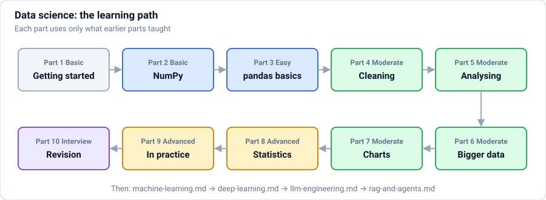

### 1.1 The job

**Data science** is answering questions with data: "Which products sell best in which city?", "Did the new checkout page raise sales?", "Which customers are about to leave?". The work is mostly not modelling. It's finding the right data, cleaning it, summarising it, checking that differences are real and not chance, and explaining the answer clearly.

Three overlapping roles do this work:

| Role | Main question | Main tools |
|---|---|---|
| **data analyst** | what happened, and why? | SQL, pandas, charts, dashboards |
| **data scientist** | is it real, and what will happen? | the above, plus statistics, experiments, machine learning |
| **ML / AI engineer** | how do we build it into a product? | the above, plus models, pipelines, deployment |

This book covers the shared foundation of all three. `machine-learning.md` continues with models.

### 1.2 The steps of an analysis

Almost every analysis follows the same loop:

1. **Ask** a precise question. "How are sales?" can't be answered; "Which city had the highest revenue last month?" can.
2. **Get the data:** files, a database, an API.
3. **Clean** it: missing values, duplicates, wrong types, typos.
4. **Explore and analyse:** summaries, groups, charts.
5. **Check** that the result isn't chance or a data error.
6. **Communicate:** the answer first, then the evidence.

### 1.3 A first analysis in plain Python

Four orders from a small shop. Question: **which city brought in the most revenue?** Revenue is quantity × price:

```python
orders = [
    {"customer": "Asha", "city": "Pune", "qty": 5, "price": 60},
    {"customer": "Ravi", "city": "Mumbai", "qty": 1, "price": 2500},
    {"customer": "Asha", "city": "Pune", "qty": 1, "price": 1200},
    {"customer": "Zoya", "city": "Mumbai", "qty": 2, "price": 350},
]

revenue_by_city = {}
for order in orders:
    revenue = order["qty"] * order["price"]
    revenue_by_city[order["city"]] = revenue_by_city.get(order["city"], 0) + revenue

print(revenue_by_city)
print("top city:", max(revenue_by_city, key=revenue_by_city.get))
```

**Output:**

```text
{'Pune': 1500, 'Mumbai': 3200}
top city: Mumbai
```

By hand: Pune has 5 × 60 + 1 × 1200 = 1500; Mumbai has 1 × 2500 + 2 × 350 = 3200. `dict.get(key, 0)` returns 0 for a city not seen yet, and `max(d, key=d.get)` returns the key with the largest value.

This worked for 4 rows. For 4 million rows, a loop in Python is slow, and every new question needs a new loop. The rest of the book builds the tools that make this one line, for any size: NumPy for fast arrays (Part II), pandas for tables (Part III onwards). In pandas this whole analysis becomes `df.groupby("city")["revenue"].sum()` (Chapter 31).

### 1.4 Summary

```
ask → get data → clean → explore and analyse → check → communicate
```

**Key terms:**

- **Data science:** answering questions with data, using statistics, programming and domain knowledge.
- **Data analyst:** someone who describes what happened in the data and explains why.
- **Data scientist:** someone who also tests whether patterns are real and predicts what will happen.
- **Revenue:** money from sales: quantity × price, summed.

### Exercises

1. Using the same loop pattern, find how many items (total quantity) each customer bought.
2. Rewrite "How is the business doing?" as two precise questions that data could answer.

<details>
<summary><b>Answers</b></summary>

```python
items = {}
for order in orders:
    items[order["customer"]] = items.get(order["customer"], 0) + order["qty"]
print(items)
```

**Output:**

```text
{'Asha': 6, 'Ravi': 1, 'Zoya': 2}
```

1. Asha bought 6 items, Ravi 1, Zoya 2.
2. For example: "What was total revenue per month this year, and how does it compare with last year?" and "What share of customers who bought in January bought again in February?"

</details>

---

## 2. Setting Up: uv, Virtual Environments and Notebooks

**You need:** Chapter 1. · **You'll learn:** how to install the data libraries in a project of their own, and how to work in a notebook without fooling yourself.

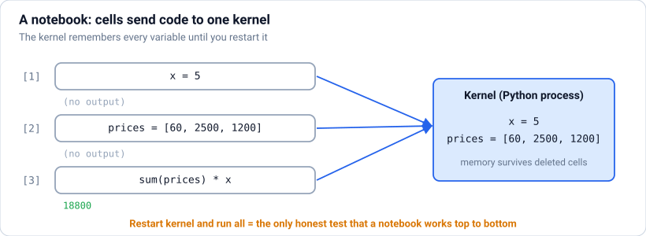

### 2.1 One environment per project

Data work uses libraries: NumPy, pandas, Matplotlib and others. A **package manager** downloads and installs them. A **virtual environment** (**venv**) is a private folder of installed libraries for **one** project, so two projects can use different versions without breaking each other.

**uv** is a fast, modern tool that does both. In a new project folder:

```
uv init                                           # creates pyproject.toml, the project's list of libraries
uv add numpy pandas matplotlib seaborn scipy statsmodels pyarrow polars duckdb plotly jupyterlab
uv run jupyter lab                                # opens JupyterLab using this project's venv
```

`uv add` installs the libraries into the project's venv **and** records their exact versions in a **lock file**, so anyone can recreate the same setup later with `uv sync`. (Without uv: `python -m venv .venv`, activate it, then `pip install …`. Without installing anything: Google Colab, a free browser notebook with these libraries preinstalled.)

### 2.2 Notebooks and the kernel

A **notebook** (a `.ipynb` file, opened in JupyterLab or VS Code) is a list of **cells**. A code cell holds Python; a Markdown cell holds notes. When you run a cell, its code is sent to the **kernel**, a single running Python process behind the notebook, and the result appears under the cell.

The kernel **remembers every variable** from every cell you've run, in the order you ran them, including cells you've since edited or deleted. That makes notebooks great for exploring step by step, and dangerous: a notebook can "work" for you and fail for anyone who runs it from the top. Two habits fix that:

- Run cells **top to bottom**, and before trusting or sharing a result, use **Restart kernel and run all**.
- The **last line** of a cell is displayed automatically; earlier lines need `print`.

Notebooks are for exploring. Code that must run every day (a pipeline, a report) belongs in functions in `.py` files, where it can be tested and reviewed (Chapter 62).

### 2.3 Check your setup

Libraries are loaded with `import`, usually under short standard nicknames (**aliases**) that everyone uses, so code online looks the same: `import numpy as np`, `import pandas as pd`, `import matplotlib.pyplot as plt`, `import seaborn as sns`. Check your versions; it's the first thing to compare when an example behaves differently for you:

```python
import sys
import importlib.metadata as meta

print("Python", sys.version.split()[0])
for library in ["numpy", "pandas", "matplotlib", "seaborn", "scipy", "statsmodels", "polars", "duckdb", "plotly"]:
    print(f"{library:12s} {meta.version(library)}")
```

**Output:**

```text
Python 3.13.2
numpy        2.5.4
pandas       3.1.0
matplotlib   3.11.2
seaborn      0.13.2
scipy        1.18.1
statsmodels  0.15.0
polars       2.1.0
duckdb       2.0.0
plotly       7.1.0
```

`importlib.metadata.version` reads an installed library's version without importing it.

### 2.4 Summary

```
uv init;  uv add <libraries>;  uv run jupyter lab;  uv sync (recreate)       one venv per project
notebook = cells sent to one kernel that remembers everything → restart and run all before trusting results
```

**Key terms:**

- **Package manager:** a tool that installs libraries, such as `uv` or `pip`.
- **Virtual environment (venv):** a private set of installed libraries for one project.
- **uv:** a fast Python package and project manager that creates venvs and lock files.
- **Lock file:** a file recording the exact version of every installed library.
- **Notebook:** a document of code and text cells whose results are shown under each cell.
- **Kernel:** the running Python process behind a notebook, which remembers every variable created so far.
- **Import / alias:** loading a library into Python / the short name it's loaded under, such as `pd`.

### Exercises

1. In a notebook, run `x = 5` in one cell, delete that cell, then run `print(x)` in a new cell. What happens? Then restart the kernel and run `print(x)` again.
2. Why record exact library versions in a lock file?

<details>
<summary><b>Answers</b></summary>

1. The first `print(x)` prints 5: deleting a cell doesn't delete the variable from the kernel. After a restart the kernel's memory is empty and you get `NameError`. That's why "restart and run all" is the only honest test.
2. So that the code runs the same next month and on a colleague's machine: a new library version can change results or break code.

</details>

**Learn more:** [uv documentation](https://docs.astral.sh/uv/) · [JupyterLab: getting started](https://jupyterlab.readthedocs.io/en/latest/getting_started/overview.html)

---

## 3. Python for Data Work: Lists, Dicts, Comprehensions and Functions

**You need:** basic Python. · **You'll learn:** the handful of Python features data work relies on, using a list of dicts as a first table.

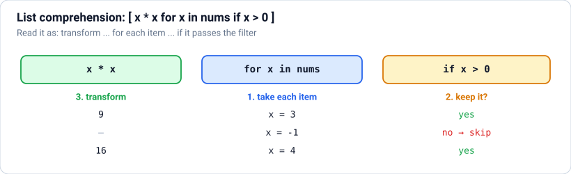

### 3.1 A table as a list of dicts

A **list** keeps things in order; a **dict** looks values up by key. A **list of dicts** is the simplest table: each dict is one row (a **record**), and its keys are the column names. It's also the shape JSON data from web APIs arrives in (Chapter 5).

```python
orders = [
    {"customer": "Asha", "city": "Pune", "qty": 5, "price": 60},
    {"customer": "Ravi", "city": "Mumbai", "qty": 1, "price": 2500},
    {"customer": "Asha", "city": "Pune", "qty": 1, "price": 1200},
    {"customer": "Zoya", "city": "Mumbai", "qty": 2, "price": 350},
]
print(orders[1]["city"], len(orders))
```

**Output:**

```text
Mumbai 4
```

### 3.2 Comprehensions

A **list comprehension** builds a new list from another in one line: an expression, a `for`, and optionally an `if` to filter. Read `[x * x for x in [3, -1, 4] if x > 0]` as "x times x, for each x in the list, if x is positive": 3 → 9, −1 skipped, 4 → 16, so `[9, 16]`.

```python
revenues = [o["qty"] * o["price"] for o in orders]
big_spenders = [o["customer"] for o in orders if o["qty"] * o["price"] >= 1000]
revenue_of = {i: o["qty"] * o["price"] for i, o in enumerate(orders)}           # a dict comprehension: position → revenue
print(revenues, sum(revenues))
print(big_spenders)
print(revenue_of)
```

**Output:**

```text
[300, 2500, 1200, 700] 4700
['Ravi', 'Asha']
{0: 300, 1: 2500, 2: 1200, 3: 700}
```

`enumerate` gives each item's position along with the item. A **dict comprehension** works the same with `key: value`.

### 3.3 Sorting with a key

`sorted(items, key=f)` sorts by whatever f returns for each item. A **lambda** is a tiny unnamed function written inline, `lambda o: …`:

```python
by_revenue = sorted(orders, key=lambda o: o["qty"] * o["price"], reverse=True)
print([o["customer"] for o in by_revenue])
```

**Output:**

```text
['Ravi', 'Asha', 'Zoya', 'Asha']
```

### 3.4 Counting and grouping

Two helpers from the standard library's `collections` module save boilerplate. `Counter` counts how often each value occurs. `defaultdict(int)` is a dict where a missing key starts at 0 (with `list`, at an empty list), so you can add to it straight away:

```python
from collections import Counter, defaultdict

print(Counter(o["city"] for o in orders))

total_by_city = defaultdict(int)
for o in orders:
    total_by_city[o["city"]] += o["qty"] * o["price"]
print(dict(total_by_city))
```

**Output:**

```text
Counter({'Pune': 2, 'Mumbai': 2})
{'Pune': 1500, 'Mumbai': 3200}
```

This counting and grouping is exactly what pandas does for whole tables in one call (Chapter 31).

### 3.5 Functions

A **function** packages a calculation under a name. Write one whenever you'd otherwise copy code. A docstring says what it does, and the empty case should be handled deliberately:

```python
def average(values):
    """The mean of a list of numbers, or None for an empty list."""
    return sum(values) / len(values) if values else None

for city in total_by_city:
    city_revenues = [o["qty"] * o["price"] for o in orders if o["city"] == city]
    print(f"{city:7s} average order {average(city_revenues):8.2f}")
print(average([]))
```

**Output:**

```text
Pune    average order   750.00
Mumbai  average order  1600.00
None
```

In an **f-string**, `{value:8.2f}` formats a number with 2 decimal places in a field 8 characters wide; `{text:7s}` pads text to 7 characters.

### 3.6 Summary

```
[expr for x in items if cond]      {k: v for …}      sorted(items, key=lambda x: …, reverse=True)
Counter(values)                    defaultdict(int)  d.get(key, default)        f"{x:8.2f}"
```

**Key terms:**

- **List / dict:** an ordered collection read by position / a collection of key → value pairs read by key.
- **Record:** one row of data; a list of dicts is a list of records.
- **Comprehension:** a one-line way to build a list, dict or set from another collection, optionally filtered.
- **Lambda:** a small unnamed function written in one expression.
- **`Counter` / `defaultdict`:** dict variants that count values / supply a default for missing keys.
- **f-string:** a string with `f` in front that fills in `{values}`, with optional formatting.

### Exercises

1. Make a dict mapping each customer to the total quantity they bought.
2. List the (customer, revenue) pairs of the Mumbai orders, smallest revenue first.

<details>
<summary><b>Answers</b></summary>

```python
items = defaultdict(int)
for o in orders:
    items[o["customer"]] += o["qty"]
print(dict(items))

mumbai = sorted(((o["customer"], o["qty"] * o["price"]) for o in orders if o["city"] == "Mumbai"), key=lambda pair: pair[1])
print(mumbai)
```

**Output:**

```text
{'Asha': 6, 'Ravi': 1, 'Zoya': 2}
[('Zoya', 700), ('Ravi', 2500)]
```

1. Asha 6, Ravi 1, Zoya 2.
2. Zoya's 700, then Ravi's 2,500.

</details>

---

## 4. What Data Looks Like: Types of Data and Tidy Tables

**You need:** Chapter 3. · **You'll learn:** the kinds of values a column can hold, why the kind decides what you may calculate, and the tidy shape that makes tables easy to analyse.

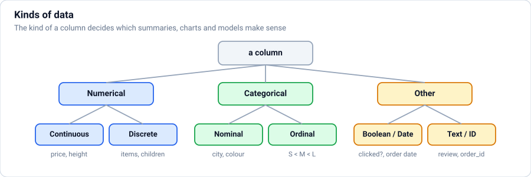

### 4.1 Rows and columns

In a table, each **row** is one **observation** (one order, one patient, one day), and each **column** is one **variable**: a property measured for every observation, such as price or city. One cell is one **value**.

### 4.2 Kinds of data

What you can calculate depends on what kind of values a column holds:

| Kind | Example | Meaningful summary |
|---|---|---|
| **numerical, continuous:** any value in a range | price, height, temperature | mean, median, spread |
| **numerical, discrete:** whole counts | items in a basket | the same, plus counts of each value |
| **categorical, nominal:** labels with no order | city, colour | counts, the most common value |
| **categorical, ordinal:** labels with an order | sizes S < M < L | counts, median, order-based comparisons |
| **boolean:** two values | gift wrap yes/no | proportion of yes |
| **date / time** | order date | ranges, gaps between dates, counts per period |
| **identifier** | order ID, postcode | none: count distinct values only |

Two traps. **Ordinal** categories have an order but not equal gaps: M − S isn't "the same amount" as L − M, so an average of sizes is meaningless. **Identifiers** look like numbers but aren't quantities: the mean of order IDs means nothing.

A function that guesses the kind of each column of a few rows:

```python
from datetime import date

rows = [
    {"order_id": 1001, "date": date(2025, 1, 5), "city": "Pune", "size": "M", "qty": 2, "price": 349.0, "gift": False},
    {"order_id": 1002, "date": date(2025, 1, 6), "city": "Delhi", "size": "L", "qty": 1, "price": 1299.5, "gift": True},
    {"order_id": 1003, "date": date(2025, 1, 6), "city": "Pune", "size": "S", "qty": 3, "price": 99.0, "gift": False},
]

def kind(column, values):
    if column.endswith("_id"):
        return "identifier"
    v = values[0]
    if isinstance(v, bool):              # check bool first: in Python, True is also an int
        return "boolean"
    if isinstance(v, date):
        return "date"
    if isinstance(v, int):
        return "numerical (discrete)"
    if isinstance(v, float):
        return "numerical (continuous)"
    return f"categorical ({len(set(values))} distinct values)"

for col in rows[0]:
    print(f"{col:9s} {kind(col, [r[col] for r in rows])}")
```

**Output:**

```text
order_id  identifier
date      date
city      categorical (2 distinct values)
size      categorical (3 distinct values)
qty       numerical (discrete)
price     numerical (continuous)
gift      boolean
```

`isinstance(v, T)` checks a value's type. The code can't tell that "size" is ordinal: that's knowledge about the data that you have to supply.

### 4.3 Tidy data

A table is **tidy** when:

1. each variable is a column,
2. each observation is a row,
3. each value is a single cell.

The common untidy shape is **wide**: repeated measurements side by side as columns, such as one column per month. Easy for people to read, awkward for computers: "total sales per month" has to visit every column. The **long** (tidy) version has one row per (store, month):

```python
wide = {"Pune": {"jan": 120, "feb": 135, "mar": 150},
        "Delhi": {"jan": 90, "feb": 80, "mar": 110}}

tidy = [{"store": store, "month": month, "sales": sales}
        for store, months in wide.items()
        for month, sales in months.items()]
for row in tidy:
    print(row)

per_month = {}
for row in tidy:
    per_month[row["month"]] = per_month.get(row["month"], 0) + row["sales"]
print(per_month)
```

**Output:**

```text
{'store': 'Pune', 'month': 'jan', 'sales': 120}
{'store': 'Pune', 'month': 'feb', 'sales': 135}
{'store': 'Pune', 'month': 'mar', 'sales': 150}
{'store': 'Delhi', 'month': 'jan', 'sales': 90}
{'store': 'Delhi', 'month': 'feb', 'sales': 80}
{'store': 'Delhi', 'month': 'mar', 'sales': 110}
{'jan': 210, 'feb': 215, 'mar': 260}
```

A comprehension with two `for`s loops over both: every store, then every month within it. In the tidy table, any summary (per month, per store) is the same simple loop over rows. pandas converts between wide and long in one call (Chapter 35).

### 4.4 Summary

```
row = observation · column = variable · cell = value
numerical (continuous, discrete) · categorical (nominal, ordinal) · boolean · date · identifier
tidy: one variable per column, one observation per row, one value per cell (usually "long")
```

**Key terms:**

- **Observation:** one thing measured, stored as one row.
- **Variable:** one property measured for every observation, stored as one column.
- **Continuous / discrete:** numbers that can take any value in a range / whole-number counts.
- **Nominal / ordinal:** categories with no order / categories with an order but no meaningful distances.
- **Identifier:** a code that names something; numeric-looking but not a quantity.
- **Tidy data:** each variable a column, each observation a row, each value a cell.
- **Wide / long format:** repeated measurements as columns / as rows.
- **Schema:** a table's column names and types.

### Exercises

1. Classify: a customer's age in years; a postcode; star rating 1–5; whether a coupon was used; delivery time in minutes.
2. A sheet has columns `name, maths_2024, maths_2025, english_2024, english_2025`. What would the tidy version's columns be?

<details>
<summary><b>Answers</b></summary>

1. Age: discrete numerical (or continuous if measured precisely). Postcode: identifier. Star rating: ordinal categorical. Coupon: boolean. Delivery time: continuous numerical.
2. `name, subject, year, score`: one row per student, subject and year.

</details>

**Learn more:** [Hadley Wickham, Tidy Data](https://vita.had.co.nz/papers/tidy-data.pdf)

---

## 5. Reading Files with Plain Python: Text, CSV and JSON

**You need:** Chapters 3–4. · **You'll learn:** how data files are stored, and how to read CSV and JSON with Python's standard library, including the conversions you have to do yourself.

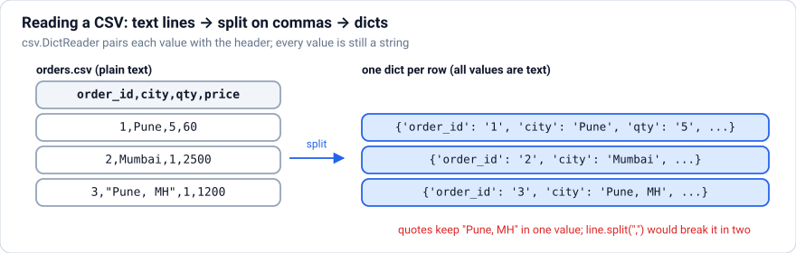

### 5.1 A CSV file is just text

A **CSV** file (comma-separated values) stores a table as text: the first line is the **header** with the column names, and each further line is a row, with values separated by commas. A value containing a comma is wrapped in double quotes.

Write a small one to a temporary folder (`tempfile.mkdtemp()` makes a fresh empty folder; `os.path.join` builds a file path):

```python
import csv, json, os, tempfile

folder = tempfile.mkdtemp()
path = os.path.join(folder, "orders.csv")
with open(path, "w", encoding="utf-8") as f:
    f.write("order_id,city,product,qty,price\n"
            "1,Pune,Notebook,5,60\n"
            "2,Mumbai,Headphones,1,2500\n"
            '3,"Pune, MH",Backpack,1,1200\n')
print(open(path, encoding="utf-8").read())
```

**Output:**

```text
order_id,city,product,qty,price
1,Pune,Notebook,5,60
2,Mumbai,Headphones,1,2500
3,"Pune, MH",Backpack,1,1200
```

`with open(…) as f:` opens the file and closes it automatically at the end of the block. Always pass `encoding="utf-8"`, the standard text encoding, so accented and non-English characters read correctly everywhere.

### 5.2 Reading it with the csv module

Splitting lines on commas yourself breaks on `"Pune, MH"`. The `csv` module handles quoting. `csv.DictReader` uses the header as keys and gives one dict per row:

```python
with open(path, encoding="utf-8") as f:
    rows = list(csv.DictReader(f))
print(rows[2])
print(type(rows[0]["qty"]), "| '10' > '9' is", "10" > "9")
```

**Output:**

```text
{'order_id': '3', 'city': 'Pune, MH', 'product': 'Backpack', 'qty': '1', 'price': '1200'}
<class 'str'> | '10' > '9' is False
```

Everything comes back as **text**. Text compares character by character, so "10" sorts before "9", and "5" × "60" is an error. Converting types is your job:

```python
for r in rows:
    r["order_id"], r["qty"], r["price"] = int(r["order_id"]), int(r["qty"]), float(r["price"])
print("revenue:", sum(r["qty"] * r["price"] for r in rows))
```

**Output:**

```text
revenue: 4000.0
```

pandas (Chapter 19) does this guessing of types for you, which is one reason to use it. But the guesses can be wrong, and Chapter 27 is about fixing them.

### 5.3 JSON

**JSON** (JavaScript Object Notation) is the format web APIs speak. It nests objects (written `{…}`, read as Python dicts) and arrays (`[…]`, read as lists), with `true`/`false`/`null` becoming `True`/`False`/`None`. `json.loads` parses text; `json.dump` writes a file:

```python
api_text = '{"store": "Pune", "open": true, "orders": [{"id": 1, "total": 300}, {"id": 2, "total": null}]}'
data = json.loads(api_text)
print(data["orders"][0], data["open"], data["orders"][1]["total"])

totals = [o["total"] for o in data["orders"] if o["total"] is not None]
out_path = os.path.join(folder, "summary.json")
with open(out_path, "w", encoding="utf-8") as f:
    json.dump({"store": data["store"], "known_total": sum(totals)}, f, indent=2)
print(open(out_path, encoding="utf-8").read())
```

**Output:**

```text
{'id': 1, 'total': 300} True None
{
  "store": "Pune",
  "known_total": 300
}
```

Missing values (`null` → `None`) must be skipped or handled before doing maths, a first taste of Chapter 26. `indent=2` writes readable, indented JSON.

### 5.4 Summary

```
with open(path, encoding="utf-8") as f:  rows = list(csv.DictReader(f))      every value is text → int(), float()
json.loads(text) / json.load(f) → dicts and lists;  json.dump(obj, f, indent=2);  null → None
```

**Key terms:**

- **CSV (comma-separated values):** a text format for tables: a header line, then one line per row, values separated by commas.
- **Header:** the first line of a CSV, holding the column names.
- **Encoding (UTF-8):** how text characters are stored as bytes; UTF-8 is the universal standard.
- **JSON:** a text format of nested objects and arrays, used by web APIs.
- **Parsing:** turning text into structured data, such as dicts and numbers.

### Exercises

1. A file `scores.csv` holds `name,score` with rows `Asha,82`, `Ravi,` (empty) and `Zoya,91`. Compute the average of the known scores.
2. From the JSON text `[{"city": "Pune", "temp": 31.5}, {"city": "Delhi", "temp": 38.0}]`, find the hottest city.

<details>
<summary><b>Answers</b></summary>

```python
p = os.path.join(folder, "scores.csv")
with open(p, "w", encoding="utf-8") as f:
    f.write("name,score\nAsha,82\nRavi,\nZoya,91\n")
with open(p, encoding="utf-8") as f:
    scores = [float(r["score"]) for r in csv.DictReader(f) if r["score"] != ""]
print(sum(scores) / len(scores))

cities = json.loads('[{"city": "Pune", "temp": 31.5}, {"city": "Delhi", "temp": 38.0}]')
print(max(cities, key=lambda c: c["temp"])["city"])
```

**Output:**

```text
86.5
Delhi
```

1. 86.5: Ravi's empty score is skipped, not counted as 0, which would wrongly drag the average down.
2. Delhi.

</details>

---

# Part II — NumPy

Eleven chapters on NumPy, the library of fast arrays of numbers that pandas, Matplotlib, SciPy and every machine-learning library are built on.

---

## 6. Why NumPy? Arrays vs Lists

**You need:** Chapter 3. · **You'll learn:** what a NumPy array is, why it's far smaller and faster than a list, and the one big difference in how operators behave.

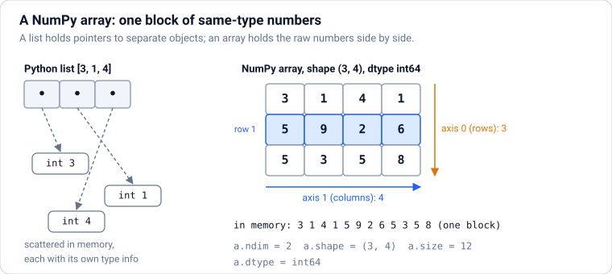

### 6.1 The problem with lists of numbers

A Python list can hold anything, so each item is a separate Python object somewhere in memory, and the list only stores pointers to them. Doing maths means visiting each object, checking its type, and creating a new object for the result, one item at a time. Fine for 4 numbers, slow for 4 million.

**NumPy** (numerical Python) provides the **array** (`ndarray`): a block of raw numbers, all of the same type, stored side by side. Operations on whole arrays run in compiled C code, without a Python-level loop. Writing maths on whole arrays like this is called **vectorisation**.

### 6.2 Smaller

```python
import sys, time
import numpy as np

nums = list(range(1_000_000))
arr = np.arange(1_000_000)                       # the same numbers as an array (Chapter 7)

list_bytes = sys.getsizeof(nums) + sum(sys.getsizeof(x) for x in nums)
print(f"list  ≈ {list_bytes / 1e6:.0f} MB")
print(f"array = {arr.nbytes / 1e6:.0f} MB: {arr.itemsize} bytes per number, type {arr.dtype}")
```

**Output:**

```text
list  ≈ 36 MB
array = 8 MB: 8 bytes per number, type int64
```

`sys.getsizeof` measures an object's memory; `nbytes` is the array's data size. Each array element is exactly 8 bytes (a 64-bit integer); each list element costs a pointer plus a whole Python integer object.

### 6.3 Faster

Double every number both ways. `time.perf_counter()` is a precise clock:

```python
start = time.perf_counter()
doubled_list = [x * 2 for x in nums]
list_time = time.perf_counter() - start

start = time.perf_counter()
doubled_arr = arr * 2                            # no loop: the whole array at once
array_time = time.perf_counter() - start

print("same answer:", doubled_list[-1] == doubled_arr[-1])
print(f"NumPy was about {list_time / array_time:.0f}× faster")
```

**Output:**

```text
same answer: True
NumPy was about 9× faster
```

### 6.4 Operators mean maths

`np.array(list)` makes an array from a list. On arrays, `+`, `*` and `**` apply to every element. On lists, they mean something else entirely:

```python
small = np.array([3, 1, 4])
print(small * 2, small + small, small ** 2)
print([3, 1, 4] * 2)                             # a list repeats!
print([3, 1, 4] + [3, 1, 4])                     # and joins!
```

**Output:**

```text
[6 2 8] [6 2 8] [ 9  1 16]
[3, 1, 4, 3, 1, 4]
[3, 1, 4, 3, 1, 4]
```

### 6.5 Summary

```
np.array(list) → one block of same-type numbers;  arr * 2, arr + arr, arr ** 2 act element by element
lists: + joins, * repeats;  arrays: several times smaller, and many times faster (more so for heavier maths)
```

**Key terms:**

- **NumPy:** Python's library for fast arrays of numbers.
- **Array (ndarray):** a block of same-type values stored side by side, with a shape.
- **Vectorisation:** writing operations on whole arrays instead of loops over elements.
- **dtype:** an array's element type, such as `int64` or `float64`.
- **`nbytes` / `itemsize`:** an array's total data size / the size of one element, in bytes.

### Exercises

1. Make the array 0, 10, 20, …, 90 by multiplying.
2. What does `np.array([1, "two", 3.0])` produce? Why is that a problem?

<details>
<summary><b>Answers</b></summary>

```python
print(np.array(range(10)) * 10)
mixed = np.array([1, "two", 3.0])
print(mixed, mixed.dtype)
```

**Output:**

```text
[ 0 10 20 30 40 50 60 70 80 90]
['1' 'two' '3.0'] <U32
```

1. Multiplying the array by 10 multiplies every element.
2. Every value becomes text (a `<U32` dtype: Unicode strings), because an array holds one type. Maths on it then fails, so keep arrays numeric.

</details>

| # | Problem (Deep-ML) | Difficulty |
|---|---|---|
| 1 | [1. Matrix-Vector Dot Product](https://www.deep-ml.com/problems/1) | 🟢 Easy |

**Learn more:** [NumPy: the absolute basics for beginners](https://numpy.org/doc/stable/user/absolute_beginners.html)

---

## 7. Creating Arrays

**You need:** Chapter 6. · **You'll learn:** the functions that make arrays: from lists, from ranges, evenly spaced points, and filled arrays.

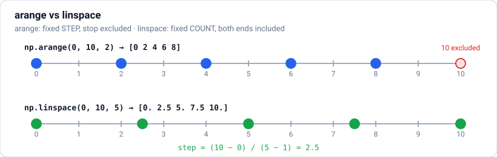

### 7.1 From lists

A list of lists becomes a two-dimensional array: each inner list is a row.

```python
import numpy as np

print(np.array([[1, 2, 3],
                [4, 5, 6]]))
```

**Output:**

```text
[[1 2 3]
 [4 5 6]]
```

### 7.2 arange and linspace

- `np.arange(start, stop, step)` works like `range`: from start, in steps, **stopping before** stop.
- `np.linspace(start, stop, n)` gives **n** evenly spaced points **including both ends**. The step is (stop − start)/(n − 1).

```python
print(np.arange(5), np.arange(2, 11, 3), np.arange(10, 0, -3))
print(np.linspace(0, 1, 5))                     # step (1 − 0)/4 = 0.25
print(np.linspace(0, 10, 4))                    # step 10/3
```

**Output:**

```text
[0 1 2 3 4] [2 5 8] [10  7  4  1]
[0.   0.25 0.5  0.75 1.  ]
[ 0.          3.33333333  6.66666667 10.        ]
```

Prefer `linspace` for decimal steps. Decimal fractions such as 0.1 can't be stored exactly in binary floating point, so a float step can produce one point more or less than you expect:

```python
print(0.1 + 0.2, 0.1 + 0.2 == 0.3)
print(np.isclose(0.1 + 0.2, 0.3))               # compare floats with a tolerance instead
print(len(np.arange(1, 1.3, 0.1)), "points, though you might expect 3")
```

**Output:**

```text
0.30000000000000004 False
True
4 points, though you might expect 3
```

`np.isclose` compares two floats allowing a tiny difference. The last line is the trap: 1 + 3 × 0.1 lands a hair below 1.3, so `arange` includes it.

### 7.3 Filled arrays

`np.zeros(shape)`, `np.ones(shape)` and `np.full(shape, value)` make arrays filled with one value; `np.eye(n)` makes the n × n identity matrix (1s on the diagonal). A **shape** is a tuple: `(2, 3)` means 2 rows, 3 columns.

```python
print(np.zeros((2, 3)))
print(np.full((2, 3), 7))
print(np.eye(3))
```

**Output:**

```text
[[0. 0. 0.]
 [0. 0. 0.]]
[[7 7 7]
 [7 7 7]]
[[1. 0. 0.]
 [0. 1. 0.]
 [0. 0. 1.]]
```

Filled arrays are useful as starting points to fill in, though a vectorised expression is usually better than a loop that fills one element at a time.

### 7.4 Summary

```
np.array(nested lists)     np.arange(start, stop, step)  (stop excluded)     np.linspace(a, b, n)  (both ends)
np.zeros(shape), np.ones(shape), np.full(shape, v), np.eye(n)                 floats: np.isclose, not ==
```

**Key terms:**

- **`arange`:** evenly stepped values from a start, stopping before a stop.
- **`linspace`:** a fixed number of evenly spaced points between two ends, inclusive.
- **Shape:** the size of an array along each axis, as a tuple.
- **Identity matrix:** a square matrix with 1s on the diagonal and 0s elsewhere.
- **Floating-point error:** the tiny rounding error of storing decimals in binary.

### Exercises

1. Make the even numbers from 10 to 30 inclusive.
2. Make 7 evenly spaced points from −3 to 3, and a 3 × 3 array of −1s.

<details>
<summary><b>Answers</b></summary>

```python
print(np.arange(10, 31, 2))
print(np.linspace(-3, 3, 7))
print(np.full((3, 3), -1))
```

**Output:**

```text
[10 12 14 16 18 20 22 24 26 28 30]
[-3. -2. -1.  0.  1.  2.  3.]
[[-1 -1 -1]
 [-1 -1 -1]
 [-1 -1 -1]]
```

1. The stop must be 31 (or 32), because `arange` stops before it.
2. −3, −2, …, 3 (step 1), and the filled array.

</details>

---

## 8. Shape, Dimensions and dtypes

**You need:** Chapter 7. · **You'll learn:** to read an array's shape and type, and the conversions that silently lose information.

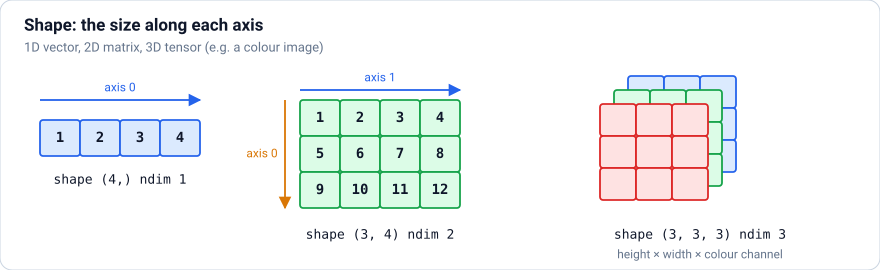

### 8.1 Shape, axes and size

Every array has:

- `ndim`: the number of **axes** (dimensions): 1 for a list of numbers, 2 for a table, 3 for a colour image;
- `shape`: the size along each axis; **axis 0** runs down the rows, **axis 1** across the columns;
- `size`: the total number of elements, the product of the shape.

`reshape` arranges the same numbers in a new shape (Chapter 14 covers it fully):

```python
import numpy as np

m = np.arange(12).reshape(3, 4)                 # 12 numbers as 3 rows × 4 columns
print(m)
print("ndim", m.ndim, "| shape", m.shape, "| size", m.size, "| len", len(m))

image = np.zeros((480, 640, 3), dtype=np.uint8)   # a black colour image: height, width, colour channels
print(image.ndim, image.shape, f"{image.nbytes / 1e6:.2f} MB")
```

**Output:**

```text
[[ 0  1  2  3]
 [ 4  5  6  7]
 [ 8  9 10 11]]
ndim 2 | shape (3, 4) | size 12 | len 3
3 (480, 640, 3) 0.92 MB
```

`len` gives the size of axis 0 only. `dtype=np.uint8` makes 1-byte unsigned integers (0 to 255), the usual type for pixels.

### 8.2 dtypes

All elements share one **dtype**. NumPy picks the type that can hold every value you give it:

```python
print(np.array([1, 2, 3]).dtype, np.array([1, 2, 3.5]).dtype, np.array([True, 2]).dtype, np.array([1, "a"]).dtype)
print(m.dtype, m.itemsize, "bytes each,", m.nbytes, "bytes in all")
```

**Output:**

```text
int64 float64 int64 <U21
int64 8 bytes each, 96 bytes in all
```

The common ones: `int64` (whole numbers), `float64` (decimals, about 16 significant digits), `bool`, and smaller versions (`int8`, `int32`, `float32`) that save memory (Chapter 40).

### 8.3 Converting, and what can go wrong

`astype(new_dtype)` makes a converted copy. Two silent traps:

```python
prices = np.array([2.9, -2.9, 7.5])
print(prices.astype(int), np.round(prices).astype(int))   # truncates towards 0, unless you round first

pixels = np.array([200, 250], dtype=np.uint8)
print(pixels + np.uint8(100))                             # wraps around: 300 → 44, 350 → 94
print(pixels.astype(np.int16) + 100)                      # safe in a bigger type
print("int8 range:", np.iinfo(np.int8).min, "to", np.iinfo(np.int8).max)
```

**Output:**

```text
[ 2 -2  7] [ 3 -3  8]
[44 94]
[300 350]
int8 range: -128 to 127
```

- **Truncation:** float → int drops the decimals (2.9 becomes 2), so round first if you mean rounding. (`np.round` rounds halves to the nearest even number: 7.5 → 8, but 6.5 → 6.)
- **Overflow:** a fixed-size integer that goes past its maximum **wraps around** with no error. 200 + 100 in `uint8` is 300 − 256 = 44. `np.iinfo` shows a type's range.

### 8.4 Summary

```
a.ndim, a.shape, a.size, len(a) (= shape[0]), a.dtype, a.itemsize, a.nbytes
a.astype(t): float → int truncates (round first);  small ints overflow silently (wrap around)
```

**Key terms:**

- **Axis:** one direction of an array; axis 0 is rows, axis 1 columns.
- **ndim:** the number of axes.
- **size:** the total number of elements.
- **astype:** converting an array to another dtype, as a copy.
- **Truncation:** dropping the decimal part when converting to integer.
- **Overflow:** a value exceeding its type's range; fixed-size integers wrap around.

### Exercises

1. What are the shape, size and memory (in bytes) of `np.ones((4, 5))`? How much would it take as `float32`?
2. What are the dtypes of `np.array([1, 2]) / 2` and `np.array([1, 2]) // 2`?

<details>
<summary><b>Answers</b></summary>

```python
ones = np.ones((4, 5))
print(ones.shape, ones.size, ones.nbytes, ones.astype(np.float32).nbytes)
print((np.array([1, 2]) / 2).dtype, (np.array([1, 2]) // 2).dtype)
```

**Output:**

```text
(4, 5) 20 160 80
float64 int64
```

1. (4, 5), 20 elements, 160 bytes as `float64`; half that, 80, as `float32`.
2. `/` always gives floats; `//` (whole-number division) keeps integers.

</details>

| # | Problem (Deep-ML) | Difficulty |
|---|---|---|
| 1 | [3. Reshape Matrix](https://www.deep-ml.com/problems/3) | 🟢 Easy |

---

## 9. Indexing and Slicing, Views and Copies

**You need:** Chapter 8. · **You'll learn:** to pick out elements, rows, columns and blocks of an array, and why a slice can change the original.

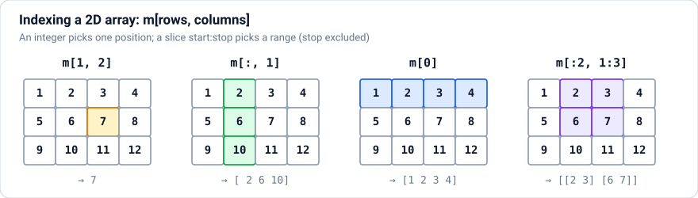

### 9.1 One position per axis

A 2D array takes one index per axis, separated by a comma: `m[row, column]`. Counting starts at 0, and negative positions count from the end. A **slice** `start:stop:step` picks a range (stop excluded), and `:` alone means "all":

```python
import numpy as np

m = np.arange(1, 13).reshape(3, 4)
print(m)
print(m[1, 2], m[-1, -1])                     # row 1 col 2; last row, last col
print(m[0])                                   # row 0
print(m[:, 1])                                # column 1 of every row
print(m[:2, 1:3])                             # rows 0–1, columns 1–2
```

**Output:**

```text
[[ 1  2  3  4]
 [ 5  6  7  8]
 [ 9 10 11 12]]
7 12
[1 2 3 4]
[ 2  6 10]
[[2 3]
 [6 7]]
```

### 9.2 An integer drops an axis; a slice keeps it

```python
print(m[0].shape, m[0:1].shape)
print(m[::2])                                 # every second row
print(m[:, ::-1])                             # columns reversed
```

**Output:**

```text
(4,) (1, 4)
[[ 1  2  3  4]
 [ 9 10 11 12]]
[[ 4  3  2  1]
 [ 8  7  6  5]
 [12 11 10  9]]
```

`m[0]` is a 1D row of 4; `m[0:1]` is a 2D table with one row. The difference matters when shapes must line up (Chapter 13).

### 9.3 Views and copies

A slice is a **view**: a new window onto the **same** memory, not a copy. Changing the view changes the original. `np.shares_memory` confirms it; `.copy()` makes an independent copy:

```python
scores = np.array([45, 82, 67, 91, 38, 74])
window = scores[:3]                           # a view
window[0] = 100
print(scores, np.shares_memory(scores, window))

safe = scores[:3].copy()                      # a copy
safe[0] = -1
print(scores[0], safe[0], np.shares_memory(scores, safe))
```

**Output:**

```text
[100  82  67  91  38  74] True
100 -1 False
```

Views make slicing fast and memory-free, even on huge arrays. But if you slice a piece out to modify it, and want the original untouched, copy it.

### 9.4 Summary

```
m[r, c]   m[r]   m[:, c]   m[r0:r1, c0:c1]   m[::2]   m[:, ::-1]        stop excluded; negatives count from the end
integer index drops an axis, slice keeps it;  slices are views (shared memory) → .copy() to detach
```

**Key terms:**

- **Index:** a position along an axis, starting at 0.
- **Slice:** a range of positions, `start:stop:step`, with the stop excluded.
- **View:** an array that shares memory with another, so changes show in both.
- **Copy:** an independent array with its own memory.

### Exercises

1. From `m`, take the last column, the bottom-right 2 × 2 block, and row 1 reversed.
2. Crop rows 1–3 and columns 2–4 from a 6 × 6 array `np.arange(36).reshape(6, 6)`.

<details>
<summary><b>Answers</b></summary>

```python
print(m[:, -1], m[-2:, -2:], m[1, ::-1], sep="\n")
img = np.arange(36).reshape(6, 6)
print(img[1:4, 2:5])
```

**Output:**

```text
[ 4  8 12]
[[ 7  8]
 [11 12]]
[8 7 6 5]
[[ 8  9 10]
 [14 15 16]
 [20 21 22]]
```

1. `m[:, -1]`, `m[-2:, -2:]`, `m[1, ::-1]`.
2. `img[1:4, 2:5]`: the stops are one past the last row and column wanted.

</details>

---

## 10. Boolean Masks, Fancy Indexing and np.where

**You need:** Chapter 9. · **You'll learn:** to select elements by a condition rather than by position, and to choose values element by element.

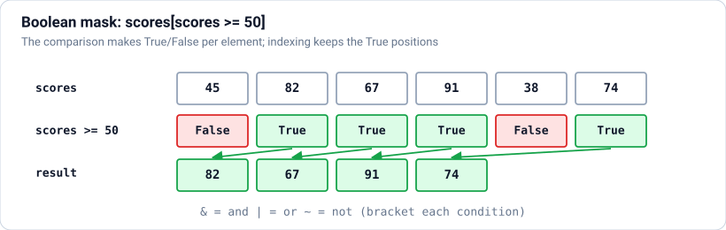

### 10.1 A condition makes a mask

Comparing an array with a value gives an array of True/False, a **boolean mask**. Indexing with the mask keeps only the True positions:

```python
import numpy as np

scores = np.array([45, 82, 67, 91, 38, 74])
passed = scores >= 50
print(passed)
print(scores[passed])
```

**Output:**

```text
[False  True  True  True False  True]
[82 67 91 74]
```

### 10.2 Combining conditions

Combine masks with `&` (and), `|` (or) and `~` (not), with **parentheses** around each comparison, since `&` binds more tightly than `>`. Python's `and`/`or` don't work on arrays. Because True counts as 1 and False as 0, `.sum()` counts matches and `.mean()` gives the fraction:

```python
print(scores[(scores > 60) & (scores < 90)])
print(scores[~passed])
print("passed:", passed.sum(), "of", passed.size, f"({passed.mean():.0%})")
print("positions of scores above 80:", np.flatnonzero(scores > 80))
```

**Output:**

```text
[82 67 74]
[45 38]
passed: 4 of 6 (67%)
positions of scores above 80: [1 3]
```

`np.flatnonzero` gives the positions where a mask is True.

### 10.3 Fancy indexing

Indexing with a **list of positions** picks exactly those elements, in that order:

```python
print(scores[[0, -1, 2]])
```

**Output:**

```text
[45 74 67]
```

### 10.4 Choosing values: where and select

`np.where(condition, a, b)` takes a where the condition holds and b elsewhere, element by element. `np.select(conditions, choices, default)` generalises it to several conditions, checked in order; the first true one wins:

```python
print(np.where(scores >= 50, "pass", "fail"))
grade = np.select([scores >= 85, scores >= 60, scores >= 50], ["A", "B", "C"], default="F")
print(grade)
```

**Output:**

```text
['fail' 'pass' 'pass' 'pass' 'fail' 'pass']
['F' 'B' 'B' 'A' 'F' 'B']
```

For 82: the first condition (≥ 85) is false, the second (≥ 60) is true, so "B".

### 10.5 Changing values through a mask

Assigning to a masked selection changes those elements in place:

```python
temps = np.array([12.5, -3.0, 7.1, -0.5, 40.2])
temps[temps < 0] = 0
print(temps)
print(np.where(temps > 35, 35, temps))                 # capped at 35, as a new array
```

**Output:**

```text
[12.5  0.   7.1  0.  40.2]
[12.5  0.   7.1  0.  35. ]
```

### 10.6 Summary

```
mask = a > x;  a[mask];  (c1) & (c2), |, ~ (with parentheses);  mask.sum() counts, mask.mean() = fraction
a[[i, j, k]] (fancy indexing);  np.where(cond, a, b);  np.select([c1, c2], [v1, v2], default=…)
a[mask] = v (in place)
```

**Key terms:**

- **Boolean mask:** an array of True/False used to select elements.
- **Fancy indexing:** selecting elements with an array or list of positions.
- **`np.where`:** element-wise choice between two values by a condition.
- **`np.select`:** element-wise choice among several values by several conditions, first match wins.

### Exercises

1. From `np.arange(1, 21)`, keep the numbers that are even **and** greater than 10.
2. Cap every value of `np.array([5, 120, 47, 3, 99])` to the range 10–90 using two masked assignments, and check against `np.clip(x, 10, 90)`.

<details>
<summary><b>Answers</b></summary>

```python
x = np.arange(1, 21)
print(x[(x % 2 == 0) & (x > 10)])
y = np.array([5, 120, 47, 3, 99])
capped = y.copy()
capped[capped < 10] = 10
capped[capped > 90] = 90
print(capped, np.array_equal(capped, np.clip(y, 10, 90)))
```

**Output:**

```text
[12 14 16 18 20]
[10 90 47 10 90] True
```

1. 12, 14, 16, 18, 20.
2. The same result as `np.clip`, which caps values to a range in one call.

</details>

---

## 11. Vectorised Maths and Universal Functions

**You need:** Chapter 10. · **You'll learn:** to do arithmetic and apply maths functions to whole arrays at once, and what happens with impossible results like division by zero.

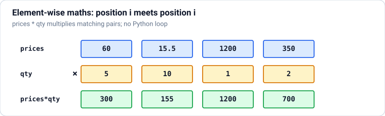

### 11.1 Element-wise arithmetic

Arithmetic between two arrays of the same shape works on matching elements: the first with the first, the second with the second:

```python
import numpy as np

prices = np.array([60.0, 15.5, 1200.0, 350.0])
qty = np.array([5, 10, 1, 2])
revenue = prices * qty
print(revenue, revenue.sum())
print(np.round(prices * 1.18, 2))                      # add 18% tax to every price
```

**Output:**

```text
[ 300.  155. 1200.  700.] 2355.0
[  70.8    18.29 1416.    413.  ]
```

By hand: 60 × 5 = 300, 15.5 × 10 = 155, 1200 × 1 = 1200, 350 × 2 = 700. Total 2,355. A single number, like 1.18, is applied to every element (Chapter 13 explains the rule behind this).

### 11.2 Universal functions

A **universal function** (**ufunc**) applies a maths function to every element: `np.sqrt`, `np.exp`, `np.log`, `np.abs`, `np.round`, and element-wise comparisons such as `np.maximum`:

```python
print(np.sqrt([4, 9, 16]), np.exp([0, 1]).round(3), np.log([1, np.e, 100]).round(3))
print(np.maximum(prices, 100))                          # the larger of each price and 100
print(np.clip(prices, 50, 500))                         # cap into [50, 500]
```

**Output:**

```text
[2. 3. 4.] [1.    2.718] [0.    1.    4.605]
[ 100.  100. 1200.  350.]
[ 60.  50. 500. 350.]
```

`np.log` is the natural logarithm, base e. A useful one for skewed data such as incomes is `np.log1p(x)` = log(1 + x): it compresses big gaps and still works at 0:

```python
income = np.array([0, 9_000, 25_000, 120_000, 4_500_000])
print(np.log1p(income).round(2))
```

**Output:**

```text
[ 0.    9.11 10.13 11.7  15.32]
```

The largest income is 500 times the second smallest; on the log scale it's under twice as big. Chapters 51 and 61 use this to tame skewed columns.

### 11.3 Impossible results: inf and nan

Division by zero doesn't raise an error on arrays. It gives **inf** (infinity) for x/0 and **nan** ("not a number") for 0/0, with a warning. `np.errstate` silences the warning for one block; `np.isfinite` finds the good values:

```python
with np.errstate(divide="ignore", invalid="ignore"):
    ratio = np.array([1.0, 0.0, -1.0]) / np.array([0.0, 0.0, 2.0])
print(ratio, np.isfinite(ratio))
print(np.nan + 1, np.nan == np.nan)
```

**Output:**

```text
[ inf  nan -0.5] [False False  True]
nan False
```

nan spreads through every calculation it touches, and isn't even equal to itself. Missing values in pandas are often nan (Chapter 26).

### 11.4 Summary

```
a + b, a * b, a / b, a ** 2 (same shape: element-wise);  a * 1.18 (a number applies to every element)
np.sqrt, np.exp, np.log, np.log1p, np.abs, np.round, np.maximum, np.clip
x/0 → inf, 0/0 → nan (spreads; nan != nan);  np.isfinite, np.isnan
```

**Key terms:**

- **Element-wise operation:** an operation applied to each pair of matching elements.
- **Universal function (ufunc):** a NumPy function that applies element by element.
- **`log1p`:** log(1 + x), used to compress skewed values that include 0.
- **inf:** the floating-point value for infinity.
- **nan (not a number):** the floating-point value for an undefined result; it spreads through calculations.

### Exercises

1. Convert the Celsius temperatures 0, 25, 37 and 100 to Fahrenheit (F = C × 9/5 + 32).
2. For a = [3, 8, 1] and b = [5, 2, 9], find the element-wise maximum and the percentage change from a to b, to one decimal.

<details>
<summary><b>Answers</b></summary>

```python
c = np.array([0, 25, 37, 100])
print(c * 9 / 5 + 32)
a, b = np.array([3, 8, 1]), np.array([5, 2, 9])
print(np.maximum(a, b), np.round((b - a) / a * 100, 1))
```

**Output:**

```text
[ 32.   77.   98.6 212. ]
[5 8 9] [ 66.7 -75.  800. ]
```

1. 32, 77, 98.6 and 212 °F.
2. Maximum (5, 8, 9); changes of +66.7%, −75% and +800%.

</details>

| # | Problem (Deep-ML) | Difficulty |
|---|---|---|
| 1 | [42. Implement ReLU Activation Function](https://www.deep-ml.com/problems/42) | 🟢 Easy |

---

## 12. Aggregations and the axis Argument

**You need:** Chapter 11. · **You'll learn:** to summarise arrays (sum, mean, max, percentiles, standard deviation), for the whole array or along rows or columns.

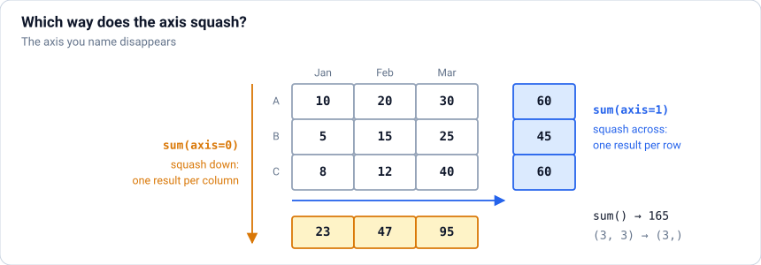

### 12.1 Whole array, per column, per row

An **aggregation** turns many numbers into one: `sum`, `mean`, `min`, `max`, `std`. With no `axis` it uses every element. With `axis=0` it squashes the rows, giving **one result per column**; with `axis=1` it squashes the columns, giving **one result per row**:

```python
import numpy as np

sales = np.array([[10, 20, 30],          # rows = stores A, B, C; columns = Jan, Feb, Mar
                  [ 5, 15, 25],
                  [ 8, 12, 40]])
print(sales.sum())                       # everything
print(sales.sum(axis=0))                 # per month (down each column)
print(sales.sum(axis=1))                 # per store (across each row)
```

**Output:**

```text
165
[23 47 95]
[60 45 60]
```

By hand: January is 10 + 5 + 8 = 23; store A is 10 + 20 + 30 = 60. A memory aid: the axis you name is the one that disappears.

### 12.2 Which one? argmax and running totals

`argmax` gives the **position** of the largest value instead of the value; `cumsum` gives running totals:

```python
months = np.array(["Jan", "Feb", "Mar"])
print(sales.max(axis=1), sales.argmax(axis=1), months[sales.argmax(axis=1)])
print(sales.cumsum(axis=1))              # running total across the months, per store
```

**Output:**

```text
[30 25 40] [2 2 2] ['Mar' 'Mar' 'Mar']
[[10 30 60]
 [ 5 20 45]
 [ 8 20 60]]
```

### 12.3 Keeping the axis for division

To get each month's share of its store's total, divide each row by its own sum. `keepdims=True` keeps the summed axis with size 1, shape (3, 1) instead of (3,), so the division lines up row by row (Chapter 13 explains why):

```python
row_totals = sales.sum(axis=1, keepdims=True)
print(row_totals.shape)
print((sales / row_totals).round(2))
```

**Output:**

```text
(3, 1)
[[0.17 0.33 0.5 ]
 [0.11 0.33 0.56]
 [0.13 0.2  0.67]]
```

### 12.4 Median and percentiles

The **median** is the middle value when sorted; the **p-th percentile** is the value below which p% of the data lies. For skewed data, such as response times with a few very slow requests, they describe the typical case far better than the mean:

```python
latency_ms = np.array([42, 51, 38, 47, 55, 40, 44, 49, 3200, 46])
print(f"mean {latency_ms.mean():.0f} ms, median {np.median(latency_ms):.0f} ms, p90 {np.percentile(latency_ms, 90):.0f} ms")
```

**Output:**

```text
mean 361 ms, median 46 ms, p90 369 ms
```

One slow request of 3.2 seconds drags the mean to 361 ms, though nine of ten requests took under 56 ms. The median ignores it. Monitoring dashboards report p95 and p99 for this reason.

### 12.5 Spread: standard deviation

The **variance** is the average squared distance from the mean, and the **standard deviation** (std) is its square root, back in the original units:

```
variance = Σ (xᵢ − x̄)² / n,        std = √variance
```

For 2, 4, 4, 4, 5, 5, 7, 9: the mean is 5, the squared distances are 9, 1, 1, 1, 0, 0, 4, 16, summing to 32; 32/8 = 4, so std = 2. When the data is a **sample** used to estimate a larger population's spread, dividing by n − 1 instead of n corrects a slight underestimate (Chapter 51 shows why). NumPy's `ddof=1` ("delta degrees of freedom") does that:

```python
x = np.array([2, 4, 4, 4, 5, 5, 7, 9])
print(x.std(), x.std(ddof=1).round(4))   # divide by n, then by n − 1
```

**Output:**

```text
2.0 2.1381
```

### 12.6 Missing values

A single nan makes the ordinary aggregations nan. The `nan`-prefixed versions skip them:

```python
data = np.array([2.0, np.nan, 4.0, 6.0])
print(data.mean(), np.nanmean(data), np.nanmax(data))
```

**Output:**

```text
nan 4.0 6.0
```

### 12.7 Summary

```
a.sum(), a.mean(), a.min(), a.max(), a.std(ddof=…), a.argmax(), a.cumsum()
axis=0 → one result per column;  axis=1 → one per row;  keepdims=True keeps the axis (size 1)
np.median(a), np.percentile(a, p);  np.nanmean, np.nanmax (skip nan)
variance = Σ(x − x̄)²/n (or n − 1 for a sample);  std = √variance
```

**Key terms:**

- **Aggregation:** a calculation that turns many values into one, such as a sum or mean.
- **`axis`:** the axis an aggregation runs along, which disappears from the result.
- **`argmax`:** the position of the largest value.
- **Cumulative sum:** the running total of a sequence.
- **Median:** the middle value of sorted data.
- **Percentile:** the value below which a given percentage of the data lies.
- **Variance / standard deviation:** the average squared distance from the mean / its square root.
- **`ddof`:** the number subtracted from n in the variance's denominator; 1 for the sample formula.

### Exercises

1. Which month had the highest total sales across all stores?
2. For `np.array([[70, 95, 60], [88, 72, 91]])` (rows = students, columns = tests), find each student's average and each test's best score.

<details>
<summary><b>Answers</b></summary>

```python
print(months[sales.sum(axis=0).argmax()])
s = np.array([[70, 95, 60], [88, 72, 91]])
print(s.mean(axis=1).round(1), s.max(axis=0))
```

**Output:**

```text
Mar
[75.  83.7] [88 95 91]
```

1. March: 30 + 25 + 40 = 95.
2. Averages 75.0 and 83.7 (`axis=1`, per row); best scores 88, 95, 91 (`axis=0`, per column).

</details>

| # | Problem (Deep-ML) | Difficulty |
|---|---|---|
| 1 | [4. Calculate Mean by Row or Column](https://www.deep-ml.com/problems/4) | 🟢 Easy |

---

## 13. Broadcasting: Maths Between Arrays of Different Shapes

**You need:** Chapter 12. · **You'll learn:** the rule that lets NumPy combine arrays of different shapes without copying, and the standardisation it makes one line.

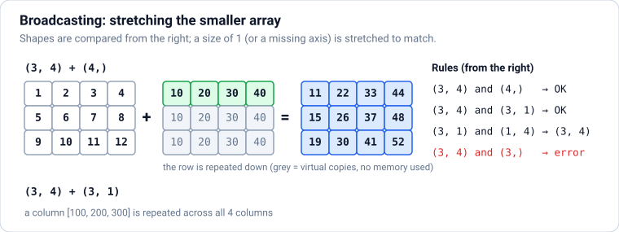

### 13.1 The rule

**Broadcasting** lets arrays of different shapes be combined element-wise. Compare the shapes from the **right**, axis by axis. Two sizes are compatible if they're **equal, or one of them is 1** (a missing axis on the left counts as 1). A size-1 axis is stretched to match the other, without actually copying anything.

| a | b | result |
|---|---|---|
| (3, 3) | (3,) → (1, 3) | (3, 3): b is added to every row |
| (3, 3) | (3, 1) | (3, 3): b is added across every column |
| (3, 1) | (4,) → (1, 4) | (3, 4): every pair |
| (3, 3) | (2,) | error: 3 vs 2, neither is 1 |

A single number has shape (), compatible with anything; that's why `prices * 1.18` worked in Chapter 11.

### 13.2 A value per column, or per row

```python
import numpy as np

marks = np.array([[70, 65, 80],        # rows = students; columns = Maths, Physics, Chemistry
                  [55, 72, 60],
                  [90, 85, 88]])
bonus = np.array([5, 3, 2])            # shape (3,): one bonus per subject
print(marks + bonus)

curve = np.array([[10], [0], [-5]])    # shape (3, 1): one adjustment per student
print(marks + curve)
```

**Output:**

```text
[[75 68 82]
 [60 75 62]
 [95 88 90]]
[[80 75 90]
 [55 72 60]
 [85 80 83]]
```

`[:, None]` adds an axis of size 1, turning shape (3,) into (3, 1). With it, a column of 3 and a row of 4 broadcast into every pair, a 3 × 4 multiplication table:

```python
print(np.arange(1, 4)[:, None] * np.arange(1, 5))
```

**Output:**

```text
[[ 1  2  3  4]
 [ 2  4  6  8]
 [ 3  6  9 12]]
```

### 13.3 Standardising columns

**Standardising** a column means subtracting its mean and dividing by its standard deviation, giving a **z-score**: how many standard deviations each value is from the average. It puts columns in different units (centimetres and kilograms) on one scale. Column means and stds have shape (2,), which broadcasts across the (3, 2) table:

```python
body = np.array([[170, 65], [182, 80], [158, 52]], dtype=float)   # columns: height cm, weight kg
z = (body - body.mean(axis=0)) / body.std(axis=0)
print(z.round(2))
print(z.mean(axis=0).round(10) + 0.0, z.std(axis=0))             # each column: mean 0, std 1
```

**Output:**

```text
[[ 0.   -0.06]
 [ 1.22  1.25]
 [-1.22 -1.19]]
[0. 0.] [1. 1.]
```

(`+ 0.0` turns a "−0." rounding leftover into a plain 0.) For **rows**, use `keepdims=True` so the statistics have shape (3, 1) (Chapter 12.3).

### 13.4 When shapes don't fit

```python
try:
    marks + np.array([1, 2])
except ValueError as e:
    print("error:", e)
```

**Output:**

```text
error: operands could not be broadcast together with shapes (3,3) (2,)
```

### 13.5 Summary

```
compare shapes from the right; each pair must be equal or contain a 1; missing axes count as 1
(n, m) + (m,) → per column;  (n, m) + (n, 1) → per row;  a[:, None] adds a size-1 axis
z = (x − x.mean(axis=0)) / x.std(axis=0)
```

**Key terms:**

- **Broadcasting:** combining arrays of different shapes by stretching size-1 axes, without copying.
- **Standardisation:** subtracting the mean and dividing by the standard deviation.
- **z-score:** a value's distance from the mean, in standard deviations.

### Exercises

1. Without running it, give the result shape of (5, 1) + (1, 6), of (4, 3) × (3,), and of (2, 1, 3) + (4, 1).
2. Subtract each student's own average from their marks (centre the rows), and check that each row now averages 0.

<details>
<summary><b>Answers</b></summary>

```python
print((np.ones((5, 1)) + np.ones((1, 6))).shape, (np.ones((4, 3)) * np.ones(3)).shape,
      (np.ones((2, 1, 3)) + np.ones((4, 1))).shape)
centred = marks - marks.mean(axis=1, keepdims=True)
print(centred.round(2), centred.mean(axis=1).round(10) + 0.0)
```

**Output:**

```text
(5, 6) (4, 3) (2, 4, 3)
[[-1.67 -6.67  8.33]
 [-7.33  9.67 -2.33]
 [ 2.33 -2.67  0.33]] [0. 0. 0.]
```

1. (5, 6); (4, 3); (2, 4, 3), since (4, 1) is treated as (1, 4, 1).
2. `keepdims=True` gives the averages shape (3, 1), so they're subtracted across each row.

</details>

---

## 14. Reshaping, Stacking, Splitting and Sorting

**You need:** Chapters 9 and 12. · **You'll learn:** to change an array's shape, join and split arrays, and sort or rank values.

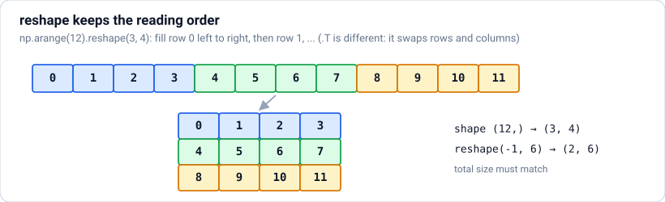

### 14.1 reshape and transpose

`reshape(new_shape)` lays the same numbers out in a new shape, reading them in order, row by row. The total size must match; `-1` means "work this size out". The **transpose** `.T` swaps rows and columns, which is a different thing:

```python
import numpy as np

a = np.arange(12)
m = a.reshape(3, 4)
print(m)
print(a.reshape(-1, 6).shape)
print(m.T)                               # (3, 4) → (4, 3): row i becomes column i
print(m.reshape(4, 3))                   # also (4, 3), but just re-reads the numbers in order
```

**Output:**

```text
[[ 0  1  2  3]
 [ 4  5  6  7]
 [ 8  9 10 11]]
(2, 6)
[[ 0  4  8]
 [ 1  5  9]
 [ 2  6 10]
 [ 3  7 11]]
[[ 0  1  2]
 [ 3  4  5]
 [ 6  7  8]
 [ 9 10 11]]
```

Compare the last two: the transpose's first row is 0, 4, 8 (the first column); the reshape's is 0, 1, 2. `ravel()` flattens back to 1D.

### 14.2 Stacking and splitting

`np.vstack` joins arrays vertically (more rows), `np.hstack` horizontally (more columns), and `np.stack` along a new axis. `np.split` cuts an array into equal pieces:

```python
x = np.array([[1, 2, 3], [4, 5, 6]])
y = np.array([[7, 8, 9], [10, 11, 12]])
print(np.vstack([x, y]).shape, np.hstack([x, y]).shape, np.stack([x, y]).shape)
left, right = np.split(np.hstack([x, y]), 2, axis=1)
print(np.array_equal(left, x), np.array_equal(right, y))
```

**Output:**

```text
(4, 3) (2, 6) (2, 2, 3)
True True
```

### 14.3 Sorting

`np.sort` returns sorted values. `np.argsort` returns the **positions** that would sort them, which lets you sort one array by another:

```python
scores = np.array([70, 95, 60, 88])
names = np.array(["Asha", "Ravi", "Zoya", "Meera"])
order = np.argsort(scores)
print(order, names[order])               # lowest score first
print(names[order[::-1]][:2])            # top 2
print(np.sort(np.array([[3, 1, 2], [9, 7, 8]]), axis=1))   # sort within each row
```

**Output:**

```text
[2 0 3 1] ['Zoya' 'Asha' 'Meera' 'Ravi']
['Ravi' 'Meera']
[[1 2 3]
 [7 8 9]]
```

By hand: the smallest score, 60, is at position 2, then 70 at 0, 88 at 3, 95 at 1, so `argsort` gives (2, 0, 3, 1).

### 14.4 Unique values and counts

```python
cities = np.array(["Pune", "Delhi", "Pune", "Goa", "Pune"])
values, counts = np.unique(cities, return_counts=True)
print(values, counts)
```

**Output:**

```text
['Delhi' 'Goa' 'Pune'] [1 1 3]
```

`np.unique` returns the distinct values sorted; `return_counts=True` adds how often each occurs.

### 14.5 Summary

```
a.reshape(r, c) (in reading order; −1 = infer);  a.T (swap axes);  a.ravel() (flatten)
np.vstack, np.hstack, np.stack;  np.split(a, k, axis=…)
np.sort(a, axis=…);  np.argsort(a) → positions;  names[np.argsort(scores)];  np.unique(a, return_counts=True)
```

**Key terms:**

- **Reshape:** arranging the same values in a new shape, in reading order.
- **Transpose:** swapping an array's axes, so rows become columns.
- **Stacking:** joining arrays along an existing or new axis.
- **`argsort`:** the positions that would sort an array.

### Exercises

1. Sort the names A, B, C by their heights 165, 180, 158, tallest first.
2. A tensor has shape (2, 3, 4). What shapes do `reshape(6, 4)` and `ravel()` give?

<details>
<summary><b>Answers</b></summary>

```python
heights, people = np.array([165, 180, 158]), np.array(["A", "B", "C"])
print(people[np.argsort(heights)[::-1]])
t = np.arange(24).reshape(2, 3, 4)
print(t.reshape(6, 4).shape, t.ravel().shape)
```

**Output:**

```text
['B' 'A' 'C']
(6, 4) (24,)
```

1. B, A, C: argsort gives smallest first, and `[::-1]` reverses it.
2. (6, 4) and (24,).

</details>

| # | Problem (Deep-ML) | Difficulty |
|---|---|---|
| 1 | [3. Reshape Matrix](https://www.deep-ml.com/problems/3) | 🟢 Easy |

---

## 15. Random Numbers and Simulation

**You need:** Chapters 10–14. · **You'll learn:** to generate random numbers reproducibly, and to answer probability questions by simulating them.

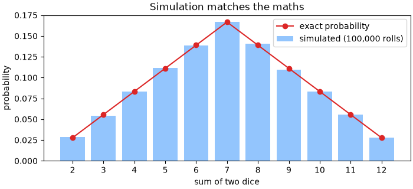

### 15.1 A random generator with a seed

`np.random.default_rng(seed)` creates a **random number generator**. Computers produce **pseudo-random** numbers from a starting value, the **seed**: the same seed gives the same numbers every time, which makes results reproducible:

```python
import numpy as np

rng = np.random.default_rng(42)
print(rng.integers(1, 7, size=10))                       # 10 dice rolls: integers 1–6 (7 excluded)
print(rng.normal(loc=170, scale=10, size=3).round(1))    # 3 heights from a normal distribution, mean 170, std 10
print(rng.choice(["cash", "card", "UPI"], size=6, p=[0.2, 0.3, 0.5]))
print(rng.permutation(np.arange(1, 9)))                  # 1–8 shuffled

print(np.random.default_rng(7).random(3), np.random.default_rng(7).random(3))   # same seed, same numbers
```

**Output:**

```text
[1 5 4 3 3 6 1 5 2 1]
[157.  171.3 166.8]
['cash' 'card' 'card' 'UPI' 'UPI' 'UPI']
[2 1 5 8 6 7 3 4]
[0.62509547 0.8972138  0.77568569] [0.62509547 0.8972138  0.77568569]
```

`random` gives numbers uniformly between 0 and 1; `choice` picks from a list with given probabilities `p`. Chapter 54 covers the normal and other distributions.

### 15.2 Simulation: two dice

What's the probability that two dice sum to 7? Exactly: 6 of the 36 equally likely pairs, (1, 6), (2, 5), …, (6, 1), give 7, so 6/36 = 0.1667. Simulating it: roll 100,000 pairs and count:

```python
rng = np.random.default_rng(0)
n = 100_000
sums = rng.integers(1, 7, n) + rng.integers(1, 7, n)
print(f"P(sum = 7) ≈ {(sums == 7).mean():.4f}   exact 6/36 = {6 / 36:.4f}")

values, counts = np.unique(sums, return_counts=True)
exact = np.array([6 - abs(7 - s) for s in values]) / 36           # ways to make each sum, out of 36
for v, c, e in zip(values, counts, exact):
    print(f"{v:2d}: simulated {c / n:.4f}  exact {e:.4f}")
```

**Output:**

```text
P(sum = 7) ≈ 0.1667   exact 6/36 = 0.1667
 2: simulated 0.0286  exact 0.0278
 3: simulated 0.0540  exact 0.0556
 4: simulated 0.0832  exact 0.0833
 5: simulated 0.1117  exact 0.1111
 6: simulated 0.1389  exact 0.1389
 7: simulated 0.1667  exact 0.1667
 8: simulated 0.1410  exact 0.1389
 9: simulated 0.1095  exact 0.1111
10: simulated 0.0832  exact 0.0833
11: simulated 0.0556  exact 0.0556
12: simulated 0.0276  exact 0.0278
```

**Simulation** answers probability questions by imitating the random process many times and counting. It's invaluable when the exact maths is hard.

### 15.3 More trials, closer answers

The **law of large numbers**: as the number of trials grows, the simulated frequency settles towards the true probability:

```python
for trials in [10, 100, 10_000, 1_000_000]:
    heads = np.random.default_rng(2).integers(0, 2, trials).mean()
    print(f"{trials:>9,} flips → fraction of heads {heads:.4f}")
```

**Output:**

```text
       10 flips → fraction of heads 0.3000
      100 flips → fraction of heads 0.5100
   10,000 flips → fraction of heads 0.4955
1,000,000 flips → fraction of heads 0.5005
```

The error shrinks roughly like 1/√n: 100 times more trials, 10 times more accurate. Chapter 55 derives this.

### 15.4 Estimating π

Throw random points into the unit square. The quarter circle of radius 1 covers π/4 of it, so the fraction of points with x² + y² ≤ 1 estimates π/4:

```python
points = np.random.default_rng(3).random((1_000_000, 2))
inside = (points ** 2).sum(axis=1) <= 1
print("π ≈", 4 * inside.mean())
```

**Output:**

```text
π ≈ 3.140468
```

This style of estimating by random sampling is called a **Monte Carlo** method.

### 15.5 Summary

```
rng = np.random.default_rng(seed);  rng.integers(lo, hi, n), rng.random(n), rng.normal(mean, std, n),
rng.choice(items, n, p=…), rng.permutation(a)          same seed → same numbers
simulation: repeat the random process many times, count;  error ≈ 1/√n
```

**Key terms:**

- **Random number generator:** an object that produces random numbers; NumPy's is `np.random.default_rng`.
- **Seed:** the starting value of a pseudo-random generator; the same seed reproduces the same numbers.
- **Pseudo-random:** generated by a deterministic algorithm, but statistically like random numbers.
- **Simulation:** estimating probabilities by repeating a random process many times.
- **Law of large numbers:** frequencies approach true probabilities as the number of trials grows.
- **Monte Carlo method:** estimating a quantity by random sampling.

### Exercises

1. Estimate the probability that a family of 3 children has exactly 2 girls (assume each child is a girl with probability ½), and compare with the exact 3/8.
2. Draw 5 different numbers from 1 to 20 (a lottery).

<details>
<summary><b>Answers</b></summary>

```python
rng = np.random.default_rng(11)
girls = rng.integers(0, 2, size=(10_000, 3)).sum(axis=1)       # each row is one family
print((girls == 2).mean(), 3 / 8)
print(np.random.default_rng(5).permutation(np.arange(1, 21))[:5])
```

**Output:**

```text
0.3729 0.375
[10 19  4  8  2]
```

1. Close to 0.375: 3 of the 8 equally likely girl/boy patterns (GGB, GBG, BGG) have exactly 2 girls.
2. The first 5 of a shuffle never repeat a number. (`rng.choice(…, 5, replace=False)` does the same.)

</details>

| # | Problem (Deep-ML) | Difficulty |
|---|---|---|
| 1 | [30. Batch Iterator for Dataset](https://www.deep-ml.com/problems/30) | 🟢 Easy |

<details>
<summary><b>Code for the chart at the top</b></summary>

```python
import matplotlib.pyplot as plt

fig, ax = plt.subplots(figsize=(7, 3.2), layout="constrained")
ax.bar(values, counts / n, color="#93c5fd", label="simulated (100,000 rolls)")
ax.plot(values, exact, "o-", color="#dc2626", label="exact probability")
ax.set(xlabel="sum of two dice", ylabel="probability", xticks=values)
ax.legend()
fig.savefig("dice-simulation.png", dpi=100)
plt.close(fig)
```

</details>

---

## 16. Linear Algebra Basics

**You need:** Chapters 11–13. · **You'll learn:** the dot product, vector length and cosine similarity, matrix multiplication, solving equations, and fitting the best straight line through points.

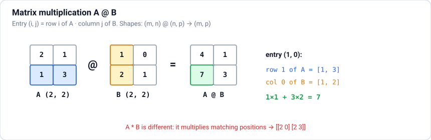

### 16.1 The dot product

The **dot product** of two vectors multiplies matching elements and adds them up: u · v = Σ uᵢvᵢ. For u = (1, 2, 3) and v = (4, 5, 6): 4 + 10 + 18 = 32. NumPy writes it `u @ v`:

```python
import numpy as np

u, v = np.array([1, 2, 3]), np.array([4, 5, 6])
print(u @ v, (u * v).sum())
```

**Output:**

```text
32 32
```

A weighted total is a dot product: quantities · prices is the bill.

### 16.2 Length and cosine similarity

A vector's **length** (norm) is √(u · u) = √(1 + 4 + 9) = 3.742. The **cosine similarity** of two vectors is their dot product divided by both lengths:

```
cos θ = u · v / (‖u‖ ‖v‖)
```

It's the cosine of the angle between them: 1 for the same direction, 0 for unrelated (perpendicular), −1 for opposite. It ignores length and compares direction only, which makes it the standard way to compare **embeddings**, the vectors that represent texts or items in search and recommendation systems:

```python
def cosine(a, b):
    return float(a @ b / (np.linalg.norm(a) * np.linalg.norm(b)))

print(np.linalg.norm(u).round(4), round(cosine(u, v), 4))
cat, kitten, car = np.array([0.9, 0.8, 0.1]), np.array([0.85, 0.75, 0.2]), np.array([0.1, 0.2, 0.95])
print(f"cat~kitten {cosine(cat, kitten):.3f}   cat~car {cosine(cat, car):.3f}")      # toy "embeddings"
```

**Output:**

```text
3.7417 0.9746
cat~kitten 0.996   cat~car 0.293
```

### 16.3 Matrix multiplication

For matrices, `A @ B` dots each **row** of A with each **column** of B: entry (i, j) is row i of A · column j of B. The inner sizes must match: (n, k) @ (k, m) → (n, m).

```python
A = np.array([[2, 1], [1, 3]])
B = np.array([[1, 0], [2, 1]])
print(A @ B)
print(B @ A)                             # a different answer: order matters
print(A * B)                             # element-wise, not matrix multiplication
```

**Output:**

```text
[[4 1]
 [7 3]]
[[2 1]
 [5 5]]
[[2 0]
 [2 3]]
```

By hand, entry (0, 0) of A @ B is row (2, 1) · column (1, 2) = 2 + 2 = 4.

### 16.4 Solving equations

The equations 2x + y = 5 and x + 3y = 10 are A · (x, y) = (5, 10) with A as above. `np.linalg.solve` finds x and y:

```python
print(np.linalg.solve(A, np.array([5, 10])))
print(round(np.linalg.det(A), 6))        # determinant 2·3 − 1·1 = 5, not 0, so there's exactly one solution
```

**Output:**

```text
[1. 3.]
5.0
```

Check: 2(1) + 3 = 5 and 1 + 3(3) = 10. A determinant of 0 would mean no unique solution.

### 16.5 The best straight line: least squares

Five noisy points roughly follow a line y ≈ wx + c. **Least squares** picks the w and c that minimise the sum of squared vertical errors Σ(yᵢ − (wxᵢ + c))². In matrix form, put x and a column of 1s side by side as X; then the predictions are X @ (w, c), and `np.linalg.lstsq` finds the best (w, c):

```python
x = np.array([1, 2, 3, 4, 5], dtype=float)
y = np.array([2.1, 3.9, 6.2, 7.8, 10.1])
X = np.column_stack([x, np.ones_like(x)])         # columns: x and 1, shape (5, 2)
(w, c), *_ = np.linalg.lstsq(X, y)
print(f"y ≈ {w:.3f}·x + {c:.3f}")
```

**Output:**

```text
y ≈ 1.990·x + 0.050
```

`np.column_stack` joins 1D arrays as columns; `(w, c), *_ = …` keeps the first returned value and ignores the rest. This is linear regression, which Chapter 59 uses for analysis and `machine-learning.md` derives in full.

### 16.6 Summary

```
u @ v = Σ uᵢvᵢ;   ‖u‖ = np.linalg.norm(u);   cos = u·v / (‖u‖‖v‖)
A @ B: (n, k) @ (k, m) → (n, m), entry = row · column;  A @ B ≠ B @ A;  A * B is element-wise
np.linalg.solve(A, b);  np.linalg.det(A) ≠ 0 → unique solution
least squares: X = [x, 1];  np.linalg.lstsq(X, y) → (slope, intercept)
```

**Key terms:**

- **Dot product:** the sum of the products of matching elements of two vectors.
- **Norm (length):** a vector's length, √(u · u).
- **Cosine similarity:** the cosine of the angle between two vectors; 1 means the same direction.
- **Embedding:** a vector representing an item, such as a word or product, so that similar items have similar vectors.
- **Matrix multiplication:** combining matrices so that each entry is a row of the first dotted with a column of the second.
- **Determinant:** a number computed from a square matrix; 0 means the equations have no unique solution.
- **Least squares:** choosing a line's parameters to minimise the sum of squared errors.

### Exercises

1. Compute the cosine similarity of (1, 0, 1) and (0, 1, 1) by hand, then check it.
2. Solve x + y + z = 6, 2y + 5z = −4, 2x + 5y − z = 27.

<details>
<summary><b>Answers</b></summary>

```python
print(round(cosine(np.array([1, 0, 1]), np.array([0, 1, 1])), 3))
print(np.linalg.solve(np.array([[1, 1, 1], [0, 2, 5], [2, 5, -1]]), np.array([6, -4, 27])))
```

**Output:**

```text
0.5
[ 5.  3. -2.]
```

1. Dot product 1, both lengths √2, so 1/2 = 0.5.
2. x = 5, y = 3, z = −2.

</details>

| # | Problem (Deep-ML) | Difficulty |
|---|---|---|
| 1 | [9. Matrix times Matrix ](https://www.deep-ml.com/problems/9) | 🟡 Medium |

---

# Part III — pandas Basics

Nine chapters on pandas, the library for tables: Series and DataFrames, reading and writing files and databases, selecting, filtering, sorting, adding columns, and writing it all as readable chains.

---

## 17. pandas Series: Labelled 1D Data

**You need:** Chapters 6–12. · **You'll learn:** the Series, pandas' labelled column of values, and its most important behaviour: operations line up by label, not by position.

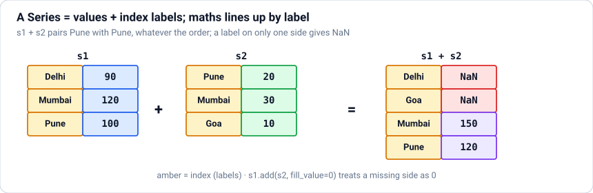

### 17.1 Values plus labels

**pandas** is the library for tables in Python, conventionally imported as `pd`. Its one-dimensional object is the **Series**: a NumPy array of values plus an **index**, a label for each value.

```python
import pandas as pd

sales = pd.Series([100, 120, 90], index=["Pune", "Mumbai", "Delhi"], name="sales")
print(sales)
print(sales["Mumbai"], sales.iloc[0])            # by label, and by position
print(sales.to_numpy())                          # the underlying NumPy array
```

**Output:**

```text
Pune      100
Mumbai    120
Delhi      90
Name: sales, dtype: int64
120 100
[100 120  90]
```

`sales["Mumbai"]` looks up by label; `sales.iloc[0]` by position (Chapter 21 covers both fully). Everything from NumPy carries over: arithmetic, masks, aggregations.

```python
print(sales[sales > 95])
print(sales.mean().round(2), sales.idxmax())
print(sales.sort_values(ascending=False))
```

**Output:**

```text
Pune      100
Mumbai    120
Name: sales, dtype: int64
103.33 Mumbai
Mumbai    120
Pune      100
Delhi      90
Name: sales, dtype: int64
```

`idxmax` returns the **label** of the largest value, where NumPy's `argmax` gives a position.

### 17.2 Alignment by label

When two Series are combined, pandas matches values by **label**, not position. A label in only one of them gets **NaN** (missing):

```python
returns = pd.Series({"Pune": 20, "Mumbai": 30, "Goa": 10})    # a dict becomes label → value
print(sales - returns)
print(sales.sub(returns, fill_value=0))                      # treat a missing side as 0
```

**Output:**

```text
Delhi      NaN
Goa        NaN
Mumbai    90.0
Pune      80.0
dtype: float64
Delhi     90.0
Goa      -10.0
Mumbai    90.0
Pune      80.0
dtype: float64
```

Delhi has no returns entry and Goa no sales, so both are NaN; `sub(…, fill_value=0)` treats the missing side as 0. Alignment is what makes pandas safe: rows can never be silently paired with the wrong ones because of their order.

### 17.3 Counting categories

For text categories, `value_counts` counts each value (most common first), `unique` lists the distinct values, and `nunique` counts them:

```python
colours = pd.Series(["red", "blue", "red", "green", "red", "blue"])
print(colours.value_counts())
print(colours.nunique(), colours.unique().tolist(), (colours == "red").mean())
```

**Output:**

```text
red      3
blue     2
green    1
Name: count, dtype: int64
3 ['red', 'blue', 'green'] 0.5
```

### 17.4 Summary

```
pd.Series(values, index=labels, name=…);  s["label"], s.iloc[i];  s.to_numpy()
arithmetic aligns by label → NaN where a label is missing;  s.add/sub(other, fill_value=0)
s.idxmax(), s.sort_values(), s.value_counts(), s.unique(), s.nunique()
```

**Key terms:**

- **pandas:** Python's library for labelled tables.
- **Series:** a one-dimensional array of values with an index of labels.
- **Index:** the labels of a Series' values (or of a table's rows).
- **Alignment:** matching values by label when combining Series.
- **NaN:** pandas' usual marker for a missing number.
- **`value_counts`:** counts of each distinct value, most common first.

### Exercises

1. Marks are Asha 72, Ravi 88, Zoya 95, Kabir 60, Meera 81. Who scored highest, what's the average, and who scored above it?
2. Add `{"pen": 10, "ink": 5}` and `{"ink": 3, "pad": 7}` as Series, treating missing items as 0.

<details>
<summary><b>Answers</b></summary>

```python
marks = pd.Series([72, 88, 95, 60, 81], index=["Asha", "Ravi", "Zoya", "Kabir", "Meera"])
print(marks.idxmax(), marks.mean(), marks[marks > marks.mean()].index.tolist())
a, b = pd.Series({"pen": 10, "ink": 5}), pd.Series({"ink": 3, "pad": 7})
print(a.add(b, fill_value=0))
```

**Output:**

```text
Zoya 79.2 ['Ravi', 'Zoya', 'Meera']
ink     8.0
pad     7.0
pen    10.0
dtype: float64
```

1. Zoya; 79.2; Ravi, Zoya and Meera.
2. ink 8, pad 7, pen 10 (sorted by label, since the union of labels is sorted).

</details>

**Learn more:** [pandas: 10 minutes to pandas](https://pandas.pydata.org/docs/user_guide/10min.html)

---

## 18. DataFrames: Creating and Inspecting a Table

**You need:** Chapter 17. · **You'll learn:** the DataFrame, the first things to run on any new table, and the ten-order dataset used in the next chapters.

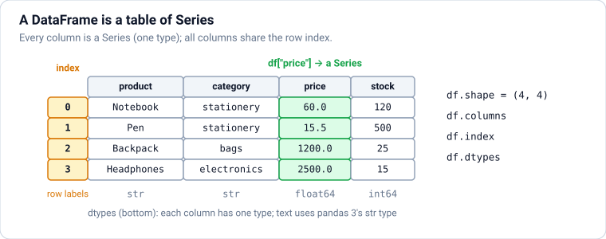

### 18.1 A table of Series

A **DataFrame** is a table: several Series (the columns) that share one row index. Each column has its own dtype. The simplest way to make one is a dict of columns, or a list of records (Chapter 3):

```python
import os
import pandas as pd

products = pd.DataFrame({"product": ["Pen", "Mug", "Lamp"], "price": [15.5, 250.0, 900.0], "stock": [500, 80, 12]})
print(products)
print(products.dtypes)
print(pd.DataFrame([{"product": "Pen", "price": 15.5}, {"product": "Mug", "price": 250.0}]))
```

**Output:**

```text
  product  price  stock
0     Pen   15.5    500
1     Mug  250.0     80
2    Lamp  900.0     12
product        str
price      float64
stock        int64
dtype: object
  product  price
0     Pen   15.5
1     Mug  250.0
```

The left-hand numbers 0, 1, 2 are the default index. Text columns have the dtype `str` in pandas 3.

### 18.2 The orders dataset

Ten orders from a small online shop, written to `data/orders.csv` so the following chapters can load it. `pd.read_csv` reads a CSV into a DataFrame (Chapter 19 covers its options); `parse_dates` turns the date column into real dates:

```python
csv_text = """order_id,date,customer,city,product,category,qty,price
1,2025-01-05,Asha,Pune,Notebook,stationery,5,60
2,2025-01-06,Ravi,Mumbai,Headphones,electronics,1,2500
3,2025-02-10,Asha,Pune,Backpack,bags,1,1200
4,2025-02-11,Meera,Pune,Keyboard,electronics,1,1800
5,2025-03-02,Zoya,Mumbai,Water bottle,kitchen,2,350
6,2025-03-15,Kabir,Bengaluru,Desk lamp,electronics,1,900
7,2025-03-20,Asha,Pune,Headphones,electronics,1,2500
8,2025-04-01,Isha,Delhi,Mug,kitchen,4,250
9,2025-04-18,Ravi,Mumbai,Notebook,stationery,10,60
10,2025-05-05,Zoya,Mumbai,Keyboard,electronics,1,1800
"""
os.makedirs("data", exist_ok=True)
with open("data/orders.csv", "w", encoding="utf-8") as f:
    f.write(csv_text)
orders = pd.read_csv("data/orders.csv", parse_dates=["date"])
```

### 18.3 First looks

Run these on every new table before anything else:

```python
print(orders.shape)                       # (rows, columns)
print(orders.head(3))                     # the first rows (tail() for the last)
```

**Output:**

```text
(10, 8)
   order_id       date customer    city     product     category  qty  price
0         1 2025-01-05     Asha    Pune    Notebook   stationery    5     60
1         2 2025-01-06     Ravi  Mumbai  Headphones  electronics    1   2500
2         3 2025-02-10     Asha    Pune    Backpack         bags    1   1200
```

`info()` lists every column's dtype and count of non-missing values, the quickest check that the types are what you expect:

```python
orders.info()
```

**Output:**

```text
<class 'pandas.DataFrame'>
RangeIndex: 10 entries, 0 to 9
Data columns (total 8 columns):
 #   Column    Non-Null Count  Dtype         
---  ------    --------------  -----         
 0   order_id  10 non-null     int64         
 1   date      10 non-null     datetime64[us]
 2   customer  10 non-null     str           
 3   city      10 non-null     str           
 4   product   10 non-null     str           
 5   category  10 non-null     str           
 6   qty       10 non-null     int64         
 7   price     10 non-null     int64         
dtypes: datetime64[us](1), int64(3), str(4)
memory usage: 1.0 KB
```

`describe()` summarises the numeric columns: count, mean, standard deviation, minimum, quartiles and maximum (Chapter 51 explains each):

```python
print(orders.describe().round(1))
```

**Output:**

```text
       order_id                 date   qty   price
count      10.0                   10  10.0    10.0
mean        5.5  2025-03-04 04:48:00   2.7  1142.0
min         1.0  2025-01-05 00:00:00   1.0    60.0
25%         3.2  2025-02-10 06:00:00   1.0   275.0
50%         5.5  2025-03-08 12:00:00   1.0  1050.0
75%         7.8  2025-03-29 00:00:00   3.5  1800.0
max        10.0  2025-05-05 00:00:00  10.0  2500.0
std         3.0                  NaN   2.9   965.0
```

The `order_id` row is meaningless (it's an identifier, Chapter 4.2). For `qty`, the mean (2.7) is far above the median (the 50% row, 1): most orders are for one item, and a few large ones pull the mean up. That gap is the sign of **skewed** data (Chapter 51). For text columns, count the categories:

```python
print(orders["city"].value_counts())
print("missing cells:", orders.isna().sum().sum(), "| duplicate rows:", orders.duplicated().sum())
```

**Output:**

```text
city
Pune         4
Mumbai       4
Bengaluru    1
Delhi        1
Name: count, dtype: int64
missing cells: 0 | duplicate rows: 0
```

`orders["city"]` selects one column as a Series. `isna()` marks missing cells (Chapter 26) and `duplicated()` repeated rows (Chapter 27); here there are none.

### 18.4 The index and renaming

`set_index(column)` makes a column the row labels; `reset_index()` turns the index back into a column. `rename` renames columns with a dict:

```python
by_id = orders.set_index("order_id")
print(by_id.head(2))
print(orders.rename(columns={"qty": "quantity"}).columns.tolist())
```

**Output:**

```text
               date customer    city     product     category  qty  price
order_id                                                                 
1        2025-01-05     Asha    Pune    Notebook   stationery    5     60
2        2025-01-06     Ravi  Mumbai  Headphones  electronics    1   2500
['order_id', 'date', 'customer', 'city', 'product', 'category', 'quantity', 'price']
```

### 18.5 Summary

```
pd.DataFrame(dict of columns | list of records);  pd.read_csv(path, parse_dates=[…])
df.shape, df.head(), df.tail(), df.info(), df.describe(), df.dtypes, df.columns
df["col"].value_counts(), df.isna().sum(), df.duplicated().sum()
df.set_index(col), df.reset_index(), df.rename(columns={old: new})
```

**Key terms:**

- **DataFrame:** a table of named columns (Series) sharing one row index.
- **Column:** one named Series in a DataFrame.
- **`info()`:** a summary of each column's dtype and number of non-missing values.
- **`describe()`:** summary statistics of the numeric columns.
- **Quartiles:** the values at 25%, 50% (the median) and 75% of the sorted data.

### Exercises

1. Build a DataFrame of 4 students with columns name, maths and science, and print its shape and the mean of each subject.
2. How many distinct customers placed orders, and which product appears most often?

<details>
<summary><b>Answers</b></summary>

```python
students = pd.DataFrame({"name": ["Asha", "Ravi", "Meera", "Arjun"], "maths": [88, 72, 95, 60], "science": [79, 85, 91, 70]})
print(students.shape, students[["maths", "science"]].mean().to_dict())
print(orders["customer"].nunique(), orders["product"].value_counts().idxmax())
```

**Output:**

```text
(4, 3) {'maths': 78.75, 'science': 81.25}
6 Notebook
```

1. (4, 3); means 78.75 and 81.25. A list of names inside `[…]` selects several columns.
2. 6 customers; several products appear twice, and `idxmax` returns the first of them.

</details>

---

## 19. Reading and Writing Files: CSV, JSON and Parquet

**You need:** Chapter 18. · **You'll learn:** the options that make messy CSVs load correctly, JSON Lines, and why Parquet is the better format for data you keep.

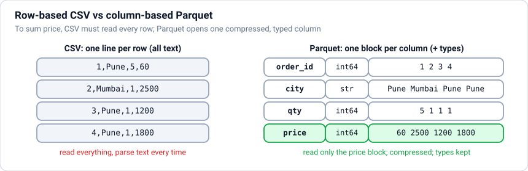

### 19.1 read_csv options for messy files

`pd.read_csv` guesses separators and types. When a file doesn't follow the defaults, tell it:

| option | for |
|---|---|
| `sep=";"` | a separator other than a comma |
| `usecols=[…]`, `nrows=n` | load only some columns, or the first n rows |
| `dtype={"zip": "str"}` | force a type (keeps leading zeros of codes) |
| `na_values=["-", "n/a"]` | extra markers for missing values |
| `decimal=",", thousands="."` | European number formats such as 1.200,50 |
| `parse_dates=[…]` | read columns as dates |

```python
import io, os, tempfile
import numpy as np
import pandas as pd

messy = """id;zip;amount;note
1;01234;1.200,50;ok
2;-;3,75;n/a
"""
df = pd.read_csv(io.StringIO(messy), sep=";", dtype={"zip": "str"}, na_values=["-", "n/a"], thousands=".", decimal=",")
print(df)
print(df.dtypes)
```

**Output:**

```text
   id    zip   amount note
0   1  01234  1200.50   ok
1   2    NaN     3.75  NaN
id          int64
zip           str
amount    float64
note          str
dtype: object
```

`io.StringIO(text)` lets pandas read a string as if it were a file. Without `dtype={"zip": "str"}`, the postcode 01234 would become the number 1234.

### 19.2 CSV forgets types

CSV is plain text: types aren't stored, so they're guessed again on every read. Write the orders out and read them back:

```python
orders = pd.read_csv("data/orders.csv", parse_dates=["date"])
folder = tempfile.mkdtemp()
csv_path, pq_path = os.path.join(folder, "orders.csv"), os.path.join(folder, "orders.parquet")
orders.to_csv(csv_path, index=False)
orders.to_parquet(pq_path)
print(pd.read_csv(csv_path).dtypes["date"], "← CSV forgot the date type")
print(pd.read_parquet(pq_path).dtypes["date"], "← Parquet remembered it")
```

**Output:**

```text
str ← CSV forgot the date type
datetime64[us] ← Parquet remembered it
```

`index=False` stops pandas writing the row index as an extra column.

### 19.3 Parquet

**Parquet** is a binary, **columnar** file format: it stores each column together, with its type, compressed. Compared with CSV it:

- keeps types (dates stay dates, categories stay categories);
- is much smaller, since a column of similar values compresses well;
- reads only the columns you ask for, without scanning the rest of the file.

```python
print(pd.read_parquet(pq_path, columns=["customer", "price"]).head(2))

big = pd.DataFrame({col: np.tile(orders[col].to_numpy(), 2000) for col in orders})    # 20,000 rows
big.to_csv(csv_path, index=False)
big.to_parquet(pq_path)
print(f"CSV {os.path.getsize(csv_path) / 1e3:.0f} KB vs Parquet {os.path.getsize(pq_path) / 1e3:.0f} KB")
```

**Output:**

```text
  customer  price
0     Asha     60
1     Ravi   2500
CSV 1016 KB vs Parquet 9 KB
```

`np.tile` repeats an array end to end. The gap is extreme here because the test data repeats the same ten rows; on real data Parquet is typically several times smaller than CSV. Use CSV to exchange data with people and spreadsheets; use Parquet for data you store and reload.

### 19.4 JSON Lines

**JSON Lines** (`.jsonl`) stores one JSON record per line, common for logs and API exports:

```python
json_path = os.path.join(folder, "orders.jsonl")
orders.head(2).to_json(json_path, orient="records", lines=True, date_format="iso")
print(open(json_path).read())
print(pd.read_json(json_path, lines=True).shape)
```

**Output:**

```text
{"order_id":1,"date":"2025-01-05T00:00:00.000","customer":"Asha","city":"Pune","product":"Notebook","category":"stationery","qty":5,"price":60}
{"order_id":2,"date":"2025-01-06T00:00:00.000","customer":"Ravi","city":"Mumbai","product":"Headphones","category":"electronics","qty":1,"price":2500}

(2, 8)
```

Excel files work the same way with `pd.read_excel` and `to_excel` (they need the `openpyxl` library).

### 19.5 Summary

```
pd.read_csv(path, sep, usecols, nrows, dtype, na_values, decimal, thousands, parse_dates);  df.to_csv(path, index=False)
pd.read_parquet(path, columns=[…]);  df.to_parquet(path)        typed, compressed, columnar
pd.read_json(path, lines=True);  df.to_json(path, orient="records", lines=True)
```

**Key terms:**

- **Separator (delimiter):** the character between values in a text table, such as a comma or semicolon.
- **Parquet:** a compressed, typed, columnar file format for tables.
- **Columnar storage:** storing each column's values together, which compresses well and allows reading only some columns.
- **JSON Lines:** a text format with one JSON record per line.

### Exercises

1. Read only the `customer` and `qty` columns of `data/orders.csv`, and total the quantity.
2. Why might a column of product codes like "007" break when saved to CSV and opened again?

<details>
<summary><b>Answers</b></summary>

```python
small = pd.read_csv("data/orders.csv", usecols=["customer", "qty"])
print(small.shape, small["qty"].sum())
```

**Output:**

```text
(10, 2) 27
```

1. `usecols` loads just those two columns; total quantity 27.
2. On reading, "007" looks like a number and becomes 7. Read it with `dtype={"code": "str"}`, or store it in Parquet, which keeps the type.

</details>

---

## 20. Reading from Databases and Web APIs

**You need:** Chapters 5 and 19. · **You'll learn:** to load query results from a SQL database into pandas, and to flatten nested JSON from a web API into a table.

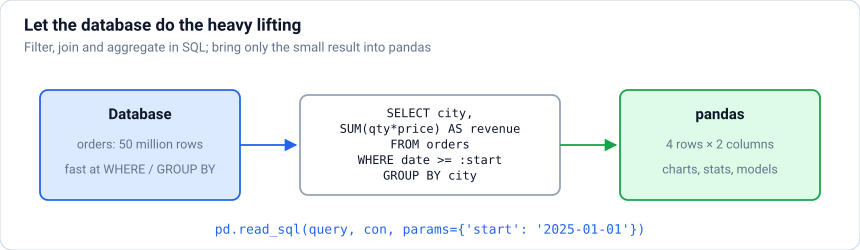

### 20.1 SQL into pandas

Most company data lives in databases, queried with **SQL** (`sql-postgresql.md`). `pd.read_sql(query, connection)` runs a query and returns the result as a DataFrame. Python's built-in `sqlite3` module gives a small database to try it on; `to_sql` writes a DataFrame into it as a table:

```python
import sqlite3
import pandas as pd

orders = pd.read_csv("data/orders.csv")
con = sqlite3.connect(":memory:")                    # a throwaway database in memory
orders.to_sql("orders", con, index=False)

query = """
SELECT city, COUNT(*) AS n_orders, SUM(qty * price) AS revenue
FROM orders
WHERE category = :cat
GROUP BY city
ORDER BY revenue DESC
"""
print(pd.read_sql(query, con, params={"cat": "electronics"}))
```

**Output:**

```text
        city  n_orders  revenue
0       Pune         2     4300
1     Mumbai         2     4300
2  Bengaluru         1      900
```

Two habits:

- **Let the database do the filtering and grouping**, and load only the small result: a database can scan billions of rows that would never fit in pandas.
- **Pass values as parameters** (`:cat` filled from `params`), never by pasting them into the SQL text. Pasting user input into SQL lets a crafted value change the query, a security hole called **SQL injection**.

For PostgreSQL or MySQL, the connection comes from a database driver, usually through SQLAlchemy; `read_sql` works the same way.

### 20.2 Nested JSON from an API

A web **API** returns JSON (Chapter 5.3), often nested: objects inside objects, lists inside records. `pd.json_normalize` flattens nested dicts into columns with dotted names:

```python
api_response = {
    "page": 1, "next_page": None,
    "results": [
        {"id": 1, "customer": {"name": "Asha", "city": "Pune"}, "items": [{"sku": "NB", "qty": 5}, {"sku": "PN", "qty": 2}]},
        {"id": 2, "customer": {"name": "Ravi", "city": "Mumbai"}, "items": [{"sku": "HP", "qty": 1}]},
    ],
}
flat = pd.json_normalize(api_response["results"])
print(flat.drop(columns="items"))
```

**Output:**

```text
   id customer.name customer.city
0   1          Asha          Pune
1   2          Ravi        Mumbai
```

Lists inside each record become one row per element with `record_path`, with parent fields copied in through `meta`:

```python
items = pd.json_normalize(api_response["results"], record_path="items", meta=["id", ["customer", "name"]])
print(items)
```

**Output:**

```text
  sku  qty id customer.name
0  NB    5  1          Asha
1  PN    2  1          Asha
2  HP    1  2          Ravi
```

### 20.3 Fetching pages

APIs return large results in **pages**. The usual loop requests one page at a time until there's no next page. With the `requests` library it looks like this (not run here, since it needs a real API and key):

```python
import requests

def fetch_all(url, token):
    records, page = [], 1
    while page is not None:
        r = requests.get(url, params={"page": page}, headers={"Authorization": f"Bearer {token}"}, timeout=10)
        r.raise_for_status()                          # stop on an HTTP error (4xx/5xx)
        body = r.json()
        records.extend(body["results"])
        page = body["next_page"]                      # None when there are no more pages
    return pd.json_normalize(records)
```

Always set a `timeout`, check for errors, and keep keys out of the code (read them from environment variables).

### 20.4 Summary

```
pd.read_sql(query, con, params={…});  df.to_sql(name, con, index=False)        filter and group in SQL
pd.json_normalize(records);  record_path="list_field", meta=[…] for nested lists
paged APIs: loop until next_page is None;  timeout, raise_for_status, keys from the environment
```

**Key terms:**

- **SQL:** the language for querying relational databases.
- **`read_sql`:** runs a SQL query and returns a DataFrame.
- **Query parameter:** a value passed separately from the SQL text, so it can't change the query.
- **SQL injection:** an attack where input pasted into SQL text changes what the query does.
- **API (application programming interface):** a service that returns data, usually as JSON, in response to requests.
- **`json_normalize`:** flattens nested JSON records into a table.
- **Pagination:** splitting a large API result into pages fetched one at a time.

### Exercises

1. Write a SQL query that lists customers with at least 2 orders, with their order count and total quantity.
2. Flatten `[{"user": {"id": 7, "plan": "pro"}, "spend": 120}, {"user": {"id": 9, "plan": "free"}, "spend": 0}]`.

<details>
<summary><b>Answers</b></summary>

```python
q = """SELECT customer, COUNT(*) AS n, SUM(qty) AS total_qty
       FROM orders GROUP BY customer HAVING COUNT(*) >= 2 ORDER BY n DESC, customer"""
print(pd.read_sql(q, con))
print(pd.json_normalize([{"user": {"id": 7, "plan": "pro"}, "spend": 120}, {"user": {"id": 9, "plan": "free"}, "spend": 0}]))
```

**Output:**

```text
  customer  n  total_qty
0     Asha  3          7
1     Ravi  2         11
2     Zoya  2          3
   spend  user.id user.plan
0    120        7       pro
1      0        9      free
```

1. `HAVING` filters groups after `GROUP BY`: Asha (3 orders), Ravi and Zoya (2 each).
2. Columns `spend`, `user.id` and `user.plan`.

</details>

---

## 21. Selecting Data: Columns, loc and iloc

**You need:** Chapters 9 and 18. · **You'll learn:** the ways to pick columns, rows and single cells, and the one difference between selecting by label and by position that trips everyone up.

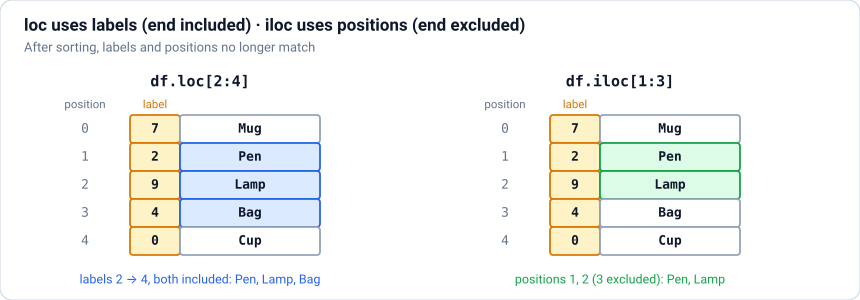

### 21.1 Columns

`df["col"]` gives one column as a Series; `df[["a", "b"]]` (a list inside the brackets) gives a DataFrame of several columns:

```python
import pandas as pd

orders = pd.read_csv("data/orders.csv", parse_dates=["date"])
print(type(orders["price"]).__name__, type(orders[["price"]]).__name__)
print(orders[["customer", "product", "price"]].head(2))
```

**Output:**

```text
Series DataFrame
  customer     product  price
0     Asha    Notebook     60
1     Ravi  Headphones   2500
```

### 21.2 loc: by label; iloc: by position

- `df.loc[rows, columns]` selects by **label**. Slices **include** the end label.
- `df.iloc[rows, columns]` selects by **position**, like NumPy. Slices **exclude** the end.

With the default index 0, 1, 2, … labels and positions look the same, which is exactly why the end rule catches people out:

```python
print(orders.loc[2:4, "customer":"product"])      # rows labelled 2, 3 AND 4; columns customer to product
print(orders.iloc[2:4, 2:5])                      # positions 2, 3; columns 2, 3, 4
```

**Output:**

```text
  customer    city       product
2     Asha    Pune      Backpack
3    Meera    Pune      Keyboard
4     Zoya  Mumbai  Water bottle
  customer  city   product
2     Asha  Pune  Backpack
3    Meera  Pune  Keyboard
```

Labels become meaningful once the index is something other than 0, 1, 2:

```python
by_product = orders.set_index("product")
print(by_product.loc["Keyboard", "customer"])     # two rows have this label, so a Series
print(by_product.loc[["Notebook", "Desk lamp"], "price"])
```

**Output:**

```text
product
Keyboard    Meera
Keyboard     Zoya
Name: customer, dtype: str
product
Notebook      60
Notebook      60
Desk lamp    900
Name: price, dtype: int64
```

For a single cell, `at[label, col]` and `iat[pos, pos]` are the fast versions:

```python
print(orders.at[3, "price"], orders.iat[0, 2], orders.iloc[-1, -1])
```

**Output:**

```text
1800 Asha 1800
```

### 21.3 Columns by type or name

```python
print(orders.select_dtypes("number").columns.tolist())
print(orders.filter(like="c").columns.tolist())   # names containing "c"
```

**Output:**

```text
['order_id', 'qty', 'price']
['customer', 'city', 'product', 'category', 'price']
```

### 21.4 Setting values

`loc` with a condition and a column name sets values for the matching rows, creating the column if it's new (rows not matched get NaN):

```python
orders.loc[orders["qty"] >= 2, "note"] = "multi"
print(orders[["product", "qty", "note"]].head(5))
```

**Output:**

```text
        product  qty   note
0      Notebook    5  multi
1    Headphones    1    NaN
2      Backpack    1    NaN
3      Keyboard    1    NaN
4  Water bottle    2  multi
```

The condition `orders["qty"] >= 2` is a boolean mask, as in NumPy (Chapter 10); Chapter 22 covers filtering fully.

### 21.5 Summary

```
df["c"] → Series;  df[["a", "b"]] → DataFrame
df.loc[row_labels, col_labels]   (slices include the end)      df.iloc[row_pos, col_pos]   (slices exclude the end)
df.at[label, col], df.iat[i, j];  df.select_dtypes("number");  df.filter(like="…")
df.loc[mask, "col"] = value
```

**Key terms:**

- **`loc`:** selection by row and column labels; label slices include the end.
- **`iloc`:** selection by integer position; slices exclude the end.
- **`at` / `iat`:** fast access to a single cell, by label / by position.

### Exercises

1. Select the `city` and `price` of the rows at positions 1–3 with `iloc`, then the same rows with `loc`.
2. With `order_id` as the index, who placed order 5?

<details>
<summary><b>Answers</b></summary>

```python
print(orders.iloc[1:4][["city", "price"]])
print(orders.loc[1:3, ["city", "price"]])
print(orders.set_index("order_id").at[5, "customer"])
```

**Output:**

```text
     city  price
1  Mumbai   2500
2    Pune   1200
3    Pune   1800
     city  price
1  Mumbai   2500
2    Pune   1200
3    Pune   1800
Zoya
```

1. `iloc[1:4]` (end excluded) and `loc[1:3]` (end included) give the same three rows here.
2. Zoya.

</details>

---

## 22. Filtering Rows

**You need:** Chapters 10 and 21. · **You'll learn:** to keep the rows that meet conditions, with masks, `isin`, `between` and `query`.

![A boolean condition on a column becomes a mask; df[mask] keeps the matching rows](images/data-science/22-filter.svg)

### 22.1 Masks, as in NumPy

A condition on a column gives a boolean Series, a mask; `df[mask]` keeps the rows where it's True. Combine conditions with `&`, `|` and `~`, each in parentheses (Chapter 10.2):

```python
import pandas as pd

orders = pd.read_csv("data/orders.csv", parse_dates=["date"])
pune_big = orders[(orders["city"] == "Pune") & (orders["price"] > 100)]
print(pune_big[["order_id", "product", "price"]])
```

**Output:**

```text
   order_id     product  price
2         3    Backpack   1200
3         4    Keyboard   1800
6         7  Headphones   2500
```

To filter rows **and** pick columns in one step, use `loc[mask, columns]`.

### 22.2 isin and between

`isin(list)` tests membership; `between(a, b)` tests a range, ends included:

```python
print(orders.loc[orders["category"].isin(["kitchen", "bags"]), ["product", "qty"]])
print(orders.loc[orders["price"].between(500, 2000), "product"].tolist())
print(orders.loc[~orders["city"].isin(["Pune", "Mumbai"]), ["city", "product"]])
```

**Output:**

```text
        product  qty
2      Backpack    1
4  Water bottle    2
7           Mug    4
['Backpack', 'Keyboard', 'Desk lamp', 'Keyboard']
        city    product
5  Bengaluru  Desk lamp
7      Delhi        Mug
```

Dates compare with date strings directly:

```python
march = orders[(orders["date"] >= "2025-03-01") & (orders["date"] < "2025-04-01")]
print(march[["date", "product"]])
```

**Output:**

```text
        date       product
4 2025-03-02  Water bottle
5 2025-03-15     Desk lamp
6 2025-03-20    Headphones
```

Using `< "2025-04-01"` rather than `<= "2025-03-31"` keeps the whole of 31 March even when times are present.

### 22.3 query

`query` writes the condition as a string, which reads more naturally in long filters. Column names are used directly, and `@name` refers to a Python variable:

```python
limit = 1000
print(orders.query("price > @limit and city != 'Mumbai'")[["customer", "price"]])
```

**Output:**

```text
  customer  price
2     Asha   1200
3    Meera   1800
6     Asha   2500
```

### 22.4 Counting matches

A mask's mean is the fraction of rows that match:

```python
print(f"{(orders['qty'] > 1).mean():.0%} of orders have more than one item")
```

**Output:**

```text
40% of orders have more than one item
```

### 22.5 Summary

```
df[(df["a"] > x) & (df["b"] == "y")];  df.loc[mask, cols];  ~mask
s.isin([…]), s.between(lo, hi);  dates: df["date"] >= "2025-03-01"
df.query("a > @var and b != 'x'");  mask.mean() = fraction matching
```

**Key terms:**

- **Filtering:** keeping only the rows that satisfy a condition.
- **`isin`:** tests whether each value is in a list.
- **`between`:** tests whether each value lies in a range, ends included.
- **`query`:** filters rows with a condition written as a string.

### Exercises

1. Find single-item electronics orders, showing customer and price.
2. Which customers placed an order of 2,000 or more?

<details>
<summary><b>Answers</b></summary>

```python
print(orders.loc[(orders["category"] == "electronics") & (orders["qty"] == 1), ["customer", "price"]])
print(orders.loc[orders["price"] >= 2000, "customer"].unique().tolist())
```

**Output:**

```text
  customer  price
1     Ravi   2500
3    Meera   1800
5    Kabir    900
6     Asha   2500
9     Zoya   1800
['Ravi', 'Asha']
```

1. Five rows: every electronics order here is for a single item.
2. Ravi and Asha.

</details>


---

## 23. Sorting, Ranking and Top-N

**You need:** Chapter 22. · **You'll learn:** to sort by several columns, rank values with the four tie rules, and find the top n, including the classic "second highest".

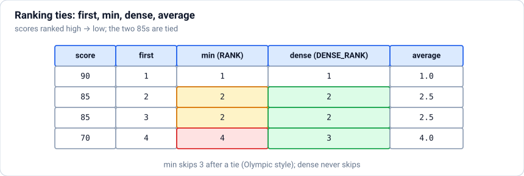

### 23.1 Sorting

`sort_values(by)` sorts rows; with lists, each column can have its own direction:

```python
import pandas as pd

emp = pd.DataFrame({"name": ["Asha", "Ravi", "Zoya", "Kabir", "Meera", "Isha"],
                    "dept": ["IT", "IT", "Sales", "Sales", "IT", "Sales"],
                    "salary": [90, 85, 85, 70, 95, 70]})
print(emp.sort_values("salary", ascending=False).head(3))
print(emp.sort_values(["dept", "salary"], ascending=[True, False]))
```

**Output:**

```text
    name dept  salary
4  Meera   IT      95
0   Asha   IT      90
1   Ravi   IT      85
    name   dept  salary
4  Meera     IT      95
0   Asha     IT      90
1   Ravi     IT      85
2   Zoya  Sales      85
3  Kabir  Sales      70
5   Isha  Sales      70
```

### 23.2 Ranking and ties

`rank` gives each value its position in the order. The interesting part is **ties**: Ravi and Zoya both earn 85.

| method | ties get | next rank | 95, 90, 85, 85, 70, 70 |
|---|---|---|---|
| `first` | different ranks, in table order | continues | 1, 2, 3, 4, 5, 6 |
| `min` | the lowest rank of the group | skips | 1, 2, 3, 3, 5, 5 |
| `dense` | the same rank | no gap | 1, 2, 3, 3, 4, 4 |
| `average` | the average of their ranks | skips | 1, 2, 3.5, 3.5, 5.5, 5.5 |

`min` is the sports ranking ("joint third, then fifth"); `dense` is what "the second highest salary" questions mean:

```python
for method in ["first", "min", "dense", "average"]:
    emp[method] = emp["salary"].rank(ascending=False, method=method)
print(emp)
```

**Output:**

```text
    name   dept  salary  first  min  dense  average
0   Asha     IT      90    2.0  2.0    2.0      2.0
1   Ravi     IT      85    3.0  3.0    3.0      3.5
2   Zoya  Sales      85    4.0  3.0    3.0      3.5
3  Kabir  Sales      70    5.0  5.0    4.0      5.5
4  Meera     IT      95    1.0  1.0    1.0      1.0
5   Isha  Sales      70    6.0  5.0    4.0      5.5
```

### 23.3 Top n

`nlargest(n, col)` and `nsmallest` are faster and clearer than sorting and taking `head`. `keep="all"` keeps every row tied at the cutoff:

```python
emp = emp[["name", "dept", "salary"]]
print(emp.nlargest(2, "salary"))
print(emp.nsmallest(1, "salary", keep="all"))
```

**Output:**

```text
    name dept  salary
4  Meera   IT      95
0   Asha   IT      90
    name   dept  salary
3  Kabir  Sales      70
5   Isha  Sales      70
```

### 23.4 The second-highest distinct value

A classic interview question: the second-highest **distinct** salary, or nothing if there isn't one. Remove duplicates first, then sort; `drop_duplicates()` keeps the first of each repeated value:

```python
def second_highest(s):
    distinct = s.drop_duplicates().sort_values(ascending=False)
    return distinct.iloc[1] if len(distinct) >= 2 else None

print(second_highest(emp["salary"]), second_highest(pd.Series([100, 100])))
print(emp.loc[emp["salary"].rank(method="dense", ascending=False) == 2, "name"].tolist())
```

**Output:**

```text
90 None
['Asha']
```

### 23.5 Summary

```
df.sort_values(["a", "b"], ascending=[True, False]);  s.rank(method="first|min|dense|average", ascending=False)
df.nlargest(n, col, keep="all"), df.nsmallest(…);  "n-th highest distinct" = drop_duplicates, sort, iloc[n−1]
```

**Key terms:**

- **Rank:** a value's position in sorted order.
- **Dense rank:** a ranking where ties share a rank and the next rank follows without a gap.
- **Top-n:** the n rows with the largest (or smallest) values of a column.

### Exercises

1. Write `nth_highest(s, n)`, returning the n-th highest distinct value or None, and test it with n = 3 and n = 9.
2. Sort `["banana", "Cherry", "apple"]` alphabetically ignoring case.

<details>
<summary><b>Answers</b></summary>

```python
def nth_highest(s, n):
    distinct = s.drop_duplicates().nlargest(n)
    return distinct.iloc[-1] if len(distinct) == n else None

print(nth_highest(emp["salary"], 3), nth_highest(emp["salary"], 9))
names = pd.Series(["banana", "Cherry", "apple"])
print(names.sort_values().tolist(), names.sort_values(key=lambda s: s.str.lower()).tolist())
```

**Output:**

```text
85 None
['Cherry', 'apple', 'banana'] ['apple', 'banana', 'Cherry']
```

1. 85 (distinct salaries 95, 90, 85, 70), and None, since there are only 4 distinct values.
2. By default capitals sort before lower case; `key` sorts by the lower-cased text instead (`.str.lower()` is from Chapter 28).

</details>

---

## 24. Adding and Changing Columns

**You need:** Chapters 10 and 22. · **You'll learn:** the ways to make new columns, from fast vectorised arithmetic to slow row-by-row functions, and which to use when.

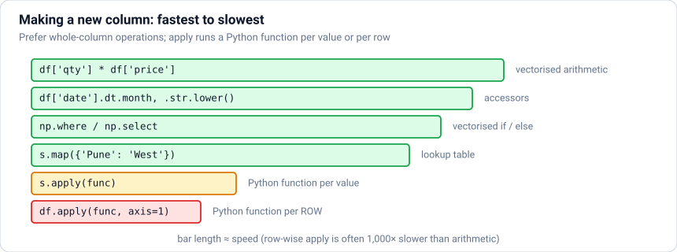

### 24.1 Arithmetic on columns

Assigning to a new name creates a column. Arithmetic between columns is element-wise, like NumPy:

```python
import time
import numpy as np
import pandas as pd

orders = pd.read_csv("data/orders.csv", parse_dates=["date"])
orders["revenue"] = orders["qty"] * orders["price"]
print(orders[["product", "qty", "price", "revenue"]].head(3))
```

**Output:**

```text
      product  qty  price  revenue
0    Notebook    5     60      300
1  Headphones    1   2500     2500
2    Backpack    1   1200     1200
```

### 24.2 From dates

A date column has a `.dt` accessor with its parts: `.dt.month`, `.dt.day_name()`, `.dt.day_of_week` (Monday = 0), and many more (Chapter 37):

```python
orders["month"] = orders["date"].dt.month
orders["weekday"] = orders["date"].dt.day_name()
orders["is_weekend"] = orders["date"].dt.day_of_week >= 5
print(orders[["date", "month", "weekday", "is_weekend"]].head(3))
```

**Output:**

```text
        date  month weekday  is_weekend
0 2025-01-05      1  Sunday        True
1 2025-01-06      1  Monday       False
2 2025-02-10      2  Monday       False
```

### 24.3 Mapping and conditions

- `map(dict)` replaces each value by its entry in a dict; a value missing from the dict becomes NaN, so you notice.
- `np.where` (Chapter 10.4) chooses between two values by a condition.
- `np.select` chooses among several, the first true condition winning.

```python
orders["region"] = orders["city"].map({"Pune": "West", "Mumbai": "West", "Bengaluru": "South"})
orders["size"] = np.where(orders["qty"] >= 2, "multi", "single")
orders["tier"] = np.select([orders["price"] >= 2000, orders["price"] >= 500], ["premium", "mid"], default="budget")
print(orders[["city", "region", "qty", "size", "price", "tier"]])
```

**Output:**

```text
        city region  qty    size  price     tier
0       Pune   West    5   multi     60   budget
1     Mumbai   West    1  single   2500  premium
2       Pune   West    1  single   1200      mid
3       Pune   West    1  single   1800      mid
4     Mumbai   West    2   multi    350   budget
5  Bengaluru  South    1  single    900      mid
6       Pune   West    1  single   2500  premium
7      Delhi    NaN    4   multi    250   budget
8     Mumbai   West   10   multi     60   budget
9     Mumbai   West    1  single   1800      mid
```

Delhi isn't in the dict, so its region is NaN: a reminder to complete the mapping.

### 24.4 apply: the slow escape hatch

`df.apply(f, axis=1)` calls a Python function once per row. It can do anything, but it's a Python loop in disguise. Compare it with vectorised arithmetic on 200,000 rows:

```python
rng = np.random.default_rng(0)
big = pd.DataFrame({"qty": rng.integers(1, 10, 200_000), "price": rng.uniform(10, 3000, 200_000)})

start = time.perf_counter()
fast = big["qty"] * big["price"]
fast_s = time.perf_counter() - start

start = time.perf_counter()
slow = big.apply(lambda row: row["qty"] * row["price"], axis=1)
slow_s = time.perf_counter() - start

print("same answer:", np.allclose(fast, slow), f"| row-wise apply was about {slow_s / fast_s:,.0f}× slower")
```

**Output:**

```text
same answer: True | row-wise apply was about 2,831× slower
```

Use arithmetic, `.dt`, `.str` (Chapter 28), `map`, `np.where` and `np.select` first; `apply` only when nothing vectorised exists.

### 24.5 Summary

```
df["new"] = df["a"] * df["b"];  df["d"].dt.month / .day_name() / .day_of_week
s.map(dict) (unmapped → NaN);  np.where(cond, a, b);  np.select([c1, c2], [v1, v2], default=…)
df.apply(f, axis=1): a Python loop per row, hundreds to thousands of times slower → last resort
```

**Key terms:**

- **Accessor:** a group of methods for one kind of data, such as `.dt` for dates and `.str` for text.
- **`map`:** replaces each value using a dict or function.
- **`apply`:** calls a Python function on each row or column; flexible but slow.

### Exercises

1. Add a column `discounted`: price × 0.9 for electronics, the price otherwise.
2. Add `price_band`: "low" below 100, "medium" below 1,000, otherwise "high".

<details>
<summary><b>Answers</b></summary>

```python
orders["discounted"] = np.where(orders["category"] == "electronics", orders["price"] * 0.9, orders["price"])
orders["price_band"] = np.select([orders["price"] < 100, orders["price"] < 1000], ["low", "medium"], default="high")
print(orders[["product", "category", "price", "discounted", "price_band"]])
```

**Output:**

```text
        product     category  price  discounted price_band
0      Notebook   stationery     60        60.0        low
1    Headphones  electronics   2500      2250.0       high
2      Backpack         bags   1200      1200.0       high
3      Keyboard  electronics   1800      1620.0       high
4  Water bottle      kitchen    350       350.0     medium
5     Desk lamp  electronics    900       810.0     medium
6    Headphones  electronics   2500      2250.0       high
7           Mug      kitchen    250       250.0     medium
8      Notebook   stationery     60        60.0        low
9      Keyboard  electronics   1800      1620.0       high
```

1. Electronics drop by 10%; everything else keeps its price.
2. The conditions are checked in order, so "below 1,000" only catches prices from 100 upwards.

</details>

---

## 25. Method Chaining and Copy-on-Write

**You need:** Chapters 21–24. · **You'll learn:** to write a sequence of table steps as one readable chain, and how pandas 3's copy-on-write decides when a change to one table affects another.

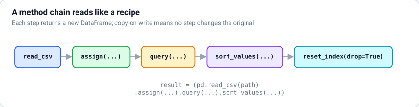

### 25.1 One step per line

Most DataFrame methods return a **new** DataFrame, so they can be chained: the output of one is the input of the next. Wrapped in parentheses, a chain reads top to bottom like a recipe, with no half-finished intermediate variables to run out of order in a notebook. Two methods make chains work:

- `assign(name=function)` adds columns; a `lambda d: …` receives the table as it is at that point in the chain;
- `pipe(function)` passes the whole table to any function.

```python
import pandas as pd

orders = pd.read_csv("data/orders.csv", parse_dates=["date"])

result = (
    orders
    .assign(revenue=lambda d: d["qty"] * d["price"],
            month=lambda d: d["date"].dt.month)
    .query("revenue >= 900")
    .sort_values(["month", "revenue"], ascending=[True, False])
    .loc[:, ["month", "customer", "product", "revenue"]]
    .reset_index(drop=True)
)
print(result)
```

**Output:**

```text
   month customer     product  revenue
0      1     Ravi  Headphones     2500
1      2    Meera    Keyboard     1800
2      2     Asha    Backpack     1200
3      3     Asha  Headphones     2500
4      3    Kabir   Desk lamp      900
5      4     Isha         Mug     1000
6      5     Zoya    Keyboard     1800
```

`reset_index(drop=True)` renumbers the rows 0, 1, 2… and discards the old index. To look inside a chain while debugging, insert `.pipe(lambda d: print(d.shape) or d)`: it prints, then passes the table on unchanged.

### 25.2 Copy-on-write

When you take a subset of a table and change it, does the original change? In pandas 3 the rule is simple: **copy-on-write**. Every selection behaves like a copy; data is only actually copied, lazily, when one of them is modified. So changing a subset **never** changes the original:

```python
pune = orders[orders["city"] == "Pune"]
pune["qty"] = 0                                    # changes only pune
print(orders["qty"].tolist(), pune["qty"].tolist())
```

**Output:**

```text
[5, 1, 1, 1, 2, 1, 1, 4, 10, 1] [0, 0, 0, 0]
```

The consequence: **chained assignment**, `df[mask]["col"] = value`, never works. The first `[…]` makes a new table, and the assignment changes that, not `df`. To change `df`, select and assign in **one** `loc`:

```python
orders[orders["qty"] > 1]["qty"] = 99              # changes a temporary copy: orders is untouched
print(orders["qty"].tolist())
orders.loc[orders["qty"] > 1, "qty"] = 99          # the right way
print(orders["qty"].tolist())
```

**Output:**

```text
[5, 1, 1, 1, 2, 1, 1, 4, 10, 1]
[99, 1, 1, 1, 99, 1, 1, 99, 99, 1]
```

### 25.3 Summary

```
result = (df .assign(new=lambda d: …) .query("…") .sort_values(…) .loc[:, cols] .reset_index(drop=True))
.pipe(f) passes the table to any function;  peek: .pipe(lambda d: print(d.shape) or d)
copy-on-write: subsets never change the original;  df.loc[mask, "col"] = v, never df[mask]["col"] = v
```

**Key terms:**

- **Method chaining:** writing successive operations as one expression, each returning a new table.
- **`assign`:** returns a copy of the table with new or replaced columns.
- **`pipe`:** passes the table to a function inside a chain.
- **Copy-on-write:** pandas 3's rule that subsets behave as copies, with copying done only when data is modified.
- **Chained assignment:** assigning through two selections in a row, `df[a][b] = v`; it never modifies `df` in pandas 3.

### Exercises

1. Write one chain: electronics orders only, add revenue, keep customer, product and revenue, highest revenue first.
2. Why does `orders[orders["city"] == "Delhi"]["price"] = 0` leave `orders` unchanged?

<details>
<summary><b>Answers</b></summary>

```python
out = (orders
       .query("category == 'electronics'")
       .assign(revenue=lambda d: d["qty"] * d["price"])
       [["customer", "product", "revenue"]]
       .sort_values("revenue", ascending=False))
print(out)
```

**Output:**

```text
  customer     product  revenue
1     Ravi  Headphones     2500
6     Asha  Headphones     2500
3    Meera    Keyboard     1800
9     Zoya    Keyboard     1800
5    Kabir   Desk lamp      900
```

1. As above.
2. `orders[…]` creates a new table, and `["price"] = 0` assigns into that temporary table, which is then thrown away. Use `orders.loc[orders["city"] == "Delhi", "price"] = 0`.

</details>

---

# Part IV — Cleaning Data

Five chapters on making messy data trustworthy: missing values, duplicates and wrong types, messy text, categories and bins, and outliers and validation rules.

---

## 26. Missing Values: Finding, Dropping and Filling

**You need:** Chapters 18–25. · **You'll learn:** how pandas marks missing values, how to measure them, and the three ways to deal with them: drop, fill, or keep and flag.

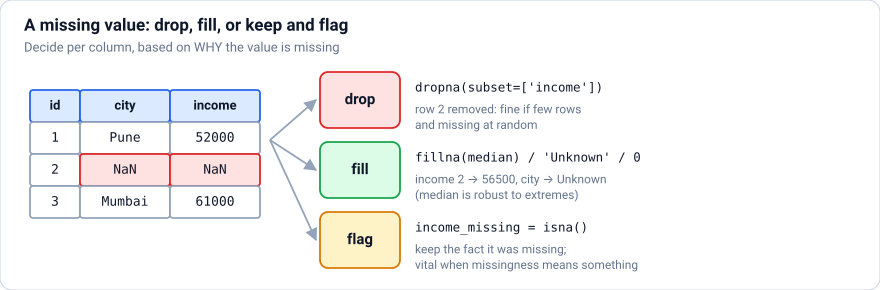

### 26.1 How pandas marks missing values

Empty cells in a CSV become a missing marker: **NaN** in number columns, and also in text columns of pandas 3, and **NaT** ("not a time") in date columns. `isna()` finds them all:

```python
import io
import numpy as np
import pandas as pd

csv_text = """id,date,city,age,income,rating,discount
1,2025-01-01,Pune,34,52000,4,
2,2025-01-02,,41,,5,10
3,2025-01-03,Mumbai,,61000,,
4,2025-01-04,Delhi,29,48000,3,5
5,,Pune,55,250000,,
6,2025-01-06,Mumbai,38,,4,
"""
df = pd.read_csv(io.StringIO(csv_text), parse_dates=["date"])
print(df)
print(df.isna().sum())                                    # count per column
print(df.isna().mean().round(2).sort_values(ascending=False))   # share per column
```

**Output:**

```text
   id       date    city   age    income  rating  discount
0   1 2025-01-01    Pune  34.0   52000.0     4.0       NaN
1   2 2025-01-02     NaN  41.0       NaN     5.0      10.0
2   3 2025-01-03  Mumbai   NaN   61000.0     NaN       NaN
3   4 2025-01-04   Delhi  29.0   48000.0     3.0       5.0
4   5        NaT    Pune  55.0  250000.0     NaN       NaN
5   6 2025-01-06  Mumbai  38.0       NaN     4.0       NaN
id          0
date        1
city        1
age         1
income      2
rating      2
discount    4
dtype: int64
discount    0.67
income      0.33
rating      0.33
date        0.17
city        0.17
age         0.17
id          0.00
dtype: float64
```

NaN never equals anything, even itself, so test with `isna`, never `== np.nan`. Aggregations skip NaN by default: `sum` adds the known values and `count` counts them:

```python
print(np.nan == np.nan, df["income"].sum(), df["income"].count())
```

**Output:**

```text
False 411000.0 4
```

### 26.2 Why it's missing matters

Before choosing a fix, ask **why** values are missing:

- **completely at random:** a form glitch dropped some answers. Dropping or filling is mostly harmless;
- **related to other columns:** older customers skip the income question. Dropping them biases the data towards the young;
- **related to the value itself:** people with very high incomes don't report them. Every fix is biased, and the fact of missingness is itself information.

### 26.3 Drop

`dropna()` drops rows with any missing value; `subset=[…]` only checks some columns; `thresh=n` keeps rows with at least n known values:

```python
print(len(df.dropna()), len(df.dropna(subset=["city", "date"])), len(df.dropna(thresh=6)))
```

**Output:**

```text
1 4 2
```

Dropping every incomplete row leaves just 1 of 6 here. Drop only when few rows are affected and the missingness is random.

### 26.4 Fill, and keep a flag

`fillna(value)` fills with a constant or a statistic. Choose deliberately per column:

- a missing **discount** really means "no discount": fill with 0;
- a missing **city**: fill with "Unknown", a category of its own;
- a missing **income**: fill with the **median**, not the mean. The 250,000 income pulls the mean up, and the median resists it (Chapter 51). Also keep a **missing-indicator** column, because the fact that income was missing may matter.

```python
clean = df.assign(
    city=df["city"].fillna("Unknown"),
    discount=df["discount"].fillna(0),
    income_missing=df["income"].isna(),
    income=df["income"].fillna(df["income"].median()),
    rating=df["rating"].astype("Int64"),                 # an integer column that can hold missing values
)
print(clean)
print(f"income mean {df['income'].mean():.0f}  median {df['income'].median():.0f}")
```

**Output:**

```text
   id       date     city   age    income  rating  discount  income_missing
0   1 2025-01-01     Pune  34.0   52000.0       4       0.0           False
1   2 2025-01-02  Unknown  41.0   56500.0       5      10.0            True
2   3 2025-01-03   Mumbai   NaN   61000.0    <NA>       0.0           False
3   4 2025-01-04    Delhi  29.0   48000.0       3       5.0           False
4   5        NaT     Pune  55.0  250000.0    <NA>       0.0           False
5   6 2025-01-06   Mumbai  38.0   56500.0       4       0.0            True
income mean 102750  median 56500
```

A number column with NaN is forced to float (rating would show 4.0). `"Int64"` (capital I) is pandas' **nullable integer** type, which keeps whole numbers and shows missing as `<NA>`.

Filling with any single value shrinks the column's spread, since every filled value sits at the centre. That understates uncertainty:

```python
s = pd.Series([10, 20, 30, 40])
print(s.std().round(2), s.where(s != 20).fillna(s.mean()).std().round(2))
```

**Output:**

```text
12.91 12.5
```

`where(cond)` keeps values where the condition holds and makes the rest NaN, here simulating a missing 20.

### 26.5 Ordered data: fill from neighbours

For readings in time order, neighbouring values are the best guess. `ffill` carries the last known value forward, `bfill` the next one backward, and `interpolate` draws a straight line between them:

```python
temps = pd.Series([21.0, np.nan, np.nan, 24.0, np.nan, 23.0])
print(pd.DataFrame({"raw": temps, "ffill": temps.ffill(), "bfill": temps.bfill(), "interpolate": temps.interpolate()}))
```

**Output:**

```text
    raw  ffill  bfill  interpolate
0  21.0   21.0   21.0         21.0
1   NaN   21.0   24.0         22.0
2   NaN   21.0   24.0         23.0
3  24.0   24.0   24.0         24.0
4   NaN   24.0   23.0         23.5
5  23.0   23.0   23.0         23.0
```

Interpolating between 21 and 24 over three steps fills 22 and 23.

### 26.6 Summary

```
df.isna().sum() / .mean();  NaN != NaN;  aggregations skip NaN
df.dropna(subset=[…], thresh=n)
df.fillna(v) / s.fillna(s.median());  add an indicator: s.isna();  "Int64" nullable integers
ordered data: s.ffill(), s.bfill(), s.interpolate()
```

**Key terms:**

- **Missing value:** a cell with no known value: NaN, NaT or `<NA>` in pandas.
- **NaT:** pandas' missing marker for dates and times.
- **Imputation:** filling missing values with estimates.
- **Missing indicator:** a True/False column recording where a value was missing.
- **Nullable integer (`Int64`):** a pandas integer type that can hold missing values.
- **Forward fill / interpolation:** filling a gap with the last known value / with a straight line between the neighbours.

### Exercises

1. Which ids are missing both income and rating? Which column has the highest share missing?
2. Fill the missing ages with the median age, adding an `age_missing` flag.

<details>
<summary><b>Answers</b></summary>

```python
print(df.loc[df["income"].isna() & df["rating"].isna(), "id"].tolist(), df.isna().mean().idxmax())
filled = df.assign(age_missing=df["age"].isna(), age=df["age"].fillna(df["age"].median()))
print(df["age"].median(), filled[["id", "age", "age_missing"]].to_dict("list"))
```

**Output:**

```text
[] discount
38.0 {'id': [1, 2, 3, 4, 5, 6], 'age': [34.0, 41.0, 38.0, 29.0, 55.0, 38.0], 'age_missing': [False, False, True, False, False, False]}
```

1. No row is missing both (id 3 and id 5 miss rating, but have income); discount has the highest share missing.
2. The median age is 38; only id 3 is filled. `assign` computes every new column from the original `df`, so `age_missing` sees the gap before it's filled.

</details>

---

## 27. Duplicates, Data Types and Type Conversion

**You need:** Chapter 26. · **You'll learn:** to find and remove duplicate rows correctly, and to convert columns stored with the wrong type, without silently losing values.

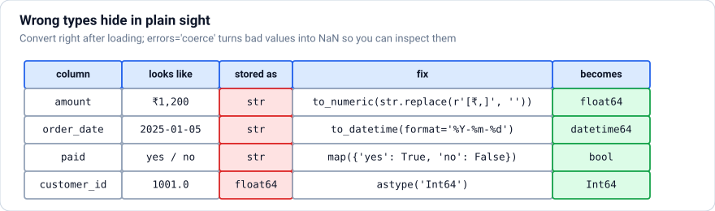

### 27.1 A messy export

Six order rows: amounts with a currency sign, a "pending" amount, an impossible date, an exact duplicate row, and an order that appears twice with different values (it was updated):

```python
import io
import pandas as pd

messy = pd.read_csv(io.StringIO("""order_id,customer,amount,paid,order_date,updated_at
1,Asha,"₹1,200",yes,2025-01-05,1736100000
2,Ravi,₹2500,no,2025-01-06,1736200000
2,Ravi,₹2500,no,2025-01-06,1736200000
3,Meera,pending,yes,2025-02-11,1736300000
4,Arjun,₹900,yes,not a date,1736400000
4,Arjun,₹950,yes,2025-02-20,1736500000
"""))
print(messy.dtypes)
```

**Output:**

```text
order_id      int64
customer        str
amount          str
paid            str
order_date      str
updated_at    int64
dtype: object
```

Every column except the ids is text, and `updated_at` is a **Unix timestamp**: seconds since 1 January 1970.

### 27.2 Duplicates

Two kinds:

- **exact duplicates:** every column identical, usually from loading the same data twice;
- **duplicate keys:** the same id with different values, usually an old and a new version of a record.

`duplicated()` marks repeats of earlier rows; `duplicated(columns)` checks only those columns; `keep=False` marks every copy:

```python
print("exact duplicates:", messy.duplicated().sum(), "| duplicate ids:", messy.duplicated("order_id").sum())
print(messy[messy.duplicated("order_id", keep=False)][["order_id", "amount", "updated_at"]])
```

**Output:**

```text
exact duplicates: 1 | duplicate ids: 2
   order_id amount  updated_at
1         2  ₹2500  1736200000
2         2  ₹2500  1736200000
4         4   ₹900  1736400000
5         4   ₹950  1736500000
```

For updated records keep the **latest** version: sort by the update time, then `drop_duplicates(key, keep="last")`. `pd.to_datetime(…, unit="s")` converts Unix seconds to dates:

```python
df = (messy
      .drop_duplicates()
      .assign(updated_at=lambda d: pd.to_datetime(d["updated_at"], unit="s"))
      .sort_values("updated_at")
      .drop_duplicates("order_id", keep="last"))
print(df[["order_id", "amount", "updated_at"]], df["order_id"].is_unique)
```

**Output:**

```text
   order_id   amount          updated_at
0         1   ₹1,200 2025-01-05 18:00:00
1         2    ₹2500 2025-01-06 21:46:40
3         3  pending 2025-01-08 01:33:20
5         4     ₹950 2025-01-10 09:06:40 True
```

### 27.3 Converting types safely

`pd.to_numeric` and `pd.to_datetime` convert text. With `errors="coerce"`, values that can't be converted become missing instead of raising an error. That's convenient and dangerous: always count what failed. For the amounts, first remove the currency sign and thousands commas with `.str.replace` (text methods, Chapter 28; `[₹,]` means "either character"):

```python
amount_text = df["amount"]
df["amount"] = pd.to_numeric(amount_text.str.replace(r"[₹,]", "", regex=True), errors="coerce")
df["order_date"] = pd.to_datetime(df["order_date"], format="%Y-%m-%d", errors="coerce")
df["paid"] = df["paid"].map({"yes": True, "no": False})
print("could not parse:", amount_text[df["amount"].isna() & amount_text.notna()].tolist())
print(df)
print(df.dtypes)
```

**Output:**

```text
could not parse: ['pending']
   order_id customer  amount   paid order_date          updated_at
0         1     Asha  1200.0   True 2025-01-05 2025-01-05 18:00:00
1         2     Ravi  2500.0  False 2025-01-06 2025-01-06 21:46:40
3         3    Meera     NaN   True 2025-02-11 2025-01-08 01:33:20
5         4    Arjun   950.0   True 2025-02-20 2025-01-10 09:06:40
order_id               int64
customer                 str
amount               float64
paid                    bool
order_date    datetime64[us]
updated_at    datetime64[us]
dtype: object
```

"pending" becomes NaN, and now you know exactly which value it was. A `format` such as `"%Y-%m-%d"` (year-month-day) tells `to_datetime` exactly what to expect, which is faster and avoids misreadings. Ambiguous dates are the classic trap:

```python
print(pd.to_datetime("03/04/2025", format="%d/%m/%Y").date(), pd.to_datetime("03/04/2025", format="%m/%d/%Y").date())
```

**Output:**

```text
2025-04-03 2025-03-04
```

The same text is 3 April in India and Britain, and 4 March in the United States. Never let a library guess.

### 27.4 Summary

```
df.duplicated(), df.duplicated(cols, keep=False);  df.drop_duplicates();  latest: sort, drop_duplicates(key, keep="last")
pd.to_numeric(s, errors="coerce");  pd.to_datetime(s, format="%Y-%m-%d", errors="coerce");  unit="s" for Unix time
after coercing, list what became missing;  s.map({"yes": True, "no": False})
```

**Key terms:**

- **Exact duplicate:** a row identical to another in every column.
- **Duplicate key:** two rows sharing an identifier that should be unique.
- **Unix timestamp:** a time stored as seconds since 1 January 1970 (UTC).
- **Coercion (`errors="coerce"`):** turning values that can't be converted into missing values instead of raising an error.
- **Date format string:** a pattern such as `%d/%m/%Y` saying which part of a date string is the day, month and year.

### Exercises

1. Convert `["12", "7.5", "eight", "", "1e3"]` to numbers and list the values that failed.
2. A login table has several rows per user. Keep each user's latest login.

<details>
<summary><b>Answers</b></summary>

```python
s = pd.Series(["12", "7.5", "eight", "", "1e3"])
nums = pd.to_numeric(s, errors="coerce")
print(nums.tolist(), s[nums.isna()].tolist())

logins = pd.DataFrame({"user_id": [1, 2, 1, 2, 3],
                       "login_time": pd.to_datetime(["2025-01-01", "2025-01-02", "2025-01-05", "2025-01-03", "2025-01-04"])})
print(logins.sort_values("login_time").drop_duplicates("user_id", keep="last").sort_values("user_id"))
```

**Output:**

```text
[12.0, 7.5, nan, nan, 1000.0] ['eight', '']
   user_id login_time
2        1 2025-01-05
3        2 2025-01-03
4        3 2025-01-04
```

1. "eight" and the empty string fail; "1e3" is scientific notation for 1,000.
2. Sort by time, keep the last row per user.

</details>

---

## 28. Text Data: The .str Accessor and Regular Expressions

**You need:** Chapter 27. · **You'll learn:** to clean and standardise text columns, and to search, validate and extract parts of text with regular expressions.

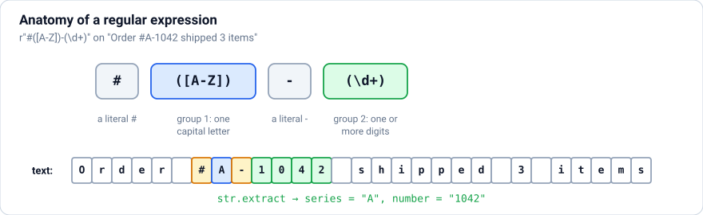

### 28.1 Cleaning categories

Typed-in categories come in many spellings: spaces, capitals, old names. The **`.str` accessor** applies text methods to every value of a column: `strip` (remove surrounding spaces), `lower`, `upper`, `title` (capitalise each word), `replace`, `len`, `split` and more. Missing values stay missing:

```python
import pandas as pd

cities = pd.Series(["  pune", "PUNE ", "Bombay", "mumbai", "Bengaluru", "new   delhi", None])
clean = (cities.str.strip()
               .str.replace(r"\s+", " ", regex=True)       # runs of spaces → one space
               .str.title()
               .replace({"Bombay": "Mumbai"}))             # old name → current name
print(clean.tolist())
print(cities.nunique(), "→", clean.nunique(), "distinct cities")
```

**Output:**

```text
['Pune', 'Pune', 'Mumbai', 'Mumbai', 'Bengaluru', 'New Delhi', nan]
6 → 4 distinct cities
```

### 28.2 Regular expressions

A **regular expression** (**regex**) is a pattern for text. The pieces used most:

| pattern | matches |
|---|---|
| `\d`, `\w`, `\s` | a digit; a letter, digit or underscore; a space or tab |
| `[A-Z]`, `[₹,]` | one character from the set |
| `+`, `*`, `?`, `{6}`, `{2,}` | one or more; zero or more; optional; exactly 6; 2 or more |
| `.` | any character (`\.` for a real dot) |
| `^`, `$` | start, end of the text |
| `( … )` | a group to capture; `(?P<name> …)` names it |

Write patterns as raw strings, `r"…"`, so Python leaves the backslashes alone.

### 28.3 Searching and extracting

`contains(pattern)` tests each value; `extract(pattern)` pulls out the captured groups as columns; `findall` returns every match:

```python
notes = pd.Series(["Order #A-1042 shipped 3 items", "order #B-77: 12 items", "no order code", None])
print(notes.str.extract(r"#(?P<series>[A-Z])-(?P<number>\d+)"))
print(notes.str.extract(r"(\d+)\s*items")[0].astype("Int64").tolist())
print(notes.str.contains("order", case=False, na=False).tolist())

tweets = pd.Series(["Loving #python and #pandas", "no tags here", "#data rocks"])
print(tweets.str.findall(r"#\w+").tolist())
```

**Output:**

```text
  series number
0      A   1042
1      B     77
2    NaN    NaN
3    NaN    NaN
[3, 12, <NA>, <NA>]
[True, True, True, False]
[['#python', '#pandas'], [], ['#data']]
```

`na=False` makes a missing value count as "doesn't contain" rather than staying missing, so the result can be used as a mask.

### 28.4 Validating: fullmatch, not contains

To check that a whole value has a format, use `fullmatch`. `contains` only needs the pattern **somewhere** in the text:

```python
pins = pd.Series(["411001", "4110011", "41100A", "560034"])            # Indian postcodes have 6 digits
print(pins.str.contains(r"\d{6}").tolist())
print(pins.str.fullmatch(r"\d{6}").tolist())
```

**Output:**

```text
[True, True, False, True]
[True, False, False, True]
```

"4110011" contains six digits in a row, but isn't a six-digit code.

### 28.5 Splitting

`split(sep, n=1, expand=True)` splits at the first separator into columns:

```python
full = pd.Series(["Asha Rao", "Ravi Kumar Singh"])
print(full.str.split(" ", n=1, expand=True).set_axis(["first", "rest"], axis=1))
```

**Output:**

```text
  first         rest
0  Asha          Rao
1  Ravi  Kumar Singh
```

`set_axis` names the new columns.

### 28.6 Summary

```
s.str.strip(), .lower(), .title(), .replace(pat, rep, regex=True), .len(), .split(sep, n, expand=True)
s.str.contains(pat, case=False, na=False);  s.str.fullmatch(pat) (validation);  s.str.extract(r"(…)");  s.str.findall(pat)
regex: \d \w \s  [set]  + * ? {n} {n,}  .  ^ $  ( )  (?P<name>…)   — write as r"…"
```

**Key terms:**

- **`.str` accessor:** pandas' text methods, applied to every value of a column.
- **Regular expression (regex):** a pattern describing text to search for.
- **Capture group:** a part of a regex in parentheses whose matched text is extracted.
- **`fullmatch`:** tests whether a whole value matches a pattern, not just part of it.
- **Raw string:** a Python string `r"…"` in which backslashes are kept as they are.

### Exercises

1. Extract the weights (as integers) from `["Weight: 72 kg", "weight 65kg", "n/a", "80 KG"]`.
2. Which of these emails look valid: `asha@shop.in`, `ravi@@shop.in`, `zoya.k@mail.co.uk`, `kabir@shop`?

<details>
<summary><b>Answers</b></summary>

```python
w = pd.Series(["Weight: 72 kg", "weight 65kg", "n/a", "80 KG"])
print(w.str.extract(r"(\d+)\s*kg", flags=2)[0].astype("Int64").tolist())        # flags=2 is re.IGNORECASE
emails = pd.Series(["asha@shop.in", "ravi@@shop.in", "zoya.k@mail.co.uk", "kabir@shop"])
print(emails.str.fullmatch(r"[A-Za-z0-9._%+-]+@[A-Za-z0-9.-]+\.[A-Za-z]{2,}").tolist())
```

**Output:**

```text
[72, 65, <NA>, 80]
[True, False, True, False]
```

1. 72, 65, missing, 80: the case-insensitive flag catches "KG".
2. The first and third. The pattern needs name characters, one @, a domain, a dot and a 2+ letter ending. (Real email validation is looser; a pattern like this catches obvious typos.)

</details>

**Learn more:** [Python: regular expression HOWTO](https://docs.python.org/3/howto/regex.html) · [regex101 (test patterns online)](https://regex101.com/)

---

## 29. Categorical Data and Binning

**You need:** Chapters 15 and 28. · **You'll learn:** the category dtype for repeated text, ordered categories, and turning numbers into ranges with `cut` and `qcut`.

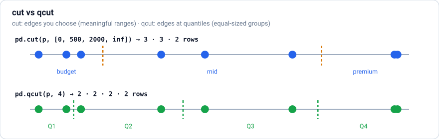

### 29.1 The category dtype

A column with a few distinct values repeated many times (city, plan, size) can be stored as a **category**: each distinct value is stored once, and each row holds only a small integer code pointing to it:

```python
import numpy as np
import pandas as pd

rng = np.random.default_rng(0)
cities = pd.Series(rng.choice(["Pune", "Mumbai", "Delhi", "Goa"], size=1_000_000))
as_cat = cities.astype("category")
print(f"str: {cities.memory_usage(deep=True) / 1e6:.1f} MB   category: {as_cat.memory_usage(deep=True) / 1e6:.1f} MB")
print(as_cat.cat.categories.tolist(), as_cat.cat.codes[:5].tolist(), cities[:5].tolist())
```

**Output:**

```text
str: 12.5 MB   category: 1.0 MB
['Delhi', 'Goa', 'Mumbai', 'Pune'] [1, 0, 0, 2, 2] ['Goa', 'Delhi', 'Delhi', 'Mumbai', 'Mumbai']
```

`memory_usage(deep=True)` counts the text itself too. The `.cat` accessor shows the categories and the codes.

### 29.2 Ordered categories

Text sorts alphabetically, which is wrong for sizes. An **ordered** category knows its order, so it sorts and compares correctly:

```python
sizes = pd.Series(["M", "S", "XL", "L", "M"])
print(sizes.sort_values().tolist())                                        # alphabetical: wrong
ordered = pd.Series(pd.Categorical(sizes, categories=["S", "M", "L", "XL"], ordered=True))
print(ordered.sort_values().tolist(), (ordered > "M").tolist())
```

**Output:**

```text
['L', 'M', 'M', 'S', 'XL']
['S', 'M', 'M', 'L', 'XL'] [False, False, True, True, False]
```

### 29.3 cut: ranges you choose

**Binning** turns a number into a range label. `pd.cut(values, bins, labels)` uses the edges you give. By default each bin includes its right edge: (0, 500] means above 0 up to 500:

```python
prices = pd.Series([60, 250, 350, 900, 1200, 1800, 2500, 2500])
tiers = pd.cut(prices, bins=[0, 500, 2000, np.inf], labels=["budget", "mid", "premium"])
print(tiers.value_counts(sort=False).to_dict())
```

**Output:**

```text
{'budget': 3, 'mid': 3, 'premium': 2}
```

`np.inf` makes the last bin open-ended.

### 29.4 qcut: equal-sized groups

`pd.qcut(values, q)` chooses the edges so each bin holds the same number of rows: quartiles for q = 4, deciles for q = 10. Use it to compare "top 25% of customers" with the rest:

```python
quartile = pd.qcut(prices, q=4, labels=["Q1", "Q2", "Q3", "Q4"])
print(pd.DataFrame({"price": prices, "tier": tiers, "quartile": quartile}))
print(quartile.value_counts(sort=False).to_dict())
```

**Output:**

```text
   price     tier quartile
0     60   budget       Q1
1    250   budget       Q1
2    350   budget       Q2
3    900      mid       Q2
4   1200      mid       Q3
5   1800      mid       Q3
6   2500  premium       Q4
7   2500  premium       Q4
{'Q1': 2, 'Q2': 2, 'Q3': 2, 'Q4': 2}
```

`cut` with fixed edges can leave bins nearly empty when the data is skewed; `qcut` can't, but its edges are wherever the data puts them.

### 29.5 Grouping rare categories

Rare categories make tables and models noisy. A common fix lumps every category seen fewer than k times into "Other":

```python
plans = pd.Series(["free"] * 6 + ["pro"] * 3 + ["team", "edu"])
counts = plans.map(plans.value_counts())                      # each row's category count
print(plans.where(counts >= 2, "Other").value_counts().to_dict())
```

**Output:**

```text
{'free': 6, 'pro': 3, 'Other': 2}
```

`where(cond, other)` keeps values where the condition holds and replaces the rest.

### 29.6 Summary

```
s.astype("category");  s.cat.categories, s.cat.codes;  pd.Categorical(s, categories=[…], ordered=True)
pd.cut(x, bins=[…, np.inf], labels=[…])  (your edges, right-inclusive);  pd.qcut(x, q, labels)  (equal counts)
rare → "Other": s.where(s.map(s.value_counts()) >= k, "Other")
```

**Key terms:**

- **Category dtype:** stores each distinct value once and each row as a small integer code.
- **Ordered categorical:** a category type with a defined order, so it can be sorted and compared.
- **Binning:** grouping numbers into ranges.
- **`cut` / `qcut`:** binning by chosen edges / into groups with equal counts.
- **Quantile:** a value dividing sorted data into equal-sized parts, such as quartiles (4) and deciles (10).

### Exercises

1. Bin the ages 5, 17, 18, 34, 35, 64, 65, 90 into child (up to 17), adult (18–64) and senior (65+).
2. What does `pd.cut(prices, bins=3)` do?

<details>
<summary><b>Answers</b></summary>

```python
ages = pd.Series([5, 17, 18, 34, 35, 64, 65, 90])
print(pd.cut(ages, bins=[-np.inf, 17, 64, np.inf], labels=["child", "adult", "senior"]).tolist())
print(pd.cut(prices, bins=3).cat.categories.tolist())
```

**Output:**

```text
['child', 'child', 'adult', 'adult', 'adult', 'adult', 'senior', 'senior']
[Interval(57.56, 873.333, closed='right'), Interval(873.333, 1686.667, closed='right'), Interval(1686.667, 2500.0, closed='right')]
```

1. With right-inclusive edges, 17 falls in (−∞, 17] = child and 64 in (17, 64] = adult.
2. It splits the range from the minimum to the maximum into 3 bins of equal **width**, not equal counts.

</details>

---

## 30. Outliers and Data Validation

**You need:** Chapters 12, 26 and 29. · **You'll learn:** two rules for flagging outliers, why the popular z-score rule can miss them, what to do with them, and how to check data against explicit rules.

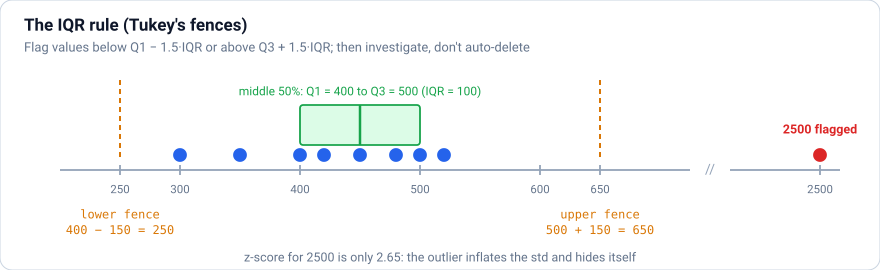

### 30.1 What an outlier is

An **outlier** is a value far from the rest. It can be an error (a typo, a unit mix-up) or genuine and important (a huge order, a fraud). The job is to **flag** outliers and investigate them, never to delete them automatically.

### 30.2 The IQR rule

The **interquartile range** (IQR) is the spread of the middle half: Q3 − Q1, the 75th minus the 25th percentile. Values more than 1.5 × IQR beyond the quartiles are flagged:

```
low fence = Q1 − 1.5·IQR,      high fence = Q3 + 1.5·IQR
```

For nine order values, 300, 350, 400, 420, 450, 480, 500, 520 and 2500: Q1 = 400 and Q3 = 500, so IQR = 100 and the fences are 250 and 650. Only 2500 is outside:

```python
import numpy as np
import pandas as pd

values = pd.Series([300, 350, 400, 420, 450, 480, 500, 520, 2500])
q1, q3 = values.quantile([0.25, 0.75])
iqr = q3 - q1
low, high = q1 - 1.5 * iqr, q3 + 1.5 * iqr
print(f"Q1={q1} Q3={q3} IQR={iqr} fences=({low}, {high})")
print("IQR flags:", values[(values < low) | (values > high)].tolist())
```

**Output:**

```text
Q1=400.0 Q3=500.0 IQR=100.0 fences=(250.0, 650.0)
IQR flags: [2500]
```

`quantile(p)` is the percentile as a fraction. The rule uses only the quartiles, which the outlier barely moves, so it's **robust**.

### 30.3 Why |z| > 3 can miss it

The other common rule flags values more than 3 standard deviations from the mean (|z| > 3, Chapter 13.3). But the outlier itself inflates the mean and the standard deviation, hiding itself:

```python
z = (values - values.mean()) / values.std()
print("z-scores:", z.round(2).tolist())
print("|z| > 3 flags:", values[z.abs() > 3].tolist())
```

**Output:**

```text
z-scores: [-0.52, -0.44, -0.37, -0.34, -0.3, -0.26, -0.23, -0.2, 2.65]
|z| > 3 flags: []
```

In fact, with n values, no z-score can ever exceed (n − 1)/√n (using the sample standard deviation). For n = 9 that's 8/3 = 2.67, so |z| > 3 can't flag anything in a sample this small. Prefer the IQR rule, or a z-score built from the median and a robust spread.

<details>
<summary><b>Why the largest z-score is at most (n − 1)/√n</b></summary>

Take one value x₁ far out and the other n − 1 values equal (that's the extreme case). With d = x₁ − (the others' value), the mean is shifted by d/n, so x₁ sits d(n − 1)/n above the mean, and each other value d/n below. The sum of squared deviations is d²(n − 1)²/n² + (n − 1)d²/n² = d²(n − 1)/n, so the sample variance is d²/n and s = d/√n. Then z₁ = d(n − 1)/n ÷ d/√n = (n − 1)/√n, whatever d is.

</details>

### 30.4 What to do with a flagged value

1. **Check it.** Is it a typo, a unit error, a test order? Fix or remove errors, and record that you did.
2. **If it's genuine, keep it,** and use methods that aren't dominated by it: medians instead of means, or report results with and without it.
3. **Cap** (also called winsorise) when a model needs bounded inputs: `clip` limits values to a percentile range.
4. **Transform** skewed data with a log (Chapter 11.2), which pulls in the long tail.

```python
print("capped at the 90th percentile:", values.clip(upper=values.quantile(0.9)).round(1).tolist())
print("log10:", np.log10(values).round(2).tolist())
```

**Output:**

```text
capped at the 90th percentile: [300.0, 350.0, 400.0, 420.0, 450.0, 480.0, 500.0, 520.0, 916.0]
log10: [2.48, 2.54, 2.6, 2.62, 2.65, 2.68, 2.7, 2.72, 3.4]
```

### 30.5 Validation rules

Many data errors aren't extreme, just **impossible**: a quantity of 0, a negative price, an unknown city, a delivery before its order. Write the rules down and test every row:

```python
orders = pd.DataFrame({
    "order_id": [1, 2, 3, 4, 5, 5],
    "qty": [2, 0, 1, 3, 1, 1],
    "price": [350.0, 1200.0, -50.0, 900.0, 250.0, 250.0],
    "city": ["Pune", "Mumbai", "Delhi", "Paris", "Goa", "Goa"],
    "ordered": pd.to_datetime(["2025-01-05", "2025-01-06", "2025-01-07", "2025-01-08", "2025-01-09", "2025-01-09"]),
    "delivered": pd.to_datetime(["2025-01-07", "2025-01-05", "2025-01-09", "2025-01-10", "2025-01-12", "2025-01-12"]),
})
rules = pd.DataFrame({
    "qty is at least 1": orders["qty"] >= 1,
    "price is positive": orders["price"] > 0,
    "city is known": orders["city"].isin(["Pune", "Mumbai", "Delhi", "Goa", "Bengaluru"]),
    "delivered after ordered": orders["delivered"] >= orders["ordered"],
    "order_id is unique": ~orders["order_id"].duplicated(keep=False),
})
print(rules.all())                                                  # does each rule hold for every row?
print(orders[~rules.all(axis=1)][["order_id", "qty", "price", "city"]])   # rows breaking any rule
```

**Output:**

```text
qty is at least 1          False
price is positive          False
city is known              False
delivered after ordered    False
order_id is unique         False
dtype: bool
   order_id  qty   price    city
1         2    0  1200.0  Mumbai
2         3    1   -50.0   Delhi
3         4    3   900.0   Paris
4         5    1   250.0     Goa
5         5    1   250.0     Goa
```

`all()` is True if every value is True: per column it says which rules always hold; with `axis=1`, per row it says which rows pass every rule.

The **pandera** library turns such rules into a reusable **schema**, checked on every run of a pipeline (Chapter 62). `lazy=True` collects every failure rather than stopping at the first:

```python
import pandera.pandas as pa

schema = pa.DataFrameSchema({
    "order_id": pa.Column(int, unique=True),
    "qty": pa.Column(int, pa.Check.ge(1)),
    "price": pa.Column(float, pa.Check.gt(0)),
    "city": pa.Column(str, pa.Check.isin(["Pune", "Mumbai", "Delhi", "Goa", "Bengaluru"])),
})
try:
    schema.validate(orders, lazy=True)
except pa.errors.SchemaErrors as err:
    print(err.failure_cases[["column", "check", "failure_case", "index"]].to_string())
```

**Output:**

```text
     column                                                  check failure_case  index
0  order_id                                       field_uniqueness            5      4
1  order_id                                       field_uniqueness            5      5
2       qty                            greater_than_or_equal_to(1)            0      1
3     price                                        greater_than(0)        -50.0      2
4      city  isin(['Pune', 'Mumbai', 'Delhi', 'Goa', 'Bengaluru'])        Paris      3
```

`ge` and `gt` mean "greater than or equal" and "greater than".

### 30.6 Summary

```
IQR rule: outside [Q1 − 1.5·IQR, Q3 + 1.5·IQR];  robust to the outliers themselves
|z| > 3: the outlier inflates the std; |z| ≤ (n − 1)/√n always → misses outliers in small samples
flag and investigate; fix errors; keep genuine values (use medians); s.clip(lower, upper); np.log
rules: a DataFrame of boolean checks → .all() per rule, .all(axis=1) per row;  pandera schemas
```

**Key terms:**

- **Outlier:** a value far from the others.
- **Interquartile range (IQR):** Q3 − Q1, the spread of the middle 50% of the data.
- **Robust statistic:** one that changes little when a few extreme values are added, such as the median or IQR.
- **Capping (winsorising):** limiting values to a range, such as the 1st to 99th percentiles.
- **Validation rule:** a condition every row must meet, such as "price is positive".
- **Schema:** a formal description of a table's columns, types and rules, checked automatically.
- **pandera:** a library for defining and checking DataFrame schemas.

### Exercises

1. Apply the IQR rule to 10, 12, 12, 13, 12, 11, 14, 13, 15, 102, 12, 14, 13.
2. Which rule would catch an order shipped to "Mumbia", and how would you fix such values?

<details>
<summary><b>Answers</b></summary>

```python
v = pd.Series([10, 12, 12, 13, 12, 11, 14, 13, 15, 102, 12, 14, 13])
q1, q3 = v.quantile([0.25, 0.75])
print(q1, q3, v[(v < q1 - 1.5 * (q3 - q1)) | (v > q3 + 1.5 * (q3 - q1))].tolist())
```

**Output:**

```text
12.0 14.0 [102]
```

1. Q1 = 12 and Q3 = 14, so IQR = 2 and the fences are 9 and 17: only 102 is flagged.
2. "city is known" (`isin` a list of valid cities). Fix with a mapping of known misspellings to the right name (Chapter 28.1), and add the rule to the schema so new typos are caught.

</details>

---

# Part V — Analysing Data

Eight chapters on the core of analysis: grouping and summarising, combining tables, reshaping between long and wide, and working with dates and time series.

---

## 31. Grouping I: groupby and agg

**You need:** Chapters 18–25. · **You'll learn:** split-apply-combine, the pattern behind "per city", "per month" and "per customer" summaries, and how to compute several summaries at once.

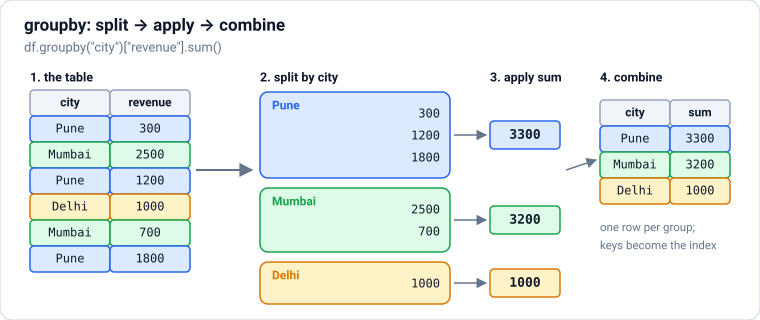

### 31.1 Split, apply, combine

Chapter 1 answered "revenue per city" with a loop. `groupby` does it for any table:

1. **split** the rows into groups by the values of a key column;
2. **apply** a calculation to each group;
3. **combine** the results into one table, one row per group.

```python
import pandas as pd

orders = pd.read_csv("data/orders.csv", parse_dates=["date"])
orders["revenue"] = orders["qty"] * orders["price"]
print(orders.groupby("city")["revenue"].sum().sort_values(ascending=False))
```

**Output:**

```text
city
Pune         5800
Mumbai       5600
Delhi        1000
Bengaluru     900
Name: revenue, dtype: int64
```

Check Pune by hand: orders 1, 3, 4 and 7 give 300 + 1200 + 1800 + 2500 = 5,800. The result is a Series indexed by the group keys.

### 31.2 Counting

`size()` counts rows per group; `nunique()` counts distinct values; `count()` counts non-missing values:

```python
print(orders.groupby("city").size().to_dict())
print(orders.groupby("city")["customer"].nunique().to_dict())
```

**Output:**

```text
{'Bengaluru': 1, 'Delhi': 1, 'Mumbai': 4, 'Pune': 4}
{'Bengaluru': 1, 'Delhi': 1, 'Mumbai': 2, 'Pune': 2}
```

Pune has 4 orders but only 2 customers (Asha ordered three times).

### 31.3 Several keys

A list of keys gives one row per combination that occurs:

```python
print(orders.groupby(["city", "category"])["revenue"].sum())
```

**Output:**

```text
city       category   
Bengaluru  electronics     900
Delhi      kitchen        1000
Mumbai     electronics    4300
           kitchen         700
           stationery      600
Pune       bags           1200
           electronics    4300
           stationery      300
Name: revenue, dtype: int64
```

The result has a two-level index (Chapter 36).

### 31.4 Several summaries: agg

**Named aggregation**, `agg(new_name=(column, function))`, computes several summaries in one go, each with a clear name:

```python
summary = (orders.groupby("city")
           .agg(orders=("order_id", "count"),
                customers=("customer", "nunique"),
                revenue=("revenue", "sum"),
                avg_order=("revenue", "mean"),
                biggest=("revenue", "max"))
           .round(1)
           .sort_values("revenue", ascending=False)
           .reset_index())
print(summary)
```

**Output:**

```text
        city  orders  customers  revenue  avg_order  biggest
0       Pune       4          2     5800     1450.0     2500
1     Mumbai       4          2     5600     1400.0     2500
2      Delhi       1          1     1000     1000.0     1000
3  Bengaluru       1          1      900      900.0      900
```

`reset_index()` turns the city index back into a column, convenient for further work and charts.

### 31.5 Computed keys and filtering groups

The key can be any Series, such as the month of each date. To keep groups that meet a condition (SQL's `HAVING`), filter the result:

```python
per_month = orders.groupby(orders["date"].dt.month)["revenue"].sum()
print(per_month.to_dict())

per_city = orders.groupby("city")["revenue"].sum()
print(per_city[per_city > 2000].index.tolist())
```

**Output:**

```text
{1: 2800, 2: 3000, 3: 4100, 4: 1600, 5: 1800}
['Mumbai', 'Pune']
```

### 31.6 Don't average averages

A store with 4 small sales and a store with 1 big one: the mean of the two stores' means isn't the overall mean, because it gives the single big sale as much weight as the four small ones:

```python
store = pd.DataFrame({"store": ["A", "A", "A", "A", "B"], "sale": [10, 10, 10, 10, 100]})
means = store.groupby("store")["sale"].mean()
print("mean of the group means:", means.mean(), " true overall mean:", store["sale"].mean())
```

**Output:**

```text
mean of the group means: 55.0  true overall mean: 28.0
```

(10 + 100)/2 = 55, but the true mean is 140/5 = 28. Combine group totals and counts instead: Σ totals / Σ counts.

Rows whose key is missing are dropped from groups by default; `groupby(key, dropna=False)` keeps them as a group of their own.

### 31.7 Summary

```
df.groupby(key)[col].sum() / .mean() / .size() / .nunique()           key: a column, a list, or any Series
df.groupby(key).agg(name=(col, "func"), …).reset_index()
filter groups: s = …sum(); s[s > x];   mean of means ≠ overall mean;  dropna=False keeps missing keys
```

**Key terms:**

- **Split-apply-combine:** splitting rows into groups, computing per group, and combining the results.
- **`groupby`:** pandas' split-apply-combine.
- **Aggregation function:** a function that reduces a group to one value, such as sum, mean or count.
- **Named aggregation:** `agg(name=(column, function))`, computing several named summaries at once.

### Exercises

1. Make a per-customer table with the number of orders, total revenue and highest price, sorted by revenue.
2. Which category has the highest average quantity per order?

<details>
<summary><b>Answers</b></summary>

```python
per_customer = (orders.groupby("customer")
                .agg(orders=("order_id", "count"), revenue=("revenue", "sum"), top_price=("price", "max"))
                .sort_values("revenue", ascending=False))
print(per_customer)
print(orders.groupby("category")["qty"].mean().idxmax())
```

**Output:**

```text
          orders  revenue  top_price
customer                            
Asha           3     4000       2500
Ravi           2     3100       2500
Zoya           2     2500       1800
Meera          1     1800       1800
Isha           1     1000        250
Kabir          1      900        900
stationery
```

1. Asha leads with 3 orders and 4,000 in revenue.
2. Stationery: two notebook orders of 5 and 10 average 7.5 items.

</details>

---

## 32. Grouping II: transform, filter and Ranking Within Groups

**You need:** Chapter 31. · **You'll learn:** to put group results back next to each row, rank and number rows within groups, take the top n per group, and keep or drop whole groups.

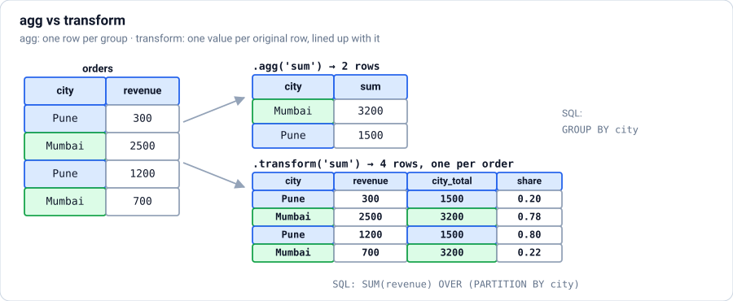

### 32.1 transform: a group value on every row

`agg` shrinks each group to one row. `transform` computes the same group statistic but returns it **for every original row**, so it can sit next to the row's own value. That's how to compute shares and differences from the group:

```python
import pandas as pd

orders = pd.read_csv("data/orders.csv", parse_dates=["date"]).sort_values("date")
orders["revenue"] = orders["qty"] * orders["price"]
g = orders.groupby("city")
orders["city_total"] = g["revenue"].transform("sum")
orders["share_pct"] = (100 * orders["revenue"] / orders["city_total"]).round(1)
orders["vs_city_avg"] = (orders["revenue"] - g["revenue"].transform("mean")).round(0)
print(orders[["city", "customer", "revenue", "city_total", "share_pct", "vs_city_avg"]])
```

**Output:**

```text
        city customer  revenue  city_total  share_pct  vs_city_avg
0       Pune     Asha      300        5800        5.2      -1150.0
1     Mumbai     Ravi     2500        5600       44.6       1100.0
2       Pune     Asha     1200        5800       20.7       -250.0
3       Pune    Meera     1800        5800       31.0        350.0
4     Mumbai     Zoya      700        5600       12.5       -700.0
5  Bengaluru    Kabir      900         900      100.0          0.0
6       Pune     Asha     2500        5800       43.1       1050.0
7      Delhi     Isha     1000        1000      100.0          0.0
8     Mumbai     Ravi      600        5600       10.7       -800.0
9     Mumbai     Zoya     1800        5600       32.1        400.0
```

Asha's 2,500 headphones are 2500/5800 = 43.1% of Pune's revenue.

### 32.2 Ranking and numbering within groups

`rank` (Chapter 23) and `cumcount` work per group. `cumcount()` numbers each group's rows 0, 1, 2… in order, so +1 gives "1st order, 2nd order…":

```python
orders["rank_in_city"] = g["revenue"].rank(ascending=False, method="dense").astype(int)
c = orders.groupby("customer")
orders["order_no"] = c.cumcount() + 1
orders["running_spend"] = c["revenue"].cumsum()
print(orders[["customer", "date", "revenue", "rank_in_city", "order_no", "running_spend"]].sort_values(["customer", "date"]).head(5))
```

**Output:**

```text
  customer       date  revenue  rank_in_city  order_no  running_spend
0     Asha 2025-01-05      300             4         1            300
2     Asha 2025-02-10     1200             3         2           1500
6     Asha 2025-03-20     2500             1         3           4000
7     Isha 2025-04-01     1000             1         1           1000
5    Kabir 2025-03-15      900             1         1            900
```

### 32.3 The previous row in the same group

`shift(1)` moves values down one row, so each row sees the value of the row before it; within a groupby it never crosses into another group. Subtracting gives the time since each customer's previous order:

```python
orders["prev_date"] = c["date"].shift(1)
orders["days_since_prev"] = (orders["date"] - orders["prev_date"]).dt.days
print(orders.loc[orders["customer"].isin(["Asha", "Ravi"]), ["customer", "date", "prev_date", "days_since_prev"]])
```

**Output:**

```text
  customer       date  prev_date  days_since_prev
0     Asha 2025-01-05        NaT              NaN
1     Ravi 2025-01-06        NaT              NaN
2     Asha 2025-02-10 2025-01-05             36.0
6     Asha 2025-03-20 2025-02-10             38.0
8     Ravi 2025-04-18 2025-01-06            102.0
```

Subtracting dates gives a duration, and `.dt.days` its whole days. Each customer's first order has no previous date, so NaT.

### 32.4 Top n per group, and the best row per group

Sort, then take the first n rows of each group with `groupby(…).head(n)`. For the single best row, `idxmax` per group gives row labels to look up:

```python
top2 = orders.sort_values("revenue", ascending=False).groupby("city").head(2)
print(top2.sort_values(["city", "revenue"], ascending=[True, False])[["city", "product", "revenue"]])
print(orders.loc[orders.groupby("city")["revenue"].idxmax(), ["city", "product", "revenue"]])
```

**Output:**

```text
        city     product  revenue
5  Bengaluru   Desk lamp      900
7      Delhi         Mug     1000
1     Mumbai  Headphones     2500
9     Mumbai    Keyboard     1800
6       Pune  Headphones     2500
3       Pune    Keyboard     1800
        city     product  revenue
5  Bengaluru   Desk lamp      900
7      Delhi         Mug     1000
1     Mumbai  Headphones     2500
6       Pune  Headphones     2500
```

### 32.5 Keeping whole groups, and filling per group

`filter(function)` keeps the groups for which the function returns True. And `transform` gives per-group fill values, better than one value for the whole column:

```python
print(orders.groupby("city").filter(lambda d: len(d) >= 3)["city"].unique().tolist())

prices = pd.DataFrame({"category": ["pen", "pen", "pen", "bag", "bag", "bag"], "price": [10, None, 14, 900, 1100, None]})
prices["filled"] = prices["price"].fillna(prices.groupby("category")["price"].transform("median"))
print(prices)
```

**Output:**

```text
['Pune', 'Mumbai']
  category   price  filled
0      pen    10.0    10.0
1      pen     NaN    12.0
2      pen    14.0    14.0
3      bag   900.0   900.0
4      bag  1100.0  1100.0
5      bag     NaN  1000.0
```

A missing pen price is filled with the pens' median (12), not the median of pens and bags together.

### 32.6 Summary

```
g[col].transform("sum" | "mean" | "median") → one value per original row (shares, differences, group fills)
g[col].rank(…), g.cumcount() + 1, g[col].cumsum(), g[col].shift(1)            within each group
top n per group: sort, groupby(key).head(n);  best row: df.loc[g[col].idxmax()];  g.filter(lambda d: …)
```

**Key terms:**

- **`transform`:** computes a group statistic and returns it aligned to every original row.
- **`cumcount`:** numbers the rows within each group, starting from 0.
- **`shift`:** moves values down (or up) by a number of rows, giving each row its neighbour's value.
- **`filter` (groupby):** keeps only the groups for which a function returns True.

### Exercises

1. Add each order's share of its customer's total spend.
2. Flag orders whose revenue is more than 1.25 times their category's average.

<details>
<summary><b>Answers</b></summary>

```python
orders["pct_of_customer"] = (100 * orders["revenue"] / orders.groupby("customer")["revenue"].transform("sum")).round(1)
print(orders[["customer", "product", "revenue", "pct_of_customer"]].head(4))
orders["big_for_category"] = orders["revenue"] > 1.25 * orders.groupby("category")["revenue"].transform("mean")
print(orders.loc[orders["big_for_category"], ["product", "category", "revenue"]])
```

**Output:**

```text
  customer     product  revenue  pct_of_customer
0     Asha    Notebook      300              7.5
1     Ravi  Headphones     2500             80.6
2     Asha    Backpack     1200             30.0
3    Meera    Keyboard     1800            100.0
      product     category  revenue
1  Headphones  electronics     2500
6  Headphones  electronics     2500
8    Notebook   stationery      600
```

1. Each customer's percentages add up to 100.
2. The two headphone orders (2,500 against an electronics average of 1,900) and Ravi's 10-notebook order (600 against a stationery average of 450).

</details>

---

## 33. Combining Tables I: merge and Join Types

**You need:** Chapter 31. · **You'll learn:** to combine two tables on a shared key, which rows each join type keeps, and how to find unmatched rows.

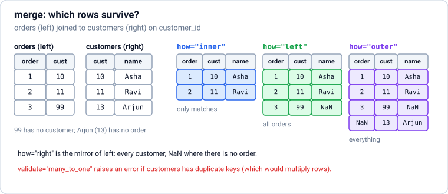

### 33.1 Joining on a key

Data is usually split across tables: orders in one, customer details in another, linked by a **key** column such as `customer_id`. `merge` combines them, like SQL's `JOIN`. Four orders and three customers; order 4 comes from customer 99, who isn't in the customer table, and customer 13 has never ordered:

```python
import pandas as pd

orders = pd.DataFrame({"order_id": [1, 2, 3, 4], "customer_id": [10, 11, 10, 99], "amount": [300, 2500, 1200, 450]})
customers = pd.DataFrame({"customer_id": [10, 11, 13], "name": ["Asha", "Ravi", "Arjun"], "city": ["Pune", "Mumbai", "Delhi"]})
for how in ["inner", "left", "outer"]:
    joined = orders.merge(customers, on="customer_id", how=how)
    print(f"--- {how}: {len(joined)} rows")
    print(joined)
```

**Output:**

```text
--- inner: 3 rows
   order_id  customer_id  amount  name    city
0         1           10     300  Asha    Pune
1         2           11    2500  Ravi  Mumbai
2         3           10    1200  Asha    Pune
--- left: 4 rows
   order_id  customer_id  amount  name    city
0         1           10     300  Asha    Pune
1         2           11    2500  Ravi  Mumbai
2         3           10    1200  Asha    Pune
3         4           99     450   NaN     NaN
--- outer: 5 rows
   order_id  customer_id  amount   name    city
0       1.0           10   300.0   Asha    Pune
1       3.0           10  1200.0   Asha    Pune
2       2.0           11  2500.0   Ravi  Mumbai
3       NaN           13     NaN  Arjun   Delhi
4       4.0           99   450.0    NaN     NaN
```

| join | keeps |
|---|---|
| `inner` | only keys found in **both** tables (order 4 and Arjun are dropped) |
| `left` | every row of the left table; unmatched right columns become NaN |
| `right` | every row of the right table |
| `outer` | every row of both |

Customer 10 has two orders, so Asha's details are repeated on both rows: one-to-many joins repeat the "one" side.

### 33.2 Finding unmatched rows

`indicator=True` adds a `_merge` column saying where each row came from. For a plain "which keys have no match?" question, `isin` (Chapter 22) is the simplest **anti-join**:

```python
m = orders.merge(customers, on="customer_id", how="outer", indicator=True)
print(m["_merge"].value_counts().to_dict())
print("orders with an unknown customer:", m.loc[m["_merge"] == "left_only", "order_id"].astype(int).tolist())
print("customers who never ordered:", customers.loc[~customers["customer_id"].isin(orders["customer_id"]), "name"].tolist())
```

**Output:**

```text
{'both': 3, 'left_only': 1, 'right_only': 1}
orders with an unknown customer: [4]
customers who never ordered: ['Arjun']
```

### 33.3 Different key names, and joining a table to itself

When the key columns have different names, use `left_on` and `right_on`. A table can be joined to **itself**, a **self-join**, for example employees to their managers, who are employees too. `suffixes` renames clashing columns:

```python
emp = pd.DataFrame({"id": [1, 2, 3, 4], "name": ["Meera", "Asha", "Ravi", "Zoya"],
                    "salary": [150, 90, 160, 70], "manager_id": [None, 1, 1, 2]})
pairs = emp.merge(emp, left_on="manager_id", right_on="id", suffixes=("", "_mgr"))
print(pairs[["name", "salary", "name_mgr", "salary_mgr"]])
print("earn more than their manager:", pairs.loc[pairs["salary"] > pairs["salary_mgr"], "name"].tolist())
```

**Output:**

```text
   name  salary name_mgr  salary_mgr
0  Asha      90    Meera         150
1  Ravi     160    Meera         150
2  Zoya      70     Asha          90
earn more than their manager: ['Ravi']
```

### 33.4 Every combination: cross join

`how="cross"` pairs every row of one table with every row of the other, for example every size with every colour:

```python
sizes = pd.DataFrame({"size": ["S", "M"]})
colours = pd.DataFrame({"colour": ["red", "blue", "green"]})
print(sizes.merge(colours, how="cross"))
```

**Output:**

```text
  size colour
0    S    red
1    S   blue
2    S  green
3    M    red
4    M   blue
5    M  green
```

### 33.5 Summary

```
left.merge(right, on="key", how="inner" | "left" | "right" | "outer" | "cross")
left_on=…, right_on=…, suffixes=("", "_r"), indicator=True (→ _merge: both / left_only / right_only)
anti-join: a[~a["key"].isin(b["key"])]
```

**Key terms:**

- **Key:** a column whose values link rows of two tables.
- **Merge (join):** combining two tables by matching key values.
- **Inner / left / right / outer join:** keep matching keys only / all left rows / all right rows / all rows.
- **Anti-join:** the rows of one table with no match in another.
- **Self-join:** joining a table to itself.
- **Cross join:** pairing every row of one table with every row of another.

### Exercises

1. Add each order's city with a left join. How many orders end up with no city?
2. Total the amount per customer name, keeping the unknown customer as its own group.

<details>
<summary><b>Answers</b></summary>

```python
with_city = orders.merge(customers[["customer_id", "city"]], on="customer_id", how="left")
print(with_city, with_city["city"].isna().sum(), sep="\n")
print(orders.merge(customers, on="customer_id", how="left").groupby("name", dropna=False)["amount"].sum())
```

**Output:**

```text
   order_id  customer_id  amount    city
0         1           10     300    Pune
1         2           11    2500  Mumbai
2         3           10    1200    Pune
3         4           99     450     NaN
1
name
Asha    1500
Ravi    2500
NaN      450
Name: amount, dtype: int64
```

1. One: order 4, whose customer isn't in the table.
2. Asha 1,500, Ravi 2,500, and 450 under a missing name (`dropna=False`).

</details>

---

## 34. Combining Tables II: concat and Merge Pitfalls

**You need:** Chapter 33. · **You'll learn:** to stack tables, the merge mistake that silently multiplies rows, how to guard against it, and "as of" joins for values that change over time.

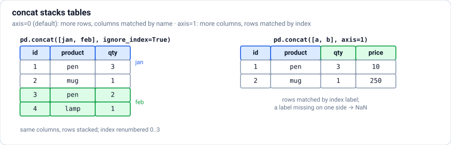

### 34.1 Stacking: concat

`pd.concat([a, b])` stacks tables with the same kind of rows, such as monthly exports, one under the other. Columns are matched by name; a column missing from one table is filled with NaN. `ignore_index=True` renumbers the rows; `keys` labels where each part came from:

```python
import pandas as pd

jan = pd.DataFrame({"order_id": [1, 2], "product": ["pen", "mug"], "qty": [3, 1]})
feb = pd.DataFrame({"order_id": [3, 4], "product": ["pen", "lamp"], "qty": [2, 1], "coupon": ["NEW10", None]})
print(pd.concat([jan, feb], ignore_index=True))
print(pd.concat([jan, feb], keys=["jan", "feb"]).loc["feb", ["order_id", "product"]])
```

**Output:**

```text
   order_id product  qty coupon
0         1     pen    3    NaN
1         2     mug    1    NaN
2         3     pen    2  NEW10
3         4    lamp    1    NaN
   order_id product
0         3     pen
1         4    lamp
```

`axis=1` puts tables side by side instead, matching rows by index; for anything but identically indexed tables, `merge` is clearer.

### 34.2 The silent row explosion

Merging on a key that's **not unique in either table** pairs every matching row with every other. Here the price table has two prices for "pen" (an old and a new one), so each pen order matches both:

```python
orders = pd.DataFrame({"order_id": [1, 2, 3], "product": ["pen", "pen", "pen"], "qty": [3, 2, 5]})
prices = pd.DataFrame({"product": ["pen", "pen"], "price": [10, 12], "valid_from": ["2025-01-01", "2025-03-01"]})
bad = orders.merge(prices, on="product")
print(len(orders), "orders became", len(bad), "rows; revenue", (bad["qty"] * bad["price"]).sum())
```

**Output:**

```text
3 orders became 6 rows; revenue 220
```

Revenue is counted twice, with no error. Two guards:

- check the key is unique where it should be: `prices["product"].is_unique`;
- tell `merge` what you expect with `validate`: `"one_to_one"`, `"one_to_many"` or `"many_to_one"`. It raises an error if the data disagrees:

```python
try:
    orders.merge(prices, on="product", validate="many_to_one")
except pd.errors.MergeError as e:
    print("MergeError:", str(e).splitlines()[0])
```

**Output:**

```text
MergeError: Merge keys are not unique in right dataset; not a many-to-one merge
```

Also compare row counts before and after every merge: a left join that should be many-to-one must keep exactly the left table's row count.

### 34.3 "As of" joins

The price table above is really a history: each price is valid **from** a date. Each order needs the price valid **at its time**: the latest one at or before it. `pd.merge_asof` does exactly that, on tables sorted by time, with `by` for an exact-match key. Converting order amounts with the exchange rate in force on each order's date:

```python
orders = pd.DataFrame({"time": pd.to_datetime(["2025-01-10", "2025-02-15", "2025-03-05"]),
                       "currency": ["USD", "USD", "EUR"], "amount": [100, 100, 100]})
rates = pd.DataFrame({"time": pd.to_datetime(["2025-01-01", "2025-02-01", "2025-03-01", "2025-01-01"]),
                      "currency": ["USD", "USD", "USD", "EUR"], "inr": [83.0, 84.5, 86.0, 90.0]})
fx = pd.merge_asof(orders.sort_values("time"), rates.sort_values("time"), on="time", by="currency")
fx["amount_inr"] = fx["amount"] * fx["inr"]
print(fx)
```

**Output:**

```text
        time currency  amount   inr  amount_inr
0 2025-01-10      USD     100  83.0      8300.0
1 2025-02-15      USD     100  84.5      8450.0
2 2025-03-05      EUR     100  90.0      9000.0
```

The 15 February USD order gets the 1 February rate (84.5), and the EUR order the only EUR rate. Joining "as of" a time also prevents **leakage** in machine learning: a feature must only use information available at the moment of prediction (`machine-learning.md` Chapter 25).

### 34.4 Summary

```
pd.concat([a, b], ignore_index=True, keys=[…]) (rows);  axis=1 (side by side, by index)
duplicate keys multiply rows → check s.is_unique;  merge(…, validate="many_to_one");  compare row counts
pd.merge_asof(left.sort_values(t), right.sort_values(t), on=t, by=key)   (latest right row at or before each left time)
```

**Key terms:**

- **`concat`:** stacking tables vertically (or side by side).
- **Many-to-many join:** a merge where the key repeats on both sides, multiplying rows.
- **`validate`:** a merge option that checks the expected relationship (one-to-one, many-to-one…).
- **As-of join (`merge_asof`):** matching each row with the most recent row of another table at or before its time.
- **Leakage:** using information that wouldn't be available at the time a prediction is made.

### Exercises

1. A customer table should have one row per `customer_id`. Write one line that shows the offending rows if it doesn't.
2. Why does a many-to-many merge give 6 rows for 3 orders and 2 prices of the same product?

<details>
<summary><b>Answers</b></summary>

```python
customers = pd.DataFrame({"customer_id": [1, 2, 2, 3], "name": ["A", "B", "B (old)", "C"]})
print(customers[customers["customer_id"].duplicated(keep=False)])
```

**Output:**

```text
   customer_id     name
1            2        B
2            2  B (old)
```

1. `duplicated(keep=False)` marks every copy of a repeated id.
2. Every order row matches both price rows: 3 × 2 = 6.

</details>

---

## 35. Reshaping: pivot_table, melt, crosstab and explode

**You need:** Chapters 4.3 and 31. · **You'll learn:** to turn long data into wide summary tables and back, count combinations of two categories, and split list-like cells into rows.

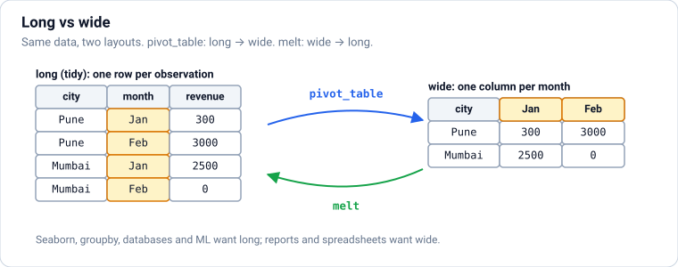

### 35.1 Long to wide: pivot_table

Tidy data is **long** (Chapter 4.3): one row per observation. Reports are often **wide**: one row per city, one column per month. `pivot_table` makes the wide version: `index` becomes the rows, `columns` the columns, and `values` is aggregated with `aggfunc` wherever several rows land in one cell:

```python
import pandas as pd

orders = pd.read_csv("data/orders.csv", parse_dates=["date"])
orders["revenue"] = orders["qty"] * orders["price"]
orders["month"] = orders["date"].dt.month
wide = orders.pivot_table(index="city", columns="month", values="revenue", aggfunc="sum", fill_value=0, margins=True)
print(wide)
```

**Output:**

```text
month         1     2     3     4     5    All
city                                          
Bengaluru     0     0   900     0     0    900
Delhi         0     0     0  1000     0   1000
Mumbai     2500     0   700   600  1800   5600
Pune        300  3000  2500     0     0   5800
All        2800  3000  4100  1600  1800  13300
```

`fill_value=0` fills combinations with no orders; `margins=True` adds an "All" row and column of totals. A pivot table is a `groupby` on two keys, laid out as a grid.

When each (row, column) pair occurs exactly once, `pivot` reshapes without aggregating, and raises an error if there are duplicates:

```python
metrics = pd.DataFrame({"id": [1, 1, 2, 2], "metric": ["height", "weight", "height", "weight"], "value": [170, 65, 182, 80]})
print(metrics.pivot(index="id", columns="metric", values="value"))
```

**Output:**

```text
metric  height  weight
id                    
1          170      65
2          182      80
```

### 35.2 Wide to long: melt

`melt` does the reverse: it turns columns into rows. `id_vars` stay as they are; the other column names go into a `var_name` column and their values into a `value_name` column:

```python
report = pd.DataFrame({"city": ["Pune", "Mumbai"], "jan": [300, 2500], "feb": [3000, 0], "mar": [2500, 700]})
long = report.melt(id_vars="city", var_name="month", value_name="revenue")
print(long)
print(long.groupby("month", sort=False)["revenue"].sum().to_dict())
```

**Output:**

```text
     city month  revenue
0    Pune   jan      300
1  Mumbai   jan     2500
2    Pune   feb     3000
3  Mumbai   feb        0
4    Pune   mar     2500
5  Mumbai   mar      700
{'jan': 2800, 'feb': 3000, 'mar': 3200}
```

Once long, "total per month" is one groupby. (`sort=False` keeps the months in their original order rather than alphabetical.)

### 35.3 Counting combinations: crosstab

`pd.crosstab(a, b)` counts how often each pair of categories occurs. `normalize="index"` turns each row into proportions:

```python
print(pd.crosstab(orders["city"], orders["category"]))
print(pd.crosstab(orders["city"], orders["category"], normalize="index").round(2))
```

**Output:**

```text
category   bags  electronics  kitchen  stationery
city                                             
Bengaluru     0            1        0           0
Delhi         0            0        1           0
Mumbai        0            2        1           1
Pune          1            2        0           1
category   bags  electronics  kitchen  stationery
city                                             
Bengaluru  0.00          1.0     0.00        0.00
Delhi      0.00          0.0     1.00        0.00
Mumbai     0.00          0.5     0.25        0.25
Pune       0.25          0.5     0.00        0.25
```

Half of Pune's orders are electronics. Chapter 57 tests whether such differences between cities are more than chance.

### 35.4 Lists in cells: explode

A cell holding several values ("python,pandas") breaks tidiness. Split it into a list with `.str.split`, then `explode` gives each list element its own row, copying the rest of the row:

```python
posts = pd.DataFrame({"post": [1, 2, 3], "tags": ["python,pandas", "sql", "python,ml,pandas"]})
tags = posts.assign(tag=posts["tags"].str.split(",")).explode("tag")
print(tags[["post", "tag"]])
print(tags["tag"].value_counts().to_dict())
```

**Output:**

```text
   post     tag
0     1  python
0     1  pandas
1     2     sql
2     3  python
2     3      ml
2     3  pandas
{'python': 2, 'pandas': 2, 'sql': 1, 'ml': 1}
```

### 35.5 Summary

```
long → wide: df.pivot_table(index=…, columns=…, values=…, aggfunc="sum", fill_value=0, margins=True);  df.pivot(…) (no duplicates)
wide → long: df.melt(id_vars=…, var_name=…, value_name=…)
pd.crosstab(a, b, normalize="index");  df.assign(x=s.str.split(",")).explode("x")
```

**Key terms:**

- **Pivot table:** a summary table with one category along the rows, another along the columns, and an aggregate in each cell.
- **`melt`:** reshapes wide data to long by turning columns into rows.
- **Cross-tabulation (`crosstab`):** a table of counts for each combination of two categorical variables.
- **`explode`:** gives each element of a list-valued cell its own row.

### Exercises

1. Make a table of total quantity per category (rows) and month (columns).
2. Melt `{"student": ["A", "B"], "maths": [80, 70], "art": [90, 60]}` to long form and compute each subject's average.

<details>
<summary><b>Answers</b></summary>

```python
print(orders.pivot_table(index="category", columns="month", values="qty", aggfunc="sum", fill_value=0))
marks = pd.DataFrame({"student": ["A", "B"], "maths": [80, 70], "art": [90, 60]}).melt(id_vars="student", var_name="subject", value_name="mark")
print(marks, marks.groupby("subject")["mark"].mean().to_dict(), sep="\n")
```

**Output:**

```text
month        1  2  3   4  5
category                   
bags         0  1  0   0  0
electronics  1  1  2   0  1
kitchen      0  0  2   4  0
stationery   5  0  0  10  0
  student subject  mark
0       A   maths    80
1       B   maths    70
2       A     art    90
3       B     art    60
{'art': 75.0, 'maths': 75.0}
```

1. Stationery peaks in April, with Ravi's 10 notebooks.
2. Maths averages 75, art 75.

</details>

---

## 36. MultiIndex, stack and unstack

**You need:** Chapters 31 and 35. · **You'll learn:** to read and select from the multi-level index that grouping by several keys produces, and to move levels between rows and columns.

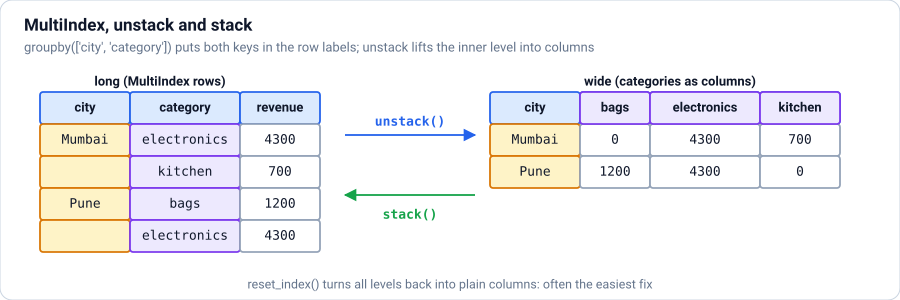

### 36.1 A two-level index

Grouping by two keys gives a Series whose index has two **levels**, city and category. That's a **MultiIndex**: each row is labelled by a pair:

```python
import pandas as pd

orders = pd.read_csv("data/orders.csv")
orders["revenue"] = orders["qty"] * orders["price"]
s = orders.groupby(["city", "category"])["revenue"].sum()
print(s)
print(s.index.nlevels, s.index.names)
```

**Output:**

```text
city       category   
Bengaluru  electronics     900
Delhi      kitchen        1000
Mumbai     electronics    4300
           kitchen         700
           stationery      600
Pune       bags           1200
           electronics    4300
           stationery      300
Name: revenue, dtype: int64
2 ['city', 'category']
```

### 36.2 Selecting

`loc` with the outer label gives everything under it; a tuple selects one exact pair; `xs` selects by an inner level:

```python
print(s.loc["Pune"].to_dict())
print(s.loc[("Mumbai", "kitchen")])
print(s.xs("electronics", level="category").to_dict())
```

**Output:**

```text
{'bags': 1200, 'electronics': 4300, 'stationery': 300}
700
{'Bengaluru': 900, 'Mumbai': 4300, 'Pune': 4300}
```

### 36.3 unstack and stack

`unstack()` moves the inner index level into the columns, giving a wide table; `stack()` moves it back. Name the level to choose which one moves:

```python
wide = s.unstack(fill_value=0)                  # category → columns
print(wide)
print(s.unstack("city", fill_value=0))           # city → columns instead
print(wide.stack().head(3))
```

**Output:**

```text
category   bags  electronics  kitchen  stationery
city                                             
Bengaluru     0          900        0           0
Delhi         0            0     1000           0
Mumbai        0         4300      700         600
Pune       1200         4300        0         300
city         Bengaluru  Delhi  Mumbai  Pune
category                                   
bags                 0      0       0  1200
electronics        900      0    4300  4300
kitchen              0   1000     700     0
stationery           0      0     600   300
city       category   
Bengaluru  bags             0
           electronics    900
           kitchen          0
dtype: int64
```

`s.unstack()` after a two-key groupby is the same table as `pivot_table` (Chapter 35.1).

### 36.4 Aggregating a level, and flattening column names

`groupby(level=…)` aggregates over one level. And `agg` with several functions per column creates two-level **column** names, which are easier to work with flattened into single strings:

```python
print(s.groupby(level="city").sum().to_dict())

stats = orders.groupby("city").agg({"revenue": ["sum", "mean"], "qty": ["sum"]})
print(stats.columns.tolist())
stats.columns = ["_".join(col) for col in stats.columns]
print(stats.reset_index())
```

**Output:**

```text
{'Bengaluru': 900, 'Delhi': 1000, 'Mumbai': 5600, 'Pune': 5800}
[('revenue', 'sum'), ('revenue', 'mean'), ('qty', 'sum')]
        city  revenue_sum  revenue_mean  qty_sum
0  Bengaluru          900         900.0        1
1      Delhi         1000        1000.0        4
2     Mumbai         5600        1400.0       14
3       Pune         5800        1450.0        8
```

Named aggregation (Chapter 31.4) avoids two-level columns in the first place.

### 36.5 Summary

```
df.groupby([a, b])[col].sum() → MultiIndex;  s.loc["a"], s.loc[("a", "b")], s.xs("b", level="name")
s.unstack(level, fill_value=0) (rows → columns);  df.stack() (columns → rows);  s.groupby(level="name").sum()
flatten columns: df.columns = ["_".join(c) for c in df.columns]
```

**Key terms:**

- **MultiIndex:** an index with several levels, labelling each row by a tuple.
- **Level:** one layer of a MultiIndex, such as city or category.
- **`unstack` / `stack`:** move an index level into the columns / a column level into the index.
- **`xs` (cross-section):** selects rows by the value of one index level.

### Exercises

1. From `s`, get Mumbai's revenue per category, and the total revenue per category across all cities.
2. Make a customer × category table of total quantity.

<details>
<summary><b>Answers</b></summary>

```python
print(s.loc["Mumbai"].to_dict(), s.groupby(level="category").sum().to_dict())
print(orders.groupby(["customer", "category"])["qty"].sum().unstack(fill_value=0))
```

**Output:**

```text
{'electronics': 4300, 'kitchen': 700, 'stationery': 600} {'bags': 1200, 'electronics': 9500, 'kitchen': 1700, 'stationery': 900}
category  bags  electronics  kitchen  stationery
customer                                        
Asha         1            1        0           5
Isha         0            0        4           0
Kabir        0            1        0           0
Meera        0            1        0           0
Ravi         0            1        0          10
Zoya         0            1        2           0
```

1. `loc` on the outer level, and `groupby(level=…)` on the inner one.
2. Group by both, sum, and unstack the categories into columns.

</details>

---

## 37. Dates and Times

**You need:** Chapters 24.2 and 27.3. · **You'll learn:** timestamps, durations, calendar offsets, periods and time zones, the parts of date handling that most often go wrong.

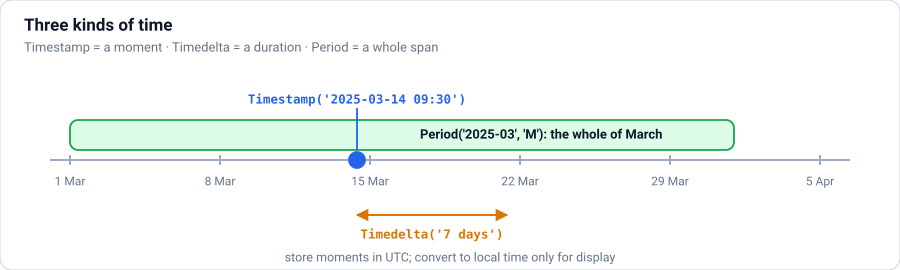

### 37.1 Timestamps and their parts

A **timestamp** is a point in time. `pd.to_datetime` creates them (Chapter 27.3), and the `.dt` accessor (Chapter 24.2) gives their parts and formats them:

```python
import pandas as pd

ts = pd.Series(pd.to_datetime(["2025-03-14 09:30", "2025-01-31 23:15", "2025-12-25 18:00"]))
print(pd.DataFrame({"ts": ts, "year": ts.dt.year, "weekday": ts.dt.day_name(), "quarter": ts.dt.quarter,
                    "hour_floor": ts.dt.floor("h"), "label": ts.dt.strftime("%d %b %Y")}))
```

**Output:**

```text
                   ts  year   weekday  quarter          hour_floor        label
0 2025-03-14 09:30:00  2025    Friday        1 2025-03-14 09:00:00  14 Mar 2025
1 2025-01-31 23:15:00  2025    Friday        1 2025-01-31 23:00:00  31 Jan 2025
2 2025-12-25 18:00:00  2025  Thursday        4 2025-12-25 18:00:00  25 Dec 2025
```

`floor("h")` rounds down to the hour; `strftime` formats with codes such as `%d` (day), `%b` (short month name), `%Y` (year).

Dates stored as **text** compare character by character, which is wrong whenever the format isn't zero-padded year-month-day:

```python
print("2025-10-01" < "2025-9-30", pd.Timestamp("2025-10-01") < pd.Timestamp("2025-09-30"))
```

**Output:**

```text
True False
```

As text, "1" < "9" makes October come first. Convert to timestamps before comparing or sorting.

### 37.2 Durations and calendar offsets

Subtracting timestamps gives a **timedelta**, a duration. Adding a fixed duration and adding a calendar step are different things:

```python
placed = pd.Series(pd.to_datetime(["2025-03-01 10:00", "2025-03-03 16:30"]))
delivered = pd.Series(pd.to_datetime(["2025-03-04 09:00", "2025-03-03 20:00"]))
took = delivered - placed
print(took.tolist(), (took.dt.total_seconds() / 3600).round(1).tolist())

start = pd.Timestamp("2025-01-31")
print(start + pd.Timedelta(days=30))               # exactly 30 days
print(start + pd.DateOffset(months=1))             # "one month later": clipped to 28 Feb
print(start + pd.offsets.MonthEnd(1))              # the next month-end
print(pd.Timestamp("2025-03-14") + pd.offsets.BDay(3))   # a Friday + 3 business days
```

**Output:**

```text
[Timedelta('2 days 23:00:00'), Timedelta('0 days 03:30:00')] [71.0, 3.5]
2025-03-02 00:00:00
2025-02-28 00:00:00
2025-02-28 00:00:00
2025-03-19 00:00:00
```

Months have different lengths, so "one month after 31 January" has no exact answer; `DateOffset` picks the last valid day. `BDay` skips weekends. `pd.date_range` makes a regular sequence, such as month starts (`freq="MS"`):

```python
print(pd.date_range("2025-01-01", periods=4, freq="MS").strftime("%Y-%m-%d").tolist())
```

**Output:**

```text
['2025-01-01', '2025-02-01', '2025-03-01', '2025-04-01']
```

### 37.3 Periods

A **period** is a whole span: a day, a month, a quarter. It's the natural key for "per month" reporting:

```python
march = pd.Period("2025-03", freq="M")
print(march.start_time, march.end_time.floor("s"), march.days_in_month)
print(ts.dt.to_period("M").tolist())
```

**Output:**

```text
2025-03-01 00:00:00 2025-03-31 23:59:59 31
[Period('2025-03', 'M'), Period('2025-01', 'M'), Period('2025-12', 'M')]
```

### 37.4 Time zones

Times without a zone are **naive**: "09:30", but where? Store and compute in **UTC** (Coordinated Universal Time), and convert to local time only for display. `tz_localize` attaches a zone to naive times; `tz_convert` changes zones:

```python
local = pd.Series(pd.to_datetime(["2025-03-14 09:30", "2025-03-14 23:45"])).dt.tz_localize("Asia/Kolkata")
print(pd.DataFrame({"india": local, "utc": local.dt.tz_convert("UTC"), "new_york": local.dt.tz_convert("America/New_York")}))

same = pd.to_datetime(["2025-03-14T09:30:00+05:30", "2025-03-14T04:00:00Z"], utc=True)
print(same[0] == same[1])
```

**Output:**

```text
                      india                       utc                  new_york
0 2025-03-14 09:30:00+05:30 2025-03-14 04:00:00+00:00 2025-03-14 00:00:00-04:00
1 2025-03-14 23:45:00+05:30 2025-03-14 18:15:00+00:00 2025-03-14 14:15:00-04:00
True
```

India is UTC+5:30, so 09:30 there is 04:00 UTC: the same moment written two ways (`Z` means UTC). Zone names such as "America/New_York" also handle daylight-saving changes, which fixed offsets can't.

### 37.5 Summary

```
pd.to_datetime(s);  s.dt.year / .month / .day_name() / .quarter / .floor("h") / .strftime("%d %b %Y") / .to_period("M")
t2 − t1 → Timedelta (.dt.total_seconds(), .dt.days);  + pd.Timedelta(days=n) vs + pd.DateOffset(months=n), offsets.MonthEnd, offsets.BDay
pd.date_range(start, periods, freq="D" | "W" | "MS");  pd.Period("2025-03", freq="M")
store UTC: dt.tz_localize(zone) for naive times, dt.tz_convert(zone) to display
```

**Key terms:**

- **Timestamp:** a single point in time.
- **Timedelta:** a duration, the difference between two timestamps.
- **Date offset:** a calendar-aware step, such as "one month" or "one business day".
- **Period:** a whole span of time, such as a month.
- **Time zone:** a region's offset from UTC, including its daylight-saving rules.
- **UTC:** Coordinated Universal Time, the standard reference time.
- **Naive / aware timestamp:** without / with a time zone attached.

### Exercises

1. For 5 January, 10 February and 15 March 2025, give the day of the week and the number of days left in the month.
2. A click at 08:00 on 1 July 2025 in London: what time was it in UTC and in India?

<details>
<summary><b>Answers</b></summary>

```python
d = pd.Series(pd.to_datetime(["2025-01-05", "2025-02-10", "2025-03-15"]))
print(d.dt.day_name().tolist(), ((d + pd.offsets.MonthEnd(0)) - d).dt.days.tolist())
click = pd.Timestamp("2025-07-01 08:00", tz="Europe/London")
print(click.tz_convert("UTC"), click.tz_convert("Asia/Kolkata"))
```

**Output:**

```text
['Sunday', 'Monday', 'Saturday'] [26, 18, 16]
2025-07-01 07:00:00+00:00 2025-07-01 12:30:00+05:30
```

1. Sunday, Monday and Saturday, with 26, 18 and 16 days left. `MonthEnd(0)` rolls forward to the month's end, or stays if already there.
2. 07:00 UTC (London is on summer time, UTC+1) and 12:30 in India.

</details>

---

## 38. Time Series: resample, rolling and Window Functions

**You need:** Chapters 15, 32.3 and 37. · **You'll learn:** to change the frequency of a time series, smooth it with rolling windows, and compare each value with earlier ones.

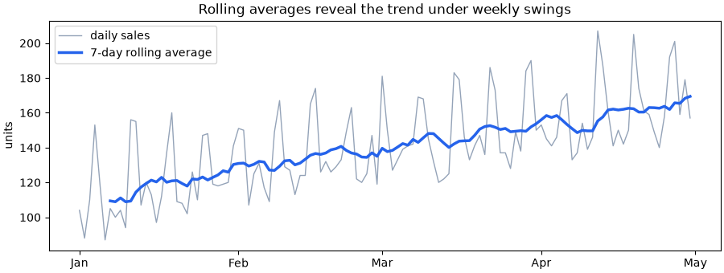

### 38.1 A daily series

A **time series** is a sequence of values indexed by time. Four months of daily unit sales, simulated with a slow upward trend, a weekend boost and random noise:

```python
import numpy as np
import pandas as pd

rng = np.random.default_rng(42)
days = pd.date_range("2025-01-01", "2025-04-30", freq="D")
trend = np.linspace(100, 160, len(days))                     # slow growth
weekend = np.where(days.day_of_week >= 5, 40, 0)             # weekends sell more
sales = pd.Series((trend + weekend + rng.normal(0, 12, len(days))).round(), index=days, name="sales")
print(sales.head(8))
```

**Output:**

```text
2025-01-01    104.0
2025-01-02     88.0
2025-01-03    110.0
2025-01-04    153.0
2025-01-05    119.0
2025-01-06     87.0
2025-01-07    105.0
2025-01-08    100.0
Freq: D, Name: sales, dtype: float64
```

### 38.2 Changing frequency: resample

`resample(rule)` is a groupby on time periods: `"W"` weekly, `"MS"` monthly (labelled by month start), `"QS"` quarterly. Follow it with an aggregation:

```python
print(sales.resample("MS").sum())
print(sales.resample("W").mean().head(3).round(1))
```

**Output:**

```text
2025-01-01    3688.0
2025-02-01    3753.0
2025-03-01    4631.0
2025-04-01    4804.0
Freq: MS, Name: sales, dtype: float64
2025-01-05    114.8
2025-01-12    114.4
2025-01-19    120.9
Freq: W-SUN, Name: sales, dtype: float64
```

### 38.3 Rolling windows

`rolling(n)` computes a statistic over each moving window of n rows: each value's 7-day rolling mean averages it with the 6 days before. It smooths out noise and the weekly cycle, revealing the trend (the chart at the top). The first n − 1 values have no full window, so they're NaN:

```python
df = sales.to_frame()
df["ma7"] = sales.rolling(7).mean().round(1)
print(df.iloc[4:9])
```

**Output:**

```text
            sales    ma7
2025-01-05  119.0    NaN
2025-01-06   87.0    NaN
2025-01-07  105.0  109.4
2025-01-08  100.0  108.9
2025-01-09  104.0  111.1
```

With a date index, a window can be a **time span** instead: `rolling("3D")` uses the rows within the last 3 days, which matters when days are missing:

```python
gappy = pd.Series([10, 20, 30, 40], index=pd.to_datetime(["2025-01-01", "2025-01-02", "2025-01-08", "2025-01-09"]))
print(pd.DataFrame({"value": gappy, "last_3_rows": gappy.rolling(3).sum(), "last_3_days": gappy.rolling("3D").sum()}))
```

**Output:**

```text
            value  last_3_rows  last_3_days
2025-01-01     10          NaN         10.0
2025-01-02     20          NaN         30.0
2025-01-08     30         60.0         30.0
2025-01-09     40         90.0         70.0
```

On 8 January, "the last 3 rows" reaches back to 1 January; "the last 3 days" correctly holds only the 8th.

### 38.4 Comparing with the past: shift, diff and pct_change

`shift(k)` gives each row the value from k rows earlier (Chapter 32.3); `diff()` is the change from the previous row; `pct_change()` the percentage change. Comparing with 7 days earlier removes the weekly pattern:

```python
df["prev_day"] = sales.shift(1)
df["change"] = sales.diff()
df["same_day_last_week"] = sales.shift(7)
df["running_total"] = sales.cumsum()
print(df.iloc[7:11])

monthly = sales.resample("MS").sum()
print(pd.DataFrame({"total": monthly, "growth_pct": (monthly.pct_change() * 100).round(1)}))
```

**Output:**

```text
            sales    ma7  prev_day  change  same_day_last_week  running_total
2025-01-08  100.0  108.9     105.0    -5.0               104.0          866.0
2025-01-09  104.0  111.1     100.0     4.0                88.0          970.0
2025-01-10   94.0  108.9     104.0   -10.0               110.0         1064.0
2025-01-11  156.0  109.3      94.0    62.0               153.0         1220.0
             total  growth_pct
2025-01-01  3688.0         NaN
2025-02-01  3753.0         1.8
2025-03-01  4631.0        23.4
2025-04-01  4804.0         3.7
```

### 38.5 Summary

```
s.resample("D" | "W" | "MS" | "QS").sum() / .mean()           (a groupby on time)
s.rolling(7).mean() (row windows);  s.rolling("7D") (time windows)
s.shift(k), s.diff(), s.pct_change(), s.cumsum();  week-over-week: s.shift(7)
```

**Key terms:**

- **Time series:** values recorded in time order, indexed by time.
- **Resampling:** changing a time series' frequency by grouping into periods (or filling between them).
- **Rolling window (moving average):** a statistic computed over a window that slides along the series.
- **Trend / seasonality:** the slow long-run movement / a pattern that repeats on a fixed cycle, such as weekly.
- **Lag:** a value from an earlier time step, made with `shift`.
- **Percentage change:** (new − old)/old × 100.

### Exercises

1. Which week had the highest total sales, and which the lowest?
2. Flag days whose sales are more than 20% above their 7-day rolling average. How many are there?

<details>
<summary><b>Answers</b></summary>

```python
weekly_total = sales.resample("W").sum()
print(weekly_total.idxmax().date(), weekly_total.max(), weekly_total.idxmin().date(), weekly_total.min())
spike = sales > 1.2 * sales.rolling(7).mean()
print(spike.sum(), sales[spike].index[:3].strftime("%Y-%m-%d").tolist())
```

**Output:**

```text
2025-04-27 1160.0 2025-05-04 495.0
16 ['2025-01-11', '2025-01-12', '2025-01-19']
```

1. A late-April week is highest, as the trend predicts. The lowest is the last "week", ending Sunday 4 May, which holds only 3 days of data (28–30 April): partial periods at the edges distort comparisons.
2. Mostly weekend days: the rolling average is a weekly average, and weekends sit well above it.

</details>

<details>
<summary><b>Code for the chart at the top</b></summary>

```python
import matplotlib.pyplot as plt
import matplotlib.dates as mdates

fig, ax = plt.subplots(figsize=(9, 3.4), layout="constrained")
ax.plot(sales.index, sales, color="#94a3b8", linewidth=1, label="daily sales")
ax.plot(df.index, df["ma7"], color="#2563eb", linewidth=2.5, label="7-day rolling average")
ax.set(ylabel="units")
ax.xaxis.set_major_locator(mdates.MonthLocator())
ax.xaxis.set_major_formatter(mdates.DateFormatter("%b"))
ax.legend(loc="upper left")
fig.savefig("rolling-average.png", dpi=100)
plt.close(fig)
```

</details>

---

# Part VI — Bigger and Faster Data

Four chapters for when data gets large: measuring and speeding up code, shrinking memory, and two newer engines, Polars and DuckDB, that handle data far bigger than pandas comfortably can.

---

## 39. Performance: Vectorise, Avoid Loops and Measure

**You need:** Chapters 6, 22 and 24. · **You'll learn:** to time code properly, the speed ladder from Python loops to vectorised operations, and the three most common slow patterns.

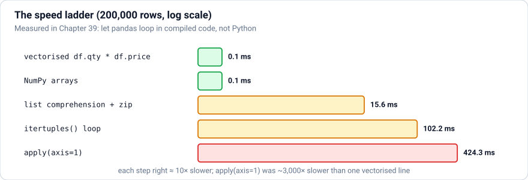

### 39.1 Measure first

Never guess what's slow; time it. Run each version a few times and keep the best time, since the first run often pays one-off costs:

```python
import time
import numpy as np
import pandas as pd

rng = np.random.default_rng(0)
n = 200_000
df = pd.DataFrame({"qty": rng.integers(1, 10, n), "price": rng.uniform(10, 3000, n).round(2)})

def timed(label, func, repeat=3):
    times = []
    for _ in range(repeat):
        start = time.perf_counter()
        func()
        times.append(time.perf_counter() - start)
    print(f"{label:28s} {min(times) * 1000:9.1f} ms")
    return min(times)
```

In a notebook, `%timeit expression` does the same in one line.

### 39.2 The speed ladder

Five ways to compute qty × price for 200,000 rows:

```python
base = timed("vectorised qty * price", lambda: df["qty"] * df["price"])
timed("NumPy arrays", lambda: df["qty"].to_numpy() * df["price"].to_numpy())
timed("list comprehension + zip", lambda: [q * p for q, p in zip(df["qty"], df["price"])])
timed("itertuples loop", lambda: [r.qty * r.price for r in df.itertuples()])
slow = timed("apply(axis=1)", lambda: df.apply(lambda r: r["qty"] * r["price"], axis=1), repeat=1)
print(f"apply(axis=1) was about {slow / base:,.0f}× slower than the vectorised line")
```

**Output:**

```text
vectorised qty * price             0.1 ms
NumPy arrays                       0.1 ms
list comprehension + zip          15.6 ms
itertuples loop                   41.2 ms
apply(axis=1)                    463.0 ms
apply(axis=1) was about 3,559× slower than the vectorised line
```

`itertuples` loops over rows as lightweight tuples; it's the least slow way to loop when you must. The order is always the same: vectorised operations first, Python loops last.

### 39.3 Slow pattern 1: searching a list

`x in some_list` checks items one by one. A **set** uses hashing and answers in constant time; `isin` does the whole column at once:

```python
vip_list = list(rng.integers(0, 1_000_000, 5_000))
ids = pd.Series(rng.integers(0, 1_000_000, 20_000))
start = time.perf_counter(); slow_result = [i in vip_list for i in ids]; t_list = time.perf_counter() - start
vip_set = set(vip_list)
start = time.perf_counter(); fast_result = [i in vip_set for i in ids]; t_set = time.perf_counter() - start
start = time.perf_counter(); vec_result = ids.isin(vip_list); t_isin = time.perf_counter() - start
print(f"list {t_list:.3f}s · set {t_set:.4f}s · isin {t_isin:.4f}s · same: {slow_result == fast_result == vec_result.tolist()}")
```

**Output:**

```text
list 1.838s · set 0.0009s · isin 0.0007s · same: True
```

### 39.4 Slow pattern 2: growing a table row by row

Each `concat` copies the whole table, so adding rows one at a time does quadratic work. Collect the rows in a list and build the table once:

```python
rows = [{"a": i, "b": i * 2} for i in range(5_000)]
start = time.perf_counter()
grown = pd.DataFrame([rows[0]])
for r in rows[1:1_000]:                                     # only 1,000: the slow way is really slow
    grown = pd.concat([grown, pd.DataFrame([r])], ignore_index=True)
t_grow = time.perf_counter() - start
start = time.perf_counter()
once = pd.DataFrame(rows)
t_once = time.perf_counter() - start
print(f"concat in a loop (1,000 rows): {t_grow:.2f}s · build once (5,000 rows): {t_once:.4f}s")
```

**Output:**

```text
concat in a loop (1,000 rows): 0.07s · build once (5,000 rows): 0.0011s
```

### 39.5 Slow pattern 3: a loop that seems to need the previous step

Some calculations look inherently sequential, such as the worst fall from a previous peak in a price series (**maximum drawdown**). A running maximum, `np.maximum.accumulate`, vectorises it:

```python
prices = rng.uniform(90, 110, 1_000_000)

def max_drawdown_loop(p):
    peak, worst = p[0], 0.0
    for x in p:
        peak = max(peak, x)
        worst = min(worst, (x - peak) / peak)
    return worst

start = time.perf_counter(); a = max_drawdown_loop(prices); t_loop = time.perf_counter() - start
start = time.perf_counter()
peak = np.maximum.accumulate(prices)                        # running maximum
b = ((prices - peak) / peak).min()
t_vec = time.perf_counter() - start
print(f"loop {t_loop:.3f}s · NumPy {t_vec:.4f}s · equal: {np.isclose(a, b)}")
```

**Output:**

```text
loop 0.091s · NumPy 0.0040s · equal: True
```

When no vectorised form exists, the **Numba** library compiles a plain Python loop over NumPy arrays to machine code with one decorator, `@njit`.

### 39.6 Summary

```
measure: best of several runs (time.perf_counter, %timeit);  never guess
ladder: built-in vectorised ≈ NumPy ≫ comprehension > itertuples ≫ apply(axis=1)
x in list → set or isin;  build tables once from a list of rows;  running max/sum: np.maximum.accumulate, cumsum
```

**Key terms:**

- **Profiling:** measuring where code spends its time.
- **`itertuples`:** loops over a DataFrame's rows as named tuples; the fastest explicit row loop.
- **Hashing (sets):** storing values so that membership is checked in constant time.
- **Quadratic time:** work that grows with the square of the input size, as when copying a growing table on every step.
- **Maximum drawdown:** the largest fall from a running peak, as a fraction of the peak.
- **Numba:** a library that compiles Python loops over NumPy arrays to fast machine code.

### Exercises

1. Label each row "big" if qty × price exceeds 5,000 and "small" otherwise, without a loop.
2. Why is `pd.concat` inside a loop quadratic?

<details>
<summary><b>Answers</b></summary>

```python
labels = np.where(df["qty"] * df["price"] > 5000, "big", "small")
print(pd.Series(labels).value_counts().to_dict())
```

**Output:**

```text
{'big': 110303, 'small': 89697}
```

1. `np.where` on the vectorised product (Chapter 10.4).
2. Each step copies all the rows so far: 1 + 2 + … + n ≈ n²/2 row copies.

</details>

---

## 40. Memory: dtypes, Categories, Chunking and Arrow

**You need:** Chapters 8, 19, 29 and 31. · **You'll learn:** to measure and shrink a table's memory, process files too big for memory in chunks, and use Arrow-backed types and Parquet filters.

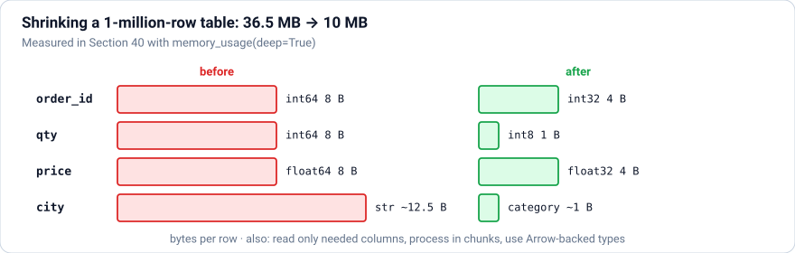

### 40.1 Measure

A million orders:

```python
import os, tempfile
import numpy as np
import pandas as pd

rng = np.random.default_rng(1)
n = 1_000_000
df = pd.DataFrame({"order_id": np.arange(n), "qty": rng.integers(1, 20, n),
                   "price": rng.uniform(10, 3000, n).round(2), "city": rng.choice(["Pune", "Mumbai", "Delhi", "Goa"], n)})

def mb(frame):
    return round(frame.memory_usage(deep=True).sum() / 1e6, 1)

print("default:", mb(df), "MB")
print(df.memory_usage(deep=True).div(1e6).round(1).to_dict())
```

**Output:**

```text
default: 36.5 MB
{'Index': 0.0, 'order_id': 8.0, 'qty': 8.0, 'price': 8.0, 'city': 12.5}
```

### 40.2 Shrink the types

- **Integers:** `pd.to_numeric(s, downcast="integer")` picks the smallest integer type that fits every value (Chapter 8.2): quantities 1–19 fit in `int8`, one byte instead of eight.
- **Floats:** `float32` halves the memory and keeps about 7 significant digits, plenty for prices.
- **Repeated text:** the category dtype (Chapter 29.1).

```python
small = df.assign(order_id=pd.to_numeric(df["order_id"], downcast="integer"),
                  qty=pd.to_numeric(df["qty"], downcast="integer"),
                  price=df["price"].astype("float32"),
                  city=df["city"].astype("category"))
print("shrunk:", mb(small), "MB", small.dtypes.astype(str).to_dict())
print("largest price error from float32:", float((small["price"] - df["price"]).abs().max().round(5)))
```

**Output:**

```text
shrunk: 10.0 MB {'order_id': 'int32', 'qty': 'int8', 'price': 'float32', 'city': 'category'}
largest price error from float32: 0.00012
```

### 40.3 Files bigger than memory: chunks

`read_csv(…, chunksize=k)` reads k rows at a time. Compute what you need per chunk, keep the small results, and combine at the end. Combine **sums and counts**, never per-chunk means (Chapter 31.6):

```python
folder = tempfile.mkdtemp()
path = os.path.join(folder, "orders.csv")
df.to_csv(path, index=False)
print(f"CSV on disk: {os.path.getsize(path) / 1e6:.0f} MB")

totals = []
for chunk in pd.read_csv(path, chunksize=250_000):
    chunk["revenue"] = chunk["qty"] * chunk["price"]
    totals.append(chunk.groupby("city")["revenue"].agg(["sum", "count"]))
combined = pd.concat(totals).groupby(level=0).sum()
combined["mean"] = combined["sum"] / combined["count"]
print(combined.round(1))
print("matches the in-memory answer:",
      np.allclose(combined["mean"].sort_index(), (df["qty"] * df["price"]).groupby(df["city"]).mean().sort_index()))
```

**Output:**

```text
CSV on disk: 22 MB
                 sum   count     mean
city                                 
Delhi   3.753520e+09  249544  15041.5
Goa     3.760307e+09  250298  15023.3
Mumbai  3.773642e+09  250135  15086.4
Pune    3.766985e+09  250023  15066.6
matches the in-memory answer: True
```

### 40.4 Arrow and Parquet filters

**Apache Arrow** is a standard columnar in-memory format shared by pandas, Polars, DuckDB and Spark. `dtype_backend="pyarrow"` gives pandas columns Arrow types, which are compact (especially for text) and convert to other tools without copying:

```python
arrow_df = pd.read_csv(path, dtype_backend="pyarrow", engine="pyarrow")
print(arrow_df.dtypes.astype(str).to_dict(), "|", mb(arrow_df), "MB")
```

**Output:**

```text
{'order_id': 'int64[pyarrow]', 'qty': 'int64[pyarrow]', 'price': 'double[pyarrow]', 'city': 'string[pyarrow]'} | 32.5 MB
```

`engine="pyarrow"` also reads CSVs in parallel. With Parquet (Chapter 19.3) you can go further: read only some columns, and with `filters` only the matching rows, skipping whole blocks of the file whose stored minimum and maximum rule them out:

```python
pq = os.path.join(folder, "orders.parquet")
df.to_parquet(pq, row_group_size=100_000)
pune = pd.read_parquet(pq, columns=["city", "price"], filters=[("city", "==", "Pune")])
print(len(pune), pune["city"].unique().tolist())
```

**Output:**

```text
250023 ['Pune']
```

### 40.5 Summary

```
df.memory_usage(deep=True);  pd.to_numeric(s, downcast="integer");  astype("float32");  astype("category")
for chunk in pd.read_csv(path, chunksize=k): …  → combine sums and counts
pd.read_csv(…, dtype_backend="pyarrow", engine="pyarrow");  pd.read_parquet(path, columns=[…], filters=[(col, "==", v)])
```

**Key terms:**

- **Downcasting:** converting to the smallest type that holds all the values.
- **Chunking:** processing a file in pieces small enough to fit in memory.
- **Apache Arrow:** a standard columnar in-memory format shared by many data tools.
- **Predicate pushdown:** applying a filter while reading a file, so unneeded data is never loaded.
- **Row group:** a block of rows in a Parquet file, stored with summary statistics used to skip it.

### Exercises

1. Using chunks of 250,000 rows, find the maximum price per city without loading the whole file.
2. Why combine sums and counts rather than averaging per-chunk means?

<details>
<summary><b>Answers</b></summary>

```python
parts = [c.groupby("city")["price"].max() for c in pd.read_csv(path, chunksize=250_000, usecols=["city", "price"])]
print(pd.concat(parts).groupby(level=0).max().to_dict())
```

**Output:**

```text
{'Delhi': 2999.99, 'Goa': 3000.0, 'Mumbai': 2999.99, 'Pune': 2999.96}
```

1. The maximum of the per-chunk maximums is the overall maximum.
2. Chunks can hold different numbers of rows per city; the mean of means weights each chunk equally instead of each row (Chapter 31.6).

</details>

---

## 41. Polars: Fast DataFrames with Lazy Queries

**You need:** Chapters 31–32 and 40. · **You'll learn:** Polars' expression syntax, and lazy queries that are optimised before they run.

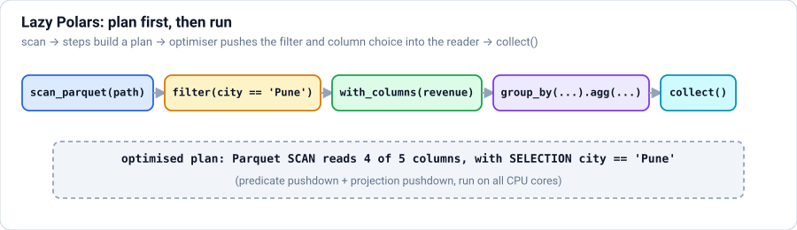

### 41.1 Why Polars

**Polars** is a DataFrame library written in Rust, built on Arrow (Chapter 40.4). It uses all CPU cores, and it can plan a whole query before running it. Its API is different from pandas: no index, and computations are written as **expressions**, `pl.col("name")` combined with operators and methods.

Two million orders, saved as Parquet:

```python
import os, tempfile, time
import numpy as np
import pandas as pd
import polars as pl

rng = np.random.default_rng(2)
n = 2_000_000
pdf = pd.DataFrame({"order_id": np.arange(n), "city": rng.choice(["Pune", "Mumbai", "Delhi", "Goa"], n),
                    "category": rng.choice(["electronics", "kitchen", "books"], n),
                    "qty": rng.integers(1, 10, n), "price": rng.uniform(10, 3000, n).round(2)})
path = os.path.join(tempfile.mkdtemp(), "orders.parquet")
pdf.to_parquet(path)

df = pl.read_parquet(path)
print(df.head(3))
```

**Output:**

```text
shape: (3, 5)
┌──────────┬────────┬─────────────┬─────┬────────┐
│ order_id ┆ city   ┆ category    ┆ qty ┆ price  │
│ ---      ┆ ---    ┆ ---         ┆ --- ┆ ---    │
│ i64      ┆ str    ┆ str         ┆ i64 ┆ f64    │
╞══════════╪════════╪═════════════╪═════╪════════╡
│ 0        ┆ Goa    ┆ electronics ┆ 3   ┆ 786.78 │
│ 1        ┆ Mumbai ┆ electronics ┆ 2   ┆ 986.05 │
│ 2        ┆ Pune   ┆ electronics ┆ 8   ┆ 167.61 │
└──────────┴────────┴─────────────┴─────┴────────┘
```

### 41.2 Expressions

The main verbs: `with_columns` (add columns), `filter`, `select`, `group_by(…).agg(…)` and `sort`. `alias` names a result:

```python
out = (df.with_columns((pl.col("qty") * pl.col("price")).alias("revenue"))
         .filter(pl.col("category") == "electronics")
         .group_by("city")
         .agg(pl.col("revenue").sum().round(0).cast(pl.Int64).alias("total"),
              pl.len().alias("orders"),
              pl.col("revenue").mean().round(1).alias("avg"))
         .sort("total", descending=True))
print(out)
```

**Output:**

```text
shape: (4, 4)
┌────────┬────────────┬────────┬────────┐
│ city   ┆ total      ┆ orders ┆ avg    │
│ ---    ┆ ---        ┆ ---    ┆ ---    │
│ str    ┆ i64        ┆ u32    ┆ f64    │
╞════════╪════════════╪════════╪════════╡
│ Pune   ┆ 1256821098 ┆ 166640 ┆ 7542.1 │
│ Delhi  ┆ 1256269117 ┆ 166672 ┆ 7537.4 │
│ Mumbai ┆ 1249885023 ┆ 166417 ┆ 7510.6 │
│ Goa    ┆ 1247897143 ┆ 166008 ┆ 7517.1 │
└────────┴────────────┴────────┴────────┘
```

`pl.len()` counts rows. Group-wise values next to each row, pandas' `transform` (Chapter 32.1), are written with `.over(group)`:

```python
ranked = df.with_columns((pl.col("qty") * pl.col("price")).alias("revenue")).with_columns(
    pl.col("revenue").sum().over("city").round(0).cast(pl.Int64).alias("city_total"),
    pl.col("revenue").rank("dense", descending=True).over("city").alias("rank_in_city"))
print(ranked.filter(pl.col("rank_in_city") == 1).select("city", "order_id", "revenue", "city_total").sort("city"))
```

**Output:**

```text
shape: (4, 4)
┌────────┬──────────┬──────────┬────────────┐
│ city   ┆ order_id ┆ revenue  ┆ city_total │
│ ---    ┆ ---      ┆ ---      ┆ ---        │
│ str    ┆ i64      ┆ f64      ┆ i64        │
╞════════╪══════════╪══════════╪════════════╡
│ Delhi  ┆ 361799   ┆ 26999.91 ┆ 3771202552 │
│ Goa    ┆ 1546598  ┆ 26999.82 ┆ 3764643744 │
│ Mumbai ┆ 760350   ┆ 26999.82 ┆ 3766631336 │
│ Pune   ┆ 1727651  ┆ 26999.19 ┆ 3762129885 │
└────────┴──────────┴──────────┴────────────┘
```

### 41.3 Lazy queries

`pl.scan_parquet` doesn't read anything. It starts a **lazy** query: each step adds to a plan, and `collect()` runs it. Before running, Polars **optimises** the plan: it pushes the filter and the column selection into the file read, so only Pune rows and the needed columns are ever loaded. `explain()` shows the optimised plan:

```python
query = (pl.scan_parquet(path)
           .filter(pl.col("city") == "Pune")
           .with_columns((pl.col("qty") * pl.col("price")).alias("revenue"))
           .group_by("category")
           .agg(pl.col("revenue").sum().round(0).cast(pl.Int64).alias("total"))
           .sort("category"))
print(query.explain())
print(query.collect())
```

**Output:**

```text
SORT BY [col("category")]
  AGGREGATE[maintain_order: false]
    [col("revenue").sum().round().strict_cast(Int64).alias("total")] BY [col("category")]
    FROM
    simple π 2/2 ["category", "revenue"]
       WITH_COLUMNS:
       [(col("qty").cast(Float64) * col("price")).alias("revenue")] 
        simple π 3/3 ["category", "qty", "price"]
          Parquet SCAN [/var/folders/63/sbjzw15506j9pfmwfgdf45t40000gn/T/tmp5ih33hve/orders.parquet]
          PROJECT 4/5 COLUMNS
          SELECTION: col("city") == "Pune"
          ESTIMATED ROWS: 2000000
shape: (3, 2)
┌─────────────┬────────────┐
│ category    ┆ total      │
│ ---         ┆ ---        │
│ str         ┆ i64        │
╞═════════════╪════════════╡
│ books       ┆ 1256703633 │
│ electronics ┆ 1256821098 │
│ kitchen     ┆ 1248605154 │
└─────────────┴────────────┘
```

### 41.4 Speed

The same group-and-sum in pandas (data already in memory) and in lazy Polars (including reading the file):

```python
start = time.perf_counter()
p_res = pdf.assign(revenue=pdf["qty"] * pdf["price"]).groupby(["city", "category"])["revenue"].sum()
t_pandas = time.perf_counter() - start
start = time.perf_counter()
l_res = (pl.scan_parquet(path).with_columns((pl.col("qty") * pl.col("price")).alias("revenue"))
           .group_by("city", "category").agg(pl.col("revenue").sum()).collect())
t_polars = time.perf_counter() - start
print(f"pandas {t_pandas:.3f}s · polars, including reading the file, {t_polars:.3f}s")
```

**Output:**

```text
pandas 0.074s · polars, including reading the file, 0.022s
```

`df.to_pandas()` and `pl.from_pandas(pdf)` convert between the two, cheaply thanks to Arrow, so you can use Polars for heavy steps and pandas where a library needs it.

### 41.5 Summary

```
pl.read_parquet / read_csv (eager);  pl.scan_parquet / scan_csv … .collect() (lazy, optimised)
df.with_columns(expr.alias("x")).filter(expr).group_by(k).agg(…).sort(col, descending=True).select(…)
pl.col("a") * pl.col("b");  pl.len();  expr.over("group") (like transform);  .explain();  .to_pandas()
```

**Key terms:**

- **Polars:** a fast, multi-threaded DataFrame library built on Arrow.
- **Expression:** a description of a column computation, such as `pl.col("qty") * pl.col("price")`, evaluated by Polars.
- **Lazy evaluation:** building a query plan and running it only when asked (`collect`).
- **Query optimiser:** rewrites a plan to do less work, for example by filtering while reading.
- **Projection pushdown:** reading only the columns a query needs.

### Exercises

1. Lazily count the orders with qty ≥ 5 per category, with their average price, most orders first.
2. Add each order's price difference from its category's average price.

<details>
<summary><b>Answers</b></summary>

```python
print(pl.scan_parquet(path).filter(pl.col("qty") >= 5).group_by("category")
        .agg(pl.len().alias("n"), pl.col("price").mean().round(1).alias("avg_price"))
        .sort("n", descending=True).collect())
print(df.with_columns((pl.col("price") - pl.col("price").mean().over("category")).round(1).alias("vs_category"))
        .select("category", "price", "vs_category").head(3))
```

**Output:**

```text
shape: (3, 3)
┌─────────────┬────────┬───────────┐
│ category    ┆ n      ┆ avg_price │
│ ---         ┆ ---    ┆ ---       │
│ str         ┆ u32    ┆ f64       │
╞═════════════╪════════╪═══════════╡
│ books       ┆ 371146 ┆ 1507.9    │
│ kitchen     ┆ 370167 ┆ 1506.6    │
│ electronics ┆ 369665 ┆ 1506.8    │
└─────────────┴────────┴───────────┘
shape: (3, 3)
┌─────────────┬────────┬─────────────┐
│ category    ┆ price  ┆ vs_category │
│ ---         ┆ ---    ┆ ---         │
│ str         ┆ f64    ┆ f64         │
╞═════════════╪════════╪═════════════╡
│ electronics ┆ 786.78 ┆ -719.8      │
│ electronics ┆ 986.05 ┆ -520.5      │
│ electronics ┆ 167.61 ┆ -1339.0     │
└─────────────┴────────┴─────────────┘
```

1. About 5/9 of the orders have qty from 5 to 9, so roughly 370,000 per category.
2. `.over("category")` broadcasts each category's mean back to its rows.

</details>

**Learn more:** [Polars user guide](https://docs.pola.rs/)

---

## 42. DuckDB: SQL on DataFrames and Files

**You need:** Chapters 20, 32 and 41. · **You'll learn:** to run SQL directly on DataFrames and on folders of Parquet files, with window functions, inside your Python process.

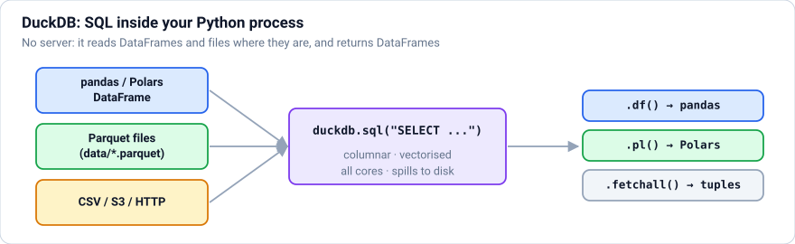

### 42.1 A database inside Python

**DuckDB** is an analytical SQL database that runs inside your Python process: no server, nothing to set up. It's columnar and multi-threaded like Polars, and it can query pandas DataFrames, Polars DataFrames and Parquet or CSV files directly. `duckdb.sql(query)` finds a DataFrame by its variable name; `.df()` returns the result as pandas:

```python
import os, tempfile
import duckdb
import numpy as np
import pandas as pd

rng = np.random.default_rng(3)
n = 1_000_000
orders = pd.DataFrame({"order_id": np.arange(n), "customer_id": rng.integers(1, 50_000, n),
                       "city": rng.choice(["Pune", "Mumbai", "Delhi", "Goa"], n),
                       "qty": rng.integers(1, 10, n), "price": rng.uniform(10, 3000, n).round(2),
                       "day": pd.Timestamp("2025-01-01") + pd.to_timedelta(rng.integers(0, 120, n), unit="D")})

print(duckdb.sql("""
    SELECT city, COUNT(*) AS orders, CAST(SUM(qty * price) AS BIGINT) AS revenue
    FROM orders
    GROUP BY city
    ORDER BY revenue DESC
""").df())
```

**Output:**

```text
     city  orders     revenue
0    Pune  250320  1884591009
1     Goa  250094  1881515791
2   Delhi  249828  1880764778
3  Mumbai  249758  1879773011
```

`pd.to_timedelta(numbers, unit="D")` turns numbers into durations in days.

### 42.2 Querying a folder of files

Data lakes store tables as many Parquet files, for example one per month. DuckDB reads a whole folder with a wildcard pattern, without loading anything into pandas first:

```python
folder = tempfile.mkdtemp()
for m in range(1, 5):
    orders[orders["day"].dt.month == m].to_parquet(os.path.join(folder, f"orders_2025_{m:02d}.parquet"))
files = os.path.join(folder, "*.parquet")

print(duckdb.sql(f"""
    SELECT date_trunc('month', day) AS month, CAST(SUM(qty * price) AS BIGINT) AS revenue
    FROM '{files}'
    GROUP BY month ORDER BY month
""").df())
```

**Output:**

```text
       month     revenue
0 2025-01-01  1930998971
1 2025-02-01  1760012751
2 2025-03-01  1936563272
3 2025-04-01  1899069595
```

`date_trunc('month', day)` rounds each date down to the start of its month.

### 42.3 Window functions

SQL's **window functions** compute a value for each row over a group of related rows, without collapsing them, the SQL version of `transform` and group ranking (Chapter 32). `RANK() OVER (PARTITION BY city ORDER BY spend DESC)` ranks within each city; DuckDB's `QUALIFY` filters on the result. The top 2 customers in each city:

```python
print(duckdb.sql(f"""
    WITH per_customer AS (
        SELECT city, customer_id, SUM(qty * price) AS spend
        FROM '{files}' GROUP BY city, customer_id
    )
    SELECT city, customer_id, ROUND(spend) AS spend,
           RANK() OVER (PARTITION BY city ORDER BY spend DESC) AS rank_in_city
    FROM per_customer
    QUALIFY rank_in_city <= 2
    ORDER BY city, rank_in_city
""").df())
```

**Output:**

```text
     city  customer_id     spend  rank_in_city
0   Delhi        19405  170928.0             1
1   Delhi         8402  163646.0             2
2     Goa         5925  169485.0             1
3     Goa        16127  163836.0             2
4  Mumbai        38749  166939.0             1
5  Mumbai        36254  152903.0             2
6    Pune        27195  181097.0             1
7    Pune         3353  162022.0             2
```

`WITH name AS (…)` defines a temporary named result, a **common table expression**, used by the main query.

### 42.4 Parameters and other outputs

As with any database, pass values as parameters (Chapter 20.1); `?` marks them, in a query run on a connection with `execute`. Results of `duckdb.sql` can come back as pandas (`.df()`), Polars (`.pl()`) or Python tuples (`.fetchall()`):

```python
con = duckdb.connect()
print(con.execute("SELECT city, AVG(price) AS avg_price FROM orders WHERE city = ? GROUP BY city", ["Pune"]).df().round(2))
print(duckdb.sql(f"SELECT COUNT(*) AS n FROM '{files}'").fetchall())
```

**Output:**

```text
   city  avg_price
0  Pune    1506.16
[(1000000,)]
```

pandas, Polars or DuckDB? Use pandas for small and medium data and its huge ecosystem; Polars when you prefer DataFrame code and need speed; DuckDB when SQL is the natural language for the question or the data sits in files. They share Arrow, so mixing them costs little.

### 42.5 Summary

```
duckdb.sql("SELECT … FROM df_variable …").df() / .pl() / .fetchall()
FROM 'folder/*.parquet'  (files, without loading);  date_trunc('month', d)
RANK() OVER (PARTITION BY g ORDER BY x DESC) … QUALIFY rank <= n;  WITH cte AS (…)
con.execute("… WHERE c = ?", [value])
```

**Key terms:**

- **DuckDB:** an in-process analytical SQL database that queries DataFrames and files directly.
- **In-process database:** a database that runs inside your program, with no separate server.
- **Data lake:** a store of raw and processed data files, often Parquet, organised in folders.
- **Window function:** a SQL function computed over a group of rows related to each row, such as a rank within a partition.
- **Common table expression (CTE):** a named subquery defined with `WITH`.

### Exercises

1. Find the customers who spent over 150,000 in total, returned as a Polars DataFrame.
2. Average order value per city and month, keeping only rows above 7,550.

<details>
<summary><b>Answers</b></summary>

```python
big = duckdb.sql(f"SELECT customer_id, SUM(qty * price) AS spend FROM '{files}' GROUP BY 1 HAVING spend > 150000").pl()
print(type(big).__name__, big.shape)
print(duckdb.sql("""
    SELECT city, date_trunc('month', day) AS month, ROUND(AVG(qty * price), 1) AS aov
    FROM orders GROUP BY ALL HAVING AVG(qty * price) > 7550 ORDER BY city, month
""").df())
```

**Output:**

```text
DataFrame (24019, 2)
     city      month     aov
0  Mumbai 2025-04-01  7552.8
1    Pune 2025-02-01  7576.6
2    Pune 2025-04-01  7556.0
```

1. `GROUP BY 1` groups by the first selected column; `HAVING` filters the groups.
2. `GROUP BY ALL` groups by every non-aggregated column. The average order is about 5 × 1,505 ≈ 7,525, so only months that happen to run high pass.

</details>

**Learn more:** [DuckDB documentation](https://duckdb.org/docs/)

---

# Part VII — Charts

Eight chapters on showing data: Matplotlib from the first line chart to annotated, publication-ready figures; seaborn for statistical charts; Plotly for interactive ones; and how to choose a chart that doesn't mislead.

---

## 43. Your First Charts with Matplotlib

**You need:** Chapters 6–15. · **You'll learn:** to draw the four basic charts (line, bar, scatter, histogram), label them, and save them.

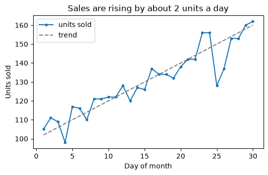

### 43.1 Figure and axes

**Matplotlib** is Python's core plotting library; seaborn and pandas' own `.plot` are built on it. Import its plotting interface as `plt`. `plt.subplots()` creates a **figure** (the whole image) and an **axes** (one chart inside it, with its own x and y axes). You then call methods on the axes to draw and label:

```python
import matplotlib.pyplot as plt
import numpy as np

days = np.arange(1, 31)
units = 100 + 2 * days + np.random.default_rng(1).normal(0, 8, 30).round()

fig, ax = plt.subplots(figsize=(6, 3.5))                 # width and height in inches
ax.plot(days, units, marker="o", markersize=3, label="units sold")
ax.plot(days, 100 + 2 * days, linestyle="--", color="gray", label="trend")
ax.set_title("Sales are rising by about 2 units a day")
ax.set_xlabel("Day of month")
ax.set_ylabel("Units sold")
ax.legend()
fig.savefig("first-line-chart.png", dpi=100, bbox_inches="tight")
plt.close(fig)
print(type(fig).__name__, type(ax).__name__)
```

**Output:**

```text
Figure Axes
```

`label` names each line for the `legend`. `savefig` writes the image (`dpi` sets the resolution; `bbox_inches="tight"` trims empty margins); `plt.close` frees the memory. In a notebook the figure also displays by itself. A useful habit: make the **title state the finding**, not just the topic.

### 43.2 Four basic charts

Each answers a different question:

| chart | method | shows |
|---|---|---|
| line | `ax.plot(x, y)` | change over an ordered axis, usually time |
| bar | `ax.bar(names, values)` | comparison across categories |
| scatter | `ax.scatter(x, y)` | the relationship between two numbers |
| histogram | `ax.hist(values, bins)` | the distribution of one number |

`plt.subplots(2, 2)` makes a 2 × 2 grid of axes, returned as a 2D array:

```python
rng = np.random.default_rng(3)
cities = ["Pune", "Mumbai", "Delhi", "Bengaluru"]
revenue = [5800, 5600, 1000, 900]
price = rng.uniform(50, 3000, 80)
units_sold = (400 - 0.1 * price + rng.normal(0, 30, 80)).clip(0)
order_values = rng.lognormal(mean=6.5, sigma=0.6, size=500)

fig, axes = plt.subplots(2, 2, figsize=(9, 6.5), layout="constrained")
axes[0, 0].plot(days, units)
axes[0, 0].set_title("Line: trend over time")
axes[0, 1].bar(cities, revenue, color="tab:orange")
axes[0, 1].set_title("Bar: compare categories")
axes[1, 0].scatter(price, units_sold, alpha=0.6)
axes[1, 0].set(title="Scatter: relationship", xlabel="Price (₹)", ylabel="Units sold")
counts, edges, _ = axes[1, 1].hist(order_values, bins=30, color="tab:green", edgecolor="white")
axes[1, 1].set(title="Histogram: distribution", xlabel="Order value (₹)")
fig.savefig("four-basic-charts.png", dpi=100)
plt.close(fig)
print(axes.shape, f"tallest bin: {int(counts.max())} orders between ₹{edges[counts.argmax()]:.0f} and ₹{edges[counts.argmax() + 1]:.0f}")
```

**Output:**

```text
(2, 2) tallest bin: 73 orders between ₹588 and ₹712
```

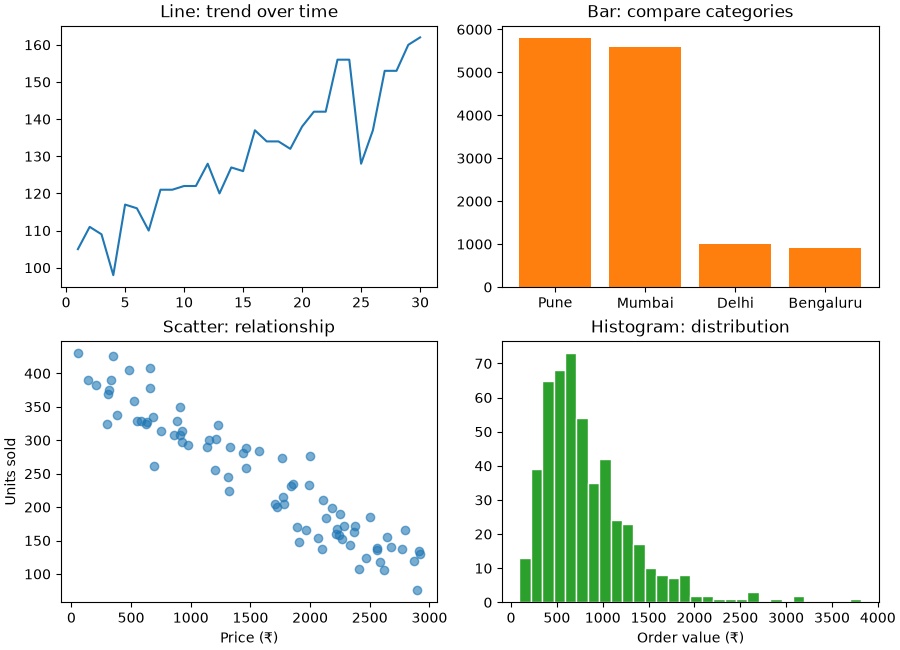

`layout="constrained"` spaces the panels so labels don't overlap. `ax.set(title=…, xlabel=…)` sets several properties at once. `alpha` makes points semi-transparent, so overlapping points show as darker areas. `rng.lognormal` draws skewed values, typical of order sizes (Chapter 54). `hist` returns the bin counts and edges it drew.

### 43.3 Choosing the number of bins

A histogram's shape depends on its bins: too few hide the shape, too many turn it into noise. Around 20–40 suits a few hundred values; try a couple of settings before trusting what you see. (`ax.hist(values, bins="auto")` lets NumPy choose.)

### 43.4 Summary

```
fig, ax = plt.subplots(figsize=(w, h));  fig, axes = plt.subplots(rows, cols, layout="constrained")
ax.plot / ax.bar / ax.barh / ax.scatter / ax.hist;  ax.set(title=…, xlabel=…, ylabel=…);  ax.legend()
fig.savefig("name.png", dpi=100, bbox_inches="tight");  plt.close(fig)
```

**Key terms:**

- **Matplotlib:** Python's core plotting library.
- **Figure:** the whole image, which can hold several charts.
- **Axes:** one chart inside a figure, with its own coordinate system.
- **Legend:** the key that names each plotted series.
- **Histogram:** a bar chart of how many values fall into each of a set of ranges (bins).
- **Bin:** one range of a histogram.

### Exercises

1. Draw a horizontal bar chart of the four cities' revenue, largest at the top, with each value written next to its bar.
2. Draw the order values as histograms with 10 and with 100 bins side by side. What changes?

<details>
<summary><b>Answers</b></summary>

```python
order = np.argsort(revenue)                    # smallest first: barh draws from the bottom up
names = [cities[i] for i in order]
vals = [revenue[i] for i in order]
fig, ax = plt.subplots(figsize=(5, 3), layout="constrained")
ax.barh(names, vals)
for i, v in enumerate(vals):
    ax.text(v + 50, i, f"₹{v:,}", va="center")
ax.set(xlabel="Revenue (₹)", xlim=(0, 7000))
plt.close(fig)

fig, (a1, a2) = plt.subplots(1, 2, figsize=(8, 3), layout="constrained")
a1.hist(order_values, bins=10)
a2.hist(order_values, bins=100)
plt.close(fig)
print(names)
```

**Output:**

```text
['Bengaluru', 'Delhi', 'Mumbai', 'Pune']
```

1. `barh` draws the first item at the bottom, so sort smallest first to put the largest on top. `ax.text(x, y, text)` writes the labels; `va="center"` centres them vertically on each bar.
2. With 10 bins the shape is blocky and the peak's position is vague; with 100 the bars are jagged with noise. Around 30 suits 500 values.

</details>

**Learn more:** [Matplotlib: quick start guide](https://matplotlib.org/stable/users/explain/quick_start.html)

---

## 44. Matplotlib Anatomy: Figures, Axes and Layouts

**You need:** Chapter 43. · **You'll learn:** the parts of a figure, flexible layouts with `subplot_mosaic`, a second y-axis, log scales and small multiples.

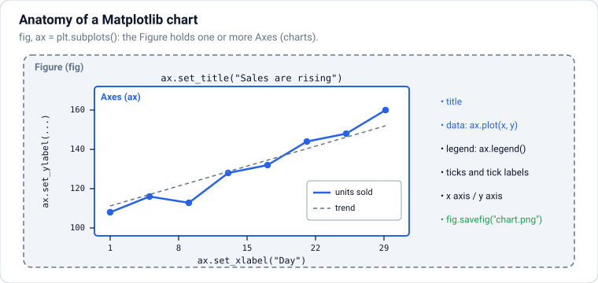

### 44.1 Mosaic layouts

`plt.subplot_mosaic` describes a layout as text: each letter is one axes, and repeating a letter makes it span several cells. `"AAB;CCB"` means two rows; A spans two columns on top, C two columns below, and B the whole right column. It returns a dict of axes keyed by letter:

```python
import matplotlib.pyplot as plt
import numpy as np

rng = np.random.default_rng(5)
fig, axd = plt.subplot_mosaic("AAB;CCB", figsize=(9, 5), layout="constrained")
print(sorted(axd))
```

**Output:**

```text
['A', 'B', 'C']
```

### 44.2 Highlight, second axis, colour map, log scale

Four techniques on one figure:

- **Highlight** the bar that matters, with the rest in grey.
- **`twinx()`** adds a second y-axis on the right for a series in different units. Use it sparingly: two scales on one chart are easy to misread.
- **`imshow`** draws a matrix as coloured cells, with a **colour bar** as its key; a **diverging** colour map centred on 0 suits correlations (Chapter 52).
- A **log scale** makes equal steps mean equal **multiples**, so steady growth by a factor looks like a straight line.

```python
months = ["Jan", "Feb", "Mar", "Apr", "May", "Jun"]
orders = np.array([120, 135, 160, 150, 190, 230])
avg_value = np.array([840, 820, 870, 910, 880, 950])
axd["A"].bar(months, orders, color="lightgray")
axd["A"].bar(months[-1], orders[-1], color="tab:red")            # the one bar that matters
axd["A"].set_title("Orders: June was the best month")
right = axd["A"].twinx()
right.plot(months, avg_value, color="tab:blue", marker="o")
right.set_ylabel("Avg order value (₹)", color="tab:blue")

corr = np.corrcoef(rng.normal(size=(5, 50)))                       # a 5 × 5 correlation matrix (Chapter 52)
im = axd["B"].imshow(corr, cmap="RdBu", vmin=-1, vmax=1)
axd["B"].set_title("Correlation matrix")
fig.colorbar(im, ax=axd["B"], shrink=0.7)

users = np.array([50, 400, 3_000, 25_000, 180_000, 1_400_000])
axd["C"].plot(months, users, marker="o")
axd["C"].set_yscale("log")
axd["C"].set_title("Users (log scale): roughly 8× growth each month")
fig.savefig("mosaic-layout.png", dpi=100)
plt.close(fig)
print((users[1:] / users[:-1]).round(1))
```

**Output:**

```text
[8.  7.5 8.3 7.2 7.8]
```

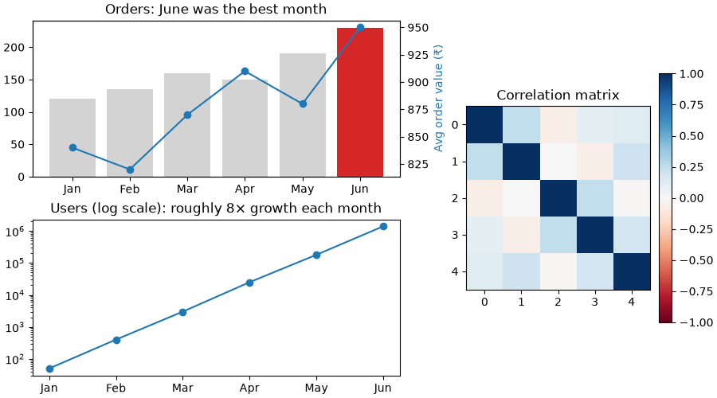

On a normal scale the user counts would be flat near zero until May; on the log scale the steady 7–8× monthly growth is a straight line.

### 44.3 Small multiples

To compare many series, one crowded chart is worse than **small multiples**: a row of small charts with the **same scale**, one per series. `sharey=True` gives every panel the same y-axis. Drawing all series in grey and the panel's own in colour keeps the context:

```python
cities = ["Pune", "Mumbai", "Delhi", "Goa"]
monthly = {c: 100 + rng.normal(0, 10, 12).cumsum() + k * 15 for k, c in enumerate(cities)}
fig, axes = plt.subplots(1, 4, figsize=(11, 2.6), sharey=True, layout="constrained")
for ax, city in zip(axes.flat, cities):
    for other in cities:
        ax.plot(range(1, 13), monthly[other], color="lightgray", linewidth=1)
    ax.plot(range(1, 13), monthly[city], color="tab:blue", linewidth=2.2)
    ax.set(title=city, xticks=[1, 4, 7, 10], xlabel="month")
    ax.spines[["top", "right"]].set_visible(False)
fig.savefig("small-multiples.png", dpi=100)
plt.close(fig)
print(len(axes), "panels sharing one y-scale")
```

**Output:**

```text
4 panels sharing one y-scale
```

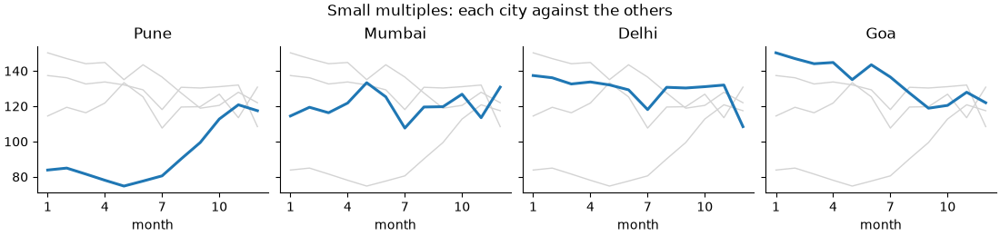

`axes.flat` iterates over the axes whatever the grid's shape. The **spines** are the chart's border lines; removing the top and right ones reduces clutter.

### 44.4 Summary

```
fig, axd = plt.subplot_mosaic("AAB;CCB")   (letters = panels, repeats span cells)
ax.twinx() (second y-axis);  ax.imshow(matrix, cmap="RdBu", vmin=-1, vmax=1) + fig.colorbar(im, ax=ax)
ax.set_yscale("log");  plt.subplots(1, n, sharey=True) for small multiples;  ax.spines[["top", "right"]].set_visible(False)
```

**Key terms:**

- **Subplot:** one axes in a grid of axes.
- **Mosaic layout:** a grid layout described by letters, where repeated letters span several cells.
- **Twin axis:** a second y-axis sharing the same x-axis.
- **Colour map:** a scale mapping numbers to colours; **diverging** maps have a neutral middle.
- **Log scale:** an axis where equal distances mean equal multiplication factors.
- **Small multiples:** a series of small charts with the same axes, one per group.
- **Spines:** the lines bordering the plot area.

### Exercises

1. Make a 2 × 3 grid of histograms of normal samples with means 0 to 5, sharing the x-axis.
2. Why must small multiples share their y-scale?

<details>
<summary><b>Answers</b></summary>

```python
fig, axes = plt.subplots(2, 3, figsize=(9, 5), sharex=True, layout="constrained")
for mean, ax in enumerate(axes.flat):
    ax.hist(rng.normal(mean, 1, 300), bins=20)
    ax.set_title(f"mean {mean}")
plt.close(fig)
print(axes.shape, axes.flat[5].get_title())
```

**Output:**

```text
(2, 3) mean 5
```

1. `sharex=True` lets you see the distributions shift to the right.
2. With separate scales, each panel would stretch to fill its height, so a tiny series and a huge one would look the same size.

</details>

---

## 45. Styling, Annotation and Saving Charts

**You need:** Chapter 44. · **You'll learn:** to guide the reader's eye with annotations, reference lines and shaded regions, format axes, choose colour maps, and save at the right quality.

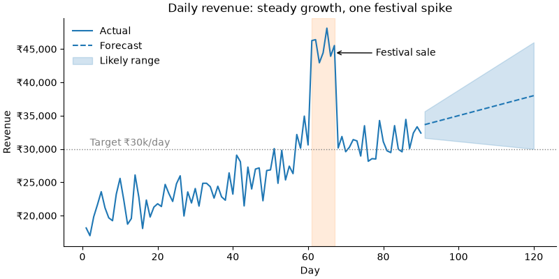

### 45.1 A chart that explains itself

A chart is finished when a reader gets the point without you there. The tools:

- `fill_between(x, low, high)`: a shaded band, such as a forecast's uncertainty;
- `axhline` / `axvline`: a horizontal or vertical reference line, such as a target;
- `axvspan(a, b)`: a shaded vertical region, such as an event;
- `annotate(text, xy=point, xytext=label_position, arrowprops=…)`: a label with an arrow;
- an axis **formatter**, to write ₹30,000 instead of 30000.

Ninety days of revenue with a festival week, and a 30-day forecast whose uncertainty grows:

```python
import os, tempfile
import matplotlib.pyplot as plt
import numpy as np
from matplotlib.ticker import StrMethodFormatter

rng = np.random.default_rng(5)
days = np.arange(1, 91)
sales = 20000 + 150 * days + rng.normal(0, 2500, 90)
sales[60:67] += 15000                                          # a one-week festival sale
forecast_days = np.arange(91, 121)
forecast = 20000 + 150 * forecast_days
spread = np.linspace(2000, 8000, 30)                           # uncertainty grows further ahead

fig, ax = plt.subplots(figsize=(8, 4), layout="constrained")
ax.plot(days, sales, color="tab:blue", label="Actual")
ax.plot(forecast_days, forecast, color="tab:blue", ls="--", label="Forecast")
ax.fill_between(forecast_days, forecast - spread, forecast + spread, color="tab:blue", alpha=0.2, label="Likely range")
ax.axhline(30000, color="gray", ls=":", lw=1)
ax.text(2, 30500, "Target ₹30k/day", color="gray")
ax.axvspan(61, 67, color="tab:orange", alpha=0.15)
ax.annotate("Festival sale", xy=(67, sales[63]), xytext=(78, 44000), arrowprops=dict(arrowstyle="->", color="black"))
ax.yaxis.set_major_formatter(StrMethodFormatter("₹{x:,.0f}"))
ax.spines[["top", "right"]].set_visible(False)
ax.set(title="Daily revenue: steady growth, one festival spike", xlabel="Day", ylabel="Revenue")
ax.legend(loc="upper left", frameon=False)
fig.savefig("annotated-forecast.png", dpi=100)
plt.close(fig)
print("peak day:", int(days[np.argmax(sales)]), "| first day above target:", int(days[np.argmax(sales > 30000)]))
```

**Output:**

```text
peak day: 65 | first day above target: 51
```

`ls` and `lw` are short for line style and line width. `StrMethodFormatter("₹{x:,.0f}")` formats each tick value with a format string. `np.argmax(mask)` finds the first True in a mask.

### 45.2 Colour maps

Colour is data, so the colour map must suit it:

- **sequential** (viridis, cividis): low to high; perceptually even, and readable in greyscale and by colour-blind readers;
- **diverging** (RdBu): two directions from a meaningful middle, such as correlations around 0;
- **qualitative** (`tab:` colours): unordered categories.

Avoid the rainbow "jet": its bright bands create edges that aren't in the data.

```python
grid = np.linspace(-1, 1, 200).reshape(1, -1)
fig, axes = plt.subplots(4, 1, figsize=(7, 3.2), layout="constrained")
for ax, (cmap, kind) in zip(axes, [("viridis", "sequential (good)"), ("cividis", "sequential, colour-blind safe"),
                                    ("RdBu", "diverging: centred on 0"), ("jet", "rainbow: avoid")]):
    ax.imshow(grid, cmap=cmap, aspect="auto")
    ax.set(xticks=[], yticks=[])
    ax.set_ylabel(cmap, rotation=0, ha="right", va="center")
    ax.set_title(kind, fontsize=9, loc="left")
fig.savefig("colormaps.png", dpi=100)
plt.close(fig)
print("saved 4 colour maps")
```

**Output:**

```text
saved 4 colour maps
```

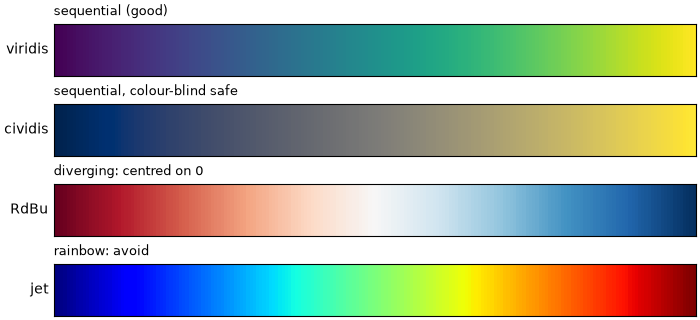

### 45.3 Saving

- **PNG** for slides and web pages: set `dpi` to 150–300 for sharp text.
- **SVG** or **PDF** for documents: vector formats stay sharp at any zoom and are often smaller for simple charts.

```python
folder = tempfile.mkdtemp()
fig, ax = plt.subplots(figsize=(8, 3), layout="constrained")
ax.plot(days, sales)
ax.yaxis.set_major_formatter(lambda y, pos: f"₹{y / 1000:.0f}k")    # a function (value, position) → label
fig.savefig(os.path.join(folder, "s.png"), dpi=200)
fig.savefig(os.path.join(folder, "s.svg"))
plt.close(fig)
print({f: f"{os.path.getsize(os.path.join(folder, f)) // 1000} KB" for f in ["s.png", "s.svg"]})
```

**Output:**

```text
{'s.png': '70 KB', 's.svg': '15 KB'}
```

### 45.4 Summary

```
ax.fill_between(x, lo, hi, alpha=…);  ax.axhline(y) / axvline(x);  ax.axvspan(a, b);  ax.text(x, y, s)
ax.annotate(s, xy=(x, y), xytext=(x2, y2), arrowprops=dict(arrowstyle="->"))
ax.yaxis.set_major_formatter(StrMethodFormatter("₹{x:,.0f}") or lambda y, pos: …)
colour maps: sequential (viridis, cividis), diverging (RdBu), qualitative (tab:…); never jet
fig.savefig("x.png", dpi=200) or "x.svg" / "x.pdf"
```

**Key terms:**

- **Annotation:** text, often with an arrow, pointing out a feature of a chart.
- **Reference line:** a line marking a fixed value, such as a target or average.
- **Tick formatter:** a rule turning tick values into labels.
- **Sequential / diverging / qualitative colour map:** for ordered values / values around a middle / unordered categories.
- **Vector graphics (SVG, PDF):** images stored as shapes, sharp at any size; **raster** (PNG) images are grids of pixels.

### Exercises

1. Shade every weekend on the revenue chart (take days 6, 7, 13, 14, … as weekends).
2. Which colour map suits (a) temperature anomalies above and below normal; (b) population density; (c) product categories?

<details>
<summary><b>Answers</b></summary>

```python
fig, ax = plt.subplots(figsize=(8, 3), layout="constrained")
ax.plot(days, sales)
weekend = days[(days % 7 == 6) | (days % 7 == 0)]
for d in weekend:
    ax.axvspan(d - 0.5, d + 0.5, color="gray", alpha=0.15, lw=0)
plt.close(fig)
print(len(weekend), "weekend days shaded")
```

**Output:**

```text
25 weekend days shaded
```

1. One `axvspan` per weekend day.
2. (a) Diverging, centred on normal; (b) sequential; (c) qualitative.

</details>

---

## 46. Seaborn I: Distributions

**You need:** Chapters 12, 31 and 43. · **You'll learn:** seaborn, which draws statistical charts straight from a DataFrame, and the four ways to show a distribution: histogram, box plot, violin and ECDF.

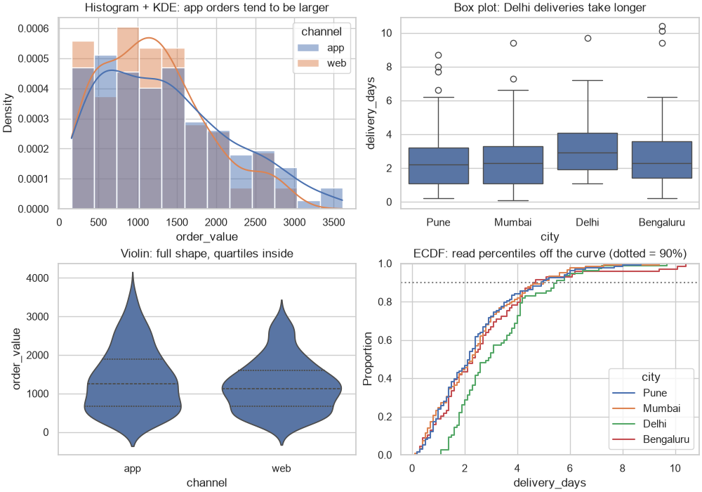

### 46.1 The shop dataset

400 simulated orders with a city, a sales channel (app or web), the number of items, the order value, the delivery time and the customer's rating. App orders are about 15% larger, Delhi deliveries take a day longer, and slow deliveries get lower ratings. It's saved for Chapters 47–48:

```python
import matplotlib.pyplot as plt
import numpy as np
import pandas as pd
import seaborn as sns

rng = np.random.default_rng(11)
n = 400
shop = pd.DataFrame({
    "city": rng.choice(["Pune", "Mumbai", "Delhi", "Bengaluru"], n, p=[0.3, 0.3, 0.2, 0.2]),
    "channel": rng.choice(["app", "web"], n, p=[0.6, 0.4]),
    "items": rng.integers(1, 8, n),
})
shop["order_value"] = (shop["items"] * rng.uniform(150, 450, n) * np.where(shop["channel"] == "app", 1.15, 1.0)).round()
shop["delivery_days"] = (rng.gamma(2, 1.2, n) + np.where(shop["city"] == "Delhi", 1.0, 0.0)).round(1)
shop["rating"] = (5 - 0.4 * shop["delivery_days"] + rng.normal(0, 0.5, n)).clip(1, 5).round(1)
shop.to_csv("data/shop.csv", index=False)
print(shop.head(3))
```

**Output:**

```text
     city channel  items  order_value  delivery_days  rating
0    Pune     app      7       3221.0            1.3     4.4
1  Mumbai     web      1        157.0            4.1     3.9
2   Delhi     app      4        771.0            1.6     3.4
```

`rng.gamma` draws positive, right-skewed values, typical of waiting times (Chapter 54).

### 46.2 seaborn

**seaborn** (imported as `sns`) is built on Matplotlib. Its functions take a DataFrame and column names, and do the grouping, colouring by a category (`hue`) and legends for you. Each draws into an axes you pass with `ax=`. `sns.set_theme` sets a clean style for all later charts:

```python
sns.set_theme(style="whitegrid")
fig, axes = plt.subplots(2, 2, figsize=(10, 7), layout="constrained")

sns.histplot(data=shop, x="order_value", hue="channel", kde=True, stat="density", common_norm=False, ax=axes[0, 0])
axes[0, 0].set_title("Histogram + KDE: app orders tend to be larger")

sns.boxplot(data=shop, x="city", y="delivery_days", ax=axes[0, 1])
axes[0, 1].set_title("Box plot: Delhi deliveries take longer")

sns.violinplot(data=shop, x="channel", y="order_value", inner="quart", ax=axes[1, 0])
axes[1, 0].set_title("Violin: full shape, quartiles inside")

sns.ecdfplot(data=shop, x="delivery_days", hue="city", ax=axes[1, 1])
axes[1, 1].axhline(0.9, color="gray", ls=":")
axes[1, 1].set_title("ECDF: read percentiles off the curve (dotted = 90%)")
fig.savefig("seaborn-distributions.png", dpi=100)
plt.close(fig)
print(shop.groupby("city")["delivery_days"].quantile(0.9).round(1).to_dict())
```

**Output:**

```text
{'Bengaluru': 4.6, 'Delhi': 5.4, 'Mumbai': 5.0, 'Pune': 4.9}
```

The four charts:

- **Histogram with KDE:** `kde=True` adds a **kernel density estimate**, a smooth curve made by placing a small bump on every data point and adding them up. `stat="density"` with `common_norm=False` scales each channel's histogram to area 1, so groups of different sizes can be compared.
- **Box plot:** the box spans Q1 to Q3 with the median inside; the whiskers reach the furthest points within 1.5 × IQR, and dots beyond are flagged outliers (Chapter 30.2). Compact for comparing many groups.
- **Violin:** a mirrored KDE: the box plot's comparison plus the full shape.
- **ECDF** (empirical cumulative distribution function): for each value x, the fraction of data at or below x. Percentiles read straight off it: where the curve crosses 0.9 is the 90th percentile: about 5.4 days for Delhi, against 4.6–5.0 elsewhere.

### 46.3 Box plots can hide shape

Trip times from two groups, around 30 and 60 minutes:

```python
bimodal = pd.Series(np.concatenate([rng.normal(30, 4, 300), rng.normal(60, 5, 300)]), name="minutes")
fig, axes = plt.subplots(1, 3, figsize=(10, 2.8), layout="constrained")
sns.boxplot(x=bimodal, ax=axes[0]); axes[0].set_title("box plot: hides two peaks")
sns.histplot(x=bimodal, bins=30, ax=axes[1]); axes[1].set_title("histogram: two groups!")
sns.kdeplot(x=bimodal, bw_adjust=0.3, ax=axes[2], label="bw 0.3")
sns.kdeplot(x=bimodal, bw_adjust=3, ax=axes[2], label="bw 3")
axes[2].legend(); axes[2].set_title("KDE bandwidth matters")
fig.savefig("bimodal.png", dpi=100)
plt.close(fig)
print(f"mean {bimodal.mean():.1f} min, yet only {((bimodal > 40) & (bimodal < 50)).mean():.1%} of trips take 40–50 min")
```

**Output:**

```text
mean 45.2 min, yet only 1.7% of trips take 40–50 min
```

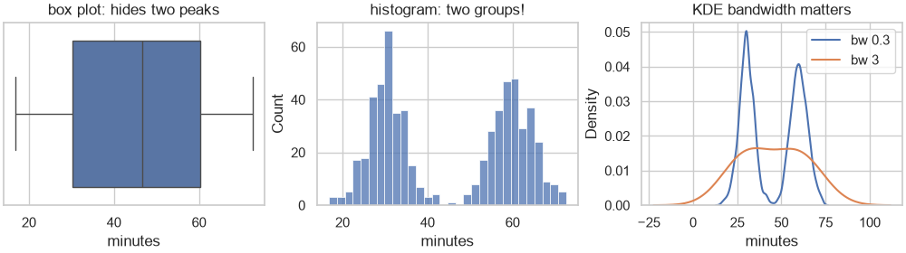

The data is **bimodal** (two peaks). The box plot shows one wide box, and the mean of 45 minutes describes almost no actual trip. A KDE's **bandwidth** (the width of each bump) changes the picture too: too wide merges the peaks. Always look at a histogram before summarising.

### 46.4 Summary

```
sns.set_theme(style="whitegrid");  sns.histplot(data=df, x=…, hue=…, kde=True, stat="density", common_norm=False, ax=ax)
sns.boxplot / sns.violinplot(data=df, x=group, y=value, ax=ax);  sns.ecdfplot(data=df, x=…, hue=…, ax=ax)
sns.kdeplot(x=…, bw_adjust=…);  check for several peaks before trusting a mean or box plot
```

**Key terms:**

- **seaborn:** a statistical plotting library built on Matplotlib that works directly with DataFrames.
- **`hue`:** a seaborn argument that colours the data by a category.
- **Kernel density estimate (KDE):** a smooth estimate of a distribution, made by adding a small bump at each data point.
- **Bandwidth:** the width of each KDE bump; it sets how smooth the curve is.
- **Box plot:** a summary of quartiles, whiskers and outliers.
- **Violin plot:** a box-plot-style comparison showing the full KDE shape.
- **ECDF:** the fraction of values at or below each value.
- **Bimodal:** having two peaks.

### Exercises

1. Draw box plots of the rating per city, ordered by median rating.
2. Using the ECDF idea, what fraction of all deliveries take at most 2 days?

<details>
<summary><b>Answers</b></summary>

```python
order = shop.groupby("city")["rating"].median().sort_values().index.tolist()
fig, ax = plt.subplots(figsize=(6, 3), layout="constrained")
sns.boxplot(data=shop, x="city", y="rating", order=order, ax=ax)
plt.close(fig)
print(order, f"{(shop['delivery_days'] <= 2).mean():.1%}")
```

**Output:**

```text
['Delhi', 'Bengaluru', 'Mumbai', 'Pune'] 42.2%
```

1. `order=` sets the category order; Delhi, with the slowest deliveries, comes first.
2. The ECDF at 2 is simply the share of values ≤ 2.

</details>

**Learn more:** [seaborn tutorial](https://seaborn.pydata.org/tutorial.html)

---

## 47. Seaborn II: Relationships, Categories and Facets

**You need:** Chapter 46. · **You'll learn:** seaborn's charts for comparing groups and showing relationships, what their error bars mean, and facets: one panel per group.


### 47.1 Comparing groups and relationships

```python
import matplotlib.pyplot as plt
import numpy as np
import pandas as pd
import seaborn as sns

shop = pd.read_csv("data/shop.csv")
sns.set_theme(style="whitegrid")
fig, axes = plt.subplots(2, 2, figsize=(10, 7.5), layout="constrained")

sns.barplot(data=shop, x="city", y="order_value", hue="channel", ax=axes[0, 0])
axes[0, 0].set_title("barplot: MEAN order value, 95% CI")

sns.regplot(data=shop, x="delivery_days", y="rating", scatter_kws={"alpha": 0.3}, ax=axes[0, 1])
axes[0, 1].set_title("regplot: slower delivery → lower ratings")

sns.lineplot(data=shop, x="items", y="order_value", hue="channel", ax=axes[1, 0])
axes[1, 0].set_title("lineplot: mean per x, with CI band")

sns.countplot(data=shop, x="city", hue="channel", ax=axes[1, 1])
axes[1, 1].set_title("countplot: number of orders")
fig.savefig("seaborn-four.png", dpi=100)
plt.close(fig)
print(shop.groupby(["city", "channel"])["order_value"].mean().unstack().round(0))
```

**Output:**

```text
channel       app     web
city                     
Bengaluru  1392.0  1172.0
Delhi      1365.0  1340.0
Mumbai     1211.0  1197.0
Pune       1467.0  1162.0
```

- **`barplot`** draws the **mean** of y for each group, not a sum or a count, with a black line showing the **95% confidence interval**: the range in which the true mean plausibly lies, given the sample (Chapter 56 explains it). Overlapping intervals warn that a difference may be chance.
- **`regplot`** draws a scatter plot with a fitted straight line and its confidence band (Chapter 59).
- **`lineplot`** draws the mean of y at each x, with a confidence band.
- **`countplot`** counts rows per category.

### 47.2 Bars from already-summarised data

`barplot` averages the rows it gets. To plot totals you've already computed, pass one value per bar:

```python
totals = shop.groupby("city")["order_value"].sum().sort_values(ascending=False)
fig, ax = plt.subplots(figsize=(6, 3), layout="constrained")
sns.barplot(x=totals.index, y=totals.values, ax=ax)
plt.close(fig)
print(totals.astype(int).to_dict())
```

**Output:**

```text
{'Pune': 178011, 'Mumbai': 145834, 'Delhi': 104524, 'Bengaluru': 91201}
```

### 47.3 Facets: one panel per group

**Figure-level** functions, `relplot` (relationships), `catplot` (categories), `displot` (distributions) and `lmplot` (regressions), create their own figure and can split it into **facets**: `col=` and `row=` make one panel per category, with shared axes. Small multiples (Chapter 44.3) in one call:

```python
grid = sns.relplot(data=shop, x="items", y="order_value", col="channel", hue="city", height=3.2, aspect=1.1, alpha=0.7)
grid.set_titles("{col_name} orders")
grid.savefig("seaborn-facets.png", dpi=100)
plt.close(grid.figure)
print(type(grid).__name__, grid.axes.shape)
```

**Output:**

```text
FacetGrid (1, 2)
```


They return a `FacetGrid`, whose `.figure` is the Matplotlib figure. `height` and `aspect` set each panel's size.

### 47.4 Summary

```
sns.barplot (mean + 95% CI) · sns.countplot (counts) · sns.lineplot (mean per x + band) · sns.regplot (scatter + line)
pre-summarised bars: sns.barplot(x=s.index, y=s.values)
facets: sns.relplot / catplot / displot / lmplot(…, col=…, row=…, hue=…) → FacetGrid (.figure, .set_titles, .savefig)
```

**Key terms:**

- **Confidence interval (in a chart):** the error bar or band showing the plausible range of the true mean.
- **Regression line:** the best-fitting straight line through a scatter plot.
- **Facet:** one panel of a chart split by a category.
- **Figure-level function:** a seaborn function that creates its own figure, possibly with several facets.
- **`FacetGrid`:** the object returned by figure-level functions, holding the figure and its panels.

### Exercises

1. Plot the mean rating per city as points, faceted by channel.
2. Fit the rating–delivery line separately for each city. Are the slopes similar?

<details>
<summary><b>Answers</b></summary>

```python
g = sns.catplot(data=shop, x="city", y="rating", col="channel", kind="point", height=3, aspect=1.2)
plt.close(g.figure)
slopes = {city: np.polyfit(d["delivery_days"], d["rating"], 1)[0] for city, d in shop.groupby("city")}
print(g.axes.shape, {c: round(float(s), 2) for c, s in slopes.items()})
```

**Output:**

```text
(1, 2) {'Bengaluru': -0.35, 'Delhi': -0.36, 'Mumbai': -0.39, 'Pune': -0.37}
```

1. `kind="point"` draws means with confidence intervals as points.
2. `np.polyfit(x, y, 1)` fits a straight line and returns (slope, intercept); looping over `groupby` gives each city's data. All slopes are near −0.4, the value the data was simulated with.

</details>

---

## 48. Heatmaps, Pair Plots and Correlation Charts

**You need:** Chapters 35, 44 and 47. · **You'll learn:** to show a whole table of numbers as colours, and every pairwise relationship between several columns at once.


### 48.1 A correlation table

The **correlation** r between two columns measures how closely they follow a straight-line relationship, from −1 (perfectly opposite) through 0 (none) to +1 (perfectly together); Chapter 52 derives it. `df.corr()` computes it for every pair of numeric columns. A discount column, unrelated to the rest, is added for contrast:

```python
import matplotlib.pyplot as plt
import numpy as np
import pandas as pd
import seaborn as sns

rng = np.random.default_rng(11)
shop = pd.read_csv("data/shop.csv")
shop["discount_pct"] = rng.uniform(0, 30, len(shop)).round()
corr = shop.corr(numeric_only=True).round(2) + 0.0                   # + 0.0 turns −0.00 into 0.00
print(corr)
```

**Output:**

```text
               items  order_value  delivery_days  rating  discount_pct
items           1.00         0.83           0.03   -0.02         -0.01
order_value     0.83         1.00          -0.03    0.01          0.00
delivery_days   0.03        -0.03           1.00   -0.81          0.12
rating         -0.02         0.01          -0.81    1.00         -0.09
discount_pct   -0.01         0.00           0.12   -0.09          1.00
```

Items and order value move together strongly (0.83); delivery time and rating move opposite ways (−0.81); the random discount correlates with nothing beyond chance (|r| ≤ 0.12).

### 48.2 Heatmaps

A **heatmap** colours each cell of a table. For correlations, use a diverging colour map centred on 0 (Chapter 45.2), write the values in the cells (`annot=True`), and hide the mirror-image upper half with a mask. A second heatmap shows orders by weekday and hour, a `crosstab` (Chapter 35.3) of simulated order times in which evenings are busier:

```python
events = pd.DataFrame({"ts": pd.Timestamp("2025-03-03") + pd.to_timedelta(rng.integers(0, 28 * 24 * 60, 5000), unit="min")})
hours = events["ts"].dt.hour
events = events[rng.random(len(events)) < np.where((hours >= 18) & (hours <= 22), 1.0, 0.35)]
table = pd.crosstab(events["ts"].dt.day_name().str[:3], events["ts"].dt.hour).reindex(["Mon", "Tue", "Wed", "Thu", "Fri", "Sat", "Sun"])

sns.set_theme(style="white")
fig, axes = plt.subplots(1, 2, figsize=(13, 4.5), layout="constrained", width_ratios=[1, 1.6])
mask = np.triu(np.ones_like(corr, dtype=bool), k=1)                  # True above the diagonal: hide those cells
sns.heatmap(corr, mask=mask, annot=True, cmap="RdBu", vmin=-1, vmax=1, center=0, ax=axes[0])
axes[0].set_title("Correlations (lower triangle)")
axes[0].tick_params(axis="x", rotation=45)
sns.heatmap(table, cmap="Blues", ax=axes[1], cbar_kws={"label": "orders"})
axes[1].set(title="Orders by weekday and hour: evenings are busiest", xlabel="hour of day", ylabel="")
fig.savefig("heatmaps.png", dpi=100)
plt.close(fig)
print(table.sum().idxmax(), "is the busiest hour")
```

**Output:**

```text
18 is the busiest hour
```

`reindex` puts the weekdays in calendar order rather than alphabetical.

### 48.3 Pair plots

A **pair plot** draws a scatter plot for every pair of columns, with each column's distribution on the diagonal. `corner=True` drops the duplicate upper half:

```python
g = sns.pairplot(shop, vars=["items", "order_value", "delivery_days", "rating"], hue="channel",
                 corner=True, plot_kws={"alpha": 0.4, "s": 15}, height=2)
g.savefig("pairplot.png", dpi=90)
plt.close(g.figure)
print("pair plot of 4 columns:", len(g.axes.flat), "panel slots")
```

**Output:**

```text
pair plot of 4 columns: 16 panel slots
```


### 48.4 Correlation only sees straight lines

A correlation near 0 doesn't mean "unrelated". y = x² depends entirely on x, but its correlation with x, over a range symmetric around 0, is about 0, because the rising and falling halves cancel. Always look at the scatter plot, not just r:

```python
x = rng.uniform(-3, 3, 300)
u_shape = x ** 2 + rng.normal(0, 0.5, 300)
print("r for a U-shape:", round(float(np.corrcoef(x, u_shape)[0, 1]), 3))
```

**Output:**

```text
r for a U-shape: -0.055
```

### 48.5 Summary

```
df.corr(numeric_only=True);  sns.heatmap(m, annot=True, cmap="RdBu", vmin=-1, vmax=1, center=0, mask=np.triu(…, k=1))
counts: sns.heatmap(pd.crosstab(a, b), cmap="Blues");  sns.pairplot(df, vars=[…], hue=…, corner=True)
r measures straight-line relationships only → always look at the scatter
```

**Key terms:**

- **Correlation (r):** a number from −1 to 1 measuring how closely two variables follow a straight line.
- **Correlation matrix:** the table of correlations between every pair of columns.
- **Heatmap:** a table drawn as coloured cells.
- **Pair plot:** a grid of scatter plots of every pair of columns, with distributions on the diagonal.

### Exercises

1. Which pair of different columns has the most negative correlation?
2. Draw a heatmap of the mean rating for each number of items and channel.

<details>
<summary><b>Answers</b></summary>

```python
pairs = corr.where(~np.eye(len(corr), dtype=bool)).stack()           # drop the diagonal, list every pair
print(pairs.idxmin(), pairs.min())
avg = shop.pivot_table(index="items", columns="channel", values="rating", aggfunc="mean").round(2)
fig, ax = plt.subplots(figsize=(4, 4), layout="constrained")
sns.heatmap(avg, annot=True, cmap="viridis", ax=ax)
plt.close(fig)
print(avg.head(3))
```

**Output:**

```text
('delivery_days', 'rating') -0.81
channel   app   web
items              
1        3.77  3.84
2        4.13  3.82
3        4.09  4.09
```

1. Delivery days and rating. `np.eye` is True on the diagonal; `where` blanks it, and `stack` (Chapter 36.3) lists the remaining pairs.
2. A pivot table (Chapter 35.1) drawn as a heatmap; ratings barely depend on the number of items.

</details>

---

## 49. Interactive Charts with Plotly

**You need:** Chapters 43 and 47. · **You'll learn:** to make interactive charts, with hover, zoom and clickable legends, in one line each, and to export them as web pages or images.


### 49.1 plotly.express

**Plotly** draws charts in the browser, so readers can hover for exact values, zoom, and click legend entries to hide series. Its high-level module, **plotly.express** (imported as `px`), works like seaborn: a DataFrame and column names. Monthly revenue per city:

```python
import os, tempfile
import numpy as np
import pandas as pd
import plotly.express as px

rng = np.random.default_rng(4)
months = pd.date_range("2025-01-01", periods=12, freq="MS")
rows = []
for k, city in enumerate(["Pune", "Mumbai", "Delhi", "Bengaluru"]):
    base = 50 + 12 * k
    rows += [{"month": m, "city": city, "revenue_lakh": round(base + 2.5 * i + rng.normal(0, 4), 1)} for i, m in enumerate(months)]
df = pd.DataFrame(rows)

fig = px.line(df, x="month", y="revenue_lakh", color="city", markers=True,
              title="Monthly revenue by city (₹ lakh): all four cities growing",
              labels={"revenue_lakh": "revenue (₹ lakh)", "month": ""}, template="plotly_white")
fig.update_layout(legend_title_text="")
fig.write_html(os.path.join(tempfile.mkdtemp(), "revenue.html"), include_plotlyjs="cdn")   # an interactive web page
fig.write_image("plotly-lines.png", width=900, height=420)                                  # a static snapshot
print(len(fig.data), "lines;", df.groupby("city")["revenue_lakh"].last().to_dict())
```

**Output:**

```text
4 lines; {'Bengaluru': 113.0, 'Delhi': 105.5, 'Mumbai': 89.1, 'Pune': 83.8}
```

`color=` plays the role of seaborn's `hue`; `labels=` renames axes; `update_layout` changes figure-wide settings. `write_html` saves a standalone page (`include_plotlyjs="cdn"` loads the plotting code from the web, keeping the file small); `write_image` saves a static picture (it needs the `kaleido` package). In a notebook, the figure displays interactively by itself. (A **lakh** is 100,000, an Indian unit.)

### 49.2 Other chart types and facets

`px.scatter`, `px.bar`, `px.histogram`, `px.box` and others take the same arguments. `facet_col` splits into panels, and `hover_data` controls what the hover box shows:

```python
scatter = px.scatter(df, x="month", y="revenue_lakh", color="city", facet_col="city", facet_col_wrap=2,
                     hover_data={"revenue_lakh": ":.1f"}, height=450)
totals = df.groupby("city", as_index=False)["revenue_lakh"].sum().sort_values("revenue_lakh", ascending=False)
bar = px.bar(totals, x="city", y="revenue_lakh", text_auto=".0f", title="Yearly revenue (₹ lakh)")
print(len(scatter.data), "traces;", totals.round(1).to_dict("records"))
```

**Output:**

```text
4 traces; [{'city': 'Bengaluru', 'revenue_lakh': 1187.1}, {'city': 'Delhi', 'revenue_lakh': 1044.7}, {'city': 'Mumbai', 'revenue_lakh': 903.0}, {'city': 'Pune', 'revenue_lakh': 764.3}]
```

Each coloured series is a **trace**. `as_index=False` keeps the group key as a normal column. `text_auto` writes the values on the bars.

Use static charts (Matplotlib, seaborn) for reports and papers; interactive ones for exploration, dashboards (Chapter 63) and web pages.

### 49.3 Summary

```
px.line / px.scatter / px.bar / px.histogram / px.box(df, x=…, y=…, color=…, facet_col=…, hover_data=…, labels=…, title=…)
fig.update_layout(…);  fig.write_html(path, include_plotlyjs="cdn");  fig.write_image("x.png")
```

**Key terms:**

- **Plotly:** a library for interactive charts that run in a web browser.
- **plotly.express (`px`):** Plotly's high-level, one-call chart functions.
- **Trace:** one plotted series in a Plotly figure.
- **Hover:** showing details when the mouse points at a mark.

### Exercises

1. Make a Plotly histogram of 1,000 values from a normal distribution with mean 50 and standard deviation 10.
2. When would you choose a static chart over an interactive one?

<details>
<summary><b>Answers</b></summary>

```python
values = pd.DataFrame({"x": rng.normal(50, 10, 1000)})
hist = px.histogram(values, x="x", nbins=40)
print(type(hist).__name__, len(hist.data))
```

**Output:**

```text
Figure 1
```

1. `px.histogram` with `nbins` for the number of bins.
2. For printed reports, slides, papers and email, where nobody can hover, and when one specific point should be made, not explored.

</details>

**Learn more:** [Plotly Express documentation](https://plotly.com/python/plotly-express/)

---

## 50. Choosing the Right Chart (and Not Misleading)

**You need:** Chapters 43–49. · **You'll learn:** which chart answers which question, and the common ways charts mislead, even by accident.


### 50.1 Which chart for which question

| question | chart |
|---|---|
| how does it change over time? | line |
| how do categories compare? | bar (sorted), or a dot plot |
| what's the distribution? | histogram, box plot, violin, ECDF |
| how do two numbers relate? | scatter (with a trend line) |
| what's the share of a whole? | stacked or sorted bars; a pie only for 2–3 slices |
| what's in a table of numbers? | heatmap |
| how do many groups compare? | small multiples |

### 50.2 Truncated bars and pie charts

A bar's **length** encodes its value, so bar charts must start at zero. Two teams scoring 96.1 and 98.3, with the axis starting at 95.5: B's bar looks five times taller, though B is about 2% better. And people compare angles badly: seven pie slices are hard to rank, while sorted, labelled bars make it instant.

```python
import matplotlib.pyplot as plt

teams, scores = ["Team A", "Team B"], [96.1, 98.3]
shares = {"Pune": 29, "Mumbai": 27, "Delhi": 14, "Bengaluru": 12, "Chennai": 8, "Kolkata": 6, "Other": 4}

fig, axes = plt.subplots(2, 2, figsize=(9, 7), layout="constrained")
axes[0, 0].bar(teams, scores, color=["gray", "tab:red"])
axes[0, 0].set_ylim(95.5, 98.5)
axes[0, 0].set_title("BAD: axis starts at 95.5,\nso B's bar is 5× taller")
axes[0, 1].bar(teams, scores, color=["gray", "tab:red"])
axes[0, 1].set_ylim(0, 100)
axes[0, 1].set_title("BETTER: axis starts at 0,\nB is about 2% better")
axes[1, 0].pie(shares.values(), labels=shares.keys(), startangle=90)
axes[1, 0].set_title("BAD: seven slices are hard to compare")
names = sorted(shares, key=shares.get)
axes[1, 1].barh(names, [shares[c] for c in names], color=["tab:blue" if c == "Pune" else "lightgray" for c in names])
for i, c in enumerate(names):
    axes[1, 1].text(shares[c] + 0.5, i, f"{shares[c]}%", va="center")
axes[1, 1].spines[["top", "right"]].set_visible(False)
axes[1, 1].set_title("BETTER: sorted, labelled bars;\nPune has the largest share")
fig.savefig("good-vs-bad-charts.png", dpi=100)
plt.close(fig)

visible = (scores[1] - 95.5) / (scores[0] - 95.5)
print(f"real difference: {100 * (scores[1] - scores[0]) / scores[0]:.1f}% · bar heights in the bad chart differ {visible:.1f}×")
```

**Output:**

```text
real difference: 2.3% · bar heights in the bad chart differ 4.7×
```

(Line charts may start above zero: they encode change by slope, not by length.)

### 50.3 Other ways charts mislead

- **Dual axes** with chosen scales can make any two series look related.
- **Cherry-picked time windows** turn a dip into a "crash" or noise into a "trend".
- **Area and 3-D effects** exaggerate: doubling a circle's width quadruples its area.
- **Totals instead of rates:** bigger cities have more of everything; compare per person or per order.
- **No uncertainty:** a small difference between two bars may be noise; show confidence intervals (Chapter 56).
- **Rainbow colour maps** create edges that aren't in the data (Chapter 45.2).

### 50.4 Summary

```
time → line · categories → sorted bars · distribution → histogram/box/ECDF · relationship → scatter
share → bars (pie only for 2–3) · table → heatmap · many groups → small multiples
bars start at 0;  avoid dual axes, 3-D, rainbow maps;  show rates and uncertainty;  title = the finding
```

**Key terms:**

- **Truncated axis:** an axis that doesn't start at zero, exaggerating differences in bar lengths.
- **Dot plot:** a chart of one dot per category on a common scale, an alternative to bars.
- **Rate:** a quantity per unit, such as orders per 1,000 people, used to compare groups of different sizes.

### Exercises

1. City A had 500 complaints and city B 100. A has 2 million customers and B 200,000. Which has the bigger problem?
2. Which chart would you use to show how delivery times are spread in four cities?

<details>
<summary><b>Answers</b></summary>

```python
print("complaints per 1,000 customers:", 500 / 2_000_000 * 1000, "vs", 100 / 200_000 * 1000)
```

**Output:**

```text
complaints per 1,000 customers: 0.25 vs 0.5
```

1. B: 0.5 complaints per 1,000 customers against A's 0.25. Totals mislead; compare rates.
2. Box plots or violins side by side, or overlaid ECDFs (Chapter 46).

</details>

**Learn more:** [Claus Wilke, Fundamentals of Data Visualization (free book)](https://clauswilke.com/dataviz/)

---

# Part VIII — Statistics

Nine chapters of statistics for working data scientists: describing data, correlation, probability, distributions, sampling, confidence intervals, hypothesis tests, A/B testing and regression. Each formula is derived, then checked by simulation.

---

## 51. Describing Data: Centre, Spread and Shape

**You need:** Chapters 12 and 46. · **You'll learn:** the numbers that summarise a distribution, which ones to trust for skewed data, and why the sample variance divides by n − 1.


### 51.1 Centre: mean, median, mode

- **Mean:** the sum divided by the count, x̄ = Σxᵢ/n. It uses every value, so one extreme value moves it a lot.
- **Median:** the middle value of the sorted data (the average of the two middle ones for even n). It ignores how extreme the extremes are.
- **Mode:** the most common value; the only centre for unordered categories.

Five salaries, in thousands: 30, 35, 40, 45, 1000. The mean is 1150/5 = 230, far above four of the five people; the median, 40, describes a typical one:

```python
import numpy as np
import pandas as pd

salaries = pd.Series([30, 35, 40, 45, 1000], name="salary_k")
print(f"mean {salaries.mean():.1f}  median {salaries.median():.1f}  std {salaries.std():.1f}  "
      f"IQR {salaries.quantile(0.75) - salaries.quantile(0.25):.1f}")
print("without the 1000:", salaries[salaries < 500].agg(["mean", "median", "std"]).round(1).to_dict())
print("mode of sizes:", pd.Series(["M", "L", "M", "S", "M", "L"]).mode().tolist())
```

**Output:**

```text
mean 230.0  median 40.0  std 430.5  IQR 10.0
without the 1000: {'mean': 37.5, 'median': 37.5, 'std': 6.5}
mode of sizes: ['M']
```

Removing one value moves the mean from 230 to 37.5 and the median only from 40 to 37.5. The median is **robust**; the mean isn't. Report the median for skewed quantities such as incomes, prices and waiting times.

### 51.2 Spread: standard deviation and IQR

The **standard deviation** s measures the typical distance from the mean (Chapter 12.5). The **IQR** is the range of the middle half (Chapter 30.2), robust like the median. The **coefficient of variation**, s/x̄, compares spreads of quantities on different scales.

For data from a sample, the variance divides by **n − 1**:

```
s² = Σ (xᵢ − x̄)² / (n − 1)
```

The reason: the deviations are measured from the sample's own mean x̄, which sits closer to the sample's points than the true population mean μ does (it's the point that minimises the sum of squared distances). So Σ(xᵢ − x̄)² is systematically a little too small, and dividing by n − 1 instead of n corrects it exactly, on average. This is **Bessel's correction**. pandas' `.std()` uses n − 1 by default; NumPy's `np.std` uses n unless you pass `ddof=1`.

<details>
<summary><b>Derivation: E[Σ(xᵢ − x̄)²] = (n − 1)σ²</b></summary>

Write xᵢ − x̄ = (xᵢ − μ) − (x̄ − μ). Squaring and summing:

Σ(xᵢ − x̄)² = Σ(xᵢ − μ)² − 2(x̄ − μ)Σ(xᵢ − μ) + n(x̄ − μ)² = Σ(xᵢ − μ)² − n(x̄ − μ)²,

using Σ(xᵢ − μ) = n(x̄ − μ). Take expected values: E[Σ(xᵢ − μ)²] = nσ², and E[(x̄ − μ)²] = Var(x̄) = σ²/n (Chapter 55). So the expectation is nσ² − σ² = (n − 1)σ².

</details>

A simulation shows the bias: draw many samples of 5 from a population with variance 1, and average the two estimates:

```python
rng = np.random.default_rng(0)
samples = rng.normal(0, 1, size=(100_000, 5))
print("average variance dividing by n:", samples.var(axis=1, ddof=0).mean().round(3),
      "| by n − 1:", samples.var(axis=1, ddof=1).mean().round(3), "| true: 1")
```

**Output:**

```text
average variance dividing by n: 0.802 | by n − 1: 1.003 | true: 1
```

Dividing by n gives about 0.8, that is (n − 1)/n = 4/5 of the truth; dividing by n − 1 gives 1.

### 51.3 Shape: skewness

**Skewness** measures asymmetry: 0 for symmetric data, positive when a long tail stretches to the right (a few very large values), negative for a left tail. In right-skewed data, mode < median < mean, as in the picture at the top. Order values are typically right-skewed; heights are nearly symmetric; and the **logarithm** of right-skewed data is often close to symmetric:

```python
orders = pd.Series(rng.lognormal(mean=6.5, sigma=0.7, size=5_000).round(), name="order_value")
heights = pd.Series(rng.normal(165, 8, 5_000).round(1), name="height_cm")

def summary(s):
    q = s.quantile([0.1, 0.25, 0.5, 0.75, 0.9])
    return pd.Series({"mean": s.mean(), "median": q[0.5], "std": s.std(), "IQR": q[0.75] - q[0.25],
                      "p10": q[0.1], "p90": q[0.9], "skew": s.skew(), "CV": s.std() / s.mean()}).round(2)

print(pd.DataFrame({"orders": summary(orders), "heights": summary(heights), "log(orders)": summary(np.log(orders))}))
```

**Output:**

```text
         orders  heights  log(orders)
mean     848.25   164.92         6.50
median   669.00   165.00         6.51
std      670.62     7.95         0.70
IQR      636.00    10.70         0.92
p10      270.00   154.89         5.60
p90     1635.00   175.00         7.40
skew       2.65     0.03        -0.01
CV         0.79     0.05         0.11
```

For the skewed orders, "mean ± 2 standard deviations" even goes below zero, an impossible order value: the standard deviation only describes symmetric, bell-shaped data well. Describe skewed data with the median and percentiles (p10, p90), or work on the log scale.

### 51.4 Summary

```
mean Σx/n (sensitive) · median (robust) · mode (categories)
s² = Σ(x − x̄)²/(n − 1)  (Bessel: E = σ²)  · IQR = Q3 − Q1 (robust) · CV = s/x̄
skew > 0: long right tail, mode < median < mean → report median and percentiles, or use log(x)
```

**Key terms:**

- **Mean / median / mode:** the average / the middle value / the most common value.
- **Robust statistic:** one barely affected by a few extreme values (median, IQR).
- **Bessel's correction:** dividing the sample variance by n − 1 so that it's unbiased.
- **Unbiased estimator:** a formula whose average over many samples equals the true value.
- **Coefficient of variation:** the standard deviation divided by the mean.
- **Skewness:** a measure of asymmetry; positive for a long right tail.
- **Percentile (p10, p90):** the value below which 10% (90%) of the data lies.

### Exercises

1. For 2, 3, 3, 4, 5, 6 and 30, give the mean, median and mode, and the sign of the skewness.
2. Why does the mean of the order values sit above the median?

<details>
<summary><b>Answers</b></summary>

```python
v = pd.Series([2, 3, 3, 4, 5, 6, 30])
print(round(v.mean(), 2), v.median(), v.mode().tolist(), round(v.skew(), 2))
```

**Output:**

```text
7.57 4.0 [3] 2.55
```

1. Mean 7.57, median 4, mode 3, and positive skew from the 30.
2. The long right tail of large orders pulls the mean up, while the median only depends on the middle.

</details>

| # | Problem (Deep-ML) | Difficulty |
|---|---|---|
| 1 | [78. Descriptive Statistics Calculator](https://www.deep-ml.com/problems/78) | 🟢 Easy |
| 2 | [293. Calculate P50/P95/P99 Latency Percentiles](https://www.deep-ml.com/problems/293) | 🟢 Easy |

---

## 52. Correlation, Covariance and Causation

**You need:** Chapters 16, 48 and 51. · **You'll learn:** covariance and correlation derived from scratch, rank correlation, why you must plot before trusting r, and how hidden factors create correlations that aren't causes.


### 52.1 Covariance

When x is above its mean, is y usually above its mean too? Multiply the two deviations for each point: the product is positive when both are on the same side, negative when they're on opposite sides. Their average is the **covariance**:

```
cov(x, y) = Σ (xᵢ − x̄)(yᵢ − ȳ) / (n − 1)
```

Positive covariance means x and y tend to rise together. But its size depends on the units: measure x in centimetres instead of metres and the covariance grows 100 times.

### 52.2 Correlation

Dividing by both standard deviations removes the units, giving **Pearson's correlation coefficient**:

```
r = cov(x, y) / (s_x · s_y)
```

It always lies between −1 and 1, and equals ±1 only when the points lie exactly on a straight line. (r is the cosine of the angle between the two centred columns as vectors, Chapter 16.2, which is why it's bounded by 1.) By hand for x = 1…5, y = 2, 4, 5, 4, 5: the means are 3 and 4, the deviation products are 4, 0, 0, 0, 2, summing to 6, so cov = 6/4 = 1.5; s_x = 1.581, s_y = 1.225, so r = 1.5/(1.581 × 1.225) = 0.775.

**SciPy**, the scientific-computing library, has statistics functions in `scipy.stats`, including `pearsonr`:

```python
import matplotlib.pyplot as plt
import numpy as np
import pandas as pd
from scipy import stats

x, y = np.array([1, 2, 3, 4, 5]), np.array([2, 4, 5, 4, 5])
cov = ((x - x.mean()) * (y - y.mean())).sum() / (len(x) - 1)
r = cov / (x.std(ddof=1) * y.std(ddof=1))
print(f"covariance {cov:.2f}  r by hand {r:.3f}  numpy {np.corrcoef(x, y)[0, 1]:.3f}  scipy {stats.pearsonr(x, y)[0]:.3f}")
```

**Output:**

```text
covariance 1.50  r by hand 0.775  numpy 0.775  scipy 0.775
```

### 52.3 Rank correlation

Pearson's r measures **straight-line** relationships. **Spearman's** correlation is Pearson's r on the **ranks** of the values (Chapter 23.2), so it measures any steadily rising or falling (**monotonic**) relationship, and one wild point barely moves it:

```python
z = np.arange(1, 21)
print("y = x³:    pearson", round(stats.pearsonr(z, z ** 3)[0], 3), " spearman", round(stats.spearmanr(z, z ** 3)[0], 3))
x_out, y_out = np.append(z, 21), np.append(z * 2.0, -100)                 # one wild point
print("1 outlier: pearson", round(stats.pearsonr(x_out, y_out)[0], 3), " spearman", round(stats.spearmanr(x_out, y_out)[0], 3))
```

**Output:**

```text
y = x³:    pearson 0.922  spearman 1.0
1 outlier: pearson 0.034  spearman 0.727
```

y = x³ always rises, so Spearman's is exactly 1. A single outlier drags Pearson's r from a perfect 1 to about 0, while Spearman's stays high.

### 52.4 Always plot: Anscombe's quartet

**Anscombe's quartet** (1973) is four small datasets with the same means, variances, correlation and best-fit line, which look completely different (the picture at the top): a noisy line, a curve, a perfect line with one outlier, and a vertical cluster with one far point.

```python
anscombe = {
    "I":   ([10, 8, 13, 9, 11, 14, 6, 4, 12, 7, 5], [8.04, 6.95, 7.58, 8.81, 8.33, 9.96, 7.24, 4.26, 10.84, 4.82, 5.68]),
    "II":  ([10, 8, 13, 9, 11, 14, 6, 4, 12, 7, 5], [9.14, 8.14, 8.74, 8.77, 9.26, 8.10, 6.13, 3.10, 9.13, 7.26, 4.74]),
    "III": ([10, 8, 13, 9, 11, 14, 6, 4, 12, 7, 5], [7.46, 6.77, 12.74, 7.11, 7.81, 8.84, 6.08, 5.39, 8.15, 6.42, 5.73]),
    "IV":  ([8, 8, 8, 8, 8, 8, 8, 19, 8, 8, 8], [6.58, 5.76, 7.71, 8.84, 8.47, 7.04, 5.25, 12.50, 5.56, 7.91, 6.89]),
}
for name, (ax_x, ax_y) in anscombe.items():
    ax_x, ax_y = np.array(ax_x), np.array(ax_y)
    slope, intercept = np.polyfit(ax_x, ax_y, 1)
    print(f"{name:>3}: mean y {ax_y.mean():.2f}, var y {ax_y.var(ddof=1):.2f}, r {np.corrcoef(ax_x, ax_y)[0, 1]:.3f}, line y = {intercept:.2f} + {slope:.2f}x")
```

**Output:**

```text
  I: mean y 7.50, var y 4.13, r 0.816, line y = 3.00 + 0.50x
 II: mean y 7.50, var y 4.13, r 0.816, line y = 3.00 + 0.50x
III: mean y 7.50, var y 4.12, r 0.816, line y = 3.00 + 0.50x
 IV: mean y 7.50, var y 4.12, r 0.817, line y = 3.00 + 0.50x
```

### 52.5 Correlation is not causation

Ice-cream sales and swimming correlate strongly. Neither causes the other: hot weather drives both. A variable that drives both of two others is a **confounder**. Removing temperature's effect from each (keeping what's left after fitting a line on temperature, the **residuals**) makes the correlation vanish:

```python
rng = np.random.default_rng(1)
temp = rng.uniform(15, 40, 365)                                         # the confounder
ice_cream = 50 + 8 * temp + rng.normal(0, 25, 365)
swims = 2 + 0.3 * temp + rng.normal(0, 2, 365)
print("ice cream ~ swimming:", round(np.corrcoef(ice_cream, swims)[0, 1], 2))
resid_ice = ice_cream - np.polyval(np.polyfit(temp, ice_cream, 1), temp)
resid_swim = swims - np.polyval(np.polyfit(temp, swims, 1), temp)
print("after removing temperature:", round(np.corrcoef(resid_ice, resid_swim)[0, 1], 2))
```

**Output:**

```text
ice cream ~ swimming: 0.67
after removing temperature: 0.03
```

`np.polyval(coefficients, x)` evaluates the fitted line. A confounder can even **reverse** a comparison, **Simpson's paradox**. In a famous kidney-stone study, treatment A succeeded more often for small stones **and** for large stones, yet less often overall, because A was given mostly to the harder, large-stone cases:

```python
stones = pd.DataFrame({"treatment": ["A", "A", "B", "B"], "stone": ["small", "large", "small", "large"],
                       "success": [81, 192, 234, 55], "patients": [87, 263, 270, 80]})
by_group = stones.assign(rate=(stones["success"] / stones["patients"]).round(3)).pivot(index="stone", columns="treatment", values="rate")
overall = stones.groupby("treatment")[["success", "patients"]].sum()
print(by_group)
print("overall:", (overall["success"] / overall["patients"]).round(3).to_dict())
```

**Output:**

```text
treatment      A      B
stone                  
large      0.730  0.688
small      0.931  0.867
overall: {'A': 0.78, 'B': 0.826}
```

To establish causes, run a randomised experiment (Chapter 58), where random assignment breaks the link between the treatment and every confounder.

### 52.6 Summary

```
cov = Σ(x − x̄)(y − ȳ)/(n − 1);   r = cov/(s_x s_y) ∈ [−1, 1] (straight-line strength)
Spearman = Pearson on ranks (monotonic, robust);  stats.pearsonr, stats.spearmanr, np.corrcoef, df.corr()
always plot (Anscombe);  confounders create correlation and can reverse comparisons (Simpson)
```

**Key terms:**

- **Covariance:** the average product of two variables' deviations from their means.
- **Pearson correlation (r):** covariance divided by both standard deviations; strength of a straight-line relationship.
- **Spearman correlation:** the Pearson correlation of the ranks; strength of a monotonic relationship.
- **Monotonic:** always rising (or always falling), not necessarily in a straight line.
- **SciPy (`scipy.stats`):** Python's scientific library and its statistics module.
- **Confounder:** a variable that influences both of two others, creating a correlation between them.
- **Residual:** what's left of a value after subtracting a fitted prediction.
- **Simpson's paradox:** a trend in every subgroup that reverses when the groups are combined.

### Exercises

1. Two series that both trend upwards over 10 days correlate strongly. Correlate their day-to-day **changes** instead. What happens, and why?
2. In the kidney-stone data, which treatment would you recommend, and why?

<details>
<summary><b>Answers</b></summary>

```python
rng2 = np.random.default_rng(7)
a = np.arange(10) + rng2.normal(0, 1, 10)
b = 2 * np.arange(10) + rng2.normal(0, 2, 10)
print(round(np.corrcoef(a, b)[0, 1], 2), round(np.corrcoef(np.diff(a), np.diff(b))[0, 1], 2))
```

**Output:**

```text
0.95 0.26
```

1. The levels correlate strongly, simply because both rise with time; the changes, which hold only the noise, correlate much more weakly. Shared trends are a common source of meaningless correlations between time series.
2. A: it does better for each kind of stone. The overall figure is distorted by who received which treatment.

</details>

| # | Problem (Deep-ML) | Difficulty |
|---|---|---|
| 1 | [10. Calculate Covariance Matrix](https://www.deep-ml.com/problems/10) | 🟢 Easy |

---

## 53. Probability Basics and Bayes' Rule

**You need:** Chapter 15. · **You'll learn:** the rules of probability, conditional probability, and Bayes' rule, derived and applied to the classic medical-test question.


### 53.1 The rules

A **probability** P(A) is a number from 0 (impossible) to 1 (certain). Three rules cover most calculations:

```
P(not A) = 1 − P(A)
P(A or B) = P(A) + P(B) − P(A and B)                    (subtract the overlap counted twice)
P(A and B) = P(A) · P(B)     if A and B are independent (one doesn't change the other's chances)
```

The complement rule turns "at least one" questions into easy ones. P(at least one six in 4 rolls) = 1 − P(no six in 4 rolls) = 1 − (5/6)⁴ = 0.518. The birthday problem works the same way: with 23 people, the chance that all birthdays differ is 365/365 × 364/365 × … × 343/365, so the chance of a shared birthday is 1 minus that, just over a half, because 23 people form 253 pairs:

```python
from math import comb, prod
import numpy as np

print("P(at least one six in 4 rolls):", round(1 - (5 / 6) ** 4, 4))
same_birthday = 1 - prod((365 - k) / 365 for k in range(23))
print(f"birthday problem, 23 people: {same_birthday:.3f}  ({comb(23, 2)} pairs)")
```

**Output:**

```text
P(at least one six in 4 rolls): 0.5177
birthday problem, 23 people: 0.507  (253 pairs)
```

`math.prod` multiplies a sequence; `math.comb(n, k)` counts the ways to choose k items from n.

### 53.2 Conditional probability

P(A | B), "the probability of A **given** B", is the probability of A once you know B happened. Restrict attention to the cases where B happened, and ask what fraction of them also have A:

```
P(A | B) = P(A and B) / P(B)
```

Two dice: given that the first is even, what's the chance the total is 8? Of the 18 equally likely outcomes with an even first die, 3 total 8: (2, 6), (4, 4), (6, 2). So 3/18 = 0.167.

### 53.3 Bayes' rule

Writing P(A and B) both ways, P(A | B) P(B) = P(B | A) P(A), and dividing gives **Bayes' rule**:

```
P(A | B) = P(B | A) · P(A) / P(B)
P(B) = P(B | A) P(A) + P(B | not A) P(not A)            (law of total probability)
```

It turns "how likely is the evidence if A is true?" into "how likely is A, given the evidence?". P(A) is the **prior**, the belief before the evidence; P(A | B) is the **posterior**, after it.

### 53.4 The medical test

A disease affects 1% of people. A test detects it 95% of the time when present (its **sensitivity**) and wrongly signals it 5% of the time when absent (its **false positive rate**). You test positive. How likely is it that you have the disease? Most people guess 95%.

Follow 10,000 people (the picture at the top): 100 have the disease, and 95 of them test positive; 9,900 don't, and 5% of them, 495, test positive anyway. Of the 590 positives, only 95 are sick: 95/590 = **16%**. Bayes' rule says the same:

```
P(sick | +) = 0.95 × 0.01 / (0.95 × 0.01 + 0.05 × 0.99) = 0.0095 / 0.059 = 0.161
```

The disease is rare, so false positives from the large healthy group outnumber the true positives. Ignoring the prior like this is the **base-rate fallacy**.

```python
def posterior(prior, sensitivity, false_positive_rate):
    p_positive = sensitivity * prior + false_positive_rate * (1 - prior)
    return sensitivity * prior / p_positive

p1 = posterior(0.01, 0.95, 0.05)
print(f"after one positive: {p1:.1%}   after a second, independent positive: {posterior(p1, 0.95, 0.05):.1%}")
for prior in [0.001, 0.01, 0.1, 0.5]:
    print(f"prior {prior:>5.1%} → posterior {posterior(prior, 0.95, 0.05):.1%}")
```

**Output:**

```text
after one positive: 16.1%   after a second, independent positive: 78.5%
prior  0.1% → posterior 1.9%
prior  1.0% → posterior 16.1%
prior 10.0% → posterior 67.9%
prior 50.0% → posterior 95.0%
```

Yesterday's posterior is today's prior: a second positive test raises the probability to 78%. And the same test means very different things in different populations.

A simulation of a million people confirms the formula:

```python
rng = np.random.default_rng(0)
n = 1_000_000
sick = rng.random(n) < 0.01
positive = np.where(sick, rng.random(n) < 0.95, rng.random(n) < 0.05)
print(f"simulated P(sick | positive) = {sick[positive].mean():.3f}")
```

**Output:**

```text
simulated P(sick | positive) = 0.161
```

### 53.5 Expected value

The **expected value** of a random quantity is its probability-weighted average, the long-run mean: E[X] = Σ x · P(x). For a die, (1 + 2 + … + 6)/6 = 3.5, a value it never shows:

```python
print("expected value of a die:", np.mean(np.arange(1, 7)), "| simulated:", rng.integers(1, 7, 100_000).mean().round(3))
```

**Output:**

```text
expected value of a die: 3.5 | simulated: 3.511
```

Decisions under uncertainty often compare expected values: the expected cost of acting on a test result versus ignoring it.

### 53.6 Summary

```
P(not A) = 1 − P(A);  P(A or B) = P(A) + P(B) − P(A and B);  independent: P(A and B) = P(A)P(B)
P(A | B) = P(A and B)/P(B);   Bayes: P(A | B) = P(B | A) P(A) / P(B),  P(B) = Σ P(B | Aᵢ) P(Aᵢ)
rare condition + imperfect test → most positives are false (base rate);  E[X] = Σ x P(x)
```

**Key terms:**

- **Probability:** a number from 0 to 1 measuring how likely an event is.
- **Independent events:** events where knowing one happened doesn't change the probability of the other.
- **Conditional probability P(A | B):** the probability of A given that B happened.
- **Bayes' rule:** P(A | B) = P(B | A)P(A)/P(B), reversing a conditional probability.
- **Prior / posterior:** the probability before / after taking the evidence into account.
- **Sensitivity:** the probability that a test is positive when the condition is present.
- **False positive rate:** the probability that a test is positive when the condition is absent.
- **Base-rate fallacy:** judging the evidence while ignoring how rare the condition is.
- **Expected value:** the probability-weighted average of a random quantity's values.

### Exercises

1. A fraud alert catches 90% of frauds and flags 3% of genuine payments. 2% of payments are fraud. What fraction of flagged payments are fraud?
2. Simulate the two-dice question of 53.2 and compare with 1/6.

<details>
<summary><b>Answers</b></summary>

```python
print(round(posterior(0.02, 0.90, 0.03), 3))
d1, d2 = rng.integers(1, 7, 200_000), rng.integers(1, 7, 200_000)
even = d1 % 2 == 0
print(round(((d1 + d2 == 8) & even).sum() / even.sum(), 3), "exact:", round(3 / 18, 3))
```

**Output:**

```text
0.38
0.166 exact: 0.167
```

1. 0.9 × 0.02 / (0.9 × 0.02 + 0.03 × 0.98) = 0.38: 62% of alerts are false alarms, so the review team must expect them.
2. About 0.167, by restricting to the rolls where the first die is even.

</details>

| # | Problem (Deep-ML) | Difficulty |
|---|---|---|
| 1 | [336. Compute Posterior Probability using Bayes' Theorem](https://www.deep-ml.com/problems/336) | 🟢 Easy |
| 2 | [246. Birthday Problem Probability](https://www.deep-ml.com/problems/246) | 🟡 Medium |
| 3 | [168. Calculate Conditional Probability from Data](https://www.deep-ml.com/problems/168) | 🟢 Easy |

---

## 54. Probability Distributions

**You need:** Chapters 15, 51 and 53. · **You'll learn:** the six distributions you meet most, what situation produces each, and how to compute probabilities and percentiles from them with SciPy.


### 54.1 What a distribution is

A **probability distribution** says how likely each possible value of a random quantity is. For **discrete** quantities (counts) it's a **probability mass function** (PMF): P(X = k) for each k. For **continuous** quantities (heights, times) single values have probability 0, and a **probability density function** (PDF) describes how probability is spread; the probability of a range is the area under the curve. Both have a **cumulative distribution function** (CDF): P(X ≤ x).

`scipy.stats` (Chapter 52.2) has every common distribution, each with the same methods: `pmf`/`pdf`, `cdf`, `sf` (the **survival function**, 1 − CDF: P(X > x)) and `ppf` (the inverse of the CDF: the value with a given percentile).

### 54.2 Binomial: successes in n tries

n independent tries, each a success with probability p (n visitors who each buy with probability p). The number of successes is **binomial**. Its PMF counts the arrangements: any particular sequence with k successes and n − k failures has probability pᵏ(1 − p)ⁿ⁻ᵏ, and there are C(n, k) = n!/(k!(n − k)!) such sequences:

```
P(X = k) = C(n, k) · pᵏ · (1 − p)ⁿ⁻ᵏ,        mean np,   variance np(1 − p)
```

For 4 coin tosses, P(2 heads) = C(4, 2) × 0.5⁴ = 6/16 = 0.375.

```python
import matplotlib.pyplot as plt
import numpy as np
from scipy import stats

print("Binomial n=4, p=0.5:", stats.binom.pmf(range(5), 4, 0.5).round(4).tolist())
print("P(at most 520 buyers of 1,000 at p = 0.5):", round(stats.binom.cdf(520, 1000, 0.5), 4))
```

**Output:**

```text
Binomial n=4, p=0.5: [0.0625, 0.25, 0.375, 0.25, 0.0625]
P(at most 520 buyers of 1,000 at p = 0.5): 0.9026
```

### 54.3 Poisson: counts of events in a period

Orders arriving at a shop, at an average rate of λ per minute, independently of each other. The count per minute is **Poisson**. It's the binomial with a huge number of tiny chances (n → ∞, p = λ/n), and its mean and variance are both λ:

```
P(X = k) = λᵏ e^{−λ} / k!
```

```python
print("Poisson λ=3, P(0..5):", stats.poisson.pmf(range(6), 3).round(3).tolist())
print("P(more than 6 orders in a minute):", round(stats.poisson.sf(6, 3), 4))
```

**Output:**

```text
Poisson λ=3, P(0..5): [0.05, 0.149, 0.224, 0.224, 0.168, 0.101]
P(more than 6 orders in a minute): 0.0335
```

The **exponential** distribution is its partner: the **waiting time** between Poisson events, with mean 1/λ. P(wait > t) = e^{−λt}:

```python
print("P(wait > 1 minute) at λ = 3:", round(stats.expon(scale=1 / 3).sf(1), 4), "= e^-3 =", round(np.exp(-3), 4))
```

**Output:**

```text
P(wait > 1 minute) at λ = 3: 0.0498 = e^-3 = 0.0498
```

### 54.4 Normal: sums of many small effects

The **normal** (Gaussian) distribution is the bell curve, with mean μ and standard deviation σ. It appears whenever a quantity is the sum of many small, independent effects (heights, measurement errors), and, crucially, as the distribution of averages (Chapter 55). About 68% of values lie within 1σ of the mean, 95% within 2σ (1.96σ exactly) and 99.7% within 3σ:

```python
heights = stats.norm(loc=170, scale=10)
print("P(height < 185):", round(heights.cdf(185), 4), "| 90th percentile:", round(heights.ppf(0.9), 1))
print("within 1, 2, 3 σ:", [round(float(stats.norm.cdf(k) - stats.norm.cdf(-k)), 4) for k in (1, 2, 3)])
print("z for the middle 95%:", round(stats.norm.ppf(0.975), 3))
```

**Output:**

```text
P(height < 185): 0.9332 | 90th percentile: 182.8
within 1, 2, 3 σ: [0.6827, 0.9545, 0.9973]
z for the middle 95%: 1.96
```

185 cm is 1.5σ above the mean, so P(height < 185) = Φ(1.5) = 0.933, where Φ is the standard normal CDF.

### 54.5 Log-normal: products of many effects

When many effects **multiply** (incomes, order values, file sizes), the logarithm is a sum of effects and so normal: the quantity is **log-normal**, right-skewed with a long tail (Chapter 51.3). The **uniform** distribution, every value in a range equally likely, completes the six.

```python
rng = np.random.default_rng(3)
samples = {
    "Uniform(0, 1)": rng.uniform(0, 1, 20_000),
    "Normal(170, 10)": rng.normal(170, 10, 20_000),
    "Binomial(n=20, p=0.3)": rng.binomial(20, 0.3, 20_000),
    "Poisson(λ=3)": rng.poisson(3, 20_000),
    "Exponential(mean 2)": rng.exponential(2, 20_000),
    "Log-normal(6.5, 0.7)": rng.lognormal(6.5, 0.7, 20_000),
}
for name, data in samples.items():
    print(f"{name:22s} mean {data.mean():8.2f}  std {data.std():7.2f}  skew {stats.skew(data):5.2f}")
```

**Output:**

```text
Uniform(0, 1)          mean     0.50  std    0.29  skew -0.00
Normal(170, 10)        mean   170.05  std    9.99  skew -0.01
Binomial(n=20, p=0.3)  mean     5.97  std    2.05  skew  0.20
Poisson(λ=3)           mean     3.03  std    1.74  skew  0.59
Exponential(mean 2)    mean     2.02  std    2.00  skew  2.01
Log-normal(6.5, 0.7)   mean   850.61  std  671.24  skew  2.63
```

The binomial's mean is np = 6 and its variance np(1 − p) = 4.2 (std 2.05); the Poisson's mean and variance are both 3 (std 1.73).

### 54.6 Summary

| distribution | situation | mean | scipy |
|---|---|---|---|
| binomial(n, p) | successes in n independent tries | np | `stats.binom` |
| Poisson(λ) | events per period at rate λ | λ (= variance) | `stats.poisson` |
| exponential | waiting time between Poisson events | 1/λ | `stats.expon(scale=1/λ)` |
| normal(μ, σ) | sums of many small effects; averages | μ | `stats.norm(μ, σ)` |
| log-normal | products of many effects; skewed sizes | e^{μ+σ²/2} | `rng.lognormal` |
| uniform(a, b) | every value in a range equally likely | (a + b)/2 | `stats.uniform` |

```
.pmf / .pdf (likelihood of a value) · .cdf P(X ≤ x) · .sf P(X > x) · .ppf (value at a percentile)
```

**Key terms:**

- **Probability distribution:** the probabilities of all possible values of a random quantity.
- **PMF / PDF:** the probability of each value of a discrete quantity / the density of a continuous one, whose area gives probability.
- **CDF:** the probability that the quantity is at most x.
- **Survival function:** the probability that the quantity exceeds x, 1 − CDF.
- **Percent point function (ppf):** the inverse CDF: the value at a given percentile.
- **Binomial / Poisson / exponential / normal / log-normal / uniform distribution:** see the table above.
- **68–95–99.7 rule:** the shares of a normal distribution within 1, 2 and 3 standard deviations of the mean.

### Exercises

1. 4% of visitors buy. Out of 500 visitors, how likely are 30 or more buyers? Check by simulation.
2. Exam scores are normal with mean 65 and standard deviation 12. What score marks the top 10%, and what fraction score below 40?

<details>
<summary><b>Answers</b></summary>

```python
print(round(stats.binom.sf(29, 500, 0.04), 4), (rng.binomial(500, 0.04, 200_000) >= 30).mean().round(4))
exam = stats.norm(65, 12)
print(round(exam.ppf(0.9), 1), round(exam.cdf(40), 4))
```

**Output:**

```text
0.0196 0.0197
80.4 0.0186
```

1. P(X ≥ 30) = P(X > 29) = `sf(29)`, about 2%: the mean is 20 and the standard deviation √(500 × 0.04 × 0.96) = 4.4, so 30 is more than 2 standard deviations above the mean.
2. 80.4 (1.28 standard deviations above the mean), and about 1.9%.

</details>

| # | Problem (Deep-ML) | Difficulty |
|---|---|---|
| 1 | [79. Binomial Distribution Probability](https://www.deep-ml.com/problems/79) | 🟡 Medium |
| 2 | [81. Poisson Distribution Probability Calculator](https://www.deep-ml.com/problems/81) | 🟢 Easy |
| 3 | [80. Normal Distribution PDF Calculator](https://www.deep-ml.com/problems/80) | 🟡 Medium |
| 4 | [340. Exponential Distribution PDF and CDF](https://www.deep-ml.com/problems/340) | 🟢 Easy |

<details>
<summary><b>Code for the chart at the top</b></summary>

```python
fig, axes = plt.subplots(2, 3, figsize=(11, 6), layout="constrained")
for ax, (name, data) in zip(axes.flat, samples.items()):
    if np.issubdtype(data.dtype, np.integer):
        vals, counts = np.unique(data, return_counts=True)
        ax.bar(vals, counts / len(data), color="tab:blue", width=0.8)
    else:
        ax.hist(data, bins=60, density=True, color="tab:blue", alpha=0.8)
    ax.set_title(name)
fig.savefig("distributions.png", dpi=100)
plt.close(fig)
```

</details>

---

## 55. Sampling, the Central Limit Theorem and Standard Error

**You need:** Chapters 51 and 54. · **You'll learn:** why a sample's mean is a good estimate, exactly how uncertain it is (the standard error, derived), and why averages are normally distributed even when the data isn't.


### 55.1 Population and sample

We rarely see every customer; we see a **sample**, and use it to estimate a property of the whole **population**, such as its mean μ. A statistic computed from the sample, like the sample mean x̄, is an **estimate**. Take a different sample and you get a different x̄. How much would it vary?

A skewed population of a million order values (exponential, mean 800):

```python
import matplotlib.pyplot as plt
import numpy as np
import pandas as pd

rng = np.random.default_rng(42)
population = rng.exponential(scale=800, size=1_000_000)
mu, sigma = population.mean(), population.std()
print(f"population: mean {mu:.1f}, std {sigma:.1f}, skew {pd.Series(population).skew():.2f}")
```

**Output:**

```text
population: mean 799.8, std 799.8, skew 2.00
```

### 55.2 The standard error

The sample mean of n independent values has:

```
E[x̄] = μ                   (it's right on average: unbiased)
SD(x̄) = σ / √n             (the standard error)
```

<details>
<summary><b>Derivation</b></summary>

x̄ = (x₁ + … + xₙ)/n. Expectation is linear, so E[x̄] = (μ + … + μ)/n = μ.

For independent values, variances add: Var(x₁ + … + xₙ) = nσ². Dividing by n multiplies the variance by 1/n², so Var(x̄) = nσ²/n² = σ²/n, and the standard deviation is σ/√n.

</details>

The **standard error** (SE) is the standard deviation of an estimate across repeated samples: the typical size of its error. It shrinks with √n: four times the data halves the error. In practice σ is unknown and replaced by the sample's own s, giving SE = s/√n.

### 55.3 The central limit theorem

Draw 5,000 samples of size n, compute each one's mean, and look at those means:

```python
for n in [5, 30, 200]:
    means = rng.choice(population, size=(5_000, n)).mean(axis=1)            # 5,000 samples of size n
    print(f"n={n:>3}: mean of means {means.mean():7.1f} | std of means {means.std():6.1f} | "
          f"σ/√n {sigma / np.sqrt(n):6.1f} | skew {pd.Series(means).skew():.2f}")
```

**Output:**

```text
n=  5: mean of means   800.3 | std of means  360.1 | σ/√n  357.7 | skew 0.99
n= 30: mean of means   800.0 | std of means  145.9 | σ/√n  146.0 | skew 0.40
n=200: mean of means   799.8 | std of means   56.3 | σ/√n   56.6 | skew 0.18
```

`rng.choice(population, size=(5000, n))` draws 5,000 × n values. Three things match the theory: the means centre on μ, their spread matches σ/√n, and their skew shrinks towards 0. The **central limit theorem** (CLT) states the last part: whatever the population's shape (as long as its variance is finite), the mean of n independent values is approximately normally distributed for large enough n, with mean μ and standard deviation σ/√n. Thirty is a common rule of thumb; very skewed data needs more.

This is why the normal distribution is everywhere in statistics: confidence intervals (Chapter 56) and tests (Chapter 57) are about averages and proportions, and those are approximately normal even when individual values aren't.

### 55.4 How to sample

An estimate is only as good as its sample. A **simple random sample** gives every member the same chance. A **stratified sample** samples each subgroup (stratum) separately in proportion, guaranteeing small groups are represented. `df.sample(n=…)` draws a random sample of rows; `groupby(…).sample(frac=…)` stratifies:

```python
customers = pd.DataFrame({"city": rng.choice(["Pune", "Mumbai", "Goa"], 10_000, p=[0.45, 0.5, 0.05]),
                          "spend": rng.exponential(800, 10_000)})
simple = customers.sample(n=200, random_state=1)
stratified = customers.groupby("city").sample(frac=0.02, random_state=1)
print("population shares:", customers["city"].value_counts(normalize=True).round(3).to_dict())
print("simple sample:    ", simple["city"].value_counts(normalize=True).round(3).to_dict())
print("stratified sample:", stratified["city"].value_counts(normalize=True).round(3).to_dict())
```

**Output:**

```text
population shares: {'Mumbai': 0.504, 'Pune': 0.444, 'Goa': 0.052}
simple sample:     {'Mumbai': 0.545, 'Pune': 0.415, 'Goa': 0.04}
stratified sample: {'Mumbai': 0.505, 'Pune': 0.445, 'Goa': 0.05}
```

`value_counts(normalize=True)` gives shares instead of counts. Random sampling is about **how** the sample is chosen; a huge sample chosen with bias (only customers who answered a survey) stays biased however large it is.

From one real sample, the standard error is estimated as s/√n (`.sem()` in pandas):

```python
sample = customers["spend"].sample(400, random_state=2)
print(f"one sample of 400: mean {sample.mean():.1f}, SE {sample.std() / np.sqrt(len(sample)):.1f} (pandas .sem(): {sample.sem():.1f})")
```

**Output:**

```text
one sample of 400: mean 811.2, SE 40.2 (pandas .sem(): 40.2)
```

### 55.5 Summary

```
x̄ estimates μ (unbiased);  SE = σ/√n ≈ s/√n  (pandas s.sem());  4× data → half the error
CLT: means of n independent values ≈ Normal(μ, σ/√n) for large n, whatever the population's shape
simple random sample: df.sample(n=…);  stratified: df.groupby(g).sample(frac=…);  bias doesn't shrink with n
```

**Key terms:**

- **Population / sample:** everyone of interest / the subset actually observed.
- **Estimate:** a value computed from a sample to approximate a population quantity.
- **Sampling distribution:** the distribution of an estimate across many possible samples.
- **Standard error (SE):** the standard deviation of an estimate's sampling distribution; σ/√n for a mean.
- **Central limit theorem (CLT):** means of large samples are approximately normally distributed.
- **Simple random sample / stratified sample:** every member equally likely / each subgroup sampled separately.
- **Sampling bias:** a sample systematically unlike the population.

### Exercises

1. Simulate the standard error of the mean of 50 values from a uniform distribution on (0, 10), and compare with σ/√n, where σ = 10/√12.
2. How many times more data do you need to make a standard error 3 times smaller?

<details>
<summary><b>Answers</b></summary>

```python
means = rng.uniform(0, 10, size=(10_000, 50)).mean(axis=1)
print(round(means.std(), 4), round(10 / np.sqrt(12) / np.sqrt(50), 4))
```

**Output:**

```text
0.4077 0.4082
```

1. Both about 0.408.
2. 9 times: the SE falls with √n, and √9 = 3.

</details>

| # | Problem (Deep-ML) | Difficulty |
|---|---|---|
| 1 | [181. Sampling Distribution of the Mean](https://www.deep-ml.com/problems/181) | 🟢 Easy |
| 2 | [182. Central Limit Theorem Simulation](https://www.deep-ml.com/problems/182) | 🟡 Medium |
| 3 | [342. Demonstrate Law of Large Numbers with Sampling](https://www.deep-ml.com/problems/342) | 🟢 Easy |

<details>
<summary><b>Code for the chart at the top</b></summary>

```python
fig, axes = plt.subplots(1, 4, figsize=(13, 3), layout="constrained")
axes[0].hist(population[:20_000], bins=60, color="lightgray")
axes[0].set_title("population (skewed)")
for ax, n in zip(axes[1:], [5, 30, 200]):
    means = rng.choice(population, size=(5_000, n)).mean(axis=1)
    ax.hist(means, bins=50, color="tab:blue", density=True)
    ax.axvline(mu, color="tab:red", lw=1.5)
    ax.set_title(f"means of samples, n = {n}")
fig.savefig("central-limit-theorem.png", dpi=100)
plt.close(fig)
```

</details>

---

## 56. Confidence Intervals and the Bootstrap

**You need:** Chapter 55. · **You'll learn:** to report an estimate with its uncertainty: the confidence interval for a mean, derived from the standard error, what "95%" really means, and the bootstrap for anything without a formula.


### 56.1 From the standard error to an interval

By the CLT (Chapter 55.3), x̄ is approximately normal with mean μ and standard deviation SE. So 95% of the time x̄ falls within 1.96 SE of μ, which means that 95% of the time μ lies within 1.96 SE of x̄:

```
95% confidence interval:   x̄ ± 1.96 · SE,      SE = s/√n
```

Because SE uses the estimated s rather than the true σ, small samples need a slightly wider multiplier from the **t distribution** (a bell curve with heavier tails, depending on the **degrees of freedom**, n − 1). For n = 100 it's 1.984 rather than 1.96; for n = 5 it's 2.776.

```python
import matplotlib.pyplot as plt
import numpy as np
from scipy import stats

rng = np.random.default_rng(7)
orders = rng.gamma(shape=3.5, scale=230, size=100)            # one sample of 100 order values
m, s, n = orders.mean(), orders.std(ddof=1), len(orders)
se = s / np.sqrt(n)
t_crit = stats.t.ppf(0.975, df=n - 1)                         # 2.5% in each tail
print(f"mean {m:.1f}, std {s:.1f}, SE {se:.1f}, t multiplier {t_crit:.3f}")
print(f"95% CI by hand: {m - t_crit * se:.1f} to {m + t_crit * se:.1f}")
print("scipy:", np.round(stats.t.interval(0.95, df=n - 1, loc=m, scale=se), 1))
print("t multipliers for n = 5, 30, 1000:", [round(float(stats.t.ppf(0.975, k - 1)), 3) for k in (5, 30, 1000)])
```

**Output:**

```text
mean 731.0, std 359.5, SE 35.9, t multiplier 1.984
95% CI by hand: 659.7 to 802.4
scipy: [659.7 802.4]
t multipliers for n = 5, 30, 1000: [2.776, 2.045, 1.962]
```

`rng.gamma` gives positive, skewed values. A higher confidence level gives a wider interval: 99% uses a multiplier of about 2.6.

### 56.2 What 95% means

The true mean is fixed; the interval is what varies from sample to sample. "95% confidence" means: **this procedure** captures the true value in 95% of samples. Check it with 100 samples from a population whose mean we know (3.5 × 230 = 805):

```python
true_mean = 3.5 * 230
hits, intervals = 0, []
for i in range(100):
    sample = rng.gamma(3.5, 230, 100)
    lo, hi = stats.t.interval(0.95, df=99, loc=sample.mean(), scale=sample.std(ddof=1) / 10)
    intervals.append((lo, hi))
    hits += lo <= true_mean <= hi
print(f"{hits} of 100 intervals caught the true mean")
```

**Output:**

```text
92 of 100 intervals caught the true mean
```

Close to 95: with only 100 intervals, counts from about 90 to 99 are normal chance variation. (Over many more samples, the share here would settle a little below 95%, because the data is skewed and n = 100 is only moderately large; the t interval is an approximation.)

It does **not** mean "there's a 95% chance the true mean is in this particular interval": that interval either contains it or doesn't.

### 56.3 Proportions

For a proportion p̂ = k/n (a conversion rate), each visitor is a 0/1 value, so the same logic gives SE = √(p̂(1 − p̂)/n) and the interval p̂ ± 1.96 SE. With small counts this **normal approximation** misbehaves; the **Wilson interval** is the better default. **statsmodels**, Python's library of statistical models and tests, provides it:

```python
from statsmodels.stats.proportion import proportion_confint

for buyers, visitors in [(46, 1000), (2, 40)]:
    p = buyers / visitors
    half = 1.96 * np.sqrt(p * (1 - p) / visitors)
    wilson = proportion_confint(buyers, visitors, method="wilson")
    print(f"{buyers}/{visitors}: normal ({p - half:.3f}, {p + half:.3f})  wilson ({wilson[0]:.3f}, {wilson[1]:.3f})")
```

**Output:**

```text
46/1000: normal (0.033, 0.059)  wilson (0.035, 0.061)
2/40: normal (-0.018, 0.118)  wilson (0.014, 0.165)
```

For 2 of 40 the normal interval goes below zero, an impossible conversion rate; Wilson's stays sensible.

### 56.4 The bootstrap

What's the confidence interval for a **median**, a 90th percentile, or a ratio of two means? There's no simple formula. The **bootstrap** gets one by simulation: treat the sample as a stand-in for the population, draw many **resamples** of the same size **with replacement** (some values repeat, some are left out), compute the statistic on each, and take the middle 95% of the results:

```python
def bootstrap_ci(data, stat=np.median, reps=10_000, level=0.95, seed=0):
    r = np.random.default_rng(seed)
    boot = np.array([stat(r.choice(data, size=len(data), replace=True)) for _ in range(reps)])
    alpha = (1 - level) / 2
    return np.quantile(boot, [alpha, 1 - alpha])

print("median:", round(float(np.median(orders)), 1), "bootstrap 95% CI:", bootstrap_ci(orders).round(1))
print("90th percentile bootstrap CI:", bootstrap_ci(orders, stat=lambda d: np.percentile(d, 90)).round(1))
res = stats.bootstrap((orders,), np.median, n_resamples=10_000, method="percentile", random_state=0)
print("scipy.stats.bootstrap:", np.round([res.confidence_interval.low, res.confidence_interval.high], 1))
```

**Output:**

```text
median: 681.8 bootstrap 95% CI: [611.6 743.5]
90th percentile bootstrap CI: [1045.5 1304.8]
scipy.stats.bootstrap: [611.6 745.3]
```

The resamples vary the way new samples from the population would, so their spread estimates the statistic's uncertainty. This is the **percentile bootstrap**; it needs a reasonably large sample, and it's poor for extreme statistics such as the maximum.

### 56.5 Summary

```
mean:        x̄ ± t(0.975, n − 1) · s/√n      stats.t.interval(0.95, df=n−1, loc=x̄, scale=se)
proportion:  Wilson interval: proportion_confint(k, n, method="wilson")
anything:    bootstrap: resample with replacement many times, take the 2.5% and 97.5% quantiles
"95%" = the procedure captures the truth in 95% of samples
```

**Key terms:**

- **Confidence interval:** a range computed from a sample that captures the true value in a stated share of samples.
- **Confidence level:** that share, typically 95%.
- **t distribution:** a bell-shaped distribution with heavier tails than the normal, used when σ is estimated from the sample.
- **Degrees of freedom:** the parameter of the t distribution; n − 1 for a sample mean.
- **Wilson interval:** a confidence interval for a proportion that behaves well with small counts.
- **statsmodels:** a Python library of statistical models and tests.
- **Bootstrap:** estimating a statistic's uncertainty by recomputing it on many resamples drawn with replacement.
- **Resampling with replacement:** drawing items so that each can be picked more than once.

### Exercises

1. Compute the 90% and 99% confidence intervals for the mean of `orders`. Which is wider, and why?
2. Bootstrap a 95% interval for the ratio of two groups' mean order values.

<details>
<summary><b>Answers</b></summary>

```python
for level in [0.90, 0.99]:
    print(level, np.round(stats.t.interval(level, df=n - 1, loc=m, scale=se), 1))
a, b = rng.gamma(3.5, 230, 120), rng.gamma(3.5, 250, 150)
r2 = np.random.default_rng(1)
ratios = [r2.choice(b, len(b)).mean() / r2.choice(a, len(a)).mean() for _ in range(5_000)]
print(round(b.mean() / a.mean(), 3), np.quantile(ratios, [0.025, 0.975]).round(3))
```

**Output:**

```text
0.9 [671.4 790.7]
0.99 [636.6 825.5]
1.124 [0.996 1.272]
```

1. The 99% interval is wider: to be right more often, it has to cover more.
2. Resample each group separately, keeping its size, and compute the ratio each time. If the interval excluded 1, that would be evidence the means differ. Here it just includes 1 (0.996 to 1.272), so this data can't rule out equal means, even though the groups were simulated with different ones.

</details>

| # | Problem (Deep-ML) | Difficulty |
|---|---|---|
| 1 | [212. Confidence Interval for Population Mean](https://www.deep-ml.com/problems/212) | 🟡 Medium |

<details>
<summary><b>Code for the chart at the top</b></summary>

```python
fig, ax = plt.subplots(figsize=(9, 4), layout="constrained")
for i, (lo, hi) in enumerate(intervals):
    ax.plot([i, i], [lo, hi], color="tab:blue" if lo <= true_mean <= hi else "tab:red", lw=1.6)
ax.axhline(true_mean, color="black", lw=1)
ax.set(title=f"{hits} of 100 intervals contain the true mean ({true_mean:.0f})", xlabel="sample number", ylabel="95% CI for the mean")
fig.savefig("ci-coverage.png", dpi=100)
plt.close(fig)
```

</details>

---

## 57. Hypothesis Testing

**You need:** Chapters 54–56. · **You'll learn:** what a p-value really is, by building one from shuffles, the t-test derived from the standard error, the chi-square test for categories, tests that don't assume normality, and the multiple-testing trap.


### 57.1 The question

Fifty visitors saw a new page design and fifty saw the old one, and the new group stayed about 1.5 minutes longer on average. Is the new design better, or could a gap like that arise by chance between two groups of 50?

A **hypothesis test** answers: **if there were no real difference** (the **null hypothesis**, H₀), how surprising would the observed result be? The **p-value** is the probability, assuming H₀ is true, of a result at least as extreme as the one observed. A small p-value means the data would be surprising under H₀, which counts as evidence against it.

```python
import numpy as np
import pandas as pd
import matplotlib.pyplot as plt
from scipy import stats

rng = np.random.default_rng(25)
new = rng.normal(12.0, 3.0, 50)                   # minutes on site, new design
old = rng.normal(10.5, 3.5, 50)                   # old design
observed = new.mean() - old.mean()
print(f"observed difference: {observed:.2f} minutes")
```

**Output:**

```text
observed difference: 1.53 minutes
```

### 57.2 A p-value from shuffling

If the design made no difference, the labels "new" and "old" are arbitrary: any 50 of the 100 visitors could have been labelled "new". So shuffle the labels many times, recompute the difference each time, and count how often chance alone produces a gap as big as the real one. That's a **permutation test**, and the fraction is the p-value:

```python
pooled = np.concatenate([new, old])
r = np.random.default_rng(0)
shuffled_diffs = np.empty(10_000)
for i in range(10_000):
    s = r.permutation(pooled)
    shuffled_diffs[i] = s[:50].mean() - s[50:].mean()
p_perm = (np.abs(shuffled_diffs) >= abs(observed)).mean()
print(f"permutation test p ≈ {p_perm:.4f}")
```

**Output:**

```text
permutation test p ≈ 0.0199
```

The histogram of shuffled differences, the **null distribution**, is the picture at the top; the p-value is the red area in its tails. Counting both tails (`np.abs`) makes this a **two-sided** test: a difference in either direction counts as extreme.

The usual decision rule rejects H₀ when p < α, the **significance level**, conventionally 0.05. That rule makes a **type I error** (a false alarm) 5% of the time when H₀ is true. Failing to detect a real effect is a **type II error**.

### 57.3 The t-test

The same question has a formula. By Chapter 55, each mean has standard error s/√n, and for independent groups variances add, so the difference of means has

```
SE(x̄₁ − x̄₂) = √(s₁²/n₁ + s₂²/n₂)
t = (x̄₁ − x̄₂) / SE
```

t counts how many standard errors apart the means are. Under H₀ it follows a t distribution (approximately normal for decent n), whose tail areas give the p-value. This version, which doesn't assume equal variances, is **Welch's t-test**:

```python
se = np.sqrt(new.var(ddof=1) / 50 + old.var(ddof=1) / 50)
t_by_hand = observed / se
res = stats.ttest_ind(new, old, equal_var=False)
pooled_sd = np.sqrt((new.var(ddof=1) + old.var(ddof=1)) / 2)
print(f"t by hand {t_by_hand:.2f} | scipy t = {res.statistic:.2f}, p = {res.pvalue:.4f} | Cohen's d = {observed / pooled_sd:.2f}")
ci = res.confidence_interval(0.95)
print(f"95% CI for the difference: {ci.low:.2f} to {ci.high:.2f} minutes")
```

**Output:**

```text
t by hand 2.37 | scipy t = 2.37, p = 0.0198 | Cohen's d = 0.47
95% CI for the difference: 0.25 to 2.81 minutes
```

The permutation test and the t-test agree. Always report the **effect size** and its confidence interval, not just p: "1.5 minutes longer (95% CI 0.3 to 2.8)". **Cohen's d**, the difference in standard-deviation units, puts effects on a common scale (0.2 small, 0.5 medium, 0.8 large).

For before/after measurements on the **same** people, test the differences themselves: `stats.ttest_rel` (a **paired t-test**), which removes the person-to-person variation.

### 57.4 Categories: the chi-square test

Is buying related to the channel? For a table of counts, compute the counts **expected** if there were no relationship: each cell gets (row total × column total)/grand total. The **chi-square statistic** adds up the squared gaps between observed and expected counts, each relative to the expected count:

```
χ² = Σ (observed − expected)² / expected
```

```python
table = pd.DataFrame({"bought": [180, 95], "did_not": [1820, 1405]}, index=["app", "web"])
chi2, p, dof, expected = stats.chi2_contingency(table)
print(table)
print(pd.DataFrame(expected.round(1), index=table.index, columns=table.columns))
print(f"chi2 = {chi2:.2f}, dof = {dof}, p = {p:.4f}")
```

**Output:**

```text
     bought  did_not
app     180     1820
web      95     1405
     bought  did_not
app   157.1   1842.9
web   117.9   1382.1
chi2 = 8.05, dof = 1, p = 0.0045
```

By hand, the expected app buyers are 2000 × 275/3500 = 157.1, but 180 bought: more than chance would give. (For 2 × 2 tables SciPy applies a small continuity correction.)

### 57.5 When the data isn't normal

The t-test is about means, and for heavily skewed data with small samples its approximation is poor. **Rank-based tests** compare the ranks of the values instead (like Spearman's correlation, Chapter 52.3). The **Mann–Whitney U test** asks whether values from one group tend to be larger than from the other:

```python
skew_rng = np.random.default_rng(29)
spend_a = skew_rng.lognormal(6.0, 1.0, 40)
spend_b = skew_rng.lognormal(6.4, 1.0, 40)
print("t-test p:", round(stats.ttest_ind(spend_a, spend_b, equal_var=False).pvalue, 4),
      "| Mann-Whitney p:", round(stats.mannwhitneyu(spend_a, spend_b).pvalue, 4))
```

**Output:**

```text
t-test p: 0.4518 | Mann-Whitney p: 0.0172
```

The rank test finds the difference; the t-test misses it, because a few huge values inflate the standard deviations and so the standard error.

For more than two groups, **ANOVA** (`stats.f_oneway`) tests whether all the means are equal, and Kruskal–Wallis is its rank-based version.

### 57.6 Many tests: false alarms add up

At α = 0.05, 5% of tests on pure noise come out "significant". Running 1,000 tests where nothing is going on:

```python
false_alarms = sum(stats.ttest_ind(rng.normal(0, 1, 100), rng.normal(0, 1, 100)).pvalue < 0.05 for _ in range(1_000))
print(f"{false_alarms / 10:.1f}% of no-difference tests were 'significant' (expected about 5%)")
```

**Output:**

```text
4.3% of no-difference tests were 'significant' (expected about 5%)
```

Test 20 metrics and one will likely "win" by chance. Corrections adjust for the number of tests: **Bonferroni** multiplies each p-value by the number of tests (strict); **Benjamini–Hochberg** controls the **false discovery rate**, the expected share of false positives among the discoveries (less strict, usually preferred):

```python
from statsmodels.stats.multitest import multipletests

pvals = np.array([0.001, 0.008, 0.039, 0.041, 0.042, 0.06, 0.074, 0.205])
for method in ["bonferroni", "fdr_bh"]:
    reject, adjusted, _, _ = multipletests(pvals, alpha=0.05, method=method)
    print(f"{method:10s} significant: {reject.sum()} of {len(pvals)}  adjusted p: {adjusted.round(3).tolist()}")
```

**Output:**

```text
bonferroni significant: 1 of 8  adjusted p: [0.008, 0.064, 0.312, 0.328, 0.336, 0.48, 0.592, 1.0]
fdr_bh     significant: 2 of 8  adjusted p: [0.008, 0.032, 0.067, 0.067, 0.067, 0.08, 0.085, 0.205]
```

### 57.7 What a p-value is not

- It's **not** the probability that H₀ is true, nor that the result is due to chance.
- p > 0.05 doesn't show there's no effect; maybe the test lacked the data to see it (Chapter 58).
- p < 0.05 doesn't mean the effect matters: with millions of users, tiny effects become "significant". Look at the effect size.

### 57.8 Summary

```
p-value = P(result at least this extreme | H₀);  reject H₀ if p < α (0.05) → type I error rate α
permutation test: shuffle labels, recompute, p = share as extreme
Welch: t = (x̄₁ − x̄₂)/√(s₁²/n₁ + s₂²/n₂)   stats.ttest_ind(a, b, equal_var=False);  paired: stats.ttest_rel
χ² = Σ(O − E)²/E, E = row·col/total   stats.chi2_contingency(table)
non-normal: stats.mannwhitneyu;  ≥ 3 groups: stats.f_oneway;  many tests: multipletests(method="fdr_bh")
report effect size + CI, not only p
```

**Key terms:**

- **Null hypothesis (H₀):** the assumption of no effect or no difference that a test challenges.
- **p-value:** the probability, if H₀ were true, of a result at least as extreme as the observed one.
- **Significance level (α):** the p-value threshold for rejecting H₀, often 0.05.
- **Type I / type II error:** rejecting a true H₀ (false alarm) / failing to reject a false one (missed effect).
- **Permutation test:** a test whose null distribution comes from shuffling the group labels.
- **Two-sided test:** a test counting extreme results in both directions.
- **t-test (Welch's):** compares two means using t = difference / standard error.
- **Paired t-test:** tests the mean of within-subject differences.
- **Effect size (Cohen's d):** the size of an effect, here the difference in standard-deviation units.
- **Chi-square test:** tests whether two categorical variables are related, from observed versus expected counts.
- **Mann–Whitney U test:** a rank-based test of whether one group tends to have larger values.
- **ANOVA:** tests whether several group means are all equal.
- **Multiple testing / false discovery rate:** the inflation of false positives when running many tests / the expected share of false positives among the significant results.

### Exercises

1. Twelve people type before and after a training course (words per minute below). Did they improve?
2. Ten variants of a web page are each tested against the original, with no real difference anywhere. Roughly how likely is at least one "significant" result at α = 0.05?

<details>
<summary><b>Answers</b></summary>

```python
before = np.array([52, 48, 61, 55, 47, 58, 50, 63, 45, 57, 54, 49])
after = before + np.array([3, 5, -1, 4, 6, 2, 3, 1, 5, 4, 0, 6])
paired = stats.ttest_rel(after, before)
print(f"mean gain {np.mean(after - before):.2f} wpm, t = {paired.statistic:.2f}, p = {paired.pvalue:.5f}")
print("P(at least one false alarm in 10 tests):", round(1 - 0.95 ** 10, 3))
```

**Output:**

```text
mean gain 3.17 wpm, t = 4.79, p = 0.00056
P(at least one false alarm in 10 tests): 0.401
```

1. Yes: a paired test on the same people, mean gain 3.2 words per minute, p far below 0.05.
2. 1 − 0.95¹⁰ ≈ 40% (treating the tests as independent).

</details>

| # | Problem (Deep-ML) | Difficulty |
|---|---|---|
| 1 | [211. Two-Sample T-Test Implementation](https://www.deep-ml.com/problems/211) | 🔴 Hard |

<details>
<summary><b>Code for the chart at the top</b></summary>

```python
fig, ax = plt.subplots(figsize=(8, 3.4), layout="constrained")
bins = np.linspace(shuffled_diffs.min(), shuffled_diffs.max(), 61)
ax.hist(shuffled_diffs, bins=bins, color="lightgray", label="differences if labels don't matter (H₀)")
ax.hist(shuffled_diffs[np.abs(shuffled_diffs) >= abs(observed)], bins=bins, color="tab:red", label="as extreme as observed → p-value")
ax.axvline(observed, color="tab:red", lw=2)
ax.set(title=f"Observed difference {observed:.2f}: p ≈ {p_perm:.3f}", xlabel="difference in means (minutes)", ylabel="shuffles")
ax.legend(loc="upper left", fontsize=8, frameon=False)
fig.savefig("p-value.png", dpi=100)
plt.close(fig)
```

</details>

---

## 58. A/B Testing End to End

**You need:** Chapters 52.5 and 57. · **You'll learn:** to design an online experiment (metric, sample size from a derived formula, duration), analyse it, and avoid the mistakes that make A/B results wrong.


### 58.1 Why experiment

Comparing users who chose a feature with users who didn't is confounded (Chapter 52.5): the choosers differ in many ways. An **A/B test** randomly assigns users to the current version (A, the **control**) or the new one (B, the **treatment**). Randomisation balances every other factor between the groups on average, so a difference in outcomes can be attributed to the change.

The steps: choose **one primary metric** (say, conversion rate), decide the **minimum detectable effect** (the smallest lift worth knowing about), compute the **sample size**, run for the full planned duration, check the setup, and analyse once.

### 58.2 Power and sample size

**Power** is the probability of detecting a real effect of a given size: 1 − P(type II error). The convention is 80%. For two proportions p₁ and p₂, the users needed per group are:

```
n = (z_{α/2} + z_β)² · [p₁(1 − p₁) + p₂(1 − p₂)] / (p₂ − p₁)²          z_{0.025} = 1.96,  z_{0.2} = 0.84
```

<details>
<summary><b>Where the formula comes from</b></summary>

The observed difference d̂ is approximately normal with standard error SE = √([p₁(1 − p₁) + p₂(1 − p₂)]/n). The test rejects H₀ when |d̂| > 1.96 SE. If the true difference is δ, d̂ is centred on δ, and we want it to exceed 1.96 SE with probability 0.8, so the threshold must sit 0.84 SE below δ: δ = (1.96 + 0.84) SE. Square both sides, substitute SE, and solve for n.

</details>

Detecting a lift from 4.0% to 4.5%, by hand: (2.8)² × (0.0384 + 0.0430)/0.005² = 7.84 × 0.0814/0.000025 ≈ 25,500 users per group. statsmodels' power tools give the same, through a standardised effect size (Cohen's h):

```python
import matplotlib.pyplot as plt
import numpy as np
from scipy import stats
from statsmodels.stats.power import NormalIndPower
from statsmodels.stats.proportion import proportion_effectsize, proportions_ztest, confint_proportions_2indep

baseline, target = 0.040, 0.045
by_formula = (1.96 + 0.8416) ** 2 * (baseline * (1 - baseline) + target * (1 - target)) / (target - baseline) ** 2
h = proportion_effectsize(target, baseline)
n = NormalIndPower().solve_power(effect_size=h, alpha=0.05, power=0.8, alternative="two-sided")
print(f"by formula {by_formula:,.0f} · statsmodels {np.ceil(n):,.0f} users per group")
for mde in [0.0025, 0.005, 0.01]:
    h_mde = proportion_effectsize(baseline + mde, baseline)
    print(f"minimum detectable lift +{mde:.2%} points → {np.ceil(NormalIndPower().solve_power(h_mde, alpha=0.05, power=0.8)):>9,.0f} per group")
print("days needed at 5,000 visitors a day:", int(np.ceil(2 * n / 5000)))
```

**Output:**

```text
by formula 25,548 · statsmodels 25,531 users per group
minimum detectable lift +0.25% points →    99,310 per group
minimum detectable lift +0.50% points →    25,531 per group
minimum detectable lift +1.00% points →     6,726 per group
days needed at 5,000 visitors a day: 11
```

Halving the effect you want to detect quadruples the sample size, because n grows with 1/δ². Run whole weeks, so every weekday is represented.

### 58.3 Analysing the result

First a **sample ratio mismatch** (SRM) check: with a 50/50 split, are the group sizes consistent with 50/50? A significant imbalance means the assignment or logging is broken, and the result can't be trusted. Then a **two-proportion z-test** and a confidence interval for the difference:

```python
rng = np.random.default_rng(2)
n_a, n_b = 25_620, 25_480
conv_a, conv_b = rng.binomial(n_a, 0.040), rng.binomial(n_b, 0.0455)
print(f"A: {conv_a}/{n_a} = {conv_a / n_a:.3%}   B: {conv_b}/{n_b} = {conv_b / n_b:.3%}")

srm_p = stats.chisquare([n_a, n_b], f_exp=[(n_a + n_b) / 2] * 2).pvalue
print(f"SRM check p = {srm_p:.3f} ({'OK' if srm_p > 0.001 else 'INVESTIGATE'})")

z, p = proportions_ztest([conv_b, conv_a], [n_b, n_a])
lo, hi = confint_proportions_2indep(conv_b, n_b, conv_a, n_a, method="wald")
lift = conv_b / n_b - conv_a / n_a
print(f"lift {lift:+.3%} points ({lift / (conv_a / n_a):+.1%} relative), z = {z:.2f}, p = {p:.4f}, 95% CI ({lo:+.3%}, {hi:+.3%})")
```

**Output:**

```text
A: 1028/25620 = 4.012%   B: 1144/25480 = 4.490%
SRM check p = 0.536 (OK)
lift +0.477% points (+11.9% relative), z = 2.67, p = 0.0075, 95% CI (+0.127%, +0.827%)
```

`stats.chisquare` compares observed counts with expected ones (Chapter 57.4). The z-test is the t-test's large-sample version for proportions.

### 58.4 The peeking problem

Checking the p-value every day and stopping as soon as it dips below 0.05 inflates false positives badly: p-values wander, and checking 20 times gives 20 chances to catch a low one. Simulate 1,000 experiments where B is **identical** to A, checked daily for 20 days:

```python
def run_with_peeking(rng, days=20, per_day=1000, p=0.04):
    a = b = conv_a = conv_b = 0
    for _ in range(days):
        a += per_day; b += per_day
        conv_a += rng.binomial(per_day, p); conv_b += rng.binomial(per_day, p)     # no real difference
        if proportions_ztest([conv_b, conv_a], [b, a])[1] < 0.05:
            return True                                                        # stopped on a false "win"
    return False

r = np.random.default_rng(1)
print(f"false-positive rate with daily peeking: {np.mean([run_with_peeking(r) for _ in range(1_000)]):.1%} (should be 5%)")
```

**Output:**

```text
false-positive rate with daily peeking: 25.1% (should be 5%)
```

Fix the sample size in advance and analyse once, or use **sequential testing** methods designed for repeated looks.

### 58.5 Other pitfalls

- **Many metrics or segments:** test one primary metric; treat the rest as exploratory, or correct for multiple tests (Chapter 57.6).
- **Novelty effects:** users react to anything new at first; run long enough for the effect to settle.
- **Interference:** in marketplaces and social products, treated users affect control users; randomise by city or time instead.
- **Statistically significant isn't the same as worth it:** compare the lift and its interval with the cost of the change.

### 58.6 Summary

```
randomise → one primary metric → minimum detectable effect → n = (z_{α/2} + z_β)²[p₁q₁ + p₂q₂]/δ² per group
NormalIndPower().solve_power(proportion_effectsize(p2, p1), alpha=0.05, power=0.8);  n ∝ 1/δ²
analyse once: SRM check (chisquare) → proportions_ztest → CI for the lift;  never stop on a peek
```

**Key terms:**

- **A/B test:** a randomised experiment comparing a control version with a treatment version.
- **Control / treatment:** the current version / the changed version.
- **Primary metric:** the single pre-chosen outcome that decides the test.
- **Minimum detectable effect (MDE):** the smallest effect the test is designed to detect.
- **Power:** the probability of detecting a real effect of a given size.
- **Sample ratio mismatch (SRM):** group sizes that differ from the planned split more than chance allows, signalling a broken setup.
- **Two-proportion z-test:** tests whether two proportions differ.
- **Peeking:** checking results repeatedly and stopping early, which inflates false positives.
- **Sequential testing:** methods that allow repeated looks while controlling false positives.

### Exercises

1. Average order value is about ₹600 with a standard deviation of ₹600. How many users per group detect a ₹15 change with 80% power?
2. A test planned as 50/50 has 50,912 and 49,088 users. Is that a problem?

<details>
<summary><b>Answers</b></summary>

```python
from statsmodels.stats.power import TTestIndPower
print(f"{np.ceil(TTestIndPower().solve_power(effect_size=15 / 600, alpha=0.05, power=0.8)):,.0f} per group")
print(f"SRM p = {stats.chisquare([50_912, 49_088]).pvalue:.1e}")
```

**Output:**

```text
25,118 per group
SRM p = 8.0e-09
```

1. About 25,000 per group: the effect size is 15/600 = 0.025 standard deviations, so n ≈ 2 × (2.8/0.025)² ≈ 25,000.
2. Yes: p is about 10⁻⁸, far beyond chance. Find the bug in assignment or logging before reading the results.

</details>

| # | Problem (Deep-ML) | Difficulty |
|---|---|---|
| 1 | [296. Calculate Statistical Power for Experiment Design](https://www.deep-ml.com/problems/296) | 🟡 Medium |

<details>
<summary><b>Code for the chart at the top</b></summary>

```python
sizes = np.linspace(1_000, 60_000, 100)
fig, ax = plt.subplots(figsize=(8, 3.6), layout="constrained")
for mde, color in [(0.0025, "tab:red"), (0.005, "tab:blue"), (0.01, "tab:green")]:
    power = NormalIndPower().power(proportion_effectsize(baseline + mde, baseline), nobs1=sizes, alpha=0.05)
    ax.plot(sizes, power, color=color, label=f"lift +{mde:.2%} points")
ax.axhline(0.8, color="gray", ls="--", lw=1)
ax.text(1_500, 0.82, "80% power", color="gray")
ax.set(xlabel="users per group", ylabel="power")
ax.legend(loc="lower right")
fig.savefig("power-curve.png", dpi=100)
plt.close(fig)
```

</details>

---

## 59. Regression for Analysis

**You need:** Chapters 16.5, 52 and 57. · **You'll learn:** the least-squares line derived, multiple regression with statsmodels, how to read coefficients, their confidence intervals and p-values, prediction bands, and logistic regression for yes/no outcomes.


### 59.1 The best straight line

**Linear regression** fits y ≈ b₀ + b₁x by **least squares**: choosing b₀ and b₁ to minimise the sum of squared errors Σ(yᵢ − b₀ − b₁xᵢ)². Setting the derivatives to zero gives:

```
b₁ = Σ(xᵢ − x̄)(yᵢ − ȳ) / Σ(xᵢ − x̄)² = cov(x, y) / var(x),        b₀ = ȳ − b₁x̄
```

<details>
<summary><b>Derivation</b></summary>

Let S = Σ(yᵢ − b₀ − b₁xᵢ)². ∂S/∂b₀ = −2Σ(yᵢ − b₀ − b₁xᵢ) = 0 gives ȳ = b₀ + b₁x̄: the line passes through the means. Substituting b₀ = ȳ − b₁x̄ turns each error into (yᵢ − ȳ) − b₁(xᵢ − x̄). Then ∂S/∂b₁ = −2Σ(xᵢ − x̄)[(yᵢ − ȳ) − b₁(xᵢ − x̄)] = 0, so b₁ = Σ(xᵢ − x̄)(yᵢ − ȳ)/Σ(xᵢ − x̄)².

</details>

With Chapter 52's numbers: cov = 1.5 and var(x) = 2.5, so b₁ = 0.6 and b₀ = 4 − 0.6 × 3 = 2.2:

```python
import matplotlib.pyplot as plt
import numpy as np
import pandas as pd
import statsmodels.formula.api as smf

x, y = np.array([1, 2, 3, 4, 5]), np.array([2, 4, 5, 4, 5])
slope = ((x - x.mean()) * (y - y.mean())).sum() / ((x - x.mean()) ** 2).sum()
print(f"by hand: y = {y.mean() - slope * x.mean():.2f} + {slope:.2f}x | numpy polyfit: {np.polyfit(x, y, 1).round(2)}")
```

**Output:**

```text
by hand: y = 2.20 + 0.60x | numpy polyfit: [0.6 2.2]
```

### 59.2 Several predictors with statsmodels

Daily units sold depend on ad spend, price, weekends and the city. The simulated truth: +3 units per ₹1,000 of ads, −1.2 per rupee of price, +25 at weekends, Mumbai +15 and Delhi −10 relative to Pune:

```python
rng = np.random.default_rng(8)
n = 300
df = pd.DataFrame({"ads_k": rng.uniform(0, 20, n).round(1), "price": rng.uniform(80, 120, n).round(),
                   "weekend": rng.integers(0, 2, n), "city": rng.choice(["Pune", "Mumbai", "Delhi"], n)})
city_effect = df["city"].map({"Pune": 0, "Mumbai": 15, "Delhi": -10})
df["units"] = (200 + 3.0 * df["ads_k"] - 1.2 * df["price"] + 25 * df["weekend"] + city_effect + rng.normal(0, 12, n)).round()
```

statsmodels' **formula interface** (`smf`) describes a model as `"outcome ~ predictor + predictor"`; `C(city)` treats city as categorical, with one coefficient per city compared with a baseline city:

```python
model = smf.ols("units ~ ads_k + price + weekend + C(city)", data=df).fit()
print(model.summary().tables[1])
print(f"R² = {model.rsquared:.3f}, adjusted R² = {model.rsquared_adj:.3f}, n = {int(model.nobs)}")
```

**Output:**

```text
=====================================================================================
                        coef    std err          t      P>|t|      [0.025      0.975]
-------------------------------------------------------------------------------------
Intercept           186.5535      6.613     28.209      0.000     173.538     199.569
C(city)[T.Mumbai]    24.3672      1.636     14.893      0.000      21.147      27.587
C(city)[T.Pune]      12.1280      1.590      7.627      0.000       8.998      15.258
ads_k                 3.1732      0.117     27.140      0.000       2.943       3.403
price                -1.1933      0.063    -18.901      0.000      -1.318      -1.069
weekend              24.5570      1.322     18.574      0.000      21.955      27.159
=====================================================================================
R² = 0.865, adjusted R² = 0.862, n = 300
```

Reading the table:

- **coef:** the expected change in units for a one-unit increase in that predictor, **holding the others fixed**: about +3 per ₹1,000 of ads, about −1.2 per rupee of price. City coefficients are relative to a **baseline** city, the first alphabetically, Delhi: Mumbai sells about 24 more units than Delhi (the simulated truth is 15 − (−10) = 25) and Pune about 12 more (truth 10).
- **std err, t, P>|t|:** each coefficient's standard error, and a t-test of "this coefficient is 0" (Chapter 57.3).
- **[0.025 0.975]:** its 95% confidence interval. The true values (3, −1.2, 25) sit inside them.
- **R²:** the share of the variation in y the model explains; **adjusted R²** penalises adding useless predictors.

### 59.3 Confidence band versus prediction band

Two different uncertainties: how well we know the **average** units at a given ad spend (the **confidence interval for the mean**, narrow), and where **one new day** will land (the **prediction interval**, much wider, because it also includes each day's own noise):

```python
simple = smf.ols("units ~ ads_k", data=df).fit()
grid = pd.DataFrame({"ads_k": np.linspace(0, 20, 50)})
pred = simple.get_prediction(grid).summary_frame(alpha=0.05)
print(pred[["mean", "mean_ci_lower", "mean_ci_upper", "obs_ci_lower", "obs_ci_upper"]].iloc[[0, 25, 49]].round(1))
```

**Output:**

```text
     mean  mean_ci_lower  mean_ci_upper  obs_ci_lower  obs_ci_upper
0    90.2           84.7           95.7          42.6         137.7
25  124.6          121.9          127.4          77.3         171.9
49  157.7          152.1          163.3         110.2         205.3
```

### 59.4 Coefficients change when you leave things out

Leaving a relevant predictor out of the model **biases** the others when they're correlated with it (**omitted-variable bias**, the regression form of confounding). Here ad spend and price are unrelated, so dropping price barely moves the ads coefficient:

```python
no_price = smf.ols("units ~ ads_k + weekend + C(city)", data=df).fit()
print("ads coefficient with price:", round(model.params["ads_k"], 3), "| without:", round(no_price.params["ads_k"], 3),
      "| corr(ads, price):", round(df[["ads_k", "price"]].corr().iloc[0, 1], 3))
```

**Output:**

```text
ads coefficient with price: 3.173 | without: 3.209 | corr(ads, price): -0.012
```

Regression on observational data shows associations adjusted for what's in the model; it doesn't prove causes, since unmeasured confounders can remain.

### 59.5 Yes/no outcomes: logistic regression

For a 0/1 outcome (did a visitor convert?), **logistic regression** models the **log-odds**, log(p/(1 − p)), as a straight line (`machine-learning.md` Chapter 10 derives it). Exponentiating a coefficient gives an **odds ratio**: how much the odds multiply per unit increase:

```python
df["converted"] = (rng.random(n) < 1 / (1 + np.exp(-(-3 + 0.15 * df["ads_k"] + 0.8 * df["weekend"])))).astype(int)
logit = smf.logit("converted ~ ads_k + weekend", data=df).fit(disp=0)
print(pd.DataFrame({"coef (log-odds)": logit.params, "odds ratio": np.exp(logit.params), "p": logit.pvalues}).round(3))
```

**Output:**

```text
           coef (log-odds)  odds ratio      p
Intercept           -2.305       0.100  0.000
ads_k                0.102       1.107  0.000
weekend              0.360       1.434  0.187
```

Each extra ₹1,000 of ads multiplies the odds of converting by about 1.1. The weekend odds ratio is estimated at 1.4 with p = 0.19, although the data was simulated with a true ratio of e^0.8 ≈ 2.2: with only 300 days of yes/no outcomes the estimate is too uncertain to confirm it. Yes/no data carries less information per row than numbers do, so logistic models need more data.

### 59.6 Summary

```
b₁ = cov(x, y)/var(x),  b₀ = ȳ − b₁x̄   (least squares)
smf.ols("y ~ x1 + x2 + C(cat)", data=df).fit() → .summary(), .params, .bse, .pvalues, .conf_int(), .rsquared
coef = change in y per unit of x, others held fixed;  categories relative to a baseline level
.get_prediction(new).summary_frame(): mean CI (narrow) vs prediction interval obs_ci (wide)
smf.logit("y01 ~ …"): exp(coef) = odds ratio;  omitted variables bias coefficients; association ≠ causation
```

**Key terms:**

- **Linear regression:** modelling an outcome as a weighted sum of predictors plus an intercept.
- **Least squares:** choosing the coefficients that minimise the sum of squared errors.
- **Coefficient:** the expected change in the outcome per unit change in one predictor, others held fixed.
- **Intercept:** the predicted outcome when every predictor is 0.
- **R²:** the share of the outcome's variance explained by the model.
- **Formula interface:** describing a model as a text formula such as `"y ~ x1 + x2"`.
- **Prediction interval:** the range where a single new observation is likely to fall; wider than the confidence interval for the mean.
- **Omitted-variable bias:** distortion of a coefficient caused by leaving out a correlated predictor.
- **Logistic regression:** regression for a yes/no outcome, modelling the log-odds.
- **Odds ratio:** the factor by which the odds multiply per unit increase of a predictor.

### Exercises

1. Fit `units ~ ads_k * weekend + price + C(city)`. The `*` adds an **interaction**, `ads_k:weekend`, letting the ad effect differ at weekends. Is the interaction significant?
2. A coefficient of −1.2 on price: what does it mean in words?

<details>
<summary><b>Answers</b></summary>

```python
inter = smf.ols("units ~ ads_k * weekend + price + C(city)", data=df).fit()
print({k: round(v, 3) for k, v in inter.params[["ads_k", "weekend", "ads_k:weekend"]].items()}, "p =", round(inter.pvalues["ads_k:weekend"], 3))
```

**Output:**

```text
{'ads_k': 3.158, 'weekend': 24.29, 'ads_k:weekend': 0.027} p = 0.909
```

1. No: the data was simulated with the same ad effect on every day, and the interaction's p-value is large.
2. Each extra rupee of price is associated with about 1.2 fewer units sold per day, holding ad spend, weekend and city fixed.

</details>

| # | Problem (Deep-ML) | Difficulty |
|---|---|---|
| 1 | [14. Linear Regression Using Normal Equation](https://www.deep-ml.com/problems/14) | 🟢 Easy |

<details>
<summary><b>Code for the chart at the top</b></summary>

```python
fig, ax = plt.subplots(figsize=(8, 3.8), layout="constrained")
ax.scatter(df["ads_k"], df["units"], s=10, alpha=0.4, color="gray")
ax.plot(grid["ads_k"], pred["mean"], color="tab:blue", lw=2, label="fitted line")
ax.fill_between(grid["ads_k"], pred["mean_ci_lower"], pred["mean_ci_upper"], color="tab:blue", alpha=0.35, label="95% CI for the mean")
ax.fill_between(grid["ads_k"], pred["obs_ci_lower"], pred["obs_ci_upper"], color="tab:blue", alpha=0.1, label="95% prediction interval")
ax.set(xlabel="ad spend (₹ thousands)", ylabel="units")
ax.legend(loc="upper left", fontsize=8)
fig.savefig("regression-bands.png", dpi=100)
plt.close(fig)
```

</details>

---

# Part IX — Data Science in Practice

Five chapters that put the book together: a complete exploratory analysis, preparing features for machine learning, building a reliable data pipeline, communicating results, and the tools that changed from 2023 to 2026.

---

## 60. A Complete Exploratory Data Analysis

**You need:** Parts III–VIII. · **You'll learn:** a repeatable order of steps for exploring a new dataset, applied from start to finish to real measurements of penguins.


### 60.1 The plan

**Exploratory data analysis** (EDA) is getting to know a dataset before modelling or reporting: what's in it, what's wrong with it, and what patterns it holds. A dependable order:

1. **Question and structure:** what's a row, what are the columns, how big is it?
2. **Quality:** missing values, duplicates, types, impossible values.
3. **One variable at a time:** distributions, skew, outliers.
4. **Relationships:** between the variables, and with the outcome you care about.
5. **Findings:** a short list of what you learned, with numbers, and what to check next.

The data: 344 penguins of three species from the Palmer Archipelago in Antarctica, with bill, flipper and body measurements. The question: **how do the species differ, and which measurements tell them apart?**

### 60.2 Structure and quality

seaborn's example datasets download with `sns.load_dataset` (cached in `data_home`):

```python
import matplotlib.pyplot as plt
import numpy as np
import pandas as pd
import seaborn as sns
from scipy import stats

penguins = sns.load_dataset("penguins", data_home="data")
print(penguins.shape)
print(penguins.head(3))
print(penguins.isna().sum().to_dict(), "| duplicate rows:", penguins.duplicated().sum())
print(penguins[penguins["bill_length_mm"].isna()])
```

**Output:**

```text
(344, 7)
  species     island  bill_length_mm  bill_depth_mm  flipper_length_mm  body_mass_g     sex
0  Adelie  Torgersen            39.1           18.7              181.0       3750.0    Male
1  Adelie  Torgersen            39.5           17.4              186.0       3800.0  Female
2  Adelie  Torgersen            40.3           18.0              195.0       3250.0  Female
{'species': 0, 'island': 0, 'bill_length_mm': 2, 'bill_depth_mm': 2, 'flipper_length_mm': 2, 'body_mass_g': 2, 'sex': 11} | duplicate rows: 0
    species     island  bill_length_mm  bill_depth_mm  flipper_length_mm  body_mass_g  sex
3    Adelie  Torgersen             NaN            NaN                NaN          NaN  NaN
339  Gentoo     Biscoe             NaN            NaN                NaN          NaN  NaN
```

Two penguins have no measurements at all: drop them. Nine more are missing only `sex`: keep them for the measurement analysis, since dropping them would throw away good data.

```python
penguins = penguins.dropna(subset=["bill_length_mm"])
print(penguins.shape, "| species counts:", penguins["species"].value_counts().to_dict())
```

**Output:**

```text
(342, 7) | species counts: {'Adelie': 151, 'Gentoo': 123, 'Chinstrap': 68}
```

### 60.3 One variable at a time

```python
numeric = ["bill_length_mm", "bill_depth_mm", "flipper_length_mm", "body_mass_g"]
print(penguins[numeric].describe().T[["mean", "std", "min", "50%", "max"]].round(1))
print("skew:", penguins[numeric].skew().round(2).to_dict())
```

**Output:**

```text
                     mean    std     min     50%     max
bill_length_mm       43.9    5.5    32.1    44.4    59.6
bill_depth_mm        17.2    2.0    13.1    17.3    21.5
flipper_length_mm   200.9   14.1   172.0   197.0   231.0
body_mass_g        4201.8  802.0  2700.0  4050.0  6300.0
skew: {'bill_length_mm': 0.05, 'bill_depth_mm': -0.14, 'flipper_length_mm': 0.35, 'body_mass_g': 0.47}
```

No impossible values, little skew. But a near-zero skew doesn't mean one bell curve: mixed species can make several peaks (Chapter 46.3), so look at each species.

### 60.4 Differences between species

The species means, then a ranking of the measurements by how strongly they separate the species. The **ANOVA F statistic** (Chapter 57.5) compares the spread between group means with the spread within groups: the bigger, the better a measurement tells the groups apart:

```python
print(penguins.groupby("species")[numeric].mean().round(1))
f_scores = {col: stats.f_oneway(*[g[col] for _, g in penguins.groupby("species")]).statistic for col in numeric}
print(pd.Series(f_scores).sort_values(ascending=False).round(0).to_dict())
```

**Output:**

```text
           bill_length_mm  bill_depth_mm  flipper_length_mm  body_mass_g
species                                                                 
Adelie               38.8           18.3              190.0       3700.7
Chinstrap            48.8           18.4              195.8       3733.1
Gentoo               47.5           15.0              217.2       5076.0
{'flipper_length_mm': 595.0, 'bill_length_mm': 411.0, 'bill_depth_mm': 360.0, 'body_mass_g': 344.0}
```

`*[…]` passes each species' values as a separate argument. Gentoo penguins are much heavier with longer flippers; Adelie have short bills; Chinstrap have long bills but are otherwise like Adelie.

```python
sns.set_theme(style="whitegrid")
fig, axes = plt.subplots(1, 3, figsize=(11, 3.4), layout="constrained")
for ax, col in zip(axes, ["flipper_length_mm", "bill_length_mm", "bill_depth_mm"]):
    sns.boxplot(data=penguins, x="species", y=col, hue="species", legend=False, ax=ax)
    ax.set_title(col)
fig.savefig("eda-boxplots.png", dpi=100)
plt.close(fig)
print("saved box plots")
```

**Output:**

```text
saved box plots
```


### 60.5 Relationships, and a Simpson's paradox

```python
fig, ax = plt.subplots(figsize=(6, 4.8), layout="constrained")
sns.heatmap(penguins[numeric].corr().round(2), annot=True, cmap="RdBu", vmin=-1, vmax=1, ax=ax)
fig.savefig("eda-heatmap.png", dpi=100)
plt.close(fig)

overall = penguins["bill_length_mm"].corr(penguins["bill_depth_mm"])
within = penguins.groupby("species")[["bill_length_mm", "bill_depth_mm"]].corr().xs("bill_length_mm", level=1)["bill_depth_mm"]
print(f"bill length vs depth, all penguins: r = {overall:.2f}")
print("within each species:", within.round(2).to_dict())
```

**Output:**

```text
bill length vs depth, all penguins: r = -0.24
within each species: {'Adelie': 0.39, 'Chinstrap': 0.65, 'Gentoo': 0.64}
```


Across all penguins, longer bills go with **shallower** ones (r negative). Within every species, longer bills go with **deeper** ones (r positive). Species is a confounder: Gentoos have long, shallow bills, Adelies short, deep ones. Simpson's paradox (Chapter 52.5), found by looking within groups. The pair plot at the top shows the three species as separate clusters, each with its own upward trend.

```python
grid = sns.pairplot(penguins, vars=["bill_length_mm", "bill_depth_mm", "flipper_length_mm"], hue="species", height=2.2, corner=True)
grid.savefig("eda-pairplot.png", dpi=90)
plt.close(grid.figure)
print("saved pair plot")
```

**Output:**

```text
saved pair plot
```

### 60.6 Findings

1. **Data:** 342 usable penguins of 3 species; 2 removed with no measurements; `sex` missing for 9.
2. **Flipper length and body mass separate Gentoo** from the other two (Gentoo flippers average about 217 mm against about 190 mm).
3. **Bill length separates Adelie from Chinstrap**, which are otherwise alike: together, bill and flipper measurements identify all three species well.
4. **Beware pooled correlations:** bill length and depth correlate negatively overall but positively within each species.
5. **Next:** a classifier on flipper and bill length should reach high accuracy (`machine-learning.md`); check sex differences within species.

### 60.7 Summary

```
1 structure: shape, head, dtypes  ·  2 quality: isna, duplicated, impossible values
3 single variables: describe, skew, histograms per group  ·  4 relationships: groupby means, F ranking, corr, pairplot, within-group checks
5 findings: numbered, quantified, with next steps
```

**Key terms:**

- **Exploratory data analysis (EDA):** a structured first investigation of a dataset's contents, quality and patterns.
- **ANOVA F statistic:** the ratio of variation between group means to variation within groups.
- **Finding:** a short, quantified statement of something learned from the data.

### Exercises

1. Which species has the largest difference in body mass between males and females?
2. Which single measurement best separates Adelie from Chinstrap? Compare their means.

<details>
<summary><b>Answers</b></summary>

```python
mass = penguins.groupby(["species", "sex"])["body_mass_g"].mean().unstack()
print((mass["Male"] - mass["Female"]).round(0).to_dict())
two = penguins[penguins["species"].isin(["Adelie", "Chinstrap"])]
print(two.groupby("species")[numeric].mean().round(1))
```

**Output:**

```text
{'Adelie': 675.0, 'Chinstrap': 412.0, 'Gentoo': 805.0}
           bill_length_mm  bill_depth_mm  flipper_length_mm  body_mass_g
species                                                                 
Adelie               38.8           18.3              190.0       3700.7
Chinstrap            48.8           18.4              195.8       3733.1
```

1. Gentoo, where males are about 800 g heavier.
2. Bill length: about 38.8 mm against 48.8 mm, while their flippers and weights are similar.

</details>

**Learn more:** [Palmer Penguins data](https://allisonhorst.github.io/palmerpenguins/)

---

## 61. Feature Engineering: Preparing Data for Machine Learning

**You need:** Chapters 26, 29, 32 and 37. · **You'll learn:** to turn raw tables into the numeric feature matrix a model needs, without leaking information from the test set or from the future.


### 61.1 What a model needs

Machine-learning models (`machine-learning.md`) take a table of **features**: one row per example, all numeric, no missing values, plus a **target** column to predict. **Feature engineering** builds that table: filling gaps, encoding categories as numbers, scaling, and deriving informative columns from raw data such as dates and transaction histories.

Ten customers, and whether each one cancelled (**churned**):

```python
import numpy as np
import pandas as pd

rng = np.random.default_rng(3)
n = 10
customers = pd.DataFrame({
    "customer_id": range(101, 101 + n),
    "city": rng.choice(["Pune", "Mumbai", "Delhi"], n),
    "plan": rng.choice(["basic", "plus", "premium"], n),
    "monthly_spend": rng.lognormal(7, 0.8, n).round(),
    "signup": pd.to_datetime("2024-01-01") + pd.to_timedelta(rng.integers(0, 400, n), unit="D"),
    "age": [25, 31, np.nan, 45, 38, np.nan, 29, 52, 41, 34],
    "churned": rng.integers(0, 2, n),
})
print(customers)
```

**Output:**

```text
   customer_id    city     plan  monthly_spend     signup   age  churned
0          101   Delhi    basic         1314.0 2025-01-10  25.0        1
1          102    Pune     plus          827.0 2024-01-01  31.0        1
2          103    Pune     plus          876.0 2024-01-31   NaN        0
3          104    Pune     plus          643.0 2025-01-24  45.0        0
4          105    Pune    basic          471.0 2025-01-12  38.0        0
5          106   Delhi    basic          802.0 2024-04-29   NaN        1
6          107   Delhi  premium         1613.0 2024-02-25  29.0        0
7          108  Mumbai  premium          906.0 2024-05-05  52.0        0
8          109    Pune    basic         2360.0 2024-01-18  41.0        0
9          110    Pune    basic          935.0 2024-12-22  34.0        1
```

### 61.2 Split first

The model will be judged on a **test set** it never saw, standing in for future customers. Anything computed from the data, such as the median used to fill gaps or the mean used for scaling, must be computed on the **training** rows only and then applied unchanged to the test rows. Computing it on all rows lets test information **leak** into training, and the test score comes out too optimistic. So split before anything else:

```python
train = customers.sample(frac=0.7, random_state=0)
test = customers.drop(train.index)
print(len(train), "train rows,", len(test), "test rows")
```

**Output:**

```text
7 train rows, 3 test rows
```

### 61.3 Fit on train, transform both

Two functions: one **learns** the numbers it needs from the training rows; the other **applies** them to any rows. Each line uses a technique from earlier chapters:

- missing age → the training median, plus a missing indicator (Chapter 26.4);
- skewed spend → log, then standardised with the training mean and std (Chapters 11.2 and 13.3);
- ordered plan → 0, 1, 2 (Chapter 29.2);
- dates → days since signup, and a weekend flag (Chapter 37);
- city, unordered → **one-hot encoding**: one 0/1 column per city. `pd.get_dummies` makes them, and `reindex` keeps exactly the training columns, so a city missing from one split still lines up.

```python
def fit_stats(df):
    log_spend = np.log1p(df["monthly_spend"])
    return {"age_median": df["age"].median(), "spend_mean": log_spend.mean(), "spend_std": log_spend.std(),
            "city_columns": [f"city_{c}" for c in sorted(df["city"].unique())]}

def transform(df, st):
    out = pd.DataFrame(index=df.index)
    out["age_missing"] = df["age"].isna().astype(int)
    out["age"] = df["age"].fillna(st["age_median"])
    out["log_spend_z"] = (np.log1p(df["monthly_spend"]) - st["spend_mean"]) / st["spend_std"]
    out["plan_level"] = df["plan"].map({"basic": 0, "plus": 1, "premium": 2})
    out["days_since_signup"] = (pd.Timestamp("2025-06-01") - df["signup"]).dt.days
    out["signup_weekend"] = (df["signup"].dt.day_of_week >= 5).astype(int)
    city = pd.get_dummies(df["city"], prefix="city", dtype=int)
    return out.join(city.reindex(columns=st["city_columns"], fill_value=0))

st = fit_stats(train)
X_train, y_train = transform(train, st), train["churned"]
X_test, y_test = transform(test, st), test["churned"]
print(X_train.round(2).to_string())
print("same columns in test:", X_test.columns.equals(X_train.columns))
```

**Output:**

```text
   age_missing   age  log_spend_z  plan_level  days_since_signup  signup_weekend  city_Delhi  city_Mumbai  city_Pune
2            1  36.0        -0.28           1                487               0           0            0          1
8            0  41.0         1.64           0                500               0           0            0          1
4            0  38.0        -1.48           0                140               1           0            0          1
9            0  34.0        -0.16           0                161               1           0            0          1
1            0  31.0        -0.39           1                517               0           0            0          1
6            0  29.0         0.90           2                462               1           1            0          0
7            0  52.0        -0.22           2                392               1           0            1          0
same columns in test: True
```

`join` adds the city columns by index. `machine-learning.md` Chapter 19 packages exactly this fit/transform pattern as scikit-learn pipelines.

### 61.4 Features from history, without peeking into the future

The most useful features often summarise behaviour: how many orders, how much spent, how long since the last one. For a prediction made **at a cutoff date**, use only events **before** the cutoff; using later events is **leakage from the future**, the commonest way to build a model that looks brilliant and fails in use:

```python
orders = pd.DataFrame({
    "customer_id": rng.choice([101, 102, 103], 15),
    "date": pd.to_datetime("2025-01-01") + pd.to_timedelta(rng.integers(0, 180, 15), unit="D"),
    "amount": rng.integers(200, 3000, 15),
})
cutoff = pd.Timestamp("2025-04-01")
past = orders[orders["date"] < cutoff]                               # only what was known at the cutoff
history = past.groupby("customer_id").agg(
    n_orders=("amount", "size"),
    total_spend=("amount", "sum"),
    days_since_last=("date", lambda d: (cutoff - d.max()).days),
)
print(history)
print("orders after the cutoff, correctly ignored:", int((orders["date"] >= cutoff).sum()))
```

**Output:**

```text
             n_orders  total_spend  days_since_last
customer_id                                        
101                 1         1302               90
102                 5         6424               13
orders after the cutoff, correctly ignored: 9
```

The `lambda` in `agg` receives each customer's dates and returns the days since the latest one.

### 61.5 Summary

```
split first;  learn medians/means/categories on train → apply unchanged to test (no leakage)
missing: fill + indicator;  skewed: log1p then standardise;  ordered categories: map to 0, 1, 2;  unordered: pd.get_dummies + reindex
dates: days since, weekday flags;  history: aggregate only events before the prediction cutoff
```

**Key terms:**

- **Feature:** an input column for a model.
- **Target:** the column a model learns to predict.
- **Feature engineering:** creating and transforming features from raw data.
- **Train / test split:** dividing rows into those used to fit and those held back to evaluate.
- **Leakage:** information from the test set, or from the future, reaching the training features.
- **One-hot encoding:** one 0/1 column per category value.
- **Cutoff date:** the moment at which a prediction is made; features may only use earlier data.

### Exercises

1. Why must `city_columns` come from the training rows, and what does `reindex` do for the test rows?
2. Add an `avg_order` feature (total spend ÷ number of orders) to the history table.

<details>
<summary><b>Answers</b></summary>

```python
history["avg_order"] = (history["total_spend"] / history["n_orders"]).round(1)
print(history)
```

**Output:**

```text
             n_orders  total_spend  days_since_last  avg_order
customer_id                                                   
101                 1         1302               90     1302.0
102                 5         6424               13     1284.8
```

1. The model learns one weight per training column, so the test rows must have exactly the same columns in the same order. `reindex` adds any missing city as zeros and drops cities never seen in training.
2. Divide the two aggregates; both use only past orders, so the new feature is leak-free too.

</details>

---

## 62. Data Pipelines and Data Quality in Production

**You need:** Chapters 19, 30.5, 31 and 40.4. · **You'll learn:** to turn an analysis into a pipeline that runs every day: extract, transform, validate, load; written so it can be re-run safely and fails loudly on bad data.


### 62.1 From notebook to pipeline

A notebook answers a question once. A **data pipeline** produces the same output every day, unattended: a daily revenue table that dashboards and models read. Its classic steps are **ETL**: **extract** raw data, **transform** it, and **load** the result somewhere others can read it. Between transform and load sits a fourth step that matters as much: **validate**.

Three properties make a pipeline trustworthy:

- **Idempotent:** running it twice for the same day gives the same result, not duplicated rows. Re-running after a failure must be safe.
- **Fails loudly:** if the data breaks a rule, the run stops before publishing, rather than quietly spreading bad numbers.
- **Observable:** it logs what it did, how many rows, and why it failed.

### 62.2 The steps as functions

Each step is a plain, testable function. **Logging** records what happens with timestamps and levels (`INFO`, `ERROR`), instead of `print`:

```python
import logging, os, sys, tempfile
import numpy as np
import pandas as pd
import pandera.pandas as pa

log = logging.getLogger("orders_pipeline")
LAKE = tempfile.mkdtemp()                                         # stands in for cloud storage

def extract(run_date: str) -> pd.DataFrame:
    """Pretend to read the day's raw orders from a source system."""
    rng = np.random.default_rng(int(run_date.replace("-", "")))   # a repeatable seed per date
    n = 500
    return pd.DataFrame({"order_id": np.arange(n) + int(run_date.replace("-", "")) * 1000,
                         "ts": pd.Timestamp(run_date, tz="UTC") + pd.to_timedelta(rng.integers(0, 86_400, n), unit="s"),
                         "city": rng.choice(["Pune", "Mumbai", "Delhi"], n),
                         "qty": rng.integers(1, 5, n), "price": rng.uniform(50, 3000, n).round(2)})

def transform(raw: pd.DataFrame) -> pd.DataFrame:
    return (raw.assign(revenue=lambda d: d["qty"] * d["price"], order_date=lambda d: d["ts"].dt.strftime("%Y-%m-%d"))
               .groupby(["order_date", "city"], as_index=False)
               .agg(orders=("order_id", "nunique"), revenue=("revenue", "sum")))
```

`run_date: str` is a **type hint**, documenting what the function expects. Timestamps are stored in UTC (Chapter 37.4).

### 62.3 Validate, then load idempotently

The rules from Chapter 30.5 become a pandera schema checked on every run; `unique=` adds a rule that each (date, city) appears once. The output is written as Parquet into a folder per day, `order_date=2025-06-01/`, a layout called **partitioning** that tools such as DuckDB and Polars read as one table (Chapter 42.2) and that lets a query skip irrelevant days. Writing a day's folder **overwrites** it, which is what makes re-runs idempotent:

```python
schema = pa.DataFrameSchema({
    "order_date": pa.Column(str),
    "city": pa.Column(str, pa.Check.isin(["Pune", "Mumbai", "Delhi", "Bengaluru"])),
    "orders": pa.Column(int, pa.Check.gt(0)),
    "revenue": pa.Column(float, pa.Check.ge(0)),
}, unique=["order_date", "city"])

def load(df: pd.DataFrame, run_date: str) -> str:
    folder = os.path.join(LAKE, "daily_city_revenue", f"order_date={run_date}")
    os.makedirs(folder, exist_ok=True)
    path = os.path.join(folder, "part-0.parquet")
    df.drop(columns="order_date").to_parquet(path, index=False)     # overwrite the day: idempotent
    return path

def run(run_date: str, raw: pd.DataFrame | None = None) -> None:
    raw = extract(run_date) if raw is None else raw
    log.info("extracted %d rows for %s", len(raw), run_date)
    out = schema.validate(transform(raw))                          # raises, stopping the run, if a rule fails
    log.info("validated %d rows; loaded to %s", len(out), os.path.relpath(load(out, run_date), LAKE))
```

### 62.4 Run it, twice, and with bad data

`logging.basicConfig` sends log messages to the screen, at level INFO and above. Run two days, then re-run the second:

```python
logging.basicConfig(level=logging.INFO, format="%(levelname)s %(message)s", stream=sys.stdout, force=True)
for day in ["2025-06-01", "2025-06-02", "2025-06-02"]:              # the second 2025-06-02 is a re-run
    run(day)
table = pd.read_parquet(os.path.join(LAKE, "daily_city_revenue"))
print(table.groupby("order_date", observed=True).size().to_dict(), "rows per day: no duplicates after the re-run")

bad = extract("2025-06-03")
bad.loc[0, "city"] = "Pnue"
try:
    run("2025-06-03", raw=bad)
except pa.errors.SchemaError as err:
    log.error("run failed, nothing published: %s", str(err).splitlines()[0])
print("2025-06-03 published:", os.path.exists(os.path.join(LAKE, "daily_city_revenue", "order_date=2025-06-03")))
```

**Output:**

```text
INFO extracted 500 rows for 2025-06-01
INFO validated 3 rows; loaded to daily_city_revenue/order_date=2025-06-01/part-0.parquet
INFO extracted 500 rows for 2025-06-02
INFO validated 3 rows; loaded to daily_city_revenue/order_date=2025-06-02/part-0.parquet
INFO extracted 500 rows for 2025-06-02
INFO validated 3 rows; loaded to daily_city_revenue/order_date=2025-06-02/part-0.parquet
{'2025-06-01': 3, '2025-06-02': 3} rows per day: no duplicates after the re-run
INFO extracted 500 rows for 2025-06-03
ERROR run failed, nothing published: Column 'city' failed element-wise validator number 0: isin(['Pune', 'Mumbai', 'Delhi', 'Bengaluru']) failure cases: Pnue
2025-06-03 published: False
```

Reading the folder gives back one table, with `order_date` restored from the folder names, and the re-run replaced its day instead of duplicating it. On the last day, a typo'd city in the source ("Pnue") breaks the schema, so the run stops and nothing is published.

### 62.5 In real systems

A **scheduler** or **orchestrator** (cron, Airflow, Dagster, Prefect) runs the pipeline daily, retries failures and records history. Large teams transform data in the warehouse with SQL tools such as **dbt**, which adds tests to each table. Beyond rule checks, **data quality monitoring** watches for drifts: today's row count far below normal, a column's missing rate jumping. The principles stay the ones above: small testable steps, validation before publishing, idempotent writes, and logs.

### 62.6 Summary

```
extract → transform → validate (schema; stop on failure) → load (partitioned Parquet, overwrite the partition)
idempotent: re-running a day replaces it;  fail loudly before publishing;  log rows and outcomes
orchestrators schedule and retry;  dbt for SQL transformations with tests
```

**Key terms:**

- **Data pipeline:** an automated sequence of steps that produces a dataset on a schedule.
- **ETL:** extract, transform, load.
- **Idempotent:** giving the same result however many times it runs.
- **Logging:** recording a program's events with timestamps and severity levels.
- **Partitioning:** storing a table as one folder per value of a key, such as one per day.
- **Orchestrator:** a system that schedules, runs and retries pipeline steps.
- **Data quality monitoring:** automated checks for unusual changes in data volume, values and completeness.

### Exercises

1. Why is "append the day's rows to one big file" not idempotent?
2. Add a check that stops the run if the day has fewer than 100 raw orders.

<details>
<summary><b>Answers</b></summary>

```python
def check_volume(raw: pd.DataFrame, minimum: int = 100) -> None:
    if len(raw) < minimum:
        raise ValueError(f"only {len(raw)} raw rows (expected at least {minimum}): refusing to publish")

try:
    check_volume(extract("2025-06-04").head(40))
except ValueError as err:
    print("stopped:", err)
```

**Output:**

```text
stopped: only 40 raw rows (expected at least 100): refusing to publish
```

1. A re-run appends the same rows again, doubling that day's revenue. Overwriting the day's partition gives the same result every time.
2. Call it at the start of `run`, right after extracting.

</details>

---

## 63. Communicating Results

**You need:** Chapters 50, 56 and 60. · **You'll learn:** to structure findings so they lead to decisions: answer first, evidence after; to produce report-ready numbers and tables from code; and when to build a dashboard.


### 63.1 Answer first

Busy readers want the conclusion. Structure every write-up as:

1. **Answer:** one or two sentences that answer the question asked.
2. **Evidence:** the few numbers and one chart that support it, with uncertainty (Chapter 56).
3. **Recommendation:** what to do.
4. **Caveats:** what the data can't tell you, and what would change the conclusion.

Methods and extra analyses go in an appendix. Write numbers the way a reader uses them: "conversion rose from 18.8% to 20.9%", not "0.188 to 0.209".

### 63.2 Numbers from code

Generating the summary text from the data means it can never disagree with the analysis. Eight weeks of KPIs (**key performance indicators**, the few numbers a business tracks):

```python
import numpy as np
import pandas as pd

rng = np.random.default_rng(12)
weeks = pd.date_range("2025-08-04", periods=8, freq="W-MON")
kpi = pd.DataFrame({"week": weeks,
                    "active_users": (52_000 * 1.02 ** np.arange(8) + rng.normal(0, 600, 8)).round(),
                    "orders": (9_800 * 1.03 ** np.arange(8) + rng.normal(0, 150, 8)).round()})
kpi["conversion"] = kpi["orders"] / kpi["active_users"]
last, prev, first = kpi.iloc[-1], kpi.iloc[-2], kpi.iloc[0]

def change(col):
    return f"{last[col]:,.0f} ({last[col] / prev[col] - 1:+.1%} vs last week)"

summary = f"""**Answer:** orders keep growing faster than users, so conversion is rising.
- Active users: {change("active_users")}
- Orders: {change("orders")}
- Conversion: {last["conversion"]:.1%}, up {(last["conversion"] - first["conversion"]) * 100:.1f} points over 8 weeks
**Recommendation:** keep the new checkout flow; test free-delivery thresholds next.
**Caveat:** these 8 weeks include a festival period; compare with last year before forecasting."""
print(summary)
```

**Output:**

```text
**Answer:** orders keep growing faster than users, so conversion is rising.
- Active users: 58,939 (+1.3% vs last week)
- Orders: 12,319 (+6.5% vs last week)
- Conversion: 20.9%, up 2.1 points over 8 weeks
**Recommendation:** keep the new checkout flow; test free-delivery thresholds next.
**Caveat:** these 8 weeks include a festival period; compare with last year before forecasting.
```

`freq="W-MON"` gives weekly dates on Mondays. A triple-quoted f-string spans several lines; `:+.1%` shows a signed percentage.

### 63.3 Tables for documents

`to_markdown` turns a DataFrame into a Markdown table that pastes into a document, a wiki or a pull request (it needs the `tabulate` package). Format the numbers first, for people:

```python
table = kpi.assign(week=kpi["week"].dt.strftime("%d %b"),
                   active_users=kpi["active_users"].map("{:,.0f}".format),
                   orders=kpi["orders"].map("{:,.0f}".format),
                   conversion=kpi["conversion"].map("{:.1%}".format)).tail(4)
print(table.to_markdown(index=False))
```

**Output:**

```text
| week   |   active_users |   orders | conversion   |
|:-------|---------------:|---------:|:-------------|
| 01 Sep |         57,258 |   10,743 | 18.8%        |
| 08 Sep |         56,689 |   11,383 | 20.1%        |
| 15 Sep |         58,184 |   11,566 | 19.9%        |
| 22 Sep |         58,939 |   12,319 | 20.9%        |
```

`"{:,.0f}".format` is a function that formats one number; `map` applies it to every value.

### 63.4 Dashboards

When the same questions come back every week, build a **dashboard**: a live page of KPIs and charts that reads the pipeline's output (Chapter 62). Business-intelligence tools (Tableau, Power BI, Looker, Metabase) cover most needs; for custom Python dashboards, **Streamlit** turns a script into a web app. A minimal one (not run here: it runs as `streamlit run app.py`):

```python
import pandas as pd
import streamlit as st

st.title("Weekly sales health")
df = pd.read_parquet("daily_city_revenue")                 # the pipeline's output (Chapter 62)
city = st.selectbox("City", sorted(df["city"].unique()))
view = df[df["city"] == city]
st.metric("Revenue (last day)", f"₹{view['revenue'].iloc[-1]:,.0f}")
st.line_chart(view, x="order_date", y="revenue")
st.caption("Revenue = qty × price, excluding cancelled orders. Updated daily at 06:00 UTC.")
```

A dashboard should define every metric on the page, show when the data was last updated, and show few numbers: a page of 40 charts answers no question.

### 63.5 Summary

```
answer → evidence (with uncertainty) → recommendation → caveats;  methods in an appendix
generate summary text from the data (f-strings);  df.to_markdown(index=False) for documents
dashboards for recurring questions: few KPIs, defined, with a "last updated" time
```

**Key terms:**

- **Answer-first structure:** leading with the conclusion, then the supporting evidence.
- **KPI (key performance indicator):** one of the few numbers used to track how a business is doing.
- **Dashboard:** a live page of charts and KPIs that updates as new data arrives.
- **Streamlit:** a Python library that turns scripts into simple interactive web apps.
- **Caveat:** a limitation of the analysis that could change the conclusion.

### Exercises

1. Rewrite as an answer-first sentence: "We analysed 8 weeks of data across 4 cities using several methods and found various trends, including that conversion went from 18.8% to 20.9%."
2. Add a line to the summary giving the average weekly growth of orders over the 8 weeks.

<details>
<summary><b>Answers</b></summary>

```python
growth = (last["orders"] / first["orders"]) ** (1 / 7) - 1
print(f"Orders grew about {growth:.1%} a week over the 8 weeks.")
```

**Output:**

```text
Orders grew about 3.3% a week over the 8 weeks.
```

1. "Conversion rose from 18.8% to 20.9% over the last 8 weeks." Then the evidence, in one or two sentences.
2. 8 weekly values contain 7 week-to-week steps, so the average growth factor is the 7th root of last/first.

</details>

---

## 64. What's New: Modern Data Tooling (2023–2026)

**You need:** Parts II–VI. · **You'll learn:** what changed in the Python data stack from 2023 to 2026, how to check your own environment against it, and how to work well with AI coding assistants.


### 64.1 What changed

| when | change | why it matters |
|---|---|---|
| Apr 2023 | **pandas 2.0**: optional Arrow-backed types | the start of pandas' move to Arrow (Chapter 40.4) |
| Feb 2024 | **uv** released, growing into a full project manager | environments in seconds; lock files (Chapter 2) |
| Jun 2024 | **NumPy 2.0**: a cleaned-up API and type rules | some old code needed small fixes |
| Jun 2024 | **DuckDB 1.0**: a stable file format and API | in-process SQL became a safe default (Chapter 42) |
| Jul 2024 | **Polars 1.0**: a stable API | a mainstream pandas alternative (Chapter 41) |
| 2024–2025 | Apache **Iceberg** and **Delta Lake** become the common table formats | reliable, versioned tables on cheap storage |
| Oct 2024 / Oct 2025 | Python 3.13's experimental **free-threaded** build; supported in 3.14 | Python threads can use several CPU cores |
| Jan 2026 | **pandas 3.0**: a dedicated `str` dtype and copy-on-write by default | faster text, far fewer copy bugs (Chapter 25.2) |
| Oct 2026 | **Polars 2.0** | the engine and API keep maturing |
| 2023–2026 | AI assistants become part of everyday data work | faster code; a new need to verify results |

A **table format** adds transactions, schema changes and reading old versions ("time travel") on top of a folder of Parquet files. **Free-threaded** Python removes the GIL (global interpreter lock), which let only one thread run Python code at a time.

### 64.2 Check your environment

Two pandas 3 behaviours this book relies on, checked directly:

```python
import pandas as pd

s = pd.Series(["a", "b", None])
print("default text dtype:", s.dtype)
df = pd.DataFrame({"x": [1, 2, 3]})
derived = df["x"]
derived.iloc[0] = 100                       # copy-on-write: df is not changed
print("df after editing a derived Series:", df["x"].tolist())
```

**Output:**

```text
default text dtype: str
df after editing a derived Series: [1, 2, 3]
```

Tutorials written before 2024 may show text columns as `object` and rely on chained assignment (Chapter 25.2), both of which behave differently now.

### 64.3 A practical default stack (2026)

| need | default |
|---|---|
| everyday analysis up to a few GB | pandas 3 (+ pyarrow) |
| big files, speed, lazy pipelines | Polars |
| SQL-shaped questions on files, data bigger than memory | DuckDB |
| a team's shared tables at scale | a warehouse (BigQuery, Snowflake, Databricks) or Iceberg/Delta tables, transformed with dbt |
| charts | Matplotlib and seaborn (static), Plotly (interactive) |
| environments | uv |
| notebooks | Jupyter; marimo for reactive, reproducible notebooks |

Switch tools when you hit a real limit (speed, memory), not for fashion.

### 64.4 Working with AI assistants

AI coding assistants write, explain and debug data code well, and they also produce plausible but wrong numbers and invented column names. A safe way to work:

1. **Give context:** the `dtypes`, a few rows (`head().to_markdown()`), the question and your library versions.
2. **Run the code yourself,** and test it on a small case you can check by hand, as this book does throughout.
3. **Verify every number** an assistant states about your data by computing it.
4. **Never paste sensitive data** into tools your organisation hasn't approved.
5. **Use it to learn:** "why does this merge produce more rows?" is an excellent question; the chapters here let you check the answer.

What didn't change: asking a clear question, cleaning carefully, looking at distributions before averages, splitting before learning, quantifying uncertainty, and communicating answer-first.

### 64.5 Summary

```
pandas 3: str dtype + copy-on-write;  Arrow underneath pandas/Polars/DuckDB;  NumPy 2;  uv for environments
Polars and DuckDB for speed and size;  Iceberg/Delta tables for shared data;  free-threaded Python 3.14
AI assistants: give context, run and verify, protect data
```

**Key terms:**

- **Table format (Iceberg, Delta Lake):** a layer over Parquet files adding transactions, schema evolution and version history.
- **Free-threaded Python:** a Python build without the global interpreter lock, letting threads run in parallel.
- **GIL (global interpreter lock):** the lock that let only one thread execute Python code at a time.
- **dbt:** a tool for writing, testing and documenting SQL transformations in a warehouse.
- **marimo:** a reactive notebook in which changing a cell re-runs the cells that depend on it.
- **AI coding assistant:** an LLM-based tool that writes, explains and debugs code.

### Exercises

1. Print the versions of your installed data libraries (Chapter 2.3) and compare them with the table.
2. Which tool would you reach for to compute monthly revenue from 300 GB of Parquet files on a laptop?

<details>
<summary><b>Answers</b></summary>

```python
import importlib.metadata as meta
print({name: meta.version(name) for name in ["pandas", "numpy", "polars", "duckdb", "pyarrow"]})
```

**Output:**

```text
{'pandas': '3.1.0', 'numpy': '2.5.4', 'polars': '2.1.0', 'duckdb': '2.0.0', 'pyarrow': '25.0.1'}
```

1. Versions at or above those in the table run every example here.
2. DuckDB (or lazy Polars): both scan Parquet files without loading them into memory, reading only the needed columns.

</details>

---

# Part X — Interview Prep

Six chapters for revision: what interviews cover, worked problems in pandas, NumPy, SQL style, statistics and product sense, a cheat sheet, the most-asked theory questions, and the glossary.

---

## 65. Interview Topic Checklist: What Companies Ask

**You'll learn:** what data-science and analyst interviews cover, which chapters prepare each topic, and the practice problems worth doing first.

### 65.1 The rounds

| round | what happens | prepare with |
|---|---|---|
| **SQL / pandas coding** | write queries or pandas code on small tables: filters, groups, joins, window functions | Parts III and V; Chapter [66](#66-interview-problems-pandas-numpy-and-sql-style-questions) |
| **statistics and probability** | puzzles, explaining concepts, interpreting tests | Part VIII; Chapter [67](#67-statistics-probability-and-product-interview-problems) |
| **product and metrics** | define a metric, design an A/B test, diagnose a metric drop | Chapters [58](#58-ab-testing-end-to-end), [63](#63-communicating-results), [67](#67-statistics-probability-and-product-interview-problems) |
| **take-home or case study** | analyse a dataset and present findings | Chapters [60](#60-a-complete-exploratory-data-analysis), [61](#61-feature-engineering-preparing-data-for-machine-learning), [63](#63-communicating-results) |
| **concepts** | rapid questions on everything | Chapter [69](#69-the-most-asked-data-science-theory-questions) |

Machine-learning roles add `machine-learning.md`; data-engineering-leaning roles add Chapters [39](#39-performance-vectorise-avoid-loops-and-measure), [40](#40-memory-dtypes-categories-chunking-and-arrow), [41](#41-polars-fast-dataframes-with-lazy-queries), [42](#42-duckdb-sql-on-dataframes-and-files), [62](#62-data-pipelines-and-data-quality-in-production) and `sql-postgresql.md`.

### 65.2 Topics, by priority

⭐⭐⭐ appears in almost every interview loop; ⭐⭐ is common; ⭐ is occasional but separates strong candidates. LeetCode's problems can be solved in SQL or pandas: do both.

| topic | priority | chapters | practice |
|---|---|---|---|
| Filtering and selecting | ⭐⭐⭐ | [21](#21-selecting-data-columns-loc-and-iloc), [22](#22-filtering-rows) | [595. Big Countries](https://leetcode.com/problems/big-countries/) · [1757. Recyclable and Low Fat Products](https://leetcode.com/problems/recyclable-and-low-fat-products/) · [183. Customers Who Never Order](https://leetcode.com/problems/customers-who-never-order/) · [1148. Article Views I](https://leetcode.com/problems/article-views-i/) |
| Missing values and duplicates | ⭐⭐⭐ | [26](#26-missing-values-finding-dropping-and-filling), [27](#27-duplicates-data-types-and-type-conversion) | [584. Find Customer Referee](https://leetcode.com/problems/find-customer-referee/) · [196. Delete Duplicate Emails](https://leetcode.com/problems/delete-duplicate-emails/) · [1965. Employees With Missing Information](https://leetcode.com/problems/employees-with-missing-information/) |
| Text and regex | ⭐⭐ | [28](#28-text-data-the-str-accessor-and-regular-expressions) | [1667. Fix Names in a Table](https://leetcode.com/problems/fix-names-in-a-table/) · [1527. Patients With a Condition](https://leetcode.com/problems/patients-with-a-condition/) · [1517. Find Users With Valid E-Mails](https://leetcode.com/problems/find-users-with-valid-e-mails/) |
| Group and aggregate | ⭐⭐⭐ | [31](#31-grouping-i-groupby-and-agg) | [1741. Find Total Time Spent by Each Employee](https://leetcode.com/problems/find-total-time-spent-by-each-employee/) · [596. Classes With at Least 5 Students](https://leetcode.com/problems/classes-with-at-least-5-students/) · [1484. Group Sold Products By The Date](https://leetcode.com/problems/group-sold-products-by-the-date/) · [1193. Monthly Transactions I](https://leetcode.com/problems/monthly-transactions-i/) |
| Ranking, n-th highest, top n per group | ⭐⭐⭐ | [23](#23-sorting-ranking-and-top-n), [32](#32-grouping-ii-transform-filter-and-ranking-within-groups) | [176. Second Highest Salary](https://leetcode.com/problems/second-highest-salary/) · [177. Nth Highest Salary](https://leetcode.com/problems/nth-highest-salary/) · [178. Rank Scores](https://leetcode.com/problems/rank-scores/) · [184. Department Highest Salary](https://leetcode.com/problems/department-highest-salary/) · [185. Department Top Three Salaries](https://leetcode.com/problems/department-top-three-salaries/) |
| Joins, anti-joins and self-joins | ⭐⭐⭐ | [33](#33-combining-tables-i-merge-and-join-types), [34](#34-combining-tables-ii-concat-and-merge-pitfalls) | [175. Combine Two Tables](https://leetcode.com/problems/combine-two-tables/) · [181. Employees Earning More Than Their Managers](https://leetcode.com/problems/employees-earning-more-than-their-managers/) · [1280. Students and Examinations](https://leetcode.com/problems/students-and-examinations/) · [570. Managers with at Least 5 Direct Reports](https://leetcode.com/problems/managers-with-at-least-5-direct-reports/) · [1934. Confirmation Rate](https://leetcode.com/problems/confirmation-rate/) |
| Window functions: running totals, lags, streaks | ⭐⭐⭐ | [32](#32-grouping-ii-transform-filter-and-ranking-within-groups), [38](#38-time-series-resample-rolling-and-window-functions), [42](#42-duckdb-sql-on-dataframes-and-files) | [197. Rising Temperature](https://leetcode.com/problems/rising-temperature/) · [180. Consecutive Numbers](https://leetcode.com/problems/consecutive-numbers/) · [1321. Restaurant Growth](https://leetcode.com/problems/restaurant-growth/) · [1204. Last Person to Fit in the Bus](https://leetcode.com/problems/last-person-to-fit-in-the-bus/) · [601. Human Traffic of Stadium](https://leetcode.com/problems/human-traffic-of-stadium/) |
| Dates and retention | ⭐⭐ | [37](#37-dates-and-times), [38](#38-time-series-resample-rolling-and-window-functions) | [550. Game Play Analysis IV](https://leetcode.com/problems/game-play-analysis-iv/) · [1141. User Activity for the Past 30 Days I](https://leetcode.com/problems/user-activity-for-the-past-30-days-i/) · [1174. Immediate Food Delivery II](https://leetcode.com/problems/immediate-food-delivery-ii/) |
| Pivot and reshape | ⭐⭐ | [35](#35-reshaping-pivot_table-melt-crosstab-and-explode), [36](#36-multiindex-stack-and-unstack) | [1179. Reformat Department Table](https://leetcode.com/problems/reformat-department-table/) · [1795. Rearrange Products Table](https://leetcode.com/problems/rearrange-products-table/) · [2889. Reshape Data: Pivot](https://leetcode.com/problems/reshape-data-pivot/) |
| Hard multi-step questions | ⭐ | [66](#66-interview-problems-pandas-numpy-and-sql-style-questions) | [262. Trips and Users](https://leetcode.com/problems/trips-and-users/) · [1045. Customers Who Bought All Products](https://leetcode.com/problems/customers-who-bought-all-products/) |
| NumPy and linear algebra | ⭐⭐ | Part II | [Deep-ML 1. Matrix-Vector Dot Product](https://www.deep-ml.com/problems/1) · [Deep-ML 4. Calculate Mean by Row or Column](https://www.deep-ml.com/problems/4) · [Deep-ML 76. Calculate Cosine Similarity Between Vectors](https://www.deep-ml.com/problems/76) |
| Descriptive statistics and correlation | ⭐⭐⭐ | [51](#51-describing-data-centre-spread-and-shape), [52](#52-correlation-covariance-and-causation) | [Deep-ML 78. Descriptive Statistics Calculator](https://www.deep-ml.com/problems/78) · [Deep-ML 10. Calculate Covariance Matrix](https://www.deep-ml.com/problems/10) |
| Probability and Bayes | ⭐⭐⭐ | [53](#53-probability-basics-and-bayes-rule), [54](#54-probability-distributions) | [Deep-ML 168. Calculate Conditional Probability from Data](https://www.deep-ml.com/problems/168) · [Deep-ML 79. Binomial Distribution Probability](https://www.deep-ml.com/problems/79) · [Deep-ML 246. Birthday Problem Probability](https://www.deep-ml.com/problems/246) |
| Sampling, confidence intervals, bootstrap | ⭐⭐ | [55](#55-sampling-the-central-limit-theorem-and-standard-error), [56](#56-confidence-intervals-and-the-bootstrap) | [Deep-ML 212. Confidence Interval for Population Mean](https://www.deep-ml.com/problems/212) · [Deep-ML 182. Central Limit Theorem Simulation](https://www.deep-ml.com/problems/182) |
| Hypothesis tests and A/B testing | ⭐⭐⭐ | [57](#57-hypothesis-testing), [58](#58-ab-testing-end-to-end) | [Deep-ML 211. Two-Sample T-Test Implementation](https://www.deep-ml.com/problems/211) · [Deep-ML 296. Calculate Statistical Power for Experiment Design](https://www.deep-ml.com/problems/296) |
| Regression | ⭐⭐ | [59](#59-regression-for-analysis) | [Deep-ML 14. Linear Regression Using Normal Equation](https://www.deep-ml.com/problems/14) |
| Charts and communication | ⭐⭐ | Part VII, [63](#63-communicating-results) | redraw a misleading chart; write a three-sentence, answer-first summary of any analysis above |
| EDA and take-home assignments | ⭐⭐ | [60](#60-a-complete-exploratory-data-analysis), [61](#61-feature-engineering-preparing-data-for-machine-learning) | [Kaggle: Titanic](https://www.kaggle.com/competitions/titanic) · [Kaggle: House Prices](https://www.kaggle.com/competitions/house-prices-advanced-regression-techniques) |

### 65.3 What interviewers look for, beyond the answer

1. **Clarify first:** the grain of the table (what's a row?), duplicates, missing values, ties.
2. **Think out loud,** and check your result on a tiny example you can compute by hand.
3. **Handle edge cases:** empty groups, ties in ranking, nulls in joins, the first row of a window.
4. **Quantify uncertainty,** and say what you'd check next.
5. **Communicate answer-first** (Chapter [63](#63-communicating-results)).

---

## 66. Interview Problems: pandas, NumPy and SQL-Style Questions

**You need:** Parts II–V. · **You'll learn:** to solve the fifteen most common interview data problems, each in a few lines, using the techniques of earlier chapters. Cover the code and try each one first.

### 66.1 The data

Twelve orders from four users:

```python
import numpy as np
import pandas as pd

sales = pd.DataFrame({
    "order_id": range(1, 13),
    "user": ["u1", "u2", "u1", "u3", "u2", "u1", "u4", "u3", "u2", "u1", "u4", "u2"],
    "date": pd.to_datetime(["2025-01-03", "2025-01-10", "2025-01-20", "2025-02-02", "2025-02-05", "2025-02-17",
                            "2025-02-21", "2025-03-01", "2025-03-04", "2025-03-09", "2025-03-15", "2025-03-28"]),
    "category": ["books", "tech", "tech", "books", "books", "tech", "home", "tech", "home", "books", "home", "tech"],
    "amount": [300, 2500, 1800, 450, 300, 2200, 900, 1500, 650, 500, 1200, 2500],
})
```

### 66.2 Ranking and top n

**1. Top 2 orders by amount in each category, ties broken by the earlier date.** Sort by every tie-breaker, then take the first rows per group (Chapter 32.4):

```python
top2 = sales.sort_values(["category", "amount", "date"], ascending=[True, False, True]).groupby("category").head(2)
print(top2[["category", "order_id", "amount"]])
```

**Output:**

```text
   category  order_id  amount
9     books        10     500
3     books         4     450
10     home        11    1200
6      home         7     900
1      tech         2    2500
11     tech        12    2500
```

**2. The second-highest distinct amount, or None if there isn't one** (Chapter 23.4):

```python
distinct = sales["amount"].drop_duplicates().nlargest(2)
print(distinct.iloc[-1] if len(distinct) == 2 else None)
```

**Output:**

```text
2200
```

### 66.3 Group values on every row

**3. Each order's share of its user's total spend, and each user's running total** (Chapter 32.1–32.2):

```python
sales = sales.sort_values("date")
sales["user_share"] = (sales["amount"] / sales.groupby("user")["amount"].transform("sum")).round(2)
sales["running"] = sales.groupby("user")["amount"].cumsum()
print(sales.loc[sales["user"] == "u1", ["date", "amount", "user_share", "running"]])
```

**Output:**

```text
        date  amount  user_share  running
0 2025-01-03     300        0.06      300
2 2025-01-20    1800        0.38     2100
5 2025-02-17    2200        0.46     4300
9 2025-03-09     500        0.10     4800
```

**4. Month-over-month revenue growth** (Chapter 38):

```python
monthly = sales.set_index("date")["amount"].resample("MS").sum()
print(pd.DataFrame({"revenue": monthly, "growth_pct": (100 * monthly.pct_change()).round(1)}))
```

**Output:**

```text
            revenue  growth_pct
date                           
2025-01-01     4600         NaN
2025-02-01     3850       -16.3
2025-03-01     6350        64.9
```

**5. Each user's latest order only** (Chapter 27.2):

```python
latest = sales.sort_values("date").drop_duplicates("user", keep="last")
print(latest[["user", "order_id", "date"]].sort_values("user"))
```

**Output:**

```text
   user  order_id       date
9    u1        10 2025-03-09
11   u2        12 2025-03-28
7    u3         8 2025-03-01
10   u4        11 2025-03-15
```

### 66.4 Anti-joins and best per group

**6. Users who never bought a "home" item** (an anti-join, Chapter 33.2):

```python
home_buyers = sales.loc[sales["category"] == "home", "user"].unique()
print(sorted(set(sales["user"]) - set(home_buyers)))
```

**Output:**

```text
['u1', 'u3']
```

**7. For each category, the user who spent most in it:** total per (category, user), then the row with the largest total per category:

```python
spend = sales.groupby(["category", "user"], as_index=False)["amount"].sum()
print(spend.loc[spend.groupby("category")["amount"].idxmax()])
```

**Output:**

```text
  category user  amount
0    books   u1     800
4     home   u4    2100
6     tech   u2    5000
```

### 66.5 Gaps and islands, cohorts and funnels

**8. Each user's longest streak of consecutive login days.** The "gaps and islands" trick: a new streak starts wherever the gap to the previous day isn't exactly 1; a running count of streak starts gives each streak its own id:

```python
logins = pd.DataFrame({"user": ["a"] * 6 + ["b"] * 4,
                       "day": pd.to_datetime(["2025-05-01", "2025-05-02", "2025-05-03", "2025-05-05", "2025-05-06", "2025-05-07",
                                              "2025-05-01", "2025-05-03", "2025-05-04", "2025-05-10"])})
logins = logins.drop_duplicates().sort_values(["user", "day"])
new_streak = logins.groupby("user")["day"].diff().dt.days.ne(1)        # True where a streak starts
logins["streak_id"] = new_streak.cumsum()
print(logins.groupby(["user", "streak_id"]).size().groupby("user").max().to_dict())
```

**Output:**

```text
{'a': 3, 'b': 2}
```

`diff()` is the gap to the previous row (NaT for each user's first row, so it counts as a start); `ne(1)` means "not equal to 1".

**9. Monthly retention cohorts:** of the users whose first purchase was in month M, how many bought again k months later? Each user's **cohort** is their first month (`transform("min")`); periods subtract to a whole number of months:

```python
sales["month"] = sales["date"].dt.to_period("M")
sales["cohort"] = sales.groupby("user")["month"].transform("min")
sales["months_since"] = (sales["month"] - sales["cohort"]).apply(lambda d: d.n)
print(sales.pivot_table(index="cohort", columns="months_since", values="user", aggfunc="nunique", fill_value=0))
```

**Output:**

```text
months_since  0  1  2
cohort               
2025-01       2  2  2
2025-02       2  2  0
```

**10. A view → cart → purchase funnel:** which users reached each step, and the conversion between steps:

```python
events = pd.DataFrame({"user": ["a", "a", "a", "b", "b", "c", "d", "d", "d", "e"],
                       "event": ["view", "cart", "purchase", "view", "cart", "view", "view", "cart", "purchase", "view"]})
steps = ["view", "cart", "purchase"]
reached = events.pivot_table(index="user", columns="event", aggfunc="size", fill_value=0)[steps].gt(0)
counts = reached.sum()
print(pd.DataFrame({"users": counts, "from_previous": (counts / counts.shift()).round(2), "from_start": (counts / counts.iloc[0]).round(2)}))
```

**Output:**

```text
          users  from_previous  from_start
event                                     
view          5            NaN         1.0
cart          3           0.60         0.6
purchase      2           0.67         0.4
```

### 66.6 Pairs and engagement

**11. The pairs of items bought together most often:** merge the baskets with themselves on the order (a self-join), and keep each unordered pair once by requiring the first item to sort before the second:

```python
baskets = pd.DataFrame({"order": [1, 1, 1, 2, 2, 3, 3, 3, 4, 4],
                        "item": ["tea", "milk", "sugar", "tea", "milk", "milk", "bread", "tea", "bread", "milk"]})
pairs = baskets.merge(baskets, on="order")
pairs = pairs[pairs["item_x"] < pairs["item_y"]]
print(pairs.groupby(["item_x", "item_y"]).size().sort_values(ascending=False).head(3))
```

**Output:**

```text
item_x  item_y
milk    tea       3
bread   milk      2
        tea       1
dtype: int64
```

**12. DAU/MAU "stickiness":** average daily active users divided by monthly active users, the share of the month's users who come back on a typical day:

```python
rng = np.random.default_rng(0)
acts = pd.DataFrame({"user": rng.integers(1, 300, 4000),
                     "day": pd.Timestamp("2025-06-01") + pd.to_timedelta(rng.integers(0, 30, 4000), unit="D")})
dau = acts.groupby("day")["user"].nunique().mean()
mau = acts["user"].nunique()
print(f"average DAU {dau:.0f}, MAU {mau}, stickiness {dau / mau:.0%}")
```

**Output:**

```text
average DAU 107, MAU 299, stickiness 36%
```

### 66.7 NumPy

**13. Standardise each column, then find which column is furthest above its average in each row** (Chapters 13.3 and 12.2):

```python
X = np.array([[1.0, 200, 3], [2.0, 180, 9], [3.0, 220, 6]])
Z = (X - X.mean(axis=0)) / X.std(axis=0)
print(Z.round(2) + 0.0, Z.argmax(axis=1), sep="\n")
```

**Output:**

```text
[[-1.22  0.   -1.22]
 [ 0.   -1.22  1.22]
 [ 1.22  1.22  0.  ]]
[1 2 0]
```

**14. A moving average of window 3 without a loop, two ways:** a convolution with three weights of ⅓, or differences of a running sum:

```python
x = np.array([3, 5, 7, 6, 8, 12, 10])
c = np.cumsum(np.insert(x, 0, 0))
print(np.convolve(x, np.ones(3) / 3, mode="valid").round(2), ((c[3:] - c[:-3]) / 3).round(2))
```

**Output:**

```text
[ 5.    6.    7.    8.67 10.  ] [ 5.    6.    7.    8.67 10.  ]
```

`np.insert(x, 0, 0)` puts a 0 in front, so `c[i]` is the sum of the first i values and `c[i + 3] − c[i]` sums a window of 3.

**15. One-hot encode integer labels, and all pairwise distances without loops** (Chapters 7.3 and 13):

```python
labels = np.array([2, 0, 1, 2])
print(np.eye(3, dtype=int)[labels])
P = np.array([[0, 0], [3, 4], [6, 8]])
print(np.sqrt(((P[:, None, :] - P[None, :, :]) ** 2).sum(axis=2)))
```

**Output:**

```text
[[0 0 1]
 [1 0 0]
 [0 1 0]
 [0 0 1]]
[[ 0.  5. 10.]
 [ 5.  0.  5.]
 [10.  5.  0.]]
```

Row k of the identity matrix is the one-hot vector for label k. Broadcasting (3, 1, 2) against (1, 3, 2) gives every pair's differences.

### 66.8 Summary

```
top n per group: sort by all tie-breakers, groupby().head(n)     n-th distinct: drop_duplicates().nlargest(n)
group value per row: transform;  running totals: groupby().cumsum();  latest per key: sort, drop_duplicates(keep="last")
anti-join: isin / set difference;  best per group: loc[groupby().idxmax()]
streaks: new = diff().ne(1); id = new.cumsum();  cohorts: first period via transform("min");  funnels: pivot, .gt(0), sum
```

### Exercises

1. Which users' monthly spend rose in every month they bought?
2. What share of users bought again within 30 days of their first order?

<details>
<summary><b>Answers</b></summary>

```python
m = sales.groupby(["user", "month"])["amount"].sum().reset_index()
m["prev"] = m.groupby("user")["amount"].shift()
rising = {u: len(d) > 1 and bool((d["amount"].iloc[1:] > d["prev"].iloc[1:]).all()) for u, d in m.groupby("user")}
print([u for u, ok in rising.items() if ok])

first = sales.groupby("user")["date"].transform("min")
repeat = sales[(sales["date"] > first) & (sales["date"] <= first + pd.Timedelta(days=30))]["user"].nunique()
print(f"{repeat / sales['user'].nunique():.0%} of users bought again within 30 days")
```

**Output:**

```text
['u3', 'u4']
100% of users bought again within 30 days
```

1. Compare each month with the user's previous month (`shift` within the user), and require at least two months.
2. Compare each order with the user's first order date, broadcast to every row by `transform("min")`.

</details>

---

## 67. Statistics, Probability and Product Interview Problems

**You need:** Part VIII. · **You'll learn:** to reason through the statistics, probability and product-sense questions interviews ask, with worked answers. Cover each answer and solve the problem first.

### 67.1 Diagnosing a metric change

For open-ended questions like "daily active users dropped 10% yesterday":

1. **Clarify:** which metric exactly, compared with what (yesterday, last Tuesday?), how sudden, which platforms?
2. **Check the data:** a logging change, a delayed pipeline, a new bot filter, a time-zone shift?
3. **Segment:** platform, country, app version, new versus returning users, acquisition channel. Is the drop everywhere or in one place?
4. **Internal causes:** a release, an experiment, an outage, a price change.
5. **External causes:** holidays, competitors, news, seasonality.
6. **Conclude:** the most likely cause, the evidence, the next check.

### 67.2 Worked problems

**1. Coin flips.** A fair coin is flipped 10 times. What's P(exactly 7 heads)? P(at least one head)?

<details>
<summary><b>Answer</b></summary>

P(7 heads) = C(10, 7)/2¹⁰ = 120/1024 ≈ 0.117 (Chapter 54.2). P(at least one head) = 1 − (1/2)¹⁰ ≈ 0.999 (Chapter 53.1).

```python
from math import comb
import numpy as np
from scipy import stats

print(round(comb(10, 7) / 2 ** 10, 4), round(stats.binom.pmf(7, 10, 0.5), 4), round(1 - 0.5 ** 10, 4))
```

**Output:**

```text
0.1172 0.1172 0.999
```

</details>

**2. Two children.** A family has two children, at least one a girl. What's the probability both are girls?

<details>
<summary><b>Answer</b></summary>

The equally likely families are GG, GB, BG and BB. "At least one girl" leaves GG, GB and BG, so the probability is 1/3, not 1/2. (If told "the older child is a girl", it's 1/2: the condition changes what's known.)

```python
kids = np.random.default_rng(1).integers(0, 2, size=(200_000, 2))      # 1 = girl
at_least_one = kids.sum(axis=1) >= 1
print(round((kids[at_least_one].sum(axis=1) == 2).mean(), 3))
```

**Output:**

```text
0.335
```

</details>

**3. Expected value.** A game costs ₹10. Roll a die: win ₹30 on a 6, ₹10 on a 5, nothing otherwise. Should you play?

<details>
<summary><b>Answer</b></summary>

Expected winnings are 30 × 1/6 + 10 × 1/6 = ₹6.67, so each game loses ₹3.33 on average (Chapter 53.5). Don't play, unless the fun is worth ₹3.33.

</details>

**4. Fraud alerts.** 0.5% of transactions are fraud. A model flags 98% of frauds and 2% of genuine transactions. What share of flagged transactions are fraud?

<details>
<summary><b>Answer</b></summary>

Per 100,000 transactions: 500 frauds, 490 flagged; 99,500 genuine, 1,990 flagged. 490/2,480 ≈ 19.8% (Bayes, Chapter 53.4). Most alerts are false alarms because fraud is rare.

</details>

**5. Explain a p-value to a product manager,** in one or two sentences.

<details>
<summary><b>Answer</b></summary>

"If the new design truly made no difference, a gap this big would appear by chance only about 1% of the time (p = 0.01). So the difference is probably real; the confidence interval tells us how big it likely is."

</details>

**6. Sample size.** Baseline conversion is 10%. You want to detect a lift to 11% with 80% power at α = 0.05. Roughly how many users per group?

<details>
<summary><b>Answer</b></summary>

n ≈ (1.96 + 0.84)² × (0.10 × 0.90 + 0.11 × 0.89)/0.01² = 7.84 × 0.1879/0.0001 ≈ 14,700 per group (Chapter 58.2).

```python
from statsmodels.stats.power import NormalIndPower
from statsmodels.stats.proportion import proportion_effectsize
print(round(NormalIndPower().solve_power(proportion_effectsize(0.11, 0.10), alpha=0.05, power=0.8)))
```

**Output:**

```text
14744
```

</details>

**7. "B won on day 3."** A colleague wants to stop a two-week test because p = 0.03 after three days. What do you say?

<details>
<summary><b>Answer</b></summary>

Don't stop: stopping at the first p < 0.05 inflates false positives, to about 25% in Chapter 58.4's simulation. Three days also miss the weekly cycle and may show a novelty effect. Run the planned two weeks and analyse once.

</details>

**8. Mean up, median down.** A company's mean salary rose 8% while the median fell 2%. What happened?

<details>
<summary><b>Answer</b></summary>

The top earners got large raises (or a few highly paid people joined), pulling the mean up, while typical pay stayed flat or fell (or many junior people joined). Report the median for "typical" pay, and look at percentiles (Chapter 51.1).

</details>

**9. Measuring a new feature.** How would you measure the success of a "save for later" button in a shopping app?

<details>
<summary><b>Answer</b></summary>

Goal: help undecided users come back and buy. Primary metric: purchase conversion within 14 days among users who saw the button, in an A/B test (button versus none). Secondary: the button's usage, return visits, purchases from the saved list. **Guardrail metrics**, which must not get worse: immediate purchases (people might save instead of buying) and page load time.

</details>

**10. A feature that predicts retention.** Users of feature X retain twice as well. Should we push everyone to use X?

<details>
<summary><b>Answer</b></summary>

Not on this evidence: engaged users both use X and retain, so engagement confounds the comparison (Chapter 52.5). Test it: randomly prompt half of new users to try X and compare retention. If the prompted group retains better, pushing X helps.

</details>

### 67.3 Summary

```
metric drop: clarify → check data → segment → internal → external → conclude
probability: complements for "at least one";  condition on what's known;  Bayes with base rates
experiments: one primary metric + guardrails;  sample size up front;  no peeking;  correlation ≠ causation
```

**Key terms:**

- **Guardrail metric:** a metric that must not get worse in an experiment, even if the primary metric improves.
- **Segmentation:** splitting a metric by groups (platform, country, version) to locate a change.

**Learn more:** [Seeing Theory (visual probability)](https://seeing-theory.brown.edu/) · [Evan Miller: A/B testing tools](https://www.evanmiller.org/ab-testing/)

---

## 68. Cheat Sheet: Which Tool or Method When?

**You'll learn:** the book's main decisions on a few pages, for quick revision.

### 68.1 pandas recipes

| task | code | chapter |
|---|---|---|
| first look | `df.shape`, `df.info()`, `df.describe()`, `df["c"].value_counts()` | 18 |
| select | `df.loc[mask, cols]` (labels, end included), `df.iloc[r, c]` (positions) | 21 |
| filter | `df[(a) & (b)]`, `isin`, `between`, `query("x > @v")` | 22 |
| new columns | arithmetic, `.dt`, `.str`, `map`, `np.where`, `np.select`; `apply` last | 24 |
| missing | `isna().sum()`, `fillna(median)` + indicator, `dropna(subset=…)` | 26 |
| types | `pd.to_numeric(…, errors="coerce")`, `pd.to_datetime(…, format=…)`, then count failures | 27 |
| group | `groupby(k).agg(name=(col, func))`; `transform` for per-row values | 31, 32 |
| combine | `merge(…, how=…, validate=…)`, `concat`, `merge_asof` | 33, 34 |
| reshape | `pivot_table`, `melt`, `crosstab`, `explode`, `unstack` | 35, 36 |
| time | `resample("MS")`, `rolling(7)`, `shift`, `pct_change` | 38 |

### 68.2 Which engine?

| situation | use |
|---|---|
| up to a few GB, rich ecosystem | pandas 3 |
| large files, speed, lazy pipelines | Polars |
| SQL questions, files bigger than memory | DuckDB |
| data in a company database | SQL in the database, small result to pandas (`read_sql`) |

### 68.3 Which chart?

| question | chart |
|---|---|
| change over time | line |
| compare categories | sorted bars (from zero) |
| distribution | histogram, box, violin, ECDF |
| relationship | scatter (+ trend line) |
| table of numbers, correlations | heatmap (diverging colours for −1…1) |
| many groups | small multiples / facets |

### 68.4 Which statistic or test?

| question | method | chapter |
|---|---|---|
| typical value | median (skewed) or mean (symmetric) | 51 |
| spread | IQR (robust) or standard deviation | 51 |
| linear relationship / monotonic | Pearson r / Spearman | 52 |
| uncertainty of a mean | x̄ ± t · s/√n | 56 |
| uncertainty of a proportion | Wilson interval | 56 |
| uncertainty of anything else | bootstrap | 56 |
| two means | Welch's t-test (paired: `ttest_rel`) | 57 |
| two groups, skewed data | Mann–Whitney U | 57 |
| two categorical variables | chi-square | 57 |
| two conversion rates | two-proportion z-test | 58 |
| effect of several factors | regression (`smf.ols`, `smf.logit`) | 59 |
| cause and effect | a randomised experiment | 58 |

### 68.5 Formulas

```
variance       s² = Σ(x − x̄)²/(n − 1)                  SE of a mean   s/√n
correlation    r = cov(x, y)/(s_x s_y)                  slope          b₁ = cov(x, y)/var(x),  b₀ = ȳ − b₁x̄
Bayes          P(A|B) = P(B|A)P(A)/P(B)                 binomial       C(n, k) pᵏ(1 − p)ⁿ⁻ᵏ
95% CI         x̄ ± 1.96 SE (t for small n)              Welch t        (x̄₁ − x̄₂)/√(s₁²/n₁ + s₂²/n₂)
chi-square     Σ(O − E)²/E                              sample size    (z_{α/2} + z_β)²[p₁q₁ + p₂q₂]/δ²
IQR fences     Q1 − 1.5·IQR, Q3 + 1.5·IQR               z-score        (x − x̄)/s
```

### 68.6 Checklists

- **New dataset:** shape and grain → types → missing → duplicates → impossible values → distributions → relationships → findings.
- **Before trusting a number:** a hand check on a tiny case; row counts before and after merges; units and time zones; filters you forgot you applied.
- **Before reporting:** answer first; uncertainty; rates, not totals; charts from zero; caveats.
- **Experiments:** one primary metric + guardrails; sample size up front; SRM check; no peeking; effect size with a CI.

---

## 69. The Most Asked Data Science Theory Questions

**You'll learn:** short, correct answers to the questions that come up most, each pointing back to the chapter that explains it. Cover the answers and answer out loud first.

### 69.1 Data and tools

1. **Why is NumPy faster than Python lists?** One block of same-type numbers processed by compiled loops, instead of separate Python objects visited one by one. (Ch 6)
2. **What is broadcasting?** Combining arrays of different shapes by stretching size-1 axes, compared from the right, without copying. (Ch 13)
3. **loc vs iloc?** Labels (slices include the end) vs positions (slices exclude it). (Ch 21)
4. **Why is `apply(axis=1)` slow?** It calls a Python function once per row; vectorised operations run in compiled code. (Ch 24, 39)
5. **What is copy-on-write?** In pandas 3, subsets behave as copies, so changing one never changes the original; assign with one `loc`. (Ch 25)
6. **What does `transform` do that `agg` doesn't?** Returns the group statistic aligned to every original row. (Ch 32)
7. **Inner vs left vs outer join? What goes wrong with joins?** Matching keys only / all left rows / all rows. Duplicate keys multiply rows silently; use `validate` and compare row counts. (Ch 33, 34)
8. **Long vs wide data?** One row per observation vs repeated measurements as columns; `melt` and `pivot_table` convert. (Ch 4, 35)
9. **CSV vs Parquet?** Text, untyped, row-based vs binary, typed, compressed, columnar. (Ch 19)
10. **When Polars or DuckDB instead of pandas?** Large data, speed, lazy pipelines (Polars); SQL questions and files bigger than memory (DuckDB). (Ch 41, 42)

### 69.2 Cleaning

11. **How do you handle missing values?** Ask why they're missing; drop if few and random; otherwise fill (median, group median, forward fill) and add a missing indicator. (Ch 26)
12. **How do you find outliers? What do you do with them?** The IQR rule (robust); investigate; fix errors, keep genuine values and use robust statistics, or cap or log-transform. (Ch 30)
13. **Why can |z| > 3 miss an outlier?** The outlier inflates the mean and standard deviation; in a sample of n, |z| can't exceed (n − 1)/√n. (Ch 30)

### 69.3 Statistics

14. **Mean vs median?** The mean uses every value and is pulled by extremes; the median is robust. Use the median for skewed data. (Ch 51)
15. **Why divide by n − 1?** Deviations from the sample mean are slightly too small; n − 1 makes the variance unbiased (Bessel's correction). (Ch 51)
16. **Correlation vs causation?** Correlation measures association; confounders can create it or reverse it (Simpson's paradox). Causes need experiments. (Ch 52)
17. **Pearson vs Spearman?** Straight-line relationship on values vs monotonic relationship on ranks (robust to outliers). (Ch 52)
18. **Explain Bayes' rule with an example.** P(A|B) = P(B|A)P(A)/P(B). A 95%-accurate test for a 1% disease: only 16% of positives are sick. (Ch 53)
19. **Binomial vs Poisson vs normal?** Successes in n tries / events per period / sums and averages of many effects. (Ch 54)
20. **What is the central limit theorem, and why does it matter?** Means of large samples are approximately normal with SE σ/√n, whatever the data's shape; it justifies CIs and tests on averages. (Ch 55)
21. **What is a standard error?** The standard deviation of an estimate across samples; s/√n for a mean. (Ch 55)
22. **What does a 95% confidence interval mean?** The procedure captures the true value in 95% of samples; not a 95% probability for one interval. (Ch 56)
23. **What is the bootstrap?** Resampling the data with replacement many times to estimate the uncertainty of any statistic. (Ch 56)
24. **What is a p-value? What isn't it?** The probability of a result at least this extreme if H₀ were true. Not the probability H₀ is true, and not a measure of importance. (Ch 57)
25. **Type I vs type II errors? Power?** False alarm vs missed effect; power = 1 − P(type II). (Ch 57, 58)
26. **t-test vs chi-square vs Mann–Whitney?** Two means / two categorical variables / two groups of skewed values by ranks. (Ch 57)
27. **What is the multiple-testing problem?** Many tests give false positives by chance; correct with Bonferroni or Benjamini–Hochberg. (Ch 57)

### 69.4 Experiments and regression

28. **How do you design an A/B test?** Randomise; one primary metric plus guardrails; minimum detectable effect; sample size from power; fixed duration in whole weeks; SRM check; analyse once. (Ch 58)
29. **How does the sample size depend on the effect?** n ∝ 1/δ²: halving the effect quadruples the sample. (Ch 58)
30. **Why not stop a test as soon as p < 0.05?** Peeking inflates false positives (about 25% with daily checks). (Ch 58)
31. **What is a sample ratio mismatch?** Group sizes inconsistent with the planned split, signalling a broken setup. (Ch 58)
32. **How do you interpret a regression coefficient?** The expected change in the outcome per unit change of that predictor, holding the others fixed; categories relative to a baseline. (Ch 59)
33. **Confidence interval vs prediction interval?** Uncertainty about the average outcome vs where one new observation will fall (much wider). (Ch 59)
34. **What is omitted-variable bias?** Leaving out a predictor correlated with the others biases their coefficients. (Ch 59)
35. **What is an odds ratio?** The factor by which the odds multiply per unit increase of a predictor in logistic regression. (Ch 59)

### 69.5 Practice

36. **Walk me through an EDA.** Structure → quality → single variables → relationships (and within groups) → quantified findings and next steps. (Ch 60)
37. **What is data leakage in feature engineering?** Test or future information reaching training features; split first and use only data before the prediction cutoff. (Ch 61)
38. **What makes a pipeline reliable?** Small testable steps, validation before publishing, idempotent writes, logging, an orchestrator. (Ch 62)
39. **How do you present results?** Answer first, evidence with uncertainty, recommendation, caveats. (Ch 63)
40. **What makes a chart misleading?** Truncated bars, dual axes, cherry-picked windows, 3-D, totals instead of rates, no uncertainty. (Ch 50)

---

## 70. Glossary: Every Term in These Notes

Every term from the chapters’ **Key terms** lists, A to Z, with a plain definition and a link to the chapter that teaches it (the first link is where it's introduced). Terms are listed by their main word; symbols and code names (like `.str` or `ddof`) are sorted by their first letter.


### #

- **68–95–99.7 rule:** the shares of a normal distribution within 1, 2 and 3 standard deviations of the mean. *(Chapter [54](#54-probability-distributions))*

### A

- **A/B test:** a randomised experiment comparing a control version with a treatment version. *(Chapter [58](#58-ab-testing-end-to-end))*
- **Accessor:** a group of methods for one kind of data, such as `.dt` for dates and `.str` for text. *(Chapter [24](#24-adding-and-changing-columns))*
- **Aggregation:** a calculation that turns many values into one, such as a sum or mean. *(Chapter [12](#12-aggregations-and-the-axis-argument))*
- **Aggregation function:** a function that reduces a group to one value, such as sum, mean or count. *(Chapter [31](#31-grouping-i-groupby-and-agg))*
- **AI coding assistant:** an LLM-based tool that writes, explains and debugs code. *(Chapter [64](#64-whats-new-modern-data-tooling-20232026))*
- **Alignment:** matching values by label when combining Series. *(Chapter [17](#17-pandas-series-labelled-1d-data))*
- **Annotation:** text, often with an arrow, pointing out a feature of a chart. *(Chapter [45](#45-styling-annotation-and-saving-charts))*
- **ANOVA:** tests whether several group means are all equal. *(Chapter [57](#57-hypothesis-testing))*
- **ANOVA F statistic:** the ratio of variation between group means to variation within groups. *(Chapter [60](#60-a-complete-exploratory-data-analysis))*
- **Answer-first structure:** leading with the conclusion, then the supporting evidence. *(Chapter [63](#63-communicating-results))*
- **Anti-join:** the rows of one table with no match in another. *(Chapter [33](#33-combining-tables-i-merge-and-join-types))*
- **Apache Arrow:** a standard columnar in-memory format shared by many data tools. *(Chapter [40](#40-memory-dtypes-categories-chunking-and-arrow))*
- **API (application programming interface):** a service that returns data, usually as JSON, in response to requests. *(Chapter [20](#20-reading-from-databases-and-web-apis))*
- **`apply`:** calls a Python function on each row or column; flexible but slow. *(Chapter [24](#24-adding-and-changing-columns))*
- **`arange`:** evenly stepped values from a start, stopping before a stop. *(Chapter [7](#7-creating-arrays))*
- **`argmax`:** the position of the largest value. *(Chapter [12](#12-aggregations-and-the-axis-argument))*
- **`argsort`:** the positions that would sort an array. *(Chapter [14](#14-reshaping-stacking-splitting-and-sorting))*
- **Array (ndarray):** a block of same-type values stored side by side, with a shape. *(Chapter [6](#6-why-numpy-arrays-vs-lists))*
- **As-of join (`merge_asof`):** matching each row with the most recent row of another table at or before its time. *(Chapter [34](#34-combining-tables-ii-concat-and-merge-pitfalls))*
- **`assign`:** returns a copy of the table with new or replaced columns. *(Chapter [25](#25-method-chaining-and-copy-on-write))*
- **astype:** converting an array to another dtype, as a copy. *(Chapter [8](#8-shape-dimensions-and-dtypes))*
- **`at` / `iat`:** fast access to a single cell, by label / by position. *(Chapter [21](#21-selecting-data-columns-loc-and-iloc))*
- **Axes:** one chart inside a figure, with its own coordinate system. *(Chapter [43](#43-your-first-charts-with-matplotlib))*
- **Axis:** one direction of an array; axis 0 is rows, axis 1 columns. *(Chapter [8](#8-shape-dimensions-and-dtypes), [12](#12-aggregations-and-the-axis-argument))*

### B

- **Bandwidth:** the width of each KDE bump; it sets how smooth the curve is. *(Chapter [46](#46-seaborn-i-distributions))*
- **Base-rate fallacy:** judging the evidence while ignoring how rare the condition is. *(Chapter [53](#53-probability-basics-and-bayes-rule))*
- **Bayes' rule:** P(A | B) = P(B | A)P(A)/P(B), reversing a conditional probability. *(Chapter [53](#53-probability-basics-and-bayes-rule))*
- **Bessel's correction:** dividing the sample variance by n − 1 so that it's unbiased. *(Chapter [51](#51-describing-data-centre-spread-and-shape))*
- **`between`:** tests whether each value lies in a range, ends included. *(Chapter [22](#22-filtering-rows))*
- **Bimodal:** having two peaks. *(Chapter [46](#46-seaborn-i-distributions))*
- **Bin:** one range of a histogram. *(Chapter [43](#43-your-first-charts-with-matplotlib))*
- **Binning:** grouping numbers into ranges. *(Chapter [29](#29-categorical-data-and-binning))*
- **Binomial / Poisson / exponential / normal / log-normal / uniform distribution:** see the table above. *(Chapter [54](#54-probability-distributions))*
- **Boolean mask:** an array of True/False used to select elements. *(Chapter [10](#10-boolean-masks-fancy-indexing-and-npwhere))*
- **Bootstrap:** estimating a statistic's uncertainty by recomputing it on many resamples drawn with replacement. *(Chapter [56](#56-confidence-intervals-and-the-bootstrap))*
- **Box plot:** a summary of quartiles, whiskers and outliers. *(Chapter [46](#46-seaborn-i-distributions))*
- **Broadcasting:** combining arrays of different shapes by stretching size-1 axes, without copying. *(Chapter [13](#13-broadcasting-maths-between-arrays-of-different-shapes))*

### C

- **Capping (winsorising):** limiting values to a range, such as the 1st to 99th percentiles. *(Chapter [30](#30-outliers-and-data-validation))*
- **Capture group:** a part of a regex in parentheses whose matched text is extracted. *(Chapter [28](#28-text-data-the-str-accessor-and-regular-expressions))*
- **Category dtype:** stores each distinct value once and each row as a small integer code. *(Chapter [29](#29-categorical-data-and-binning))*
- **Caveat:** a limitation of the analysis that could change the conclusion. *(Chapter [63](#63-communicating-results))*
- **CDF:** the probability that the quantity is at most x. *(Chapter [54](#54-probability-distributions))*
- **Central limit theorem (CLT):** means of large samples are approximately normally distributed. *(Chapter [55](#55-sampling-the-central-limit-theorem-and-standard-error))*
- **Chained assignment:** assigning through two selections in a row, `df[a][b] = v`; it never modifies `df` in pandas 3. *(Chapter [25](#25-method-chaining-and-copy-on-write))*
- **Chi-square test:** tests whether two categorical variables are related, from observed versus expected counts. *(Chapter [57](#57-hypothesis-testing))*
- **Chunking:** processing a file in pieces small enough to fit in memory. *(Chapter [40](#40-memory-dtypes-categories-chunking-and-arrow))*
- **Coefficient:** the expected change in the outcome per unit change in one predictor, others held fixed. *(Chapter [59](#59-regression-for-analysis))*
- **Coefficient of variation:** the standard deviation divided by the mean. *(Chapter [51](#51-describing-data-centre-spread-and-shape))*
- **Coercion (`errors="coerce"`):** turning values that can't be converted into missing values instead of raising an error. *(Chapter [27](#27-duplicates-data-types-and-type-conversion))*
- **Colour map:** a scale mapping numbers to colours; **diverging** maps have a neutral middle. *(Chapter [44](#44-matplotlib-anatomy-figures-axes-and-layouts))*
- **Column:** one named Series in a DataFrame. *(Chapter [18](#18-dataframes-creating-and-inspecting-a-table))*
- **Columnar storage:** storing each column's values together, which compresses well and allows reading only some columns. *(Chapter [19](#19-reading-and-writing-files-csv-json-and-parquet))*
- **Common table expression (CTE):** a named subquery defined with `WITH`. *(Chapter [42](#42-duckdb-sql-on-dataframes-and-files))*
- **Comprehension:** a one-line way to build a list, dict or set from another collection, optionally filtered. *(Chapter [3](#3-python-for-data-work-lists-dicts-comprehensions-and-functions))*
- **`concat`:** stacking tables vertically (or side by side). *(Chapter [34](#34-combining-tables-ii-concat-and-merge-pitfalls))*
- **Conditional probability P(A | B):** the probability of A given that B happened. *(Chapter [53](#53-probability-basics-and-bayes-rule))*
- **Confidence interval:** a range computed from a sample that captures the true value in a stated share of samples. *(Chapter [56](#56-confidence-intervals-and-the-bootstrap))*
- **Confidence interval (in a chart):** the error bar or band showing the plausible range of the true mean. *(Chapter [47](#47-seaborn-ii-relationships-categories-and-facets))*
- **Confidence level:** that share, typically 95%. *(Chapter [56](#56-confidence-intervals-and-the-bootstrap))*
- **Confounder:** a variable that influences both of two others, creating a correlation between them. *(Chapter [52](#52-correlation-covariance-and-causation))*
- **Continuous / discrete:** numbers that can take any value in a range / whole-number counts. *(Chapter [4](#4-what-data-looks-like-types-of-data-and-tidy-tables))*
- **Control / treatment:** the current version / the changed version. *(Chapter [58](#58-ab-testing-end-to-end))*
- **Copy:** an independent array with its own memory. *(Chapter [9](#9-indexing-and-slicing-views-and-copies))*
- **Copy-on-write:** pandas 3's rule that subsets behave as copies, with copying done only when data is modified. *(Chapter [25](#25-method-chaining-and-copy-on-write))*
- **Correlation (r):** a number from −1 to 1 measuring how closely two variables follow a straight line. *(Chapter [48](#48-heatmaps-pair-plots-and-correlation-charts))*
- **Correlation matrix:** the table of correlations between every pair of columns. *(Chapter [48](#48-heatmaps-pair-plots-and-correlation-charts))*
- **Cosine similarity:** the cosine of the angle between two vectors; 1 means the same direction. *(Chapter [16](#16-linear-algebra-basics))*
- **`Counter` / `defaultdict`:** dict variants that count values / supply a default for missing keys. *(Chapter [3](#3-python-for-data-work-lists-dicts-comprehensions-and-functions))*
- **Covariance:** the average product of two variables' deviations from their means. *(Chapter [52](#52-correlation-covariance-and-causation))*
- **Cross join:** pairing every row of one table with every row of another. *(Chapter [33](#33-combining-tables-i-merge-and-join-types))*
- **Cross-tabulation (`crosstab`):** a table of counts for each combination of two categorical variables. *(Chapter [35](#35-reshaping-pivot_table-melt-crosstab-and-explode))*
- **CSV (comma-separated values):** a text format for tables: a header line, then one line per row, values separated by commas. *(Chapter [5](#5-reading-files-with-plain-python-text-csv-and-json))*
- **`cumcount`:** numbers the rows within each group, starting from 0. *(Chapter [32](#32-grouping-ii-transform-filter-and-ranking-within-groups))*
- **Cumulative sum:** the running total of a sequence. *(Chapter [12](#12-aggregations-and-the-axis-argument))*
- **`cut` / `qcut`:** binning by chosen edges / into groups with equal counts. *(Chapter [29](#29-categorical-data-and-binning))*
- **Cutoff date:** the moment at which a prediction is made; features may only use earlier data. *(Chapter [61](#61-feature-engineering-preparing-data-for-machine-learning))*

### D

- **Dashboard:** a live page of charts and KPIs that updates as new data arrives. *(Chapter [63](#63-communicating-results))*
- **Data analyst:** someone who describes what happened in the data and explains why. *(Chapter [1](#1-what-data-science-is))*
- **Data lake:** a store of raw and processed data files, often Parquet, organised in folders. *(Chapter [42](#42-duckdb-sql-on-dataframes-and-files))*
- **Data pipeline:** an automated sequence of steps that produces a dataset on a schedule. *(Chapter [62](#62-data-pipelines-and-data-quality-in-production))*
- **Data quality monitoring:** automated checks for unusual changes in data volume, values and completeness. *(Chapter [62](#62-data-pipelines-and-data-quality-in-production))*
- **Data science:** answering questions with data, using statistics, programming and domain knowledge. *(Chapter [1](#1-what-data-science-is))*
- **Data scientist:** someone who also tests whether patterns are real and predicts what will happen. *(Chapter [1](#1-what-data-science-is))*
- **DataFrame:** a table of named columns (Series) sharing one row index. *(Chapter [18](#18-dataframes-creating-and-inspecting-a-table))*
- **Date format string:** a pattern such as `%d/%m/%Y` saying which part of a date string is the day, month and year. *(Chapter [27](#27-duplicates-data-types-and-type-conversion))*
- **Date offset:** a calendar-aware step, such as "one month" or "one business day". *(Chapter [37](#37-dates-and-times))*
- **dbt:** a tool for writing, testing and documenting SQL transformations in a warehouse. *(Chapter [64](#64-whats-new-modern-data-tooling-20232026))*
- **`ddof`:** the number subtracted from n in the variance's denominator; 1 for the sample formula. *(Chapter [12](#12-aggregations-and-the-axis-argument))*
- **Degrees of freedom:** the parameter of the t distribution; n − 1 for a sample mean. *(Chapter [56](#56-confidence-intervals-and-the-bootstrap))*
- **Dense rank:** a ranking where ties share a rank and the next rank follows without a gap. *(Chapter [23](#23-sorting-ranking-and-top-n))*
- **`describe()`:** summary statistics of the numeric columns. *(Chapter [18](#18-dataframes-creating-and-inspecting-a-table))*
- **Determinant:** a number computed from a square matrix; 0 means the equations have no unique solution. *(Chapter [16](#16-linear-algebra-basics))*
- **Dot plot:** a chart of one dot per category on a common scale, an alternative to bars. *(Chapter [50](#50-choosing-the-right-chart-and-not-misleading))*
- **Dot product:** the sum of the products of matching elements of two vectors. *(Chapter [16](#16-linear-algebra-basics))*
- **Downcasting:** converting to the smallest type that holds all the values. *(Chapter [40](#40-memory-dtypes-categories-chunking-and-arrow))*
- **dtype:** an array's element type, such as `int64` or `float64`. *(Chapter [6](#6-why-numpy-arrays-vs-lists))*
- **DuckDB:** an in-process analytical SQL database that queries DataFrames and files directly. *(Chapter [42](#42-duckdb-sql-on-dataframes-and-files))*
- **Duplicate key:** two rows sharing an identifier that should be unique. *(Chapter [27](#27-duplicates-data-types-and-type-conversion))*

### E

- **ECDF:** the fraction of values at or below each value. *(Chapter [46](#46-seaborn-i-distributions))*
- **Effect size (Cohen's d):** the size of an effect, here the difference in standard-deviation units. *(Chapter [57](#57-hypothesis-testing))*
- **Element-wise operation:** an operation applied to each pair of matching elements. *(Chapter [11](#11-vectorised-maths-and-universal-functions))*
- **Embedding:** a vector representing an item, such as a word or product, so that similar items have similar vectors. *(Chapter [16](#16-linear-algebra-basics))*
- **Encoding (UTF-8):** how text characters are stored as bytes; UTF-8 is the universal standard. *(Chapter [5](#5-reading-files-with-plain-python-text-csv-and-json))*
- **Estimate:** a value computed from a sample to approximate a population quantity. *(Chapter [55](#55-sampling-the-central-limit-theorem-and-standard-error))*
- **ETL:** extract, transform, load. *(Chapter [62](#62-data-pipelines-and-data-quality-in-production))*
- **Exact duplicate:** a row identical to another in every column. *(Chapter [27](#27-duplicates-data-types-and-type-conversion))*
- **Expected value:** the probability-weighted average of a random quantity's values. *(Chapter [53](#53-probability-basics-and-bayes-rule))*
- **`explode`:** gives each element of a list-valued cell its own row. *(Chapter [35](#35-reshaping-pivot_table-melt-crosstab-and-explode))*
- **Exploratory data analysis (EDA):** a structured first investigation of a dataset's contents, quality and patterns. *(Chapter [60](#60-a-complete-exploratory-data-analysis))*
- **Expression:** a description of a column computation, such as `pl.col("qty") * pl.col("price")`, evaluated by Polars. *(Chapter [41](#41-polars-fast-dataframes-with-lazy-queries))*

### F

- **f-string:** a string with `f` in front that fills in `{values}`, with optional formatting. *(Chapter [3](#3-python-for-data-work-lists-dicts-comprehensions-and-functions))*
- **Facet:** one panel of a chart split by a category. *(Chapter [47](#47-seaborn-ii-relationships-categories-and-facets))*
- **`FacetGrid`:** the object returned by figure-level functions, holding the figure and its panels. *(Chapter [47](#47-seaborn-ii-relationships-categories-and-facets))*
- **False positive rate:** the probability that a test is positive when the condition is absent. *(Chapter [53](#53-probability-basics-and-bayes-rule))*
- **Fancy indexing:** selecting elements with an array or list of positions. *(Chapter [10](#10-boolean-masks-fancy-indexing-and-npwhere))*
- **Feature:** an input column for a model. *(Chapter [61](#61-feature-engineering-preparing-data-for-machine-learning))*
- **Feature engineering:** creating and transforming features from raw data. *(Chapter [61](#61-feature-engineering-preparing-data-for-machine-learning))*
- **Figure:** the whole image, which can hold several charts. *(Chapter [43](#43-your-first-charts-with-matplotlib))*
- **Figure-level function:** a seaborn function that creates its own figure, possibly with several facets. *(Chapter [47](#47-seaborn-ii-relationships-categories-and-facets))*
- **`filter` (groupby):** keeps only the groups for which a function returns True. *(Chapter [32](#32-grouping-ii-transform-filter-and-ranking-within-groups))*
- **Filtering:** keeping only the rows that satisfy a condition. *(Chapter [22](#22-filtering-rows))*
- **Finding:** a short, quantified statement of something learned from the data. *(Chapter [60](#60-a-complete-exploratory-data-analysis))*
- **Floating-point error:** the tiny rounding error of storing decimals in binary. *(Chapter [7](#7-creating-arrays))*
- **Formula interface:** describing a model as a text formula such as `"y ~ x1 + x2"`. *(Chapter [59](#59-regression-for-analysis))*
- **Forward fill / interpolation:** filling a gap with the last known value / with a straight line between the neighbours. *(Chapter [26](#26-missing-values-finding-dropping-and-filling))*
- **Free-threaded Python:** a Python build without the global interpreter lock, letting threads run in parallel. *(Chapter [64](#64-whats-new-modern-data-tooling-20232026))*
- **`fullmatch`:** tests whether a whole value matches a pattern, not just part of it. *(Chapter [28](#28-text-data-the-str-accessor-and-regular-expressions))*

### G

- **GIL (global interpreter lock):** the lock that let only one thread execute Python code at a time. *(Chapter [64](#64-whats-new-modern-data-tooling-20232026))*
- **`groupby`:** pandas' split-apply-combine. *(Chapter [31](#31-grouping-i-groupby-and-agg))*
- **Guardrail metric:** a metric that must not get worse in an experiment, even if the primary metric improves. *(Chapter [67](#67-statistics-probability-and-product-interview-problems))*

### H

- **Hashing (sets):** storing values so that membership is checked in constant time. *(Chapter [39](#39-performance-vectorise-avoid-loops-and-measure))*
- **Header:** the first line of a CSV, holding the column names. *(Chapter [5](#5-reading-files-with-plain-python-text-csv-and-json))*
- **Heatmap:** a table drawn as coloured cells. *(Chapter [48](#48-heatmaps-pair-plots-and-correlation-charts))*
- **Histogram:** a bar chart of how many values fall into each of a set of ranges (bins). *(Chapter [43](#43-your-first-charts-with-matplotlib))*
- **Hover:** showing details when the mouse points at a mark. *(Chapter [49](#49-interactive-charts-with-plotly))*
- **`hue`:** a seaborn argument that colours the data by a category. *(Chapter [46](#46-seaborn-i-distributions))*

### I

- **Idempotent:** giving the same result however many times it runs. *(Chapter [62](#62-data-pipelines-and-data-quality-in-production))*
- **Identifier:** a code that names something; numeric-looking but not a quantity. *(Chapter [4](#4-what-data-looks-like-types-of-data-and-tidy-tables))*
- **Identity matrix:** a square matrix with 1s on the diagonal and 0s elsewhere. *(Chapter [7](#7-creating-arrays))*
- **`iloc`:** selection by integer position; slices exclude the end. *(Chapter [21](#21-selecting-data-columns-loc-and-iloc))*
- **Import / alias:** loading a library into Python / the short name it's loaded under, such as `pd`. *(Chapter [2](#2-setting-up-uv-virtual-environments-and-notebooks))*
- **Imputation:** filling missing values with estimates. *(Chapter [26](#26-missing-values-finding-dropping-and-filling))*
- **In-process database:** a database that runs inside your program, with no separate server. *(Chapter [42](#42-duckdb-sql-on-dataframes-and-files))*
- **Independent events:** events where knowing one happened doesn't change the probability of the other. *(Chapter [53](#53-probability-basics-and-bayes-rule))*
- **Index:** a position along an axis, starting at 0. *(Chapter [9](#9-indexing-and-slicing-views-and-copies), [17](#17-pandas-series-labelled-1d-data))*
- **inf:** the floating-point value for infinity. *(Chapter [11](#11-vectorised-maths-and-universal-functions))*
- **`info()`:** a summary of each column's dtype and number of non-missing values. *(Chapter [18](#18-dataframes-creating-and-inspecting-a-table))*
- **Inner / left / right / outer join:** keep matching keys only / all left rows / all right rows / all rows. *(Chapter [33](#33-combining-tables-i-merge-and-join-types))*
- **Intercept:** the predicted outcome when every predictor is 0. *(Chapter [59](#59-regression-for-analysis))*
- **Interquartile range (IQR):** Q3 − Q1, the spread of the middle 50% of the data. *(Chapter [30](#30-outliers-and-data-validation))*
- **`isin`:** tests whether each value is in a list. *(Chapter [22](#22-filtering-rows))*
- **`itertuples`:** loops over a DataFrame's rows as named tuples; the fastest explicit row loop. *(Chapter [39](#39-performance-vectorise-avoid-loops-and-measure))*

### J

- **JSON:** a text format of nested objects and arrays, used by web APIs. *(Chapter [5](#5-reading-files-with-plain-python-text-csv-and-json))*
- **JSON Lines:** a text format with one JSON record per line. *(Chapter [19](#19-reading-and-writing-files-csv-json-and-parquet))*
- **`json_normalize`:** flattens nested JSON records into a table. *(Chapter [20](#20-reading-from-databases-and-web-apis))*

### K

- **Kernel:** the running Python process behind a notebook, which remembers every variable created so far. *(Chapter [2](#2-setting-up-uv-virtual-environments-and-notebooks))*
- **Kernel density estimate (KDE):** a smooth estimate of a distribution, made by adding a small bump at each data point. *(Chapter [46](#46-seaborn-i-distributions))*
- **Key:** a column whose values link rows of two tables. *(Chapter [33](#33-combining-tables-i-merge-and-join-types))*
- **KPI (key performance indicator):** one of the few numbers used to track how a business is doing. *(Chapter [63](#63-communicating-results))*

### L

- **Lag:** a value from an earlier time step, made with `shift`. *(Chapter [38](#38-time-series-resample-rolling-and-window-functions))*
- **Lambda:** a small unnamed function written in one expression. *(Chapter [3](#3-python-for-data-work-lists-dicts-comprehensions-and-functions))*
- **Law of large numbers:** frequencies approach true probabilities as the number of trials grows. *(Chapter [15](#15-random-numbers-and-simulation))*
- **Lazy evaluation:** building a query plan and running it only when asked (`collect`). *(Chapter [41](#41-polars-fast-dataframes-with-lazy-queries))*
- **Leakage:** using information that wouldn't be available at the time a prediction is made. *(Chapter [34](#34-combining-tables-ii-concat-and-merge-pitfalls), [61](#61-feature-engineering-preparing-data-for-machine-learning))*
- **Least squares:** choosing a line's parameters to minimise the sum of squared errors. *(Chapter [16](#16-linear-algebra-basics), [59](#59-regression-for-analysis))*
- **Legend:** the key that names each plotted series. *(Chapter [43](#43-your-first-charts-with-matplotlib))*
- **Level:** one layer of a MultiIndex, such as city or category. *(Chapter [36](#36-multiindex-stack-and-unstack))*
- **Linear regression:** modelling an outcome as a weighted sum of predictors plus an intercept. *(Chapter [59](#59-regression-for-analysis))*
- **`linspace`:** a fixed number of evenly spaced points between two ends, inclusive. *(Chapter [7](#7-creating-arrays))*
- **List / dict:** an ordered collection read by position / a collection of key → value pairs read by key. *(Chapter [3](#3-python-for-data-work-lists-dicts-comprehensions-and-functions))*
- **`loc`:** selection by row and column labels; label slices include the end. *(Chapter [21](#21-selecting-data-columns-loc-and-iloc))*
- **Lock file:** a file recording the exact version of every installed library. *(Chapter [2](#2-setting-up-uv-virtual-environments-and-notebooks))*
- **Log scale:** an axis where equal distances mean equal multiplication factors. *(Chapter [44](#44-matplotlib-anatomy-figures-axes-and-layouts))*
- **`log1p`:** log(1 + x), used to compress skewed values that include 0. *(Chapter [11](#11-vectorised-maths-and-universal-functions))*
- **Logging:** recording a program's events with timestamps and severity levels. *(Chapter [62](#62-data-pipelines-and-data-quality-in-production))*
- **Logistic regression:** regression for a yes/no outcome, modelling the log-odds. *(Chapter [59](#59-regression-for-analysis))*

### M

- **Mann–Whitney U test:** a rank-based test of whether one group tends to have larger values. *(Chapter [57](#57-hypothesis-testing))*
- **Many-to-many join:** a merge where the key repeats on both sides, multiplying rows. *(Chapter [34](#34-combining-tables-ii-concat-and-merge-pitfalls))*
- **`map`:** replaces each value using a dict or function. *(Chapter [24](#24-adding-and-changing-columns))*
- **marimo:** a reactive notebook in which changing a cell re-runs the cells that depend on it. *(Chapter [64](#64-whats-new-modern-data-tooling-20232026))*
- **Matplotlib:** Python's core plotting library. *(Chapter [43](#43-your-first-charts-with-matplotlib))*
- **Matrix multiplication:** combining matrices so that each entry is a row of the first dotted with a column of the second. *(Chapter [16](#16-linear-algebra-basics))*
- **Maximum drawdown:** the largest fall from a running peak, as a fraction of the peak. *(Chapter [39](#39-performance-vectorise-avoid-loops-and-measure))*
- **Mean / median / mode:** the average / the middle value / the most common value. *(Chapter [51](#51-describing-data-centre-spread-and-shape))*
- **Median:** the middle value of sorted data. *(Chapter [12](#12-aggregations-and-the-axis-argument))*
- **`melt`:** reshapes wide data to long by turning columns into rows. *(Chapter [35](#35-reshaping-pivot_table-melt-crosstab-and-explode))*
- **Merge (join):** combining two tables by matching key values. *(Chapter [33](#33-combining-tables-i-merge-and-join-types))*
- **Method chaining:** writing successive operations as one expression, each returning a new table. *(Chapter [25](#25-method-chaining-and-copy-on-write))*
- **Minimum detectable effect (MDE):** the smallest effect the test is designed to detect. *(Chapter [58](#58-ab-testing-end-to-end))*
- **Missing indicator:** a True/False column recording where a value was missing. *(Chapter [26](#26-missing-values-finding-dropping-and-filling))*
- **Missing value:** a cell with no known value: NaN, NaT or `<NA>` in pandas. *(Chapter [26](#26-missing-values-finding-dropping-and-filling))*
- **Monotonic:** always rising (or always falling), not necessarily in a straight line. *(Chapter [52](#52-correlation-covariance-and-causation))*
- **Monte Carlo method:** estimating a quantity by random sampling. *(Chapter [15](#15-random-numbers-and-simulation))*
- **Mosaic layout:** a grid layout described by letters, where repeated letters span several cells. *(Chapter [44](#44-matplotlib-anatomy-figures-axes-and-layouts))*
- **MultiIndex:** an index with several levels, labelling each row by a tuple. *(Chapter [36](#36-multiindex-stack-and-unstack))*
- **Multiple testing / false discovery rate:** the inflation of false positives when running many tests / the expected share of false positives among the significant results. *(Chapter [57](#57-hypothesis-testing))*

### N

- **Naive / aware timestamp:** without / with a time zone attached. *(Chapter [37](#37-dates-and-times))*
- **Named aggregation:** `agg(name=(column, function))`, computing several named summaries at once. *(Chapter [31](#31-grouping-i-groupby-and-agg))*
- **NaN:** pandas' usual marker for a missing number. *(Chapter [17](#17-pandas-series-labelled-1d-data))*
- **nan (not a number):** the floating-point value for an undefined result; it spreads through calculations. *(Chapter [11](#11-vectorised-maths-and-universal-functions))*
- **NaT:** pandas' missing marker for dates and times. *(Chapter [26](#26-missing-values-finding-dropping-and-filling))*
- **`nbytes` / `itemsize`:** an array's total data size / the size of one element, in bytes. *(Chapter [6](#6-why-numpy-arrays-vs-lists))*
- **ndim:** the number of axes. *(Chapter [8](#8-shape-dimensions-and-dtypes))*
- **Nominal / ordinal:** categories with no order / categories with an order but no meaningful distances. *(Chapter [4](#4-what-data-looks-like-types-of-data-and-tidy-tables))*
- **Norm (length):** a vector's length, √(u · u). *(Chapter [16](#16-linear-algebra-basics))*
- **Notebook:** a document of code and text cells whose results are shown under each cell. *(Chapter [2](#2-setting-up-uv-virtual-environments-and-notebooks))*
- **`np.select`:** element-wise choice among several values by several conditions, first match wins. *(Chapter [10](#10-boolean-masks-fancy-indexing-and-npwhere))*
- **`np.where`:** element-wise choice between two values by a condition. *(Chapter [10](#10-boolean-masks-fancy-indexing-and-npwhere))*
- **Null hypothesis (H₀):** the assumption of no effect or no difference that a test challenges. *(Chapter [57](#57-hypothesis-testing))*
- **Nullable integer (`Int64`):** a pandas integer type that can hold missing values. *(Chapter [26](#26-missing-values-finding-dropping-and-filling))*
- **Numba:** a library that compiles Python loops over NumPy arrays to fast machine code. *(Chapter [39](#39-performance-vectorise-avoid-loops-and-measure))*
- **NumPy:** Python's library for fast arrays of numbers. *(Chapter [6](#6-why-numpy-arrays-vs-lists))*

### O

- **Observation:** one thing measured, stored as one row. *(Chapter [4](#4-what-data-looks-like-types-of-data-and-tidy-tables))*
- **Odds ratio:** the factor by which the odds multiply per unit increase of a predictor. *(Chapter [59](#59-regression-for-analysis))*
- **Omitted-variable bias:** distortion of a coefficient caused by leaving out a correlated predictor. *(Chapter [59](#59-regression-for-analysis))*
- **One-hot encoding:** one 0/1 column per category value. *(Chapter [61](#61-feature-engineering-preparing-data-for-machine-learning))*
- **Orchestrator:** a system that schedules, runs and retries pipeline steps. *(Chapter [62](#62-data-pipelines-and-data-quality-in-production))*
- **Ordered categorical:** a category type with a defined order, so it can be sorted and compared. *(Chapter [29](#29-categorical-data-and-binning))*
- **Outlier:** a value far from the others. *(Chapter [30](#30-outliers-and-data-validation))*
- **Overflow:** a value exceeding its type's range; fixed-size integers wrap around. *(Chapter [8](#8-shape-dimensions-and-dtypes))*

### P

- **p-value:** the probability, if H₀ were true, of a result at least as extreme as the observed one. *(Chapter [57](#57-hypothesis-testing))*
- **Package manager:** a tool that installs libraries, such as `uv` or `pip`. *(Chapter [2](#2-setting-up-uv-virtual-environments-and-notebooks))*
- **Pagination:** splitting a large API result into pages fetched one at a time. *(Chapter [20](#20-reading-from-databases-and-web-apis))*
- **Pair plot:** a grid of scatter plots of every pair of columns, with distributions on the diagonal. *(Chapter [48](#48-heatmaps-pair-plots-and-correlation-charts))*
- **Paired t-test:** tests the mean of within-subject differences. *(Chapter [57](#57-hypothesis-testing))*
- **pandas:** Python's library for labelled tables. *(Chapter [17](#17-pandas-series-labelled-1d-data))*
- **pandera:** a library for defining and checking DataFrame schemas. *(Chapter [30](#30-outliers-and-data-validation))*
- **Parquet:** a compressed, typed, columnar file format for tables. *(Chapter [19](#19-reading-and-writing-files-csv-json-and-parquet))*
- **Parsing:** turning text into structured data, such as dicts and numbers. *(Chapter [5](#5-reading-files-with-plain-python-text-csv-and-json))*
- **Partitioning:** storing a table as one folder per value of a key, such as one per day. *(Chapter [62](#62-data-pipelines-and-data-quality-in-production))*
- **Pearson correlation (r):** covariance divided by both standard deviations; strength of a straight-line relationship. *(Chapter [52](#52-correlation-covariance-and-causation))*
- **Peeking:** checking results repeatedly and stopping early, which inflates false positives. *(Chapter [58](#58-ab-testing-end-to-end))*
- **Percent point function (ppf):** the inverse CDF: the value at a given percentile. *(Chapter [54](#54-probability-distributions))*
- **Percentage change:** (new − old)/old × 100. *(Chapter [38](#38-time-series-resample-rolling-and-window-functions))*
- **Percentile:** the value below which a given percentage of the data lies. *(Chapter [12](#12-aggregations-and-the-axis-argument))*
- **Percentile (p10, p90):** the value below which 10% (90%) of the data lies. *(Chapter [51](#51-describing-data-centre-spread-and-shape))*
- **Period:** a whole span of time, such as a month. *(Chapter [37](#37-dates-and-times))*
- **Permutation test:** a test whose null distribution comes from shuffling the group labels. *(Chapter [57](#57-hypothesis-testing))*
- **`pipe`:** passes the table to a function inside a chain. *(Chapter [25](#25-method-chaining-and-copy-on-write))*
- **Pivot table:** a summary table with one category along the rows, another along the columns, and an aggregate in each cell. *(Chapter [35](#35-reshaping-pivot_table-melt-crosstab-and-explode))*
- **Plotly:** a library for interactive charts that run in a web browser. *(Chapter [49](#49-interactive-charts-with-plotly))*
- **plotly.express (`px`):** Plotly's high-level, one-call chart functions. *(Chapter [49](#49-interactive-charts-with-plotly))*
- **PMF / PDF:** the probability of each value of a discrete quantity / the density of a continuous one, whose area gives probability. *(Chapter [54](#54-probability-distributions))*
- **Polars:** a fast, multi-threaded DataFrame library built on Arrow. *(Chapter [41](#41-polars-fast-dataframes-with-lazy-queries))*
- **Population / sample:** everyone of interest / the subset actually observed. *(Chapter [55](#55-sampling-the-central-limit-theorem-and-standard-error))*
- **Power:** the probability of detecting a real effect of a given size. *(Chapter [58](#58-ab-testing-end-to-end))*
- **Predicate pushdown:** applying a filter while reading a file, so unneeded data is never loaded. *(Chapter [40](#40-memory-dtypes-categories-chunking-and-arrow))*
- **Prediction interval:** the range where a single new observation is likely to fall; wider than the confidence interval for the mean. *(Chapter [59](#59-regression-for-analysis))*
- **Primary metric:** the single pre-chosen outcome that decides the test. *(Chapter [58](#58-ab-testing-end-to-end))*
- **Prior / posterior:** the probability before / after taking the evidence into account. *(Chapter [53](#53-probability-basics-and-bayes-rule))*
- **Probability:** a number from 0 to 1 measuring how likely an event is. *(Chapter [53](#53-probability-basics-and-bayes-rule))*
- **Probability distribution:** the probabilities of all possible values of a random quantity. *(Chapter [54](#54-probability-distributions))*
- **Profiling:** measuring where code spends its time. *(Chapter [39](#39-performance-vectorise-avoid-loops-and-measure))*
- **Projection pushdown:** reading only the columns a query needs. *(Chapter [41](#41-polars-fast-dataframes-with-lazy-queries))*
- **Pseudo-random:** generated by a deterministic algorithm, but statistically like random numbers. *(Chapter [15](#15-random-numbers-and-simulation))*

### Q

- **Quadratic time:** work that grows with the square of the input size, as when copying a growing table on every step. *(Chapter [39](#39-performance-vectorise-avoid-loops-and-measure))*
- **Quantile:** a value dividing sorted data into equal-sized parts, such as quartiles (4) and deciles (10). *(Chapter [29](#29-categorical-data-and-binning))*
- **Quartiles:** the values at 25%, 50% (the median) and 75% of the sorted data. *(Chapter [18](#18-dataframes-creating-and-inspecting-a-table))*
- **`query`:** filters rows with a condition written as a string. *(Chapter [22](#22-filtering-rows))*
- **Query optimiser:** rewrites a plan to do less work, for example by filtering while reading. *(Chapter [41](#41-polars-fast-dataframes-with-lazy-queries))*
- **Query parameter:** a value passed separately from the SQL text, so it can't change the query. *(Chapter [20](#20-reading-from-databases-and-web-apis))*

### R

- **Random number generator:** an object that produces random numbers; NumPy's is `np.random.default_rng`. *(Chapter [15](#15-random-numbers-and-simulation))*
- **Rank:** a value's position in sorted order. *(Chapter [23](#23-sorting-ranking-and-top-n))*
- **Rate:** a quantity per unit, such as orders per 1,000 people, used to compare groups of different sizes. *(Chapter [50](#50-choosing-the-right-chart-and-not-misleading))*
- **Raw string:** a Python string `r"…"` in which backslashes are kept as they are. *(Chapter [28](#28-text-data-the-str-accessor-and-regular-expressions))*
- **`read_sql`:** runs a SQL query and returns a DataFrame. *(Chapter [20](#20-reading-from-databases-and-web-apis))*
- **Record:** one row of data; a list of dicts is a list of records. *(Chapter [3](#3-python-for-data-work-lists-dicts-comprehensions-and-functions))*
- **Reference line:** a line marking a fixed value, such as a target or average. *(Chapter [45](#45-styling-annotation-and-saving-charts))*
- **Regression line:** the best-fitting straight line through a scatter plot. *(Chapter [47](#47-seaborn-ii-relationships-categories-and-facets))*
- **Regular expression (regex):** a pattern describing text to search for. *(Chapter [28](#28-text-data-the-str-accessor-and-regular-expressions))*
- **Resampling:** changing a time series' frequency by grouping into periods (or filling between them). *(Chapter [38](#38-time-series-resample-rolling-and-window-functions))*
- **Resampling with replacement:** drawing items so that each can be picked more than once. *(Chapter [56](#56-confidence-intervals-and-the-bootstrap))*
- **Reshape:** arranging the same values in a new shape, in reading order. *(Chapter [14](#14-reshaping-stacking-splitting-and-sorting))*
- **Residual:** what's left of a value after subtracting a fitted prediction. *(Chapter [52](#52-correlation-covariance-and-causation))*
- **Revenue:** money from sales: quantity × price, summed. *(Chapter [1](#1-what-data-science-is))*
- **Robust statistic:** one that changes little when a few extreme values are added, such as the median or IQR. *(Chapter [30](#30-outliers-and-data-validation), [51](#51-describing-data-centre-spread-and-shape))*
- **Rolling window (moving average):** a statistic computed over a window that slides along the series. *(Chapter [38](#38-time-series-resample-rolling-and-window-functions))*
- **Row group:** a block of rows in a Parquet file, stored with summary statistics used to skip it. *(Chapter [40](#40-memory-dtypes-categories-chunking-and-arrow))*
- **R²:** the share of the outcome's variance explained by the model. *(Chapter [59](#59-regression-for-analysis))*

### S

- **Sample ratio mismatch (SRM):** group sizes that differ from the planned split more than chance allows, signalling a broken setup. *(Chapter [58](#58-ab-testing-end-to-end))*
- **Sampling bias:** a sample systematically unlike the population. *(Chapter [55](#55-sampling-the-central-limit-theorem-and-standard-error))*
- **Sampling distribution:** the distribution of an estimate across many possible samples. *(Chapter [55](#55-sampling-the-central-limit-theorem-and-standard-error))*
- **Schema:** a table's column names and types. *(Chapter [4](#4-what-data-looks-like-types-of-data-and-tidy-tables), [30](#30-outliers-and-data-validation))*
- **SciPy (`scipy.stats`):** Python's scientific library and its statistics module. *(Chapter [52](#52-correlation-covariance-and-causation))*
- **seaborn:** a statistical plotting library built on Matplotlib that works directly with DataFrames. *(Chapter [46](#46-seaborn-i-distributions))*
- **Seed:** the starting value of a pseudo-random generator; the same seed reproduces the same numbers. *(Chapter [15](#15-random-numbers-and-simulation))*
- **Segmentation:** splitting a metric by groups (platform, country, version) to locate a change. *(Chapter [67](#67-statistics-probability-and-product-interview-problems))*
- **Self-join:** joining a table to itself. *(Chapter [33](#33-combining-tables-i-merge-and-join-types))*
- **Sensitivity:** the probability that a test is positive when the condition is present. *(Chapter [53](#53-probability-basics-and-bayes-rule))*
- **Separator (delimiter):** the character between values in a text table, such as a comma or semicolon. *(Chapter [19](#19-reading-and-writing-files-csv-json-and-parquet))*
- **Sequential / diverging / qualitative colour map:** for ordered values / values around a middle / unordered categories. *(Chapter [45](#45-styling-annotation-and-saving-charts))*
- **Sequential testing:** methods that allow repeated looks while controlling false positives. *(Chapter [58](#58-ab-testing-end-to-end))*
- **Series:** a one-dimensional array of values with an index of labels. *(Chapter [17](#17-pandas-series-labelled-1d-data))*
- **Shape:** the size of an array along each axis, as a tuple. *(Chapter [7](#7-creating-arrays))*
- **`shift`:** moves values down (or up) by a number of rows, giving each row its neighbour's value. *(Chapter [32](#32-grouping-ii-transform-filter-and-ranking-within-groups))*
- **Significance level (α):** the p-value threshold for rejecting H₀, often 0.05. *(Chapter [57](#57-hypothesis-testing))*
- **Simple random sample / stratified sample:** every member equally likely / each subgroup sampled separately. *(Chapter [55](#55-sampling-the-central-limit-theorem-and-standard-error))*
- **Simpson's paradox:** a trend in every subgroup that reverses when the groups are combined. *(Chapter [52](#52-correlation-covariance-and-causation))*
- **Simulation:** estimating probabilities by repeating a random process many times. *(Chapter [15](#15-random-numbers-and-simulation))*
- **size:** the total number of elements. *(Chapter [8](#8-shape-dimensions-and-dtypes))*
- **Skewness:** a measure of asymmetry; positive for a long right tail. *(Chapter [51](#51-describing-data-centre-spread-and-shape))*
- **Slice:** a range of positions, `start:stop:step`, with the stop excluded. *(Chapter [9](#9-indexing-and-slicing-views-and-copies))*
- **Small multiples:** a series of small charts with the same axes, one per group. *(Chapter [44](#44-matplotlib-anatomy-figures-axes-and-layouts))*
- **Spearman correlation:** the Pearson correlation of the ranks; strength of a monotonic relationship. *(Chapter [52](#52-correlation-covariance-and-causation))*
- **Spines:** the lines bordering the plot area. *(Chapter [44](#44-matplotlib-anatomy-figures-axes-and-layouts))*
- **Split-apply-combine:** splitting rows into groups, computing per group, and combining the results. *(Chapter [31](#31-grouping-i-groupby-and-agg))*
- **SQL:** the language for querying relational databases. *(Chapter [20](#20-reading-from-databases-and-web-apis))*
- **SQL injection:** an attack where input pasted into SQL text changes what the query does. *(Chapter [20](#20-reading-from-databases-and-web-apis))*
- **Stacking:** joining arrays along an existing or new axis. *(Chapter [14](#14-reshaping-stacking-splitting-and-sorting))*
- **Standard error (SE):** the standard deviation of an estimate's sampling distribution; σ/√n for a mean. *(Chapter [55](#55-sampling-the-central-limit-theorem-and-standard-error))*
- **Standardisation:** subtracting the mean and dividing by the standard deviation. *(Chapter [13](#13-broadcasting-maths-between-arrays-of-different-shapes))*
- **statsmodels:** a Python library of statistical models and tests. *(Chapter [56](#56-confidence-intervals-and-the-bootstrap))*
- **`.str` accessor:** pandas' text methods, applied to every value of a column. *(Chapter [28](#28-text-data-the-str-accessor-and-regular-expressions))*
- **Streamlit:** a Python library that turns scripts into simple interactive web apps. *(Chapter [63](#63-communicating-results))*
- **Subplot:** one axes in a grid of axes. *(Chapter [44](#44-matplotlib-anatomy-figures-axes-and-layouts))*
- **Survival function:** the probability that the quantity exceeds x, 1 − CDF. *(Chapter [54](#54-probability-distributions))*

### T

- **t distribution:** a bell-shaped distribution with heavier tails than the normal, used when σ is estimated from the sample. *(Chapter [56](#56-confidence-intervals-and-the-bootstrap))*
- **t-test (Welch's):** compares two means using t = difference / standard error. *(Chapter [57](#57-hypothesis-testing))*
- **Table format (Iceberg, Delta Lake):** a layer over Parquet files adding transactions, schema evolution and version history. *(Chapter [64](#64-whats-new-modern-data-tooling-20232026))*
- **Target:** the column a model learns to predict. *(Chapter [61](#61-feature-engineering-preparing-data-for-machine-learning))*
- **Tick formatter:** a rule turning tick values into labels. *(Chapter [45](#45-styling-annotation-and-saving-charts))*
- **Tidy data:** each variable a column, each observation a row, each value a cell. *(Chapter [4](#4-what-data-looks-like-types-of-data-and-tidy-tables))*
- **Time series:** values recorded in time order, indexed by time. *(Chapter [38](#38-time-series-resample-rolling-and-window-functions))*
- **Time zone:** a region's offset from UTC, including its daylight-saving rules. *(Chapter [37](#37-dates-and-times))*
- **Timedelta:** a duration, the difference between two timestamps. *(Chapter [37](#37-dates-and-times))*
- **Timestamp:** a single point in time. *(Chapter [37](#37-dates-and-times))*
- **Top-n:** the n rows with the largest (or smallest) values of a column. *(Chapter [23](#23-sorting-ranking-and-top-n))*
- **Trace:** one plotted series in a Plotly figure. *(Chapter [49](#49-interactive-charts-with-plotly))*
- **Train / test split:** dividing rows into those used to fit and those held back to evaluate. *(Chapter [61](#61-feature-engineering-preparing-data-for-machine-learning))*
- **`transform`:** computes a group statistic and returns it aligned to every original row. *(Chapter [32](#32-grouping-ii-transform-filter-and-ranking-within-groups))*
- **Transpose:** swapping an array's axes, so rows become columns. *(Chapter [14](#14-reshaping-stacking-splitting-and-sorting))*
- **Trend / seasonality:** the slow long-run movement / a pattern that repeats on a fixed cycle, such as weekly. *(Chapter [38](#38-time-series-resample-rolling-and-window-functions))*
- **Truncated axis:** an axis that doesn't start at zero, exaggerating differences in bar lengths. *(Chapter [50](#50-choosing-the-right-chart-and-not-misleading))*
- **Truncation:** dropping the decimal part when converting to integer. *(Chapter [8](#8-shape-dimensions-and-dtypes))*
- **Twin axis:** a second y-axis sharing the same x-axis. *(Chapter [44](#44-matplotlib-anatomy-figures-axes-and-layouts))*
- **Two-proportion z-test:** tests whether two proportions differ. *(Chapter [58](#58-ab-testing-end-to-end))*
- **Two-sided test:** a test counting extreme results in both directions. *(Chapter [57](#57-hypothesis-testing))*
- **Type I / type II error:** rejecting a true H₀ (false alarm) / failing to reject a false one (missed effect). *(Chapter [57](#57-hypothesis-testing))*

### U

- **Unbiased estimator:** a formula whose average over many samples equals the true value. *(Chapter [51](#51-describing-data-centre-spread-and-shape))*
- **Universal function (ufunc):** a NumPy function that applies element by element. *(Chapter [11](#11-vectorised-maths-and-universal-functions))*
- **Unix timestamp:** a time stored as seconds since 1 January 1970 (UTC). *(Chapter [27](#27-duplicates-data-types-and-type-conversion))*
- **`unstack` / `stack`:** move an index level into the columns / a column level into the index. *(Chapter [36](#36-multiindex-stack-and-unstack))*
- **UTC:** Coordinated Universal Time, the standard reference time. *(Chapter [37](#37-dates-and-times))*
- **uv:** a fast Python package and project manager that creates venvs and lock files. *(Chapter [2](#2-setting-up-uv-virtual-environments-and-notebooks))*

### V

- **`validate`:** a merge option that checks the expected relationship (one-to-one, many-to-one…). *(Chapter [34](#34-combining-tables-ii-concat-and-merge-pitfalls))*
- **Validation rule:** a condition every row must meet, such as "price is positive". *(Chapter [30](#30-outliers-and-data-validation))*
- **`value_counts`:** counts of each distinct value, most common first. *(Chapter [17](#17-pandas-series-labelled-1d-data))*
- **Variable:** one property measured for every observation, stored as one column. *(Chapter [4](#4-what-data-looks-like-types-of-data-and-tidy-tables))*
- **Variance / standard deviation:** the average squared distance from the mean / its square root. *(Chapter [12](#12-aggregations-and-the-axis-argument))*
- **Vector graphics (SVG, PDF):** images stored as shapes, sharp at any size; **raster** (PNG) images are grids of pixels. *(Chapter [45](#45-styling-annotation-and-saving-charts))*
- **Vectorisation:** writing operations on whole arrays instead of loops over elements. *(Chapter [6](#6-why-numpy-arrays-vs-lists))*
- **View:** an array that shares memory with another, so changes show in both. *(Chapter [9](#9-indexing-and-slicing-views-and-copies))*
- **Violin plot:** a box-plot-style comparison showing the full KDE shape. *(Chapter [46](#46-seaborn-i-distributions))*
- **Virtual environment (venv):** a private set of installed libraries for one project. *(Chapter [2](#2-setting-up-uv-virtual-environments-and-notebooks))*

### W

- **Wide / long format:** repeated measurements as columns / as rows. *(Chapter [4](#4-what-data-looks-like-types-of-data-and-tidy-tables))*
- **Wilson interval:** a confidence interval for a proportion that behaves well with small counts. *(Chapter [56](#56-confidence-intervals-and-the-bootstrap))*
- **Window function:** a SQL function computed over a group of rows related to each row, such as a rank within a partition. *(Chapter [42](#42-duckdb-sql-on-dataframes-and-files))*

### X

- **`xs` (cross-section):** selects rows by the value of one index level. *(Chapter [36](#36-multiindex-stack-and-unstack))*

### Z

- **z-score:** a value's distance from the mean, in standard deviations. *(Chapter [13](#13-broadcasting-maths-between-arrays-of-different-shapes))*

---
