# Deep Learning with PyTorch: From Absolute Basics to Interviews

Deep learning explained from zero, in **five levels**: **Basic** (what deep learning is, tensors, the neuron, activations, and how networks learn: losses, gradient descent, the chain rule, backpropagation and autograd built from scratch) → **Easy** (PyTorch: tensors, autograd, modules, data loaders, the training loop, checkpoints) → **Moderate** (making training work: initialisation, optimisers, learning-rate schedules, normalisation, regularisation, debugging; CNNs and transfer learning for images; tokenisation, embeddings and RNNs for sequences) → **Advanced** (attention and transformers from scratch, a tiny GPT, BERT/GPT/T5, decoding, vision transformers; Hugging Face, fine-tuning, LoRA, RLHF and DPO, contrastive embeddings; autoencoders, VAEs, GANs and diffusion; mixed precision, distributed training, quantisation, distillation, fast inference, mixture of experts, scaling laws and what's new) → **Interview Prep** (building blocks from scratch, what companies ask, a cheat sheet, the most-asked questions and a full glossary). **Each part uses only what earlier parts taught.**

**Nothing is left for you to look up.** Every technical word is explained in plain language the first time it appears (look for the **Words to know** box at the top of each section), and Section [61](#61-glossary-every-term-in-these-notes) collects every term in one alphabetical glossary with a link back to where it's taught.

Every section has the same shape:

1. **Picture:** a diagram or a real chart of the idea.
2. **Theory:** what it is, an everyday picture, how it works step by step (traced by hand where possible), when to use it, when *not* to, common mistakes, and where it's used in real software.
3. **Python:** working programs, first **from scratch in NumPy** (so you see exactly what happens) and then **in PyTorch** (how you'd do it at work). Every example was run with **Python 3.13, PyTorch 2.14, torchvision 0.29, Transformers 5.20, PEFT 0.21, NumPy 2.5 and scikit-learn 1.9 on a laptop CPU** (an Apple M3 with 8 GB of memory), sized to finish in seconds to a minute: results under **Output** are real, and every chart image was produced by the code next to it. The few examples that download a pretrained model say so.
4. **Practice:** exercises with hidden answers, plus graded problems (🟢 Easy, 🟡 Medium, 🔴 Hard, all free) from Deep-ML, where you implement deep-learning building blocks in NumPy, and Kaggle datasets and competitions.

Each part ends with a ✅ **checkpoint**. Before this file, read `machine-learning.md` (at least Parts 1–3: the ML workflow, gradient descent, losses, metrics, overfitting); after it, continue with `llm-engineering.md` and `rag-and-agents.md`.

## Table of Contents

**[Part 1 — Basic: What Deep Learning Is](#part-1--basic-what-deep-learning-is)**

1. [How to Use These Notes (and What Deep Learning Is For)](#1-how-to-use-these-notes-and-what-deep-learning-is-for)
2. [From Machine Learning to Deep Learning: Learning Features Instead of Designing Them](#2-from-machine-learning-to-deep-learning-learning-features-instead-of-designing-them)
3. [Tensors and Shapes: Scalars, Vectors, Matrices and Batches](#3-tensors-and-shapes-scalars-vectors-matrices-and-batches)
4. [The Artificial Neuron: Weights, Bias and a Decision](#4-the-artificial-neuron-weights-bias-and-a-decision)
5. [Activation Functions: Sigmoid, Tanh, ReLU, GELU and Softmax](#5-activation-functions-sigmoid-tanh-relu-gelu-and-softmax)

**[Part 2 — Basic: How Networks Learn](#part-2--basic-how-networks-learn)**

6. [Layers and the Forward Pass: the Multilayer Perceptron](#6-layers-and-the-forward-pass-the-multilayer-perceptron)
7. [Loss Functions for Neural Networks: MSE, Cross-Entropy and Logits](#7-loss-functions-for-neural-networks-mse-cross-entropy-and-logits)
8. [Gradient Descent, Mini-Batches and Epochs](#8-gradient-descent-mini-batches-and-epochs)
9. [The Chain Rule and Computational Graphs](#9-the-chain-rule-and-computational-graphs)
10. [Backpropagation from Scratch in NumPy](#10-backpropagation-from-scratch-in-numpy)
11. [Build a Tiny Autograd Engine](#11-build-a-tiny-autograd-engine)

**[Part 3 — Easy: PyTorch Fundamentals](#part-3--easy-pytorch-fundamentals)**

12. [PyTorch Tensors: Creating, Indexing, Broadcasting and Devices](#12-pytorch-tensors-creating-indexing-broadcasting-and-devices)
13. [Autograd in PyTorch: requires_grad, backward and no_grad](#13-autograd-in-pytorch-requires_grad-backward-and-no_grad)
14. [Building Models with nn.Module](#14-building-models-with-nnmodule)
15. [Datasets and DataLoaders](#15-datasets-and-dataloaders)
16. [The Training Loop: Training, Validation and Metrics](#16-the-training-loop-training-validation-and-metrics)
17. [Saving, Loading and Checkpointing](#17-saving-loading-and-checkpointing)

**[Part 4 — Moderate: Making Training Work](#part-4--moderate-making-training-work)**

18. [Weight Initialisation and Vanishing or Exploding Gradients](#18-weight-initialisation-and-vanishing-or-exploding-gradients)
19. [Optimisers: SGD, Momentum, RMSProp, Adam and AdamW](#19-optimisers-sgd-momentum-rmsprop-adam-and-adamw)
20. [Learning-Rate Schedules: Warm-up, Step, Cosine and One-Cycle](#20-learning-rate-schedules-warm-up-step-cosine-and-one-cycle)
21. [Normalisation Layers: BatchNorm, LayerNorm and RMSNorm](#21-normalisation-layers-batchnorm-layernorm-and-rmsnorm)
22. [Regularisation: Weight Decay, Dropout, Early Stopping and Augmentation](#22-regularisation-weight-decay-dropout-early-stopping-and-augmentation)
23. [Debugging Training: Overfit One Batch, Loss Curves and Gradient Checks](#23-debugging-training-overfit-one-batch-loss-curves-and-gradient-checks)

**[Part 5 — Moderate: Deep Learning for Images](#part-5--moderate-deep-learning-for-images)**

24. [Convolutions from Scratch: Kernels, Stride, Padding and Channels](#24-convolutions-from-scratch-kernels-stride-padding-and-channels)
25. [Pooling and Your First CNN](#25-pooling-and-your-first-cnn)
26. [CNN Architectures: from LeNet to ResNet and Residual Connections](#26-cnn-architectures-from-lenet-to-resnet-and-residual-connections)
27. [Transfer Learning with Pretrained Vision Models](#27-transfer-learning-with-pretrained-vision-models)
28. [Object Detection and Segmentation](#28-object-detection-and-segmentation)

**[Part 6 — Moderate: Deep Learning for Sequences and Text](#part-6--moderate-deep-learning-for-sequences-and-text)**

29. [Tokenisation: Characters, Words and Subwords (BPE)](#29-tokenisation-characters-words-and-subwords-bpe)
30. [Embeddings: Turning Tokens into Vectors](#30-embeddings-turning-tokens-into-vectors)
31. [Recurrent Neural Networks: RNN, LSTM and GRU](#31-recurrent-neural-networks-rnn-lstm-and-gru)
32. [Sequence-to-Sequence Models and the Birth of Attention](#32-sequence-to-sequence-models-and-the-birth-of-attention)

**[Part 7 — Advanced: Transformers](#part-7--advanced-transformers)**

33. [Self-Attention from Scratch: Queries, Keys and Values](#33-self-attention-from-scratch-queries-keys-and-values)
34. [Multi-Head Attention, Causal Masks and Positional Encodings](#34-multi-head-attention-causal-masks-and-positional-encodings)
35. [The Transformer Block: Residuals, Normalisation and the Feed-Forward Network](#35-the-transformer-block-residuals-normalisation-and-the-feed-forward-network)
36. [Build a Tiny GPT from Scratch](#36-build-a-tiny-gpt-from-scratch)
37. [Encoders, Decoders and Encoder–Decoders: BERT, GPT and T5](#37-encoders-decoders-and-encoderdecoders-bert-gpt-and-t5)
38. [Generating Text: Greedy, Beam Search, Temperature, Top-k, Top-p and the KV Cache](#38-generating-text-greedy-beam-search-temperature-top-k-top-p-and-the-kv-cache)
39. [Vision Transformers and CLIP: Transformers Beyond Text](#39-vision-transformers-and-clip-transformers-beyond-text)

**[Part 8 — Advanced: Pretrained Models and Fine-Tuning](#part-8--advanced-pretrained-models-and-fine-tuning)**

40. [Hugging Face: the Hub, Tokenizers, Models and Pipelines](#40-hugging-face-the-hub-tokenizers-models-and-pipelines)
41. [Fine-Tuning a Pretrained Transformer with the Trainer API](#41-fine-tuning-a-pretrained-transformer-with-the-trainer-api)
42. [Parameter-Efficient Fine-Tuning: LoRA and QLoRA](#42-parameter-efficient-fine-tuning-lora-and-qlora)
43. [From Base Model to Assistant: Pretraining, SFT, RLHF and DPO](#43-from-base-model-to-assistant-pretraining-sft-rlhf-and-dpo)
44. [Embeddings and Contrastive Learning: Sentence Embeddings, SimCLR and CLIP Loss](#44-embeddings-and-contrastive-learning-sentence-embeddings-simclr-and-clip-loss)

**[Part 9 — Advanced: Generative Models](#part-9--advanced-generative-models)**

45. [Autoencoders and Variational Autoencoders (VAEs)](#45-autoencoders-and-variational-autoencoders-vaes)
46. [Generative Adversarial Networks (GANs)](#46-generative-adversarial-networks-gans)
47. [Diffusion Models from Scratch](#47-diffusion-models-from-scratch)
48. [Latent Diffusion, Guidance and Modern Image and Video Generators](#48-latent-diffusion-guidance-and-modern-image-and-video-generators)

**[Part 10 — Advanced: Efficiency, Scale and Modern Architectures](#part-10--advanced-efficiency-scale-and-modern-architectures)**

49. [Number Formats and Mixed Precision: FP32, FP16, BF16 and FP8](#49-number-formats-and-mixed-precision-fp32-fp16-bf16-and-fp8)
50. [Training Bigger Models: Gradient Accumulation, Checkpointing and Distributed Training](#50-training-bigger-models-gradient-accumulation-checkpointing-and-distributed-training)
51. [Quantisation: INT8, INT4 and Formats for Running Models Locally](#51-quantisation-int8-int4-and-formats-for-running-models-locally)
52. [Knowledge Distillation and Pruning](#52-knowledge-distillation-and-pruning)
53. [Fast Inference and Deployment: torch.compile, ONNX, Batching and Speculative Decoding](#53-fast-inference-and-deployment-torchcompile-onnx-batching-and-speculative-decoding)
54. [Modern Architectures: Mixture of Experts, Efficient Attention and State-Space Models](#54-modern-architectures-mixture-of-experts-efficient-attention-and-state-space-models)
55. [Scaling Laws and How Frontier Models Are Trained](#55-scaling-laws-and-how-frontier-models-are-trained)
56. [What's New in Deep Learning (2023–2026)](#56-whats-new-in-deep-learning-20232026)

**[Part 11 — Interview Prep](#part-11--interview-prep)**

57. [Interview Coding: Deep-Learning Building Blocks from Scratch](#57-interview-coding-deep-learning-building-blocks-from-scratch)
58. [Interview Topic Checklist: What Companies Ask (Deep Learning)](#58-interview-topic-checklist-what-companies-ask-deep-learning)
59. [Cheat Sheet: Which Architecture, Loss, Optimiser or Trick When?](#59-cheat-sheet-which-architecture-loss-optimiser-or-trick-when)
60. [Most Asked Deep Learning Theory Questions](#60-most-asked-deep-learning-theory-questions)
61. [Glossary: Every Term in These Notes](#61-glossary-every-term-in-these-notes)

---

# Part 1 — Basic: What Deep Learning Is

> **Goal:** Understand what deep learning is and why it took over images, audio and text; think in **tensors and shapes**; and know the two smallest building blocks of every network: the **neuron** and the **activation function**.  
> **You need:** Python and NumPy (`data-science.md` Parts 1–2) and `machine-learning.md` Parts 1–3 (features and labels, gradient descent, losses, overfitting, metrics).

---

## 1. How to Use These Notes (and What Deep Learning Is For)

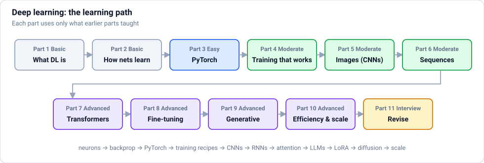

### Theory

> **In simple words:** **deep learning** is machine learning with **neural networks**: many layers of simple units, each doing a weighted sum and a small bend. Stacked deep enough and trained on enough data, they learn to recognise faces, transcribe speech, translate languages and write text. Every famous AI model of the 2020s (GPT, Claude, Gemini, Llama, Stable Diffusion, Whisper) is a deep neural network. These notes build every piece from scratch first, then show the PyTorch way.

**Words to know:**

- **Deep learning (DL):** machine learning with neural networks of many layers.
- **Neural network (artificial neural network, ANN, net):** a function built from layers of simple units (artificial neurons) whose numbers (weights) are learned from data. "ANN" distinguishes it from the biological neural networks in brains that loosely inspired it; in practice "neural network" always means the artificial kind.
- **Layer:** one stage of a network that transforms its input into an output (Section [6](#6-layers-and-the-forward-pass-the-multilayer-perceptron)).
- **Weights (parameters):** the learned numbers inside a network; a modern LLM has billions of them.
- **Training:** adjusting the weights so the network's outputs match the desired outputs on example data.
- **Inference:** using a trained network to make predictions.
- **PyTorch:** the most widely used deep-learning library (research and industry), from Meta and the PyTorch Foundation.
- **JAX / Keras:** Google's array library with automatic differentiation and compilation / a high-level API that can run on PyTorch, JAX or TensorFlow.
- **GPU (graphics processing unit):** a processor with thousands of small cores; deep learning runs 10–100× faster on GPUs than CPUs. **CUDA** is NVIDIA's GPU platform; **MPS** (Metal Performance Shaders) is Apple's.
- **Pretrained model:** a network already trained (usually at great expense) on a huge dataset, which you download and adapt.
- **Foundation model:** a large pretrained model usable for many tasks (GPT, Llama, CLIP, Whisper).
- **CUDA / MPS:** the programming platforms PyTorch uses to run on NVIDIA GPUs / on Apple Silicon GPUs (Metal Performance Shaders); in code they are the device names `"cuda"` and `"mps"`.
- **ANN (artificial neural network):** the full name of a neural network, used in many courses and exams; an MLP (Section [6](#6-layers-and-the-forward-pass-the-multilayer-perceptron)) is the classic ANN. Not to be confused with ANN = approximate nearest neighbour search in vector databases (Section [44](#44-embeddings-and-contrastive-learning-sentence-embeddings-simclr-and-clip-loss)).

**Everyday picture.** A child learns to read in stages: shapes of letters, then letters, then words, then sentences, then meaning. Nobody hands them a rulebook for every handwriting style. A deep network learns in layers the same way: early layers detect simple patterns, later layers combine them into concepts.

**These notes climb level by level:**

| Part | Level | What you learn | Afterwards you can… |
|---|---|---|---|
| 1 | Basic | What DL is, tensors and shapes, the neuron, activations | Read any network diagram and its shapes |
| 2 | Basic | Layers, losses, gradient descent, the chain rule, backpropagation and autograd from scratch | Explain exactly how a network learns |
| 3 | Easy | PyTorch: tensors, autograd, `nn.Module`, data loaders, the training loop, checkpoints | Train and save your own networks |
| 4 | Moderate | Initialisation, optimisers, schedules, normalisation, regularisation, debugging | Make training actually work |
| 5 | Moderate | Convolutions, CNNs, ResNet, transfer learning, detection and segmentation | Solve image problems |
| 6 | Moderate | Tokenisation, embeddings, RNNs, LSTMs, sequence-to-sequence | Handle text and sequences |
| 7 | Advanced | Attention and transformers from scratch, a tiny GPT, BERT/GPT/T5, decoding, vision transformers | Understand how LLMs work inside |
| 8 | Advanced | Hugging Face, fine-tuning, LoRA, RLHF/DPO, contrastive embeddings | Adapt pretrained models to your task |
| 9 | Advanced | Autoencoders, VAEs, GANs, diffusion | Understand image and audio generators |
| 10 | Advanced | Precision formats, distributed training, quantisation, distillation, fast inference, MoE, scaling | Train and serve big models efficiently |
| 11 | Interview Prep | Building blocks from scratch, what companies ask, cheat sheet, theory questions, glossary | Revise quickly and check your coverage |

**When to use deep learning vs classic ML (2026):**

| Data | Usually best |
|---|---|
| tables of business data (customers, transactions) | gradient-boosted trees (`machine-learning.md`); DL only at huge scale or with text/image columns |
| images, video | deep learning (CNNs, vision transformers), starting from a pretrained model |
| text | pretrained transformers and LLMs, or their embeddings |
| audio, speech | deep learning (Whisper-style transformers) |
| recommendations at very large scale | deep learning (two-tower models, sequence models), often with trees |

**Hardware.** Real training needs a GPU: NVIDIA (CUDA), Apple Silicon (MPS) or Google TPUs, locally or rented in the cloud; Google Colab and Kaggle notebooks offer free GPUs. Everything in these notes is sized to run on a laptop CPU in seconds to a minute. The same PyTorch code moves to a GPU with one line (Section [12](#12-pytorch-tensors-creating-indexing-broadcasting-and-devices)).

**How to study each section:** look at the picture; read the theory and trace the worked example by hand; **type** the code (NumPy first, then PyTorch), run it, change one number and predict the result before re-running; then try the practice before opening the answers.

**Setup:** `uv add torch torchvision transformers peft accelerate datasets` (or `pip install ...`; pytorch.org shows the right command for your GPU). Google Colab has all of these preinstalled.

### Practice

1. Install PyTorch (or open Colab) and run `import torch; print(torch.__version__, torch.cuda.is_available(), torch.backends.mps.is_available())`. Which accelerator, if any, does your machine have?

**Learn more:** [PyTorch: get started](https://pytorch.org/get-started/locally/) · [3Blue1Brown: neural networks (video series)](https://www.3blue1brown.com/topics/neural-networks) · [Dive into Deep Learning (free book)](https://d2l.ai/)

---

## 2. From Machine Learning to Deep Learning: Learning Features Instead of Designing Them


### Theory

> **In simple words:** classic ML needs **you** to design good features (ratios, counts, flags) and then fits a fairly simple model on them. Deep learning **learns the features itself**: each layer turns the raw input (pixels, characters, audio samples) into a slightly more useful description, and the last layer makes the prediction. That's why it wins wherever good features are hard to design by hand, like images and language.

**Words to know:**

- **Feature engineering:** designing input columns by hand from domain knowledge (`machine-learning.md`).
- **Representation:** the numbers a model uses to describe an input; a good representation makes the task easy.
- **Representation learning (feature learning):** learning the representation from data instead of designing it.
- **Hidden layer:** a layer between input and output whose values (**hidden units, activations**) are learned intermediate features.
- **Depth:** the number of layers. **Width:** the number of units per layer.
- **Linear model:** a model whose prediction is a weighted sum of the inputs (linear and logistic regression); its decision boundary is a straight line (or flat plane).
- **Non-linear:** anything that isn't a straight line; real patterns usually are.
- **Universal approximation theorem:** a network with one hidden layer and enough units can approximate any reasonable function; depth makes it far more **efficient** (fewer units for the same function).
- **End-to-end learning:** training one model all the way from raw input to final output, instead of a hand-built pipeline of steps.
- **`MLPClassifier`:** scikit-learn's simple neural network (multilayer perceptron); fine for small tabular demos, not for real deep learning.

**Everyday picture.** To sort apples from oranges, an old-style program needs someone to define "redness" and "roundness" first. A deep network is given only photos and labels, and discovers on its own that colour, texture and shape matter, including clues nobody thought to write down.

**The ring problem, traced:** points inside a circle of radius 1 are class 0; points in a ring around it are class 1. A **linear** model can only draw a straight line, so it gets about half right. Two fixes:

1. **Feature engineering:** add r = √(x² + y²). Now the classes are separated by "r < 1.5", a straight line **in the new feature**. You had to know circles were involved.
2. **Deep learning:** a network with a hidden layer learns its own intermediate features (each hidden unit draws a line; combined, they surround the inner circle). Nobody told it about circles.

**Classic ML vs deep learning:**

| | Classic ML | Deep learning |
|---|---|---|
| features | designed by people | learned from raw data |
| data needed | hundreds to millions of rows | usually much more (or a pretrained model) |
| compute | CPU, seconds to minutes | GPUs, minutes to months |
| best at | tables | images, audio, text, video |
| interpretability | often easier | harder |

**When not to use deep learning:** small tabular datasets (boosted trees win, `machine-learning.md` Section 35); problems where a simple, explainable model is required; when you have neither much data nor a suitable pretrained model.

**Common mistakes:**

- ❌ Reaching for a neural network on a 5,000-row spreadsheet.
- ❌ Believing deep learning needs no data work: it still needs clean, representative, well-labelled data.
- ❌ Training from scratch when a pretrained model exists (Part 8).

**Used in real software:** photo search (Google Photos, Apple Photos), speech recognition and dictation, machine translation, spam and abuse filters, recommendation feeds, self-driving perception, medical-image screening, and every chatbot.

### Python

```python
import numpy as np
import matplotlib.pyplot as plt
from sklearn.datasets import make_circles
from sklearn.linear_model import LogisticRegression
from sklearn.model_selection import train_test_split
from sklearn.neural_network import MLPClassifier

X, y = make_circles(n_samples=1000, factor=0.5, noise=0.08, random_state=0)
X_train, X_test, y_train, y_test = train_test_split(X, y, test_size=0.3, random_state=0)

linear = LogisticRegression().fit(X_train, y_train)
radius = lambda A: np.c_[A, np.sqrt((A ** 2).sum(axis=1))]               # hand-made feature: distance from centre
engineered = LogisticRegression().fit(radius(X_train), y_train)
network = MLPClassifier(hidden_layer_sizes=(16, 16), max_iter=2000, random_state=0).fit(X_train, y_train)
print(f"logistic regression on raw x, y      : {linear.score(X_test, y_test):.3f}")
print(f"logistic regression + radius feature : {engineered.score(radius(X_test), y_test):.3f}")
print(f"neural network on raw x, y            : {network.score(X_test, y_test):.3f}")

xx, yy = np.meshgrid(np.linspace(-1.5, 1.5, 300), np.linspace(-1.5, 1.5, 300))
grid = np.c_[xx.ravel(), yy.ravel()]
fig, axes = plt.subplots(1, 3, figsize=(11, 3.6), layout="constrained")
for ax, (title, pred) in zip(axes, [("logistic regression (raw)", linear.predict(grid)),
                                    ("neural network (raw)", network.predict(grid)),
                                    ("logistic + radius feature", engineered.predict(radius(grid)))]):
    ax.contourf(xx, yy, pred.reshape(xx.shape), alpha=0.25, cmap="coolwarm")
    ax.scatter(X_test[:, 0], X_test[:, 1], c=y_test, s=6, cmap="coolwarm")
    ax.set(title=title, xticks=[], yticks=[])
fig.savefig("rings-boundaries.png", dpi=100)
plt.close(fig)
```

**Output:**

```text
logistic regression on raw x, y      : 0.393
logistic regression + radius feature : 1.000
neural network on raw x, y            : 1.000
```

The linear model is no better than a coin flip. Give it the right feature and it's nearly perfect, but **you** had to know the answer was "distance from the centre". The network finds an equally good boundary from raw coordinates alone. With images, the "right features" are far too complex to write down, which is exactly where learned features win.

```python
r = np.sqrt((X_test ** 2).sum(axis=1))                                   # the true distance from the centre
h1 = np.maximum(0, X_test @ network.coefs_[0] + network.intercepts_[0])  # layer 1: ReLU(x·W₁ + b₁), 16 learned features
h2 = np.maximum(0, h1 @ network.coefs_[1] + network.intercepts_[1])      # layer 2 builds on layer 1's features
best = lambda H: max(abs(np.corrcoef(H[:, j], r)[0, 1]) for j in range(H.shape[1]) if H[:, j].std() > 0)
print("hidden features per point:", h1.shape, h2.shape)
print(f"best correlation of a single unit with the radius: layer 1 {best(h1):.2f}, layer 2 {best(h2):.2f}")
```

**Output:**

```text
hidden features per point: (300, 16) (300, 16)
best correlation of a single unit with the radius: layer 1 0.35, layer 2 0.98
```

Each hidden unit computes a new feature from the raw inputs. A first-layer unit is just one straight cut (ReLU of a weighted sum), so on its own it says little about the radius. The second layer **combines** those cuts, and some of its units track the distance from the centre almost perfectly. Nobody told the network about circles: it **invented** a radius-like feature, layer by layer, because that made the task easy. This is representation learning in miniature.

### Practice

1. Rerun the network with `hidden_layer_sizes=(2,)`. Can 2 hidden units solve the rings? Why or why not?
2. Name one problem from your own experience where designing features by hand would be impossible, and one where it would be easy.

<details>
<summary><b>Answer</b></summary>

```python
for hidden_sizes in [(2,), (3,), (8,)]:
    acc = MLPClassifier(hidden_layer_sizes=hidden_sizes, max_iter=3000, random_state=0).fit(X_train, y_train).score(X_test, y_test)
    print(hidden_sizes, round(acc, 3))
```

**Output:**

```text
(2,) 0.797
(3,) 0.98
(8,) 1.0
```

1. Each hidden unit with ReLU contributes one straight cut; 2 cuts can't enclose a region on all sides, while 3 or more cuts can form a closed shape around the inner circle (a triangle at minimum).
2. Impossible by hand: recognising a friend's face in photos, understanding sarcasm in text. Easy: predicting delivery time from distance and traffic (distance, time of day and weather are obvious features; a boosted tree is the right tool).

</details>

| # | Practice | Difficulty |
|---|---|---|
| 1 | [Kaggle Learn: Intro to Deep Learning](https://www.kaggle.com/learn/intro-to-deep-learning) | 🟢 Easy |
| 2 | [TensorFlow Playground: train a network on the circle dataset in your browser](https://playground.tensorflow.org/) | 🟢 Easy |

**Learn more:** [Dive into Deep Learning: introduction](https://d2l.ai/chapter_introduction/index.html) · [Goodfellow, Bengio & Courville, Deep Learning (free book), chapter 1](https://www.deeplearningbook.org/)

---

## 3. Tensors and Shapes: Scalars, Vectors, Matrices and Batches


### Theory

> **In simple words:** every input, weight and output in deep learning is a **tensor**: an array of numbers with some number of axes. Reading and checking **shapes** is the single most useful skill in deep learning: most bugs are shape bugs, and most architecture diagrams are really just "this shape becomes that shape".

**Words to know:**

- **Tensor:** an n-dimensional array of numbers of one type (NumPy calls it an `ndarray`; PyTorch calls it a `Tensor`).
- **Rank (number of axes, `ndim`):** how many indices you need to pick one number: scalar 0, vector 1, matrix 2, image batch 4.
- **Shape:** the size along each axis, e.g. `(32, 3, 224, 224)`.
- **Axis (dimension, dim):** one direction of the array; `axis=0` is usually the **batch** axis.
- **Batch:** a group of examples processed together; the **batch size** N is the first axis.
- **Channels (C):** values per pixel position: 1 for grayscale, 3 for RGB colour, hundreds inside a CNN.
- **NCHW / NHWC:** layouts for image batches: (batch, channels, height, width), PyTorch's default, vs (batch, height, width, channels), TensorFlow's and image files' layout.
- **Sequence length (T):** the number of time steps or tokens in a sequence. **Hidden size / embedding dimension (D, d_model):** how many numbers describe each token.
- **Reshape / view:** reinterpreting the same numbers with a different shape (the total count must match). **Flatten:** turning everything after the batch axis into one long vector.
- **Transpose / permute:** swapping or reordering axes (NHWC → NCHW).
- **Broadcasting:** NumPy/PyTorch's rule for combining arrays of different shapes by stretching size-1 axes (`data-science.md` Section 13).
- **dtype (data type):** the number format: `float32` (the default for training), `float16`/`bfloat16` (half precision, Part 10), `int64` (labels and token ids).
- **Element count:** the product of the shape: (32, 3, 224, 224) holds 4,816,896 numbers.

**Everyday picture.** A tensor is like an apartment complex address: building → floor → flat → room. A scalar is one room; a vector is a corridor of rooms; a matrix is a floor; a batch of images is a whole complex of floors stacked in buildings. The shape says how many of each level there are.

**Common shapes, traced:**

| Data | Shape | Meaning |
|---|---|---|
| one house's 5 features | (5,) | vector |
| 32 houses | (32, 5) | batch × features |
| 32 grayscale 28×28 digits | (32, 1, 28, 28) | N, C, H, W |
| 16 RGB photos 224×224 | (16, 3, 224, 224) | 2.4M numbers |
| 8 sentences of 20 token ids | (8, 20) | N, T (integers) |
| the same after embedding to 64 numbers per token | (8, 20, 64) | N, T, D |
| a linear layer's weight, 64 → 10 | (64, 10) or (10, 64) | depends on the library's convention |

**Matrix multiplication shapes:** (N, D_in) @ (D_in, D_out) → (N, D_out). The inner sizes must match; this one rule explains most "shape mismatch" errors.

**Common mistakes:**

- ❌ Feeding NHWC images to a PyTorch model expecting NCHW.
- ❌ Forgetting the batch axis when predicting one example: shape (3, 224, 224) instead of (1, 3, 224, 224).
- ❌ Reshaping when you meant to transpose: `reshape` keeps the memory order, so it scrambles images if used to swap axes.
- ❌ Labels as `float` when the loss expects integer class ids (or vice versa).

**Used in real software:** every model card on Hugging Face lists input shapes; ONNX and TensorRT model files are typed by tensor shape; image libraries (PIL, OpenCV) load NHWC arrays that every vision pipeline converts to NCHW.

### Python

```python
import numpy as np

scalar = np.array(3.5)
vector = np.array([1.0, 2.0, 3.0])
matrix = np.arange(6).reshape(2, 3)
images = np.zeros((32, 1, 28, 28), dtype=np.float32)                   # a batch of 32 grayscale digits
for name, t in [("scalar", scalar), ("vector", vector), ("matrix", matrix), ("images", images)]:
    print(f"{name:7s} ndim={t.ndim} shape={t.shape} size={t.size} dtype={t.dtype}")

photo_nhwc = np.random.default_rng(0).integers(0, 256, size=(224, 224, 3), dtype=np.uint8)   # how image files load
batch_nchw = (photo_nhwc.astype(np.float32) / 255).transpose(2, 0, 1)[None]                  # scale, move channels, add batch
print("photo", photo_nhwc.shape, photo_nhwc.dtype, "→ model input", batch_nchw.shape, batch_nchw.dtype)
print("same pixel:", photo_nhwc[10, 20, 1], "=", round(float(batch_nchw[0, 1, 10, 20] * 255)))

flat = images.reshape(32, -1)                                            # -1: "work out this size for me"
print("flattened for a linear layer:", flat.shape)
W = np.zeros((784, 10)); b = np.zeros(10)
print("linear layer: (32, 784) @ (784, 10) + (10,) →", (flat @ W + b).shape)
```

**Output:**

```text
scalar  ndim=0 shape=() size=1 dtype=float64
vector  ndim=1 shape=(3,) size=3 dtype=float64
matrix  ndim=2 shape=(2, 3) size=6 dtype=int64
images  ndim=4 shape=(32, 1, 28, 28) size=25088 dtype=float32
photo (224, 224, 3) uint8 → model input (1, 3, 224, 224) float32
same pixel: 130 = 130
flattened for a linear layer: (32, 784)
linear layer: (32, 784) @ (784, 10) + (10,) → (32, 10)
```

`transpose(2, 0, 1)` moves the channel axis to the front (NHWC → CHW) and `[None]` adds a batch axis of size 1. The same pixel value appears at the new position, so nothing was scrambled. `reshape(32, -1)` keeps the batch axis and flattens each 1×28×28 image into 784 numbers.

```python
tokens = np.array([[5, 9, 2, 0], [7, 7, 1, 3]])                         # 2 sentences, 4 token ids each: (N, T)
embedding_table = np.random.default_rng(1).normal(size=(10, 6))         # vocabulary of 10 tokens, 6 numbers each
embedded = embedding_table[tokens]                                       # look up a row per token id
print("token ids", tokens.shape, "→ embedded", embedded.shape)

try:
    np.zeros((32, 784)) @ np.zeros((10, 784))
except ValueError as e:
    print("shape error:", str(e).rsplit("(", 1)[1].rstrip(")"))
print("fixed with a transpose:", (np.zeros((32, 784)) @ np.zeros((10, 784)).T).shape)
```

**Output:**

```text
token ids (2, 4) → embedded (2, 4, 6)
shape error: size 10 is different from 784
fixed with a transpose: (32, 10)
```

Looking up rows of a table by integer id turns (N, T) token ids into (N, T, D) vectors: that's all an embedding layer does (Section [30](#30-embeddings-turning-tokens-into-vectors)). PyTorch's linear layers store their weight as (out, in), which is why a transpose appears inside them.

### Practice

1. How many numbers are in a batch of 64 RGB images of size 128×128? How many megabytes as float32 (4 bytes each)?
2. You have a batch of shape (8, 20, 64) and want one vector per sentence by averaging over tokens. Which axis do you average, and what's the result's shape?

<details>
<summary><b>Answer</b></summary>

```python
n = 64 * 3 * 128 * 128
print(n, "numbers,", round(n * 4 / 1e6, 1), "MB")
print(np.zeros((8, 20, 64)).mean(axis=1).shape)
```

**Output:**

```text
3145728 numbers, 12.6 MB
(8, 64)
```

1. 3,145,728 numbers, about 12.6 MB: activations inside a network are many times bigger than the input, which is why GPU memory runs out.
2. `axis=1` (the token axis T), giving (8, 64): one 64-number vector per sentence ("mean pooling").

</details>

| # | Problem (Deep-ML) | Difficulty |
|---|---|---|
| 1 | [3. Reshape Matrix](https://www.deep-ml.com/problems/3) | 🟢 Easy |
| 2 | [1. Matrix-Vector Dot Product](https://www.deep-ml.com/problems/1) | 🟢 Easy |
| 3 | [9. Matrix times Matrix](https://www.deep-ml.com/problems/9) | 🟡 Medium |

**Learn more:** [PyTorch: tensors tutorial](https://pytorch.org/tutorials/beginner/basics/tensorqs_tutorial.html) · [NumPy: broadcasting](https://numpy.org/doc/stable/user/basics.broadcasting.html)

---

## 4. The Artificial Neuron: Weights, Bias and a Decision


### Theory

> **In simple words:** a **neuron** multiplies each input by a **weight**, adds them up with a **bias**, and passes the total through an **activation function** that decides how strongly it "fires". One neuron is just logistic regression: it can separate classes with one straight line. Networks get their power from connecting many of them.

**Words to know:**

- **Artificial neuron (unit, node):** computes activation(w₁x₁ + w₂x₂ + … + b).
- **Weight (wᵢ):** how much input i matters, and in which direction (positive or negative).
- **Bias (b):** a number added to the weighted sum; it shifts the decision line so it needn't pass through the origin.
- **Pre-activation (logit, z):** the weighted sum before the activation: z = w·x + b.
- **Activation function:** the function applied to z (Section [5](#5-activation-functions-sigmoid-tanh-relu-gelu-and-softmax)).
- **Perceptron:** the original neuron (Rosenblatt, 1958) with a step activation (output 1 if z > 0, else 0) and a simple learning rule.
- **Perceptron learning rule:** for each wrong prediction, nudge the weights towards the correct answer: w ← w + lr·(y − ŷ)·x.
- **Decision boundary:** where z = 0; for one neuron it's a straight line (a **hyperplane** in more dimensions).
- **Linearly separable:** classes that one straight line (plane) can separate perfectly.
- **XOR (exclusive or):** true when exactly one of two inputs is true; famously **not** linearly separable.
- **Biological neuron:** the brain cell that loosely inspired the idea; real neurons are far more complex, so treat the analogy as a picture, not a model.

**Everyday picture.** Deciding whether to go to a party: will friends be there (weight +3), is it raining (−2), is it far (−1)? Add up the reasons, add your general mood (the bias), and go if the total is positive. One neuron is one such weighted vote.

**A neuron by hand:** weights w = (2, −1), bias b = −0.5, input x = (1, 1).
z = 2·1 + (−1)·1 + (−0.5) = 0.5; step activation → fires (1). With x = (0, 1): z = 0 − 1 − 0.5 = −1.5 → doesn't fire (0).

**Why one neuron can't learn XOR, traced:**

| x₁ | x₂ | AND | OR | XOR |
|---|---|---|---|---|
| 0 | 0 | 0 | 0 | 0 |
| 0 | 1 | 0 | 1 | **1** |
| 1 | 0 | 0 | 1 | **1** |
| 1 | 1 | 1 | 1 | 0 |

Plot the four corners of a square: for AND, a line can cut off the corner (1, 1); for OR, cut off (0, 0). For XOR the two 1s sit on opposite corners, and no single straight line can put them on one side and the two 0s on the other. Two neurons (two lines) feeding a third solve it: Section [6](#6-layers-and-the-forward-pass-the-multilayer-perceptron). This limitation, published by Minsky and Papert in 1969, slowed neural-network research for over a decade.

**Common mistakes:**

- ❌ Leaving out the bias: the boundary is then forced through the origin.
- ❌ Expecting one neuron (or any linear model) to learn non-linear patterns.
- ❌ Taking the brain analogy literally.

**Used in real software:** every unit in every network (a GPT-style model's feed-forward layers alone contain hundreds of millions of these weighted sums); single neurons are logistic regression, still used for click-through-rate prediction at huge scale.

### Python

```python
import numpy as np

def neuron(x, w, b):
    return int(np.dot(w, x) + b > 0)                                    # step activation

print("by hand:", neuron(np.array([1, 1]), np.array([2, -1]), -0.5), neuron(np.array([0, 1]), np.array([2, -1]), -0.5))

def train_perceptron(X, y, lr=0.1, epochs=20):
    w, b = np.zeros(X.shape[1]), 0.0
    for epoch in range(epochs):
        mistakes = 0
        for x_i, y_i in zip(X, y):
            y_hat = int(w @ x_i + b > 0)
            w += lr * (y_i - y_hat) * x_i                                 # only changes when wrong
            b += lr * (y_i - y_hat)
            mistakes += y_hat != y_i
        if mistakes == 0:
            return w, b, epoch + 1
    return w, b, None

X = np.array([[0, 0], [0, 1], [1, 0], [1, 1]])
for name, y in [("AND", np.array([0, 0, 0, 1])), ("OR", np.array([0, 1, 1, 1])), ("XOR", np.array([0, 1, 1, 0]))]:
    w, b, converged = train_perceptron(X, y)
    preds = [int(w @ x + b > 0) for x in X]
    status = f"learned in {converged} epochs" if converged else "never gets all four right"
    print(f"{name}: weights {w.round(2).tolist()}, bias {round(b, 2)}, predictions {preds} → {status}")
```

**Output:**

```text
by hand: 1 0
AND: weights [0.2, 0.1], bias -0.2, predictions [0, 0, 0, 1] → learned in 6 epochs
OR: weights [0.1, 0.1], bias 0.0, predictions [0, 1, 1, 1] → learned in 4 epochs
XOR: weights [-0.1, 0.0], bias 0.1, predictions [1, 1, 0, 0] → never gets all four right
```

The perceptron rule finds weights for AND and OR within a few passes over the data (**epochs**), and keeps flipping forever on XOR, because no weights exist that make all four predictions right.

### Practice

1. Find weights and a bias by hand for a neuron computing NAND (not-AND: 0 only when both inputs are 1). Check with `neuron`.
2. Build XOR from three neurons you wire by hand: XOR(a, b) = AND(OR(a, b), NAND(a, b)).

<details>
<summary><b>Answer</b></summary>

```python
nand = lambda a, b: neuron(np.array([a, b]), np.array([-1, -1]), 1.5)
or_ = lambda a, b: neuron(np.array([a, b]), np.array([1, 1]), -0.5)
and_ = lambda a, b: neuron(np.array([a, b]), np.array([1, 1]), -1.5)
print("NAND:", [nand(a, b) for a, b in X])
print("XOR :", [and_(or_(a, b), nand(a, b)) for a, b in X])
```

**Output:**

```text
NAND: [1, 1, 1, 0]
XOR : [0, 1, 1, 0]
```

1. w = (−1, −1), b = 1.5: z is positive unless both inputs are 1 (−2 + 1.5 < 0).
2. Two neurons in a **hidden layer** (OR and NAND) feed one output neuron (AND). Stacking neurons is what makes networks more powerful than any single neuron; Part 2 shows how the weights are **learned** instead of hand-picked.

</details>

| # | Problem (Deep-ML) | Difficulty |
|---|---|---|
| 1 | [24. Single Neuron](https://www.deep-ml.com/problems/24) | 🟢 Easy |
| 2 | [25. Single Neuron with Backpropagation](https://www.deep-ml.com/problems/25) | 🟡 Medium |

**Learn more:** [Michael Nielsen, Neural Networks and Deep Learning, chapter 1 (free book)](http://neuralnetworksanddeeplearning.com/chap1.html) · [Dive into Deep Learning: linear neural networks](https://d2l.ai/chapter_linear-regression/index.html)

---

## 5. Activation Functions: Sigmoid, Tanh, ReLU, GELU and Softmax


### Theory

> **In simple words:** an activation function is the "bend" applied after each weighted sum. Without it, a stack of layers collapses into one big linear model, no matter how many layers. The choice matters for learning: functions that go **flat** (sigmoid, tanh at the extremes) have tiny slopes, so learning signals fade; **ReLU** and its smooth cousins keep a healthy slope and are the default in modern networks. **Softmax** turns a vector of scores into probabilities at the output.

**Words to know:**

- **Sigmoid (σ):** σ(z) = 1 / (1 + e⁻ᶻ); squashes to (0, 1). Slope at most 0.25.
- **Tanh:** squashes to (−1, 1), centred at 0. Slope at most 1.
- **ReLU (rectified linear unit):** max(0, z): zero for negatives, identity for positives. Cheap, and its slope is exactly 1 for positive inputs.
- **Leaky ReLU:** like ReLU but with a small slope (e.g. 0.01) for negatives, so units never go completely silent.
- **GELU (Gaussian error linear unit):** z · Φ(z), a smooth ReLU used in BERT and GPT models. **SiLU / Swish:** z · σ(z), similar, used in many modern models; **SwiGLU** is a gated variant used in Llama-style models (Section [35](#35-the-transformer-block-residuals-normalisation-and-the-feed-forward-network)).
- **Softmax:** turns a vector of scores (**logits**) into probabilities that sum to 1: softmax(z)ᵢ = e^zᵢ / Σⱼ e^zⱼ.
- **Logits:** raw, unnormalised scores before sigmoid or softmax.
- **Saturation:** the flat region of sigmoid/tanh, where the slope is near 0.
- **Vanishing gradient:** learning signals shrinking towards 0 as they pass backwards through many saturating layers (Section [18](#18-weight-initialisation-and-vanishing-or-exploding-gradients)).
- **Dead ReLU (dying ReLU):** a unit whose input is negative for every example, so it outputs 0 and its slope is 0: it can never recover.
- **Derivative (slope, gradient):** how much the output changes per small change of the input (`machine-learning.md` Section 7).
- **Numerical stability:** avoiding overflow/underflow, e.g. computing softmax as e^(z − max z) so no exponent explodes.

**Everyday picture.** A dimmer switch vs a light switch vs a one-way valve. Sigmoid is a dimmer that's stuck once you push it fully on or off (no change near the ends). ReLU is a valve: nothing flows backwards, and forwards it lets everything through in proportion.

**Why the bend is essential, traced:** two linear layers without activation: y = W₂(W₁x) = (W₂W₁)x, a single matrix. Ten layers of matrices still multiply into one matrix: one linear model. Insert ReLU between them and the composition can bend.

**Slopes, traced** (they decide how much learning signal flows backwards):

| z | sigmoid(z) | sigmoid slope | tanh slope | ReLU | ReLU slope |
|---|---|---|---|---|---|
| −5 | 0.007 | 0.007 | 0.000 | 0 | 0 |
| 0 | 0.5 | **0.25** | 1.0 | 0 | 0 (by convention) |
| 2 | 0.881 | 0.105 | 0.071 | 2 | 1 |
| 5 | 0.993 | 0.007 | 0.000 | 5 | 1 |

Through 10 sigmoid layers, even the best-case slope 0.25 multiplies to 0.25¹⁰ ≈ 0.000001: the early layers barely learn. ReLU's slope of 1 passes the signal through unchanged.

**Which activation where (2026):**

| Place | Use |
|---|---|
| hidden layers of MLPs and CNNs | ReLU (or GELU/SiLU) |
| transformers | GELU, or SwiGLU in Llama/Mistral-style models |
| binary output (one probability) | sigmoid (inside `BCEWithLogitsLoss`) |
| multi-class output | softmax (inside `CrossEntropyLoss`) |
| output in (−1, 1), e.g. image pixels in a GAN | tanh |
| regression output | none (identity) |
| gates inside LSTMs/GRUs | sigmoid and tanh |

**Common mistakes:**

- ❌ No activation between layers (the network is secretly linear).
- ❌ Sigmoid in deep hidden stacks (vanishing gradients).
- ❌ Applying softmax yourself and **then** using `CrossEntropyLoss`, which applies it again internally (Section [7](#7-loss-functions-for-neural-networks-mse-cross-entropy-and-logits)).
- ❌ A naive softmax `np.exp(z) / np.exp(z).sum()` that overflows for large logits.

**Used in real software:** ReLU in ResNet and most CNNs; GELU in BERT, GPT-2/3 and ViT; SwiGLU in Llama, Mistral, Qwen and Gemma; sigmoid gates in LSTMs (speech, early translation systems); softmax at the output of every classifier and every LLM's next-token prediction.

### Python

```python
import numpy as np
import matplotlib.pyplot as plt
from math import erf, sqrt

z = np.linspace(-5, 5, 401)
sigmoid = 1 / (1 + np.exp(-z))
gelu = z * 0.5 * (1 + np.vectorize(erf)(z / sqrt(2)))                    # z · Φ(z), Φ = standard normal CDF
fns = {"sigmoid": sigmoid, "tanh": np.tanh(z), "ReLU": np.maximum(0, z), "GELU": gelu}
for name, f in fns.items():
    slope = np.gradient(f, z)                                             # numerical derivative
    print(f"{name:8s} value at z=-5, 0, 2, 5: {np.interp([-5, 0, 2, 5], z, f).round(3).tolist()}"
          f"   slope: {np.interp([-5, 0, 2, 5], z, slope).round(3).tolist()}")

fig, axes = plt.subplots(1, 2, figsize=(10, 3.6), layout="constrained")
for name, f in fns.items():
    axes[0].plot(z, f, label=name)
    axes[1].plot(z, np.gradient(f, z), label=name)
axes[0].set(title="activation", ylim=(-1.5, 3)); axes[1].set(title="slope (derivative)", ylim=(-0.2, 1.2))
for ax in axes:
    ax.axhline(0, color="gray", lw=0.6); ax.legend(fontsize=8)
fig.savefig("activations.png", dpi=100)
plt.close(fig)
print("10 layers of best-case sigmoid slope:", 0.25 ** 10)
```

**Output:**

```text
sigmoid  value at z=-5, 0, 2, 5: [0.007, 0.5, 0.881, 0.993]   slope: [0.007, 0.25, 0.105, 0.007]
tanh     value at z=-5, 0, 2, 5: [-1.0, 0.0, 0.964, 1.0]   slope: [0.0, 1.0, 0.071, 0.0]
ReLU     value at z=-5, 0, 2, 5: [0.0, 0.0, 2.0, 5.0]   slope: [0.0, 0.5, 1.0, 1.0]
GELU     value at z=-5, 0, 2, 5: [-0.0, 0.0, 1.954, 5.0]   slope: [-0.0, 0.5, 1.085, 1.0]
10 layers of best-case sigmoid slope: 9.5367431640625e-07
```

The numerical slope of ReLU at exactly 0 comes out as 0.5 (the average of the slopes on either side); libraries define it as 0. GELU is almost ReLU for large |z| but smooth near 0, with a small negative dip.

```python
def softmax(logits):
    shifted = logits - logits.max(axis=-1, keepdims=True)              # stability: largest exponent is e^0 = 1
    e = np.exp(shifted)
    return e / e.sum(axis=-1, keepdims=True)

logits = np.array([2.0, 1.0, 0.1])
print("softmax:", softmax(logits).round(3), "sum", softmax(logits).sum())
print("adding 100 to every logit changes nothing:", softmax(logits + 100).round(3))
with np.errstate(over="ignore", invalid="ignore"):
    naive = np.exp(np.array([1000.0, 999.0])) / np.exp(np.array([1000.0, 999.0])).sum()
print("naive softmax of [1000, 999]:", naive, "| stable:", softmax(np.array([1000.0, 999.0])).round(3))

x = np.random.default_rng(0).normal(size=(4, 3))
W1, W2 = np.random.default_rng(1).normal(size=(3, 5)), np.random.default_rng(2).normal(size=(5, 2))
print("two linear layers equal one matrix:", np.allclose((x @ W1) @ W2, x @ (W1 @ W2)))
print("with ReLU between them they don't:", np.allclose(np.maximum(0, x @ W1) @ W2, x @ (W1 @ W2)))
```

**Output:**

```text
softmax: [0.659 0.242 0.099] sum 1.0
adding 100 to every logit changes nothing: [0.659 0.242 0.099]
naive softmax of [1000, 999]: [nan nan] | stable: [0.731 0.269]
two linear layers equal one matrix: True
with ReLU between them they don't: False
```

Softmax only cares about **differences** between logits, which is why subtracting the maximum is free and prevents `exp(1000)` from overflowing to infinity (and `inf / inf` = `nan`).

### Practice

1. Compute the derivative of sigmoid from the formula σ'(z) = σ(z)(1 − σ(z)) at z = 0 and z = 2, and compare with the table.
2. A unit's pre-activation is −3 for every training example. With ReLU, what is its output and its slope? What happens with Leaky ReLU (slope 0.01)?

<details>
<summary><b>Answer</b></summary>

```python
s = lambda v: 1 / (1 + np.exp(-v))
print([round(float(s(v) * (1 - s(v))), 3) for v in (0, 2)])
leaky = lambda v: np.where(v > 0, v, 0.01 * v)
print("ReLU:", max(0, -3), "slope 0 | Leaky ReLU:", float(leaky(-3)), "slope 0.01")
```

**Output:**

```text
[0.25, 0.105]
ReLU: 0 slope 0 | Leaky ReLU: -0.03 slope 0.01
```

1. 0.25 and 0.105, matching the table: the slope peaks at the middle and fades at both ends.
2. ReLU outputs 0 with slope 0 for every example, so no learning signal ever reaches its weights: a **dead** unit. Leaky ReLU outputs −0.03 with slope 0.01, so the unit can still learn its way back.

</details>

| # | Problem (Deep-ML) | Difficulty |
|---|---|---|
| 1 | [22. Sigmoid Activation Function Understanding](https://www.deep-ml.com/problems/22) | 🟢 Easy |
| 2 | [42. Implement ReLU Activation Function](https://www.deep-ml.com/problems/42) | 🟢 Easy |
| 3 | [23. Softmax Activation Function Implementation](https://www.deep-ml.com/problems/23) | 🟢 Easy |
| 4 | [147. GeLU Activation Function](https://www.deep-ml.com/problems/147) | 🟢 Easy |
| 5 | [217. Derivatives of Activation Functions](https://www.deep-ml.com/problems/217) | 🟢 Easy |
| 6 | [39. Implementation of Log Softmax Function](https://www.deep-ml.com/problems/39) | 🟢 Easy |
| 7 | [156. Implement SwiGLU activation function](https://www.deep-ml.com/problems/156) | 🟢 Easy |
| 8 | [98. Implement PReLU Forward and Backward Pass](https://www.deep-ml.com/problems/98) | 🟡 Medium |

**Learn more:** [PyTorch: non-linear activations](https://docs.pytorch.org/docs/stable/nn.html#non-linear-activations-weighted-sum-nonlinearity) · [Hendrycks & Gimpel, Gaussian Error Linear Units (GELU paper)](https://arxiv.org/abs/1606.08415)

---

### ✅ Part 1 checkpoint

Without looking, can you:

- [ ] Explain what deep learning adds over classic ML, and when classic ML is still the better choice?
- [ ] Read and predict tensor shapes: (N, C, H, W), (N, T), (N, T, D), and the matrix-multiplication rule?
- [ ] Compute a neuron's output by hand and explain why one neuron can't learn XOR?
- [ ] Explain why activations are needed, compare sigmoid, tanh, ReLU and GELU by their slopes, and write a numerically stable softmax?

Part 2 connects neurons into layers and shows, step by step, how a network **learns** its weights.

---

# Part 2 — Basic: How Networks Learn

> **Goal:** Connect neurons into layers, measure mistakes with a loss, and understand **exactly** how a network learns: gradient descent on mini-batches, the chain rule on a computational graph, backpropagation written by hand in NumPy, and a tiny automatic-differentiation engine like the one inside PyTorch.  
> **You need:** Part 1, and derivatives and gradient descent from `machine-learning.md` Sections 7–8.

---

## 6. Layers and the Forward Pass: the Multilayer Perceptron


### Theory

> **In simple words:** a **layer** is many neurons looking at the same inputs, computed all at once as one matrix multiplication plus a bias, followed by an activation. A **multilayer perceptron (MLP)** stacks such layers: each layer's outputs are the next layer's inputs. Running an input through all layers to get a prediction is the **forward pass**.

**Words to know:**

- **Fully connected (dense, linear) layer:** every output unit is connected to every input: out = activation(x @ W + b), with W of shape (in, out) and b of shape (out,).
- **Multilayer perceptron (MLP, feed-forward network):** a stack of fully connected layers with activations between them; the classic **ANN** (artificial neural network) of textbooks and courses, and the building block inside every bigger architecture.
- **Input layer / hidden layers / output layer:** the raw features / the intermediate layers / the final predictions.
- **Forward pass:** computing the output from the input, layer by layer.
- **Activations (hidden states):** the outputs of a layer (not to be confused with activation **functions**).
- **Parameter count:** for a dense layer, in × out weights + out biases.
- **Architecture:** the choice of layers, sizes and connections (as opposed to the learned weights).
- **Hyperparameters:** settings chosen before training: number of layers, widths, learning rate.
- **Logits:** the output layer's raw scores, before sigmoid/softmax.

**Everyday picture.** An assembly line: the first station turns raw parts into components, the next assembles components into modules, the last assembles modules into a product. Each station (layer) only sees what the previous one handed over.

**A forward pass by hand** (2 inputs → 2 hidden ReLU units → 1 output), solving XOR with chosen weights:

W₁ = [[1, 1], [1, 1]] (columns = hidden units), b₁ = (0, −1); W₂ = (1, −2), b₂ = 0.

| x | h = ReLU(x·W₁ + b₁) | out = h·W₂ + b₂ | XOR |
|---|---|---|---|
| (0, 0) | ReLU(0, −1) = (0, 0) | 0 | 0 |
| (0, 1) | ReLU(1, 0) = (1, 0) | 1 | 1 |
| (1, 0) | ReLU(1, 0) = (1, 0) | 1 | 1 |
| (1, 1) | ReLU(2, 1) = (2, 1) | 2 − 2 = 0 | 0 |

The first hidden unit counts how many inputs are on; the second fires only when both are; the output subtracts twice the second from the first. Two layers did what one neuron could not.

**Parameter counting, traced** for 784 → 128 → 64 → 10 (an MNIST classifier): 784·128 + 128 = 100,480; 128·64 + 64 = 8,256; 64·10 + 10 = 650; total **109,386**.

**Common mistakes:**

- ❌ Forgetting activations between layers (the stack collapses into one linear layer).
- ❌ Putting ReLU on the output of a regression or classification head (outputs can't be negative; logits need to be).
- ❌ Making networks enormous for small data; width and depth are hyperparameters to tune.

**Used in real software:** MLPs are the feed-forward half of every transformer block, the "heads" on top of image and text models, the towers of recommendation models, and small standalone models for tabular or sensor data.

### Python

```python
import numpy as np

relu = lambda z: np.maximum(0, z)
X = np.array([[0, 0], [0, 1], [1, 0], [1, 1]])
W1, b1 = np.array([[1, 1], [1, 1]]), np.array([0, -1])
W2, b2 = np.array([1, -2]), 0
h = relu(X @ W1 + b1)                                     # (4, 2) @ (2, 2) + (2,) → (4, 2): all examples at once
print("hidden:", h.tolist())
print("output:", (h @ W2 + b2).tolist(), "| XOR:", [0, 1, 1, 0])

def init_mlp(sizes, seed=0):
    rng = np.random.default_rng(seed)
    return [(rng.normal(0, np.sqrt(2 / n_in), (n_in, n_out)), np.zeros(n_out)) for n_in, n_out in zip(sizes[:-1], sizes[1:])]

def forward(params, x):
    for k, (W, b) in enumerate(params):
        x = x @ W + b
        if k < len(params) - 1:                           # no activation on the output layer: raw logits
            x = relu(x)
    return x

params = init_mlp([784, 128, 64, 10])
for k, (W, b) in enumerate(params):
    print(f"layer {k + 1}: W {W.shape}, b {b.shape}, parameters {W.size + b.size:,}")
print("total parameters:", f"{sum(W.size + b.size for W, b in params):,}")
batch = np.random.default_rng(1).random((32, 784))
print("forward pass:", batch.shape, "→", forward(params, batch).shape)
```

**Output:**

```text
hidden: [[0, 0], [1, 0], [1, 0], [2, 1]]
output: [0, 1, 1, 0] | XOR: [0, 1, 1, 0]
layer 1: W (784, 128), b (128,), parameters 100,480
layer 2: W (128, 64), b (64,), parameters 8,256
layer 3: W (64, 10), b (10,), parameters 650
total parameters: 109,386
forward pass: (32, 784) → (32, 10)
```

The whole batch goes through each layer as one matrix multiplication: that's why GPUs, which multiply matrices extremely fast, made deep learning practical. The random initial weights use a scale of √(2 / n_in) (**He initialisation**, Section [18](#18-weight-initialisation-and-vanishing-or-exploding-gradients)) so signals neither explode nor vanish.

### Practice

1. Count the parameters of a 3 → 5 → 5 → 2 network (the picture above) by hand, then with `init_mlp`.
2. What is the output shape of `forward` for a batch of 7 examples through `[20, 16, 3]`?

<details>
<summary><b>Answer</b></summary>

```python
print(sum(W.size + b.size for W, b in init_mlp([3, 5, 5, 2])))
print(forward(init_mlp([20, 16, 3]), np.ones((7, 20))).shape)
```

**Output:**

```text
62
(7, 3)
```

1. 3·5 + 5 = 20, 5·5 + 5 = 30, 5·2 + 2 = 12: total 62.
2. (7, 3): one row of 3 logits per example.

</details>

| # | Problem (Deep-ML) | Difficulty |
|---|---|---|
| 1 | [371. Calculate Number of Parameters in Neural Network](https://www.deep-ml.com/problems/371) | 🟢 Easy |
| 2 | [40. Implementing a Custom Dense Layer in Python](https://www.deep-ml.com/problems/40) | 🔴 Hard |

**Learn more:** [Michael Nielsen, Neural Networks and Deep Learning, chapter 1](http://neuralnetworksanddeeplearning.com/chap1.html) · [Dive into Deep Learning: multilayer perceptrons](https://d2l.ai/chapter_multilayer-perceptrons/index.html)

---

## 7. Loss Functions for Neural Networks: MSE, Cross-Entropy and Logits


### Theory

> **In simple words:** the **loss** turns "how wrong is the network?" into one number that training pushes down. Regression uses **mean squared error**; classification uses **cross-entropy**, which punishes the network for giving low probability to the correct class, very harshly when it was confidently wrong. In PyTorch you pass **logits** (raw scores) to the loss, which applies sigmoid or softmax internally in a numerically safe way.

**Words to know:**

- **Loss (cost, objective):** a single number measuring how wrong the predictions are on a batch; lower is better.
- **MSE (mean squared error):** mean of (prediction − target)²; for regression.
- **MAE / L1 loss, Huber (smooth L1):** absolute-error losses that are less sensitive to outliers (`machine-learning.md` Section 11).
- **Binary cross-entropy (BCE, log loss):** −[y·log p + (1 − y)·log(1 − p)] for a yes/no target y and predicted probability p.
- **Cross-entropy (categorical, CE):** −log(probability given to the true class), averaged over examples; for multi-class.
- **Negative log-likelihood (NLL):** the same thing seen from statistics: maximising the probability of the data = minimising −log of it (`machine-learning.md` Section 9).
- **Log-softmax / log-sum-exp:** computing log(softmax(z)) as z − log Σ e^z in a stable way; what `CrossEntropyLoss` does inside.
- **`BCEWithLogitsLoss` / `CrossEntropyLoss`:** PyTorch's losses that take **logits** and combine the sigmoid/softmax with the log stably.
- **Label smoothing:** training against slightly softened targets (0.9 for the true class instead of 1.0) so the model isn't pushed towards extreme overconfidence.
- **Perplexity:** e^(mean cross-entropy) for language models: "as uncertain as choosing among this many equally likely tokens".
- **Bits / nats:** units of cross-entropy with log base 2 / base e.

**Everyday picture.** A weather forecaster who said "1% chance of rain" on a day it poured should lose far more credibility than one who said "40%". Cross-entropy is that credibility score: −log(0.01) = 4.6 versus −log(0.4) = 0.9.

**Cross-entropy, traced** (3 classes, true class = 0):

| logits | softmax probabilities | p(true) | loss −ln p |
|---|---|---|---|
| (2.0, 1.0, 0.1) | (0.659, 0.242, 0.099) | 0.659 | 0.417 |
| (5.0, 0.0, 0.0) | (0.987, 0.007, 0.007) | 0.987 | 0.013 |
| (0.0, 3.0, 0.0) | (0.045, 0.909, 0.045) | 0.045 | 3.10 |

Only the probability of the **true** class enters the loss, but softmax couples all classes: raising it necessarily lowers the others.

**A useful sanity number:** an untrained classifier with C classes predicts roughly uniform probabilities, so its loss starts near ln C (ln 10 = 2.303 for 10 classes). A first-batch loss far from that hints at a bug (Section [23](#23-debugging-training-overfit-one-batch-loss-curves-and-gradient-checks)).

**Which loss when:**

| Task | Output layer | PyTorch loss |
|---|---|---|
| regression | 1 unit, no activation | `MSELoss` (or `L1Loss`, `HuberLoss`) |
| binary classification | 1 logit | `BCEWithLogitsLoss` |
| multi-class (one label) | C logits | `CrossEntropyLoss` (targets: class ids) |
| multi-label (several yes/no) | C logits | `BCEWithLogitsLoss` |
| next-token prediction (LLMs) | vocabulary-size logits per position | `CrossEntropyLoss` over all positions |

**Common mistakes:**

- ❌ Softmax (or sigmoid) **before** `CrossEntropyLoss`/`BCEWithLogitsLoss`: they apply it again, and training stalls.
- ❌ MSE for classification (weak gradients when confidently wrong; `machine-learning.md` Section 10).
- ❌ One-hot float targets for `CrossEntropyLoss` when it expects integer class ids (it accepts probabilities too, but check shapes).
- ❌ Computing log(softmax) in two steps (underflow gives log(0) = −inf).

**Used in real software:** every LLM is trained to minimise next-token cross-entropy (reported as loss or perplexity); image classifiers use cross-entropy with label smoothing (ImageNet recipes); detection models combine classification and box-regression (smooth L1) losses.

### Python

```python
import numpy as np
import matplotlib.pyplot as plt

def log_softmax(z):
    z = z - z.max(axis=-1, keepdims=True)
    return z - np.log(np.exp(z).sum(axis=-1, keepdims=True))            # log-sum-exp trick

def cross_entropy(logits, targets):
    return float(-log_softmax(logits)[np.arange(len(targets)), targets].mean())

for logits in ([2.0, 1.0, 0.1], [5.0, 0.0, 0.0], [0.0, 3.0, 0.0]):
    z = np.array([logits])
    print(f"logits {logits}: p = {np.exp(log_softmax(z)).round(3)[0].tolist()}, loss = {cross_entropy(z, np.array([0])):.3f}")

print("untrained 10-class model ≈ uniform logits:", round(cross_entropy(np.zeros((4, 10)), np.array([3, 1, 4, 1])), 3), "= ln 10 =", round(np.log(10), 3))
print("stable even for huge logits:", round(cross_entropy(np.array([[1000.0, 0.0]]), np.array([1])), 1))

p = np.linspace(0.001, 1, 500)
fig, ax = plt.subplots(figsize=(6, 3.4), layout="constrained")
ax.plot(p, -np.log(p), label="cross-entropy  −ln p(true)")
ax.plot(p, (1 - p) ** 2, label="squared error  (1 − p)²")
ax.set(xlabel="probability given to the correct class", ylabel="loss", ylim=(0, 5), title="Confidently wrong costs a lot under cross-entropy")
ax.legend()
fig.savefig("cross-entropy.png", dpi=100)
plt.close(fig)
```

**Output:**

```text
logits [2.0, 1.0, 0.1]: p = [0.659, 0.242, 0.099], loss = 0.417
logits [5.0, 0.0, 0.0]: p = [0.987, 0.007, 0.007], loss = 0.013
logits [0.0, 3.0, 0.0]: p = [0.045, 0.909, 0.045], loss = 3.095
untrained 10-class model ≈ uniform logits: 2.303 = ln 10 = 2.303
stable even for huge logits: 1000.0
```

```python
def bce_with_logits(logit, y):                       # stable: never computes log(0)
    return float(np.mean(np.maximum(logit, 0) - logit * y + np.log1p(np.exp(-np.abs(logit)))))

print("BCE, logit 3 (p = 0.95) for y = 1 and y = 0:", round(bce_with_logits(np.array([3.0]), np.array([1.0])), 3),
      round(bce_with_logits(np.array([3.0]), np.array([0.0])), 3))
smooth = lambda y, C, eps=0.1: (1 - eps) * np.eye(C)[y] + eps / C       # label smoothing targets
print("label smoothing target for class 2 of 4:", smooth(np.array([2]), 4).round(3).tolist())
losses = np.array([4.1, 3.2, 2.6])
print("perplexity at those losses:", np.exp(losses).round(1).tolist())
```

**Output:**

```text
BCE, logit 3 (p = 0.95) for y = 1 and y = 0: 0.049 3.049
label smoothing target for class 2 of 4: [[0.025, 0.025, 0.925, 0.025]]
perplexity at those losses: [60.3, 24.5, 13.5]
```

The stable BCE formula is the rearranged version of −[y log σ(z) + (1 − y) log(1 − σ(z))] that never takes the log of 0. A language model with loss 2.6 has perplexity ≈ 13.5: on average it is as unsure as picking among 13–14 equally likely next tokens.

### Practice

1. A 3-class model outputs logits (1, 1, 1) for an example of class 2. What's the loss? Why?
2. Your 100-class model's loss on the very first batch is 46. What's the expected starting loss, and what might be wrong?

<details>
<summary><b>Answer</b></summary>

```python
print(round(cross_entropy(np.array([[1.0, 1.0, 1.0]]), np.array([2])), 4), round(np.log(3), 4), "| expected start for 100 classes:", round(np.log(100), 2))
```

**Output:**

```text
1.0986 1.0986 | expected start for 100 classes: 4.61
```

1. ln 3 ≈ 1.099: equal logits mean equal probabilities of 1/3, and −ln(1/3) = ln 3.
2. About ln 100 = 4.6. A loss of 46 means wildly confident initial predictions: weights initialised far too large, unnormalised inputs (pixel values 0–255 instead of 0–1), or a softmax applied twice/wrong targets.

</details>

| # | Problem (Deep-ML) | Difficulty |
|---|---|---|
| 1 | [134. Compute Multi-class Cross-Entropy Loss](https://www.deep-ml.com/problems/134) | 🟢 Easy |
| 2 | [263. Implement Binary Cross-Entropy Loss](https://www.deep-ml.com/problems/263) | 🟢 Easy |
| 3 | [320. Calculate Perplexity for Language Models](https://www.deep-ml.com/problems/320) | 🟢 Easy |
| 4 | [205. Entropy & Cross-Entropy](https://www.deep-ml.com/problems/205) | 🟡 Medium |
| 5 | [194. Implement Label Smoothing for Multi-Class Cross-Entropy](https://www.deep-ml.com/problems/194) | 🟡 Medium |

**Learn more:** [PyTorch: loss functions](https://docs.pytorch.org/docs/stable/nn.html#loss-functions) · [Chris Olah: visual information theory](https://colah.github.io/posts/2015-09-Visual-Information/)

---

## 8. Gradient Descent, Mini-Batches and Epochs


### Theory

> **In simple words:** training repeats one move: look at some examples, compute how the loss would change if each weight moved slightly (the **gradient**), and step every weight a little downhill. Using **all** the data for each step is too slow; using **one** example is noisy; deep learning uses **mini-batches** of 16–4,096 examples. One pass through all the training data is an **epoch**.

**Words to know:**

- **Gradient:** the vector of partial derivatives of the loss with respect to every weight; it points uphill (`machine-learning.md` Section 8).
- **Gradient descent:** repeatedly updating w ← w − learning_rate × gradient.
- **Learning rate (lr, η):** the step size; the single most important hyperparameter.
- **Batch (full-batch) gradient descent:** each step uses the whole training set.
- **Stochastic gradient descent (SGD):** each step uses one example (or, in everyday usage, one mini-batch); the gradient is a noisy estimate.
- **Mini-batch:** a random subset of examples used for one step; the **batch size** is its length.
- **Step (iteration, update):** one parameter update from one mini-batch.
- **Epoch:** one full pass through the training data: steps per epoch = ⌈N / batch size⌉.
- **Shuffling:** reordering the data every epoch so mini-batches differ.
- **Gradient noise:** the randomness from estimating the gradient on a small batch; it can help escape poor regions but makes curves jagged.
- **Convergence:** the loss settling at a low value.
- **Local minimum / saddle point:** a point where the gradient is zero but which isn't the lowest point / which slopes down in some directions; high-dimensional networks mostly face saddles and flat regions rather than bad local minima.

**Everyday picture.** Finding the bottom of a foggy valley: you can only feel the slope under your feet. Asking every hiker in the valley to measure the slope before each step (full batch) is accurate but slow; asking one person (SGD) is fast but misleading; asking a group of 32 (mini-batch) is a good trade-off.

**One mini-batch step, traced** (linear model y = w·x, MSE, lr = 0.1, batch of 2): w = 0; batch (x, y) = (1, 2), (2, 4).
Predictions 0, 0; gradient of mean (wx − y)² with respect to w = mean(2(wx − y)x) = mean(2·(−2)·1, 2·(−4)·2) = mean(−4, −16) = −10.
w ← 0 − 0.1 × (−10) = **1.0**. The next batch continues from w = 1.

**Counting steps:** 50,000 examples, batch size 128 → ⌈50,000 / 128⌉ = 391 steps per epoch; 20 epochs = 7,820 updates.

**Choosing the batch size:**

| Batch size | Effect |
|---|---|
| small (8–64) | noisy gradients, often generalises well, slow per epoch on GPUs |
| medium (64–1,024) | the usual range; fills a GPU efficiently |
| large (thousands+) | smooth gradients, fast per epoch; needs a larger learning rate (roughly scale lr with batch size) and warm-up (Section [20](#20-learning-rate-schedules-warm-up-step-cosine-and-one-cycle)) |

**Common mistakes:**

- ❌ Not shuffling (batches all of one class, e.g. data sorted by label).
- ❌ Changing the batch size without retuning the learning rate.
- ❌ Judging training from one noisy step; look at smoothed curves or per-epoch averages.

**Used in real software:** every network is trained with mini-batch gradient methods (usually Adam/AdamW, Section [19](#19-optimisers-sgd-momentum-rmsprop-adam-and-adamw)); LLM pretraining uses batches of millions of tokens spread over thousands of GPUs.

### Python

```python
import numpy as np
import matplotlib.pyplot as plt

w, lr = 0.0, 0.1
xb, yb = np.array([1.0, 2.0]), np.array([2.0, 4.0])
grad = np.mean(2 * (w * xb - yb) * xb)
print("traced step: gradient", grad, "→ new w", w - lr * grad)

rng = np.random.default_rng(0)
N = 2000
X = rng.normal(size=(N, 5)); true_w = np.array([2.0, -1.0, 0.5, 0.0, 3.0])
y = X @ true_w + rng.normal(0, 0.5, N)

def train(batch_size, steps=300, lr=0.05, seed=0):
    r = np.random.default_rng(seed)
    w, losses, order, pos = np.zeros(5), [], r.permutation(N), 0
    for _ in range(steps):
        if pos + batch_size > N:                         # new epoch: reshuffle
            order, pos = r.permutation(N), 0
        idx = order[pos:pos + batch_size]; pos += batch_size
        err = X[idx] @ w - y[idx]
        w -= lr * 2 * X[idx].T @ err / batch_size        # gradient of the batch MSE
        losses.append(np.mean((X @ w - y) ** 2))         # full training loss, for the plot
    return w, losses

fig, ax = plt.subplots(figsize=(7, 3.4), layout="constrained")
for bs in (1, 32, N):
    w_fit, losses = train(bs)
    print(f"batch {bs:5d}: steps per epoch {int(np.ceil(N / bs)):5d}, final loss {losses[-1]:.3f}, w = {w_fit.round(2).tolist()}")
    ax.plot(losses, label=f"batch size {bs}", lw=1)
ax.set(xlabel="update step", ylabel="training loss (MSE)", yscale="log", title="Same number of steps, different batch sizes")
ax.legend()
fig.savefig("minibatch-curves.png", dpi=100)
plt.close(fig)
```

**Output:**

```text
traced step: gradient -10.0 → new w 1.0
batch     1: steps per epoch  2000, final loss 0.337, w = [2.21, -1.1, 0.55, -0.05, 2.87]
batch    32: steps per epoch    63, final loss 0.254, w = [2.0, -0.99, 0.51, 0.02, 3.05]
batch  2000: steps per epoch     1, final loss 0.252, w = [2.0, -1.0, 0.5, 0.0, 3.01]
```

After the same 300 updates, the mini-batch of 32 reaches almost the full-batch loss while each step looked at 1.6% of the data. Single-example steps bounce around (their loss stays higher because the noise never averages out with a fixed learning rate). The noise floor is the data's own noise: the true MSE of the best possible weights is about 0.5² = 0.25.

### Practice

1. How many steps make up 3 epochs of 10,000 examples with batch size 64?
2. Run `train(1, lr=0.005)`. What happens to the final loss compared with lr = 0.05, and why?

<details>
<summary><b>Answer</b></summary>

```python
print(3 * int(np.ceil(10_000 / 64)))
for lr in (0.05, 0.005):
    print(lr, round(train(1, lr=lr)[1][-1], 3))
```

**Output:**

```text
471
0.05 0.337
0.005 0.316
```

1. ⌈10,000 / 64⌉ = 157 steps per epoch, 471 for three.
2. With single-example steps, a smaller learning rate shrinks the bouncing, but in 300 steps it also travels less far. Decaying the learning rate during training (Section [20](#20-learning-rate-schedules-warm-up-step-cosine-and-one-cycle)) gets both: big early steps, small late ones.

</details>

| # | Problem (Deep-ML) | Difficulty |
|---|---|---|
| 1 | [30. Batch Iterator for Dataset](https://www.deep-ml.com/problems/30) | 🟢 Easy |
| 2 | [47. Implement Gradient Descent Variants with MSE Loss](https://www.deep-ml.com/problems/47) | 🟡 Medium |

**Learn more:** [Dive into Deep Learning: minibatch SGD](https://d2l.ai/chapter_optimization/minibatch-sgd.html) · [Google: ML crash course, reducing loss](https://developers.google.com/machine-learning/crash-course/linear-regression/gradient-descent)

---

## 9. The Chain Rule and Computational Graphs


### Theory

> **In simple words:** a network is a long chain of simple operations. To know how the loss changes when one early weight changes, multiply the small **local** slopes along the path from that weight to the loss: that's the **chain rule**. Drawing the computation as a **graph** (one node per operation) makes it mechanical: compute values forwards, then multiply slopes backwards.

**Words to know:**

- **Composite function:** a function of a function, f(g(x)).
- **Chain rule:** d f(g(x)) / dx = f′(g(x)) · g′(x); for longer chains, multiply all the local derivatives.
- **Partial derivative (∂f/∂x):** the slope with respect to one input while holding the others fixed.
- **Computational graph:** a graph whose nodes are operations (add, multiply, ReLU…) and whose edges carry values; the forward pass evaluates it, the backward pass differentiates it.
- **Local gradient:** the derivative of one node's output with respect to its own inputs (for c = a·b: ∂c/∂a = b).
- **Upstream gradient:** the derivative of the final loss with respect to a node's output, arriving from later in the graph.
- **Downstream gradient:** upstream × local: what a node sends back to its inputs.
- **Gradient accumulation (in a graph):** when a value is used in several places, its gradients from all uses **add up**.
- **Numerical gradient (finite differences):** (f(x + h) − f(x − h)) / 2h for a tiny h: slow, but an independent check.

**Everyday picture.** Currency conversion along a chain: 1 dollar → 83 rupees, 1 rupee → 1.6 yen. A dollar is worth 83 × 1.6 = 132.8 yen. Exchange rates along a chain multiply; local derivatives along a graph multiply in exactly the same way.

**The chain rule on a graph, traced** for f = (x·y + z)² with x = 2, y = −3, z = 4:

| node | forward value | local derivative | backward (∂f/∂node) |
|---|---|---|---|
| a = x·y | −6 | ∂a/∂x = y = −3, ∂a/∂y = x = 2 | ∂f/∂a = 2·b·1 = −4 |
| b = a + z | −2 | ∂b/∂a = 1, ∂b/∂z = 1 | ∂f/∂b = 2b = −4 |
| f = b² | 4 | ∂f/∂b = 2b | 1 (start) |
| x | 2 | | ∂f/∂x = −4 · (−3) = **12** |
| y | −3 | | ∂f/∂y = −4 · 2 = **−8** |
| z | 4 | | ∂f/∂z = −4 · 1 = **−4** |

Check: increasing x a little to 2.001 makes a = −6.003, b = −2.003, f = 4.012 → slope ≈ 12 ✓.

**Rules for common nodes** (how the upstream gradient g is passed back):

| node | sends back |
|---|---|
| add (c = a + b) | g to **both** inputs (a "distributor") |
| multiply (c = a · b) | g·b to a, g·a to b (a "swapper") |
| ReLU | g where the input was > 0, else 0 (a "gate") |
| matrix multiply (C = A @ B) | g @ Bᵀ to A, Aᵀ @ g to B |
| a value used twice | the sum of both incoming gradients |

**Common mistakes:**

- ❌ Forgetting to **add** gradients when a value feeds several nodes.
- ❌ Mixing up shapes in the matrix rule (the gradient of A always has A's shape: use that as a check).
- ❌ Trusting a hand-derived gradient without a numerical check.

**Used in real software:** PyTorch builds this graph automatically while your code runs and walks it backwards on `loss.backward()` (Section [13](#13-autograd-in-pytorch-requires_grad-backward-and-no_grad)); JAX and TensorFlow do the same; compilers like `torch.compile` and XLA optimise the graph.

### Python

```python
x, y, z = 2.0, -3.0, 4.0
a = x * y; b = a + z; f = b ** 2                       # forward
df_db = 2 * b                                           # backward, from the end
df_da, df_dz = df_db * 1, df_db * 1
df_dx, df_dy = df_da * y, df_da * x
print(f"forward: a={a}, b={b}, f={f}")
print(f"backward: df/dx={df_dx}, df/dy={df_dy}, df/dz={df_dz}")

def f_of(x, y, z):
    return (x * y + z) ** 2
h = 1e-5
numeric = [(f_of(x + h, y, z) - f_of(x - h, y, z)) / (2 * h), (f_of(x, y + h, z) - f_of(x, y - h, z)) / (2 * h),
           (f_of(x, y, z + h) - f_of(x, y, z - h)) / (2 * h)]
print("numerical check:", [round(v, 4) for v in numeric])
```

**Output:**

```text
forward: a=-6.0, b=-2.0, f=4.0
backward: df/dx=12.0, df/dy=-8.0, df/dz=-4.0
numerical check: [12.0, -8.0, -4.0]
```

```python
import numpy as np

rng = np.random.default_rng(0)
A, B = rng.normal(size=(3, 4)), rng.normal(size=(4, 2))
loss = lambda A, B: np.sum((A @ B) ** 2)                # a tiny "network": matmul then sum of squares
G = 2 * (A @ B)                                         # upstream gradient dloss/dC, shape of C = (3, 2)
dA, dB = G @ B.T, A.T @ G                               # the matrix-multiply rule
num_dA = np.zeros_like(A)
for i in range(3):
    for j in range(4):
        E = np.zeros_like(A); E[i, j] = 1e-6
        num_dA[i, j] = (loss(A + E, B) - loss(A - E, B)) / 2e-6
print("dA shape", dA.shape, "matches A", A.shape, "| max difference from numerical:", f"{np.abs(dA - num_dA).max():.1e}")

w = 3.0                                                 # a value used twice: f = w·w + w
print("gradient adds over both uses:", 2 * w + 1, "| numerical:", round(((w + 1e-6) ** 2 + w + 1e-6 - ((w - 1e-6) ** 2 + w - 1e-6)) / 2e-6, 4))
```

**Output:**

```text
dA shape (3, 4) matches A (3, 4) | max difference from numerical: 1.2e-09
gradient adds over both uses: 7.0 | numerical: 7.0
```

The matrix rule gives gradients with exactly the shapes of A and B and agrees with finite differences to about 10⁻⁸. That rule plus the elementwise rules for activations is all backpropagation needs.

### Practice

1. For f = σ(w·x) with w = 0.5, x = 2, compute ∂f/∂w by the chain rule (σ′ = σ(1 − σ)) and check it numerically.
2. In c = a · b with a = 3, b = 4 and upstream gradient 2, what gradients flow to a and b?

<details>
<summary><b>Answer</b></summary>

```python
sig = lambda v: 1 / (1 + np.exp(-v))
w, xv = 0.5, 2.0
s = sig(w * xv)
print("chain rule:", round(s * (1 - s) * xv, 5), "| numerical:", round((sig((w + 1e-6) * xv) - sig((w - 1e-6) * xv)) / 2e-6, 5))
```

**Output:**

```text
chain rule: 0.39322 | numerical: 0.39322
```

1. ∂f/∂w = σ′(wx) · x = σ(1)(1 − σ(1)) · 2 ≈ 0.393.
2. a receives 2 · 4 = 8, b receives 2 · 3 = 6 (each gets the upstream gradient times the **other** input).

</details>

| # | Problem (Deep-ML) | Difficulty |
|---|---|---|
| 1 | [116. Derivative of a Polynomial](https://www.deep-ml.com/problems/116) | 🟢 Easy |
| 2 | [214. Chain Rule for Composite Functions](https://www.deep-ml.com/problems/214) | 🟡 Medium |
| 3 | [215. Partial Derivatives of Multivariable Functions](https://www.deep-ml.com/problems/215) | 🟡 Medium |
| 4 | [219. Derivative of Softmax](https://www.deep-ml.com/problems/219) | 🟡 Medium |
| 5 | [220. Derivative of Cross-Entropy Loss w.r.t. Logits](https://www.deep-ml.com/problems/220) | 🟡 Medium |

**Learn more:** [Stanford CS231n: backpropagation, intuitions](https://cs231n.github.io/optimization-2/) · [Chris Olah: calculus on computational graphs](https://colah.github.io/posts/2015-08-Backprop/)

---

## 10. Backpropagation from Scratch in NumPy


### Theory

> **In simple words:** **backpropagation** is the chain rule applied to a whole network efficiently: one forward pass computes and remembers every layer's values, then one backward pass, from the loss to the first layer, computes the gradient for **every** weight. Then gradient descent updates them all. Writing it once by hand removes all the mystery from `loss.backward()`.

**Words to know:**

- **Backpropagation (backprop):** computing the gradient of the loss with respect to all parameters by applying the chain rule backwards through the network, reusing intermediate results.
- **Cache:** values saved during the forward pass (inputs, pre-activations) that the backward pass needs.
- **Softmax + cross-entropy gradient:** the gradient of the loss with respect to the logits is simply **(probabilities − one-hot targets) / N**.
- **Gradient check:** comparing backprop's gradients with numerical ones on a tiny network to catch bugs.
- **Training loop:** forward → loss → backward → update, repeated over mini-batches and epochs.
- **Decision boundary:** where the predicted class changes; plotting it shows what the network learned.
- **Reverse-mode differentiation:** the general technique behind backprop: one backward pass gives the gradient of one output (the loss) with respect to millions of inputs (the weights).

**Everyday picture.** After a group project gets a bad grade, the teacher's feedback flows backwards: the final report was weak because section 3 was thin, because the research behind it was rushed. Each person learns how much they contributed to the final mistake, and fixes their part.

**The backward pass for one hidden layer, step by step** (X: (N, D), W₁: (D, H), W₂: (H, C)):

| forward | backward |
|---|---|
| z₁ = X @ W₁ + b₁ | dW₁ = Xᵀ @ dz₁, db₁ = sum of dz₁ over rows |
| h = ReLU(z₁) | dz₁ = dh × (z₁ > 0) |
| z₂ = h @ W₂ + b₂ | dW₂ = hᵀ @ dz₂, db₂ = sum of dz₂ over rows, dh = dz₂ @ W₂ᵀ |
| p = softmax(z₂), loss = CE | dz₂ = (p − onehot(y)) / N |

Read it bottom to top: each gradient uses the one below it plus the cached forward values. Every gradient has the same shape as the thing it's the gradient of.

**Why softmax + cross-entropy has such a simple gradient:** with p = softmax(z) and L = −log p_y, ∂L/∂zᵢ = pᵢ − 1 for the true class and pᵢ for the others. If the model gave the true class probability 0.7, its logit gets gradient −0.3 (push up); a wrong class with probability 0.2 gets +0.2 (push down).

**Common mistakes:**

- ❌ Forgetting the 1/N (gradients then grow with batch size).
- ❌ Applying the ReLU mask using the **output** h instead of the input z₁ (same thing for ReLU, but wrong for other activations).
- ❌ Not checking gradients numerically on a tiny case first.

**Used in real software:** every deep-learning framework implements exactly these rules per operation (PyTorch's "derivatives.yaml" lists one backward formula per op); custom GPU kernels (FlashAttention) ship hand-written backward passes for speed.

### Python

```python
import numpy as np
import matplotlib.pyplot as plt
from sklearn.datasets import make_moons

X, y = make_moons(n_samples=600, noise=0.2, random_state=0)
rng = np.random.default_rng(0)
D, H, C = 2, 32, 2
params = {"W1": rng.normal(0, np.sqrt(2 / D), (D, H)), "b1": np.zeros(H), "W2": rng.normal(0, np.sqrt(2 / H), (H, C)), "b2": np.zeros(C)}

def forward_backward(p, X, y):
    N = len(X)
    z1 = X @ p["W1"] + p["b1"]; h = np.maximum(0, z1)                    # forward, caching z1 and h
    z2 = h @ p["W2"] + p["b2"]
    z2s = z2 - z2.max(1, keepdims=True); probs = np.exp(z2s) / np.exp(z2s).sum(1, keepdims=True)
    loss = -np.log(probs[np.arange(N), y]).mean()
    dz2 = probs.copy(); dz2[np.arange(N), y] -= 1; dz2 /= N              # softmax + CE gradient
    grads = {"W2": h.T @ dz2, "b2": dz2.sum(0)}
    dz1 = (dz2 @ p["W2"].T) * (z1 > 0)                                   # back through ReLU
    grads.update({"W1": X.T @ dz1, "b1": dz1.sum(0)})
    return loss, grads, probs

loss, grads, _ = forward_backward(params, X[:5], y[:5])                 # gradient check on 5 examples
key, i, j, eps = "W1", 0, 3, 1e-5
plus = {k: v.copy() for k, v in params.items()}; plus[key][i, j] += eps
minus = {k: v.copy() for k, v in params.items()}; minus[key][i, j] -= eps
numeric = (forward_backward(plus, X[:5], y[:5])[0] - forward_backward(minus, X[:5], y[:5])[0]) / (2 * eps)
print(f"gradient check W1[0,3]: backprop {grads[key][i, j]:.6f} vs numerical {numeric:.6f}")

lr, history = 0.5, []
for epoch in range(300):
    order = rng.permutation(len(X))
    for start in range(0, len(X), 64):                                   # mini-batches of 64
        idx = order[start:start + 64]
        loss, grads, _ = forward_backward(params, X[idx], y[idx])
        for k in params:
            params[k] -= lr * grads[k]                                    # gradient descent update
    full_loss, _, probs = forward_backward(params, X, y)
    history.append(full_loss)
    if epoch in (0, 9, 99, 299):
        print(f"epoch {epoch + 1:3d}: loss {full_loss:.3f}, accuracy {(probs.argmax(1) == y).mean():.3f}")

xx, yy = np.meshgrid(np.linspace(-2, 3, 300), np.linspace(-1.5, 2, 300))
grid = np.c_[xx.ravel(), yy.ravel()]
_, _, gp = forward_backward(params, grid, np.zeros(len(grid), dtype=int))
fig, axes = plt.subplots(1, 2, figsize=(10, 3.6), layout="constrained")
axes[0].contourf(xx, yy, gp[:, 1].reshape(xx.shape), levels=20, cmap="coolwarm", alpha=0.6)
axes[0].scatter(X[:, 0], X[:, 1], c=y, cmap="coolwarm", s=8, edgecolor="k", linewidth=0.2)
axes[0].set(title="A NumPy network's learned boundary", xticks=[], yticks=[])
axes[1].plot(history); axes[1].set(xlabel="epoch", ylabel="training loss", yscale="log", title="Loss during training")
fig.savefig("numpy-mlp.png", dpi=100)
plt.close(fig)
```

**Output:**

```text
gradient check W1[0,3]: backprop -0.014826 vs numerical -0.014826
epoch   1: loss 0.337, accuracy 0.883
epoch  10: loss 0.211, accuracy 0.915
epoch 100: loss 0.075, accuracy 0.968
epoch 300: loss 0.059, accuracy 0.980
```


The backprop gradient matches the numerical one to many decimal places: the formulas are right. A network written in about 20 lines of NumPy then learns a curved boundary between the two moons. Everything PyTorch adds (Part 3) is convenience and speed, not new ideas.

### Practice

1. Extend the gradient check to every entry of `W2` and report the largest difference.
2. Train again with `H = 2` hidden units. What accuracy do you get, and why?

<details>
<summary><b>Answer</b></summary>

```python
loss, grads, _ = forward_backward(params, X[:5], y[:5])
worst = 0.0
for i in range(H):
    for j in range(C):
        pp = {k: v.copy() for k, v in params.items()}; pp["W2"][i, j] += 1e-5
        pm = {k: v.copy() for k, v in params.items()}; pm["W2"][i, j] -= 1e-5
        num = (forward_backward(pp, X[:5], y[:5])[0] - forward_backward(pm, X[:5], y[:5])[0]) / 2e-5
        worst = max(worst, abs(num - grads["W2"][i, j]))
print(f"largest W2 difference: {worst:.1e}")

r2 = np.random.default_rng(0)
small = {"W1": r2.normal(0, 1, (2, 2)), "b1": np.zeros(2), "W2": r2.normal(0, 1, (2, 2)), "b2": np.zeros(2)}
for epoch in range(300):
    for start in range(0, len(X), 64):
        _, g, _ = forward_backward(small, X[start:start + 64], y[start:start + 64])
        for k in small: small[k] -= 0.5 * g[k]
print("accuracy with 2 hidden units:", round((forward_backward(small, X, y)[2].argmax(1) == y).mean(), 3))
```

**Output:**

```text
largest W2 difference: 6.1e-12
accuracy with 2 hidden units: 0.888
```

1. The largest difference is tiny (around 10⁻¹⁰ or smaller): every entry agrees.
2. Lower accuracy: two ReLU units give at most two "bends", too few to follow both moons' curves. Capacity (width) limits what a network can represent.

</details>

| # | Problem (Deep-ML) | Difficulty |
|---|---|---|
| 1 | [25. Single Neuron with Backpropagation](https://www.deep-ml.com/problems/25) | 🟡 Medium |
| 2 | [313. Numerical Gradient Checking](https://www.deep-ml.com/problems/313) | 🟡 Medium |
| 3 | [130. Implement a Simple CNN Training Function with Backpropagation](https://www.deep-ml.com/problems/130) | 🔴 Hard |

**Learn more:** [Stanford CS231n: backpropagation](https://cs231n.github.io/optimization-2/) · [Michael Nielsen: how the backpropagation algorithm works](http://neuralnetworksanddeeplearning.com/chap2.html) · [Andrej Karpathy: Yes you should understand backprop](https://karpathy.medium.com/yes-you-should-understand-backprop-e2f06eab496b)

---

## 11. Build a Tiny Autograd Engine


### Theory

> **In simple words:** writing backward formulas by hand for every network is tedious and error-prone. **Automatic differentiation (autograd)** does it for you: every number remembers how it was computed, and calling `backward()` on the loss walks that history in reverse, applying each operation's local rule. In about 60 lines you can build a working engine, the same idea that powers PyTorch.

**Words to know:**

- **Automatic differentiation (autodiff):** computing exact derivatives of a program by recording its operations and applying the chain rule to them; not numerical approximation, not symbolic algebra.
- **Reverse mode:** autodiff that goes backwards from one output; efficient when there are many inputs (weights) and one output (loss). **Forward mode** goes the other way.
- **Tape / dynamic graph:** the record of operations built while code runs ("define-by-run"), rebuilt on every forward pass, so ordinary Python `if`s and loops just work.
- **`Value` node:** an object holding a number (`data`), its gradient (`grad`), the values it came from (its children) and a function that sends gradients back to them.
- **Topological order:** an ordering of graph nodes where every node comes after everything it depends on; backward visits nodes in the reverse of it.
- **Zeroing gradients:** resetting gradients before each backward pass, because they **accumulate** (Section [13](#13-autograd-in-pytorch-requires_grad-backward-and-no_grad)).
- **micrograd:** Andrej Karpathy's ~100-line educational autograd engine that this section follows.

**Everyday picture.** A recipe card that records every step as you cook ("mixed flour and eggs, then added milk"). When a taster says "too salty", you can trace back through the card to see exactly how much each ingredient contributed, without re-deriving the recipe from scratch.

**How `backward()` works, step by step:**

1. During the forward pass, every operation creates a new `Value`, storing its inputs and a `_backward` function implementing the local rule (add: pass the gradient through; multiply: swap and scale; tanh: multiply by 1 − tanh²).
2. `loss.backward()` sorts all nodes topologically.
3. It sets `loss.grad = 1` and calls each node's `_backward` in reverse order, so every node's gradient is complete before it is passed on.
4. Gradients are **added** (`+=`), which correctly handles values used more than once.

**Common mistakes:**

- ❌ Assigning (`=`) instead of accumulating (`+=`) gradients: values used twice get wrong gradients.
- ❌ Visiting nodes in the wrong order (a node passes on its gradient before receiving all of it).
- ❌ Forgetting to zero gradients between training steps.

**Used in real software:** PyTorch's autograd (dynamic graph, reverse mode), JAX's `grad` (function transformation), TensorFlow's `GradientTape`; every one implements this idea for tensors instead of single numbers, with GPU kernels for each operation.

### Python

```python
import math
import random

class Value:
    def __init__(self, data, children=(), op=""):
        self.data, self.grad = data, 0.0
        self._prev, self._op, self._backward = set(children), op, lambda: None

    def __add__(self, other):
        other = other if isinstance(other, Value) else Value(other)
        out = Value(self.data + other.data, (self, other), "+")
        def _backward():
            self.grad += out.grad; other.grad += out.grad                # add distributes the gradient
        out._backward = _backward
        return out

    def __mul__(self, other):
        other = other if isinstance(other, Value) else Value(other)
        out = Value(self.data * other.data, (self, other), "*")
        def _backward():
            self.grad += other.data * out.grad; other.grad += self.data * out.grad   # multiply swaps
        out._backward = _backward
        return out

    def __pow__(self, k):
        out = Value(self.data ** k, (self,), f"**{k}")
        def _backward():
            self.grad += k * self.data ** (k - 1) * out.grad
        out._backward = _backward
        return out

    def tanh(self):
        t = math.tanh(self.data)
        out = Value(t, (self,), "tanh")
        def _backward():
            self.grad += (1 - t ** 2) * out.grad
        out._backward = _backward
        return out

    __radd__ = __add__
    __rmul__ = __mul__
    def __neg__(self): return self * -1
    def __sub__(self, other): return self + (-other)

    def backward(self):
        order, seen = [], set()
        def visit(v):                                                     # topological sort
            if v not in seen:
                seen.add(v)
                for child in v._prev:
                    visit(child)
                order.append(v)
        visit(self)
        self.grad = 1.0
        for v in reversed(order):
            v._backward()

x, y, z = Value(2.0), Value(-3.0), Value(4.0)
f = (x * y + z) ** 2
f.backward()
print("f =", f.data, "| df/dx, df/dy, df/dz =", x.grad, y.grad, z.grad)
w = Value(3.0); g = w * w + w; g.backward()
print("value used twice: dg/dw =", w.grad)
```

**Output:**

```text
f = 4.0 | df/dx, df/dy, df/dz = 12.0 -8.0 -4.0
value used twice: dg/dw = 7.0
```

The engine reproduces the hand-traced gradients of Section [9](#9-the-chain-rule-and-computational-graphs) (12, −8, −4) and correctly adds the gradients of a value used twice (2w + 1 = 7).

```python
random.seed(0)
class Neuron:
    def __init__(self, n_in):
        self.w = [Value(random.uniform(-1, 1)) for _ in range(n_in)]; self.b = Value(0.0)
    def __call__(self, x):
        return sum((wi * xi for wi, xi in zip(self.w, x)), self.b).tanh()
    def parameters(self):
        return self.w + [self.b]

class MLP:
    def __init__(self, sizes):
        self.layers = [[Neuron(a) for _ in range(b)] for a, b in zip(sizes[:-1], sizes[1:])]
    def __call__(self, x):
        for layer in self.layers:
            x = [n(x) for n in layer]
        return x[0] if len(x) == 1 else x
    def parameters(self):
        return [p for layer in self.layers for n in layer for p in n.parameters()]

xs = [[2.0, 3.0, -1.0], [3.0, -1.0, 0.5], [0.5, 1.0, 1.0], [1.0, 1.0, -1.0]]
ys = [1.0, -1.0, -1.0, 1.0]
net = MLP([3, 4, 4, 1])
print("parameters:", len(net.parameters()))
for step in range(60):
    preds = [net(x) for x in xs]
    loss = sum((p - t) ** 2 for p, t in zip(preds, ys))
    for p in net.parameters():
        p.grad = 0.0                                                     # zero the gradients
    loss.backward()
    for p in net.parameters():
        p.data -= 0.05 * p.grad                                          # gradient descent
    if step in (0, 9, 59):
        print(f"step {step + 1:2d}: loss {loss.data:.4f}, predictions {[round(p.data, 2) for p in preds]}")
```

**Output:**

```text
parameters: 41
step  1: loss 3.5902, predictions [0.42, 0.16, 0.25, 0.4]
step 10: loss 0.1456, predictions [0.81, -0.84, -0.79, 0.79]
step 60: loss 0.0131, predictions [0.95, -0.94, -0.94, 0.94]
```

Forty-one scalar parameters, trained with nothing but the `Value` class: the predictions move towards the targets (1, −1, −1, 1). PyTorch does exactly this with **tensors** instead of single numbers, so one node can hold millions of values and run on a GPU.

### Practice

1. Add a `relu` method to `Value` (output max(0, x); local gradient 1 if x > 0 else 0) and check it on x = −2 and x = 3.
2. Why does `backward()` need a topological sort? What could go wrong with any other order?

<details>
<summary><b>Answer</b></summary>

```python
def relu(self):
    out = Value(max(0.0, self.data), (self,), "relu")
    def _backward():
        self.grad += (self.data > 0) * out.grad
    out._backward = _backward
    return out
Value.relu = relu
for v in (-2.0, 3.0):
    a = Value(v); r = a.relu() * 5; r.backward()
    print(v, "→ relu", r.data / 5, "grad", a.grad)
```

**Output:**

```text
-2.0 → relu 0.0 grad 0.0
3.0 → relu 3.0 grad 5.0
```

2. A node may only pass its gradient back once it has received **all** contributions from the nodes that use it. Reverse topological order guarantees that; any other order can forward a partial gradient, silently giving wrong results.

</details>

| # | Problem (Deep-ML) | Difficulty |
|---|---|---|
| 1 | [26. Implementing Basic Autograd Operations](https://www.deep-ml.com/problems/26) | 🟡 Medium |
| 2 | [202. Jacobian Matrix Calculation](https://www.deep-ml.com/problems/202) | 🟡 Medium |

**Learn more:** [Andrej Karpathy: micrograd (code)](https://github.com/karpathy/micrograd) · [Andrej Karpathy: the spelled-out intro to neural networks and backpropagation (video)](https://www.youtube.com/watch?v=VMj-3S1tku0) · [PyTorch: autograd mechanics](https://docs.pytorch.org/docs/stable/notes/autograd.html)

---

### ✅ Part 2 checkpoint

Without looking, can you:

- [ ] Run a forward pass through an MLP by hand and count its parameters?
- [ ] Choose the right loss for regression, binary, multi-class and multi-label tasks, and explain why losses take logits?
- [ ] Explain mini-batches, steps and epochs, and how batch size interacts with the learning rate?
- [ ] Apply the chain rule on a computational graph, including matrix multiplies and values used twice?
- [ ] Write backpropagation for a one-hidden-layer network and verify it with a gradient check?
- [ ] Explain how an autograd engine records operations and walks them backwards?

Part 3 does all of this in PyTorch, where autograd, layers, data loading and GPUs come built in.

---

# Part 3 — Easy: PyTorch Fundamentals

> **Goal:** Do everything from Part 2 in **PyTorch**: tensors that run on CPUs and GPUs, autograd that computes gradients for you, models built from `nn.Module`, data fed by `Dataset` and `DataLoader`, a complete training loop with validation, and saving and resuming training safely.  
> **You need:** Parts 1–2.

---

## 12. PyTorch Tensors: Creating, Indexing, Broadcasting and Devices


### Theory

> **In simple words:** a PyTorch **tensor** is a NumPy array with two superpowers: it can live on a **GPU**, and it can **record operations** for automatic gradients. Creating, indexing, reshaping and broadcasting work almost exactly like NumPy, so everything from `data-science.md` carries over.

**Words to know:**

- **`torch.Tensor`:** PyTorch's n-dimensional array.
- **`torch.tensor(data)`:** creates a tensor by copying Python lists or arrays; `torch.zeros`, `torch.ones`, `torch.arange`, `torch.randn` (standard normal) create new ones.
- **dtype:** `torch.float32` (default for floats), `torch.int64` (`torch.long`, default for integers, used for class labels and token ids), `torch.bool`, `torch.float16`/`torch.bfloat16` (Part 10).
- **Device:** where a tensor's memory lives: `"cpu"`, `"cuda"` (NVIDIA GPU), `"mps"` (Apple GPU). **`.to(device)`** moves (copies) a tensor or model.
- **`torch.from_numpy(a)` / `t.numpy()`:** convert between NumPy and PyTorch **sharing the same memory** (CPU only), so changing one changes the other.
- **`.item()`:** turns a one-element tensor into a plain Python number.
- **View / `view()`:** a tensor that shares memory with another but has a different shape; `reshape()` returns a view when possible, otherwise a copy.
- **Contiguous:** stored in memory in the order its shape suggests; `transpose`/`permute` produce non-contiguous views, which `view()` refuses (use `reshape()` or `.contiguous()`).
- **`unsqueeze(d)` / `squeeze(d)`:** add / remove an axis of size 1 (e.g. add a batch axis).
- **In-place operation:** an operation ending in `_` (`add_`, `zero_`) that changes a tensor's contents instead of creating a new one.
- **Random seed (`torch.manual_seed`):** fixes the random number generator so "random" initialisations repeat exactly.

**Everyday picture.** NumPy is a calculator on your desk; PyTorch is the same calculator that can also send the sum to a supercomputer (GPU) and keep a receipt of every step (autograd). The buttons are the same.

**NumPy vs PyTorch, side by side:**

| Task | NumPy | PyTorch |
|---|---|---|
| create | `np.array([1, 2])` | `torch.tensor([1, 2])` |
| random normal | `rng.normal(size=(3, 4))` | `torch.randn(3, 4)` |
| shape | `a.shape` | `t.shape` or `t.size()` |
| change type | `a.astype(np.float32)` | `t.float()` or `t.to(torch.float32)` |
| axis argument | `axis=1` | `dim=1` |
| matrix multiply | `a @ b` | `t @ u` |
| reorder axes | `a.transpose(2, 0, 1)` | `t.permute(2, 0, 1)` |
| add an axis | `a[None]` | `t.unsqueeze(0)` or `t[None]` |
| to GPU | n/a | `t.to("cuda")` |

**Device-agnostic code** (runs anywhere):

```text
device = "cuda" if torch.cuda.is_available() else "mps" if torch.backends.mps.is_available() else "cpu"
model = model.to(device);  x = x.to(device)
```

**Common mistakes:**

- ❌ `RuntimeError: Expected all tensors to be on the same device`: a tensor left on the CPU while the model is on the GPU.
- ❌ Integer tensors where floats are needed (`torch.tensor([1, 2])` is `int64`; a linear layer needs `float32`).
- ❌ Calling `.numpy()` on a GPU tensor or one that requires gradients (use `.detach().cpu().numpy()`).
- ❌ Modifying a NumPy array after `from_numpy` and being surprised the tensor changed.
- ❌ Moving data to the GPU one tiny tensor at a time inside a loop (slow); move whole batches.

**Used in real software:** every PyTorch model (Hugging Face Transformers, torchvision, Stable Diffusion, Meta's Llama code) is written in exactly these operations; device-agnostic `.to(device)` code is how the same script runs on a laptop and a cloud GPU.

### Python

```python
import numpy as np
import torch

torch.manual_seed(0)
a = torch.tensor([[1.0, 2.0], [3.0, 4.0]])
print(a, a.dtype, a.shape)
print(torch.zeros(2, 3).shape, torch.arange(5), torch.randn(2, 2).round(decimals=3))
print("int by default:", torch.tensor([1, 2]).dtype, "| float:", torch.tensor([1, 2]).float().dtype)

x = torch.arange(12).reshape(3, 4)
print("row 1:", x[1].tolist(), "| column 2:", x[:, 2].tolist(), "| mask x > 6:", x[x > 6].tolist())
print("broadcast (3, 4) + (4,):", (x + torch.tensor([100, 200, 300, 400]))[0].tolist())
print("sum over dim 0:", x.sum(dim=0).tolist(), "| mean of floats:", x.float().mean().item())

img = torch.rand(28, 28, 3)                                              # H, W, C like an image file
batch = img.permute(2, 0, 1).unsqueeze(0)                                # → 1, C, H, W
print("permute + unsqueeze:", tuple(img.shape), "→", tuple(batch.shape), "| contiguous?", batch.is_contiguous())
try:
    batch.view(1, -1)
except RuntimeError as e:
    print("view on a permuted tensor fails:", str(e).split(".")[0])
print("reshape works:", tuple(batch.reshape(1, -1).shape))
```

**Output:**

```text
tensor([[1., 2.],
        [3., 4.]]) torch.float32 torch.Size([2, 2])
torch.Size([2, 3]) tensor([0, 1, 2, 3, 4]) tensor([[ 1.5410, -0.2930],
        [-2.1790,  0.5680]])
int by default: torch.int64 | float: torch.float32
row 1: [4, 5, 6, 7] | column 2: [2, 6, 10] | mask x > 6: [7, 8, 9, 10, 11]
broadcast (3, 4) + (4,): [100, 201, 302, 403]
sum over dim 0: [12, 15, 18, 21] | mean of floats: 5.5
permute + unsqueeze: (28, 28, 3) → (1, 3, 28, 28) | contiguous? False
view on a permuted tensor fails: view size is not compatible with input tensor's size and stride (at least one dimension spans across two contiguous subspaces)
reshape works: (1, 2352)
```

`permute` only changes how the existing memory is read, so the result isn't contiguous and `view` (which never copies) refuses to flatten it; `reshape` copies when it must.

```python
arr = np.ones(3, dtype=np.float32)
shared = torch.from_numpy(arr)
arr[0] = 99
print("from_numpy shares memory:", shared.tolist())
copied = torch.tensor(arr); arr[1] = -1
print("torch.tensor copies:", copied.tolist())

device = "cuda" if torch.cuda.is_available() else "mps" if torch.backends.mps.is_available() else "cpu"
print("best available device here:", device)
cpu_t = torch.ones(2)
other = cpu_t.to("meta")                                                 # a placeholder device that has shapes but no data
try:
    cpu_t + other
except RuntimeError as e:
    print("mixing devices fails:", str(e).split(",")[0][:70])
y = torch.tensor(3.5)
print("item():", y.item(), type(y.item()).__name__)
```

**Output:**

```text
from_numpy shares memory: [99.0, 1.0, 1.0]
torch.tensor copies: [99.0, 1.0, 1.0]
best available device here: mps
mixing devices fails: Tensor on device meta is not on the expected device cpu!
item(): 3.5 float
```

The examples in these notes run on the CPU so the printed numbers are reproducible; on your machine, set `device` as above and `.to(device)` your model and batches. (Here a special `"meta"` device stands in for a GPU so the error appears on any computer.)

### Practice

1. Create a (4, 3) tensor of the numbers 0–11 as floats, then compute the mean of each column and each row.
2. Convert a (32, 32, 3) image tensor into a batch of shape (1, 3, 32, 32), then flatten it to (1, 3072).

<details>
<summary><b>Answer</b></summary>

```python
t = torch.arange(12, dtype=torch.float32).reshape(4, 3)
print(t.mean(dim=0).tolist(), t.mean(dim=1).tolist())
im = torch.rand(32, 32, 3)
print(im.permute(2, 0, 1).unsqueeze(0).shape, im.permute(2, 0, 1).unsqueeze(0).reshape(1, -1).shape)
```

**Output:**

```text
[4.5, 5.5, 6.5] [1.0, 4.0, 7.0, 10.0]
torch.Size([1, 3, 32, 32]) torch.Size([1, 3072])
```

`dim=0` collapses the rows (one mean per column); `dim=1` collapses the columns (one mean per row).

</details>

| # | Problem (Deep-ML) | Difficulty |
|---|---|---|
| 1 | [3. Reshape Matrix](https://www.deep-ml.com/problems/3) | 🟢 Easy |
| 2 | [4. Calculate Mean by Row or Column](https://www.deep-ml.com/problems/4) | 🟢 Easy |

**Learn more:** [PyTorch: tensors tutorial](https://pytorch.org/tutorials/beginner/basics/tensorqs_tutorial.html) · [PyTorch: tensor views](https://docs.pytorch.org/docs/stable/tensor_view.html)

---

## 13. Autograd in PyTorch: requires_grad, backward and no_grad


### Theory

> **In simple words:** mark the tensors you want gradients for with `requires_grad=True` (model parameters have it on by default). PyTorch then records every operation on them, exactly like the `Value` engine of Section [11](#11-build-a-tiny-autograd-engine), and `loss.backward()` fills in `.grad` for each of them. Two rules cause most autograd bugs: gradients **accumulate** until you zero them, and you should turn recording **off** when you're only predicting.

**Words to know:**

- **`requires_grad`:** a flag telling PyTorch to track operations on a tensor so gradients can flow to it.
- **Leaf tensor:** a tensor created by you (not by an operation), such as a parameter; only leaves keep `.grad` by default.
- **`grad_fn`:** the backward function attached to a tensor produced by an operation (`MulBackward0`, `AddBackward0`): the recorded graph.
- **`.backward()`:** computes gradients of a **scalar** (usually the loss) with respect to every leaf that requires them.
- **`.grad`:** where the gradient is stored after `backward()`.
- **Gradient accumulation:** `backward()` **adds** to `.grad`; call `optimizer.zero_grad()` (or set `.grad = None`) each step. Deliberately accumulating over several batches simulates a bigger batch (Section [50](#50-training-bigger-models-gradient-accumulation-checkpointing-and-distributed-training)).
- **`torch.no_grad()` / `torch.inference_mode()`:** contexts that stop recording operations: faster and lighter for evaluation and prediction.
- **`.detach()`:** returns a tensor that shares data but is cut off from the graph (no gradients flow through it).
- **Graph freeing:** after `backward()`, the recorded graph is deleted to save memory; calling `backward()` twice needs `retain_graph=True`.
- **`torch.autograd.grad`:** computes gradients and returns them instead of storing them in `.grad`.

**Everyday picture.** A shop's till that records every sale while it's in "training mode" so the manager can audit them; at the end of the day, the receipts are cleared (zero_grad). When the owner just wants to check prices, they use "look-up mode" (no_grad): nothing recorded, faster.

**What happens, step by step:**

1. `w = torch.tensor(2.0, requires_grad=True)`: a leaf that requires gradients.
2. `loss = (w * 3 - 1) ** 2`: each operation creates a tensor with a `grad_fn`.
3. `loss.backward()`: walks the `grad_fn` chain from `loss` back to `w`.
4. `w.grad` now holds d loss / dw = 2·(3w − 1)·3 = 2·5·3 = **30**.
5. Calling steps 2–3 again **adds** another 30, giving 60, unless you zero it first.

**Common mistakes:**

- ❌ Forgetting `optimizer.zero_grad()`: gradients from previous batches pile up.
- ❌ Evaluating without `torch.no_grad()`: wastes memory (and can run out on a GPU).
- ❌ Calling `backward()` on a non-scalar without saying how to combine it (use `.sum()` or `.mean()` first).
- ❌ Accidentally keeping the graph alive by storing `loss` (not `loss.item()`) in a list every step: memory grows each step.
- ❌ In-place changes to tensors needed for backward (`RuntimeError: ... modified by an inplace operation`).

**Used in real software:** every PyTorch training loop; `torch.no_grad()`/`inference_mode()` in every serving path; `detach()` in GAN training and target networks in reinforcement learning; `torch.autograd.grad` for gradient penalties and physics-informed networks.

### Python

```python
import torch

w = torch.tensor(2.0, requires_grad=True)
loss = (w * 3 - 1) ** 2
print("loss:", loss.item(), "| grad_fn:", loss.grad_fn.__class__.__name__, "← from", loss.grad_fn.next_functions[0][0].__class__.__name__)
loss.backward()
print("dloss/dw:", w.grad.item())
loss = (w * 3 - 1) ** 2; loss.backward()
print("after a second backward without zeroing:", w.grad.item())
w.grad = None
loss = (w * 3 - 1) ** 2; loss.backward()
print("after zeroing:", w.grad.item())

x, y, z = (torch.tensor(v, requires_grad=True) for v in (2.0, -3.0, 4.0))
f = (x * y + z) ** 2; f.backward()
print("Section 9's graph in PyTorch:", x.grad.item(), y.grad.item(), z.grad.item())
```

**Output:**

```text
loss: 25.0 | grad_fn: PowBackward0 ← from SubBackward0
dloss/dw: 30.0
after a second backward without zeroing: 60.0
after zeroing: 30.0
Section 9's graph in PyTorch: 12.0 -8.0 -4.0
```

PyTorch reproduces the hand-traced gradients (12, −8, −4) and shows the accumulation trap: without zeroing, the second `backward()` doubled the gradient to 60.

```python
W = torch.randn(3, 2, requires_grad=True)
X = torch.randn(5, 3)
out = X @ W
print("requires_grad of output:", out.requires_grad)
with torch.no_grad():
    pred = X @ W
print("inside no_grad:", pred.requires_grad, "| detach():", out.detach().requires_grad)

try:
    out.backward()
except RuntimeError as e:
    print("non-scalar backward:", str(e).split(".")[0])
loss = out.pow(2).mean()
loss.backward()
manual = 2 * X.T @ (X @ W).detach() / out.numel()                     # d mean(XW²) / dW by the matrix rule
print("autograd equals the matrix rule:", torch.allclose(W.grad, manual))
try:
    loss.backward()
except RuntimeError as e:
    print("second backward on the same graph:", str(e).split(".")[0][:70])
```

**Output:**

```text
requires_grad of output: True
inside no_grad: False | detach(): False
non-scalar backward: grad can be implicitly created only for scalar outputs
autograd equals the matrix rule: True
second backward on the same graph: Trying to backward through the graph a second time (or directly access
```

`backward()` needs a single number to start from (gradients of a scalar loss). After it runs, the graph is freed, so a second call on the same `loss` fails: build a fresh graph each step with a new forward pass.

### Practice

1. With `a = torch.tensor(1.5, requires_grad=True)`, compute `b = torch.sin(a) * a` and check `a.grad` against the derivative cos(a)·a + sin(a).
2. Why does storing `losses.append(loss)` every step make memory grow, while `losses.append(loss.item())` doesn't?

<details>
<summary><b>Answer</b></summary>

```python
a = torch.tensor(1.5, requires_grad=True)
b = torch.sin(a) * a; b.backward()
print(round(a.grad.item(), 5), round((torch.cos(a) * a + torch.sin(a)).item(), 5))
```

**Output:**

```text
1.1036 1.1036
```

2. A tensor `loss` holds a reference to its `grad_fn` graph (and through it the activations), so keeping every loss keeps every step's graph alive. `.item()` returns a plain float with no graph attached.

</details>

| # | Problem (Deep-ML) | Difficulty |
|---|---|---|
| 1 | [26. Implementing Basic Autograd Operations](https://www.deep-ml.com/problems/26) | 🟡 Medium |

**Learn more:** [PyTorch: autograd tutorial](https://pytorch.org/tutorials/beginner/basics/autogradqs_tutorial.html) · [PyTorch: autograd mechanics](https://docs.pytorch.org/docs/stable/notes/autograd.html)

---

## 14. Building Models with nn.Module


### Theory

> **In simple words:** in PyTorch a model is a class that inherits from **`nn.Module`**: you create the layers in `__init__` and say how data flows through them in `forward`. PyTorch then automatically finds every parameter (for the optimiser), moves everything with `.to(device)`, switches modes with `.train()`/`.eval()`, and saves weights with `state_dict()`. Modules nest like Lego: a layer, a block and a whole network are all modules.

**Words to know:**

- **`nn.Module`:** the base class for all layers and models.
- **`forward(self, x)`:** the method defining the computation; call the model as `model(x)`, not `model.forward(x)` (calling runs hooks too).
- **`nn.Linear(in_features, out_features)`:** a fully connected layer y = x Wᵀ + b, with W stored as (out, in).
- **`nn.Sequential`:** a container that applies modules in order; handy for simple stacks.
- **`nn.ReLU`, `nn.GELU`, `nn.Dropout`:** layers for activations and regularisation.
- **Submodule:** a module stored as an attribute of another module; registered automatically.
- **`parameters()` / `named_parameters()`:** iterate over all learnable tensors (`nn.Parameter`), including those of submodules.
- **`nn.Parameter`:** a tensor wrapper that marks a tensor as learnable and registers it with the module.
- **Buffer:** a tensor saved with the model but not learned (BatchNorm's running mean), registered with `register_buffer`.
- **`state_dict()`:** an ordered dictionary of all parameters and buffers by name: what you save and load (Section [17](#17-saving-loading-and-checkpointing)).
- **`.train()` / `.eval()`:** switch layers whose behaviour differs between training and evaluation (dropout, batch normalisation).
- **`nn.functional` (`F`):** the same operations as plain functions (`F.relu`, `F.cross_entropy`) for use inside `forward`.

**Everyday picture.** A company org chart: departments contain teams, teams contain people. Ask the CEO for "everyone's salary" (`parameters()`) and the request flows down the tree automatically. Moving offices (`.to(device)`) moves every department.

**Writing a module, step by step:**

1. Subclass `nn.Module` and call `super().__init__()` first.
2. Create every layer with learnable weights as an attribute in `__init__` (so it gets registered).
3. Write `forward` using those layers (and stateless functions from `F`).
4. Instantiate, check the parameter count, and run a dummy batch to check shapes.

**Common mistakes:**

- ❌ Forgetting `super().__init__()` (`AttributeError: cannot assign module before Module.__init__() call`).
- ❌ Keeping layers in a plain Python list: they aren't registered, so the optimiser never sees them (use `nn.ModuleList`).
- ❌ Applying softmax inside `forward` and then `CrossEntropyLoss` (Section [7](#7-loss-functions-for-neural-networks-mse-cross-entropy-and-logits)).
- ❌ Forgetting `model.eval()` before evaluation (dropout still active, BatchNorm uses batch statistics).

**Used in real software:** every model in torchvision and Hugging Face Transformers is an `nn.Module` tree (e.g. `BertModel` → `BertEncoder` → 12 × `BertLayer` → attention and MLP submodules); fine-tuning tools like PEFT work by finding and replacing submodules by name.

### Python

```python
import torch
from torch import nn
import torch.nn.functional as F

torch.manual_seed(0)
class MLP(nn.Module):
    def __init__(self, n_in, n_hidden, n_out, p_drop=0.1):
        super().__init__()
        self.fc1 = nn.Linear(n_in, n_hidden)
        self.fc2 = nn.Linear(n_hidden, n_hidden)
        self.head = nn.Linear(n_hidden, n_out)
        self.drop = nn.Dropout(p_drop)

    def forward(self, x):
        x = self.drop(F.relu(self.fc1(x)))
        x = self.drop(F.relu(self.fc2(x)))
        return self.head(x)                                                  # logits: no softmax here

model = MLP(784, 128, 10)
print(model)
for name, p in model.named_parameters():
    print(f"{name:12s} {tuple(p.shape)}")
print("parameters:", sum(p.numel() for p in model.parameters()))
print("output shape for a batch of 32:", tuple(model(torch.randn(32, 784)).shape))
```

**Output:**

```text
MLP(
  (fc1): Linear(in_features=784, out_features=128, bias=True)
  (fc2): Linear(in_features=128, out_features=128, bias=True)
  (head): Linear(in_features=128, out_features=10, bias=True)
  (drop): Dropout(p=0.1, inplace=False)
)
fc1.weight   (128, 784)
fc1.bias     (128,)
fc2.weight   (128, 128)
fc2.bias     (128,)
head.weight  (10, 128)
head.bias    (10,)
parameters: 118282
output shape for a batch of 32: (32, 10)
```

`nn.Linear` stores its weight as (out, in) = (128, 784) and computes x Wᵀ + b. Printing the model lists its submodules; `named_parameters()` walks the whole tree.

```python
same = nn.Sequential(nn.Linear(784, 128), nn.ReLU(), nn.Dropout(0.1), nn.Linear(128, 128), nn.ReLU(), nn.Dropout(0.1), nn.Linear(128, 10))
print("Sequential version parameters:", sum(p.numel() for p in same.parameters()))

class Broken(nn.Module):
    def __init__(self):
        super().__init__()
        self.layers = [nn.Linear(4, 4) for _ in range(3)]                    # plain list: NOT registered
class Fixed(nn.Module):
    def __init__(self):
        super().__init__()
        self.layers = nn.ModuleList([nn.Linear(4, 4) for _ in range(3)])
print("plain list:", sum(p.numel() for p in Broken().parameters()), "parameters | ModuleList:", sum(p.numel() for p in Fixed().parameters()))

x = torch.ones(1, 784)
model.train(); a, b = model(x), model(x)
print("train mode, same input twice → same output?", torch.allclose(a, b))
model.eval(); a, b = model(x), model(x)
print("eval mode → same output?", torch.allclose(a, b))
print("state_dict keys:", list(model.state_dict().keys())[:4], "...")
```

**Output:**

```text
Sequential version parameters: 118282
plain list: 0 parameters | ModuleList: 60
train mode, same input twice → same output? False
eval mode → same output? True
state_dict keys: ['fc1.weight', 'fc1.bias', 'fc2.weight', 'fc2.bias'] ...
```

In training mode, dropout zeroes a random 10% of activations each call, so identical inputs give different outputs; `eval()` switches it off. A plain Python list hides its layers from PyTorch: the "model" has zero parameters and would never learn.

### Practice

1. Write a module `TwoTower` with two separate `nn.Linear(10, 4)` towers whose outputs are concatenated and passed through `nn.Linear(8, 1)`. Check the parameter count by hand.
2. Freeze `model.fc1` (no gradients) and count how many parameters remain trainable.

<details>
<summary><b>Answer</b></summary>

```python
class TwoTower(nn.Module):
    def __init__(self):
        super().__init__()
        self.a, self.b, self.out = nn.Linear(10, 4), nn.Linear(10, 4), nn.Linear(8, 1)
    def forward(self, x1, x2):
        return self.out(torch.cat([self.a(x1), self.b(x2)], dim=1))
tt = TwoTower()
print(sum(p.numel() for p in tt.parameters()), tuple(tt(torch.randn(3, 10), torch.randn(3, 10)).shape))
for p in model.fc1.parameters():
    p.requires_grad = False
print("trainable:", sum(p.numel() for p in model.parameters() if p.requires_grad))
```

**Output:**

```text
97 (3, 1)
trainable: 17802
```

1. 44 + 44 + 9 = 97 parameters (10·4 + 4 per tower, 8·1 + 1 for the output).
2. fc1's 100,480 parameters are frozen; the rest stay trainable. Freezing is the basis of transfer learning (Section [27](#27-transfer-learning-with-pretrained-vision-models)).

</details>

| # | Problem (Deep-ML) | Difficulty |
|---|---|---|
| 1 | [291. Calculate Number of Parameters in Neural Network](https://www.deep-ml.com/problems/291) | 🟡 Medium |
| 2 | [151. Dropout Layer](https://www.deep-ml.com/problems/151) | 🟡 Medium |

**Learn more:** [PyTorch: build the neural network](https://pytorch.org/tutorials/beginner/basics/buildmodel_tutorial.html) · [PyTorch: nn.Module reference](https://docs.pytorch.org/docs/stable/generated/torch.nn.Module.html)

---

## 15. Datasets and DataLoaders


### Theory

> **In simple words:** a **`Dataset`** answers two questions: how many examples are there, and what is example number i? A **`DataLoader`** wraps it and hands your training loop shuffled **mini-batches** as stacked tensors, optionally loading them in background processes. Variable-length data (sentences of different lengths) needs a custom **collate function** that pads each batch.

**Words to know:**

- **`Dataset`:** a class with `__len__` (number of examples) and `__getitem__(i)` (one example, usually an `(input, label)` tuple).
- **Map-style vs iterable-style dataset:** indexable by position vs a stream you iterate over (for data too big to index, like web-scale text).
- **`TensorDataset`:** a ready-made dataset wrapping tensors of equal length.
- **`DataLoader`:** batches, shuffles and loads a dataset: `DataLoader(ds, batch_size=64, shuffle=True)`.
- **Collate function (`collate_fn`):** turns a list of examples into one batch; the default stacks tensors of equal shape.
- **Padding:** filling shorter sequences with a special value (often 0) up to the batch's longest length. **Attention mask / lengths:** records which positions are real.
- **`num_workers`:** background processes that load batches in parallel; `pin_memory=True` speeds up copying to a CUDA GPU.
- **`drop_last`:** discard the final incomplete batch.
- **Transform:** a function applied to each example on loading (convert to tensor, normalise, augment), e.g. `torchvision.transforms`.
- **`random_split`:** splits a dataset into train/validation subsets.
- **Data pipeline bottleneck:** when the GPU waits for data; fixed with workers, faster decoding or preprocessing ahead of time.

**Everyday picture.** A library (Dataset) can tell you how many books it has and fetch book number 1,203. A librarian with a trolley (DataLoader) shuffles the order, puts 32 books on each trolley trip, and has assistants (workers) fetching the next trolley while you read the current one.

**Batching variable-length sequences, traced:** three sentences of token ids `[5, 2]`, `[7, 1, 9, 4]`, `[3]` → pad to the longest (4) with 0:

| padded batch | lengths | mask |
|---|---|---|
| 5 2 0 0 | 2 | 1 1 0 0 |
| 7 1 9 4 | 4 | 1 1 1 1 |
| 3 0 0 0 | 1 | 1 0 0 0 |

The model uses the mask so padding never influences the result (Section [34](#34-multi-head-attention-causal-masks-and-positional-encodings)).

**Common mistakes:**

- ❌ `shuffle=True` on the validation loader (harmless but pointless) or **forgetting** it on the training loader (harmful).
- ❌ Doing heavy work (decoding images, tokenising) in the training loop instead of in the Dataset/collate where workers can parallelise it.
- ❌ Random augmentation on validation data.
- ❌ `num_workers > 0` in a notebook/script without the `if __name__ == "__main__":` guard on Windows/macOS (worker processes re-import the script).

**Used in real software:** torchvision's `ImageFolder` and built-in datasets, Hugging Face `datasets` (Apache Arrow-backed, memory-mapped, used with `DataLoader`), WebDataset and streaming datasets for terabyte-scale training, and LLM training pipelines that pack tokenised text into fixed-length sequences.

### Python

```python
import torch
from torch.utils.data import DataLoader, Dataset, TensorDataset, random_split

torch.manual_seed(0)
class SquaresDataset(Dataset):
    """Example i is (i, i²)."""
    def __init__(self, n):
        self.n = n
    def __len__(self):
        return self.n
    def __getitem__(self, i):
        return torch.tensor([float(i)]), torch.tensor([float(i * i)])

ds = SquaresDataset(10)
print("len:", len(ds), "| ds[3]:", ds[3])
loader = DataLoader(ds, batch_size=4, shuffle=True)
for xb, yb in loader:
    print("batch inputs", xb.squeeze(1).tolist(), "shape", tuple(xb.shape))
print("batches per epoch:", len(loader), "| with drop_last:", len(DataLoader(ds, batch_size=4, drop_last=True)))

X, y = torch.randn(1000, 20), torch.randint(0, 3, (1000,))
train_ds, val_ds = random_split(TensorDataset(X, y), [800, 200], generator=torch.Generator().manual_seed(0))
print("split sizes:", len(train_ds), len(val_ds), "| one example:", tuple(train_ds[0][0].shape), train_ds[0][1].item())
```

**Output:**

```text
len: 10 | ds[3]: (tensor([3.]), tensor([9.]))
batch inputs [6.0, 7.0, 1.0, 4.0] shape (4, 1)
batch inputs [2.0, 0.0, 9.0, 8.0] shape (4, 1)
batch inputs [3.0, 5.0] shape (2, 1)
batches per epoch: 3 | with drop_last: 2
split sizes: 800 200 | one example: (20,) 2
```

Each epoch, the loader visits all 10 examples in a new random order, in batches of 4, 4 and 2. The default collate function stacked each example's (1,)-shaped tensors into a (batch, 1) tensor.

```python
sentences = [[5, 2], [7, 1, 9, 4], [3]]
labels = [0, 1, 0]
class TextDataset(Dataset):
    def __len__(self):
        return len(sentences)
    def __getitem__(self, i):
        return torch.tensor(sentences[i]), labels[i]

def pad_collate(batch):
    seqs, ys = zip(*batch)
    lengths = torch.tensor([len(s) for s in seqs])
    padded = torch.nn.utils.rnn.pad_sequence(seqs, batch_first=True, padding_value=0)
    mask = torch.arange(padded.shape[1])[None, :] < lengths[:, None]
    return padded, mask, torch.tensor(ys)

padded, mask, ys = next(iter(DataLoader(TextDataset(), batch_size=3, collate_fn=pad_collate)))
print(padded.tolist()); print(mask.int().tolist())
try:
    next(iter(DataLoader(TextDataset(), batch_size=3)))                  # default collate can't stack ragged tensors
except RuntimeError as e:
    print("default collate:", str(e)[:58] + "...")
```

**Output:**

```text
[[5, 2, 0, 0], [7, 1, 9, 4], [3, 0, 0, 0]]
[[1, 1, 0, 0], [1, 1, 1, 1], [1, 0, 0, 0]]
default collate: stack expects each tensor to be equal size, but got [2] at...
```

### Practice

1. Write a Dataset for the rows of a pandas-free CSV-like list `[("hello world", 1), ("bad day", 0), ("great", 1)]` that returns `(number_of_words, label)` as tensors, and iterate over it in batches of 2.
2. A training epoch takes 10 s of GPU time but 40 s in total. What would you check first?

<details>
<summary><b>Answer</b></summary>

```python
rows = [("hello world", 1), ("bad day", 0), ("great", 1)]
class WordCount(Dataset):
    def __len__(self): return len(rows)
    def __getitem__(self, i):
        text, label = rows[i]
        return torch.tensor(float(len(text.split()))), torch.tensor(label)
for xb, yb in DataLoader(WordCount(), batch_size=2):
    print(xb.tolist(), yb.tolist())
```

**Output:**

```text
[2.0, 2.0] [1, 0]
[1.0] [1]
```

2. The data pipeline: the GPU is idle 75% of the time. Increase `num_workers`, use `pin_memory=True`, move expensive decoding/tokenisation ahead of time, and profile `__getitem__`.

</details>

| # | Problem (Deep-ML) | Difficulty |
|---|---|---|
| 1 | [30. Batch Iterator for Dataset](https://www.deep-ml.com/problems/30) | 🟢 Easy |
| 2 | [29. Random Shuffle of Dataset](https://www.deep-ml.com/problems/29) | 🟢 Easy |

**Learn more:** [PyTorch: datasets and dataloaders](https://pytorch.org/tutorials/beginner/basics/data_tutorial.html) · [Hugging Face datasets: quickstart](https://huggingface.co/docs/datasets/quickstart)

---

## 16. The Training Loop: Training, Validation and Metrics


### Theory

> **In simple words:** every PyTorch training script has the same skeleton: for each epoch, loop over training batches (forward, loss, `zero_grad`, `backward`, `optimizer.step`), then evaluate on the validation set with `model.eval()` and `torch.no_grad()`. Track loss **and** a real metric for both, and keep the version that does best on validation.

**Words to know:**

- **Training loop:** the repeated forward → loss → backward → step cycle over batches and epochs.
- **Optimiser (`torch.optim`):** the object that updates parameters from their gradients (`SGD`, `Adam`, `AdamW`; Section [19](#19-optimisers-sgd-momentum-rmsprop-adam-and-adamw)): `optimizer.zero_grad()`, `optimizer.step()`.
- **Validation loop:** evaluating on held-out data each epoch, without gradients, in eval mode.
- **Training loss vs validation loss:** a growing gap means overfitting (`machine-learning.md` Section 12).
- **Metric:** a human-meaningful score (accuracy, F1) tracked alongside the loss.
- **FashionMNIST:** 70,000 grayscale 28×28 images of 10 clothing types (60,000 train, 10,000 test); a harder drop-in replacement for the MNIST digits.
- **Normalisation of inputs:** scaling pixel values (e.g. to mean 0, std 1) so training is well-conditioned.
- **Best checkpoint:** the weights from the epoch with the best validation score.
- **Test set:** data touched only once, at the very end, for the final unbiased estimate.
- **Accuracy:** the share of predictions that are correct (`machine-learning.md` Section 17); simple and readable, but misleading on imbalanced classes.

**Everyday picture.** A student's study routine: practise problems (training batches) and check the answers to learn from mistakes, then once a week take a mock exam under real conditions (validation, no peeking at answers), and remember which week's preparation scored best.

**The loop, step by step:**

1. `model.train()`.
2. For each batch: move to the device → `logits = model(x)` → `loss = loss_fn(logits, y)` → `optimizer.zero_grad()` → `loss.backward()` → `optimizer.step()`.
3. `model.eval()` and `with torch.no_grad():` loop over validation batches, summing loss and correct predictions.
4. Record the epoch's metrics; save the weights if validation improved.
5. After choosing everything, evaluate once on the test set.

**Common mistakes:**

- ❌ Forgetting `zero_grad()`, `model.eval()` or `torch.no_grad()` (Sections [13](#13-autograd-in-pytorch-requires_grad-backward-and-no_grad)–[14](#14-building-models-with-nnmodule)).
- ❌ Averaging accuracy over batches of unequal size (sum correct predictions, divide by total).
- ❌ Choosing the epoch or hyperparameters on the **test** set.
- ❌ Not normalising inputs (0–255 pixel values slow or destabilise training).

**Used in real software:** this exact loop (often hidden inside PyTorch Lightning, Hugging Face `Trainer` or Keras `fit`) trains everything from small classifiers to LLMs; the extra pieces (mixed precision, gradient accumulation, distributed training) wrap around the same steps.

### Python

```python
import time
import torch
from torch import nn
from torch.utils.data import DataLoader, random_split
from torchvision import datasets, transforms
import matplotlib.pyplot as plt

torch.manual_seed(0)
tfm = transforms.Compose([transforms.ToTensor(), transforms.Normalize((0.286,), (0.353,))])   # FashionMNIST mean/std
full_train = datasets.FashionMNIST(root="data", train=True, download=True, transform=tfm)
test_set = datasets.FashionMNIST(root="data", train=False, download=True, transform=tfm)
train_set, val_set = random_split(full_train, [50_000, 10_000], generator=torch.Generator().manual_seed(0))
print("train / val / test:", len(train_set), len(val_set), len(test_set), "| classes:", full_train.classes[:4], "...")
train_loader = DataLoader(train_set, batch_size=128, shuffle=True)
val_loader = DataLoader(val_set, batch_size=512)
test_loader = DataLoader(test_set, batch_size=512)

model = nn.Sequential(nn.Flatten(), nn.Linear(784, 256), nn.ReLU(), nn.Linear(256, 128), nn.ReLU(), nn.Linear(128, 10))
loss_fn = nn.CrossEntropyLoss()
optimizer = torch.optim.AdamW(model.parameters(), lr=1e-3)
device = "cpu"                                                            # "cuda"/"mps" on a GPU machine
model.to(device)

def evaluate(loader):
    model.eval(); total_loss, correct, n = 0.0, 0, 0
    with torch.no_grad():
        for x, y in loader:
            x, y = x.to(device), y.to(device)
            logits = model(x)
            total_loss += loss_fn(logits, y).item() * len(y)
            correct += (logits.argmax(1) == y).sum().item(); n += len(y)
    return total_loss / n, correct / n

history, best_val, best_state = [], float("inf"), None
for epoch in range(6):
    model.train(); t0 = time.time(); run_loss, run_correct, n = 0.0, 0, 0
    for x, y in train_loader:
        x, y = x.to(device), y.to(device)
        logits = model(x)
        loss = loss_fn(logits, y)
        optimizer.zero_grad()
        loss.backward()
        optimizer.step()
        run_loss += loss.item() * len(y); run_correct += (logits.argmax(1) == y).sum().item(); n += len(y)
    val_loss, val_acc = evaluate(val_loader)
    history.append((run_loss / n, run_correct / n, val_loss, val_acc))
    if val_loss < best_val:
        best_val, best_state = val_loss, {k: v.clone() for k, v in model.state_dict().items()}
    print(f"epoch {epoch + 1}: train loss {run_loss / n:.3f} acc {run_correct / n:.3f} | val loss {val_loss:.3f} acc {val_acc:.3f}")

model.load_state_dict(best_state)
print("test accuracy of the best-validation model: %.3f" % evaluate(test_loader)[1])
```

**Output:**

```text
train / val / test: 50000 10000 10000 | classes: ['T-shirt/top', 'Trouser', 'Pullover', 'Dress'] ...
epoch 1: train loss 0.501 acc 0.820 | val loss 0.391 acc 0.856
epoch 2: train loss 0.358 acc 0.868 | val loss 0.344 acc 0.874
epoch 3: train loss 0.319 acc 0.883 | val loss 0.338 acc 0.876
epoch 4: train loss 0.290 acc 0.893 | val loss 0.331 acc 0.879
epoch 5: train loss 0.271 acc 0.900 | val loss 0.318 acc 0.886
epoch 6: train loss 0.257 acc 0.904 | val loss 0.330 acc 0.880
test accuracy of the best-validation model: 0.877
```

```python
fig, axes = plt.subplots(1, 2, figsize=(10, 3.4), layout="constrained")
ep = range(1, len(history) + 1)
axes[0].plot(ep, [h[0] for h in history], "o-", label="train"); axes[0].plot(ep, [h[2] for h in history], "o-", label="validation")
axes[1].plot(ep, [h[1] for h in history], "o-", label="train"); axes[1].plot(ep, [h[3] for h in history], "o-", label="validation")
axes[0].set(title="loss", xlabel="epoch"); axes[1].set(title="accuracy", xlabel="epoch")
axes[0].legend()
fig.savefig("fashion-curves.png", dpi=100)
plt.close(fig)

model.eval()
with torch.no_grad():
    x, y = next(iter(test_loader))
    pred = model(x).argmax(1)
wrong = (pred != y).nonzero().squeeze(1)[:4].tolist()
print("some mistakes (true → predicted):", [(full_train.classes[y[i]], full_train.classes[pred[i]]) for i in wrong])
```

**Output:**

```text
some mistakes (true → predicted): [('Coat', 'Pullover'), ('Ankle boot', 'Sandal'), ('Dress', 'Coat'), ('Shirt', 'T-shirt/top')]
```

The training loss keeps falling while the validation loss flattens: the usual early sign of overfitting, which Part 4's regularisation addresses. The mistakes are understandable ones (shirts vs T-shirts vs pullovers). A plain MLP flattens the image and ignores its 2-D structure; the CNN of Section [25](#25-pooling-and-your-first-cnn) does better.

### Practice

1. Compute the per-class accuracy on the test set. Which class is hardest?
2. Change the optimiser to `torch.optim.SGD(model.parameters(), lr=1e-3)` (no momentum) and retrain from scratch for 2 epochs. What happens, and why?

<details>
<summary><b>Answer</b></summary>

```python
correct, total = torch.zeros(10), torch.zeros(10)
with torch.no_grad():
    for x, y in test_loader:
        p = model(x).argmax(1)
        for c in range(10):
            total[c] += (y == c).sum(); correct[c] += ((p == c) & (y == c)).sum()
acc = correct / total
print({full_train.classes[c]: round(acc[c].item(), 2) for c in acc.argsort()[:3].tolist()})

torch.manual_seed(0)
slow = nn.Sequential(nn.Flatten(), nn.Linear(784, 256), nn.ReLU(), nn.Linear(256, 128), nn.ReLU(), nn.Linear(128, 10))
opt = torch.optim.SGD(slow.parameters(), lr=1e-3)
for epoch in range(2):
    for x, y in train_loader:
        loss = loss_fn(slow(x), y); opt.zero_grad(); loss.backward(); opt.step()
slow.eval()
with torch.no_grad():
    print("plain SGD lr=1e-3, 2 epochs, val accuracy:", round(sum((slow(x).argmax(1) == y).sum().item() for x, y in val_loader) / len(val_set), 3))
```

**Output:**

```text
{'Pullover': 0.73, 'Shirt': 0.73, 'T-shirt/top': 0.81}
plain SGD lr=1e-3, 2 epochs, val accuracy: 0.576
```

1. Shirt and Pullover are the hardest (about 73% each here): shirts get confused with T-shirts, pullovers and coats, which look alike at 28×28 pixels. T-shirt/top comes next.
2. Learning is much slower: a learning rate that suits Adam is tiny for plain SGD, which has no per-parameter scaling or momentum (Section [19](#19-optimisers-sgd-momentum-rmsprop-adam-and-adamw)).

</details>

| # | Practice | Difficulty |
|---|---|---|
| 1 | [Kaggle: Digit Recognizer (train this loop on MNIST)](https://www.kaggle.com/competitions/digit-recognizer) | 🟢 Easy |
| 2 | [Deep-ML 36. Calculate Accuracy Score](https://www.deep-ml.com/problems/36) | 🟢 Easy |
| 3 | [Deep-ML 135. Implement Early Stopping Based on Validation Loss](https://www.deep-ml.com/problems/135) | 🟢 Easy |

**Learn more:** [PyTorch: optimisation loop tutorial](https://pytorch.org/tutorials/beginner/basics/optimization_tutorial.html) · [Andrej Karpathy: a recipe for training neural networks](https://karpathy.github.io/2019/04/25/recipe/)

---

## 17. Saving, Loading and Checkpointing


### Theory

> **In simple words:** save the model's **`state_dict`** (its named weights), not the Python object. For long training runs save a **checkpoint**: model weights **plus** optimiser state, scheduler state and the epoch, so you can resume after a crash exactly where you left off. Load weights only from files you trust, or use the **safetensors** format, which can't run code.

**Words to know:**

- **`state_dict`:** a dictionary from parameter/buffer names to tensors.
- **`torch.save(obj, path)` / `torch.load(path)`:** write and read Python objects with pickle-based serialisation.
- **`weights_only=True`:** the default of `torch.load` since PyTorch 2.6: only tensors and simple containers are allowed, blocking arbitrary code execution from malicious files.
- **Checkpoint:** a snapshot of everything needed to resume training: model, optimiser and scheduler state, epoch, best metric, random states.
- **Optimiser state:** per-parameter running values (Adam's moment estimates); without them, resumed training behaves differently.
- **safetensors:** a simple, safe tensor file format from Hugging Face: fast to load (memory-mapped), no code execution; the standard for sharing model weights.
- **`load_state_dict(strict=True)`:** loading that fails loudly if names or shapes don't match; `strict=False` reports missing/unexpected keys instead.
- **`map_location`:** where to load tensors (e.g. `"cpu"` for a model saved on a GPU).
- **Early stopping:** stop training when validation stops improving for some epochs (the **patience**), keeping the best checkpoint.

**Everyday picture.** A video game save: saving only your character (model weights) loses your inventory and the level you were on (optimiser state, epoch). A proper save slot stores everything, so you continue exactly where you stopped.

**What to save when:**

| Purpose | Save |
|---|---|
| use the model for predictions | `model.state_dict()` (or safetensors) + the code/config to build the architecture |
| resume training | model + optimiser + scheduler state + epoch + best score (+ RNG states for exactness) |
| share publicly | safetensors weights + config (Hugging Face format) |
| deploy outside Python | export (ONNX, ExecuTorch; Section [53](#53-fast-inference-and-deployment-torchcompile-onnx-batching-and-speculative-decoding)) |

**Common mistakes:**

- ❌ `torch.save(model)` (pickles the whole object; breaks when the code changes).
- ❌ Resuming with a fresh optimiser (Adam's statistics reset; loss jumps).
- ❌ Loading untrusted `.pt`/`.pth` files with `weights_only=False`.
- ❌ Only keeping the **last** checkpoint (the best one may be earlier) or keeping hundreds (disk fills up).

**Used in real software:** Hugging Face Hub stores models as safetensors; training frameworks (Lightning, `Trainer`, torchtitan) checkpoint every N steps and resume automatically after spot-instance interruptions; LLM pretraining runs checkpoint frequently because hardware failures are routine at thousands-of-GPU scale.

### Python

```python
import os, tempfile
import torch
from torch import nn
from safetensors.torch import load_file, save_file

torch.manual_seed(0)
folder = tempfile.mkdtemp()
model = nn.Sequential(nn.Linear(4, 8), nn.ReLU(), nn.Linear(8, 2))
opt = torch.optim.AdamW(model.parameters(), lr=1e-2)
X, y = torch.randn(64, 4), torch.randint(0, 2, (64,))
for step in range(5):
    loss = nn.functional.cross_entropy(model(X), y); opt.zero_grad(); loss.backward(); opt.step()

torch.save(model.state_dict(), os.path.join(folder, "weights.pt"))
fresh = nn.Sequential(nn.Linear(4, 8), nn.ReLU(), nn.Linear(8, 2))
fresh.load_state_dict(torch.load(os.path.join(folder, "weights.pt")))          # weights_only=True by default
print("weights restored:", torch.allclose(fresh(X), model(X)))

checkpoint = {"model": model.state_dict(), "optimizer": opt.state_dict(), "epoch": 5, "best_val_loss": 0.61}
torch.save(checkpoint, os.path.join(folder, "checkpoint.pt"))
ck = torch.load(os.path.join(folder, "checkpoint.pt"))
print("checkpoint keys:", list(ck), "| Adam state for the first weight:", list(ck["optimizer"]["state"][0].keys()))

save_file(model.state_dict(), os.path.join(folder, "model.safetensors"))
print("safetensors keys:", list(load_file(os.path.join(folder, "model.safetensors")).keys()))
print({f: os.path.getsize(os.path.join(folder, f)) for f in sorted(os.listdir(folder))}, "bytes")
```

**Output:**

```text
weights restored: True
checkpoint keys: ['model', 'optimizer', 'epoch', 'best_val_loss'] | Adam state for the first weight: ['step', 'exp_avg', 'exp_avg_sq']
safetensors keys: ['0.bias', '0.weight', '2.bias', '2.weight']
{'checkpoint.pt': 6389, 'model.safetensors': 496, 'weights.pt': 2525} bytes
```

The checkpoint is bigger than the weights alone because AdamW keeps two running statistics (`exp_avg`, `exp_avg_sq`) per parameter: resuming without them changes the training trajectory.

```python
import copy

def train_steps(model, opt, n):
    for _ in range(n):
        loss = nn.functional.cross_entropy(model(X), y); opt.zero_grad(); loss.backward(); opt.step()
    return loss.item()

torch.manual_seed(1); a = nn.Sequential(nn.Linear(4, 8), nn.ReLU(), nn.Linear(8, 2)); oa = torch.optim.AdamW(a.parameters(), lr=1e-2)
train_steps(a, oa, 10)
saved = copy.deepcopy({"model": a.state_dict(), "optimizer": oa.state_dict()})   # an in-memory "save": must be a real copy
uninterrupted = train_steps(a, oa, 10)

b = nn.Sequential(nn.Linear(4, 8), nn.ReLU(), nn.Linear(8, 2)); b.load_state_dict(saved["model"])
ob = torch.optim.AdamW(b.parameters(), lr=1e-2); ob.load_state_dict(saved["optimizer"])
c = nn.Sequential(nn.Linear(4, 8), nn.ReLU(), nn.Linear(8, 2)); c.load_state_dict(saved["model"])
oc = torch.optim.AdamW(c.parameters(), lr=1e-2)                                 # resumed WITHOUT optimiser state
print(f"loss after 20 steps: uninterrupted {uninterrupted:.6f} | resumed with optimiser {train_steps(b, ob, 10):.6f} | "
      f"weights only {train_steps(c, oc, 10):.6f}")

bad = nn.Sequential(nn.Linear(4, 16), nn.ReLU(), nn.Linear(16, 2))
try:
    bad.load_state_dict(saved["model"])
except RuntimeError as e:
    print(str(e).split("\n")[1].strip())
```

**Output:**

```text
loss after 20 steps: uninterrupted 0.681603 | resumed with optimiser 0.681603 | weights only 0.677856
size mismatch for 0.weight: copying a param with shape torch.Size([8, 4]) from checkpoint, the shape in current model is torch.Size([16, 4]).
```

Resuming with the saved optimiser state reproduces the uninterrupted run exactly; resuming with weights only gives a different result, because Adam restarts its running averages from zero. A mismatched architecture fails loudly with the exact parameter name and shapes.

One trap hides in this example: `state_dict()` returns **references** to the live tensors, not copies. `torch.save` writes them to disk, so a saved file is safe, but an in-memory "snapshot" kept with `saved = model.state_dict()` keeps changing as training continues. That's why the code uses `copy.deepcopy` (and why Section [16](#16-the-training-loop-training-validation-and-metrics) cloned every tensor when it kept the best weights).

### Practice

1. Add early stopping to a loop: stop when the validation loss hasn't improved for 2 epochs. Simulate it on the sequence `[0.9, 0.7, 0.65, 0.66, 0.64, 0.67, 0.68, 0.69]`.
2. Why is it unsafe to load a `.pth` file downloaded from an unknown website with `weights_only=False`?

<details>
<summary><b>Answer</b></summary>

```python
val_losses = [0.9, 0.7, 0.65, 0.66, 0.64, 0.67, 0.68, 0.69]
best, bad_epochs, patience = float("inf"), 0, 2
for epoch, v in enumerate(val_losses, 1):
    if v < best:
        best, bad_epochs = v, 0                  # here you would save the checkpoint
    else:
        bad_epochs += 1
    if bad_epochs >= patience:
        print(f"stopping after epoch {epoch}; best validation loss {best}")
        break
```

**Output:**

```text
stopping after epoch 7; best validation loss 0.64
```

2. With `weights_only=False`, `torch.load` unpickles arbitrary Python objects, and a pickle can run any code while loading (`machine-learning.md` Section 51). Prefer safetensors, or keep `weights_only=True`.

</details>

| # | Problem (Deep-ML) | Difficulty |
|---|---|---|
| 1 | [135. Implement Early Stopping Based on Validation Loss](https://www.deep-ml.com/problems/135) | 🟢 Easy |
| 2 | [199. Early Stopping Based on Validation Loss Plateau](https://www.deep-ml.com/problems/199) | 🟢 Easy |

**Learn more:** [PyTorch: saving and loading models](https://pytorch.org/tutorials/beginner/saving_loading_models.html) · [Hugging Face: safetensors](https://huggingface.co/docs/safetensors/index)

---

### ✅ Part 3 checkpoint

Without looking, can you:

- [ ] Create, index, reshape and broadcast tensors, convert to and from NumPy, and write device-agnostic code?
- [ ] Use `requires_grad`, `backward()`, `.grad`, `zero_grad()`, `no_grad()` and `detach()` correctly?
- [ ] Write an `nn.Module` with `__init__` and `forward`, count its parameters and switch between train and eval modes?
- [ ] Build a `Dataset`, batch it with a `DataLoader`, and pad variable-length sequences with a collate function?
- [ ] Write a full training loop with validation, metrics and best-model selection?
- [ ] Save weights and full checkpoints safely, and resume training exactly?

Part 4 makes training work reliably: initialisation, optimisers, schedules, normalisation, regularisation and debugging.

---

# Part 4 — Moderate: Making Training Work

> **Goal:** Know the recipes that turn "the loss isn't going down" into a network that trains fast and generalises: sensible weight initialisation, the right optimiser, a learning-rate schedule, normalisation layers, regularisation, and a systematic way to debug training.  
> **You need:** Parts 1–3.

---

## 18. Weight Initialisation and Vanishing or Exploding Gradients


### Theory

> **In simple words:** a deep network multiplies its input by one weight matrix after another. If each multiplication shrinks the signal a little, after 20 layers it's gone (**vanishing**); if each grows it a little, it explodes (**exploding**). The same happens to gradients flowing backwards. Good **initialisation** picks the starting weights' size so that each layer keeps the signal's spread roughly constant.

**Words to know:**

- **Weight initialisation:** choosing the random starting values of the weights.
- **Vanishing gradients:** gradients shrinking towards 0 as they flow back through layers, so early layers stop learning.
- **Exploding gradients:** gradients growing huge, making updates wild and the loss become `nan`.
- **Variance (spread):** the average squared distance from the mean; we want each layer's outputs to have similar variance.
- **fan-in / fan-out:** the number of inputs to / outputs from a layer's units.
- **Xavier (Glorot) initialisation:** weights with variance 2 / (fan_in + fan_out) (or 1 / fan_in); suits tanh and sigmoid.
- **He (Kaiming) initialisation:** variance 2 / fan_in; suits ReLU, which zeroes half its inputs (hence the 2).
- **Symmetry breaking:** weights must start **random** (and different); if all start equal, every unit in a layer computes the same thing forever.
- **Gradient clipping:** capping gradients (by value or by total norm) so one bad batch can't blow up training.
- **Gradient norm:** the length (L2 norm) of all gradients combined; a standard training-health signal.
- **Residual connection:** adding a layer's input to its output (x + f(x)), giving gradients a direct path back (Section [26](#26-cnn-architectures-from-lenet-to-resnet-and-residual-connections)).

**Everyday picture.** A whisper passed down a line of 20 people: if everyone speaks a little quieter than they heard, the last person hears nothing; if everyone speaks a little louder, it ends as a scream. Good initialisation tells everyone to repeat at the same volume they heard.

**Why the scale matters, traced:** a unit sums n inputs, each input × weight. If inputs have variance 1 and weights variance v, the sum has variance ≈ n·v.

| choice of v (n = 256) | output variance per layer | after 20 layers |
|---|---|---|
| v = 0.0001 (too small) | 256 × 0.0001 = 0.026 | ≈ 0.026²⁰ → 0 |
| v = 1 / n (Xavier-like) | 1 | stays ≈ 1 (linear/tanh) |
| v = 2 / n (He) with ReLU | 2 × ½ (ReLU zeroes half) = 1 | stays ≈ 1 |
| v = 0.1 (too large) | 25.6 | ≈ 25.6²⁰ → overflow |

**Choosing an initialisation:**

| Activation | Initialisation | PyTorch |
|---|---|---|
| ReLU, Leaky ReLU, GELU | He (Kaiming) | `nn.init.kaiming_normal_` / default `nn.Linear` is a close variant |
| tanh, sigmoid, linear | Xavier (Glorot) | `nn.init.xavier_uniform_` |
| transformers | small normal (std ≈ 0.02) plus scaled residual branches | model-specific |
| biases | zeros | `nn.init.zeros_` |

**Common mistakes:**

- ❌ All-zero (or all-equal) weights: no symmetry breaking.
- ❌ `torch.randn` weights with standard deviation 1 in a wide layer (exploding activations).
- ❌ Changing the activation (tanh → ReLU) without changing the initialisation.
- ❌ Ignoring a growing gradient norm until the loss becomes `nan`.

**Used in real software:** PyTorch layers come with sensible default initialisations; GPT-2 and later transformers scale the initialisation of residual-branch output layers by 1/√(2·layers); gradient clipping at norm 1.0 is standard in LLM training recipes.

### Python

```python
import numpy as np
import torch
import matplotlib.pyplot as plt

def activation_spread(init_std, act, layers=20, width=256, seed=0):
    g = torch.Generator().manual_seed(seed)
    x = torch.randn(1000, width, generator=g)
    stds = []
    for _ in range(layers):
        W = torch.randn(width, width, generator=g) * init_std(width)
        x = act(x @ W)
        stds.append(x.std().item())
    return stds

fan = 256
cases = {"too small (std 0.01)": (lambda n: 0.01, torch.tanh), "Xavier, tanh (std √(1/n))": (lambda n: (1 / n) ** 0.5, torch.tanh),
         "He, ReLU (std √(2/n))": (lambda n: (2 / n) ** 0.5, torch.relu), "too large (std 0.1), ReLU": (lambda n: 0.1, torch.relu)}
fig, ax = plt.subplots(figsize=(7, 3.6), layout="constrained")
for name, (init, act) in cases.items():
    stds = activation_spread(init, act)
    print(f"{name:28s} activation std after layers 1, 5, 20: {stds[0]:.3g}, {stds[4]:.3g}, {stds[19]:.3g}")
    ax.plot(range(1, 21), stds, "o-", ms=3, label=name)
ax.set(yscale="log", xlabel="layer", ylabel="std of activations", title="Signal spread through 20 layers")
ax.legend(fontsize=8)
fig.savefig("init-activations.png", dpi=100)
plt.close(fig)
```

**Output:**

```text
too small (std 0.01)         activation std after layers 1, 5, 20: 0.156, 0.000103, 1.12e-16
Xavier, tanh (std √(1/n))    activation std after layers 1, 5, 20: 0.628, 0.322, 0.155
He, ReLU (std √(2/n))        activation std after layers 1, 5, 20: 0.826, 0.741, 0.635
too large (std 0.1), ReLU    activation std after layers 1, 5, 20: 0.934, 1.37, 7.5
```

With weights that are too small, the signal shrinks by a constant factor at every layer and is 10⁻¹⁶ after 20 layers; too large and it grows by about 10% per layer (exponentially, so deeper networks overflow). Xavier with tanh and He with ReLU keep the spread within a factor of a few over 20 layers (tanh's squashing still shrinks it slowly), which is what makes deep stacks trainable at all.

```python
from torch import nn

def grad_norms(init, act, depth=20, seed=0):
    torch.manual_seed(seed)
    layers = []
    for _ in range(depth):
        lin = nn.Linear(128, 128); init(lin.weight); nn.init.zeros_(lin.bias)
        layers += [lin, act()]
    net = nn.Sequential(*layers, nn.Linear(128, 1))
    loss = net(torch.randn(64, 128)).pow(2).mean()
    loss.backward()
    return [net[i].weight.grad.norm().item() for i in (0, 2 * depth - 2)]

for name, init, act in [("sigmoid + small normal init", lambda w: nn.init.normal_(w, std=0.05), nn.Sigmoid),
                        ("ReLU + He init", lambda w: nn.init.kaiming_normal_(w, nonlinearity="relu"), nn.ReLU)]:
    first, last = grad_norms(init, act)
    print(f"{name:28s} gradient norm, first layer {first:.2e} vs last hidden layer {last:.2e}")

w = torch.zeros(3, requires_grad=True)
(w * torch.tensor([1e3, -2e3, 5e2])).sum().backward()
print("gradient norm before clipping:", round(w.grad.norm().item(), 1))
torch.nn.utils.clip_grad_norm_([w], max_norm=1.0)
print("after clip_grad_norm_(max_norm=1):", [round(v, 3) for v in w.grad.tolist()], "norm", round(w.grad.norm().item(), 3))
```

**Output:**

```text
sigmoid + small normal init  gradient norm, first layer 1.61e-17 vs last hidden layer 7.99e-01
ReLU + He init               gradient norm, first layer 3.43e-01 vs last hidden layer 1.47e+00
gradient norm before clipping: 2291.3
after clip_grad_norm_(max_norm=1): [0.436, -0.873, 0.218] norm 1.0
```

In the sigmoid network, the first layer's gradient is many orders of magnitude smaller than the last layer's: the early layers barely learn (the vanishing-gradient problem that held back deep networks before ReLU, good initialisation and residual connections). Gradient clipping rescales the whole gradient vector to length 1 while keeping its **direction**.

### Practice

1. Initialise every weight of a 2-layer network to the same constant and train it a few steps. Show that all hidden units stay identical.
2. Compute the He standard deviation for a layer with 512 inputs.

<details>
<summary><b>Answer</b></summary>

```python
torch.manual_seed(0)
net = nn.Sequential(nn.Linear(4, 3), nn.ReLU(), nn.Linear(3, 1))
for p in net.parameters():
    nn.init.constant_(p, 0.5)
opt = torch.optim.SGD(net.parameters(), lr=0.1)
X, y = torch.randn(32, 4), torch.randn(32, 1)
for _ in range(20):
    loss = nn.functional.mse_loss(net(X), y); opt.zero_grad(); loss.backward(); opt.step()
print(net[0].weight.data.round(decimals=3))
print("He std for fan_in 512:", round((2 / 512) ** 0.5, 4))
```

**Output:**

```text
tensor([[0.3750, 0.4190, 0.4030, 0.3150],
        [0.3750, 0.4190, 0.4030, 0.3150],
        [0.3750, 0.4190, 0.4030, 0.3150]])
He std for fan_in 512: 0.0625
```

1. All three rows (hidden units) remain identical after training: they get identical gradients, so the layer behaves like a single unit. Random initialisation **breaks the symmetry**.
2. √(2/512) = 0.0625.

</details>

| # | Problem (Deep-ML) | Difficulty |
|---|---|---|
| 1 | [369. Implement Xavier/Glorot Weight Initialization](https://www.deep-ml.com/problems/369) | 🟢 Easy |
| 2 | [290. Implement He Weight Initialization](https://www.deep-ml.com/problems/290) | 🟢 Easy |
| 3 | [292. Implement Gradient Clipping by Value](https://www.deep-ml.com/problems/292) | 🟢 Easy |
| 4 | [197. Gradient Clipping by Global Norm](https://www.deep-ml.com/problems/197) | 🟡 Medium |

**Learn more:** [Glorot & Bengio, Understanding the difficulty of training deep feedforward networks](https://proceedings.mlr.press/v9/glorot10a.html) · [He et al., Delving Deep into Rectifiers (He initialisation)](https://arxiv.org/abs/1502.01852) · [deeplearning.ai: initialising neural networks (interactive)](https://www.deeplearning.ai/ai-notes/initialization/index.html)

---

## 19. Optimisers: SGD, Momentum, RMSProp, Adam and AdamW


### Theory

> **In simple words:** plain gradient descent takes a step straight downhill. On the long, narrow valleys typical of neural-network losses, that zig-zags across the valley and crawls along it. **Momentum** remembers the previous direction, so steps build up speed along the valley. **RMSProp** and **Adam** also give each weight its own step size based on how big its gradients usually are. **AdamW** (Adam with properly separated weight decay) is the default for most modern networks.

**Words to know:**

- **Optimiser:** the rule that turns gradients into weight updates.
- **SGD:** w ← w − lr·g (in PyTorch, `SGD` on mini-batches).
- **Momentum:** v ← β·v + g; w ← w − lr·v. A running sum of past gradients (β ≈ 0.9) smooths noise and accelerates along consistent directions.
- **Nesterov momentum:** evaluates the gradient after a look-ahead step; a small, common improvement.
- **Adaptive learning rate:** a per-parameter step size that adapts to the history of that parameter's gradients.
- **AdaGrad / RMSProp:** divide each step by the square root of the sum / running average of past squared gradients, so parameters with large gradients take smaller steps.
- **Adam (adaptive moment estimation):** momentum (first moment m) + RMSProp (second moment v) + **bias correction** for their zero start: w ← w − lr·m̂ / (√v̂ + ε). Defaults β₁ = 0.9, β₂ = 0.999, ε = 1e-8.
- **Moment:** a running average; the first moment is the mean gradient, the second the mean squared gradient.
- **Weight decay:** shrinking weights a little each step (w ← w − lr·λ·w), a regulariser (Section [22](#22-regularisation-weight-decay-dropout-early-stopping-and-augmentation)).
- **AdamW:** Adam with weight decay applied **directly** to the weights instead of mixed into the gradient (where Adam's per-parameter scaling would distort it).
- **Ill-conditioned problem:** a loss surface much steeper in some directions than others (a narrow valley), the case where plain SGD struggles.
- **Muon, Lion, Sophia, Shampoo:** newer optimisers (2023–2025) used in some large-model training; AdamW remains the safe default.

**Everyday picture.** Skiing down a narrow gully: a nervous skier turns sharply at every wall (SGD zig-zags); an experienced one carries speed down the gully's length (momentum); and on icy patches they shorten their stride while taking longer strides on soft snow (adaptive step sizes).

**Adam, step by step** (one parameter, gradients g₁ = 2 then g₂ = 2, lr = 0.1):

| step | m = 0.9m + 0.1g | v = 0.999v + 0.001g² | m̂ = m / (1 − 0.9ᵗ) | v̂ = v / (1 − 0.999ᵗ) | update lr·m̂/√v̂ |
|---|---|---|---|---|---|
| 1 | 0.2 | 0.004 | 2.0 | 4.0 | 0.1 · 2 / 2 = **0.1** |
| 2 | 0.38 | 0.007996 | 2.0 | 4.0 | **0.1** |

Bias correction makes the first steps the right size despite m and v starting at 0, and Adam's step size is roughly **lr**, whatever the gradient's scale: a gradient of 2 or 2,000 gives the same step.

**Which optimiser when (2026):**

| Situation | Choice |
|---|---|
| default for most networks (transformers, MLPs, fine-tuning) | AdamW, lr 1e-4 to 3e-3, weight decay 0.01–0.1 |
| CNNs on images, when tuned carefully | SGD + momentum 0.9 (+ Nesterov), often generalises slightly better |
| fine-tuning a pretrained transformer | AdamW, small lr (1e-5 to 5e-5) |
| very large models, memory-limited | AdamW variants with 8-bit states, or Adafactor |

**Common mistakes:**

- ❌ Using Adam's learning rate with SGD, or vice versa (they differ by 10–1,000×).
- ❌ `Adam(weight_decay=...)` when you meant decoupled decay (use `AdamW`).
- ❌ Applying weight decay to biases and normalisation weights (usually excluded in transformer recipes).
- ❌ Creating the optimiser before moving the model to the GPU in older code, or forgetting to load its state when resuming (Section [17](#17-saving-loading-and-checkpointing)).

**Used in real software:** AdamW trains GPT, Llama, BERT, ViT and diffusion models; SGD with momentum trained ResNet on ImageNet; 8-bit Adam (bitsandbytes) and Adafactor save memory when fine-tuning large models; Muon has been used for some recent LLM pretraining runs.

### Python

```python
import numpy as np
import matplotlib.pyplot as plt

def loss_grad(p):                                        # a narrow valley: 10× steeper across (y) than along (x)
    x, y = p
    return 0.5 * (x ** 2 + 20 * y ** 2), np.array([x, 20 * y])

def run(update, steps=120, lr=0.04):
    p, state, path = np.array([-9.0, 2.0]), {}, []
    for t in range(1, steps + 1):
        path.append(p.copy())
        _, g = loss_grad(p)
        p = p - update(g, state, t, lr)
    return np.array(path), loss_grad(p)[0]

def sgd(g, s, t, lr): return lr * g
def momentum(g, s, t, lr, beta=0.9):
    s["v"] = beta * s.get("v", 0) + g; return lr * s["v"]
def rmsprop(g, s, t, lr, rho=0.9, eps=1e-8):
    s["sq"] = rho * s.get("sq", 0) + (1 - rho) * g ** 2; return lr * g / (np.sqrt(s["sq"]) + eps)
def adam(g, s, t, lr, b1=0.9, b2=0.999, eps=1e-8):
    s["m"] = b1 * s.get("m", 0) + (1 - b1) * g; s["v"] = b2 * s.get("v", 0) + (1 - b2) * g ** 2
    m_hat, v_hat = s["m"] / (1 - b1 ** t), s["v"] / (1 - b2 ** t)
    return lr * m_hat / (np.sqrt(v_hat) + eps)

xx, yy = np.meshgrid(np.linspace(-10, 5, 200), np.linspace(-2.6, 2.6, 200))
fig, ax = plt.subplots(figsize=(8, 3.6), layout="constrained")
ax.contour(xx, yy, 0.5 * (xx ** 2 + 20 * yy ** 2), levels=20, colors="lightgray")
for name, upd, lr in [("SGD", sgd, 0.04), ("momentum", momentum, 0.04), ("RMSProp", rmsprop, 0.3), ("Adam", adam, 0.3)]:
    path, final = run(upd, lr=lr)                       # adaptive methods step ≈ lr per step, so they use their own lr
    ax.plot(path[:, 0], path[:, 1], "o-", ms=2, lw=1, label=f"{name} (lr {lr})")
    print(f"{name:9s} lr {lr}: loss after 120 steps {final:.6f}")
ax.set(title="120 steps on a narrow valley (minimum at 0, 0)", xticks=[], yticks=[], xlim=(-10, 5), ylim=(-2.6, 2.6)); ax.legend(fontsize=8, loc="lower right")
fig.savefig("optimizer-paths.png", dpi=100)
plt.close(fig)
```

**Output:**

```text
SGD       lr 0.04: loss after 120 steps 0.002252
momentum  lr 0.04: loss after 120 steps 0.000003
RMSProp   lr 0.3: loss after 120 steps 0.170951
Adam      lr 0.3: loss after 120 steps 0.000060
```

Plain SGD's learning rate is capped by the steep direction, so it creeps along the shallow one. Momentum builds speed along the valley, swings past the minimum a few times like a ball rolling in a bowl, and still ends lowest on this smooth, noise-free surface. RMSProp divides each direction by its typical gradient size, so it crosses the valley quickly, but its steps stay about **lr** long, so with a constant learning rate it ends up bouncing around the minimum (a decaying learning rate fixes that, Section [20](#20-learning-rate-schedules-warm-up-step-cosine-and-one-cycle)). Adam combines both ideas: fast progress plus momentum that damps the bouncing, ending close to the minimum. On real networks, with noisy gradients and parameters of wildly different scales, Adam's per-parameter scaling is what makes it the robust default; a 2-D toy can't show that.

```python
import torch

def adam_by_hand(w0, grads, lr=0.1, b1=0.9, b2=0.999, eps=1e-8):
    w, m, v = w0.clone(), torch.zeros_like(w0), torch.zeros_like(w0)
    for t, g in enumerate(grads, 1):
        m = b1 * m + (1 - b1) * g; v = b2 * v + (1 - b2) * g ** 2
        w = w - lr * (m / (1 - b1 ** t)) / ((v / (1 - b2 ** t)).sqrt() + eps)
    return w

torch.manual_seed(0)
w0 = torch.randn(4); grads = [torch.randn(4) for _ in range(5)]
p = torch.nn.Parameter(w0.clone()); opt = torch.optim.Adam([p], lr=0.1)
for g in grads:
    p.grad = g.clone(); opt.step()
print("my Adam equals torch.optim.Adam:", torch.allclose(adam_by_hand(w0, grads), p.data, atol=1e-6))

for scale in (1.0, 1000.0):
    q = torch.nn.Parameter(torch.zeros(1)); o = torch.optim.Adam([q], lr=0.1)
    q.grad = torch.tensor([2.0 * scale]); o.step()
    print(f"Adam's first step with gradient {2 * scale:g}: {q.item():.4f}")

a = torch.nn.Parameter(torch.ones(1)); b = torch.nn.Parameter(torch.ones(1))
oa = torch.optim.Adam([a], lr=0.1, weight_decay=0.1); ob = torch.optim.AdamW([b], lr=0.1, weight_decay=0.1)
for _ in range(10):
    for p_, o_ in ((a, oa), (b, ob)):
        p_.grad = torch.zeros(1); o_.step()                             # no loss gradient: only the decay acts
print(f"after 10 steps: Adam with L2 in the gradient {a.item():.4f} | AdamW decoupled decay {b.item():.4f} (0.99¹⁰ = {0.99 ** 10:.4f})")
```

**Output:**

```text
my Adam equals torch.optim.Adam: True
Adam's first step with gradient 2: -0.1000
Adam's first step with gradient 2000: -0.1000
after 10 steps: Adam with L2 in the gradient 0.0762 | AdamW decoupled decay 0.9044 (0.99¹⁰ = 0.9044)
```

Adam's step is about **lr** regardless of the gradient's scale. That's also why `Adam(weight_decay=...)` misbehaves: the L2 penalty λ·w is added to the gradient, and Adam then normalises it into a full-size step of about lr, so a weight with no real gradient is driven towards 0 within a few steps. AdamW shrinks the weight by exactly lr·λ = 1% per step (0.99¹⁰ after 10 steps), independent of the gradient history, which is what weight decay is supposed to mean.

### Practice

1. Rerun the valley with SGD at `lr=0.1`. What happens, and why can't SGD simply use a larger learning rate here?
2. Write the momentum update for one step: v = 0, β = 0.9, g = 4, lr = 0.1. Then a second step with g = 4 again.

<details>
<summary><b>Answer</b></summary>

```python
for lr in (0.04, 0.09, 0.11):
    print("SGD lr", lr, "loss after 60 steps", f"{float(run(sgd, steps=60, lr=lr)[1]):.4g}")
v = 0.0
for g in (4, 4):
    v = 0.9 * v + g; print("momentum step:", round(0.1 * v, 2))
```

**Output:**

```text
SGD lr 0.04 loss after 60 steps 0.302
SGD lr 0.09 loss after 60 steps 0.0004925
SGD lr 0.11 loss after 60 steps 1.27e+11
momentum step: 0.4
momentum step: 0.76
```

1. In the steep direction the curvature is 20, and gradient descent on a quadratic diverges once lr > 2/20 = 0.1: at 0.09 it zig-zags across the valley (each step overshoots to the other side) but still converges, while at 0.11 it blows up. The steep direction caps the learning rate, so the shallow direction can never get a big step. That mismatch (ill-conditioning) is what momentum and adaptive methods address.
2. Steps of 0.4 then 0.76: with a consistent gradient, momentum accelerates towards lr·g / (1 − β) = 4.

</details>

| # | Problem (Deep-ML) | Difficulty |
|---|---|---|
| 1 | [146. Momentum Optimizer](https://www.deep-ml.com/problems/146) | 🟢 Easy |
| 2 | [150. Nesterov Accelerated Gradient Optimizer](https://www.deep-ml.com/problems/150) | 🟢 Easy |
| 3 | [145. Adagrad Optimizer](https://www.deep-ml.com/problems/145) | 🟢 Easy |
| 4 | [200. Implement RMSProp Optimizer](https://www.deep-ml.com/problems/200) | 🟡 Medium |
| 5 | [87. Adam Optimizer](https://www.deep-ml.com/problems/87) | 🟡 Medium |
| 6 | [169. Implement AdamW Optimizer Step](https://www.deep-ml.com/problems/169) | 🟡 Medium |
| 7 | [172. Muon Optimizer Update with Newton-Schulz Iteration](https://www.deep-ml.com/problems/172) | 🟡 Medium |

**Learn more:** [Sebastian Ruder: an overview of gradient descent optimisation algorithms](https://www.ruder.io/optimizing-gradient-descent/) · [Kingma & Ba, Adam](https://arxiv.org/abs/1412.6980) · [Loshchilov & Hutter, Decoupled Weight Decay Regularization (AdamW)](https://arxiv.org/abs/1711.05101) · [Distill: why momentum really works](https://distill.pub/2017/momentum/)

---

## 20. Learning-Rate Schedules: Warm-up, Step, Cosine and One-Cycle


### Theory

> **In simple words:** the best learning rate isn't constant. Early on, big steps make fast progress, but at the start of training (especially for transformers) huge steps on random weights can derail everything, so we **warm up** from small. Later, small steps settle into a good minimum, so we **decay** the learning rate. A **schedule** changes the learning rate step by step; "linear warm-up then cosine decay" is the modern default.

**Words to know:**

- **Learning-rate schedule (scheduler):** a rule for changing the learning rate during training (`torch.optim.lr_scheduler`).
- **Warm-up:** increasing the learning rate from near 0 to its peak over the first steps (often 1–5% of training).
- **Step decay:** multiply the learning rate by a factor (e.g. 0.1) at fixed epochs.
- **Exponential decay:** multiply by a constant factor (e.g. 0.95) every epoch or step.
- **Cosine decay (cosine annealing):** follow half a cosine wave from the peak down to (near) 0 by the end of training.
- **One-cycle:** warm up to a high peak, then decay to a very low value, in one cycle (with momentum moving opposite); fast training for CNNs.
- **Reduce-on-plateau:** lower the learning rate when the validation loss stops improving.
- **LR range test (learning-rate finder):** train briefly while increasing the learning rate exponentially; pick a value somewhat below where the loss starts to explode.
- **Peak learning rate:** the maximum value the schedule reaches; the main number to tune.
- **`scheduler.step()`:** advances the schedule; call it every **step** or every **epoch**, depending on how the schedule is defined.

**Everyday picture.** Parking a car: you start slowly out of the space (warm-up), drive at speed on the road (peak), and slow right down as you approach the new spot (decay). Driving at full speed the whole way gets you close but you overshoot the space.

**Warm-up + cosine, traced** (peak 1e-3, 1,000 steps, 100 warm-up steps):

| step | learning rate |
|---|---|
| 0 | 0 |
| 50 | 1e-3 × 50/100 = 5e-4 |
| 100 | 1e-3 (peak) |
| 550 (halfway through the decay) | 1e-3 × ½(1 + cos(π/2)) = 5e-4 |
| 1000 | 0 |

**Which schedule when:**

| Situation | Schedule |
|---|---|
| transformers, LLMs, fine-tuning | linear warm-up + cosine (or linear) decay |
| CNNs trained from scratch | one-cycle, or step decay, or cosine |
| unknown training length / plateau-prone tasks | reduce-on-plateau |
| very long LLM runs that may be extended | warm-up, constant, then a short decay at the end ("WSD", warmup-stable-decay) |

**Common mistakes:**

- ❌ Calling `scheduler.step()` per epoch for a schedule defined in steps (the schedule barely moves) or the reverse.
- ❌ No warm-up for transformers (early divergence, loss spikes).
- ❌ Decaying too early: the model stops improving before it has learned enough.
- ❌ Tuning everything except the peak learning rate, the hyperparameter that matters most.

**Used in real software:** Hugging Face `Trainer` defaults to linear warm-up and linear decay (cosine is one flag away); Llama-style LLM pretraining uses warm-up + cosine; fast.ai popularised the one-cycle policy and the LR finder for CNNs.

### Python

```python
import math
import torch
import matplotlib.pyplot as plt

def warmup_cosine(step, total=1000, warmup=100, peak=1e-3):
    if step < warmup:
        return peak * step / warmup
    progress = (step - warmup) / (total - warmup)
    return peak * 0.5 * (1 + math.cos(math.pi * progress))

for s in (0, 50, 100, 550, 1000):
    print(f"step {s:4d}: lr = {warmup_cosine(s):.2e}")

def schedule_values(make_sched, steps=1000):
    p = torch.nn.Parameter(torch.zeros(1)); opt = torch.optim.SGD([p], lr=1e-3)
    sched = make_sched(opt); out = []
    for _ in range(steps):
        out.append(opt.param_groups[0]["lr"]); opt.step(); sched.step()
    return out

S = torch.optim.lr_scheduler
schedules = {"constant": lambda o: S.ConstantLR(o, factor=1.0, total_iters=0),
             "step decay (×0.1 at 400, 800)": lambda o: S.MultiStepLR(o, milestones=[400, 800], gamma=0.1),
             "warm-up + cosine": lambda o: S.LambdaLR(o, lambda st: warmup_cosine(st) / 1e-3),
             "one-cycle": lambda o: S.OneCycleLR(o, max_lr=1e-3, total_steps=1000),
             "exponential (×0.995 per step)": lambda o: S.ExponentialLR(o, gamma=0.995)}
fig, ax = plt.subplots(figsize=(7.5, 3.4), layout="constrained")
for name, mk in schedules.items():
    ax.plot(schedule_values(mk), label=name)
ax.set(xlabel="step", ylabel="learning rate", title="Learning-rate schedules"); ax.legend(fontsize=8)
fig.savefig("lr-schedule.png", dpi=100)
plt.close(fig)
print("LambdaLR reproduces the hand-written schedule:",
      all(abs(a - warmup_cosine(i)) < 1e-12 for i, a in enumerate(schedule_values(schedules["warm-up + cosine"]))))
```

**Output:**

```text
step    0: lr = 0.00e+00
step   50: lr = 5.00e-04
step  100: lr = 1.00e-03
step  550: lr = 5.00e-04
step 1000: lr = 0.00e+00
LambdaLR reproduces the hand-written schedule: True
```

`LambdaLR` multiplies the optimiser's base learning rate by whatever your function returns, so any schedule you can write as a formula becomes a scheduler.

```python
from torch import nn
from torch.utils.data import DataLoader, Subset
from torchvision import datasets, transforms

tfm = transforms.Compose([transforms.ToTensor(), transforms.Normalize((0.286,), (0.353,))])
train = Subset(datasets.FashionMNIST(root="data", train=True, download=True, transform=tfm), range(10_000))
val = Subset(datasets.FashionMNIST(root="data", train=False, download=True, transform=tfm), range(2_000))
make = lambda: nn.Sequential(nn.Flatten(), nn.Linear(784, 256), nn.ReLU(), nn.Linear(256, 10))

torch.manual_seed(0)
model, lrs, losses = make(), [], []
opt = torch.optim.SGD(model.parameters(), lr=1e-4, momentum=0.9)
finder = DataLoader(train, batch_size=64, shuffle=True)
lr = 1e-4
for x, y in finder:                                                     # LR range test: grow lr ×1.06 per step
    for g in opt.param_groups: g["lr"] = lr
    loss = nn.functional.cross_entropy(model(x), y); opt.zero_grad(); loss.backward(); opt.step()
    lrs.append(lr); losses.append(loss.item()); lr *= 1.06
    if loss.item() > 4 * min(losses) or lr > 10:
        break
smooth = [sum(losses[max(0, i - 9):i + 1]) / len(losses[max(0, i - 9):i + 1]) for i in range(len(losses))]
best = lrs[min(range(len(smooth)), key=smooth.__getitem__)]
print(f"LR range test: lowest smoothed loss near lr ≈ {best:.3f}; exploded by lr ≈ {lrs[-1]:.2f}; pick about {best / 3:.3f}")

def train_with(schedule, peak, epochs=8, seed=0):
    torch.manual_seed(seed)
    m = make(); o = torch.optim.SGD(m.parameters(), lr=peak, momentum=0.9)
    loader = DataLoader(train, batch_size=64, shuffle=True); total = epochs * len(loader)
    sched = {"constant": lambda: None, "cosine": lambda: S.CosineAnnealingLR(o, T_max=total),   # lambdas: build only the
             "one-cycle": lambda: S.OneCycleLR(o, max_lr=peak, total_steps=total)}[schedule]()     # chosen one (building
                                                                                                    # a scheduler changes the lr)
    for _ in range(epochs):
        for x, y in loader:
            loss = nn.functional.cross_entropy(m(x), y); o.zero_grad(); loss.backward(); o.step()
            if sched: sched.step()
    m.eval()
    with torch.no_grad():
        return sum((m(x).argmax(1) == y).sum().item() for x, y in DataLoader(val, batch_size=500)) / len(val)

for peak in (0.007, 0.02):
    scores = {s: [train_with(s, peak, seed=k) for k in (0, 1)] for s in ("constant", "cosine", "one-cycle")}
    print(f"peak lr {peak}: " + " | ".join(f"{s} {sum(v) / 2:.3f}" for s, v in scores.items()) + "   (validation accuracy, mean of 2 seeds)")
```

**Output:**

```text
LR range test: lowest smoothed loss near lr ≈ 0.021; exploded by lr ≈ 0.37; pick about 0.007
peak lr 0.007: constant 0.858 | cosine 0.853 | one-cycle 0.850   (validation accuracy, mean of 2 seeds)
peak lr 0.02: constant 0.856 | cosine 0.870 | one-cycle 0.866   (validation accuracy, mean of 2 seeds)
```

The range test takes one partial epoch and shows where learning is fastest before it becomes unstable (around 0.02 here) and where it explodes; a value a few times below the explosion point is a sensible peak. The comparison then shows **what schedules are for**. At a cautious peak (0.007), decaying the learning rate barely matters. At the higher peak (0.02), a constant rate keeps bouncing around in the late epochs, while cosine and one-cycle use the high rate for fast early progress and then settle, and they finish clearly ahead. Schedules let you train with a bolder learning rate.

### Practice

1. Write the learning rate at step 300 of the warm-up + cosine schedule by hand, then check with `warmup_cosine(300)`.
2. Your fine-tuning loss spikes to `nan` in the first 50 steps but is fine if you halve the learning rate. What would you add instead of permanently halving it?

<details>
<summary><b>Answer</b></summary>

```python
progress = (300 - 100) / 900
print(round(1e-3 * 0.5 * (1 + math.cos(math.pi * progress)), 6), round(warmup_cosine(300), 6))
```

**Output:**

```text
0.000883 0.000883
```

1. progress = 200/900 = 0.222; lr = 1e-3 × ½(1 + cos(0.698)) ≈ 8.83e-4.
2. A warm-up (and gradient clipping): the instability comes from big steps on not-yet-adapted weights at the very start; warm-up removes it while keeping the full learning rate later.

</details>

| # | Problem (Deep-ML) | Difficulty |
|---|---|---|
| 1 | [153. StepLR Learning Rate Scheduler](https://www.deep-ml.com/problems/153) | 🟢 Easy |
| 2 | [154. ExponentialLR Learning Rate Scheduler](https://www.deep-ml.com/problems/154) | 🟢 Easy |
| 3 | [155. CosineAnnealingLR Learning Rate Scheduler](https://www.deep-ml.com/problems/155) | 🟡 Medium |
| 4 | [196. Warmup + Cosine Decay Schedule](https://www.deep-ml.com/problems/196) | 🟡 Medium |

**Learn more:** [PyTorch: learning-rate schedulers](https://docs.pytorch.org/docs/stable/optim.html#how-to-adjust-learning-rate) · [Leslie Smith, Cyclical Learning Rates (the LR range test)](https://arxiv.org/abs/1506.01186) · [Loshchilov & Hutter, SGDR: cosine annealing](https://arxiv.org/abs/1608.03983)

---

## 21. Normalisation Layers: BatchNorm, LayerNorm and RMSNorm


### Theory

> **In simple words:** a **normalisation layer** rescales activations inside the network to mean 0 and spread 1 (then lets the network learn its own scale and shift). That keeps every layer's inputs in a comfortable range, so deep networks train faster and tolerate higher learning rates. **BatchNorm** normalises each feature across the batch (CNNs); **LayerNorm** normalises each example across its features (transformers); **RMSNorm** is a cheaper LayerNorm used in most modern LLMs.

**Words to know:**

- **Normalisation:** subtracting a mean and dividing by a standard deviation: (x − μ) / √(σ² + ε).
- **ε (epsilon):** a tiny number added to avoid dividing by zero.
- **γ (gamma, scale) and β (beta, shift):** learnable parameters applied after normalising, so the layer can undo it if that's better.
- **Batch normalisation (BatchNorm, BN):** statistics computed per feature (per channel for images) over the batch (and spatial positions).
- **Running statistics:** BatchNorm's moving averages of mean and variance, collected during training and used at evaluation (stored as **buffers**).
- **Layer normalisation (LayerNorm, LN):** statistics computed per example over its features; same behaviour in training and evaluation; independent of batch size.
- **RMSNorm:** divides by the root mean square √(mean(x²) + ε) without subtracting the mean, with only γ; cheaper and works as well in transformers.
- **GroupNorm / InstanceNorm:** normalise over groups of channels / each channel of each image; for small batches and style transfer.
- **Pre-norm vs post-norm:** normalising before a sub-layer (x + f(LN(x)), modern transformers, more stable) or after it (LN(x + f(x)), the original transformer).
- **Internal covariate shift:** the original (now debated) explanation for BatchNorm; smoother loss landscapes are the better-supported explanation.

**Everyday picture.** Grading on a curve: raw marks from a hard exam and an easy exam aren't comparable, so each is rescaled to the same average and spread before being combined. BatchNorm curves each question across the class; LayerNorm curves each student across their questions.

**BatchNorm vs LayerNorm on a (batch = 3, features = 2) activation matrix, traced:**

| | feature 1 | feature 2 |
|---|---|---|
| example A | 1 | 10 |
| example B | 2 | 20 |
| example C | 3 | 30 |

- **BatchNorm** (per column): feature 1 mean 2, std 0.816 → (−1.22, 0, 1.22); feature 2 the same pattern.
- **LayerNorm** (per row): example A mean 5.5, std 4.5 → (−1, 1); every row becomes (−1, 1).

**Which normalisation where:**

| Architecture | Usual choice |
|---|---|
| CNNs with decent batch sizes | BatchNorm |
| transformers (BERT, GPT-2) | LayerNorm |
| modern LLMs (Llama, Mistral, Qwen, Gemma) | RMSNorm, pre-norm |
| small batches, detection/segmentation, diffusion U-Nets | GroupNorm |
| RNNs | LayerNorm |

**Common mistakes:**

- ❌ Evaluating a BatchNorm model in train mode (it uses the test batch's statistics; results depend on batch composition).
- ❌ BatchNorm with batch size 1–4 (statistics too noisy); use GroupNorm/LayerNorm.
- ❌ A bias in the layer right before BatchNorm (BN's β makes it redundant).
- ❌ Fine-tuning with a different batch size and forgetting BatchNorm's running statistics change.

**Used in real software:** BatchNorm in ResNet, EfficientNet and most CNNs; LayerNorm in BERT, GPT-2 and ViT; RMSNorm in Llama, Mistral, Qwen and Gemma; GroupNorm in Stable Diffusion's U-Net.

### Python

```python
import torch
from torch import nn

x = torch.tensor([[1.0, 10.0], [2.0, 20.0], [3.0, 30.0]])
eps = 1e-5
bn_manual = (x - x.mean(0)) / torch.sqrt(x.var(0, unbiased=False) + eps)
ln_manual = (x - x.mean(1, keepdim=True)) / torch.sqrt(x.var(1, unbiased=False, keepdim=True) + eps)
rms_manual = x / torch.sqrt(x.pow(2).mean(1, keepdim=True) + eps)
print("BatchNorm (per feature):\n", bn_manual.round(decimals=2))
print("LayerNorm (per example):\n", ln_manual.round(decimals=2))
print("matches nn.BatchNorm1d:", torch.allclose(nn.BatchNorm1d(2)(x), bn_manual, atol=1e-4),
      "| nn.LayerNorm:", torch.allclose(nn.LayerNorm(2)(x), ln_manual, atol=1e-4),
      "| nn.RMSNorm:", torch.allclose(nn.RMSNorm(2, eps=eps)(x), rms_manual, atol=1e-4))

bn = nn.BatchNorm1d(2)
for _ in range(50):
    bn(torch.randn(64, 2) * 3 + 5)                                       # training mode: updates running stats
print("running mean / var after training:", [round(v, 2) for v in bn.running_mean.tolist()], [round(v, 1) for v in bn.running_var.tolist()], "(data: mean 5, var 9)")
bn.eval()
one = torch.tensor([[5.0, 5.0]])
print("eval mode uses running stats, so one example works:", [round(v, 3) for v in bn(one)[0].tolist()])
bn.train()
try:
    bn(one)
except ValueError as e:
    print("train mode with a batch of 1:", str(e))
```

**Output:**

```text
BatchNorm (per feature):
 tensor([[-1.2200, -1.2200],
        [ 0.0000,  0.0000],
        [ 1.2200,  1.2200]])
LayerNorm (per example):
 tensor([[-1.,  1.],
        [-1.,  1.],
        [-1.,  1.]])
matches nn.BatchNorm1d: True | nn.LayerNorm: True | nn.RMSNorm: True
running mean / var after training: [4.82, 5.05] [8.0, 9.4] (data: mean 5, var 9)
eval mode uses running stats, so one example works: [0.064, -0.016]
train mode with a batch of 1: Expected more than 1 value per channel when training, got input size torch.Size([1, 2])
```

In training mode BatchNorm normalises with the current batch's statistics and keeps a running average of them; in evaluation mode it uses those running averages, which is why `model.eval()` matters and why a single example can't be normalised in training mode.

```python
from torch.utils.data import DataLoader, Subset
from torchvision import datasets, transforms

tfm = transforms.Compose([transforms.ToTensor(), transforms.Normalize((0.286,), (0.353,))])
train = Subset(datasets.FashionMNIST(root="data", train=True, download=True, transform=tfm), range(10_000))

def deep_net(norm):
    layers, width = [nn.Flatten(), nn.Linear(784, 128)], 128
    for _ in range(8):
        layers += ([norm(width)] if norm else []) + [nn.ReLU(), nn.Linear(width, width)]
    return nn.Sequential(*layers, nn.ReLU(), nn.Linear(width, 10))

for name, norm in [("no normalisation", None), ("BatchNorm", nn.BatchNorm1d), ("LayerNorm", nn.LayerNorm)]:
    torch.manual_seed(0)
    net = deep_net(norm); opt = torch.optim.SGD(net.parameters(), lr=0.05, momentum=0.9)
    losses = []
    for x, y in DataLoader(train, batch_size=64, shuffle=True):
        loss = nn.functional.cross_entropy(net(x), y); opt.zero_grad(); loss.backward(); opt.step()
        losses.append(loss.item())
    print(f"{name:17s} mean training loss over the last 50 steps of one epoch: {sum(losses[-50:]) / 50:.3f}")
```

**Output:**

```text
no normalisation  mean training loss over the last 50 steps of one epoch: 2.306
BatchNorm         mean training loss over the last 50 steps of one epoch: 0.670
LayerNorm         mean training loss over the last 50 steps of one epoch: 1.241
```

On a 10-layer MLP with plain SGD and default initialisation, the network without normalisation doesn't learn at all in one epoch: its loss stays at ln 10 ≈ 2.30, the loss of a uniform guess, because the signal has faded by the time it reaches the output. Adding a normalisation layer before each activation rescues it, with BatchNorm training fastest here: each layer receives inputs on a consistent scale, so the same learning rate suits every layer.

### Practice

1. Compute LayerNorm by hand for the vector (2, 4, 6) (ignore ε), then check with `nn.LayerNorm(3)`.
2. A colleague's CNN gets 92% validation accuracy when evaluated in batches of 256 but 85% when serving one image at a time. What's the likely bug?

<details>
<summary><b>Answer</b></summary>

```python
v = torch.tensor([[2.0, 4.0, 6.0]])
mu, sd = 4.0, (8 / 3) ** 0.5
print([round((a - mu) / sd, 4) for a in (2, 4, 6)], [round(t, 4) for t in nn.LayerNorm(3)(v)[0].tolist()])
```

**Output:**

```text
[-1.2247, 0.0, 1.2247] [-1.2247, 0.0, 1.2247]
```

1. Mean 4, variance (4 + 0 + 4)/3 = 8/3, std 1.633 → (−1.2247, 0, 1.2247).
2. The model isn't in `eval()` mode, so BatchNorm normalises with the statistics of whatever batch it's given; with a batch of one image (or a batch from one class) those statistics are wrong. Call `model.eval()` before serving.

</details>

| # | Problem (Deep-ML) | Difficulty |
|---|---|---|
| 1 | [372. Implement RMSNorm (Root Mean Square Layer Normalization)](https://www.deep-ml.com/problems/372) | 🟢 Easy |
| 2 | [115. Implement Batch Normalization for BCHW Input](https://www.deep-ml.com/problems/115) | 🟡 Medium |
| 3 | [126. Implement Group Normalization](https://www.deep-ml.com/problems/126) | 🟡 Medium |
| 4 | [143. Instance Normalization (IN) Implementation](https://www.deep-ml.com/problems/143) | 🟡 Medium |
| 5 | [408. Pre-Norm vs Post-Norm Transformer Block](https://www.deep-ml.com/problems/408) | 🟡 Medium |

**Learn more:** [Ioffe & Szegedy, Batch Normalization](https://arxiv.org/abs/1502.03167) · [Ba et al., Layer Normalization](https://arxiv.org/abs/1607.06450) · [Zhang & Sennrich, Root Mean Square Layer Normalization](https://arxiv.org/abs/1910.07467)

---

## 22. Regularisation: Weight Decay, Dropout, Early Stopping and Augmentation


### Theory

> **In simple words:** a big network can memorise a small training set and fail on new data (**overfitting**). **Regularisation** makes memorising harder: **weight decay** keeps weights small, **dropout** randomly switches off units so no single unit can be relied on, **data augmentation** shows modified copies of each example (flipped, cropped, shifted), and **early stopping** halts training when validation stops improving. More data beats all of them.

**Words to know:**

- **Overfitting / generalisation gap:** training accuracy much higher than validation accuracy (`machine-learning.md` Section 12).
- **Regularisation:** any technique that reduces overfitting, usually at some cost in training fit.
- **Weight decay (L2 regularisation):** shrinking weights towards 0 every step; set via `weight_decay` in the optimiser (decoupled in AdamW).
- **Dropout:** during training, set each activation to 0 with probability p and scale the survivors by 1/(1 − p) (**inverted dropout**) so the expected value is unchanged; at evaluation, do nothing.
- **Data augmentation:** random, label-preserving changes to training inputs: flips, crops, rotations, colour jitter for images; noise, masking, back-translation for text and audio.
- **`torchvision.transforms.v2`:** torchvision's composable image transforms (`RandomCrop`, `RandomHorizontalFlip`, `RandAugment`).
- **Mixup / CutMix:** blending two images (and their labels) / pasting a patch of one image into another; strong augmentations for image classifiers.
- **Early stopping:** stop when validation hasn't improved for a set number of epochs, keep the best weights (Section [17](#17-saving-loading-and-checkpointing)).
- **Label smoothing:** soft targets that discourage overconfidence (Section [7](#7-loss-functions-for-neural-networks-mse-cross-entropy-and-logits)).
- **Stochastic depth / DropPath:** randomly skipping whole residual blocks during training; used in vision transformers.
- **Underfitting:** the opposite problem: the model is too simple or undertrained, so both training and validation scores are poor.

**Everyday picture.** A student who memorises past exam papers word for word fails a reworded exam. A good teacher: varies the questions (augmentation), makes the student explain without notes or a study partner sometimes (dropout), discourages over-complicated answers (weight decay), and stops drilling once mock-exam scores stop improving (early stopping).

**Dropout, traced** (p = 0.5): activations (2, 4, 6, 8); random mask (1, 0, 1, 0) → (2, 0, 6, 0) × 1/(1 − 0.5) = **(4, 0, 12, 0)**. The expected value of each unit is unchanged (½ × 2·value = value), so evaluation can simply use all units.

**What to try first:**

| Situation | Regularisation |
|---|---|
| images, small or medium data | augmentation (crops, flips, RandAugment), then pretrained models (Part 5) |
| MLPs and transformers | weight decay (AdamW, 0.01–0.1), dropout 0.1 |
| any task | early stopping on validation |
| very large data (LLM pretraining) | often little or no dropout; data is the regulariser |

**Common mistakes:**

- ❌ Augmentations that change the label (flipping digits 2 ↔ 5? flipping text images? rotating a "6" into a "9").
- ❌ Augmenting the validation or test data.
- ❌ Forgetting `model.eval()`, so dropout stays on at evaluation.
- ❌ Stacking every regulariser at maximum strength: the model then underfits.

**Used in real software:** ImageNet training recipes (RandAugment, Mixup, CutMix, label smoothing, stochastic depth); dropout 0.1 in BERT; weight decay 0.1 in GPT-style pretraining; SpecAugment (masking time and frequency bands) in speech recognition.

### Python

```python
import torch
from torch import nn
from torch.utils.data import DataLoader, Subset
from torchvision import datasets
from torchvision.transforms import v2
import matplotlib.pyplot as plt

torch.manual_seed(0)
drop = nn.Dropout(p=0.5)
a = torch.tensor([2.0, 4.0, 6.0, 8.0])
print("dropout in training:", drop(a).tolist(), "| mean over 10,000 draws:", [round(v, 2) for v in torch.stack([drop(a) for _ in range(10_000)]).mean(0).tolist()])
drop.eval(); print("dropout in eval:", drop(a).tolist())

base = [v2.ToImage(), v2.ToDtype(torch.float32, scale=True), v2.Normalize((0.286,), (0.353,))]
augment = v2.Compose([v2.ToImage(), v2.RandomHorizontalFlip(), v2.RandomCrop(28, padding=2), v2.ToDtype(torch.float32, scale=True), v2.Normalize((0.286,), (0.353,))])
plain = v2.Compose(base)
small_train = Subset(datasets.FashionMNIST(root="data", train=True, download=True, transform=plain), range(1000))
small_train_aug = Subset(datasets.FashionMNIST(root="data", train=True, download=True, transform=augment), range(1000))
val = Subset(datasets.FashionMNIST(root="data", train=False, download=True, transform=plain), range(2000))
```

**Output:**

```text
dropout in training: [0.0, 0.0, 12.0, 0.0] | mean over 10,000 draws: [1.99, 3.99, 5.84, 8.04]
dropout in eval: [2.0, 4.0, 6.0, 8.0]
```

Dropout zeroes about half the values and doubles the rest, so the **average** output equals the input; in evaluation mode it passes values through unchanged.

```python
X_train = torch.stack([small_train[i][0] for i in range(len(small_train))]); y_train = torch.tensor([small_train[i][1] for i in range(len(small_train))])
X_val = torch.stack([val[i][0] for i in range(len(val))]); y_val = torch.tensor([val[i][1] for i in range(len(val))])

def run(p_drop=0.0, weight_decay=0.0, data=small_train, epochs=60):
    torch.manual_seed(0)
    net = nn.Sequential(nn.Flatten(), nn.Linear(784, 512), nn.ReLU(), nn.Dropout(p_drop), nn.Linear(512, 512), nn.ReLU(), nn.Dropout(p_drop), nn.Linear(512, 10))
    opt = torch.optim.AdamW(net.parameters(), lr=1e-3, weight_decay=weight_decay)
    curve = []
    for epoch in range(epochs):
        net.train()
        for x, y in DataLoader(data, batch_size=64, shuffle=True):
            loss = nn.functional.cross_entropy(net(x), y); opt.zero_grad(); loss.backward(); opt.step()
        if (epoch + 1) % 10 == 0:
            net.eval()
            with torch.no_grad():
                z = net(X_val)
                curve.append((epoch + 1, (net(X_train).argmax(1) == y_train).float().mean().item(),
                              nn.functional.cross_entropy(z, y_val).item(), (z.argmax(1) == y_val).float().mean().item()))
    return curve

settings = {"no regularisation": {}, "dropout 0.5": {"p_drop": 0.5}, "weight decay 1.0": {"weight_decay": 1.0},
            "augmentation": {"data": small_train_aug}, "dropout + augmentation": {"p_drop": 0.5, "data": small_train_aug}}
fig, ax = plt.subplots(figsize=(7.5, 3.6), layout="constrained")
for name, kw in settings.items():
    curve = run(**kw)
    ep, tr_acc, va_loss, va_acc = zip(*curve)
    print(f"{name:24s} epoch 60: train acc {tr_acc[-1]:.3f} | val acc {va_acc[-1]:.3f} | val loss {va_loss[-1]:.3f} (lowest {min(va_loss):.3f})")
    ax.plot(ep, va_loss, "o-", ms=3, label=name)
ax.set(xlabel="epoch", ylabel="validation loss", title="1,000 training images, a 670k-parameter MLP"); ax.legend(fontsize=8)
fig.savefig("regularisation.png", dpi=100)
plt.close(fig)
```

**Output:**

```text
no regularisation        epoch 60: train acc 1.000 | val acc 0.806 | val loss 1.318 (lowest 0.696)
dropout 0.5              epoch 60: train acc 0.995 | val acc 0.812 | val loss 0.925 (lowest 0.549)
weight decay 1.0         epoch 60: train acc 1.000 | val acc 0.809 | val loss 0.886 (lowest 0.627)
augmentation             epoch 60: train acc 0.928 | val acc 0.798 | val loss 0.728 (lowest 0.627)
dropout + augmentation   epoch 60: train acc 0.857 | val acc 0.783 | val loss 0.604 (lowest 0.587)
```

The results teach something that surprises many people. Without regularisation, the network memorises all 1,000 training images, yet its validation **accuracy** stays around 80%, about the same as every regularised version. Overfitting shows up in the validation **loss** instead: it climbs steadily because the memorising network becomes more and more confidently wrong on the images it misclassifies. Dropout, weight decay and especially augmentation keep the validation loss far lower (the probabilities stay honest), even though the accuracy barely moves. Two lessons: watch validation loss, not only accuracy; and when every regulariser hits the same accuracy ceiling, the bottleneck is the model or the data. An MLP ignores the 2-D structure of images; the CNN of Section [25](#25-pooling-and-your-first-cnn) and more data break through that ceiling.

### Practice

1. Apply dropout by hand with p = 0.25 to (4, 4, 4, 4) using the mask (1, 1, 0, 1). What comes out?
2. Which augmentations would be wrong for (a) reading handwritten digits, (b) classifying chest X-rays by which side has a problem?

<details>
<summary><b>Answer</b></summary>

```python
mask = torch.tensor([1.0, 1.0, 0.0, 1.0])
print([round(v, 2) for v in (torch.tensor([4.0, 4.0, 4.0, 4.0]) * mask / (1 - 0.25)).tolist()])
```

**Output:**

```text
[5.33, 5.33, 0.0, 5.33]
```

1. (5.33, 5.33, 0, 5.33): kept values are scaled by 1/(1 − 0.25).
2. (a) Large rotations and flips (6 ↔ 9, mirrored digits); small shifts and slight rotations are fine. (b) Horizontal flips: they swap left and right, changing the label.

</details>

| # | Practice | Difficulty |
|---|---|---|
| 1 | [Deep-ML 151. Dropout Layer](https://www.deep-ml.com/problems/151) | 🟡 Medium |
| 2 | [Deep-ML 43. Implement Ridge Regression Loss Function](https://www.deep-ml.com/problems/43) | 🟢 Easy |
| 3 | [Deep-ML 191. PCA Color Augmentation](https://www.deep-ml.com/problems/191) | 🔴 Hard |

**Learn more:** [Srivastava et al., Dropout](https://jmlr.org/papers/v15/srivastava14a.html) · [torchvision: transforms v2](https://docs.pytorch.org/vision/stable/transforms.html) · [Cubuk et al., RandAugment](https://arxiv.org/abs/1909.13719)

---

## 23. Debugging Training: Overfit One Batch, Loss Curves and Gradient Checks

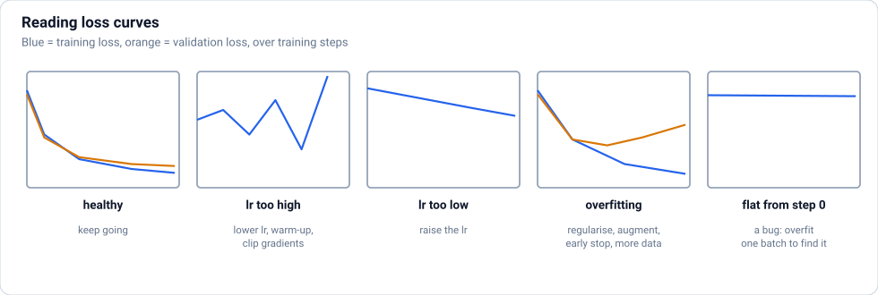

### Theory

> **In simple words:** neural networks fail **silently**: a bug rarely crashes, it just makes the model a bit worse. So debug systematically: check the data, check the initial loss, make sure the model can **overfit a single batch**, watch loss curves and gradient norms, and only then tune. Most "the model doesn't learn" problems are data, shape or loss bugs, not missing tricks.

**Words to know:**

- **Silent failure:** a bug that produces no error, only worse results.
- **Sanity check:** a quick test whose correct outcome you know in advance.
- **Initial loss check:** before training, the loss should be about ln(C) for C balanced classes (Section [7](#7-loss-functions-for-neural-networks-mse-cross-entropy-and-logits)).
- **Overfit one batch:** train repeatedly on one small batch; a correct model and loop must drive its loss near 0. If not, there's a bug.
- **Loss curve:** loss plotted against steps or epochs, for training and validation.
- **Gradient norm monitoring:** logging the total gradient norm each step; spikes precede divergence.
- **`nan` / `inf`:** "not a number" / infinity: results of overflow or invalid operations; once they appear, they spread to every weight.
- **`torch.autograd.detect_anomaly`:** a debugging mode that reports which operation produced a `nan` in the backward pass.
- **`torch.autograd.gradcheck`:** compares autograd's gradients of a function with numerical ones (in double precision).
- **Ablation:** removing or changing one component at a time to see its effect.
- **Experiment tracking:** logging every run's settings and curves (TensorBoard, Weights & Biases, MLflow; `machine-learning.md` Section 53).

**Everyday picture.** A mechanic doesn't replace the engine when a car won't start: they check fuel, battery and spark plugs first, in order. Debugging training is the same checklist, cheapest checks first.

**The debugging checklist, in order:**

1. **Look at the data:** a few inputs and labels after all transforms. Are labels aligned with inputs? Are inputs normalised?
2. **Check shapes** at every layer for one batch.
3. **Check the initial loss** ≈ ln(C).
4. **Overfit one batch** (loss → ~0 in a few hundred steps).
5. **Train on the full data** with a known-good optimiser (AdamW, lr 1e-3 or 3e-4); watch train and validation curves and the gradient norm.
6. **Find a good learning rate** (range test, Section [20](#20-learning-rate-schedules-warm-up-step-cosine-and-one-cycle)).
7. Then regularise (Section [22](#22-regularisation-weight-decay-dropout-early-stopping-and-augmentation)), then tune.

**Reading loss curves:**

| Shape | Usual cause | Fix |
|---|---|---|
| loss explodes or becomes `nan` | lr too high, bad initialisation, log(0), fp16 overflow | lower lr, warm-up, clip gradients, check the loss |
| loss falls very slowly | lr too low, bad initialisation, wrong optimiser settings | raise lr, use AdamW, check init |
| loss flat from the start | bug: frozen parameters, missing `optimizer.step()`, wrong labels, softmax before CE | overfit one batch to find it |
| train falls, validation rises | overfitting | regularise, augment, early stop, more data |
| train and validation both plateau high | underfitting | bigger model, train longer, better features or architecture |

**Common mistakes:**

- ❌ Tuning hyperparameters before confirming the model can overfit one batch.
- ❌ Changing several things at once (you can't tell which helped).
- ❌ Trusting a smooth-looking curve without checking the actual predictions.

**Used in real software:** Andrej Karpathy's "recipe for training neural networks" codifies this checklist; large training runs log gradient norms and loss per step to dashboards and automatically roll back to a checkpoint on loss spikes.

### Python

```python
import torch
from torch import nn

torch.manual_seed(0)
X, y = torch.randn(32, 20), torch.randint(0, 5, (32,))
model = nn.Sequential(nn.Linear(20, 64), nn.ReLU(), nn.Linear(64, 5))
print(f"initial loss {nn.functional.cross_entropy(model(X), y).item():.3f} vs ln(5) = {torch.log(torch.tensor(5.0)).item():.3f}")

def overfit_one_batch(model, loss_fn, steps=300, lr=1e-2, transform=lambda logits: logits, skip_zero_grad=False, skip_step=False):
    opt = torch.optim.Adam(model.parameters(), lr=lr)
    for _ in range(steps):
        loss = loss_fn(transform(model(X)), y)
        if not skip_zero_grad:
            opt.zero_grad()
        loss.backward()
        if not skip_step:
            opt.step()
    return loss.item()

make = lambda: (torch.manual_seed(0), nn.Sequential(nn.Linear(20, 64), nn.ReLU(), nn.Linear(64, 5)))[1]
print(f"correct setup:                loss after 300 steps {overfit_one_batch(make(), nn.functional.cross_entropy):.4f}")
print(f"bug: softmax before CE:       {overfit_one_batch(make(), nn.functional.cross_entropy, transform=lambda z: z.softmax(1)):.4f}")
print(f"bug: forgot zero_grad:        {overfit_one_batch(make(), nn.functional.cross_entropy, skip_zero_grad=True):.4f}")
print(f"bug: forgot optimizer.step(): {overfit_one_batch(make(), nn.functional.cross_entropy, skip_step=True):.4f}")
```

**Output:**

```text
initial loss 1.630 vs ln(5) = 1.609
correct setup:                loss after 300 steps 0.0002
bug: softmax before CE:       0.9049
bug: forgot zero_grad:        2.1247
bug: forgot optimizer.step(): 1.6227
```

The correct setup memorises the 32 examples (loss near 0). Applying softmax before `cross_entropy` squashes the logits into (0, 1), so the loss can't fall below about 0.9. Forgetting `zero_grad` lets gradients pile up into enormous, erratic steps. Forgetting `optimizer.step()` leaves the loss exactly where it started (≈ ln 5). Each bug shows up immediately in this 1-second test, long before a full training run.

```python
def tiny(x):
    return (x ** 2).sin().sum()
x = torch.randn(4, dtype=torch.float64, requires_grad=True)
print("gradcheck passes:", torch.autograd.gradcheck(tiny, (x,)))

w = torch.tensor([1.0, 0.0], requires_grad=True)
try:
    with torch.autograd.detect_anomaly():
        out = torch.sqrt(w)                                                   # sqrt'(0) = 1/(2·0) = inf
        (out * 0).sum().backward()
except RuntimeError as e:
    print("detect_anomaly:", str(e).split(".")[0][:70])

net = nn.Sequential(nn.Linear(20, 64), nn.ReLU(), nn.Linear(64, 5))
loss = nn.functional.cross_entropy(net(X), y); loss.backward()
total_norm = torch.nn.utils.clip_grad_norm_(net.parameters(), max_norm=float("inf"))  # returns the norm (no clipping)
print("gradient norm this step:", round(total_norm.item(), 4))
```

**Output:**

```text
gradcheck passes: True
detect_anomaly: Function 'SqrtBackward0' returned nan values in its 0th output
gradient norm this step: 0.6255
```

`gradcheck` confirms a custom function's gradients numerically; `detect_anomaly` pinpoints the backward operation that produced the `nan` (here the square root at 0, whose slope is infinite, times 0); and `clip_grad_norm_` with an infinite limit is a convenient way to measure the gradient norm for logging.

### Practice

1. Shuffle the labels `y` randomly (breaking their link with `X`) and run the overfit-one-batch test. Can the model still reach a low loss? What does that tell you about the test's limits?
2. Your loss is fine for 2,000 steps, then suddenly becomes `nan`. List three things to check.

<details>
<summary><b>Answer</b></summary>

```python
y_shuffled = y[torch.randperm(len(y))]
m = make(); opt = torch.optim.Adam(m.parameters(), lr=1e-2)
for _ in range(300):
    loss = nn.functional.cross_entropy(m(X), y_shuffled); opt.zero_grad(); loss.backward(); opt.step()
print("random labels, one batch:", round(loss.item(), 4))
```

**Output:**

```text
random labels, one batch: 0.0002
```

1. Yes: a big enough network memorises 32 examples whatever their labels. Overfitting one batch proves the **code** can learn; it says nothing about whether the data contains a learnable pattern. Validation performance answers that.
2. The gradient norm just before (a spike → lower lr, add clipping/warm-up); the data batch at that step (a corrupt example, an empty sequence, a division by zero or log(0)); mixed-precision overflow (use bf16 or a gradient scaler, Section [49](#49-number-formats-and-mixed-precision-fp32-fp16-bf16-and-fp8)).

</details>

| # | Practice | Difficulty |
|---|---|---|
| 1 | [Deep-ML 313. Numerical Gradient Checking](https://www.deep-ml.com/problems/313) | 🟡 Medium |
| 2 | [Deep-ML 86. Detect Overfitting or Underfitting](https://www.deep-ml.com/problems/86) | 🟢 Easy |

**Learn more:** [Andrej Karpathy: a recipe for training neural networks](https://karpathy.github.io/2019/04/25/recipe/) · [Google: deep learning tuning playbook](https://github.com/google-research/tuning_playbook) · [PyTorch: autograd anomaly detection](https://docs.pytorch.org/docs/stable/autograd.html#anomaly-detection)

---

### ✅ Part 4 checkpoint

Without looking, can you:

- [ ] Explain vanishing and exploding signals, choose He or Xavier initialisation, and clip gradients?
- [ ] Write SGD, momentum and Adam updates by hand, and explain what AdamW changes?
- [ ] Choose and implement a learning-rate schedule (warm-up + cosine, one-cycle) and run an LR range test?
- [ ] Compute BatchNorm, LayerNorm and RMSNorm by hand and explain train vs eval behaviour?
- [ ] Reduce overfitting with weight decay, dropout, augmentation and early stopping?
- [ ] Debug a network with the initial-loss check, overfit-one-batch, loss curves and gradient norms?

Part 5 applies all of this to images: convolutions, CNNs, ResNet and transfer learning.

---

# Part 5 — Moderate: Deep Learning for Images

> **Goal:** Understand how networks see: the **convolution** written by hand, pooling and a first **CNN**, the architectures that made computer vision work (up to **ResNet** and its residual connections), **transfer learning** from pretrained models (the way almost all real vision projects start), and the ideas behind **object detection and segmentation**.  
> **You need:** Parts 1–4.

---

## 24. Convolutions from Scratch: Kernels, Stride, Padding and Channels


### Theory

> **In simple words:** a **convolution** slides a small grid of weights (a **filter** or **kernel**, typically 3×3) across an image; at each position it multiplies the filter with the patch underneath and adds the results into one number. The output is a **feature map** that's high wherever the pattern the filter looks for (an edge, a corner, a texture) appears. A CNN **learns** the filter weights instead of having them designed by hand.

**Words to know:**

- **Convolution (conv):** sliding a filter over the input and computing a weighted sum at each position. (Deep-learning libraries actually compute **cross-correlation**, convolution without flipping the filter; since the filter is learned, the difference doesn't matter.)
- **Filter / kernel:** the small weight grid, e.g. 3×3 (×input channels).
- **Feature map (activation map):** the output grid of one filter.
- **Stride:** how many pixels the filter moves each step; stride 2 halves the output size.
- **Padding:** adding a border (usually zeros) so the filter can sit on edge pixels; "same" padding (1 for a 3×3 filter) keeps the size unchanged.
- **Output size:** (n + 2p − k) / s + 1 for input size n, padding p, kernel k, stride s.
- **Input channels / output channels:** a filter spans **all** input channels (3 for RGB); a layer with C_out filters produces C_out feature maps.
- **Parameter count of a conv layer:** C_out × C_in × k × k weights + C_out biases, regardless of the image size.
- **Weight sharing:** the same filter is used at every position, so a cat detected top-left is detected bottom-right too (**translation equivariance**).
- **Receptive field:** the region of the original input that influences one output value; it grows with each conv layer.
- **Sobel filter:** a classic hand-designed edge-detection filter.
- **1×1 convolution:** a filter of size 1 that mixes channels at each pixel without looking at neighbours (used to change the channel count cheaply).

**Everyday picture.** Reading a page with a magnifying glass that only shows a 3×3 patch: you slide it across every position and note how strongly each patch looks like a vertical stroke. Your notes form a new, smaller page, the feature map, showing where the vertical strokes are.

**One output value, traced** (vertical-edge filter, top-left patch of the picture's image):

patch = [[0, 0, 1], [0, 0, 1], [0, 0, 1]], filter = [[−1, 0, 1], [−1, 0, 1], [−1, 0, 1]].
Sum of elementwise products = each row gives 0·(−1) + 0·0 + 1·1 = 1, three rows → **3**: a strong response, because the patch has dark on the left and bright on the right.

**Sizes and parameters, traced:**

| layer | input | output | parameters |
|---|---|---|---|
| conv 3×3, 16 filters, padding 1, stride 1 | (1, 28, 28) | (16, 28, 28) | 16·1·3·3 + 16 = 160 |
| conv 3×3, 32 filters, padding 1, stride 2 | (16, 28, 28) | (32, 14, 14) | 32·16·3·3 + 32 = 4,640 |
| fully connected 784 → 512 (for comparison) | 784 | 512 | 401,920 |

Conv layers have few parameters because the same small filter is reused everywhere; that's why CNNs need far less data than MLPs on images.

**Common mistakes:**

- ❌ Getting output sizes wrong (use the formula, or run a dummy tensor through the layer).
- ❌ Forgetting that a filter covers all input channels (a 3×3 filter on RGB has 27 weights + 1 bias).
- ❌ Writing nested Python loops for convolution in real code (use `nn.Conv2d`, which calls optimised libraries).

**Used in real software:** every CNN (ResNet, EfficientNet, YOLO, U-Net), the image encoders of many multimodal models, phone camera pipelines, medical imaging, and audio models that treat spectrograms as images.

### Python

```python
import numpy as np
import torch
from torch import nn
import matplotlib.pyplot as plt
from torchvision import datasets

def conv2d(image, kernel, stride=1, padding=0):
    image = np.pad(image, padding)
    k = kernel.shape[0]
    out_size = (image.shape[0] - k) // stride + 1
    out = np.zeros((out_size, out_size))
    for i in range(out_size):
        for j in range(out_size):
            patch = image[i * stride:i * stride + k, j * stride:j * stride + k]
            out[i, j] = np.sum(patch * kernel)                            # multiply and add
    return out

img = np.zeros((6, 6)); img[:, 2:4] = 1                                  # the picture's image: a bright vertical bar
vertical = np.array([[-1, 0, 1], [-1, 0, 1], [-1, 0, 1]])
print("feature map (no padding):\n", conv2d(img, vertical))
print("output sizes: padding 1 →", conv2d(img, vertical, padding=1).shape, "| stride 2 →", conv2d(img, vertical, stride=2).shape)

layer = nn.Conv2d(1, 1, kernel_size=3, bias=False)
with torch.no_grad():
    layer.weight[:] = torch.tensor(vertical, dtype=torch.float32)
print("nn.Conv2d gives the same:", np.allclose(layer(torch.tensor(img, dtype=torch.float32)[None, None])[0, 0].detach().numpy(), conv2d(img, vertical)))
```

**Output:**

```text
feature map (no padding):
 [[ 3.  3. -3. -3.]
 [ 3.  3. -3. -3.]
 [ 3.  3. -3. -3.]
 [ 3.  3. -3. -3.]]
output sizes: padding 1 → (6, 6) | stride 2 → (2, 2)
nn.Conv2d gives the same: True
```

The feature map is +3 along the bar's left edge (dark → bright) and −3 along its right edge (bright → dark): the filter measures "brightness increasing to the right".

```python
shoe = datasets.FashionMNIST(root="data", train=True, download=True)[0][0]         # first training image, a PIL image
x = np.asarray(shoe, dtype=np.float32) / 255
sobel_x = np.array([[-1, 0, 1], [-2, 0, 2], [-1, 0, 1]]); sobel_y = sobel_x.T
gx, gy = conv2d(x, sobel_x, padding=1), conv2d(x, sobel_y, padding=1)
fig, axes = plt.subplots(1, 4, figsize=(10, 2.8), layout="constrained")
for ax, (title, im) in zip(axes, [("input", x), ("vertical edges", gx), ("horizontal edges", gy), ("edge strength", np.hypot(gx, gy))]):
    ax.imshow(im, cmap="gray"); ax.set(title=title, xticks=[], yticks=[])
fig.savefig("conv-edges.png", dpi=100)
plt.close(fig)

for c_in, c_out, k, s, p in [(1, 16, 3, 1, 1), (16, 32, 3, 2, 1), (3, 64, 7, 2, 3)]:
    conv = nn.Conv2d(c_in, c_out, k, stride=s, padding=p)
    n = 28 if c_in != 3 else 224
    out = conv(torch.zeros(1, c_in, n, n))
    print(f"Conv2d({c_in}→{c_out}, k={k}, s={s}, p={p}) on {n}×{n}: output {tuple(out.shape[1:])}, "
          f"parameters {sum(p_.numel() for p_ in conv.parameters()):,}, formula size {(n + 2 * p - k) // s + 1}")
```

**Output:**

```text
Conv2d(1→16, k=3, s=1, p=1) on 28×28: output (16, 28, 28), parameters 160, formula size 28
Conv2d(16→32, k=3, s=2, p=1) on 28×28: output (32, 14, 14), parameters 4,640, formula size 14
Conv2d(3→64, k=7, s=2, p=3) on 224×224: output (64, 112, 112), parameters 9,472, formula size 112
```


Two hand-designed filters already find the outline of the boot. A CNN's first layer learns dozens of filters like these (edges, blobs, colour contrasts) by itself, and later layers combine them. The last row is ResNet's first layer: 64 filters of 7×7×3 = 9,472 parameters, applied over a whole 224×224 photo.

### Practice

1. What output size does a 5×5 filter with stride 1 and no padding give on a 32×32 image? With padding 2?
2. Design a 3×3 filter that detects horizontal edges (dark above, bright below) and check it on the transpose of `img`.

<details>
<summary><b>Answer</b></summary>

```python
print((32 + 0 - 5) // 1 + 1, (32 + 4 - 5) // 1 + 1)
horizontal = vertical.T
print(conv2d(img.T, horizontal))
```

**Output:**

```text
28 32
[[ 3.  3.  3.  3.]
 [ 3.  3.  3.  3.]
 [-3. -3. -3. -3.]
 [-3. -3. -3. -3.]]
```

1. 28×28 without padding, 32×32 ("same") with padding 2.
2. The transpose of the vertical filter: rows (−1, −1, −1), (0, 0, 0), (1, 1, 1). On the transposed image (a horizontal bar) it gives +3 at the top edge and −3 at the bottom edge.

</details>

| # | Problem (Deep-ML) | Difficulty |
|---|---|---|
| 1 | [239. Apply Zero Padding to an Image](https://www.deep-ml.com/problems/239) | 🟢 Easy |
| 2 | [41. Simple Convolutional 2D Layer](https://www.deep-ml.com/problems/41) | 🟡 Medium |
| 3 | [241. Sobel Edge Detection](https://www.deep-ml.com/problems/241) | 🟡 Medium |
| 4 | [230. 3D CNN Forward Pass Implementation](https://www.deep-ml.com/problems/230) | 🔴 Hard |

**Learn more:** [Stanford CS231n: convolutional networks](https://cs231n.github.io/convolutional-networks/) · [Dumoulin & Visin, A guide to convolution arithmetic](https://arxiv.org/abs/1603.07285) · [CNN Explainer (interactive)](https://poloclub.github.io/cnn-explainer/)

---

## 25. Pooling and Your First CNN


### Theory

> **In simple words:** a **CNN** stacks convolution + activation layers, with **pooling** layers in between that shrink the feature maps (keeping the strongest responses). Early layers see small details; because each layer looks at the previous layer's maps, later layers see larger and more abstract patterns. A small classifier head on top turns the final maps into class scores. On images, a CNN beats an MLP with a fraction of the parameters.

**Words to know:**

- **Convolutional neural network (CNN, ConvNet):** a network built mainly from convolution layers.
- **Pooling:** downsampling a feature map by summarising small windows. **Max pooling** keeps the largest value of each window (usually 2×2, stride 2, halving height and width); **average pooling** keeps the mean.
- **Global average pooling (GAP):** averaging each whole feature map to one number, turning (C, H, W) into (C,); used instead of flattening in modern CNNs.
- **Downsampling:** reducing spatial size (pooling or strided convolution) while usually increasing channels.
- **Translation invariance:** pooling makes the output change little when the input shifts slightly.
- **Feature hierarchy:** edges → textures → parts → objects as you go deeper.
- **Classifier head:** the final layers (flatten or GAP, then linear) that produce class logits. **Backbone:** everything before the head.
- **`nn.Conv2d`, `nn.MaxPool2d`, `nn.AdaptiveAvgPool2d`:** the PyTorch layers for convolution, max pooling and global average pooling.

**Everyday picture.** Summarising a long report: first highlight important sentences on each page (convolution), then keep only the strongest point per paragraph (pooling), then write one summary per chapter from those points (deeper layers), then decide what the report is about (the head).

**Max pooling, traced** (2×2 windows, stride 2):

input [[1, 3, 2, 0], [4, 2, 1, 1], [0, 1, 5, 6], [2, 2, 7, 1]] → windows {1, 3, 4, 2}, {2, 0, 1, 1}, {0, 1, 2, 2}, {5, 6, 7, 1} → **[[4, 2], [2, 7]]**.

**Shapes through the CNN below** (FashionMNIST):

| layer | output shape | parameters |
|---|---|---|
| input | (1, 28, 28) | |
| conv 3×3, 32 + ReLU | (32, 28, 28) | 320 |
| max pool 2×2 | (32, 14, 14) | 0 |
| conv 3×3, 64 + ReLU | (64, 14, 14) | 18,496 |
| max pool 2×2 | (64, 7, 7) | 0 |
| flatten | 3,136 | |
| linear 3,136 → 128 + ReLU | 128 | 401,536 |
| linear 128 → 10 | 10 | 1,290 |

**Common mistakes:**

- ❌ A wrong `in_features` for the first linear layer after flattening (compute it with a dummy forward pass, or use `nn.LazyLinear`/global pooling).
- ❌ Pooling so aggressively that small objects disappear.
- ❌ Forgetting the channel axis for grayscale images: shape (N, 28, 28) instead of (N, 1, 28, 28).

**Used in real software:** LeNet-style CNNs read cheques and postcodes in the 1990s; CNN backbones (ResNet, EfficientNet, MobileNet) run face unlock, document scanning, defect detection on factory lines, and the vision parts of self-driving stacks.

### Python

```python
import time
import torch
from torch import nn
from torch.utils.data import DataLoader, random_split
from torchvision import datasets, transforms
import matplotlib.pyplot as plt

x = torch.tensor([[1.0, 3, 2, 0], [4, 2, 1, 1], [0, 1, 5, 6], [2, 2, 7, 1]])[None, None]
print("max pool:", nn.MaxPool2d(2)(x)[0, 0].tolist(), "| avg pool:", nn.AvgPool2d(2)(x)[0, 0].tolist(), "| global avg:", nn.AdaptiveAvgPool2d(1)(x).item())

torch.manual_seed(0)
tfm = transforms.Compose([transforms.ToTensor(), transforms.Normalize((0.286,), (0.353,))])
full = datasets.FashionMNIST(root="data", train=True, download=True, transform=tfm)
train_set, val_set = random_split(full, [50_000, 10_000], generator=torch.Generator().manual_seed(0))
test_set = datasets.FashionMNIST(root="data", train=False, download=True, transform=tfm)

cnn = nn.Sequential(
    nn.Conv2d(1, 32, 3, padding=1), nn.ReLU(), nn.MaxPool2d(2),
    nn.Conv2d(32, 64, 3, padding=1), nn.ReLU(), nn.MaxPool2d(2),
    nn.Flatten(), nn.Linear(64 * 7 * 7, 128), nn.ReLU(), nn.Dropout(0.3), nn.Linear(128, 10))
probe = torch.zeros(1, 1, 28, 28)
for layer in cnn:
    probe = layer(probe)
    if isinstance(layer, (nn.MaxPool2d, nn.Flatten)) or layer is cnn[-1]:
        print(f"after {layer.__class__.__name__:9s} {tuple(probe.shape[1:])}")
print("parameters:", f"{sum(p.numel() for p in cnn.parameters()):,}")
```

**Output:**

```text
max pool: [[4.0, 2.0], [2.0, 7.0]] | avg pool: [[2.5, 1.0], [1.25, 4.75]] | global avg: 2.375
after MaxPool2d (32, 14, 14)
after MaxPool2d (64, 7, 7)
after Flatten   (3136,)
after Linear    (10,)
parameters: 421,642
```

```python
def accuracy(model, ds):
    model.eval()
    with torch.no_grad():
        return sum((model(x).argmax(1) == y).sum().item() for x, y in DataLoader(ds, batch_size=1000)) / len(ds)

opt = torch.optim.AdamW(cnn.parameters(), lr=1e-3)
t0 = time.time()
for epoch in range(4):
    cnn.train()
    for x, y in DataLoader(train_set, batch_size=128, shuffle=True):
        loss = nn.functional.cross_entropy(cnn(x), y); opt.zero_grad(); loss.backward(); opt.step()
    print(f"epoch {epoch + 1}: validation accuracy {accuracy(cnn, val_set):.3f}")
print(f"test accuracy {accuracy(cnn, test_set):.3f} (Section 16's MLP: 0.877) | training time {time.time() - t0:.0f} s on a laptop CPU")

boot = test_set[0][0][None]
maps = cnn[1](cnn[0](boot))[0].detach()                                  # first conv layer's 32 feature maps
fig, axes = plt.subplots(2, 8, figsize=(10, 2.8), layout="constrained")
axes[0, 0].imshow(boot[0, 0], cmap="gray"); axes[0, 0].set_title("input", fontsize=8)
for k, ax in enumerate(axes.flat[1:]):
    ax.imshow(maps[k], cmap="viridis")
for ax in axes.flat:
    ax.set(xticks=[], yticks=[])
fig.suptitle("Some feature maps of the first convolution layer after training")
fig.savefig("cnn-feature-maps.png", dpi=100)
plt.close(fig)
```

**Output:**

```text
epoch 1: validation accuracy 0.878
epoch 2: validation accuracy 0.898
epoch 3: validation accuracy 0.903
epoch 4: validation accuracy 0.909
test accuracy 0.903 (Section 16's MLP: 0.877) | training time 43 s on a laptop CPU
```


With fewer epochs than Section [16](#16-the-training-loop-training-validation-and-metrics)'s MLP, the CNN is clearly more accurate, because convolutions exploit the image's 2-D structure and weight sharing. Most of its parameters sit in the first linear layer; the convolution layers that do the "seeing" have only about 19,000.

### Practice

1. Replace `nn.Flatten(), nn.Linear(64 * 7 * 7, 128)` with `nn.AdaptiveAvgPool2d(1), nn.Flatten(), nn.Linear(64, 128)`. How many parameters does the model have now?
2. What is the receptive field (in input pixels) of one value after conv 3×3 → pool 2×2 → conv 3×3?

<details>
<summary><b>Answer</b></summary>

```python
gap_cnn = nn.Sequential(nn.Conv2d(1, 32, 3, padding=1), nn.ReLU(), nn.MaxPool2d(2), nn.Conv2d(32, 64, 3, padding=1), nn.ReLU(), nn.MaxPool2d(2),
                        nn.AdaptiveAvgPool2d(1), nn.Flatten(), nn.Linear(64, 128), nn.ReLU(), nn.Linear(128, 10))
print(f"{sum(p.numel() for p in gap_cnn.parameters()):,}", tuple(gap_cnn(torch.zeros(2, 1, 28, 28)).shape))
```

**Output:**

```text
28,426 (2, 10)
```

1. About 28,000 parameters instead of 421,642: global average pooling removes the huge flatten-to-linear layer (at some cost in accuracy for this small network; deeper networks use GAP routinely).
2. 8×8 pixels: the first conv sees 3×3; pooling doubles the step between positions; the second conv's 3×3 window spans 3 pooled positions = 6 pixels plus the first conv's 2-pixel border.

</details>

| # | Practice | Difficulty |
|---|---|---|
| 1 | [Deep-ML 114. Implement Global Average Pooling](https://www.deep-ml.com/problems/114) | 🟢 Easy |
| 2 | [Deep-ML 265. Implement 2D Average Pooling](https://www.deep-ml.com/problems/265) | 🟢 Easy |
| 3 | [Deep-ML 190. Overlapping Max Pooling](https://www.deep-ml.com/problems/190) | 🟡 Medium |
| 4 | [Kaggle: Digit Recognizer (beat 99% with a CNN)](https://www.kaggle.com/competitions/digit-recognizer) | 🟡 Medium |

**Learn more:** [PyTorch: training a classifier (CIFAR-10 tutorial)](https://pytorch.org/tutorials/beginner/blitz/cifar10_tutorial.html) · [Kaggle Learn: Computer Vision](https://www.kaggle.com/learn/computer-vision)

---

## 26. CNN Architectures: from LeNet to ResNet and Residual Connections


### Theory

> **In simple words:** CNN design improved through a few big ideas: go **deeper** with small 3×3 filters (VGG), and make very deep networks trainable with **residual connections** (ResNet), where each block's input is added to its output. A residual block only has to learn a small correction, and gradients can flow straight back through the additions, so networks of 50–150 layers train reliably. Residual connections are now in almost every deep architecture, including transformers.

**Words to know:**

- **LeNet (1998):** an early small CNN for handwritten digits.
- **AlexNet (2012):** the deep CNN that won ImageNet by a wide margin using GPUs, ReLU and dropout, starting the deep-learning boom.
- **ImageNet:** a dataset of 1.28 million labelled photos in 1,000 classes; its yearly challenge drove vision progress, and ImageNet-pretrained weights are the classic starting point for transfer learning.
- **VGG (2014):** deep stacks of 3×3 convolutions; simple but heavy.
- **Inception / GoogLeNet (2014):** parallel branches with different filter sizes, plus 1×1 convolutions to save computation.
- **ResNet (2015):** residual networks (18 to 152 layers) with skip connections.
- **Residual (skip) connection:** output = x + F(x), where F is a few layers; F learns the **residual** (the change).
- **Bottleneck block:** 1×1 (shrink channels) → 3×3 → 1×1 (expand), used in ResNet-50+ to save computation.
- **Degradation problem:** before ResNet, adding layers to an already-deep plain network made even the **training** error worse, a sign of optimisation difficulty, not overfitting.
- **EfficientNet / MobileNet (2017–2019):** CNNs designed for accuracy per computation, using depthwise-separable convolutions; for phones.
- **ConvNeXt (2022):** a CNN modernised with transformer-era design choices, competitive with vision transformers.
- **Depthwise-separable convolution:** a per-channel 3×3 convolution followed by a 1×1 convolution mixing channels; far fewer computations.
- **FLOPs:** floating-point operations, a measure of computation per image.

**Everyday picture.** Editing a document with tracked changes: instead of retyping the whole page at each review (a plain layer must rebuild its input), each reviewer only adds small edits on top (a residual block adds a correction). If a reviewer has nothing to add, the page passes through unchanged, so adding more reviewers can't make the document worse.

**Why the skip helps gradients, traced:** for y = x + F(x), ∂y/∂x = 1 + ∂F/∂x. Even if ∂F/∂x is tiny (a vanishing-gradient layer), the "1" passes the upstream gradient straight through. Through 50 blocks the gradient keeps a direct path; through 50 plain layers it's a product of 50 small numbers (Section [18](#18-weight-initialisation-and-vanishing-or-exploding-gradients)).

**The landmark architectures:**

| Model | Year | Depth | Key idea | ImageNet top-1 (approx.) |
|---|---|---|---|---|
| AlexNet | 2012 | 8 | GPUs, ReLU, dropout | 57% |
| VGG-16 | 2014 | 16 | stacks of 3×3 convolutions | 72% |
| GoogLeNet | 2014 | 22 | Inception branches, 1×1 convs | 69% |
| ResNet-50 | 2015 | 50 | residual connections, bottlenecks | 76% (80%+ with modern training) |
| EfficientNet-B0 | 2019 | ~80 | balanced scaling, mobile-friendly | 77% |
| ConvNeXt-T | 2022 | ~50 | transformer-era design in a CNN | 82% |

**Common mistakes:**

- ❌ Building very deep plain networks without residual connections or normalisation.
- ❌ A skip connection whose shapes don't match (when a block changes channels or strides, the shortcut needs a 1×1 conv).
- ❌ Designing a new architecture for a standard task instead of fine-tuning an existing one (Section [27](#27-transfer-learning-with-pretrained-vision-models)).

**Used in real software:** ResNet backbones in detection systems (Faster R-CNN, Mask R-CNN), MobileNet/EfficientNet on phones and edge devices, residual connections in every transformer (Section [35](#35-the-transformer-block-residuals-normalisation-and-the-feed-forward-network)) and diffusion U-Net.

### Python

```python
import torch
from torch import nn
import torchvision

class ResidualBlock(nn.Module):
    def __init__(self, c_in, c_out, stride=1):
        super().__init__()
        self.body = nn.Sequential(nn.Conv2d(c_in, c_out, 3, stride, 1, bias=False), nn.BatchNorm2d(c_out), nn.ReLU(),
                                  nn.Conv2d(c_out, c_out, 3, 1, 1, bias=False), nn.BatchNorm2d(c_out))
        self.shortcut = nn.Identity() if stride == 1 and c_in == c_out else nn.Sequential(
            nn.Conv2d(c_in, c_out, 1, stride, bias=False), nn.BatchNorm2d(c_out))      # match shapes for the addition
    def forward(self, x):
        return torch.relu(self.body(x) + self.shortcut(x))

block = ResidualBlock(64, 128, stride=2)
print("residual block:", tuple(block(torch.zeros(2, 64, 32, 32)).shape), "| parameters", f"{sum(p.numel() for p in block.parameters()):,}")

resnet18 = torchvision.models.resnet18()                                 # architecture only, random weights
print("ResNet-18 parameters:", f"{sum(p.numel() for p in resnet18.parameters()):,}")
print("top-level parts:", [name for name, _ in resnet18.named_children()])
print("one block of layer2:", resnet18.layer2[0].__class__.__name__, "with a downsample shortcut:", resnet18.layer2[0].downsample is not None)
x = torch.zeros(1, 3, 224, 224)
for name, part in resnet18.named_children():
    x = part(torch.flatten(x, 1) if name == "fc" else x)
    print(f"  after {name:8s} {tuple(x.shape[1:])}")
```

**Output:**

```text
residual block: (2, 128, 16, 16) | parameters 230,144
ResNet-18 parameters: 11,689,512
top-level parts: ['conv1', 'bn1', 'relu', 'maxpool', 'layer1', 'layer2', 'layer3', 'layer4', 'avgpool', 'fc']
one block of layer2: BasicBlock with a downsample shortcut: True
  after conv1    (64, 112, 112)
  after bn1      (64, 112, 112)
  after relu     (64, 112, 112)
  after maxpool  (64, 56, 56)
  after layer1   (64, 56, 56)
  after layer2   (128, 28, 28)
  after layer3   (256, 14, 14)
  after layer4   (512, 7, 7)
  after avgpool  (512, 1, 1)
  after fc       (1000,)
```

ResNet-18's path: a 7×7 stride-2 convolution and max pooling shrink 224×224 to 56×56, four stages of residual blocks halve the size and double the channels (64 → 512), global average pooling leaves 512 numbers, and a linear layer gives the 1,000 ImageNet classes.

```python
def first_layer_grad(depth, residual, seed=0):
    torch.manual_seed(seed)
    layers = nn.ModuleList([nn.Sequential(nn.Linear(64, 64), nn.Tanh()) for _ in range(depth)])
    x = torch.randn(32, 64)
    for f in layers:
        x = x + f(x) if residual else f(x)
    x.pow(2).mean().backward()
    return layers[0][0].weight.grad.norm().item()

for depth in (5, 20, 50):
    print(f"{depth:2d} layers: first-layer gradient norm, plain {first_layer_grad(depth, False):.2e} | residual {first_layer_grad(depth, True):.2e}")
```

**Output:**

```text
 5 layers: first-layer gradient norm, plain 4.79e-03 | residual 9.37e-01
20 layers: first-layer gradient norm, plain 5.26e-07 | residual 3.78e+00
50 layers: first-layer gradient norm, plain 1.31e-14 | residual 1.63e+01
```

In the plain stack, the first layer's gradient shrinks rapidly as depth grows; with residual connections it stays healthy (it even grows, which normalisation layers keep in check in real ResNets). That direct gradient path is why ResNets of 50–150 layers train where plain networks of that depth don't.

### Practice

1. Count the parameters of a `ResidualBlock(64, 64)` by hand (no bias in convs; BatchNorm has 2 learnable numbers per channel) and check.
2. Why does the shortcut in `ResidualBlock(64, 128, stride=2)` need a 1×1 convolution?

<details>
<summary><b>Answer</b></summary>

```python
print(sum(p.numel() for p in ResidualBlock(64, 64).parameters()), 2 * (64 * 64 * 9) + 2 * (2 * 64))
```

**Output:**

```text
73984 73984
```

1. Two 3×3 convs of 64·64·9 = 36,864 weights each, plus two BatchNorms of 128 parameters: 73,984.
2. The body outputs (128, H/2, W/2) while the input is (64, H, W); they can only be added if the shortcut also changes the channels and halves the size, which a 1×1 convolution with stride 2 does cheaply.

</details>

| # | Problem (Deep-ML) | Difficulty |
|---|---|---|
| 1 | [113. Implement a Simple Residual Block with Shortcut Connection](https://www.deep-ml.com/problems/113) | 🟢 Easy |
| 2 | [137. Implement a Dense Block with 2D Convolutions](https://www.deep-ml.com/problems/137) | 🔴 Hard |

**Learn more:** [He et al., Deep Residual Learning for Image Recognition (ResNet)](https://arxiv.org/abs/1512.03385) · [torchvision: models and pretrained weights](https://docs.pytorch.org/vision/stable/models.html) · [Liu et al., A ConvNet for the 2020s (ConvNeXt)](https://arxiv.org/abs/2201.03545)

---

## 27. Transfer Learning with Pretrained Vision Models


### Theory

> **In simple words:** a network trained on millions of photos has already learned general visual features (edges, textures, shapes, object parts). **Transfer learning** reuses it: replace the final classification layer with one for **your** classes, and either train only that new head (**feature extraction**) or also gently update the rest (**fine-tuning**). With a few hundred or thousand images, this beats training from scratch by a wide margin, and it's how nearly every real vision project starts.

**Words to know:**

- **Transfer learning:** reusing a model trained on one task (the **source**, e.g. ImageNet) for another (the **target**).
- **Pretrained weights:** the learned parameters published with a model (torchvision `weights=...`, Hugging Face Hub, `timm`).
- **Feature extraction (linear probing):** freeze the backbone, compute its features, train only a new head.
- **Fine-tuning:** continue training some or all pretrained layers on the new data, with a small learning rate.
- **Freezing:** setting `requires_grad = False` so a layer's weights don't change.
- **Head replacement:** swapping the final layer (`model.fc = nn.Linear(512, num_classes)`).
- **Preprocessing must match:** inputs must be resized and normalised exactly as during pretraining (`weights.transforms()`).
- **Discriminative learning rates:** smaller learning rates for early layers than for the head.
- **Domain shift:** when the target images differ a lot from the source (X-rays vs ImageNet photos); fine-tuning more layers helps.
- **`timm`:** a library of hundreds of pretrained vision models; **CLIP/DINOv2/SigLIP** are modern self-supervised or image–text backbones often used as feature extractors (Section [39](#39-vision-transformers-and-clip-transformers-beyond-text)).
- **CIFAR-10:** 60,000 32×32 colour photos in 10 classes (airplane, car, bird, cat, deer, dog, frog, horse, ship, truck).

**Everyday picture.** A professional photographer learning to photograph weddings doesn't relearn how cameras, light and composition work; they adapt what they know to the new setting. Training from scratch is like teaching someone who has never held a camera.

**Choosing a strategy:**

| Your data | Similar to ImageNet photos | Very different (medical, satellite, microscopy) |
|---|---|---|
| small (hundreds–few thousand) | feature extraction (frozen backbone + new head) | fine-tune the later layers carefully |
| large (tens of thousands+) | fine-tune everything with a small lr | fine-tune everything (or pretrain on in-domain data) |

**Fine-tuning, step by step:**

1. Load the pretrained model and its matching preprocessing.
2. Replace the head with a new layer for your classes.
3. Train the head with the backbone frozen (a few epochs).
4. Optionally unfreeze some or all layers and continue with a 10–100× smaller learning rate.
5. Evaluate on held-out data, as always.

**Common mistakes:**

- ❌ Wrong preprocessing (different normalisation or image size from pretraining).
- ❌ Fine-tuning with a large learning rate, which destroys the pretrained features ("catastrophic forgetting").
- ❌ Forgetting `model.eval()` for frozen BatchNorm layers during feature extraction.
- ❌ Training from scratch with little data because "my images are different" (pretrained features still usually help).

**Used in real software:** medical-imaging classifiers, retail product recognition, crop-disease detection apps, content moderation, and industrial inspection systems almost all start from pretrained backbones; the same idea, applied to language, is the fine-tuning of Part 8.

### Python

```python
import time
import numpy as np
import torch
import torchvision
from torch import nn
from datasets import load_dataset
from torchvision import transforms
import matplotlib.pyplot as plt

cifar = load_dataset("uoft-cs/cifar10")                                  # downloads once (about 120 MB) from the Hugging Face Hub
names = cifar["train"].features["label"].names
train_imgs = cifar["train"].shuffle(seed=0).select(range(2000))
val_imgs = cifar["test"].shuffle(seed=0).select(range(1000))
print("classes:", names, "| train", len(train_imgs), "val", len(val_imgs))

weights = torchvision.models.ResNet18_Weights.DEFAULT                    # ImageNet-pretrained (downloads 45 MB once)
pre = transforms.Compose([transforms.Resize(112), transforms.ToTensor(), transforms.Normalize(weights.transforms().mean, weights.transforms().std)])
small = transforms.Compose([transforms.ToTensor(), transforms.Normalize((0.5,) * 3, (0.25,) * 3)])
to_tensors = lambda ds, t: (torch.stack([t(im) for im in ds["img"]]), torch.tensor(ds["label"]))
Xtr, ytr = to_tensors(train_imgs, pre); Xva, yva = to_tensors(val_imgs, pre)
Xtr32, _ = to_tensors(train_imgs, small); Xva32, _ = to_tensors(val_imgs, small)

def fit(model, X, y, Xv, yv, params, epochs, lr, bs=64):
    opt = torch.optim.AdamW(params, lr=lr)
    for _ in range(epochs):
        model.train()
        for idx in torch.randperm(len(X)).split(bs):
            loss = nn.functional.cross_entropy(model(X[idx]), y[idx]); opt.zero_grad(); loss.backward(); opt.step()
    model.eval()
    with torch.no_grad():
        return sum((model(Xv[i:i + 250]).argmax(1) == yv[i:i + 250]).sum().item() for i in range(0, len(Xv), 250)) / len(Xv)

results = {}
torch.manual_seed(0); t0 = time.time()
scratch = nn.Sequential(nn.Conv2d(3, 32, 3, padding=1), nn.ReLU(), nn.MaxPool2d(2), nn.Conv2d(32, 64, 3, padding=1), nn.ReLU(), nn.MaxPool2d(2),
                        nn.Conv2d(64, 128, 3, padding=1), nn.ReLU(), nn.AdaptiveAvgPool2d(1), nn.Flatten(), nn.Linear(128, 10))
results["CNN from scratch"] = fit(scratch, Xtr32, ytr, Xva32, yva, scratch.parameters(), epochs=20, lr=2e-3)
print(f"from scratch (20 epochs): {results['CNN from scratch']:.3f}  ({time.time() - t0:.0f} s)")
```

**Output:**

```text
classes: ['airplane', 'automobile', 'bird', 'cat', 'deer', 'dog', 'frog', 'horse', 'ship', 'truck'] | train 2000 val 1000
from scratch (20 epochs): 0.420  (18 s)
```

Two thousand training photos are far too few to learn vision from scratch: the small CNN reaches well under 50% (random guessing is 10%).

```python
torch.manual_seed(0); t0 = time.time()
backbone = torchvision.models.resnet18(weights=weights).eval()
backbone.fc = nn.Identity()                                              # drop ImageNet's 1,000-class head
with torch.no_grad():
    Ftr = torch.cat([backbone(Xtr[i:i + 250]) for i in range(0, len(Xtr), 250)])
    Fva = torch.cat([backbone(Xva[i:i + 250]) for i in range(0, len(Xva), 250)])
head = nn.Linear(512, 10)
results["frozen ResNet-18 + new head"] = fit(head, Ftr, ytr, Fva, yva, head.parameters(), epochs=30, lr=1e-3)
print(f"feature extraction: {results['frozen ResNet-18 + new head']:.3f}  ({time.time() - t0:.0f} s; features {tuple(Ftr.shape)})")

torch.manual_seed(0); t0 = time.time()
model = torchvision.models.resnet18(weights=weights)
model.fc = nn.Linear(512, 10)
results["fine-tuned ResNet-18"] = fit(model, Xtr, ytr, Xva, yva, model.parameters(), epochs=3, lr=3e-4)
print(f"full fine-tuning (3 epochs): {results['fine-tuned ResNet-18']:.3f}  ({time.time() - t0:.0f} s)")

fig, ax = plt.subplots(figsize=(6.5, 2.8), layout="constrained")
ax.barh(list(results), list(results.values()), color=["gray", "tab:blue", "tab:green"])
for k, v in enumerate(results.values()):
    ax.text(v + 0.01, k, f"{v:.1%}", va="center")
ax.set(xlim=(0, 1), xlabel="validation accuracy (2,000 training images)", title="Transfer learning on CIFAR-10")
fig.savefig("transfer-learning.png", dpi=100)
plt.close(fig)
```

**Output:**

```text
feature extraction: 0.767  (14 s; features (2000, 512))
full fine-tuning (3 epochs): 0.784  (83 s)
```

The pretrained network's features are so good that a single linear layer on top nearly doubles the from-scratch accuracy, after a few seconds of training, because ImageNet already taught it what birds, cars and ships look like. Fine-tuning every layer gains more, with a small learning rate and only three epochs. On a GPU with full-resolution images and more epochs, the gap grows further.

### Practice

1. Fine-tune only `model.layer4` and `model.fc` (freeze everything else) for 3 epochs. How does it compare in accuracy and time with full fine-tuning?
2. Ask the original ImageNet ResNet-18 (with its 1,000-class head) for its top-3 guesses on the first validation image. What does it see?

<details>
<summary><b>Answer</b></summary>

```python
torch.manual_seed(0); t0 = time.time()
partial = torchvision.models.resnet18(weights=weights); partial.fc = nn.Linear(512, 10)
for name, p in partial.named_parameters():
    p.requires_grad = name.startswith(("layer4", "fc"))
acc = fit(partial, Xtr, ytr, Xva, yva, [p for p in partial.parameters() if p.requires_grad], epochs=3, lr=3e-4)
print(f"layer4 + head only: {acc:.3f} ({time.time() - t0:.0f} s)")

imagenet = torchvision.models.resnet18(weights=weights).eval()
with torch.no_grad():
    probs = imagenet(Xva[:1]).softmax(1)[0]
top = probs.topk(3)
print("true label:", names[yva[0]], "| ImageNet guesses:", [(weights.meta["categories"][i], round(p.item(), 2)) for p, i in zip(top.values, top.indices)])
```

**Output:**

```text
layer4 + head only: 0.802 (51 s)
true label: truck | ImageNet guesses: [('garbage truck', 0.65), ('moving van', 0.23), ('trailer truck', 0.06)]
```

1. As good as full fine-tuning or better (here it scored higher) and cheaper: only the last stage and the head get gradients, so the backward pass is shorter, and the early, general features stay intact instead of being nudged by a small dataset.
2. ImageNet has 1,000 fine-grained classes (many dog breeds, several kinds of ship), so its guesses are more specific than CIFAR's 10 labels, and on a blurry 32×32 photo upscaled to 112×112 they can be uncertain.

</details>

| # | Practice | Difficulty |
|---|---|---|
| 1 | [Kaggle: Dogs vs. Cats (fine-tune a pretrained CNN)](https://www.kaggle.com/competitions/dogs-vs-cats) | 🟡 Medium |
| 2 | [Kaggle Learn: Computer Vision (transfer learning lessons)](https://www.kaggle.com/learn/computer-vision) | 🟢 Easy |

**Learn more:** [PyTorch: transfer learning tutorial](https://pytorch.org/tutorials/beginner/transfer_learning_tutorial.html) · [timm: PyTorch image models](https://huggingface.co/docs/timm/index) · [Yosinski et al., How transferable are features in deep neural networks?](https://arxiv.org/abs/1411.1792)

---

## 28. Object Detection and Segmentation


### Theory

> **In simple words:** classification answers "what is in this image?". **Object detection** answers "what, and **where**?" with a **bounding box** and label for every object. **Segmentation** goes further and labels every **pixel**. Detectors predict many candidate boxes and keep the best ones with **non-maximum suppression**; quality is measured by how much predicted and true regions overlap (**IoU**).

**Words to know:**

- **Bounding box:** a rectangle (x₁, y₁, x₂, y₂) around an object.
- **IoU (intersection over union, Jaccard index):** area of overlap ÷ area of union of two boxes or masks; 1 = identical, 0 = disjoint. A detection usually counts as correct if IoU ≥ 0.5 with a true box.
- **Non-maximum suppression (NMS):** keep the highest-scoring box, remove boxes overlapping it by more than a threshold, repeat.
- **Anchor boxes:** predefined box shapes the detector adjusts; many modern detectors are **anchor-free**.
- **Two-stage detector (Faster R-CNN):** first proposes regions, then classifies and refines them; accurate. **One-stage detector (YOLO, SSD, RetinaNet):** predicts boxes in one pass; fast.
- **DETR / RT-DETR:** transformer-based detectors that predict a set of boxes directly, without NMS.
- **mAP (mean average precision):** the standard detection metric: average precision (area under the precision–recall curve) per class, averaged over classes (and often over IoU thresholds 0.5–0.95, as in COCO).
- **COCO:** a benchmark of 330,000 images with boxes and masks for 80 everyday object classes.
- **Semantic segmentation:** a class label for every pixel (all cars are "car"). **Instance segmentation:** separate masks for each object (car #1, car #2). **Panoptic segmentation:** both.
- **U-Net:** an encoder–decoder CNN with skip connections between matching resolutions; the classic segmentation architecture (medical imaging, diffusion models).
- **Dice coefficient:** 2·|A ∩ B| / (|A| + |B|), an overlap score popular for segmentation (closely related to IoU).
- **SAM (Segment Anything Model):** Meta's promptable segmentation foundation model (2023; SAM 2 for video in 2024).
- **Object detection:** finding every object in an image and returning a bounding box, a class label and a confidence score for each.
- **Segmentation:** labelling images at the pixel level (semantic, instance or panoptic, defined below).

**Everyday picture.** A wildlife survey: one ranger says "there are elephants in this photo" (classification); another circles each elephant (detection); a third colours in every pixel of elephant skin (segmentation), and a fourth gives each elephant its own colour (instance segmentation).

**IoU, traced:** true box (0, 0, 4, 4) (area 16), predicted box (2, 2, 6, 6) (area 16). Overlap (2, 2, 4, 4) = 4. Union = 16 + 16 − 4 = 28. IoU = 4/28 = **0.14**: a poor match despite overlapping.

**NMS, traced** (threshold 0.5): boxes A (score 0.9), B (0.8, IoU 0.7 with A), C (0.75, IoU 0.1 with A).
Keep A → remove B (overlaps A too much) → keep C (a different object). Result: A and C.

**Choosing a model (2026):**

| Need | Typical choice |
|---|---|
| real-time detection (video, robots, phones) | YOLO family (e.g. via Ultralytics), RT-DETR |
| highest accuracy, offline | two-stage or transformer detectors (Cascade/Mask R-CNN, DINO-style DETRs) |
| detect objects described in words ("red backpack") | open-vocabulary detectors (Grounding DINO, OWL-ViT) |
| masks for anything you click or box | SAM / SAM 2 |
| medical or satellite segmentation | U-Net variants (nnU-Net) |

**Common mistakes:**

- ❌ Mixing box formats ((x₁, y₁, x₂, y₂) vs (x, y, width, height) vs centre format).
- ❌ Reporting accuracy for detection (use mAP at stated IoU thresholds).
- ❌ Flipping or cropping images in augmentation without transforming the boxes and masks too.
- ❌ An NMS threshold that's too low (merges distinct nearby objects) or too high (duplicate boxes).

**Used in real software:** self-driving and driver-assistance perception, warehouse robots, retail shelf monitoring, face detection in cameras, background removal and "portrait mode" (segmentation), tumour and organ segmentation in medical imaging, and photo editors' "select subject" tools.

### Python

```python
import torch
from torchvision.ops import box_iou, nms

def iou(a, b):
    x1, y1 = max(a[0], b[0]), max(a[1], b[1])
    x2, y2 = min(a[2], b[2]), min(a[3], b[3])
    inter = max(0, x2 - x1) * max(0, y2 - y1)
    area = lambda r: (r[2] - r[0]) * (r[3] - r[1])
    return inter / (area(a) + area(b) - inter)

print("traced IoU:", round(iou((0, 0, 4, 4), (2, 2, 6, 6)), 3), "| torchvision:", round(box_iou(torch.tensor([[0., 0, 4, 4]]), torch.tensor([[2., 2, 6, 6]])).item(), 3))

def my_nms(boxes, scores, threshold=0.5):
    order = sorted(range(len(boxes)), key=lambda i: -scores[i])
    keep = []
    while order:
        best = order.pop(0); keep.append(best)
        order = [i for i in order if iou(boxes[best], boxes[i]) <= threshold]      # drop boxes overlapping the kept one
    return keep

boxes = [(10, 10, 60, 60), (14, 12, 64, 58), (100, 100, 150, 160), (12, 8, 58, 62), (105, 98, 148, 150)]
scores = [0.92, 0.85, 0.80, 0.78, 0.60]
print("my NMS keeps:", my_nms(boxes, scores), "| torchvision.ops.nms:", nms(torch.tensor(boxes, dtype=torch.float), torch.tensor(scores), 0.5).tolist())
```

**Output:**

```text
traced IoU: 0.143 | torchvision: 0.143
my NMS keeps: [0, 2] | torchvision.ops.nms: [0, 2]
```

Five candidate boxes describe two objects; NMS keeps the highest-scoring box for each and suppresses the near-duplicates, exactly as `torchvision.ops.nms` does (in optimised C++).

```python
import numpy as np

true_mask = np.zeros((8, 8), dtype=bool); true_mask[2:6, 2:6] = True              # a 4×4 object
pred_mask = np.zeros((8, 8), dtype=bool); pred_mask[3:7, 2:6] = True              # prediction shifted down by one row
inter, union = (true_mask & pred_mask).sum(), (true_mask | pred_mask).sum()
print(f"mask IoU {inter / union:.3f} | Dice {2 * inter / (true_mask.sum() + pred_mask.sum()):.3f}")

def average_precision(is_correct, n_true):
    """is_correct: detections sorted by score, True if matched to a true object (IoU ≥ 0.5)."""
    tp = np.cumsum(is_correct); fp = np.cumsum(~np.array(is_correct))
    precision, recall = tp / (tp + fp), tp / n_true
    return float(np.sum(np.diff(np.r_[0, recall]) * precision))       # area under the precision–recall steps

print("AP when the 3 best detections are right, then 1 wrong, then 1 right (4 objects):",
      round(average_precision(np.array([True, True, True, False, True]), 4), 3))
```

**Output:**

```text
mask IoU 0.600 | Dice 0.750
AP when the 3 best detections are right, then 1 wrong, then 1 right (4 objects): 0.95
```

A one-row shift of a 4×4 mask already drops IoU to 0.6: overlap metrics are strict, which is why detection benchmarks report results at several IoU thresholds. Average precision rewards ranking correct detections above wrong ones, combining precision and recall like the PR-AUC of `machine-learning.md` Section 18.

### Practice

1. Compute by hand the IoU of boxes (0, 0, 10, 10) and (5, 0, 15, 10). Check with `iou`.
2. Run `my_nms` on the same boxes with threshold 0.9. What changes, and why is that bad?

<details>
<summary><b>Answer</b></summary>

```python
print(round(iou((0, 0, 10, 10), (5, 0, 15, 10)), 3), my_nms(boxes, scores, threshold=0.9))
```

**Output:**

```text
0.333 [0, 1, 2, 3, 4]
```

1. Overlap 5×10 = 50; union 100 + 100 − 50 = 150; IoU = 1/3.
2. With a 0.9 threshold almost nothing is suppressed, so the duplicate boxes of the same objects survive: one object would be counted several times (false positives).

</details>

| # | Problem (Deep-ML) | Difficulty |
|---|---|---|
| 1 | [72. Calculate Jaccard Index for Binary Classification](https://www.deep-ml.com/problems/72) | 🟢 Easy |
| 2 | [73. Calculate Dice Score for Classification](https://www.deep-ml.com/problems/73) | 🟢 Easy |
| 3 | [242. Non-Maximum Suppression for Object Detection](https://www.deep-ml.com/problems/242) | 🔴 Hard |

**Learn more:** [torchvision: object detection fine-tuning tutorial](https://docs.pytorch.org/tutorials/intermediate/torchvision_tutorial.html) · [Ronneberger et al., U-Net](https://arxiv.org/abs/1505.04597) · [Kirillov et al., Segment Anything](https://arxiv.org/abs/2304.02643) · [COCO detection evaluation](https://cocodataset.org/#detection-eval)

---

### ✅ Part 5 checkpoint

Without looking, can you:

- [ ] Compute a convolution by hand, and the output size and parameter count of a conv layer?
- [ ] Explain pooling and global average pooling, and build and train a CNN that beats an MLP on images?
- [ ] Explain why residual connections let very deep networks train, and write a residual block?
- [ ] Choose between feature extraction and fine-tuning, and do both with a pretrained ResNet?
- [ ] Compute IoU and Dice, implement non-maximum suppression, and explain mAP and the main detector families?

Part 6 turns to sequences and text: tokenisation, embeddings and recurrent networks.

---

# Part 6 — Moderate: Deep Learning for Sequences and Text

> **Goal:** Turn text into numbers the way modern models do (**subword tokenisation** and **embeddings**), process sequences step by step with **recurrent networks** (RNN, LSTM, GRU), and see why encoder–decoder models needed **attention**, the idea that leads directly to transformers in Part 7.  
> **You need:** Parts 1–4 (`machine-learning.md` Section 44 introduced bag-of-words and TF-IDF).

---

## 29. Tokenisation: Characters, Words and Subwords (BPE)


### Theory

> **In simple words:** a model can't read letters; it reads **token ids**. **Tokenisation** splits text into pieces from a fixed **vocabulary** and maps each piece to an integer. Splitting into whole words makes the vocabulary huge and fails on new words; splitting into characters makes sequences very long. Modern models use **subwords**: common words are single tokens, rare words split into a few familiar pieces. **Byte-pair encoding (BPE)** learns those pieces by repeatedly merging the most frequent neighbouring pair.

**Words to know:**

- **Token:** one unit of text the model processes: a word, part of a word, a character or a byte.
- **Tokeniser:** the program that splits text into tokens and maps them to ids (and back: **decoding**).
- **Vocabulary (vocab):** the fixed set of tokens a model knows; GPT-2 has 50,257, Llama 3 about 128,000.
- **Token id:** a token's integer index in the vocabulary.
- **Out-of-vocabulary (OOV) word:** a word missing from a word-level vocabulary; subword tokenisers avoid OOV entirely.
- **Byte-pair encoding (BPE):** learn a vocabulary by starting from characters (or bytes) and repeatedly merging the most frequent adjacent pair; used by GPT models and Llama.
- **Byte-level BPE:** BPE over the 256 possible bytes of UTF-8 text, so **any** string (emoji, code, any language) can be encoded.
- **WordPiece / Unigram / SentencePiece:** related subword methods used by BERT / T5 / many multilingual models.
- **Special tokens:** reserved tokens with a role: beginning/end of text (`<bos>`, `<eos>`, `<|endoftext|>`), padding (`<pad>`), unknown (`<unk>`), and chat-format markers.
- **Context length (context window):** the maximum number of tokens a model can process at once.
- **Fertility:** tokens per word; higher for languages and scripts underrepresented in the tokeniser's training data, which makes them slower and more expensive to process.
- **`tiktoken` / Hugging Face `tokenizers`:** fast tokeniser libraries (OpenAI's / Hugging Face's).
- **Tokenisation:** the process of splitting text into tokens and mapping them to ids, done by a tokeniser.

**Everyday picture.** A shorthand writer who has invented quick symbols for the commonest words ("the", "and") and syllables ("-ing", "pre-"), and spells out anything unusual from smaller pieces. Nothing is ever unwritable, and common text stays short.

**BPE, traced** on the tiny corpus "low low low lower lowest" (characters, with `_` marking word ends):

| step | most frequent pair | merged token | corpus becomes |
|---|---|---|---|
| start | | | `l o w _` ×3, `l o w e r _`, `l o w e s t _` |
| 1 | (l, o): 5 times | `lo` | `lo w _` ×3, `lo w e r _`, `lo w e s t _` |
| 2 | (lo, w): 5 times | `low` | `low _` ×3, `low e r _`, `low e s t _` |
| 3 | (low, _): 3 times | `low_` | `low_` ×3, `low e r _`, `low e s t _` |
| 4 | (low, e): 2 times | `lowe` | `low_` ×3, `lowe r _`, `lowe s t _` |

After a few merges, "low" is a single token, while "lowest" is "lowe" + "s" + "t" + "_": pieces the model has seen before.

**Choosing a tokenisation:**

| Level | Vocabulary | Sequence length | Unknown words |
|---|---|---|---|
| word | huge (hundreds of thousands) | short | can't handle |
| character / byte | tiny (≈100–256) | very long | handles anything |
| **subword (BPE etc.)** | 30k–200k | moderate | handles anything (falls back to pieces) |

**Common mistakes:**

- ❌ Using a different tokeniser from the one the model was trained with (ids then mean different things).
- ❌ Estimating cost or context length in words instead of tokens (≈ 0.75 words per token in English; far fewer in some languages).
- ❌ Forgetting special tokens (end-of-text, padding) or adding them twice.
- ❌ Assuming tokens are words: " cat", "cat" and "Cat" can be different tokens; numbers split unpredictably.

**Used in real software:** every LLM API bills and limits by tokens; GPT-4o and later use the `o200k_base` byte-level BPE; Llama 3 uses a 128k-token BPE; BERT uses WordPiece; T5 and many multilingual models use SentencePiece.

### Python

```python
from collections import Counter

def bpe_train(words, merges):
    corpus = Counter(tuple(w) + ("_",) for w in words)                    # each word as a tuple of symbols
    learned = []
    for _ in range(merges):
        pairs = Counter()
        for symbols, freq in corpus.items():
            for a, b in zip(symbols, symbols[1:]):
                pairs[(a, b)] += freq
        best = max(pairs, key=pairs.get)
        learned.append(best)
        new_corpus = Counter()
        for symbols, freq in corpus.items():
            out, i = [], 0
            while i < len(symbols):
                if i < len(symbols) - 1 and (symbols[i], symbols[i + 1]) == best:
                    out.append(symbols[i] + symbols[i + 1]); i += 2
                else:
                    out.append(symbols[i]); i += 1
            new_corpus[tuple(out)] += freq
        corpus = new_corpus
        print(f"merge {best} ({pairs[best]}×) → {dict(corpus)}")
    return learned

merges = bpe_train("low low low lower lowest".split(), 4)
```

**Output:**

```text
merge ('l', 'o') (5×) → {('lo', 'w', '_'): 3, ('lo', 'w', 'e', 'r', '_'): 1, ('lo', 'w', 'e', 's', 't', '_'): 1}
merge ('lo', 'w') (5×) → {('low', '_'): 3, ('low', 'e', 'r', '_'): 1, ('low', 'e', 's', 't', '_'): 1}
merge ('low', '_') (3×) → {('low_',): 3, ('low', 'e', 'r', '_'): 1, ('low', 'e', 's', 't', '_'): 1}
merge ('low', 'e') (2×) → {('low_',): 3, ('lowe', 'r', '_'): 1, ('lowe', 's', 't', '_'): 1}
```

```python
from transformers import AutoTokenizer

tok = AutoTokenizer.from_pretrained("openai-community/gpt2")              # GPT-2's byte-level BPE (downloads once)
for text in ["The cat sat on the mat.", "Tokenisation is unbelievably useful", "In 2026, 12345 + 678 = 13023",
             "नमस्ते दुनिया", "def add(a, b): return a + b"]:
    ids = tok(text)["input_ids"]
    pieces = tok.convert_ids_to_tokens(ids)
    print(f"{len(text.split()):2d} words → {len(ids):2d} tokens: {pieces}")
print("vocabulary size:", tok.vocab_size, "| end-of-text token:", tok.eos_token, tok.eos_token_id)
print("round trip:", tok.decode(tok("Tokenisation is unbelievably useful")["input_ids"]))
```

**Output:**

```text
 6 words →  7 tokens: ['The', 'Ġcat', 'Ġsat', 'Ġon', 'Ġthe', 'Ġmat', '.']
 4 words →  5 tokens: ['Token', 'isation', 'Ġis', 'Ġunbelievably', 'Ġuseful']
 7 words → 12 tokens: ['In', 'Ġ20', '26', ',', 'Ġ123', '45', 'Ġ+', 'Ġ6', '78', 'Ġ=', 'Ġ130', '23']
 2 words → 23 tokens: ['à¤', '¨', 'à¤', '®', 'à¤', '¸', 'à¥', 'į', 'à¤', '¤', 'à¥', 'ĩ', 'Ġà¤', '¦', 'à¥', 'ģ', 'à¤', '¨', 'à¤', '¿', 'à¤', '¯', 'ा']
 7 words → 11 tokens: ['def', 'Ġadd', '(', 'a', ',', 'Ġb', '):', 'Ġreturn', 'Ġa', 'Ġ+', 'Ġb']
vocabulary size: 50257 | end-of-text token: <|endoftext|> 50256
round trip: Tokenisation is unbelievably useful
```

`Ġ` is GPT-2's marker for a leading space, so " cat" and "cat" are different tokens. Common English words are single tokens; long or rare words split into familiar pieces; numbers split into chunks in ways that make arithmetic awkward for language models; and Hindi in Devanagari needs many more tokens per word, because GPT-2's vocabulary was learned mostly from English (its byte-level fallback still encodes it, as raw bytes).

### Practice

1. Continue `bpe_train` to 8 merges. Which whole words become single tokens?
2. Using the GPT-2 tokeniser, count the tokens in "unhappiness" and "happy". Why might the first take more?

<details>
<summary><b>Answer</b></summary>

```python
bpe_train("low low low lower lowest".split(), 8)
print({w: tok.convert_ids_to_tokens(tok(w)["input_ids"]) for w in ["unhappiness", "happy", " happy"]})
```

**Output:**

```text
merge ('l', 'o') (5×) → {('lo', 'w', '_'): 3, ('lo', 'w', 'e', 'r', '_'): 1, ('lo', 'w', 'e', 's', 't', '_'): 1}
merge ('lo', 'w') (5×) → {('low', '_'): 3, ('low', 'e', 'r', '_'): 1, ('low', 'e', 's', 't', '_'): 1}
merge ('low', '_') (3×) → {('low_',): 3, ('low', 'e', 'r', '_'): 1, ('low', 'e', 's', 't', '_'): 1}
merge ('low', 'e') (2×) → {('low_',): 3, ('lowe', 'r', '_'): 1, ('lowe', 's', 't', '_'): 1}
merge ('lowe', 'r') (1×) → {('low_',): 3, ('lower', '_'): 1, ('lowe', 's', 't', '_'): 1}
merge ('lower', '_') (1×) → {('low_',): 3, ('lower_',): 1, ('lowe', 's', 't', '_'): 1}
merge ('lowe', 's') (1×) → {('low_',): 3, ('lower_',): 1, ('lowes', 't', '_'): 1}
merge ('lowes', 't') (1×) → {('low_',): 3, ('lower_',): 1, ('lowest', '_'): 1}
{'unhappiness': ['un', 'h', 'appiness'], 'happy': ['happy'], ' happy': ['Ġhappy']}
```

1. `low_` after 3 merges; by 8 merges every word in this tiny corpus is a single token (`low_`, `lower_`, `lowest_`), because the rarer pairs become the most frequent ones left. On a real corpus, tens of thousands of merges build a vocabulary where frequent words are whole tokens and rare ones stay split.
2. "unhappiness" is rarer as a whole, so it splits into more common pieces; frequent words (especially with a leading space, " happy") are single tokens.

</details>

| # | Problem (Deep-ML) | Difficulty |
|---|---|---|
| 1 | [374. Character-Level Tokenizer (stoi/itos/BOS)](https://www.deep-ml.com/problems/374) | 🟢 Easy |
| 2 | [380. Byte Pair Encoding (BPE) Tokenizer](https://www.deep-ml.com/problems/380) | 🟡 Medium |

**Learn more:** [Andrej Karpathy: Let's build the GPT tokenizer (video)](https://www.youtube.com/watch?v=zduSFxRajkE) · [Hugging Face course: tokenizers](https://huggingface.co/learn/llm-course/chapter6/1) · [Sennrich et al., subword units for neural machine translation (BPE)](https://arxiv.org/abs/1508.07909) · [OpenAI tiktoken](https://github.com/openai/tiktoken)

---

## 30. Embeddings: Turning Tokens into Vectors


### Theory

> **In simple words:** a token id is just a number; "cat" = 2368 says nothing about cats. An **embedding** gives each token a learned vector of, say, 64 or 4,096 numbers. Training pushes tokens that appear in similar contexts towards similar vectors, so "cat" ends up near "dog" and far from "bus". An embedding layer is simply a lookup table with one learnable row per token.

**Words to know:**

- **One-hot vector:** a vector of zeros with a single 1 at the token's id; as long as the vocabulary and says nothing about similarity.
- **Embedding (dense vector):** a short, learned vector of real numbers representing a token (or a sentence, image, user, product).
- **Embedding layer (`nn.Embedding(num_tokens, dim)`):** a learnable matrix of shape (vocabulary, dim); looking up row i is the same as multiplying a one-hot vector by the matrix.
- **Embedding dimension (d_model):** the vector length: 50–300 for classic word vectors, 768 in BERT-base, 4,096+ in large LLMs.
- **Distributional hypothesis:** "you shall know a word by the company it keeps": words in similar contexts have similar meanings.
- **word2vec (2013):** learning word embeddings by predicting nearby words. **Skip-gram:** predict the context words from the centre word; **CBOW:** predict the centre word from its context.
- **Context window:** how many words on each side count as "nearby".
- **Negative sampling:** a training shortcut that contrasts true context words with a few random words instead of computing a softmax over the whole vocabulary.
- **Cosine similarity:** the cosine of the angle between two vectors: 1 = same direction, 0 = unrelated (`machine-learning.md` Section 43).
- **Static vs contextual embeddings:** one vector per word regardless of sentence (word2vec, GloVe) vs a different vector for each occurrence depending on context (BERT, GPT; Part 7).
- **Embedding space:** the vector space where nearby points mean similar things; used for search and recommendations (`rag-and-agents.md`).

**Everyday picture.** A city map where shops are placed by who visits them: shops that share customers end up on the same street. Nobody labels a street "food"; the bakery and the café just end up near each other because the same people go to both.

**An embedding lookup, traced:** vocabulary {cat: 0, dog: 1, bus: 2}, dimension 2, table E = [[0.9, 0.1], [0.8, 0.2], [−0.5, 0.9]].
"dog" → id 1 → row 1 = (0.8, 0.2). Same as one-hot (0, 1, 0) @ E. cos(cat, dog) = (0.72 + 0.02) / (0.906 · 0.825) ≈ 0.99; cos(cat, bus) = (−0.45 + 0.09) / (0.906 · 1.030) ≈ −0.39.

**Common mistakes:**

- ❌ Feeding raw token ids into a linear layer as if they were quantities (id 2,000 isn't "bigger" than id 3).
- ❌ Comparing embeddings from different models (each model has its own space).
- ❌ Using Euclidean distance on unnormalised embeddings when cosine similarity is intended.
- ❌ Expecting static word vectors to separate senses ("bank" of a river vs a bank account): use contextual models.

**Used in real software:** the first layer of every language model; semantic search and RAG (sentence embeddings, Section [44](#44-embeddings-and-contrastive-learning-sentence-embeddings-simclr-and-clip-loss)); recommendation systems (user and item embeddings); categorical features in tabular deep learning (embedding per category).

### Python

```python
import numpy as np
import torch
from torch import nn

E = torch.tensor([[0.9, 0.1], [0.8, 0.2], [-0.5, 0.9]])
emb = nn.Embedding.from_pretrained(E)
print("lookup 'dog' (id 1):", [round(v, 2) for v in emb(torch.tensor([1]))[0].tolist()], "| one-hot @ E:", [round(v, 2) for v in (torch.tensor([0.0, 1, 0]) @ E).tolist()])
cos = nn.functional.cosine_similarity
print(f"cos(cat, dog) = {cos(E[0], E[1], dim=0):.2f} | cos(cat, bus) = {cos(E[0], E[2], dim=0):.2f}")

rng = np.random.default_rng(0)
groups = {"animal": ["cat", "dog", "lion", "tiger", "horse"], "fruit": ["apple", "banana", "mango", "grape", "orange"],
          "vehicle": ["car", "bus", "train", "truck", "bike"]}
templates = {"animal": ["the {} eats food", "a {} runs fast", "my {} sleeps all day", "the {} chased a ball"],
             "fruit": ["i ate a ripe {}", "a sweet {} for lunch", "she bought a fresh {}", "the {} tastes sweet"],
             "vehicle": ["we drove the {} to work", "the {} needs fuel", "a {} stopped at the station", "the {} was late again"]}
sentences = [templates[g][rng.integers(4)].format(rng.choice(words)).split() for _ in range(3000) for g, words in [list(groups.items())[rng.integers(3)]]]
vocab = sorted({w for s in sentences for w in s}); idx = {w: i for i, w in enumerate(vocab)}
pairs = [(idx[s[i]], idx[s[j]]) for s in sentences for i in range(len(s)) for j in range(max(0, i - 2), min(len(s), i + 3)) if i != j]
print("sentences:", len(sentences), "| vocabulary:", len(vocab), "| (centre, context) training pairs:", len(pairs))
print("example:", " ".join(sentences[0]))
```

**Output:**

```text
lookup 'dog' (id 1): [0.8, 0.2] | one-hot @ E: [0.8, 0.2]
cos(cat, dog) = 0.99 | cos(cat, bus) = -0.39
sentences: 3000 | vocabulary: 49 | (centre, context) training pairs: 39984
example: a train stopped at the station
```

```python
import matplotlib.pyplot as plt

torch.manual_seed(0)
centre = torch.tensor([p[0] for p in pairs]); context = torch.tensor([p[1] for p in pairs])
model = nn.Sequential(nn.Embedding(len(vocab), 16), nn.Linear(16, len(vocab)))   # skip-gram: centre word → context word
opt = torch.optim.Adam(model.parameters(), lr=0.01)
for epoch in range(3):
    perm = torch.randperm(len(pairs))
    for batch in perm.split(512):
        loss = nn.functional.cross_entropy(model(centre[batch]), context[batch]); opt.zero_grad(); loss.backward(); opt.step()
    print(f"epoch {epoch + 1}: loss {loss.item():.3f}")

W = model[0].weight.detach()
W = W / W.norm(dim=1, keepdim=True)
for word in ["cat", "mango", "bus"]:
    sims = W @ W[idx[word]]
    nearest = [vocab[i] for i in sims.argsort(descending=True)[1:5].tolist()]
    print(f"nearest to {word!r}: {nearest}")

words = [w for g in groups.values() for w in g]
pts = W[[idx[w] for w in words]].numpy()
pts2 = (pts - pts.mean(0)) @ np.linalg.svd(pts - pts.mean(0), full_matrices=False)[2][:2].T     # PCA to 2-D
fig, ax = plt.subplots(figsize=(6, 4), layout="constrained")
for k, (g, ws) in enumerate(groups.items()):
    sel = pts2[k * 5:(k + 1) * 5]
    ax.scatter(sel[:, 0], sel[:, 1], label=g)
    for (x, y), w in zip(sel, ws):
        ax.annotate(w, (x, y), fontsize=8, xytext=(3, 3), textcoords="offset points")
ax.set(title="Learned word embeddings (16-D, shown in 2-D with PCA)", xticks=[], yticks=[]); ax.legend()
fig.savefig("embeddings.png", dpi=100)
plt.close(fig)
```

**Output:**

```text
epoch 1: loss 2.361
epoch 2: loss 2.035
epoch 3: loss 1.918
nearest to 'cat': ['tiger', 'lion', 'dog', 'horse']
nearest to 'mango': ['orange', 'grape', 'sweet', 'banana']
nearest to 'bus': ['car', 'bike', 'truck', 'train']
```

The network was never told the categories. It only learned to predict which words appear near which, and words that share contexts ("the ___ eats food", "a sweet ___") ended up with similar vectors. That is the core idea behind word2vec, and, at vastly larger scale and with context-dependent vectors, behind the input layer of every LLM.

### Practice

1. Compute cos(dog, bus) for the traced 2-D table by hand and with code.
2. What would the nearest neighbours of "cat" be if the embedding weights were left random (untrained)?

<details>
<summary><b>Answer</b></summary>

```python
print(round(cos(E[1], E[2], dim=0).item(), 3))
torch.manual_seed(0)
R = nn.Embedding(len(vocab), 16).weight.detach(); R = R / R.norm(dim=1, keepdim=True)
print([vocab[i] for i in (R @ R[idx["cat"]]).argsort(descending=True)[1:5].tolist()])
```

**Output:**

```text
-0.259
['stopped', 'we', 'for', 'late']
```

1. (0.8·(−0.5) + 0.2·0.9) / (0.825 · 1.030) = −0.22 / 0.849 ≈ −0.26.
2. Arbitrary words: random vectors carry no meaning. Similarity in embedding space only exists after training.

</details>

| # | Problem (Deep-ML) | Difficulty |
|---|---|---|
| 1 | [76. Calculate Cosine Similarity Between Vectors](https://www.deep-ml.com/problems/76) | 🟢 Easy |
| 2 | [34. One-Hot Encoding of Nominal Values](https://www.deep-ml.com/problems/34) | 🟢 Easy |
| 3 | [375. Learned Positional Embeddings](https://www.deep-ml.com/problems/375) | 🟢 Easy |

**Learn more:** [Jay Alammar: the illustrated word2vec](https://jalammar.github.io/illustrated-word2vec/) · [Mikolov et al., word2vec](https://arxiv.org/abs/1301.3781) · [PyTorch: nn.Embedding](https://docs.pytorch.org/docs/stable/generated/torch.nn.Embedding.html)

---

## 31. Recurrent Neural Networks: RNN, LSTM and GRU


### Theory

> **In simple words:** a **recurrent neural network** reads a sequence one step at a time, keeping a **hidden state**: a running summary it updates with each new input. The same weights are used at every step, so it handles any length. Plain RNNs forget quickly because learning signals fade as they travel back through many steps. **LSTMs** and **GRUs** add **gates** that decide what to keep and what to overwrite, letting information (and gradients) survive much longer. Transformers have since replaced RNNs for most text tasks, but the ideas recur in modern state-space models (Section [54](#54-modern-architectures-mixture-of-experts-efficient-attention-and-state-space-models)).

**Words to know:**

- **Recurrent neural network (RNN):** a network applied step by step with a hidden state carried between steps: hₜ = tanh(xₜ W_x + hₜ₋₁ W_h + b).
- **Hidden state (hₜ):** the vector summarising everything read so far.
- **Unrolling:** drawing the RNN as one copy per time step, all sharing weights.
- **Backpropagation through time (BPTT):** backpropagation on the unrolled network; gradients flow back across time steps.
- **Vanishing/exploding gradients through time:** the gradient from step T back to step t is a product of T − t factors, so it shrinks or grows exponentially with distance (Section [18](#18-weight-initialisation-and-vanishing-or-exploding-gradients)).
- **LSTM (long short-term memory, 1997):** adds a **cell state** cₜ (a conveyor belt for memory) and three gates: **forget** (how much of the old memory to keep), **input** (how much new information to write) and **output** (how much memory to reveal as hₜ).
- **Gate:** a sigmoid-valued vector (0 = block, 1 = pass) multiplied elementwise with another vector.
- **GRU (gated recurrent unit, 2014):** a simpler gated RNN with an **update** and a **reset** gate and no separate cell state.
- **Forget-gate bias initialisation:** starting the LSTM forget-gate bias at 1, so the cell initially remembers by default; a classic trick.
- **Bidirectional RNN:** one RNN reads left-to-right, another right-to-left; their states are combined (useful when the whole sequence is available).
- **Truncated BPTT:** backpropagating only a limited number of steps for very long sequences.

**Everyday picture.** Reading a novel, you keep a mental summary (the hidden state) and update it with each page. A plain RNN is a reader with a terrible memory: by page 60, chapter 1 is a blur. An LSTM keeps a notebook (the cell state) and decides on each page what to cross out (forget gate), what to write down (input gate) and what to recall right now (output gate).

**One RNN step, traced** (1-D state, w_x = 0.5, w_h = 0.8, b = 0): h₀ = 0; inputs 1, 0, 0.
h₁ = tanh(0.5·1 + 0.8·0) = 0.462; h₂ = tanh(0 + 0.8·0.462) = 0.354; h₃ = tanh(0.8·0.354) = 0.276.
The first input's influence shrinks by roughly ×0.8 (times tanh's slope) at every step: after 60 steps it's essentially gone.

**The LSTM cell, step by step:**

1. Forget gate fₜ = σ(…), input gate iₜ = σ(…), output gate oₜ = σ(…), candidate g̃ₜ = tanh(…), each computed from xₜ and hₜ₋₁.
2. Cell update: cₜ = fₜ ⊙ cₜ₋₁ + iₜ ⊙ g̃ₜ (keep some old memory, add some new).
3. Output: hₜ = oₜ ⊙ tanh(cₜ).

Because cₜ is updated by **addition** and an elementwise forget factor (close to 1 when remembering), gradients can travel back along the cell state without being squashed at every step, the same trick as residual connections (Section [26](#26-cnn-architectures-from-lenet-to-resnet-and-residual-connections)).

**Common mistakes:**

- ❌ Mixing up `batch_first`: PyTorch RNNs default to (T, N, features) unless `batch_first=True`.
- ❌ Using the hidden state of padding positions as the sequence summary (pack sequences or pick each sequence's last real step).
- ❌ No gradient clipping (exploding gradients through time are common).
- ❌ Choosing an RNN for a new text task in 2026 when a pretrained transformer exists.

**Used in real software:** LSTMs powered Google Translate (2016), Siri and Alexa speech recognition and Gboard's keyboard predictions in the late 2010s; RNNs remain useful for small streaming and on-device models (sensor data, keyboard prediction), and gated recurrence returns in state-space models such as Mamba.

### Python

```python
import torch
from torch import nn
import matplotlib.pyplot as plt

h = torch.tensor(0.0)
for x in (1.0, 0.0, 0.0):
    h = torch.tanh(0.5 * x + 0.8 * h); print(f"h = {h.item():.3f}", end="  ")
print()

class MyRNN(nn.Module):
    def __init__(self, n_in, n_hidden):
        super().__init__()
        self.Wx, self.Wh = nn.Linear(n_in, n_hidden), nn.Linear(n_hidden, n_hidden, bias=False)
    def forward(self, x):                                                   # x: (N, T, n_in)
        h = torch.zeros(x.shape[0], self.Wh.in_features)
        states = []
        for t in range(x.shape[1]):
            h = torch.tanh(self.Wx(x[:, t]) + self.Wh(h)); states.append(h)
        return torch.stack(states, 1), h

torch.manual_seed(0)
mine, ref = MyRNN(3, 5), nn.RNN(3, 5, batch_first=True)
with torch.no_grad():
    mine.Wx.weight.copy_(ref.weight_ih_l0); mine.Wx.bias.copy_(ref.bias_ih_l0 + ref.bias_hh_l0); mine.Wh.weight.copy_(ref.weight_hh_l0)
x = torch.randn(2, 7, 3)
print("my RNN equals nn.RNN:", torch.allclose(mine(x)[0], ref(x)[0], atol=1e-6), "| output shape", tuple(ref(x)[0].shape))
lstm = nn.LSTM(3, 5, batch_first=True)
out, (h_n, c_n) = lstm(x)
print("LSTM outputs", tuple(out.shape), "| final hidden", tuple(h_n.shape), "| final cell", tuple(c_n.shape),
      "| parameters", sum(p.numel() for p in lstm.parameters()), "vs RNN", sum(p.numel() for p in ref.parameters()))
```

**Output:**

```text
h = 0.462  h = 0.354  h = 0.276  
my RNN equals nn.RNN: True | output shape (2, 7, 5)
LSTM outputs (2, 7, 5) | final hidden (1, 2, 5) | final cell (1, 2, 5) | parameters 200 vs RNN 50
```

The loop in `MyRNN` is all an RNN is. The LSTM has 4× the parameters of the plain RNN because it computes four things per step (three gates and the candidate), and returns both the hidden state and the cell state.

```python
def make(kind):
    torch.manual_seed(0)
    layer = {"RNN": nn.RNN, "LSTM": nn.LSTM, "GRU": nn.GRU}[kind](16, 64, batch_first=True)
    if kind == "LSTM":
        for name, p in layer.named_parameters():
            if "bias" in name:
                p.data[64:128] = 1.0                                       # forget-gate bias = 1 (gate order: i, f, g, o)
    return layer

T = 60
fig, ax = plt.subplots(figsize=(7, 3.4), layout="constrained")
for kind in ("RNN", "GRU", "LSTM"):
    x = torch.randn(32, T, 16, requires_grad=True)
    out, _ = make(kind)(x)
    out[:, -1].sum().backward()                                            # how much does the last state depend on each input?
    sensitivity = x.grad.norm(dim=(0, 2))
    print(f"{kind:4s} gradient of the last state w.r.t. inputs 0, 10, 30, 59 steps back: "
          + ", ".join(f"{sensitivity[T - 1 - d].item():.1e}" for d in (0, 10, 30, 59)))
    ax.plot(range(T), sensitivity.flip(0).detach(), label=kind)
ax.set(yscale="log", xlabel="steps back from the end", ylabel="gradient norm", title="How far back can a fresh network 'see'?"); ax.legend()
fig.savefig("rnn-memory.png", dpi=100)
plt.close(fig)
```

**Output:**

```text
RNN  gradient of the last state w.r.t. inputs 0, 10, 30, 59 steps back: 1.4e+01, 1.4e-02, 8.0e-08, 5.3e-15
GRU  gradient of the last state w.r.t. inputs 0, 10, 30, 59 steps back: 4.6e+00, 2.8e-02, 2.4e-06, 7.0e-12
LSTM gradient of the last state w.r.t. inputs 0, 10, 30, 59 steps back: 2.4e+00, 9.6e-01, 3.8e-01, 1.8e-01
```

This is the vanishing gradient through time, measured directly. For a freshly initialised plain RNN, the last state is practically independent of anything more than a few dozen steps back, so training can't learn long-range dependencies. The LSTM, with its additive cell state and forget gates starting open, keeps a strong signal across all 60 steps. A fresh GRU behaves like the plain RNN at first: its gates must **learn** to remember.

```python
def copy_first_task(n, T, g):
    x = torch.randint(1, 5, (n, T), generator=g)
    return x, x[:, 0] - 1                                                  # label = the very first token

class Classifier(nn.Module):
    def __init__(self, kind):
        super().__init__()
        self.emb, self.rnn, self.out = nn.Embedding(5, 16), make(kind), nn.Linear(64, 4)
    def forward(self, x):
        h, _ = self.rnn(self.emb(x)); return self.out(h[:, -1])

for kind in ("RNN", "LSTM"):
    scores = []
    for seed in range(4):
        torch.manual_seed(seed); g = torch.Generator().manual_seed(seed)
        m = Classifier(kind); opt = torch.optim.Adam(m.parameters(), lr=5e-3)
        for step in range(1500):
            x, y = copy_first_task(64, 40, g)
            loss = nn.functional.cross_entropy(m(x), y); opt.zero_grad(); loss.backward()
            nn.utils.clip_grad_norm_(m.parameters(), 1.0); opt.step()
        xt, yt = copy_first_task(1000, 40, g)
        with torch.no_grad():
            scores.append(round((m(xt).argmax(1) == yt).float().mean().item(), 2))
    print(f"{kind:4s} 'remember the first of 40 tokens', accuracy over 4 seeds: {scores} (chance 0.25)")
```

**Output:**

```text
RNN  'remember the first of 40 tokens', accuracy over 4 seeds: [0.75, 0.44, 0.52, 1.0] (chance 0.25)
LSTM 'remember the first of 40 tokens', accuracy over 4 seeds: [0.38, 0.23, 0.28, 0.48] (chance 0.25)
```

Look at the spread across seeds before drawing conclusions. On this small task the results swing from chance level to perfect depending on the random start, and in this run the plain RNN even averaged higher than the LSTM (other seeds give the opposite). Four runs can't rank architectures; a fair comparison needs many seeds and tuning for each. The measurement above is the reliable evidence: a fresh plain RNN's gradient can't reach back 40 steps, so it only learns long dependencies by luck. That unreliability of training recurrent networks on long dependencies is one reason the field moved to attention, which connects every position to every other position directly.

### Practice

1. Continue the traced 1-D RNN for 10 steps of input 0. What is h₁₃?
2. Why can a bidirectional RNN not be used to predict the next word as you type?

<details>
<summary><b>Answer</b></summary>

```python
h = torch.tensor(0.0)
for x in [1.0] + [0.0] * 12:
    h = torch.tanh(0.5 * x + 0.8 * h)
print(round(h.item(), 4))
```

**Output:**

```text
0.0284
```

1. About 0.03: the input's trace decays by roughly 0.8× each step (a little faster, because tanh flattens large values).
2. Its backward half reads the sequence from the end, which doesn't exist yet when you're predicting the next word. Bidirectional models suit tasks where the whole input is available (tagging, classification, encoding a source sentence).

</details>

| # | Problem (Deep-ML) | Difficulty |
|---|---|---|
| 1 | [54. Implementing a Simple RNN](https://www.deep-ml.com/problems/54) | 🟡 Medium |
| 2 | [59. Implement Long Short-Term Memory (LSTM) Network](https://www.deep-ml.com/problems/59) | 🟡 Medium |
| 3 | [287. Implement GRU Cell](https://www.deep-ml.com/problems/287) | 🟡 Medium |
| 4 | [62. Implement a Simple RNN with Backpropagation Through Time (BPTT)](https://www.deep-ml.com/problems/62) | 🔴 Hard |

**Learn more:** [Chris Olah: understanding LSTM networks](https://colah.github.io/posts/2015-08-Understanding-LSTMs/) · [Andrej Karpathy: the unreasonable effectiveness of RNNs](https://karpathy.github.io/2015/05/21/rnn-effectiveness/) · [Hochreiter & Schmidhuber, Long Short-Term Memory](https://doi.org/10.1162/neco.1997.9.8.1735)

---

## 32. Sequence-to-Sequence Models and the Birth of Attention


### Theory

> **In simple words:** translation, summarisation and question answering map an input **sequence** to an output **sequence** of a different length. A **sequence-to-sequence** model uses an **encoder** RNN to read the input and a **decoder** RNN to write the output one token at a time. The first versions squeezed the whole input into **one vector**, a bottleneck that fails on long inputs. **Attention** fixed it: at every output step, the decoder looks back at **all** encoder states and takes a weighted average of the relevant ones. That single idea became the transformer.

**Words to know:**

- **Sequence-to-sequence (seq2seq):** a model that maps an input sequence to an output sequence (translation, summarisation).
- **Encoder / decoder:** the part that reads and represents the input / the part that generates the output.
- **Context vector:** the summary of the input the decoder uses; without attention, the encoder's final hidden state.
- **Bottleneck:** forcing all information through one fixed-size vector; long inputs don't fit.
- **Teacher forcing:** during training, feed the decoder the **correct** previous token rather than its own prediction (fast, stable training).
- **Autoregressive generation:** at inference, feed each predicted token back in as the next input.
- **Exposure bias:** the mismatch between training (always correct inputs) and inference (its own possibly wrong inputs).
- **Attention:** at each decoder step, score every encoder state against the current decoder state, softmax the scores into **attention weights**, and take the weighted sum of encoder states as a fresh context vector.
- **Bahdanau (additive) / Luong (dot-product) attention:** two early ways to score: a small network vs a dot product.
- **Alignment:** the pattern of attention weights showing which input positions each output position used (in translation, which source words produced each target word).
- **Greedy decoding / beam search:** pick the most likely token at each step / keep the k best partial outputs (Section [38](#38-generating-text-greedy-beam-search-temperature-top-k-top-p-and-the-kv-cache)).
- **BLEU:** a classic translation metric counting overlapping n-grams with reference translations.

**Everyday picture.** An interpreter translating a long speech. Without attention: they listen to the whole speech, then must translate from memory, and long speeches come out garbled. With attention: they keep the transcript in front of them and, for every sentence they produce, glance back at exactly the relevant part.

**Dot-product attention, traced** (3 encoder states, 2-D): encoder states e₁ = (1, 0), e₂ = (0, 1), e₃ = (1, 1); decoder state d = (2, 0).
Scores d·eᵢ = (2, 0, 2) → softmax → (0.47, 0.06, 0.47) → context = 0.47·(1, 0) + 0.06·(0, 1) + 0.47·(1, 1) = **(0.94, 0.53)**. The decoder mostly "looked at" positions 1 and 3, whose states resemble its own.

**Common mistakes:**

- ❌ Evaluating with teacher forcing (gives optimistic results); evaluate by generating autoregressively.
- ❌ Letting attention look at padding positions (mask them out before the softmax).
- ❌ Misaligned targets: the decoder input must be the target shifted right by one, starting with a start-of-sequence token.

**Used in real software:** RNN seq2seq with attention ran Google Translate from 2016 until transformers replaced it; the encoder–decoder pattern lives on in T5, Whisper (speech → text) and machine-translation transformers; attention itself is the core of every modern LLM (Part 7).

### Python

```python
import time
import torch
from torch import nn
import matplotlib.pyplot as plt

e = torch.tensor([[1.0, 0], [0, 1], [1, 1]]); d = torch.tensor([2.0, 0])
w = (e @ d).softmax(0)
print("attention weights:", [round(v, 3) for v in w.tolist()], "| context:", [round(v, 3) for v in (w @ e).tolist()])

V, BOS, H = 11, 10, 64                                                    # tokens 0–9 are digits, 10 = start-of-sequence
class Seq2Seq(nn.Module):
    def __init__(self, attention):
        super().__init__()
        self.attention = attention
        self.emb = nn.Embedding(V, 32)
        self.encoder = nn.GRU(32, H, batch_first=True)
        self.decoder = nn.GRUCell(32, H)
        self.out = nn.Linear(2 * H if attention else H, V)

    def forward(self, src, tgt_in):
        enc_states, h = self.encoder(self.emb(src)); h = h[0]              # enc_states: (N, L, H)
        logits, weights = [], []
        for t in range(tgt_in.shape[1]):
            h = self.decoder(self.emb(tgt_in[:, t]), h)
            if self.attention:
                w = (enc_states @ h.unsqueeze(2)).squeeze(2).softmax(1)     # (N, L): one weight per input position
                context = (w.unsqueeze(1) @ enc_states).squeeze(1)
                logits.append(self.out(torch.cat([h, context], 1))); weights.append(w)
            else:
                logits.append(self.out(h))                                   # only the final encoder state got in
        return torch.stack(logits, 1), weights

def reverse_task(n, L, g):
    src = torch.randint(0, 10, (n, L), generator=g); tgt = src.flip(1)
    return src, torch.cat([torch.full((n, 1), BOS), tgt[:, :-1]], 1), tgt  # decoder input = target shifted right

def generate(model, src):
    tgt_in = torch.full((len(src), 1), BOS)
    with torch.no_grad():
        for _ in range(src.shape[1]):
            nxt = model(src, tgt_in)[0][:, -1].argmax(1)                   # greedy, autoregressive
            tgt_in = torch.cat([tgt_in, nxt[:, None]], 1)
    return tgt_in[:, 1:]
```

**Output:**

```text
attention weights: [0.468, 0.063, 0.468] | context: [0.937, 0.532]
```

```python
models, results = {}, {}
for att in (False, True):
    torch.manual_seed(0); g = torch.Generator().manual_seed(0)
    m = Seq2Seq(att); opt = torch.optim.Adam(m.parameters(), lr=3e-3); t0 = time.time()
    for step in range(2500):
        L = int(torch.randint(4, 21, (1,), generator=g))                  # train on lengths 4–20
        src, tgt_in, tgt = reverse_task(64, L, g)
        logits, _ = m(src, tgt_in)                                         # teacher forcing
        loss = nn.functional.cross_entropy(logits.reshape(-1, V), tgt.reshape(-1)); opt.zero_grad(); loss.backward()
        nn.utils.clip_grad_norm_(m.parameters(), 1.0); opt.step()
    name = "with attention" if att else "no attention"
    results[name] = {L: (generate(m, s) == t).all(1).float().mean().item() for L in (5, 10, 15, 20) for s, _, t in [reverse_task(300, L, g)]}
    models[name] = m
    print(f"{name:15s} whole-sequence accuracy by length: " + ", ".join(f"{L}: {a:.2f}" for L, a in results[name].items()) + f"  ({time.time() - t0:.0f} s)")

src = torch.tensor([[3, 1, 4, 1, 5, 9, 2, 6, 5, 3, 5, 8]])
out = generate(models["with attention"], src)
_, weights = models["with attention"](src, torch.cat([torch.full((1, 1), BOS), out[:, :-1]], 1))
print("input :", src[0].tolist()); print("output:", out[0].tolist())
fig, axes = plt.subplots(1, 2, figsize=(10, 3.6), layout="constrained")
for name, res in results.items():
    axes[0].plot(list(res), list(res.values()), "o-", label=name)
axes[0].set(xlabel="sequence length", ylabel="whole-sequence accuracy", title="Reversing digit sequences"); axes[0].legend()
axes[1].imshow(torch.stack(weights)[:, 0].detach(), cmap="viridis")
axes[1].set(xlabel="input position", ylabel="output position", title="Attention weights (reverse ↔ anti-diagonal)")
fig.savefig("seq2seq-attention.png", dpi=100)
plt.close(fig)
```

**Output:**

```text
no attention    whole-sequence accuracy by length: 5: 0.99, 10: 0.50, 15: 0.00, 20: 0.00  (8 s)
with attention  whole-sequence accuracy by length: 5: 1.00, 10: 1.00, 15: 0.97, 20: 0.78  (18 s)
input : [3, 1, 4, 1, 5, 9, 2, 6, 5, 3, 5, 8]
output: [8, 5, 3, 5, 6, 2, 9, 5, 1, 4, 1, 3]
```

Without attention, the decoder has to rebuild a 20-digit sequence from one 64-number vector, and whole-sequence accuracy collapses as length grows. With attention, it can look up each digit when it needs it; the attention weights form an anti-diagonal (output position 1 attends to input position 12, and so on), which the model discovered by itself. Transformers (Part 7) keep the attention and drop the recurrence entirely.

### Practice

1. Change the traced decoder state to d = (0, 3). Which encoder positions get the most attention now?
2. Why does the loss use teacher forcing, but evaluation uses `generate`?

<details>
<summary><b>Answer</b></summary>

```python
w2 = (e @ torch.tensor([0.0, 3])).softmax(0)
print([round(v, 3) for v in w2.tolist()])
```

**Output:**

```text
[0.024, 0.488, 0.488]
```

1. Positions 2 and 3 (scores 3 and 3 vs 0 for position 1), each with weight ≈ 0.49.
2. Teacher forcing makes training fast and stable (every step sees the correct history, and all steps can be computed in one pass). At inference there are no correct answers to feed in, so the model must consume its own predictions; only that measures real performance.

</details>

| # | Problem (Deep-ML) | Difficulty |
|---|---|---|
| 1 | [53. Implement Self-Attention Mechanism](https://www.deep-ml.com/problems/53) | 🟡 Medium |
| 2 | [321. BLEU Score for Text Generation](https://www.deep-ml.com/problems/321) | 🟡 Medium |

**Learn more:** [Jay Alammar: visualizing a neural machine translation model (seq2seq with attention)](https://jalammar.github.io/visualizing-neural-machine-translation-mechanics-of-seq2seq-models-with-attention/) · [Bahdanau et al., Neural Machine Translation by Jointly Learning to Align and Translate](https://arxiv.org/abs/1409.0473) · [PyTorch: seq2seq translation tutorial](https://docs.pytorch.org/tutorials/intermediate/seq2seq_translation_tutorial.html)

---

### ✅ Part 6 checkpoint

Without looking, can you:

- [ ] Run BPE merges by hand, explain subword tokenisation and special tokens, and estimate token counts?
- [ ] Explain an embedding layer as a lookup table, compute cosine similarity, and describe how word2vec learns?
- [ ] Write an RNN step, explain vanishing gradients through time, and describe the LSTM's gates and cell state?
- [ ] Build an encoder–decoder with teacher forcing, and explain the bottleneck that attention removes?

Part 7 builds the transformer: attention everywhere, no recurrence.

---

# Part 7 — Advanced: Transformers

> **Goal:** Understand the architecture behind every modern LLM by building it: **self-attention** from scratch, **multi-head attention** with causal masks and positional encodings, the **transformer block**, a **tiny GPT** trained on Shakespeare, the three transformer families (BERT, GPT, T5), how text is **generated** (sampling strategies and the KV cache), and transformers for images (**ViT**, **CLIP**).  
> **You need:** Parts 1–6, especially Section [32](#32-sequence-to-sequence-models-and-the-birth-of-attention).

---

## 33. Self-Attention from Scratch: Queries, Keys and Values


### Theory

> **In simple words:** in **self-attention**, every token in a sentence looks at every other token and decides how much each one matters to it. Each token produces three vectors: a **query** ("what am I looking for?"), a **key** ("what do I contain?") and a **value** ("what do I pass on?"). A token's new representation is a weighted average of all tokens' values, weighted by how well its query matches their keys. In one step, "it" can gather information from "the animal" ten words earlier, with no recurrence.

**Words to know:**

- **Self-attention:** attention where the queries, keys and values all come from the same sequence (unlike Section [32](#32-sequence-to-sequence-models-and-the-birth-of-attention), where the decoder attended to the encoder).
- **Query (Q), key (K), value (V):** three linear projections of each token's vector: Q = X W_Q, K = X W_K, V = X W_V.
- **Attention scores:** Q Kᵀ, a (T × T) table of how well each query matches each key.
- **Scaled dot-product attention:** softmax(Q Kᵀ / √d_k) V, where d_k is the key dimension.
- **Scaling by √d_k:** dot products of d_k-dimensional vectors grow like √d_k; dividing keeps the softmax from saturating into near one-hot weights with vanishing gradients.
- **Attention weights (attention pattern):** the softmax of the scores; each row sums to 1.
- **Contextual embedding:** the output vector of a token after attention, which now depends on the surrounding words ("bank" near "river" vs near "money").
- **Quadratic cost:** attention compares every pair of tokens, so time and memory grow with T² (Section [54](#54-modern-architectures-mixture-of-experts-efficient-attention-and-state-space-models) covers efficient variants).
- **`F.scaled_dot_product_attention`:** PyTorch's fused, optimised attention function (uses FlashAttention-style kernels where available).
- **Permutation equivariance:** without positional information, attention treats the input as a set: shuffling the tokens shuffles the outputs the same way (Section [34](#34-multi-head-attention-causal-masks-and-positional-encodings) adds positions).

**Everyday picture.** A library search: your **query** is what you type, each book has **keys** (its catalogue keywords), and its **value** is its content. Instead of fetching one exact match, attention gives you a blend of every book, weighted by how well its keywords match your query.

**Attention, traced** (3 tokens, d_k = 2, already projected):

Q = K = [[1, 0], [0, 1], [1, 1]], V = [[10, 0], [0, 10], [5, 5]].

| query | scores q·k (÷ √2) | softmax weights | output = Σ wᵢ vᵢ |
|---|---|---|---|
| token 1 (1, 0) | (1, 0, 1) / 1.41 = (0.71, 0, 0.71) | (0.40, 0.20, 0.40) | (6.0, 4.0) |
| token 2 (0, 1) | (0, 1, 1) / 1.41 | (0.20, 0.40, 0.40) | (4.0, 6.0) |
| token 3 (1, 1) | (1, 1, 2) / 1.41 | (0.25, 0.25, 0.51) | (5.0, 5.0) |

Token 1's output is pulled towards the values of the tokens whose keys match its query (itself and token 3).

**Attention, step by step:**

1. Project the token vectors X (T × d) into Q, K, V.
2. Scores S = Q Kᵀ / √d_k (T × T).
3. (Optional) mask some scores to −∞ (Section [34](#34-multi-head-attention-causal-masks-and-positional-encodings)).
4. Weights A = softmax(S) row by row.
5. Output = A V (T × d_v).

**Common mistakes:**

- ❌ Forgetting the √d_k scaling (training becomes unstable for large d_k).
- ❌ Taking softmax over the wrong axis (each **query's** row must sum to 1: `dim=-1`).
- ❌ Reading attention weights as a full explanation of a model's decision (they show where information flowed in one layer, not why the model decided).

**Used in real software:** every transformer (GPT, Claude, Gemini, Llama, BERT, ViT, Whisper, diffusion transformers) is built from this operation; FlashAttention kernels make it fast on GPUs.

### Python

```python
import math
import numpy as np
import torch
import torch.nn.functional as F

def attention(Q, K, V):
    scores = Q @ K.T / math.sqrt(K.shape[-1])
    weights = np.exp(scores - scores.max(-1, keepdims=True)); weights /= weights.sum(-1, keepdims=True)
    return weights @ V, weights

Q = K = np.array([[1.0, 0], [0, 1], [1, 1]]); V = np.array([[10.0, 0], [0, 10], [5, 5]])
out, w = attention(Q, K, V)
print("weights:\n", w.round(2)); print("outputs:\n", out.round(1))
t = lambda a: torch.tensor(a, dtype=torch.float32)
print("matches F.scaled_dot_product_attention:", np.allclose(F.scaled_dot_product_attention(t(Q), t(K), t(V)).numpy(), out, atol=1e-5))

torch.manual_seed(0)
T, d_model, d_k = 5, 16, 8
X = torch.randn(T, d_model)                                              # 5 token vectors
W_q, W_k, W_v = (torch.randn(d_model, d_k) / math.sqrt(d_model) for _ in range(3))
Qx, Kx, Vx = X @ W_q, X @ W_k, X @ W_v
print("Q, K, V shapes:", tuple(Qx.shape), "| scores:", tuple((Qx @ Kx.T).shape), "| output:", tuple(F.scaled_dot_product_attention(Qx, Kx, Vx).shape))
perm = torch.tensor([2, 0, 4, 1, 3])
same_set = torch.allclose(F.scaled_dot_product_attention(Qx[perm], Kx[perm], Vx[perm]), F.scaled_dot_product_attention(Qx, Kx, Vx)[perm], atol=1e-6)
print("shuffling the tokens just shuffles the outputs (no notion of order):", same_set)
for d in (4, 64, 1024):
    q, k = torch.randn(1000, d), torch.randn(1000, d)
    print(f"d_k = {d:4d}: std of q·k = {(q * k).sum(1).std().item():6.1f} | after ÷√d_k: {((q * k).sum(1) / math.sqrt(d)).std().item():.2f}")
```

**Output:**

```text
weights:
 [[0.4  0.2  0.4 ]
 [0.2  0.4  0.4 ]
 [0.25 0.25 0.5 ]]
outputs:
 [[6. 4.]
 [4. 6.]
 [5. 5.]]
matches F.scaled_dot_product_attention: True
Q, K, V shapes: (5, 8) | scores: (5, 5) | output: (5, 8)
shuffling the tokens just shuffles the outputs (no notion of order): True
d_k =    4: std of q·k =    1.9 | after ÷√d_k: 0.97
d_k =   64: std of q·k =    8.1 | after ÷√d_k: 1.01
d_k = 1024: std of q·k =   31.6 | after ÷√d_k: 0.99
```

Without dividing by √d_k, the scores of 1,024-dimensional vectors have a spread of about 32, and a softmax over such numbers is nearly one-hot (all weight on one token, gradients near zero). After scaling, the spread is about 1 at every size.

```python
import matplotlib.pyplot as plt
from transformers import AutoModel, AutoTokenizer

tok = AutoTokenizer.from_pretrained("openai-community/gpt2")
gpt2 = AutoModel.from_pretrained("openai-community/gpt2", attn_implementation="eager")   # eager: returns attention weights
text = "The animal didn't cross the street because it was too tired"
ids = tok(text, return_tensors="pt")
with torch.no_grad():
    att = gpt2(**ids, output_attentions=True).attentions                  # 12 layers × (1, 12 heads, T, T)
tokens = [t.replace("Ġ", " ") for t in tok.convert_ids_to_tokens(ids["input_ids"][0])]
it = tokens.index(" it")
for layer in (0, 4, 8, 11):
    w = att[layer][0].mean(0)[it]                                          # average over heads, the row for "it"
    top = w.argsort(descending=True)[:3]
    print(f"layer {layer:2d}: ' it' attends most to {[(tokens[i].strip(), round(w[i].item(), 2)) for i in top.tolist()]}")
best_head = max(((L, h) for L in range(12) for h in range(12)), key=lambda lh: att[lh[0]][0, lh[1], it, tokens.index(" animal")].item())
w = att[best_head[0]][0, best_head[1]]
fig, ax = plt.subplots(figsize=(6, 5), layout="constrained")
ax.imshow(w, cmap="viridis")
ax.set(xticks=range(len(tokens)), yticks=range(len(tokens)), title=f"GPT-2 layer {best_head[0]}, head {best_head[1]}")
ax.set_xticklabels([t.strip() for t in tokens], rotation=90); ax.set_yticklabels([t.strip() for t in tokens])
fig.savefig("gpt2-attention.png", dpi=100)
plt.close(fig)
print(f"head with the most 'it' → 'animal' attention: layer {best_head[0]}, head {best_head[1]}, weight {w[it, tokens.index(' animal')].item():.2f}")
```

**Output:**

```text
layer  0: ' it' attends most to [('it', 0.35), ('The', 0.16), ('because', 0.13)]
layer  4: ' it' attends most to [('The', 0.5), ('because', 0.19), ('animal', 0.09)]
layer  8: ' it' attends most to [('The', 0.68), ('because', 0.13), ('street', 0.04)]
layer 11: ' it' attends most to [('The', 0.66), ("'t", 0.08), ('it', 0.06)]
head with the most 'it' → 'animal' attention: layer 4, head 3, weight 0.85
```

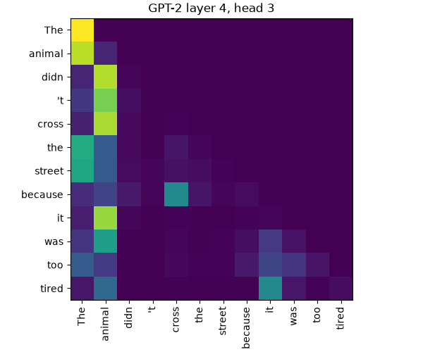

Averaged over heads, many tokens put a large weight on the very first token (a well-known "attention sink" that heads use as a default when they have nothing better to look at). Individual heads specialise: searching all 144 heads finds one where "it" attends strongly to "animal", the word it refers to. Each row only covers earlier tokens because GPT-2 is causal (Section [34](#34-multi-head-attention-causal-masks-and-positional-encodings)).

### Practice

1. Recompute the traced example without the √2 scaling. Do the weights become sharper or softer?
2. Why does attention cost grow with the square of the sequence length? Compute the size of the score matrix for 8,192 tokens in float16.

<details>
<summary><b>Answer</b></summary>

```python
s = Q @ K.T
ww = np.exp(s) / np.exp(s).sum(-1, keepdims=True)
print(ww.round(2))
print(f"{8192 ** 2 * 2 / 1e6:.0f} MB per head per layer")
```

**Output:**

```text
[[0.42 0.16 0.42]
 [0.16 0.42 0.42]
 [0.21 0.21 0.58]]
134 MB per head per layer
```

1. Sharper: larger score differences make the softmax more peaked (token 3 now gives 0.58 to itself instead of 0.51).
2. Every query is compared with every key: T × T scores. 8,192² × 2 bytes ≈ 134 MB for one head of one layer; with dozens of heads and layers, that's why long-context models need memory-efficient attention kernels.

</details>

| # | Problem (Deep-ML) | Difficulty |
|---|---|---|
| 1 | [53. Implement Self-Attention Mechanism](https://www.deep-ml.com/problems/53) | 🟡 Medium |
| 2 | [457. Implement Attention Sink Detection](https://www.deep-ml.com/problems/457) | 🟡 Medium |

**Learn more:** [Jay Alammar: the illustrated transformer](https://jalammar.github.io/illustrated-transformer/) · [Vaswani et al., Attention Is All You Need](https://arxiv.org/abs/1706.03762) · [3Blue1Brown: attention in transformers (video)](https://www.3blue1brown.com/lessons/attention)

---

## 34. Multi-Head Attention, Causal Masks and Positional Encodings


### Theory

> **In simple words:** three upgrades turn single attention into the transformer's attention. **Multiple heads** run several attentions in parallel on smaller slices, so one head can track grammar while another tracks references. A **causal mask** stops each token from looking at later tokens, so a model can be trained to predict the next word without seeing it. **Positional encodings** add information about **where** each token is, because attention by itself has no idea of order.

**Words to know:**

- **Multi-head attention (MHA):** split d_model into h heads of size d_model/h, run attention in each, concatenate the outputs and mix them with an output projection W_O.
- **Head:** one of the parallel attention computations, with its own Q/K/V projections.
- **Causal (look-ahead) mask:** set scores for positions j > i to −∞ before the softmax, so token i only attends to tokens 0…i; used in decoders (GPT).
- **Padding mask:** set scores for padding positions to −∞ so real tokens ignore them.
- **Positional encoding:** information about token positions added to (or applied to) the token vectors.
- **Sinusoidal encoding:** fixed sine/cosine waves of different frequencies per dimension (the original transformer).
- **Learned positional embeddings:** a trainable vector per position (BERT, GPT-2); limited to the trained length.
- **RoPE (rotary position embedding):** rotates each query/key pair of dimensions by an angle proportional to the position, so q·k depends on the **relative** distance; used in Llama, Qwen, Mistral and most modern LLMs.
- **ALiBi:** adds a distance-based penalty to attention scores instead of position vectors.
- **Relative position:** what most tasks need: "two words back" matters more than "position 1,207".
- **MQA / GQA (multi-query / grouped-query attention):** heads share keys and values (all heads / groups of heads) to shrink the KV cache (Section [38](#38-generating-text-greedy-beam-search-temperature-top-k-top-p-and-the-kv-cache)); GQA is standard in modern LLMs.
- **Context extension:** techniques (RoPE scaling, YaRN) that let a model handle longer inputs than it was trained on.

**Everyday picture.** A panel of editors reviewing the same draft: one checks grammar, one checks facts, one checks references, and their notes are merged (multi-head). A reader of a mystery novel isn't allowed to peek at the last page (causal mask). And page numbers (positions) matter: the same sentence means something different in the opening and in the final chapter.

**Multi-head shapes, traced** (batch N, sequence T, d_model = 64, h = 4 heads):

| step | shape |
|---|---|
| input X | (N, T, 64) |
| Q, K, V projections | (N, T, 64) each |
| split into heads | (N, 4, T, 16) each |
| attention per head | scores (N, 4, T, T) → output (N, 4, T, 16) |
| concatenate heads | (N, T, 64) |
| output projection W_O | (N, T, 64) |

Parameters: 4 projections of 64 × 64 (+ biases) = 4 × 4,160 = 16,640, the same whatever the number of heads.

**The causal mask, traced** (T = 4): allowed (✓) or masked (−∞):

| query \ key | 0 | 1 | 2 | 3 |
|---|---|---|---|---|
| 0 | ✓ | −∞ | −∞ | −∞ |
| 1 | ✓ | ✓ | −∞ | −∞ |
| 2 | ✓ | ✓ | ✓ | −∞ |
| 3 | ✓ | ✓ | ✓ | ✓ |

One forward pass trains all 4 next-token predictions at once, each seeing only its past.

**Common mistakes:**

- ❌ Forgetting the causal mask in a language model: it "cheats" by reading the answer, gets near-zero training loss, and generates garbage.
- ❌ Masking with 0 instead of −∞ (a 0 score still gets weight after softmax).
- ❌ Reshaping heads with `view` in the wrong order (split the last dimension into (h, d_head), **then** move h before T).
- ❌ Using a model on sequences longer than its positional scheme supports.

**Used in real software:** multi-head causal attention with RoPE and GQA in Llama 3, Mistral, Qwen and Gemma; learned absolute positions in BERT and GPT-2; padding masks in every batched inference server.

### Python

```python
import math
import torch
from torch import nn
import torch.nn.functional as F
import matplotlib.pyplot as plt

class MultiHeadAttention(nn.Module):
    def __init__(self, d_model, n_heads, causal=True):
        super().__init__()
        self.h, self.d_head, self.causal = n_heads, d_model // n_heads, causal
        self.qkv = nn.Linear(d_model, 3 * d_model)                         # Q, K, V in one matrix multiply
        self.proj = nn.Linear(d_model, d_model)                            # W_O
    def forward(self, x):
        N, T, D = x.shape
        q, k, v = self.qkv(x).split(D, dim=2)
        q, k, v = (t.view(N, T, self.h, self.d_head).transpose(1, 2) for t in (q, k, v))   # (N, h, T, d_head)
        scores = q @ k.transpose(-2, -1) / math.sqrt(self.d_head)
        if self.causal:
            mask = torch.triu(torch.ones(T, T, dtype=torch.bool), diagonal=1)
            scores = scores.masked_fill(mask, float("-inf"))
        out = scores.softmax(-1) @ v                                       # (N, h, T, d_head)
        return self.proj(out.transpose(1, 2).reshape(N, T, D))             # concatenate heads, mix

torch.manual_seed(0)
mha = MultiHeadAttention(64, 4)
x = torch.randn(2, 6, 64)
print("output:", tuple(mha(x).shape), "| parameters:", sum(p.numel() for p in mha.parameters()))
q, k, v = mha.qkv(x).split(64, dim=2)
ref = F.scaled_dot_product_attention(*(t.view(2, 6, 4, 16).transpose(1, 2) for t in (q, k, v)), is_causal=True)
print("matches PyTorch's causal attention:", torch.allclose(mha.proj(ref.transpose(1, 2).reshape(2, 6, 64)), mha(x), atol=1e-5))
y1 = mha(x); x2 = x.clone(); x2[:, 4] += 10                               # change token 4 only
y2 = mha(x2)
print("outputs that changed when token 4 changed:", [t for t in range(6) if not torch.allclose(y1[:, t], y2[:, t], atol=1e-5)])
```

**Output:**

```text
output: (2, 6, 64) | parameters: 16640
matches PyTorch's causal attention: True
outputs that changed when token 4 changed: [4, 5]
```

With the causal mask, changing token 4 can only affect outputs at positions 4 and 5: earlier positions never see it. That property is what lets a decoder train on every position of a sequence in parallel and still be a valid next-token predictor.

```python
def sinusoidal(T, d):
    pos = torch.arange(T)[:, None]; i = torch.arange(0, d, 2)[None]
    angle = pos / 10000 ** (i / d)
    pe = torch.zeros(T, d); pe[:, 0::2] = torch.sin(angle); pe[:, 1::2] = torch.cos(angle)
    return pe

def rope(x, pos):                                                          # x: (..., d) with d even
    d = x.shape[-1]; freqs = 1 / 10000 ** (torch.arange(0, d, 2) / d)
    ang = pos * freqs
    x1, x2 = x[..., 0::2], x[..., 1::2]
    return torch.stack([x1 * torch.cos(ang) - x2 * torch.sin(ang), x1 * torch.sin(ang) + x2 * torch.cos(ang)], -1).flatten(-2)

pe = sinusoidal(64, 32)
fig, axes = plt.subplots(1, 2, figsize=(10, 3.4), layout="constrained")
axes[0].imshow(pe.T, aspect="auto", cmap="RdBu"); axes[0].set(xlabel="position", ylabel="dimension", title="Sinusoidal positional encoding")
axes[1].imshow(torch.triu(torch.ones(8, 8), 1), cmap="Greys"); axes[1].set(title="Causal mask (dark = hidden future)", xlabel="key", ylabel="query")
fig.savefig("positional-encoding.png", dpi=100)
plt.close(fig)

torch.manual_seed(0)
q, k = torch.randn(32), torch.randn(32)
for p_q, p_k in [(5, 2), (105, 102), (1005, 1002)]:
    print(f"RoPE: query at {p_q:4d}, key at {p_k:4d} (distance 3) → score {(rope(q, p_q) @ rope(k, p_k)).item():.4f}")
print(f"distance 10 instead           → score {(rope(q, 12) @ rope(k, 2)).item():.4f}")
```

**Output:**

```text
RoPE: query at    5, key at    2 (distance 3) → score -3.4828
RoPE: query at  105, key at  102 (distance 3) → score -3.4828
RoPE: query at 1005, key at 1002 (distance 3) → score -3.4828
distance 10 instead           → score -1.2943
```

With RoPE, the attention score depends only on the **distance** between query and key (3 positions apart gives the same score at positions 5, 105 or 1005), not on their absolute positions. That relative behaviour is why RoPE became the default in modern LLMs.

### Practice

1. Make `mha` non-causal and repeat the "change token 4" test. Which outputs change now?
2. A model has d_model = 4,096 and 32 heads. What is the head size, and how many keys/values per token does the cache store per layer with 8 KV heads (GQA)?

<details>
<summary><b>Answer</b></summary>

```python
mha.causal = False
z1 = mha(x); z2 = mha(x2)
print([t for t in range(6) if not torch.allclose(z1[:, t], z2[:, t], atol=1e-5)])
print("head size", 4096 // 32, "| KV numbers per token per layer: full MHA", 2 * 4096, "| GQA with 8 KV heads", 2 * 8 * 128)
```

**Output:**

```text
[0, 1, 2, 3, 4, 5]
head size 128 | KV numbers per token per layer: full MHA 8192 | GQA with 8 KV heads 2048
```

1. All six: without the mask every token attends to every other, including token 4.
2. 128 per head. Full multi-head attention caches 2 × 32 × 128 = 8,192 numbers per token per layer; with 8 KV heads only 2,048, a 4× smaller KV cache.

</details>

| # | Problem (Deep-ML) | Difficulty |
|---|---|---|
| 1 | [107. Implement Masked Self-Attention](https://www.deep-ml.com/problems/107) | 🟡 Medium |
| 2 | [94. Implement Multi-Head Attention](https://www.deep-ml.com/problems/94) | 🔴 Hard |
| 3 | [85. Positional Encoding Calculator](https://www.deep-ml.com/problems/85) | 🔴 Hard |
| 4 | [381. Rotary Positional Embeddings (RoPE)](https://www.deep-ml.com/problems/381) | 🟡 Medium |
| 5 | [391. Implement Grouped Query Attention (GQA)](https://www.deep-ml.com/problems/391) | 🟡 Medium |

**Learn more:** [Su et al., RoFormer (RoPE)](https://arxiv.org/abs/2104.09864) · [Ainslie et al., GQA](https://arxiv.org/abs/2305.13245) · [Harvard NLP: the annotated transformer](https://nlp.seas.harvard.edu/annotated-transformer/)

---

## 35. The Transformer Block: Residuals, Normalisation and the Feed-Forward Network


### Theory

> **In simple words:** a **transformer block** has two halves. **Attention** lets tokens exchange information; a **feed-forward network** (an MLP applied to each token separately) then processes what each token gathered. Each half is wrapped in a **residual connection** and a **normalisation** layer, exactly the tricks of Sections [21](#21-normalisation-layers-batchnorm-layernorm-and-rmsnorm) and [26](#26-cnn-architectures-from-lenet-to-resnet-and-residual-connections). Stack dozens of identical blocks, add embeddings at the bottom and a projection to the vocabulary at the top, and you have GPT.

**Words to know:**

- **Transformer block (layer):** attention sub-layer + feed-forward sub-layer, each with a residual connection and normalisation.
- **Feed-forward network (FFN, MLP block):** two linear layers with an activation, applied to every position independently: d_model → 4·d_model → d_model (GELU) in GPT-2.
- **SwiGLU FFN:** a gated variant, (SiLU(x W₁) ⊙ x W₃) W₂, used in Llama-style models (with a hidden size of about 8/3·d_model to keep parameters similar).
- **Residual stream:** the vector per token that flows up through the blocks; each sub-layer reads it and **adds** its output back.
- **Pre-norm:** x + Attention(LN(x)), then x + FFN(LN(x)); the stable modern choice. **Post-norm:** LN(x + Attention(x)) (the 2017 original).
- **Final LayerNorm and LM head:** a last normalisation, then a linear layer from d_model to the vocabulary size, giving next-token logits.
- **Weight tying:** sharing the token-embedding matrix with the LM head (GPT-2 does this), saving parameters.
- **Model dimensions:** n_layers (depth), d_model (width), n_heads, d_ff (FFN width), vocabulary size, context length; together they set the parameter count.
- **Parameter count of a block:** about 12·d_model² (4·d² for attention, 8·d² for a 4× FFN), ignoring biases and norms.

**Everyday picture.** A team meeting followed by individual desk work, repeated: in the meeting (attention) everyone shares what they know; at their desks (FFN) each person processes it alone; a running shared document (the residual stream) collects everyone's additions without overwriting earlier work.

**GPT-2 small's parameters, traced** (12 layers, d_model = 768, vocabulary 50,257, context 1,024):

| part | count |
|---|---|
| token embeddings 50,257 × 768 | 38.6M |
| position embeddings 1,024 × 768 | 0.8M |
| per block ≈ 12 × 768² + biases and norms | ≈ 7.1M |
| 12 blocks | ≈ 85.0M |
| final LayerNorm | 1.5k |
| LM head (tied to the token embeddings) | 0 extra |
| **total** | **≈ 124.4M** |

**Common mistakes:**

- ❌ Normalising the residual stream itself (pre-norm normalises the **input** to each sub-layer, not the stream).
- ❌ Forgetting dropout/attention masks at training time, or leaving dropout on during generation.
- ❌ Assuming parameters are mostly in attention: in large models the FFNs hold about two-thirds of the block parameters.

**Used in real software:** GPT-2/3/4, Llama, Mistral, Qwen, Gemma and Claude-style decoders stack these blocks (with RMSNorm, RoPE, SwiGLU and GQA as the modern defaults); BERT stacks encoder blocks without the causal mask; ViT (Section [39](#39-vision-transformers-and-clip-transformers-beyond-text)) stacks the same blocks over image patches.

### Python

```python
import torch
from torch import nn

class Block(nn.Module):
    def __init__(self, d_model, n_heads, dropout=0.0):
        super().__init__()
        self.ln1, self.ln2 = nn.LayerNorm(d_model), nn.LayerNorm(d_model)
        self.attn = nn.MultiheadAttention(d_model, n_heads, dropout=dropout, batch_first=True)
        self.ffn = nn.Sequential(nn.Linear(d_model, 4 * d_model), nn.GELU(), nn.Linear(4 * d_model, d_model), nn.Dropout(dropout))
    def forward(self, x):
        T = x.shape[1]
        causal = torch.triu(torch.ones(T, T, dtype=torch.bool), diagonal=1)
        h = self.ln1(x)
        x = x + self.attn(h, h, h, attn_mask=causal, need_weights=False)[0]   # residual 1: attention
        return x + self.ffn(self.ln2(x))                                      # residual 2: feed-forward

block = Block(768, 12)
attn_params = sum(p.numel() for p in block.attn.parameters()); ffn_params = sum(p.numel() for p in block.ffn.parameters())
print(f"one GPT-2-sized block: attention {attn_params:,} + FFN {ffn_params:,} + norms {sum(p.numel() for m in (block.ln1, block.ln2) for p in m.parameters()):,}"
      f" = {sum(p.numel() for p in block.parameters()):,}  (12·768² = {12 * 768 ** 2:,})")
print("shape in = shape out:", tuple(block(torch.randn(2, 10, 768)).shape))

from transformers import AutoModelForCausalLM
gpt2 = AutoModelForCausalLM.from_pretrained("openai-community/gpt2")
print(f"GPT-2 small parameters: {sum(p.numel() for p in gpt2.parameters()):,}")
print("LM head tied to the token embeddings:", gpt2.lm_head.weight.data_ptr() == gpt2.transformer.wte.weight.data_ptr())
print("one real GPT-2 block:", [name for name, _ in gpt2.transformer.h[0].named_children()])
```

**Output:**

```text
one GPT-2-sized block: attention 2,362,368 + FFN 4,722,432 + norms 3,072 = 7,087,872  (12·768² = 7,077,888)
shape in = shape out: (2, 10, 768)
GPT-2 small parameters: 124,439,808
LM head tied to the token embeddings: True
one real GPT-2 block: ['ln_1', 'attn', 'ln_2', 'mlp']
```

Our block has exactly the parameter count of a GPT-2 block (12·768² plus biases and norm weights), and stacking 12 of them with the embeddings reproduces GPT-2's 124 million parameters. Two-thirds of each block sits in the feed-forward network.

```python
class SwiGLU(nn.Module):
    def __init__(self, d_model, hidden):
        super().__init__()
        self.w1, self.w3, self.w2 = nn.Linear(d_model, hidden, bias=False), nn.Linear(d_model, hidden, bias=False), nn.Linear(hidden, d_model, bias=False)
    def forward(self, x):
        return self.w2(nn.functional.silu(self.w1(x)) * self.w3(x))         # gate ⊙ value, then project back

d = 768
gelu_ffn = sum(p.numel() for p in nn.Sequential(nn.Linear(d, 4 * d, bias=False), nn.Linear(4 * d, d, bias=False)).parameters())
swiglu = sum(p.numel() for p in SwiGLU(d, int(8 * d / 3)).parameters())
print(f"FFN parameters, GELU 4×: {gelu_ffn:,} | SwiGLU with hidden 8/3·d: {swiglu:,}")
```

**Output:**

```text
FFN parameters, GELU 4×: 4,718,592 | SwiGLU with hidden 8/3·d: 4,718,592
```

SwiGLU uses three matrices instead of two, so Llama-style models shrink the hidden size to about 8/3 × d_model to keep the parameter count the same, and gain quality from the gating.

### Practice

1. Estimate the parameters of a model with 32 layers, d_model = 4,096 and a vocabulary of 32,000 (untied embeddings), using 12·d² per block.
2. Why can each block's input and output have the same shape, and why does that matter?

<details>
<summary><b>Answer</b></summary>

```python
d, L, vocab = 4096, 32, 32000
print(f"blocks {12 * d * d * L / 1e9:.2f}B + embeddings and head {2 * vocab * d / 1e9:.2f}B = {(12 * d * d * L + 2 * vocab * d) / 1e9:.2f}B")
```

**Output:**

```text
blocks 6.44B + embeddings and head 0.26B = 6.70B
```

1. About 6.4B in the blocks and 0.26B in the embeddings and head: roughly a 7B-parameter model (the Llama-2-7B size; its SwiGLU FFN makes the exact count slightly different).
2. Every sub-layer adds its output to the residual stream, so shapes must match; and identical shapes let you stack any number of blocks, which is how model families scale from millions to hundreds of billions of parameters.

</details>

| # | Problem (Deep-ML) | Difficulty |
|---|---|---|
| 1 | [178. Implement Position-wise Feed-Forward Block with Residual and Dropout](https://www.deep-ml.com/problems/178) | 🟡 Medium |
| 2 | [408. Pre-Norm vs Post-Norm Transformer Block](https://www.deep-ml.com/problems/408) | 🟡 Medium |
| 3 | [156. Implement SwiGLU activation function](https://www.deep-ml.com/problems/156) | 🟢 Easy |

**Learn more:** [Andrej Karpathy: nanoGPT](https://github.com/karpathy/nanoGPT) · [Anthropic: a mathematical framework for transformer circuits](https://transformer-circuits.pub/2021/framework/index.html) · [Shazeer, GLU Variants Improve Transformer](https://arxiv.org/abs/2002.05202)

---

## 36. Build a Tiny GPT from Scratch


### Theory

> **In simple words:** a **GPT** (generative pretrained transformer) is a stack of causal transformer blocks trained on one task: **predict the next token**. Fed a lot of text, it learns spelling, grammar, style and (at enough scale) facts and reasoning patterns, all to get better at that one prediction. Generation is just repeating it: predict, sample a token, append it, predict again. This section builds and trains a complete GPT on Shakespeare in under two minutes on a laptop CPU.

**Words to know:**

- **Language model (LM):** a model of P(next token | previous tokens).
- **Autoregressive (causal) language modelling:** training to predict each token from the ones before it; the target is the input shifted left by one.
- **GPT (generative pretrained transformer):** a decoder-only transformer language model.
- **Character-level model:** each character is a token (vocabulary ≈ 65 here), the simplest tokenisation.
- **Block size (context length):** the maximum number of previous tokens the model sees.
- **Training batch:** random windows of `block_size + 1` characters; inputs are the first `block_size`, targets the last `block_size`.
- **Pretraining:** training a language model on a large general corpus; LLMs then get fine-tuned (Part 8).
- **Sampling:** drawing the next token from the predicted probability distribution (Section [38](#38-generating-text-greedy-beam-search-temperature-top-k-top-p-and-the-kv-cache)).
- **nanoGPT:** Andrej Karpathy's minimal GPT implementation, which this section follows.

**Everyday picture.** A child who has read every Shakespeare play aloud a hundred times can continue any line in his style, though they don't understand the plots. The tiny GPT is that child, minus the understanding; the large models are that child after reading most of the internet.

**One training example, traced** (block size 8): text "First Citizen" → characters `F i r s t ␣ C i t`.
Input `F i r s t ␣ C i`, targets `i r s t ␣ C i t`: at position 0 predict "i" from "F", at position 1 predict "r" from "Fi", …, at position 7 predict "t" from "First Ci". One window gives 8 training examples at once, thanks to the causal mask.

**The model, step by step:**

1. Token embedding + position embedding → (N, T, d).
2. n_layers × Block (Section [35](#35-the-transformer-block-residuals-normalisation-and-the-feed-forward-network)).
3. Final LayerNorm → linear layer to vocabulary logits (N, T, vocab).
4. Loss: cross-entropy between logits and the shifted targets.
5. Generate: feed a prompt, take the logits at the last position, sample, append, repeat (cropping to the block size).

**Common mistakes:**

- ❌ Targets not shifted by one (the model learns to copy its input).
- ❌ No causal mask (training loss collapses, generation is nonsense).
- ❌ Generating beyond the block size without cropping the context.
- ❌ Judging the model by training loss alone; always track a validation loss on held-out text.

**Used in real software:** nanoGPT-style code is how researchers and students prototype; GPT-2, GPT-3, Llama and their successors are this same architecture with more layers, wider vectors, better tokenisers and trillions of training tokens.

### Python

```python
import os, time, urllib.request
import torch
from torch import nn
import matplotlib.pyplot as plt

path = "data/tinyshakespeare.txt"
if not os.path.exists(path):                                              # 1.1 MB of Shakespeare (downloads once)
    urllib.request.urlretrieve("https://raw.githubusercontent.com/karpathy/char-rnn/master/data/tinyshakespeare/input.txt", path)
text = open(path).read()
chars = sorted(set(text)); stoi = {c: i for i, c in enumerate(chars)}
encode = lambda s: [stoi[c] for c in s]; decode = lambda ids: "".join(chars[i] for i in ids)
data = torch.tensor(encode(text))
split = int(0.9 * len(data)); train_data, val_data = data[:split], data[split:]
print(f"{len(text):,} characters, vocabulary of {len(chars)}: {''.join(chars[13:39])}...")
print("encode('Hi!') =", encode("Hi!"), "→ decode →", repr(decode(encode("Hi!"))))

block_size, batch_size = 64, 32
def get_batch(source, g):
    idx = torch.randint(len(source) - block_size - 1, (batch_size,), generator=g)
    x = torch.stack([source[i:i + block_size] for i in idx]); y = torch.stack([source[i + 1:i + block_size + 1] for i in idx])
    return x, y                                                            # y = x shifted left by one

class Block(nn.Module):
    def __init__(self, d, n_heads, dropout):
        super().__init__()
        self.ln1, self.ln2 = nn.LayerNorm(d), nn.LayerNorm(d)
        self.attn = nn.MultiheadAttention(d, n_heads, dropout=dropout, batch_first=True)
        self.ffn = nn.Sequential(nn.Linear(d, 4 * d), nn.GELU(), nn.Linear(4 * d, d), nn.Dropout(dropout))
    def forward(self, x, mask):
        h = self.ln1(x)
        x = x + self.attn(h, h, h, attn_mask=mask, need_weights=False)[0]
        return x + self.ffn(self.ln2(x))

class TinyGPT(nn.Module):
    def __init__(self, vocab, d=128, n_layers=4, n_heads=4, dropout=0.1):
        super().__init__()
        self.tok, self.pos = nn.Embedding(vocab, d), nn.Embedding(block_size, d)
        self.blocks = nn.ModuleList([Block(d, n_heads, dropout) for _ in range(n_layers)])
        self.ln_f, self.head = nn.LayerNorm(d), nn.Linear(d, vocab)
    def forward(self, idx, targets=None):
        T = idx.shape[1]
        x = self.tok(idx) + self.pos(torch.arange(T))
        mask = torch.triu(torch.ones(T, T, dtype=torch.bool), diagonal=1)
        for b in self.blocks:
            x = b(x, mask)
        logits = self.head(self.ln_f(x))
        loss = None if targets is None else nn.functional.cross_entropy(logits.view(-1, logits.shape[-1]), targets.view(-1))
        return logits, loss
    @torch.no_grad()
    def generate(self, idx, n_new, temperature=1.0):
        for _ in range(n_new):
            logits, _ = self(idx[:, -block_size:])                         # crop to the context length
            probs = (logits[:, -1] / temperature).softmax(-1)
            idx = torch.cat([idx, torch.multinomial(probs, 1)], 1)         # sample, append, repeat
        return idx

torch.manual_seed(0)
model = TinyGPT(len(chars))
print(f"parameters: {sum(p.numel() for p in model.parameters()):,}")
model.eval()
print("untrained sample:", repr(decode(model.generate(torch.tensor([encode("ROMEO:")]), 60)[0].tolist())))
```

**Output:**

```text
1,115,394 characters, vocabulary of 65: ABCDEFGHIJKLMNOPQRSTUVWXYZ...
encode('Hi!') = [20, 47, 2] → decode → 'Hi!'
parameters: 818,241
untrained sample: "ROMEO:QZUXmqPms'Y.KgS:tggftPf!PsEnVn'.p?U,fl.MXv\nGTneMkuYYcnPFHgkz"
```

```python
g = torch.Generator().manual_seed(0)
opt = torch.optim.AdamW(model.parameters(), lr=1e-3, weight_decay=0.01)
sched = torch.optim.lr_scheduler.OneCycleLR(opt, max_lr=1e-3, total_steps=2500, pct_start=0.05)
history, t0 = [], time.time()
for step in range(2500):
    model.train()
    x, y = get_batch(train_data, g)
    _, loss = model(x, y)
    opt.zero_grad(); loss.backward(); nn.utils.clip_grad_norm_(model.parameters(), 1.0); opt.step(); sched.step()
    if step % 250 == 0 or step == 2499:
        model.eval()
        with torch.no_grad():
            val = sum(model(*get_batch(val_data, g))[1].item() for _ in range(20)) / 20
        history.append((step, loss.item(), val))
        print(f"step {step:4d}: train loss {loss.item():.3f} | val loss {val:.3f}")
print(f"training took {time.time() - t0:.0f} s on a laptop CPU")

fig, ax = plt.subplots(figsize=(7, 3.2), layout="constrained")
s_, tr, va = zip(*history)
ax.plot(s_, tr, "o-", label="train"); ax.plot(s_, va, "o-", label="validation")
ax.axhline(torch.log(torch.tensor(float(len(chars)))).item(), ls=":", color="gray", label="uniform guess (ln 65)")
ax.set(xlabel="step", ylabel="cross-entropy (nats per character)", title="A tiny GPT learning Shakespeare"); ax.legend()
fig.savefig("tiny-gpt-loss.png", dpi=100)
plt.close(fig)

model.eval(); torch.manual_seed(1)
print(decode(model.generate(torch.tensor([encode("ROMEO:")]), 300, temperature=0.8)[0].tolist()))
```

**Output:**

```text
step    0: train loss 4.381 | val loss 4.349
step  250: train loss 2.272 | val loss 2.295
step  500: train loss 1.997 | val loss 2.026
step  750: train loss 1.795 | val loss 1.911
step 1000: train loss 1.717 | val loss 1.840
step 1250: train loss 1.721 | val loss 1.767
step 1500: train loss 1.669 | val loss 1.760
step 1750: train loss 1.584 | val loss 1.746
step 2000: train loss 1.655 | val loss 1.711
step 2250: train loss 1.611 | val loss 1.718
step 2499: train loss 1.532 | val loss 1.702
training took 96 s on a laptop CPU
ROMEO:
Call the repeace and betters and a blood,
But that you warlick'd moting mine, and live,
For herse man, thou fance where the sover'd as for there
Besing your hearded father will in the more
fainter.

DUKE VINCENTIO:
Take that we some that power to such and that not
she hath in unnoter, minder, the n
```

The loss starts at about ln 65 ≈ 4.17 (a uniform guess over 65 characters) and falls steadily. The generated text has the **shape** of a play: speaker names in capitals followed by colons, line breaks, mostly real English words and Shakespearean rhythm, but no real meaning. That's 0.8 million parameters and under two minutes on a CPU; GPT-3 is the same recipe with 175 billion parameters, a subword tokeniser and 300 billion training tokens.

### Practice

1. Generate from the trained model with `temperature=0.3` and `temperature=1.5`. Describe the difference.
2. How many next-character predictions does one training batch contain?

<details>
<summary><b>Answer</b></summary>

```python
for temp in (0.3, 1.5):
    torch.manual_seed(2)
    print(f"--- temperature {temp} ---"); print(decode(model.generate(torch.tensor([encode("KING:")]), 120, temperature=temp)[0].tolist()))
print("predictions per batch:", batch_size * block_size)
```

**Output:**

```text
--- temperature 0.3 ---
KING:
And the day the rest to stand of the prince of the have
That have made the bears of the consure of the story
The shall 
--- temperature 1.5 ---
KING: God, look;
Ne's roWhat is much sVols: is noblely vaim.
Whet, hoid me, inle's that quothmain lenchance. 'Tjest?
'Tis Mon
predictions per batch: 2048
```

1. Low temperature sharpens the distribution: safer, more repetitive text built from the most common words. High temperature flattens it: more varied and more misspelled, approaching random characters.
2. 32 × 64 = 2,048: every position in every window is a training example, thanks to the causal mask.

</details>

| # | Problem (Deep-ML) | Difficulty |
|---|---|---|
| 1 | [374. Character-Level Tokenizer (stoi/itos/BOS)](https://www.deep-ml.com/problems/374) | 🟢 Easy |
| 2 | [88. GPT-2 Text Generation](https://www.deep-ml.com/problems/88) | 🔴 Hard |

**Learn more:** [Andrej Karpathy: Let's build GPT from scratch (video)](https://www.youtube.com/watch?v=kCc8FmEb1nY) · [nanoGPT](https://github.com/karpathy/nanoGPT) · [Radford et al., Language Models are Unsupervised Multitask Learners (GPT-2)](https://cdn.openai.com/better-language-models/language_models_are_unsupervised_multitask_learners.pdf)

---

## 37. Encoders, Decoders and Encoder–Decoders: BERT, GPT and T5

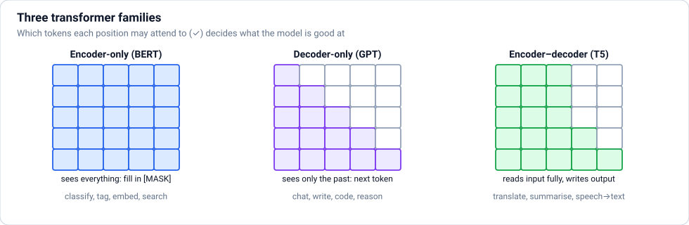

### Theory

> **In simple words:** transformers come in three shapes. **Encoder-only** models (BERT) let every token see the whole input and are trained to fill in masked words: great for understanding (classification, search). **Decoder-only** models (GPT) only look backwards and predict the next token: great for generating, and, at scale, for almost everything, which is why today's LLMs are decoders. **Encoder–decoder** models (T5) read the input with an encoder and write the output with a decoder: natural for translation and summarisation.

**Words to know:**

- **Encoder-only transformer:** bidirectional attention (no causal mask); outputs a contextual vector per token.
- **BERT (2018):** an encoder trained with **masked language modelling (MLM)**: hide 15% of tokens and predict them from both sides. Variants: RoBERTa, DistilBERT, DeBERTa, ModernBERT.
- **[CLS] / [SEP] / [MASK]:** BERT's special tokens: a summary token at the start, a separator between segments, and the masked-token placeholder.
- **Decoder-only transformer:** causal attention; trained with next-token prediction (GPT, Llama, Claude, Gemini).
- **Encoder–decoder (seq2seq) transformer:** encoder over the input + decoder with **cross-attention** to the encoder's outputs (T5, BART, Whisper, translation models).
- **Cross-attention:** attention whose queries come from the decoder and keys/values from the encoder.
- **T5 (2019):** "Text-to-Text Transfer Transformer": every task is phrased as text in, text out ("translate English to German: …").
- **Distillation (DistilBERT):** a smaller model trained to mimic a larger one (Section [52](#52-knowledge-distillation-and-pruning)).
- **Fill-mask / text generation / text-to-text:** the natural tasks of the three families.
- **Pretrain then fine-tune:** all three are pretrained on large text and then adapted (Part 8).

**Everyday picture.** An editor, an author and a translator. The editor (encoder) reads the whole page at once and judges it; the author (decoder) writes word after word without peeking ahead; the translator (encoder–decoder) first reads the whole source page, then writes the translation while glancing back at it.

**Choosing a family (2026):**

| Task | Typical choice |
|---|---|
| classification, named-entity tagging, embeddings for search | encoder (BERT-family, ModernBERT, sentence-embedding models) |
| chat, writing, coding, reasoning, most new applications | decoder-only LLMs |
| translation, summarisation, speech-to-text with a fixed input | encoder–decoder (T5/BART, NLLB, Whisper), or a decoder LLM |
| very cheap, fast, high-volume classification | a small fine-tuned encoder |

**Common mistakes:**

- ❌ Using BERT to generate free text (it fills masks; it isn't a generator).
- ❌ Fine-tuning a huge decoder for a simple classification task a small encoder would do faster and cheaper.
- ❌ Forgetting the task prefix with T5-style models.

**Used in real software:** BERT-family encoders in Google Search ranking (from 2019), spam and moderation classifiers and most embedding/RAG pipelines; decoder LLMs in ChatGPT, Claude, Gemini, Copilot; encoder–decoders in Whisper (speech recognition) and many production translation systems.

### Python

```python
import torch
from transformers import AutoModelForCausalLM, AutoModelForSeq2SeqLM, AutoTokenizer, pipeline

fill = pipeline("fill-mask", model="distilbert/distilbert-base-uncased")   # encoder-only (downloads ~270 MB once)
for sentence in ["Paris is the [MASK] of France.", "The doctor told the patient to take the [MASK] twice a day."]:
    print(sentence, "→", [(r["token_str"], round(r["score"], 2)) for r in fill(sentence)[:3]])

tok = AutoTokenizer.from_pretrained("openai-community/gpt2")
gpt2 = AutoModelForCausalLM.from_pretrained("openai-community/gpt2")      # decoder-only
ids = tok("The three main families of transformers are", return_tensors="pt")
out = gpt2.generate(**ids, max_new_tokens=20, do_sample=False, pad_token_id=tok.eos_token_id)
print("GPT-2:", tok.decode(out[0]))

t5_tok = AutoTokenizer.from_pretrained("google-t5/t5-small")
t5 = AutoModelForSeq2SeqLM.from_pretrained("google-t5/t5-small")          # encoder–decoder (~240 MB)
for prompt in ["translate English to German: The house is wonderful.",
               "summarize: The transformer architecture replaced recurrent networks because attention lets every token "
               "look at every other token directly, which trains faster on GPUs and handles long-range dependencies better."]:
    ids = t5_tok(prompt, return_tensors="pt")
    print("T5:", t5_tok.decode(t5.generate(**ids, max_new_tokens=30)[0], skip_special_tokens=True))
print("T5 has encoder and decoder stacks:", type(t5.get_encoder()).__name__, "+", type(t5.get_decoder()).__name__)
```

**Output:**

```text
Paris is the [MASK] of France. → [('capital', 0.98), ('birthplace', 0.0), ('northernmost', 0.0)]
The doctor told the patient to take the [MASK] twice a day. → [('medication', 0.42), ('pill', 0.13), ('pills', 0.09)]
GPT-2: The three main families of transformers are:

The first family is the family of the first generation of transformers. The second family
T5: Das Haus ist wunderbar.
T5: transformer architecture replaced recurrent networks because attention lets every token look at every other token directly. the transformer architecture trains faster on GPUs and handles
T5 has encoder and decoder stacks: T5Stack + T5Stack
```

Each family does its natural job out of the box: the encoder fills in the blank using words on **both** sides, GPT-2 continues text (fluently but without real knowledge of the answer; it's a small 2019 model), and T5 maps an input text to an output text for whichever task its prefix names.

### Practice

1. Ask the fill-mask model about "The [MASK] barked at the mailman." Then explain why a decoder-only model can't directly do fill-in-the-blank in the middle of a sentence.
2. Which family would you pick to tag every word of a medical report with entity types, and why?

<details>
<summary><b>Answer</b></summary>

```python
print([(r["token_str"], round(r["score"], 2)) for r in fill("The [MASK] barked at the mailman.")[:3]])
```

**Output:**

```text
[('clerk', 0.07), ('guard', 0.03), ('postmaster', 0.03)]
```

1. Surprisingly, this small model doesn't answer "dog": its top guesses are people ("clerk", "guard"), with low confidence, apparently pulled by "mailman". A reminder that small models make odd mistakes, so look at real predictions rather than assuming. As for decoders: a decoder predicts each token from the tokens **before** it, so it can't use "barked at the mailman" when filling the blank (unless you rephrase the task as a prompt); an encoder sees both sides.
2. An encoder (a BERT-family model fine-tuned for token classification): it produces one contextual vector per token using the whole sentence, it's small and fast, and the task doesn't require generating text.

</details>

| # | Practice | Difficulty |
|---|---|---|
| 1 | [Hugging Face course: transformer models (chapter 1)](https://huggingface.co/learn/llm-course/chapter1/1) | 🟢 Easy |
| 2 | [Kaggle: Natural Language Processing with Disaster Tweets (fine-tune an encoder)](https://www.kaggle.com/competitions/nlp-getting-started) | 🟡 Medium |

**Learn more:** [Devlin et al., BERT](https://arxiv.org/abs/1810.04805) · [Raffel et al., T5](https://arxiv.org/abs/1910.10683) · [Jay Alammar: the illustrated BERT](https://jalammar.github.io/illustrated-bert/)

---

## 38. Generating Text: Greedy, Beam Search, Temperature, Top-k, Top-p and the KV Cache


### Theory

> **In simple words:** a language model only gives **probabilities** for the next token; a **decoding strategy** decides which token to actually emit. **Greedy** picks the most likely token (repetitive), **beam search** keeps several candidate continuations (good for translation), and **sampling** draws at random from a reshaped distribution (**temperature**, **top-k**, **top-p**) for natural, varied text. A **KV cache** makes generation fast by not recomputing the keys and values of tokens already processed.

**Words to know:**

- **Decoding:** turning next-token probabilities into an actual output sequence.
- **Greedy decoding:** always pick the highest-probability token; deterministic, often repetitive.
- **Beam search:** keep the k best partial sequences (the **beam width**) at each step by total log-probability.
- **Sampling:** draw the next token at random according to the probabilities.
- **Temperature (T):** divide logits by T before softmax: T < 1 sharpens (safer), T > 1 flattens (more random); T → 0 is greedy.
- **Top-k sampling:** sample only among the k most likely tokens.
- **Top-p (nucleus) sampling:** sample among the smallest set of tokens whose probabilities add up to p (e.g. 0.9); adapts the set size to the model's confidence.
- **Min-p sampling:** keep tokens with probability ≥ min_p × the top probability; a newer, popular alternative.
- **Repetition penalty:** down-weight tokens that already appeared.
- **Stop sequence / max new tokens / EOS:** ways generation ends.
- **KV cache:** storing every layer's keys and values for the tokens so far, so each new token only computes its own query/key/value instead of reprocessing the whole sequence.
- **Prefill vs decode:** processing the prompt in one parallel pass (compute-bound) vs generating one token at a time (memory-bound, limited by reading weights and the KV cache).
- **Speculative decoding:** a small "draft" model proposes several tokens; the big model verifies them in one pass (Section [53](#53-fast-inference-and-deployment-torchcompile-onnx-batching-and-speculative-decoding)).

**Everyday picture.** Finishing someone's sentence: greedy always says the most obvious word; beam search considers a few full phrasings before choosing; sampling with a sensible temperature is a person who is mostly predictable but occasionally surprising. The KV cache is remembering what you already read instead of rereading the whole conversation before every word.

**Temperature and top-p, traced** (logits for "cat", "dog", "car", "sky" = 2, 1, 0, −1):

| setting | probabilities (cat, dog, car, sky) |
|---|---|
| T = 1 | 0.64, 0.24, 0.09, 0.03 |
| T = 0.5 | 0.86, 0.12, 0.02, 0.00 |
| T = 2 | 0.46, 0.28, 0.17, 0.10 |
| top-p 0.85 (T = 1) | keep cat + dog (0.64 + 0.24 = 0.88 ≥ 0.85) → renormalise to 0.73, 0.27 |

**Which strategy when:**

| Task | Decoding |
|---|---|
| translation, short factual answers, code completion | greedy or beam search, or low temperature |
| chat, creative writing | sampling, temperature 0.6–1.0, top-p 0.9 (or min-p) |
| extracting structured data (JSON) | temperature 0 plus constrained decoding (`llm-engineering.md`) |

**Common mistakes:**

- ❌ Temperature 0 for creative tasks (dull, repetitive loops) or high temperature for factual ones (made-up details).
- ❌ Expecting identical outputs from sampling without fixing the random seed.
- ❌ Disabling the KV cache (generation gets much slower as text grows).
- ❌ Forgetting that the KV cache consumes memory proportional to layers × tokens × KV heads × head size (Section [34](#34-multi-head-attention-causal-masks-and-positional-encodings) explains GQA's savings).

**Used in real software:** every LLM API exposes temperature, top-p and max tokens; inference servers (vLLM, TGI, llama.cpp) manage KV caches with paging and share them across requests with the same prefix; translation systems use beam search.

### Python

```python
import time
import torch
import matplotlib.pyplot as plt
from transformers import AutoModelForCausalLM, AutoTokenizer

logits = torch.tensor([2.0, 1.0, 0.0, -1.0])
for T in (1.0, 0.5, 2.0):
    print(f"T = {T}: {[round(p, 2) for p in (logits / T).softmax(0).tolist()]}")

def top_p_filter(probs, p):
    sorted_p, idx = probs.sort(descending=True)
    keep = sorted_p.cumsum(0) - sorted_p < p                              # keep tokens until the running sum reaches p
    out = torch.zeros_like(probs); out[idx[keep]] = sorted_p[keep]
    return out / out.sum()
print("top-p 0.85:", [round(p, 2) for p in top_p_filter(logits.softmax(0), 0.85).tolist()])

tok = AutoTokenizer.from_pretrained("openai-community/gpt2")
model = AutoModelForCausalLM.from_pretrained("openai-community/gpt2").eval()
prompt = tok("The best thing about learning to cook is", return_tensors="pt")
with torch.no_grad():
    next_logits = model(**prompt).logits[0, -1]
probs = next_logits.softmax(0)
top = probs.topk(8)
print("GPT-2's top next tokens:", [(tok.decode(i), round(p, 3)) for p, i in zip(top.values.tolist(), top.indices.tolist())])
fig, axes = plt.subplots(1, 3, figsize=(11, 3), layout="constrained", sharey=True)
words = [tok.decode(i) for i in top.indices]
for ax, (title, p) in zip(axes, [("temperature 1.0", probs), ("temperature 0.5", (next_logits / 0.5).softmax(0)), ("top-p 0.5", top_p_filter(probs, 0.5))]):
    ax.bar(range(8), p[top.indices].detach()); ax.set_xticks(range(8)); ax.set_xticklabels(words, rotation=60, fontsize=8); ax.set_title(title)
fig.savefig("sampling.png", dpi=100)
plt.close(fig)
```

**Output:**

```text
T = 1.0: [0.64, 0.24, 0.09, 0.03]
T = 0.5: [0.86, 0.12, 0.02, 0.0]
T = 2.0: [0.46, 0.28, 0.17, 0.1]
top-p 0.85: [0.73, 0.27, 0.0, 0.0]
GPT-2's top next tokens: [(' that', 0.399), (' to', 0.07), (' the', 0.069), (' you', 0.038), (' how', 0.033), (' learning', 0.029), (' not', 0.028), (' it', 0.02)]
```

```python
def generate(**kw):
    torch.manual_seed(0)
    out = model.generate(**prompt, max_new_tokens=25, pad_token_id=tok.eos_token_id, **kw)
    return tok.decode(out[0][prompt["input_ids"].shape[1]:]).replace("\n", " ")

print("greedy       :", generate(do_sample=False))
print("beam search 4:", generate(do_sample=False, num_beams=4, no_repeat_ngram_size=2))
print("sample T=0.7 :", generate(do_sample=True, temperature=0.7, top_p=0.9))
print("sample T=1.5 :", generate(do_sample=True, temperature=1.5, top_k=0))

long_prompt = tok("Once upon a time", return_tensors="pt")
timings = {}
for cache in (True, False):
    t0 = time.time()
    model.generate(**long_prompt, max_new_tokens=200, min_new_tokens=200, do_sample=False, use_cache=cache, pad_token_id=tok.eos_token_id)
    timings[cache] = time.time() - t0
print(f"200 new tokens: with KV cache {timings[True]:.1f} s, without {timings[False]:.1f} s (≈{timings[False] / timings[True]:.0f}× slower)")
```

**Output:**

```text
greedy       :  that you can learn to cook with your hands.  The best thing about learning to cook is that you can learn to
beam search 4:  that you don't have to learn how to do it. You can learn to make your own food, and you can make
sample T=0.7 :  that you learn how to cook your own food. But, the real fun begins when you have a basic understanding of how to
sample T=1.5 :  along gritty pilot cutsave stories... is "tree legs diffuse the spill that squat targets CathP wrestler roamer regulates".  
200 new tokens: with KV cache 2.3 s, without 7.5 s (≈3× slower)
```

Greedy decoding gets stuck repeating itself, a classic failure; beam search with a no-repeat rule is more fluent but bland; moderate sampling is the most natural; and a high temperature with no top-k/top-p filtering drifts into nonsense. Without the KV cache, every new token recomputes attention over the whole sequence, so generation is several times slower even at 200 tokens, and the gap grows with length.

### Practice

1. Implement top-k filtering (keep the k largest probabilities, renormalise) and apply it with k = 2 to the traced logits.
2. A model has 32 layers, 8 KV heads of size 128, and stores the cache in float16. How much memory does the KV cache need for one 32,000-token conversation?

<details>
<summary><b>Answer</b></summary>

```python
def top_k_filter(probs, k):
    vals, idx = probs.topk(k)
    out = torch.zeros_like(probs); out[idx] = vals
    return out / out.sum()
print([round(p, 2) for p in top_k_filter(logits.softmax(0), 2).tolist()])
print(f"KV cache: {2 * 32 * 8 * 128 * 32000 * 2 / 1e9:.1f} GB")
```

**Output:**

```text
[0.73, 0.27, 0.0, 0.0]
KV cache: 4.2 GB
```

1. Only "cat" and "dog" remain: 0.73 and 0.27.
2. 2 (keys and values) × 32 layers × 8 heads × 128 × 32,000 tokens × 2 bytes ≈ 4.2 GB for a single long conversation, which is why servers page, share and compress KV caches.

</details>

| # | Problem (Deep-ML) | Difficulty |
|---|---|---|
| 1 | [383. Top-p (Nucleus) Sampling](https://www.deep-ml.com/problems/383) | 🟡 Medium |
| 2 | [376. KV Cache for Efficient Autoregressive Attention](https://www.deep-ml.com/problems/376) | 🟡 Medium |
| 3 | [435. KV Cache Memory Budget and Eviction Policy](https://www.deep-ml.com/problems/435) | 🟡 Medium |
| 4 | [394. Implement Speculative Decoding Verification](https://www.deep-ml.com/problems/394) | 🔴 Hard |

**Learn more:** [Hugging Face: text generation strategies](https://huggingface.co/docs/transformers/generation_strategies) · [Holtzman et al., The Curious Case of Neural Text Degeneration (nucleus sampling)](https://arxiv.org/abs/1904.09751) · [vLLM: PagedAttention](https://blog.vllm.ai/2023/06/20/vllm.html)

---

## 39. Vision Transformers and CLIP: Transformers Beyond Text

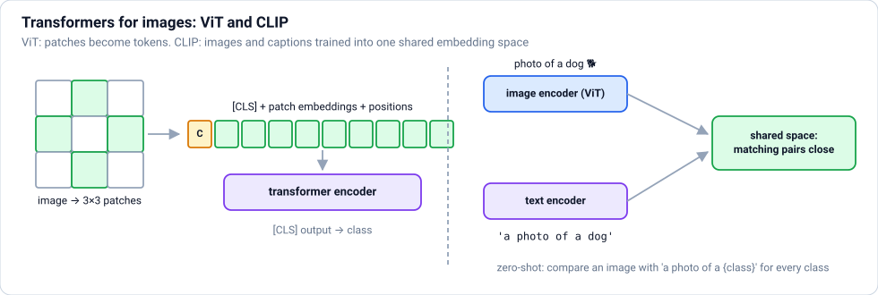

### Theory

> **In simple words:** a **vision transformer (ViT)** treats an image as a sentence of **patches**: cut it into 16×16 squares, flatten each into a vector, and run a standard transformer over them. With enough data (or pretraining), ViTs match or beat CNNs. **CLIP** trains an image encoder and a text encoder together on hundreds of millions of image–caption pairs so that matching images and captions land close together in one shared space. The result can classify images into **any** categories you describe in words, with no training: **zero-shot** classification.

**Words to know:**

- **Vision transformer (ViT, 2020):** a transformer encoder over image patches.
- **Patch / patch embedding:** a small square of the image (e.g. 16×16×3 = 768 numbers) projected to d_model by a linear layer (equivalently, a convolution with stride = patch size).
- **[CLS] token:** an extra learned token whose final vector summarises the image for classification (or average-pool the patch outputs instead).
- **Inductive bias:** built-in assumptions; CNNs assume locality and translation equivariance, ViTs assume little, so they need more data or pretraining.
- **Multimodal model:** a model that handles more than one kind of input (text, images, audio).
- **CLIP (contrastive language–image pretraining, 2021):** trains image and text encoders with a **contrastive loss** (Section [44](#44-embeddings-and-contrastive-learning-sentence-embeddings-simclr-and-clip-loss)) so the correct image–caption pairs score highest.
- **Shared embedding space:** one vector space where images and texts can be compared by cosine similarity.
- **Zero-shot classification:** classifying into classes never trained on explicitly, by comparing the image with text prompts like "a photo of a {class}".
- **Prompt template / prompt ensembling:** the wording of the class prompts; averaging several wordings improves accuracy.
- **SigLIP, DINOv2, EVA:** later image encoders (sigmoid-loss CLIP; self-supervised features) used as vision backbones.
- **Vision-language model (VLM):** an LLM that also reads images, typically via a ViT encoder whose patch embeddings become extra tokens for the language model (Section [56](#56-whats-new-in-deep-learning-20232026)).

**Everyday picture.** Reading a comic strip panel by panel: each panel (patch) is a "word", and the story comes from how panels relate (attention). CLIP is a museum guide who has read millions of captioned photos: shown a new picture and a list of possible captions, they pick the caption that fits best, even for subjects they were never formally taught.

**Patches, traced:** a 224×224×3 image with 16×16 patches → (224/16)² = **196 patches**, each 16·16·3 = 768 numbers; plus one [CLS] token = a sequence of 197 tokens, the same length as a short paragraph. For FashionMNIST 28×28 with 7×7 patches: 16 patches of 49 numbers.

**CNN vs ViT:**

| | CNN | ViT |
|---|---|---|
| built-in assumptions | locality, translation equivariance | almost none |
| small datasets from scratch | better | worse |
| with large pretraining | strong | as good or better, scales further |
| global context | grows with depth | from the first layer |
| typical use (2026) | edge devices, real-time detection, small data | foundation models, VLM image encoders |

**Common mistakes:**

- ❌ Training a ViT from scratch on a small dataset and expecting CNN-level accuracy.
- ❌ Using an image size the ViT's position embeddings weren't trained for (interpolate them).
- ❌ Zero-shot class names that are ambiguous or unnatural ("crane" the bird vs the machine): write descriptive prompts.

**Used in real software:** CLIP-style encoders power image search (Google Photos, Pinterest), content moderation and the text conditioning of image generators (Stable Diffusion); ViT encoders are the eyes of multimodal LLMs (GPT-4o, Gemini, Claude, Llama 3.2 Vision, Qwen-VL).

### Python

```python
import time
import torch
from torch import nn
from torch.utils.data import DataLoader, Subset
from torchvision import datasets, transforms

torch.manual_seed(0)
tfm = transforms.Compose([transforms.ToTensor(), transforms.Normalize((0.286,), (0.353,))])
train = Subset(datasets.FashionMNIST(root="data", train=True, download=True, transform=tfm), range(20_000))
test = Subset(datasets.FashionMNIST(root="data", train=False, download=True, transform=tfm), range(2_000))

class TinyViT(nn.Module):
    def __init__(self, patch=7, d=64, depth=4, heads=4, n_classes=10):
        super().__init__()
        n_patches = (28 // patch) ** 2
        self.patchify = nn.Conv2d(1, d, kernel_size=patch, stride=patch)     # each 7×7 patch → a d-vector
        self.cls = nn.Parameter(torch.zeros(1, 1, d))
        self.pos = nn.Parameter(torch.randn(1, n_patches + 1, d) * 0.02)
        layer = nn.TransformerEncoderLayer(d, heads, 4 * d, dropout=0.1, activation="gelu", batch_first=True, norm_first=True)
        self.encoder = nn.TransformerEncoder(layer, depth)
        self.head = nn.Sequential(nn.LayerNorm(d), nn.Linear(d, n_classes))
    def forward(self, x):
        x = self.patchify(x).flatten(2).transpose(1, 2)                     # (N, 16 patches, d)
        x = torch.cat([self.cls.expand(len(x), -1, -1), x], 1) + self.pos   # prepend [CLS], add positions
        return self.head(self.encoder(x)[:, 0])                             # classify from the [CLS] token

vit = TinyViT()
print("patch tokens for one image:", tuple(vit.patchify(torch.zeros(1, 1, 28, 28)).flatten(2).transpose(1, 2).shape),
      "| parameters:", f"{sum(p.numel() for p in vit.parameters()):,}")
opt = torch.optim.AdamW(vit.parameters(), lr=1e-3, weight_decay=0.05); t0 = time.time()
for epoch in range(4):
    vit.train()
    for x, y in DataLoader(train, batch_size=128, shuffle=True):
        loss = nn.functional.cross_entropy(vit(x), y); opt.zero_grad(); loss.backward(); opt.step()
vit.eval()
with torch.no_grad():
    acc = sum((vit(x).argmax(1) == y).sum().item() for x, y in DataLoader(test, batch_size=500)) / len(test)
print(f"tiny ViT, 20,000 images, 4 epochs: test accuracy {acc:.3f} ({time.time() - t0:.0f} s)")
```

**Output:**

```text
patch tokens for one image: (1, 16, 64) | parameters: 205,066
tiny ViT, 20,000 images, 4 epochs: test accuracy 0.831 (28 s)
```

A 200,000-parameter ViT works on FashionMNIST, but trained from scratch on 20,000 images it doesn't beat the CNN of Section [25](#25-pooling-and-your-first-cnn) (which also saw more data): without the CNN's built-in assumptions, transformers need more data or pretraining.

```python
from datasets import load_dataset
from transformers import CLIPModel, CLIPProcessor

clip = CLIPModel.from_pretrained("openai/clip-vit-base-patch32").eval()   # downloads ~600 MB once
processor = CLIPProcessor.from_pretrained("openai/clip-vit-base-patch32")
cifar = load_dataset("uoft-cs/cifar10", split="test").shuffle(seed=0).select(range(500))
names = cifar.features["label"].names
prompts = [f"a photo of a {n}" for n in names]
t0 = time.time()
with torch.no_grad():
    inputs = processor(text=prompts, images=list(cifar["img"]), return_tensors="pt", padding=True)
    out = clip(**inputs)
pred = out.logits_per_image.argmax(1)
print(f"CLIP zero-shot on 500 CIFAR-10 test photos: accuracy {(pred == torch.tensor(cifar['label'])).float().mean():.3f} "
      f"({time.time() - t0:.0f} s, no training at all)")
img_emb = nn.functional.normalize(out.image_embeds, dim=-1); txt_emb = nn.functional.normalize(out.text_embeds, dim=-1)
print("embedding sizes: image", tuple(img_emb.shape), "text", tuple(txt_emb.shape), "| same space, compared by cosine similarity")
first = out.logits_per_image[0].softmax(0)                               # scores against the 10 prompts
print("first photo, true label:", names[cifar["label"][0]], "| CLIP's top 3:", [(names[i], round(p, 2)) for p, i in zip(*[t.tolist() for t in first.topk(3)])])
```

**Output:**

```text
CLIP zero-shot on 500 CIFAR-10 test photos: accuracy 0.882 (8 s, no training at all)
embedding sizes: image (500, 512) text (10, 512) | same space, compared by cosine similarity
first photo, true label: truck | CLIP's top 3: [('truck', 0.74), ('automobile', 0.16), ('ship', 0.06)]
```

CLIP was never trained on CIFAR-10 or told these ten categories, yet by comparing each photo with ten sentences it beats every model trained in Section [27](#27-transfer-learning-with-pretrained-vision-models) on 2,000 labelled images. Describing categories in words instead of collecting labelled examples is why CLIP-style models became the default vision backbone of multimodal AI.

### Practice

1. How many patch tokens does a 336×336 image produce with 14×14 patches (as in many VLM image encoders)?
2. Try CLIP with the prompts "a blurry photo of a {class}" and compare the accuracy. Why might wording matter?

<details>
<summary><b>Answer</b></summary>

```python
print((336 // 14) ** 2)
with torch.no_grad():
    out2 = clip(**processor(text=[f"a blurry photo of a {n}" for n in names], images=list(cifar["img"]), return_tensors="pt", padding=True))
print("accuracy with 'a blurry photo of a ...':", round((out2.logits_per_image.argmax(1) == torch.tensor(cifar["label"])).float().mean().item(), 3))
```

**Output:**

```text
576
accuracy with 'a blurry photo of a ...': 0.878
```

1. 24 × 24 = 576 image tokens: each image costs as much context as a long paragraph, which is why VLMs compress image tokens.
2. Here it made almost no difference (0.878 vs 0.882). Wording can matter a lot for some datasets, because CLIP learned from real captions and prompts that resemble how such images are described match better; the robust approach is to average the embeddings of several templates ("a photo of a…", "a blurry photo of a…", "a close-up of a…") rather than hunt for one magic phrase.

</details>

| # | Problem (Deep-ML) | Difficulty |
|---|---|---|
| 1 | [442. VLM Visual Token Count from Image Resolution and Patch Size](https://www.deep-ml.com/problems/442) | 🟢 Easy |
| 2 | [384. Contrastive Loss (InfoNCE / SimCLR-style)](https://www.deep-ml.com/problems/384) | 🟡 Medium |

**Learn more:** [Dosovitskiy et al., An Image is Worth 16x16 Words (ViT)](https://arxiv.org/abs/2010.11929) · [Radford et al., CLIP](https://arxiv.org/abs/2103.00020) · [OpenAI: CLIP blog post](https://openai.com/index/clip/)

---

### ✅ Part 7 checkpoint

Without looking, can you:

- [ ] Compute scaled dot-product attention by hand and explain queries, keys, values and the √d_k scaling?
- [ ] Implement multi-head attention with a causal mask, and explain sinusoidal, learned and rotary positions?
- [ ] Draw a pre-norm transformer block and count its parameters (≈ 12·d²)?
- [ ] Build and train a character-level GPT, and explain why one batch gives T predictions per window?
- [ ] Choose between encoder, decoder and encoder–decoder models for a task?
- [ ] Explain greedy, beam, temperature, top-k and top-p decoding, and size a KV cache?
- [ ] Describe how ViT turns images into tokens and how CLIP does zero-shot classification?

Part 8 adapts pretrained transformers to your own tasks: Hugging Face, fine-tuning, LoRA, alignment and embeddings.

---

# Part 8 — Advanced: Pretrained Models and Fine-Tuning

> **Goal:** Work the way practitioners do in 2026: start from a **pretrained** model on the Hugging Face Hub, **fine-tune** it on your data (fully, or cheaply with **LoRA**), understand how base models become helpful assistants (**SFT, RLHF, DPO**), and build **embeddings** with contrastive learning for search and retrieval.  
> **You need:** Parts 1–7.

---

## 40. Hugging Face: the Hub, Tokenizers, Models and Pipelines


### Theory

> **In simple words:** **Hugging Face** is the GitHub of machine learning: the **Hub** hosts over a million pretrained models and datasets, and the **Transformers** library loads any of them with two lines: an `AutoTokenizer` and an `AutoModel...`. **Pipelines** wrap tokenisation, the model and post-processing into one call. Before training anything, check whether someone has already trained a model for your task.

**Words to know:**

- **Hugging Face Hub:** a website and git-based storage for models, datasets and demo apps ("Spaces"), each with an id like `organisation/model-name`.
- **Model card:** the README of a model: what it does, how it was trained, its limitations and licence.
- **Checkpoint:** a set of saved weights (plus config and tokenizer files) on the Hub.
- **`transformers`:** the library implementing thousands of architectures with a shared API.
- **Auto classes:** `AutoTokenizer`, `AutoModel`, `AutoModelForSequenceClassification`, `AutoModelForCausalLM`, …; they read the checkpoint's config and build the right architecture.
- **Config:** the architecture's hyperparameters (layers, hidden size, vocabulary), saved as `config.json`.
- **Head:** the task-specific top layer added to a base model (classification head, language-modelling head).
- **`input_ids` / `attention_mask`:** the tokenizer's outputs: token ids, and 1/0 marking real tokens vs padding.
- **Truncation / padding:** cutting inputs to a maximum length / filling shorter ones so a batch is rectangular.
- **Pipeline:** a ready-made `pipeline("task", model=...)` that handles preprocessing, inference and post-processing.
- **`datasets`:** Hugging Face's dataset library (Arrow-backed, memory-mapped, with `map` for batched preprocessing).
- **Licence:** the terms for using a model (Apache-2.0, MIT, Llama Community Licence, research-only…); check before using a model commercially.
- **Gated model:** a model that requires accepting its licence (and logging in with a token) before downloading.

**Everyday picture.** A huge shared kitchen where chefs leave ready-made sauces (pretrained models), each labelled with ingredients and allergens (the model card). You take a sauce, adjust it to your dish (fine-tune), and the shared utensils (Auto classes) fit every jar.

**What happens inside a pipeline, step by step:**

1. Tokenizer: text → `input_ids` and `attention_mask` (padded, truncated).
2. Model: ids → logits (for classification, one row of scores per text).
3. Post-processing: softmax → probabilities → label names from the config (`id2label`).

**Common mistakes:**

- ❌ Mixing a tokenizer from one checkpoint with a model from another.
- ❌ Using a model without reading its card: wrong language, wrong domain, or a non-commercial licence.
- ❌ Loading a classification head that was never trained (the warning "newly initialized: classifier.weight") and expecting good predictions before fine-tuning.
- ❌ Running models in training mode or with gradients during inference (pipelines handle this; your own loops must too).

**Used in real software:** most open models (Llama, Mistral, Qwen, Gemma, Whisper, Stable Diffusion, CLIP) are distributed through the Hub; companies host private models there; inference servers (vLLM, TGI) load Hub checkpoints directly.

### Python

```python
import torch
from datasets import load_dataset
from transformers import AutoModelForSequenceClassification, AutoTokenizer, pipeline

name = "distilbert/distilbert-base-uncased-finetuned-sst-2-english"      # a DistilBERT already fine-tuned on movie-review sentiment
tok = AutoTokenizer.from_pretrained(name)
model = AutoModelForSequenceClassification.from_pretrained(name).eval()
batch = tok(["A gripping, beautifully shot film.", "Two hours of my life I will never get back."], padding=True, truncation=True, return_tensors="pt")
print("input_ids shape:", tuple(batch["input_ids"].shape), "| attention_mask:", batch["attention_mask"][1].tolist())
print("tokens:", tok.convert_ids_to_tokens(batch["input_ids"][1]))
with torch.no_grad():
    logits = model(**batch).logits
print("logits:", [[round(v, 2) for v in row] for row in logits.tolist()], "| labels:", model.config.id2label)
print("probabilities:", [[round(v, 3) for v in row] for row in logits.softmax(-1).tolist()])
print("config:", {k: getattr(model.config, k) for k in ("n_layers", "dim", "n_heads", "vocab_size", "max_position_embeddings")})
```

**Output:**

```text
input_ids shape: (2, 13) | attention_mask: [1, 1, 1, 1, 1, 1, 1, 1, 1, 1, 1, 1, 1]
tokens: ['[CLS]', 'two', 'hours', 'of', 'my', 'life', 'i', 'will', 'never', 'get', 'back', '.', '[SEP]']
logits: [[-4.37, 4.7], [-0.46, 0.61]] | labels: {0: 'NEGATIVE', 1: 'POSITIVE'}
probabilities: [[0.0, 1.0], [0.255, 0.745]]
config: {'n_layers': 6, 'dim': 768, 'n_heads': 12, 'vocab_size': 30522, 'max_position_embeddings': 512}
```

The first sentence is shorter, so it was padded; its `attention_mask` (not shown) ends in zeros so the model ignores the padding. `[CLS]` and `[SEP]` are the special tokens this model expects at the start and end. Notice the second prediction: the sarcastic "Two hours of my life I will never get back" comes out mildly **positive** (0.75). It contains no clearly negative word, and sarcasm is a classic weakness of small sentiment models.

```python
reviews = load_dataset("cornell-movie-review-data/rotten_tomatoes")     # 10,662 movie-review snippets (downloads ~1 MB once)
print(reviews)
print("example:", reviews["train"][0])

classifier = pipeline("sentiment-analysis", model=name, device="cpu")
val_texts, val_labels = list(reviews["validation"]["text"]), reviews["validation"]["label"]
preds = classifier(val_texts, batch_size=64, truncation=True)
accuracy = sum((p["label"] == "POSITIVE") == bool(y) for p, y in zip(preds, val_labels)) / len(val_labels)
print(f"off-the-shelf SST-2 model on Rotten Tomatoes validation: accuracy {accuracy:.3f} (no training by us)")
```

**Output:**

```text
DatasetDict({
    train: Dataset({
        features: ['text', 'label'],
        num_rows: 8530
    })
    validation: Dataset({
        features: ['text', 'label'],
        num_rows: 1066
    })
    test: Dataset({
        features: ['text', 'label'],
        num_rows: 1066
    })
})
example: {'text': 'the rock is destined to be the 21st century\'s new " conan " and that he\'s going to make a splash even greater than arnold schwarzenegger , jean-claud van damme or steven segal .', 'label': 1}
off-the-shelf SST-2 model on Rotten Tomatoes validation: accuracy 0.905 (no training by us)
```

A model fine-tuned by someone else on a closely related dataset (SST-2 is built from the same kind of movie-review snippets) already scores very well on our data, with zero training. Searching the Hub first can save days of work.

### Practice

1. Use `tok` to count how many tokens each of the 1,066 validation reviews has. What are the median and maximum?
2. Find the probability the SST-2 model gives to "POSITIVE" for "Not bad at all." and for "Not good at all.". What does that suggest about how it reads negation?

<details>
<summary><b>Answer</b></summary>

```python
lengths = [len(ids) for ids in tok(val_texts)["input_ids"]]
print("median", sorted(lengths)[len(lengths) // 2], "max", max(lengths))
for s in ["Not bad at all.", "Not good at all."]:
    r = classifier(s)[0]
    print(s, "→", r["label"], round(r["score"], 3))
```

**Output:**

```text
median 27 max 72
Not bad at all. → POSITIVE 0.999
Not good at all. → NEGATIVE 1.0
```

1. Reviews are short (a median of a few dozen tokens), so truncating to 64 tokens for training loses almost nothing.
2. A good sentiment model handles negation in context ("not bad" is positive), something bag-of-words models struggle with; checking such small "contrast pairs" is a quick way to probe a model.

</details>

| # | Practice | Difficulty |
|---|---|---|
| 1 | [Hugging Face LLM course: using transformers (chapter 2)](https://huggingface.co/learn/llm-course/chapter2/1) | 🟢 Easy |
| 2 | [Hugging Face LLM course: the datasets library (chapter 5)](https://huggingface.co/learn/llm-course/chapter5/1) | 🟢 Easy |

**Learn more:** [Hugging Face Transformers documentation](https://huggingface.co/docs/transformers/index) · [Hugging Face Hub documentation](https://huggingface.co/docs/hub/index) · [Hugging Face: model cards](https://huggingface.co/docs/hub/model-cards)

---

## 41. Fine-Tuning a Pretrained Transformer with the Trainer API


### Theory

> **In simple words:** **fine-tuning** continues training a pretrained model on your labelled data, usually with a new task head and a small learning rate. Because the model already understands language, a few thousand examples and one or two epochs are often enough to beat a classic model clearly. Hugging Face's **`Trainer`** runs the whole training loop (batching, optimiser, schedule, evaluation, checkpoints, mixed precision, multi-GPU) for you.

**Words to know:**

- **Fine-tuning:** further training of a pretrained model on a downstream task.
- **Downstream task:** the task you actually care about (sentiment, topic, entity tagging), as opposed to the pretraining task.
- **Task head:** the new randomly initialised layer on top (here: a linear classifier on the [CLS] vector).
- **`Trainer` / `TrainingArguments`:** Hugging Face's training loop and its settings (epochs, batch size, learning rate, warm-up, weight decay, evaluation and saving strategies). In Transformers 5, `warmup_steps` takes either a number of steps or a fraction such as 0.06.
- **Data collator:** the function that turns a list of examples into a batch; `DataCollatorWithPadding` pads each batch to its own longest sequence (**dynamic padding**).
- **`compute_metrics`:** a function computing accuracy/F1 from predictions during evaluation.
- **Catastrophic forgetting:** losing general knowledge when fine-tuning too hard (too high a learning rate, too many epochs).
- **Typical hyperparameters:** learning rate 1e-5 to 5e-5, 1–4 epochs, warm-up 0–10%, weight decay 0.01.
- **`accelerate`:** the library underneath `Trainer` that handles devices, mixed precision and distributed training.
- **Overfitting signs:** training loss falling while validation loss rises after the first epoch or two.

**Everyday picture.** An experienced chef joining a new restaurant: they don't relearn cooking, they spend a week learning this menu. A light touch (small learning rate, few days) adapts their skills; overdoing it (retraining from scratch) wastes what they knew.

**Fine-tuning, step by step:**

1. Load the dataset and the base model's tokenizer; tokenise with truncation (`datasets.map`, batched).
2. Load the model with a fresh head: `AutoModelForSequenceClassification.from_pretrained(name, num_labels=2)`.
3. Set `TrainingArguments` (learning rate, epochs, batch size, evaluation strategy).
4. Create a `Trainer` with the model, datasets, collator and metric function; call `train()`.
5. Evaluate on the validation (and finally test) split; save with `save_model()` or `push_to_hub()`.

**Common mistakes:**

- ❌ Learning rates suitable for training from scratch (1e-3) instead of 1e-5–5e-5.
- ❌ Padding every example to the maximum length instead of dynamic padding (much slower).
- ❌ Not comparing with a simple baseline (TF-IDF + logistic regression, `machine-learning.md` Section 44).
- ❌ Evaluating on the test set while tuning.

**Used in real software:** fine-tuned encoders classify support tickets, detect toxicity, route emails and tag entities in documents at most companies; the same `Trainer` loop (or its LLM variants in TRL) fine-tunes LLMs.

### Python

```python
import tempfile, time
import numpy as np
import torch
import matplotlib.pyplot as plt
from datasets import load_dataset
from sklearn.feature_extraction.text import TfidfVectorizer
from sklearn.linear_model import LogisticRegression
from sklearn.pipeline import make_pipeline
from transformers import (AutoModelForSequenceClassification, AutoTokenizer, DataCollatorWithPadding, Trainer, TrainingArguments)
from transformers.trainer_callback import PrinterCallback

reviews = load_dataset("cornell-movie-review-data/rotten_tomatoes")
baseline = make_pipeline(TfidfVectorizer(ngram_range=(1, 2), min_df=2, sublinear_tf=True), LogisticRegression(max_iter=2000, C=4))
baseline.fit(reviews["train"]["text"], reviews["train"]["label"])
results = {"TF-IDF + logistic regression": baseline.score(reviews["validation"]["text"], reviews["validation"]["label"])}
print(f"baseline validation accuracy: {results['TF-IDF + logistic regression']:.3f}")

name = "distilbert/distilbert-base-uncased"                              # a general pretrained model, NOT sentiment-tuned
tok = AutoTokenizer.from_pretrained(name)
encoded = reviews.map(lambda batch: tok(batch["text"], truncation=True, max_length=64), batched=True)
model = AutoModelForSequenceClassification.from_pretrained(name, num_labels=2)          # new, untrained classifier head
print(f"parameters: {sum(p.numel() for p in model.parameters()):,} | new head: {[n for n, _ in model.named_parameters() if 'classifier' in n]}")

def compute_metrics(eval_pred):
    logits, labels = eval_pred
    return {"accuracy": float((logits.argmax(-1) == labels).mean())}

args = TrainingArguments(tempfile.mkdtemp(), num_train_epochs=1, per_device_train_batch_size=32, learning_rate=3e-5, weight_decay=0.01,
                         warmup_steps=0.06, save_strategy="no", logging_strategy="no", disable_tqdm=True, report_to=[], use_cpu=True, seed=0)
trainer = Trainer(model=model, args=args, train_dataset=encoded["train"], eval_dataset=encoded["validation"],
                  data_collator=DataCollatorWithPadding(tok), compute_metrics=compute_metrics)
trainer.remove_callback(PrinterCallback)                                 # keep the printed output short
t0 = time.time()
trainer.train()
results["DistilBERT fine-tuned (1 epoch)"] = trainer.evaluate()["eval_accuracy"]
print(f"fine-tuned validation accuracy: {results['DistilBERT fine-tuned (1 epoch)']:.3f}  ({time.time() - t0:.0f} s on a laptop CPU)")
```

**Output:**

```text
baseline validation accuracy: 0.747
parameters: 66,955,010 | new head: ['pre_classifier.weight', 'pre_classifier.bias', 'classifier.weight', 'classifier.bias']
fine-tuned validation accuracy: 0.841  (162 s on a laptop CPU)
```

```python
fig, ax = plt.subplots(figsize=(6.5, 2.4), layout="constrained")
ax.barh(list(results), list(results.values()), color=["gray", "tab:green"])
for k, v in enumerate(results.values()):
    ax.text(v + 0.005, k, f"{v:.1%}", va="center")
ax.set(xlim=(0.5, 1), xlabel="validation accuracy (8,530 training reviews)", title="Rotten Tomatoes sentiment")
fig.savefig("finetune-results.png", dpi=100)
plt.close(fig)

samples = ["The plot is thin, but the performances are wonderful.", "It looks great and says nothing.", "Not as bad as the trailer suggested."]
model.eval()
with torch.no_grad():
    probs = model(**tok(samples, padding=True, return_tensors="pt").to(model.device)).logits.softmax(-1)[:, 1]
for s, p in zip(samples, probs.tolist()):
    print(f"P(positive) = {p:.2f}  {s}")
```

**Output:**

```text
P(positive) = 0.97  The plot is thin, but the performances are wonderful.
P(positive) = 0.09  It looks great and says nothing.
P(positive) = 0.21  Not as bad as the trailer suggested.
```

One epoch of fine-tuning on 8,530 short reviews beats the strong TF-IDF baseline by a clear margin, because the pretrained model already understands words, word order and negation; fine-tuning only teaches it what "positive review" means. Sentences with mixed signals ("thin plot, wonderful performances") are where the contextual model shines and bag-of-words struggles. The third example is genuinely ambiguous ("not as bad as" is faint praise), and the model leans negative.

### Practice

1. Compute the macro F1 score of the fine-tuned model on the validation set with `trainer.predict` and scikit-learn.
2. Your fine-tuned model scores 99% on training data but 70% on validation after 10 epochs. What would you change first?

<details>
<summary><b>Answer</b></summary>

```python
from sklearn.metrics import f1_score
pred = trainer.predict(encoded["validation"])
print(round(f1_score(pred.label_ids, pred.predictions.argmax(-1), average="macro"), 3))
```

**Output:**

```text
0.84
```

2. Fewer epochs (1–3) with early stopping on validation, a smaller learning rate, and weight decay; check for duplicated or leaked examples; if data is tiny, consider LoRA (Section [42](#42-parameter-efficient-fine-tuning-lora-and-qlora)) or freezing the lower layers.

</details>

| # | Practice | Difficulty |
|---|---|---|
| 1 | [Hugging Face LLM course: fine-tuning a pretrained model (chapter 3)](https://huggingface.co/learn/llm-course/chapter3/1) | 🟡 Medium |
| 2 | [Kaggle: Natural Language Processing with Disaster Tweets](https://www.kaggle.com/competitions/nlp-getting-started) | 🟡 Medium |

**Learn more:** [Hugging Face: fine-tuning tutorial](https://huggingface.co/docs/transformers/training) · [Howard & Ruder, Universal Language Model Fine-tuning (ULMFiT)](https://arxiv.org/abs/1801.06146) · [Hugging Face: Trainer reference](https://huggingface.co/docs/transformers/main_classes/trainer)

---

## 42. Parameter-Efficient Fine-Tuning: LoRA and QLoRA


### Theory

> **In simple words:** fully fine-tuning a 7-billion-parameter model means updating and storing 7 billion numbers (plus optimiser state) per task. **LoRA** freezes the original weights and learns a small **low-rank** correction beside each chosen layer: two thin matrices whose product has the same shape as the weight. Training touches ~0.1–1% of the parameters, uses far less memory, and the result is a small adapter file. **QLoRA** goes further: it keeps the frozen base model in 4-bit precision, so large models can be fine-tuned on a single consumer GPU.

**Words to know:**

- **Parameter-efficient fine-tuning (PEFT):** adapting a model by training only a small number of (new or existing) parameters; also the name of Hugging Face's library.
- **LoRA (low-rank adaptation, 2021):** replace W x with W x + (α/r)·B A x, where W (d × k) is frozen, A (r × k) and B (d × r) are trained, and r ≪ d.
- **Rank (r):** the inner size of the update (4–64 typical); the update B·A can only "move" W in r directions.
- **α (lora_alpha):** a scaling factor for the update; α/r sets its effective size.
- **Target modules:** which layers get adapters (attention projections q, k, v, o, and often the MLP layers).
- **Adapter:** the small set of trained LoRA weights, saved separately (megabytes) and loadable on top of the base model.
- **Merging:** adding B·A into W after training, so inference costs nothing extra.
- **Initialisation:** B starts at zero, so at the start the model behaves exactly like the pretrained one.
- **QLoRA (2023):** LoRA on a base model quantised to 4-bit **NF4** (NormalFloat, a 4-bit format suited to normally-distributed weights), with double quantisation and paged optimisers; needs a CUDA GPU (bitsandbytes).
- **Quantisation:** storing numbers in fewer bits (Section [51](#51-quantisation-int8-int4-and-formats-for-running-models-locally)).
- **Other PEFT methods:** prompt tuning, prefix tuning, adapters (small bottleneck layers), IA³, DoRA.

**Everyday picture.** Instead of rewriting a 1,000-page manual for each client, you keep the manual unchanged and give each client a few pages of sticky notes that adjust specific sections. The notes are cheap to write, store and swap.

**Why so few parameters, traced:** a 4,096 × 4,096 attention weight has 16.8M numbers. LoRA with r = 16: A is 16 × 4,096 and B is 4,096 × 16 → 2 × 16 × 4,096 = **131,072** numbers, 0.8% of the layer. Applied to q and v in 32 layers: 8.4M trainable parameters for a 7B model, 0.12%.

**Memory for fine-tuning a 7B model, roughly:**

| method | weights | gradients + Adam state | total (approx.) |
|---|---|---|---|
| full fine-tuning, bf16 weights + fp32 Adam | 14 GB | ~84 GB | ~100+ GB (several GPUs) |
| LoRA, bf16 frozen base | 14 GB | tiny (adapters only) | ~16–20 GB |
| QLoRA, 4-bit frozen base | ~4 GB | tiny | ~6–10 GB (one consumer GPU) |

**Common mistakes:**

- ❌ Forgetting to freeze the base model (then it's just full fine-tuning with extra layers).
- ❌ Using the full-fine-tuning learning rate (LoRA usually wants 10× higher, 1e-4 to 1e-3).
- ❌ Targeting too few modules for a hard task, or too high a rank for a tiny dataset.
- ❌ Shipping the adapter without recording which exact base model it belongs to.

**Used in real software:** most open-model fine-tunes on the Hub are LoRA adapters; Apple's on-device models switch task-specific LoRA adapters; inference servers (vLLM, LoRAX) serve hundreds of adapters on one base model; Stable Diffusion LoRAs add styles and characters.

### Python

```python
import torch
from torch import nn

class LoRALinear(nn.Module):
    def __init__(self, base: nn.Linear, r=8, alpha=16):
        super().__init__()
        self.base = base
        for p in self.base.parameters():
            p.requires_grad = False                                      # freeze the pretrained weight
        self.A = nn.Parameter(torch.randn(r, base.in_features) * 0.01)
        self.B = nn.Parameter(torch.zeros(base.out_features, r))         # zero: starts as an exact copy of the base
        self.scale = alpha / r
    def forward(self, x):
        return self.base(x) + self.scale * (x @ self.A.T @ self.B.T)
    def merged(self):
        merged = nn.Linear(self.base.in_features, self.base.out_features)
        merged.weight.data = self.base.weight.data + self.scale * self.B @ self.A
        merged.bias.data = self.base.bias.data.clone()
        return merged

torch.manual_seed(0)
base = nn.Linear(4096, 4096)
lora = LoRALinear(base, r=16, alpha=32)
x = torch.randn(3, 4096)
print("identical to the base before training:", torch.allclose(lora(x), base(x)))
trainable = sum(p.numel() for p in lora.parameters() if p.requires_grad); total = sum(p.numel() for p in lora.parameters())
print(f"trainable {trainable:,} of {total:,} ({trainable / total:.2%})")

target = torch.randn(3, 4096)
opt = torch.optim.AdamW([lora.A, lora.B], lr=1e-3)
for _ in range(50):
    loss = (lora(x) - target).pow(2).mean(); opt.zero_grad(); loss.backward(); opt.step()
print("after training, merged layer gives the same outputs:", torch.allclose(lora.merged()(x), lora(x), atol=1e-4))
print("rank of the learned update:", torch.linalg.matrix_rank(lora.B @ lora.A).item())
```

**Output:**

```text
identical to the base before training: True
trainable 131,072 of 16,912,384 (0.78%)
after training, merged layer gives the same outputs: True
rank of the learned update: 16
```

The update B·A is a full 4,096 × 4,096 matrix but has rank at most 16, built from 131,072 trained numbers. Merging adds it into W, giving a normal linear layer with no extra inference cost.

```python
import os, tempfile, time
from datasets import load_dataset
from peft import LoraConfig, get_peft_model
from transformers import AutoModelForSequenceClassification, AutoTokenizer, DataCollatorWithPadding, Trainer, TrainingArguments
from transformers.trainer_callback import PrinterCallback

reviews = load_dataset("cornell-movie-review-data/rotten_tomatoes")
name = "distilbert/distilbert-base-uncased"
tok = AutoTokenizer.from_pretrained(name)
encoded = reviews.map(lambda b: tok(b["text"], truncation=True, max_length=64), batched=True)
base_model = AutoModelForSequenceClassification.from_pretrained(name, num_labels=2)
config = LoraConfig(r=8, lora_alpha=16, lora_dropout=0.1, target_modules=["q_lin", "v_lin"], task_type="SEQ_CLS")
peft_model = get_peft_model(base_model, config)                          # adds LoRA to the query/value projections
peft_model.print_trainable_parameters()

out_dir = tempfile.mkdtemp()
args = TrainingArguments(out_dir, num_train_epochs=1, per_device_train_batch_size=32, learning_rate=1e-3, save_strategy="no",
                         logging_strategy="no", disable_tqdm=True, report_to=[], use_cpu=True, seed=0)
trainer = Trainer(model=peft_model, args=args, train_dataset=encoded["train"], data_collator=DataCollatorWithPadding(tok))
trainer.remove_callback(PrinterCallback)
t0 = time.time(); trainer.train()
pred = trainer.predict(encoded["validation"])
print(f"LoRA validation accuracy: {(pred.predictions.argmax(-1) == pred.label_ids).mean():.3f} ({time.time() - t0:.0f} s) "
      f"| Section 41's full fine-tuning: about 0.84")
adapter_dir = os.path.join(out_dir, "adapter")
peft_model.save_pretrained(adapter_dir)
print("adapter files:", {f: f"{os.path.getsize(os.path.join(adapter_dir, f)) / 1e6:.1f} MB" for f in sorted(os.listdir(adapter_dir))})
```

**Output:**

```text
trainable params: 739,586 || all params: 67,694,596 || trainable%: 1.0925
LoRA validation accuracy: 0.830 (119 s) | Section 41's full fine-tuning: about 0.84
adapter files: {'README.md': '0.0 MB', 'adapter_config.json': '0.0 MB', 'adapter_model.safetensors': '3.0 MB'}
```

Training about 1% of the parameters (LoRA on the query and value projections, plus the new classifier head, which PEFT keeps trainable for classification) matches full fine-tuning within a fraction of a point, and the saved adapter is a few megabytes instead of the model's 268 MB. QLoRA follows the same steps with `BitsAndBytesConfig(load_in_4bit=True, bnb_4bit_quant_type="nf4")` when loading the base model, on a CUDA GPU.

### Practice

1. How many LoRA parameters does r = 8 add to one 768 × 768 projection? To q and v in all 6 DistilBERT layers?
2. Why does initialising B to zeros (not A) matter?

<details>
<summary><b>Answer</b></summary>

```python
per_layer = 2 * 8 * 768
print(per_layer, per_layer * 2 * 6)
```

**Output:**

```text
12288 147456
```

1. 2 × 8 × 768 = 12,288 per projection; × 2 projections × 6 layers = 147,456. The rest of the ~740k trainable parameters reported by PEFT is the new classification head (pre-classifier and classifier layers).
2. With B = 0, the update B·A is zero, so training starts from exactly the pretrained model's behaviour; A must be random, otherwise B's gradient (which depends on A) would also be zero and nothing would learn.

</details>

| # | Problem (Deep-ML) | Difficulty |
|---|---|---|
| 1 | [222. LoRA: Low-Rank Adaptation Forward Pass](https://www.deep-ml.com/problems/222) | 🟡 Medium |
| 2 | [223. QLoRA: Quantized Low-Rank Adaptation Forward Pass](https://www.deep-ml.com/problems/223) | 🟡 Medium |

**Learn more:** [Hu et al., LoRA](https://arxiv.org/abs/2106.09685) · [Dettmers et al., QLoRA](https://arxiv.org/abs/2305.14314) · [Hugging Face PEFT documentation](https://huggingface.co/docs/peft/index)

---

## 43. From Base Model to Assistant: Pretraining, SFT, RLHF and DPO

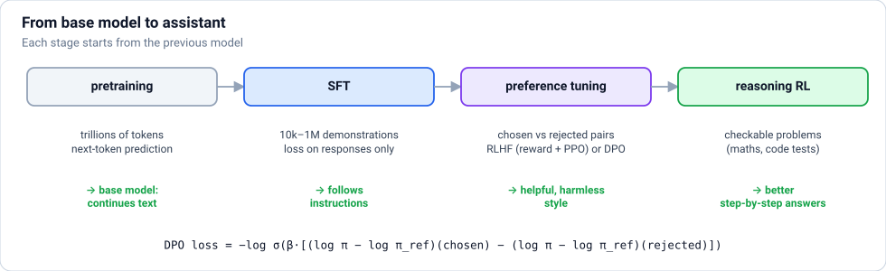

### Theory

> **In simple words:** a **base model** fresh from pretraining only continues text: ask it a question and it may continue with three more questions. Turning it into an **assistant** takes two more stages. **Supervised fine-tuning (SFT)** trains it on example conversations written by people. **Preference tuning** then shows it pairs of answers, one preferred over the other, and pushes it towards the preferred style: originally with **RLHF** (a reward model plus reinforcement learning), now often with the simpler **DPO**, which turns preferences into an ordinary loss.

**Words to know:**

- **Base (pretrained) model:** a language model trained only on next-token prediction over a huge corpus.
- **Instruction tuning / SFT (supervised fine-tuning):** fine-tuning on (instruction, ideal response) examples so the model follows instructions.
- **Chat template:** the exact format (special tokens and role markers) a chat model expects for system, user and assistant messages; `tokenizer.apply_chat_template` builds it.
- **Loss masking:** in SFT, computing the loss only on the assistant's response tokens (prompt tokens get label −100, which PyTorch's cross-entropy ignores).
- **Alignment:** making a model's behaviour match human intentions and values (helpful, honest, harmless).
- **Preference data:** prompts with a **chosen** and a **rejected** response, judged by people (or a model: RLAIF).
- **Reward model:** a model trained to score responses so that chosen > rejected (Bradley–Terry loss: −log σ(r_chosen − r_rejected)).
- **RLHF (reinforcement learning from human feedback):** optimise the model to get high reward (usually with PPO), with a **KL penalty** keeping it close to the SFT model.
- **KL divergence:** a measure of how different two probability distributions are; the penalty stops the model drifting into reward-hacking gibberish.
- **DPO (direct preference optimisation, 2023):** skips the reward model and RL: loss = −log σ(β · [(log π(chosen) − log π_ref(chosen)) − (log π(rejected) − log π_ref(rejected))]).
- **Reference model (π_ref):** a frozen copy of the starting (SFT) model used by DPO and RLHF's KL penalty.
- **β (beta):** DPO's strength parameter: how far the model may move from the reference.
- **Reasoning RL / RLVR:** reinforcement learning with **verifiable rewards** (correct maths answers, passing unit tests), used since 2024 to train "reasoning" models (GRPO is a popular algorithm).
- **TRL:** Hugging Face's library for SFT, DPO, PPO and GRPO training.
- **Preference tuning:** the stage after SFT that trains on preference pairs (via RLHF or DPO) so the model's style matches what people prefer.

**Everyday picture.** Training a new customer-service employee: first they read every manual in the company (pretraining); then they shadow experienced colleagues and copy their replies (SFT); finally a manager reviews pairs of their replies and says "this one was better" until their style matches what customers like (preference tuning).

**The DPO loss, traced:** β = 0.1. Compared with the reference model, the policy gives the chosen answer +2.0 more log-probability and the rejected answer −1.0 less.
Margin = 0.1 × (2.0 − (−1.0)) = 0.3 → loss = −log σ(0.3) = −log 0.574 = **0.554** (below ln 2 = 0.693, the loss when policy = reference). The gradient keeps raising chosen and lowering rejected.

**The stages:**

| Stage | Data | Objective | Result |
|---|---|---|---|
| pretraining | trillions of tokens of web, books, code | next-token prediction | base model |
| SFT | ~10k–1M demonstrations | next-token prediction on responses | follows instructions |
| preference tuning | ~10k–1M preference pairs | RLHF (reward + PPO) or DPO | more helpful, safer style |
| reasoning RL (2024+) | problems with checkable answers | RL with verifiable rewards | better step-by-step reasoning |

**Common mistakes:**

- ❌ Using a chat model without its exact chat template (quality drops sharply).
- ❌ SFT without loss masking, teaching the model to generate the user's prompts too.
- ❌ DPO without a reference model, or with a different reference than the SFT model.
- ❌ Over-optimising a reward model ("reward hacking"): the score rises while real quality falls.

**Used in real software:** InstructGPT/ChatGPT introduced RLHF at scale; Llama, Qwen, Mistral and Gemma instruct models use SFT plus DPO-style preference tuning; DeepSeek-R1 and other reasoning models use RL with verifiable rewards; TRL implements all of these.

### Python

```python
import torch
import torch.nn.functional as F
from transformers import AutoModelForCausalLM, AutoTokenizer

chat_tok = AutoTokenizer.from_pretrained("Qwen/Qwen2.5-0.5B-Instruct")     # tokenizer only (a few MB)
messages = [{"role": "system", "content": "You are a helpful assistant."}, {"role": "user", "content": "What is LoRA?"},
            {"role": "assistant", "content": "A cheap way to fine-tune large models."}]
print(chat_tok.apply_chat_template(messages, tokenize=False))

tok = AutoTokenizer.from_pretrained("openai-community/gpt2")
prompt, response = "Q: What is 2 + 2?\nA:", " 4."
prompt_ids, response_ids = tok(prompt)["input_ids"], tok(response)["input_ids"]
input_ids = torch.tensor([prompt_ids + response_ids])
labels = torch.tensor([[-100] * len(prompt_ids) + response_ids])         # loss only on the response
print("tokens:", tok.convert_ids_to_tokens(input_ids[0]))
print("labels:", labels[0].tolist())
gpt2 = AutoModelForCausalLM.from_pretrained("openai-community/gpt2")
print(f"SFT loss on the response tokens only: {gpt2(input_ids, labels=labels).loss.item():.3f}")
```

**Output:**

```text
<|im_start|>system
You are a helpful assistant.<|im_end|>
<|im_start|>user
What is LoRA?<|im_end|>
<|im_start|>assistant
A cheap way to fine-tune large models.<|im_end|>

tokens: ['Q', ':', 'ĠWhat', 'Ġis', 'Ġ2', 'Ġ+', 'Ġ2', '?', 'Ċ', 'A', ':', 'Ġ4', '.']
labels: [-100, -100, -100, -100, -100, -100, -100, -100, -100, -100, -100, 604, 13]
SFT loss on the response tokens only: 4.073
```

The chat template wraps each message in role markers (`<|im_start|>user …<|im_end|>`) that the model saw throughout its fine-tuning. For SFT, the prompt positions are labelled −100 so only the response contributes to the loss (Hugging Face shifts the labels by one internally).

```python
import copy

def sequence_logprob(model, prompt, answer):
    p_ids = tok(prompt)["input_ids"]; a_ids = tok(answer)["input_ids"]
    ids = torch.tensor([p_ids + a_ids])
    logprobs = model(ids).logits[0, :-1].log_softmax(-1)                  # position t predicts token t+1
    targets = ids[0, 1:]
    token_lp = logprobs[torch.arange(len(targets)), targets]
    return token_lp[len(p_ids) - 1:].sum()                                 # sum over the answer tokens only

def dpo_loss(policy, reference, prompt, chosen, rejected, beta=0.1):
    with torch.no_grad():
        ref_c, ref_r = sequence_logprob(reference, prompt, chosen), sequence_logprob(reference, prompt, rejected)
    pol_c, pol_r = sequence_logprob(policy, prompt, chosen), sequence_logprob(policy, prompt, rejected)
    margin = beta * ((pol_c - ref_c) - (pol_r - ref_r))
    return -F.logsigmoid(margin), margin

print(f"traced DPO loss: {-F.logsigmoid(torch.tensor(0.1 * (2.0 - (-1.0)))).item():.3f}")
prompt = "User: How do I reset my password?\nAssistant:"
chosen = " Click 'Forgot password' on the login page and follow the emailed link."
rejected = " Figure it out yourself."
torch.manual_seed(0)
policy, reference = gpt2, copy.deepcopy(gpt2).eval()
opt = torch.optim.AdamW(policy.parameters(), lr=1e-5)
for step in range(8):
    loss, margin = dpo_loss(policy, reference, prompt, chosen, rejected)
    opt.zero_grad(); loss.backward(); opt.step()
    if step in (0, 3, 7):
        print(f"step {step}: DPO loss {loss.item():.3f} (ln 2 = 0.693 at the start), margin {margin.item():+.3f}")
with torch.no_grad():
    print(f"log P(chosen) − log P(rejected): reference {sequence_logprob(reference, prompt, chosen) - sequence_logprob(reference, prompt, rejected):.1f} "
          f"→ policy {sequence_logprob(policy, prompt, chosen) - sequence_logprob(policy, prompt, rejected):.1f}")
```

**Output:**

```text
traced DPO loss: 0.554
step 0: DPO loss 0.693 (ln 2 = 0.693 at the start), margin -0.000
step 3: DPO loss 0.129 (ln 2 = 0.693 at the start), margin +1.985
step 7: DPO loss 0.013 (ln 2 = 0.693 at the start), margin +4.343
log P(chosen) − log P(rejected): reference -36.1 → policy 12.8
```

At the start the policy equals the reference, so the margin is 0 and the loss is exactly ln 2. A few gradient steps on one preference pair raise the probability of the helpful answer relative to the rude one. Real DPO does this over tens of thousands of pairs with TRL's `DPOTrainer`; the loss is exactly this one.

### Practice

1. Compute the Bradley–Terry reward-model loss when the reward model scores the chosen answer 2.5 and the rejected one 1.0. What if it scores them the other way round?
2. Why does DPO need the frozen reference model at all?

<details>
<summary><b>Answer</b></summary>

```python
for rc, rr in [(2.5, 1.0), (1.0, 2.5)]:
    print(rc, rr, round(-F.logsigmoid(torch.tensor(rc - rr)).item(), 3))
```

**Output:**

```text
2.5 1.0 0.201
1.0 2.5 1.701
```

1. 0.201 when the ranking is right; 1.701 when it's wrong. The loss depends only on the **difference** of rewards.
2. DPO measures how much the policy has changed **relative** to its starting point; without the reference term the model could simply make every answer improbable except the chosen one, drifting far from fluent language. The reference keeps it anchored (it plays the role of RLHF's KL penalty).

</details>

| # | Problem (Deep-ML) | Difficulty |
|---|---|---|
| 1 | [322. Bradley-Terry Model for Pairwise Rankings](https://www.deep-ml.com/problems/322) | 🟡 Medium |
| 2 | [382. Direct Preference Optimization (DPO) Loss](https://www.deep-ml.com/problems/382) | 🟡 Medium |
| 3 | [232. PTX Loss for Catastrophic Forgetting Prevention (RLHF)](https://www.deep-ml.com/problems/232) | 🟡 Medium |

**Learn more:** [Ouyang et al., InstructGPT (RLHF)](https://arxiv.org/abs/2203.02155) · [Rafailov et al., Direct Preference Optimization](https://arxiv.org/abs/2305.18290) · [Hugging Face TRL documentation](https://huggingface.co/docs/trl/index) · [Nathan Lambert, RLHF book (free)](https://rlhfbook.com/)

---

## 44. Embeddings and Contrastive Learning: Sentence Embeddings, SimCLR and CLIP Loss


### Theory

> **In simple words:** a **sentence embedding** is one vector for a whole text, placed so that texts with similar **meaning** are close, even with no words in common. Such models are trained with **contrastive learning**: show the model pairs that belong together (a question and its answer, two views of one image, a photo and its caption) and train it so each item is closer to its partner than to everything else in the batch. The same loss trains sentence-embedding models, SimCLR and CLIP, and powers semantic search and RAG.

**Words to know:**

- **Sentence (text) embedding:** a fixed-size vector representing a whole sentence or document.
- **Bi-encoder:** encode queries and documents separately, compare vectors (fast; documents can be embedded ahead of time). **Cross-encoder:** feed the pair together and output a relevance score (more accurate, slower; used to re-rank).
- **Mean pooling:** averaging the token vectors (ignoring padding) to get one vector per text.
- **Semantic search (dense retrieval):** finding documents whose embeddings are closest to the query's embedding.
- **Contrastive learning:** learning representations by contrasting positive pairs with negatives.
- **Positive / negative pair:** two items that should be close / far apart.
- **In-batch negatives:** using the other items in the batch as negatives for free.
- **InfoNCE loss:** cross-entropy over a batch's similarity matrix, where each row's correct "class" is its own partner (the diagonal).
- **Temperature (τ):** divides the similarities before the softmax; small τ makes the loss focus on hard negatives.
- **SimCLR (2020):** contrastive learning on two random augmentations of the same image (self-supervised).
- **CLIP loss:** InfoNCE applied in both directions (image → text and text → image) and averaged (Section [39](#39-vision-transformers-and-clip-transformers-beyond-text)).
- **Triplet loss:** max(0, d(anchor, positive) − d(anchor, negative) + margin).
- **Vector database / ANN index:** storage that finds nearest embeddings quickly among millions (FAISS, HNSW; `rag-and-agents.md`); here ANN means **approximate nearest neighbour**, not artificial neural network.
- **MTEB:** the Massive Text Embedding Benchmark, used to compare embedding models.

**Everyday picture.** Learning faces at a party: you're shown two photos of the same person and told "same", and photos of everyone else in the room as "different". Doing this for many people teaches you what matters about a face (not the lighting or the angle), which is exactly what a contrastive model learns about meaning.

**InfoNCE, traced** (batch of 2 pairs, similarities of a with b):

| | b₁ | b₂ |
|---|---|---|
| a₁ | **0.9** | 0.2 |
| a₂ | 0.1 | **0.8** |

With τ = 0.1: row 1 logits (9, 2) → P(correct) = softmax(9, 2)[0] = 0.9991 → loss 0.0009; row 2 (1, 8) → 0.9991 → loss 0.0009. If a₁ were as similar to b₂ as to b₁, its loss would be ln 2.

**Common mistakes:**

- ❌ Comparing un-normalised embeddings with dot products when the model was trained for cosine similarity.
- ❌ Forgetting to mask padding in mean pooling.
- ❌ Using a general embedding model for a very specialised domain without checking (fine-tune or pick a domain model).
- ❌ Contrastive training with tiny batches (few negatives → weak signal), or with false negatives (duplicates in the batch).

**Used in real software:** semantic search and retrieval-augmented generation (`rag-and-agents.md`), duplicate-question detection, recommendation "more like this", clustering support tickets; CLIP for image search; OpenAI, Cohere, Voyage and open models (BGE, E5, GTE, nomic, Qwen3-Embedding) provide embedding APIs and checkpoints.

### Python

```python
import torch
import torch.nn.functional as F
from sklearn.feature_extraction.text import TfidfVectorizer
from transformers import AutoModel, AutoTokenizer

name = "sentence-transformers/all-MiniLM-L6-v2"                          # a 22M-parameter sentence-embedding model
tok, enc = AutoTokenizer.from_pretrained(name), AutoModel.from_pretrained(name).eval()

def embed(texts):
    batch = tok(texts, padding=True, truncation=True, return_tensors="pt")
    with torch.no_grad():
        tokens = enc(**batch).last_hidden_state                           # (N, T, 384)
    mask = batch["attention_mask"].unsqueeze(-1).float()
    return F.normalize((tokens * mask).sum(1) / mask.sum(1), dim=-1)      # mean pooling over real tokens, unit length

docs = ["How do I reset my password?", "The weather is lovely today.", "Steps to recover a forgotten login.",
        "Best pizza places in Naples.", "My account is locked after too many attempts.", "Where can I get good Italian food?"]
queries = ["I can't remember my sign-in credentials", "recommend a restaurant for Neapolitan pizza"]
D, Q = embed(docs), embed(queries)
print("embedding shape:", tuple(D.shape))
tfidf = TfidfVectorizer().fit(docs + queries)
for qi, q in enumerate(queries):
    dense = (Q[qi] @ D.T); sparse = torch.tensor((tfidf.transform([q]) @ tfidf.transform(docs).T).toarray()[0])
    print(f"\nquery: {q!r}")
    print("  embeddings →", [docs[i] for i in dense.argsort(descending=True)[:2].tolist()], [round(dense[i].item(), 2) for i in dense.argsort(descending=True)[:2].tolist()])
    print("  TF-IDF     →", [docs[i] for i in sparse.argsort(descending=True)[:2].tolist()], [round(sparse[i].item(), 2) for i in sparse.argsort(descending=True)[:2].tolist()])
```

**Output:**

```text
embedding shape: (6, 384)

query: "I can't remember my sign-in credentials"
  embeddings → ['Steps to recover a forgotten login.', 'How do I reset my password?'] [0.63, 0.63]
  TF-IDF     → ['Best pizza places in Naples.', 'Where can I get good Italian food?'] [0.15, 0.13]

query: 'recommend a restaurant for Neapolitan pizza'
  embeddings → ['Best pizza places in Naples.', 'Where can I get good Italian food?'] [0.61, 0.52]
  TF-IDF     → ['Best pizza places in Naples.', 'How do I reset my password?'] [0.15, 0.0]
```

The queries share almost no words with the right documents ("sign-in credentials" vs "password", "Neapolitan" vs "Naples"), so TF-IDF finds little or nothing, while the embedding model ranks the matching documents first because their **meanings** are close.

```python
def info_nce(a, b, tau=0.1):
    logits = F.normalize(a, dim=-1) @ F.normalize(b, dim=-1).T / tau      # (N, N) similarity matrix
    targets = torch.arange(len(a))                                          # the partner of row i is column i
    return F.cross_entropy(logits, targets)

def clip_loss(a, b, tau=0.1):
    return (info_nce(a, b, tau) + info_nce(b, a, tau)) / 2                  # both directions

sims = torch.tensor([[0.9, 0.2], [0.1, 0.8]])
print(f"traced InfoNCE: {F.cross_entropy(sims / 0.1, torch.arange(2)).item():.4f}")

torch.manual_seed(0)
n, d = 512, 32
concept = torch.randn(n, d)                                                # hidden "meaning" of each pair
view_a = concept @ torch.randn(d, 64) + 0.5 * torch.randn(n, 64)          # e.g. image features
view_b = concept @ torch.randn(d, 48) + 0.5 * torch.randn(n, 48)          # e.g. caption features
enc_a, enc_b = torch.nn.Linear(64, 32), torch.nn.Linear(48, 32)            # two encoders into one shared space
opt = torch.optim.Adam(list(enc_a.parameters()) + list(enc_b.parameters()), lr=1e-2)

def retrieval_accuracy():
    with torch.no_grad():
        sim = F.normalize(enc_a(view_a), dim=-1) @ F.normalize(enc_b(view_b), dim=-1).T
    return (sim.argmax(1) == torch.arange(n)).float().mean().item()

print(f"before training: loss {clip_loss(enc_a(view_a), enc_b(view_b)).item():.3f}, retrieval accuracy {retrieval_accuracy():.3f} (chance {1 / n:.3f})")
for step in range(300):
    idx = torch.randperm(n)[:128]                                          # in-batch negatives: the other 127 pairs
    loss = clip_loss(enc_a(view_a[idx]), enc_b(view_b[idx])); opt.zero_grad(); loss.backward(); opt.step()
print(f"after training : loss {clip_loss(enc_a(view_a), enc_b(view_b)).item():.3f}, retrieval accuracy {retrieval_accuracy():.3f}")
```

**Output:**

```text
traced InfoNCE: 0.0009
before training: loss 7.517, retrieval accuracy 0.008 (chance 0.002)
after training : loss 0.137, retrieval accuracy 1.000
```

Two encoders that start out unrelated learn, from nothing but "these two belong together", a shared space where each item's nearest neighbour among 512 candidates is usually its true partner. CLIP is this exact recipe with a vision transformer, a text transformer and 400 million image–caption pairs.

### Practice

1. Add the document "Forgot your password? Use the reset link." and re-run the first query. Where does it rank?
2. Why does contrastive learning work better with larger batches?

<details>
<summary><b>Answer</b></summary>

```python
D2 = embed(docs + ["Forgot your password? Use the reset link."])
scores = Q[0] @ D2.T
print([(round(scores[i].item(), 2), (docs + ['Forgot your password? Use the reset link.'])[i]) for i in scores.argsort(descending=True)[:3].tolist()])
```

**Output:**

```text
[(0.64, 'Forgot your password? Use the reset link.'), (0.63, 'Steps to recover a forgotten login.'), (0.63, 'How do I reset my password?')]
```

1. It ranks at or near the top: it means the same as the query, even though it shares no key words with "sign-in credentials".
2. Each example is contrasted with every other example in the batch; more negatives give a more informative, harder task (and a better estimate of the true softmax over all items), which is why CLIP trained with batches of 32,768.

</details>

| # | Problem (Deep-ML) | Difficulty |
|---|---|---|
| 1 | [76. Calculate Cosine Similarity Between Vectors](https://www.deep-ml.com/problems/76) | 🟢 Easy |
| 2 | [384. Contrastive Loss (InfoNCE / SimCLR-style)](https://www.deep-ml.com/problems/384) | 🟡 Medium |
| 3 | [387. Triplet Margin Loss](https://www.deep-ml.com/problems/387) | 🟡 Medium |

**Learn more:** [Sentence Transformers documentation](https://sbert.net/) · [Chen et al., SimCLR](https://arxiv.org/abs/2002.05709) · [Hugging Face: MTEB leaderboard](https://huggingface.co/spaces/mteb/leaderboard) · [Lilian Weng: contrastive representation learning](https://lilianweng.github.io/posts/2021-05-31-contrastive/)

---

### ✅ Part 8 checkpoint

Without looking, can you:

- [ ] Load a tokenizer and model from the Hub, explain `input_ids`/`attention_mask`, and use a pipeline?
- [ ] Fine-tune a pretrained encoder with `Trainer`, and compare it with a classic baseline?
- [ ] Explain LoRA's B·A update, count its parameters, merge it, and say what QLoRA adds?
- [ ] Describe pretraining → SFT → RLHF/DPO, apply a chat template, mask the SFT loss, and compute the DPO loss?
- [ ] Build sentence embeddings with mean pooling, run semantic search, and implement InfoNCE/CLIP loss?

Part 9 turns to models that **create**: autoencoders, VAEs, GANs and diffusion.

---

# Part 9 — Advanced: Generative Models

> **Goal:** Understand models that **create** new data: autoencoders and **variational autoencoders** that learn a compressed "latent" space, **GANs** that pit a generator against a critic, and **diffusion models**, the technology behind modern image, audio and video generators, built from scratch, including the **classifier-free guidance** that makes text-to-image prompts work.  
> **You need:** Parts 1–8 (probability basics from `machine-learning.md` Section 9).

---

## 45. Autoencoders and Variational Autoencoders (VAEs)


### Theory

> **In simple words:** an **autoencoder** squeezes its input through a narrow **bottleneck** and tries to rebuild it, so it must learn a compact description (a **latent code**). A plain autoencoder's codes are scattered irregularly, so decoding a random point gives garbage. A **variational autoencoder (VAE)** makes the latent space **smooth and filled-in** by encoding each input as a small cloud (a distribution) and nudging all clouds towards a standard normal shape. Then any random point decodes into a plausible new example: the VAE can **generate**.

**Words to know:**

- **Autoencoder (AE):** encoder → small code → decoder, trained to reproduce its input (reconstruction loss).
- **Latent space / latent code (z):** the compressed representation in the bottleneck.
- **Bottleneck:** the narrow middle layer that forces compression.
- **Reconstruction loss:** how different the output is from the input (MSE or binary cross-entropy per pixel).
- **Denoising autoencoder:** trained to rebuild clean inputs from corrupted ones.
- **Generative model:** a model that can produce new samples resembling the training data.
- **VAE (variational autoencoder, 2013):** the encoder outputs a mean μ and a log-variance log σ² per latent dimension; z is sampled from that normal distribution.
- **Reparameterisation trick:** sample z = μ + σ·ε with ε ~ N(0, 1), so gradients flow through μ and σ despite the randomness.
- **KL divergence term:** KL(N(μ, σ²) ‖ N(0, 1)) = ½ Σ (μ² + σ² − log σ² − 1); pulls every code towards the standard normal so the space has no holes.
- **ELBO (evidence lower bound):** the VAE objective: reconstruction term − KL term (maximised), i.e. loss = reconstruction + KL.
- **Prior:** the distribution latent codes should follow (standard normal); sampling from it then decoding generates new data.
- **Latent interpolation:** decoding points along a line between two codes, showing a smooth morph.
- **VQ-VAE / tokenizers for images:** autoencoders with a discrete codebook; the "image tokens" behind many image and video generators, and the latent space of latent diffusion (Section [48](#48-latent-diffusion-guidance-and-modern-image-and-video-generators)).

**Everyday picture.** Describing outfits over the phone in just two numbers, say "how formal" and "how much leg covered". A plain autoencoder invents private, inconsistent codes. A VAE agrees on a shared scale where every pair of numbers describes some real outfit, so a friend can pick any two numbers and sketch something sensible.

**The VAE loss for one example, traced** (1-D latent): encoder gives μ = 0.5, log σ² = −0.5 (σ² = 0.61); reconstruction error = 20.
KL = ½ (0.25 + 0.61 − (−0.5) − 1) = ½ (0.36) = **0.18**; total loss = 20.18. If the code were exactly N(0, 1) (μ = 0, log σ² = 0), KL = 0.

**Autoencoder vs VAE:**

| | Autoencoder | VAE |
|---|---|---|
| encoder output | one point | a distribution (μ, σ) |
| loss | reconstruction | reconstruction + KL |
| latent space | gaps and irregular shape | smooth, roughly standard normal |
| generate by decoding random z | poor | works |
| uses (2026) | compression, denoising, anomaly detection | generation, the latent space of latent diffusion |

**Common mistakes:**

- ❌ Sampling z without the reparameterisation trick (gradients can't flow).
- ❌ Weighting KL so heavily that the decoder ignores z ("posterior collapse"), or so little that the space has holes.
- ❌ Judging a VAE by reconstructions alone (VAE samples are often blurrier than GAN or diffusion samples).

**Used in real software:** Stable Diffusion's VAE compresses 512×512×3 images into 64×64×4 latents; autoencoders detect anomalies by their reconstruction error; image and audio codecs use learned autoencoders; VQ-VAE-style tokenizers turn images and audio into tokens for multimodal models.

### Python

```python
import time
import torch
from torch import nn
from torch.utils.data import DataLoader
from torchvision import datasets, transforms
import matplotlib.pyplot as plt

mu, logvar, recon = 0.5, -0.5, 20.0
kl = 0.5 * (mu ** 2 + torch.exp(torch.tensor(logvar)).item() - logvar - 1)
print(f"traced KL {kl:.3f}, total loss {recon + kl:.3f}")

torch.manual_seed(0)
train = datasets.FashionMNIST(root="data", train=True, download=True, transform=transforms.ToTensor())
test = datasets.FashionMNIST(root="data", train=False, download=True, transform=transforms.ToTensor())
loader = DataLoader(train, batch_size=128, shuffle=True)

class VAE(nn.Module):
    def __init__(self, z_dim=2):
        super().__init__()
        self.enc = nn.Sequential(nn.Flatten(), nn.Linear(784, 400), nn.ReLU())
        self.mu, self.logvar = nn.Linear(400, z_dim), nn.Linear(400, z_dim)
        self.dec = nn.Sequential(nn.Linear(z_dim, 400), nn.ReLU(), nn.Linear(400, 784), nn.Sigmoid())
    def encode(self, x):
        h = self.enc(x); return self.mu(h), self.logvar(h)
    def forward(self, x):
        mu, logvar = self.encode(x)
        z = mu + torch.exp(0.5 * logvar) * torch.randn_like(mu)              # reparameterisation trick
        return self.dec(z).view(-1, 1, 28, 28), mu, logvar

def vae_loss(x_hat, x, mu, logvar):
    recon = nn.functional.binary_cross_entropy(x_hat, x, reduction="sum")
    kl = -0.5 * torch.sum(1 + logvar - mu ** 2 - logvar.exp())
    return (recon + kl) / len(x), recon / len(x), kl / len(x)

vae = VAE(); opt = torch.optim.Adam(vae.parameters(), lr=1e-3); t0 = time.time()
for epoch in range(8):
    for x, _ in loader:
        x_hat, mu, logvar = vae(x)
        loss, rec, kl = vae_loss(x_hat, x, mu, logvar); opt.zero_grad(); loss.backward(); opt.step()
    if epoch in (0, 7):
        print(f"epoch {epoch + 1}: loss {loss.item():.1f} = reconstruction {rec.item():.1f} + KL {kl.item():.2f}")
print(f"trained in {time.time() - t0:.0f} s")
```

**Output:**

```text
traced KL 0.178, total loss 20.178
epoch 1: loss 284.7 = reconstruction 278.6 + KL 6.15
epoch 8: loss 256.7 = reconstruction 249.7 + KL 7.01
trained in 13 s
```

```python
vae.eval()
x_test = torch.stack([test[i][0] for i in range(8)])
with torch.no_grad():
    recon_imgs = vae.dec(vae.encode(x_test)[0]).view(-1, 28, 28)                    # decode the mean code
    grid = torch.tensor([[a, b] for b in torch.linspace(2, -2, 3) for a in torch.linspace(-2, 2, 8)])
    generated = vae.dec(grid).view(-1, 28, 28)                                       # decode chosen points of N(0, 1)
fig, axes = plt.subplots(5, 8, figsize=(9, 6), layout="constrained")
for k in range(8):
    axes[0, k].imshow(x_test[k, 0], cmap="gray"); axes[1, k].imshow(recon_imgs[k], cmap="gray")
for k in range(24):
    axes[2 + k // 8, k % 8].imshow(generated[k], cmap="gray")
for ax in axes.flat:
    ax.set(xticks=[], yticks=[])
axes[0, 0].set_ylabel("input"); axes[1, 0].set_ylabel("rebuilt"); axes[2, 0].set_ylabel("new")
fig.savefig("autoencoder-digits.png", dpi=100)
plt.close(fig)

with torch.no_grad():
    codes = torch.cat([vae.encode(x)[0] for x, _ in DataLoader(test, batch_size=1000)])
print("latent codes of the test set: mean", [round(v, 2) for v in codes.mean(0).tolist()], "std", [round(v, 2) for v in codes.std(0).tolist()])
labels = test.targets
for c in (1, 7, 8):
    print(f"  average code of class {test.classes[c]!r}: {[round(v, 2) for v in codes[labels == c].mean(0).tolist()]}")
```

**Output:**

```text
latent codes of the test set: mean [0.26, 0.22] std [1.26, 1.39]
  average code of class 'Trouser': [-1.8, 1.3]
  average code of class 'Sneaker': [-0.62, -1.82]
  average code of class 'Bag': [1.48, -0.96]
```

With only **two** latent numbers, reconstructions keep the overall shape of each item but lose detail (two numbers can't store a pattern or a logo). The bottom rows decode a grid of points from the standard normal: most points give a plausible garment (trousers, T-shirts, pullovers, sneakers), and neighbouring points give similar ones, because the KL term organised the space. A few points between clusters decode to blurry mixtures: no training item was encoded there, a typical VAE weakness. Different classes occupy different regions (trousers far from sneakers), which the encoder discovered without labels.

### Practice

1. Compute the KL term for μ = 0, log σ² = 0, and for μ = 2, log σ² = 0. Which is pulled harder towards the prior?
2. Train the same model with `z_dim=16`. Do reconstructions improve? Why might decoding random points get slightly worse?

<details>
<summary><b>Answer</b></summary>

```python
for m_, lv in [(0.0, 0.0), (2.0, 0.0)]:
    print(m_, lv, 0.5 * (m_ ** 2 + 1.0 - lv - 1))
torch.manual_seed(0)
vae16 = VAE(z_dim=16); opt16 = torch.optim.Adam(vae16.parameters(), lr=1e-3)
for epoch in range(3):
    for x, _ in loader:
        x_hat, mu16, logvar16 = vae16(x)
        loss, rec, kl = vae_loss(x_hat, x, mu16, logvar16)
        opt16.zero_grad(); loss.backward(); opt16.step()
print(f"z_dim=16 after 3 epochs: reconstruction {rec.item():.1f} per image (z_dim=2 after 8 epochs was higher)")
```

**Output:**

```text
0.0 0.0 0.0
2.0 0.0 2.0
z_dim=16 after 3 epochs: reconstruction 228.8 per image (z_dim=2 after 8 epochs was higher)
```

1. KL = 0 for the standard normal itself, and 2.0 for a code centred at μ = 2: codes far from the origin pay a penalty.
2. Yes: 16 numbers store far more detail, so reconstruction error drops. But with more dimensions, the regions the encoder actually uses can fill the prior less evenly, so some random points fall where no training image was mapped and decode to blurrier mixtures.

</details>

| # | Problem (Deep-ML) | Difficulty |
|---|---|---|
| 1 | [56. KL Divergence Between Two Normal Distributions](https://www.deep-ml.com/problems/56) | 🟢 Easy |
| 2 | [393. Implement Variational Autoencoder (VAE) Loss (ELBO)](https://www.deep-ml.com/problems/393) | 🟡 Medium |
| 3 | [136. Calculate KL Divergence Between Two Multivariate Gaussian Distributions](https://www.deep-ml.com/problems/136) | 🟡 Medium |

**Learn more:** [Kingma & Welling, Auto-Encoding Variational Bayes (VAE)](https://arxiv.org/abs/1312.6114) · [Lilian Weng: from autoencoder to beta-VAE](https://lilianweng.github.io/posts/2018-08-12-vae/) · [van den Oord et al., VQ-VAE](https://arxiv.org/abs/1711.00937)

---

## 46. Generative Adversarial Networks (GANs)


### Theory

> **In simple words:** a **GAN** trains two networks against each other. The **generator** turns random noise into fake samples; the **discriminator** tries to tell real samples from fakes. The generator improves by fooling the discriminator; the discriminator improves by not being fooled. When it works, the generator's samples become indistinguishable from real data, and GANs produced the sharpest images of the late 2010s. They're also notoriously unstable, which is part of why diffusion models replaced them.

**Words to know:**

- **GAN (generative adversarial network, 2014):** a generator G and a discriminator D trained in a two-player game.
- **Generator (G):** maps random noise z to a sample G(z).
- **Discriminator (D, critic):** outputs the probability (or score) that its input is real.
- **Adversarial training:** alternating updates: D learns to separate real from fake; G learns to make D say "real".
- **Minimax game:** G minimises what D maximises: E[log D(x)] + E[log(1 − D(G(z)))].
- **Non-saturating loss:** in practice G maximises log D(G(z)) instead (stronger gradients early on).
- **Nash equilibrium:** the ideal end state: G matches the data distribution and D outputs ½ everywhere.
- **Mode collapse:** G produces only a few kinds of outputs (one of eight clusters, one face) because those fool D.
- **Training instability:** losses oscillate, one network overpowers the other; fixes include Wasserstein GANs (WGAN), gradient penalties, spectral normalisation and careful learning rates.
- **Latent space (of a GAN):** the noise space; moving through it changes the generated image smoothly.
- **StyleGAN:** NVIDIA's high-quality face/image GAN family (2018–2021). **Conditional GAN / pix2pix / CycleGAN:** GANs conditioned on labels or images (image-to-image translation).
- **FID (Fréchet Inception Distance):** a standard metric comparing the statistics of generated and real images (lower is better).

**Everyday picture.** A counterfeiter and a bank teller. Each new forgery is examined; each rejection teaches the counterfeiter what gave it away, and each successful forgery teaches the teller what to look for. Over time the forgeries become excellent, unless the counterfeiter finds one trick that always works and only ever prints that one note (mode collapse).

**One round of training, step by step:**

1. Sample real data x and noise z; make fakes G(z).
2. Discriminator step: loss = BCE(D(x), 1) + BCE(D(G(z).detach()), 0); update D only.
3. Generator step: loss = BCE(D(G(z)), 1) (pretend fakes are real); update G only.
4. Repeat. Watch samples, not just losses: GAN losses don't show quality.

**Common mistakes:**

- ❌ Forgetting `.detach()` on fakes during the discriminator step (G gets wrong gradients).
- ❌ A discriminator that becomes perfect early (G's gradients vanish).
- ❌ Judging progress by the loss curves (they oscillate even when things go well).

**Used in real software:** StyleGAN-generated faces ("this person does not exist"), super-resolution and photo enhancement (ESRGAN in upscalers), image-to-image tools, GAN-based vocoders that turn spectrograms into speech (HiFi-GAN), and GAN losses inside the decoders of some image and audio autoencoders.

### Python

```python
import math
import torch
from torch import nn
import matplotlib.pyplot as plt

def real_batch(n, g):                                                    # 8 Gaussian clusters on a ring
    k = torch.randint(0, 8, (n,), generator=g)
    angle = 2 * math.pi * k / 8
    centres = torch.stack([torch.cos(angle), torch.sin(angle)], 1) * 2
    return centres + 0.05 * torch.randn(n, 2, generator=g)

torch.manual_seed(0); g = torch.Generator().manual_seed(0)
G = nn.Sequential(nn.Linear(2, 128), nn.ReLU(), nn.Linear(128, 128), nn.ReLU(), nn.Linear(128, 2))
D = nn.Sequential(nn.Linear(2, 128), nn.LeakyReLU(0.2), nn.Linear(128, 128), nn.LeakyReLU(0.2), nn.Linear(128, 1))
opt_g = torch.optim.Adam(G.parameters(), lr=1e-3, betas=(0.5, 0.999)); opt_d = torch.optim.Adam(D.parameters(), lr=1e-3, betas=(0.5, 0.999))
bce = nn.BCEWithLogitsLoss()
snapshots, fixed_z = {}, torch.randn(1000, 2, generator=g)

def clusters_covered(samples):
    angle = torch.atan2(samples[:, 1], samples[:, 0]) % (2 * math.pi)
    near_ring = (samples.norm(dim=1) - 2).abs() < 0.5
    return len(set(((angle[near_ring] / (2 * math.pi / 8)).round() % 8).int().tolist()))

for step in range(3001):
    x = real_batch(256, g); z = torch.randn(256, 2, generator=g)
    fake = G(z)
    d_loss = bce(D(x), torch.ones(256, 1)) + bce(D(fake.detach()), torch.zeros(256, 1))     # discriminator step
    opt_d.zero_grad(); d_loss.backward(); opt_d.step()
    g_loss = bce(D(fake), torch.ones(256, 1))                                              # generator step: fool D
    opt_g.zero_grad(); g_loss.backward(); opt_g.step()
    if step in (0, 500, 1500, 3000):
        with torch.no_grad():
            samples = G(fixed_z)
        snapshots[step] = samples
        print(f"step {step:4d}: D loss {d_loss.item():.3f}, G loss {g_loss.item():.3f}, clusters covered {clusters_covered(samples)}/8")

fig, axes = plt.subplots(1, 5, figsize=(12, 2.6), layout="constrained")
axes[0].scatter(*real_batch(1000, g).T, s=2, color="gray"); axes[0].set_title("real data")
for ax, (step, smp) in zip(axes[1:], snapshots.items()):
    ax.scatter(*smp.T, s=2); ax.set_title(f"generator, step {step}")
for ax in axes:
    ax.set(xlim=(-3, 3), ylim=(-3, 3), xticks=[], yticks=[], aspect="equal")
fig.savefig("gan-2d.png", dpi=100)
plt.close(fig)
```

**Output:**

```text
step    0: D loss 1.372, G loss 0.709, clusters covered 0/8
step  500: D loss 1.239, G loss 0.925, clusters covered 8/8
step 1500: D loss 1.224, G loss 1.072, clusters covered 8/8
step 3000: D loss 1.283, G loss 0.934, clusters covered 8/8
```

The generator starts as a blob near the origin and spreads its samples out to the ring; in this run it reaches all eight clusters by step 500 (with other seeds, learning rates or architectures, GANs on this exact toy often cover only some clusters or hop between them, which is mode collapse in miniature). Notice that the losses barely change while the samples improve dramatically: GAN losses measure the balance between two players, not quality, which is why GAN papers report sample-based metrics like FID.

### Practice

1. Compute the ideal discriminator output for a point where real and generated data are equally likely, and the discriminator's loss there.
2. Why do fakes need `.detach()` in the discriminator step but not in the generator step?

<details>
<summary><b>Answer</b></summary>

```python
d = torch.tensor(0.5)
print("D* =", d.item(), "| loss per real+fake pair:", round((-torch.log(d) - torch.log(1 - d)).item(), 3), "= 2·ln 2")
```

**Output:**

```text
D* = 0.5 | loss per real+fake pair: 1.386 = 2·ln 2
```

1. D* = p_data / (p_data + p_G) = ½, and its loss is −log ½ − log ½ = 2 ln 2 ≈ 1.386: at the equilibrium the discriminator can't do better than guessing.
2. The discriminator step should only update D; detaching stops gradients from flowing into G (and saves computation). In the generator step, the gradient **must** flow through D into G, because "how should G change to fool D?" is exactly what G needs (D's parameters just aren't updated by `opt_g`).

</details>

| # | Problem (Deep-ML) | Difficulty |
|---|---|---|
| 1 | [174. Train a Simple GAN on 1D Gaussian Data](https://www.deep-ml.com/problems/174) | 🔴 Hard |
| 2 | [386. Spectral Normalization](https://www.deep-ml.com/problems/386) | 🟡 Medium |
| 3 | [203. Jensen-Shannon Divergence](https://www.deep-ml.com/problems/203) | 🟡 Medium |

**Learn more:** [Goodfellow et al., Generative Adversarial Networks](https://arxiv.org/abs/1406.2661) · [Arjovsky et al., Wasserstein GAN](https://arxiv.org/abs/1701.07875) · [Karras et al., StyleGAN](https://arxiv.org/abs/1812.04948) · [Google: GAN course](https://developers.google.com/machine-learning/gan)

---

## 47. Diffusion Models from Scratch


### Theory

> **In simple words:** a **diffusion model** learns to **remove noise**. During training, take real data, add a random amount of Gaussian noise, and teach a network to predict that noise. To generate, start from pure noise and repeatedly subtract a little of the predicted noise; after a few hundred steps, a brand-new sample emerges. Training is a simple regression problem (stable, unlike GANs), which is why diffusion became the dominant method for images, video and audio.

**Words to know:**

- **Diffusion model (denoising diffusion probabilistic model, DDPM, 2020):** a generative model that learns to reverse a gradual noising process.
- **Forward (noising) process:** x_t = √ᾱ_t · x₀ + √(1 − ᾱ_t) · ε, with ε ~ N(0, I): jump straight to any noise level t.
- **Noise schedule (β_t):** how much noise each step adds; ᾱ_t = Π (1 − β_s) is the fraction of signal left at step t. **Linear** and **cosine** schedules are common.
- **Timestep (t):** the noise level, from 0 (clean) to T (pure noise), T ≈ 1,000 in DDPM.
- **Denoiser / noise-prediction network ε_θ(x_t, t):** predicts the noise that was added; a U-Net for images, a transformer (DiT) in newer models, an MLP for our 2-D toy.
- **Training loss:** MSE between the true noise ε and the predicted noise ε_θ(x_t, t) at a random t.
- **Time embedding:** a vector encoding t (often sinusoidal, like positional encodings) fed to the network so it knows the noise level.
- **Reverse (sampling) process:** start with x_T ~ N(0, I) and step backwards, removing predicted noise (and adding a little fresh noise, in DDPM).
- **DDIM:** a deterministic sampler that can skip steps (50 instead of 1,000).
- **Score / score matching:** the gradient of the log-density; predicting noise is equivalent to estimating it (score-based models).
- **Flow matching / rectified flow:** a closely related, newer training objective (predict a velocity along straight paths from noise to data), used in Stable Diffusion 3 and Flux.
- **EMA weights:** an exponential moving average of the network's weights used for sampling; gives smoother results.

**Everyday picture.** A sculptor who learned by watching statues crumble into sand. Shown sand at every stage of crumbling, they learned exactly how to undo a little of the crumbling. Given a fresh pile of sand, they undo it step by step until a statue appears, and since the sand was random, it's a statue nobody has seen before.

**The forward process, traced** (one 2-D point x₀ = (1, 0), ᾱ_t = 0.64, sampled noise ε = (0.5, −1)):
x_t = √0.64 · (1, 0) + √0.36 · (0.5, −1) = (0.8, 0) + (0.3, −0.6) = **(1.1, −0.6)**. The network's training target is ε = (0.5, −1); its input is x_t and t.

**Training and sampling, step by step:**

1. Pick real x₀, a random t, and noise ε; build x_t with the formula.
2. Loss = ‖ε − ε_θ(x_t, t)‖²; update the network.
3. To sample: x ← N(0, I); for t = T…1: estimate ε, compute the slightly-less-noisy x_{t−1} = (x_t − β_t/√(1 − ᾱ_t) · ε_θ) / √(1 − β_t) (+ σ_t·z for t > 1).
4. x₀ is the new sample.

**GANs vs VAEs vs diffusion (2026):**

| | VAE | GAN | Diffusion |
|---|---|---|---|
| training | stable | unstable (adversarial) | stable (regression on noise) |
| sample quality | blurry | sharp | sharp and diverse |
| covers all modes | yes | often not (mode collapse) | yes |
| sampling speed | one pass | one pass | many steps (fewer with DDIM, distillation) |
| used for | latent spaces, compression | upscaling, fast generation | images, video, audio, molecules |

**Common mistakes:**

- ❌ Forgetting to feed t to the network (it can't know how much noise to remove).
- ❌ Mixing up the schedule indices (ᾱ vs α vs β) between training and sampling.
- ❌ Evaluating with the training-time network instead of EMA weights (noisier samples).

**Used in real software:** Stable Diffusion, Flux, Midjourney, DALL·E 3, Imagen, video models (Sora, Veo, Kling), audio models, and AlphaFold 3's structure module; molecule and protein design (RFdiffusion).

### Python

```python
import time
import math
import torch
from torch import nn
import matplotlib.pyplot as plt
from sklearn.datasets import make_moons

T = 200
betas = torch.linspace(1e-4, 0.04, T)                                    # linear noise schedule
alphas = 1 - betas
alpha_bar = torch.cumprod(alphas, 0)                                      # fraction of signal left after t steps
print("signal fraction ᾱ at t = 0, 50, 100, 199:", [round(alpha_bar[t].item(), 3) for t in (0, 50, 100, 199)])

x0 = torch.tensor([1.0, 0.0]); eps = torch.tensor([0.5, -1.0])
print("traced x_t with ᾱ = 0.64:", [round(v, 2) for v in (0.8 * x0 + 0.6 * eps).tolist()])

moons_x, moon_id = make_moons(20_000, noise=0.05, random_state=0)
data = torch.tensor(moons_x, dtype=torch.float32)
data = (data - data.mean(0)) / data.std(0)
moon_id = torch.tensor(moon_id)

def time_embedding(t, dim=32):
    freqs = torch.exp(-math.log(10000) * torch.arange(dim // 2) / (dim // 2))
    angles = t[:, None].float() * freqs[None]
    return torch.cat([angles.sin(), angles.cos()], 1)

class Denoiser(nn.Module):
    def __init__(self):
        super().__init__()
        self.net = nn.Sequential(nn.Linear(2 + 32, 128), nn.SiLU(), nn.Linear(128, 128), nn.SiLU(), nn.Linear(128, 128), nn.SiLU(), nn.Linear(128, 2))
    def forward(self, x, t):
        return self.net(torch.cat([x, time_embedding(t)], 1))             # predicts the added noise

torch.manual_seed(0)
model = Denoiser(); opt = torch.optim.Adam(model.parameters(), lr=1e-3); t0 = time.time()
for step in range(6000):
    x0 = data[torch.randint(len(data), (256,))]
    t = torch.randint(0, T, (256,))
    eps = torch.randn_like(x0)
    xt = alpha_bar[t].sqrt()[:, None] * x0 + (1 - alpha_bar[t]).sqrt()[:, None] * eps   # forward process in one jump
    loss = ((model(xt, t) - eps) ** 2).mean()                             # learn to predict the noise
    opt.zero_grad(); loss.backward(); opt.step()
    if step in (0, 2000, 5999):
        print(f"step {step:4d}: noise-prediction MSE {loss.item():.3f}")
print(f"trained in {time.time() - t0:.0f} s")
```

**Output:**

```text
signal fraction ᾱ at t = 0, 50, 100, 199: [1.0, 0.77, 0.357, 0.017]
traced x_t with ᾱ = 0.64: [1.1, -0.6]
step    0: noise-prediction MSE 1.093
step 2000: noise-prediction MSE 0.354
step 5999: noise-prediction MSE 0.319
trained in 4 s
```

The signal fraction ᾱ falls from almost 1 to about 0.02 by the last step, so x_T is essentially pure noise. The training loss is an ordinary regression error: predicting pure-noise inputs is easy, near-clean inputs hard, and the average settles well below 1 (the error of always predicting 0).

```python
@torch.no_grad()
def sample(model, n=2000, seed=0):
    g = torch.Generator().manual_seed(seed)
    x = torch.randn(n, 2, generator=g)                                    # start from pure noise
    for t in reversed(range(T)):
        tt = torch.full((n,), t)
        eps_hat = model(x, tt)
        x = (x - betas[t] / (1 - alpha_bar[t]).sqrt() * eps_hat) / alphas[t].sqrt()   # remove a little predicted noise
        if t > 0:
            x = x + betas[t].sqrt() * torch.randn(x.shape, generator=g)   # DDPM adds a little fresh noise
    return x

samples = sample(model)
real = data[:2000]
def nearest_distance(a, b):
    return torch.cdist(a, b).min(1).values.mean().item()
print(f"average distance from a generated point to the nearest real point: {nearest_distance(samples, real):.3f} "
      f"(pure noise: {nearest_distance(torch.randn(2000, 2), real):.3f})")
nearest_moon = moon_id[:2000][torch.cdist(samples, real).argmin(1)]     # which moon each sample landed on
print(f"share of samples on each moon: {[round(v, 2) for v in torch.bincount(nearest_moon, minlength=2).float().div(2000).tolist()]}")

fig, axes = plt.subplots(1, 5, figsize=(12, 2.6), layout="constrained")
for ax, t in zip(axes[:3], (0, 40, 199)):
    noisy = alpha_bar[t].sqrt() * real + (1 - alpha_bar[t]).sqrt() * torch.randn_like(real)
    ax.scatter(*noisy.T, s=1, color="gray"); ax.set_title(f"forward, t = {t}")
axes[3].scatter(*torch.randn(2000, 2).T, s=1); axes[3].set_title("start: noise")
axes[4].scatter(*samples.T, s=1, color="tab:green"); axes[4].set_title("after 200 denoising steps")
for ax in axes:
    ax.set(xlim=(-3, 3), ylim=(-3, 3), xticks=[], yticks=[], aspect="equal")
fig.savefig("diffusion-moons.png", dpi=100)
plt.close(fig)
```

**Output:**

```text
average distance from a generated point to the nearest real point: 0.044 (pure noise: 0.255)
share of samples on each moon: [0.52, 0.48]
```

Starting from pure Gaussian noise, 200 small denoising steps produce points that lie on the two moons (their average distance to the nearest real point is a fraction of pure noise's) and cover **both** moons, with no adversary and no mode collapse. Image diffusion models do exactly this with a U-Net or transformer over millions of pixels (or latent values) instead of an MLP over two numbers.

### Practice

1. With the schedule above, at which timestep does the signal fraction ᾱ first drop below 0.5?
2. Why can training pick a random t and jump straight to x_t, while sampling must go step by step?

<details>
<summary><b>Answer</b></summary>

```python
print(int((alpha_bar < 0.5).nonzero()[0]))
```

**Output:**

```text
82
```

1. At step 82 (of 200): after that, noise dominates the signal.
2. The forward process has a closed form (x_t is just a weighted mix of x₀ and noise), so any noise level can be produced in one step during training. In reverse, x₀ is unknown; each step only removes a little noise using the network's estimate, and errors would be large if it tried to jump from pure noise to data in one step (that's what fewer-step samplers and distillation methods try to approximate).

</details>

| # | Problem (Deep-ML) | Difficulty |
|---|---|---|
| 1 | [303. Forward Diffusion Process](https://www.deep-ml.com/problems/303) | 🟡 Medium |
| 2 | [395. DDPM Noise Schedule (Linear Beta Schedule)](https://www.deep-ml.com/problems/395) | 🟡 Medium |
| 3 | [400. Noise Prediction Loss for Diffusion Training](https://www.deep-ml.com/problems/400) | 🟡 Medium |
| 4 | [396. Implement DDPM Reverse Sampling Step](https://www.deep-ml.com/problems/396) | 🟡 Medium |
| 5 | [399. Diffusion Model U-Net Time Embedding](https://www.deep-ml.com/problems/399) | 🟡 Medium |
| 6 | [403. Diffusion Cosine Noise Schedule](https://www.deep-ml.com/problems/403) | 🟡 Medium |

**Learn more:** [Ho et al., Denoising Diffusion Probabilistic Models](https://arxiv.org/abs/2006.11239) · [Lilian Weng: what are diffusion models?](https://lilianweng.github.io/posts/2021-07-11-diffusion-models/) · [Hugging Face diffusers: training a diffusion model](https://huggingface.co/docs/diffusers/tutorials/basic_training)

---

## 48. Latent Diffusion, Guidance and Modern Image and Video Generators

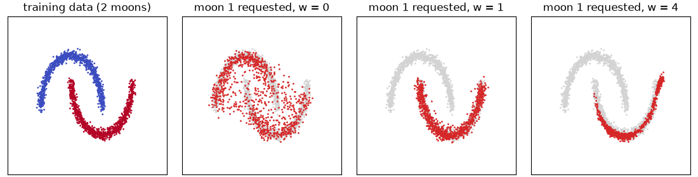

### Theory

> **In simple words:** to generate a picture **of something**, the denoiser also gets a **condition** (a class label or a text embedding). **Classifier-free guidance** makes it follow the condition harder: predict the noise with and without the condition and push the result further in the direction the condition suggests. **Latent diffusion** makes all this affordable by running diffusion in a VAE's small latent space instead of on raw pixels. Text-to-image and text-to-video models are latent diffusion (or flow-matching) transformers with guidance.

**Words to know:**

- **Conditional generation:** generating samples that match a condition y (a label, a text prompt, an input image).
- **Text conditioning:** feeding a text encoder's embeddings (CLIP or T5) to the denoiser, usually via cross-attention.
- **Classifier-free guidance (CFG):** train with the condition randomly dropped (e.g. 10% of the time) so one network learns both ε(x, t, y) and ε(x, t, ∅); at sampling time use ε̂ = ε(∅) + w·(ε(y) − ε(∅)), with guidance scale w.
- **Guidance scale (w, CFG scale):** 1 = plain conditional sampling; larger = follows the prompt more strongly but less diverse (typical 3–8 for images).
- **Negative prompt:** replacing the unconditional prediction with one conditioned on what to avoid.
- **Latent diffusion (LDM, 2022):** diffusion in the latent space of a pretrained VAE (e.g. 64×64×4 instead of 512×512×3: 48× fewer numbers), then decode the result to pixels.
- **U-Net:** the encoder–decoder CNN with skip connections used as the denoiser in Stable Diffusion 1–2 and SDXL.
- **DiT (diffusion transformer):** a transformer over latent patches as the denoiser (Stable Diffusion 3, Flux, Sora-style video models).
- **Flow matching / rectified flow:** a training objective that learns straight paths from noise to data; fewer sampling steps (SD3, Flux).
- **Distillation for speed:** consistency models, latent consistency models (LCM), adversarial distillation (SDXL Turbo): 1–4 sampling steps instead of 25–50.
- **ControlNet / image-to-image / inpainting:** conditioning on extra images (edges, poses, depth) / starting from a partly noised input image / regenerating a masked region.
- **Video diffusion:** diffusion over spatio-temporal latents (frames × height × width), typically with DiT denoisers.

**Everyday picture.** An artist given a brief ("a red fox in snow"). Guidance is the client standing behind them saying "more fox, more snow" at every brushstroke: a gentle client gives varied, natural paintings; an insistent one gets exactly what was asked, but every painting starts to look the same and colours become over-saturated.

**CFG, traced** (one noise component): ε(x, t, ∅) = 0.2 (unconditional), ε(x, t, "fox") = 0.5 (conditional), w = 4.
ε̂ = 0.2 + 4 × (0.5 − 0.2) = **1.4**: the update goes well beyond the conditional prediction, in the direction that distinguishes "fox" from "anything".

**The modern text-to-image pipeline, step by step:**

1. Encode the prompt with a text encoder (CLIP and/or T5).
2. Start from random noise in the VAE's latent space.
3. For 20–50 steps (or 1–4 with distilled models): predict noise (or velocity) with and without the prompt, combine with CFG, take a sampler step.
4. Decode the final latent with the VAE decoder into a full-resolution image.

**Common mistakes:**

- ❌ Very high guidance scales (over-saturated, distorted images, little variety).
- ❌ Forgetting to train with condition dropout (then there's no unconditional prediction to guide with).
- ❌ Ignoring licences and content rules of model weights and training data.

**Used in real software:** Stable Diffusion/SDXL/SD3 and Flux (open weights), Midjourney, DALL·E 3, Imagen, Adobe Firefly; video models (Sora, Veo, Kling, open models such as Wan and HunyuanVideo); the `diffusers` library runs most open models.

### Python

```python
import math
import torch
from torch import nn
import matplotlib.pyplot as plt
from sklearn.datasets import make_moons

print("traced CFG:", 0.2 + 4 * (0.5 - 0.2))

X, y = make_moons(20_000, noise=0.08, random_state=0)
data, labels = torch.tensor(X, dtype=torch.float32), torch.tensor(y)
data = (data - data.mean(0)) / data.std(0)
T = 200
betas = torch.linspace(1e-4, 0.04, T); alphas = 1 - betas; alpha_bar = torch.cumprod(alphas, 0)

def time_embedding(t, dim=32):
    freqs = torch.exp(-math.log(10000) * torch.arange(dim // 2) / (dim // 2))
    a = t[:, None].float() * freqs[None]
    return torch.cat([a.sin(), a.cos()], 1)

class CondDenoiser(nn.Module):
    def __init__(self, n_classes=2):
        super().__init__()
        self.label_emb = nn.Embedding(n_classes + 1, 16)                  # index n_classes = "no condition" (∅)
        self.net = nn.Sequential(nn.Linear(2 + 32 + 16, 128), nn.SiLU(), nn.Linear(128, 128), nn.SiLU(), nn.Linear(128, 128), nn.SiLU(), nn.Linear(128, 2))
    def forward(self, x, t, c):
        return self.net(torch.cat([x, time_embedding(t), self.label_emb(c)], 1))

torch.manual_seed(0)
model = CondDenoiser(); opt = torch.optim.Adam(model.parameters(), lr=1e-3)
for step in range(6000):
    idx = torch.randint(len(data), (256,))
    x0, c = data[idx], labels[idx].clone()
    c[torch.rand(256) < 0.15] = 2                                         # condition dropout: learn the unconditional model too
    t = torch.randint(0, T, (256,)); eps = torch.randn_like(x0)
    xt = alpha_bar[t].sqrt()[:, None] * x0 + (1 - alpha_bar[t]).sqrt()[:, None] * eps
    loss = ((model(xt, t, c) - eps) ** 2).mean(); opt.zero_grad(); loss.backward(); opt.step()
print(f"final noise-prediction MSE: {loss.item():.3f}")
```

**Output:**

```text
traced CFG: 1.4
final noise-prediction MSE: 0.319
```

```python
@torch.no_grad()
def sample(cls, w, n=1000, seed=0):
    g = torch.Generator().manual_seed(seed)
    x = torch.randn(n, 2, generator=g)
    cond, uncond = torch.full((n,), cls), torch.full((n,), 2)
    for t in reversed(range(T)):
        tt = torch.full((n,), t)
        e_c, e_u = model(x, tt, cond), model(x, tt, uncond)
        eps_hat = e_u + w * (e_c - e_u)                                      # classifier-free guidance
        x = (x - betas[t] / (1 - alpha_bar[t]).sqrt() * eps_hat) / alphas[t].sqrt()
        if t > 0:
            x = x + betas[t].sqrt() * torch.randn(x.shape, generator=g)
    return x

def on_target(samples, cls):                                             # share closer to its own moon's points than to the other's
    d_own = torch.cdist(samples, data[labels == cls][:3000]).min(1).values
    d_other = torch.cdist(samples, data[labels == 1 - cls][:3000]).min(1).values
    return (d_own < d_other).float().mean().item()

fig, axes = plt.subplots(1, 4, figsize=(12, 3), layout="constrained")
for ax, w in zip(axes, (0.0, 1.0, 3.0, 7.0)):
    s0, s1 = sample(0, w), sample(1, w, seed=1)
    spread = (s0.std(0).mean().item() + s1.std(0).mean().item()) / 2
    print(f"guidance w = {w}: samples on their requested moon {on_target(s0, 0):.2f} / {on_target(s1, 1):.2f}, average spread {spread:.2f}")
    ax.scatter(*s0.T, s=1, label="asked for moon 0"); ax.scatter(*s1.T, s=1, label="asked for moon 1")
    ax.set(title=f"guidance scale w = {w}", xlim=(-3, 3), ylim=(-3, 3), xticks=[], yticks=[], aspect="equal")
axes[0].legend(fontsize=7, markerscale=5)
fig.savefig("cfg-guidance.png", dpi=100)
plt.close(fig)
print(f"latent diffusion saving: 512×512×3 pixels = {512 * 512 * 3:,} numbers vs a 64×64×4 latent = {64 * 64 * 4:,} ({512 * 512 * 3 // (64 * 64 * 4)}× fewer)")
```

**Output:**

```text
guidance w = 0.0: samples on their requested moon 0.46 / 0.50, average spread 1.02
guidance w = 1.0: samples on their requested moon 1.00 / 1.00, average spread 0.76
guidance w = 3.0: samples on their requested moon 1.00 / 1.00, average spread 0.65
guidance w = 7.0: samples on their requested moon 1.00 / 1.00, average spread 0.59
latent diffusion saving: 512×512×3 pixels = 786,432 numbers vs a 64×64×4 latent = 16,384 (48× fewer)
```

With w = 0 the model ignores the label and samples both moons whatever you ask. At w = 1 (plain conditional sampling) every sample already lands on the requested moon, because this toy condition is easy; larger w mainly pulls the samples into a tighter bunch, trading diversity for prompt-faithfulness. With real text prompts, where the condition is weak and subtle, w = 1 follows the prompt poorly, which is why image apps default to guidance scales of 3–8 and expose it as "guidance" or "CFG scale".

### Practice

1. Compute the guided noise for ε(∅) = −0.1, ε(y) = 0.3 at w = 1 and w = 7.5.
2. Why is diffusion in a 64×64×4 latent space so much cheaper than in 512×512×3 pixel space, and what does the VAE contribute?

<details>
<summary><b>Answer</b></summary>

```python
for w in (1.0, 7.5):
    print(w, round(-0.1 + w * (0.3 - (-0.1)), 2))
```

**Output:**

```text
1.0 0.3
7.5 2.9
```

1. 0.3 at w = 1 (just the conditional prediction) and 2.9 at w = 7.5.
2. The denoiser runs 20–50 times per image, and its cost grows with the number of values it processes: 16,384 latent values instead of 786,432 pixels (48× fewer). The VAE compresses away perceptually unimportant detail once, and its decoder restores full resolution at the end.

</details>

| # | Problem (Deep-ML) | Difficulty |
|---|---|---|
| 1 | [397. Classifier-Free Guidance for Conditional Diffusion](https://www.deep-ml.com/problems/397) | 🟡 Medium |
| 2 | [398. DDIM Deterministic Sampling Step](https://www.deep-ml.com/problems/398) | 🟡 Medium |
| 3 | [402. Latent Diffusion Encoding and Decoding](https://www.deep-ml.com/problems/402) | 🟡 Medium |
| 4 | [401. Exponential Moving Average (EMA) for Diffusion Model Weights](https://www.deep-ml.com/problems/401) | 🟢 Easy |

**Learn more:** [Ho & Salimans, Classifier-Free Diffusion Guidance](https://arxiv.org/abs/2207.12598) · [Rombach et al., Latent Diffusion Models (Stable Diffusion)](https://arxiv.org/abs/2112.10752) · [Peebles & Xie, Scalable Diffusion Models with Transformers (DiT)](https://arxiv.org/abs/2212.09748) · [Hugging Face diffusers documentation](https://huggingface.co/docs/diffusers/index)

---

### ✅ Part 9 checkpoint

Without looking, can you:

- [ ] Explain an autoencoder's bottleneck, the VAE's reparameterisation trick and its KL term, and compute the KL by hand?
- [ ] Describe GAN training, the role of `.detach()`, and mode collapse?
- [ ] Write the forward diffusion formula, the noise-prediction loss and the reverse sampling step?
- [ ] Explain classifier-free guidance and its scale, latent diffusion, and why diffusion replaced GANs for most generation?

Part 10 makes models fast and small enough to train and serve at scale.

---

# Part 10 — Advanced: Efficiency, Scale and Modern Architectures

> **Goal:** Understand how big models are trained and served efficiently: number formats and **mixed precision**, **gradient accumulation**, checkpointing and **distributed training**, **quantisation**, **distillation and pruning**, fast **inference** (compilation, ONNX, batching, speculative decoding), the architectures behind 2026's frontier models (**mixture of experts**, efficient attention, **state-space models**), **scaling laws**, and what changed between 2023 and 2026.  
> **You need:** Parts 1–9.

---

## 49. Number Formats and Mixed Precision: FP32, FP16, BF16 and FP8


### Theory

> **In simple words:** every weight and activation is a floating-point number, and the format decides its **range** (how big or small it can get) and **precision** (how many significant digits). Training in 32-bit floats is safe but slow and memory-hungry. **Mixed precision** does most of the maths in 16-bit (**BF16** on modern hardware, or FP16 with **loss scaling**) while keeping a 32-bit master copy of the weights, roughly halving memory and doubling speed. Newer GPUs push further to **FP8** and even FP4.

**Words to know:**

- **Floating-point number:** sign × mantissa × 2^exponent. **Exponent bits** set the range; **mantissa (fraction) bits** set the precision.
- **FP32 (single precision):** 1 sign, 8 exponent, 23 mantissa bits; about 7 significant digits; range up to ~3.4 × 10³⁸.
- **FP16 (half precision):** 1, 5, 10 bits; ~3 digits; maximum 65,504, so large values **overflow** to infinity and tiny gradients **underflow** to 0.
- **BF16 (brain float 16):** 1, 8, 7 bits: FP32's range with only ~2–3 digits; rarely overflows, so no loss scaling is needed. The default for training on modern GPUs/TPUs.
- **FP8 (E4M3 / E5M2):** 8-bit formats with 4 or 5 exponent bits; used for matrix multiplies on Hopper/Blackwell GPUs (with per-tensor or per-block scaling). **FP4 / MXFP4:** 4-bit formats with shared block scales (Blackwell).
- **Machine epsilon:** the gap between 1 and the next representable number (FP32 1.2e-7, BF16 0.0078).
- **Mixed-precision training (AMP, automatic mixed precision):** run most operations in 16-bit while keeping weights, optimiser state and sensitive operations (sums, softmax, losses) in FP32.
- **`torch.autocast`:** a context manager that picks a 16-bit dtype per operation automatically.
- **Loss scaling (`GradScaler`):** multiply the loss by a large factor before `backward()` so FP16 gradients don't underflow, then divide the gradients back; unnecessary with BF16.
- **Tensor cores:** GPU units that multiply 16/8/4-bit matrices much faster than FP32.
- **Bytes per parameter:** FP32 4, BF16/FP16 2, FP8/INT8 1, INT4 0.5.

**Everyday picture.** Measuring with a ruler marked only in centimetres instead of millimetres: much faster to read and to write down, and fine for building a bookshelf; but adding a thousand tiny measurements on the coarse ruler loses the small parts. Mixed precision measures roughly but keeps the running total on the fine ruler.

**Range and precision, traced:**

| value | FP32 | FP16 | BF16 |
|---|---|---|---|
| 70,000 | 70,000 | **inf** (overflow) | 70,144 |
| 1 + 1/1,000 | 1.001 | 1.0010 | **1.0** (lost) |
| 1e-8 (a tiny gradient) | 1e-8 | **0** (underflow) | ≈ 1e-8 |

**Memory to train a 7B model with Adam, roughly:** FP32 everything: 4 (weights) + 4 (gradients) + 8 (two Adam moments) = 16 bytes/parameter = 112 GB. Mixed precision keeps FP32 master weights and Adam state, so the total stays similar for the states; the big savings are in **activations** and in speed, which is why it's combined with the sharding of Section [50](#50-training-bigger-models-gradient-accumulation-checkpointing-and-distributed-training).

**Common mistakes:**

- ❌ FP16 training without a gradient scaler (gradients underflow, the model stops learning).
- ❌ Summing many numbers in 16-bit (accumulate in FP32).
- ❌ Comparing outputs across precisions with exact equality (use tolerances).
- ❌ Assuming every operation is safe in 16-bit (softmax, normalisation statistics and losses usually stay in FP32; autocast handles this).

**Used in real software:** BF16 mixed precision is the default for LLM training; FP8 training was used for DeepSeek-V3 and is standard on Hopper/Blackwell GPUs; inference servers run BF16/FP8 weights; `torch.autocast` and `GradScaler` are one-line additions to any training loop.

### Python

```python
import torch

for dtype in (torch.float32, torch.float16, torch.bfloat16, torch.float8_e4m3fn):
    fi = torch.finfo(dtype)
    print(f"{str(dtype):22s} bits {fi.bits:2d} | max {fi.max:.3g} | smallest normal {fi.tiny:.3g} | epsilon {fi.eps:.3g}")

for value in (70000.0, 1 + 1 / 1000, 1e-8):
    print(f"{value!r:>10}: " + ", ".join(f"{name} {torch.tensor(value, dtype=dt).item():.6g}" for name, dt in
                                      [("fp32", torch.float32), ("fp16", torch.float16), ("bf16", torch.bfloat16)]))

totals = {}
for name, dt in [("fp32", torch.float32), ("fp16", torch.float16), ("bf16", torch.bfloat16)]:
    total, step = torch.tensor(0.0, dtype=dt), torch.tensor(0.001, dtype=dt)
    for _ in range(10_000):
        total = total + step                                             # the running total is stored in this format
    totals[name] = round(total.item(), 3)
print("adding 0.001 ten thousand times (true 10.0):", totals)
```

**Output:**

```text
torch.float32          bits 32 | max 3.4e+38 | smallest normal 1.18e-38 | epsilon 1.19e-07
torch.float16          bits 16 | max 6.55e+04 | smallest normal 6.1e-05 | epsilon 0.000977
torch.bfloat16         bits 16 | max 3.39e+38 | smallest normal 1.18e-38 | epsilon 0.00781
torch.float8_e4m3fn    bits  8 | max 448 | smallest normal 0.0156 | epsilon 0.125
   70000.0: fp32 70000, fp16 inf, bf16 70144
     1.001: fp32 1.001, fp16 1.00098, bf16 1
     1e-08: fp32 1e-08, fp16 0, bf16 1.00117e-08
adding 0.001 ten thousand times (true 10.0): {'fp32': 10.0, 'fp16': 4.0, 'bf16': 0.5}
```

FP16 overflows at 70,000 and flushes 1e-8 to zero; BF16 handles both but rounds 1.001 to 1.0 (only 8 bits of precision). Adding 0.001 ten thousand times with the running total kept in 16-bit gets stuck far below 10: once the total is large, the gap between neighbouring 16-bit numbers is bigger than 0.001, so adding it rounds back to the same value. That's why sums, statistics and optimiser states stay in FP32 (and why PyTorch's own reductions accumulate in higher precision internally).

```python
from torch import nn

torch.manual_seed(0)
model = nn.Sequential(nn.Linear(512, 1024), nn.GELU(), nn.Linear(1024, 10))
x, y = torch.randn(64, 512), torch.randint(0, 10, (64,))
with torch.autocast(device_type="cpu", dtype=torch.bfloat16):            # "cuda" + bfloat16/float16 on a GPU
    logits = model(x)
    loss = nn.functional.cross_entropy(logits, y)
print("inside autocast: logits", logits.dtype, "| loss", loss.dtype, "| weights stay", model[0].weight.dtype)
loss.backward()
print("gradients:", model[0].weight.grad.dtype)
with torch.no_grad():
    full = model(x)
print(f"largest difference between bf16 and fp32 logits: {(logits.float() - full).abs().max().item():.3f} (logit scale ≈ {full.abs().mean().item():.2f})")

g = torch.tensor([3e-8]); scale = 65536.0
print("tiny gradient in fp16:", g.half().item(), "| scaled by 65,536 first:", (g * scale).half().item(), "→ unscaled in fp32:", ((g * scale).half().float() / scale).item())
```

**Output:**

```text
inside autocast: logits torch.bfloat16 | loss torch.float32 | weights stay torch.float32
gradients: torch.float32
largest difference between bf16 and fp32 logits: 0.002 (logit scale ≈ 0.15)
tiny gradient in fp16: 5.960464477539063e-08 | scaled by 65,536 first: 0.0019664764404296875 → unscaled in fp32: 3.000604920089245e-08
```

Under autocast the matrix multiplies run in BF16 while the weights (and therefore their gradients and the optimiser) stay FP32; the loss is computed in FP32 for accuracy. The last line is loss scaling in one picture: a gradient too small for FP16 survives if it is multiplied up before the 16-bit step and divided back afterwards in FP32.

### Practice

1. How many bytes do the weights of a 70B-parameter model take in BF16, FP8 and INT4?
2. Why doesn't BF16 training need a `GradScaler`?

<details>
<summary><b>Answer</b></summary>

```python
for name, b in [("bf16", 2), ("fp8", 1), ("int4", 0.5)]:
    print(name, f"{70e9 * b / 1e9:.0f} GB")
```

**Output:**

```text
bf16 140 GB
fp8 70 GB
int4 35 GB
```

1. 140 GB, 70 GB and 35 GB: the format alone decides whether a model fits on one GPU.
2. BF16 has the same 8 exponent bits as FP32, so small gradients don't underflow; FP16's 5 exponent bits are what make scaling necessary.

</details>

| # | Problem (Deep-ML) | Difficulty |
|---|---|---|
| 1 | [428. Number Format Precision Comparison (FP16 vs BF16 vs FP8 vs FP4)](https://www.deep-ml.com/problems/428) | 🔴 Hard |
| 2 | [234. Block-wise FP8 Quantization](https://www.deep-ml.com/problems/234) | 🟡 Medium |

**Learn more:** [PyTorch: automatic mixed precision](https://docs.pytorch.org/docs/stable/amp.html) · [Micikevicius et al., Mixed Precision Training](https://arxiv.org/abs/1710.03740) · [NVIDIA: FP8 formats for deep learning](https://arxiv.org/abs/2209.05433)

---

## 50. Training Bigger Models: Gradient Accumulation, Checkpointing and Distributed Training

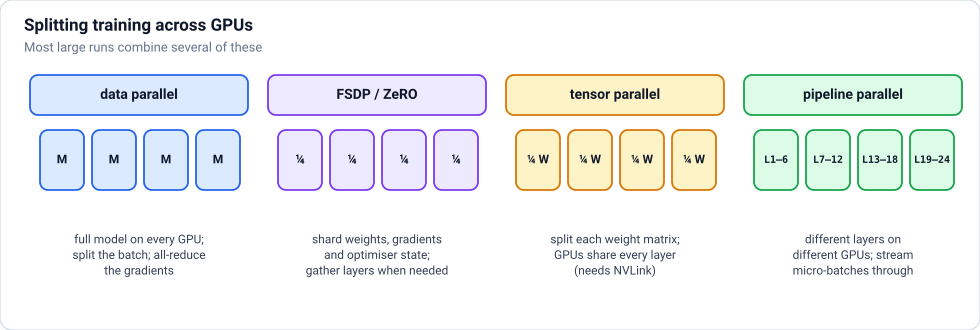

### Theory

> **In simple words:** when a model or batch doesn't fit, there are three families of tricks. **Gradient accumulation** fakes a big batch by adding up gradients from several small ones before stepping. **Activation checkpointing** saves memory by throwing away intermediate results and recomputing them during the backward pass. **Distributed training** spreads the work over many GPUs: copy the model and split the data (**data parallel**), split the model's weights (**FSDP/ZeRO**, **tensor parallel**) or split its layers (**pipeline parallel**). Frontier models combine all of them across tens of thousands of GPUs.

**Words to know:**

- **Gradient accumulation:** run k micro-batches, call `backward()` on each (gradients add up), then one optimiser step; effective batch = k × micro-batch.
- **Micro-batch:** the small batch that actually fits in memory in one forward/backward pass.
- **Activation (gradient) checkpointing:** store only some layers' activations and recompute the rest during backward; trades ~30% more compute for much less memory.
- **Activations memory:** intermediate values saved for backward; for long sequences and big batches it dominates GPU memory.
- **Data parallelism (DDP, DistributedDataParallel):** every GPU holds a full model copy, processes a different slice of the batch, and gradients are averaged with an **all-reduce** before each step.
- **All-reduce:** a collective operation that sums (or averages) tensors across all GPUs so everyone ends with the same result.
- **FSDP (fully sharded data parallel) / ZeRO:** data parallelism where weights, gradients and optimiser states are **sharded** (split) across GPUs and gathered only when needed; memory per GPU shrinks with the number of GPUs.
- **Tensor parallelism:** splitting individual weight matrices across GPUs (e.g. half of a linear layer's columns on each), needing fast links (NVLink).
- **Pipeline parallelism:** putting different layers on different GPUs and streaming micro-batches through them.
- **3D/4D parallelism:** combining data, tensor, pipeline (and context/expert) parallelism.
- **Context (sequence) parallelism:** splitting a very long sequence across GPUs (ring attention).
- **NCCL:** NVIDIA's library for fast GPU-to-GPU communication. **`torchrun`:** PyTorch's launcher for multi-process training.
- **Distributed training:** training one model on many GPUs or machines at once, combining the forms of parallelism below.

**Everyday picture.** Painting a huge mural: data parallel is several painters each painting a copy and averaging their ideas; tensor parallel is painters sharing each brushstroke; pipeline parallel is an assembly line where one painter does backgrounds and the next does figures; gradient accumulation is one painter stepping back to judge after every few strokes instead of after each.

**Memory per GPU for a 7B model with Adam (16 bytes/parameter = 112 GB) on 8 GPUs:**

| strategy | weights + grads + optimiser state per GPU |
|---|---|
| plain data parallel (DDP) | 112 GB (everything replicated): doesn't fit an 80 GB GPU |
| ZeRO-1 (shard optimiser state) | 7B × (2 + 2 + 12/8) ≈ 38.5 GB |
| ZeRO-3 / FSDP (shard everything) | 112 / 8 = 14 GB (+ activations) |

**Common mistakes:**

- ❌ Forgetting to divide the loss by the number of accumulation steps (gradients become k× too large).
- ❌ Calling `optimizer.zero_grad()` inside the accumulation loop.
- ❌ BatchNorm with tiny micro-batches (statistics are per micro-batch; use LayerNorm/GroupNorm or synchronised BN).
- ❌ Each GPU loading the same data shard (use `DistributedSampler`), or different random seeds for model initialisation.

**Used in real software:** `torchrun` + DDP/FSDP2 in PyTorch, DeepSpeed (ZeRO), Megatron-LM (tensor/pipeline), torchtitan; Hugging Face `accelerate` and `Trainer` wrap them; Llama 3 405B was trained on up to 16,000 GPUs with 4D parallelism.

### Python

```python
import torch
from torch import nn

torch.manual_seed(0)
model = nn.Sequential(nn.Linear(20, 64), nn.ReLU(), nn.Linear(64, 1))
X, y = torch.randn(64, 20), torch.randn(64, 1)

model.zero_grad()
nn.functional.mse_loss(model(X), y).backward()
full_grad = model[0].weight.grad.clone()

model.zero_grad()
for chunk_x, chunk_y in zip(X.split(16), y.split(16)):                  # 4 micro-batches of 16
    (nn.functional.mse_loss(model(chunk_x), chunk_y) / 4).backward()      # divide by the number of steps
print("gradient accumulation (4 × 16) equals one batch of 64:", torch.allclose(model[0].weight.grad, full_grad, atol=1e-6))

worker_grads = []
for shard_x, shard_y in zip(X.split(16), y.split(16)):                   # 4 "GPUs", same model copy, different data
    replica = model; replica.zero_grad()
    nn.functional.mse_loss(replica(shard_x), shard_y).backward()
    worker_grads.append(replica[0].weight.grad.clone())
all_reduced = torch.stack(worker_grads).mean(0)                          # what all-reduce + average produces
print("data parallel: averaged worker gradients equal the full-batch gradient:", torch.allclose(all_reduced, full_grad, atol=1e-6))

W = torch.randn(20, 64)
left, right = W[:, :32], W[:, 32:]                                       # tensor parallel: half of the columns on each GPU
out = torch.cat([X @ left, X @ right], dim=1)                            # each computes its half; gather the results
print("tensor parallel: split matmul equals the full matmul:", torch.allclose(out, X @ W, atol=1e-5))
```

**Output:**

```text
gradient accumulation (4 × 16) equals one batch of 64: True
data parallel: averaged worker gradients equal the full-batch gradient: True
tensor parallel: split matmul equals the full matmul: True
```

All three are exact rewrites of the same computation: accumulation and data parallelism produce the full-batch gradient (as long as the loss is averaged correctly), and a matrix split by columns produces the same output. Distributed training is mostly engineering for moving these pieces between GPUs quickly.

```python
from torch.utils.checkpoint import checkpoint

calls = {"n": 0}
class Counted(nn.Module):
    def __init__(self):
        super().__init__(); self.lin = nn.Linear(256, 256)
    def forward(self, x):
        calls["n"] += 1; return torch.relu(self.lin(x))

blocks = nn.ModuleList([Counted() for _ in range(8)])
x = torch.randn(32, 256, requires_grad=True)
for use_ckpt in (False, True):
    calls["n"] = 0; h = x
    for b in blocks:
        h = checkpoint(b, h, use_reentrant=False) if use_ckpt else b(h)
    h.sum().backward()
    print(f"checkpointing {'on ' if use_ckpt else 'off'}: block forward calls = {calls['n']} (8 in the forward pass, the rest recomputed)")

params = 7e9
for name, per_gpu in [("DDP", 16 * params), ("ZeRO-1 (8 GPUs)", params * (2 + 2 + 12 / 8)), ("FSDP/ZeRO-3 (8 GPUs)", 16 * params / 8)]:
    print(f"{name:22s} {per_gpu / 1e9:6.1f} GB per GPU for weights, gradients and Adam state")
```

**Output:**

```text
checkpointing off: block forward calls = 8 (8 in the forward pass, the rest recomputed)
checkpointing on : block forward calls = 16 (8 in the forward pass, the rest recomputed)
DDP                     112.0 GB per GPU for weights, gradients and Adam state
ZeRO-1 (8 GPUs)          38.5 GB per GPU for weights, gradients and Adam state
FSDP/ZeRO-3 (8 GPUs)     14.0 GB per GPU for weights, gradients and Adam state
```

With checkpointing, each block's forward runs twice (once normally, once again during backward), which is the price for not storing those activations. The memory arithmetic shows why sharding is essential: a 7B model's training state doesn't fit an 80 GB GPU replicated, but sharded across 8 GPUs it does.

### Practice

1. Your GPU fits a micro-batch of 8, but the recipe needs a batch of 256 across 4 GPUs. How many accumulation steps per GPU?
2. Why does tensor parallelism need much faster connections between GPUs than data parallelism?

<details>
<summary><b>Answer</b></summary>

```python
print(256 // (8 * 4))
```

**Output:**

```text
8
```

1. 256 / (8 × 4) = 8 accumulation steps per GPU per optimiser step.
2. Data parallelism communicates once per step (an all-reduce of gradients, which can overlap with backward). Tensor parallelism exchanges activations inside **every layer** in both forward and backward, so it needs very high bandwidth (NVLink within a server).

</details>

| # | Problem (Deep-ML) | Difficulty |
|---|---|---|
| 1 | [438. Tensor Parallelism All-Reduce Communication Cost](https://www.deep-ml.com/problems/438) | 🟡 Medium |
| 2 | [188. Gradient Checkpointing](https://www.deep-ml.com/problems/188) | 🟢 Easy |
| 3 | [448. Context Parallelism with Ring Attention for Video Models](https://www.deep-ml.com/problems/448) | 🔴 Hard |

**Learn more:** [PyTorch: distributed training overview](https://docs.pytorch.org/tutorials/beginner/dist_overview.html) · [Rajbhandari et al., ZeRO](https://arxiv.org/abs/1910.02054) · [Hugging Face: the ultra-scale playbook](https://huggingface.co/spaces/nanotron/ultrascale-playbook)

---

## 51. Quantisation: INT8, INT4 and Formats for Running Models Locally

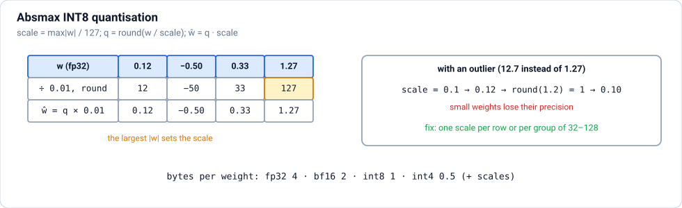

### Theory

> **In simple words:** **quantisation** stores weights (and sometimes activations) with fewer bits: integers of 8 or 4 bits plus a scale factor, instead of 16- or 32-bit floats. A model becomes 2–8× smaller and often faster, with little loss in quality when done carefully. This is how 70-billion-parameter models run on a single GPU, and 8-billion-parameter ones on a laptop.

**Words to know:**

- **Quantisation:** mapping real numbers to a small set of levels (integers) with a scale (and sometimes a zero point).
- **Absmax (symmetric) quantisation:** scale = max|w| / 127; q = round(w / scale); dequantised ŵ = q × scale.
- **Zero point (asymmetric/affine quantisation):** an offset so the integer range covers [min, max] rather than a symmetric range.
- **Per-tensor / per-channel / per-group scales:** one scale for a whole matrix / one per output row / one per block of, say, 32–128 weights; finer scales cost a little memory and greatly reduce error.
- **Outliers:** a few very large values that force a big scale and crush everything else to few levels; a central problem for quantising LLM activations.
- **Weight-only quantisation:** quantise the weights, keep activations in 16-bit (common for LLM inference, memory-bound).
- **PTQ (post-training quantisation) / QAT (quantisation-aware training):** quantise a trained model / simulate quantisation during training so the model adapts.
- **GPTQ / AWQ:** popular PTQ methods for LLMs that choose rounding (GPTQ) or scale important channels (AWQ) using a little calibration data.
- **Calibration data:** a few hundred examples used to measure activation ranges or errors during PTQ.
- **NF4:** the 4-bit NormalFloat format of QLoRA (Section [42](#42-parameter-efficient-fine-tuning-lora-and-qlora)).
- **GGUF / llama.cpp:** a file format and CPU/GPU inference engine for quantised models (e.g. "Q4_K_M"); used by Ollama and LM Studio. **MLX:** Apple's framework for running models on Apple Silicon.
- **Fake quantisation:** quantise and immediately dequantise, to measure the effect on accuracy in ordinary floating point.

**Everyday picture.** Saving a photo as a JPEG: it keeps what the eye notices and throws away fine detail, shrinking the file 10× with little visible difference. Push compression too far and blocks appear; quantising to too few bits is the same.

**Absmax INT8, traced:** weights (0.12, −0.50, 0.33, 1.27). Scale = 1.27 / 127 = 0.01.
q = round(w / 0.01) = (12, −50, 33, 127); dequantised = (0.12, −0.50, 0.33, 1.27): exact here. With an outlier 12.7 instead of 1.27, scale = 0.1 → 0.12 becomes round(1.2) = 1 → 0.1, and the small weights lose most of their precision.

**Which format when (2026):**

| Situation | Typical choice |
|---|---|
| serving on data-centre GPUs | BF16 or FP8 weights (and activations), sometimes INT4 weight-only (AWQ/GPTQ) |
| laptops, phones, CPUs | 4-bit GGUF (llama.cpp, Ollama), MLX on Macs |
| fine-tuning a big model on one GPU | QLoRA (4-bit NF4 base + LoRA) |
| tiny models on microcontrollers | INT8 with QAT |

**Common mistakes:**

- ❌ Per-tensor scales on weights with outliers (large errors).
- ❌ Judging quantisation only by file size: always re-measure task accuracy (or perplexity) on held-out data.
- ❌ Quantising very small models aggressively (they have less redundancy than large ones).
- ❌ Assuming smaller always means faster: speed depends on whether the hardware has kernels for that format.

**Used in real software:** Ollama, LM Studio and llama.cpp run 4-bit GGUF models on laptops; vLLM and TensorRT-LLM serve AWQ/GPTQ/FP8 models; Apple Intelligence's on-device model uses low-bit quantisation; phones run INT8 vision models.

### Python

```python
import torch

w = torch.tensor([0.12, -0.50, 0.33, 1.27])
scale = w.abs().max() / 127
q = torch.round(w / scale).to(torch.int8)
print("scale", round(scale.item(), 4), "| int8", q.tolist(), "| dequantised", [round(v, 3) for v in (q.float() * scale).tolist()])
w_out = torch.tensor([0.12, -0.50, 0.33, 12.7])                            # one outlier
s_out = w_out.abs().max() / 127
print("with an outlier:", [round(v, 3) for v in (torch.round(w_out / s_out) * s_out).tolist()])

def fake_quant(W, bits=8, group=None):
    """Symmetric quantisation per output row (per channel), or per group of `group` weights along each row."""
    levels = 2 ** (bits - 1) - 1
    Wg = W.reshape(W.shape[0], -1, group) if group else W.reshape(W.shape[0], 1, -1)
    s = Wg.abs().amax(-1, keepdim=True).clamp(min=1e-8) / levels
    return (torch.round(Wg / s).clamp(-levels, levels) * s).reshape(W.shape)

torch.manual_seed(0)
W = torch.randn(768, 768) * 0.02; W[:, 5] *= 30                            # a realistic weight matrix with an outlier column
for name, kw in [("int8 per-tensor", dict(bits=8, group=768 * 768)), ("int8 per-channel", dict(bits=8)),
                 ("int4 per-channel", dict(bits=4)), ("int4 groups of 64", dict(bits=4, group=64))]:
    Wq = fake_quant(W.reshape(1, -1), kw["bits"]).reshape(W.shape) if kw.get("group") == 768 * 768 else fake_quant(W, **kw)
    err = ((Wq - W).norm() / W.norm()).item()
    print(f"{name:18s} relative error {err:.4f}")
```

**Output:**

```text
scale 0.01 | int8 [12, -50, 33, 127] | dequantised [0.12, -0.5, 0.33, 1.27]
with an outlier: [0.1, -0.5, 0.3, 12.7]
int8 per-tensor    relative error 0.1464
int8 per-channel   relative error 0.0460
int4 per-channel   relative error 0.5074
int4 groups of 64  relative error 0.1616
```

Finer scales matter a lot. At 8 bits, one scale for the whole matrix is dominated by the outlier column, and per-channel scales cut the error about 3×. At 4 bits there are only 15 levels, so one scale per row is hopeless with outliers (about 50% error), while groups of 64 weights bring it back down severalfold. Real 4-bit LLM formats (GPTQ, AWQ, GGUF "K-quants") use groups of 32–128 weights for exactly this reason.

```python
from datasets import load_dataset
from torch import nn
from transformers import AutoModelForSequenceClassification, AutoTokenizer

name = "distilbert/distilbert-base-uncased-finetuned-sst-2-english"
tok = AutoTokenizer.from_pretrained(name)
reviews = load_dataset("cornell-movie-review-data/rotten_tomatoes", split="validation")
batch = tok(list(reviews["text"]), padding=True, truncation=True, max_length=64, return_tensors="pt")
labels = torch.tensor(reviews["label"])

def accuracy(model):
    with torch.no_grad():
        preds = torch.cat([model(input_ids=batch["input_ids"][i:i + 128], attention_mask=batch["attention_mask"][i:i + 128]).logits.argmax(-1)
                           for i in range(0, len(labels), 128)])
    return (preds == labels).float().mean().item()

linear_params = None
for setting in [None, dict(bits=8), dict(bits=4, group=64), dict(bits=4), dict(bits=3, group=64)]:
    model = AutoModelForSequenceClassification.from_pretrained(name).eval()
    linears = [m for m in model.modules() if isinstance(m, nn.Linear)]
    linear_params = sum(m.weight.numel() for m in linears)
    if setting:
        with torch.no_grad():
            for m in linears:
                m.weight.copy_(fake_quant(m.weight, **setting))
    bits = setting["bits"] if setting else 32
    label = "fp32 (original)" if not setting else f"int{bits} " + (f"groups of {setting['group']}" if "group" in setting else "per-channel")
    print(f"{label:22s} accuracy {accuracy(model):.3f} | linear-layer weights {linear_params * bits / 8 / 1e6:6.1f} MB")
```

**Output:**

```text
fp32 (original)        accuracy 0.905 | linear-layer weights  172.2 MB
int8 per-channel       accuracy 0.906 | linear-layer weights   43.1 MB
int4 groups of 64      accuracy 0.905 | linear-layer weights   21.5 MB
int4 per-channel       accuracy 0.902 | linear-layer weights   21.5 MB
int3 groups of 64      accuracy 0.900 | linear-layer weights   16.1 MB
```

Quantising every linear layer of the sentiment model barely moves its accuracy: 8 bits matches the original at a quarter of the size, and even 4-bit and 3-bit versions stay within half a point. DistilBERT's weights have few extreme outliers, and a two-class sentiment decision is forgiving. Generative LLMs are more sensitive (errors compound over hundreds of generated tokens), especially below 4 bits, so always measure on your own task before shipping a quantised model.

### Practice

1. Quantise (0.9, −0.3, 0.05, −0.9) to INT4 with absmax (levels −7…7). What comes back after dequantising?
2. A 4-bit model with groups of 64 also stores one 16-bit scale per group. What's the effective number of bits per weight?

<details>
<summary><b>Answer</b></summary>

```python
v = torch.tensor([0.9, -0.3, 0.05, -0.9]); s = v.abs().max() / 7
print(torch.round(v / s).tolist(), [round(x, 3) for x in (torch.round(v / s) * s).tolist()])
print(4 + 16 / 64)
```

**Output:**

```text
[7.0, -2.0, 0.0, -7.0] [0.9, -0.257, 0.0, -0.9]
4.25
```

1. Scale 0.9/7 = 0.129; integers (7, −2, 0, −7); dequantised (0.9, −0.257, 0, −0.9): the small weight 0.05 becomes 0.
2. 4 + 16/64 = 4.25 bits per weight.

</details>

| # | Problem (Deep-ML) | Difficulty |
|---|---|---|
| 1 | [294. Implement INT8 Quantization](https://www.deep-ml.com/problems/294) | 🟡 Medium |
| 2 | [426. Post-Training Quantization with Per-Channel Scale Factors](https://www.deep-ml.com/problems/426) | 🟡 Medium |
| 3 | [427. FP4 Quantization with Microscaling (MXFP4)](https://www.deep-ml.com/problems/427) | 🔴 Hard |

**Learn more:** [Maarten Grootendorst: a visual guide to quantization](https://newsletter.maartengrootendorst.com/p/a-visual-guide-to-quantization) · [Frantar et al., GPTQ](https://arxiv.org/abs/2210.17323) · [Lin et al., AWQ](https://arxiv.org/abs/2306.00978) · [llama.cpp](https://github.com/ggml-org/llama.cpp)

---

## 52. Knowledge Distillation and Pruning


### Theory

> **In simple words:** two more ways to make models smaller. **Knowledge distillation** trains a small **student** to imitate a big **teacher**'s output probabilities, which carry more information than hard labels ("this 7 looks a bit like a 1"). **Pruning** removes weights (or whole neurons, heads or layers) that matter least, then often fine-tunes to recover. Both trade a little accuracy for a model that is cheaper to run.

**Words to know:**

- **Knowledge distillation (KD):** training a student on the teacher's predictions (with or without the true labels).
- **Teacher / student:** the large, accurate model / the small model being trained.
- **Soft targets (soft labels):** the teacher's full probability distribution, softened with a temperature.
- **Distillation temperature (T):** divide logits by T > 1 before softmax so small probabilities ("dark knowledge") become visible; the KD loss is multiplied by T².
- **KD loss:** KL(teacher_T ‖ student_T) · T², usually mixed with ordinary cross-entropy on the true labels.
- **Dark knowledge:** the information in the teacher's non-top probabilities (which wrong answers are "almost right").
- **Pruning:** removing parameters. **Unstructured** pruning zeroes individual weights (needs sparse kernels to be faster); **structured** pruning removes whole channels, heads or layers (directly faster).
- **Magnitude pruning:** removing the weights with the smallest absolute values.
- **Sparsity:** the fraction of weights that are zero.
- **Lottery ticket hypothesis:** large networks contain small subnetworks that could train to similar accuracy on their own.
- **2:4 sparsity:** a hardware-supported pattern (2 zeros in every 4 weights) that NVIDIA GPUs accelerate.

**Everyday picture.** An apprentice learning from a master craftsman learns not only "this is a chair" but also "this one is almost a stool, and that's what makes it work"; that richer feedback makes them learn faster than from a list of right answers. Pruning is a gardener trimming the branches that bear no fruit.

**Soft targets, traced:** teacher logits for a "7" image over classes (1, 7, 9) = (3, 8, 2).
T = 1: softmax = (0.007, 0.991, 0.002), nearly one-hot. T = 4: softmax(0.75, 2.0, 0.5) = (0.19, 0.66, 0.15), which reveals that this 7 resembles a 1 more than a 9.

**Common mistakes:**

- ❌ Forgetting the T² factor (the soft loss becomes too weak at high temperature).
- ❌ Expecting unstructured sparsity to speed up dense GPU kernels (it doesn't without sparse support).
- ❌ Pruning heavily without fine-tuning afterwards.
- ❌ Distilling with a teacher that's barely better than the student.

**Used in real software:** DistilBERT (40% smaller, ~97% of BERT's quality), the small members of LLM families trained on outputs or logits of larger ones (Gemma, Llama 3.2 1B/3B, DeepSeek-R1 distilled models), Whisper "distil" models, and structured pruning plus distillation in NVIDIA's Minitron models.

### Python

```python
import time
import torch
from torch import nn
from torch.utils.data import DataLoader, Subset
from torchvision import datasets, transforms
import matplotlib.pyplot as plt

t = torch.tensor([3.0, 8.0, 2.0])
print("teacher probabilities, T=1:", [round(v, 3) for v in t.softmax(0).tolist()], "| T=4:", [round(v, 2) for v in (t / 4).softmax(0).tolist()])

torch.manual_seed(0)
tfm = transforms.Compose([transforms.ToTensor(), transforms.Normalize((0.286,), (0.353,))])
full_train = datasets.FashionMNIST(root="data", train=True, download=True, transform=tfm)   # the teacher sees all 60,000 images
train = Subset(full_train, range(5_000))                                 # the student only has 5,000 labelled images
test = datasets.FashionMNIST(root="data", train=False, download=True, transform=tfm)
def accuracy(m):
    m.eval()
    with torch.no_grad():
        return sum((m(x).argmax(1) == y).sum().item() for x, y in DataLoader(test, batch_size=1000)) / len(test)

teacher = nn.Sequential(nn.Conv2d(1, 32, 3, padding=1), nn.ReLU(), nn.MaxPool2d(2), nn.Conv2d(32, 64, 3, padding=1), nn.ReLU(), nn.MaxPool2d(2),
                        nn.Flatten(), nn.Linear(3136, 128), nn.ReLU(), nn.Linear(128, 10))
opt = torch.optim.AdamW(teacher.parameters(), lr=1e-3); t0 = time.time()
for epoch in range(3):
    teacher.train()
    for x, y in DataLoader(full_train, batch_size=128, shuffle=True):
        loss = nn.functional.cross_entropy(teacher(x), y); opt.zero_grad(); loss.backward(); opt.step()
print(f"teacher CNN: {sum(p.numel() for p in teacher.parameters()):,} parameters, test accuracy {accuracy(teacher):.3f} ({time.time() - t0:.0f} s)")

def train_student(distill, T=4.0, alpha=0.7, epochs=15, seed=0):
    torch.manual_seed(seed)
    student = nn.Sequential(nn.Flatten(), nn.Linear(784, 64), nn.ReLU(), nn.Linear(64, 10))
    opt = torch.optim.AdamW(student.parameters(), lr=1e-3)
    teacher.eval()
    for _ in range(epochs):
        student.train()
        for x, y in DataLoader(train, batch_size=128, shuffle=True):
            s_logits = student(x)
            loss = nn.functional.cross_entropy(s_logits, y)
            if distill:
                with torch.no_grad():
                    t_logits = teacher(x)
                kd = nn.functional.kl_div((s_logits / T).log_softmax(1), (t_logits / T).softmax(1), reduction="batchmean") * T * T
                loss = alpha * kd + (1 - alpha) * loss
            opt.zero_grad(); loss.backward(); opt.step()
    return student

results = {}
for distill in (False, True):
    scores = [accuracy(train_student(distill, seed=s)) for s in (0, 1, 2)]
    results["distilled from teacher" if distill else "labels only"] = sum(scores) / 3
    print(f"student MLP ({784 * 64 + 64 + 64 * 10 + 10:,} parameters), {'distilled' if distill else 'labels only'}: "
          f"test accuracy {[round(v, 3) for v in scores]} (mean {sum(scores) / 3:.3f})")
```

**Output:**

```text
teacher probabilities, T=1: [0.007, 0.991, 0.002] | T=4: [0.19, 0.66, 0.15]
teacher CNN: 421,642 parameters, test accuracy 0.909 (39 s)
student MLP (50,890 parameters), labels only: test accuracy [0.825, 0.834, 0.816] (mean 0.825)
student MLP (50,890 parameters), distilled: test accuracy [0.841, 0.84, 0.836] (mean 0.839)
```

The setting is the realistic one: a big teacher trained on plenty of data, and a much smaller student with only a few labelled examples. Learning from the teacher's soft probabilities (which wrong classes are "close") gives the student a consistent gain over learning from labels alone, across all three seeds, without a single extra label.

```python
import torch.nn.utils.prune as prune

def train_mlp(seed=0):
    torch.manual_seed(seed)
    m = nn.Sequential(nn.Flatten(), nn.Linear(784, 256), nn.ReLU(), nn.Linear(256, 10)); o = torch.optim.AdamW(m.parameters(), lr=1e-3)
    for _ in range(5):
        m.train()
        for x, y in DataLoader(train, batch_size=128, shuffle=True):
            loss = nn.functional.cross_entropy(m(x), y); o.zero_grad(); loss.backward(); o.step()
    return m

base = train_mlp()
sparsities, accs = [0.0, 0.5, 0.8, 0.9, 0.95, 0.98], []
for sp in sparsities:
    m = train_mlp() if sp else base
    if sp:
        m.load_state_dict(base.state_dict())
        prune.global_unstructured([(m[1], "weight"), (m[3], "weight")], pruning_method=prune.L1Unstructured, amount=sp)   # smallest |w| → 0
    accs.append(accuracy(m))
    zeros = sum((mod.weight == 0).sum().item() for mod in (m[1], m[3])) / sum(mod.weight.numel() for mod in (m[1], m[3]))
    print(f"pruned {sp:4.0%} of weights (measured sparsity {zeros:.0%}): test accuracy {accs[-1]:.3f}")

fig, axes = plt.subplots(1, 2, figsize=(10, 3.2), layout="constrained")
axes[0].bar(list(results), list(results.values()), color=["gray", "tab:green"]); axes[0].set(ylim=(0.75, 0.9), ylabel="test accuracy", title="Small student MLP")
axes[1].plot([s * 100 for s in sparsities], accs, "o-"); axes[1].set(xlabel="% of weights removed (no retraining)", ylabel="test accuracy", title="Magnitude pruning")
fig.savefig("distill-prune.png", dpi=100)
plt.close(fig)
```

**Output:**

```text
pruned   0% of weights (measured sparsity 0%): test accuracy 0.817
pruned  50% of weights (measured sparsity 50%): test accuracy 0.814
pruned  80% of weights (measured sparsity 80%): test accuracy 0.799
pruned  90% of weights (measured sparsity 90%): test accuracy 0.773
pruned  95% of weights (measured sparsity 95%): test accuracy 0.677
pruned  98% of weights (measured sparsity 98%): test accuracy 0.593
```

Magnitude pruning without any retraining is surprisingly gentle at first: removing the smallest half of the weights changes almost nothing, and even 80–90% costs only a little, because most weights are close to zero anyway. Past a threshold accuracy collapses, and that's where fine-tuning the pruned network (practice 1) recovers most of the loss.

### Practice

1. Fine-tune the 95%-pruned network for one epoch (the pruning masks keep the removed weights at zero). How much accuracy comes back?
2. Why does unstructured 90% sparsity rarely make a model 10× faster on a GPU?

<details>
<summary><b>Answer</b></summary>

```python
m = train_mlp(); m.load_state_dict(base.state_dict())
prune.global_unstructured([(m[1], "weight"), (m[3], "weight")], pruning_method=prune.L1Unstructured, amount=0.95)
before = accuracy(m)
o = torch.optim.AdamW(m.parameters(), lr=1e-3)
m.train()
for x, y in DataLoader(train, batch_size=128, shuffle=True):
    loss = nn.functional.cross_entropy(m(x), y); o.zero_grad(); loss.backward(); o.step()
print(f"95% pruned: {before:.3f} → after one epoch of fine-tuning {accuracy(m):.3f} (sparsity kept: {(m[1].weight == 0).float().mean():.0%})")
```

**Output:**

```text
95% pruned: 0.677 → after one epoch of fine-tuning 0.814 (sparsity kept: 95%)
```

2. GPUs multiply dense matrices extremely efficiently; scattered zeros still occupy the dense layout (or need sparse formats whose overhead eats the savings). Speed-ups need **structured** sparsity (whole rows, channels, heads, or the 2:4 pattern) that hardware supports.

</details>

| # | Problem (Deep-ML) | Difficulty |
|---|---|---|
| 1 | [227. Knowledge Distillation Loss](https://www.deep-ml.com/problems/227) | 🟡 Medium |
| 2 | [233. Inference Head Pruning for Transformers](https://www.deep-ml.com/problems/233) | 🟡 Medium |

**Learn more:** [Hinton et al., Distilling the Knowledge in a Neural Network](https://arxiv.org/abs/1503.02531) · [Sanh et al., DistilBERT](https://arxiv.org/abs/1910.01108) · [Frankle & Carbin, The Lottery Ticket Hypothesis](https://arxiv.org/abs/1803.03635) · [PyTorch: pruning tutorial](https://docs.pytorch.org/tutorials/intermediate/pruning_tutorial.html)

---

## 53. Fast Inference and Deployment: torch.compile, ONNX, Batching and Speculative Decoding


### Theory

> **In simple words:** after training, the goal flips to answering requests quickly and cheaply. Four big levers: **compile** the model so operations are fused and optimised; **export** it to a portable format (ONNX, ExecuTorch) to run without Python; **batch** requests together so each expensive weight read serves many users; and, for LLMs, **speculative decoding**, where a small draft model guesses several tokens and the big model checks them all in one pass.

**Words to know:**

- **Latency / throughput:** time for one request / requests (or tokens) per second (`machine-learning.md` Section 52).
- **`torch.compile`:** compiles a model into optimised kernels (fusing operations, removing Python overhead); first call is slow (compilation), later calls faster.
- **Kernel fusion:** combining several operations (e.g. bias + GELU) into one GPU kernel, avoiding memory round-trips.
- **ONNX / ONNX Runtime:** an open model format and a fast inference engine for it (`machine-learning.md` Section 51); **TensorRT** is NVIDIA's optimising engine; **ExecuTorch** runs PyTorch models on phones and edge devices.
- **Memory-bound vs compute-bound:** limited by reading weights from memory (LLM decoding at small batch) vs by arithmetic (large batches, prefill).
- **Batching:** processing several requests together. **Continuous (in-flight) batching:** adding and removing requests from a running batch at every generation step (vLLM, TGI).
- **PagedAttention:** storing the KV cache in fixed-size pages like virtual memory, so many requests share GPU memory efficiently (vLLM).
- **Speculative decoding:** a cheap **draft** model proposes k tokens; the **target** model scores them all in one forward pass and accepts the longest correct prefix; with greedy decoding the output is identical to the target alone.
- **Acceptance rate:** the fraction of draft tokens the target accepts; speed-up depends on it and on how cheap the draft is.
- **Inference engines (2026):** vLLM, SGLang, TensorRT-LLM, TGI, llama.cpp, Ollama, MLX.

**Everyday picture.** A restaurant kitchen: preparing ingredients in advance (compiling), a recipe any kitchen can follow (ONNX), cooking ten orders of the same dish in one big pan (batching), and a junior chef who plates dishes for the head chef to approve with a glance rather than cook from scratch (speculative decoding).

**Speculative decoding, traced** (k = 4, greedy): the draft proposes "the cat sat on"; the target, in one pass over the prefix plus these 4 tokens, would have produced "the cat sat **in**". Accept the 3 matching tokens, take the target's own 4th token "in": **4 tokens for one target pass** instead of four. If the draft were always wrong, you'd still get 1 token per target pass (no worse in output, only wasted draft work).

**Common mistakes:**

- ❌ Measuring latency including the one-time compilation or model loading.
- ❌ Serving an LLM one request at a time (GPU mostly idle).
- ❌ A draft model with a different tokenizer than the target.
- ❌ Assuming speculative decoding helps on every setup: when the draft is slow relative to the target, or acceptance is low, it can be slower.

**Used in real software:** vLLM and SGLang (continuous batching, PagedAttention, speculative decoding) behind many LLM APIs; ONNX Runtime in Windows and Office features; TensorRT for NVIDIA deployments; `torch.compile` in PyTorch training and serving; ExecuTorch and Core ML on phones.

### Python

```python
import io, time
import numpy as np
import torch
from torch import nn
import onnxruntime as ort

torch.manual_seed(0)
model = nn.Sequential(nn.Linear(512, 2048), nn.GELU(), nn.Linear(2048, 512), nn.GELU(), nn.Linear(512, 10)).eval()
x = torch.randn(256, 512)

def bench(fn, reps=50):
    fn()                                                                  # warm-up (compilation happens here)
    t0 = time.perf_counter()
    for _ in range(reps):
        fn()
    return (time.perf_counter() - t0) / reps * 1000

with torch.no_grad():
    eager_ms = bench(lambda: model(x))
    t0 = time.perf_counter(); compiled = torch.compile(model); compiled(x); compile_s = time.perf_counter() - t0
    compiled_ms = bench(lambda: compiled(x))
    same = torch.allclose(compiled(x), model(x), atol=1e-5)
buf = io.BytesIO()
torch.onnx.export(model, (x,), buf, dynamo=False, input_names=["x"], output_names=["logits"], dynamic_axes={"x": {0: "batch"}})
session = ort.InferenceSession(buf.getvalue())
onnx_ms = bench(lambda: session.run(None, {"x": x.numpy()}))
print(f"eager PyTorch {eager_ms:.2f} ms | torch.compile {compiled_ms:.2f} ms (after {compile_s:.1f} s of compiling; same outputs: {same}) | ONNX Runtime {onnx_ms:.2f} ms")
print("ONNX matches PyTorch:", np.allclose(session.run(None, {"x": x.numpy()})[0], model(x).detach().numpy(), atol=1e-5),
      f"| ONNX file size {len(buf.getvalue()) / 1e6:.1f} MB")
```

**Output:**

```text
eager PyTorch 1.08 ms | torch.compile 1.08 ms (after 3.0 s of compiling; same outputs: True) | ONNX Runtime 2.95 ms
ONNX matches PyTorch: True | ONNX file size 8.4 MB
```

Timings depend heavily on the machine. On this laptop CPU, for a small MLP, neither `torch.compile` nor ONNX Runtime gives a meaningful speed-up over plain PyTorch (exact timings vary from run to run; compile roughly ties, ONNX Runtime is slower here): there is little to fuse, and eager PyTorch already calls optimised matrix kernels. Their gains show up on GPUs and on bigger models, where fusing operations and choosing kernels matters. The lessons: compilation costs seconds up front, outputs stay identical, and you must **benchmark on your own hardware and model** rather than assume a speed-up. ONNX's main advantage here is portability: the same numbers from a file that needs no Python or PyTorch at serving time.

```python
import matplotlib.pyplot as plt
from transformers import AutoModelForCausalLM, AutoTokenizer

tok = AutoTokenizer.from_pretrained("openai-community/gpt2")
gpt2 = AutoModelForCausalLM.from_pretrained("openai-community/gpt2").eval()
ids = tok("Batching lets one weight read serve many requests", return_tensors="pt")["input_ids"]
sizes, per_example = [1, 2, 4, 8, 16, 32], []
with torch.no_grad():
    for b in sizes:
        per_example.append(bench(lambda: gpt2(ids.repeat(b, 1)), reps=5) / b)
print("milliseconds per example by batch size:", {b: round(t, 1) for b, t in zip(sizes, per_example)})
fig, ax = plt.subplots(figsize=(6, 3), layout="constrained")
ax.plot(sizes, per_example, "o-"); ax.set(xscale="log", xlabel="batch size", ylabel="ms per example", title="GPT-2 forward pass: batching amortises the cost")
fig.savefig("batching-throughput.png", dpi=100)
plt.close(fig)
```

**Output:**

```text
milliseconds per example by batch size: {1: 15.5, 2: 11.4, 4: 6.8, 8: 4.7, 16: 3.4, 32: 2.8}
```

```python
big = AutoModelForCausalLM.from_pretrained("openai-community/gpt2-medium").eval()      # 355M-parameter target (downloads ~1.5 GB once)
draft = AutoModelForCausalLM.from_pretrained("distilbert/distilgpt2").eval()           # 82M-parameter draft, same tokenizer

@torch.no_grad()
def speculative_greedy(prompt, n_new=40, k=4):
    seq = tok(prompt, return_tensors="pt")["input_ids"]
    target_passes, accepted = 0, 0
    while seq.shape[1] < len(tok(prompt)["input_ids"]) + n_new:
        proposal = seq
        for _ in range(k):                                                  # draft proposes k tokens greedily
            nxt = draft(proposal).logits[:, -1].argmax(-1, keepdim=True)
            proposal = torch.cat([proposal, nxt], 1)
        target_pred = big(proposal).logits[0, seq.shape[1] - 1:].argmax(-1)  # ONE target pass scores all k positions
        target_passes += 1
        drafted = proposal[0, seq.shape[1]:]
        n_ok = 0
        while n_ok < k and drafted[n_ok] == target_pred[n_ok]:
            n_ok += 1
        accepted += n_ok
        seq = torch.cat([seq, drafted[:n_ok][None], target_pred[n_ok:n_ok + 1][None]], 1)   # keep matches + target's own next token
    return seq, target_passes, accepted

prompt = "The capital of France is Paris. The capital of Germany is"
spec, passes, acc = speculative_greedy(prompt)
plain = big.generate(**tok(prompt, return_tensors="pt"), max_new_tokens=spec.shape[1] - len(tok(prompt)["input_ids"]), do_sample=False, pad_token_id=tok.eos_token_id)
print("identical to the target model's own greedy output:", torch.equal(spec[0], plain[0]))
print(f"{spec.shape[1] - len(tok(prompt)['input_ids'])} new tokens with {passes} target passes (plain decoding needs one pass per token) "
      f"| draft tokens accepted: {acc / (passes * 4):.0%}")
print(repr(tok.decode(spec[0][len(tok(prompt)['input_ids']):])))
```

**Output:**

```text
identical to the target model's own greedy output: True
41 new tokens with 14 target passes (plain decoding needs one pass per token) | draft tokens accepted: 48%
' Berlin. The capital of the United Kingdom is London. The capital of the United States is Washington. The capital of Canada is Toronto. The capital of Australia is Canberra. The capital of New Zealand is Wellington'
```

Speculative decoding gives exactly the big model's greedy output (including its mistakes: Toronto is not Canada's capital; small models state wrong facts confidently), but with far fewer big-model passes, because the small model's guesses are often right. Whether that saves **time** depends on hardware: on a GPU, where each big-model pass is memory-bound and the draft is much cheaper, real systems see 2–3× speed-ups; on this laptop CPU, Hugging Face's built-in `assistant_model` option ran slightly slower than plain generation for this pair, because the draft isn't cheap enough relative to the target.

### Practice

1. With a perfect draft (always accepted) and k = 4, how many target passes do 40 new tokens need? With a useless draft (never accepted)?
2. Why does batching help LLM decoding so much more than it helps a large-batch training step?

<details>
<summary><b>Answer</b></summary>

```python
print("perfect draft:", 40 // 5, "passes | useless draft:", 40, "passes")
```

**Output:**

```text
perfect draft: 8 passes | useless draft: 40 passes
```

1. Each pass then yields 4 accepted tokens plus the target's next one: 40 / 5 = 8 passes. With a useless draft, each pass yields only the target's own token: 40 passes (as many as without speculation).
2. Decoding one sequence reads every weight from memory to produce a single token (memory-bound); a batch of 32 sequences reuses each weight read 32 times for almost the same cost. Training batches are already large and compute-bound, so there's little idle capacity left to reclaim.

</details>

| # | Problem (Deep-ML) | Difficulty |
|---|---|---|
| 1 | [297. Implement Request Batching for Inference](https://www.deep-ml.com/problems/297) | 🟡 Medium |
| 2 | [394. Implement Speculative Decoding Verification](https://www.deep-ml.com/problems/394) | 🔴 Hard |
| 3 | [410. Speculative Decoding End-to-End Simulation](https://www.deep-ml.com/problems/410) | 🔴 Hard |
| 4 | [293. Calculate P50/P95/P99 Latency Percentiles](https://www.deep-ml.com/problems/293) | 🟢 Easy |

**Learn more:** [PyTorch: introduction to torch.compile](https://docs.pytorch.org/tutorials/intermediate/torch_compile_tutorial.html) · [Leviathan et al., Fast Inference via Speculative Decoding](https://arxiv.org/abs/2211.17192) · [vLLM documentation](https://docs.vllm.ai/) · [ONNX Runtime](https://onnxruntime.ai/)

---

## 54. Modern Architectures: Mixture of Experts, Efficient Attention and State-Space Models

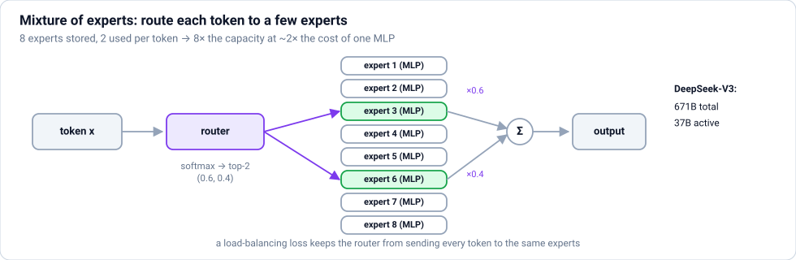

### Theory

> **In simple words:** frontier models in 2026 add three ideas to the transformer. **Mixture of experts (MoE)** replaces each feed-forward block with many expert MLPs and a router that sends each token to just a few, so the model has huge capacity but each token uses a small fraction of it. **Efficient attention** (FlashAttention, sliding windows, grouped queries) cuts attention's memory and time cost for long contexts. **State-space models** (Mamba-style) process sequences in linear time like an RNN, and are often mixed with attention layers in **hybrid** models.

**Words to know:**

- **Mixture of experts (MoE):** a layer with E expert networks and a **router (gate)** that picks the top-k experts per token; the output is the gate-weighted sum of their outputs.
- **Total vs active parameters:** all weights stored vs the weights used per token (e.g. DeepSeek-V3: 671B total, 37B active).
- **Top-k routing:** each token goes to the k highest-scoring experts (k = 1, 2 or 8 of up to 256).
- **Load-balancing loss:** an auxiliary loss that discourages the router from sending everything to a few experts; some models use bias-adjustment instead.
- **Expert parallelism:** placing different experts on different GPUs.
- **Shared expert:** an expert every token always uses, alongside the routed ones (DeepSeek, Qwen MoE).
- **FlashAttention:** an exact attention algorithm that computes in tiles in fast on-chip memory and never stores the full T×T matrix; much faster and lighter.
- **Sliding-window (local) attention:** each token attends only to the last w tokens (cost T·w instead of T²); used in Mistral and Gemma layers.
- **Linear attention:** reformulations whose cost grows linearly with T (approximate, or a different model class).
- **MLA (multi-head latent attention):** compresses keys and values into a small latent vector to shrink the KV cache (DeepSeek).
- **State-space model (SSM):** a sequence layer hₜ = A hₜ₋₁ + B xₜ, yₜ = C hₜ, computable as a recurrence (fast generation) or a convolution (fast training).
- **Mamba (2023):** a **selective** SSM whose A, B, C depend on the input, letting it decide what to remember; linear time and constant memory per token at generation.
- **Hybrid models:** stacks mixing attention layers with SSM/linear-attention layers (Jamba, several 2025 models) for long contexts.

**Everyday picture.** A hospital with 64 specialists: each patient (token) is triaged (router) to the two most relevant doctors instead of seeing all 64. The hospital has enormous combined expertise, but each visit only costs two consultations. An SSM is a doctor who keeps a running summary of the patient's history instead of rereading the entire file at every visit.

**MoE arithmetic, traced:** 8 experts, each an MLP of 2·d·4d = 8d² parameters, top-2 routing, d = 4,096.
Total expert parameters = 8 × 8 × 4,096² ≈ 1.07B per layer; active per token = 2 × 8 × 4,096² ≈ 0.27B. Capacity of an 8-expert model at the per-token cost of a 2-expert one.

**Attention cost vs alternatives (sequence length T, window w, model width d):**

| method | compute | memory per generated token |
|---|---|---|
| full attention | O(T²·d) | KV cache grows with T |
| sliding window | O(T·w·d) | fixed window of w tokens |
| state-space / linear | O(T·d) (×state size) | constant |

**Common mistakes:**

- ❌ Comparing MoE models to dense ones by total parameters only (compare active parameters and quality).
- ❌ Training MoE without load balancing (a few experts get all tokens, the rest learn nothing: "expert collapse").
- ❌ Assuming FlashAttention changes the model's output (it's exact; it changes speed and memory).
- ❌ Expecting pure SSMs to match attention on tasks needing exact recall of earlier tokens (copying, lookup): hybrids exist for this reason.

**Used in real software:** MoE in Mixtral, DeepSeek-V3/R1, Qwen3-MoE, Llama 4 and (reportedly) several closed frontier models; FlashAttention in essentially all training and serving stacks; GQA/MLA to shrink KV caches; Mamba-style layers in hybrid models such as Jamba.

### Python

```python
import torch
from torch import nn

class MoE(nn.Module):
    def __init__(self, d, n_experts=8, k=2):
        super().__init__()
        self.k = k
        self.router = nn.Linear(d, n_experts, bias=False)
        self.experts = nn.ModuleList([nn.Sequential(nn.Linear(d, 4 * d), nn.GELU(), nn.Linear(4 * d, d)) for _ in range(n_experts)])
    def forward(self, x):                                                   # x: (tokens, d)
        probs = self.router(x).softmax(-1)
        weights, chosen = probs.topk(self.k, dim=-1)                        # top-k experts per token
        weights = weights / weights.sum(-1, keepdim=True)
        out = torch.zeros_like(x)
        for e, expert in enumerate(self.experts):
            token_idx, slot = (chosen == e).nonzero(as_tuple=True)          # which tokens picked expert e
            if len(token_idx):
                out[token_idx] += weights[token_idx, slot, None] * expert(x[token_idx])
        importance = probs.mean(0)                                          # load-balancing: average router probability per expert
        load = torch.zeros_like(importance).index_add_(0, chosen.flatten(), torch.ones(chosen.numel())) / chosen.numel()
        aux_loss = len(self.experts) * (importance * load).sum()            # Switch-Transformer-style balance loss (1 when even)
        return out, chosen, aux_loss

torch.manual_seed(0)
d = 64
moe = MoE(d)
tokens = torch.randn(1000, d)
out, chosen, aux = moe(tokens)
expert_params = sum(p.numel() for p in moe.experts.parameters()); per_expert = expert_params // 8
print(f"total expert parameters {expert_params:,} | active per token {2 * per_expert:,} (2 of 8 experts)")
print("tokens routed to each expert:", torch.bincount(chosen.flatten(), minlength=8).tolist(), f"| balance loss {aux.item():.3f} (1.0 = perfectly even)")
print("output shape:", tuple(out.shape))
```

**Output:**

```text
total expert parameters 264,704 | active per token 66,176 (2 of 8 experts)
tokens routed to each expert: [248, 251, 240, 235, 228, 281, 252, 265] | balance loss 1.001 (1.0 = perfectly even)
output shape: (1000, 64)
```

Each token's output comes from only its two chosen experts, so the compute per token is that of two MLPs, while the layer stores eight. This freshly initialised router happens to spread tokens fairly evenly (balance loss ≈ 1.0). During training, routers tend to drift towards a few favourite experts, which then get better and attract even more tokens; the balance loss, added to the training loss with a small weight, counteracts that so every expert keeps learning.

```python
import math, time
import torch.nn.functional as F

T = 2048
q = k = v = torch.randn(1, 8, T, 64)
t0 = time.perf_counter(); full = F.scaled_dot_product_attention(q, k, v, is_causal=True); full_ms = (time.perf_counter() - t0) * 1000
window = 256
idx = torch.arange(T)
local_mask = (idx[None, :] <= idx[:, None]) & (idx[:, None] - idx[None, :] < window)     # causal AND within the last 256 tokens
local = F.scaled_dot_product_attention(q, k, v, attn_mask=local_mask)
print(f"score-matrix entries: full causal {T * (T + 1) // 2:,} | sliding window {int(local_mask.sum()):,} ({local_mask.sum().item() / (T * (T + 1) / 2):.0%})")
print("full attention memory for the scores if materialised (fp16, 8 heads):", f"{8 * T * T * 2 / 1e6:.0f} MB")

def ssm_recurrent(x, a=0.9, b=1.0, c=1.0):                                  # h_t = a·h_{t−1} + b·x_t ; y_t = c·h_t
    h, ys = 0.0, []
    for xt in x:
        h = a * h + b * xt; ys.append(c * h)
    return torch.stack(ys)
def ssm_convolution(x, a=0.9, b=1.0, c=1.0):                               # same thing as a convolution with kernel c·aᵏ·b
    kernel = c * b * a ** torch.arange(len(x)).float()
    return torch.stack([(kernel[:t + 1].flip(0) * x[:t + 1]).sum() for t in range(len(x))])
seq = torch.randn(50)
print("a linear state-space layer computed as a recurrence equals it computed as a convolution:", torch.allclose(ssm_recurrent(seq), ssm_convolution(seq), atol=1e-4))
```

**Output:**

```text
score-matrix entries: full causal 2,098,176 | sliding window 491,648 (23%)
full attention memory for the scores if materialised (fp16, 8 heads): 67 MB
a linear state-space layer computed as a recurrence equals it computed as a convolution: True
```

A sliding window of 256 keeps a fraction of the full causal score matrix at T = 2,048, and the saving grows with length. The state-space example shows the dual view that makes SSMs attractive: train with a parallel convolution over the whole sequence, generate with a cheap recurrence that keeps only a fixed-size state (Mamba makes a, b, c depend on the input, which breaks the simple convolution but keeps a fast parallel scan).

### Practice

1. A model has 64 experts with top-8 routing plus 1 shared expert, each expert 2 × 7,168 × 2,048 parameters. How many expert parameters are active per token per layer?
2. Why does the KV cache of a pure state-space model not grow with the context length?

<details>
<summary><b>Answer</b></summary>

```python
per = 2 * 7168 * 2048
print(f"active: {(8 + 1) * per / 1e6:.0f}M of {(64 + 1) * per / 1e6:.0f}M expert parameters per layer")
```

**Output:**

```text
active: 264M of 1908M expert parameters per layer
```

1. 9 experts × 29.4M ≈ 264M active out of ≈ 1.9B stored per layer (about 14%).
2. It has no KV cache: everything it remembers is compressed into a fixed-size state hₜ updated at each step, so memory per sequence stays constant however long the context (at the cost of exact recall).

</details>

| # | Problem (Deep-ML) | Difficulty |
|---|---|---|
| 1 | [123. Calculate Computational Efficiency of MoE](https://www.deep-ml.com/problems/123) | 🟢 Easy |
| 2 | [229. Sparse MoE Top-K Routing](https://www.deep-ml.com/problems/229) | 🟡 Medium |
| 3 | [389. Mixture of Experts Load Balancing Loss](https://www.deep-ml.com/problems/389) | 🟡 Medium |
| 4 | [388. Sliding Window Attention](https://www.deep-ml.com/problems/388) | 🟡 Medium |
| 5 | [208. Flash Attention v1 - Forward Pass](https://www.deep-ml.com/problems/208) | 🔴 Hard |
| 6 | [405. Multi-Head Latent Attention (MLA)](https://www.deep-ml.com/problems/405) | 🔴 Hard |

**Learn more:** [Fedus et al., Switch Transformers](https://arxiv.org/abs/2101.03961) · [Dao et al., FlashAttention](https://arxiv.org/abs/2205.14135) · [Gu & Dao, Mamba](https://arxiv.org/abs/2312.00752) · [DeepSeek-V3 technical report](https://arxiv.org/abs/2412.19437)

---

## 55. Scaling Laws and How Frontier Models Are Trained


### Theory

> **In simple words:** a remarkable empirical finding: a language model's loss falls **predictably**, as a power law, as you increase model size, data and compute. **Scaling laws** let labs forecast a huge run's result from small runs and choose how to split a compute budget between parameters and training tokens. The "Chinchilla" result (2022) said: for a fixed budget, train a smaller model on more data, about 20 tokens per parameter. Since then, models meant for cheap deployment are trained far beyond that, and new scaling axes (inference-time reasoning, data quality, RL) have appeared.

**Words to know:**

- **Scaling law:** an empirical formula predicting loss from model size N, data D and/or compute C (typically a power law plus a constant).
- **Power law:** L ∝ x^(−α): each doubling of x reduces the reducible loss by the same fraction.
- **Training compute:** C ≈ 6·N·D floating-point operations (2 for the forward, 4 for the backward pass, per parameter per token).
- **FLOP / FLOPs:** a floating-point operation / operations per second (hardware speed); a large GPU delivers ~10¹⁵ dense BF16 FLOPs per second.
- **Compute-optimal (Chinchilla-optimal):** the N and D that minimise loss for a given C; roughly D ≈ 20·N.
- **Irreducible loss (E):** the floor the law approaches with infinite size and data (the inherent entropy of text).
- **Over-training:** training a smaller model on far more tokens than compute-optimal (e.g. 15 trillion tokens for an 8B model) to make it better per parameter, because inference cost depends on N.
- **MFU (model FLOPs utilisation):** the fraction of the hardware's peak FLOPs a training run actually achieves (40–60% is good).
- **Pretraining data mixture:** the proportions of web text, code, books, maths, multilingual data; filtering and deduplication matter as much as size.
- **Emergent abilities:** capabilities that appear to switch on at scale (debated: often smooth when measured with continuous metrics).
- **Test-time (inference-time) compute scaling:** improving answers by spending more computation per question (longer reasoning, sampling several answers and voting), a second scaling axis exploited by reasoning models since 2024.

**Everyday picture.** Baking for a big event with a fixed budget: you can buy a bigger oven (parameters) or more ingredients (data). A giant oven with a handful of ingredients wastes money; so does a tiny oven with a mountain of flour. Scaling laws are the recipe that tells you the best split for each budget.

**Compute, traced:** GPT-3: N = 175B parameters, D = 300B tokens → C ≈ 6 × 175e9 × 300e9 ≈ **3.15 × 10²³ FLOPs**. At 40% utilisation of 1,000 GPUs at 312 TFLOP/s (A100, BF16), that's 3.15e23 / (1,000 × 312e12 × 0.4) ≈ 2.5 million seconds ≈ **29 days**. Chinchilla's rule says that budget would have been better spent on a ~50B-parameter model trained on ~1 trillion tokens.

**How a frontier model is built (2026), step by step:**

1. Data: trillions of tokens of filtered, deduplicated web text, code, books, maths and multilingual data, plus synthetic data.
2. Small-scale runs to fit scaling laws and choose architecture, data mixture and hyperparameters.
3. Pretraining on thousands to tens of thousands of GPUs for weeks to months (BF16/FP8, 3D/4D parallelism, checkpoints, automatic restarts after hardware failures).
4. Mid-training / long-context extension on curated data.
5. Post-training: SFT, preference tuning, RL for reasoning and tool use (Section [43](#43-from-base-model-to-assistant-pretraining-sft-rlhf-and-dpo)).
6. Evaluation, red-teaming and safety testing; distillation into smaller models.

**Common mistakes:**

- ❌ Comparing models by parameter count alone (training tokens, data quality and post-training matter as much).
- ❌ Extrapolating a scaling law far beyond the range it was fitted on.
- ❌ Forgetting inference cost: the compute-optimal training choice is rarely the cheapest model to serve.

**Used in real software:** every frontier lab plans runs with scaling laws; Llama 3 8B (15T tokens, ~1,900 tokens per parameter) is a deliberately over-trained model; reasoning models (OpenAI o-series, DeepSeek-R1, Claude's extended thinking, Gemini thinking models) scale test-time compute.

### Python

```python
import numpy as np
import matplotlib.pyplot as plt

E, A, B, alpha, beta = 1.69, 406.4, 410.7, 0.34, 0.28                       # Chinchilla fit (Hoffmann et al., 2022)
loss = lambda N, D: E + A / N ** alpha + B / D ** beta

print(f"GPT-3 training compute: {6 * 175e9 * 300e9:.2e} FLOPs | days on 1,000 A100s at 40% MFU: {6 * 175e9 * 300e9 / (1000 * 312e12 * 0.4) / 86400:.0f}")
budgets = np.logspace(19, 25, 7)
best = []
for C in budgets:
    N = np.logspace(7, 13, 4000); D = C / (6 * N)                           # every split of the budget
    i = np.argmin(loss(N, D))
    best.append((C, N[i], D[i], loss(N[i], D[i])))
    print(f"compute {C:.0e}: best N = {N[i]:.2e} params, D = {D[i]:.2e} tokens ({D[i] / N[i]:.0f} tokens/param), predicted loss {loss(N[i], D[i]):.3f}")

for name, N, D in [("GPT-3 175B, 300B tokens", 175e9, 300e9), ("Chinchilla 70B, 1.4T tokens", 70e9, 1.4e12), ("Llama-3-style 8B, 15T tokens", 8e9, 15e12)]:
    print(f"{name:30s} compute {6 * N * D:.1e} | predicted loss {loss(N, D):.3f}")

fig, ax = plt.subplots(figsize=(6.5, 3.4), layout="constrained")
C, Nb, Db, Lb = zip(*best)
ax.plot(C, Lb, "o-"); ax.axhline(E, ls=":", color="gray", label="irreducible loss E = 1.69")
ax.set(xscale="log", xlabel="training compute (FLOPs)", ylabel="predicted loss", title="Chinchilla scaling law, compute-optimal models"); ax.legend()
fig.savefig("scaling-laws.png", dpi=100)
plt.close(fig)
```

**Output:**

```text
GPT-3 training compute: 3.15e+23 FLOPs | days on 1,000 A100s at 40% MFU: 29
compute 1e+19: best N = 2.28e+08 params, D = 7.31e+09 tokens (32 tokens/param), predicted loss 2.986
compute 1e+20: best N = 6.45e+08 params, D = 2.58e+10 tokens (40 tokens/param), predicted loss 2.600
compute 1e+21: best N = 1.82e+09 params, D = 9.14e+10 tokens (50 tokens/param), predicted loss 2.329
compute 1e+22: best N = 5.16e+09 params, D = 3.23e+11 tokens (63 tokens/param), predicted loss 2.139
compute 1e+23: best N = 1.46e+10 params, D = 1.14e+12 tokens (78 tokens/param), predicted loss 2.005
compute 1e+24: best N = 4.13e+10 params, D = 4.04e+12 tokens (98 tokens/param), predicted loss 1.911
compute 1e+25: best N = 1.17e+11 params, D = 1.43e+13 tokens (122 tokens/param), predicted loss 1.845
GPT-3 175B, 300B tokens        compute 3.2e+23 | predicted loss 2.002
Chinchilla 70B, 1.4T tokens    compute 5.9e+23 | predicted loss 1.937
Llama-3-style 8B, 15T tokens   compute 7.2e+23 | predicted loss 1.949
```

The fitted law says each 10× more compute lowers the reducible part of the loss by a steady fraction, and that the best model size and token count grow together. This particular formula (the paper's parametric fit) puts the optimum at about 30–120 tokens per parameter; the paper's two other methods gave about 20, which became the famous rule of thumb. Fits disagree in detail but agree on the shape: grow data along with parameters. GPT-3 was "under-trained" by this measure: with less than twice its compute, Chinchilla (2.5× smaller, trained on almost 5× more tokens) reaches a clearly lower predicted loss. A Llama-3-style 8B model on 15T tokens uses about twice GPT-3's compute and is predicted to beat it, while being 20× smaller to run, which is why modern small models are heavily over-trained.

```python
rng = np.random.default_rng(0)
p_correct = 0.6                                                              # a model answers a question correctly 60% of the time
for n_samples in (1, 5, 11, 25):
    votes = rng.random((20_000, n_samples)) < p_correct                     # wrong answers assumed to be spread over many options
    majority_right = votes.sum(1) > n_samples / 2
    print(f"{n_samples:2d} samples per question, majority vote accuracy: {majority_right.mean():.3f}")
```

**Output:**

```text
 1 samples per question, majority vote accuracy: 0.597
 5 samples per question, majority vote accuracy: 0.682
11 samples per question, majority vote accuracy: 0.758
25 samples per question, majority vote accuracy: 0.846
```

A toy version of test-time scaling: if each attempt is right 60% of the time and wrong answers disagree with each other, sampling several answers and taking the majority raises accuracy sharply, at the cost of more inference compute per question. Reasoning models push this much further by learning to think longer before answering.

### Practice

1. How many FLOPs does training an 8B model on 15T tokens take? How many days on 16,000 GPUs at 400 TFLOP/s effective each?
2. Using the law, which predicts a lower loss: a 1B model on 1T tokens, or a 10B model on 100B tokens? Which is cheaper to train?

<details>
<summary><b>Answer</b></summary>

```python
C = 6 * 8e9 * 15e12
print(f"{C:.1e} FLOPs, {C / (16000 * 400e12) / 86400:.1f} days")
print(f"1B/1T: loss {loss(1e9, 1e12):.3f}, compute {6 * 1e9 * 1e12:.0e} | 10B/100B: loss {loss(10e9, 100e9):.3f}, compute {6 * 10e9 * 100e9:.0e}")
```

**Output:**

```text
7.2e+23 FLOPs, 1.3 days
1B/1T: loss 2.223, compute 6e+21 | 10B/100B: loss 2.193, compute 6e+21
```

1. 7.2 × 10²³ FLOPs, roughly 1.3 days on 16,000 GPUs (real runs take longer: utilisation is lower, and the cluster also serves experiments and recovers from failures).
2. They use the same compute (6 × 10²¹). Here the 10B model on 100B tokens gets a slightly lower predicted loss (2.19 vs 2.22): at this budget the optimum lies between the two (about 2–5B parameters, from the table above), and 1,000 tokens per parameter overshoots more than 10 undershoots. But the 1B model is 10× cheaper to serve for its whole life, which is why teams often accept a slightly worse loss to get a much smaller model.

</details>

| # | Practice | Difficulty |
|---|---|---|
| 1 | [Deep-ML 123. Calculate Computational Efficiency of MoE](https://www.deep-ml.com/problems/123) | 🟢 Easy |
| 2 | [Deep-ML 320. Calculate Perplexity for Language Models](https://www.deep-ml.com/problems/320) | 🟢 Easy |

**Learn more:** [Kaplan et al., Scaling Laws for Neural Language Models](https://arxiv.org/abs/2001.08361) · [Hoffmann et al., Training Compute-Optimal Large Language Models (Chinchilla)](https://arxiv.org/abs/2203.15556) · [Llama 3 paper (The Llama 3 Herd of Models)](https://arxiv.org/abs/2407.21783) · [Epoch AI: trends in machine learning](https://epoch.ai/trends)

---

## 56. What's New in Deep Learning (2023–2026)

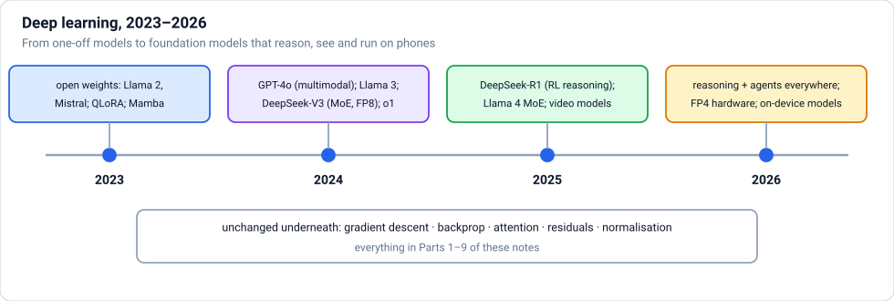

### Theory

> **In simple words:** between 2023 and 2026, deep learning's centre of gravity became the **foundation model**: one big pretrained transformer adapted to many tasks. The biggest shifts: open-weight models became competitive with closed ones; **mixture of experts** went mainstream; **reasoning models** trained with reinforcement learning learned to "think" before answering; models became **natively multimodal** (text, images, audio, video in and out); video generation became practical; training moved to **FP8** (and FP4 hardware arrived); and capable **small models** started running on laptops and phones.

**Words to know:**

- **Open-weight model:** a model whose weights are downloadable (Llama, Mistral, Qwen, DeepSeek, Gemma), though training data and code may not be.
- **Reasoning model:** an LLM trained (often with reinforcement learning on verifiable problems) to produce a long internal chain of thought before its final answer (OpenAI o-series, DeepSeek-R1, Claude extended thinking, Gemini thinking).
- **Chain of thought (CoT):** intermediate reasoning steps written out before the answer.
- **Natively multimodal model:** one model that accepts and produces several modalities (GPT-4o, Gemini), rather than separate models glued together.
- **Long context:** context windows of hundreds of thousands to millions of tokens, enabled by RoPE scaling, efficient attention and better training.
- **Synthetic data:** training data generated by models (instructions, reasoning traces, code with tests), now a major part of post-training.
- **Distilled small models:** small models trained on the outputs of large ones (DeepSeek-R1 distills, Llama 3.2 1B/3B, Gemma, Phi), good enough for on-device use.
- **Agents:** LLMs that plan and call tools in loops (`rag-and-agents.md`).
- **Video generation:** diffusion/flow transformers over spatio-temporal latents (Sora, Veo, Kling, open models).
- **World models:** models that learn to predict how an environment evolves (video-based simulators for robotics and games).
- **Mechanistic interpretability:** reverse-engineering what networks compute (features, circuits; sparse autoencoders on model activations).

**Everyday picture.** In 2015 every company built its own small specialised machines; by 2026 most use a few giant general-purpose engines and tune them for their job, while the engines keep getting smarter, cheaper and small enough to carry in a pocket.

**The shifts, summarised:**

| Area | 2022 | 2026 |
|---|---|---|
| best models | closed only | closed and open-weight near each other |
| architecture | dense transformers | MoE + GQA/MLA + long context; some SSM hybrids |
| post-training | SFT + RLHF | SFT + DPO-style preference tuning + RL for reasoning and tools |
| inference | one answer per call | test-time compute: reasoning, sampling, verification |
| modalities | text, separate image models | native multimodal in and out, including video |
| precision | BF16 | FP8 training common, FP4 hardware |
| deployment | data-centre GPUs | also laptops and phones (4-bit, MLX, ExecuTorch) |
| generative images | latent diffusion U-Nets | diffusion/flow transformers, few-step distilled samplers |

**What hasn't changed:** the fundamentals in Parts 1–9. Every one of these systems is trained with mini-batch gradient descent and backpropagation, uses attention, residual connections and normalisation, and is evaluated on held-out data. New papers mostly recombine the pieces you now understand.

**Common mistakes:**

- ❌ Chasing every new model announcement instead of evaluating on your own task.
- ❌ Assuming the largest model is needed (small fine-tuned or distilled models are often enough and far cheaper).
- ❌ Trusting benchmark scores alone (contamination, and benchmarks rarely match your use case).

**Used in real software:** coding assistants, chat assistants and search answers built on reasoning LLMs; on-device features (Apple Intelligence, Gemini Nano); open models fine-tuned for company tasks; video generation in creative tools; vision-language models reading documents and screens.

### Python

```python
import torch
from transformers import AutoTokenizer

for name in ["openai-community/gpt2", "Qwen/Qwen2.5-0.5B-Instruct"]:
    tok = AutoTokenizer.from_pretrained(name)
    text = "Deep learning in 2026: अंग्रेज़ी से आगे, 多语言模型, and code like `def f(x): return x**2`."
    print(f"{name:28s} vocabulary {len(tok):,} | tokens for a mixed-language sentence: {len(tok(text)['input_ids'])}")

model_eras = [("GPT-3 (2020)", 175e9, 175e9, 3e11), ("Llama 3.1 405B (2024)", 405e9, 405e9, 1.56e13),
              ("DeepSeek-V3 (2024)", 671e9, 37e9, 1.48e13)]
print(f"{'model':24s} {'total params':>13s} {'active':>8s} {'tokens':>8s} {'train FLOPs':>12s}")
for name, total, active, tokens in model_eras:
    print(f"{name:24s} {total:13.1e} {active:8.0e} {tokens:8.0e} {6 * active * tokens:12.1e}")
```

**Output:**

```text
openai-community/gpt2        vocabulary 50,257 | tokens for a mixed-language sentence: 63
Qwen/Qwen2.5-0.5B-Instruct   vocabulary 151,665 | tokens for a mixed-language sentence: 44
model                     total params   active   tokens  train FLOPs
GPT-3 (2020)                   1.8e+11    2e+11    3e+11      3.2e+23
Llama 3.1 405B (2024)          4.0e+11    4e+11    2e+13      3.8e+25
DeepSeek-V3 (2024)             6.7e+11    4e+10    1e+13      3.3e+24
```

Newer tokenizers have much larger vocabularies with better multilingual and code coverage, so the same mixed-language sentence costs fewer tokens. And the table shows two trends of the period: training tokens grew far faster than parameters, and mixture-of-experts models like DeepSeek-V3 decoupled total parameters (capacity) from active parameters (cost per token), so a model with more parameters than Llama 3.1 405B could be trained with far less compute.

### Practice

1. Which ideas from these notes does a 2026 reasoning model use? List at least six with their section numbers.
2. Pick one recent model announcement and find, in its technical report, its parameter count (total and active), training tokens, context length and post-training methods.

<details>
<summary><b>Answer</b></summary>

1. Tokenisation (Section 29), embeddings (30), causal multi-head attention with RoPE and GQA (33–34), pre-norm transformer blocks with RMSNorm and SwiGLU (35), mixture of experts (54), mixed precision and distributed training (49–50), SFT, preference tuning and RL with verifiable rewards (43), sampling and KV caching at inference (38), quantisation and speculative decoding for serving (51, 53).
2. Technical reports (Llama 3, DeepSeek-V3, Qwen3, Gemma 3) usually list all of these in their first pages; reading them with these notes as a map is excellent practice.

</details>

| # | Practice | Difficulty |
|---|---|---|
| 1 | [Deep-ML 405. Multi-Head Latent Attention (MLA)](https://www.deep-ml.com/problems/405) | 🔴 Hard |
| 2 | [Deep-ML 409. MoE with Shared Expert Forward Pass](https://www.deep-ml.com/problems/409) | 🟡 Medium |

**Learn more:** [DeepSeek-R1 paper](https://arxiv.org/abs/2501.12948) · [Sebastian Raschka: the big LLM architecture comparison](https://magazine.sebastianraschka.com/p/the-big-llm-architecture-comparison) · [Stanford AI Index report](https://hai.stanford.edu/ai-index) · [Hugging Face: open LLM models and papers](https://huggingface.co/papers)

---

### ✅ Part 10 checkpoint

Without looking, can you:

- [ ] Explain FP32, FP16, BF16 and FP8 by range and precision, and how autocast and loss scaling work?
- [ ] Show that gradient accumulation and data parallelism reproduce the full-batch gradient, and size memory for DDP vs FSDP?
- [ ] Quantise a tensor to INT8/INT4 with absmax and per-group scales, and measure the accuracy impact?
- [ ] Distil a student from a teacher with temperature-softened targets, and prune by magnitude?
- [ ] Speed up inference with compilation, ONNX, batching and speculative decoding, and explain when each helps?
- [ ] Explain MoE routing, efficient attention and state-space models?
- [ ] Use a scaling law to choose model size and tokens for a compute budget, and estimate training FLOPs?

Part 11 is interview preparation: building blocks from scratch, what companies ask, a cheat sheet, the most-asked questions and the glossary.

---

# Part 11 — Interview Prep

> **Goal:** Implement the core building blocks from scratch under interview conditions, know what deep-learning interviews cover, revise fast with a cheat sheet, and answer the most-asked theory questions.  
> **You need:** Parts 1–10 (Parts 1–7 cover most interviews).

---

## 57. Interview Coding: Deep-Learning Building Blocks from Scratch

### Theory

> **In simple words:** deep-learning coding interviews ask you to implement a building block in NumPy or plain PyTorch in 20–40 minutes: a layer's forward and backward pass, softmax with cross-entropy, attention with a mask, a normalisation layer, an optimiser step, a convolution, a sampling function. They check that you understand **shapes, numerical stability and gradients**, not that you remember library calls. Every implementation below is checked against PyTorch.

**Words to know:**

- **im2col:** rearranging image patches into columns so a convolution becomes one matrix multiplication (how many libraries implement it).
- **Running statistics:** BatchNorm's moving averages used at inference (Section [21](#21-normalisation-layers-batchnorm-layernorm-and-rmsnorm)).
- **Fused softmax–cross-entropy gradient:** (softmax(z) − onehot(y)) / N (Section [10](#10-backpropagation-from-scratch-in-numpy)).
- **Masking with −∞:** setting disallowed attention scores to −∞ (or a very negative number) before softmax.
- **Shape contract:** writing the input and output shapes of a function before its body; the fastest way to avoid bugs under pressure.

**Everyday picture.** A piano exam: anyone can play a recording (call a library); the examiner wants to hear scales and arpeggios played by hand, cleanly and at tempo. These blocks are the scales of deep learning.

**How to approach it in the interview:**

1. State the shapes: input (N, D), weights (D, H), output (N, H).
2. Write the forward pass; mention numerical stability (subtract the max, add ε).
3. If asked, derive the backward pass from the chain rule, keeping every gradient the shape of its variable.
4. Test on a tiny example; compare with a numerical gradient or a library if allowed.
5. Discuss complexity and edge cases (padding masks, batch size 1, very long sequences).

| Block | Forward | Backward / key fact | Complexity |
|---|---|---|---|
| linear | Y = X W + b | dX = dY Wᵀ, dW = Xᵀ dY, db = Σ dY | O(N·D·H) |
| ReLU | max(0, x) | dx = dy · (x > 0) | O(n) |
| softmax + CE | p = softmax(z), L = −mean log p_y | dz = (p − onehot) / N | O(N·C) |
| attention | softmax(QKᵀ/√d + mask) V | memory O(T²) | O(T²·d) |
| BatchNorm / LayerNorm | normalise over batch / over features | running stats only in BatchNorm | O(n) |
| conv2d | sliding dot products (or im2col + matmul) | output size (n + 2p − k)/s + 1 | O(N·C_out·H·W·C_in·k²) |
| Adam | m, v moving averages, bias-corrected | step ≈ lr regardless of scale | O(params) |

**Common mistakes:**

- ❌ Softmax without subtracting the max (overflow).
- ❌ Gradients with the wrong shape (always check dW.shape == W.shape).
- ❌ Forgetting the 1/N in gradients or the √d in attention.
- ❌ BatchNorm using batch statistics at inference.
- ❌ Python loops over the batch where broadcasting works.

**Used in real software:** these are the kernels inside PyTorch, JAX and every inference engine; implementing them by hand is also how custom fused GPU kernels (Triton, CUDA) are written.

### Python

```python
import numpy as np
import torch
import torch.nn.functional as F

rng = np.random.default_rng(0)
t = lambda a: torch.tensor(a, dtype=torch.float64)

# 1. linear layer + softmax cross-entropy, forward and backward
X, W, b = rng.normal(size=(4, 5)), rng.normal(size=(5, 3)), rng.normal(size=3)
y = np.array([0, 2, 1, 2])
def softmax(z):
    z = z - z.max(-1, keepdims=True); e = np.exp(z); return e / e.sum(-1, keepdims=True)
Z = X @ W + b; P = softmax(Z)
loss = -np.log(P[np.arange(4), y]).mean()
dZ = P.copy(); dZ[np.arange(4), y] -= 1; dZ /= 4
dW, db, dX = X.T @ dZ, dZ.sum(0), dZ @ W.T
Xt, Wt, bt = t(X).requires_grad_(), t(W).requires_grad_(), t(b).requires_grad_()
F.cross_entropy(Xt @ Wt + bt, torch.tensor(y)).backward()
print("linear + CE: loss", round(loss, 4), "| grads match PyTorch:", all(np.allclose(a, b_.grad.numpy()) for a, b_ in [(dW, Wt), (db, bt), (dX, Xt)]))

# 2. scaled dot-product attention with a causal mask
def attention(Q, K, V, causal=True):
    s = Q @ K.swapaxes(-1, -2) / np.sqrt(Q.shape[-1])
    if causal:
        s = np.where(np.triu(np.ones(s.shape[-2:], dtype=bool), 1), -np.inf, s)
    return softmax(s) @ V
Q, K, V = (rng.normal(size=(2, 6, 8)) for _ in range(3))
print("causal attention matches F.scaled_dot_product_attention:",
      np.allclose(attention(Q, K, V), F.scaled_dot_product_attention(t(Q), t(K), t(V), is_causal=True).numpy()))

# 3. LayerNorm and BatchNorm (training mode)
x = rng.normal(size=(8, 16)); g, beta = rng.normal(size=16), rng.normal(size=16)
ln = (x - x.mean(-1, keepdims=True)) / np.sqrt(x.var(-1, keepdims=True) + 1e-5) * g + beta
bn = (x - x.mean(0)) / np.sqrt(x.var(0) + 1e-5) * g + beta
print("LayerNorm matches:", np.allclose(ln, F.layer_norm(t(x), (16,), t(g), t(beta)).numpy()),
      "| BatchNorm matches:", np.allclose(bn, F.batch_norm(t(x), None, None, t(g), t(beta), training=True).numpy()))
```

**Output:**

```text
linear + CE: loss 1.3796 | grads match PyTorch: True
causal attention matches F.scaled_dot_product_attention: True
LayerNorm matches: True | BatchNorm matches: True
```

```python
# 4. conv2d via im2col (stride 1, no padding)
def conv2d_im2col(x, w):                                                  # x: (C, H, W), w: (C_out, C, k, k)
    C, H, Wd = x.shape; c_out, _, k, _ = w.shape
    oh, ow = H - k + 1, Wd - k + 1
    cols = np.stack([x[:, i:i + k, j:j + k].ravel() for i in range(oh) for j in range(ow)], 1)   # (C·k·k, oh·ow)
    return (w.reshape(c_out, -1) @ cols).reshape(c_out, oh, ow)
img, kern = rng.normal(size=(3, 7, 7)), rng.normal(size=(4, 3, 3, 3))
print("im2col conv matches F.conv2d:", np.allclose(conv2d_im2col(img, kern), F.conv2d(t(img)[None], t(kern))[0].numpy()))

# 5. one Adam step
def adam_step(w, grad, m, v, step, lr=1e-3, b1=0.9, b2=0.999, eps=1e-8):
    m = b1 * m + (1 - b1) * grad; v = b2 * v + (1 - b2) * grad ** 2
    w = w - lr * (m / (1 - b1 ** step)) / (np.sqrt(v / (1 - b2 ** step)) + eps)
    return w, m, v
w0, gr = rng.normal(size=5), rng.normal(size=5)
mine, _, _ = adam_step(w0.copy(), gr, np.zeros(5), np.zeros(5), 1)
p = torch.nn.Parameter(t(w0.copy())); opt = torch.optim.Adam([p], lr=1e-3); p.grad = t(gr); opt.step()
print("Adam step matches torch.optim.Adam:", np.allclose(mine, p.detach().numpy()))

# 6. dropout (inverted) and top-p sampling
def dropout(x, p, rng):
    mask = rng.random(x.shape) >= p
    return x * mask / (1 - p)
print("dropout keeps the mean:", round(dropout(np.ones(100_000), 0.3, rng).mean(), 2))
def top_p_sample(logits, p, rng):
    probs = softmax(logits); order = np.argsort(-probs)
    keep = order[: np.searchsorted(np.cumsum(probs[order]), p) + 1]
    return rng.choice(keep, p=probs[keep] / probs[keep].sum())
draws = [top_p_sample(np.array([2.0, 1.0, 0.0, -1.0]), 0.85, rng) for _ in range(2000)]
print("top-p 0.85 draws only from tokens:", sorted(int(d) for d in set(draws)), "with frequencies", (np.bincount(draws, minlength=4) / 2000).round(3).tolist())
```

**Output:**

```text
im2col conv matches F.conv2d: True
Adam step matches torch.optim.Adam: True
dropout keeps the mean: 1.0
top-p 0.85 draws only from tokens: [0, 1] with frequencies [0.739, 0.261, 0.0, 0.0]
```

Each block matches PyTorch exactly (in double precision): the linear layer's three gradients, causal attention, both normalisations, an im2col convolution, an Adam step. Inverted dropout preserves the expected value, and top-p sampling only ever draws from the nucleus (tokens 0 and 1 here, in proportion 0.73 : 0.27).

### Practice

1. Implement the backward pass of LayerNorm with respect to its input (hint: it's easiest with autograd-style intermediate variables) and check it numerically.
2. Write multi-head attention by reshaping (N, T, D) into (N, h, T, D/h), calling `attention`, and reshaping back. Check it against `F.scaled_dot_product_attention` on the reshaped tensors.

<details>
<summary><b>Answer</b></summary>

```python
def layernorm_backward(x, dy, eps=1e-5):                                   # without γ, β
    mu, var = x.mean(-1, keepdims=True), x.var(-1, keepdims=True)
    xhat = (x - mu) / np.sqrt(var + eps); D = x.shape[-1]
    return (dy - dy.mean(-1, keepdims=True) - xhat * (dy * xhat).mean(-1, keepdims=True)) / np.sqrt(var + eps)
x = rng.normal(size=(3, 6)); dy = rng.normal(size=(3, 6))
xt = t(x).requires_grad_(); (F.layer_norm(xt, (6,)) * t(dy)).sum().backward()
print("LayerNorm backward matches autograd:", np.allclose(layernorm_backward(x, dy), xt.grad.numpy()))

N, T, D, h = 2, 5, 16, 4
Xm = rng.normal(size=(N, T, D))
split = lambda a: a.reshape(N, T, h, D // h).transpose(0, 2, 1, 3)
out = attention(split(Xm), split(Xm), split(Xm)).transpose(0, 2, 1, 3).reshape(N, T, D)
ref = F.scaled_dot_product_attention(*(t(split(Xm)) for _ in range(3)), is_causal=True).permute(0, 2, 1, 3).reshape(N, T, D)
print("multi-head (no projections) matches:", np.allclose(out, ref.numpy()))
```

**Output:**

```text
LayerNorm backward matches autograd: True
multi-head (no projections) matches: True
```

1. The formula is the standard compact form: subtract the mean of the upstream gradient and the component along the normalised input, then divide by the standard deviation.
2. Heads are just a reshape: split the last dimension, move the head axis before time, attend, and undo the reshape (real layers also apply Q/K/V and output projections).

</details>

| # | Problem (Deep-ML) | Difficulty |
|---|---|---|
| 1 | [23. Softmax Activation Function Implementation](https://www.deep-ml.com/problems/23) | 🟢 Easy |
| 2 | [134. Compute Multi-class Cross-Entropy Loss](https://www.deep-ml.com/problems/134) | 🟢 Easy |
| 3 | [372. Implement RMSNorm (Root Mean Square Layer Normalization)](https://www.deep-ml.com/problems/372) | 🟢 Easy |
| 4 | [40. Implementing a Custom Dense Layer in Python](https://www.deep-ml.com/problems/40) | 🔴 Hard |
| 5 | [41. Simple Convolutional 2D Layer](https://www.deep-ml.com/problems/41) | 🟡 Medium |
| 6 | [49. Implement Adam Optimization Algorithm](https://www.deep-ml.com/problems/49) | 🟡 Medium |
| 7 | [107. Implement Masked Self-Attention](https://www.deep-ml.com/problems/107) | 🟡 Medium |
| 8 | [94. Implement Multi-Head Attention](https://www.deep-ml.com/problems/94) | 🔴 Hard |
| 9 | [115. Implement Batch Normalization for BCHW Input](https://www.deep-ml.com/problems/115) | 🟡 Medium |
| 10 | [151. Dropout Layer](https://www.deep-ml.com/problems/151) | 🟡 Medium |
| 11 | [59. Implement Long Short-Term Memory (LSTM) Network](https://www.deep-ml.com/problems/59) | 🟡 Medium |
| 12 | [383. Top-p (Nucleus) Sampling](https://www.deep-ml.com/problems/383) | 🟡 Medium |
| 13 | [376. KV Cache for Efficient Autoregressive Attention](https://www.deep-ml.com/problems/376) | 🟡 Medium |
| 14 | [222. LoRA: Low-Rank Adaptation Forward Pass](https://www.deep-ml.com/problems/222) | 🟡 Medium |
| 15 | [130. Implement a Simple CNN Training Function with Backpropagation](https://www.deep-ml.com/problems/130) | 🔴 Hard |

**Learn more:** [Deep-ML problem list](https://www.deep-ml.com/problems) · [Andrej Karpathy: Neural Networks: Zero to Hero](https://karpathy.ai/zero-to-hero.html) · [Stanford CS231n assignments](https://cs231n.github.io/)

---

## 58. Interview Topic Checklist: What Companies Ask (Deep Learning)

### Theory

Deep-learning, applied-scientist, ML-engineer (DL) and research-engineer interviews usually combine these rounds:

| Round | What happens | Tested in these notes |
|---|---|---|
| **DL fundamentals** | rapid questions: backprop, activations, initialisation, normalisation, optimisers, overfitting | Parts 1–4; Section [60](#60-most-asked-deep-learning-theory-questions) |
| **Coding from scratch** | implement a layer, attention, a loss or an optimiser in NumPy/PyTorch | Section [57](#57-interview-coding-deep-learning-building-blocks-from-scratch) |
| **Architecture deep dive** | explain CNNs, transformers, attention variants, positional encodings, MoE; count parameters and FLOPs | Parts 5–7, 10 |
| **Training and debugging** | "the loss is NaN / flat / diverging, what do you do?" | Sections [18](#18-weight-initialisation-and-vanishing-or-exploding-gradients)–[23](#23-debugging-training-overfit-one-batch-loss-curves-and-gradient-checks) |
| **LLM-specific** | tokenisation, decoding, KV cache, fine-tuning, LoRA, RLHF/DPO, quantisation, serving | Parts 6–8, 10 |
| **ML system design** | design a model-serving or training system with numbers | Sections [50](#50-training-bigger-models-gradient-accumulation-checkpointing-and-distributed-training)–[53](#53-fast-inference-and-deployment-torchcompile-onnx-batching-and-speculative-decoding); `machine-learning.md` Section 56 |
| **Project / paper discussion** | explain one of your projects or a recent paper in depth | Section [56](#56-whats-new-in-deep-learning-20232026) |

Applied ML roles add `machine-learning.md`; LLM application roles add `llm-engineering.md` and `rag-and-agents.md`.

**Priority:** ⭐⭐⭐ appears in almost every loop; ⭐⭐ is common; ⭐ is occasional but separates strong candidates.

| Topic | Priority | Study | Must-do problems |
|---|---|---|---|
| Neurons, activations, MLPs | ⭐⭐⭐ | [4](#4-the-artificial-neuron-weights-bias-and-a-decision)–[6](#6-layers-and-the-forward-pass-the-multilayer-perceptron) | [Deep-ML 24. Single Neuron](https://www.deep-ml.com/problems/24) · [Deep-ML 42. ReLU](https://www.deep-ml.com/problems/42) · [Deep-ML 147. GeLU](https://www.deep-ml.com/problems/147) · [Deep-ML 371. Parameter Count](https://www.deep-ml.com/problems/371) |
| Losses and softmax | ⭐⭐⭐ | [7](#7-loss-functions-for-neural-networks-mse-cross-entropy-and-logits) | [Deep-ML 23. Softmax](https://www.deep-ml.com/problems/23) · [Deep-ML 39. Log Softmax](https://www.deep-ml.com/problems/39) · [Deep-ML 134. Cross-Entropy](https://www.deep-ml.com/problems/134) · [Deep-ML 263. Binary Cross-Entropy](https://www.deep-ml.com/problems/263) |
| Backprop and autograd | ⭐⭐⭐ | [9](#9-the-chain-rule-and-computational-graphs)–[11](#11-build-a-tiny-autograd-engine) | [Deep-ML 25. Neuron with Backprop](https://www.deep-ml.com/problems/25) · [Deep-ML 26. Autograd](https://www.deep-ml.com/problems/26) · [Deep-ML 220. Cross-Entropy Gradient](https://www.deep-ml.com/problems/220) · [Deep-ML 313. Gradient Checking](https://www.deep-ml.com/problems/313) |
| PyTorch fluency | ⭐⭐⭐ | [12](#12-pytorch-tensors-creating-indexing-broadcasting-and-devices)–[17](#17-saving-loading-and-checkpointing) | write a full training loop from memory; explain `zero_grad`, `eval`, `no_grad` |
| Initialisation, optimisers, schedules | ⭐⭐⭐ | [18](#18-weight-initialisation-and-vanishing-or-exploding-gradients)–[20](#20-learning-rate-schedules-warm-up-step-cosine-and-one-cycle) | [Deep-ML 290. He Init](https://www.deep-ml.com/problems/290) · [Deep-ML 146. Momentum](https://www.deep-ml.com/problems/146) · [Deep-ML 87. Adam](https://www.deep-ml.com/problems/87) · [Deep-ML 169. AdamW](https://www.deep-ml.com/problems/169) · [Deep-ML 196. Warmup + Cosine](https://www.deep-ml.com/problems/196) |
| Normalisation and regularisation | ⭐⭐⭐ | [21](#21-normalisation-layers-batchnorm-layernorm-and-rmsnorm), [22](#22-regularisation-weight-decay-dropout-early-stopping-and-augmentation) | [Deep-ML 115. BatchNorm](https://www.deep-ml.com/problems/115) · [Deep-ML 372. RMSNorm](https://www.deep-ml.com/problems/372) · [Deep-ML 151. Dropout](https://www.deep-ml.com/problems/151) |
| Debugging training | ⭐⭐⭐ | [23](#23-debugging-training-overfit-one-batch-loss-curves-and-gradient-checks) | explain the overfit-one-batch test and how to read loss curves |
| CNNs and ResNet | ⭐⭐ | [24](#24-convolutions-from-scratch-kernels-stride-padding-and-channels)–[27](#27-transfer-learning-with-pretrained-vision-models) | [Deep-ML 41. Conv2D](https://www.deep-ml.com/problems/41) · [Deep-ML 114. Global Avg Pooling](https://www.deep-ml.com/problems/114) · [Deep-ML 113. Residual Block](https://www.deep-ml.com/problems/113) |
| Detection basics | ⭐ | [28](#28-object-detection-and-segmentation) | [Deep-ML 242. NMS](https://www.deep-ml.com/problems/242) · [Deep-ML 72. Jaccard](https://www.deep-ml.com/problems/72) |
| Tokenisation and embeddings | ⭐⭐ | [29](#29-tokenisation-characters-words-and-subwords-bpe), [30](#30-embeddings-turning-tokens-into-vectors) | [Deep-ML 380. BPE](https://www.deep-ml.com/problems/380) · [Deep-ML 76. Cosine Similarity](https://www.deep-ml.com/problems/76) |
| RNNs and LSTMs | ⭐⭐ | [31](#31-recurrent-neural-networks-rnn-lstm-and-gru) | [Deep-ML 54. RNN](https://www.deep-ml.com/problems/54) · [Deep-ML 59. LSTM](https://www.deep-ml.com/problems/59) · [Deep-ML 287. GRU Cell](https://www.deep-ml.com/problems/287) |
| Attention and transformers | ⭐⭐⭐ | [33](#33-self-attention-from-scratch-queries-keys-and-values)–[36](#36-build-a-tiny-gpt-from-scratch) | [Deep-ML 53. Self-Attention](https://www.deep-ml.com/problems/53) · [Deep-ML 107. Masked Attention](https://www.deep-ml.com/problems/107) · [Deep-ML 94. Multi-Head](https://www.deep-ml.com/problems/94) · [Deep-ML 381. RoPE](https://www.deep-ml.com/problems/381) · [Deep-ML 391. GQA](https://www.deep-ml.com/problems/391) |
| Decoding and KV cache | ⭐⭐⭐ | [38](#38-generating-text-greedy-beam-search-temperature-top-k-top-p-and-the-kv-cache) | [Deep-ML 383. Top-p](https://www.deep-ml.com/problems/383) · [Deep-ML 376. KV Cache](https://www.deep-ml.com/problems/376) · [Deep-ML 320. Perplexity](https://www.deep-ml.com/problems/320) |
| Fine-tuning, LoRA, alignment | ⭐⭐⭐ | [40](#40-hugging-face-the-hub-tokenizers-models-and-pipelines)–[43](#43-from-base-model-to-assistant-pretraining-sft-rlhf-and-dpo) | [Deep-ML 222. LoRA](https://www.deep-ml.com/problems/222) · [Deep-ML 382. DPO Loss](https://www.deep-ml.com/problems/382) · [Deep-ML 322. Bradley-Terry](https://www.deep-ml.com/problems/322) |
| Contrastive learning, embeddings | ⭐⭐ | [39](#39-vision-transformers-and-clip-transformers-beyond-text), [44](#44-embeddings-and-contrastive-learning-sentence-embeddings-simclr-and-clip-loss) | [Deep-ML 384. InfoNCE](https://www.deep-ml.com/problems/384) · [Deep-ML 387. Triplet Loss](https://www.deep-ml.com/problems/387) |
| Generative models | ⭐⭐ | [45](#45-autoencoders-and-variational-autoencoders-vaes)–[48](#48-latent-diffusion-guidance-and-modern-image-and-video-generators) | [Deep-ML 393. VAE Loss](https://www.deep-ml.com/problems/393) · [Deep-ML 303. Forward Diffusion](https://www.deep-ml.com/problems/303) · [Deep-ML 396. DDPM Step](https://www.deep-ml.com/problems/396) · [Deep-ML 397. CFG](https://www.deep-ml.com/problems/397) |
| Efficiency: precision, quantisation, distillation | ⭐⭐ | [49](#49-number-formats-and-mixed-precision-fp32-fp16-bf16-and-fp8)–[52](#52-knowledge-distillation-and-pruning) | [Deep-ML 294. INT8](https://www.deep-ml.com/problems/294) · [Deep-ML 428. Number Formats](https://www.deep-ml.com/problems/428) · [Deep-ML 227. Distillation Loss](https://www.deep-ml.com/problems/227) |
| Scale and modern architectures | ⭐⭐ | [53](#53-fast-inference-and-deployment-torchcompile-onnx-batching-and-speculative-decoding)–[55](#55-scaling-laws-and-how-frontier-models-are-trained) | [Deep-ML 229. MoE Routing](https://www.deep-ml.com/problems/229) · [Deep-ML 389. MoE Load Balancing](https://www.deep-ml.com/problems/389) · [Deep-ML 394. Speculative Decoding](https://www.deep-ml.com/problems/394) |

**A study plan:** solve the must-do Deep-ML problems in table order; build the tiny GPT of Section 36 from memory; fine-tune one Hugging Face model end to end (Section 41) and write up the results; then read one recent technical report (Llama 3, DeepSeek-V3) with these notes beside you.

**Beyond the answers, interviewers check that you:**

1. **Think in shapes** and write them down before coding.
2. **Know the why:** why √d_k, why residuals, why AdamW, why BF16, not just the what.
3. **Debug systematically:** initial loss, overfit one batch, gradient norms, learning-rate range.
4. **Quantify:** parameter counts, FLOPs (6·N·D), memory (bytes per parameter, KV cache size).
5. **Know the trade-offs:** CNN vs ViT, LoRA vs full fine-tuning, quantisation vs quality, latency vs throughput.
6. **Stay honest:** say what you'd measure when you don't know.

---

## 59. Cheat Sheet: Which Architecture, Loss, Optimiser or Trick When?

**Which architecture first?**

| Data / task | Start with | Then try |
|---|---|---|
| tabular data | gradient boosting (`machine-learning.md`) | an MLP or tabular transformer only with lots of data |
| image classification | a pretrained CNN (ResNet/ConvNeXt) or ViT, fine-tuned | CLIP zero-shot / linear probe on CLIP or DINOv2 features |
| detection / segmentation | YOLO / RT-DETR; SAM for masks; U-Net for medical | open-vocabulary detectors |
| text classification / tagging | fine-tuned encoder (DistilBERT, ModernBERT) | embeddings + linear model; an LLM for few-shot |
| text generation, chat, code | a pretrained decoder LLM (+ LoRA fine-tuning) | RAG, preference tuning |
| translation, summarisation, speech-to-text | encoder–decoder (T5, Whisper) or an LLM | |
| search / retrieval | sentence-embedding bi-encoder + re-ranker | fine-tune embeddings contrastively |
| image generation | latent diffusion / flow transformers with CFG | LoRA for styles, ControlNet for structure |
| time series | gradient boosting on lags (`machine-learning.md` Section 42) | pretrained forecasters, temporal transformers |

**Losses:**

| Task | Output | Loss |
|---|---|---|
| regression | 1 value | MSE / L1 / Huber |
| binary or multi-label | logits | `BCEWithLogitsLoss` |
| multi-class | logits | `CrossEntropyLoss` (+ label smoothing) |
| language modelling | vocabulary logits per position | cross-entropy on shifted targets |
| embeddings / retrieval | vectors | InfoNCE / contrastive, triplet |
| VAE | reconstruction + latent | reconstruction + KL |
| diffusion | predicted noise | MSE to the true noise |
| distillation | student logits | KL to teacher (temperature T, ×T²) + CE |
| preferences | log-probs of chosen/rejected | DPO / Bradley–Terry |

**Default training recipe:** AdamW (lr 3e-4–1e-3 from scratch, 1e-5–5e-5 for full fine-tuning, 1e-4–1e-3 for LoRA), weight decay 0.01–0.1, linear warm-up + cosine decay, gradient clipping at 1.0, BF16 autocast, batch as large as fits (accumulate if needed), early stopping on validation.

**Debug order:** look at the data → initial loss ≈ ln C → overfit one batch → LR range test → full training with curves and gradient norms → regularise → tune.

**Symptoms → fixes:** loss NaN → lower lr, warm-up, clipping, check log(0)/fp16 · loss flat → bug (overfit one batch), lr too low · train ≪ val → regularise, augment, more data, early stop · both high → bigger model, train longer · deep net won't train → residuals, normalisation, He init · BatchNorm mismatch at inference → `model.eval()`.

**Normalisation:** BatchNorm for CNNs · LayerNorm for transformers · RMSNorm (pre-norm) for modern LLMs · GroupNorm for small batches.

**Efficiency:** BF16 mixed precision · gradient accumulation and checkpointing for memory · FSDP/ZeRO beyond one GPU · LoRA/QLoRA for fine-tuning big models · INT8/INT4 (AWQ, GPTQ, GGUF) for serving · distillation for small fast models · batching and KV-cache paging for LLM serving · speculative decoding when a good draft model exists.

**Numbers worth knowing:** training FLOPs ≈ 6·N·D · Chinchilla ≈ 20 tokens/parameter · Adam training state ≈ 16 bytes/parameter · BF16 weights 2 bytes/parameter · KV cache = 2 × layers × KV heads × head size × tokens × bytes · attention memory ∝ T² · transformer block ≈ 12·d² parameters · ViT patches = (image/patch)².

---

## 60. Most Asked Deep Learning Theory Questions

**Foundations**

1. **Why do neural networks need non-linear activations?** → Without them, any stack of layers collapses into one linear map (Section [5](#5-activation-functions-sigmoid-tanh-relu-gelu-and-softmax)).
2. **Why is ReLU preferred over sigmoid in hidden layers?** → Its slope is 1 for positive inputs, so gradients don't vanish; it's cheap; sigmoid saturates (max slope 0.25).
3. **What is the dying ReLU problem?** → Units whose input is always negative output 0 with zero gradient and never recover; Leaky ReLU/GELU, good init and moderate learning rates help.
4. **Explain backpropagation.** → The chain rule applied backwards through the computational graph, reusing intermediate results, giving all gradients in one backward pass (Sections [9](#9-the-chain-rule-and-computational-graphs)–[10](#10-backpropagation-from-scratch-in-numpy)).
5. **What is the gradient of softmax + cross-entropy w.r.t. the logits?** → (p − onehot(y)) / N.
6. **Why mini-batches?** → Cheaper than full-batch, less noisy than single examples, and they fill GPU parallelism; the noise can even help generalisation (Section [8](#8-gradient-descent-mini-batches-and-epochs)).

**Training**

7. **Vanishing and exploding gradients: causes and fixes?** → Products of many small/large factors through depth or time; fix with ReLU-family activations, He/Xavier init, normalisation, residual connections, gradient clipping, gated RNNs (Section [18](#18-weight-initialisation-and-vanishing-or-exploding-gradients)).
8. **Why does initialisation matter, and why not all zeros?** → Scale keeps activation variance stable across layers; equal weights never break symmetry.
9. **SGD vs Adam vs AdamW?** → SGD+momentum: one learning rate, can generalise well; Adam: per-parameter adaptive steps with momentum, robust; AdamW: Adam with decoupled weight decay, the default (Section [19](#19-optimisers-sgd-momentum-rmsprop-adam-and-adamw)).
10. **Why use learning-rate warm-up and decay?** → Warm-up avoids huge early steps on random weights (vital for transformers); decay settles into a minimum (Section [20](#20-learning-rate-schedules-warm-up-step-cosine-and-one-cycle)).
11. **BatchNorm vs LayerNorm?** → BN normalises each feature over the batch (needs running stats, batch-size dependent, CNNs); LN normalises each example over features (batch-independent, transformers) (Section [21](#21-normalisation-layers-batchnorm-layernorm-and-rmsnorm)).
12. **How does dropout work, and why scale by 1/(1 − p)?** → Randomly zeroes units in training so no unit is relied on; scaling keeps the expected activation equal to inference time (Section [22](#22-regularisation-weight-decay-dropout-early-stopping-and-augmentation)).
13. **Your loss is NaN. What do you check?** → Learning rate, missing warm-up/clipping, log(0) or division by zero, fp16 overflow, corrupt data; use anomaly detection (Section [23](#23-debugging-training-overfit-one-batch-loss-curves-and-gradient-checks)).
14. **What does "overfit one batch" test?** → That model + loss + optimiser + loop can learn at all; failure means a bug, success says nothing about generalisation.
15. **How do you reduce overfitting?** → More data, augmentation, weight decay, dropout, early stopping, smaller model, pretrained initialisation.

**Architectures**

16. **Why do CNNs work well on images?** → Local connectivity and weight sharing (translation equivariance) give far fewer parameters and a sensible inductive bias (Section [24](#24-convolutions-from-scratch-kernels-stride-padding-and-channels)).
17. **Output size of a convolution?** → (n + 2p − k)/s + 1.
18. **Why do residual connections help?** → They give gradients a direct path (∂y/∂x = 1 + ∂F/∂x) and let blocks learn corrections, so very deep networks train (Section [26](#26-cnn-architectures-from-lenet-to-resnet-and-residual-connections)).
19. **When transfer learning, when train from scratch?** → Almost always start pretrained; feature extraction for small data, fine-tuning for more; scratch only with huge in-domain data (Section [27](#27-transfer-learning-with-pretrained-vision-models)).
20. **Why did LSTMs replace vanilla RNNs?** → The additive cell state with gates lets gradients survive many steps (Section [31](#31-recurrent-neural-networks-rnn-lstm-and-gru)).
21. **Why did transformers replace RNNs?** → Attention connects any two positions in one step (long-range dependencies) and the whole sequence trains in parallel on GPUs.
22. **Explain self-attention and Q, K, V.** → Each token's query is compared with all keys; softmax weights average the values (Section [33](#33-self-attention-from-scratch-queries-keys-and-values)).
23. **Why divide by √d_k?** → Dot products grow with dimension; scaling keeps the softmax from saturating.
24. **Why multiple heads?** → Different heads attend to different relations in different subspaces at the same total cost (Section [34](#34-multi-head-attention-causal-masks-and-positional-encodings)).
25. **Why positional encodings, and what is RoPE?** → Attention is order-blind; RoPE rotates queries and keys so scores depend on relative distance.
26. **What is a causal mask?** → −∞ on future positions so each token sees only the past; enables parallel next-token training.
27. **Count a transformer block's parameters.** → ≈ 12·d² (4d² attention + 8d² FFN) (Section [35](#35-the-transformer-block-residuals-normalisation-and-the-feed-forward-network)).
28. **Pre-norm vs post-norm?** → Pre-norm (LN before each sub-layer) trains more stably for deep models; post-norm was the original.
29. **BERT vs GPT vs T5?** → Encoder (bidirectional, masked LM) vs decoder (causal, next token) vs encoder–decoder (text-to-text) (Section [37](#37-encoders-decoders-and-encoderdecoders-bert-gpt-and-t5)).
30. **How does ViT process images?** → Patches become tokens, plus position embeddings and a [CLS] token, then a standard transformer (Section [39](#39-vision-transformers-and-clip-transformers-beyond-text)).

**LLMs**

31. **What is BPE tokenisation and why subwords?** → Merge frequent pairs into a vocabulary; no out-of-vocabulary words, moderate sequence lengths (Section [29](#29-tokenisation-characters-words-and-subwords-bpe)).
32. **Greedy vs beam vs sampling; temperature, top-k, top-p?** → Section [38](#38-generating-text-greedy-beam-search-temperature-top-k-top-p-and-the-kv-cache).
33. **What is the KV cache and how big is it?** → Cached keys/values of past tokens: 2 × layers × KV heads × head size × tokens × bytes; GQA/MLA shrink it.
34. **What are MQA and GQA?** → Heads share keys/values (all / in groups) to cut KV-cache memory with little quality loss.
35. **Fine-tuning vs LoRA vs prompting?** → Full fine-tuning updates all weights (costly); LoRA trains a low-rank update (cheap, swappable); prompting changes no weights (Sections [41](#41-fine-tuning-a-pretrained-transformer-with-the-trainer-api)–[42](#42-parameter-efficient-fine-tuning-lora-and-qlora)).
36. **How does LoRA work and why does B start at zero?** → W + (α/r)BA with W frozen; B = 0 makes the start identical to the pretrained model.
37. **What do SFT, RLHF and DPO do?** → Teach instruction following from demonstrations; optimise a learned reward with a KL penalty; optimise preferences directly with a classification-style loss against a reference (Section [43](#43-from-base-model-to-assistant-pretraining-sft-rlhf-and-dpo)).
38. **How are sentence embeddings trained?** → Contrastively (InfoNCE) on positive pairs with in-batch negatives (Section [44](#44-embeddings-and-contrastive-learning-sentence-embeddings-simclr-and-clip-loss)).
39. **What is perplexity?** → e^(mean cross-entropy per token): the effective number of choices the model is unsure between.

**Generative models**

40. **Autoencoder vs VAE?** → A VAE encodes a distribution, uses the reparameterisation trick and a KL term, so its latent space can be sampled (Section [45](#45-autoencoders-and-variational-autoencoders-vaes)).
41. **How does a GAN train, and what is mode collapse?** → Generator vs discriminator game; the generator covers only a few modes that fool the discriminator (Section [46](#46-generative-adversarial-networks-gans)).
42. **Explain diffusion models.** → Learn to predict added noise at random noise levels; generate by iterative denoising from pure noise (Section [47](#47-diffusion-models-from-scratch)).
43. **What is classifier-free guidance?** → ε̂ = ε(∅) + w(ε(y) − ε(∅)); larger w follows the condition more, with less diversity (Section [48](#48-latent-diffusion-guidance-and-modern-image-and-video-generators)).

**Efficiency and scale**

44. **FP16 vs BF16?** → Same size; BF16 keeps FP32's exponent range (no loss scaling), FP16 has more precision but overflows/underflows (Section [49](#49-number-formats-and-mixed-precision-fp32-fp16-bf16-and-fp8)).
45. **Data vs tensor vs pipeline parallelism, and FSDP?** → Split the batch / the matrices / the layers; FSDP shards weights, gradients and optimiser state (Section [50](#50-training-bigger-models-gradient-accumulation-checkpointing-and-distributed-training)).
46. **How does quantisation work and why per-group scales?** → Integers × scale; finer scales limit the damage of outliers (Section [51](#51-quantisation-int8-int4-and-formats-for-running-models-locally)).
47. **What is knowledge distillation?** → A student learns the teacher's softened probabilities (dark knowledge) (Section [52](#52-knowledge-distillation-and-pruning)).
48. **How does speculative decoding keep outputs identical?** → The target verifies draft tokens and keeps only those it would have produced itself (Section [53](#53-fast-inference-and-deployment-torchcompile-onnx-batching-and-speculative-decoding)).
49. **What is a mixture of experts?** → A router sends each token to a few expert MLPs: large total capacity, small active compute (Section [54](#54-modern-architectures-mixture-of-experts-efficient-attention-and-state-space-models)).
50. **What do scaling laws say?** → Loss falls as a power law in parameters, data and compute; compute-optimal ≈ 20 tokens per parameter; C ≈ 6ND (Section [55](#55-scaling-laws-and-how-frontier-models-are-trained)).

---

## 61. Glossary: Every Term in These Notes

Every technical term from the **Words to know** boxes, A to Z, with a plain definition and a link to the section that teaches it (the first link is where it's introduced). Terms are listed by their main word; symbols and code names (like `state_dict` or `nn.Module`) are sorted by their first letter.


### #

- **1×1 convolution:** a filter of size 1 that mixes channels at each pixel without looking at neighbours (used to change the channel count cheaply). *(Section [24](#24-convolutions-from-scratch-kernels-stride-padding-and-channels))*
- **2:4 sparsity:** a hardware-supported pattern (2 zeros in every 4 weights) that NVIDIA GPUs accelerate. *(Section [52](#52-knowledge-distillation-and-pruning))*
- **3D/4D parallelism:** combining data, tensor, pipeline (and context/expert) parallelism. *(Section [50](#50-training-bigger-models-gradient-accumulation-checkpointing-and-distributed-training))*

### A

- **Ablation:** removing or changing one component at a time to see its effect. *(Section [23](#23-debugging-training-overfit-one-batch-loss-curves-and-gradient-checks))*
- **Absmax (symmetric) quantisation:** scale = max|w| / 127; q = round(w / scale); dequantised ŵ = q × scale. *(Section [51](#51-quantisation-int8-int4-and-formats-for-running-models-locally))*
- **`accelerate`:** the library underneath `Trainer` that handles devices, mixed precision and distributed training. *(Section [41](#41-fine-tuning-a-pretrained-transformer-with-the-trainer-api))*
- **Acceptance rate:** the fraction of draft tokens the target accepts; speed-up depends on it and on how cheap the draft is. *(Section [53](#53-fast-inference-and-deployment-torchcompile-onnx-batching-and-speculative-decoding))*
- **Accuracy:** the share of predictions that are correct (`machine-learning.md` Section 17); simple and readable, but misleading on imbalanced classes. *(Section [16](#16-the-training-loop-training-validation-and-metrics))*
- **Activation (gradient) checkpointing:** store only some layers' activations and recompute the rest during backward; trades ~30% more compute for much less memory. *(Section [50](#50-training-bigger-models-gradient-accumulation-checkpointing-and-distributed-training))*
- **Activation function:** the function applied to z (Section [5](#5-activation-functions-sigmoid-tanh-relu-gelu-and-softmax)). *(Section [4](#4-the-artificial-neuron-weights-bias-and-a-decision))*
- **Activations (hidden states):** the outputs of a layer (not to be confused with activation **functions**). *(Section [6](#6-layers-and-the-forward-pass-the-multilayer-perceptron))*
- **Activations memory:** intermediate values saved for backward; for long sequences and big batches it dominates GPU memory. *(Section [50](#50-training-bigger-models-gradient-accumulation-checkpointing-and-distributed-training))*
- **AdaGrad / RMSProp:** divide each step by the square root of the sum / running average of past squared gradients, so parameters with large gradients take smaller steps. *(Section [19](#19-optimisers-sgd-momentum-rmsprop-adam-and-adamw))*
- **Adam (adaptive moment estimation):** momentum (first moment m) + RMSProp (second moment v) + **bias correction** for their zero start: w ← w − lr·m̂ / (√v̂ + ε). Defaults β₁ = 0.9, β₂ = 0.999, ε = 1e-8. *(Section [19](#19-optimisers-sgd-momentum-rmsprop-adam-and-adamw))*
- **AdamW:** Adam with weight decay applied **directly** to the weights instead of mixed into the gradient (where Adam's per-parameter scaling would distort it). *(Section [19](#19-optimisers-sgd-momentum-rmsprop-adam-and-adamw))*
- **Adapter:** the small set of trained LoRA weights, saved separately (megabytes) and loadable on top of the base model. *(Section [42](#42-parameter-efficient-fine-tuning-lora-and-qlora))*
- **Adaptive learning rate:** a per-parameter step size that adapts to the history of that parameter's gradients. *(Section [19](#19-optimisers-sgd-momentum-rmsprop-adam-and-adamw))*
- **Adversarial training:** alternating updates: D learns to separate real from fake; G learns to make D say "real". *(Section [46](#46-generative-adversarial-networks-gans))*
- **Agents:** LLMs that plan and call tools in loops (`rag-and-agents.md`). *(Section [56](#56-whats-new-in-deep-learning-20232026))*
- **AlexNet (2012):** the deep CNN that won ImageNet by a wide margin using GPUs, ReLU and dropout, starting the deep-learning boom. *(Section [26](#26-cnn-architectures-from-lenet-to-resnet-and-residual-connections))*
- **ALiBi:** adds a distance-based penalty to attention scores instead of position vectors. *(Section [34](#34-multi-head-attention-causal-masks-and-positional-encodings))*
- **Alignment:** the pattern of attention weights showing which input positions each output position used (in translation, which source words produced each target word). *(Section [32](#32-sequence-to-sequence-models-and-the-birth-of-attention), [43](#43-from-base-model-to-assistant-pretraining-sft-rlhf-and-dpo))*
- **All-reduce:** a collective operation that sums (or averages) tensors across all GPUs so everyone ends with the same result. *(Section [50](#50-training-bigger-models-gradient-accumulation-checkpointing-and-distributed-training))*
- **Anchor boxes:** predefined box shapes the detector adjusts; many modern detectors are **anchor-free**. *(Section [28](#28-object-detection-and-segmentation))*
- **ANN (artificial neural network):** the full name of a neural network, used in many courses and exams; an MLP (Section [6](#6-layers-and-the-forward-pass-the-multilayer-perceptron)) is the classic ANN. Not to be confused with ANN = approximate nearest neighbour search in vector databases (Section [44](#44-embeddings-and-contrastive-learning-sentence-embeddings-simclr-and-clip-loss)). *(Section [1](#1-how-to-use-these-notes-and-what-deep-learning-is-for))*
- **Architecture:** the choice of layers, sizes and connections (as opposed to the learned weights). *(Section [6](#6-layers-and-the-forward-pass-the-multilayer-perceptron))*
- **Artificial neuron (unit, node):** computes activation(w₁x₁ + w₂x₂ + … + b). *(Section [4](#4-the-artificial-neuron-weights-bias-and-a-decision))*
- **Attention:** at each decoder step, score every encoder state against the current decoder state, softmax the scores into **attention weights**, and take the weighted sum of encoder states as a fresh context vector. *(Section [32](#32-sequence-to-sequence-models-and-the-birth-of-attention))*
- **Attention mask / lengths:** records which positions are real. *(Section [15](#15-datasets-and-dataloaders))*
- **Attention scores:** Q Kᵀ, a (T × T) table of how well each query matches each key. *(Section [33](#33-self-attention-from-scratch-queries-keys-and-values))*
- **Attention weights (attention pattern):** the softmax of the scores; each row sums to 1. *(Section [33](#33-self-attention-from-scratch-queries-keys-and-values))*
- **Auto classes:** `AutoTokenizer`, `AutoModel`, `AutoModelForSequenceClassification`, `AutoModelForCausalLM`, …; they read the checkpoint's config and build the right architecture. *(Section [40](#40-hugging-face-the-hub-tokenizers-models-and-pipelines))*
- **Autoencoder (AE):** encoder → small code → decoder, trained to reproduce its input (reconstruction loss). *(Section [45](#45-autoencoders-and-variational-autoencoders-vaes))*
- **Automatic differentiation (autodiff):** computing exact derivatives of a program by recording its operations and applying the chain rule to them; not numerical approximation, not symbolic algebra. *(Section [11](#11-build-a-tiny-autograd-engine))*
- **Autoregressive (causal) language modelling:** training to predict each token from the ones before it; the target is the input shifted left by one. *(Section [36](#36-build-a-tiny-gpt-from-scratch))*
- **Autoregressive generation:** at inference, feed each predicted token back in as the next input. *(Section [32](#32-sequence-to-sequence-models-and-the-birth-of-attention))*
- **Axis (dimension, dim):** one direction of the array; `axis=0` is usually the **batch** axis. *(Section [3](#3-tensors-and-shapes-scalars-vectors-matrices-and-batches))*

### B

- **Backbone:** everything before the head. *(Section [25](#25-pooling-and-your-first-cnn))*
- **Backpropagation (backprop):** computing the gradient of the loss with respect to all parameters by applying the chain rule backwards through the network, reusing intermediate results. *(Section [10](#10-backpropagation-from-scratch-in-numpy))*
- **Backpropagation through time (BPTT):** backpropagation on the unrolled network; gradients flow back across time steps. *(Section [31](#31-recurrent-neural-networks-rnn-lstm-and-gru))*
- **`.backward()`:** computes gradients of a **scalar** (usually the loss) with respect to every leaf that requires them. *(Section [13](#13-autograd-in-pytorch-requires_grad-backward-and-no_grad))*
- **Bahdanau (additive) / Luong (dot-product) attention:** two early ways to score: a small network vs a dot product. *(Section [32](#32-sequence-to-sequence-models-and-the-birth-of-attention))*
- **Base (pretrained) model:** a language model trained only on next-token prediction over a huge corpus. *(Section [43](#43-from-base-model-to-assistant-pretraining-sft-rlhf-and-dpo))*
- **Batch:** a group of examples processed together; the **batch size** N is the first axis. *(Section [3](#3-tensors-and-shapes-scalars-vectors-matrices-and-batches))*
- **Batch (full-batch) gradient descent:** each step uses the whole training set. *(Section [8](#8-gradient-descent-mini-batches-and-epochs))*
- **Batch normalisation (BatchNorm, BN):** statistics computed per feature (per channel for images) over the batch (and spatial positions). *(Section [21](#21-normalisation-layers-batchnorm-layernorm-and-rmsnorm))*
- **Batching:** processing several requests together. *(Section [53](#53-fast-inference-and-deployment-torchcompile-onnx-batching-and-speculative-decoding))*
- **`BCEWithLogitsLoss` / `CrossEntropyLoss`:** PyTorch's losses that take **logits** and combine the sigmoid/softmax with the log stably. *(Section [7](#7-loss-functions-for-neural-networks-mse-cross-entropy-and-logits))*
- **Beam search:** keep the k best partial sequences (the **beam width**) at each step by total log-probability. *(Section [38](#38-generating-text-greedy-beam-search-temperature-top-k-top-p-and-the-kv-cache))*
- **BERT (2018):** an encoder trained with **masked language modelling (MLM)**: hide 15% of tokens and predict them from both sides. Variants: RoBERTa, DistilBERT, DeBERTa, ModernBERT. *(Section [37](#37-encoders-decoders-and-encoderdecoders-bert-gpt-and-t5))*
- **Best checkpoint:** the weights from the epoch with the best validation score. *(Section [16](#16-the-training-loop-training-validation-and-metrics))*
- **β (beta):** DPO's strength parameter: how far the model may move from the reference. *(Section [43](#43-from-base-model-to-assistant-pretraining-sft-rlhf-and-dpo))*
- **BF16 (brain float 16):** 1, 8, 7 bits: FP32's range with only ~2–3 digits; rarely overflows, so no loss scaling is needed. The default for training on modern GPUs/TPUs. *(Section [49](#49-number-formats-and-mixed-precision-fp32-fp16-bf16-and-fp8))*
- **Bi-encoder:** encode queries and documents separately, compare vectors (fast; documents can be embedded ahead of time). *(Section [44](#44-embeddings-and-contrastive-learning-sentence-embeddings-simclr-and-clip-loss))*
- **Bias (b):** a number added to the weighted sum; it shifts the decision line so it needn't pass through the origin. *(Section [4](#4-the-artificial-neuron-weights-bias-and-a-decision))*
- **Bidirectional RNN:** one RNN reads left-to-right, another right-to-left; their states are combined (useful when the whole sequence is available). *(Section [31](#31-recurrent-neural-networks-rnn-lstm-and-gru))*
- **Binary cross-entropy (BCE, log loss):** −[y·log p + (1 − y)·log(1 − p)] for a yes/no target y and predicted probability p. *(Section [7](#7-loss-functions-for-neural-networks-mse-cross-entropy-and-logits))*
- **Biological neuron:** the brain cell that loosely inspired the idea; real neurons are far more complex, so treat the analogy as a picture, not a model. *(Section [4](#4-the-artificial-neuron-weights-bias-and-a-decision))*
- **Bits / nats:** units of cross-entropy with log base 2 / base e. *(Section [7](#7-loss-functions-for-neural-networks-mse-cross-entropy-and-logits))*
- **BLEU:** a classic translation metric counting overlapping n-grams with reference translations. *(Section [32](#32-sequence-to-sequence-models-and-the-birth-of-attention))*
- **Block size (context length):** the maximum number of previous tokens the model sees. *(Section [36](#36-build-a-tiny-gpt-from-scratch))*
- **Bottleneck:** forcing all information through one fixed-size vector; long inputs don't fit. *(Section [32](#32-sequence-to-sequence-models-and-the-birth-of-attention), [45](#45-autoencoders-and-variational-autoencoders-vaes))*
- **Bottleneck block:** 1×1 (shrink channels) → 3×3 → 1×1 (expand), used in ResNet-50+ to save computation. *(Section [26](#26-cnn-architectures-from-lenet-to-resnet-and-residual-connections))*
- **Bounding box:** a rectangle (x₁, y₁, x₂, y₂) around an object. *(Section [28](#28-object-detection-and-segmentation))*
- **Broadcasting:** NumPy/PyTorch's rule for combining arrays of different shapes by stretching size-1 axes (`data-science.md` Section 13). *(Section [3](#3-tensors-and-shapes-scalars-vectors-matrices-and-batches))*
- **Buffer:** a tensor saved with the model but not learned (BatchNorm's running mean), registered with `register_buffer`. *(Section [14](#14-building-models-with-nnmodule))*
- **Byte-level BPE:** BPE over the 256 possible bytes of UTF-8 text, so **any** string (emoji, code, any language) can be encoded. *(Section [29](#29-tokenisation-characters-words-and-subwords-bpe))*
- **Byte-pair encoding (BPE):** learn a vocabulary by starting from characters (or bytes) and repeatedly merging the most frequent adjacent pair; used by GPT models and Llama. *(Section [29](#29-tokenisation-characters-words-and-subwords-bpe))*
- **Bytes per parameter:** FP32 4, BF16/FP16 2, FP8/INT8 1, INT4 0.5. *(Section [49](#49-number-formats-and-mixed-precision-fp32-fp16-bf16-and-fp8))*

### C

- **Cache:** values saved during the forward pass (inputs, pre-activations) that the backward pass needs. *(Section [10](#10-backpropagation-from-scratch-in-numpy))*
- **Calibration data:** a few hundred examples used to measure activation ranges or errors during PTQ. *(Section [51](#51-quantisation-int8-int4-and-formats-for-running-models-locally))*
- **Catastrophic forgetting:** losing general knowledge when fine-tuning too hard (too high a learning rate, too many epochs). *(Section [41](#41-fine-tuning-a-pretrained-transformer-with-the-trainer-api))*
- **Causal (look-ahead) mask:** set scores for positions j > i to −∞ before the softmax, so token i only attends to tokens 0…i; used in decoders (GPT). *(Section [34](#34-multi-head-attention-causal-masks-and-positional-encodings))*
- **CBOW:** predict the centre word from its context. *(Section [30](#30-embeddings-turning-tokens-into-vectors))*
- **Chain of thought (CoT):** intermediate reasoning steps written out before the answer. *(Section [56](#56-whats-new-in-deep-learning-20232026))*
- **Chain rule:** d f(g(x)) / dx = f′(g(x)) · g′(x); for longer chains, multiply all the local derivatives. *(Section [9](#9-the-chain-rule-and-computational-graphs))*
- **Channels (C):** values per pixel position: 1 for grayscale, 3 for RGB colour, hundreds inside a CNN. *(Section [3](#3-tensors-and-shapes-scalars-vectors-matrices-and-batches))*
- **Character-level model:** each character is a token (vocabulary ≈ 65 here), the simplest tokenisation. *(Section [36](#36-build-a-tiny-gpt-from-scratch))*
- **Chat template:** the exact format (special tokens and role markers) a chat model expects for system, user and assistant messages; `tokenizer.apply_chat_template` builds it. *(Section [43](#43-from-base-model-to-assistant-pretraining-sft-rlhf-and-dpo))*
- **Checkpoint:** a snapshot of everything needed to resume training: model, optimiser and scheduler state, epoch, best metric, random states. *(Section [17](#17-saving-loading-and-checkpointing), [40](#40-hugging-face-the-hub-tokenizers-models-and-pipelines))*
- **CIFAR-10:** 60,000 32×32 colour photos in 10 classes (airplane, car, bird, cat, deer, dog, frog, horse, ship, truck). *(Section [27](#27-transfer-learning-with-pretrained-vision-models))*
- **Classifier head:** the final layers (flatten or GAP, then linear) that produce class logits. *(Section [25](#25-pooling-and-your-first-cnn))*
- **Classifier-free guidance (CFG):** train with the condition randomly dropped (e.g. 10% of the time) so one network learns both ε(x, t, y) and ε(x, t, ∅); at sampling time use ε̂ = ε(∅) + w·(ε(y) − ε(∅)), with guidance scale w. *(Section [48](#48-latent-diffusion-guidance-and-modern-image-and-video-generators))*
- **CLIP (contrastive language–image pretraining, 2021):** trains image and text encoders with a **contrastive loss** (Section [44](#44-embeddings-and-contrastive-learning-sentence-embeddings-simclr-and-clip-loss)) so the correct image–caption pairs score highest. *(Section [39](#39-vision-transformers-and-clip-transformers-beyond-text))*
- **CLIP loss:** InfoNCE applied in both directions (image → text and text → image) and averaged (Section [39](#39-vision-transformers-and-clip-transformers-beyond-text)). *(Section [44](#44-embeddings-and-contrastive-learning-sentence-embeddings-simclr-and-clip-loss))*
- **[CLS] / [SEP] / [MASK]:** BERT's special tokens: a summary token at the start, a separator between segments, and the masked-token placeholder. *(Section [37](#37-encoders-decoders-and-encoderdecoders-bert-gpt-and-t5))*
- **[CLS] token:** an extra learned token whose final vector summarises the image for classification (or average-pool the patch outputs instead). *(Section [39](#39-vision-transformers-and-clip-transformers-beyond-text))*
- **COCO:** a benchmark of 330,000 images with boxes and masks for 80 everyday object classes. *(Section [28](#28-object-detection-and-segmentation))*
- **Collate function (`collate_fn`):** turns a list of examples into one batch; the default stacks tensors of equal shape. *(Section [15](#15-datasets-and-dataloaders))*
- **Composite function:** a function of a function, f(g(x)). *(Section [9](#9-the-chain-rule-and-computational-graphs))*
- **Computational graph:** a graph whose nodes are operations (add, multiply, ReLU…) and whose edges carry values; the forward pass evaluates it, the backward pass differentiates it. *(Section [9](#9-the-chain-rule-and-computational-graphs))*
- **Compute-optimal (Chinchilla-optimal):** the N and D that minimise loss for a given C; roughly D ≈ 20·N. *(Section [55](#55-scaling-laws-and-how-frontier-models-are-trained))*
- **`compute_metrics`:** a function computing accuracy/F1 from predictions during evaluation. *(Section [41](#41-fine-tuning-a-pretrained-transformer-with-the-trainer-api))*
- **Conditional GAN / pix2pix / CycleGAN:** GANs conditioned on labels or images (image-to-image translation). *(Section [46](#46-generative-adversarial-networks-gans))*
- **Conditional generation:** generating samples that match a condition y (a label, a text prompt, an input image). *(Section [48](#48-latent-diffusion-guidance-and-modern-image-and-video-generators))*
- **Config:** the architecture's hyperparameters (layers, hidden size, vocabulary), saved as `config.json`. *(Section [40](#40-hugging-face-the-hub-tokenizers-models-and-pipelines))*
- **Context (sequence) parallelism:** splitting a very long sequence across GPUs (ring attention). *(Section [50](#50-training-bigger-models-gradient-accumulation-checkpointing-and-distributed-training))*
- **Context extension:** techniques (RoPE scaling, YaRN) that let a model handle longer inputs than it was trained on. *(Section [34](#34-multi-head-attention-causal-masks-and-positional-encodings))*
- **Context length (context window):** the maximum number of tokens a model can process at once. *(Section [29](#29-tokenisation-characters-words-and-subwords-bpe))*
- **Context vector:** the summary of the input the decoder uses; without attention, the encoder's final hidden state. *(Section [32](#32-sequence-to-sequence-models-and-the-birth-of-attention))*
- **Context window:** how many words on each side count as "nearby". *(Section [30](#30-embeddings-turning-tokens-into-vectors))*
- **Contextual embedding:** the output vector of a token after attention, which now depends on the surrounding words ("bank" near "river" vs near "money"). *(Section [33](#33-self-attention-from-scratch-queries-keys-and-values))*
- **Contiguous:** stored in memory in the order its shape suggests; `transpose`/`permute` produce non-contiguous views, which `view()` refuses (use `reshape()` or `.contiguous()`). *(Section [12](#12-pytorch-tensors-creating-indexing-broadcasting-and-devices))*
- **Continuous (in-flight) batching:** adding and removing requests from a running batch at every generation step (vLLM, TGI). *(Section [53](#53-fast-inference-and-deployment-torchcompile-onnx-batching-and-speculative-decoding))*
- **Contrastive learning:** learning representations by contrasting positive pairs with negatives. *(Section [44](#44-embeddings-and-contrastive-learning-sentence-embeddings-simclr-and-clip-loss))*
- **ControlNet / image-to-image / inpainting:** conditioning on extra images (edges, poses, depth) / starting from a partly noised input image / regenerating a masked region. *(Section [48](#48-latent-diffusion-guidance-and-modern-image-and-video-generators))*
- **Convergence:** the loss settling at a low value. *(Section [8](#8-gradient-descent-mini-batches-and-epochs))*
- **ConvNeXt (2022):** a CNN modernised with transformer-era design choices, competitive with vision transformers. *(Section [26](#26-cnn-architectures-from-lenet-to-resnet-and-residual-connections))*
- **Convolution (conv):** sliding a filter over the input and computing a weighted sum at each position. (Deep-learning libraries actually compute **cross-correlation**, convolution without flipping the filter; since the filter is learned, the difference doesn't matter.) *(Section [24](#24-convolutions-from-scratch-kernels-stride-padding-and-channels))*
- **Convolutional neural network (CNN, ConvNet):** a network built mainly from convolution layers. *(Section [25](#25-pooling-and-your-first-cnn))*
- **Cosine decay (cosine annealing):** follow half a cosine wave from the peak down to (near) 0 by the end of training. *(Section [20](#20-learning-rate-schedules-warm-up-step-cosine-and-one-cycle))*
- **Cosine similarity:** the cosine of the angle between two vectors: 1 = same direction, 0 = unrelated (`machine-learning.md` Section 43). *(Section [30](#30-embeddings-turning-tokens-into-vectors))*
- **Cross-attention:** attention whose queries come from the decoder and keys/values from the encoder. *(Section [37](#37-encoders-decoders-and-encoderdecoders-bert-gpt-and-t5))*
- **Cross-encoder:** feed the pair together and output a relevance score (more accurate, slower; used to re-rank). *(Section [44](#44-embeddings-and-contrastive-learning-sentence-embeddings-simclr-and-clip-loss))*
- **Cross-entropy (categorical, CE):** −log(probability given to the true class), averaged over examples; for multi-class. *(Section [7](#7-loss-functions-for-neural-networks-mse-cross-entropy-and-logits))*
- **CUDA / MPS:** the programming platforms PyTorch uses to run on NVIDIA GPUs / on Apple Silicon GPUs (Metal Performance Shaders); in code they are the device names `"cuda"` and `"mps"`. *(Section [1](#1-how-to-use-these-notes-and-what-deep-learning-is-for))*

### D

- **Dark knowledge:** the information in the teacher's non-top probabilities (which wrong answers are "almost right"). *(Section [52](#52-knowledge-distillation-and-pruning))*
- **Data augmentation:** random, label-preserving changes to training inputs: flips, crops, rotations, colour jitter for images; noise, masking, back-translation for text and audio. *(Section [22](#22-regularisation-weight-decay-dropout-early-stopping-and-augmentation))*
- **Data collator:** the function that turns a list of examples into a batch; `DataCollatorWithPadding` pads each batch to its own longest sequence (**dynamic padding**). *(Section [41](#41-fine-tuning-a-pretrained-transformer-with-the-trainer-api))*
- **Data parallelism (DDP, DistributedDataParallel):** every GPU holds a full model copy, processes a different slice of the batch, and gradients are averaged with an **all-reduce** before each step. *(Section [50](#50-training-bigger-models-gradient-accumulation-checkpointing-and-distributed-training))*
- **Data pipeline bottleneck:** when the GPU waits for data; fixed with workers, faster decoding or preprocessing ahead of time. *(Section [15](#15-datasets-and-dataloaders))*
- **`DataLoader`:** batches, shuffles and loads a dataset: `DataLoader(ds, batch_size=64, shuffle=True)`. *(Section [15](#15-datasets-and-dataloaders))*
- **`Dataset`:** a class with `__len__` (number of examples) and `__getitem__(i)` (one example, usually an `(input, label)` tuple). *(Section [15](#15-datasets-and-dataloaders))*
- **`datasets`:** Hugging Face's dataset library (Arrow-backed, memory-mapped, with `map` for batched preprocessing). *(Section [40](#40-hugging-face-the-hub-tokenizers-models-and-pipelines))*
- **DDIM:** a deterministic sampler that can skip steps (50 instead of 1,000). *(Section [47](#47-diffusion-models-from-scratch))*
- **Dead ReLU (dying ReLU):** a unit whose input is negative for every example, so it outputs 0 and its slope is 0: it can never recover. *(Section [5](#5-activation-functions-sigmoid-tanh-relu-gelu-and-softmax))*
- **Decision boundary:** where z = 0; for one neuron it's a straight line (a **hyperplane** in more dimensions). *(Section [4](#4-the-artificial-neuron-weights-bias-and-a-decision), [10](#10-backpropagation-from-scratch-in-numpy))*
- **Decoder-only transformer:** causal attention; trained with next-token prediction (GPT, Llama, Claude, Gemini). *(Section [37](#37-encoders-decoders-and-encoderdecoders-bert-gpt-and-t5))*
- **Decoding:** turning next-token probabilities into an actual output sequence. *(Section [38](#38-generating-text-greedy-beam-search-temperature-top-k-top-p-and-the-kv-cache))*
- **Deep learning (DL):** machine learning with neural networks of many layers. *(Section [1](#1-how-to-use-these-notes-and-what-deep-learning-is-for))*
- **Degradation problem:** before ResNet, adding layers to an already-deep plain network made even the **training** error worse, a sign of optimisation difficulty, not overfitting. *(Section [26](#26-cnn-architectures-from-lenet-to-resnet-and-residual-connections))*
- **Denoiser / noise-prediction network ε_θ(x_t, t):** predicts the noise that was added; a U-Net for images, a transformer (DiT) in newer models, an MLP for our 2-D toy. *(Section [47](#47-diffusion-models-from-scratch))*
- **Denoising autoencoder:** trained to rebuild clean inputs from corrupted ones. *(Section [45](#45-autoencoders-and-variational-autoencoders-vaes))*
- **Depth:** the number of layers. *(Section [2](#2-from-machine-learning-to-deep-learning-learning-features-instead-of-designing-them))*
- **Depthwise-separable convolution:** a per-channel 3×3 convolution followed by a 1×1 convolution mixing channels; far fewer computations. *(Section [26](#26-cnn-architectures-from-lenet-to-resnet-and-residual-connections))*
- **Derivative (slope, gradient):** how much the output changes per small change of the input (`machine-learning.md` Section 7). *(Section [5](#5-activation-functions-sigmoid-tanh-relu-gelu-and-softmax))*
- **`.detach()`:** returns a tensor that shares data but is cut off from the graph (no gradients flow through it). *(Section [13](#13-autograd-in-pytorch-requires_grad-backward-and-no_grad))*
- **DETR / RT-DETR:** transformer-based detectors that predict a set of boxes directly, without NMS. *(Section [28](#28-object-detection-and-segmentation))*
- **Device:** where a tensor's memory lives: `"cpu"`, `"cuda"` (NVIDIA GPU), `"mps"` (Apple GPU). **`.to(device)`** moves (copies) a tensor or model. *(Section [12](#12-pytorch-tensors-creating-indexing-broadcasting-and-devices))*
- **Dice coefficient:** 2·|A ∩ B| / (|A| + |B|), an overlap score popular for segmentation (closely related to IoU). *(Section [28](#28-object-detection-and-segmentation))*
- **Diffusion model (denoising diffusion probabilistic model, DDPM, 2020):** a generative model that learns to reverse a gradual noising process. *(Section [47](#47-diffusion-models-from-scratch))*
- **Discriminative learning rates:** smaller learning rates for early layers than for the head. *(Section [27](#27-transfer-learning-with-pretrained-vision-models))*
- **Discriminator (D, critic):** outputs the probability (or score) that its input is real. *(Section [46](#46-generative-adversarial-networks-gans))*
- **Distillation (DistilBERT):** a smaller model trained to mimic a larger one (Section [52](#52-knowledge-distillation-and-pruning)). *(Section [37](#37-encoders-decoders-and-encoderdecoders-bert-gpt-and-t5))*
- **Distillation for speed:** consistency models, latent consistency models (LCM), adversarial distillation (SDXL Turbo): 1–4 sampling steps instead of 25–50. *(Section [48](#48-latent-diffusion-guidance-and-modern-image-and-video-generators))*
- **Distillation temperature (T):** divide logits by T > 1 before softmax so small probabilities ("dark knowledge") become visible; the KD loss is multiplied by T². *(Section [52](#52-knowledge-distillation-and-pruning))*
- **Distilled small models:** small models trained on the outputs of large ones (DeepSeek-R1 distills, Llama 3.2 1B/3B, Gemma, Phi), good enough for on-device use. *(Section [56](#56-whats-new-in-deep-learning-20232026))*
- **Distributed training:** training one model on many GPUs or machines at once, combining the forms of parallelism below. *(Section [50](#50-training-bigger-models-gradient-accumulation-checkpointing-and-distributed-training))*
- **Distributional hypothesis:** "you shall know a word by the company it keeps": words in similar contexts have similar meanings. *(Section [30](#30-embeddings-turning-tokens-into-vectors))*
- **DiT (diffusion transformer):** a transformer over latent patches as the denoiser (Stable Diffusion 3, Flux, Sora-style video models). *(Section [48](#48-latent-diffusion-guidance-and-modern-image-and-video-generators))*
- **Domain shift:** when the target images differ a lot from the source (X-rays vs ImageNet photos); fine-tuning more layers helps. *(Section [27](#27-transfer-learning-with-pretrained-vision-models))*
- **Downsampling:** reducing spatial size (pooling or strided convolution) while usually increasing channels. *(Section [25](#25-pooling-and-your-first-cnn))*
- **Downstream gradient:** upstream × local: what a node sends back to its inputs. *(Section [9](#9-the-chain-rule-and-computational-graphs))*
- **Downstream task:** the task you actually care about (sentiment, topic, entity tagging), as opposed to the pretraining task. *(Section [41](#41-fine-tuning-a-pretrained-transformer-with-the-trainer-api))*
- **DPO (direct preference optimisation, 2023):** skips the reward model and RL: loss = −log σ(β · [(log π(chosen) − log π_ref(chosen)) − (log π(rejected) − log π_ref(rejected))]). *(Section [43](#43-from-base-model-to-assistant-pretraining-sft-rlhf-and-dpo))*
- **`drop_last`:** discard the final incomplete batch. *(Section [15](#15-datasets-and-dataloaders))*
- **Dropout:** during training, set each activation to 0 with probability p and scale the survivors by 1/(1 − p) (**inverted dropout**) so the expected value is unchanged; at evaluation, do nothing. *(Section [22](#22-regularisation-weight-decay-dropout-early-stopping-and-augmentation))*
- **dtype:** `torch.float32` (default for floats), `torch.int64` (`torch.long`, default for integers, used for class labels and token ids), `torch.bool`, `torch.float16`/`torch.bfloat16` (Part 10). *(Section [12](#12-pytorch-tensors-creating-indexing-broadcasting-and-devices))*
- **dtype (data type):** the number format: `float32` (the default for training), `float16`/`bfloat16` (half precision, Part 10), `int64` (labels and token ids). *(Section [3](#3-tensors-and-shapes-scalars-vectors-matrices-and-batches))*

### E

- **Early stopping:** stop training when validation stops improving for some epochs (the **patience**), keeping the best checkpoint. *(Section [17](#17-saving-loading-and-checkpointing), [22](#22-regularisation-weight-decay-dropout-early-stopping-and-augmentation))*
- **EfficientNet / MobileNet (2017–2019):** CNNs designed for accuracy per computation, using depthwise-separable convolutions; for phones. *(Section [26](#26-cnn-architectures-from-lenet-to-resnet-and-residual-connections))*
- **ELBO (evidence lower bound):** the VAE objective: reconstruction term − KL term (maximised), i.e. loss = reconstruction + KL. *(Section [45](#45-autoencoders-and-variational-autoencoders-vaes))*
- **Element count:** the product of the shape: (32, 3, 224, 224) holds 4,816,896 numbers. *(Section [3](#3-tensors-and-shapes-scalars-vectors-matrices-and-batches))*
- **EMA weights:** an exponential moving average of the network's weights used for sampling; gives smoother results. *(Section [47](#47-diffusion-models-from-scratch))*
- **Embedding (dense vector):** a short, learned vector of real numbers representing a token (or a sentence, image, user, product). *(Section [30](#30-embeddings-turning-tokens-into-vectors))*
- **Embedding dimension (d_model):** the vector length: 50–300 for classic word vectors, 768 in BERT-base, 4,096+ in large LLMs. *(Section [30](#30-embeddings-turning-tokens-into-vectors))*
- **Embedding layer (`nn.Embedding(num_tokens, dim)`):** a learnable matrix of shape (vocabulary, dim); looking up row i is the same as multiplying a one-hot vector by the matrix. *(Section [30](#30-embeddings-turning-tokens-into-vectors))*
- **Embedding space:** the vector space where nearby points mean similar things; used for search and recommendations (`rag-and-agents.md`). *(Section [30](#30-embeddings-turning-tokens-into-vectors))*
- **Emergent abilities:** capabilities that appear to switch on at scale (debated: often smooth when measured with continuous metrics). *(Section [55](#55-scaling-laws-and-how-frontier-models-are-trained))*
- **Encoder / decoder:** the part that reads and represents the input / the part that generates the output. *(Section [32](#32-sequence-to-sequence-models-and-the-birth-of-attention))*
- **Encoder-only transformer:** bidirectional attention (no causal mask); outputs a contextual vector per token. *(Section [37](#37-encoders-decoders-and-encoderdecoders-bert-gpt-and-t5))*
- **Encoder–decoder (seq2seq) transformer:** encoder over the input + decoder with **cross-attention** to the encoder's outputs (T5, BART, Whisper, translation models). *(Section [37](#37-encoders-decoders-and-encoderdecoders-bert-gpt-and-t5))*
- **End-to-end learning:** training one model all the way from raw input to final output, instead of a hand-built pipeline of steps. *(Section [2](#2-from-machine-learning-to-deep-learning-learning-features-instead-of-designing-them))*
- **Epoch:** one full pass through the training data: steps per epoch = ⌈N / batch size⌉. *(Section [8](#8-gradient-descent-mini-batches-and-epochs))*
- **ε (epsilon):** a tiny number added to avoid dividing by zero. *(Section [21](#21-normalisation-layers-batchnorm-layernorm-and-rmsnorm))*
- **Experiment tracking:** logging every run's settings and curves (TensorBoard, Weights & Biases, MLflow; `machine-learning.md` Section 53). *(Section [23](#23-debugging-training-overfit-one-batch-loss-curves-and-gradient-checks))*
- **Expert parallelism:** placing different experts on different GPUs. *(Section [54](#54-modern-architectures-mixture-of-experts-efficient-attention-and-state-space-models))*
- **Exploding gradients:** gradients growing huge, making updates wild and the loss become `nan`. *(Section [18](#18-weight-initialisation-and-vanishing-or-exploding-gradients))*
- **Exponential decay:** multiply by a constant factor (e.g. 0.95) every epoch or step. *(Section [20](#20-learning-rate-schedules-warm-up-step-cosine-and-one-cycle))*
- **Exposure bias:** the mismatch between training (always correct inputs) and inference (its own possibly wrong inputs). *(Section [32](#32-sequence-to-sequence-models-and-the-birth-of-attention))*

### F

- **`F.scaled_dot_product_attention`:** PyTorch's fused, optimised attention function (uses FlashAttention-style kernels where available). *(Section [33](#33-self-attention-from-scratch-queries-keys-and-values))*
- **Fake quantisation:** quantise and immediately dequantise, to measure the effect on accuracy in ordinary floating point. *(Section [51](#51-quantisation-int8-int4-and-formats-for-running-models-locally))*
- **fan-in / fan-out:** the number of inputs to / outputs from a layer's units. *(Section [18](#18-weight-initialisation-and-vanishing-or-exploding-gradients))*
- **FashionMNIST:** 70,000 grayscale 28×28 images of 10 clothing types (60,000 train, 10,000 test); a harder drop-in replacement for the MNIST digits. *(Section [16](#16-the-training-loop-training-validation-and-metrics))*
- **Feature engineering:** designing input columns by hand from domain knowledge (`machine-learning.md`). *(Section [2](#2-from-machine-learning-to-deep-learning-learning-features-instead-of-designing-them))*
- **Feature extraction (linear probing):** freeze the backbone, compute its features, train only a new head. *(Section [27](#27-transfer-learning-with-pretrained-vision-models))*
- **Feature hierarchy:** edges → textures → parts → objects as you go deeper. *(Section [25](#25-pooling-and-your-first-cnn))*
- **Feature map (activation map):** the output grid of one filter. *(Section [24](#24-convolutions-from-scratch-kernels-stride-padding-and-channels))*
- **Feed-forward network (FFN, MLP block):** two linear layers with an activation, applied to every position independently: d_model → 4·d_model → d_model (GELU) in GPT-2. *(Section [35](#35-the-transformer-block-residuals-normalisation-and-the-feed-forward-network))*
- **Fertility:** tokens per word; higher for languages and scripts underrepresented in the tokeniser's training data, which makes them slower and more expensive to process. *(Section [29](#29-tokenisation-characters-words-and-subwords-bpe))*
- **FID (Fréchet Inception Distance):** a standard metric comparing the statistics of generated and real images (lower is better). *(Section [46](#46-generative-adversarial-networks-gans))*
- **Fill-mask / text generation / text-to-text:** the natural tasks of the three families. *(Section [37](#37-encoders-decoders-and-encoderdecoders-bert-gpt-and-t5))*
- **Filter / kernel:** the small weight grid, e.g. 3×3 (×input channels). *(Section [24](#24-convolutions-from-scratch-kernels-stride-padding-and-channels))*
- **Final LayerNorm and LM head:** a last normalisation, then a linear layer from d_model to the vocabulary size, giving next-token logits. *(Section [35](#35-the-transformer-block-residuals-normalisation-and-the-feed-forward-network))*
- **Fine-tuning:** continue training some or all pretrained layers on the new data, with a small learning rate. *(Section [27](#27-transfer-learning-with-pretrained-vision-models), [41](#41-fine-tuning-a-pretrained-transformer-with-the-trainer-api))*
- **FlashAttention:** an exact attention algorithm that computes in tiles in fast on-chip memory and never stores the full T×T matrix; much faster and lighter. *(Section [54](#54-modern-architectures-mixture-of-experts-efficient-attention-and-state-space-models))*
- **Flatten:** turning everything after the batch axis into one long vector. *(Section [3](#3-tensors-and-shapes-scalars-vectors-matrices-and-batches))*
- **Floating-point number:** sign × mantissa × 2^exponent. **Exponent bits** set the range; **mantissa (fraction) bits** set the precision. *(Section [49](#49-number-formats-and-mixed-precision-fp32-fp16-bf16-and-fp8))*
- **FLOP / FLOPs:** a floating-point operation / operations per second (hardware speed); a large GPU delivers ~10¹⁵ dense BF16 FLOPs per second. *(Section [55](#55-scaling-laws-and-how-frontier-models-are-trained))*
- **FLOPs:** floating-point operations, a measure of computation per image. *(Section [26](#26-cnn-architectures-from-lenet-to-resnet-and-residual-connections))*
- **Flow matching / rectified flow:** a closely related, newer training objective (predict a velocity along straight paths from noise to data), used in Stable Diffusion 3 and Flux. *(Section [47](#47-diffusion-models-from-scratch), [48](#48-latent-diffusion-guidance-and-modern-image-and-video-generators))*
- **Forget-gate bias initialisation:** starting the LSTM forget-gate bias at 1, so the cell initially remembers by default; a classic trick. *(Section [31](#31-recurrent-neural-networks-rnn-lstm-and-gru))*
- **Forward (noising) process:** x_t = √ᾱ_t · x₀ + √(1 − ᾱ_t) · ε, with ε ~ N(0, I): jump straight to any noise level t. *(Section [47](#47-diffusion-models-from-scratch))*
- **Forward pass:** computing the output from the input, layer by layer. *(Section [6](#6-layers-and-the-forward-pass-the-multilayer-perceptron))*
- **`forward(self, x)`:** the method defining the computation; call the model as `model(x)`, not `model.forward(x)` (calling runs hooks too). *(Section [14](#14-building-models-with-nnmodule))*
- **Foundation model:** a large pretrained model usable for many tasks (GPT, Llama, CLIP, Whisper). *(Section [1](#1-how-to-use-these-notes-and-what-deep-learning-is-for))*
- **FP16 (half precision):** 1, 5, 10 bits; ~3 digits; maximum 65,504, so large values **overflow** to infinity and tiny gradients **underflow** to 0. *(Section [49](#49-number-formats-and-mixed-precision-fp32-fp16-bf16-and-fp8))*
- **FP32 (single precision):** 1 sign, 8 exponent, 23 mantissa bits; about 7 significant digits; range up to ~3.4 × 10³⁸. *(Section [49](#49-number-formats-and-mixed-precision-fp32-fp16-bf16-and-fp8))*
- **FP4 / MXFP4:** 4-bit formats with shared block scales (Blackwell). *(Section [49](#49-number-formats-and-mixed-precision-fp32-fp16-bf16-and-fp8))*
- **FP8 (E4M3 / E5M2):** 8-bit formats with 4 or 5 exponent bits; used for matrix multiplies on Hopper/Blackwell GPUs (with per-tensor or per-block scaling). *(Section [49](#49-number-formats-and-mixed-precision-fp32-fp16-bf16-and-fp8))*
- **Freezing:** setting `requires_grad = False` so a layer's weights don't change. *(Section [27](#27-transfer-learning-with-pretrained-vision-models))*
- **FSDP (fully sharded data parallel) / ZeRO:** data parallelism where weights, gradients and optimiser states are **sharded** (split) across GPUs and gathered only when needed; memory per GPU shrinks with the number of GPUs. *(Section [50](#50-training-bigger-models-gradient-accumulation-checkpointing-and-distributed-training))*
- **Fully connected (dense, linear) layer:** every output unit is connected to every input: out = activation(x @ W + b), with W of shape (in, out) and b of shape (out,). *(Section [6](#6-layers-and-the-forward-pass-the-multilayer-perceptron))*
- **Fused softmax–cross-entropy gradient:** (softmax(z) − onehot(y)) / N (Section [10](#10-backpropagation-from-scratch-in-numpy)). *(Section [57](#57-interview-coding-deep-learning-building-blocks-from-scratch))*

### G

- **γ (gamma, scale) and β (beta, shift):** learnable parameters applied after normalising, so the layer can undo it if that's better. *(Section [21](#21-normalisation-layers-batchnorm-layernorm-and-rmsnorm))*
- **GAN (generative adversarial network, 2014):** a generator G and a discriminator D trained in a two-player game. *(Section [46](#46-generative-adversarial-networks-gans))*
- **Gate:** a sigmoid-valued vector (0 = block, 1 = pass) multiplied elementwise with another vector. *(Section [31](#31-recurrent-neural-networks-rnn-lstm-and-gru))*
- **Gated model:** a model that requires accepting its licence (and logging in with a token) before downloading. *(Section [40](#40-hugging-face-the-hub-tokenizers-models-and-pipelines))*
- **GELU (Gaussian error linear unit):** z · Φ(z), a smooth ReLU used in BERT and GPT models. *(Section [5](#5-activation-functions-sigmoid-tanh-relu-gelu-and-softmax))*
- **Generative model:** a model that can produce new samples resembling the training data. *(Section [45](#45-autoencoders-and-variational-autoencoders-vaes))*
- **Generator (G):** maps random noise z to a sample G(z). *(Section [46](#46-generative-adversarial-networks-gans))*
- **GGUF / llama.cpp:** a file format and CPU/GPU inference engine for quantised models (e.g. "Q4_K_M"); used by Ollama and LM Studio. *(Section [51](#51-quantisation-int8-int4-and-formats-for-running-models-locally))*
- **Global average pooling (GAP):** averaging each whole feature map to one number, turning (C, H, W) into (C,); used instead of flattening in modern CNNs. *(Section [25](#25-pooling-and-your-first-cnn))*
- **GPT (generative pretrained transformer):** a decoder-only transformer language model. *(Section [36](#36-build-a-tiny-gpt-from-scratch))*
- **GPTQ / AWQ:** popular PTQ methods for LLMs that choose rounding (GPTQ) or scale important channels (AWQ) using a little calibration data. *(Section [51](#51-quantisation-int8-int4-and-formats-for-running-models-locally))*
- **GPU (graphics processing unit):** a processor with thousands of small cores; deep learning runs 10–100× faster on GPUs than CPUs. **CUDA** is NVIDIA's GPU platform; **MPS** (Metal Performance Shaders) is Apple's. *(Section [1](#1-how-to-use-these-notes-and-what-deep-learning-is-for))*
- **`.grad`:** where the gradient is stored after `backward()`. *(Section [13](#13-autograd-in-pytorch-requires_grad-backward-and-no_grad))*
- **`grad_fn`:** the backward function attached to a tensor produced by an operation (`MulBackward0`, `AddBackward0`): the recorded graph. *(Section [13](#13-autograd-in-pytorch-requires_grad-backward-and-no_grad))*
- **Gradient:** the vector of partial derivatives of the loss with respect to every weight; it points uphill (`machine-learning.md` Section 8). *(Section [8](#8-gradient-descent-mini-batches-and-epochs))*
- **Gradient accumulation:** `backward()` **adds** to `.grad`; call `optimizer.zero_grad()` (or set `.grad = None`) each step. Deliberately accumulating over several batches simulates a bigger batch (Section [50](#50-training-bigger-models-gradient-accumulation-checkpointing-and-distributed-training)). *(Section [13](#13-autograd-in-pytorch-requires_grad-backward-and-no_grad), [50](#50-training-bigger-models-gradient-accumulation-checkpointing-and-distributed-training))*
- **Gradient accumulation (in a graph):** when a value is used in several places, its gradients from all uses **add up**. *(Section [9](#9-the-chain-rule-and-computational-graphs))*
- **Gradient check:** comparing backprop's gradients with numerical ones on a tiny network to catch bugs. *(Section [10](#10-backpropagation-from-scratch-in-numpy))*
- **Gradient clipping:** capping gradients (by value or by total norm) so one bad batch can't blow up training. *(Section [18](#18-weight-initialisation-and-vanishing-or-exploding-gradients))*
- **Gradient descent:** repeatedly updating w ← w − learning_rate × gradient. *(Section [8](#8-gradient-descent-mini-batches-and-epochs))*
- **Gradient noise:** the randomness from estimating the gradient on a small batch; it can help escape poor regions but makes curves jagged. *(Section [8](#8-gradient-descent-mini-batches-and-epochs))*
- **Gradient norm:** the length (L2 norm) of all gradients combined; a standard training-health signal. *(Section [18](#18-weight-initialisation-and-vanishing-or-exploding-gradients))*
- **Gradient norm monitoring:** logging the total gradient norm each step; spikes precede divergence. *(Section [23](#23-debugging-training-overfit-one-batch-loss-curves-and-gradient-checks))*
- **Graph freeing:** after `backward()`, the recorded graph is deleted to save memory; calling `backward()` twice needs `retain_graph=True`. *(Section [13](#13-autograd-in-pytorch-requires_grad-backward-and-no_grad))*
- **Greedy decoding:** always pick the highest-probability token; deterministic, often repetitive. *(Section [38](#38-generating-text-greedy-beam-search-temperature-top-k-top-p-and-the-kv-cache))*
- **Greedy decoding / beam search:** pick the most likely token at each step / keep the k best partial outputs (Section [38](#38-generating-text-greedy-beam-search-temperature-top-k-top-p-and-the-kv-cache)). *(Section [32](#32-sequence-to-sequence-models-and-the-birth-of-attention))*
- **GroupNorm / InstanceNorm:** normalise over groups of channels / each channel of each image; for small batches and style transfer. *(Section [21](#21-normalisation-layers-batchnorm-layernorm-and-rmsnorm))*
- **GRU (gated recurrent unit, 2014):** a simpler gated RNN with an **update** and a **reset** gate and no separate cell state. *(Section [31](#31-recurrent-neural-networks-rnn-lstm-and-gru))*
- **Guidance scale (w, CFG scale):** 1 = plain conditional sampling; larger = follows the prompt more strongly but less diverse (typical 3–8 for images). *(Section [48](#48-latent-diffusion-guidance-and-modern-image-and-video-generators))*

### H

- **He (Kaiming) initialisation:** variance 2 / fan_in; suits ReLU, which zeroes half its inputs (hence the 2). *(Section [18](#18-weight-initialisation-and-vanishing-or-exploding-gradients))*
- **Head:** one of the parallel attention computations, with its own Q/K/V projections. *(Section [34](#34-multi-head-attention-causal-masks-and-positional-encodings), [40](#40-hugging-face-the-hub-tokenizers-models-and-pipelines))*
- **Head replacement:** swapping the final layer (`model.fc = nn.Linear(512, num_classes)`). *(Section [27](#27-transfer-learning-with-pretrained-vision-models))*
- **Hidden layer:** a layer between input and output whose values (**hidden units, activations**) are learned intermediate features. *(Section [2](#2-from-machine-learning-to-deep-learning-learning-features-instead-of-designing-them))*
- **Hidden size / embedding dimension (D, d_model):** how many numbers describe each token. *(Section [3](#3-tensors-and-shapes-scalars-vectors-matrices-and-batches))*
- **Hidden state (hₜ):** the vector summarising everything read so far. *(Section [31](#31-recurrent-neural-networks-rnn-lstm-and-gru))*
- **Hugging Face Hub:** a website and git-based storage for models, datasets and demo apps ("Spaces"), each with an id like `organisation/model-name`. *(Section [40](#40-hugging-face-the-hub-tokenizers-models-and-pipelines))*
- **Hybrid models:** stacks mixing attention layers with SSM/linear-attention layers (Jamba, several 2025 models) for long contexts. *(Section [54](#54-modern-architectures-mixture-of-experts-efficient-attention-and-state-space-models))*
- **Hyperparameters:** settings chosen before training: number of layers, widths, learning rate. *(Section [6](#6-layers-and-the-forward-pass-the-multilayer-perceptron))*

### I

- **Ill-conditioned problem:** a loss surface much steeper in some directions than others (a narrow valley), the case where plain SGD struggles. *(Section [19](#19-optimisers-sgd-momentum-rmsprop-adam-and-adamw))*
- **im2col:** rearranging image patches into columns so a convolution becomes one matrix multiplication (how many libraries implement it). *(Section [57](#57-interview-coding-deep-learning-building-blocks-from-scratch))*
- **ImageNet:** a dataset of 1.28 million labelled photos in 1,000 classes; its yearly challenge drove vision progress, and ImageNet-pretrained weights are the classic starting point for transfer learning. *(Section [26](#26-cnn-architectures-from-lenet-to-resnet-and-residual-connections))*
- **In-batch negatives:** using the other items in the batch as negatives for free. *(Section [44](#44-embeddings-and-contrastive-learning-sentence-embeddings-simclr-and-clip-loss))*
- **In-place operation:** an operation ending in `_` (`add_`, `zero_`) that changes a tensor's contents instead of creating a new one. *(Section [12](#12-pytorch-tensors-creating-indexing-broadcasting-and-devices))*
- **Inception / GoogLeNet (2014):** parallel branches with different filter sizes, plus 1×1 convolutions to save computation. *(Section [26](#26-cnn-architectures-from-lenet-to-resnet-and-residual-connections))*
- **Inductive bias:** built-in assumptions; CNNs assume locality and translation equivariance, ViTs assume little, so they need more data or pretraining. *(Section [39](#39-vision-transformers-and-clip-transformers-beyond-text))*
- **Inference:** using a trained network to make predictions. *(Section [1](#1-how-to-use-these-notes-and-what-deep-learning-is-for))*
- **Inference engines (2026):** vLLM, SGLang, TensorRT-LLM, TGI, llama.cpp, Ollama, MLX. *(Section [53](#53-fast-inference-and-deployment-torchcompile-onnx-batching-and-speculative-decoding))*
- **InfoNCE loss:** cross-entropy over a batch's similarity matrix, where each row's correct "class" is its own partner (the diagonal). *(Section [44](#44-embeddings-and-contrastive-learning-sentence-embeddings-simclr-and-clip-loss))*
- **Initial loss check:** before training, the loss should be about ln(C) for C balanced classes (Section [7](#7-loss-functions-for-neural-networks-mse-cross-entropy-and-logits)). *(Section [23](#23-debugging-training-overfit-one-batch-loss-curves-and-gradient-checks))*
- **Initialisation:** B starts at zero, so at the start the model behaves exactly like the pretrained one. *(Section [42](#42-parameter-efficient-fine-tuning-lora-and-qlora))*
- **Input channels / output channels:** a filter spans **all** input channels (3 for RGB); a layer with C_out filters produces C_out feature maps. *(Section [24](#24-convolutions-from-scratch-kernels-stride-padding-and-channels))*
- **Input layer / hidden layers / output layer:** the raw features / the intermediate layers / the final predictions. *(Section [6](#6-layers-and-the-forward-pass-the-multilayer-perceptron))*
- **`input_ids` / `attention_mask`:** the tokenizer's outputs: token ids, and 1/0 marking real tokens vs padding. *(Section [40](#40-hugging-face-the-hub-tokenizers-models-and-pipelines))*
- **Instance segmentation:** separate masks for each object (car #1, car #2). *(Section [28](#28-object-detection-and-segmentation))*
- **Instruction tuning / SFT (supervised fine-tuning):** fine-tuning on (instruction, ideal response) examples so the model follows instructions. *(Section [43](#43-from-base-model-to-assistant-pretraining-sft-rlhf-and-dpo))*
- **Internal covariate shift:** the original (now debated) explanation for BatchNorm; smoother loss landscapes are the better-supported explanation. *(Section [21](#21-normalisation-layers-batchnorm-layernorm-and-rmsnorm))*
- **IoU (intersection over union, Jaccard index):** area of overlap ÷ area of union of two boxes or masks; 1 = identical, 0 = disjoint. A detection usually counts as correct if IoU ≥ 0.5 with a true box. *(Section [28](#28-object-detection-and-segmentation))*
- **Irreducible loss (E):** the floor the law approaches with infinite size and data (the inherent entropy of text). *(Section [55](#55-scaling-laws-and-how-frontier-models-are-trained))*
- **`.item()`:** turns a one-element tensor into a plain Python number. *(Section [12](#12-pytorch-tensors-creating-indexing-broadcasting-and-devices))*

### J

- **JAX / Keras:** Google's array library with automatic differentiation and compilation / a high-level API that can run on PyTorch, JAX or TensorFlow. *(Section [1](#1-how-to-use-these-notes-and-what-deep-learning-is-for))*

### K

- **KD loss:** KL(teacher_T ‖ student_T) · T², usually mixed with ordinary cross-entropy on the true labels. *(Section [52](#52-knowledge-distillation-and-pruning))*
- **Kernel fusion:** combining several operations (e.g. bias + GELU) into one GPU kernel, avoiding memory round-trips. *(Section [53](#53-fast-inference-and-deployment-torchcompile-onnx-batching-and-speculative-decoding))*
- **KL divergence:** a measure of how different two probability distributions are; the penalty stops the model drifting into reward-hacking gibberish. *(Section [43](#43-from-base-model-to-assistant-pretraining-sft-rlhf-and-dpo))*
- **KL divergence term:** KL(N(μ, σ²) ‖ N(0, 1)) = ½ Σ (μ² + σ² − log σ² − 1); pulls every code towards the standard normal so the space has no holes. *(Section [45](#45-autoencoders-and-variational-autoencoders-vaes))*
- **Knowledge distillation (KD):** training a student on the teacher's predictions (with or without the true labels). *(Section [52](#52-knowledge-distillation-and-pruning))*
- **KV cache:** storing every layer's keys and values for the tokens so far, so each new token only computes its own query/key/value instead of reprocessing the whole sequence. *(Section [38](#38-generating-text-greedy-beam-search-temperature-top-k-top-p-and-the-kv-cache))*

### L

- **Label smoothing:** training against slightly softened targets (0.9 for the true class instead of 1.0) so the model isn't pushed towards extreme overconfidence. *(Section [7](#7-loss-functions-for-neural-networks-mse-cross-entropy-and-logits), [22](#22-regularisation-weight-decay-dropout-early-stopping-and-augmentation))*
- **Language model (LM):** a model of P(next token | previous tokens). *(Section [36](#36-build-a-tiny-gpt-from-scratch))*
- **Latency / throughput:** time for one request / requests (or tokens) per second (`machine-learning.md` Section 52). *(Section [53](#53-fast-inference-and-deployment-torchcompile-onnx-batching-and-speculative-decoding))*
- **Latent diffusion (LDM, 2022):** diffusion in the latent space of a pretrained VAE (e.g. 64×64×4 instead of 512×512×3: 48× fewer numbers), then decode the result to pixels. *(Section [48](#48-latent-diffusion-guidance-and-modern-image-and-video-generators))*
- **Latent interpolation:** decoding points along a line between two codes, showing a smooth morph. *(Section [45](#45-autoencoders-and-variational-autoencoders-vaes))*
- **Latent space (of a GAN):** the noise space; moving through it changes the generated image smoothly. *(Section [46](#46-generative-adversarial-networks-gans))*
- **Latent space / latent code (z):** the compressed representation in the bottleneck. *(Section [45](#45-autoencoders-and-variational-autoencoders-vaes))*
- **Layer:** one stage of a network that transforms its input into an output (Section [6](#6-layers-and-the-forward-pass-the-multilayer-perceptron)). *(Section [1](#1-how-to-use-these-notes-and-what-deep-learning-is-for))*
- **Layer normalisation (LayerNorm, LN):** statistics computed per example over its features; same behaviour in training and evaluation; independent of batch size. *(Section [21](#21-normalisation-layers-batchnorm-layernorm-and-rmsnorm))*
- **Leaf tensor:** a tensor created by you (not by an operation), such as a parameter; only leaves keep `.grad` by default. *(Section [13](#13-autograd-in-pytorch-requires_grad-backward-and-no_grad))*
- **Leaky ReLU:** like ReLU but with a small slope (e.g. 0.01) for negatives, so units never go completely silent. *(Section [5](#5-activation-functions-sigmoid-tanh-relu-gelu-and-softmax))*
- **Learned positional embeddings:** a trainable vector per position (BERT, GPT-2); limited to the trained length. *(Section [34](#34-multi-head-attention-causal-masks-and-positional-encodings))*
- **Learning rate (lr, η):** the step size; the single most important hyperparameter. *(Section [8](#8-gradient-descent-mini-batches-and-epochs))*
- **Learning-rate schedule (scheduler):** a rule for changing the learning rate during training (`torch.optim.lr_scheduler`). *(Section [20](#20-learning-rate-schedules-warm-up-step-cosine-and-one-cycle))*
- **LeNet (1998):** an early small CNN for handwritten digits. *(Section [26](#26-cnn-architectures-from-lenet-to-resnet-and-residual-connections))*
- **Licence:** the terms for using a model (Apache-2.0, MIT, Llama Community Licence, research-only…); check before using a model commercially. *(Section [40](#40-hugging-face-the-hub-tokenizers-models-and-pipelines))*
- **Linear attention:** reformulations whose cost grows linearly with T (approximate, or a different model class). *(Section [54](#54-modern-architectures-mixture-of-experts-efficient-attention-and-state-space-models))*
- **Linear model:** a model whose prediction is a weighted sum of the inputs (linear and logistic regression); its decision boundary is a straight line (or flat plane). *(Section [2](#2-from-machine-learning-to-deep-learning-learning-features-instead-of-designing-them))*
- **Linearly separable:** classes that one straight line (plane) can separate perfectly. *(Section [4](#4-the-artificial-neuron-weights-bias-and-a-decision))*
- **Load-balancing loss:** an auxiliary loss that discourages the router from sending everything to a few experts; some models use bias-adjustment instead. *(Section [54](#54-modern-architectures-mixture-of-experts-efficient-attention-and-state-space-models))*
- **`load_state_dict(strict=True)`:** loading that fails loudly if names or shapes don't match; `strict=False` reports missing/unexpected keys instead. *(Section [17](#17-saving-loading-and-checkpointing))*
- **Local gradient:** the derivative of one node's output with respect to its own inputs (for c = a·b: ∂c/∂a = b). *(Section [9](#9-the-chain-rule-and-computational-graphs))*
- **Local minimum / saddle point:** a point where the gradient is zero but which isn't the lowest point / which slopes down in some directions; high-dimensional networks mostly face saddles and flat regions rather than bad local minima. *(Section [8](#8-gradient-descent-mini-batches-and-epochs))*
- **Log-softmax / log-sum-exp:** computing log(softmax(z)) as z − log Σ e^z in a stable way; what `CrossEntropyLoss` does inside. *(Section [7](#7-loss-functions-for-neural-networks-mse-cross-entropy-and-logits))*
- **Logits:** raw, unnormalised scores before sigmoid or softmax. *(Section [5](#5-activation-functions-sigmoid-tanh-relu-gelu-and-softmax), [6](#6-layers-and-the-forward-pass-the-multilayer-perceptron))*
- **Long context:** context windows of hundreds of thousands to millions of tokens, enabled by RoPE scaling, efficient attention and better training. *(Section [56](#56-whats-new-in-deep-learning-20232026))*
- **LoRA (low-rank adaptation, 2021):** replace W x with W x + (α/r)·B A x, where W (d × k) is frozen, A (r × k) and B (d × r) are trained, and r ≪ d. *(Section [42](#42-parameter-efficient-fine-tuning-lora-and-qlora))*
- **α (lora_alpha):** a scaling factor for the update; α/r sets its effective size. *(Section [42](#42-parameter-efficient-fine-tuning-lora-and-qlora))*
- **Loss (cost, objective):** a single number measuring how wrong the predictions are on a batch; lower is better. *(Section [7](#7-loss-functions-for-neural-networks-mse-cross-entropy-and-logits))*
- **Loss curve:** loss plotted against steps or epochs, for training and validation. *(Section [23](#23-debugging-training-overfit-one-batch-loss-curves-and-gradient-checks))*
- **Loss masking:** in SFT, computing the loss only on the assistant's response tokens (prompt tokens get label −100, which PyTorch's cross-entropy ignores). *(Section [43](#43-from-base-model-to-assistant-pretraining-sft-rlhf-and-dpo))*
- **Loss scaling (`GradScaler`):** multiply the loss by a large factor before `backward()` so FP16 gradients don't underflow, then divide the gradients back; unnecessary with BF16. *(Section [49](#49-number-formats-and-mixed-precision-fp32-fp16-bf16-and-fp8))*
- **Lottery ticket hypothesis:** large networks contain small subnetworks that could train to similar accuracy on their own. *(Section [52](#52-knowledge-distillation-and-pruning))*
- **LR range test (learning-rate finder):** train briefly while increasing the learning rate exponentially; pick a value somewhat below where the loss starts to explode. *(Section [20](#20-learning-rate-schedules-warm-up-step-cosine-and-one-cycle))*
- **LSTM (long short-term memory, 1997):** adds a **cell state** cₜ (a conveyor belt for memory) and three gates: **forget** (how much of the old memory to keep), **input** (how much new information to write) and **output** (how much memory to reveal as hₜ). *(Section [31](#31-recurrent-neural-networks-rnn-lstm-and-gru))*

### M

- **Machine epsilon:** the gap between 1 and the next representable number (FP32 1.2e-7, BF16 0.0078). *(Section [49](#49-number-formats-and-mixed-precision-fp32-fp16-bf16-and-fp8))*
- **MAE / L1 loss, Huber (smooth L1):** absolute-error losses that are less sensitive to outliers (`machine-learning.md` Section 11). *(Section [7](#7-loss-functions-for-neural-networks-mse-cross-entropy-and-logits))*
- **Magnitude pruning:** removing the weights with the smallest absolute values. *(Section [52](#52-knowledge-distillation-and-pruning))*
- **Mamba (2023):** a **selective** SSM whose A, B, C depend on the input, letting it decide what to remember; linear time and constant memory per token at generation. *(Section [54](#54-modern-architectures-mixture-of-experts-efficient-attention-and-state-space-models))*
- **mAP (mean average precision):** the standard detection metric: average precision (area under the precision–recall curve) per class, averaged over classes (and often over IoU thresholds 0.5–0.95, as in COCO). *(Section [28](#28-object-detection-and-segmentation))*
- **Map-style vs iterable-style dataset:** indexable by position vs a stream you iterate over (for data too big to index, like web-scale text). *(Section [15](#15-datasets-and-dataloaders))*
- **`map_location`:** where to load tensors (e.g. `"cpu"` for a model saved on a GPU). *(Section [17](#17-saving-loading-and-checkpointing))*
- **Masking with −∞:** setting disallowed attention scores to −∞ (or a very negative number) before softmax. *(Section [57](#57-interview-coding-deep-learning-building-blocks-from-scratch))*
- **Mean pooling:** averaging the token vectors (ignoring padding) to get one vector per text. *(Section [44](#44-embeddings-and-contrastive-learning-sentence-embeddings-simclr-and-clip-loss))*
- **Mechanistic interpretability:** reverse-engineering what networks compute (features, circuits; sparse autoencoders on model activations). *(Section [56](#56-whats-new-in-deep-learning-20232026))*
- **Memory-bound vs compute-bound:** limited by reading weights from memory (LLM decoding at small batch) vs by arithmetic (large batches, prefill). *(Section [53](#53-fast-inference-and-deployment-torchcompile-onnx-batching-and-speculative-decoding))*
- **Merging:** adding B·A into W after training, so inference costs nothing extra. *(Section [42](#42-parameter-efficient-fine-tuning-lora-and-qlora))*
- **Metric:** a human-meaningful score (accuracy, F1) tracked alongside the loss. *(Section [16](#16-the-training-loop-training-validation-and-metrics))*
- **MFU (model FLOPs utilisation):** the fraction of the hardware's peak FLOPs a training run actually achieves (40–60% is good). *(Section [55](#55-scaling-laws-and-how-frontier-models-are-trained))*
- **Micro-batch:** the small batch that actually fits in memory in one forward/backward pass. *(Section [50](#50-training-bigger-models-gradient-accumulation-checkpointing-and-distributed-training))*
- **micrograd:** Andrej Karpathy's ~100-line educational autograd engine that this section follows. *(Section [11](#11-build-a-tiny-autograd-engine))*
- **Min-p sampling:** keep tokens with probability ≥ min_p × the top probability; a newer, popular alternative. *(Section [38](#38-generating-text-greedy-beam-search-temperature-top-k-top-p-and-the-kv-cache))*
- **Mini-batch:** a random subset of examples used for one step; the **batch size** is its length. *(Section [8](#8-gradient-descent-mini-batches-and-epochs))*
- **Minimax game:** G minimises what D maximises: E[log D(x)] + E[log(1 − D(G(z)))]. *(Section [46](#46-generative-adversarial-networks-gans))*
- **Mixed-precision training (AMP, automatic mixed precision):** run most operations in 16-bit while keeping weights, optimiser state and sensitive operations (sums, softmax, losses) in FP32. *(Section [49](#49-number-formats-and-mixed-precision-fp32-fp16-bf16-and-fp8))*
- **Mixture of experts (MoE):** a layer with E expert networks and a **router (gate)** that picks the top-k experts per token; the output is the gate-weighted sum of their outputs. *(Section [54](#54-modern-architectures-mixture-of-experts-efficient-attention-and-state-space-models))*
- **Mixup / CutMix:** blending two images (and their labels) / pasting a patch of one image into another; strong augmentations for image classifiers. *(Section [22](#22-regularisation-weight-decay-dropout-early-stopping-and-augmentation))*
- **MLA (multi-head latent attention):** compresses keys and values into a small latent vector to shrink the KV cache (DeepSeek). *(Section [54](#54-modern-architectures-mixture-of-experts-efficient-attention-and-state-space-models))*
- **`MLPClassifier`:** scikit-learn's simple neural network (multilayer perceptron); fine for small tabular demos, not for real deep learning. *(Section [2](#2-from-machine-learning-to-deep-learning-learning-features-instead-of-designing-them))*
- **MLX:** Apple's framework for running models on Apple Silicon. *(Section [51](#51-quantisation-int8-int4-and-formats-for-running-models-locally))*
- **Mode collapse:** G produces only a few kinds of outputs (one of eight clusters, one face) because those fool D. *(Section [46](#46-generative-adversarial-networks-gans))*
- **Model card:** the README of a model: what it does, how it was trained, its limitations and licence. *(Section [40](#40-hugging-face-the-hub-tokenizers-models-and-pipelines))*
- **Model dimensions:** n_layers (depth), d_model (width), n_heads, d_ff (FFN width), vocabulary size, context length; together they set the parameter count. *(Section [35](#35-the-transformer-block-residuals-normalisation-and-the-feed-forward-network))*
- **Moment:** a running average; the first moment is the mean gradient, the second the mean squared gradient. *(Section [19](#19-optimisers-sgd-momentum-rmsprop-adam-and-adamw))*
- **Momentum:** v ← β·v + g; w ← w − lr·v. A running sum of past gradients (β ≈ 0.9) smooths noise and accelerates along consistent directions. *(Section [19](#19-optimisers-sgd-momentum-rmsprop-adam-and-adamw))*
- **MQA / GQA (multi-query / grouped-query attention):** heads share keys and values (all heads / groups of heads) to shrink the KV cache (Section [38](#38-generating-text-greedy-beam-search-temperature-top-k-top-p-and-the-kv-cache)); GQA is standard in modern LLMs. *(Section [34](#34-multi-head-attention-causal-masks-and-positional-encodings))*
- **MSE (mean squared error):** mean of (prediction − target)²; for regression. *(Section [7](#7-loss-functions-for-neural-networks-mse-cross-entropy-and-logits))*
- **MTEB:** the Massive Text Embedding Benchmark, used to compare embedding models. *(Section [44](#44-embeddings-and-contrastive-learning-sentence-embeddings-simclr-and-clip-loss))*
- **Multi-head attention (MHA):** split d_model into h heads of size d_model/h, run attention in each, concatenate the outputs and mix them with an output projection W_O. *(Section [34](#34-multi-head-attention-causal-masks-and-positional-encodings))*
- **Multilayer perceptron (MLP, feed-forward network):** a stack of fully connected layers with activations between them; the classic **ANN** (artificial neural network) of textbooks and courses, and the building block inside every bigger architecture. *(Section [6](#6-layers-and-the-forward-pass-the-multilayer-perceptron))*
- **Multimodal model:** a model that handles more than one kind of input (text, images, audio). *(Section [39](#39-vision-transformers-and-clip-transformers-beyond-text))*
- **Muon, Lion, Sophia, Shampoo:** newer optimisers (2023–2025) used in some large-model training; AdamW remains the safe default. *(Section [19](#19-optimisers-sgd-momentum-rmsprop-adam-and-adamw))*

### N

- **`nan` / `inf`:** "not a number" / infinity: results of overflow or invalid operations; once they appear, they spread to every weight. *(Section [23](#23-debugging-training-overfit-one-batch-loss-curves-and-gradient-checks))*
- **nanoGPT:** Andrej Karpathy's minimal GPT implementation, which this section follows. *(Section [36](#36-build-a-tiny-gpt-from-scratch))*
- **Nash equilibrium:** the ideal end state: G matches the data distribution and D outputs ½ everywhere. *(Section [46](#46-generative-adversarial-networks-gans))*
- **Natively multimodal model:** one model that accepts and produces several modalities (GPT-4o, Gemini), rather than separate models glued together. *(Section [56](#56-whats-new-in-deep-learning-20232026))*
- **NCCL:** NVIDIA's library for fast GPU-to-GPU communication. *(Section [50](#50-training-bigger-models-gradient-accumulation-checkpointing-and-distributed-training))*
- **NCHW / NHWC:** layouts for image batches: (batch, channels, height, width), PyTorch's default, vs (batch, height, width, channels), TensorFlow's and image files' layout. *(Section [3](#3-tensors-and-shapes-scalars-vectors-matrices-and-batches))*
- **Negative log-likelihood (NLL):** the same thing seen from statistics: maximising the probability of the data = minimising −log of it (`machine-learning.md` Section 9). *(Section [7](#7-loss-functions-for-neural-networks-mse-cross-entropy-and-logits))*
- **Negative prompt:** replacing the unconditional prediction with one conditioned on what to avoid. *(Section [48](#48-latent-diffusion-guidance-and-modern-image-and-video-generators))*
- **Negative sampling:** a training shortcut that contrasts true context words with a few random words instead of computing a softmax over the whole vocabulary. *(Section [30](#30-embeddings-turning-tokens-into-vectors))*
- **Nesterov momentum:** evaluates the gradient after a look-ahead step; a small, common improvement. *(Section [19](#19-optimisers-sgd-momentum-rmsprop-adam-and-adamw))*
- **Neural network (artificial neural network, ANN, net):** a function built from layers of simple units (artificial neurons) whose numbers (weights) are learned from data. "ANN" distinguishes it from the biological neural networks in brains that loosely inspired it; in practice "neural network" always means the artificial kind. *(Section [1](#1-how-to-use-these-notes-and-what-deep-learning-is-for))*
- **NF4:** the 4-bit NormalFloat format of QLoRA (Section [42](#42-parameter-efficient-fine-tuning-lora-and-qlora)). *(Section [51](#51-quantisation-int8-int4-and-formats-for-running-models-locally))*
- **`nn.Conv2d`, `nn.MaxPool2d`, `nn.AdaptiveAvgPool2d`:** the PyTorch layers for convolution, max pooling and global average pooling. *(Section [25](#25-pooling-and-your-first-cnn))*
- **`nn.functional` (`F`):** the same operations as plain functions (`F.relu`, `F.cross_entropy`) for use inside `forward`. *(Section [14](#14-building-models-with-nnmodule))*
- **`nn.Linear(in_features, out_features)`:** a fully connected layer y = x Wᵀ + b, with W stored as (out, in). *(Section [14](#14-building-models-with-nnmodule))*
- **`nn.Module`:** the base class for all layers and models. *(Section [14](#14-building-models-with-nnmodule))*
- **`nn.Parameter`:** a tensor wrapper that marks a tensor as learnable and registers it with the module. *(Section [14](#14-building-models-with-nnmodule))*
- **`nn.ReLU`, `nn.GELU`, `nn.Dropout`:** layers for activations and regularisation. *(Section [14](#14-building-models-with-nnmodule))*
- **`nn.Sequential`:** a container that applies modules in order; handy for simple stacks. *(Section [14](#14-building-models-with-nnmodule))*
- **Noise schedule (β_t):** how much noise each step adds; ᾱ_t = Π (1 − β_s) is the fraction of signal left at step t. **Linear** and **cosine** schedules are common. *(Section [47](#47-diffusion-models-from-scratch))*
- **Non-linear:** anything that isn't a straight line; real patterns usually are. *(Section [2](#2-from-machine-learning-to-deep-learning-learning-features-instead-of-designing-them))*
- **Non-maximum suppression (NMS):** keep the highest-scoring box, remove boxes overlapping it by more than a threshold, repeat. *(Section [28](#28-object-detection-and-segmentation))*
- **Non-saturating loss:** in practice G maximises log D(G(z)) instead (stronger gradients early on). *(Section [46](#46-generative-adversarial-networks-gans))*
- **Normalisation:** subtracting a mean and dividing by a standard deviation: (x − μ) / √(σ² + ε). *(Section [21](#21-normalisation-layers-batchnorm-layernorm-and-rmsnorm))*
- **Normalisation of inputs:** scaling pixel values (e.g. to mean 0, std 1) so training is well-conditioned. *(Section [16](#16-the-training-loop-training-validation-and-metrics))*
- **`num_workers`:** background processes that load batches in parallel; `pin_memory=True` speeds up copying to a CUDA GPU. *(Section [15](#15-datasets-and-dataloaders))*
- **Numerical gradient (finite differences):** (f(x + h) − f(x − h)) / 2h for a tiny h: slow, but an independent check. *(Section [9](#9-the-chain-rule-and-computational-graphs))*
- **Numerical stability:** avoiding overflow/underflow, e.g. computing softmax as e^(z − max z) so no exponent explodes. *(Section [5](#5-activation-functions-sigmoid-tanh-relu-gelu-and-softmax))*

### O

- **Object detection:** finding every object in an image and returning a bounding box, a class label and a confidence score for each. *(Section [28](#28-object-detection-and-segmentation))*
- **One-cycle:** warm up to a high peak, then decay to a very low value, in one cycle (with momentum moving opposite); fast training for CNNs. *(Section [20](#20-learning-rate-schedules-warm-up-step-cosine-and-one-cycle))*
- **One-hot vector:** a vector of zeros with a single 1 at the token's id; as long as the vocabulary and says nothing about similarity. *(Section [30](#30-embeddings-turning-tokens-into-vectors))*
- **One-stage detector (YOLO, SSD, RetinaNet):** predicts boxes in one pass; fast. *(Section [28](#28-object-detection-and-segmentation))*
- **ONNX / ONNX Runtime:** an open model format and a fast inference engine for it (`machine-learning.md` Section 51); **TensorRT** is NVIDIA's optimising engine; **ExecuTorch** runs PyTorch models on phones and edge devices. *(Section [53](#53-fast-inference-and-deployment-torchcompile-onnx-batching-and-speculative-decoding))*
- **Open-weight model:** a model whose weights are downloadable (Llama, Mistral, Qwen, DeepSeek, Gemma), though training data and code may not be. *(Section [56](#56-whats-new-in-deep-learning-20232026))*
- **Optimiser:** the rule that turns gradients into weight updates. *(Section [19](#19-optimisers-sgd-momentum-rmsprop-adam-and-adamw))*
- **Optimiser (`torch.optim`):** the object that updates parameters from their gradients (`SGD`, `Adam`, `AdamW`; Section [19](#19-optimisers-sgd-momentum-rmsprop-adam-and-adamw)): `optimizer.zero_grad()`, `optimizer.step()`. *(Section [16](#16-the-training-loop-training-validation-and-metrics))*
- **Optimiser state:** per-parameter running values (Adam's moment estimates); without them, resumed training behaves differently. *(Section [17](#17-saving-loading-and-checkpointing))*
- **Other PEFT methods:** prompt tuning, prefix tuning, adapters (small bottleneck layers), IA³, DoRA. *(Section [42](#42-parameter-efficient-fine-tuning-lora-and-qlora))*
- **Out-of-vocabulary (OOV) word:** a word missing from a word-level vocabulary; subword tokenisers avoid OOV entirely. *(Section [29](#29-tokenisation-characters-words-and-subwords-bpe))*
- **Outliers:** a few very large values that force a big scale and crush everything else to few levels; a central problem for quantising LLM activations. *(Section [51](#51-quantisation-int8-int4-and-formats-for-running-models-locally))*
- **Output size:** (n + 2p − k) / s + 1 for input size n, padding p, kernel k, stride s. *(Section [24](#24-convolutions-from-scratch-kernels-stride-padding-and-channels))*
- **Over-training:** training a smaller model on far more tokens than compute-optimal (e.g. 15 trillion tokens for an 8B model) to make it better per parameter, because inference cost depends on N. *(Section [55](#55-scaling-laws-and-how-frontier-models-are-trained))*
- **Overfit one batch:** train repeatedly on one small batch; a correct model and loop must drive its loss near 0. If not, there's a bug. *(Section [23](#23-debugging-training-overfit-one-batch-loss-curves-and-gradient-checks))*
- **Overfitting / generalisation gap:** training accuracy much higher than validation accuracy (`machine-learning.md` Section 12). *(Section [22](#22-regularisation-weight-decay-dropout-early-stopping-and-augmentation))*
- **Overfitting signs:** training loss falling while validation loss rises after the first epoch or two. *(Section [41](#41-fine-tuning-a-pretrained-transformer-with-the-trainer-api))*

### P

- **Padding:** filling shorter sequences with a special value (often 0) up to the batch's longest length. *(Section [15](#15-datasets-and-dataloaders), [24](#24-convolutions-from-scratch-kernels-stride-padding-and-channels))*
- **Padding mask:** set scores for padding positions to −∞ so real tokens ignore them. *(Section [34](#34-multi-head-attention-causal-masks-and-positional-encodings))*
- **PagedAttention:** storing the KV cache in fixed-size pages like virtual memory, so many requests share GPU memory efficiently (vLLM). *(Section [53](#53-fast-inference-and-deployment-torchcompile-onnx-batching-and-speculative-decoding))*
- **Panoptic segmentation:** both. *(Section [28](#28-object-detection-and-segmentation))*
- **Parameter count:** for a dense layer, in × out weights + out biases. *(Section [6](#6-layers-and-the-forward-pass-the-multilayer-perceptron))*
- **Parameter count of a block:** about 12·d_model² (4·d² for attention, 8·d² for a 4× FFN), ignoring biases and norms. *(Section [35](#35-the-transformer-block-residuals-normalisation-and-the-feed-forward-network))*
- **Parameter count of a conv layer:** C_out × C_in × k × k weights + C_out biases, regardless of the image size. *(Section [24](#24-convolutions-from-scratch-kernels-stride-padding-and-channels))*
- **Parameter-efficient fine-tuning (PEFT):** adapting a model by training only a small number of (new or existing) parameters; also the name of Hugging Face's library. *(Section [42](#42-parameter-efficient-fine-tuning-lora-and-qlora))*
- **`parameters()` / `named_parameters()`:** iterate over all learnable tensors (`nn.Parameter`), including those of submodules. *(Section [14](#14-building-models-with-nnmodule))*
- **Partial derivative (∂f/∂x):** the slope with respect to one input while holding the others fixed. *(Section [9](#9-the-chain-rule-and-computational-graphs))*
- **Patch / patch embedding:** a small square of the image (e.g. 16×16×3 = 768 numbers) projected to d_model by a linear layer (equivalently, a convolution with stride = patch size). *(Section [39](#39-vision-transformers-and-clip-transformers-beyond-text))*
- **Peak learning rate:** the maximum value the schedule reaches; the main number to tune. *(Section [20](#20-learning-rate-schedules-warm-up-step-cosine-and-one-cycle))*
- **Per-tensor / per-channel / per-group scales:** one scale for a whole matrix / one per output row / one per block of, say, 32–128 weights; finer scales cost a little memory and greatly reduce error. *(Section [51](#51-quantisation-int8-int4-and-formats-for-running-models-locally))*
- **Perceptron:** the original neuron (Rosenblatt, 1958) with a step activation (output 1 if z > 0, else 0) and a simple learning rule. *(Section [4](#4-the-artificial-neuron-weights-bias-and-a-decision))*
- **Perceptron learning rule:** for each wrong prediction, nudge the weights towards the correct answer: w ← w + lr·(y − ŷ)·x. *(Section [4](#4-the-artificial-neuron-weights-bias-and-a-decision))*
- **Permutation equivariance:** without positional information, attention treats the input as a set: shuffling the tokens shuffles the outputs the same way (Section [34](#34-multi-head-attention-causal-masks-and-positional-encodings) adds positions). *(Section [33](#33-self-attention-from-scratch-queries-keys-and-values))*
- **Perplexity:** e^(mean cross-entropy) for language models: "as uncertain as choosing among this many equally likely tokens". *(Section [7](#7-loss-functions-for-neural-networks-mse-cross-entropy-and-logits))*
- **Pipeline:** a ready-made `pipeline("task", model=...)` that handles preprocessing, inference and post-processing. *(Section [40](#40-hugging-face-the-hub-tokenizers-models-and-pipelines))*
- **Pipeline parallelism:** putting different layers on different GPUs and streaming micro-batches through them. *(Section [50](#50-training-bigger-models-gradient-accumulation-checkpointing-and-distributed-training))*
- **Pooling:** downsampling a feature map by summarising small windows. **Max pooling** keeps the largest value of each window (usually 2×2, stride 2, halving height and width); **average pooling** keeps the mean. *(Section [25](#25-pooling-and-your-first-cnn))*
- **Positional encoding:** information about token positions added to (or applied to) the token vectors. *(Section [34](#34-multi-head-attention-causal-masks-and-positional-encodings))*
- **Positive / negative pair:** two items that should be close / far apart. *(Section [44](#44-embeddings-and-contrastive-learning-sentence-embeddings-simclr-and-clip-loss))*
- **Post-norm:** LN(x + Attention(x)) (the 2017 original). *(Section [35](#35-the-transformer-block-residuals-normalisation-and-the-feed-forward-network))*
- **Power law:** L ∝ x^(−α): each doubling of x reduces the reducible loss by the same fraction. *(Section [55](#55-scaling-laws-and-how-frontier-models-are-trained))*
- **Pre-activation (logit, z):** the weighted sum before the activation: z = w·x + b. *(Section [4](#4-the-artificial-neuron-weights-bias-and-a-decision))*
- **Pre-norm:** x + Attention(LN(x)), then x + FFN(LN(x)); the stable modern choice. *(Section [35](#35-the-transformer-block-residuals-normalisation-and-the-feed-forward-network))*
- **Pre-norm vs post-norm:** normalising before a sub-layer (x + f(LN(x)), modern transformers, more stable) or after it (LN(x + f(x)), the original transformer). *(Section [21](#21-normalisation-layers-batchnorm-layernorm-and-rmsnorm))*
- **Preference data:** prompts with a **chosen** and a **rejected** response, judged by people (or a model: RLAIF). *(Section [43](#43-from-base-model-to-assistant-pretraining-sft-rlhf-and-dpo))*
- **Preference tuning:** the stage after SFT that trains on preference pairs (via RLHF or DPO) so the model's style matches what people prefer. *(Section [43](#43-from-base-model-to-assistant-pretraining-sft-rlhf-and-dpo))*
- **Prefill vs decode:** processing the prompt in one parallel pass (compute-bound) vs generating one token at a time (memory-bound, limited by reading weights and the KV cache). *(Section [38](#38-generating-text-greedy-beam-search-temperature-top-k-top-p-and-the-kv-cache))*
- **Preprocessing must match:** inputs must be resized and normalised exactly as during pretraining (`weights.transforms()`). *(Section [27](#27-transfer-learning-with-pretrained-vision-models))*
- **Pretrain then fine-tune:** all three are pretrained on large text and then adapted (Part 8). *(Section [37](#37-encoders-decoders-and-encoderdecoders-bert-gpt-and-t5))*
- **Pretrained model:** a network already trained (usually at great expense) on a huge dataset, which you download and adapt. *(Section [1](#1-how-to-use-these-notes-and-what-deep-learning-is-for))*
- **Pretrained weights:** the learned parameters published with a model (torchvision `weights=...`, Hugging Face Hub, `timm`). *(Section [27](#27-transfer-learning-with-pretrained-vision-models))*
- **Pretraining:** training a language model on a large general corpus; LLMs then get fine-tuned (Part 8). *(Section [36](#36-build-a-tiny-gpt-from-scratch))*
- **Pretraining data mixture:** the proportions of web text, code, books, maths, multilingual data; filtering and deduplication matter as much as size. *(Section [55](#55-scaling-laws-and-how-frontier-models-are-trained))*
- **Prior:** the distribution latent codes should follow (standard normal); sampling from it then decoding generates new data. *(Section [45](#45-autoencoders-and-variational-autoencoders-vaes))*
- **Prompt template / prompt ensembling:** the wording of the class prompts; averaging several wordings improves accuracy. *(Section [39](#39-vision-transformers-and-clip-transformers-beyond-text))*
- **Pruning:** removing parameters. **Unstructured** pruning zeroes individual weights (needs sparse kernels to be faster); **structured** pruning removes whole channels, heads or layers (directly faster). *(Section [52](#52-knowledge-distillation-and-pruning))*
- **PTQ (post-training quantisation) / QAT (quantisation-aware training):** quantise a trained model / simulate quantisation during training so the model adapts. *(Section [51](#51-quantisation-int8-int4-and-formats-for-running-models-locally))*
- **PyTorch:** the most widely used deep-learning library (research and industry), from Meta and the PyTorch Foundation. *(Section [1](#1-how-to-use-these-notes-and-what-deep-learning-is-for))*

### Q

- **QLoRA (2023):** LoRA on a base model quantised to 4-bit **NF4** (NormalFloat, a 4-bit format suited to normally-distributed weights), with double quantisation and paged optimisers; needs a CUDA GPU (bitsandbytes). *(Section [42](#42-parameter-efficient-fine-tuning-lora-and-qlora))*
- **Quadratic cost:** attention compares every pair of tokens, so time and memory grow with T² (Section [54](#54-modern-architectures-mixture-of-experts-efficient-attention-and-state-space-models) covers efficient variants). *(Section [33](#33-self-attention-from-scratch-queries-keys-and-values))*
- **Quantisation:** storing numbers in fewer bits (Section [51](#51-quantisation-int8-int4-and-formats-for-running-models-locally)). *(Section [42](#42-parameter-efficient-fine-tuning-lora-and-qlora), [51](#51-quantisation-int8-int4-and-formats-for-running-models-locally))*
- **Query (Q), key (K), value (V):** three linear projections of each token's vector: Q = X W_Q, K = X W_K, V = X W_V. *(Section [33](#33-self-attention-from-scratch-queries-keys-and-values))*

### R

- **Random seed (`torch.manual_seed`):** fixes the random number generator so "random" initialisations repeat exactly. *(Section [12](#12-pytorch-tensors-creating-indexing-broadcasting-and-devices))*
- **`random_split`:** splits a dataset into train/validation subsets. *(Section [15](#15-datasets-and-dataloaders))*
- **Rank (number of axes, `ndim`):** how many indices you need to pick one number: scalar 0, vector 1, matrix 2, image batch 4. *(Section [3](#3-tensors-and-shapes-scalars-vectors-matrices-and-batches))*
- **Rank (r):** the inner size of the update (4–64 typical); the update B·A can only "move" W in r directions. *(Section [42](#42-parameter-efficient-fine-tuning-lora-and-qlora))*
- **Reasoning model:** an LLM trained (often with reinforcement learning on verifiable problems) to produce a long internal chain of thought before its final answer (OpenAI o-series, DeepSeek-R1, Claude extended thinking, Gemini thinking). *(Section [56](#56-whats-new-in-deep-learning-20232026))*
- **Reasoning RL / RLVR:** reinforcement learning with **verifiable rewards** (correct maths answers, passing unit tests), used since 2024 to train "reasoning" models (GRPO is a popular algorithm). *(Section [43](#43-from-base-model-to-assistant-pretraining-sft-rlhf-and-dpo))*
- **Receptive field:** the region of the original input that influences one output value; it grows with each conv layer. *(Section [24](#24-convolutions-from-scratch-kernels-stride-padding-and-channels))*
- **Reconstruction loss:** how different the output is from the input (MSE or binary cross-entropy per pixel). *(Section [45](#45-autoencoders-and-variational-autoencoders-vaes))*
- **Recurrent neural network (RNN):** a network applied step by step with a hidden state carried between steps: hₜ = tanh(xₜ W_x + hₜ₋₁ W_h + b). *(Section [31](#31-recurrent-neural-networks-rnn-lstm-and-gru))*
- **Reduce-on-plateau:** lower the learning rate when the validation loss stops improving. *(Section [20](#20-learning-rate-schedules-warm-up-step-cosine-and-one-cycle))*
- **Reference model (π_ref):** a frozen copy of the starting (SFT) model used by DPO and RLHF's KL penalty. *(Section [43](#43-from-base-model-to-assistant-pretraining-sft-rlhf-and-dpo))*
- **Regularisation:** any technique that reduces overfitting, usually at some cost in training fit. *(Section [22](#22-regularisation-weight-decay-dropout-early-stopping-and-augmentation))*
- **Relative position:** what most tasks need: "two words back" matters more than "position 1,207". *(Section [34](#34-multi-head-attention-causal-masks-and-positional-encodings))*
- **ReLU (rectified linear unit):** max(0, z): zero for negatives, identity for positives. Cheap, and its slope is exactly 1 for positive inputs. *(Section [5](#5-activation-functions-sigmoid-tanh-relu-gelu-and-softmax))*
- **Reparameterisation trick:** sample z = μ + σ·ε with ε ~ N(0, 1), so gradients flow through μ and σ despite the randomness. *(Section [45](#45-autoencoders-and-variational-autoencoders-vaes))*
- **Repetition penalty:** down-weight tokens that already appeared. *(Section [38](#38-generating-text-greedy-beam-search-temperature-top-k-top-p-and-the-kv-cache))*
- **Representation:** the numbers a model uses to describe an input; a good representation makes the task easy. *(Section [2](#2-from-machine-learning-to-deep-learning-learning-features-instead-of-designing-them))*
- **Representation learning (feature learning):** learning the representation from data instead of designing it. *(Section [2](#2-from-machine-learning-to-deep-learning-learning-features-instead-of-designing-them))*
- **`requires_grad`:** a flag telling PyTorch to track operations on a tensor so gradients can flow to it. *(Section [13](#13-autograd-in-pytorch-requires_grad-backward-and-no_grad))*
- **Reshape / view:** reinterpreting the same numbers with a different shape (the total count must match). *(Section [3](#3-tensors-and-shapes-scalars-vectors-matrices-and-batches))*
- **Residual (skip) connection:** output = x + F(x), where F is a few layers; F learns the **residual** (the change). *(Section [26](#26-cnn-architectures-from-lenet-to-resnet-and-residual-connections))*
- **Residual connection:** adding a layer's input to its output (x + f(x)), giving gradients a direct path back (Section [26](#26-cnn-architectures-from-lenet-to-resnet-and-residual-connections)). *(Section [18](#18-weight-initialisation-and-vanishing-or-exploding-gradients))*
- **Residual stream:** the vector per token that flows up through the blocks; each sub-layer reads it and **adds** its output back. *(Section [35](#35-the-transformer-block-residuals-normalisation-and-the-feed-forward-network))*
- **ResNet (2015):** residual networks (18 to 152 layers) with skip connections. *(Section [26](#26-cnn-architectures-from-lenet-to-resnet-and-residual-connections))*
- **Reverse (sampling) process:** start with x_T ~ N(0, I) and step backwards, removing predicted noise (and adding a little fresh noise, in DDPM). *(Section [47](#47-diffusion-models-from-scratch))*
- **Reverse mode:** autodiff that goes backwards from one output; efficient when there are many inputs (weights) and one output (loss). **Forward mode** goes the other way. *(Section [11](#11-build-a-tiny-autograd-engine))*
- **Reverse-mode differentiation:** the general technique behind backprop: one backward pass gives the gradient of one output (the loss) with respect to millions of inputs (the weights). *(Section [10](#10-backpropagation-from-scratch-in-numpy))*
- **Reward model:** a model trained to score responses so that chosen > rejected (Bradley–Terry loss: −log σ(r_chosen − r_rejected)). *(Section [43](#43-from-base-model-to-assistant-pretraining-sft-rlhf-and-dpo))*
- **RLHF (reinforcement learning from human feedback):** optimise the model to get high reward (usually with PPO), with a **KL penalty** keeping it close to the SFT model. *(Section [43](#43-from-base-model-to-assistant-pretraining-sft-rlhf-and-dpo))*
- **RMSNorm:** divides by the root mean square √(mean(x²) + ε) without subtracting the mean, with only γ; cheaper and works as well in transformers. *(Section [21](#21-normalisation-layers-batchnorm-layernorm-and-rmsnorm))*
- **RoPE (rotary position embedding):** rotates each query/key pair of dimensions by an angle proportional to the position, so q·k depends on the **relative** distance; used in Llama, Qwen, Mistral and most modern LLMs. *(Section [34](#34-multi-head-attention-causal-masks-and-positional-encodings))*
- **Running statistics:** BatchNorm's moving averages of mean and variance, collected during training and used at evaluation (stored as **buffers**). *(Section [21](#21-normalisation-layers-batchnorm-layernorm-and-rmsnorm), [57](#57-interview-coding-deep-learning-building-blocks-from-scratch))*

### S

- **safetensors:** a simple, safe tensor file format from Hugging Face: fast to load (memory-mapped), no code execution; the standard for sharing model weights. *(Section [17](#17-saving-loading-and-checkpointing))*
- **SAM (Segment Anything Model):** Meta's promptable segmentation foundation model (2023; SAM 2 for video in 2024). *(Section [28](#28-object-detection-and-segmentation))*
- **Sampling:** drawing the next token from the predicted probability distribution (Section [38](#38-generating-text-greedy-beam-search-temperature-top-k-top-p-and-the-kv-cache)). *(Section [36](#36-build-a-tiny-gpt-from-scratch), [38](#38-generating-text-greedy-beam-search-temperature-top-k-top-p-and-the-kv-cache))*
- **Sanity check:** a quick test whose correct outcome you know in advance. *(Section [23](#23-debugging-training-overfit-one-batch-loss-curves-and-gradient-checks))*
- **Saturation:** the flat region of sigmoid/tanh, where the slope is near 0. *(Section [5](#5-activation-functions-sigmoid-tanh-relu-gelu-and-softmax))*
- **Scaled dot-product attention:** softmax(Q Kᵀ / √d_k) V, where d_k is the key dimension. *(Section [33](#33-self-attention-from-scratch-queries-keys-and-values))*
- **Scaling by √d_k:** dot products of d_k-dimensional vectors grow like √d_k; dividing keeps the softmax from saturating into near one-hot weights with vanishing gradients. *(Section [33](#33-self-attention-from-scratch-queries-keys-and-values))*
- **Scaling law:** an empirical formula predicting loss from model size N, data D and/or compute C (typically a power law plus a constant). *(Section [55](#55-scaling-laws-and-how-frontier-models-are-trained))*
- **`scheduler.step()`:** advances the schedule; call it every **step** or every **epoch**, depending on how the schedule is defined. *(Section [20](#20-learning-rate-schedules-warm-up-step-cosine-and-one-cycle))*
- **Score / score matching:** the gradient of the log-density; predicting noise is equivalent to estimating it (score-based models). *(Section [47](#47-diffusion-models-from-scratch))*
- **Segmentation:** labelling images at the pixel level (semantic, instance or panoptic, defined below). *(Section [28](#28-object-detection-and-segmentation))*
- **Self-attention:** attention where the queries, keys and values all come from the same sequence (unlike Section [32](#32-sequence-to-sequence-models-and-the-birth-of-attention), where the decoder attended to the encoder). *(Section [33](#33-self-attention-from-scratch-queries-keys-and-values))*
- **Semantic search (dense retrieval):** finding documents whose embeddings are closest to the query's embedding. *(Section [44](#44-embeddings-and-contrastive-learning-sentence-embeddings-simclr-and-clip-loss))*
- **Semantic segmentation:** a class label for every pixel (all cars are "car"). *(Section [28](#28-object-detection-and-segmentation))*
- **Sentence (text) embedding:** a fixed-size vector representing a whole sentence or document. *(Section [44](#44-embeddings-and-contrastive-learning-sentence-embeddings-simclr-and-clip-loss))*
- **Sequence length (T):** the number of time steps or tokens in a sequence. *(Section [3](#3-tensors-and-shapes-scalars-vectors-matrices-and-batches))*
- **Sequence-to-sequence (seq2seq):** a model that maps an input sequence to an output sequence (translation, summarisation). *(Section [32](#32-sequence-to-sequence-models-and-the-birth-of-attention))*
- **SGD:** w ← w − lr·g (in PyTorch, `SGD` on mini-batches). *(Section [19](#19-optimisers-sgd-momentum-rmsprop-adam-and-adamw))*
- **Shape:** the size along each axis, e.g. `(32, 3, 224, 224)`. *(Section [3](#3-tensors-and-shapes-scalars-vectors-matrices-and-batches))*
- **Shape contract:** writing the input and output shapes of a function before its body; the fastest way to avoid bugs under pressure. *(Section [57](#57-interview-coding-deep-learning-building-blocks-from-scratch))*
- **Shared embedding space:** one vector space where images and texts can be compared by cosine similarity. *(Section [39](#39-vision-transformers-and-clip-transformers-beyond-text))*
- **Shared expert:** an expert every token always uses, alongside the routed ones (DeepSeek, Qwen MoE). *(Section [54](#54-modern-architectures-mixture-of-experts-efficient-attention-and-state-space-models))*
- **Shuffling:** reordering the data every epoch so mini-batches differ. *(Section [8](#8-gradient-descent-mini-batches-and-epochs))*
- **SigLIP, DINOv2, EVA:** later image encoders (sigmoid-loss CLIP; self-supervised features) used as vision backbones. *(Section [39](#39-vision-transformers-and-clip-transformers-beyond-text))*
- **Sigmoid (σ):** σ(z) = 1 / (1 + e⁻ᶻ); squashes to (0, 1). Slope at most 0.25. *(Section [5](#5-activation-functions-sigmoid-tanh-relu-gelu-and-softmax))*
- **Silent failure:** a bug that produces no error, only worse results. *(Section [23](#23-debugging-training-overfit-one-batch-loss-curves-and-gradient-checks))*
- **SiLU / Swish:** z · σ(z), similar, used in many modern models; **SwiGLU** is a gated variant used in Llama-style models (Section [35](#35-the-transformer-block-residuals-normalisation-and-the-feed-forward-network)). *(Section [5](#5-activation-functions-sigmoid-tanh-relu-gelu-and-softmax))*
- **SimCLR (2020):** contrastive learning on two random augmentations of the same image (self-supervised). *(Section [44](#44-embeddings-and-contrastive-learning-sentence-embeddings-simclr-and-clip-loss))*
- **Sinusoidal encoding:** fixed sine/cosine waves of different frequencies per dimension (the original transformer). *(Section [34](#34-multi-head-attention-causal-masks-and-positional-encodings))*
- **Skip-gram:** predict the context words from the centre word; *(Section [30](#30-embeddings-turning-tokens-into-vectors))*
- **Sliding-window (local) attention:** each token attends only to the last w tokens (cost T·w instead of T²); used in Mistral and Gemma layers. *(Section [54](#54-modern-architectures-mixture-of-experts-efficient-attention-and-state-space-models))*
- **Sobel filter:** a classic hand-designed edge-detection filter. *(Section [24](#24-convolutions-from-scratch-kernels-stride-padding-and-channels))*
- **Soft targets (soft labels):** the teacher's full probability distribution, softened with a temperature. *(Section [52](#52-knowledge-distillation-and-pruning))*
- **Softmax:** turns a vector of scores (**logits**) into probabilities that sum to 1: softmax(z)ᵢ = e^zᵢ / Σⱼ e^zⱼ. *(Section [5](#5-activation-functions-sigmoid-tanh-relu-gelu-and-softmax))*
- **Softmax + cross-entropy gradient:** the gradient of the loss with respect to the logits is simply **(probabilities − one-hot targets) / N**. *(Section [10](#10-backpropagation-from-scratch-in-numpy))*
- **Sparsity:** the fraction of weights that are zero. *(Section [52](#52-knowledge-distillation-and-pruning))*
- **Special tokens:** reserved tokens with a role: beginning/end of text (`<bos>`, `<eos>`, `<|endoftext|>`), padding (`<pad>`), unknown (`<unk>`), and chat-format markers. *(Section [29](#29-tokenisation-characters-words-and-subwords-bpe))*
- **Speculative decoding:** a small "draft" model proposes several tokens; the big model verifies them in one pass (Section [53](#53-fast-inference-and-deployment-torchcompile-onnx-batching-and-speculative-decoding)). *(Section [38](#38-generating-text-greedy-beam-search-temperature-top-k-top-p-and-the-kv-cache), [53](#53-fast-inference-and-deployment-torchcompile-onnx-batching-and-speculative-decoding))*
- **State-space model (SSM):** a sequence layer hₜ = A hₜ₋₁ + B xₜ, yₜ = C hₜ, computable as a recurrence (fast generation) or a convolution (fast training). *(Section [54](#54-modern-architectures-mixture-of-experts-efficient-attention-and-state-space-models))*
- **`state_dict`:** a dictionary from parameter/buffer names to tensors. *(Section [17](#17-saving-loading-and-checkpointing))*
- **`state_dict()`:** an ordered dictionary of all parameters and buffers by name: what you save and load (Section [17](#17-saving-loading-and-checkpointing)). *(Section [14](#14-building-models-with-nnmodule))*
- **Static vs contextual embeddings:** one vector per word regardless of sentence (word2vec, GloVe) vs a different vector for each occurrence depending on context (BERT, GPT; Part 7). *(Section [30](#30-embeddings-turning-tokens-into-vectors))*
- **Step (iteration, update):** one parameter update from one mini-batch. *(Section [8](#8-gradient-descent-mini-batches-and-epochs))*
- **Step decay:** multiply the learning rate by a factor (e.g. 0.1) at fixed epochs. *(Section [20](#20-learning-rate-schedules-warm-up-step-cosine-and-one-cycle))*
- **Stochastic depth / DropPath:** randomly skipping whole residual blocks during training; used in vision transformers. *(Section [22](#22-regularisation-weight-decay-dropout-early-stopping-and-augmentation))*
- **Stochastic gradient descent (SGD):** each step uses one example (or, in everyday usage, one mini-batch); the gradient is a noisy estimate. *(Section [8](#8-gradient-descent-mini-batches-and-epochs))*
- **Stop sequence / max new tokens / EOS:** ways generation ends. *(Section [38](#38-generating-text-greedy-beam-search-temperature-top-k-top-p-and-the-kv-cache))*
- **Stride:** how many pixels the filter moves each step; stride 2 halves the output size. *(Section [24](#24-convolutions-from-scratch-kernels-stride-padding-and-channels))*
- **StyleGAN:** NVIDIA's high-quality face/image GAN family (2018–2021). *(Section [46](#46-generative-adversarial-networks-gans))*
- **Submodule:** a module stored as an attribute of another module; registered automatically. *(Section [14](#14-building-models-with-nnmodule))*
- **SwiGLU FFN:** a gated variant, (SiLU(x W₁) ⊙ x W₃) W₂, used in Llama-style models (with a hidden size of about 8/3·d_model to keep parameters similar). *(Section [35](#35-the-transformer-block-residuals-normalisation-and-the-feed-forward-network))*
- **Symmetry breaking:** weights must start **random** (and different); if all start equal, every unit in a layer computes the same thing forever. *(Section [18](#18-weight-initialisation-and-vanishing-or-exploding-gradients))*
- **Synthetic data:** training data generated by models (instructions, reasoning traces, code with tests), now a major part of post-training. *(Section [56](#56-whats-new-in-deep-learning-20232026))*

### T

- **T5 (2019):** "Text-to-Text Transfer Transformer": every task is phrased as text in, text out ("translate English to German: …"). *(Section [37](#37-encoders-decoders-and-encoderdecoders-bert-gpt-and-t5))*
- **Tanh:** squashes to (−1, 1), centred at 0. Slope at most 1. *(Section [5](#5-activation-functions-sigmoid-tanh-relu-gelu-and-softmax))*
- **Tape / dynamic graph:** the record of operations built while code runs ("define-by-run"), rebuilt on every forward pass, so ordinary Python `if`s and loops just work. *(Section [11](#11-build-a-tiny-autograd-engine))*
- **Target modules:** which layers get adapters (attention projections q, k, v, o, and often the MLP layers). *(Section [42](#42-parameter-efficient-fine-tuning-lora-and-qlora))*
- **Task head:** the new randomly initialised layer on top (here: a linear classifier on the [CLS] vector). *(Section [41](#41-fine-tuning-a-pretrained-transformer-with-the-trainer-api))*
- **Teacher / student:** the large, accurate model / the small model being trained. *(Section [52](#52-knowledge-distillation-and-pruning))*
- **Teacher forcing:** during training, feed the decoder the **correct** previous token rather than its own prediction (fast, stable training). *(Section [32](#32-sequence-to-sequence-models-and-the-birth-of-attention))*
- **Temperature (T):** divide logits by T before softmax: T < 1 sharpens (safer), T > 1 flattens (more random); T → 0 is greedy. *(Section [38](#38-generating-text-greedy-beam-search-temperature-top-k-top-p-and-the-kv-cache))*
- **Temperature (τ):** divides the similarities before the softmax; small τ makes the loss focus on hard negatives. *(Section [44](#44-embeddings-and-contrastive-learning-sentence-embeddings-simclr-and-clip-loss))*
- **Tensor:** an n-dimensional array of numbers of one type (NumPy calls it an `ndarray`; PyTorch calls it a `Tensor`). *(Section [3](#3-tensors-and-shapes-scalars-vectors-matrices-and-batches))*
- **Tensor cores:** GPU units that multiply 16/8/4-bit matrices much faster than FP32. *(Section [49](#49-number-formats-and-mixed-precision-fp32-fp16-bf16-and-fp8))*
- **Tensor parallelism:** splitting individual weight matrices across GPUs (e.g. half of a linear layer's columns on each), needing fast links (NVLink). *(Section [50](#50-training-bigger-models-gradient-accumulation-checkpointing-and-distributed-training))*
- **`TensorDataset`:** a ready-made dataset wrapping tensors of equal length. *(Section [15](#15-datasets-and-dataloaders))*
- **Test set:** data touched only once, at the very end, for the final unbiased estimate. *(Section [16](#16-the-training-loop-training-validation-and-metrics))*
- **Test-time (inference-time) compute scaling:** improving answers by spending more computation per question (longer reasoning, sampling several answers and voting), a second scaling axis exploited by reasoning models since 2024. *(Section [55](#55-scaling-laws-and-how-frontier-models-are-trained))*
- **Text conditioning:** feeding a text encoder's embeddings (CLIP or T5) to the denoiser, usually via cross-attention. *(Section [48](#48-latent-diffusion-guidance-and-modern-image-and-video-generators))*
- **`tiktoken` / Hugging Face `tokenizers`:** fast tokeniser libraries (OpenAI's / Hugging Face's). *(Section [29](#29-tokenisation-characters-words-and-subwords-bpe))*
- **Time embedding:** a vector encoding t (often sinusoidal, like positional encodings) fed to the network so it knows the noise level. *(Section [47](#47-diffusion-models-from-scratch))*
- **Timestep (t):** the noise level, from 0 (clean) to T (pure noise), T ≈ 1,000 in DDPM. *(Section [47](#47-diffusion-models-from-scratch))*
- **`timm`:** a library of hundreds of pretrained vision models; **CLIP/DINOv2/SigLIP** are modern self-supervised or image–text backbones often used as feature extractors (Section [39](#39-vision-transformers-and-clip-transformers-beyond-text)). *(Section [27](#27-transfer-learning-with-pretrained-vision-models))*
- **Token:** one unit of text the model processes: a word, part of a word, a character or a byte. *(Section [29](#29-tokenisation-characters-words-and-subwords-bpe))*
- **Token id:** a token's integer index in the vocabulary. *(Section [29](#29-tokenisation-characters-words-and-subwords-bpe))*
- **Tokenisation:** the process of splitting text into tokens and mapping them to ids, done by a tokeniser. *(Section [29](#29-tokenisation-characters-words-and-subwords-bpe))*
- **Tokeniser:** the program that splits text into tokens and maps them to ids (and back: **decoding**). *(Section [29](#29-tokenisation-characters-words-and-subwords-bpe))*
- **Top-k routing:** each token goes to the k highest-scoring experts (k = 1, 2 or 8 of up to 256). *(Section [54](#54-modern-architectures-mixture-of-experts-efficient-attention-and-state-space-models))*
- **Top-k sampling:** sample only among the k most likely tokens. *(Section [38](#38-generating-text-greedy-beam-search-temperature-top-k-top-p-and-the-kv-cache))*
- **Top-p (nucleus) sampling:** sample among the smallest set of tokens whose probabilities add up to p (e.g. 0.9); adapts the set size to the model's confidence. *(Section [38](#38-generating-text-greedy-beam-search-temperature-top-k-top-p-and-the-kv-cache))*
- **Topological order:** an ordering of graph nodes where every node comes after everything it depends on; backward visits nodes in the reverse of it. *(Section [11](#11-build-a-tiny-autograd-engine))*
- **`torch.autocast`:** a context manager that picks a 16-bit dtype per operation automatically. *(Section [49](#49-number-formats-and-mixed-precision-fp32-fp16-bf16-and-fp8))*
- **`torch.autograd.detect_anomaly`:** a debugging mode that reports which operation produced a `nan` in the backward pass. *(Section [23](#23-debugging-training-overfit-one-batch-loss-curves-and-gradient-checks))*
- **`torch.autograd.grad`:** computes gradients and returns them instead of storing them in `.grad`. *(Section [13](#13-autograd-in-pytorch-requires_grad-backward-and-no_grad))*
- **`torch.autograd.gradcheck`:** compares autograd's gradients of a function with numerical ones (in double precision). *(Section [23](#23-debugging-training-overfit-one-batch-loss-curves-and-gradient-checks))*
- **`torch.compile`:** compiles a model into optimised kernels (fusing operations, removing Python overhead); first call is slow (compilation), later calls faster. *(Section [53](#53-fast-inference-and-deployment-torchcompile-onnx-batching-and-speculative-decoding))*
- **`torch.from_numpy(a)` / `t.numpy()`:** convert between NumPy and PyTorch **sharing the same memory** (CPU only), so changing one changes the other. *(Section [12](#12-pytorch-tensors-creating-indexing-broadcasting-and-devices))*
- **`torch.no_grad()` / `torch.inference_mode()`:** contexts that stop recording operations: faster and lighter for evaluation and prediction. *(Section [13](#13-autograd-in-pytorch-requires_grad-backward-and-no_grad))*
- **`torch.save(obj, path)` / `torch.load(path)`:** write and read Python objects with pickle-based serialisation. *(Section [17](#17-saving-loading-and-checkpointing))*
- **`torch.Tensor`:** PyTorch's n-dimensional array. *(Section [12](#12-pytorch-tensors-creating-indexing-broadcasting-and-devices))*
- **`torch.tensor(data)`:** creates a tensor by copying Python lists or arrays; `torch.zeros`, `torch.ones`, `torch.arange`, `torch.randn` (standard normal) create new ones. *(Section [12](#12-pytorch-tensors-creating-indexing-broadcasting-and-devices))*
- **`torchrun`:** PyTorch's launcher for multi-process training. *(Section [50](#50-training-bigger-models-gradient-accumulation-checkpointing-and-distributed-training))*
- **`torchvision.transforms.v2`:** torchvision's composable image transforms (`RandomCrop`, `RandomHorizontalFlip`, `RandAugment`). *(Section [22](#22-regularisation-weight-decay-dropout-early-stopping-and-augmentation))*
- **Total vs active parameters:** all weights stored vs the weights used per token (e.g. DeepSeek-V3: 671B total, 37B active). *(Section [54](#54-modern-architectures-mixture-of-experts-efficient-attention-and-state-space-models))*
- **`.train()` / `.eval()`:** switch layers whose behaviour differs between training and evaluation (dropout, batch normalisation). *(Section [14](#14-building-models-with-nnmodule))*
- **`Trainer` / `TrainingArguments`:** Hugging Face's training loop and its settings (epochs, batch size, learning rate, warm-up, weight decay, evaluation and saving strategies). In Transformers 5, `warmup_steps` takes either a number of steps or a fraction such as 0.06. *(Section [41](#41-fine-tuning-a-pretrained-transformer-with-the-trainer-api))*
- **Training:** adjusting the weights so the network's outputs match the desired outputs on example data. *(Section [1](#1-how-to-use-these-notes-and-what-deep-learning-is-for))*
- **Training batch:** random windows of `block_size + 1` characters; inputs are the first `block_size`, targets the last `block_size`. *(Section [36](#36-build-a-tiny-gpt-from-scratch))*
- **Training compute:** C ≈ 6·N·D floating-point operations (2 for the forward, 4 for the backward pass, per parameter per token). *(Section [55](#55-scaling-laws-and-how-frontier-models-are-trained))*
- **Training instability:** losses oscillate, one network overpowers the other; fixes include Wasserstein GANs (WGAN), gradient penalties, spectral normalisation and careful learning rates. *(Section [46](#46-generative-adversarial-networks-gans))*
- **Training loop:** forward → loss → backward → update, repeated over mini-batches and epochs. *(Section [10](#10-backpropagation-from-scratch-in-numpy), [16](#16-the-training-loop-training-validation-and-metrics))*
- **Training loss:** MSE between the true noise ε and the predicted noise ε_θ(x_t, t) at a random t. *(Section [47](#47-diffusion-models-from-scratch))*
- **Training loss vs validation loss:** a growing gap means overfitting (`machine-learning.md` Section 12). *(Section [16](#16-the-training-loop-training-validation-and-metrics))*
- **Transfer learning:** reusing a model trained on one task (the **source**, e.g. ImageNet) for another (the **target**). *(Section [27](#27-transfer-learning-with-pretrained-vision-models))*
- **Transform:** a function applied to each example on loading (convert to tensor, normalise, augment), e.g. `torchvision.transforms`. *(Section [15](#15-datasets-and-dataloaders))*
- **Transformer block (layer):** attention sub-layer + feed-forward sub-layer, each with a residual connection and normalisation. *(Section [35](#35-the-transformer-block-residuals-normalisation-and-the-feed-forward-network))*
- **`transformers`:** the library implementing thousands of architectures with a shared API. *(Section [40](#40-hugging-face-the-hub-tokenizers-models-and-pipelines))*
- **Translation invariance:** pooling makes the output change little when the input shifts slightly. *(Section [25](#25-pooling-and-your-first-cnn))*
- **Transpose / permute:** swapping or reordering axes (NHWC → NCHW). *(Section [3](#3-tensors-and-shapes-scalars-vectors-matrices-and-batches))*
- **Triplet loss:** max(0, d(anchor, positive) − d(anchor, negative) + margin). *(Section [44](#44-embeddings-and-contrastive-learning-sentence-embeddings-simclr-and-clip-loss))*
- **TRL:** Hugging Face's library for SFT, DPO, PPO and GRPO training. *(Section [43](#43-from-base-model-to-assistant-pretraining-sft-rlhf-and-dpo))*
- **Truncated BPTT:** backpropagating only a limited number of steps for very long sequences. *(Section [31](#31-recurrent-neural-networks-rnn-lstm-and-gru))*
- **Truncation / padding:** cutting inputs to a maximum length / filling shorter ones so a batch is rectangular. *(Section [40](#40-hugging-face-the-hub-tokenizers-models-and-pipelines))*
- **Two-stage detector (Faster R-CNN):** first proposes regions, then classifies and refines them; accurate. *(Section [28](#28-object-detection-and-segmentation))*
- **Typical hyperparameters:** learning rate 1e-5 to 5e-5, 1–4 epochs, warm-up 0–10%, weight decay 0.01. *(Section [41](#41-fine-tuning-a-pretrained-transformer-with-the-trainer-api))*

### U

- **U-Net:** an encoder–decoder CNN with skip connections between matching resolutions; the classic segmentation architecture (medical imaging, diffusion models). *(Section [28](#28-object-detection-and-segmentation), [48](#48-latent-diffusion-guidance-and-modern-image-and-video-generators))*
- **Underfitting:** the opposite problem: the model is too simple or undertrained, so both training and validation scores are poor. *(Section [22](#22-regularisation-weight-decay-dropout-early-stopping-and-augmentation))*
- **Universal approximation theorem:** a network with one hidden layer and enough units can approximate any reasonable function; depth makes it far more **efficient** (fewer units for the same function). *(Section [2](#2-from-machine-learning-to-deep-learning-learning-features-instead-of-designing-them))*
- **Unrolling:** drawing the RNN as one copy per time step, all sharing weights. *(Section [31](#31-recurrent-neural-networks-rnn-lstm-and-gru))*
- **`unsqueeze(d)` / `squeeze(d)`:** add / remove an axis of size 1 (e.g. add a batch axis). *(Section [12](#12-pytorch-tensors-creating-indexing-broadcasting-and-devices))*
- **Upstream gradient:** the derivative of the final loss with respect to a node's output, arriving from later in the graph. *(Section [9](#9-the-chain-rule-and-computational-graphs))*

### V

- **VAE (variational autoencoder, 2013):** the encoder outputs a mean μ and a log-variance log σ² per latent dimension; z is sampled from that normal distribution. *(Section [45](#45-autoencoders-and-variational-autoencoders-vaes))*
- **Validation loop:** evaluating on held-out data each epoch, without gradients, in eval mode. *(Section [16](#16-the-training-loop-training-validation-and-metrics))*
- **`Value` node:** an object holding a number (`data`), its gradient (`grad`), the values it came from (its children) and a function that sends gradients back to them. *(Section [11](#11-build-a-tiny-autograd-engine))*
- **Vanishing gradient:** learning signals shrinking towards 0 as they pass backwards through many saturating layers (Section [18](#18-weight-initialisation-and-vanishing-or-exploding-gradients)). *(Section [5](#5-activation-functions-sigmoid-tanh-relu-gelu-and-softmax))*
- **Vanishing gradients:** gradients shrinking towards 0 as they flow back through layers, so early layers stop learning. *(Section [18](#18-weight-initialisation-and-vanishing-or-exploding-gradients))*
- **Vanishing/exploding gradients through time:** the gradient from step T back to step t is a product of T − t factors, so it shrinks or grows exponentially with distance (Section [18](#18-weight-initialisation-and-vanishing-or-exploding-gradients)). *(Section [31](#31-recurrent-neural-networks-rnn-lstm-and-gru))*
- **Variance (spread):** the average squared distance from the mean; we want each layer's outputs to have similar variance. *(Section [18](#18-weight-initialisation-and-vanishing-or-exploding-gradients))*
- **Vector database / ANN index:** storage that finds nearest embeddings quickly among millions (FAISS, HNSW; `rag-and-agents.md`); here ANN means **approximate nearest neighbour**, not artificial neural network. *(Section [44](#44-embeddings-and-contrastive-learning-sentence-embeddings-simclr-and-clip-loss))*
- **VGG (2014):** deep stacks of 3×3 convolutions; simple but heavy. *(Section [26](#26-cnn-architectures-from-lenet-to-resnet-and-residual-connections))*
- **Video diffusion:** diffusion over spatio-temporal latents (frames × height × width), typically with DiT denoisers. *(Section [48](#48-latent-diffusion-guidance-and-modern-image-and-video-generators))*
- **Video generation:** diffusion/flow transformers over spatio-temporal latents (Sora, Veo, Kling, open models). *(Section [56](#56-whats-new-in-deep-learning-20232026))*
- **View / `view()`:** a tensor that shares memory with another but has a different shape; `reshape()` returns a view when possible, otherwise a copy. *(Section [12](#12-pytorch-tensors-creating-indexing-broadcasting-and-devices))*
- **Vision transformer (ViT, 2020):** a transformer encoder over image patches. *(Section [39](#39-vision-transformers-and-clip-transformers-beyond-text))*
- **Vision-language model (VLM):** an LLM that also reads images, typically via a ViT encoder whose patch embeddings become extra tokens for the language model (Section [56](#56-whats-new-in-deep-learning-20232026)). *(Section [39](#39-vision-transformers-and-clip-transformers-beyond-text))*
- **Vocabulary (vocab):** the fixed set of tokens a model knows; GPT-2 has 50,257, Llama 3 about 128,000. *(Section [29](#29-tokenisation-characters-words-and-subwords-bpe))*
- **VQ-VAE / tokenizers for images:** autoencoders with a discrete codebook; the "image tokens" behind many image and video generators, and the latent space of latent diffusion (Section [48](#48-latent-diffusion-guidance-and-modern-image-and-video-generators)). *(Section [45](#45-autoencoders-and-variational-autoencoders-vaes))*

### W

- **Warm-up:** increasing the learning rate from near 0 to its peak over the first steps (often 1–5% of training). *(Section [20](#20-learning-rate-schedules-warm-up-step-cosine-and-one-cycle))*
- **Weight (wᵢ):** how much input i matters, and in which direction (positive or negative). *(Section [4](#4-the-artificial-neuron-weights-bias-and-a-decision))*
- **Weight decay:** shrinking weights a little each step (w ← w − lr·λ·w), a regulariser (Section [22](#22-regularisation-weight-decay-dropout-early-stopping-and-augmentation)). *(Section [19](#19-optimisers-sgd-momentum-rmsprop-adam-and-adamw))*
- **Weight decay (L2 regularisation):** shrinking weights towards 0 every step; set via `weight_decay` in the optimiser (decoupled in AdamW). *(Section [22](#22-regularisation-weight-decay-dropout-early-stopping-and-augmentation))*
- **Weight initialisation:** choosing the random starting values of the weights. *(Section [18](#18-weight-initialisation-and-vanishing-or-exploding-gradients))*
- **Weight sharing:** the same filter is used at every position, so a cat detected top-left is detected bottom-right too (**translation equivariance**). *(Section [24](#24-convolutions-from-scratch-kernels-stride-padding-and-channels))*
- **Weight tying:** sharing the token-embedding matrix with the LM head (GPT-2 does this), saving parameters. *(Section [35](#35-the-transformer-block-residuals-normalisation-and-the-feed-forward-network))*
- **Weight-only quantisation:** quantise the weights, keep activations in 16-bit (common for LLM inference, memory-bound). *(Section [51](#51-quantisation-int8-int4-and-formats-for-running-models-locally))*
- **Weights (parameters):** the learned numbers inside a network; a modern LLM has billions of them. *(Section [1](#1-how-to-use-these-notes-and-what-deep-learning-is-for))*
- **`weights_only=True`:** the default of `torch.load` since PyTorch 2.6: only tensors and simple containers are allowed, blocking arbitrary code execution from malicious files. *(Section [17](#17-saving-loading-and-checkpointing))*
- **Width:** the number of units per layer. *(Section [2](#2-from-machine-learning-to-deep-learning-learning-features-instead-of-designing-them))*
- **word2vec (2013):** learning word embeddings by predicting nearby words. *(Section [30](#30-embeddings-turning-tokens-into-vectors))*
- **WordPiece / Unigram / SentencePiece:** related subword methods used by BERT / T5 / many multilingual models. *(Section [29](#29-tokenisation-characters-words-and-subwords-bpe))*
- **World models:** models that learn to predict how an environment evolves (video-based simulators for robotics and games). *(Section [56](#56-whats-new-in-deep-learning-20232026))*

### X

- **Xavier (Glorot) initialisation:** weights with variance 2 / (fan_in + fan_out) (or 1 / fan_in); suits tanh and sigmoid. *(Section [18](#18-weight-initialisation-and-vanishing-or-exploding-gradients))*
- **XOR (exclusive or):** true when exactly one of two inputs is true; famously **not** linearly separable. *(Section [4](#4-the-artificial-neuron-weights-bias-and-a-decision))*

### Z

- **Zero point (asymmetric/affine quantisation):** an offset so the integer range covers [min, max] rather than a symmetric range. *(Section [51](#51-quantisation-int8-int4-and-formats-for-running-models-locally))*
- **Zero-shot classification:** classifying into classes never trained on explicitly, by comparing the image with text prompts like "a photo of a {class}". *(Section [39](#39-vision-transformers-and-clip-transformers-beyond-text))*
- **Zeroing gradients:** resetting gradients before each backward pass, because they **accumulate** (Section [13](#13-autograd-in-pytorch-requires_grad-backward-and-no_grad)). *(Section [11](#11-build-a-tiny-autograd-engine))*

---
