# Deep Learning with PyTorch: A Step-by-Step Book

This book teaches deep learning from zero. Every network is built **by hand first**: we work out its maths on a few numbers, write it in plain NumPy, and only then use the PyTorch version.

**Three rules the book follows:**

1. **Nothing is used before it's taught.** No chapter uses a layer, a library function or a formula that an earlier chapter hasn't explained. PyTorch first appears in Chapter 11, and Hugging Face in Chapter 39.
2. **Every formula is derived,** step by step. Long proofs sit in fold-out boxes, so you can read the main story first and open them when you're ready.
3. **Every number is real.** Each code block was run with Python 3.13, NumPy 2.5, PyTorch 2.15 and Transformers 5.22 on a laptop CPU (an Apple M3 with 8 GB of memory), and the output shown under it is what it printed. Examples are sized to finish in seconds to a minute. The few that download a pretrained model say so.

**What you need first:** Python and NumPy (`python.md`, `data-science.md` Parts 1–2), and `machine-learning.md` Chapters 1–17: features and labels, the dot product, derivatives, gradient descent, logistic and softmax regression, and overfitting. This book reminds you of each one where it's used.

**How each chapter is laid out:**

| Part of the chapter | What it gives you |
|---|---|
| **You need / You'll learn** | which earlier chapters it builds on, and the goal |
| **N.1, N.2, …** | the idea in small steps: the problem, the maths, a hand calculation, then the code |
| **Summary** | the formulas on one screen, and the new terms with one-line definitions |
| **Exercises** | questions with hidden answers, then graded practice problems (🟢 Easy, 🟡 Medium, 🔴 Hard) from [Deep-ML](https://www.deep-ml.com), where you implement the building blocks yourself |

Chapter [61](#61-glossary-every-term-in-these-notes) lists every term from every chapter, A to Z.

**The parts:**

| Part | Chapters | What you can do after it |
|---|---|---|
| I. Foundations | 1–6 | read any network as shapes, neurons, activations and a loss |
| II. How Networks Learn | 7–10 | train a network with gradient descent and backpropagation you wrote yourself |
| III. PyTorch | 11–17 | train, evaluate and save networks in PyTorch |
| IV. Making Training Work | 18–23 | choose the initialisation, optimiser, schedule, normalisation and regularisation, and debug a run |
| V. Images | 24–28 | build CNNs and ResNets, and adapt pretrained vision models |
| VI. Sequences | 29–32 | tokenise text, learn embeddings, and use RNNs and attention |
| VII. Transformers | 33–38 | build and train a small GPT, generate text, and apply transformers to images |
| VIII. Pretrained Models | 39–44 | load, fine-tune and align pretrained models, and train embeddings |
| IX. Generative Models | 45–48 | build autoencoders, VAEs, GANs and diffusion models |
| X. Efficiency and Scale | 49–56 | train and serve big models efficiently, and follow how frontier models are built |
| XI. Interview Prep | 57–61 | code the building blocks from memory, and answer the common questions |

After this book, continue with `llm-engineering.md` and `rag-and-agents.md`.

**Setup:** `pip install torch torchvision transformers datasets peft accelerate` (pytorch.org shows the right command for your GPU). Google Colab has all of these preinstalled.

## Table of Contents

**[Part I — Foundations](#part-i--foundations)**

1. [What Deep Learning Is](#1-what-deep-learning-is)
2. [Tensors and Shapes](#2-tensors-and-shapes)
3. [The Artificial Neuron](#3-the-artificial-neuron)
4. [Activation Functions](#4-activation-functions)
5. [Layers and the Forward Pass](#5-layers-and-the-forward-pass)
6. [Loss Functions for Networks](#6-loss-functions-for-networks)

**[Part II — How Networks Learn](#part-ii--how-networks-learn)**

7. [Gradient Descent, Mini-Batches and Epochs](#7-gradient-descent-mini-batches-and-epochs)
8. [The Chain Rule and Computational Graphs](#8-the-chain-rule-and-computational-graphs)
9. [Backpropagation from Scratch](#9-backpropagation-from-scratch)
10. [A Tiny Autograd Engine](#10-a-tiny-autograd-engine)

**[Part III — PyTorch](#part-iii--pytorch)**

11. [PyTorch Tensors](#11-pytorch-tensors)
12. [Autograd in PyTorch](#12-autograd-in-pytorch)
13. [Building Models with nn.Module](#13-building-models-with-nnmodule)
14. [Losses and Optimisers in PyTorch](#14-losses-and-optimisers-in-pytorch)
15. [Datasets and DataLoaders](#15-datasets-and-dataloaders)
16. [The Training Loop](#16-the-training-loop)
17. [Saving, Loading and Checkpointing](#17-saving-loading-and-checkpointing)

**[Part IV — Making Training Work](#part-iv--making-training-work)**

18. [Initialisation, and Vanishing and Exploding Gradients](#18-initialisation-and-vanishing-and-exploding-gradients)
19. [Optimisers: Momentum, RMSProp, Adam and AdamW](#19-optimisers-momentum-rmsprop-adam-and-adamw)
20. [Learning-Rate Schedules](#20-learning-rate-schedules)
21. [Normalisation Layers: BatchNorm, LayerNorm and RMSNorm](#21-normalisation-layers-batchnorm-layernorm-and-rmsnorm)
22. [Regularisation: Weight Decay, Dropout, Early Stopping and Augmentation](#22-regularisation-weight-decay-dropout-early-stopping-and-augmentation)
23. [Debugging Training](#23-debugging-training)

**[Part V — Images](#part-v--images)**

24. [Convolutions from Scratch](#24-convolutions-from-scratch)
25. [Pooling and Your First CNN](#25-pooling-and-your-first-cnn)
26. [Residual Networks (ResNet)](#26-residual-networks-resnet)
27. [Transfer Learning with Pretrained Vision Models](#27-transfer-learning-with-pretrained-vision-models)
28. [Object Detection and Segmentation](#28-object-detection-and-segmentation)

**[Part VI — Sequences and Text](#part-vi--sequences-and-text)**

29. [Tokenisation: Characters, Words and Subwords](#29-tokenisation-characters-words-and-subwords)
30. [Embeddings: Turning Tokens into Vectors](#30-embeddings-turning-tokens-into-vectors)
31. [Recurrent Neural Networks: RNN, LSTM and GRU](#31-recurrent-neural-networks-rnn-lstm-and-gru)
32. [Sequence-to-Sequence Models and the Birth of Attention](#32-sequence-to-sequence-models-and-the-birth-of-attention)

**[Part VII — Transformers](#part-vii--transformers)**

33. [Self-Attention from Scratch](#33-self-attention-from-scratch)
34. [Multi-Head Attention, Causal Masks and Positions](#34-multi-head-attention-causal-masks-and-positions)
35. [The Transformer Block](#35-the-transformer-block)
36. [Build a Tiny GPT](#36-build-a-tiny-gpt)
37. [Generating Text: Decoding Strategies and the KV Cache](#37-generating-text-decoding-strategies-and-the-kv-cache)
38. [Vision Transformers](#38-vision-transformers)

**[Part VIII — Pretrained Models](#part-viii--pretrained-models)**

39. [Hugging Face: the Hub, Tokenizers, Models and Pipelines](#39-hugging-face-the-hub-tokenizers-models-and-pipelines)
40. [Encoders, Decoders and Encoder–Decoders: BERT, GPT and T5](#40-encoders-decoders-and-encoderdecoders-bert-gpt-and-t5)
41. [Fine-Tuning a Pretrained Transformer](#41-fine-tuning-a-pretrained-transformer)
42. [Parameter-Efficient Fine-Tuning: LoRA and QLoRA](#42-parameter-efficient-fine-tuning-lora-and-qlora)
43. [From Base Model to Assistant: SFT, RLHF and DPO](#43-from-base-model-to-assistant-sft-rlhf-and-dpo)
44. [Contrastive Learning: Sentence Embeddings and CLIP](#44-contrastive-learning-sentence-embeddings-and-clip)

**[Part IX — Generative Models](#part-ix--generative-models)**

45. [Autoencoders and Variational Autoencoders](#45-autoencoders-and-variational-autoencoders)
46. [Generative Adversarial Networks (GANs)](#46-generative-adversarial-networks-gans)
47. [Diffusion Models from Scratch](#47-diffusion-models-from-scratch)
48. [Conditioning, Guidance and Latent Diffusion](#48-conditioning-guidance-and-latent-diffusion)

**[Part X — Efficiency and Scale](#part-x--efficiency-and-scale)**

49. [Number Formats and Mixed Precision](#49-number-formats-and-mixed-precision)
50. [Training Bigger Models: Accumulation, Checkpointing and Parallelism](#50-training-bigger-models-accumulation-checkpointing-and-parallelism)
51. [Quantisation: INT8, INT4 and Running Models Locally](#51-quantisation-int8-int4-and-running-models-locally)
52. [Knowledge Distillation and Pruning](#52-knowledge-distillation-and-pruning)
53. [Fast Inference: Compilation, Batching, Smaller KV Caches and Speculative Decoding](#53-fast-inference-compilation-batching-smaller-kv-caches-and-speculative-decoding)
54. [Modern Architectures: Mixture of Experts, Efficient Attention and State-Space Models](#54-modern-architectures-mixture-of-experts-efficient-attention-and-state-space-models)
55. [Scaling Laws and How Frontier Models Are Trained](#55-scaling-laws-and-how-frontier-models-are-trained)
56. [What's New in Deep Learning (2023–2026)](#56-whats-new-in-deep-learning-20232026)

**[Part XI — Interview Prep](#part-xi--interview-prep)**

57. [Interview Coding: Building Blocks from Scratch](#57-interview-coding-building-blocks-from-scratch)
58. [Interview Topic Checklist: What Companies Ask](#58-interview-topic-checklist-what-companies-ask)
59. [Cheat Sheet: Which Architecture, Loss, Optimiser or Trick When?](#59-cheat-sheet-which-architecture-loss-optimiser-or-trick-when)
60. [The Most Asked Deep Learning Theory Questions](#60-the-most-asked-deep-learning-theory-questions)
61. [Glossary: Every Term in These Notes](#61-glossary-every-term-in-these-notes)

---

# Part I — Foundations

Six short chapters on the pieces every network is made of: shapes, neurons, activations, layers and losses. Plain Python and NumPy only.

---

## 1. What Deep Learning Is

**You need:** `machine-learning.md` Chapters 1, 9 and 10. · **You'll learn:** why deep learning exists: it **learns its own features** instead of needing you to design them.

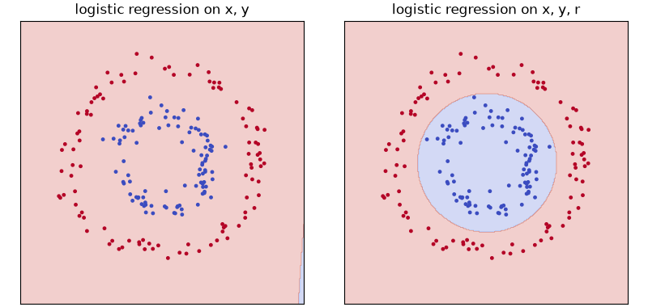

### 1.1 A problem a straight line can't solve

Points inside a small circle are class 0; points on a ring around it are class 1. We make 600 of them with NumPy: pick an angle and a radius (0.5 for the inside, 1.0 for the ring), add a little noise, and convert to x, y.

```python
import numpy as np

rng = np.random.default_rng(0)
n = 600
y = rng.integers(0, 2, n)                          # class 0 or 1
radius = np.where(y == 0, 0.5, 1.0) + rng.normal(0, 0.08, n)
angle = rng.uniform(0, 2 * np.pi, n)
X = np.column_stack([radius * np.cos(angle), radius * np.sin(angle)])
print(X.shape, y[:10])
```

**Output:**

```text
(600, 2) [1 1 1 0 0 0 0 0 0 1]
```

Logistic regression (`machine-learning.md` Chapter 10) computes one weighted sum w₁x + w₂y + b and calls it class 1 when the sum is positive. The boundary, where the sum is 0, is a **straight line**. No straight line separates a ring from its centre:

```python
from sklearn.linear_model import LogisticRegression

X_train, X_test, y_train, y_test = X[:400], X[400:], y[:400], y[400:]
linear = LogisticRegression().fit(X_train, y_train)
print("logistic regression on x, y:", linear.score(X_test, y_test))
```

**Output:**

```text
logistic regression on x, y: 0.505
```

About a coin flip.

### 1.2 Fix 1: design a better feature

Add a third column, the distance from the centre, r = √(x² + y²). In this new column the classes **are** separated by a straight cut (r < 0.75), so the same linear model now works:

```python
def add_radius(A):
    r = np.sqrt(A[:, 0] ** 2 + A[:, 1] ** 2)
    return np.column_stack([A, r])

engineered = LogisticRegression().fit(add_radius(X_train), y_train)
print("logistic regression on x, y, r:", engineered.score(add_radius(X_test), y_test))
```

**Output:**

```text
logistic regression on x, y, r: 1.0
```

This is **feature engineering**: you used your own knowledge ("it's about circles") to design the input. It works, but only because you knew the answer. Nobody can write down the right features for "is there a cat in this photo?" or "what does this sentence mean?".

### 1.3 Fix 2: learn the feature

A **neural network** does the feature design itself. It's a chain of **layers**:

```
input (x, y)  →  layer 1: a few new features  →  layer 2: more features  →  output: P(class 1)
```

Each layer computes new features from the previous ones, using weights that are **learned** from the data with gradient descent, exactly like logistic regression's weights. The last layer is ordinary logistic regression, but on features the network invented. With enough layers and examples, those features become whatever the task needs: edges and shapes for photos, word meanings for text.

That is **deep learning**: machine learning with networks of **many** layers ("deep" just means many layers). Chapter 9 trains a network on these exact rings from raw x and y. You'll see it reach about the same accuracy as Fix 1, and then find a unit inside it that has learned something like the radius on its own.

### 1.4 Where deep learning wins

| Data | Usually best (2026) |
|---|---|
| tables of business data | gradient-boosted trees (`machine-learning.md` Chapter 30) |
| images and video | deep learning, starting from a pretrained model |
| text | pretrained transformers (large language models) |
| audio and speech | deep learning |

The pattern: deep learning wins where the raw input is **many low-level numbers** (pixels, characters, audio samples) and good features are too hard to design by hand. On ordinary tables, where the columns already are good features, trees usually win.

Two practical facts:

- **Data and compute.** Networks need far more data than classic models, and run 10–100× faster on a **GPU** (a graphics card with thousands of small cores). Most real projects avoid both costs by starting from a **pretrained model**, a network someone else already trained on a huge dataset (Chapters 27 and 39).
- **The library.** This book uses **PyTorch**, the most widely used deep-learning library. Chapters 2–10 build everything in NumPy first, so that PyTorch (Chapter 11) holds no mysteries.

### 1.5 Summary

```
classic ML:     you design the features  →  a simple model learns weights on them
deep learning:  raw input  →  layer → layer → … (learned features)  →  output
```

**Key terms:**

- **Feature engineering:** designing input columns by hand from your knowledge of the problem.
- **Neural network:** a model made of layers; each layer computes new features from the previous layer's output, with learned weights.
- **Layer:** one stage of a network, turning its input numbers into new numbers.
- **Deep learning:** machine learning with neural networks of many layers.
- **Representation learning:** learning the features from data instead of designing them.
- **GPU (graphics processing unit):** a processor with thousands of small cores; it runs networks far faster than a CPU.
- **Pretrained model:** a network already trained on a large dataset, which you download and adapt.
- **PyTorch:** the most widely used deep-learning library, and the one this book uses.

### Exercises

1. Make the rings harder to separate by raising the noise from 0.08 to 0.25. What happens to the accuracy of logistic regression with the radius feature? Why can't any feature fix it fully?
2. For each problem, would you start with gradient-boosted trees or deep learning? (a) predicting a customer's chance of cancelling from 20 account columns; (b) reading handwritten postcodes from scans; (c) transcribing phone calls.

<details>
<summary><b>Answers</b></summary>

```python
radius_noisy = np.where(y == 0, 0.5, 1.0) + rng.normal(0, 0.25, n)
X_noisy = np.column_stack([radius_noisy * np.cos(angle), radius_noisy * np.sin(angle)])
model = LogisticRegression().fit(add_radius(X_noisy[:400]), y[:400])
print("noise 0.25, with radius:", model.score(add_radius(X_noisy[400:]), y[400:]))
```

**Output:**

```text
noise 0.25, with radius: 0.835
```

1. Accuracy drops, because the two rings now **overlap**: some class-0 points lie further out than some class-1 points. Where the classes truly overlap, no feature or model can separate them; this is noise in the data, not a weakness of the model.
2. (a) Trees: a table whose columns are already meaningful. (b) Deep learning: raw pixels. (c) Deep learning: raw audio.

</details>

**Learn more:** [3Blue1Brown: neural networks (video series)](https://www.3blue1brown.com/topics/neural-networks) · [Dive into Deep Learning (free book)](https://d2l.ai/)

<details>
<summary><b>Code for the chart at the top</b></summary>

```python
import matplotlib.pyplot as plt

xx, yy = np.meshgrid(np.linspace(-1.5, 1.5, 300), np.linspace(-1.5, 1.5, 300))
grid = np.column_stack([xx.ravel(), yy.ravel()])
fig, axes = plt.subplots(1, 2, figsize=(8, 3.8), layout="constrained")
for ax, title, pred in [(axes[0], "logistic regression on x, y", linear.predict(grid)),
                        (axes[1], "logistic regression on x, y, r", engineered.predict(add_radius(grid)))]:
    ax.contourf(xx, yy, pred.reshape(xx.shape), alpha=0.25, cmap="coolwarm")
    ax.scatter(X_test[:, 0], X_test[:, 1], c=y_test, s=6, cmap="coolwarm")
    ax.set(title=title, xticks=[], yticks=[], aspect="equal")
fig.savefig("rings-boundaries.png", dpi=100)
plt.close(fig)
```

</details>

---

## 2. Tensors and Shapes

**You need:** NumPy arrays (`data-science.md` Part 2). · **You'll learn:** to read every input, weight and output in a network as a **tensor with a shape**, and the one multiplication rule behind most shape errors.

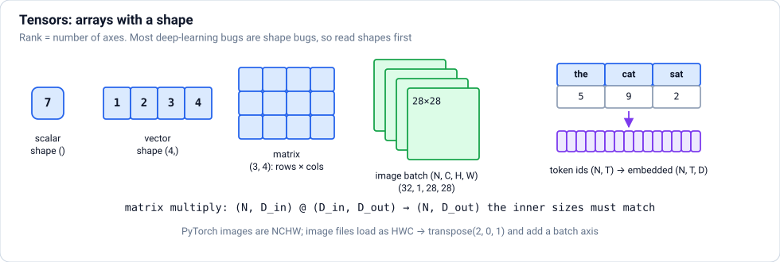

### 2.1 What a tensor is

A **tensor** is an array of numbers with any number of **axes** (also called **dimensions**). NumPy calls it an `ndarray`; PyTorch calls it a `Tensor`. Three properties describe it:

- **ndim:** how many axes, i.e. how many indices pick out one number. A single number has 0, a list 1, a table 2.
- **shape:** the size along each axis.
- **dtype:** the number type. Networks train in `float32`; labels and word ids are integers (`int64`).

```python
import numpy as np

scalar = np.array(3.5)
vector = np.array([1.0, 2.0, 3.0])
matrix = np.arange(6).reshape(2, 3)
images = np.zeros((32, 1, 28, 28), dtype=np.float32)      # 32 grayscale pictures, 28×28 pixels

for name, t in [("scalar", scalar), ("vector", vector), ("matrix", matrix), ("images", images)]:
    print(f"{name:7s} ndim={t.ndim}  shape={t.shape}  size={t.size}  dtype={t.dtype}")
```

**Output:**

```text
scalar  ndim=0  shape=()  size=1  dtype=float64
vector  ndim=1  shape=(3,)  size=3  dtype=float64
matrix  ndim=2  shape=(2, 3)  size=6  dtype=int64
images  ndim=4  shape=(32, 1, 28, 28)  size=25088  dtype=float32
```

`size` is the product of the shape: 32 × 1 × 28 × 28 = 25,088 numbers.

### 2.2 The shapes you'll meet

Networks process examples in groups called **batches**. By convention the **first axis is the batch**, of size N:

| Data | Shape | Axes |
|---|---|---|
| 32 rows of 5 features | (32, 5) | N, features |
| 32 grayscale 28×28 images | (32, 1, 28, 28) | N, **C**hannels, **H**eight, **W**idth |
| 16 colour photos 224×224 | (16, 3, 224, 224) | N, C, H, W (3 channels: red, green, blue) |
| 8 sentences of 20 word ids | (8, 20) | N, **T** (time steps or tokens) |
| the same after giving each word 64 numbers | (8, 20, 64) | N, T, **D** (numbers per token) |

PyTorch stores images as **NCHW**, channels first. Image files and most image libraries load them as H, W, C, channels last. So the first step with any photo is to move the axis with `transpose`, which reorders axes, and to add a batch axis with `[None]`:

```python
photo = np.random.default_rng(0).integers(0, 256, size=(224, 224, 3), dtype=np.uint8)   # H, W, C as loaded
x = (photo.astype(np.float32) / 255).transpose(2, 0, 1)[None]                           # → 1, C, H, W in [0, 1]
print("file:", photo.shape, photo.dtype, " → network input:", x.shape, x.dtype)
print("same pixel:", photo[10, 20, 1], "=", round(float(x[0, 1, 10, 20] * 255)))
```

**Output:**

```text
file: (224, 224, 3) uint8  → network input: (1, 3, 224, 224) float32
same pixel: 130 = 130
```

### 2.3 Reshape and flatten

`reshape` reads the numbers in memory order and lays them out in a new shape; the total count must stay the same. `-1` means "work out this size for me". **Flattening** keeps the batch axis and turns everything else into one long row, which is what a layer that expects plain feature vectors needs:

```python
flat = images.reshape(32, -1)
print(images.shape, "→", flat.shape)          # 1 × 28 × 28 = 784 numbers per image
```

**Output:**

```text
(32, 1, 28, 28) → (32, 784)
```

Use `transpose` to swap axes and `reshape` only to regroup them. Reshaping an (H, W, C) photo straight to (C, H, W) keeps the numbers in the old order and scrambles the picture.

### 2.4 The matrix-multiplication rule

A layer multiplies a batch by a weight matrix. The rule:

```
(N, D_in) @ (D_in, D_out) → (N, D_out)        the inner sizes must match
```

Each of the N rows is multiplied by the same weights, giving D_out new numbers per row. Then a bias of shape (D_out,) is added to every row. This is **broadcasting**: an axis of size 1 (or a missing leading axis) is stretched to match the other array.

```python
W = np.zeros((784, 10))
b = np.zeros(10)
print("(32, 784) @ (784, 10) + (10,) →", (flat @ W + b).shape)

try:
    flat @ np.zeros((10, 784))                # weights stored the other way round
except ValueError as e:
    print("error:", str(e).split(":")[0])
print("with a transpose:", (flat @ np.zeros((10, 784)).T).shape)
```

**Output:**

```text
(32, 784) @ (784, 10) + (10,) → (32, 10)
error: matmul
with a transpose: (32, 10)
```

PyTorch's layers store weights as (D_out, D_in) and multiply by the transpose, so you'll see `.T` inside them (Chapter 13).

### 2.5 Reducing over an axis

`mean`, `sum` and `max` with `axis=k` remove axis k. To get one vector per sentence from (N, T, D) word vectors, average over the token axis:

```python
words = np.random.default_rng(1).normal(size=(8, 20, 64))
print("mean over tokens:", words.mean(axis=1).shape)
print("mean over the batch:", words.mean(axis=0).shape)
```

**Output:**

```text
mean over tokens: (8, 64)
mean over the batch: (20, 64)
```

### 2.6 Summary

```
batch axis first:   rows (N, D) · images (N, C, H, W) · tokens (N, T) → vectors (N, T, D)
matmul:             (N, D_in) @ (D_in, D_out) → (N, D_out);  + bias (D_out,) broadcasts over N
reshape keeps memory order;  transpose reorders axes;  reducing over axis k removes axis k
```

**Key terms:**

- **Tensor:** an array of numbers with any number of axes.
- **Axis (dimension):** one direction of a tensor; axis 0 is usually the batch.
- **Shape:** the size of a tensor along each axis.
- **dtype:** the number type of a tensor, such as `float32` or `int64`.
- **Batch:** a group of examples processed together; the **batch size** N is the first axis.
- **Channel:** one of the values stored per pixel position, for example red, green and blue.
- **NCHW / NHWC:** the two layouts of an image batch: channels before or after height and width. PyTorch uses NCHW.
- **Reshape:** laying the same numbers out in a new shape, in memory order.
- **Flatten:** reshaping everything after the batch axis into one long vector.
- **Transpose:** reordering the axes of a tensor.
- **Broadcasting:** stretching size-1 or missing axes so that arrays of different shapes can be combined.

### Exercises

1. How many numbers are in a batch of 64 colour images of 128×128 pixels? How many megabytes is that in `float32`, at 4 bytes per number?
2. A layer turns (32, 784) into (32, 256). What shape must its weight matrix and its bias have?

<details>
<summary><b>Answers</b></summary>

```python
count = 64 * 3 * 128 * 128
print(count, "numbers =", round(count * 4 / 1e6, 1), "MB")
print((np.zeros((32, 784)) @ np.zeros((784, 256)) + np.zeros(256)).shape)
```

**Output:**

```text
3145728 numbers = 12.6 MB
(32, 256)
```

1. 3,145,728 numbers, about 12.6 MB. The values a network computes inside are many times larger than its input, which is why GPU memory runs out.
2. Weights (784, 256) and bias (256,).

</details>

| # | Problem (Deep-ML) | Difficulty |
|---|---|---|
| 1 | [3. Reshape Matrix](https://www.deep-ml.com/problems/3) | 🟢 Easy |
| 2 | [1. Matrix-Vector Dot Product](https://www.deep-ml.com/problems/1) | 🟢 Easy |
| 3 | [9. Matrix times Matrix ](https://www.deep-ml.com/problems/9) | 🟡 Medium |

**Learn more:** [NumPy: broadcasting](https://numpy.org/doc/stable/user/basics.broadcasting.html)

---

## 3. The Artificial Neuron

**You need:** Chapter 2. · **You'll learn:** what one neuron computes, why it can only draw a straight line, and why that means it can't learn XOR.

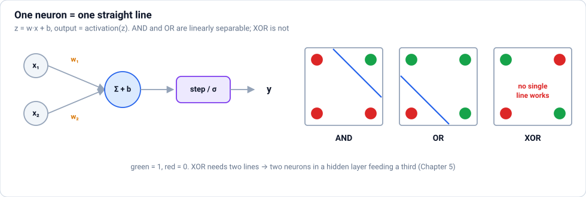

### 3.1 What a neuron computes

A **neuron** (or **unit**) takes inputs x₁, …, xₙ and does two things:

```
z = w₁x₁ + w₂x₂ + … + wₙxₙ + b = w · x + b        a weighted sum plus a bias
a = f(z)                                           an activation function
```

- The **weights** wᵢ say how much each input matters, and in which direction.
- The **bias** b shifts the result, so the neuron can fire even when all inputs are 0.
- z is called the **pre-activation**; a = f(z) is the neuron's output, its **activation**.

With the **step** activation (1 if z > 0, else 0), take w = (2, −1), b = −0.5:

| x | z = 2x₁ − x₂ − 0.5 | output |
|---|---|---|
| (1, 1) | 2 − 1 − 0.5 = 0.5 | 1 |
| (0, 1) | 0 − 1 − 0.5 = −1.5 | 0 |

```python
import numpy as np

def neuron(x, w, b):
    z = np.dot(w, x) + b
    return int(z > 0)                      # step activation

w, b = np.array([2, -1]), -0.5
print(neuron(np.array([1, 1]), w, b), neuron(np.array([0, 1]), w, b))
```

**Output:**

```text
1 0
```

With the sigmoid activation σ(z) = 1/(1 + e⁻ᶻ) instead of the step, a neuron is exactly logistic regression (`machine-learning.md` Chapter 10).

### 3.2 One neuron draws one straight line

The neuron's output flips where z = 0, that is where w₁x₁ + w₂x₂ + b = 0. That's the equation of a straight line, called the **decision boundary**: one side outputs 1, the other side 0. With more inputs it's a flat plane, but never curved.

So a neuron can only learn patterns where **one straight cut** separates the classes. Classes like that are called **linearly separable**.

### 3.3 AND, OR and XOR

Three yes/no functions of two inputs:

| x₁ | x₂ | AND | OR | XOR (exactly one is 1) |
|---|---|---|---|---|
| 0 | 0 | 0 | 0 | 0 |
| 0 | 1 | 0 | 1 | **1** |
| 1 | 0 | 0 | 1 | **1** |
| 1 | 1 | 1 | 1 | 0 |

Picture the four inputs as the corners of a square. For AND, one line cuts off the corner (1, 1). For OR, one line cuts off (0, 0). For XOR the two 1s sit on **opposite** corners, and no single line puts both of them on one side and both 0s on the other.

<details>
<summary><b>Proof that no neuron computes XOR</b></summary>

Suppose w₁, w₂, b worked. Then:

- (0, 0) → 0 needs b ≤ 0.
- (1, 0) → 1 needs w₁ + b > 0.
- (0, 1) → 1 needs w₂ + b > 0.
- (1, 1) → 0 needs w₁ + w₂ + b ≤ 0.

Add the middle two: w₁ + w₂ + 2b > 0, so w₁ + w₂ + b > −b ≥ 0, which contradicts the last line. No weights exist.

</details>

### 3.4 The perceptron learning rule

Instead of choosing weights by hand, let the data choose them. The **perceptron** (Rosenblatt, 1958) is a step-activation neuron with a simple rule: go through the examples, and each time a prediction ŷ is wrong, nudge the weights towards the right answer y:

```
w ← w + lr · (y − ŷ) · x
b ← b + lr · (y − ŷ)
```

If ŷ = y, then y − ŷ = 0 and nothing changes. If the neuron said 0 but should say 1, then y − ŷ = 1, so the weights grow in the direction of x, which raises z for this x next time. One pass through all the examples is an **epoch**.

```python
def train_perceptron(X, y, lr=0.1, epochs=20):
    w, b = np.zeros(X.shape[1]), 0.0
    for epoch in range(1, epochs + 1):
        mistakes = 0
        for x_i, y_i in zip(X, y):
            y_hat = int(w @ x_i + b > 0)
            w = w + lr * (y_i - y_hat) * x_i
            b = b + lr * (y_i - y_hat)
            mistakes += int(y_hat != y_i)
        if mistakes == 0:
            return w, b, epoch
    return w, b, None                          # never got everything right

X = np.array([[0, 0], [0, 1], [1, 0], [1, 1]])
for name, y in [("AND", [0, 0, 0, 1]), ("OR", [0, 1, 1, 1]), ("XOR", [0, 1, 1, 0])]:
    w, b, epochs = train_perceptron(X, np.array(y))
    print(f"{name}: w={w.round(2).tolist()}, b={b:.2f}, " + (f"learned in {epochs} epochs" if epochs else "never learned"))
```

**Output:**

```text
AND: w=[0.2, 0.1], b=-0.20, learned in 6 epochs
OR: w=[0.1, 0.1], b=0.00, learned in 4 epochs
XOR: w=[-0.1, 0.0], b=0.10, never learned
```

AND and OR are learned in a few epochs. On XOR the rule keeps flipping the weights for ever, because the weights it's looking for don't exist. Minsky and Papert's 1969 book on this limit slowed neural-network research for over a decade. The way out is to use **more than one neuron**, which Chapter 5 does.

### 3.5 Summary

```
z = w · x + b,   a = f(z)
boundary z = 0 is a straight line (a flat plane in more dimensions)
perceptron rule: w ← w + lr (y − ŷ) x,  b ← b + lr (y − ŷ)
```

**Key terms:**

- **Neuron (unit):** computes a weighted sum of its inputs plus a bias, then applies an activation function.
- **Weight:** a learned number saying how much one input matters, and in which direction.
- **Bias:** a learned number added to the weighted sum, shifting the decision boundary.
- **Pre-activation (z):** the weighted sum plus bias, before the activation function.
- **Activation:** a neuron's output, f(z); also used for the activation function f itself.
- **Decision boundary:** where a model's output flips from one class to the other; for one neuron, the line z = 0.
- **Linearly separable:** classes that one straight line (or flat plane) can separate perfectly.
- **XOR:** "exclusive or", which is 1 when exactly one of two inputs is 1; it isn't linearly separable.
- **Perceptron:** a step-activation neuron trained by nudging its weights after each mistake.
- **Epoch:** one full pass through the training examples.

### Exercises

1. Find weights and a bias by hand for NAND ("not AND": 0 only when both inputs are 1). Check them with `neuron`.
2. XOR(a, b) = AND(OR(a, b), NAND(a, b)). Build XOR from three neurons whose weights you choose by hand.

<details>
<summary><b>Answers</b></summary>

```python
nand = lambda a, b: neuron(np.array([a, b]), np.array([-1, -1]), 1.5)
or_ = lambda a, b: neuron(np.array([a, b]), np.array([1, 1]), -0.5)
and_ = lambda a, b: neuron(np.array([a, b]), np.array([1, 1]), -1.5)
print("NAND:", [nand(a, b) for a, b in X])
print("XOR: ", [and_(or_(a, b), nand(a, b)) for a, b in X])
```

**Output:**

```text
NAND: [1, 1, 1, 0]
XOR:  [0, 1, 1, 0]
```

1. w = (−1, −1), b = 1.5: z = 1.5 − x₁ − x₂ is negative only when both are 1.
2. Two neurons (OR and NAND) compute new features from the inputs, and a third (AND) combines them. That's a two-layer network, the subject of Chapter 5.

</details>

| # | Problem (Deep-ML) | Difficulty |
|---|---|---|
| 1 | [24. Single Neuron](https://www.deep-ml.com/problems/24) | 🟢 Easy |

---

## 4. Activation Functions

**You need:** Chapter 3, and derivatives (`machine-learning.md` Chapter 4). · **You'll learn:** why every layer needs a non-linear "bend", the common activation functions and their slopes, and a softmax that never overflows.

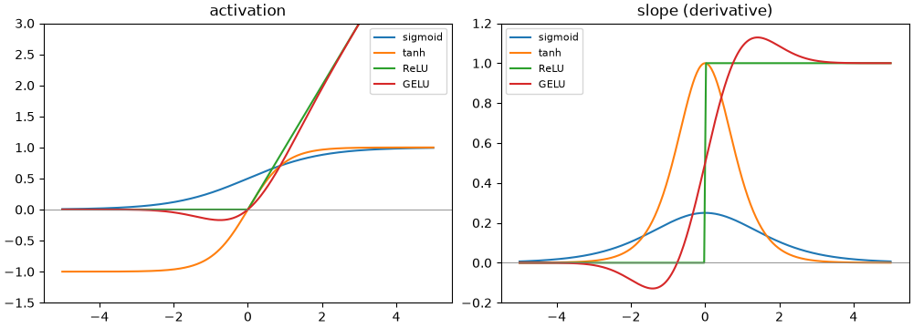

### 4.1 Why a bend is needed

A layer without an activation function multiplies by a matrix. Two such layers in a row:

```
y = W₂(W₁x) = (W₂W₁)x = Wx
```

The product W₂W₁ is just another matrix, so two layers are exactly one layer. Ten layers still multiply into a single matrix: one linear model, which can't solve the rings or XOR. A non-linear function between the layers stops this collapse:

```python
import numpy as np

rng = np.random.default_rng(0)
x, W1, W2 = rng.normal(size=(4, 3)), rng.normal(size=(3, 5)), rng.normal(size=(5, 2))
print("two linear layers = one matrix:", np.allclose((x @ W1) @ W2, x @ (W1 @ W2)))
print("with a bend between them:      ", np.allclose(np.maximum(0, x @ W1) @ W2, x @ (W1 @ W2)))
```

**Output:**

```text
two linear layers = one matrix: True
with a bend between them:       False
```

### 4.2 Sigmoid and tanh

**Sigmoid** squashes any number into (0, 1):

```
σ(z) = 1 / (1 + e⁻ᶻ),        σ′(z) = σ(z) (1 − σ(z))
```

<details>
<summary><b>Derivation of σ′</b></summary>

Write σ = (1 + e⁻ᶻ)⁻¹. By the chain rule, σ′ = −(1 + e⁻ᶻ)⁻² · (−e⁻ᶻ) = e⁻ᶻ / (1 + e⁻ᶻ)².

Split it: e⁻ᶻ / (1 + e⁻ᶻ)² = [1 / (1 + e⁻ᶻ)] · [e⁻ᶻ / (1 + e⁻ᶻ)] = σ · (1 − σ), because e⁻ᶻ / (1 + e⁻ᶻ) = 1 − 1/(1 + e⁻ᶻ).

</details>

The slope is largest at z = 0, where σ = 0.5 and σ′ = 0.5 · 0.5 = **0.25**. For large |z| the curve goes flat and the slope approaches 0. This flat region is called **saturation**.

**Tanh** has the same S shape but squashes into (−1, 1), centred on 0. Its slope is tanh′(z) = 1 − tanh²(z), at most 1.

### 4.3 Why flat slopes are a problem

Chapter 9 will show that the learning signal reaching an early layer is a **product** of the slopes of all the layers after it. Through 10 sigmoid layers, even at the best case of 0.25 each:

```
0.25¹⁰ ≈ 0.000001
```

The early layers receive almost no signal and barely learn. This is the **vanishing gradient** problem, and it's why deep networks didn't train well until the activation below became standard.

### 4.4 ReLU and its relatives

**ReLU** (rectified linear unit) keeps positive numbers and zeroes negative ones:

```
ReLU(z) = max(0, z),        ReLU′(z) = 1 if z > 0, else 0
```

Its slope is exactly 1 for every positive input, so the signal passes back through many layers without shrinking. It's also the cheapest function there is. The catch: a unit whose z is negative for every example outputs 0 with slope 0 and never learns again, a **dead ReLU**.

Smooth versions avoid the sharp corner, and are used in transformers:

- **GELU** (Gaussian error linear unit): z · Φ(z), where Φ is the standard normal cumulative distribution (the probability that a normal variable is below z). Used in BERT and GPT-2.
- **SiLU** (also called **swish**): z · σ(z). Used, inside a gated layer called SwiGLU, in Llama-style models (Chapter 35).

For large positive z both are ≈ z; for large negative z both are ≈ 0; near 0 they curve smoothly with a small dip below zero.

```python
from math import erf, sqrt

def sigmoid(z): return 1 / (1 + np.exp(-z))
def relu(z):    return np.maximum(0, z)
def gelu(z):    return z * 0.5 * (1 + np.vectorize(erf)(z / sqrt(2)))
def silu(z):    return z * sigmoid(z)

z = np.array([-5.0, -1.0, 0.0, 1.0, 5.0])
for name, f in [("sigmoid", sigmoid), ("tanh", np.tanh), ("ReLU", relu), ("GELU", gelu), ("SiLU", silu)]:
    print(f"{name:8s}", f(z).round(3))
```

**Output:**

```text
sigmoid  [0.007 0.269 0.5   0.731 0.993]
tanh     [-1.    -0.762  0.     0.762  1.   ]
ReLU     [0. 0. 0. 1. 5.]
GELU     [-0.    -0.159  0.     0.841  5.   ]
SiLU     [-0.033 -0.269  0.     0.731  4.967]
```

The slopes, using the formulas above:

```python
s = sigmoid(z)
print("sigmoid′", (s * (1 - s)).round(3))
print("tanh′   ", (1 - np.tanh(z) ** 2).round(3))
print("ReLU′   ", (z > 0).astype(float))
```

**Output:**

```text
sigmoid′ [0.007 0.197 0.25  0.197 0.007]
tanh′    [0.   0.42 1.   0.42 0.  ]
ReLU′    [0. 0. 0. 1. 1.]
```

### 4.5 Softmax for the output

For a choice among K classes, the last layer produces K scores called **logits**, and **softmax** turns them into probabilities that sum to 1 (`machine-learning.md` Chapter 11):

```
softmax(z)ᵢ = e^{zᵢ} / Σⱼ e^{zⱼ}
```

For z = (2, 1, 0.1): e² = 7.39, e¹ = 2.72, e^0.1 = 1.11, total 11.22, so the probabilities are 0.659, 0.242, 0.099.

Computed literally, e^{1000} overflows to infinity and the division gives `nan` (not a number). The fix uses a property of softmax: adding the same constant c to every logit changes nothing, because e^{zᵢ+c} = e^c · e^{zᵢ} and the factor e^c cancels top and bottom. So subtract the largest logit first. Then the biggest exponent is e⁰ = 1, and nothing can overflow:

```python
def softmax(z):
    e = np.exp(z - z.max(axis=-1, keepdims=True))
    return e / e.sum(axis=-1, keepdims=True)

print(softmax(np.array([2.0, 1.0, 0.1])).round(3))
print(softmax(np.array([1000.0, 999.0])).round(3))
with np.errstate(over="ignore", invalid="ignore"):
    print("naive:", np.exp([1000.0, 999.0]) / np.exp([1000.0, 999.0]).sum())
```

**Output:**

```text
[0.659 0.242 0.099]
[0.731 0.269]
naive: [nan nan]
```

`axis=-1` means the last axis, so the same function works on a whole batch of logit rows at once.

### 4.6 Which one where

| Place | Activation |
|---|---|
| hidden layers of ordinary networks and CNNs | ReLU |
| hidden layers of transformers | GELU, or SwiGLU (Chapter 35) |
| output, one yes/no probability | sigmoid |
| output, one of K classes | softmax |
| output, a number (regression) | none |

### 4.7 Summary

```
σ(z) = 1/(1+e⁻ᶻ),  σ′ = σ(1−σ) ≤ 0.25        tanh′ = 1 − tanh² ≤ 1
ReLU(z) = max(0, z),  slope 1 or 0            GELU = z Φ(z),  SiLU = z σ(z)
softmax(z)ᵢ = e^{zᵢ − max z} / Σⱼ e^{zⱼ − max z}
```

**Key terms:**

- **Activation function:** the non-linear function a neuron applies to its weighted sum.
- **Sigmoid (σ):** 1/(1 + e⁻ᶻ), which squashes numbers into (0, 1).
- **Tanh:** the hyperbolic tangent, which squashes numbers into (−1, 1).
- **Saturation:** the flat ends of sigmoid and tanh, where the slope is almost 0.
- **Vanishing gradient:** the learning signal shrinking towards 0 as it passes back through many layers with small slopes.
- **ReLU:** max(0, z), the default activation for hidden layers.
- **Dead ReLU:** a ReLU unit that outputs 0 for every input, so it can no longer learn.
- **GELU:** z · Φ(z), a smooth ReLU used in transformers.
- **SiLU (swish):** z · σ(z), another smooth ReLU.
- **Logits:** the raw scores a network outputs before sigmoid or softmax.
- **Softmax:** turns a vector of logits into probabilities that sum to 1.

### Exercises

1. Leaky ReLU is max(0.01z, z). What is its slope for negative z, and which problem of ReLU does it fix?
2. Show by hand that softmax(z) for two classes, z = (z₁, z₂), equals (σ(z₁ − z₂), σ(z₂ − z₁)).

<details>
<summary><b>Answers</b></summary>

```python
z2 = np.array([1.3, -0.4])
print(softmax(z2).round(4), sigmoid(z2[0] - z2[1]).round(4), sigmoid(z2[1] - z2[0]).round(4))
```

**Output:**

```text
[0.8455 0.1545] 0.8455 0.1545
```

1. 0.01. Units never have a slope of exactly 0, so they can't die.
2. Divide top and bottom by e^{z₁}: e^{z₁}/(e^{z₁} + e^{z₂}) = 1/(1 + e^{−(z₁−z₂)}) = σ(z₁ − z₂). So a sigmoid output is a two-class softmax.

</details>

| # | Problem (Deep-ML) | Difficulty |
|---|---|---|
| 1 | [22. Sigmoid Activation Function Understanding](https://www.deep-ml.com/problems/22) | 🟢 Easy |
| 2 | [42. Implement ReLU Activation Function](https://www.deep-ml.com/problems/42) | 🟢 Easy |
| 3 | [23. Softmax Activation Function Implementation ](https://www.deep-ml.com/problems/23) | 🟢 Easy |
| 4 | [147. GeLU Activation Function ](https://www.deep-ml.com/problems/147) | 🟢 Easy |
| 5 | [217. Derivatives of Activation Functions](https://www.deep-ml.com/problems/217) | 🟢 Easy |

<details>
<summary><b>Code for the chart at the top</b></summary>

```python
import matplotlib.pyplot as plt

zz = np.linspace(-5, 5, 401)
fig, axes = plt.subplots(1, 2, figsize=(10, 3.6), layout="constrained")
for name, f in [("sigmoid", sigmoid), ("tanh", np.tanh), ("ReLU", relu), ("GELU", gelu)]:
    axes[0].plot(zz, f(zz), label=name)
    axes[1].plot(zz, np.gradient(f(zz), zz), label=name)          # numerical slope
axes[0].set(title="activation", ylim=(-1.5, 3))
axes[1].set(title="slope (derivative)", ylim=(-0.2, 1.2))
for ax in axes:
    ax.axhline(0, color="gray", lw=0.6)
    ax.legend(fontsize=8)
fig.savefig("activations.png", dpi=100)
plt.close(fig)
```

</details>

---

## 5. Layers and the Forward Pass

**You need:** Chapters 2–4. · **You'll learn:** how neurons are grouped into layers, how a layer is one matrix multiplication, and how two layers solve XOR.

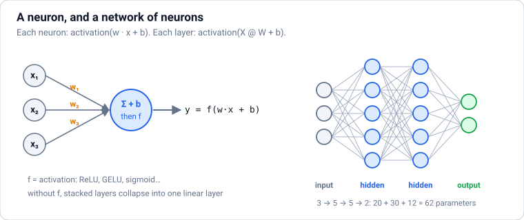

### 5.1 A layer is many neurons at once

A **layer** is a group of neurons that all read the same inputs. Neuron j has its own weights (a column of a matrix W) and its own bias bⱼ. Computing all of them for a whole batch of inputs X is one matrix multiplication:

```
H = f(X W + b)
X: (N, D_in)    W: (D_in, D_out)    b: (D_out,)    H: (N, D_out)
```

Column j of XW is the weighted sum for neuron j, for every example at once; adding b broadcasts each bias down its column (Chapter 2.4); f is applied to every number separately.

A layer where every input connects to every neuron like this is called a **fully connected** (or **dense**, or **linear**) layer.

### 5.2 Stacking layers: the multilayer perceptron

A network of dense layers in a chain is a **multilayer perceptron** (**MLP**). Layers between the input and the output are **hidden layers**, because you never see their values in the data:

```
H₁ = ReLU(X W₁ + b₁)          hidden layer 1
H₂ = ReLU(H₁ W₂ + b₂)         hidden layer 2
out = H₂ W₃ + b₃              output layer (logits; softmax or sigmoid comes later)
```

Running an input through the layers to get the output is the **forward pass**. The number of layers is the network's **depth**; the number of neurons in a layer is its **width**.

### 5.3 Two layers solve XOR

Chapter 3 proved one neuron can't compute XOR. Two hidden ReLU neurons and one output can. Choose:

```
h₁ = ReLU(x₁ + x₂)
h₂ = ReLU(x₁ + x₂ − 1)
out = h₁ − 2h₂
```

| x | h₁ | h₂ | out = h₁ − 2h₂ |
|---|---|---|---|
| (0, 0) | 0 | 0 | 0 |
| (0, 1) | 1 | 0 | **1** |
| (1, 0) | 1 | 0 | **1** |
| (1, 1) | 2 | 1 | 0 |

In matrix form, W₁ has a column per hidden neuron:

```python
import numpy as np

def relu(z):
    return np.maximum(0, z)

X = np.array([[0, 0], [0, 1], [1, 0], [1, 1]])
W1 = np.array([[1, 1],
               [1, 1]])            # (2 inputs, 2 hidden neurons)
b1 = np.array([0, -1])
W2 = np.array([[1], [-2]])         # (2 hidden, 1 output)
b2 = np.array([0])

H = relu(X @ W1 + b1)
out = H @ W2 + b2
print("hidden features:\n", H)
print("output:", out.ravel())
```

**Output:**

```text
hidden features:
 [[0 0]
 [1 0]
 [1 0]
 [2 1]]
output: [0 1 1 0]
```

Look at the hidden features: the four inputs become (0, 0), (1, 0), (1, 0) and (2, 1). The two class-1 inputs **land on the same point**, and now one straight line in (h₁, h₂) space separates them from the others. That's the general trick: hidden layers move the data into a new space where the last layer's straight line is enough. Training (Chapter 9) finds such weights automatically.

### 5.4 A forward pass in code

An MLP is a list of (W, b) pairs: ReLU after every layer except the last. Weights usually start as small random numbers; Chapter 18 explains exactly how small.

```python
def init_mlp(sizes, seed=0):
    rng = np.random.default_rng(seed)
    return [(rng.normal(0, np.sqrt(2 / d_in), (d_in, d_out)), np.zeros(d_out))
            for d_in, d_out in zip(sizes[:-1], sizes[1:])]

def forward(params, X):
    for k, (W, b) in enumerate(params):
        X = X @ W + b
        if k < len(params) - 1:          # no ReLU on the output layer
            X = relu(X)
    return X

params = init_mlp([784, 256, 10])        # e.g. 28×28 images → 256 hidden → 10 classes
batch = np.random.default_rng(1).normal(size=(32, 784))
print("logits:", forward(params, batch).shape)
```

**Output:**

```text
logits: (32, 10)
```

The weights are random, so these outputs mean nothing yet. To improve them we first need a number that says how wrong they are: the loss (Chapter 6).

### 5.5 Counting parameters

A dense layer from D_in to D_out has D_in · D_out weights plus D_out biases. For 784 → 256 → 10:

```
784·256 + 256 = 200,960
256·10 + 10   =   2,570
total         = 203,530
```

```python
print(sum(W.size + b.size for W, b in params))
```

**Output:**

```text
203530
```

Every one of these numbers is a **parameter**, learned in training. A large language model has billions of them, but each is a weight or a bias of exactly this kind.

### 5.6 How powerful is an MLP?

The **universal approximation theorem** says an MLP with one hidden layer and enough neurons can approximate any continuous function as closely as you like. Each ReLU neuron adds one "kink", and enough kinks can trace any curve. "Enough" can be enormous, though; extra layers usually reach the same accuracy with far fewer neurons in total, because later layers reuse the features of earlier ones. That's the practical reason networks are deep rather than just wide.

### 5.7 Summary

```
layer:     H = f(X W + b),   (N, D_in) @ (D_in, D_out) → (N, D_out)
MLP:       Linear → ReLU → Linear → ReLU → … → Linear (logits)
params:    D_in · D_out + D_out per dense layer
```

**Key terms:**

- **Dense (fully connected, linear) layer:** every input connects to every neuron; computes X W + b.
- **Multilayer perceptron (MLP):** a chain of dense layers with activations between them.
- **Hidden layer:** a layer between the input and the output.
- **Forward pass:** computing a network's output from its input, layer by layer.
- **Depth:** the number of layers in a network.
- **Width:** the number of neurons in a layer.
- **Parameter:** a number learned in training, a weight or a bias.
- **Universal approximation theorem:** one hidden layer with enough neurons can approximate any continuous function.

### Exercises

1. How many parameters does an MLP 3072 → 512 → 512 → 10 have (32×32 colour images to 10 classes)?
2. Change the XOR network's output layer so that it computes AND instead, without changing the hidden layer.

<details>
<summary><b>Answers</b></summary>

```python
print(sum(W.size + b.size for W, b in init_mlp([3072, 512, 512, 10])))
print("AND:", (H @ np.array([[0], [1]]) + 0).ravel())
```

**Output:**

```text
1841162
AND: [0 0 0 1]
```

1. 3072·512 + 512 + 512·512 + 512 + 512·10 + 10 = 1,841,162. Most of them are in the first layer.
2. h₂ = ReLU(x₁ + x₂ − 1) is already AND: it's 1 only for (1, 1). So the output weights (0, 1) work.

</details>

| # | Problem (Deep-ML) | Difficulty |
|---|---|---|
| 1 | [40. Implementing a Custom Dense Layer in Python](https://www.deep-ml.com/problems/40) | 🔴 Hard |

---

## 6. Loss Functions for Networks

**You need:** Chapters 4–5, and log loss (`machine-learning.md` Chapters 10–11). · **You'll learn:** the three losses nearly every network uses, why they're computed from logits, and the gradient p − y that makes them easy to train.

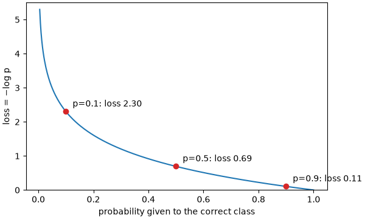

### 6.1 What a loss is

A **loss** is one number that says how wrong the network's outputs are on a batch: 0 means perfect, bigger means worse. Training means changing the parameters to make it smaller. The loss must be:

- **averaged** over the batch, so its size doesn't depend on the batch size;
- **smooth**, so its slope with respect to every parameter exists (Chapter 7 uses that slope).

Accuracy fails the second test: nudging a weight slightly rarely changes any prediction, so its slope is almost always 0.

### 6.2 Regression: mean squared error

For numeric targets, the output layer has no activation, and the loss is the **mean squared error**:

```
MSE = (1/N) Σᵢ (ŷᵢ − yᵢ)²,        ∂MSE/∂ŷᵢ = (2/N)(ŷᵢ − yᵢ)
```

Squaring punishes big errors most (`machine-learning.md` Chapter 8).

### 6.3 Two classes: binary cross-entropy

For yes/no targets y ∈ {0, 1}, the output is one logit z, the probability is p = σ(z), and the loss is **binary cross-entropy** (log loss):

```
BCE = −[y log p + (1 − y) log(1 − p)]
```

If y = 1 this is −log p, and if y = 0 it's −log(1 − p): minus the log of the probability given to the **right** answer. That probability is 1 when the network is right and sure (loss 0), and near 0 when it's confidently wrong (loss huge).

| probability given to the right class | 0.9 | 0.5 | 0.1 | 0.01 |
|---|---|---|---|---|
| loss −log p | 0.105 | 0.693 | 2.303 | 4.605 |

### 6.4 Many classes: cross-entropy

For K classes, the output layer gives K logits z, softmax turns them into probabilities p, and the loss for an example whose true class is y is:

```
CE = −log p_y
```

Average it over the batch. With K = 2 this is exactly binary cross-entropy (Exercise 2 of Chapter 4).

### 6.5 Compute the loss from the logits

Computing softmax and then taking a log is unstable: if p_y underflows to 0, then log 0 = −∞. Instead, combine the two steps algebraically:

```
−log p_y = −log( e^{z_y} / Σⱼ e^{zⱼ} ) = −z_y + log Σⱼ e^{zⱼ}
```

The last term is the **log-sum-exp**. It's made safe the same way as softmax: with m = max z,

```
log Σⱼ e^{zⱼ} = m + log Σⱼ e^{zⱼ − m}
```

since Σⱼ e^{zⱼ} = e^m · Σⱼ e^{zⱼ − m}. Every exponent is now ≤ 0, so nothing overflows, and the sum is at least 1, so its log is never −∞.

```python
import numpy as np

def cross_entropy(logits, y):
    """logits (N, K), y (N,) integer classes → mean loss"""
    m = logits.max(axis=1, keepdims=True)
    log_sum_exp = m[:, 0] + np.log(np.exp(logits - m).sum(axis=1))
    return np.mean(log_sum_exp - logits[np.arange(len(y)), y])

logits = np.array([[2.0, 1.0, 0.1],
                   [0.5, 2.5, 0.3]])
y = np.array([0, 1])
print("loss:", cross_entropy(logits, y).round(4))
print("by hand, first row: −log 0.659 =", round(-np.log(0.659), 4))
print("huge logits:", cross_entropy(np.array([[1000.0, -1000.0, 0.0]]), np.array([1])))
```

**Output:**

```text
loss: 0.3185
by hand, first row: −log 0.659 = 0.417
huge logits: 2000.0
```

`logits[np.arange(len(y)), y]` picks the true class's logit from each row. The last line has p_y ≈ e^{−2000}, far below the smallest float, yet the loss comes out as a correct, finite 2000.

That's why libraries' cross-entropy functions take **logits**, not probabilities, and apply softmax inside. The same goes for the binary case, where the stable form is BCE = max(z, 0) − z·y + log(1 + e^{−|z|}). A classic bug is applying softmax yourself and then passing the probabilities to a loss that applies it again.

### 6.6 The gradient: p − y

The slope of cross-entropy with respect to the logits is strikingly simple. Write y as a **one-hot** vector, with a 1 at the true class and 0 elsewhere. Then:

```
∂CE/∂z = p − y
```

<details>
<summary><b>Derivation</b></summary>

CE = −z_y + log Σⱼ e^{zⱼ}. Take the slope with respect to one logit zₖ:

- The first term gives −1 if k = y, else 0. That's −yₖ.
- The second gives e^{zₖ} / Σⱼ e^{zⱼ} = pₖ (the chain rule on log, then the derivative of e^{zₖ}).

So ∂CE/∂zₖ = pₖ − yₖ for every k.

</details>

The network's error signal is just "predicted probabilities minus the truth". Check it against a numerical slope, nudging each logit by a tiny h:

```python
def softmax(z):
    e = np.exp(z - z.max(axis=1, keepdims=True))
    return e / e.sum(axis=1, keepdims=True)

z, label = logits[:1], y[:1]
one_hot = np.eye(3)[label]                       # row 0 of the identity matrix: [1, 0, 0]
analytic = softmax(z) - one_hot
h = 1e-6
numeric = [(cross_entropy(z + h * np.eye(3)[k], label) - cross_entropy(z - h * np.eye(3)[k], label)) / (2 * h)
           for k in range(3)]
print("p − y:  ", analytic.round(5))
print("numeric:", np.round(numeric, 5))
```

**Output:**

```text
p − y:   [[-0.341    0.24243  0.09857]]
numeric: [-0.341    0.24243  0.09857]
```

The same holds for sigmoid with binary cross-entropy (∂BCE/∂z = p − y), and for MSE with no activation (∂/∂ŷ = ŷ − y, up to the factor 2). Each output activation is paired with the loss that makes the gradient this simple.

### 6.7 Summary

| Task | Output layer | Loss | ∂loss/∂logits |
|---|---|---|---|
| number | 1 unit, no activation | MSE | (2/N)(ŷ − y) |
| yes/no | 1 logit, sigmoid inside the loss | binary cross-entropy | p − y |
| one of K | K logits, softmax inside the loss | cross-entropy | p − y (one-hot y) |

```
CE = −z_y + logsumexp(z),   logsumexp(z) = m + log Σ e^{z − m},  m = max z
```

**Key terms:**

- **Loss:** a single number measuring how wrong a model's outputs are; training makes it smaller.
- **Mean squared error (MSE):** the average squared difference between predictions and targets.
- **Binary cross-entropy (log loss):** −log of the probability given to the correct yes/no answer.
- **Cross-entropy:** −log of the probability given to the correct class, out of K.
- **Log-sum-exp:** log Σ eᶻ, computed stably by first subtracting the maximum.
- **One-hot vector:** a vector of zeros with a single 1 at the position of the true class.
- **Numerical gradient:** a slope estimated by nudging the input slightly: (f(x + h) − f(x − h)) / 2h.

### Exercises

1. A model always predicts 1/K for each of K = 10 classes. What is its cross-entropy? Why is this a useful number to know when training starts?
2. Write the stable binary cross-entropy from a logit z, and check it equals −log σ(z) for y = 1 when z = 3.

<details>
<summary><b>Answers</b></summary>

```python
print("uniform guess, 10 classes:", cross_entropy(np.zeros((1, 10)), np.array([0])).round(4), "= log 10 =", np.log(10).round(4))
bce = lambda z, y: max(z, 0) - z * y + np.log1p(np.exp(-abs(z)))
print("stable:", round(bce(3.0, 1), 6), " direct:", round(-np.log(1 / (1 + np.exp(-3.0))), 6))
```

**Output:**

```text
uniform guess, 10 classes: 2.3026 = log 10 = 2.3026
stable: 0.048587  direct: 0.048587
```

1. −log(1/10) = log 10 ≈ 2.303. A freshly initialised classifier should start near log K. If the first loss is far above it, the outputs are confidently wrong from the start, usually a sign of a bug or of weights that start too large (Chapter 23).
2. For z = 3, y = 1: max(3, 0) − 3 + log(1 + e⁻³) = 0.048587, the same as −log σ(3). `np.log1p(u)` computes log(1 + u) accurately for small u.

</details>

| # | Problem (Deep-ML) | Difficulty |
|---|---|---|
| 1 | [134. Compute Multi-class Cross-Entropy Loss](https://www.deep-ml.com/problems/134) | 🟢 Easy |
| 2 | [39. Implementation of Log Softmax Function](https://www.deep-ml.com/problems/39) | 🟢 Easy |

<details>
<summary><b>Code for the chart at the top</b></summary>

```python
import matplotlib.pyplot as plt

p = np.linspace(0.005, 1, 400)
fig, ax = plt.subplots(figsize=(6, 3.6), layout="constrained")
ax.plot(p, -np.log(p))
for q in [0.9, 0.5, 0.1]:
    ax.plot(q, -np.log(q), "o", color="C3")
    ax.annotate(f"p={q}: loss {-np.log(q):.2f}", (q, -np.log(q)), textcoords="offset points", xytext=(8, 6))
ax.set(xlabel="probability given to the correct class", ylabel="loss = −log p", ylim=(0, 5.5))
fig.savefig("cross-entropy.png", dpi=100)
plt.close(fig)
```

</details>

---

# Part II — How Networks Learn

Four chapters that open the black box: gradient descent on mini-batches, the chain rule, backpropagation through a whole network, and an automatic-differentiation engine. Still NumPy only.

---

## 7. Gradient Descent, Mini-Batches and Epochs

**You need:** Chapter 6, and gradient descent (`machine-learning.md` Chapters 5 and 17). · **You'll learn:** to train one neuron with gradient descent, and why networks are trained on small random batches.

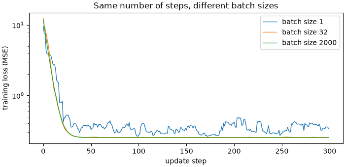

### 7.1 The training loop in one line

Gradient descent repeats one update for every parameter θ:

```
θ ← θ − lr · ∂L/∂θ
```

∂L/∂θ, the **gradient**, says how the loss changes when θ grows a little. Stepping against it lowers the loss. **lr**, the **learning rate**, sets the step size. Everything in Part II is about computing ∂L/∂θ.

### 7.2 The gradient for one neuron

Take one sigmoid neuron with binary cross-entropy, on a batch X of shape (N, D):

```
z = X w + b,    p = σ(z),    L = mean BCE(p, y)
```

Chapter 6.6 gave ∂L/∂zᵢ = (pᵢ − yᵢ)/N (the 1/N comes from the mean). Each zᵢ = Σⱼ Xᵢⱼwⱼ + b, so a small change in wⱼ changes zᵢ by Xᵢⱼ times as much, and changes the loss by the sum of those effects over all examples:

```
∂L/∂wⱼ = Σᵢ (pᵢ − yᵢ)/N · Xᵢⱼ      →   ∂L/∂w = Xᵀ(p − y) / N
∂L/∂b  = Σᵢ (pᵢ − yᵢ)/N            →   ∂L/∂b = mean(p − y)
```

The shapes check out: Xᵀ is (D, N), p − y is (N,), so the result is (D,), one slope per weight. Chapter 8 makes this "sum of effects" argument precise as the chain rule.

### 7.3 Full-batch gradient descent

Two clouds of points, one per class:

```python
import numpy as np

rng = np.random.default_rng(0)
N = 1000
y = rng.integers(0, 2, N)
X = rng.normal(0, 1, (N, 2)) + np.where(y[:, None] == 1, 1.5, -1.5)   # class 1 centred at (1.5, 1.5)

def sigmoid(z):
    return 1 / (1 + np.exp(-z))

def loss_and_grads(w, b, X, y):
    p = sigmoid(X @ w + b)
    loss = -np.mean(y * np.log(p) + (1 - y) * np.log(1 - p))
    return loss, X.T @ (p - y) / len(y), np.mean(p - y)
```

Each step uses **all** N examples:

```python
w, b, lr = np.zeros(2), 0.0, 0.5
for step in range(1, 101):
    loss, dw, db = loss_and_grads(w, b, X, y)
    w, b = w - lr * dw, b - lr * db
    if step in (1, 10, 100):
        print(f"step {step:>3}: loss {loss:.4f}  w {w.round(3)}  b {b:.3f}")
```

**Output:**

```text
step   1: loss 0.6931  w [0.38  0.381]  b 0.018
step  10: loss 0.1035  w [1.    1.025]  b 0.065
step 100: loss 0.0436  w [1.94  2.016]  b 0.169
```

### 7.4 Mini-batches

A gradient over a million examples is expensive, and you only get one step for all that work. But a gradient over a **random sample** of the data points in almost the same direction, at a fraction of the cost. So networks are trained on **mini-batches**:

1. Shuffle the training set.
2. Cut it into batches of B examples (B = 32 to 4096 in practice).
3. Take one gradient step per batch.
4. One pass through all the batches is one **epoch**. Repeat for several epochs.

This is **mini-batch stochastic gradient descent** (SGD; "stochastic" means random). The batch gradient is noisy, but correct **on average**: its expected value is the full-batch gradient. Shuffling every epoch keeps the batches different each time.

```python
def train(batch_size, epochs=5, lr=0.5, seed=0):
    rng = np.random.default_rng(seed)
    w, b, history = np.zeros(2), 0.0, []
    for epoch in range(epochs):
        order = rng.permutation(N)                     # a new shuffle every epoch
        for start in range(0, N, batch_size):
            idx = order[start:start + batch_size]
            _, dw, db = loss_and_grads(w, b, X[idx], y[idx])
            w, b = w - lr * dw, b - lr * db
        history.append(loss_and_grads(w, b, X, y)[0])  # loss on all the data, after each epoch
    return history

for B in [N, 32, 1]:
    h = train(B)
    print(f"batch size {B:>4}: {N // B:>4} steps per epoch, loss after each epoch {np.round(h, 4)}")
```

**Output:**

```text
batch size 1000:    1 steps per epoch, loss after each epoch [0.2976 0.2153 0.1766 0.1532 0.1373]
batch size   32:   31 steps per epoch, loss after each epoch [0.061  0.0485 0.0437 0.0411 0.0395]
batch size    1: 1000 steps per epoch, loss after each epoch [0.0339 0.0402 0.0344 0.0339 0.0369]
```

In the same 5 epochs, which means the same amount of arithmetic, batches of 32 reach a far lower loss than the full batch, because they take 31 steps per epoch instead of 1. Single examples take 1000 steps, so they get low fastest, but then bounce around (0.034, 0.040, 0.034, …) because each step follows one noisy example.

### 7.5 Choosing the batch size

- **Bigger batches** give smoother gradients and use the hardware better: a GPU processes 256 examples nearly as fast as 32.
- **Smaller batches** give more updates per epoch, and their noise can help the network escape poor regions.
- When you multiply the batch size by k, the gradient gets less noisy, and the learning rate can usually grow too (roughly by k for SGD at moderate sizes).

A common default: the largest batch that fits in memory, up to a few hundred, with the learning rate tuned for it.

### 7.6 Summary

```
θ ← θ − lr · ∂L/∂θ
one sigmoid neuron:   ∂L/∂w = Xᵀ(p − y)/N,   ∂L/∂b = mean(p − y)
mini-batch SGD:       each epoch: shuffle → split into batches of B → one step per batch
```

**Key terms:**

- **Gradient:** the vector of slopes of the loss with respect to every parameter.
- **Learning rate (lr):** the step size of gradient descent.
- **Full-batch gradient descent:** each step uses the gradient over all the training examples.
- **Mini-batch:** a small random subset of the training examples used for one step.
- **Stochastic gradient descent (SGD):** gradient descent where each step uses a random mini-batch (originally a single example).
- **Step (iteration):** one parameter update.
- **Batch size (B):** the number of examples in a mini-batch.

### Exercises

1. Train with batch size 32 and lr = 5. What happens, and why?
2. With N = 50,000 examples, batch size 128 and 10 epochs, how many gradient steps are taken?

<details>
<summary><b>Answers</b></summary>

```python
print("lr = 5:", np.round(train(32, lr=5.0), 4))
print("steps:", 10 * int(np.ceil(50_000 / 128)))
```

**Output:**

```text
lr = 5: [0.034  0.0345 0.0343 0.0337 0.034 ]
steps: 3910
```

1. Nothing bad happens here; the loss even ends a little lower. One sigmoid neuron with log loss has a **convex** loss (a single bowl with no other dips), and its gradient shrinks as the predictions become confident, so big steps are safe. In deep networks a step this large usually makes the loss blow up (Chapter 23).
2. ⌈50,000 / 128⌉ = 391 steps per epoch (the last batch is smaller), so 3,910.

</details>

| # | Problem (Deep-ML) | Difficulty |
|---|---|---|
| 1 | [47. Implement Gradient Descent Variants with MSE Loss](https://www.deep-ml.com/problems/47) | 🟡 Medium |

<details>
<summary><b>Code for the chart at the top</b></summary>

```python
import matplotlib.pyplot as plt

fig, ax = plt.subplots(figsize=(6, 3.6), layout="constrained")
for B, label in [(N, "full batch (1 step per epoch)"), (32, "batches of 32"), (1, "single examples")]:
    ax.plot(range(1, 11), train(B, epochs=10), marker="o", label=label)
ax.set(xlabel="epoch", ylabel="training loss", yscale="log")
ax.legend()
fig.savefig("minibatch-curves.png", dpi=100)
plt.close(fig)
```

</details>

---

## 8. The Chain Rule and Computational Graphs

**You need:** Chapter 7, and the chain rule (`machine-learning.md` Chapter 4). · **You'll learn:** to see any computation as a graph of small steps, and to get every gradient by passing one number backwards through it.

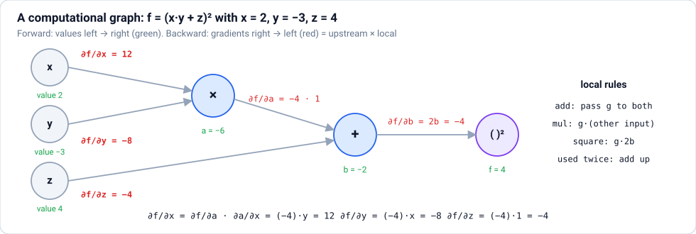

### 8.1 A computation as a graph

Every loss is built from small operations: multiply, add, sigmoid, log. Draw each operation as a node and each intermediate value as an arrow, and you get a **computational graph**. One neuron's loss for a single example:

```
w, x  ─(×)→  u = w·x  ─(+ b)→  z = u + b  ─(σ)→  p = σ(z)  ─(−log)→  L = −log p
```

Take x = 2, w = 0.5, b = −0.5, true label y = 1. The **forward pass** fills in the values left to right:

| node | value |
|---|---|
| u = w · x | 0.5 · 2 = 1.0 |
| z = u + b | 1.0 − 0.5 = 0.5 |
| p = σ(z) | 0.6225 |
| L = −log p | 0.4741 |

### 8.2 The backward pass

The chain rule says: if L depends on z only through p, then

```
∂L/∂z = ∂L/∂p · ∂p/∂z
```

So walk the graph **right to left**, carrying one number, the gradient of L with respect to the current node. At each node, multiply it by that node's **local derivative**, the slope of its output with respect to its input, which only needs the values from the forward pass:

| node | local derivative | gradient of L |
|---|---|---|
| L = −log p | ∂L/∂p = −1/p = −1.6065 | ∂L/∂p = −1.6065 |
| p = σ(z) | ∂p/∂z = p(1 − p) = 0.2350 | ∂L/∂z = −1.6065 · 0.2350 = −0.3775 |
| z = u + b | ∂z/∂u = 1, ∂z/∂b = 1 | ∂L/∂u = −0.3775, ∂L/∂b = −0.3775 |
| u = w · x | ∂u/∂w = x = 2 | ∂L/∂w = −0.3775 · 2 = −0.7551 |

Check: ∂L/∂z = p − y = 0.6225 − 1 = −0.3775, just as Chapter 6.6 promised.

```python
import numpy as np

x, w, b, y = 2.0, 0.5, -0.5, 1.0
# forward
u = w * x
z = u + b
p = 1 / (1 + np.exp(-z))
L = -np.log(p)
# backward
dL_dp = -1 / p
dL_dz = dL_dp * p * (1 - p)
dL_db = dL_dz * 1
dL_dw = dL_dz * x
print(f"L = {L:.4f}   dL/dz = {dL_dz:.4f}   dL/dw = {dL_dw:.4f}   dL/db = {dL_db:.4f}")
```

**Output:**

```text
L = 0.4741   dL/dz = -0.3775   dL/dw = -0.7551   dL/db = -0.3775
```

This backward walk is **backpropagation**, and **reverse-mode automatic differentiation** is the general name for doing it mechanically on any graph.

### 8.3 Three rules cover most nodes

Write g for the gradient arriving at a node from the right. Then:

- **add** (a + b): passes g unchanged to both inputs, since ∂(a + b)/∂a = 1.
- **multiply** (a · b): sends g · b to a and g · a to b, each input gets g times **the other** input.
- **square** (b²): sends g · 2b.

The picture at the top applies them to f = (x·y + z)² with x = 2, y = −3, z = 4. Forward: a = x·y = −6, b = a + z = −2, f = b² = 4. Backward: ∂f/∂b = 2b = −4; the add passes −4 to both a and z; the multiply sends −4 · y = 12 to x and −4 · x = −8 to y.

```python
xv, yv, zv = 2.0, -3.0, 4.0
a = xv * yv; bb = a + zv; f = bb ** 2                    # forward
df_db = 2 * bb                                           # square
df_da, df_dz = df_db, df_db                              # add
df_dx, df_dy = df_da * yv, df_da * xv                    # multiply
print(f"f = {f}, df/dx = {df_dx}, df/dy = {df_dy}, df/dz = {df_dz}")
```

**Output:**

```text
f = 4.0, df/dx = 12.0, df/dy = -8.0, df/dz = -4.0
```

### 8.4 When a value is used twice, add the gradients

If a value feeds two later nodes, a change in it affects the loss along both paths, so its gradient is the **sum** of the gradients arriving along each path. For f = x · y + x:

```
∂f/∂x = (via x·y) y + (via +x) 1 = y + 1
```

With x = 3, y = 4: f = 15 and ∂f/∂x = 5. This rule is why a network's input gradient sums contributions from every neuron that reads it (Chapter 9).

### 8.5 Checking gradients numerically

Any gradient can be checked by nudging the input a tiny amount h either way:

```
∂f/∂θ ≈ (f(θ + h) − f(θ − h)) / (2h)
```

This **central difference** is accurate to about h², far better than the one-sided (f(θ + h) − f(θ))/h.

```python
def loss(w, b):
    p = 1 / (1 + np.exp(-(w * x + b)))
    return -np.log(p)

h = 1e-5
print("numeric dL/dw:", round((loss(w + h, b) - loss(w - h, b)) / (2 * h), 4))
print("numeric dL/db:", round((loss(w, b + h) - loss(w, b - h)) / (2 * h), 4))
```

**Output:**

```text
numeric dL/dw: -0.7551
numeric dL/db: -0.3775
```

### 8.6 Why the backward pass is the right way

A numerical check needs two forward passes **per parameter**. The 784 → 256 → 10 network of Chapter 5 has 203,530 parameters, so that's 407,060 forward passes for one gradient. The backward pass gets **all** of them in one sweep, at a cost of roughly two forward passes, because each node's local derivative is reused by everything upstream of it. That efficiency is what makes training networks with billions of parameters possible. Numerical gradients are kept for one job: testing that a backward pass is correct.

### 8.7 Summary

```
forward: compute values left to right, and keep them
backward: grad(input) = grad(output) × local derivative, right to left
a value used in several places: add the gradients from each path
check: (f(θ + h) − f(θ − h)) / 2h
```

**Key terms:**

- **Computational graph:** a computation drawn as a graph of small operations and the values flowing between them.
- **Forward pass:** computing the values of the graph from inputs to the loss.
- **Backward pass (backpropagation):** computing the gradient of the loss with respect to every value, from the loss back to the inputs, with the chain rule.
- **Local derivative:** the slope of one node's output with respect to one of its inputs.
- **Chain rule:** the slope of a composition is the product of the slopes of its steps.
- **Reverse-mode automatic differentiation:** computing all gradients of one output with one backward pass over the graph.
- **Central difference:** the numerical slope (f(θ + h) − f(θ − h)) / 2h.

### Exercises

1. For f = (a + b) · c with a = 1, b = 2, c = 3, compute ∂f/∂a, ∂f/∂b and ∂f/∂c with a backward pass by hand.
2. For f = x² written as x · x, use rule 8.4 to get ∂f/∂x, and check numerically at x = 3.

<details>
<summary><b>Answers</b></summary>

```python
f = lambda a, b, c: (a + b) * c
print("df/da:", round((f(1 + h, 2, 3) - f(1 - h, 2, 3)) / (2 * h), 4))
print("df/dc:", round((f(1, 2, 3 + h) - f(1, 2, 3 - h)) / (2 * h), 4))
print("d(x·x)/dx at 3:", round(((3 + h) * (3 + h) - (3 - h) * (3 - h)) / (2 * h), 4))
```

**Output:**

```text
df/da: 3.0
df/dc: 3.0
d(x·x)/dx at 3: 6.0
```

1. Forward: s = a + b = 3, f = s · c = 9. Backward: ∂f/∂s = c = 3 and ∂f/∂c = s = 3; then the add passes the gradient through unchanged, so ∂f/∂a = ∂f/∂b = 3.
2. x appears twice in x · x. The first path gives (the other x) = 3, the second also 3, so ∂f/∂x = 3 + 3 = 6 = 2x.

</details>

| # | Problem (Deep-ML) | Difficulty |
|---|---|---|
| 1 | [116. Derivative of a Polynomial](https://www.deep-ml.com/problems/116) | 🟢 Easy |
| 2 | [214. Chain Rule for Composite Functions](https://www.deep-ml.com/problems/214) | 🟡 Medium |

---

## 9. Backpropagation from Scratch

**You need:** Chapters 5–8. · **You'll learn:** the three matrix formulas that backpropagate through any dense layer, how to check them, and how to train a real network with them in NumPy.

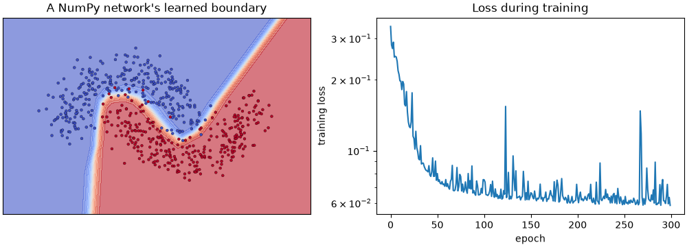

### 9.1 The backward pass of one dense layer

A dense layer computes Y = XW + b, with X (N, D_in), W (D_in, D_out), b (D_out,). In the backward pass, the layers above have already computed G = ∂L/∂Y, of shape (N, D_out). The layer must produce three things: gradients for its own W and b, and ∂L/∂X to pass further back.

```
∂L/∂W = Xᵀ G          (D_in, N) @ (N, D_out) → (D_in, D_out)
∂L/∂b = Σ over rows of G                       → (D_out,)
∂L/∂X = G Wᵀ          (N, D_out) @ (D_out, D_in) → (N, D_in)
```

<details>
<summary><b>Derivation</b></summary>

In index form, Y_ik = Σⱼ X_ij W_jk + b_k. Apply the chain rule (Chapter 8), adding over every place a value is used:

- W_jk is used in Y_ik for every example i, with local derivative X_ij. So ∂L/∂W_jk = Σᵢ G_ik X_ij, which is entry (j, k) of XᵀG.
- b_k is used in Y_ik for every i, with local derivative 1. So ∂L/∂b_k = Σᵢ G_ik.
- X_ij is used in Y_ik for every output k, with local derivative W_jk. So ∂L/∂X_ij = Σₖ G_ik W_jk, which is entry (i, j) of G Wᵀ.

</details>

A memory aid: each result must have the shape of the thing it's the gradient of, and there's only one way to multiply X or W with G to get that shape.

### 9.2 Through the activation

ReLU is applied element by element, A = max(0, Z), and its slope is 1 where Z > 0 and 0 elsewhere. So its backward pass multiplies element by element:

```
∂L/∂Z = ∂L/∂A ⊙ (Z > 0)        ⊙ = element-wise product
```

Since A > 0 exactly where Z > 0, the mask can be computed from the stored output A.

### 9.3 The whole network

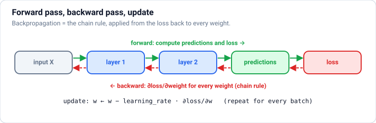

For an MLP that ends in one logit per example with binary cross-entropy, Chapter 6.6 gives the starting gradient: ∂L/∂logits = (p − y)/N. Then walk back through the layers, applying 9.1 and 9.2 in turn:

```
G = (p − y) / N
for each layer, last to first:
    ∂W = (layer input)ᵀ G,   ∂b = column sums of G
    G  = G Wᵀ ⊙ (layer input > 0)        ← for the ReLU that produced the layer's input
```

The forward pass stores each layer's input, because the backward pass needs them:

```python
import numpy as np

def relu(z):
    return np.maximum(0, z)

def init_mlp(sizes, seed=0):
    rng = np.random.default_rng(seed)
    return [(rng.normal(0, np.sqrt(2 / d_in), (d_in, d_out)), np.zeros(d_out))
            for d_in, d_out in zip(sizes[:-1], sizes[1:])]

def forward(params, X):
    inputs = [X]                                   # the input to each layer
    for k, (W, b) in enumerate(params):
        Z = inputs[-1] @ W + b
        inputs.append(relu(Z) if k < len(params) - 1 else Z)
    return inputs                                  # inputs[-1] holds the logits

def backward(params, inputs, G):
    grads = []
    for k in reversed(range(len(params))):
        W, b = params[k]
        A = inputs[k]
        grads.append((A.T @ G, G.sum(axis=0)))     # 9.1
        G = (G @ W.T) * (A > 0)                    # 9.1, then 9.2 (unused after the first layer)
    return grads[::-1]
```

The loss and its starting gradient, using the stable form from Chapter 6.5:

```python
def bce_from_logits(z, y):
    loss = np.mean(np.maximum(z, 0) - z * y + np.log1p(np.exp(-np.abs(z))))
    p = 1 / (1 + np.exp(-z))
    return loss, (p - y) / len(y)                  # loss, ∂loss/∂logits
```

### 9.4 Check it before you trust it

A small network on five examples, with every analytic gradient compared against the central difference of Chapter 8.5. The **relative error** |a − n| / (|a| + |n|) should be tiny, around 10⁻⁷ or less:

```python
rng = np.random.default_rng(1)
Xc, yc = rng.normal(size=(5, 2)), rng.integers(0, 2, (5, 1)).astype(float)
params = init_mlp([2, 3, 1], seed=1)

inputs = forward(params, Xc)
_, G = bce_from_logits(inputs[-1], yc)
grads = backward(params, inputs, G)

h, worst = 1e-6, 0.0
for (W, b), (dW, db) in zip(params, grads):
    for P, dP in [(W, dW), (b, db)]:
        for idx in np.ndindex(P.shape):
            old = P[idx]
            P[idx] = old + h; up = bce_from_logits(forward(params, Xc)[-1], yc)[0]
            P[idx] = old - h; down = bce_from_logits(forward(params, Xc)[-1], yc)[0]
            P[idx] = old
            numeric = (up - down) / (2 * h)
            worst = max(worst, abs(dP[idx] - numeric) / (abs(dP[idx]) + abs(numeric) + 1e-12))
print(f"largest relative error over all {sum(W.size + b.size for W, b in params)} parameters: {worst:.1e}")
```

**Output:**

```text
largest relative error over all 13 parameters: 6.3e-10
```

This one test catches almost every backprop bug: a missing transpose, a forgotten 1/N, a wrong mask.

### 9.5 Train it on the rings

The rings of Chapter 1, the same 600 points:

```python
rng = np.random.default_rng(0)
n = 600
y = rng.integers(0, 2, n)
radius = np.where(y == 0, 0.5, 1.0) + rng.normal(0, 0.08, n)
angle = rng.uniform(0, 2 * np.pi, n)
X = np.column_stack([radius * np.cos(angle), radius * np.sin(angle)])
X_train, X_test = X[:400], X[400:]
y_train, y_test = y[:400, None].astype(float), y[400:, None].astype(float)   # (N, 1) to match the logits
```

A 2 → 16 → 16 → 1 network, trained with mini-batch SGD (Chapter 7.4):

```python
params = init_mlp([2, 16, 16, 1], seed=0)
lr, history = 0.1, []
for epoch in range(300):
    order = rng.permutation(400)
    for start in range(0, 400, 32):
        idx = order[start:start + 32]
        inputs = forward(params, X_train[idx])
        loss, G = bce_from_logits(inputs[-1], y_train[idx])
        grads = backward(params, inputs, G)
        params = [(W - lr * dW, b - lr * db) for (W, b), (dW, db) in zip(params, grads)]
    history.append(bce_from_logits(forward(params, X_train)[-1], y_train)[0])

test_acc = np.mean((forward(params, X_test)[-1] > 0) == y_test)
print(f"loss after epoch 1: {history[0]:.3f}, after 300: {history[-1]:.3f}   test accuracy: {test_acc:.3f}")
```

**Output:**

```text
loss after epoch 1: 0.624, after 300: 0.003   test accuracy: 0.990
```

From raw x and y, the network does as well as logistic regression did with the hand-made radius feature (Chapter 1.2). A logit above 0 means p > 0.5, which is why `> 0` gives the predicted class.

### 9.6 What the hidden units learned

Chapter 1 claimed the network would invent its own features. Each hidden unit's output is a feature, so check how closely each one tracks the true distance from the centre, using the correlation (1 or −1 means a perfect straight-line relationship):

```python
inputs = forward(params, X_test)
r = np.sqrt((X_test ** 2).sum(axis=1))
for layer in [1, 2]:
    H = inputs[layer]
    corr = [abs(np.corrcoef(H[:, j], r)[0, 1]) for j in range(H.shape[1]) if H[:, j].std() > 0]
    print(f"hidden layer {layer}: best |correlation| of one unit with the radius = {max(corr):.2f}")
```

**Output:**

```text
hidden layer 1: best |correlation| of one unit with the radius = 0.37
hidden layer 2: best |correlation| of one unit with the radius = 0.96
```

A first-layer unit is one ReLU of a weighted sum, a single straight cut through the plane, so it can only partly follow a circle. The second layer combines those cuts, and its best unit follows the radius much more closely. Nobody told the network about circles. It built a radius-like feature, layer by layer, because that made the task easy.

### 9.7 Summary

```
dense layer Y = XW + b,  G = ∂L/∂Y:   ∂W = XᵀG,   ∂b = ΣᵢG,   ∂X = GWᵀ
ReLU:   ∂Z = ∂A ⊙ (Z > 0)
start:  ∂L/∂logits = (p − y)/N
check:  relative error |a − n| / (|a| + |n|) ≈ 1e-7 or less
```

**Key terms:**

- **Backpropagation:** computing the gradients of the loss with respect to every parameter by applying the chain rule backwards through the layers.
- **Upstream gradient (G):** the gradient arriving at a layer from the layers above it.
- **Element-wise product (⊙):** multiplying two arrays of the same shape number by number.
- **Gradient check:** comparing analytic gradients with numerical ones to test a backward pass.
- **Relative error:** |a − n| / (|a| + |n|), a scale-free measure of how much two numbers differ.

### Exercises

1. Train the same network with a single hidden layer of 2 units ([2, 2, 1]). What test accuracy does it reach, and why?
2. In `backward`, what goes wrong if you forget `.T` in `G @ W.T`? Try it on the gradient check.

<details>
<summary><b>Answers</b></summary>

```python
def fit(sizes, epochs=300, seed=0):
    params, rng = init_mlp(sizes, seed), np.random.default_rng(seed)
    for epoch in range(epochs):
        order = rng.permutation(400)
        for start in range(0, 400, 32):
            idx = order[start:start + 32]
            inputs = forward(params, X_train[idx])
            grads = backward(params, inputs, bce_from_logits(inputs[-1], y_train[idx])[1])
            params = [(W - lr * dW, b - lr * db) for (W, b), (dW, db) in zip(params, grads)]
    return np.mean((forward(params, X_test)[-1] > 0) == y_test)

print("2 hidden units:", fit([2, 2, 1]), "  3 hidden units:", fit([2, 3, 1]))
```

**Output:**

```text
2 hidden units: 0.8   3 hidden units: 0.98
```

1. Two ReLU units give two straight cuts, and two lines can't enclose the inner circle on every side, so accuracy stays well short of perfect. With three units the cuts can form a triangle around it.
2. For the 2 → 3 → 1 network, G @ W (without the transpose) multiplies (5, 1) by (3, 1), and NumPy raises a shape error. When the shapes happen to fit, such as square weight matrices, there's no error, just wrong gradients that only the gradient check reveals.

</details>

| # | Problem (Deep-ML) | Difficulty |
|---|---|---|
| 1 | [25. Single Neuron with Backpropagation](https://www.deep-ml.com/problems/25) | 🟡 Medium |

<details>
<summary><b>Code for the chart at the top</b></summary>

```python
import matplotlib.pyplot as plt

xx, yy = np.meshgrid(np.linspace(-1.5, 1.5, 300), np.linspace(-1.5, 1.5, 300))
grid_logits = forward(params, np.column_stack([xx.ravel(), yy.ravel()]))[-1]
fig, axes = plt.subplots(1, 2, figsize=(9, 3.8), layout="constrained")
axes[0].contourf(xx, yy, (grid_logits > 0).reshape(xx.shape), alpha=0.25, cmap="coolwarm")
axes[0].scatter(X_test[:, 0], X_test[:, 1], c=y_test.ravel(), s=6, cmap="coolwarm")
axes[0].set(title="decision boundary (test points)", xticks=[], yticks=[], aspect="equal")
axes[1].plot(range(1, 301), history)
axes[1].set(title="training loss", xlabel="epoch", yscale="log")
fig.savefig("numpy-mlp.png", dpi=100)
plt.close(fig)
```

</details>

---

## 10. A Tiny Autograd Engine

**You need:** Chapter 8, and Python classes (`python.md`). · **You'll learn:** how a library computes gradients automatically for any code you write, by building one in about 50 lines.

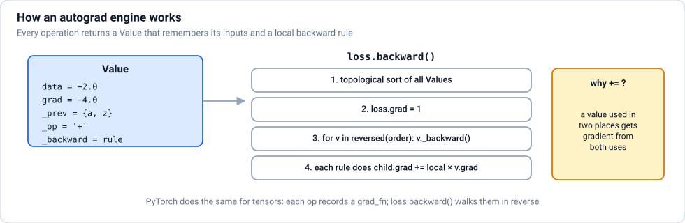

### 10.1 The idea

Chapter 9 wrote a backward pass by hand for one kind of network. Change the network and you must rewrite it. **Automatic differentiation** (**autograd**) removes that work: every operation records what it did as it runs, building the computational graph of Chapter 8 on the fly. Afterwards, one call walks the graph backwards and fills in every gradient.

Each number becomes a small object, a `Value`, that stores:

- `data`: the number itself;
- `grad`: ∂L/∂(this value), filled in by the backward pass, starting at 0;
- `_prev`: the Values it was computed from;
- `_backward`: a function that sends this value's gradient to its inputs, using the local rules of Chapter 8.3.

### 10.2 Values that record their operations

Python calls `a.__add__(b)` when you write `a + b`, and `a.__mul__(b)` for `a * b`. Defining those methods lets `Value`s be used like ordinary numbers:

```python
import math

class Value:
    def __init__(self, data, prev=(), op=""):
        self.data, self.grad = data, 0.0
        self._prev, self._op = prev, op
        self._backward = lambda: None             # leaves have nothing to pass back

    def __add__(self, other):
        other = other if isinstance(other, Value) else Value(other)
        out = Value(self.data + other.data, (self, other), "+")
        def _backward():                          # add: pass the gradient to both inputs
            self.grad += out.grad
            other.grad += out.grad
        out._backward = _backward
        return out

    def __mul__(self, other):
        other = other if isinstance(other, Value) else Value(other)
        out = Value(self.data * other.data, (self, other), "*")
        def _backward():                          # multiply: gradient times the other input
            self.grad += other.data * out.grad
            other.grad += self.data * out.grad
        out._backward = _backward
        return out

    def __pow__(self, k):                         # k is a plain number
        out = Value(self.data ** k, (self,), f"**{k}")
        def _backward():
            self.grad += k * self.data ** (k - 1) * out.grad
        out._backward = _backward
        return out

    def tanh(self):
        t = math.tanh(self.data)
        out = Value(t, (self,), "tanh")
        def _backward():
            self.grad += (1 - t ** 2) * out.grad
        out._backward = _backward
        return out

    def __neg__(self): return self * -1
    def __sub__(self, other): return self + (-other)
    def __radd__(self, other): return self + other    # lets 2 + Value work, and sum() too
    def __rmul__(self, other): return self * other
    def __repr__(self): return f"Value(data={self.data:.4f}, grad={self.grad:.4f})"
```

Every `_backward` uses `+=`, not `=`. That's rule 8.4: a value used in several places collects gradient from each use.

### 10.3 The backward pass: reverse topological order

A value's gradient is complete only once **every** value computed from it has passed its gradient back. So the backward pass must visit the nodes in reverse of an order where each node comes after its inputs, a **topological order**. A depth-first walk builds one: visit a node's inputs first, then append the node.

```python
def backward(self):
    order, seen = [], set()
    def visit(v):
        if v not in seen:
            seen.add(v)
            for p in v._prev:
                visit(p)
            order.append(v)                       # after all of its inputs
    visit(self)
    self.grad = 1.0                               # ∂L/∂L = 1
    for v in reversed(order):
        v._backward()

Value.backward = backward
```

### 10.4 It reproduces Chapter 8

The example from the picture in Chapter 8, f = (x·y + z)²:

```python
x, y, z = Value(2.0), Value(-3.0), Value(4.0)
f = (x * y + z) ** 2
f.backward()
print(f)
print("x:", x, "\ny:", y, "\nz:", z)
```

**Output:**

```text
Value(data=4.0000, grad=1.0000)
x: Value(data=2.0000, grad=12.0000) 
y: Value(data=-3.0000, grad=-8.0000) 
z: Value(data=4.0000, grad=-4.0000)
```

The same gradients as the hand calculation: 12, −8 and −4. And x² written as x · x gets both contributions:

```python
x = Value(3.0)
(x * x).backward()
print(x.grad)
```

**Output:**

```text
6.0
```

### 10.5 Train a network with it

A neuron is a weighted sum and a tanh; a layer is a list of neurons; an MLP is a list of layers. Because every operation records itself, nothing here mentions gradients:

```python
import random
random.seed(0)

class Neuron:
    def __init__(self, n_in):
        self.w = [Value(random.uniform(-1, 1)) for _ in range(n_in)]
        self.b = Value(0.0)
    def __call__(self, x):
        return (sum(wi * xi for wi, xi in zip(self.w, x)) + self.b).tanh()
    def parameters(self):
        return self.w + [self.b]

class MLP:
    def __init__(self, sizes):
        self.layers = [[Neuron(a) for _ in range(b)] for a, b in zip(sizes[:-1], sizes[1:])]
    def __call__(self, x):
        for layer in self.layers:
            x = [neuron(x) for neuron in layer]
        return x[0]
    def parameters(self):
        return [p for layer in self.layers for neuron in layer for p in neuron.parameters()]
```

`__call__` lets you write `neuron(x)` as if it were a function. Train it on XOR (targets −1 and 1, to match tanh's range) with squared error:

```python
X = [[0, 0], [0, 1], [1, 0], [1, 1]]
targets = [-1, 1, 1, -1]
net = MLP([2, 4, 1])

for step in range(201):
    loss = sum((net(x) - t) ** 2 for x, t in zip(X, targets))
    for p in net.parameters():
        p.grad = 0.0                              # gradients add up, so reset them every step
    loss.backward()
    for p in net.parameters():
        p.data -= 0.05 * p.grad
    if step % 50 == 0:
        print(f"step {step:3d}  loss {loss.data:.4f}")
print("predictions:", [round(net(x).data, 2) for x in X])
```

**Output:**

```text
step   0  loss 4.1676
step  50  loss 2.0879
step 100  loss 0.2920
step 150  loss 0.1026
step 200  loss 0.0569
predictions: [-0.91, 0.88, 0.88, -0.86]
```

Notice the reset to 0 before each backward pass. Because `_backward` adds into `grad`, skipping it would mix this step's gradient with every earlier one. PyTorch behaves exactly the same way, which is why every PyTorch training loop resets its gradients (Chapter 14).

### 10.6 From scalars to tensors

This engine creates one Python object per number, so it's millions of times too slow for real networks. PyTorch (Chapter 12) applies the same idea to **tensors**: each operation, such as a matrix multiplication, records one node with a backward rule like those of Chapter 9.1, and the backward pass runs in fast compiled code on CPUs or GPUs. Conceptually, though, it's this chapter.

### 10.7 Summary

```
each op:   out = Value(result, inputs);  out._backward adds  local derivative × out.grad  into each input's grad
backward:  topological order → set L.grad = 1 → run each _backward in reverse order
training:  zero the grads → loss.backward() → p.data -= lr · p.grad
```

**Key terms:**

- **Automatic differentiation (autograd):** computing gradients automatically by recording each operation as it runs and then applying the chain rule backwards.
- **Leaf:** a value that wasn't computed from other values, such as a parameter or an input.
- **Topological order:** an ordering of a graph's nodes in which every node comes after all of its inputs.
- **Operator overloading:** defining methods such as `__add__` so that `+` and `*` work on your own objects.
- **Gradient accumulation:** gradients being added into `grad` rather than replacing it, which is why they're reset before each backward pass.

### Exercises

1. Add a `relu` method to `Value` (output max(0, x); local derivative 1 if x > 0, else 0) and check it on x = −2 and x = 3.
2. Remove the line that resets the gradients and train again. What happens to the loss?

<details>
<summary><b>Answers</b></summary>

```python
def relu(self):
    out = Value(max(0.0, self.data), (self,), "relu")
    def _backward():
        self.grad += (1.0 if self.data > 0 else 0.0) * out.grad
    out._backward = _backward
    return out
Value.relu = relu

for v in [Value(-2.0), Value(3.0)]:
    out = v.relu() * 5
    out.backward()
    print(v)

random.seed(0)
net = MLP([2, 4, 1])
for step in range(201):
    loss = sum((net(x) - t) ** 2 for x, t in zip(X, targets))
    loss.backward()                               # no reset
    for p in net.parameters():
        p.data -= 0.05 * p.grad
    if step % 50 == 0:
        print(f"step {step:3d}  loss {loss.data:.4f}")
print("largest weight:", round(max(abs(p.data) for p in net.parameters()), 1))
```

**Output:**

```text
Value(data=-2.0000, grad=0.0000)
Value(data=3.0000, grad=5.0000)
step   0  loss 4.1676
step  50  loss 0.0000
step 100  loss 0.0000
step 150  loss 0.0000
step 200  loss 0.0000
largest weight: 60.1
```

1. The gradient is 0 for x = −2, and 5 for x = 3.
2. Surprisingly, it still learns XOR here, even faster. Each step uses the **sum** of all gradients so far, so on a problem where the gradient keeps pointing the same way, the steps keep growing, a bit like the momentum of Chapter 19. The weights become huge and the tanh units saturate at exactly ±1. It's still a bug: the steps never shrink, and they follow old gradients that may no longer point downhill, so on real problems training diverges. Never rely on it.

</details>

| # | Problem (Deep-ML) | Difficulty |
|---|---|---|
| 1 | [26. Implementing Basic Autograd Operations](https://www.deep-ml.com/problems/26) | 🟡 Medium |

**Learn more:** [Andrej Karpathy: micrograd and the video that builds it](https://github.com/karpathy/micrograd)

---

# Part III — PyTorch

Seven chapters that replace each piece of Part II with its PyTorch version: tensors, autograd, modules, losses and optimisers, data loading, the training loop and checkpoints. Each one is checked against the NumPy code you already understand.

---

## 11. PyTorch Tensors

**You need:** Chapter 2. · **You'll learn:** PyTorch's tensor, which works like a NumPy array but can also run on a GPU and record gradients.

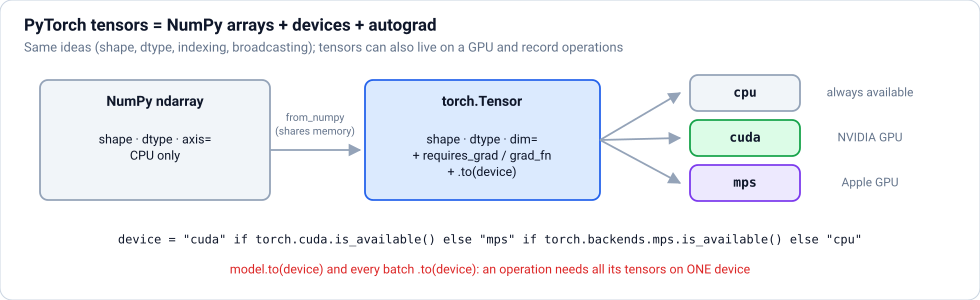

### 11.1 Creating tensors

`import torch` gives you the library. A `torch.Tensor` behaves almost exactly like a NumPy array:

```python
import torch
import numpy as np

a = torch.tensor([[1.0, 2.0], [3.0, 4.0]])
print(a)
print(a.shape, a.dtype)
print(torch.zeros(2, 3).shape, torch.arange(5), torch.randn(2, 2).dtype)
```

**Output:**

```text
tensor([[1., 2.],
        [3., 4.]])
torch.Size([2, 2]) torch.float32
torch.Size([2, 3]) tensor([0, 1, 2, 3, 4]) torch.float32
```

`torch.randn` draws from a standard normal distribution, like `np.random.normal`. Note the default **dtype**: PyTorch uses `float32`, where NumPy uses `float64`. Networks almost always train in float32 (or smaller formats, Chapter 49), because it halves memory and is much faster on GPUs.

### 11.2 The same operations as NumPy

Indexing, slicing, broadcasting, matrix multiplication and reductions all work the way Chapter 2 described. Reductions take `dim=` where NumPy takes `axis=`:

```python
X = torch.randn(32, 784)
W = torch.randn(784, 10)
b = torch.zeros(10)
print((X @ W + b).shape)               # (32, 784) @ (784, 10) + (10,)
print(X[:2, :3])                       # first 2 rows, first 3 columns
print(X.mean(dim=0).shape, X.reshape(32, 28, 28).shape)
```

**Output:**

```text
torch.Size([32, 10])
tensor([[-0.4871, -0.0178, -0.4774],
        [ 1.1970, -0.5149,  0.2752]])
torch.Size([784]) torch.Size([32, 28, 28])
```

### 11.3 To and from NumPy

`torch.from_numpy` and `.numpy()` convert without copying: the tensor and the array **share memory**, so changing one changes the other. `from_numpy` also keeps NumPy's dtype, so float64 arrays need `.float()` to become float32:

```python
arr = np.array([1.0, 2.0, 3.0])
t = torch.from_numpy(arr)
arr[0] = 100.0                        # change the array...
print(t, t.dtype)                     # ...and the tensor sees it
print(t.float().dtype, t.numpy())
```

**Output:**

```text
tensor([100.,   2.,   3.], dtype=torch.float64) torch.float64
torch.float32 [100.   2.   3.]
```

`.item()` turns a one-element tensor into a plain Python number, which is how you print a loss:

```python
print(torch.tensor(3.5).item())
```

**Output:**

```text
3.5
```

### 11.4 Devices

Every tensor lives on a **device**: `"cpu"`, `"cuda"` (an NVIDIA GPU) or `"mps"` (an Apple Silicon GPU). Operations need all their tensors on the same device. `.to(device)` returns a copy on another device:

```python
if torch.cuda.is_available():
    device = "cuda"
elif torch.backends.mps.is_available():
    device = "mps"
else:
    device = "cpu"
print("best device on this machine:", device)

x = torch.randn(3, 3).to(device)
print(x.device)
```

**Output:**

```text
best device on this machine: mps
mps:0
```

The usual pattern is to choose the device once at the top of a script and move the model and each batch to it. The same code then runs on any machine. This book's examples use the CPU so that every reader gets the same numbers; on a GPU you'd change only the `device` line.

### 11.5 Summary

```
torch.tensor(data) · torch.zeros/ones/randn(shape) · torch.arange(n)      default dtype float32
same as NumPy: indexing, broadcasting, @, reshape;  reductions use dim= instead of axis=
torch.from_numpy(arr) and t.numpy() share memory;  t.item() → Python number
t.to(device),  device = "cuda" / "mps" / "cpu"
```

**Key terms:**

- **PyTorch tensor (`torch.Tensor`):** PyTorch's n-dimensional array; it can live on a GPU and record operations for gradients.
- **float32:** a 32-bit floating-point number, the default dtype for training.
- **Device:** where a tensor is stored and computed: the CPU, an NVIDIA GPU (`cuda`) or an Apple GPU (`mps`).
- **CUDA:** NVIDIA's platform for running computations on its GPUs.
- **MPS (Metal Performance Shaders):** Apple's platform for running computations on Apple Silicon GPUs.
- **Shared memory:** two objects reading and writing the same numbers in memory, so a change to one shows in the other.

### Exercises

1. Create a (3, 4) tensor of the numbers 0 to 11, then compute the sum of each row and the mean of each column.
2. `torch.tensor(arr)` copies, while `torch.from_numpy(arr)` doesn't. Show the difference.

<details>
<summary><b>Answers</b></summary>

```python
m = torch.arange(12).reshape(3, 4).float()
print(m.sum(dim=1), m.mean(dim=0))

arr = np.zeros(2)
copied, shared = torch.tensor(arr), torch.from_numpy(arr)
arr[0] = 7
print(copied, shared)
```

**Output:**

```text
tensor([ 6., 22., 38.]) tensor([4., 5., 6., 7.])
tensor([0., 0.], dtype=torch.float64) tensor([7., 0.], dtype=torch.float64)
```

1. `dim=1` sums across the columns (one total per row); `dim=0` averages down the rows. `.float()` is needed because `arange` gives integers, and `mean` needs floats.
2. The copy still holds 0; the shared tensor shows the 7.

</details>

**Learn more:** [PyTorch: tensors tutorial](https://pytorch.org/tutorials/beginner/basics/tensorqs_tutorial.html)

---

## 12. Autograd in PyTorch

**You need:** Chapters 9–11. · **You'll learn:** how PyTorch builds the computational graph as your code runs and computes every gradient with one call to `backward()`.

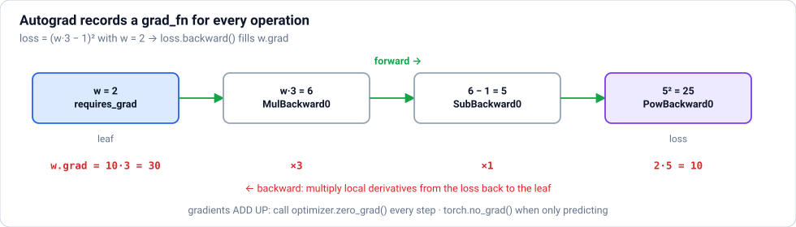

### 12.1 requires_grad and backward

PyTorch's autograd is Chapter 10's `Value` engine, for tensors. Mark a tensor with `requires_grad=True`, compute with it, and call `.backward()` on the final scalar. The gradient appears in `.grad`:

```python
import torch

x = torch.tensor(2.0, requires_grad=True)
y = torch.tensor(-3.0, requires_grad=True)
z = torch.tensor(4.0, requires_grad=True)
f = (x * y + z) ** 2
f.backward()
print(f.item(), x.grad, y.grad, z.grad)
```

**Output:**

```text
4.0 tensor(12.) tensor(-8.) tensor(-4.)
```

The same 12, −8 and −4 as Chapters 8 and 10.

### 12.2 The recorded graph

Every result of an operation on such tensors carries a `grad_fn`, the node that knows how to pass gradients back to its inputs. The picture at the top shows the graph for loss = (3w − 1)² at w = 2. Following `next_functions` walks it from the loss back to w:

```python
w = torch.tensor(2.0, requires_grad=True)
loss = (w * 3 - 1) ** 2
node = loss.grad_fn
while node is not None:
    print(type(node).__name__)
    node = node.next_functions[0][0] if node.next_functions else None
loss.backward()
print("w.grad:", w.grad)
```

**Output:**

```text
PowBackward0
SubBackward0
MulBackward0
AccumulateGrad
w.grad: tensor(30.)
```

`PowBackward0` is the squaring, `SubBackward0` the − 1 and `MulBackward0` the × 3. The chain ends at the **leaf** w, whose node `AccumulateGrad` adds the incoming gradient into `w.grad`. By hand: 2 · 5 · 3 = 30.

### 12.3 It matches our NumPy backpropagation

The real test: a 2 → 3 → 1 network with the same weights in NumPy (Chapter 9) and in PyTorch should get the same gradients. In PyTorch you only write the forward pass:

```python
import numpy as np

rng = np.random.default_rng(1)
X_np, y_np = rng.normal(size=(5, 2)), rng.integers(0, 2, (5, 1)).astype(float)
W1_np, W2_np = rng.normal(size=(2, 3)), rng.normal(size=(3, 1))

# NumPy, by hand (Chapter 9)
H = np.maximum(0, X_np @ W1_np)
p = 1 / (1 + np.exp(-(H @ W2_np)))
G = (p - y_np) / 5
dW2 = H.T @ G
dW1 = X_np.T @ ((G @ W2_np.T) * (H > 0))

# PyTorch: forward only
X, y = torch.tensor(X_np), torch.tensor(y_np)
W1 = torch.tensor(W1_np, requires_grad=True)
W2 = torch.tensor(W2_np, requires_grad=True)
logits = torch.relu(X @ W1) @ W2
p_t = torch.sigmoid(logits)
loss = -(y * torch.log(p_t) + (1 - y) * torch.log(1 - p_t)).mean()
loss.backward()

print("dW1 matches:", np.allclose(W1.grad.numpy(), dW1), "  dW2 matches:", np.allclose(W2.grad.numpy(), dW2))
```

**Output:**

```text
dW1 matches: True   dW2 matches: True
```

`torch.relu` and `torch.sigmoid` are the functions of Chapter 4.

### 12.4 Gradients add up: reset them

Like Chapter 10's engine, PyTorch **adds** each backward pass's gradients into `.grad`. Calling backward twice doubles them:

```python
w = torch.tensor(1.0, requires_grad=True)
for _ in range(2):
    (3 * w).backward()
    print(w.grad)
w.grad.zero_()                         # reset; a trailing _ means "in place"
print(w.grad)
```

**Output:**

```text
tensor(3.)
tensor(6.)
tensor(0.)
```

So every training step resets the gradients before calling backward. (Chapter 50 uses this adding deliberately, to simulate bigger batches.)

### 12.5 Turning recording off

Recording costs memory and time, and when you're only predicting, or updating weights by hand, you don't want it. Two tools:

- `with torch.no_grad():` runs a block without recording anything.
- `t.detach()` returns the same numbers, cut off from the graph.

A gradient-descent update must be done without recording, otherwise the update itself would join the graph:

```python
w = torch.tensor(5.0, requires_grad=True)
for step in range(3):
    loss = (w - 2) ** 2
    loss.backward()
    with torch.no_grad():
        w -= 0.25 * w.grad             # w ← w − lr · ∂L/∂w
    w.grad.zero_()
    print(f"step {step}: w = {w.item():.3f}")

with torch.no_grad():
    print("recorded?", (w * 2).requires_grad)
print("detached:", w.detach().requires_grad)
```

**Output:**

```text
step 0: w = 3.500
step 1: w = 2.750
step 2: w = 2.375
recorded? False
detached: False
```

### 12.6 Summary

```
t = torch.tensor(..., requires_grad=True)       a leaf whose gradient you want
loss.backward()                                  fills t.grad for every leaf
gradients add up → t.grad.zero_() before the next backward
with torch.no_grad():   updates and predictions;   t.detach()   cut from the graph
```

**Key terms:**

- **requires_grad:** a tensor flag telling PyTorch to record operations on it so that gradients can be computed.
- **grad_fn:** the node attached to a computed tensor that knows how to pass gradients back to its inputs.
- **`.grad`:** where `backward()` stores the gradient of the loss with respect to a leaf tensor.
- **`torch.no_grad()`:** a block in which PyTorch records no operations.
- **detach:** returning a tensor's values without its link to the computational graph.
- **In-place operation:** an operation that changes a tensor's own memory instead of creating a new tensor; PyTorch marks these with a trailing underscore, as in `zero_()`.

### Exercises

1. Use autograd to find the slope of f(x) = x³ − 2x at x = 2, and check it against the derivative 3x² − 2.
2. What does `(w * 2).backward()` print when `w` was created without `requires_grad=True`? Why?

<details>
<summary><b>Answers</b></summary>

```python
x = torch.tensor(2.0, requires_grad=True)
(x ** 3 - 2 * x).backward()
print(x.grad, 3 * 2 ** 2 - 2)
```

**Output:**

```text
tensor(10.) 10
```

```python
plain = torch.tensor(1.0)
(plain * 2).backward()
```

**Output:**

```text
Traceback (most recent call last):
  ...
RuntimeError: element 0 of tensors does not require grad and does not have a grad_fn
```

1. 10, as 3 · 4 − 2 = 10.
2. An error: nothing in the computation requires gradients, so no graph was recorded and there's nothing to walk back through.

</details>

**Learn more:** [PyTorch: automatic differentiation tutorial](https://pytorch.org/tutorials/beginner/basics/autogradqs_tutorial.html)

---

## 13. Building Models with nn.Module

**You need:** Chapters 5 and 12. · **You'll learn:** PyTorch's way of packaging layers and their parameters, `nn.Module`, and how to write your own network as a class.

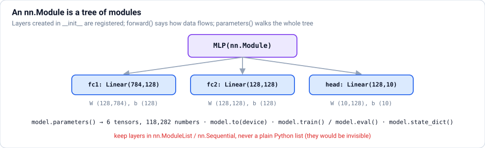

### 13.1 nn.Linear is the dense layer

`torch.nn` (imported as `nn`) holds PyTorch's building blocks. `nn.Linear(d_in, d_out)` is the dense layer of Chapter 5. It creates its weight and bias for you, already marked `requires_grad=True`:

```python
import torch
from torch import nn

torch.manual_seed(0)                          # makes the random weights repeatable
layer = nn.Linear(3, 2)
print(layer.weight.shape, layer.bias.shape, layer.weight.requires_grad)
```

**Output:**

```text
torch.Size([2, 3]) torch.Size([2]) True
```

The weight is stored as **(d_out, d_in)**, the transpose of Chapter 5's (d_in, d_out), so the layer computes y = x Wᵀ + b. Check it against the formula:

```python
x = torch.randn(4, 3)
by_hand = x @ layer.weight.T + layer.bias
print(torch.allclose(layer(x), by_hand))
```

**Output:**

```text
True
```

Calling `layer(x)` runs the layer. The weights start as small random numbers, uniform between ±1/√d_in; Chapter 18 explains why the scale matters.

### 13.2 Your own network: a class with forward

A network is a class that inherits from `nn.Module`. It has two methods:

- `__init__` creates the layers and stores them as attributes. It must first call `super().__init__()`, which sets up the module's bookkeeping.
- `forward(x)` says how data flows through them.

```python
class MLP(nn.Module):
    def __init__(self):
        super().__init__()
        self.fc1 = nn.Linear(784, 128)
        self.fc2 = nn.Linear(128, 128)
        self.head = nn.Linear(128, 10)

    def forward(self, x):
        x = torch.relu(self.fc1(x))
        x = torch.relu(self.fc2(x))
        return self.head(x)                   # logits

model = MLP()
print(model)
print(model(torch.randn(32, 784)).shape)
```

**Output:**

```text
MLP(
  (fc1): Linear(in_features=784, out_features=128, bias=True)
  (fc2): Linear(in_features=128, out_features=128, bias=True)
  (head): Linear(in_features=128, out_features=10, bias=True)
)
torch.Size([32, 10])
```

You call `model(x)`, never `model.forward(x)`: like `__call__` in Chapter 10, `model(x)` runs `forward` and also some extra hooks that PyTorch relies on.

### 13.3 parameters(): every weight, found for you

When you assign an `nn.Linear` (or any module) as an attribute, `nn.Module` **registers** it. `model.parameters()` then walks the whole tree and returns every weight and bias. That's what you'll hand to the optimiser in Chapter 14:

```python
for name, p in model.named_parameters():
    print(f"{name:12s} {tuple(p.shape)}")
print("total:", sum(p.numel() for p in model.parameters()))
```

**Output:**

```text
fc1.weight   (128, 784)
fc1.bias     (128,)
fc2.weight   (128, 128)
fc2.bias     (128,)
head.weight  (10, 128)
head.bias    (10,)
total: 118282
```

`numel()` is the number of elements. 784·128 + 128 + 128·128 + 128 + 128·10 + 10 = 118,282, using Chapter 5.5's formula.

### 13.4 A plain Python list hides layers

Registration only works for attributes that are modules. Layers kept in a plain list are invisible to `parameters()`, so they'd never be trained, and `.to(device)` wouldn't move them. `nn.ModuleList` is a list that registers its contents:

```python
class Hidden(nn.Module):
    def __init__(self, use_module_list):
        super().__init__()
        layers = [nn.Linear(10, 10) for _ in range(3)]
        self.layers = nn.ModuleList(layers) if use_module_list else layers

print("plain list:", sum(p.numel() for p in Hidden(False).parameters()))
print("ModuleList:", sum(p.numel() for p in Hidden(True).parameters()))
```

**Output:**

```text
plain list: 0
ModuleList: 330
```

### 13.5 nn.Sequential for simple chains

When the data just flows through layers in order, `nn.Sequential` saves writing a class. Activations are available as modules too, such as `nn.ReLU()`:

```python
mlp = nn.Sequential(
    nn.Linear(784, 128), nn.ReLU(),
    nn.Linear(128, 128), nn.ReLU(),
    nn.Linear(128, 10),
)
print(mlp(torch.randn(32, 784)).shape, sum(p.numel() for p in mlp.parameters()))
```

**Output:**

```text
torch.Size([32, 10]) 118282
```

The same network as `MLP`, with the same 118,282 parameters. Use a class when `forward` needs anything other than a straight chain: two inputs, a skip connection (Chapter 26), a loop.

### 13.6 Summary

```python
class Net(nn.Module):
    def __init__(self):
        super().__init__()
        self.layer = nn.Linear(d_in, d_out)       # registered: found by parameters()
    def forward(self, x):
        return self.layer(x)

# nn.Linear stores W as (d_out, d_in): y = x Wᵀ + b
# nn.ModuleList for lists of layers;  nn.Sequential(a, b, c) for plain chains
```

**Key terms:**

- **`nn.Module`:** the base class for every PyTorch layer and network; it registers sub-modules and parameters.
- **`nn.Linear`:** PyTorch's dense layer, computing x Wᵀ + b with W stored as (d_out, d_in).
- **forward:** the method that defines how a module turns its input into its output.
- **Registration:** a module automatically recording the sub-modules and parameters assigned as its attributes.
- **`parameters()`:** returns every learnable tensor in a module and its sub-modules.
- **`nn.ModuleList`:** a list of modules that registers each one.
- **`nn.Sequential`:** a module that runs its sub-modules one after another.

### Exercises

1. Write a module `TwoLayer(d_in, d_hidden, d_out)` that takes the sizes as arguments. How many parameters does `TwoLayer(2, 16, 1)` have?
2. Rewrite the network of Chapter 9.5 (2 → 16 → 16 → 1) with `nn.Sequential` and count its parameters.

<details>
<summary><b>Answers</b></summary>

```python
class TwoLayer(nn.Module):
    def __init__(self, d_in, d_hidden, d_out):
        super().__init__()
        self.hidden = nn.Linear(d_in, d_hidden)
        self.out = nn.Linear(d_hidden, d_out)
    def forward(self, x):
        return self.out(torch.relu(self.hidden(x)))

rings_net = nn.Sequential(nn.Linear(2, 16), nn.ReLU(), nn.Linear(16, 16), nn.ReLU(), nn.Linear(16, 1))
print(sum(p.numel() for p in TwoLayer(2, 16, 1).parameters()), sum(p.numel() for p in rings_net.parameters()))
```

**Output:**

```text
65 337
```

1. 2·16 + 16 + 16·1 + 1 = 65.
2. 48 + 272 + 17 = 337.

</details>

| # | Problem (Deep-ML) | Difficulty |
|---|---|---|
| 1 | [371. Calculate Number of Parameters in Neural Network](https://www.deep-ml.com/problems/371) | 🟢 Easy |

**Learn more:** [PyTorch: build the neural network](https://pytorch.org/tutorials/beginner/basics/buildmodel_tutorial.html)

---

## 14. Losses and Optimisers in PyTorch

**You need:** Chapters 6, 7 and 13. · **You'll learn:** PyTorch's loss functions and optimisers, and the four lines that make up every training step.

### 14.1 Loss functions take logits

`nn.CrossEntropyLoss` is Chapter 6's cross-entropy: it takes **logits** of shape (N, K) and integer class labels of shape (N,), applies the stable log-sum-exp inside, and averages over the batch. On the same numbers as Chapter 6.5 it gives the same 0.3185:

```python
import torch
from torch import nn

logits = torch.tensor([[2.0, 1.0, 0.1],
                       [0.5, 2.5, 0.3]])
labels = torch.tensor([0, 1])                 # int64 class ids
print(nn.CrossEntropyLoss()(logits, labels))
```

**Output:**

```text
tensor(0.3185)
```

The two other common losses:

- `nn.BCEWithLogitsLoss`: binary cross-entropy from one logit per example; the targets are floats (0.0 or 1.0) with the same shape as the logits.
- `nn.MSELoss`: mean squared error, for regression.

```python
z = torch.tensor([3.0, -1.0])
print(nn.BCEWithLogitsLoss()(z, torch.tensor([1.0, 0.0])))
print(nn.MSELoss()(torch.tensor([2.0, 4.0]), torch.tensor([1.0, 1.0])))      # (1 + 9) / 2
```

**Output:**

```text
tensor(0.1809)
tensor(5.)
```

Each also exists as a plain function in `torch.nn.functional`, conventionally imported as `F`: `F.cross_entropy(logits, labels)` gives the same number.

Two classic bugs: applying softmax yourself before `CrossEntropyLoss` (it's applied twice), and passing float labels to `CrossEntropyLoss` or int labels to `BCEWithLogitsLoss`.

### 14.2 The optimiser

An **optimiser** updates parameters from their gradients. `torch.optim.SGD` does Chapter 7's update θ ← θ − lr · θ.grad for every tensor it's given:

```python
torch.manual_seed(0)
model = nn.Linear(2, 1)
optimizer = torch.optim.SGD(model.parameters(), lr=0.1)

x, y = torch.randn(8, 2), torch.randn(8, 1)
loss = nn.MSELoss()(model(x), y)
loss.backward()

expected = model.weight.detach() - 0.1 * model.weight.grad      # the update, by hand
optimizer.step()
print(torch.allclose(model.weight, expected))
```

**Output:**

```text
True
```

Since gradients add up (Chapter 12.4), the optimiser also resets them: `optimizer.zero_grad()` sets the `.grad` of every parameter it holds back to nothing.

### 14.3 The training step

Every PyTorch training loop repeats the same four lines for each batch:

```python
optimizer.zero_grad()            # 1. forget the last batch's gradients
loss = loss_fn(model(x), y)      # 2. forward pass and loss
loss.backward()                  # 3. backward pass: fill every p.grad
optimizer.step()                 # 4. update every parameter
```

Retrain the rings of Chapter 9.5. The data comes from the same NumPy code, converted to float32 tensors; `torch.randperm(n)` is a shuffled 0, …, n − 1:

```python
import numpy as np

rng = np.random.default_rng(0)
n = 600
y_np = rng.integers(0, 2, n)
radius = np.where(y_np == 0, 0.5, 1.0) + rng.normal(0, 0.08, n)
angle = rng.uniform(0, 2 * np.pi, n)
X_np = np.column_stack([radius * np.cos(angle), radius * np.sin(angle)])

X = torch.tensor(X_np, dtype=torch.float32)
y = torch.tensor(y_np, dtype=torch.float32).unsqueeze(1)        # (600,) → (600, 1), to match the logits
X_train, y_train, X_test, y_test = X[:400], y[:400], X[400:], y[400:]
```

`unsqueeze(1)` inserts an axis of size 1 at position 1. The model and the loop:

```python
torch.manual_seed(0)
model = nn.Sequential(nn.Linear(2, 16), nn.ReLU(), nn.Linear(16, 16), nn.ReLU(), nn.Linear(16, 1))
loss_fn = nn.BCEWithLogitsLoss()
optimizer = torch.optim.SGD(model.parameters(), lr=0.1)

for epoch in range(300):
    order = torch.randperm(400)
    for start in range(0, 400, 32):
        idx = order[start:start + 32]
        optimizer.zero_grad()
        loss = loss_fn(model(X_train[idx]), y_train[idx])
        loss.backward()
        optimizer.step()

with torch.no_grad():
    accuracy = ((model(X_test) > 0).float() == y_test).float().mean()
print(f"final batch loss {loss.item():.4f}, test accuracy {accuracy.item():.3f}")
```

**Output:**

```text
final batch loss 0.0011, test accuracy 0.990
```

The same result as the NumPy network, with no backward pass written by hand. Everything from Chapter 9 is still happening inside `loss.backward()`.

### 14.4 Summary

```
nn.CrossEntropyLoss()(logits (N, K), labels (N,) int64)
nn.BCEWithLogitsLoss()(logits, targets as floats, same shape)        nn.MSELoss()(pred, target)
optimizer = torch.optim.SGD(model.parameters(), lr=...)
each batch:  optimizer.zero_grad() → loss = loss_fn(model(x), y) → loss.backward() → optimizer.step()
```

**Key terms:**

- **Loss function (`nn.…Loss`):** a module that computes the loss from the model's outputs and the targets.
- **`nn.CrossEntropyLoss`:** cross-entropy from logits and integer class labels.
- **`nn.BCEWithLogitsLoss`:** binary cross-entropy from logits and float 0/1 targets.
- **Optimiser:** an object that updates the parameters from their gradients, such as `torch.optim.SGD`.
- **`optimizer.step()`:** applies one update to every parameter the optimiser holds.
- **`optimizer.zero_grad()`:** resets the gradients of every parameter the optimiser holds.
- **`torch.nn.functional` (F):** the same operations as the modules, as plain functions.

### Exercises

1. Leave out `optimizer.zero_grad()` and train the rings again. What happens?
2. Check that `F.cross_entropy` gives the same number as `nn.CrossEntropyLoss` on the logits of 14.1.

<details>
<summary><b>Answers</b></summary>

```python
import torch.nn.functional as F

torch.manual_seed(0)
model = nn.Sequential(nn.Linear(2, 16), nn.ReLU(), nn.Linear(16, 16), nn.ReLU(), nn.Linear(16, 1))
optimizer = torch.optim.SGD(model.parameters(), lr=0.1)
for epoch in range(300):
    order = torch.randperm(400)
    for start in range(0, 400, 32):
        idx = order[start:start + 32]
        loss = loss_fn(model(X_train[idx]), y_train[idx])       # no zero_grad
        loss.backward()
        optimizer.step()
with torch.no_grad():
    print("test accuracy without zero_grad:", round(((model(X_test) > 0).float() == y_test).float().mean().item(), 3))

print(F.cross_entropy(logits, labels))
```

**Output:**

```text
test accuracy without zero_grad: 0.505
tensor(0.3185)
```

1. The gradients pile up across every step, so the updates become huge and point in stale directions. Training breaks down, and the accuracy falls to around chance.
2. The same 0.3185.

</details>

**Learn more:** [PyTorch: optimizing model parameters](https://pytorch.org/tutorials/beginner/basics/optimization_tutorial.html)

---

## 15. Datasets and DataLoaders

**You need:** Chapters 7 and 14. · **You'll learn:** PyTorch's two tools for feeding data, `Dataset` and `DataLoader`, and how to load the Fashion-MNIST images used in the next chapters.

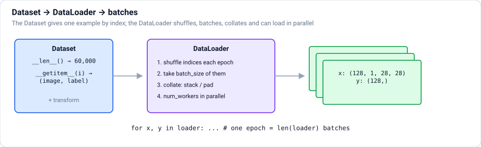

### 15.1 Why not slice tensors by hand?

Chapter 14 shuffled with `torch.randperm` and sliced batches itself. That stops working when the data doesn't fit in memory (a million photos on disk), when each example needs work to load (decode an image, tokenise a sentence), or when you want that work done in parallel while the model trains. PyTorch splits the job in two:

- a **Dataset** knows how to get **one** example;
- a **DataLoader** turns a dataset into shuffled **batches**.

### 15.2 Dataset: one example by index

A dataset is any object with two methods: `__len__()`, the number of examples, and `__getitem__(i)`, which returns example i, usually as an (input, label) pair. Python calls them for `len(ds)` and `ds[i]`.

```python
import torch
from torch.utils.data import Dataset, DataLoader, TensorDataset

class Squares(Dataset):
    """x = 0, 1, …, n−1 and label x²; computed on demand, never stored."""
    def __init__(self, n):
        self.n = n
    def __len__(self):
        return self.n
    def __getitem__(self, i):
        x = torch.tensor([float(i)])
        return x, x ** 2

ds = Squares(10)
print(len(ds), ds[3])
```

**Output:**

```text
10 (tensor([3.]), tensor([9.]))
```

When the data is already in tensors, `TensorDataset(X, y)` does this for you: `ds[i]` returns `(X[i], y[i])`.

### 15.3 DataLoader: batches

`DataLoader(dataset, batch_size, shuffle)` asks the dataset for examples one at a time and **collates** them: stacks the inputs into one tensor and the labels into another. With `shuffle=True` it draws a new random order every epoch:

```python
loader = DataLoader(ds, batch_size=4, shuffle=True)
print("batches per epoch:", len(loader))
for x, y in loader:
    print(x.shape, y.ravel().tolist())
```

**Output:**

```text
batches per epoch: 3
torch.Size([4, 1]) [49.0, 16.0, 4.0, 36.0]
torch.Size([4, 1]) [9.0, 25.0, 81.0, 64.0]
torch.Size([2, 1]) [0.0, 1.0]
```

Ten examples in batches of 4 give 3 batches; the last one holds the 2 left over (`drop_last=True` would discard it). `num_workers=4` would load batches in 4 background processes while the model trains, which matters when loading is slow.

### 15.4 Fashion-MNIST

**Fashion-MNIST** is 70,000 grayscale photos of clothes, 28×28 pixels, in 10 classes: 60,000 for training and 10,000 for testing. It's small enough to train on a laptop in seconds, but harder than the classic handwritten digits.

**torchvision**, PyTorch's companion library for images, downloads it (about 30 MB, once) into the folder `root`:

```python
from torchvision import datasets

train_raw = datasets.FashionMNIST(root="data", train=True, download=True)
test_raw = datasets.FashionMNIST(root="data", train=False, download=True)
print(len(train_raw), len(test_raw))
print(train_raw.classes)
print(train_raw.data.shape, train_raw.data.dtype, train_raw.targets[:10])
```

**Output:**

```text
60000 10000
['T-shirt/top', 'Trouser', 'Pullover', 'Dress', 'Coat', 'Sandal', 'Shirt', 'Sneaker', 'Bag', 'Ankle boot']
torch.Size([60000, 28, 28]) torch.uint8 tensor([9, 0, 0, 3, 0, 2, 7, 2, 5, 5])
```

`.data` holds every image as integers 0–255 and `.targets` the labels. Scale the pixels to [0, 1] as float32 and add the channel axis, giving the (N, 1, 28, 28) layout of Chapter 2.2:

```python
def to_tensors(raw):
    X = raw.data.float().unsqueeze(1) / 255           # (N, 28, 28) uint8 → (N, 1, 28, 28) float in [0, 1]
    return X, raw.targets

X_train_all, y_train_all = to_tensors(train_raw)
X_test, y_test = to_tensors(test_raw)
print(X_train_all.shape, X_train_all.min().item(), X_train_all.max().item())
```

**Output:**

```text
torch.Size([60000, 1, 28, 28]) 0.0 1.0
```

### 15.5 A validation set

Keep the test set for the very end (`machine-learning.md` Chapter 2). To choose settings and watch for overfitting, hold out part of the training set as a **validation set**. `random_split` does it; a seeded generator makes the split repeatable:

```python
from torch.utils.data import random_split

full_train = TensorDataset(X_train_all, y_train_all)
train_ds, val_ds = random_split(full_train, [50_000, 10_000], generator=torch.Generator().manual_seed(0))
test_ds = TensorDataset(X_test, y_test)

train_loader = DataLoader(train_ds, batch_size=128, shuffle=True)
val_loader = DataLoader(val_ds, batch_size=512)                  # no need to shuffle for evaluation
x, y = next(iter(train_loader))                                  # take one batch
print(len(train_ds), len(val_ds), "| batches per epoch:", len(train_loader), "| one batch:", x.shape, y.shape)
```

**Output:**

```text
50000 10000 | batches per epoch: 391 | one batch: torch.Size([128, 1, 28, 28]) torch.Size([128])
```

`next(iter(loader))` is the usual way to grab one batch to inspect.

### 15.6 Summary

```
Dataset:     __len__() and __getitem__(i) → (x, y);  TensorDataset(X, y) for tensors in memory
DataLoader(ds, batch_size=128, shuffle=True)   →   for x, y in loader: ...   (len = number of batches)
random_split(ds, [n_train, n_val], generator=torch.Generator().manual_seed(0))
```

**Key terms:**

- **Dataset:** an object that returns one example by index and knows how many it has.
- **DataLoader:** turns a dataset into batches, with optional shuffling and parallel loading.
- **Collate:** combining a list of single examples into batch tensors.
- **`num_workers`:** the number of background processes a DataLoader uses to load batches.
- **Fashion-MNIST:** 70,000 28×28 grayscale images of clothing in 10 classes.
- **torchvision:** PyTorch's companion library of image datasets, models and transforms.
- **Validation set:** data held out from training to choose settings and detect overfitting; the test set stays untouched until the end.

### Exercises

1. Write a `Dataset` that returns each Fashion-MNIST image **flattened** to 784 numbers, with its label. Check the shapes of one batch of 64.
2. How many batches per epoch does a loader over 50,000 examples have with `batch_size=128`, and how big is the last one?

<details>
<summary><b>Answers</b></summary>

```python
class FlatFashion(Dataset):
    def __init__(self, X, y):
        self.X, self.y = X, y
    def __len__(self):
        return len(self.y)
    def __getitem__(self, i):
        return self.X[i].reshape(-1), self.y[i]

x, y = next(iter(DataLoader(FlatFashion(X_train_all, y_train_all), batch_size=64)))
print(x.shape, y.shape, "| batches:", -(-50_000 // 128), "| last batch:", 50_000 - 390 * 128)
```

**Output:**

```text
torch.Size([64, 784]) torch.Size([64]) | batches: 391 | last batch: 80
```

1. (64, 784) and (64,).
2. ⌈50,000 / 128⌉ = 391 batches; the last holds 80 examples.

</details>

| # | Problem (Deep-ML) | Difficulty |
|---|---|---|
| 1 | [30. Batch Iterator for Dataset](https://www.deep-ml.com/problems/30) | 🟢 Easy |
| 2 | [29. Random Shuffle of Dataset](https://www.deep-ml.com/problems/29) | 🟢 Easy |

**Learn more:** [PyTorch: datasets and dataloaders](https://pytorch.org/tutorials/beginner/basics/data_tutorial.html)

---

## 16. The Training Loop

**You need:** Chapters 13–15. · **You'll learn:** the complete loop that trains and validates a network epoch by epoch, the train and eval modes, and how to read the results.

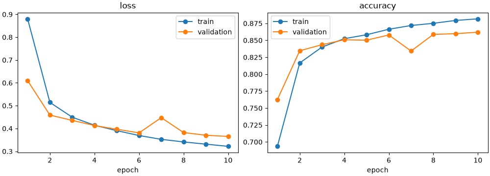

### 16.1 The plan

For each epoch:

1. **Train:** one pass over the training loader, taking a step per batch (Chapter 14.3).
2. **Validate:** one pass over the validation loader with no updates, measuring loss and accuracy.

After the last epoch, measure the test set **once**.

The data from Chapter 15, rebuilt here so the chapter runs on its own:

```python
import torch
from torch import nn
from torch.utils.data import DataLoader, TensorDataset, random_split
from torchvision import datasets

def to_tensors(raw):
    return raw.data.float().unsqueeze(1) / 255, raw.targets

train_raw = datasets.FashionMNIST(root="data", train=True, download=True)
test_raw = datasets.FashionMNIST(root="data", train=False, download=True)
full_train = TensorDataset(*to_tensors(train_raw))
test_ds = TensorDataset(*to_tensors(test_raw))
train_ds, val_ds = random_split(full_train, [50_000, 10_000], generator=torch.Generator().manual_seed(0))

train_loader = DataLoader(train_ds, batch_size=128, shuffle=True)
val_loader = DataLoader(val_ds, batch_size=512)
test_loader = DataLoader(test_ds, batch_size=512)
```

### 16.2 The model

The MLP of Chapter 13, with one change: the images arrive as (N, 1, 28, 28), so `forward` first flattens them to (N, 784). `x.flatten(1)` flattens every axis from axis 1 on:

```python
class MLP(nn.Module):
    def __init__(self):
        super().__init__()
        self.fc1 = nn.Linear(784, 128)
        self.fc2 = nn.Linear(128, 128)
        self.head = nn.Linear(128, 10)

    def forward(self, x):
        x = x.flatten(1)
        x = torch.relu(self.fc1(x))
        x = torch.relu(self.fc2(x))
        return self.head(x)
```

### 16.3 One training epoch

```python
def train_one_epoch(model, loader, loss_fn, optimizer):
    model.train()                                     # training mode (16.5)
    total_loss, correct, count = 0.0, 0, 0
    for x, y in loader:
        optimizer.zero_grad()
        logits = model(x)
        loss = loss_fn(logits, y)
        loss.backward()
        optimizer.step()
        total_loss += loss.item() * len(y)            # undo the batch mean, so the epoch mean is exact
        correct += (logits.argmax(dim=1) == y).sum().item()
        count += len(y)
    return total_loss / count, correct / count
```

`logits.argmax(dim=1)` is the predicted class: the index of the largest logit in each row. Softmax doesn't change which logit is largest, so there's no need to compute probabilities for this.

### 16.4 Evaluation

The same pass without the update, inside `torch.no_grad()` (Chapter 12.5), since no gradients are needed:

```python
def evaluate(model, loader, loss_fn):
    model.eval()                                      # evaluation mode (16.5)
    total_loss, correct, count = 0.0, 0, 0
    with torch.no_grad():
        for x, y in loader:
            logits = model(x)
            total_loss += loss_fn(logits, y).item() * len(y)
            correct += (logits.argmax(dim=1) == y).sum().item()
            count += len(y)
    return total_loss / count, correct / count
```

### 16.5 Train mode and eval mode

`model.train()` and `model.eval()` flip a switch on every module in the network. A plain MLP behaves the same in both modes. But two layers you'll meet later do behave differently: **dropout** (Chapter 22) is active only in training, and **batch normalisation** (Chapter 21) uses different statistics. Forgetting `model.eval()` is a classic bug that makes evaluation noisy and wrong, so the habit starts now: `train()` at the start of a training pass, `eval()` before evaluating or predicting.

### 16.6 Run it

```python
torch.manual_seed(0)
model = MLP()
loss_fn = nn.CrossEntropyLoss()
optimizer = torch.optim.SGD(model.parameters(), lr=0.1)

history = []
for epoch in range(1, 11):
    train_loss, train_acc = train_one_epoch(model, train_loader, loss_fn, optimizer)
    val_loss, val_acc = evaluate(model, val_loader, loss_fn)
    history.append((train_loss, val_loss, train_acc, val_acc))
    print(f"epoch {epoch:2d}  train loss {train_loss:.3f} acc {train_acc:.3f}  |  val loss {val_loss:.3f} acc {val_acc:.3f}")
```

**Output:**

```text
epoch  1  train loss 0.880 acc 0.694  |  val loss 0.610 acc 0.763
epoch  2  train loss 0.514 acc 0.817  |  val loss 0.459 acc 0.835
epoch  3  train loss 0.450 acc 0.840  |  val loss 0.436 acc 0.844
epoch  4  train loss 0.414 acc 0.852  |  val loss 0.413 acc 0.851
epoch  5  train loss 0.391 acc 0.858  |  val loss 0.397 acc 0.850
epoch  6  train loss 0.369 acc 0.866  |  val loss 0.381 acc 0.858
epoch  7  train loss 0.352 acc 0.872  |  val loss 0.447 acc 0.834
epoch  8  train loss 0.341 acc 0.875  |  val loss 0.382 acc 0.859
epoch  9  train loss 0.331 acc 0.879  |  val loss 0.370 acc 0.860
epoch 10  train loss 0.322 acc 0.882  |  val loss 0.365 acc 0.862
```

How to read it:

- The first epoch's training loss starts near log 10 ≈ 2.3, the value for random guessing (Chapter 6, Exercise 1), and drops fast.
- Both losses fall, but the training loss falls faster, and by epoch 10 it's clearly below the validation loss (0.32 against 0.37). The network is starting to fit details of the training images that don't carry over to new ones. That growing gap is **overfitting**; train for longer and it widens. Part IV is largely about controlling it.
- Validation numbers bounce from epoch to epoch (look at epoch 7), so judge the trend, not a single epoch.
- Validation accuracy ends near 86%. For comparison, logistic regression on raw pixels gets about 84% on this dataset.

### 16.7 Test once, and predict

The test set is used once, after every choice has been made:

```python
test_loss, test_acc = evaluate(model, test_loader, loss_fn)
print(f"test loss {test_loss:.3f}, test accuracy {test_acc:.3f}")
```

**Output:**

```text
test loss 0.396, test accuracy 0.856
```

To predict, switch to eval mode, turn off recording and apply softmax if you want probabilities:

```python
model.eval()
x, y = test_ds[:5]                                     # the first 5 test images
with torch.no_grad():
    probs = torch.softmax(model(x), dim=1)
for p, label in zip(probs, y):
    guess = p.argmax().item()
    print(f"predicted {train_raw.classes[guess]:12s} ({p[guess]:.2f})   true {train_raw.classes[label]}")
```

**Output:**

```text
predicted Ankle boot   (0.97)   true Ankle boot
predicted Pullover     (1.00)   true Pullover
predicted Trouser      (1.00)   true Trouser
predicted Trouser      (1.00)   true Trouser
predicted Shirt        (0.51)   true Shirt
```

On a GPU, the only changes are `model.to(device)` once, and `x, y = x.to(device), y.to(device)` at the top of each loop (Chapter 11.4).

### 16.8 Summary

```
for epoch:  model.train();  for x, y in train_loader:  zero_grad → loss → backward → step
            model.eval();   with torch.no_grad():  for x, y in val_loader:  loss, accuracy
after all choices: evaluate on the test set once
predicted class = logits.argmax(dim=1);   probabilities = torch.softmax(logits, dim=1)
```

**Key terms:**

- **Training loop:** the code that repeats training passes and validation passes over the data, epoch after epoch.
- **`model.train()` / `model.eval()`:** switch every module into training or evaluation behaviour.
- **argmax:** the index of the largest value; applied to logits it gives the predicted class.
- **Overfitting:** the model fitting details of the training data that don't generalise, seen as training loss falling while validation loss doesn't.

### Exercises

1. Train with `lr=0.01` instead of 0.1 for 10 epochs. How does the final validation accuracy compare, and why?
2. Count how many of the 10,000 test images the model gets wrong, and find the pair of classes it confuses most often.

<details>
<summary><b>Answers</b></summary>

```python
torch.manual_seed(0)
slow = MLP()
slow_opt = torch.optim.SGD(slow.parameters(), lr=0.01)
for epoch in range(10):
    train_one_epoch(slow, train_loader, loss_fn, slow_opt)
print("lr 0.01, val accuracy:", round(evaluate(slow, val_loader, loss_fn)[1], 3))

model.eval()
X_test, y_test = test_ds.tensors
with torch.no_grad():
    pred = model(X_test).argmax(dim=1)
print("wrong:", (pred != y_test).sum().item())
pairs = torch.zeros(10, 10, dtype=torch.long)
for t, p in zip(y_test, pred):
    pairs[t, p] += 1
pairs.fill_diagonal_(0)                               # ignore the correct ones
t, p = divmod(pairs.argmax().item(), 10)
print(f"most common mistake: {train_raw.classes[t]} predicted as {train_raw.classes[p]} ({pairs[t, p].item()} times)")
```

**Output:**

```text
lr 0.01, val accuracy: 0.81
wrong: 1439
most common mistake: Shirt predicted as Coat (212 times)
```

1. Lower: with steps ten times smaller, 10 epochs aren't enough to get as far. The learning rate is the first setting to tune (Chapters 19–20).
2. The table `pairs` is a **confusion matrix** (`machine-learning.md` Chapter 12). The commonest mistakes are between similar upper-body garments; here, shirts taken for coats.

</details>

| # | Problem (Deep-ML) | Difficulty |
|---|---|---|
| 1 | [36. Calculate Accuracy Score](https://www.deep-ml.com/problems/36) | 🟢 Easy |

<details>
<summary><b>Code for the chart at the top</b></summary>

```python
import matplotlib.pyplot as plt

h = torch.tensor(history)
epochs = range(1, len(history) + 1)
fig, axes = plt.subplots(1, 2, figsize=(10, 3.6), layout="constrained")
axes[0].plot(epochs, h[:, 0], marker="o", label="train"); axes[0].plot(epochs, h[:, 1], marker="o", label="validation")
axes[1].plot(epochs, h[:, 2], marker="o", label="train"); axes[1].plot(epochs, h[:, 3], marker="o", label="validation")
axes[0].set(title="loss", xlabel="epoch"); axes[1].set(title="accuracy", xlabel="epoch")
for ax in axes:
    ax.legend()
fig.savefig("fashion-curves.png", dpi=100)
plt.close(fig)
```

</details>

---

## 17. Saving, Loading and Checkpointing

**You need:** Chapter 16. · **You'll learn:** how to save a trained model, load it elsewhere, and save enough to resume an interrupted training run exactly.

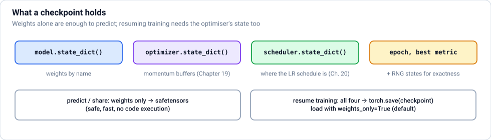

### 17.1 state_dict: the weights by name

`model.state_dict()` returns every parameter as a dictionary from name to tensor. It holds numbers only, not code: to use it you need the class that builds the network.

```python
import os, tempfile
import torch
from torch import nn

torch.manual_seed(0)
model = nn.Sequential(nn.Linear(2, 16), nn.ReLU(), nn.Linear(16, 1))
state = model.state_dict()
print({name: tuple(t.shape) for name, t in state.items()})
```

**Output:**

```text
{'0.weight': (16, 2), '0.bias': (16,), '2.weight': (1, 16), '2.bias': (1,)}
```

In an `nn.Sequential`, layers are named by position: `0` is the first `Linear`, `1` the ReLU (which has no parameters), `2` the second `Linear`.

### 17.2 Save and load the weights

`torch.save` writes it to a file; `torch.load` reads it back; `load_state_dict` copies the numbers into a freshly built model of the same shape:

```python
folder = tempfile.mkdtemp()
path = os.path.join(folder, "model.pt")
torch.save(model.state_dict(), path)

fresh = nn.Sequential(nn.Linear(2, 16), nn.ReLU(), nn.Linear(16, 1))     # same architecture, new random weights
fresh.load_state_dict(torch.load(path, weights_only=True))
x = torch.randn(3, 2)
print(torch.equal(model(x), fresh(x)))
```

**Output:**

```text
True
```

`weights_only=True` (the default) refuses to load anything except tensors and simple containers. `torch.save` uses Python's **pickle** format, and loading an arbitrary pickle can run code hidden in the file, so never turn this off for a file you didn't create.

### 17.3 safetensors for sharing

The **safetensors** format stores only named tensors, so loading one can never run code, and it loads fast. It's the standard on the Hugging Face Hub (Chapter 39):

```python
from safetensors.torch import save_file, load_file

st_path = os.path.join(folder, "model.safetensors")
save_file(model.state_dict(), st_path)
fresh.load_state_dict(load_file(st_path))
print(torch.equal(model(x), fresh(x)), os.path.getsize(st_path), "bytes")
```

**Output:**

```text
True 524 bytes
```

### 17.4 Checkpoints: resume training exactly

Training runs get interrupted: a crash, a preempted cloud machine, a laptop lid. To **resume**, the weights aren't enough. You also need:

- the **optimiser's state**: plain SGD has none, but the optimisers of Chapter 19 keep running averages of past gradients;
- the **epoch** you reached;
- the **random-number generator's state**, so the shuffling continues the same way.

A **checkpoint** is a dictionary holding all of them. Test it on the rings data: train 2 epochs, checkpoint, train 1 more. Then restore the checkpoint into fresh objects and train that same third epoch again. The two results should be identical:

```python
import numpy as np

rng = np.random.default_rng(0)
y_np = rng.integers(0, 2, 400)
r = np.where(y_np == 0, 0.5, 1.0) + rng.normal(0, 0.08, 400)
a = rng.uniform(0, 2 * np.pi, 400)
X = torch.tensor(np.column_stack([r * np.cos(a), r * np.sin(a)]), dtype=torch.float32)
y = torch.tensor(y_np, dtype=torch.float32).unsqueeze(1)

def run_epoch(model, optimizer):
    order = torch.randperm(400)                       # uses PyTorch's global random generator
    for start in range(0, 400, 32):
        idx = order[start:start + 32]
        optimizer.zero_grad()
        nn.BCEWithLogitsLoss()(model(X[idx]), y[idx]).backward()
        optimizer.step()

def new_model():
    return nn.Sequential(nn.Linear(2, 16), nn.ReLU(), nn.Linear(16, 1))
```

```python
torch.manual_seed(0)
model = new_model()
optimizer = torch.optim.SGD(model.parameters(), lr=0.1, momentum=0.9)   # momentum: state to save (Chapter 19)
for epoch in range(2):
    run_epoch(model, optimizer)

checkpoint = {
    "model": model.state_dict(),
    "optimizer": optimizer.state_dict(),
    "epoch": 2,
    "rng": torch.get_rng_state(),
}
torch.save(checkpoint, os.path.join(folder, "checkpoint.pt"))

run_epoch(model, optimizer)                           # epoch 3, uninterrupted
uninterrupted = model[0].weight.detach().clone()
```

`momentum=0.9` makes SGD keep a running average of past gradients for each parameter (Chapter 19 explains it); here it just gives the optimiser some state that must be saved. Now "restart the machine": build everything fresh and restore it:

```python
ckpt = torch.load(os.path.join(folder, "checkpoint.pt"), weights_only=True)
model = new_model()
optimizer = torch.optim.SGD(model.parameters(), lr=0.1, momentum=0.9)
model.load_state_dict(ckpt["model"])
optimizer.load_state_dict(ckpt["optimizer"])
torch.set_rng_state(ckpt["rng"])

run_epoch(model, optimizer)                           # epoch 3, resumed
print("resumed run identical:", torch.equal(model[0].weight, uninterrupted))
```

**Output:**

```text
resumed run identical: True
```

Drop any one of the three restores and the resumed run drifts away from the uninterrupted one (Exercise 1).

### 17.5 Keep the best, not the last

Validation accuracy bounces from epoch to epoch (Chapter 16.6). So while training, save a checkpoint whenever the validation score beats the best so far, and use that one at the end. Chapter 22 turns this into **early stopping**.

### 17.6 Summary

```
torch.save(model.state_dict(), path);   model.load_state_dict(torch.load(path, weights_only=True))
sharing: safetensors (save_file / load_file): tensors only, no code
checkpoint = {"model": …, "optimizer": optimizer.state_dict(), "epoch": …, "rng": torch.get_rng_state()}
```

**Key terms:**

- **state_dict:** a dictionary from each parameter's name to its tensor.
- **pickle:** Python's general object-saving format; loading an untrusted pickle can run arbitrary code.
- **safetensors:** a file format that stores only tensors, so loading it is safe and fast.
- **Checkpoint:** a saved snapshot of everything needed to resume training: weights, optimiser state, epoch and random state.
- **Optimiser state:** values an optimiser keeps between steps, such as running averages of gradients.

### Exercises

1. Repeat the resume test without restoring the random state. Is the result still identical?
2. Why does a checkpoint store `optimizer.state_dict()` and not the optimiser object itself?

<details>
<summary><b>Answers</b></summary>

```python
model = new_model()
optimizer = torch.optim.SGD(model.parameters(), lr=0.1, momentum=0.9)
model.load_state_dict(ckpt["model"])
optimizer.load_state_dict(ckpt["optimizer"])
run_epoch(model, optimizer)                           # random state not restored
print("identical without the RNG state:", torch.equal(model[0].weight, uninterrupted))
```

**Output:**

```text
identical without the RNG state: False
```

1. No: the third epoch shuffles the batches in a different order, so the updates differ.
2. The optimiser object holds references to one particular model's parameter tensors. The state_dict holds just the numbers, which can be loaded into a new optimiser built around the new model's parameters.

</details>

**Learn more:** [PyTorch: saving and loading models](https://pytorch.org/tutorials/beginner/saving_loading_models.html)

---

# Part IV — Making Training Work

Six chapters on what decides whether a deep network trains well, or at all: the starting weights, the optimiser, the learning-rate schedule, normalisation, regularisation and debugging.

---

## 18. Initialisation, and Vanishing and Exploding Gradients

**You need:** Chapters 4, 9 and 16. · **You'll learn:** why the scale of the starting weights decides whether a deep network can learn, the formula that gets it right, and gradient clipping.

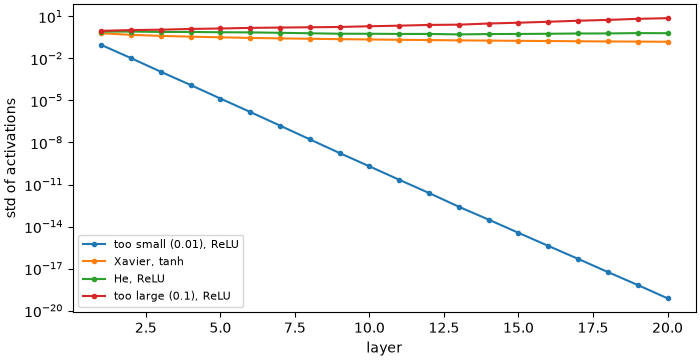

### 18.1 The problem

Push a batch of random inputs through 20 layers of 256 ReLU units, with every weight drawn from a normal distribution of standard deviation σ, and measure how spread out the values are after each layer:

```python
import torch

def spread(sigma, layers=20, width=256, seed=0):
    torch.manual_seed(seed)
    x = torch.randn(1000, width)
    stds = []
    for _ in range(layers):
        W = torch.randn(width, width) * sigma
        x = torch.relu(x @ W)
        stds.append(x.std().item())
    return stds

for sigma in [0.01, 0.1, (2 / 256) ** 0.5]:
    s = spread(sigma)
    print(f"σ = {sigma:.4f}: std after layer 1 {s[0]:.3g}, layer 10 {s[9]:.3g}, layer 20 {s[19]:.3g}")
```

**Output:**

```text
σ = 0.0100: std after layer 1 0.0934, layer 10 1.99e-10, layer 20 7.5e-20
σ = 0.1000: std after layer 1 0.934, layer 10 1.99, layer 20 7.5
σ = 0.0884: std after layer 1 0.826, layer 10 0.579, layer 20 0.635
```

- σ = 0.01: the signal shrinks by the same factor at every layer, and after 20 layers it's practically 0. The output no longer depends on the input.
- σ = 0.1: it grows by the same factor at every layer. A deeper network would overflow.
- σ = √(2/256) ≈ 0.088: it stays steady.

The backward pass multiplies by the same weights (Chapter 9.1: ∂X = G Wᵀ), so the gradients shrink or grow in the same way. Shrinking gives **vanishing gradients** (early layers don't learn); growing gives **exploding gradients** (updates so big that training blows up). The third σ wasn't luck.

### 18.2 The right scale

One unit computes z = Σᵢ wᵢxᵢ over n inputs (n is called the **fan-in**). If the weights are independent of the inputs, with mean 0 and variance Var(w), then:

```
Var(z) = n · Var(w) · E[x²]
```

<details>
<summary><b>Derivation</b></summary>

Each term wᵢxᵢ has mean E[wᵢ]E[xᵢ] = 0 (since E[w] = 0), so its variance is E[wᵢ²xᵢ²] = E[wᵢ²]E[xᵢ²] = Var(w) · E[x²]. The n terms are independent, so their variances add: Var(z) = n · Var(w) · E[x²].

</details>

To keep the spread the same from layer to layer, choose Var(w) so that the factor in front is 1:

- **Xavier (Glorot) initialisation**, for tanh or no activation. Near 0, tanh(z) ≈ z, so E[x²] for the next layer ≈ Var(z). Setting n · Var(w) = 1 gives **Var(w) = 1/n**. (The original paper averages the fan-in and fan-out: 2/(n_in + n_out).)
- **He (Kaiming) initialisation**, for ReLU. ReLU zeroes the negative half of a symmetric z, which halves its mean square: E[ReLU(z)²] = Var(z)/2. To make up for that, double the variance: **Var(w) = 2/n**, so σ = √(2/n).

For 256 inputs, He gives σ = √(2/256) = 0.088, the steady value above.

### 18.3 Gradients, layer by layer

The same effect, seen in the gradients of a real network: a 20-layer network of 128 units, comparing sigmoid with small weights against ReLU with He initialisation. `nn.init.normal_` and `nn.init.kaiming_normal_` overwrite a weight tensor in place:

```python
from torch import nn

def first_and_last_grad(init, activation, depth=20):
    torch.manual_seed(0)
    layers = []
    for _ in range(depth):
        linear = nn.Linear(128, 128)
        init(linear.weight)
        layers += [linear, activation()]
    net = nn.Sequential(*layers, nn.Linear(128, 1))
    net(torch.randn(64, 128)).pow(2).mean().backward()
    return net[0].weight.grad.norm().item(), net[2 * depth - 2].weight.grad.norm().item()

for name, init, act in [("sigmoid, std 0.05", lambda w: nn.init.normal_(w, std=0.05), nn.Sigmoid),
                        ("ReLU, He", lambda w: nn.init.kaiming_normal_(w, nonlinearity="relu"), nn.ReLU)]:
    first, last = first_and_last_grad(init, act)
    print(f"{name:18s} gradient size: first layer {first:.1e}, last hidden layer {last:.1e}")
```

**Output:**

```text
sigmoid, std 0.05  gradient size: first layer 1.6e-17, last hidden layer 7.9e-01
ReLU, He           gradient size: first layer 3.1e-01, last hidden layer 1.3e+00
```

`*layers` unpacks the list into separate arguments. `.norm()` is the length √(Σ g²) of the gradient. In the sigmoid network the first layer's gradient is many orders of magnitude smaller than the last layer's, so the first layers barely move: the vanishing gradient of Chapter 4.3 in action. With ReLU and He initialisation they're within a small factor of each other.

### 18.4 What PyTorch does by default

`nn.Linear` initialises its weights uniformly in ±1/√n, which has variance 1/(3n), a little below Xavier. It works well for networks of moderate depth with normalisation layers (Chapter 21). For deep plain ReLU stacks, call `nn.init.kaiming_normal_` yourself, as above; `nn.init.xavier_uniform_` is the Xavier version.

Never initialise every weight to the same value. Then every unit in a layer computes the same thing and receives the same gradient, so they stay identical for ever, and the layer behaves like a single unit (Exercise 1). Random starting weights **break the symmetry**.

### 18.5 Gradient clipping

Even with good initialisation, an unlucky batch can produce a huge gradient and one wild step can undo hours of training. **Gradient clipping by norm** caps the length of the whole gradient vector g (all parameters together) at c, keeping its direction:

```
if ‖g‖ > c:   g ← g · c / ‖g‖
```

`torch.nn.utils.clip_grad_norm_` does it between `backward()` and `step()`, and returns the norm it measured before clipping:

```python
w = torch.zeros(3, requires_grad=True)
(w * torch.tensor([1e3, -2e3, 5e2])).sum().backward()
before = torch.nn.utils.clip_grad_norm_([w], max_norm=1.0)
print(f"norm before {before:.1f}, after {w.grad.norm():.3f}, gradient {w.grad.round(decimals=3).tolist()}")
```

**Output:**

```text
norm before 2291.3, after 1.000, gradient [0.4359999895095825, -0.8730000257492065, 0.21799999475479126]
```

Clipping at 1.0 is standard when training transformers. Logging the pre-clip norm is also a cheap health check: sudden spikes warn of trouble before the loss shows it (Chapter 23).

### 18.6 Summary

```
Var(z) = n · Var(w) · E[x²]              n = fan-in
Xavier (tanh / none):  Var(w) = 1/n      (or 2/(n_in + n_out))
He (ReLU):             Var(w) = 2/n,  σ = √(2/n)
clip by norm:          if ‖g‖ > c:  g ← g · c/‖g‖       clip_grad_norm_(model.parameters(), c)
```

**Key terms:**

- **Initialisation:** choosing a network's starting weights.
- **Fan-in:** the number of inputs to a unit.
- **Xavier (Glorot) initialisation:** weights with variance 1/fan-in (or 2/(fan-in + fan-out)), for tanh or linear layers.
- **He (Kaiming) initialisation:** weights with variance 2/fan-in, for ReLU layers.
- **Exploding gradients:** gradients growing layer after layer until updates become huge and training diverges.
- **Symmetry breaking:** using random starting weights so that units in a layer learn different features.
- **Gradient clipping:** shrinking the gradient when its norm exceeds a limit, keeping its direction.
- **Norm (‖g‖):** the length of a vector, √(Σ gᵢ²).

### Exercises

1. Set every weight and bias of a 4 → 3 → 1 network to 0.5 and train it for 20 steps. Print the first layer's weights. What do you notice?
2. What standard deviation does He initialisation give a layer with 512 inputs? With 4,096?

<details>
<summary><b>Answers</b></summary>

```python
torch.manual_seed(0)
net = nn.Sequential(nn.Linear(4, 3), nn.ReLU(), nn.Linear(3, 1))
for p in net.parameters():
    nn.init.constant_(p, 0.5)
optimizer = torch.optim.SGD(net.parameters(), lr=0.1)
X, y = torch.randn(32, 4), torch.randn(32, 1)
for _ in range(20):
    optimizer.zero_grad()
    nn.MSELoss()(net(X), y).backward()
    optimizer.step()
print(net[0].weight.detach().round(decimals=3))
print("He std:", round((2 / 512) ** 0.5, 4), round((2 / 4096) ** 0.5, 4))
```

**Output:**

```text
tensor([[0.3750, 0.4190, 0.4030, 0.3150],
        [0.3750, 0.4190, 0.4030, 0.3150],
        [0.3750, 0.4190, 0.4030, 0.3150]])
He std: 0.0625 0.0221
```

1. All three rows, one per hidden unit, are still identical: the units got identical gradients at every step. The layer has learned only one feature.
2. √(2/512) = 0.0625 and √(2/4096) ≈ 0.0221. Wider layers need smaller weights.

</details>

| # | Problem (Deep-ML) | Difficulty |
|---|---|---|
| 1 | [369. Implement Xavier/Glorot Weight Initialization](https://www.deep-ml.com/problems/369) | 🟢 Easy |
| 2 | [290. Implement He Weight Initialization](https://www.deep-ml.com/problems/290) | 🟢 Easy |
| 3 | [197. Gradient Clipping by Global Norm](https://www.deep-ml.com/problems/197) | 🟡 Medium |

**Learn more:** [deeplearning.ai: initialising neural networks (interactive)](https://www.deeplearning.ai/ai-notes/initialization/index.html)

<details>
<summary><b>Code for the chart at the top</b></summary>

```python
import matplotlib.pyplot as plt

def spread_with(init_std, act, layers=20, width=256):
    torch.manual_seed(0)
    x, stds = torch.randn(1000, width), []
    for _ in range(layers):
        x = act(x @ (torch.randn(width, width) * init_std))
        stds.append(x.std().item())
    return stds

fig, ax = plt.subplots(figsize=(7, 3.6), layout="constrained")
for label, std, act in [("too small (0.01), ReLU", 0.01, torch.relu), ("Xavier, tanh", (1 / 256) ** 0.5, torch.tanh),
                        ("He, ReLU", (2 / 256) ** 0.5, torch.relu), ("too large (0.1), ReLU", 0.1, torch.relu)]:
    ax.plot(range(1, 21), spread_with(std, act), "o-", ms=3, label=label)
ax.set(yscale="log", xlabel="layer", ylabel="std of activations")
ax.legend(fontsize=8)
fig.savefig("init-activations.png", dpi=100)
plt.close(fig)
```

</details>

---

## 19. Optimisers: Momentum, RMSProp, Adam and AdamW

**You need:** Chapters 7 and 16, and `machine-learning.md` Chapter 17. · **You'll learn:** why plain gradient descent crawls on the narrow valleys of real losses, and how momentum, RMSProp, Adam and AdamW fix it, each derived and built in NumPy first.

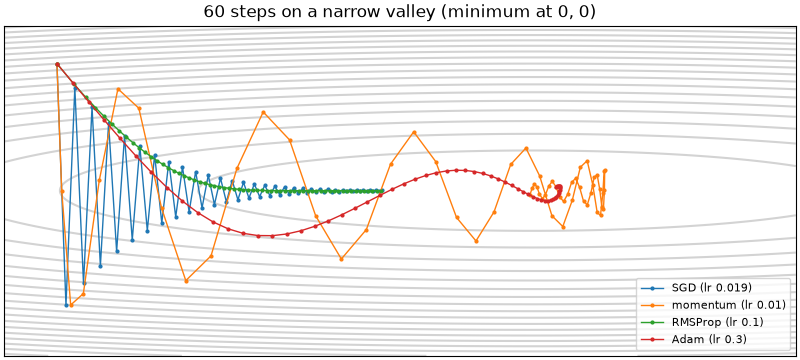

### 19.1 The problem: narrow valleys

Network losses are full of valleys that are steep in some directions and nearly flat in others. A small version:

```
f(x, y) = ½ (x² + 100 y²),      ∇f = (x, 100y)
```

Its slope across the valley (y) grows 100 times faster than along it (x). Gradient descent updates each coordinate separately:

```
y ← y − lr · 100y = (1 − 100 lr) · y        shrinks only if |1 − 100 lr| < 1, i.e. lr < 0.02
x ← x − lr · x    = (1 − lr) · x            at lr = 0.019, x shrinks by just 1.9% per step
```

The steep direction caps the learning rate, and at that rate the flat direction crawls.

```python
import numpy as np

def grad(p):
    return np.array([p[0], 100 * p[1]])

def run(update, lr, steps=100):
    p, state = np.array([-9.0, 2.0]), {}
    path = [p.copy()]
    for t in range(1, steps + 1):
        p = p - update(grad(p), state, t, lr)
        path.append(p.copy())
    return np.array(path)

def sgd(g, state, t, lr):
    return lr * g

for lr in [0.019, 0.021]:
    end = run(sgd, lr)[-1]
    print(f"SGD lr {lr}: after 100 steps x = {end[0]:.3f}, y = {end[1]:.3g}")
```

**Output:**

```text
SGD lr 0.019: after 100 steps x = -1.322, y = 5.31e-05
SGD lr 0.021: after 100 steps x = -1.078, y = 2.76e+04
```

At lr = 0.019, after 100 steps x has only got from −9 to −1.32 (9 · 0.981¹⁰⁰). Just above the limit, at 0.021, y explodes.

### 19.2 Momentum

**Momentum** keeps a running sum of past gradients, the **velocity** v, and steps along it:

```
v ← β v + g
θ ← θ − lr · v              β ≈ 0.9
```

Along the valley, the gradient points the same way every step, so v builds up towards g · (1 + β + β² + …) = g/(1 − β), **10 times** the gradient for β = 0.9. Across the valley the gradient flips sign each step, so successive terms cancel and the zig-zag is damped.

```python
def momentum(g, state, t, lr, beta=0.9):
    state["v"] = beta * state.get("v", 0) + g
    return lr * state["v"]
```

### 19.3 RMSProp: a step size per parameter

Momentum still uses one learning rate for every parameter. **RMSProp** gives each parameter its own, by dividing by a running average of its squared gradients:

```
s ← ρ s + (1 − ρ) g²                 ρ ≈ 0.9 or 0.99, element by element
θ ← θ − lr · g / (√s + ε)            ε ≈ 1e-8 avoids dividing by 0
```

√s is the typical size of each parameter's gradient (a root mean square), so g/√s is about ±1 for every parameter: the steep y and the flat x both move by about lr per step. Parameters with tiny gradients get relatively bigger steps, and those with huge ones get smaller steps.

```python
def rmsprop(g, state, t, lr, rho=0.9, eps=1e-8):
    state["s"] = rho * state.get("s", 0) + (1 - rho) * g ** 2
    return lr * g / (np.sqrt(state["s"]) + eps)
```

### 19.4 Adam: both, with bias correction

**Adam** combines the two. It keeps a running average m of the gradient (like momentum) and v of the squared gradient (like RMSProp):

```
m ← β₁ m + (1 − β₁) g                β₁ = 0.9
v ← β₂ v + (1 − β₂) g²               β₂ = 0.999
m̂ = m / (1 − β₁ᵗ),   v̂ = v / (1 − β₂ᵗ)     bias correction, t = step number
θ ← θ − lr · m̂ / (√v̂ + ε)
```

Why the correction? m and v start at 0, so early on they're too small. If the gradient were a constant g, then after t steps m = (1 − β₁)(g + β₁g + … + β₁ᵗ⁻¹g) = g(1 − β₁ᵗ). Dividing by (1 − β₁ᵗ) gives back exactly g. At step 1, without it, m would be 0.1g; for v with β₂ = 0.999 it would be 0.001g², and the first steps would be far too large. As t grows, βᵗ → 0 and the correction fades away.

```python
def adam(g, state, t, lr, b1=0.9, b2=0.999, eps=1e-8):
    state["m"] = b1 * state.get("m", 0) + (1 - b1) * g
    state["v"] = b2 * state.get("v", 0) + (1 - b2) * g ** 2
    m_hat = state["m"] / (1 - b1 ** t)
    v_hat = state["v"] / (1 - b2 ** t)
    return lr * m_hat / (np.sqrt(v_hat) + eps)
```

### 19.5 The race

All four, 100 steps from (−9, 2). RMSProp and Adam move about lr per step whatever the gradient's size, so they get their own learning rate:

```python
for name, update, lr in [("SGD", sgd, 0.019), ("momentum", momentum, 0.01), ("RMSProp", rmsprop, 0.1), ("Adam", adam, 0.3)]:
    end = run(update, lr)[-1]
    f = 0.5 * (end[0] ** 2 + 100 * end[1] ** 2)
    print(f"{name:9s} lr {lr}: loss after 100 steps {f:.2e}")
```

**Output:**

```text
SGD       lr 0.019: loss after 100 steps 8.73e-01
momentum  lr 0.01: loss after 100 steps 6.45e-04
RMSProp   lr 0.1: loss after 100 steps 1.85e-01
Adam      lr 0.3: loss after 100 steps 1.71e-03
```

Momentum and Adam reach the bottom, while SGD is still crawling along the valley. RMSProp gets near quickly but then **hovers**: g/√s stays about ±1 even close to the minimum, so its steps stay about lr long and it jumps back and forth across the bottom. Adam's running average m cancels much of that back-and-forth, and a learning rate that shrinks over time (Chapter 20) removes the rest for every optimiser. On real networks the gaps are smaller, but adaptive methods make fast progress with little tuning, which is why Adam became the default.

### 19.6 AdamW: weight decay done right

**Weight decay** pulls every weight a little towards 0 at each step, to discourage large weights (Chapter 22). The classic way adds λθ to the gradient, which is L2 regularisation (`machine-learning.md` Chapter 16). Inside Adam that goes wrong: the extra λθ is divided by √v̂ along with everything else, so weights with large gradients get almost no decay.

**AdamW** **decouples** the decay: it applies it directly to the weights, outside the adaptive scaling:

```
θ ← θ − lr · ( m̂ / (√v̂ + ε) + λ θ )
```

Every weight now shrinks by the same fraction lr · λ per step. AdamW is the default optimiser for transformers.

### 19.7 In PyTorch

`torch.optim` has all of them: `SGD(params, lr, momentum=0.9)`, `RMSprop`, `Adam` and `AdamW(params, lr, weight_decay)`. They plug into the same training loop. Three epochs of the Fashion-MNIST MLP from Chapter 16 with each:

```python
import torch
from torch import nn
from torch.utils.data import DataLoader, TensorDataset, random_split
from torchvision import datasets

def fashion(train):
    raw = datasets.FashionMNIST(root="data", train=train, download=True)
    return TensorDataset(raw.data.float().unsqueeze(1) / 255, raw.targets)

train_ds, val_ds = random_split(fashion(True), [50_000, 10_000], generator=torch.Generator().manual_seed(0))
train_loader = DataLoader(train_ds, batch_size=128, shuffle=True)
val_loader = DataLoader(val_ds, batch_size=1000)

def make_mlp():
    return nn.Sequential(nn.Flatten(), nn.Linear(784, 128), nn.ReLU(), nn.Linear(128, 128), nn.ReLU(), nn.Linear(128, 10))

def val_accuracy(model):
    model.eval()
    with torch.no_grad():
        return sum((model(x).argmax(1) == y).sum().item() for x, y in val_loader) / len(val_ds)

def train(make_optimizer, epochs=3):
    torch.manual_seed(0)
    model = make_mlp()
    optimizer = make_optimizer(model.parameters())
    for epoch in range(epochs):
        model.train()
        for x, y in train_loader:
            optimizer.zero_grad()
            nn.CrossEntropyLoss()(model(x), y).backward()
            optimizer.step()
    return val_accuracy(model)
```

`nn.Flatten()` is the module version of `x.flatten(1)`, so the whole network fits in an `nn.Sequential`.

```python
for name, make in [("SGD lr 0.1", lambda p: torch.optim.SGD(p, lr=0.1)),
                   ("SGD + momentum", lambda p: torch.optim.SGD(p, lr=0.1, momentum=0.9)),
                   ("Adam lr 1e-3", lambda p: torch.optim.Adam(p, lr=1e-3)),
                   ("AdamW lr 1e-3", lambda p: torch.optim.AdamW(p, lr=1e-3, weight_decay=0.01))]:
    print(f"{name:15s} validation accuracy after 3 epochs: {train(make):.3f}")
```

**Output:**

```text
SGD lr 0.1      validation accuracy after 3 epochs: 0.836
SGD + momentum  validation accuracy after 3 epochs: 0.859
Adam lr 1e-3    validation accuracy after 3 epochs: 0.864
AdamW lr 1e-3   validation accuracy after 3 epochs: 0.865
```

Typical starting points: **AdamW** with lr 1e-3 for small networks and 1e-4 to 3e-4 for transformers, weight decay 0.01–0.1; or **SGD with momentum 0.9** and lr around 0.1, still popular for CNNs, where it sometimes generalises slightly better when well tuned.

### 19.8 Summary

```
SGD:       θ ← θ − lr g
momentum:  v ← βv + g;   θ ← θ − lr v                      (speed-up up to 1/(1−β))
RMSProp:   s ← ρs + (1−ρ)g²;   θ ← θ − lr g/(√s + ε)
Adam:      m ← β₁m + (1−β₁)g;  v ← β₂v + (1−β₂)g²;  m̂ = m/(1−β₁ᵗ), v̂ = v/(1−β₂ᵗ);  θ ← θ − lr m̂/(√v̂ + ε)
AdamW:     Adam step, plus θ ← θ − lr λ θ                 (decoupled weight decay)
```

**Key terms:**

- **Optimiser:** the rule that turns gradients into parameter updates.
- **Momentum:** stepping along a running sum of past gradients, which speeds up consistent directions and damps oscillations.
- **Velocity:** the running sum of gradients kept by momentum.
- **RMSProp:** dividing each parameter's gradient by the root mean square of its recent gradients, giving every parameter its own step size.
- **Adaptive learning rate:** a step size that differs per parameter, set by the history of its gradients.
- **Adam:** momentum and RMSProp combined, with bias correction.
- **Bias correction:** dividing Adam's running averages by (1 − βᵗ) to undo their start at zero.
- **Weight decay:** shrinking every weight towards 0 by a small fraction each step.
- **AdamW:** Adam with weight decay applied directly to the weights, separate from the adaptive scaling.

### Exercises

1. What is Adam's first step, at t = 1, for any non-zero gradient g? (Ignore ε.)
2. Run Adam on the valley with lr = 0.01. How far does x get in 100 steps, and why?

<details>
<summary><b>Answers</b></summary>

```python
print("Adam first step:", adam(np.array([0.001, 500.0]), {}, 1, 0.1))
print("Adam lr 0.01, after 100 steps:", run(adam, 0.01)[-1].round(3))
```

**Output:**

```text
Adam first step: [0.099999 0.1     ]
Adam lr 0.01, after 100 steps: [-8.019  1.098]
```

1. m̂ = g and v̂ = g², so the step is lr · g/|g| = ±lr: exactly lr in each coordinate, whatever the gradient's size.
2. Only from −9 to about −8. Each Adam step moves a parameter by at most about lr, however large its gradient, so 100 steps of 0.01 can cover at most about 1 unit. Adam's lr is a step **length**, not a multiplier of the gradient, which is why its useful values (1e-4 to 1e-3 for networks) look so different from SGD's.

</details>

| # | Problem (Deep-ML) | Difficulty |
|---|---|---|
| 1 | [146. Momentum Optimizer](https://www.deep-ml.com/problems/146) | 🟢 Easy |
| 2 | [87. Adam Optimizer](https://www.deep-ml.com/problems/87) | 🟡 Medium |

<details>
<summary><b>Code for the chart at the top</b></summary>

```python
import matplotlib.pyplot as plt

xx, yy = np.meshgrid(np.linspace(-10, 5, 200), np.linspace(-2.6, 2.6, 200))
fig, ax = plt.subplots(figsize=(8, 3.6), layout="constrained")
ax.contour(xx, yy, 0.5 * (xx ** 2 + 100 * yy ** 2), levels=20, colors="lightgray")
for name, update, lr in [("SGD", sgd, 0.019), ("momentum", momentum, 0.01), ("RMSProp", rmsprop, 0.1), ("Adam", adam, 0.3)]:
    path = run(update, lr, steps=60)
    ax.plot(path[:, 0], path[:, 1], "o-", ms=2, lw=1, label=f"{name} (lr {lr})")
ax.set(title="60 steps on a narrow valley (minimum at 0, 0)", xticks=[], yticks=[], xlim=(-10, 5), ylim=(-2.6, 2.6))
ax.legend(fontsize=8, loc="lower right")
fig.savefig("optimizer-paths.png", dpi=100)
plt.close(fig)
```

</details>

---

## 20. Learning-Rate Schedules

**You need:** Chapter 19. · **You'll learn:** why the learning rate should change during training, the warm-up and cosine schedules used for almost every modern network, and how to plug them into PyTorch.

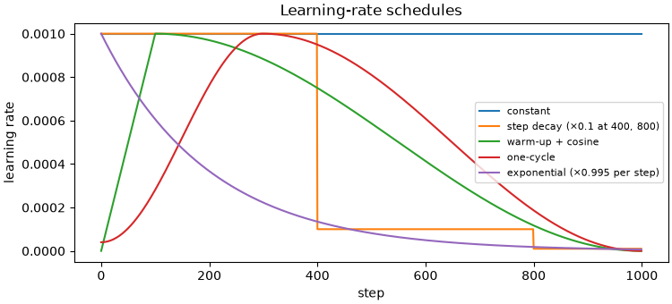

### 20.1 Why change the learning rate?

Chapter 19 ended with RMSProp hovering around the minimum: its steps stayed about lr long, so it couldn't settle. Mini-batch noise does the same to every optimiser. Each step follows a noisy gradient, so near the bottom the parameters bounce around in a region whose size grows with lr. That gives two conflicting wishes:

- **early on**, a large learning rate, to cover ground fast;
- **at the end**, a small one, to settle into the bottom.

A **learning-rate schedule** changes lr with the step number t to get both.

### 20.2 The common schedules

With T total steps and a peak rate lr_max:

```
step decay:   lr_t = lr_max · γ^⌊t / S⌋              e.g. ×0.1 every S steps
cosine:       lr_t = lr_min + ½ (lr_max − lr_min) (1 + cos(π t / T))
warm-up:      lr_t = lr_max · (t + 1) / W            for the first W steps
```

Cosine starts at lr_max (cos 0 = 1), ends at lr_min (cos π = −1), and falls smoothly in between, slowly at first and last, fastest in the middle. It has no extra settings beyond T, which is part of why it became the default.

**Warm-up** starts the rate near 0 and raises it over the first few hundred or thousand steps. At the very start the weights are random and the gradients are large and erratic, and Adam's running average v has seen only a few gradients, so its step sizes are unreliable. A big learning rate at that moment can knock the network into a bad region it never leaves. Transformers are especially sensitive, and essentially all of them are trained with warm-up followed by cosine (or linear) decay.

```python
import math

def step_decay(t, lr_max=1.0, every=300, gamma=0.1):
    return lr_max * gamma ** (t // every)

def cosine(t, T, lr_max=1.0, lr_min=0.0):
    return lr_min + 0.5 * (lr_max - lr_min) * (1 + math.cos(math.pi * t / T))

def warmup_cosine(t, T, warmup, lr_max=1.0):
    if t < warmup:
        return lr_max * (t + 1) / warmup
    return cosine(t - warmup, T - warmup, lr_max)

T = 1000
for t in [0, 50, 100, 500, 999]:
    print(f"t={t:4d}  step {step_decay(t):.3f}  cosine {cosine(t, T):.3f}  warm-up+cosine {warmup_cosine(t, T, 100):.3f}")
```

**Output:**

```text
t=   0  step 1.000  cosine 1.000  warm-up+cosine 0.010
t=  50  step 1.000  cosine 0.994  warm-up+cosine 0.510
t= 100  step 1.000  cosine 0.976  warm-up+cosine 1.000
t= 500  step 0.100  cosine 0.500  warm-up+cosine 0.587
t= 999  step 0.001  cosine 0.000  warm-up+cosine 0.000
```

The **one-cycle** schedule is a close relative: warm up over about 30% of training to a high peak, then decay to nearly 0.

### 20.3 In PyTorch

`torch.optim.lr_scheduler` holds ready-made schedules. The most flexible is `LambdaLR(optimizer, f)`, which sets the rate at step t to the optimiser's lr times f(t). Call `scheduler.step()` once per training step, **after** `optimizer.step()`:

```python
import torch
from torch import nn

model = nn.Linear(2, 1)
optimizer = torch.optim.AdamW(model.parameters(), lr=3e-3)
scheduler = torch.optim.lr_scheduler.LambdaLR(optimizer, lambda t: warmup_cosine(t, T=1000, warmup=100))

rates = []
for t in range(1000):
    optimizer.step()                                  # (the real training step would go here)
    scheduler.step()
    rates.append(optimizer.param_groups[0]["lr"])
print([f"{rates[t]:.2e}" for t in [0, 98, 99, 500, 998]])
```

**Output:**

```text
['6.00e-05', '3.00e-03', '3.00e-03', '1.76e-03', '9.14e-09']
```

`optimizer.param_groups[0]["lr"]` is the rate the optimiser will use next. Ready-made alternatives include `CosineAnnealingLR(optimizer, T_max)`, `StepLR` and `OneCycleLR`. A schedule has state (its step count), so a training checkpoint stores `scheduler.state_dict()` too (Chapter 17).

### 20.4 Does it help?

Five epochs of a Fashion-MNIST MLP with AdamW: a constant rate of 1e-3, a constant 3e-3, and 3e-3 with half an epoch of warm-up then cosine decay to 0:

```python
from torch.utils.data import DataLoader, TensorDataset, random_split
from torchvision import datasets

raw = datasets.FashionMNIST(root="data", train=True, download=True)
full = TensorDataset(raw.data.float().unsqueeze(1) / 255, raw.targets)
train_ds, val_ds = random_split(full, [50_000, 10_000], generator=torch.Generator().manual_seed(0))
train_loader = DataLoader(train_ds, batch_size=128, shuffle=True)
val_loader = DataLoader(val_ds, batch_size=1000)

def run(lr, schedule, epochs=5):
    torch.manual_seed(0)
    model = nn.Sequential(nn.Flatten(), nn.Linear(784, 256), nn.ReLU(), nn.Linear(256, 256), nn.ReLU(), nn.Linear(256, 10))
    optimizer = torch.optim.AdamW(model.parameters(), lr=lr, weight_decay=0.01)
    steps = epochs * len(train_loader)
    scheduler = torch.optim.lr_scheduler.LambdaLR(optimizer, lambda t: schedule(t, steps))
    for epoch in range(epochs):
        model.train()
        for x, y in train_loader:
            optimizer.zero_grad()
            nn.CrossEntropyLoss()(model(x), y).backward()
            optimizer.step()
            scheduler.step()
    model.eval()
    with torch.no_grad():
        return sum((model(x).argmax(1) == y).sum().item() for x, y in val_loader) / len(val_ds)

constant = lambda t, steps: 1.0
warm_cos = lambda t, steps: warmup_cosine(t, steps, warmup=len(train_loader) // 2)
for name, lr, schedule in [("constant 1e-3", 1e-3, constant), ("constant 3e-3", 3e-3, constant), ("warm-up + cosine, peak 3e-3", 3e-3, warm_cos)]:
    print(f"{name:28s} validation accuracy {run(lr, schedule):.4f}")
```

**Output:**

```text
constant 1e-3                validation accuracy 0.8835
constant 3e-3                validation accuracy 0.8764
warm-up + cosine, peak 3e-3  validation accuracy 0.8893
```

Raising the constant rate from 1e-3 to 3e-3 makes things **worse**: the larger steps never let the network settle. The same peak rate with warm-up and cosine decay gives the **best** result of the three: fast progress early, careful settling at the end. That pattern, where a schedule lets you use a higher peak rate, is the usual reason schedules help.

### 20.5 Summary

```
cosine:          lr_t = lr_min + ½(lr_max − lr_min)(1 + cos(πt/T))
warm-up:         lr_t = lr_max (t + 1)/W for t < W, then decay
PyTorch:         scheduler = LambdaLR(optimizer, f);   each step: optimizer.step(); scheduler.step()
default recipe:  AdamW, warm-up for 1–5% of steps, cosine decay to ~0 (or 10% of the peak)
```

**Key terms:**

- **Learning-rate schedule:** a rule that changes the learning rate as training progresses.
- **Step decay:** multiplying the learning rate by a fixed factor every fixed number of steps.
- **Cosine decay (cosine annealing):** lowering the learning rate along half a cosine curve, from its peak to a minimum.
- **Warm-up:** raising the learning rate from near 0 to its peak over the first steps of training.
- **One-cycle schedule:** a warm-up to a high peak followed by a long decay to nearly 0.
- **Peak learning rate:** the highest rate a schedule reaches.

### Exercises

1. With T = 10,000 steps and a 500-step warm-up to 3e-4, what is the learning rate at steps 0, 250, 500 and 5,250?
2. You resume training from a checkpoint but forget to restore the scheduler's state. What learning rate does training continue with?

<details>
<summary><b>Answers</b></summary>

```python
print([f"{warmup_cosine(t, 10_000, 500, lr_max=3e-4):.2e}" for t in [0, 250, 500, 5250]])
```

**Output:**

```text
['6.00e-07', '1.51e-04', '3.00e-04', '1.50e-04']
```

1. 6e-7, 1.5e-4, 3e-4 (the peak) and 1.5e-4: step 5,250 is halfway through the 9,500 decay steps, where cosine gives half the peak.
2. The schedule starts again from step 0: back into warm-up, then the full decay again. The run no longer matches what an uninterrupted run would do.

</details>

| # | Problem (Deep-ML) | Difficulty |
|---|---|---|
| 1 | [153. StepLR Learning Rate Scheduler](https://www.deep-ml.com/problems/153) | 🟢 Easy |
| 2 | [155. CosineAnnealingLR Learning Rate Scheduler](https://www.deep-ml.com/problems/155) | 🟡 Medium |
| 3 | [196. Warmup + Cosine Decay Schedule](https://www.deep-ml.com/problems/196) | 🟡 Medium |

<details>
<summary><b>Code for the chart at the top</b></summary>

```python
import matplotlib.pyplot as plt

ts = range(1000)
fig, ax = plt.subplots(figsize=(7, 3.4), layout="constrained")
ax.plot(ts, [1.0] * 1000, label="constant")
ax.plot(ts, [step_decay(t) for t in ts], label="step decay (×0.1 every 300)")
ax.plot(ts, [cosine(t, 1000) for t in ts], label="cosine")
ax.plot(ts, [warmup_cosine(t, 1000, 100) for t in ts], label="warm-up 100 + cosine")
ax.set(xlabel="training step", ylabel="learning rate (× peak)")
ax.legend(fontsize=8)
fig.savefig("lr-schedule.png", dpi=100)
plt.close(fig)
```

</details>

---

## 21. Normalisation Layers: BatchNorm, LayerNorm and RMSNorm

**You need:** Chapters 16 and 18. · **You'll learn:** how normalisation layers keep every layer's input at a steady scale, how the three main kinds differ, and why BatchNorm behaves differently in training and evaluation.

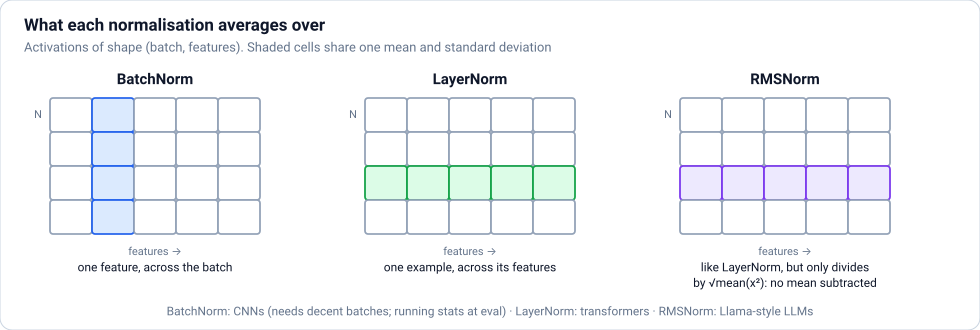

### 21.1 The problem

Chapter 18 chose the starting weights so that each layer's input has a steady scale. But training changes the weights, so the scale drifts, and every layer has to keep adapting to inputs whose scale keeps changing under it. Deep networks become slow and touchy to train.

A **normalisation layer** fixes the scale **during** training: it rescales its input to mean 0 and standard deviation 1 every time, then lets the network learn the best scale and shift.

### 21.2 BatchNorm

For a batch of activations X of shape (N, D), **batch normalisation** treats each feature (column) separately, using statistics over the **batch**:

```
μⱼ = mean of column j over the N examples
σⱼ² = variance of column j over the N examples
x̂ᵢⱼ = (xᵢⱼ − μⱼ) / √(σⱼ² + ε)              ε ≈ 1e-5 avoids dividing by 0
yᵢⱼ = γⱼ x̂ᵢⱼ + βⱼ                          γ, β learned, one pair per feature
```

The learned γ and β mean nothing is lost: if the network needs the original scale, it can learn γ = σ and β = μ.

```python
import torch
from torch import nn

torch.manual_seed(0)
X = torch.randn(32, 4) * 5 + 3                      # 32 examples, 4 features, mean ≈ 3, std ≈ 5

def batchnorm(X, gamma, beta, eps=1e-5):
    mu = X.mean(dim=0)
    var = X.var(dim=0, unbiased=False)              # divide by N, not N − 1
    return gamma * (X - mu) / torch.sqrt(var + eps) + beta

ours = batchnorm(X, torch.ones(4), torch.zeros(4))
print("column means:", ours.mean(dim=0).round(decimals=4))
print("column stds: ", ours.std(dim=0, unbiased=False).round(decimals=4))

bn = nn.BatchNorm1d(4)                               # γ starts at 1, β at 0
print("matches nn.BatchNorm1d:", torch.allclose(bn(X), ours, atol=1e-5))
```

**Output:**

```text
column means: tensor([0., -0., -0., -0.])
column stds:  tensor([1., 1., 1., 1.])
matches nn.BatchNorm1d: True
```

### 21.3 BatchNorm at evaluation time

At prediction time there may be only one example, which has no meaningful batch mean. So during training BatchNorm also keeps **running averages** of μ and σ², updated at every batch:

```
running_mean ← (1 − m) · running_mean + m · μ_batch          m = 0.1 in PyTorch
```

and in eval mode it uses those instead of the batch's own statistics. This is the layer that makes `model.eval()` essential (Chapter 16.5):

```python
for _ in range(100):                                 # "train" on many batches from the same distribution
    bn(torch.randn(32, 4) * 5 + 3)
print("running mean:", bn.running_mean.round(decimals=2))

one = torch.tensor([[3.0, 3.0, 3.0, 3.0]])           # a single example, right at the data's mean
bn.eval()
print("eval mode, one example:", bn(one).detach().round(decimals=2))
```

**Output:**

```text
running mean: tensor([2.4500, 2.6400, 3.2500, 3.3100])
eval mode, one example: tensor([[ 0.1100,  0.0700, -0.0500, -0.0600]])
```

The input sits at the data's true mean, so its normalised output is close to 0 in every column. Not exactly 0, because the running mean is itself an estimate from noisy batches (2.45 to 3.31 rather than 3). In eval mode the output no longer depends on what else is in the batch: the same input always gives the same output. In train mode with one example, the batch variance would be 0 and PyTorch refuses (Exercise 2).

For images of shape (N, C, H, W), `nn.BatchNorm2d(C)` normalises each **channel** using all N × H × W values in it. BatchNorm is the standard choice in CNNs (Chapter 26).

### 21.4 LayerNorm

BatchNorm has two weaknesses: it needs reasonably large batches for good statistics, and it behaves differently in training and evaluation. **Layer normalisation** avoids both by normalising each **example** across its own features:

```
μᵢ = mean of row i,    σᵢ² = variance of row i,    yᵢⱼ = γⱼ (xᵢⱼ − μᵢ)/√(σᵢ² + ε) + βⱼ
```

Nothing depends on the other examples in the batch, so training and evaluation are identical and any batch size works. It's the normalisation used in transformers (Chapter 35):

```python
def layernorm(X, gamma, beta, eps=1e-5):
    mu = X.mean(dim=1, keepdim=True)
    var = X.var(dim=1, unbiased=False, keepdim=True)
    return gamma * (X - mu) / torch.sqrt(var + eps) + beta

ln = nn.LayerNorm(4)
print("matches nn.LayerNorm:", torch.allclose(ln(X), layernorm(X, torch.ones(4), torch.zeros(4)), atol=1e-5))
print("row 0 after LayerNorm: mean", round(ln(X)[0].mean().item(), 4), "std", round(ln(X)[0].std(unbiased=False).item(), 4))
```

**Output:**

```text
matches nn.LayerNorm: True
row 0 after LayerNorm: mean -0.0 std 1.0
```

### 21.5 RMSNorm

**RMSNorm** drops the mean subtraction (and β), and only divides by the root mean square:

```
yᵢⱼ = γⱼ · xᵢⱼ / √(mean over j of xᵢⱼ² + ε)
```

It's slightly cheaper and works as well in practice, so Llama, Mistral, Qwen and most recent large language models use it:

```python
def rmsnorm(X, gamma, eps=1e-6):
    return gamma * X / torch.sqrt(X.pow(2).mean(dim=1, keepdim=True) + eps)

rms = nn.RMSNorm(4, eps=1e-6)
print("matches nn.RMSNorm:", torch.allclose(rms(X), rmsnorm(X, torch.ones(4)), atol=1e-5))
```

**Output:**

```text
matches nn.RMSNorm: True
```

### 21.6 What it buys you

A 9-layer MLP on Fashion-MNIST, with PyTorch's default initialisation, trained for 2 epochs with plain SGD, with and without a normalisation layer before each ReLU:

```python
from torch.utils.data import DataLoader, TensorDataset, random_split
from torchvision import datasets

raw = datasets.FashionMNIST(root="data", train=True, download=True)
full = TensorDataset(raw.data.float().unsqueeze(1) / 255, raw.targets)
train_ds, val_ds = random_split(full, [50_000, 10_000], generator=torch.Generator().manual_seed(0))
train_loader = DataLoader(train_ds, batch_size=128, shuffle=True)
val_loader = DataLoader(val_ds, batch_size=1000)

def deep_mlp(norm, depth=8):
    layers = [nn.Flatten(), nn.Linear(784, 256)]
    for i in range(depth):
        if norm is not None:
            layers.append(norm(256))
        layers += [nn.ReLU(), nn.Linear(256, 256 if i < depth - 1 else 10)]
    return nn.Sequential(*layers)

def run(norm, lr, epochs=2):
    torch.manual_seed(0)
    model = deep_mlp(norm)
    optimizer = torch.optim.SGD(model.parameters(), lr=lr)
    for epoch in range(epochs):
        model.train()
        for x, y in train_loader:
            optimizer.zero_grad()
            nn.CrossEntropyLoss()(model(x), y).backward()
            optimizer.step()
    model.eval()
    with torch.no_grad():
        return sum((model(x).argmax(1) == y).sum().item() for x, y in val_loader) / len(val_ds)

for lr in [0.01, 0.1]:
    results = {name: run(norm, lr) for name, norm in [("none", None), ("BatchNorm", nn.BatchNorm1d), ("LayerNorm", nn.LayerNorm)]}
    print(f"lr {lr}: " + ", ".join(f"{k} {v:.3f}" for k, v in results.items()))
```

**Output:**

```text
lr 0.01: none 0.097, BatchNorm 0.862, LayerNorm 0.855
lr 0.1: none 0.132, BatchNorm 0.838, LayerNorm 0.808
```

Without normalisation the network is still at chance (about 10%) after 2 epochs: through nine layers, the default initialisation shrinks the signal and the gradients (Chapter 18), so learning hasn't got going. With either normalisation layer it reaches the mid-80s. He initialisation would also rescue the plain network; normalisation makes training robust whatever the initialisation, and keeps working as the weights change.

### 21.7 Summary

| | normalises over | train vs eval | used in |
|---|---|---|---|
| BatchNorm | each feature (or channel) across the batch | batch stats vs running averages | CNNs |
| LayerNorm | each example across its features | identical | transformers |
| RMSNorm | each example, dividing by √mean(x²) only | identical | recent LLMs |

```
x̂ = (x − μ)/√(σ² + ε),   y = γ x̂ + β          RMSNorm: y = γ x / √(mean(x²) + ε)
```

**Key terms:**

- **Normalisation layer:** a layer that rescales its input to a fixed mean and spread, then applies a learned scale and shift.
- **Batch normalisation (BatchNorm):** normalising each feature using the mean and variance over the batch.
- **Running averages (running mean and variance):** the statistics BatchNorm accumulates during training and uses in eval mode.
- **Layer normalisation (LayerNorm):** normalising each example using the mean and variance of its own features.
- **RMSNorm:** dividing each example by the root mean square of its features, without subtracting the mean.
- **γ and β (scale and shift):** the learned parameters a normalisation layer applies after normalising.

### Exercises

1. Show that LayerNorm's output for an example doesn't change if you multiply that example by 10, but BatchNorm's output for it can change when you multiply **another** example in the batch.
2. What happens if you call a BatchNorm layer in training mode on a batch of one example?

<details>
<summary><b>Answers</b></summary>

```python
ln = nn.LayerNorm(4)
print("LayerNorm unchanged by ×10:", torch.allclose(ln(X[:1]), ln(X[:1] * 10), atol=1e-4))

bn = nn.BatchNorm1d(4)
X2 = X.clone()
X2[1] = X2[1] * 10                                  # change a different example
print("BatchNorm output for example 0 unchanged:", torch.allclose(bn(X)[0], bn(X2)[0], atol=1e-4))
```

**Output:**

```text
LayerNorm unchanged by ×10: True
BatchNorm output for example 0 unchanged: False
```

```python
bn.train()
bn(torch.randn(1, 4))
```

**Output:**

```text
Traceback (most recent call last):
  ...
ValueError: Expected more than 1 value per channel when training, got input size torch.Size([1, 4])
```

1. LayerNorm only looks at the example itself, and scaling it changes its mean and spread by the same factor, which the normalisation removes. BatchNorm's statistics come from the whole batch, so one example's output depends on its neighbours.
2. An error: with one example the batch variance is 0 and the statistics are meaningless. Use eval mode for single predictions.

</details>

| # | Problem (Deep-ML) | Difficulty |
|---|---|---|
| 1 | [372. Implement RMSNorm (Root Mean Square Layer Normalization)](https://www.deep-ml.com/problems/372) | 🟢 Easy |
| 2 | [115. Implement Batch Normalization for BCHW Input](https://www.deep-ml.com/problems/115) | 🟡 Medium |

**Learn more:** [Ioffe & Szegedy, Batch Normalization](https://arxiv.org/abs/1502.03167) · [Ba et al., Layer Normalization](https://arxiv.org/abs/1607.06450)

---

## 22. Regularisation: Weight Decay, Dropout, Early Stopping and Augmentation

**You need:** Chapters 16, 17 and 19, and `machine-learning.md` Chapters 15–16. · **You'll learn:** the five standard ways to stop a network from memorising its training data, each derived or built by hand, and what each one actually does on real data.

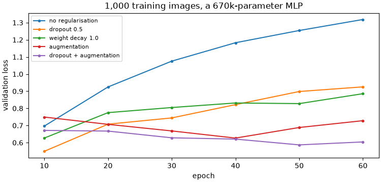

### 22.1 Overfitting, made visible

Networks have so many parameters that they can memorise a training set. To see it, train the MLP on only 5,000 images for 40 epochs, recording training accuracy, validation accuracy and validation loss after each epoch:

```python
import torch
from torch import nn
from torch.utils.data import DataLoader, Dataset, TensorDataset
from torchvision import datasets

raw = datasets.FashionMNIST(root="data", train=True, download=True)
X, Y = raw.data.float().unsqueeze(1) / 255, raw.targets
perm = torch.randperm(60_000, generator=torch.Generator().manual_seed(0))
X_train, y_train = X[perm[:5_000]], Y[perm[:5_000]]          # a small training set
X_val, y_val = X[perm[50_000:]], Y[perm[50_000:]]             # 10,000 for validation

def make_mlp(dropout=0.0):
    return nn.Sequential(nn.Flatten(),
                         nn.Linear(784, 512), nn.ReLU(), nn.Dropout(dropout),
                         nn.Linear(512, 512), nn.ReLU(), nn.Dropout(dropout),
                         nn.Linear(512, 10))
```

`nn.Dropout` is explained in 22.3; with `dropout=0.0` it does nothing. The training function takes each regulariser as an option:

```python
def train(dropout=0.0, weight_decay=0.0, train_ds=None, label_smoothing=0.0, epochs=40):
    torch.manual_seed(0)
    model = make_mlp(dropout)
    optimizer = torch.optim.AdamW(model.parameters(), lr=1e-3, weight_decay=weight_decay)
    loader = DataLoader(train_ds or TensorDataset(X_train, y_train), batch_size=128, shuffle=True)
    loss_fn = nn.CrossEntropyLoss(label_smoothing=label_smoothing)
    history = []
    for epoch in range(epochs):
        model.train()
        for x, y in loader:
            optimizer.zero_grad()
            loss_fn(model(x), y).backward()
            optimizer.step()
        model.eval()
        with torch.no_grad():
            train_acc = (model(X_train).argmax(1) == y_train).float().mean().item()
            val_logits = model(X_val)
            val_acc = (val_logits.argmax(1) == y_val).float().mean().item()
            val_loss = nn.CrossEntropyLoss()(val_logits, y_val).item()
        history.append((train_acc, val_acc, val_loss))
    return history

def report(name, h):
    best = min(range(len(h)), key=lambda e: h[e][2])
    print(f"{name:22s} final: train acc {h[-1][0]:.3f}, val acc {h[-1][1]:.3f}, val loss {h[-1][2]:.3f}"
          f"   (lowest val loss at epoch {best + 1})")

baseline = train()
report("no regularisation", baseline)
```

**Output:**

```text
no regularisation      final: train acc 0.952, val acc 0.836, val loss 0.710   (lowest val loss at epoch 12)
```

Training accuracy keeps climbing, well above validation accuracy. The validation loss is lowest around epoch 12 and then **rises**: the network keeps becoming more confident, including on the validation images it gets wrong, which cross-entropy punishes heavily. That's overfitting. Accuracy hides much of it, so watch the validation **loss**.

### 22.2 Weight decay

Add a penalty on the size of the weights to the loss (L2 regularisation, `machine-learning.md` Chapter 16):

```
L' = L + (λ/2) Σ w²      →      ∂L'/∂w = ∂L/∂w + λ w
```

The gradient-descent step becomes

```
w ← w − lr (∂L/∂w + λw) = (1 − lr λ) w − lr ∂L/∂w
```

so every step first shrinks each weight by the factor (1 − lr λ), hence the name **weight decay**. Smaller weights make the network's function smoother, so it can't bend sharply around individual training points. With Adam, use the decoupled form, AdamW (Chapter 19.6), via its `weight_decay` argument:

```python
report("weight decay 1.0", train(weight_decay=1.0))
```

**Output:**

```text
weight decay 1.0       final: train acc 0.915, val acc 0.830, val loss 0.504   (lowest val loss at epoch 15)
```

AdamW's decay per step is lr · λ = 0.001, which is why λ can be as large as 1.0 here. Typical values are 0.01–0.1 for long training runs.

### 22.3 Dropout

**Dropout** randomly switches off units during training. On each forward pass, every unit's output is set to 0 with probability p, independently. The others are scaled up by 1/(1 − p):

```
mask ~ Bernoulli(1 − p)        (1 with probability 1 − p, else 0)
y = x · mask / (1 − p)          in training;    y = x   in evaluation
```

The scaling keeps the expected value unchanged: E[y] = x · (1 − p)/(1 − p) = x. So at evaluation, when nothing is dropped, the next layer sees inputs of the same average size it was trained on. (This version, scaling during training, is called **inverted dropout**.)

```python
def dropout(x, p, training):
    if not training or p == 0:
        return x
    mask = (torch.rand_like(x) > p).float()          # keep each unit with probability 1 − p
    return x * mask / (1 - p)

torch.manual_seed(0)
x = torch.ones(1, 10)
print(dropout(x, 0.5, training=True))
print("average over 10,000 draws:", round(dropout(torch.ones(10_000, 10), 0.5, training=True).mean().item(), 3))

layer = nn.Dropout(0.5)
layer.eval()
print("nn.Dropout in eval mode:", layer(x))
```

**Output:**

```text
tensor([[0., 2., 0., 0., 0., 2., 0., 2., 0., 2.]])
average over 10,000 draws: 1.002
nn.Dropout in eval mode: tensor([[1., 1., 1., 1., 1., 1., 1., 1., 1., 1.]])
```

`torch.rand_like(x)` gives uniform random numbers of x's shape. Why it helps: a unit can never count on any particular other unit being present, so the network can't build fragile, co-adapted combinations that only fit the training set. Each step trains a different random "thinned" network, and evaluation uses their average. Dropout is also the second layer (with BatchNorm) that makes `model.eval()` essential.

```python
report("dropout 0.5", train(dropout=0.5))
```

**Output:**

```text
dropout 0.5            final: train acc 0.932, val acc 0.855, val loss 0.424   (lowest val loss at epoch 24)
```

### 22.4 Early stopping

The baseline's validation loss was lowest around epoch 12. **Early stopping** keeps the model from that epoch: after each epoch, save a checkpoint whenever the validation loss improves (Chapter 17.5), and stop once it hasn't improved for a set number of epochs, the **patience**:

```python
best_loss, best_epoch, patience, waited = float("inf"), 0, 5, 0
for epoch, (_, _, val_loss) in enumerate(baseline, start=1):     # replaying the baseline's history
    if val_loss < best_loss:
        best_loss, best_epoch, waited = val_loss, epoch, 0          # here you'd save a checkpoint
    else:
        waited += 1
        if waited == patience:
            break
print(f"stopped after epoch {epoch}; restore the checkpoint from epoch {best_epoch} (val loss {best_loss:.3f})")
```

**Output:**

```text
stopped after epoch 17; restore the checkpoint from epoch 12 (val loss 0.434)
```

The restored model's validation loss, 0.434, is about as low as the best regulariser below reaches after 40 epochs. Early stopping is free, saves compute, and is used almost everywhere in some form.

### 22.5 Data augmentation

The best cure for overfitting is more data. **Data augmentation** makes more from what you have, by applying random changes that keep the label correct: a shirt flipped left to right, or shifted by two pixels, is still a shirt. Each epoch then sees slightly different images.

**torchvision.transforms.v2** holds the standard image transforms. `v2.Compose` chains them; applied in a dataset's `__getitem__`, each example gets fresh random changes every time it's loaded:

```python
from torchvision.transforms import v2

augment = v2.Compose([
    v2.RandomHorizontalFlip(),                 # mirror with probability 0.5
    v2.RandomCrop(28, padding=2),              # pad by 2 pixels, then cut a random 28×28 window: a small shift
])

class Augmented(Dataset):
    def __init__(self, X, y, transform):
        self.X, self.y, self.transform = X, y, transform
    def __len__(self):
        return len(self.y)
    def __getitem__(self, i):
        return self.transform(self.X[i]), self.y[i]

report("augmentation", train(train_ds=Augmented(X_train, y_train, augment)))
```

**Output:**

```text
augmentation           final: train acc 0.864, val acc 0.830, val loss 0.458   (lowest val loss at epoch 39)
```

The gap between training and validation accuracy shrinks the most, and the validation loss is still falling at epoch 40: augmented data is harder to memorise, so the network needs more epochs to fit it. Augmentation must respect the problem. Flipping is fine for clothes, but it would turn a "b" into a "d" or confuse left and right in medical scans.

### 22.6 Label smoothing

Cross-entropy keeps rewarding the network for pushing the right class's probability towards 1, so it grows ever more confident. **Label smoothing** replaces the one-hot target with a softened one, for K classes and a small ε:

```
target = 1 − ε + ε/K  for the true class,    ε/K  for every other class
```

With K = 10 and ε = 0.1, the target is 0.91 for the true class and 0.01 for the others. The network gains nothing from probabilities beyond that, so its logits stay moderate:

```python
report("label smoothing 0.1", train(label_smoothing=0.1))
```

**Output:**

```text
label smoothing 0.1    final: train acc 0.979, val acc 0.850, val loss 0.512   (lowest val loss at epoch 30)
```

The training accuracy is the highest of all, yet the validation loss stays far below the baseline's: the network is still fitting the training set, but with less overconfidence. Label smoothing is standard when training large image classifiers.

### 22.7 What to use

On this small dataset every method lowers the validation loss a lot, and validation accuracy moves by only a point or two either way. Differences in accuracy this small are within run-to-run noise. In practice:

- **always:** a validation set, early stopping on its loss, and weight decay (AdamW);
- **dropout:** 0.1–0.5 in MLPs and the classifier heads of CNNs, around 0.1 in transformers (and often 0 when training on huge datasets);
- **augmentation:** the most effective tool for images, and for audio, whenever valid transforms exist;
- **label smoothing:** about 0.1 for classifiers with many classes.

### 22.8 Summary

```
weight decay:     w ← (1 − lr λ) w − lr ∂L/∂w           AdamW(weight_decay=λ)
dropout:          y = x · mask/(1 − p) in training, y = x in eval      nn.Dropout(p)
early stopping:   keep the best validation checkpoint; stop after `patience` epochs without improvement
augmentation:     random, label-preserving changes      transforms.v2 inside the Dataset
label smoothing:  target 1 − ε + ε/K for the true class, ε/K otherwise    CrossEntropyLoss(label_smoothing=ε)
```

**Key terms:**

- **Regularisation:** any technique that reduces overfitting.
- **Weight decay:** shrinking every weight by a small factor each step; equivalent to an L2 penalty for plain SGD.
- **Dropout:** randomly zeroing units during training, with probability p.
- **Inverted dropout:** dropout that scales the surviving units by 1/(1 − p) during training, so nothing changes at evaluation.
- **Early stopping:** keeping the model from the epoch with the best validation score, and stopping once it stops improving.
- **Patience:** how many epochs without improvement early stopping waits before stopping.
- **Data augmentation:** creating extra training examples by random label-preserving changes to existing ones.
- **`torchvision.transforms.v2`:** torchvision's library of image transforms, such as flips and crops.
- **Label smoothing:** training against slightly softened targets instead of one-hot ones, to prevent overconfidence.

### Exercises

1. Dropout with p = 0.2 on an input of all 5s: what values can each output take, and what's their average?
2. Which augmentations are safe for handwritten digit recognition: horizontal flip, rotation by up to 10°, colour inversion, a shift of 2 pixels?

<details>
<summary><b>Answers</b></summary>

```python
torch.manual_seed(1)
out = dropout(torch.full((1, 100_000), 5.0), 0.2, training=True)
print("values:", out.unique().tolist(), " average:", round(out.mean().item(), 3))
```

**Output:**

```text
values: [0.0, 6.25]  average: 5.005
```

1. Each output is 0 (with probability 0.2) or 5/0.8 = 6.25 (with probability 0.8); the average is 0.8 · 6.25 = 5.
2. Small rotations and small shifts are safe: people write slightly tilted and off-centre. A horizontal flip changes the meaning of some digits and makes others unreadable. Colour inversion creates white-on-black images that never occur in the real data, so it wastes the network's effort.

</details>

| # | Problem (Deep-ML) | Difficulty |
|---|---|---|
| 1 | [151. Dropout Layer](https://www.deep-ml.com/problems/151) | 🟡 Medium |

<details>
<summary><b>Code for the chart at the top</b></summary>

```python
import matplotlib.pyplot as plt

runs = {"none": baseline, "weight decay 1.0": train(weight_decay=1.0), "dropout 0.5": train(dropout=0.5),
        "augmentation": train(train_ds=Augmented(X_train, y_train, augment)), "label smoothing 0.1": train(label_smoothing=0.1)}
fig, ax = plt.subplots(figsize=(7, 3.6), layout="constrained")
for name, h in runs.items():
    ax.plot(range(1, len(h) + 1), [v for _, _, v in h], label=name)
ax.set(xlabel="epoch", ylabel="validation loss")
ax.legend(fontsize=8)
fig.savefig("regularisation.png", dpi=100)
plt.close(fig)
```

</details>

---

## 23. Debugging Training

**You need:** Chapters 16–22. · **You'll learn:** a fixed sequence of checks that finds most training bugs in minutes, and how to read a loss curve.


### 23.1 Why networks fail silently

A bug in ordinary code usually crashes. A bug in a training script usually doesn't: the loss still goes down a little, and the model is just worse than it should be. So check in order, from cheapest to most expensive. Each check below runs in seconds.

The data and model for this chapter:

```python
import math
import torch
from torch import nn
from torchvision import datasets

raw = datasets.FashionMNIST(root="data", train=True, download=True)
X, Y = raw.data.float().unsqueeze(1) / 255, raw.targets

def make_mlp():
    torch.manual_seed(0)
    return nn.Sequential(nn.Flatten(), nn.Linear(784, 256), nn.ReLU(), nn.Linear(256, 10))
```

### 23.2 Check 1: look at the data

Print shapes, ranges, and the label counts. Most "model" bugs are data bugs: images not scaled, labels off by one, classes badly unbalanced, a transform that wrecks the images.

```python
print("inputs:", X.shape, X.dtype, f"range {X.min():.1f}..{X.max():.1f}")
print("label counts:", torch.bincount(Y).tolist())
```

**Output:**

```text
inputs: torch.Size([60000, 1, 28, 28]) torch.float32 range 0.0..1.0
label counts: [6000, 6000, 6000, 6000, 6000, 6000, 6000, 6000, 6000, 6000]
```

`torch.bincount` counts how often each integer appears. Also draw a few images with their labels; a picture catches scrambled axes (Chapter 2.3) at a glance.

### 23.3 Check 2: the loss at step 0

Before any training, a classifier with K classes should be guessing roughly uniformly, so its loss should be close to log K (Chapter 6, Exercise 1):

```python
model = make_mlp()
with torch.no_grad():
    loss0 = nn.CrossEntropyLoss()(model(X[:1000]), Y[:1000]).item()
print(f"initial loss {loss0:.3f}, expected about log 10 = {math.log(10):.3f}")
```

**Output:**

```text
initial loss 2.302, expected about log 10 = 2.303
```

Much higher means the network starts out confidently wrong, usually from outputs that are too large (bad initialisation, unscaled inputs). That wastes the first part of training and can destabilise it.

### 23.4 Check 3: overfit one batch

Take a single batch of, say, 64 examples and train on it alone, over and over. A working model and training loop **must** drive the loss to almost 0: it only has to memorise 64 examples. If it can't, there's a bug, and you've found it without waiting for a full training run.

```python
def overfit_one_batch(loss_fn, steps=200):
    model = make_mlp()
    optimizer = torch.optim.Adam(model.parameters(), lr=1e-3)
    x, y = X[:64], Y[:64]
    for step in range(steps):
        optimizer.zero_grad()
        loss = loss_fn(model(x), y)
        loss.backward()
        optimizer.step()
    accuracy = (model(x).argmax(1) == y).float().mean().item()
    return loss.item(), accuracy

loss, acc = overfit_one_batch(nn.CrossEntropyLoss())
print(f"correct: loss {loss:.4f}, accuracy on the batch {acc:.2f}")
```

**Output:**

```text
correct: loss 0.0022, accuracy on the batch 1.00
```

Now plant the classic bug: applying softmax before `CrossEntropyLoss`, which applies it again inside (Chapter 14.1):

```python
softmax_twice = lambda logits, y: nn.CrossEntropyLoss()(torch.softmax(logits, dim=1), y)
loss, acc = overfit_one_batch(softmax_twice)
print(f"softmax applied twice: loss {loss:.4f}, accuracy on the batch {acc:.2f}")
```

**Output:**

```text
softmax applied twice: loss 1.6271, accuracy on the batch 0.83
```

The buggy version can't even memorise 64 examples, and its loss is stuck far above 0. Softmax outputs lie between 0 and 1, so the second softmax can never make one class's probability much bigger than the others', however confident the network is. In a full training run this bug just looks like slow, mediocre training. Here it's obvious.

### 23.5 Check 4: find the learning rate

The learning rate matters more than any other setting. A **learning-rate range test** finds a good one in one short run: start very small, multiply the rate a little every step, and record the loss. The loss falls slowly at first, then quickly, then blows up:

```python
model = make_mlp()
optimizer = torch.optim.Adam(model.parameters(), lr=1e-6)
lr, factor, results = 1e-6, 1.1, []
torch.manual_seed(0)
for step in range(150):
    idx = torch.randint(0, 60_000, (128,))             # a random batch
    optimizer.zero_grad()
    loss = nn.CrossEntropyLoss()(model(X[idx]), Y[idx])
    loss.backward()
    optimizer.step()
    results.append((lr, loss.item()))
    lr *= factor
    optimizer.param_groups[0]["lr"] = lr                # set the next step's rate
for lr_, loss_ in results[::15]:
    print(f"lr {lr_:.1e}: loss {loss_:.3f}")
```

**Output:**

```text
lr 1.0e-06: loss 2.308
lr 4.2e-06: loss 2.311
lr 1.7e-05: loss 2.278
lr 7.3e-05: loss 2.198
lr 3.0e-04: loss 1.909
lr 1.3e-03: loss 1.012
lr 5.3e-03: loss 0.702
lr 2.2e-02: loss 0.807
lr 9.3e-02: loss 3.565
lr 3.9e-01: loss 1.879
```

`torch.randint(0, n, (128,))` draws 128 random indices. Read the table: the loss falls fastest between about 3e-4 and 1e-3, is lowest near 5e-3, and has blown up by 1e-1. A safe choice is roughly 10 times below the point where it's lowest: here 5e-4 to 1e-3, which agrees with the usual Adam default of 1e-3. (In a real test, plot the loss against the rate on a log axis, and smooth it.)

### 23.6 Check 5: watch the gradients

After a backward pass, every parameter's gradient norm should be finite and not tiny. Two cheap health checks: the norm per layer, and the fraction of ReLU units that output 0 for every example in the batch (dead units, Chapter 4.4):

```python
model = make_mlp()
x, y = X[:256], Y[:256]
nn.CrossEntropyLoss()(model(x), y).backward()
for name, p in model.named_parameters():
    print(f"{name:10s} grad norm {p.grad.norm():.4f}")

hidden = model[2](model[1](model[0](x)))              # the output of the ReLU layer
print(f"dead ReLU units: {(hidden.max(dim=0).values == 0).float().mean().item():.1%}")
```

**Output:**

```text
1.weight   grad norm 0.7335
1.bias     grad norm 0.0417
3.weight   grad norm 0.3239
3.bias     grad norm 0.0412
dead ReLU units: 1.2%
```

`model[i]` is the i-th layer of an `nn.Sequential`. During a long run, log the total gradient norm (Chapter 18.5's clip function returns it) every few steps: a sudden spike often comes just before the loss explodes.

### 23.7 Reading loss curves

Plot training and validation loss, per step or per epoch (the picture at the top):

| What you see | Likely cause | What to try |
|---|---|---|
| flat from step 0 | a bug: the model isn't connected to the loss, wrong labels, learning rate 0 | overfit one batch |
| loss becomes `nan` or shoots up | learning rate too high, exploding gradients, log of 0 | lower lr, warm-up, clip gradients, compute losses from logits |
| very slow, nearly straight decline | learning rate too low | range test; raise lr |
| validation rises while training falls | overfitting | Chapter 22 |
| both high and flat | underfitting: too small a model, too little training | bigger model, train longer |
| validation far better than training | dropout or augmentation active only in training, or a leak between the sets | usually fine; check the splits |

### 23.8 The most common bugs

- Forgetting `optimizer.zero_grad()`, or `model.eval()` before evaluating.
- Softmax or sigmoid applied before a loss that takes logits.
- Wrong label type or shape: float labels for `CrossEntropyLoss`, or (N,) targets against (N, 1) logits for `BCEWithLogitsLoss`.
- Images in NHWC instead of NCHW, or `reshape` used where `transpose` was needed.
- The same random augmentation applied to validation data.
- Data not shuffled, so each batch holds a single class.
- Testing on data that leaked into training.

### 23.9 Summary

```
1. look at the data: shapes, ranges, label counts, a few pictures
2. loss at step 0 ≈ log K
3. overfit one batch → loss ≈ 0, or there's a bug
4. learning-rate range test → ~10× below the fastest fall
5. gradient norms per layer; dead units; spikes
6. read the train and validation curves
```

**Key terms:**

- **Overfitting one batch:** training repeatedly on a single small batch to check that the model and loop can reach near-zero loss.
- **Learning-rate range test:** a short run with an exponentially rising learning rate, used to choose the rate.
- **`nan` (not a number):** the result of an invalid operation such as 0/0 or ∞ − ∞; once in the loss, it spreads to every weight.
- **Gradient norm:** the length of the gradient vector, a quick measure of how big the updates are.
- **Underfitting:** a model too weak, or trained too little, to fit even the training data well.

### Exercises

1. Plant another bug: in `overfit_one_batch`, shuffle the labels with `y = y[torch.randperm(64)]` before training. Can the model still overfit the batch? What does that tell you about this check?
2. Your training loss is 0.05 and validation loss 2.1, and both are still moving apart. What's happening, and what are three things to try?

<details>
<summary><b>Answers</b></summary>

```python
model = make_mlp()
optimizer = torch.optim.Adam(model.parameters(), lr=1e-3)
x, y = X[:64], Y[:64][torch.randperm(64)]               # labels no longer match the images
for step in range(200):
    optimizer.zero_grad()
    loss = nn.CrossEntropyLoss()(model(x), y)
    loss.backward()
    optimizer.step()
print("shuffled labels, final loss:", round(loss.item(), 4))
```

**Output:**

```text
shuffled labels, final loss: 0.0034
```

1. Yes: a network this size can memorise 64 arbitrary labels, so the loss still reaches almost 0. Overfitting one batch proves the model and loop **can** learn; it can't prove the labels are right. Check 1, looking at the data, catches that.
2. Strong overfitting. Add regularisation (dropout, weight decay, augmentation), use early stopping, get more data, or use a smaller model.

</details>

| # | Problem (Deep-ML) | Difficulty |
|---|---|---|
| 1 | [86. Detect Overfitting or Underfitting](https://www.deep-ml.com/problems/86) | 🟢 Easy |

**Learn more:** [Andrej Karpathy: A Recipe for Training Neural Networks](https://karpathy.github.io/2019/04/25/recipe/)

---

# Part V — Images

Five chapters on networks for images: convolutions built by hand, a first CNN, residual networks, reusing pretrained models, and finding objects rather than just naming them.

---

## 24. Convolutions from Scratch

**You need:** Chapters 2, 5 and 13. · **You'll learn:** what a convolution computes, the formula for its output size, how channels work, and why convolutions suit images far better than dense layers.

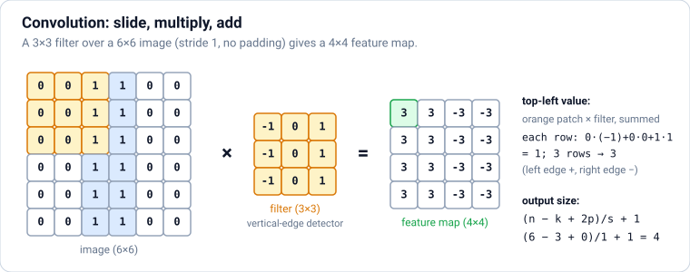

### 24.1 Why not a dense layer?

A dense layer connects every input to every unit. For one 224×224 colour photo that's 150,528 inputs, so 1,000 hidden units need 150 million weights in the first layer alone. Worse, it ignores two facts about images:

- **Locality:** what matters about a pixel is mostly its neighbours: an edge, a corner, a texture.
- **Translation:** a cat is a cat in the top-left corner or the bottom-right. A dense layer would have to learn "cat" separately for every position.

A **convolution** builds both facts in. It uses one small set of weights, a **filter** (or **kernel**), say 3×3, and slides it over every position of the image, so the same pattern detector is applied everywhere.

### 24.2 One position, by hand

At each position, multiply the filter by the 3×3 patch of the image under it, element by element, and add up the nine products. That sum is one number of the output, called the **feature map**.

The picture at the top uses a 6×6 image with a bright vertical stripe (columns 2 and 3) and the filter

```
-1  0  1
-1  0  1
-1  0  1
```

At the top-left position the patch's rows are all (0, 0, 1). Each row gives 0·(−1) + 0·0 + 1·1 = 1, and three rows give **3**. Moving one column right, the patch rows are (0, 1, 1): 0·(−1) + 1·0 + 1·1 = 1 again, so 3. At column 2 the rows are (1, 1, 0): −1 + 0 + 0 = −1 per row, so **−3**. The filter responds to "dark on the left, bright on the right": it's a **vertical-edge detector**, positive at the stripe's left edge and negative at its right.

```python
import numpy as np

image = np.zeros((6, 6))
image[:, 2:4] = 1                                  # a bright vertical stripe
kernel = np.array([[-1, 0, 1],
                   [-1, 0, 1],
                   [-1, 0, 1]])

def conv2d(img, k):
    kh, kw = k.shape
    out = np.zeros((img.shape[0] - kh + 1, img.shape[1] - kw + 1))
    for i in range(out.shape[0]):
        for j in range(out.shape[1]):
            out[i, j] = np.sum(img[i:i + kh, j:j + kw] * k)      # multiply the patch, add up
    return out

print(conv2d(image, kernel))
```

**Output:**

```text
[[ 3.  3. -3. -3.]
 [ 3.  3. -3. -3.]
 [ 3.  3. -3. -3.]
 [ 3.  3. -3. -3.]]
```

(Strictly, this is **cross-correlation**; a mathematician's convolution flips the filter first. Deep-learning libraries all compute it this way and call it convolution, and since the filter is learned, the difference doesn't matter.)

### 24.3 On a real image

The same filter, and its transpose (a horizontal-edge detector), on a Fashion-MNIST image:

```python
from torchvision import datasets

raw = datasets.FashionMNIST(root="data", train=True, download=True)
boot = raw.data[0].numpy() / 255                   # image 0 is an ankle boot
vertical = conv2d(boot, kernel)
horizontal = conv2d(boot, kernel.T)
print(boot.shape, "→", vertical.shape)
print(f"strongest vertical edge {np.abs(vertical).max():.2f}, horizontal edge {np.abs(horizontal).max():.2f}")
```

**Output:**

```text
(28, 28) → (26, 26)
strongest vertical edge 2.89, horizontal edge 2.87
```

The chart in the exercises' answer shows the two feature maps. In a CNN nobody designs these filters: they're weights, learned by backpropagation, and the first layer of a trained CNN typically does learn edge and colour detectors much like these.

### 24.4 Output size: padding and stride

With an input of size n, a filter of size k, **padding** p (rows and columns of zeros added around the edge) and **stride** s (how many pixels the filter jumps between positions):

```
output size = ⌊(n + 2p − k) / s⌋ + 1
```

Why: after padding the input is n + 2p wide. The filter's left edge can start at positions 0, s, 2s, … as long as the filter still fits, i.e. up to n + 2p − k. That's ⌊(n + 2p − k)/s⌋ steps after the first position, plus 1 for the first.

| n | k | p | s | output | note |
|---|---|---|---|---|---|
| 6 | 3 | 0 | 1 | 4 | the example above |
| 28 | 3 | 1 | 1 | 28 | "same" padding: p = (k − 1)/2 keeps the size |
| 28 | 3 | 1 | 2 | 14 | stride 2 halves the size |
| 224 | 7 | 3 | 2 | 112 | the first layer of ResNet |

### 24.5 Channels

Real inputs have several channels (3 for colour), and every layer produces many feature maps. So:

- each filter spans **all** input channels: its shape is (C_in, k, k), and its output at one position is the sum over all C_in × k × k products, plus a bias;
- a layer has C_out filters, giving C_out output channels.

```
weights: (C_out, C_in, k, k)    biases: (C_out,)    input (N, C_in, H, W) → output (N, C_out, H', W')
```

A 3×3 layer from 64 to 128 channels has 128 · 64 · 9 + 128 = 73,856 parameters, the same for a 28×28 input as for a 1,000×1,000 one, because the filters are **shared** across all positions.

### 24.6 Check against PyTorch

`nn.Conv2d(C_in, C_out, kernel_size, stride, padding)` is the convolution layer. Our version, extended to channels and a batch, should match it exactly. `np.pad` adds the zero border:

```python
import torch
from torch import nn

def conv2d_full(x, W, b, stride=1, padding=0):
    """x (N, C_in, H, W), W (C_out, C_in, k, k), b (C_out,)"""
    x = np.pad(x, ((0, 0), (0, 0), (padding, padding), (padding, padding)))
    N, _, H, Wd = x.shape
    C_out, _, k, _ = W.shape
    H_out, W_out = (H - k) // stride + 1, (Wd - k) // stride + 1
    out = np.zeros((N, C_out, H_out, W_out))
    for i in range(H_out):
        for j in range(W_out):
            patch = x[:, :, i * stride:i * stride + k, j * stride:j * stride + k]     # (N, C_in, k, k)
            out[:, :, i, j] = np.tensordot(patch, W, axes=([1, 2, 3], [1, 2, 3])) + b
    return out

torch.manual_seed(0)
layer = nn.Conv2d(3, 4, kernel_size=3, stride=2, padding=1)
x = torch.randn(2, 3, 8, 8)
ours = conv2d_full(x.numpy(), layer.weight.detach().numpy(), layer.bias.detach().numpy(), stride=2, padding=1)
print(layer(x).shape, ours.shape, "match:", np.allclose(layer(x).detach().numpy(), ours, atol=1e-5))
```

**Output:**

```text
torch.Size([2, 4, 4, 4]) (2, 4, 4, 4) match: True
```

`np.tensordot(patch, W, axes=…)` multiplies and sums over the channel and the two filter axes at once, giving one number per (example, filter). The output size matches the formula: ⌊(8 + 2 − 3)/2⌋ + 1 = 4. Real libraries don't loop over positions; they rearrange the patches into a matrix and do one big matrix multiplication, or use special fast algorithms on the GPU.

### 24.7 Receptive field

Each output of a 3×3 convolution sees a 3×3 patch of its input. Stack a second 3×3 layer on top and each of **its** outputs sees a 3×3 patch of the first layer's outputs, which together cover 5×5 input pixels. A third gives 7×7. The region of the input that can affect one output is its **receptive field**, and it grows with depth (and much faster with stride or pooling, Chapter 25). That's how a CNN builds from edges in the first layers to textures, parts and whole objects in later ones.

### 24.8 Summary

```
feature map[i, j] = Σ (patch at (i, j)) ⊙ filter + bias
output size = ⌊(n + 2p − k)/s⌋ + 1        "same": p = (k − 1)/2, s = 1
weights (C_out, C_in, k, k) + C_out biases, shared across positions
nn.Conv2d(C_in, C_out, kernel_size=k, stride=s, padding=p)
```

**Key terms:**

- **Convolution:** sliding a small filter over an input and taking the sum of element-wise products at each position.
- **Filter (kernel):** the small grid of learned weights a convolution slides over the input.
- **Feature map:** the output of one filter over the whole input; one channel of a convolution's output.
- **Cross-correlation:** convolution without flipping the filter, which is what deep-learning libraries compute.
- **Padding:** adding a border of zeros around the input, usually to keep the output the same size.
- **Stride:** how many positions the filter moves between outputs; stride 2 halves the output size.
- **Weight sharing:** using the same filter weights at every position of the input.
- **Receptive field:** the region of the input that can influence one output value.
- **`nn.Conv2d`:** PyTorch's 2-D convolution layer.

### Exercises

1. What output shape does `nn.Conv2d(3, 16, kernel_size=5, stride=1, padding=0)` give for a (8, 3, 32, 32) input? How many parameters does it have?
2. Show the two edge maps of the ankle boot from 24.3 as pictures.

<details>
<summary><b>Answers</b></summary>

```python
layer = nn.Conv2d(3, 16, kernel_size=5)
print(layer(torch.randn(8, 3, 32, 32)).shape, sum(p.numel() for p in layer.parameters()))
```

**Output:**

```text
torch.Size([8, 16, 28, 28]) 1216
```

```python
import matplotlib.pyplot as plt

fig, axes = plt.subplots(1, 3, figsize=(9, 3.2), layout="constrained")
for ax, (title, img) in zip(axes, [("image", boot), ("vertical edges", vertical), ("horizontal edges", horizontal)]):
    ax.imshow(img, cmap="gray")
    ax.set(title=title, xticks=[], yticks=[])
fig.savefig("conv-edges.png", dpi=100)
plt.close(fig)
```

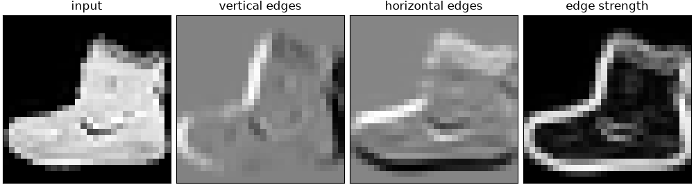

1. (8, 16, 28, 28), since (32 − 5)/1 + 1 = 28. Parameters: 16 · 3 · 5 · 5 + 16 = 1,216.
2. The vertical-edge filter lights up along the boot's left and right outlines; the horizontal one along its top and bottom.

</details>

| # | Problem (Deep-ML) | Difficulty |
|---|---|---|
| 1 | [239. Apply Zero Padding to an Image](https://www.deep-ml.com/problems/239) | 🟢 Easy |
| 2 | [41. Simple Convolutional 2D Layer](https://www.deep-ml.com/problems/41) | 🟡 Medium |

**Learn more:** [Dumoulin & Visin, A guide to convolution arithmetic](https://arxiv.org/abs/1603.07285) · [CS231n: convolutional networks](https://cs231n.github.io/convolutional-networks/)

---

## 25. Pooling and Your First CNN

**You need:** Chapters 16 and 24. · **You'll learn:** pooling, how convolution and pooling layers stack into a convolutional neural network, and how much better it does than an MLP on the same images.

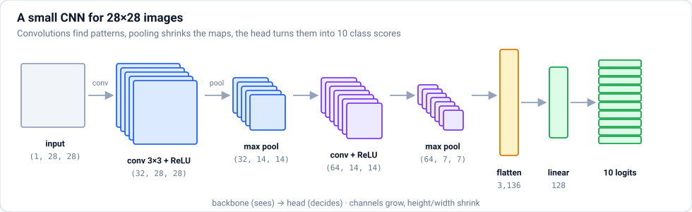

### 25.1 Pooling

A **pooling** layer shrinks each feature map by summarising small windows. **Max pooling** with a 2×2 window and stride 2 keeps the largest value of each non-overlapping 2×2 block, halving the height and width:

```
1 3 | 2 0
4 2 | 1 1          max of each 2×2 block           4 2
---------    →                                 →   7 9
5 7 | 9 8
0 6 | 3 4
```

Two reasons to pool:

- **Less computation, wider view.** Each halving cuts the work of later layers by 4 and doubles their receptive field (Chapter 24.7).
- **Small shifts matter less.** If a feature moves by one pixel within its window, the maximum usually doesn't change.

Pooling has no weights. Its backward pass sends each window's gradient only to the position that held the maximum (the others had no effect on the output).

```python
import numpy as np
import torch
from torch import nn

def max_pool(x, size=2):
    H, W = x.shape
    return x.reshape(H // size, size, W // size, size).max(axis=(1, 3))

x = np.array([[1, 3, 2, 0],
              [4, 2, 1, 1],
              [5, 7, 9, 8],
              [0, 6, 3, 4]])
print(max_pool(x))
print(nn.MaxPool2d(2)(torch.tensor(x, dtype=torch.float32)[None, None]))
```

**Output:**

```text
[[4 2]
 [7 9]]
tensor([[[[4., 2.],
          [7., 9.]]]])
```

The reshape to (2, 2, 2, 2) splits each axis into (block, position within block), so taking the max over axes 1 and 3 takes the max within each block. `[None, None]` adds batch and channel axes for PyTorch. **Average pooling** takes the mean instead.

### 25.2 The CNN

A **convolutional neural network** (**CNN**) stacks blocks of convolution, ReLU and pooling, then finishes with dense layers. The network in the picture:

```python
class CNN(nn.Module):
    def __init__(self):
        super().__init__()
        self.features = nn.Sequential(
            nn.Conv2d(1, 32, kernel_size=3, padding=1), nn.ReLU(), nn.MaxPool2d(2),     # (32, 14, 14)
            nn.Conv2d(32, 64, kernel_size=3, padding=1), nn.ReLU(), nn.MaxPool2d(2),    # (64, 7, 7)
        )
        self.head = nn.Sequential(nn.Flatten(), nn.Linear(64 * 7 * 7, 128), nn.ReLU(), nn.Linear(128, 10))

    def forward(self, x):
        return self.head(self.features(x))

model = CNN()
x = torch.randn(8, 1, 28, 28)
for layer in model.features:
    x = layer(x)
    print(f"{type(layer).__name__:10s} → {tuple(x.shape)}")
print("parameters:", sum(p.numel() for p in model.parameters()))
```

**Output:**

```text
Conv2d     → (8, 32, 28, 28)
ReLU       → (8, 32, 28, 28)
MaxPool2d  → (8, 32, 14, 14)
Conv2d     → (8, 64, 14, 14)
ReLU       → (8, 64, 14, 14)
MaxPool2d  → (8, 64, 7, 7)
parameters: 421642
```

The typical pattern: the **channels grow** (1 → 32 → 64) while the **height and width shrink** (28 → 14 → 7). Early layers find many simple local patterns; later ones combine them into fewer, larger-scale features. The convolutional part is often called the **backbone** (it computes features) and the dense part the **head** (it makes the decision).

Most of the parameters, 3,136 · 128 = 401,408 of them, sit in the first dense layer; the two convolutions have under 20,000 between them.

### 25.3 Train it

The training loop of Chapter 16, with AdamW, for 5 epochs:

```python
from torch.utils.data import DataLoader, TensorDataset, random_split
from torchvision import datasets

def fashion(train):
    raw = datasets.FashionMNIST(root="data", train=train, download=True)
    return TensorDataset(raw.data.float().unsqueeze(1) / 255, raw.targets)

train_ds, val_ds = random_split(fashion(True), [50_000, 10_000], generator=torch.Generator().manual_seed(0))
train_loader = DataLoader(train_ds, batch_size=128, shuffle=True)
val_loader = DataLoader(val_ds, batch_size=1000)

def accuracy(model, loader):
    model.eval()
    with torch.no_grad():
        return sum((model(x).argmax(1) == y).sum().item() for x, y in loader) / len(loader.dataset)

def fit(model, epochs=5):
    optimizer = torch.optim.AdamW(model.parameters(), lr=1e-3)
    for epoch in range(1, epochs + 1):
        model.train()
        for x, y in train_loader:
            optimizer.zero_grad()
            nn.CrossEntropyLoss()(model(x), y).backward()
            optimizer.step()
        print(f"epoch {epoch}: validation accuracy {accuracy(model, val_loader):.4f}")
    return model

torch.manual_seed(0)
cnn = fit(CNN())
```

**Output:**

```text
epoch 1: validation accuracy 0.8605
epoch 2: validation accuracy 0.8881
epoch 3: validation accuracy 0.8717
epoch 4: validation accuracy 0.8998
epoch 5: validation accuracy 0.9067
```

The CNN passes 90% within 5 epochs, where the MLPs of Part IV reached 86–89%. (The bounce at epoch 3 is ordinary epoch-to-epoch noise.) It gets more from the same images because of what it assumes: that nearby pixels belong together and that a pattern means the same thing anywhere.

### 25.4 What the first layer learned

Each of the 32 first-layer filters produces a feature map. For one test image:

```python
test = fashion(False)
image, label = test[0]
with torch.no_grad():
    maps = cnn.features[1](cnn.features[0](image[None]))[0]       # conv, then ReLU: (32, 28, 28)
active = (maps > 0).float().mean(dim=(1, 2))[:8]
print(maps.shape, "| fraction of positions where each of the first 8 maps is active:", [round(v, 2) for v in active.tolist()])
```

**Output:**

```text
torch.Size([32, 28, 28]) | fraction of positions where each of the first 8 maps is active: [0.26, 0.67, 0.29, 0.61, 0.82, 0.43, 0.69, 0.19]
```

The chart in the exercises' answer shows eight of them: some respond to edges in one direction, some to the whole bright region, some to dark background. Nobody designed them.

### 25.5 Summary

```
max pool 2×2, stride 2: (C, H, W) → (C, H/2, W/2), no weights          nn.MaxPool2d(2)
CNN = [Conv → ReLU → Pool] × n  →  Flatten  →  Linear → ReLU → Linear
channels grow, height and width shrink;  backbone = features, head = decision
```

**Key terms:**

- **Pooling:** shrinking a feature map by summarising each small window with one number.
- **Max pooling:** keeping the largest value of each window.
- **Average pooling:** keeping the mean of each window.
- **Convolutional neural network (CNN):** a network built mainly from convolution layers, usually with pooling.
- **Backbone:** the part of a network that computes features from the input.
- **Head:** the final layers that turn the backbone's features into the prediction.

### Exercises

1. Draw eight of the first-layer feature maps for the test image.
2. Remove both pooling layers (and change the head's input size to match). How many parameters does the model have now, and why?

<details>
<summary><b>Answers</b></summary>

```python
import matplotlib.pyplot as plt

fig, axes = plt.subplots(1, 9, figsize=(12, 1.8), layout="constrained")
axes[0].imshow(image[0], cmap="gray"); axes[0].set_title("input", fontsize=8)
for k, ax in enumerate(axes[1:]):
    ax.imshow(maps[k], cmap="viridis"); ax.set_title(f"filter {k}", fontsize=8)
for ax in axes:
    ax.set(xticks=[], yticks=[])
fig.savefig("cnn-feature-maps.png", dpi=100)
plt.close(fig)

no_pool = nn.Sequential(nn.Conv2d(1, 32, 3, padding=1), nn.ReLU(), nn.Conv2d(32, 64, 3, padding=1), nn.ReLU(),
                        nn.Flatten(), nn.Linear(64 * 28 * 28, 128), nn.ReLU(), nn.Linear(128, 10))
print("parameters without pooling:", sum(p.numel() for p in no_pool.parameters()))
```

**Output:**

```text
parameters without pooling: 6442762
```

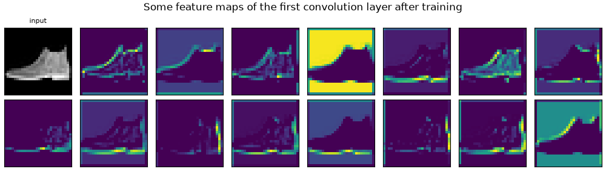

2. About 6.4 million, 16 times more: the feature maps stay 28×28, so the flattened vector is 64 · 784 = 50,176 numbers, and the first dense layer needs 50,176 · 128 weights. Pooling is what keeps the head small.

</details>

| # | Problem (Deep-ML) | Difficulty |
|---|---|---|
| 1 | [114. Implement Global Average Pooling](https://www.deep-ml.com/problems/114) | 🟢 Easy |

**Learn more:** [CS231n: convolutional networks](https://cs231n.github.io/convolutional-networks/) · [CNN Explainer (interactive)](https://poloclub.github.io/cnn-explainer/)

---

## 26. Residual Networks (ResNet)

**You need:** Chapters 18, 21 and 25. · **You'll learn:** why very deep plain networks train worse than shallow ones, how a skip connection fixes it, and how ResNet's blocks are built.

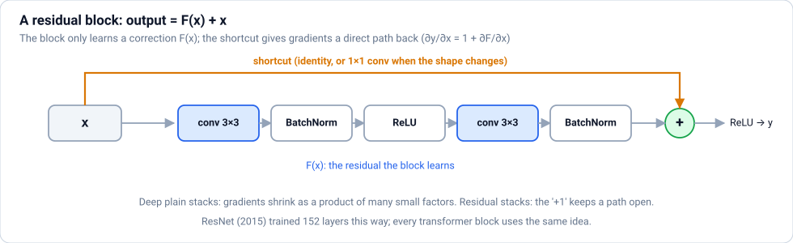

### 26.1 Deeper got worse

More layers should never hurt, in principle: extra layers could just learn to pass their input through unchanged, and the deeper network would be at least as good as the shallow one. In practice, before 2015, deeper networks trained **worse**, and not from overfitting: their **training** loss was higher too.

See it with stacks of identical blocks (dense layer, BatchNorm, ReLU) on Fashion-MNIST, trained for 2 epochs. BatchNorm and Adam are included, so this is the problem that remains **after** Chapters 18–21:

```python
import torch
from torch import nn
from torch.utils.data import DataLoader, TensorDataset
from torchvision import datasets

raw = datasets.FashionMNIST(root="data", train=True, download=True)
X, Y = raw.data.float().flatten(1) / 255, raw.targets
loader = DataLoader(TensorDataset(X[:50_000], Y[:50_000]), batch_size=128, shuffle=True)

class Block(nn.Module):
    def __init__(self, width, residual):
        super().__init__()
        self.f = nn.Sequential(nn.Linear(width, width), nn.BatchNorm1d(width), nn.ReLU())
        self.residual = residual

    def forward(self, x):
        return x + self.f(x) if self.residual else self.f(x)

def deep_net(depth, residual):
    return nn.Sequential(nn.Linear(784, 128), *[Block(128, residual) for _ in range(depth)], nn.Linear(128, 10))
```

The only difference between the two kinds of block is the `x +` in `forward`:

```python
def train_loss_after(model, epochs=2):
    optimizer = torch.optim.Adam(model.parameters(), lr=1e-3)
    for epoch in range(epochs):
        model.train()
        total, count = 0.0, 0
        for x, y in loader:
            optimizer.zero_grad()
            loss = nn.CrossEntropyLoss()(model(x), y)
            loss.backward()
            optimizer.step()
            total, count = total + loss.item() * len(y), count + len(y)
    return total / count                                  # mean training loss over the last epoch

for depth in [4, 32, 64]:
    torch.manual_seed(0); plain = train_loss_after(deep_net(depth, residual=False))
    torch.manual_seed(0); resid = train_loss_after(deep_net(depth, residual=True))
    print(f"{depth:2d} blocks: training loss  plain {plain:.3f}   residual {resid:.3f}")
```

**Output:**

```text
 4 blocks: training loss  plain 0.362   residual 0.355
32 blocks: training loss  plain 0.678   residual 0.380
64 blocks: training loss  plain 2.280   residual 0.416
```

The plain network gets steadily worse with depth, and at 64 blocks it's stuck near log 10 = 2.30: it has learned nothing. With the skip connection, depth barely matters.

### 26.2 The residual block

A **residual block** computes a function F(x) with a few layers and **adds its input back**:

```
y = x + F(x)
```

The path that carries x past the layers is the **shortcut** (or **skip connection**). Two things follow.

**Doing nothing is easy.** For a block to pass its input through, it only has to learn F(x) = 0, which is what small weights already give. A plain block has to learn the identity function exactly, which is much harder. So each block only has to learn a **correction** to what it receives: the "residual".

**Gradients get a direct path.** By the chain rule, the gradient through one block is

```
∂y/∂x = I + ∂F/∂x            (I = the identity: 1 on the diagonal)
```

Through n plain blocks, the backward pass multiplies n factors ∂F/∂x, and a product of many factors smaller than 1 vanishes (Chapter 18). Through n residual blocks it multiplies n factors (I + ∂F/∂x). Expanding the product, one of the terms is I · I · … · I = I: the gradient from the loss reaches the first layer **unchanged**, along the chain of shortcuts, plus whatever the blocks contribute. Every layer receives a usable signal, however deep the network.

<details>
<summary><b>The same argument, written out for two blocks</b></summary>

With y₁ = x + F₁(x) and y₂ = y₁ + F₂(y₁):

∂y₂/∂x = (I + ∂F₂/∂y₁)(I + ∂F₁/∂x) = I + ∂F₁/∂x + ∂F₂/∂y₁ + (∂F₂/∂y₁)(∂F₁/∂x).

The first term passes the gradient straight through. The middle terms are paths through one block each, and the last is the path through both. A plain network has only that last term.

</details>

### 26.3 The ResNet block for images

In **ResNet** (He et al., 2015) each block is conv 3×3 → BatchNorm → ReLU → conv 3×3 → BatchNorm, plus the shortcut, then a final ReLU. When a block changes the shape, halving the height and width with stride 2 and doubling the channels, x can't be added directly, so the shortcut becomes a **1×1 convolution** with the same stride, which reshapes x to match:

```python
class ResidualBlock(nn.Module):
    def __init__(self, c_in, c_out, stride=1):
        super().__init__()
        self.f = nn.Sequential(
            nn.Conv2d(c_in, c_out, 3, stride=stride, padding=1, bias=False), nn.BatchNorm2d(c_out), nn.ReLU(),
            nn.Conv2d(c_out, c_out, 3, padding=1, bias=False), nn.BatchNorm2d(c_out),
        )
        if stride == 1 and c_in == c_out:
            self.shortcut = nn.Identity()                 # returns its input unchanged
        else:
            self.shortcut = nn.Sequential(nn.Conv2d(c_in, c_out, 1, stride=stride, bias=False), nn.BatchNorm2d(c_out))

    def forward(self, x):
        return torch.relu(self.f(x) + self.shortcut(x))

x = torch.randn(8, 64, 28, 28)
print(ResidualBlock(64, 64)(x).shape, ResidualBlock(64, 128, stride=2)(x).shape)
```

**Output:**

```text
torch.Size([8, 64, 28, 28]) torch.Size([8, 128, 14, 14])
```

`bias=False`: a BatchNorm straight after a convolution subtracts the mean anyway, which cancels any bias, so the convolution doesn't need one. A **1×1 convolution** mixes channels at each position without looking at neighbours; it's how CNNs change the number of channels cheaply.

### 26.4 The whole network

A ResNet is a **stem** (a first convolution), then stages of residual blocks, each stage halving the size and doubling the channels, then **global average pooling** and one linear layer. Global average pooling, `nn.AdaptiveAvgPool2d(1)`, averages each channel over all positions, turning (N, C, H, W) into (N, C, 1, 1) whatever H and W are:

```python
small_resnet = nn.Sequential(
    nn.Conv2d(1, 32, 3, padding=1, bias=False), nn.BatchNorm2d(32), nn.ReLU(),   # stem       (32, 28, 28)
    ResidualBlock(32, 32),                                                      # stage 1    (32, 28, 28)
    ResidualBlock(32, 64, stride=2),                                            # stage 2    (64, 14, 14)
    ResidualBlock(64, 128, stride=2),                                           # stage 3    (128, 7, 7)
    nn.AdaptiveAvgPool2d(1), nn.Flatten(), nn.Linear(128, 10),                  # head
)
print(small_resnet(torch.randn(8, 1, 28, 28)).shape, sum(p.numel() for p in small_resnet.parameters()))
```

**Output:**

```text
torch.Size([8, 10]) 308074
```

Global average pooling replaces the huge flattened dense layer of Chapter 25 (most of that CNN's 422,000 parameters) with a single small one, and it lets the same network accept images of any size. **ResNet-18** has 4 stages of 2 blocks each; **ResNet-50** and deeper use a three-layer "bottleneck" block. With them, ResNet trained 152 layers and won the 2015 ImageNet competition.

### 26.5 Where the idea went

| Year | Network | Idea |
|---|---|---|
| 1998 | LeNet | convolution + pooling, for digits |
| 2012 | AlexNet | a big CNN trained on GPUs, with ReLU and dropout; started the deep-learning boom |
| 2014 | VGG | only 3×3 convolutions, stacked deep |
| 2015 | ResNet | residual connections; 100+ layers |
| 2019 | EfficientNet | scaling depth, width and resolution together |
| 2020 | Vision Transformer | transformers on image patches (Chapter 38) |
| 2022 | ConvNeXt | a CNN modernised with transformer-era design choices |

Residual connections spread far beyond CNNs: every transformer block (Chapter 35) wraps both of its sub-layers in exactly this x + F(x) form.

### 26.6 Summary

```
residual block:  y = x + F(x);     ∂y/∂x = I + ∂F/∂x   (the gradient always has a direct path)
ResNet block:    ReLU( BN(conv(ReLU(BN(conv(x))))) + shortcut(x) ),  shortcut = identity or 1×1 conv
network:         stem → stages (×2 size down, ×2 channels) → global average pool → linear
```

**Key terms:**

- **Degradation problem:** deeper plain networks reaching a higher training loss than shallower ones.
- **Residual block:** a block whose output is its input plus a learned correction, x + F(x).
- **Skip connection (shortcut):** the path that carries a block's input around its layers to be added to their output.
- **ResNet:** a CNN built from residual blocks (He et al., 2015).
- **1×1 convolution:** a convolution with a 1×1 filter, which mixes channels at each position; used to change the channel count.
- **Global average pooling:** averaging each channel over all positions, giving one number per channel.
- **Stem:** the first layers of a CNN, which turn the raw image into the first feature maps.

### Exercises

1. Count the parameters of `ResidualBlock(64, 64)` and of `ResidualBlock(64, 128, stride=2)`. Where do the extra ones in the second come from?
2. Why does global average pooling let the same network classify a 28×28 image and a 56×56 one? Check it.

<details>
<summary><b>Answers</b></summary>

```python
count = lambda m: sum(p.numel() for p in m.parameters())
print(count(ResidualBlock(64, 64)), count(ResidualBlock(64, 128, stride=2)))
print(small_resnet(torch.randn(2, 1, 56, 56)).shape)
```

**Output:**

```text
73984 230144
torch.Size([2, 10])
```

1. 73,984 and 230,144. The second block has twice the output channels, so its convolutions are bigger (64·128·9 and 128·128·9 weights), and it adds the 1×1 shortcut convolution (64·128) and its BatchNorm.
2. Convolutions work at any size, and global average pooling turns any H × W into 1 × 1, so the linear layer always gets 128 numbers. A flattening head expects one fixed size.

</details>

| # | Problem (Deep-ML) | Difficulty |
|---|---|---|
| 1 | [113. Implement a Simple Residual Block with Shortcut Connection](https://www.deep-ml.com/problems/113) | 🟢 Easy |

**Learn more:** [He et al., Deep Residual Learning for Image Recognition](https://arxiv.org/abs/1512.03385)

---

## 27. Transfer Learning with Pretrained Vision Models

**You need:** Chapters 22 and 26. · **You'll learn:** how to reuse a network trained on millions of images for your own small dataset, by freezing it and training a new head, or by fine-tuning all of it.

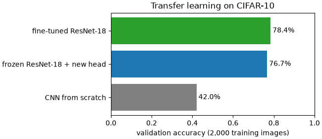

### 27.1 The idea

Training a good image model from scratch takes a large labelled dataset. **ImageNet**, the standard one, has 1.28 million photos in 1,000 classes. Most real projects have a few thousand images at best.

But the features a CNN learns on ImageNet aren't specific to its 1,000 classes. Early layers detect edges and colours, middle layers textures and parts, late layers object-like shapes (Chapters 24–25). Those are useful for almost any photo. **Transfer learning** reuses them: take a network **pretrained** on a large dataset, replace its head (Chapter 25.2) with a new one for your classes, and train on your small dataset.

### 27.2 The data: 2,000 labelled images

**CIFAR-10** has small 32×32 colour photos in 10 classes (aeroplane, car, bird, cat, deer, dog, frog, horse, ship, truck). We download its test split, 10,000 images stored as one **Parquet** file (a compact table format that pandas reads), from the Hugging Face Hub, and pretend we only have 2,000 labelled images to train on:

```python
import io, os, urllib.request
import numpy as np
import pandas as pd
import torch
from torch import nn
from PIL import Image

url = "https://huggingface.co/datasets/uoft-cs/cifar10/resolve/main/plain_text/test-00000-of-00001.parquet"
path = "data/cifar10-test.parquet"
if not os.path.exists(path):
    urllib.request.urlretrieve(url, path)                           # 24 MB, once
df = pd.read_parquet(path)
images = np.stack([np.array(Image.open(io.BytesIO(d["bytes"]))) for d in df["img"]])   # PNG bytes → (32, 32, 3)
X = torch.tensor(images).permute(0, 3, 1, 2)                        # NHWC → NCHW (Chapter 2.2)
Y = torch.tensor(df["label"].values)

order = torch.randperm(10_000, generator=torch.Generator().manual_seed(0))
X_train, y_train = X[order[:2000]], Y[order[:2000]]
X_test, y_test = X[order[2000:3000]], Y[order[2000:3000]]
print(X_train.shape, X_train.dtype, "classes in training set:", torch.bincount(y_train).tolist())
```

**Output:**

```text
torch.Size([2000, 3, 32, 32]) torch.uint8 classes in training set: [200, 204, 202, 198, 184, 192, 200, 202, 195, 223]
```

PIL (the Python Imaging Library, installed with torchvision) decodes each stored PNG image. `permute` is PyTorch's name for reordering axes.

### 27.3 Baseline: a CNN from scratch

The CNN of Chapter 25, adapted to 3 colour channels and 32×32 inputs, trained on the 2,000 images for 20 epochs:

```python
def accuracy(model, X, y, prep, batch=200):
    model.eval()
    with torch.no_grad():
        pred = torch.cat([model(prep(X[i:i + batch])).argmax(1) for i in range(0, len(X), batch)])
    return (pred == y).float().mean().item()

def train(model, prep, epochs, lr, batch=64):
    optimizer = torch.optim.AdamW(model.parameters(), lr=lr, weight_decay=0.01)
    for epoch in range(epochs):
        model.train()
        order = torch.randperm(len(X_train))
        for i in range(0, len(X_train), batch):
            idx = order[i:i + batch]
            optimizer.zero_grad()
            nn.CrossEntropyLoss()(model(prep(X_train[idx])), y_train[idx]).backward()
            optimizer.step()
    return accuracy(model, X_test, y_test, prep)

torch.manual_seed(0)
scratch = nn.Sequential(nn.Conv2d(3, 32, 3, padding=1), nn.ReLU(), nn.MaxPool2d(2),
                        nn.Conv2d(32, 64, 3, padding=1), nn.ReLU(), nn.MaxPool2d(2),
                        nn.Flatten(), nn.Linear(64 * 8 * 8, 128), nn.ReLU(), nn.Linear(128, 10))
scale = lambda x: x.float() / 255
scratch_acc = train(scratch, scale, epochs=20, lr=1e-3)
print(f"CNN from scratch: test accuracy {scratch_acc:.3f}")
```

**Output:**

```text
CNN from scratch: test accuracy 0.511
```

Two thousand images just aren't enough to learn good features from nothing.

### 27.4 A pretrained ResNet-18

`torchvision.models` has many networks pretrained on ImageNet. `resnet18(weights=ResNet18_Weights.DEFAULT)` builds the ResNet-18 of Chapter 26 and downloads its trained weights (45 MB, once):

```python
from torchvision.models import resnet18, ResNet18_Weights

weights = ResNet18_Weights.DEFAULT
model = resnet18(weights=weights)
print(model.fc)
print("parameters:", f"{sum(p.numel() for p in model.parameters()):,}")
```

**Output:**

```text
Linear(in_features=512, out_features=1000, bias=True)
parameters: 11,689,512
```

Its head is `model.fc`, a linear layer from 512 features (the global average pool of the last stage) to ImageNet's 1,000 classes.

A pretrained model expects its inputs prepared **exactly** as in its training. For ImageNet models that means pixel values scaled to [0, 1], then normalised per channel with ImageNet's mean and standard deviation. We also enlarge CIFAR's tiny 32×32 images, since the network was trained on 224×224 photos; 128×128 is a compromise that keeps the CPU time down:

```python
from torchvision.transforms import v2

prep = v2.Compose([
    v2.Resize(128),
    v2.ToDtype(torch.float32, scale=True),                          # uint8 0–255 → float 0–1
    v2.Normalize(mean=[0.485, 0.456, 0.406], std=[0.229, 0.224, 0.225]),   # ImageNet's statistics
])
print(prep(X_train[:4]).shape)
```

**Output:**

```text
torch.Size([4, 3, 128, 128])
```

### 27.5 Option 1: freeze the backbone, train a new head

**Freeze** every pretrained weight: never update it. Then the backbone computes the same 512 features for an image every time, so compute them **once** for every image, and train only a new linear head, from 512 features to our 10 classes, on top. `nn.Identity()` (Chapter 26.3) as the head makes the network return the features themselves:

```python
backbone = resnet18(weights=weights)
backbone.fc = nn.Identity()                                         # output the 512 features
backbone.eval()
with torch.no_grad():
    F_train = torch.cat([backbone(prep(X_train[i:i + 200])) for i in range(0, 2000, 200)])
    F_test = torch.cat([backbone(prep(X_test[i:i + 200])) for i in range(0, 1000, 200)])
print(F_train.shape)

torch.manual_seed(0)
head = nn.Linear(512, 10)
optimizer = torch.optim.AdamW(head.parameters(), lr=1e-3, weight_decay=0.01)
for step in range(500):                                             # full-batch: 2,000 × 512 is tiny
    optimizer.zero_grad()
    nn.CrossEntropyLoss()(head(F_train), y_train).backward()
    optimizer.step()
frozen_acc = (head(F_test).argmax(1) == y_test).float().mean().item()
print(f"frozen ResNet-18 + new head ({sum(p.numel() for p in head.parameters())} trained parameters): test accuracy {frozen_acc:.3f}")
```

**Output:**

```text
torch.Size([2000, 512])
frozen ResNet-18 + new head (5130 trained parameters): test accuracy 0.815
```

Only 5,130 parameters were trained, in a second, yet accuracy jumps by around 30 points: the frozen backbone's features already separate the classes well, and the head just learns to read them. This is called a **linear probe**. It's cheap, it barely overfits, and it's the right first move on a very small dataset.

### 27.6 Option 2: fine-tune everything

**Fine-tuning** trains the whole network, starting from the pretrained weights, so the features themselves can adapt to the new images. Use a **small learning rate**, about 10 times below what you'd use from scratch: the weights are already good, and big steps would wreck them.

```python
torch.manual_seed(0)
finetuned = resnet18(weights=weights)
finetuned.fc = nn.Linear(512, 10)
finetune_acc = train(finetuned, prep, epochs=2, lr=1e-4)
print(f"fine-tuned ResNet-18: test accuracy {finetune_acc:.3f}")
```

**Output:**

```text
fine-tuned ResNet-18: test accuracy 0.838
```

Fine-tuning updates all 11 million weights, so it costs far more than training a head, and with very little data it can overfit. When it works it's usually the best option, because the features themselves adapt to the new images. A common middle path: freeze the early layers, which learn the most general features, and fine-tune only the later stages and the head.

### 27.7 Practical recipe

1. Start from a pretrained model; training from scratch is only worth it with millions of images, or images very unlike photos.
2. Use the model's own preprocessing (`weights.transforms()` gives it for torchvision models).
3. Try a frozen backbone with a new head first; then fine-tune with a learning rate around 1e-4 to 1e-5, with augmentation (Chapter 22.5).
4. Choose the backbone to fit the budget: ResNet-50 and ConvNeXt are strong CNNs; vision transformers (Chapter 38) are the most common choice for large-scale transfer today; Hugging Face (Chapter 39) hosts thousands more.

### 27.8 Summary

```
model = resnet18(weights=ResNet18_Weights.DEFAULT);  model.fc = nn.Linear(512, n_classes)
preprocess exactly as in pretraining: resize, scale to [0, 1], normalise with ImageNet mean/std
frozen backbone:  p.requires_grad = False for pretrained weights; train only the head (lr ~1e-3)
fine-tuning:      train everything from the pretrained weights with a small lr (~1e-4)
```

**Key terms:**

- **Transfer learning:** reusing a model trained on one task as the starting point for another.
- **ImageNet:** a dataset of 1.28 million labelled photos in 1,000 classes, the standard source of pretrained vision models.
- **CIFAR-10:** 60,000 32×32 colour images in 10 classes.
- **Freezing:** setting `requires_grad = False` on weights so that training doesn't change them.
- **Fine-tuning:** continuing to train a pretrained model's weights on new data, usually with a small learning rate.
- **Linear probe:** a frozen pretrained backbone with only a new linear head trained on top.
- **Parquet:** a compact, column-oriented file format for tables.

### Exercises

1. To freeze a backbone but still train the model end to end (without precomputing features), you set `p.requires_grad = False` for every parameter and then replace `model.fc`. Why must it be in that order?
2. Why does fine-tuning use a learning rate 10 times smaller than training from scratch?

<details>
<summary><b>Answers</b></summary>

```python
test_model = resnet18(weights=weights)
test_model.fc = nn.Linear(512, 10)                                  # head replaced first...
for p in test_model.parameters():
    p.requires_grad = False                                         # ...then everything frozen
print("trainable parameters:", sum(p.numel() for p in test_model.parameters() if p.requires_grad))
```

**Output:**

```text
trainable parameters: 0
```

1. The freezing loop covers every parameter in the model at that moment. Freeze after replacing the head, as above, and the new head is frozen too: nothing is left to train. Replace the head after freezing and only its 5,130 parameters train.
2. The pretrained weights are already near a good solution. Large steps would quickly destroy the useful features (a problem called **catastrophic forgetting**) before the small dataset could teach anything better.

</details>

**Learn more:** [PyTorch: transfer learning tutorial](https://pytorch.org/tutorials/beginner/transfer_learning_tutorial.html) · [torchvision: models and pretrained weights](https://pytorch.org/vision/stable/models.html)

<details>
<summary><b>Code for the chart at the top</b></summary>

```python
import matplotlib.pyplot as plt

fig, ax = plt.subplots(figsize=(6, 3.4), layout="constrained")
names = ["CNN from scratch\n(20 epochs)", "frozen ResNet-18\n+ new linear head", "fine-tuned ResNet-18\n(2 epochs)"]
values = [scratch_acc, frozen_acc, finetune_acc]
bars = ax.bar(names, values, color=["gray", "C0", "C2"])
ax.bar_label(bars, labels=[f"{v:.0%}" for v in values])
ax.set(ylim=(0, 1), ylabel="test accuracy", title="10 classes, 2,000 training images")
fig.savefig("transfer-learning.png", dpi=100)
plt.close(fig)
```

</details>

---

## 28. Object Detection and Segmentation

**You need:** Chapters 24–27. · **You'll learn:** how vision goes beyond "what is in this image" to "where": boxes, the IoU and non-maximum suppression every detector uses, and segmentation as classifying every pixel.

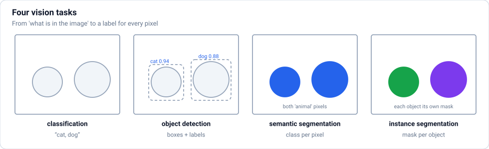

### 28.1 The tasks

| Task | Output | Typical models |
|---|---|---|
| classification | one label (or a few) per image | ResNet, ViT |
| object detection | a box, a label and a score per object | YOLO, Faster R-CNN, DETR |
| semantic segmentation | a class for every pixel | U-Net, DeepLab |
| instance segmentation | a separate mask per object | Mask R-CNN, SAM |

All of them use a CNN or transformer backbone (Chapters 25–27, 38) and differ in the head and the loss.

### 28.2 Boxes and IoU

A box is usually stored as its corners (x₁, y₁, x₂, y₂). To compare a predicted box with the true one, detectors use **intersection over union** (**IoU**): the area where the boxes overlap divided by the area they cover together.

```
IoU = area(A ∩ B) / area(A ∪ B),     area(A ∪ B) = area(A) + area(B) − area(A ∩ B)
```

It's 1 for identical boxes and 0 for boxes that don't touch. By hand, for A = (0, 0, 4, 4) and B = (2, 2, 6, 6): the overlap is the square from (2, 2) to (4, 4), area 4. Each box has area 16, so the union is 16 + 16 − 4 = 28, and IoU = 4/28 = 0.143.

The overlap's corners are the larger of the two left/top edges and the smaller of the two right/bottom edges; if they cross, there's no overlap:

```python
import torch

def iou(a, b):
    x1, y1 = max(a[0], b[0]), max(a[1], b[1])
    x2, y2 = min(a[2], b[2]), min(a[3], b[3])
    inter = max(0, x2 - x1) * max(0, y2 - y1)
    area = lambda r: (r[2] - r[0]) * (r[3] - r[1])
    return inter / (area(a) + area(b) - inter)

print(round(iou((0, 0, 4, 4), (2, 2, 6, 6)), 3), iou((0, 0, 4, 4), (0, 0, 4, 4)), iou((0, 0, 1, 1), (2, 2, 3, 3)))
```

**Output:**

```text
0.143 1.0 0.0
```

A detection usually counts as correct if its IoU with a true box of the same class is at least 0.5.

### 28.3 How a detector predicts boxes

A detector's head outputs, at many positions of the backbone's feature map, a set of candidate boxes: for each, the box coordinates (a regression, trained with an L1 or IoU-based loss) and a score per class (a classification, trained with cross-entropy). Since an object overlaps many positions, it gets **many** overlapping candidates, typically dozens per object.

### 28.4 Non-maximum suppression

**Non-maximum suppression** (**NMS**) keeps the best candidate for each object and drops its duplicates:

1. Sort the boxes by score.
2. Keep the highest-scoring box.
3. Remove every remaining box whose IoU with it is above a threshold (say 0.5): they're duplicates of the same object.
4. Repeat with the next highest box left.

```python
def nms(boxes, scores, threshold=0.5):
    order = sorted(range(len(boxes)), key=lambda i: scores[i], reverse=True)
    keep = []
    while order:
        best = order.pop(0)
        keep.append(best)
        order = [i for i in order if iou(boxes[best], boxes[i]) <= threshold]
    return keep

boxes = [(10, 10, 50, 50), (12, 12, 52, 52), (11, 9, 49, 51),        # three guesses for one object
         (100, 100, 140, 150), (102, 98, 141, 148)]                   # two for another
scores = [0.9, 0.75, 0.8, 0.6, 0.95]
print("kept:", nms(boxes, scores))
```

**Output:**

```text
kept: [4, 0]
```

`torchvision.ops` has fast versions of both, which should agree:

```python
from torchvision.ops import box_iou, nms as tv_nms

B, S = torch.tensor(boxes, dtype=torch.float32), torch.tensor(scores)
print("torchvision nms:", tv_nms(B, S, 0.5).tolist())
print("IoU of box 0 with the others:", [round(v, 2) for v in box_iou(B[:1], B)[0].tolist()])
```

**Output:**

```text
torchvision nms: [4, 0]
IoU of box 0 with the others: [1.0, 0.82, 0.91, 0.0, 0.0]
```

Modern detectors come in two families. **YOLO**-style detectors predict boxes in one pass over the feature map, then run NMS; they're fast enough for real-time video. **DETR**-style detectors use a transformer that outputs a fixed set of boxes and learns to give each object exactly one, so they need no NMS. Detectors are evaluated with **mAP** (mean average precision): the area under the precision–recall curve (`machine-learning.md` Chapter 13) for each class, averaged.

### 28.5 Segmentation: a class for every pixel

Semantic segmentation is classification, done at every pixel. The network outputs logits of shape (N, K, H, W), one score per class per pixel, and the loss is cross-entropy averaged over all pixels. `nn.CrossEntropyLoss` accepts exactly that: logits (N, K, H, W) with integer targets (N, H, W).

A network that keeps the image's height and width all the way through, with only convolutions and no dense layers, is a **fully convolutional network**. A tiny one, on images of a random bright disc on a noisy background, learning to mark the disc's pixels:

```python
from torch import nn

def make_discs(n, size=32, seed=0):
    g = torch.Generator().manual_seed(seed)
    yy, xx = torch.meshgrid(torch.arange(size), torch.arange(size), indexing="ij")
    images, masks = [], []
    for _ in range(n):
        cx, cy = torch.randint(8, size - 8, (2,), generator=g)
        r = torch.randint(4, 8, (1,), generator=g)
        mask = ((xx - cx) ** 2 + (yy - cy) ** 2 <= r ** 2).long()            # 1 inside the disc
        images.append(mask.float() * 0.6 + torch.rand(size, size, generator=g) * 0.8)   # disc + noise
        masks.append(mask)
    return torch.stack(images).unsqueeze(1), torch.stack(masks)

X, M = make_discs(256)
print(X.shape, M.shape, "disc pixels:", round(M.float().mean().item(), 3))
```

**Output:**

```text
torch.Size([256, 1, 32, 32]) torch.Size([256, 32, 32]) disc pixels: 0.094
```

`torch.meshgrid` gives every pixel's row and column number, so the disc is every pixel within distance r of the centre. The noise is strong enough that a single pixel's brightness isn't enough; the network has to look at neighbourhoods:

```python
torch.manual_seed(0)
fcn = nn.Sequential(
    nn.Conv2d(1, 16, 3, padding=1), nn.ReLU(),
    nn.Conv2d(16, 16, 3, padding=1), nn.ReLU(),
    nn.Conv2d(16, 2, 1),                                   # 2 logits per pixel: background, disc
)
optimizer = torch.optim.Adam(fcn.parameters(), lr=1e-2)
for step in range(200):
    optimizer.zero_grad()
    loss = nn.CrossEntropyLoss()(fcn(X), M)                # (N, 2, H, W) logits vs (N, H, W) targets
    loss.backward()
    optimizer.step()

X_new, M_new = make_discs(64, seed=1)
with torch.no_grad():
    pred = fcn(X_new).argmax(dim=1)
inter = ((pred == 1) & (M_new == 1)).sum().item()
union = ((pred == 1) | (M_new == 1)).sum().item()
print(f"pixel accuracy {(pred == M_new).float().mean():.3f}, IoU of the disc class {inter / union:.3f}")
```

**Output:**

```text
pixel accuracy 0.996, IoU of the disc class 0.958
```

IoU works for masks just as for boxes, and it's the standard segmentation score, because pixel accuracy is flattered by the large, easy background.

Real segmentation networks need to see the whole object yet output sharp, full-resolution masks. **U-Net** does both: an encoder shrinks the image like a CNN, a decoder grows it back with upsampling layers, and skip connections copy the encoder's detailed feature maps across to the decoder at each size. **SAM** (Segment Anything, Meta, 2023) is a large pretrained model that segments any object you point at.

### 28.6 Summary

```
IoU = area(A ∩ B) / (area(A) + area(B) − area(A ∩ B));  a detection counts if IoU ≥ 0.5
NMS: sort by score; keep the best; drop boxes with IoU > threshold; repeat     torchvision.ops.nms
segmentation: logits (N, K, H, W) + CrossEntropyLoss vs targets (N, H, W); score with IoU
```

**Key terms:**

- **Object detection:** finding each object in an image as a box with a label and a score.
- **Bounding box:** a rectangle around an object, often stored as its corners (x₁, y₁, x₂, y₂).
- **Intersection over union (IoU):** the overlap area of two regions divided by the area they cover together.
- **Non-maximum suppression (NMS):** removing overlapping duplicate detections, keeping the highest-scoring one.
- **mAP (mean average precision):** the standard detection score: average precision per class, averaged over classes.
- **Semantic segmentation:** assigning a class to every pixel.
- **Instance segmentation:** giving each separate object its own mask.
- **Fully convolutional network:** a network with only convolution-type layers, so its output keeps a spatial layout.
- **U-Net:** a segmentation network with a shrinking encoder, a growing decoder, and skip connections between them.

### Exercises

1. Two 10×10 boxes overlap in a 5×10 strip. What is their IoU?
2. Run NMS on the five boxes with a threshold of 0.95. Why are more boxes kept?

<details>
<summary><b>Answers</b></summary>

```python
print(round(iou((0, 0, 10, 10), (5, 0, 15, 10)), 3))
print("threshold 0.95 keeps:", nms(boxes, scores, threshold=0.95))
```

**Output:**

```text
0.333
threshold 0.95 keeps: [4, 0, 2, 1, 3]
```

1. Overlap 50, union 100 + 100 − 50 = 150, so IoU = 1/3.
2. A box is only removed when it overlaps a kept box by more than 95%. The duplicates here overlap by 80–90%, so they survive, and each object is reported several times.

</details>

**Learn more:** [Ultralytics YOLO documentation](https://docs.ultralytics.com/) · [Ronneberger et al., U-Net](https://arxiv.org/abs/1505.04597)

---

# Part VI — Sequences and Text

Four chapters on data that comes in order: turning text into tokens, tokens into vectors, recurrent networks that read a sequence step by step, and the attention mechanism that led to transformers.

---

## 29. Tokenisation: Characters, Words and Subwords

**You need:** Chapter 2. · **You'll learn:** how text becomes the integer ids a network reads, and byte-pair encoding, the subword method behind GPT, Llama and Claude, built from scratch.

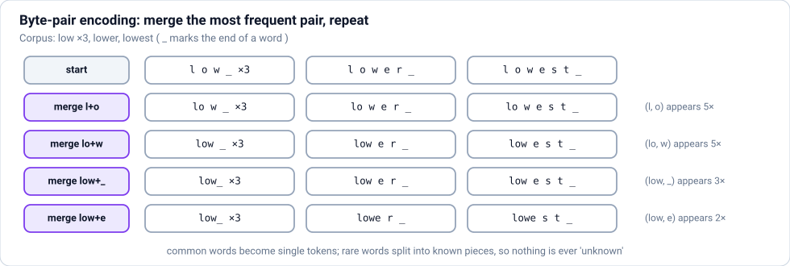

### 29.1 From text to ids

A network computes with numbers, so text must first be split into pieces called **tokens**, and each token mapped to an integer **id** from a fixed **vocabulary**. The tool that does both, and back again, is a **tokenizer**:

```
"the cat sat"  →  tokens ["the", " cat", " sat"]  →  ids [262, 3797, 3332]  →  network
```

The choice of pieces is a trade-off between vocabulary size and sequence length.

### 29.2 Characters or words?

**Characters** need a tiny vocabulary (about 100 for English), and nothing is ever unknown. But sequences get long, and a network has to learn spelling before it can learn meaning.

**Words** give short sequences, but the vocabulary explodes ("run", "runs", "running", "runner", every name, every typo), and any word not in the vocabulary becomes a useless **unknown** token.

```python
text = "the runner runs. the running runners ran!"
chars = sorted(set(text))
print(len(chars), "characters:", "".join(chars))
print("character ids:", [chars.index(c) for c in text[:10]], "…")
print("words:", text.split())
```

**Output:**

```text
13 characters:  !.aeghinrstu
character ids: [11, 6, 4, 0, 9, 12, 8, 8, 4, 9] …
words: ['the', 'runner', 'runs.', 'the', 'running', 'runners', 'ran!']
```

### 29.3 Subwords: byte-pair encoding

**Subword** tokenizers sit in between. Common words become single tokens; rare words are split into common pieces ("runners" → "runn" + "ers"), so nothing is ever unknown and the vocabulary stays a manageable size.

**Byte-pair encoding** (**BPE**) learns the pieces from a corpus:

1. Split every word into characters, with an end-of-word marker `_`.
2. Count every pair of adjacent tokens.
3. Merge the most frequent pair into one new token, everywhere.
4. Repeat until the vocabulary has the size you want. The list of merges, in order, is the tokenizer.

The picture at the top traces it on the corpus "low" ×3, "lower", "lowest". The pairs (l, o) and (o, w) both appear 5 times; merging (l, o) first, then (lo, w), turns every "low" into one token. Then (low, _) appears 3 times, and so on.

```python
from collections import Counter

def train_bpe(word_counts, num_merges):
    words = {tuple(w) + ("_",): c for w, c in word_counts.items()}       # "low" → ('l', 'o', 'w', '_')
    merges = []
    for _ in range(num_merges):
        pairs = Counter()
        for symbols, count in words.items():
            for pair in zip(symbols, symbols[1:]):
                pairs[pair] += count
        best, freq = pairs.most_common(1)[0]
        merges.append(best)
        words = {merge_pair(symbols, best): c for symbols, c in words.items()}
        print(f"merge {best[0]}+{best[1]} ({freq}×) → {[' '.join(s) for s in words]}")
    return merges

def merge_pair(symbols, pair):
    out, i = [], 0
    while i < len(symbols):
        if i + 1 < len(symbols) and (symbols[i], symbols[i + 1]) == pair:
            out.append(symbols[i] + symbols[i + 1])
            i += 2
        else:
            out.append(symbols[i])
            i += 1
    return tuple(out)

merges = train_bpe({"low": 3, "lower": 1, "lowest": 1}, num_merges=4)
```

**Output:**

```text
merge l+o (5×) → ['lo w _', 'lo w e r _', 'lo w e s t _']
merge lo+w (5×) → ['low _', 'low e r _', 'low e s t _']
merge low+_ (3×) → ['low_', 'low e r _', 'low e s t _']
merge low+e (2×) → ['low_', 'lowe r _', 'lowe s t _']
```

`Counter.most_common(1)` returns the most frequent pair; on a tie, the one counted first. To **encode** a new word, split it into characters and apply the learned merges in the order they were learned:

```python
def encode(word, merges):
    symbols = tuple(word) + ("_",)
    for pair in merges:
        symbols = merge_pair(symbols, pair)
    return list(symbols)

for w in ["low", "lowest", "slower", "flow"]:
    print(f"{w:7s} → {encode(w, merges)}")
```

**Output:**

```text
low     → ['low_']
lowest  → ['lowe', 's', 't', '_']
slower  → ['s', 'lowe', 'r', '_']
flow    → ['f', 'low_']
```

"slower" and "flow" never appeared in the corpus, yet they encode into known pieces. Real tokenizers learn tens of thousands of merges from billions of words, so whole common words become single tokens.

### 29.4 Bytes, not characters

A character-level start still fails on characters never seen in training: an emoji, a rare script. **Byte-level BPE** starts from the 256 possible **bytes** of the UTF-8 encoding instead. Every possible text is a sequence of bytes, so every text can be encoded:

```python
for s in ["cat", "café", "猫", "🐈"]:
    print(f"{s!r:7s} → {len(s)} character(s), {len(s.encode('utf-8'))} byte(s): {list(s.encode('utf-8'))}")
```

**Output:**

```text
'cat'   → 3 character(s), 3 byte(s): [99, 97, 116]
'café'  → 4 character(s), 5 byte(s): [99, 97, 102, 195, 169]
'猫'     → 1 character(s), 3 byte(s): [231, 140, 171]
'🐈'     → 1 character(s), 4 byte(s): [240, 159, 144, 136]
```

`.encode('utf-8')` gives the bytes. English letters take 1 byte; "é" takes 2, a Chinese character 3, an emoji 4. GPT-2 uses byte-level BPE with a vocabulary of 50,257 tokens; recent models use 100,000 to 250,000, which shortens sequences, especially for languages other than English. Chapter 39 loads a real one.

### 29.5 Special tokens and padding

Tokenizers add a few **special tokens** with their own ids, such as:

- **beginning / end of sequence** (`<bos>`, `<eos>`), to mark where text starts and stops;
- **padding** (`<pad>`), to make sequences in a batch the same length.

A batch tensor must be rectangular, so shorter sequences are **padded** to the longest one, and an **attention mask** (1 = real token, 0 = padding) tells the model which positions to ignore:

```python
import torch

PAD = 0
batch = [[5, 9, 2], [7, 1], [3, 8, 6, 4]]
longest = max(len(s) for s in batch)
ids = torch.tensor([s + [PAD] * (longest - len(s)) for s in batch])
mask = (ids != PAD).long()
print(ids)
print(mask)
```

**Output:**

```text
tensor([[5, 9, 2, 0],
        [7, 1, 0, 0],
        [3, 8, 6, 4]])
tensor([[1, 1, 1, 0],
        [1, 1, 0, 0],
        [1, 1, 1, 1]])
```

### 29.6 Why tokens matter in practice

Models read, price and limit text in tokens, not words. In English one token averages about ¾ of a word (roughly 4 characters), so 1,000 words is about 1,300 tokens. Other languages, code and numbers usually take more tokens per word. Tokenisation also explains some odd model behaviour: a model that sees "strawberry" as two or three tokens never directly sees its individual letters, which is why counting letters in a word is surprisingly hard for it.

### 29.7 Summary

```
text → tokens → ids (vocabulary lookup) → network;   ids → tokens → text to decode
BPE training: start from characters (or bytes); repeatedly merge the most frequent adjacent pair
BPE encoding: split, then apply the learned merges in order
batches: pad to the longest sequence; attention mask = 1 for real tokens, 0 for padding
```

**Key terms:**

- **Token:** one piece of text that a model treats as a unit: a character, a word or a subword.
- **Vocabulary:** the fixed list of all tokens a tokenizer knows, each with an integer id.
- **Tokenizer:** the tool that turns text into token ids and back.
- **Unknown token (`<unk>`):** a placeholder for anything not in a word vocabulary.
- **Subword tokenization:** splitting text into frequent pieces of words, so common words stay whole and rare words split.
- **Byte-pair encoding (BPE):** learning subword tokens by repeatedly merging the most frequent adjacent pair.
- **Byte-level BPE:** BPE that starts from the 256 UTF-8 byte values, so any text can be encoded.
- **UTF-8:** the standard way to store text as bytes, using 1 to 4 bytes per character.
- **Special tokens:** tokens with reserved meanings, such as beginning, end and padding.
- **Padding:** filling shorter sequences with a pad token so a batch has equal lengths.
- **Attention mask:** a tensor of 1s and 0s marking which positions hold real tokens.

### Exercises

1. Train BPE for 6 merges on {"new": 4, "newer": 2, "wider": 3}. What do "renew" and "newest" encode to?
2. A text is 2,600 English words. Roughly how many tokens is that?

<details>
<summary><b>Answers</b></summary>

```python
m = train_bpe({"new": 4, "newer": 2, "wider": 3}, num_merges=6)
print(encode("renew", m), encode("newest", m))
print("tokens ≈", round(2600 / 0.75))
```

**Output:**

```text
merge n+e (6×) → ['ne w _', 'ne w e r _', 'w i d e r _']
merge ne+w (6×) → ['new _', 'new e r _', 'w i d e r _']
merge e+r (5×) → ['new _', 'new er _', 'w i d er _']
merge er+_ (5×) → ['new _', 'new er_', 'w i d er_']
merge new+_ (4×) → ['new_', 'new er_', 'w i d er_']
merge w+i (3×) → ['new_', 'new er_', 'wi d er_']
['r', 'e', 'new_'] ['new', 'e', 's', 't', '_']
tokens ≈ 3467
```

1. The merges build "new", "er_", "new_" and "wi". "renew" becomes r + e + new_, and "newest" becomes new + e + s + t + _: known pieces plus single letters, never an unknown token.
2. About 2,600 / 0.75 ≈ 3,500 tokens.

</details>

| # | Problem (Deep-ML) | Difficulty |
|---|---|---|
| 1 | [129. Calculate Unigram Probability from Corpus](https://www.deep-ml.com/problems/129) | 🟢 Easy |

**Learn more:** [Andrej Karpathy: Let's build the GPT Tokenizer (video)](https://www.youtube.com/watch?v=zduSFxRajkE) · [Hugging Face: byte-pair encoding tokenization](https://huggingface.co/learn/llm-course/chapter6/5)

---

## 30. Embeddings: Turning Tokens into Vectors

**You need:** Chapters 14 and 29. · **You'll learn:** why token ids become learned vectors, why an embedding layer is just a table lookup, and how training gives similar words similar vectors.

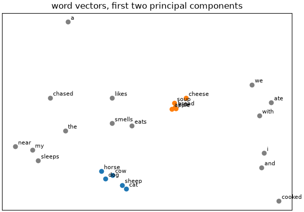

### 30.1 Ids carry no meaning

A token id is just a position in the vocabulary: id 3797 isn't "more" than id 262, and "cat" (id 3797) isn't near "dog" in any sense. Feeding raw ids into a network would invent an order that doesn't exist.

The classic fix, a **one-hot** vector (all zeros, one 1 at the token's id), removes the fake order but carries no meaning either: every pair of different words has dot product 0, so "cat" is exactly as far from "dog" as from "carburettor". And with a 50,000-token vocabulary, each vector is 50,000 numbers long.

### 30.2 An embedding is a lookup

An **embedding** gives every token a short, dense vector of D learned numbers (D = 64 to a few thousand), stored as row `id` of a matrix E of shape (V, D). Multiplying a one-hot vector by E just picks out one row, so a lookup does the same job without the multiplication:

```
one_hot(id) @ E = E[id]
```

```python
import torch
from torch import nn

torch.manual_seed(0)
V, D = 6, 3
E = torch.randn(V, D)
token = 4
one_hot = torch.zeros(V)
one_hot[token] = 1
print(one_hot @ E)
print(E[token])
```

**Output:**

```text
tensor([1.3894, 1.5863, 0.9463])
tensor([1.3894, 1.5863, 0.9463])
```

`nn.Embedding(V, D)` is a layer holding such a matrix as a learnable parameter. Given token ids of any shape, it returns their rows, adding a last axis of size D: (N, T) ids become (N, T, D) vectors (Chapter 2.2).

```python
emb = nn.Embedding(V, D)
ids = torch.tensor([[1, 4, 4], [0, 2, 5]])                     # 2 sequences of 3 tokens
print(emb(ids).shape)
```

**Output:**

```text
torch.Size([2, 3, 3])
```

Because it's a lookup, the backward pass only sends gradient to the rows that were used: a word that never appears in a batch keeps its vector unchanged for that step.

### 30.3 Learning meaning from context

Embeddings start random. They become meaningful because training rewards whatever helps the task, and in language, **words used in similar contexts tend to have similar meanings**. If "cat" and "dog" both appear next to "eats", "chased" and "sleeps", a model predicting context words does best when it gives them similar vectors.

**word2vec**'s **skip-gram** model (2013) uses exactly that as its task: given a word, predict the words within a few positions of it. The model is just an embedding followed by a linear layer that scores every vocabulary word as the neighbour:

```
centre word id → E[id] (D numbers) → Linear(D, V) → softmax over the vocabulary
```

A toy corpus made from simple sentence patterns, with animals and foods used in their typical places:

```python
import random

random.seed(0)
animals = ["cat", "dog", "horse", "cow", "sheep"]
foods = ["rice", "bread", "apple", "cheese", "soup"]
patterns = ["the {a} eats {f}", "a {a} likes {f}", "the {a} chased the {a2}", "my {a} sleeps near the {a2}",
            "i cooked {f} and {f2}", "we ate {f} with {f2}", "the {a} smells the {f}"]
sentences = [random.choice(patterns).format(a=random.choice(animals), a2=random.choice(animals),
                                            f=random.choice(foods), f2=random.choice(foods)).split()
             for _ in range(2000)]
vocab = sorted({w for s in sentences for w in s})
word_id = {w: i for i, w in enumerate(vocab)}
print(len(vocab), "words; e.g.", sentences[:2])
```

**Output:**

```text
25 words; e.g. [['the', 'cow', 'smells', 'the', 'rice'], ['i', 'cooked', 'apple', 'and', 'cheese']]
```

The training pairs: every word with each word up to 2 positions away:

```python
pairs = [(word_id[s[i]], word_id[s[j]])
         for s in sentences for i in range(len(s))
         for j in range(max(0, i - 2), min(len(s), i + 3)) if j != i]
centre = torch.tensor([c for c, _ in pairs])
context = torch.tensor([o for _, o in pairs])
print(len(pairs), "pairs; first:", [(vocab[c], vocab[o]) for c, o in pairs[:3]])
```

**Output:**

```text
26716 pairs; first: [('the', 'cow'), ('the', 'smells'), ('cow', 'the')]
```

Train it with cross-entropy, like any classifier whose classes are the vocabulary:

```python
torch.manual_seed(0)
embed = nn.Embedding(len(vocab), 8)
predict = nn.Linear(8, len(vocab))
optimizer = torch.optim.Adam(list(embed.parameters()) + list(predict.parameters()), lr=0.01)
for epoch in range(5):
    order = torch.randperm(len(pairs))
    for start in range(0, len(pairs), 256):
        b = order[start:start + 256]
        optimizer.zero_grad()
        loss = nn.CrossEntropyLoss()(predict(embed(centre[b])), context[b])
        loss.backward()
        optimizer.step()
print("final batch loss:", round(loss.item(), 3), " (uniform guessing: log 25 =", round(torch.log(torch.tensor(25.0)).item(), 3), ")")
```

**Output:**

```text
final batch loss: 2.188  (uniform guessing: log 25 = 3.219 )
```

The loss can't reach 0: each word has many possible neighbours. That's fine, since the vectors are what we want.

### 30.4 Cosine similarity

Compare vectors by the angle between them, the **cosine similarity** (`machine-learning.md` Chapter 3):

```
cos(a, b) = a · b / (‖a‖ ‖b‖)          1 = same direction, 0 = unrelated, −1 = opposite
```

Dividing every vector by its length first turns all the cosines into plain dot products, one matrix product for every pair at once:

```python
vectors = embed.weight.detach()
unit = vectors / vectors.norm(dim=1, keepdim=True)
for word in ["cat", "rice", "eats"]:
    sims = unit @ unit[word_id[word]]
    nearest = sims.argsort(descending=True)[1:4]            # [0] is the word itself
    print(f"{word:5s} → " + ", ".join(f"{vocab[i]} {sims[i]:.2f}" for i in nearest))
```

**Output:**

```text
cat   → sheep 0.86, dog 0.86, cow 0.85
rice  → soup 0.98, bread 0.94, cheese 0.77
eats  → smells 0.63, sleeps 0.58, near 0.51
```

Nobody told the model which words are animals. Their vectors ended up close because they occur in the same places. The same principle, at vastly larger scale, gives language models their internal sense of meaning.

### 30.5 Embeddings in practice

- **In every language model**, the first layer is an `nn.Embedding` of size (vocabulary, model width), trained along with everything else. GPT-2's is 50,257 × 768, about 38 million parameters on its own.
- **Pretrained word vectors** (word2vec, GloVe) were the standard starting point before transformers. Now models learn embeddings in context: the vector for "bank" after a transformer's layers differs in "river bank" and "bank loan".
- **Sentence and document embeddings**, one vector per text, power semantic search and retrieval (Chapter 44, and `rag-and-agents.md`).

### 30.6 Summary

```
embedding: E of shape (V, D);  token id → E[id]  ( = one_hot(id) @ E )        nn.Embedding(V, D)
(N, T) ids → (N, T, D) vectors;  gradient reaches only the rows used
skip-gram: predict the words near each word → words used alike get similar vectors
cos(a, b) = a·b / (‖a‖‖b‖)
```

**Key terms:**

- **One-hot vector:** a vector of zeros with a 1 at one position, representing one category.
- **Embedding:** a learned dense vector representing a token (or other discrete item).
- **Embedding matrix:** the (vocabulary × dimension) table of embeddings, one row per token.
- **`nn.Embedding`:** PyTorch's embedding layer: a learnable lookup table.
- **Distributional hypothesis:** words that occur in similar contexts tend to have similar meanings.
- **word2vec (skip-gram):** a 2013 method that learns word vectors by predicting each word's neighbours.
- **Cosine similarity:** the cosine of the angle between two vectors, a·b/(‖a‖‖b‖).

### Exercises

1. How many parameters does the embedding layer of a model with a 128,000-token vocabulary and width 4,096 have?
2. Find the three nearest words to "dog" and to "soup".

<details>
<summary><b>Answers</b></summary>

```python
print(f"{128_000 * 4_096:,}")
for word in ["dog", "soup"]:
    sims = unit @ unit[word_id[word]]
    print(word, [vocab[i] for i in sims.argsort(descending=True)[1:4]])
```

**Output:**

```text
524,288,000
dog ['cow', 'sheep', 'cat']
soup ['rice', 'bread', 'cheese']
```

1. 524,288,000: over half a billion parameters before the first transformer layer.
2. Other animals for "dog" and other foods for "soup", for the same reason as above.

</details>

**Learn more:** [Jay Alammar: The Illustrated Word2vec](https://jalammar.github.io/illustrated-word2vec/)

<details>
<summary><b>Code for the chart at the top</b></summary>

```python
import matplotlib.pyplot as plt

centred = vectors - vectors.mean(dim=0)
_, _, Vt = torch.linalg.svd(centred, full_matrices=False)       # PCA via SVD (machine-learning.md Chapter 36)
xy = centred @ Vt[:2].T
fig, ax = plt.subplots(figsize=(6, 4.2), layout="constrained")
for w, (x, y) in zip(vocab, xy.tolist()):
    color = "C0" if w in animals else "C1" if w in foods else "gray"
    ax.scatter(x, y, color=color)
    ax.annotate(w, (x, y), textcoords="offset points", xytext=(4, 3), fontsize=8)
ax.set(title="word vectors, first two principal components", xticks=[], yticks=[])
fig.savefig("embeddings.png", dpi=100)
plt.close(fig)
```

</details>

---

## 31. Recurrent Neural Networks: RNN, LSTM and GRU

**You need:** Chapters 18, 26 and 30. · **You'll learn:** how a recurrent network reads a sequence one step at a time with a memory vector, why its gradients vanish over long sequences, and how the LSTM's gates fix that.

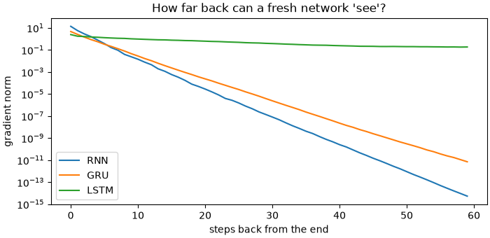

### 31.1 The problem

Text, speech, sensor readings and prices come as **sequences** of varying length, where order matters. An MLP needs a fixed-size input and treats every position separately. A **recurrent neural network** (**RNN**) instead reads the sequence one step at a time, carrying a **hidden state** h, a vector that summarises everything read so far:

```
h_t = tanh(x_t W_x + h_{t−1} W_h + b)          h₀ = 0
```

The same weights W_x, W_h and b are used at **every** step, so the network handles any length, just as a convolution uses the same filter at every position. To classify a whole sequence, put a linear layer on the last hidden state h_T.

### 31.2 By hand

One input and one hidden number: w_x = 0.5, w_h = 0.8, b = 0, input sequence (1, 0, 0):

| t | x_t | h_t = tanh(0.5 x_t + 0.8 h_{t−1}) |
|---|---|---|
| 1 | 1 | tanh(0.5) = 0.462 |
| 2 | 0 | tanh(0.8 · 0.462) = 0.354 |
| 3 | 0 | tanh(0.8 · 0.354) = 0.276 |

The first input is remembered, but it fades with every step.

```python
import torch
from torch import nn

def rnn_forward(x, W_x, W_h, b):
    """x: (N, T, D_in) → all hidden states (N, T, H)"""
    N, T, _ = x.shape
    h = torch.zeros(N, W_h.shape[0])
    states = []
    for t in range(T):
        h = torch.tanh(x[:, t] @ W_x + h @ W_h + b)
        states.append(h)
    return torch.stack(states, dim=1)

x = torch.tensor([[[1.0], [0.0], [0.0]]])
print(rnn_forward(x, torch.tensor([[0.5]]), torch.tensor([[0.8]]), torch.zeros(1)))
```

**Output:**

```text
tensor([[[0.4621],
         [0.3537],
         [0.2757]]])
```

`torch.stack(…, dim=1)` joins the T hidden states along a new time axis.

### 31.3 nn.RNN

`nn.RNN(input_size, hidden_size, batch_first=True)` does this loop in fast code. With `batch_first=True` the input is (N, T, D). It returns all the hidden states, (N, T, H), and the last one separately. PyTorch stores the weights transposed, (H, D), and uses two bias vectors, b_ih + b_hh, which add up to our b. Copy its weights into our function to check:

```python
torch.manual_seed(0)
rnn = nn.RNN(input_size=3, hidden_size=4, batch_first=True)
x = torch.randn(2, 5, 3)
outputs, h_last = rnn(x)
ours = rnn_forward(x, rnn.weight_ih_l0.T, rnn.weight_hh_l0.T, rnn.bias_ih_l0 + rnn.bias_hh_l0)
print(outputs.shape, h_last.shape, "match:", torch.allclose(outputs, ours, atol=1e-6))
```

**Output:**

```text
torch.Size([2, 5, 4]) torch.Size([1, 2, 4]) match: True
```

`h_last` has shape (1, N, H): the leading 1 is the number of stacked layers (`num_layers`).

### 31.4 Why long-range memory fails

Training an RNN is ordinary backpropagation on the unrolled loop, called **backpropagation through time** (**BPTT**). The gradient from h_T back to an early h_k passes through every step in between:

```
∂h_T/∂h_k = Π over t from k+1 to T of  ∂h_t/∂h_{t−1},      ∂h_t/∂h_{t−1} = diag(1 − h_t²) W_hᵀ
```

That's T − k factors of "tanh slope (at most 1) times W_h". If they're typically smaller than 1, the product shrinks **exponentially** with the distance; if larger, it explodes. This is Chapter 18's vanishing-gradient problem, in time instead of depth. Measure it: how much gradient reaches each input of a 60-step sequence, relative to the last input:

```python
def gradient_reaching_inputs(model, T=60):
    x = torch.randn(64, T, 1, requires_grad=True)
    outputs, _ = model(x)
    outputs[:, -1].sum().backward()                     # gradient of the last state
    g = x.grad.abs().mean(dim=(0, 2))                   # average size per time step
    return g / g[-1]

torch.manual_seed(0)
g_rnn = gradient_reaching_inputs(nn.RNN(1, 32, batch_first=True))
print("plain RNN:", ", ".join(f"{k} back: {g_rnn[59 - k]:.0e}" for k in [1, 10, 30, 59]))
```

**Output:**

```text
plain RNN: 1 back: 1e+00, 10 back: 2e-02, 30 back: 8e-07, 59 back: 3e-13
```

From 30 steps back, a millionth of the signal arrives; from 59, practically nothing. The network can't learn that something early in the sequence matters, because the gradient never tells the early steps.

### 31.5 The LSTM

The **long short-term memory** network (**LSTM**, Hochreiter and Schmidhuber, 1997) adds a second state, the **cell state** c, updated mainly by **addition**, with **gates** that decide what to forget, write and read. A gate is a sigmoid layer, values between 0 and 1, multiplied element-wise into a signal:

```
f_t = σ(x_t W_f + h_{t−1} U_f + b_f)      forget gate: how much of the old memory to keep
i_t = σ(x_t W_i + h_{t−1} U_i + b_i)      input gate: how much new information to write
g_t = tanh(x_t W_g + h_{t−1} U_g + b_g)   candidate values to write
o_t = σ(x_t W_o + h_{t−1} U_o + b_o)      output gate: how much of the memory to show
c_t = f_t ⊙ c_{t−1} + i_t ⊙ g_t
h_t = o_t ⊙ tanh(c_t)
```

The key line is c_t = f_t ⊙ c_{t−1} + i_t ⊙ g_t. Along the cell state, the gradient per step is just f_t, with no weight matrix and no squashing slope. When the network learns to hold the forget gate near 1, information and gradient flow across many steps nearly unchanged: the same idea as a residual connection (Chapter 26), discovered 18 years earlier.

You can see this by opening the forget gate by hand. PyTorch stores the four gates' biases stacked in the order input, forget, candidate, output, so with hidden size 32 the forget gate's biases are entries 32 to 63:

```python
torch.manual_seed(0)
lstm = nn.LSTM(1, 32, batch_first=True)
g_default = gradient_reaching_inputs(lstm)
with torch.no_grad():
    lstm.bias_hh_l0[32:64] = 3.0                        # σ(3) ≈ 0.95: the forget gate keeps almost everything
g_open = gradient_reaching_inputs(lstm)
for name, g in [("LSTM, default", g_default), ("LSTM, forget gate open", g_open)]:
    print(f"{name:23s}", ", ".join(f"{k} back: {g[59 - k]:.0e}" for k in [1, 10, 30, 59]))
```

**Output:**

```text
LSTM, default           1 back: 7e-01, 10 back: 6e-04, 30 back: 4e-07, 59 back: 8e-13
LSTM, forget gate open  1 back: 6e-01, 10 back: 4e-01, 30 back: 1e-01, 59 back: 5e-01
```

At its default starting weights the LSTM forgets as fast as the plain RNN: σ(0) = 0.5 halves the memory every step. With the gate held open, the gradient from 59 steps back is still of the same order as from 1 step back. Training can learn to open or close each gate as the data requires; that learnable path is what the plain RNN lacks. (Starting the forget-gate bias at 1 is a common trick for exactly this reason.)

### 31.6 The GRU, and using them in PyTorch

The **gated recurrent unit** (**GRU**, 2014) is a simpler variant with two gates and no separate cell state. It interpolates between the old state and a new candidate, h_t = (1 − z_t) ⊙ h_{t−1} + z_t ⊙ h̃_t, which again gives an additive path. It has three-quarters of an LSTM's parameters and usually works about as well.

`nn.LSTM` and `nn.GRU` take the same arguments as `nn.RNN`. A typical sequence classifier embeds the tokens (Chapter 30), runs an LSTM, and classifies from the last hidden state:

```python
class SequenceClassifier(nn.Module):
    def __init__(self, vocab_size, embed_dim, hidden, n_classes):
        super().__init__()
        self.embed = nn.Embedding(vocab_size, embed_dim)
        self.lstm = nn.LSTM(embed_dim, hidden, batch_first=True)
        self.head = nn.Linear(hidden, n_classes)

    def forward(self, ids):                              # ids: (N, T)
        outputs, (h_last, c_last) = self.lstm(self.embed(ids))
        return self.head(h_last[-1])                     # the last layer's final hidden state

model = SequenceClassifier(vocab_size=1000, embed_dim=32, hidden=64, n_classes=2)
print(model(torch.randint(0, 1000, (8, 20))).shape)
for kind in [nn.RNN, nn.GRU, nn.LSTM]:
    print(f"{kind.__name__:4s} parameters for 32 → 64: {sum(p.numel() for p in kind(32, 64).parameters()):,}")
```

**Output:**

```text
torch.Size([8, 2])
RNN  parameters for 32 → 64: 6,272
GRU  parameters for 32 → 64: 18,816
LSTM parameters for 32 → 64: 25,088
```

The LSTM has 4 sets of weights (one per gate and candidate), the GRU 3, the plain RNN 1. Two common options: `num_layers=2` stacks RNNs, the second reading the first's outputs; `bidirectional=True` adds a second RNN reading the sequence backwards, useful when the whole sequence is available up front (tagging, classification) but not for generating.

### 31.7 Where RNNs stand

From about 2014 to 2017, LSTMs led in translation, speech recognition and text generation. Two limits remained. Their memory is still a single fixed-size vector. And they're **sequential**: step t can't start until step t − 1 is done, so training can't use a GPU's parallelism across time. Transformers (Part VII) fixed both, and replaced RNNs for most tasks. Recurrence came back in a new form in **state-space models** such as Mamba (Chapter 54), which train in parallel but generate step by step like an RNN.

### 31.8 Summary

```
RNN:   h_t = tanh(x_t W_x + h_{t−1} W_h + b)       same weights every step;  nn.RNN(D, H, batch_first=True)
BPTT:  ∂h_T/∂h_k = Π diag(1 − h_t²) W_hᵀ  → vanishes or explodes exponentially with T − k
LSTM:  c_t = f ⊙ c_{t−1} + i ⊙ g,   h_t = o ⊙ tanh(c_t)    gradient along c is f per step
GRU:   h_t = (1 − z) ⊙ h_{t−1} + z ⊙ h̃_t
```

**Key terms:**

- **Sequence:** ordered data, such as text, audio or a time series.
- **Recurrent neural network (RNN):** a network that reads a sequence step by step, updating a hidden state with the same weights at every step.
- **Hidden state:** the vector an RNN carries from step to step, summarising what it has read.
- **Backpropagation through time (BPTT):** backpropagation applied to an RNN unrolled over its time steps.
- **LSTM (long short-term memory):** an RNN with a cell state and forget, input and output gates, which can keep information over long sequences.
- **Cell state:** the LSTM's additive memory, passed from step to step mainly through the forget gate.
- **Gate:** a sigmoid layer whose 0-to-1 outputs scale a signal element by element.
- **GRU (gated recurrent unit):** a simpler gated RNN with two gates and no separate cell state.
- **Bidirectional RNN:** two RNNs, one reading forwards and one backwards, whose outputs are combined.

### Exercises

1. In the hand example of 31.2, with w_h = 0.8 and no further input, roughly how small will h be after 20 steps? Why is that a bound on how long this RNN can remember?
2. Why can't a bidirectional LSTM be used to generate text one word at a time?

<details>
<summary><b>Answers</b></summary>

```python
h = torch.tensor(0.462)
for t in range(19):
    h = torch.tanh(0.8 * h)
print(round(h.item(), 5))
```

**Output:**

```text
0.00594
```

1. About 0.006. Near 0, tanh(0.8h) ≈ 0.8h, so h shrinks by about 20% per step: 0.462 · 0.8¹⁹ ≈ 0.007. Anything that has to be remembered fades geometrically.
2. Its backward half reads the sequence from the end, which doesn't exist yet while you're generating.

</details>

| # | Problem (Deep-ML) | Difficulty |
|---|---|---|
| 1 | [54. Implementing a Simple RNN](https://www.deep-ml.com/problems/54) | 🟡 Medium |
| 2 | [59. Implement Long Short-Term Memory (LSTM) Network](https://www.deep-ml.com/problems/59) | 🟡 Medium |

**Learn more:** [Chris Olah: Understanding LSTM Networks](https://colah.github.io/posts/2015-08-Understanding-LSTMs/)

<details>
<summary><b>Code for the chart at the top</b></summary>

```python
import matplotlib.pyplot as plt

steps_back = list(range(59, -1, -1))                    # position t is 59 − t steps before the end
fig, ax = plt.subplots(figsize=(7, 3.6), layout="constrained")
for name, g in [("plain RNN", g_rnn), ("LSTM, default start", g_default), ("LSTM, forget gate open", g_open)]:
    ax.plot(steps_back, g.tolist(), label=name)
ax.set(yscale="log", xlabel="steps before the end", ylabel="gradient reaching the input (relative)")
ax.legend(fontsize=8)
fig.savefig("rnn-memory.png", dpi=100)
plt.close(fig)
```

</details>

---

## 32. Sequence-to-Sequence Models and the Birth of Attention

**You need:** Chapters 30–31. · **You'll learn:** how an encoder and a decoder turn one sequence into another, why squeezing the input into one vector fails, and attention, the fix that led to transformers.

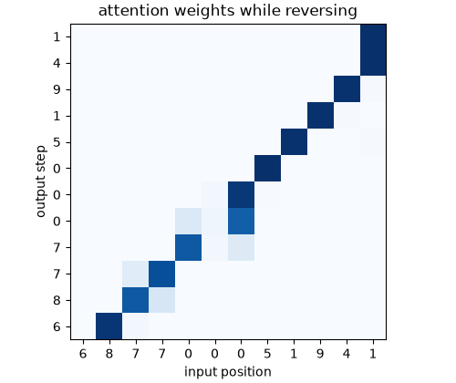

### 32.1 Sequence in, sequence out

Translation, summarisation and speech recognition turn one sequence into **another**, of a different length. The **sequence-to-sequence** (**seq2seq**) design (2014) uses two RNNs:

- the **encoder** reads the whole input and ends with a final hidden state;
- the **decoder** starts from that state and generates the output one token at a time, feeding each token it produces back in as its next input, until it emits an end token.

During training the decoder is fed the **correct** previous token rather than its own guess, so that one early mistake doesn't derail the rest of the sequence. This is called **teacher forcing**. At prediction time it has to use its own guesses.

### 32.2 A task to test it: reverse the digits

The input is 12 random digits; the output is the same digits backwards. Easy to state, but the decoder's **last** output is the encoder's **first** input, 12 steps back:

```python
import torch
from torch import nn

V, T, H = 10, 12, 64                                     # digits 0–9, length 12, hidden size 64
BOS = V                                                  # an extra "begin" token for the decoder's first input

def make_batch(n, generator):
    x = torch.randint(0, V, (n, T), generator=generator)
    return x, x.flip(1)                                  # target = input reversed

x, y = make_batch(2, torch.Generator().manual_seed(0))
print(x[0].tolist(), "→", y[0].tolist())
```

**Output:**

```text
[4, 9, 3, 0, 3, 9, 7, 3, 7, 3, 1, 6] → [6, 1, 3, 7, 3, 7, 9, 3, 0, 3, 9, 4]
```

### 32.3 Encoder and decoder

The decoder takes one step at a time, so it uses `nn.GRUCell`, a single GRU step (Chapter 31.6): given an input and the previous hidden state, it returns the next hidden state. Leave the `attention` flag aside for now:

```python
class Seq2Seq(nn.Module):
    def __init__(self, attention):
        super().__init__()
        self.attention = attention
        self.embed_in = nn.Embedding(V, 32)
        self.embed_out = nn.Embedding(V + 1, 32)                 # + the BOS token
        self.encoder = nn.GRU(32, H, batch_first=True)
        self.decoder = nn.GRUCell(32, H)
        self.out = nn.Linear(2 * H if attention else H, V)

    def forward(self, x, y=None):                                # y given = teacher forcing
        enc_states, h = self.encoder(self.embed_in(x))           # (N, T, H) and (1, N, H)
        h = h[0]
        prev = torch.full((len(x),), BOS)
        logits, weights = [], []
        for t in range(T):
            h = self.decoder(self.embed_out(prev), h)
            if self.attention:
                context, w = self.attend(h, enc_states)
                weights.append(w)
                logits.append(self.out(torch.cat([h, context], dim=1)))
            else:
                logits.append(self.out(h))
            prev = y[:, t] if y is not None else logits[-1].argmax(dim=1)
        return torch.stack(logits, dim=1), weights

    def attend(self, h, enc_states):
        raise NotImplementedError                                # section 32.5
```

Without attention, everything the decoder knows about the input must pass through the encoder's final hidden state: 64 numbers that must hold all 12 digits **and** their order.

```python
def train(model, steps=2000):
    gen = torch.Generator().manual_seed(0)
    optimizer = torch.optim.Adam(model.parameters(), lr=1e-3)
    for step in range(steps):
        x, y = make_batch(64, gen)
        optimizer.zero_grad()
        logits, _ = model(x, y)
        nn.CrossEntropyLoss()(logits.reshape(-1, V), y.reshape(-1)).backward()
        nn.utils.clip_grad_norm_(model.parameters(), 1.0)       # Chapter 18.5
        optimizer.step()
    return model

def evaluate(model):
    x, y = make_batch(500, torch.Generator().manual_seed(1))
    with torch.no_grad():
        pred = model(x)[0].argmax(dim=2)                         # no y: the decoder uses its own guesses
    correct = pred == y
    return correct.float().mean().item(), correct.all(dim=1).float().mean().item(), correct.float().mean(dim=0)

torch.manual_seed(0)
plain = train(Seq2Seq(attention=False))
token_acc, seq_acc, by_position = evaluate(plain)
print(f"no attention: {token_acc:.1%} of digits right, {seq_acc:.1%} of whole sequences right")
print("accuracy by output position:", [round(a, 2) for a in by_position.tolist()])
```

**Output:**

```text
no attention: 46.1% of digits right, 2.0% of whole sequences right
accuracy by output position: [0.95, 0.82, 0.67, 0.56, 0.52, 0.45, 0.36, 0.35, 0.26, 0.24, 0.18, 0.18]
```

`logits.reshape(-1, V)` lines up all N × T predictions as rows for the loss. The first outputs, which are the input's **last** digits and so the most recent in the encoder's memory, are mostly right. Accuracy falls towards chance (10%) for the later outputs, which need the input's earliest digits. The single vector is a **bottleneck**, and it gets worse with longer inputs.

### 32.4 The fix: let the decoder look back

**Attention** (Bahdanau, Cho and Bengio, 2014) removes the bottleneck. Keep **all** the encoder's hidden states, one per input position, and at every output step let the decoder pick out what it needs:

1. **Score** each encoder state s_j against the decoder's current state h, here with a dot product: e_j = s_j · h.
2. **Normalise** the scores with softmax into weights α_j that sum to 1.
3. Take the **context** vector c = Σⱼ αⱼ sⱼ, a weighted average of the encoder states, and use it alongside h to predict the next token.

By hand, with three encoder states and a decoder state h:

```
s₁ = (1, 0), s₂ = (0, 1), s₃ = (1, 1);   h = (2, 0)
scores e = (2, 0, 2)  →  softmax  →  α = (0.468, 0.063, 0.468)
context c = 0.468·(1, 0) + 0.063·(0, 1) + 0.468·(1, 1) = (0.937, 0.532)
```

The states most aligned with h get the most weight. All three steps are differentiable, so the network learns, through backpropagation, to produce decoder states that "ask for" the right input positions.

```python
def attend(self, h, enc_states):
    scores = (enc_states @ h.unsqueeze(2)).squeeze(2)            # (N, T, H) @ (N, H, 1) → (N, T): s_j · h
    w = torch.softmax(scores, dim=1)                             # attention weights over input positions
    context = (w.unsqueeze(2) * enc_states).sum(dim=1)           # (N, H): weighted average of the states
    return context, w

Seq2Seq.attend = attend
s = torch.tensor([[[1.0, 0.0], [0.0, 1.0], [1.0, 1.0]]])
print(attend(None, torch.tensor([[2.0, 0.0]]), s))
```

**Output:**

```text
(tensor([[0.9366, 0.5317]]), tensor([[0.4683, 0.0634, 0.4683]]))
```

`unsqueeze(2)` adds an axis so the batched matrix product computes one dot product per position. Assigning `Seq2Seq.attend = attend` fills in the method left empty above.

### 32.5 With attention

```python
torch.manual_seed(0)
attentive = train(Seq2Seq(attention=True))
token_acc, seq_acc, by_position = evaluate(attentive)
print(f"with attention: {token_acc:.1%} of digits right, {seq_acc:.1%} of whole sequences right")
```

**Output:**

```text
with attention: 99.9% of digits right, 99.8% of whole sequences right
```

The same training budget, and the task is solved: every output position is just as easy, since the decoder can look straight at the input it needs, however far back. The picture at the top shows the learned weights: each output step puts nearly all its weight on a single input position, along an anti-diagonal. Look closely and the line sits one place to the **right** of the digit being copied: to output input digit j, the model reads encoder state j + 1. That state was computed just after reading digit j, so it still holds it clearly, and the model found that the easiest place to read it from. Nobody programmed any of this; attention learned where to look. In translation, the same weights line up words with their translations, even across languages with different word orders.

### 32.6 From here to transformers

Attention fixed the bottleneck, but the model was still an RNN: step t waits for step t − 1, so it can't be parallelised over time, and information between input positions still travels step by step through the encoder. In 2017, "Attention Is All You Need" asked: what if we drop the recurrence and build the **whole** network from attention, letting every position attend to every other position directly, all at once? That's the transformer, Part VII.

### 32.7 Summary

```
seq2seq:    encoder RNN → final state → decoder RNN generates token by token (teacher forcing in training)
bottleneck: the whole input squeezed into one fixed vector
attention:  e_j = s_j · h;   α = softmax(e);   context c = Σ α_j s_j;   predict from [h, c]
```

**Key terms:**

- **Sequence-to-sequence (seq2seq):** a model that maps an input sequence to an output sequence of possibly different length.
- **Encoder:** the part of a model that reads the input and turns it into internal representations.
- **Decoder:** the part that generates the output, one token at a time.
- **Teacher forcing:** feeding the decoder the correct previous token during training instead of its own prediction.
- **Bottleneck:** a narrow point that limits how much information can pass, such as one fixed-size vector for a whole input.
- **Attention:** computing a weighted average of a set of vectors, with weights from a softmax over similarity scores.
- **Attention weights:** the softmax outputs saying how much each position contributes.
- **Context vector:** the attention-weighted average of the encoder states.
- **`nn.GRUCell`:** a single step of a GRU, for writing step-by-step loops by hand.

### Exercises

1. In the hand example, what weights does attention give if h = (0, 10)? Which state gets ignored?
2. Find the input position that gets the most attention at each output step, for one test sequence.

<details>
<summary><b>Answers</b></summary>

```python
print(attend(None, torch.tensor([[0.0, 10.0]]), s)[1].round(decimals=3))

x, y = make_batch(1, torch.Generator().manual_seed(5))
with torch.no_grad():
    _, weights = attentive(x)
print("most-attended input position per output step:", [w.argmax().item() for w in weights])
```

**Output:**

```text
tensor([[0.0000, 0.5000, 0.5000]])
most-attended input position per output step: [11, 11, 10, 9, 8, 7, 6, 5, 4, 3, 2, 1]
```

1. Scores (0, 10, 10), so s₂ and s₃ share almost all the weight and s₁ is ignored: e⁰ is tiny next to e¹⁰.
2. Output step t (for t ≥ 1) attends to input position 12 − t, the encoder state just after the digit 11 − t that it copies, as in the chart. Step 0 copies digit 11, the last one, and attends to it directly.

</details>

| # | Problem (Deep-ML) | Difficulty |
|---|---|---|
| 1 | [53. Implement Self-Attention Mechanism](https://www.deep-ml.com/problems/53) | 🟡 Medium |

**Learn more:** [Bahdanau et al., Neural Machine Translation by Jointly Learning to Align and Translate](https://arxiv.org/abs/1409.0473) · [Jay Alammar: Visualizing a Neural Machine Translation Model](https://jalammar.github.io/visualizing-neural-machine-translation-mechanics-of-seq2seq-models-with-attention/)

<details>
<summary><b>Code for the chart at the top</b></summary>

```python
import matplotlib.pyplot as plt

x, y = make_batch(1, torch.Generator().manual_seed(3))
with torch.no_grad():
    _, weights = attentive(x)
grid = torch.cat(weights).numpy()                               # (output step, input position)
fig, ax = plt.subplots(figsize=(5, 4.2), layout="constrained")
ax.imshow(grid, cmap="Blues")
ax.set(xlabel="input position", ylabel="output step", xticks=range(T), yticks=range(T),
       xticklabels=x[0].tolist(), yticklabels=y[0].tolist(), title="attention weights while reversing")
fig.savefig("seq2seq-attention.png", dpi=100)
plt.close(fig)
```

</details>

---

# Part VII — Transformers

Six chapters that build a transformer piece by piece: self-attention, multiple heads, masks and positions, the full block, then a small GPT trained from scratch, the ways to generate text from it, and the same design applied to images.

---

## 33. Self-Attention from Scratch

**You need:** Chapters 30 and 32. · **You'll learn:** self-attention, the operation at the heart of every transformer: queries, keys and values, the √d scaling, derived and traced by hand.

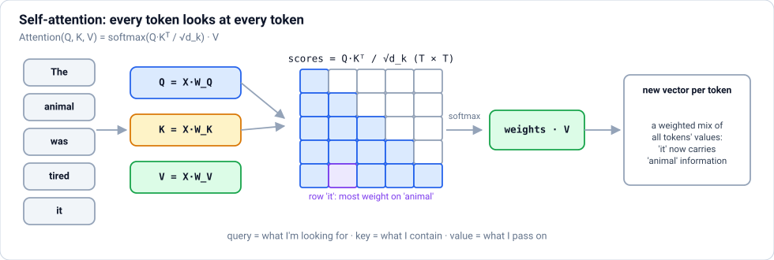

### 33.1 From attention to self-attention

In Chapter 32, a decoder state attended over the encoder's states. **Self-attention** applies the same idea **within one sequence**: every token attends over every token of the same sequence, including itself, and is replaced by a weighted mix of them.

Why that's useful: the meaning of a word depends on the others. In "The animal didn't cross the street because it was too tired", the vector for "it" should take on information from "animal". After self-attention, each token's vector is no longer about the token alone but about the token **in its context**. And unlike an RNN, any two positions interact directly, in one step, however far apart they are.

### 33.2 Queries, keys and values

Each token's vector x plays three roles, each through its own learned projection:

```
q = x W_Q      query:  what this token is looking for
k = x W_K      key:    what this token offers, to be matched against queries
v = x W_V      value:  what this token passes on if it's attended to
```

Token i scores every token j by how well its query matches j's key, q_i · k_j; a softmax over j turns the scores into weights; and its output is the weighted sum of the values. For all tokens at once, with the T token vectors as the rows of X:

```
Q = X W_Q,   K = X W_K,   V = X W_V                     (T, d_k)
Attention(Q, K, V) = softmax( Q Kᵀ / √d_k ) V           (T, T) @ (T, d_v) → (T, d_v)
```

Row i of the (T, T) score matrix holds token i's scores against every token; the softmax is taken along each row.

Using separate keys and values lets a token be **found** for one reason and **contribute** something else: "animal" can be found because its key says "I'm a noun, an animate thing", and pass on a value that carries what "it" needs to know.

### 33.3 Why divide by √d_k?

If the entries of q and k are independent with mean 0 and variance 1, then q · k = Σ qₘkₘ is a sum of d_k terms, each of variance 1, so

```
Var(q · k) = d_k,      standard deviation √d_k
```

With d_k = 64, scores typically range over ±8 or more. Softmax of numbers that far apart is almost one-hot: one token gets nearly all the weight, and the gradient through the softmax (Chapter 6.6) is nearly zero everywhere. Dividing by √d_k brings the scores back to variance 1:

```python
import torch

torch.manual_seed(0)
d_k = 64
q, k = torch.randn(d_k), torch.randn(10, d_k)         # one query, 10 keys
raw = k @ q
for name, scores in [("raw q·k", raw), ("q·k / √d_k", raw / d_k ** 0.5)]:
    w = torch.softmax(scores, dim=0)
    print(f"{name:11s} score std {scores.std():5.2f}   largest weight {w.max():.3f}")
```

**Output:**

```text
raw q·k     score std  6.10   largest weight 0.726
q·k / √d_k  score std  0.76   largest weight 0.211
```

Unscaled, a single key takes most of the weight before any training has happened. Scaled, attention starts out spread over many tokens, and training decides where to focus.

### 33.4 By hand

Three tokens with 2-number vectors, and, to keep it readable, W_Q = W_K = W_V = the identity, so Q = K = V = X:

```
x₁ = (1, 0),   x₂ = (0, 1),   x₃ = (1, 1),   d_k = 2, √2 = 1.414
```

Scores for token 3, q₃ · k_j / √2: (1, 1)·(1, 0) = 1, (1, 1)·(0, 1) = 1, (1, 1)·(1, 1) = 2, then divided by 1.414: (0.707, 0.707, 1.414). Softmax gives weights (0.248, 0.248, 0.503), so token 3's output is

```
0.248·(1, 0) + 0.248·(0, 1) + 0.503·(1, 1) = (0.752, 0.752)
```

It mostly keeps itself, the best match, and blends in the other two.

```python
def self_attention(X, W_Q, W_K, W_V):
    Q, K, V = X @ W_Q, X @ W_K, X @ W_V
    scores = Q @ K.transpose(-2, -1) / K.shape[-1] ** 0.5         # (…, T, T)
    weights = torch.softmax(scores, dim=-1)                       # each row sums to 1
    return weights @ V, weights

X = torch.tensor([[1.0, 0.0], [0.0, 1.0], [1.0, 1.0]])
I = torch.eye(2)
out, w = self_attention(X, I, I, I)
print("weights:\n", w.round(decimals=3))
print("outputs:\n", out.round(decimals=3))
```

**Output:**

```text
weights:
 tensor([[0.4010, 0.1980, 0.4010],
        [0.1980, 0.4010, 0.4010],
        [0.2480, 0.2480, 0.5030]])
outputs:
 tensor([[0.8020, 0.5990],
        [0.5990, 0.8020],
        [0.7520, 0.7520]])
```

`transpose(-2, -1)` swaps the last two axes, so the same function works for a single sequence (T, d) or a batch (N, T, d): the matrix products are applied to each sequence in the batch.

### 33.5 With learned projections, on a batch

In a real layer the projections are learned `nn.Linear` layers without biases, and the input is a batch of shape (N, T, D):

```python
from torch import nn

class SelfAttention(nn.Module):
    def __init__(self, d_model, d_k):
        super().__init__()
        self.W_Q = nn.Linear(d_model, d_k, bias=False)
        self.W_K = nn.Linear(d_model, d_k, bias=False)
        self.W_V = nn.Linear(d_model, d_k, bias=False)

    def forward(self, x):                                         # (N, T, d_model)
        Q, K, V = self.W_Q(x), self.W_K(x), self.W_V(x)
        weights = torch.softmax(Q @ K.transpose(-2, -1) / K.shape[-1] ** 0.5, dim=-1)
        return weights @ V                                        # (N, T, d_k)

torch.manual_seed(0)
attn = SelfAttention(d_model=16, d_k=8)
x = torch.randn(4, 10, 16)                                        # 4 sequences of 10 tokens
print(attn(x).shape)
```

**Output:**

```text
torch.Size([4, 10, 8])
```

### 33.6 Three properties to notice

**It has no idea of order.** Shuffle the input tokens and the outputs are shuffled the same way, but otherwise unchanged: "dog bites man" and "man bites dog" contain the same tokens, so they'd get the same vectors. Positions must be added separately (Chapter 34.4).

```python
perm = torch.randperm(10)
print("shuffling the input just shuffles the output:", torch.allclose(attn(x[:, perm]), attn(x)[:, perm], atol=1e-6))
```

**Output:**

```text
shuffling the input just shuffles the output: True
```

**It runs in parallel.** Every position's output is computed at once by matrix products, with no step-by-step loop as in an RNN. That's why transformers train so efficiently on GPUs.

**It costs T².** The score matrix is T × T. Doubling the sequence length quadruples the time and memory of this step, the main obstacle to very long contexts (Chapter 54).

### 33.7 Summary

```
Q = XW_Q, K = XW_K, V = XW_V
Attention(Q, K, V) = softmax(QKᵀ/√d_k) V          softmax along each row
Var(q·k) = d_k, so divide by √d_k to keep scores at variance ~1
order-blind · fully parallel · T × T scores
```

**Key terms:**

- **Self-attention:** attention in which every position of a sequence attends to every position of the same sequence.
- **Query:** a token's projected vector describing what it looks for.
- **Key:** a token's projected vector that queries are compared against.
- **Value:** a token's projected vector that is mixed into the output when it receives attention.
- **Scaled dot-product attention:** softmax(QKᵀ/√d_k)V.
- **Attention matrix:** the T × T matrix of attention weights; row i is how token i spreads its attention.
- **Contextual representation:** a token's vector after attention, describing the token in its context.
- **Permutation equivariance:** shuffling the inputs shuffles the outputs the same way and changes nothing else.

### Exercises

1. In the hand example, compute token 1's weights and output.
2. What does self-attention output if all the keys are identical? Why?

<details>
<summary><b>Answers</b></summary>

```python
print(w[0].round(decimals=3), out[0].round(decimals=3))
same_keys = torch.tensor([[1.0, 1.0]] * 3)
print(self_attention(same_keys, I, I, I)[1].round(decimals=3))
```

**Output:**

```text
tensor([0.4010, 0.1980, 0.4010]) tensor([0.8020, 0.5990])
tensor([[0.3330, 0.3330, 0.3330],
        [0.3330, 0.3330, 0.3330],
        [0.3330, 0.3330, 0.3330]])
```

1. Token 1's scores are (1, 0, 1)/√2, giving weights (0.401, 0.198, 0.401) and output (0.802, 0.599).
2. Every score in a row is equal, so the weights are uniform (1/T each) and every output is the plain average of the values: with no way to tell the keys apart, attention can't prefer any token.

</details>

| # | Problem (Deep-ML) | Difficulty |
|---|---|---|
| 1 | [53. Implement Self-Attention Mechanism](https://www.deep-ml.com/problems/53) | 🟡 Medium |

**Learn more:** [Vaswani et al., Attention Is All You Need](https://arxiv.org/abs/1706.03762) · [Jay Alammar: The Illustrated Transformer](https://jalammar.github.io/illustrated-transformer/)

---

## 34. Multi-Head Attention, Causal Masks and Positions

**You need:** Chapter 33. · **You'll learn:** the three additions that turn self-attention into what transformers actually use: several heads in parallel, a mask that hides the future, and a way to tell the model where each token is.

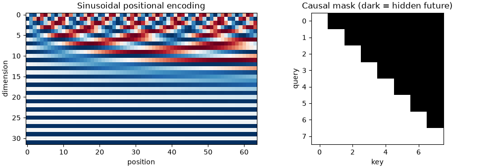

### 34.1 Multi-head attention

One attention layer gives each token one weighted mix. But a token often needs several kinds of information at once: "it" needs the noun it refers to, a verb needs its subject, a closing bracket needs its opening one. **Multi-head attention** runs h attentions in parallel, each with its own projections of size d_head = d_model / h, then joins their outputs and mixes them with one more linear layer W_O:

```
head_i = Attention(X W_Q⁽ⁱ⁾, X W_K⁽ⁱ⁾, X W_V⁽ⁱ⁾)            i = 1 … h,  each (T, d_head)
MultiHead(X) = concat(head_1, …, head_h) W_O                (T, h·d_head) = (T, d_model)
```

Splitting d_model among the heads keeps the cost the same as one big head. The parameters are W_Q, W_K, W_V and W_O, each d_model × d_model: 4·d_model² in all.

In code, the trick is to compute all heads' Q, K and V with one big linear layer, then **reshape** the d_model axis into (h, d_head) and move the head axis forward, so that the matrix products of Chapter 33 run on every head at once:

```python
import torch
from torch import nn

class MultiHeadAttention(nn.Module):
    def __init__(self, d_model, n_heads):
        super().__init__()
        self.n_heads, self.d_head = n_heads, d_model // n_heads
        self.qkv = nn.Linear(d_model, 3 * d_model, bias=False)          # W_Q, W_K, W_V side by side
        self.out = nn.Linear(d_model, d_model, bias=False)              # W_O

    def forward(self, x, causal=False):
        N, T, D = x.shape
        q, k, v = self.qkv(x).split(D, dim=-1)                          # each (N, T, D)
        q, k, v = (t.view(N, T, self.n_heads, self.d_head).transpose(1, 2) for t in (q, k, v))   # (N, h, T, d_head)
        scores = q @ k.transpose(-2, -1) / self.d_head ** 0.5            # (N, h, T, T)
        if causal:
            future = torch.triu(torch.ones(T, T, dtype=torch.bool), diagonal=1)
            scores = scores.masked_fill(future, float("-inf"))           # 34.2
        weights = torch.softmax(scores, dim=-1)
        out = (weights @ v).transpose(1, 2).reshape(N, T, D)             # join the heads back together
        return self.out(out)

torch.manual_seed(0)
mha = MultiHeadAttention(d_model=32, n_heads=4)
x = torch.randn(2, 6, 32)
print(mha(x).shape, "parameters:", sum(p.numel() for p in mha.parameters()), "= 4 · 32²")
```

**Output:**

```text
torch.Size([2, 6, 32]) parameters: 4096 = 4 · 32²
```

`split(D, dim=-1)` cuts the 3D outputs into three pieces of D. `view(N, T, h, d_head)` reinterprets each token's D numbers as h groups of d_head (Chapter 2.3), and `transpose(1, 2)` moves the head axis before T, so `q @ kᵀ` computes a separate (T, T) score matrix for every head. At the end the steps run in reverse.

### 34.2 The causal mask

A model that generates text predicts each token from the ones **before** it. If position 3 could attend to position 4 during training, it could just copy the answer, and the model would learn nothing useful. The **causal mask** forbids attending to later positions: before the softmax, set every score above the diagonal to −∞. Since e^(−∞) = 0, those positions get exactly zero weight, and each row's remaining weights still sum to 1:

```python
T = 4
scores = torch.zeros(T, T)                                              # pretend all scores are equal
future = torch.triu(torch.ones(T, T, dtype=torch.bool), diagonal=1)     # True above the diagonal
print(future)
print(torch.softmax(scores.masked_fill(future, float("-inf")), dim=-1))
```

**Output:**

```text
tensor([[False,  True,  True,  True],
        [False, False,  True,  True],
        [False, False, False,  True],
        [False, False, False, False]])
tensor([[1.0000, 0.0000, 0.0000, 0.0000],
        [0.5000, 0.5000, 0.0000, 0.0000],
        [0.3333, 0.3333, 0.3333, 0.0000],
        [0.2500, 0.2500, 0.2500, 0.2500]])
```

`torch.triu(…, diagonal=1)` keeps the part strictly above the diagonal. Row 1 can only see token 1; row 4 spreads over all four. A model with this mask is a **decoder**; one without it, where every token sees the whole input, is an **encoder** (Chapter 40).

The mask has a second benefit. One training sequence of T tokens gives T prediction problems at once: position 1 predicts token 2, position 2 predicts token 3, and so on, all in one forward pass, with none of them able to cheat.

Masks also handle **padding** (Chapter 29.5): setting the scores of every padding key to −∞ makes real tokens ignore the padding.

### 34.3 Check against PyTorch

`torch.nn.functional.scaled_dot_product_attention(q, k, v, is_causal=True)` computes softmax(QKᵀ/√d)V with the causal mask, using fast fused code (Chapter 54 explains why fused matters). On our heads it should agree:

```python
import torch.nn.functional as F

N, T, D = x.shape
q, k, v = (t.view(N, T, 4, 8).transpose(1, 2) for t in mha.qkv(x).split(D, dim=-1))
fast = F.scaled_dot_product_attention(q, k, v, is_causal=True).transpose(1, 2).reshape(N, T, D)
print(torch.allclose(mha.out(fast), mha(x, causal=True), atol=1e-6))
```

**Output:**

```text
True
```

PyTorch also has a ready-made layer, `nn.MultiheadAttention(d_model, n_heads, batch_first=True)`, which does the same with its own parameter layout. We keep using our own, so nothing is hidden.

### 34.4 Telling the model where tokens are

Self-attention ignores order (Chapter 33.6). The fix is to give each position a vector and **add** it to the token embedding before the first layer, so that "dog" at position 1 and "dog" at position 3 enter the network as different vectors.

**Learned positions.** The simplest way: an `nn.Embedding(max_len, d_model)` with one learned vector per position, used by BERT and GPT-2. Its limit: positions beyond `max_len` were never trained.

**Sinusoidal positions.** The original transformer used fixed waves:

```
PE(pos, 2i)   = sin(pos / 10000^(2i/d))
PE(pos, 2i+1) = cos(pos / 10000^(2i/d))
```

Each pair of dimensions is a sine and cosine at its own frequency, from one cycle every 2π ≈ 6 positions in the first pair to extremely slow waves in the last. Together they give every position a distinct pattern, like the hands of a clock running at many speeds (the picture at the top):

```python
def sinusoidal(max_len, d):
    pos = torch.arange(max_len).unsqueeze(1)                            # (max_len, 1)
    freq = 10000 ** (-torch.arange(0, d, 2) / d)                        # (d/2,) one frequency per pair
    pe = torch.zeros(max_len, d)
    pe[:, 0::2] = torch.sin(pos * freq)
    pe[:, 1::2] = torch.cos(pos * freq)
    return pe

pe = sinusoidal(50, 64)
print(pe.shape, pe[1, :4].round(decimals=3))
```

**Output:**

```text
torch.Size([50, 64]) tensor([0.8410, 0.5400, 0.6820, 0.7320])
```

`0::2` selects every second column from 0 (the sines), `1::2` from 1 (the cosines).

**Rotary position embeddings (RoPE).** Most modern language models (Llama, Qwen, Mistral) instead **rotate** each query and key according to its position, rather than adding anything. Treat each pair of dimensions as a point in a plane, and rotate it by an angle pos · θ, with a different θ for each pair. Rotating q by angle mθ and k by nθ changes their dot product to depend only on the **difference** of the angles, (m − n)θ. So attention scores depend on how far apart two tokens are, not on where they sit, which helps models handle positions and lengths they didn't see in training:

```python
def rope(x, pos):                                                       # x: (d,), rotate each pair of dims
    d = x.shape[-1]
    theta = 10000 ** (-torch.arange(0, d, 2) / d)
    angle = pos * theta
    x1, x2 = x[0::2], x[1::2]
    out = torch.empty_like(x)
    out[0::2] = x1 * torch.cos(angle) - x2 * torch.sin(angle)          # 2-D rotation of (x1, x2)
    out[1::2] = x1 * torch.sin(angle) + x2 * torch.cos(angle)
    return out

torch.manual_seed(0)
q, k = torch.randn(8), torch.randn(8)
print("positions (5, 2):  ", round((rope(q, 5) @ rope(k, 2)).item(), 4))
print("positions (13, 10):", round((rope(q, 13) @ rope(k, 10)).item(), 4), "  same distance, same score")
print("positions (13, 2): ", round((rope(q, 13) @ rope(k, 2)).item(), 4))
```

**Output:**

```text
positions (5, 2):   1.1783
positions (13, 10): 1.1783   same distance, same score
positions (13, 2):  0.2257
```

### 34.5 Summary

```
multi-head:  split d_model into h heads of d_head;  per head softmax(QKᵀ/√d_head)V;  concat;  × W_O     (4·d² params)
causal mask: scores[i, j] = −∞ for j > i before the softmax   →  each position sees only itself and the past
positions:   learned nn.Embedding(max_len, d) · sinusoidal sin/cos waves · RoPE rotates q and k (scores depend on m − n)
```

**Key terms:**

- **Multi-head attention:** several attention operations ("heads") run in parallel on smaller projections, then concatenated and mixed.
- **Attention head:** one of the parallel attention operations, with its own query, key and value projections.
- **Output projection (W_O):** the linear layer that mixes the concatenated heads.
- **Causal mask:** a mask that stops each position from attending to later positions.
- **Decoder (transformer):** a stack of causally masked self-attention layers, used to generate text.
- **Encoder (transformer):** a stack of unmasked self-attention layers, where every token sees the whole input.
- **Positional encoding:** information about each token's position, added to or applied to its vectors.
- **Sinusoidal positional encoding:** fixed sine and cosine waves of many frequencies, one pattern per position.
- **Rotary position embedding (RoPE):** rotating queries and keys by position-dependent angles, so scores depend on relative position.

### Exercises

1. A model has d_model = 768 and 12 heads. What's d_head? How many parameters do the four projection matrices have?
2. Use the mask to show that, with the causal mask, the output at position 2 doesn't change when you change the token at position 5.

<details>
<summary><b>Answers</b></summary>

```python
print("d_head:", 768 // 12, "  parameters:", 4 * 768 ** 2)
x2 = x.clone()
x2[:, 5] = torch.randn(32)                                              # change the last token
print("position 2 unchanged:", torch.allclose(mha(x, causal=True)[:, 2], mha(x2, causal=True)[:, 2]))
print("without the mask:   ", torch.allclose(mha(x)[:, 2], mha(x2)[:, 2]))
```

**Output:**

```text
d_head: 64   parameters: 2359296
position 2 unchanged: True
without the mask:    False
```

1. 64, and 4 · 768² = 2,359,296 parameters (GPT-2's attention projections also have biases, adding 4 · 768).
2. With the mask, position 2 never looks at position 5, so its output is identical. Without it, every position mixes in every other, so it changes.

</details>

| # | Problem (Deep-ML) | Difficulty |
|---|---|---|
| 1 | [94. Implement Multi-Head Attention](https://www.deep-ml.com/problems/94) | 🔴 Hard |
| 2 | [107. Implement Masked Self-Attention](https://www.deep-ml.com/problems/107) | 🟡 Medium |
| 3 | [85. Positional Encoding Calculator](https://www.deep-ml.com/problems/85) | 🔴 Hard |

<details>
<summary><b>Code for the chart at the top</b></summary>

```python
import matplotlib.pyplot as plt

fig, ax = plt.subplots(figsize=(7, 3.4), layout="constrained")
im = ax.imshow(pe.numpy(), aspect="auto", cmap="RdBu")
ax.set(xlabel="dimension", ylabel="position", title="sinusoidal positional encodings")
fig.colorbar(im, ax=ax)
fig.savefig("positional-encoding.png", dpi=100)
plt.close(fig)
```

</details>

---

## 35. The Transformer Block

**You need:** Chapters 21, 26 and 34. · **You'll learn:** how attention, a feed-forward network, LayerNorm and residual connections combine into the block that every transformer repeats, and how to count its parameters.

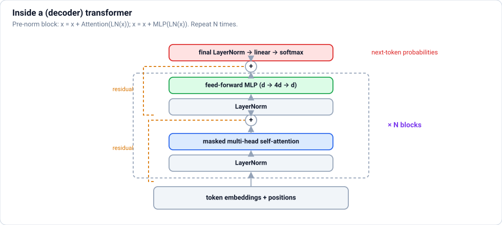

### 35.1 Two sub-layers, two jobs

A transformer is a stack of identical **blocks**. Each block has two parts:

- **Multi-head attention** (Chapter 34) moves information **between** positions: each token gathers what it needs from the others.
- A **feed-forward network** (**FFN**, also called the MLP) then processes each position **on its own**: the same small two-layer MLP is applied to every token's vector separately.

```
FFN(x) = W₂ · GELU(W₁ x + b₁) + b₂          d → 4d → d
```

Attention is mostly a weighted average, so on its own it can't compute much; the FFN supplies the non-linear processing. It also holds about two-thirds of a block's parameters, and research suggests it's where much of a model's factual knowledge is stored.

### 35.2 Residuals and LayerNorm around each part

Each sub-layer is wrapped in a **residual connection** (Chapter 26) and preceded by a **LayerNorm** (Chapter 21.4):

```
x = x + Attention(LayerNorm(x))
x = x + FFN(LayerNorm(x))
```

The residual path means every block only adds a correction to a running vector, the **residual stream**, which flows unchanged from the embeddings to the output unless a block writes to it. Gradients flow back along it directly, so dozens or hundreds of blocks still train. Normalising the **input** of each sub-layer, as here, is called **pre-norm**. The 2017 original normalised after the addition, **post-norm**: x = LayerNorm(x + Attention(x)). Post-norm needs careful learning-rate warm-up to train deep stacks, so nearly all modern models use pre-norm.

The multi-head attention class from Chapter 34, unchanged:

<details>
<summary><b>Code from Chapter 34: MultiHeadAttention</b></summary>

```python
import torch
from torch import nn

class MultiHeadAttention(nn.Module):
    def __init__(self, d_model, n_heads):
        super().__init__()
        self.n_heads, self.d_head = n_heads, d_model // n_heads
        self.qkv = nn.Linear(d_model, 3 * d_model, bias=False)
        self.out = nn.Linear(d_model, d_model, bias=False)

    def forward(self, x, causal=False):
        N, T, D = x.shape
        q, k, v = self.qkv(x).split(D, dim=-1)
        q, k, v = (t.view(N, T, self.n_heads, self.d_head).transpose(1, 2) for t in (q, k, v))
        scores = q @ k.transpose(-2, -1) / self.d_head ** 0.5
        if causal:
            future = torch.triu(torch.ones(T, T, dtype=torch.bool), diagonal=1)
            scores = scores.masked_fill(future, float("-inf"))
        out = (torch.softmax(scores, dim=-1) @ v).transpose(1, 2).reshape(N, T, D)
        return self.out(out)
```

</details>

The block:

```python
class Block(nn.Module):
    def __init__(self, d_model, n_heads):
        super().__init__()
        self.ln1 = nn.LayerNorm(d_model)
        self.attn = MultiHeadAttention(d_model, n_heads)
        self.ln2 = nn.LayerNorm(d_model)
        self.ffn = nn.Sequential(nn.Linear(d_model, 4 * d_model), nn.GELU(), nn.Linear(4 * d_model, d_model))

    def forward(self, x, causal=True):
        x = x + self.attn(self.ln1(x), causal)
        x = x + self.ffn(self.ln2(x))
        return x

torch.manual_seed(0)
block = Block(d_model=64, n_heads=4)
x = torch.randn(2, 10, 64)
print(block(x).shape)
```

**Output:**

```text
torch.Size([2, 10, 64])
```

The output has exactly the input's shape, (N, T, d_model), which is what lets blocks be stacked any number of times. `nn.GELU()` is the GELU activation of Chapter 4.4 as a module.

### 35.3 Counting parameters

Per block, with d = d_model:

| part | parameters |
|---|---|
| attention: W_Q, W_K, W_V, W_O | 4d² |
| FFN: W₁ (d × 4d) and W₂ (4d × d) | 8d² (+ 5d biases) |
| two LayerNorms | 4d |
| **total** | **≈ 12d²** |

```python
d = 64
print("ours:", sum(p.numel() for p in block.parameters()), "  12d² + 9d:", 12 * d * d + 9 * d)
```

**Output:**

```text
ours: 49728   12d² + 9d: 49728
```

A whole decoder model adds a token embedding (vocabulary × d), position embeddings, a final LayerNorm and an output layer, which is usually **tied** to the token embedding: the same matrix, used in both directions. GPT-2 small has 12 blocks with d = 768 and a 50,257-token vocabulary:

```python
d, layers, vocab, positions = 768, 12, 50_257, 1024
blocks = layers * 12 * d * d
embeddings = vocab * d + positions * d
print(f"blocks ≈ {blocks / 1e6:.1f}M, embeddings ≈ {embeddings / 1e6:.1f}M, total ≈ {(blocks + embeddings) / 1e6:.0f}M")
```

**Output:**

```text
blocks ≈ 84.9M, embeddings ≈ 39.4M, total ≈ 124M
```

That's the published 124 million (the small remainder is biases and LayerNorms). Scaling up mostly means a larger d and more blocks: Llama 3's 70B model has d = 8,192 and 80 blocks.

### 35.4 Modern variants

Recent large language models keep this skeleton and swap in a few parts:

- **RMSNorm** instead of LayerNorm (Chapter 21.5).
- **RoPE** instead of position embeddings (Chapter 34.4).
- A **gated FFN**, **SwiGLU**: FFN(x) = W₂ (SiLU(W₁x) ⊙ W₃x). One branch, passed through SiLU (Chapter 4.4), acts as a gate multiplying the other branch element by element. The hidden size is cut to about 8d/3 so that the three matrices still total about 8d²:

```python
class SwiGLU(nn.Module):
    def __init__(self, d, hidden):
        super().__init__()
        self.w1 = nn.Linear(d, hidden, bias=False)
        self.w3 = nn.Linear(d, hidden, bias=False)
        self.w2 = nn.Linear(hidden, d, bias=False)

    def forward(self, x):
        return self.w2(nn.functional.silu(self.w1(x)) * self.w3(x))

swiglu = SwiGLU(64, hidden=8 * 64 // 3)
print(swiglu(x).shape, "parameters:", sum(p.numel() for p in swiglu.parameters()), "vs 8d² =", 8 * 64 * 64)
```

**Output:**

```text
torch.Size([2, 10, 64]) parameters: 32640 vs 8d² = 32768
```

- **No biases** in the linear layers, and attention variants that share keys and values between heads (Chapter 53) to save memory.

PyTorch also has the whole block ready-made as `nn.TransformerEncoderLayer(d_model, n_heads, dim_feedforward=4 * d_model, norm_first=True, batch_first=True)`, where `norm_first=True` selects pre-norm.

### 35.5 Summary

```
block:   x = x + MHA(LN(x));   x = x + FFN(LN(x))          FFN: d → 4d → d with GELU
shape (N, T, d) in and out, so blocks stack;  ≈ 12d² parameters per block
decoder model: embed + positions → N blocks (causal) → LN → linear to vocabulary
modern: RMSNorm, RoPE, SwiGLU FFN, no biases
```

**Key terms:**

- **Transformer block:** multi-head attention and a feed-forward network, each with a residual connection and normalisation.
- **Feed-forward network (FFN, MLP):** the per-position two-layer network inside a transformer block.
- **Residual stream:** the vector for each position that runs through all the blocks, each block adding its output to it.
- **Pre-norm:** normalising the input of each sub-layer, inside the residual branch.
- **Post-norm:** normalising after adding the residual, as in the original 2017 transformer.
- **Weight tying:** using the same matrix for the token embedding and the output layer.
- **SwiGLU:** a gated feed-forward layer, W₂(SiLU(W₁x) ⊙ W₃x), used in Llama-style models.

### Exercises

1. Roughly how many parameters do the blocks of a model with 32 layers and d = 4,096 have? (This is the shape of Llama 2 7B.)
2. Remove the residual connections from `Block` and stack 24 of them. What happens to the gradient reaching the input embeddings, compared with the residual version?

<details>
<summary><b>Answers</b></summary>

```python
print(f"{32 * 12 * 4096 ** 2 / 1e9:.1f} billion")

class NoResidual(Block):
    def forward(self, x, causal=True):
        x = self.attn(self.ln1(x), causal)
        return self.ffn(self.ln2(x))

for name, cls in [("with residuals", Block), ("without", NoResidual)]:
    torch.manual_seed(0)
    stack = nn.Sequential(*[cls(64, 4) for _ in range(24)])
    inp = torch.randn(2, 10, 64, requires_grad=True)
    stack(inp).pow(2).mean().backward()
    print(f"{name:15s} gradient at the input: {inp.grad.norm():.2e}")
```

**Output:**

```text
6.4 billion
with residuals  gradient at the input: 3.12e-01
without         gradient at the input: 8.36e-03
```

1. 32 · 12 · 4,096² ≈ 6.4 billion; the embeddings bring Llama 2 to 6.7 billion. (Its SwiGLU uses a slightly larger hidden size than 8d/3, which accounts for the rest.)
2. Without residuals the gradient reaching the input is far smaller, the vanishing-gradient problem of Chapters 18 and 26; with them it arrives at a healthy size through the residual stream.

</details>

| # | Problem (Deep-ML) | Difficulty |
|---|---|---|
| 1 | [178. Implement Position-wise Feed-Forward Block with Residual and Dropout](https://www.deep-ml.com/problems/178) | 🟡 Medium |
| 2 | [156. Implement SwiGLU activation function](https://www.deep-ml.com/problems/156) | 🟢 Easy |

**Learn more:** [Jay Alammar: The Illustrated GPT-2](https://jalammar.github.io/illustrated-gpt2/) · [Anthropic: A Mathematical Framework for Transformer Circuits](https://transformer-circuits.pub/2021/framework/index.html)

---

## 36. Build a Tiny GPT

**You need:** Chapters 20, 29 and 35. · **You'll learn:** how to assemble the blocks into a GPT-style language model, train it on Shakespeare to predict the next character, and generate new text from it.

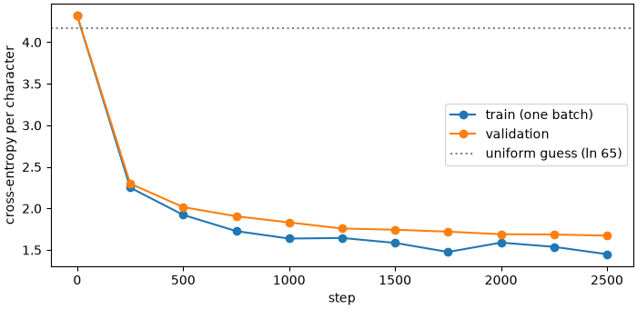

### 36.1 The task: predict the next token

A **language model** assigns probabilities to the next token given the ones before it. A GPT (**generative pretrained transformer**) is a decoder-only transformer trained for exactly that, on a huge amount of text, with nothing else to learn from: the text supplies its own labels. That's **self-supervised** learning.

To keep it small enough for a laptop, our tokens are **characters**, and the text is the 1.1 MB "tiny Shakespeare" collection of his plays:

```python
import os, math, time, urllib.request
import torch
from torch import nn

path = "data/tinyshakespeare.txt"
if not os.path.exists(path):
    urllib.request.urlretrieve("https://raw.githubusercontent.com/karpathy/char-rnn/master/data/tinyshakespeare/input.txt", path)
text = open(path).read()
chars = sorted(set(text))
char_id = {c: i for i, c in enumerate(chars)}
encode = lambda s: [char_id[c] for c in s]
decode = lambda ids: "".join(chars[i] for i in ids)

print(f"{len(text):,} characters, vocabulary of {len(chars)}")
print(text[:120])
print(encode("ROMEO:"), "→", decode(encode("ROMEO:")))
```

**Output:**

```text
1,115,394 characters, vocabulary of 65
First Citizen:
Before we proceed any further, hear me speak.

All:
Speak, speak.

First Citizen:
You are all resolved ra
[30, 27, 25, 17, 27, 10] → ROMEO:
```

### 36.2 Training examples: shifted windows

Cut random windows of `block_size` + 1 characters from the text. The input x is the first `block_size` characters, and the target y is the same window shifted one place left, so that y[t] is the character that follows x[0..t]:

```
text window:   F i r s t _ C
x:             F i r s t _
y:               i r s t _ C        y[t] = the next character after x[0..t]
```

With the causal mask (Chapter 34.2), position t sees only x[0..t], so one window gives `block_size` prediction problems at once, none of which can cheat:

```python
data = torch.tensor(encode(text))
split = int(0.9 * len(data))
train_data, val_data = data[:split], data[split:]              # the last 10% of the text for validation
block_size, batch_size = 64, 32

def get_batch(source, generator):
    starts = torch.randint(len(source) - block_size - 1, (batch_size,), generator=generator)
    x = torch.stack([source[s:s + block_size] for s in starts])
    y = torch.stack([source[s + 1:s + block_size + 1] for s in starts])
    return x, y

x, y = get_batch(train_data, torch.Generator().manual_seed(0))
print(x.shape, repr(decode(x[0, :20].tolist())), "→", repr(decode(y[0, :20].tolist())))
```

**Output:**

```text
torch.Size([32, 64]) 't, for his purpose i' → ', for his purpose in'
```

### 36.3 The model

Token embeddings plus learned position embeddings, a stack of blocks with the causal mask, a final LayerNorm, and a linear layer to one logit per vocabulary character. The block is Chapter 35's:

<details>
<summary><b>Code from Chapters 34–35: MultiHeadAttention and Block</b></summary>

```python
class MultiHeadAttention(nn.Module):
    def __init__(self, d_model, n_heads):
        super().__init__()
        self.n_heads, self.d_head = n_heads, d_model // n_heads
        self.qkv = nn.Linear(d_model, 3 * d_model, bias=False)
        self.out = nn.Linear(d_model, d_model, bias=False)

    def forward(self, x, causal=False):
        N, T, D = x.shape
        q, k, v = self.qkv(x).split(D, dim=-1)
        q, k, v = (t.view(N, T, self.n_heads, self.d_head).transpose(1, 2) for t in (q, k, v))
        scores = q @ k.transpose(-2, -1) / self.d_head ** 0.5
        if causal:
            future = torch.triu(torch.ones(T, T, dtype=torch.bool), diagonal=1)
            scores = scores.masked_fill(future, float("-inf"))
        out = (torch.softmax(scores, dim=-1) @ v).transpose(1, 2).reshape(N, T, D)
        return self.out(out)

class Block(nn.Module):
    def __init__(self, d_model, n_heads):
        super().__init__()
        self.ln1 = nn.LayerNorm(d_model)
        self.attn = MultiHeadAttention(d_model, n_heads)
        self.ln2 = nn.LayerNorm(d_model)
        self.ffn = nn.Sequential(nn.Linear(d_model, 4 * d_model), nn.GELU(), nn.Linear(4 * d_model, d_model))

    def forward(self, x, causal=True):
        x = x + self.attn(self.ln1(x), causal)
        x = x + self.ffn(self.ln2(x))
        return x
```

</details>

```python
class TinyGPT(nn.Module):
    def __init__(self, vocab_size, d_model=128, n_layers=4, n_heads=4):
        super().__init__()
        self.tok = nn.Embedding(vocab_size, d_model)
        self.pos = nn.Embedding(block_size, d_model)
        self.blocks = nn.ModuleList([Block(d_model, n_heads) for _ in range(n_layers)])
        self.ln_f = nn.LayerNorm(d_model)
        self.head = nn.Linear(d_model, vocab_size)

    def forward(self, ids):                                       # (N, T) → logits (N, T, vocab)
        x = self.tok(ids) + self.pos(torch.arange(ids.shape[1]))
        for block in self.blocks:
            x = block(x)
        return self.head(self.ln_f(x))

torch.manual_seed(0)
model = TinyGPT(len(chars))
print(f"parameters: {sum(p.numel() for p in model.parameters()):,}")
```

**Output:**

```text
parameters: 816,193
```

The loss is cross-entropy over every position: reshape the (N, T, vocab) logits to (N·T, vocab) rows and the targets to N·T labels (Chapter 32.3). An untrained model guesses uniformly over 65 characters, so it should start near ln 65 = 4.17:

```python
def loss_on(model, x, y):
    logits = model(x)
    return nn.functional.cross_entropy(logits.reshape(-1, logits.shape[-1]), y.reshape(-1))

print(f"loss before training: {loss_on(model, x, y).item():.3f}   ln 65 = {math.log(65):.3f}")
```

**Output:**

```text
loss before training: 4.317   ln 65 = 4.174
```

### 36.4 Train it

AdamW with warm-up and cosine decay (Chapter 20) and gradient clipping (Chapter 18.5), for 2,500 steps. Every 250 steps, estimate the validation loss on 20 batches of held-out text:

```python
steps, warmup = 2500, 100
optimizer = torch.optim.AdamW(model.parameters(), lr=1e-3, weight_decay=0.01)
schedule = lambda t: (t + 1) / warmup if t < warmup else 0.5 * (1 + math.cos(math.pi * (t - warmup) / (steps - warmup)))
scheduler = torch.optim.lr_scheduler.LambdaLR(optimizer, schedule)
gen = torch.Generator().manual_seed(0)

history, start = [], time.time()
for step in range(steps):
    model.train()
    x, y = get_batch(train_data, gen)
    optimizer.zero_grad()
    loss = loss_on(model, x, y)
    loss.backward()
    nn.utils.clip_grad_norm_(model.parameters(), 1.0)
    optimizer.step()
    scheduler.step()
    if step % 250 == 0 or step == steps - 1:
        model.eval()
        with torch.no_grad():
            val = sum(loss_on(model, *get_batch(val_data, gen)).item() for _ in range(20)) / 20
        history.append((step, loss.item(), val))
        print(f"step {step:4d}: train loss {loss.item():.3f}   val loss {val:.3f}")
print(f"training took {time.time() - start:.0f} s on a laptop CPU")
torch.save(model.state_dict(), "data/tiny-gpt.pt")              # Chapter 37 loads it
```

**Output:**

```text
step    0: train loss 4.317   val loss 4.319
step  250: train loss 2.250   val loss 2.298
step  500: train loss 1.922   val loss 2.016
step  750: train loss 1.727   val loss 1.905
step 1000: train loss 1.637   val loss 1.831
step 1250: train loss 1.644   val loss 1.758
step 1500: train loss 1.585   val loss 1.743
step 1750: train loss 1.476   val loss 1.720
step 2000: train loss 1.588   val loss 1.689
step 2250: train loss 1.537   val loss 1.686
step 2499: train loss 1.449   val loss 1.673
training took 261 s on a laptop CPU
```

A cross-entropy of L nats per character is often reported as **perplexity**, e^L: the model is as uncertain as if it were choosing uniformly among e^L characters. Ours goes from about 65 (uniform) to about e^1.6 ≈ 5 per character.

### 36.5 Generate

To generate, repeat: run the model on the text so far (its last `block_size` characters, all the position embeddings it knows), take the logits at the **last** position, turn them into probabilities, **sample** a character, and append it. `torch.multinomial(probs, 1)` draws one index with the given probabilities:

```python
@torch.no_grad()
def generate(model, prompt, n_new, temperature=1.0):
    model.eval()
    ids = torch.tensor([encode(prompt)])
    for _ in range(n_new):
        logits = model(ids[:, -block_size:])[:, -1]              # (1, vocab): the next-character scores
        probs = torch.softmax(logits / temperature, dim=-1)
        next_id = torch.multinomial(probs, 1)
        ids = torch.cat([ids, next_id], dim=1)
    return decode(ids[0].tolist())

torch.manual_seed(1)
print(generate(model, "ROMEO:", 300, temperature=0.8))
```

**Output:**

```text
ROMEO:
Caper loss of my again, and eye, and shall with a virtue
So call most a mine, and long, here?

GLOUCESTER:
My lord, I hath the calse?

To Senor:
Besine, I well--

Nurse:
She sweat it, my lord, I presence to love!
And for I tereign, with let they heaving,
Then could here tough unnowned mine and to h
```

Dividing the logits by a **temperature** below 1 sharpens the distribution (Chapter 37 explains this and other ways to choose tokens). The result has the **shape** of a play: speaker names in capitals followed by colons, line breaks, mostly real words and Shakespearean rhythm, but little meaning. That's 0.8 million parameters and a couple of minutes on a CPU. GPT-3 is the same recipe with 175 billion parameters, a subword tokenizer and 300 billion training tokens; today's frontier models go further still.

### 36.6 Summary

```
data:      windows of block_size + 1 tokens;  x = window[:-1], y = window[1:]
model:     tok_emb + pos_emb → N × Block (causal) → LayerNorm → Linear → logits (N, T, vocab)
loss:      cross-entropy over all N·T positions;   perplexity = e^loss
generate:  logits at the last position → softmax(logits / temperature) → sample → append → repeat
```

**Key terms:**

- **Language model:** a model that assigns probabilities to the next token given the previous ones.
- **GPT (generative pretrained transformer):** a decoder-only transformer trained to predict the next token.
- **Self-supervised learning:** learning from labels made from the data itself, such as the next token of a text.
- **Block size (context length):** the maximum number of tokens the model can look at in one forward pass.
- **Perplexity:** e raised to the cross-entropy loss; the effective number of equally likely choices per token.
- **Sampling:** choosing the next token at random according to the model's probabilities.
- **Autoregressive generation:** producing a sequence one token at a time, each conditioned on everything before it.

### Exercises

1. How many next-character predictions does one training batch contain?
2. Generate from the prompt "JULIET:" with temperature 0.3 and 1.5. Describe the difference.

<details>
<summary><b>Answers</b></summary>

```python
print("predictions per batch:", batch_size * block_size)
for temperature in [0.3, 1.5]:
    torch.manual_seed(2)
    print(f"--- temperature {temperature} ---")
    print(generate(model, "JULIET:", 150, temperature=temperature))
```

**Output:**

```text
predictions per batch: 2048
--- temperature 0.3 ---
JULIET:
Ay, then, my lord, I would not strange the seen to the state of death,
The bratter book a the will to be be man the for of the bear the
see and for t
--- temperature 1.5 ---
JULIET: do my lod;
Never you to!Y UnviosNod.
Sisan ye. See, my lort, hopd marric
With thus boy!marrole?
Caning flower Jo,--tend
He falk tadys,
Use of Flovers
```

1. 32 × 64 = 2,048: every position of every window is a training example, thanks to the causal mask.
2. At 0.3 the model nearly always picks its top choice: common words, often repeated. At 1.5 the distribution is flattened, so unlikely characters get picked often: more variety, many misspellings and broken words.

</details>

| # | Problem (Deep-ML) | Difficulty |
|---|---|---|
| 1 | [88. GPT-2 Text Generation](https://www.deep-ml.com/problems/88) | 🔴 Hard |

**Learn more:** [Andrej Karpathy: Let's build GPT from scratch (video)](https://www.youtube.com/watch?v=kCc8FmEb1nY) · [nanoGPT](https://github.com/karpathy/nanoGPT)

<details>
<summary><b>Code for the chart at the top</b></summary>

```python
import matplotlib.pyplot as plt

s, train_losses, val_losses = zip(*history)
fig, ax = plt.subplots(figsize=(7, 3.4), layout="constrained")
ax.plot(s, train_losses, "o-", label="train (one batch)")
ax.plot(s, val_losses, "o-", label="validation")
ax.axhline(math.log(65), ls=":", color="gray", label="uniform guess (ln 65)")
ax.set(xlabel="step", ylabel="cross-entropy per character")
ax.legend()
fig.savefig("tiny-gpt-loss.png", dpi=100)
plt.close(fig)
```

</details>

---

## 37. Generating Text: Decoding Strategies and the KV Cache

**You need:** Chapter 36. · **You'll learn:** the ways to turn a model's next-token probabilities into text (greedy, temperature, top-k, top-p and beam search), and the key-value cache that makes generation fast.

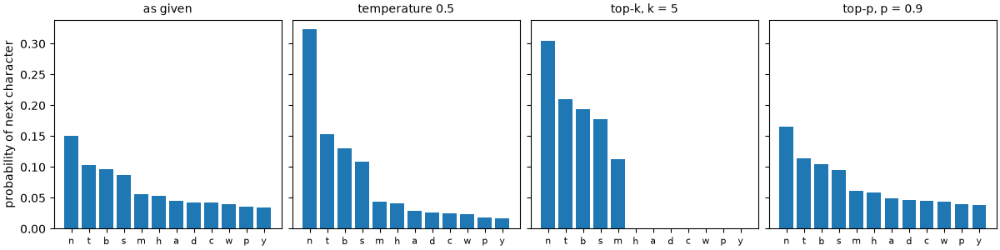

### 37.1 The model from Chapter 36

A language model gives a probability for every possible next token. **Decoding** is the rule that picks one. It changes the output as much as the model does. Load the tiny GPT trained in Chapter 36:

<details>
<summary><b>Code from Chapter 36: the data, the model, and loading its trained weights</b></summary>

```python
import math, time
import torch
from torch import nn

text = open("data/tinyshakespeare.txt").read()
chars = sorted(set(text))
char_id = {c: i for i, c in enumerate(chars)}
encode = lambda s: [char_id[c] for c in s]
decode = lambda ids: "".join(chars[i] for i in ids)
block_size = 64

class MultiHeadAttention(nn.Module):
    def __init__(self, d_model, n_heads):
        super().__init__()
        self.n_heads, self.d_head = n_heads, d_model // n_heads
        self.qkv = nn.Linear(d_model, 3 * d_model, bias=False)
        self.out = nn.Linear(d_model, d_model, bias=False)

    def forward(self, x, causal=False):
        N, T, D = x.shape
        q, k, v = self.qkv(x).split(D, dim=-1)
        q, k, v = (t.view(N, T, self.n_heads, self.d_head).transpose(1, 2) for t in (q, k, v))
        scores = q @ k.transpose(-2, -1) / self.d_head ** 0.5
        if causal:
            future = torch.triu(torch.ones(T, T, dtype=torch.bool), diagonal=1)
            scores = scores.masked_fill(future, float("-inf"))
        out = (torch.softmax(scores, dim=-1) @ v).transpose(1, 2).reshape(N, T, D)
        return self.out(out)

class Block(nn.Module):
    def __init__(self, d_model, n_heads):
        super().__init__()
        self.ln1 = nn.LayerNorm(d_model)
        self.attn = MultiHeadAttention(d_model, n_heads)
        self.ln2 = nn.LayerNorm(d_model)
        self.ffn = nn.Sequential(nn.Linear(d_model, 4 * d_model), nn.GELU(), nn.Linear(4 * d_model, d_model))

    def forward(self, x, causal=True):
        x = x + self.attn(self.ln1(x), causal)
        x = x + self.ffn(self.ln2(x))
        return x

class TinyGPT(nn.Module):
    def __init__(self, vocab_size, d_model=128, n_layers=4, n_heads=4):
        super().__init__()
        self.tok = nn.Embedding(vocab_size, d_model)
        self.pos = nn.Embedding(block_size, d_model)
        self.blocks = nn.ModuleList([Block(d_model, n_heads) for _ in range(n_layers)])
        self.ln_f = nn.LayerNorm(d_model)
        self.head = nn.Linear(d_model, vocab_size)

    def forward(self, ids):
        x = self.tok(ids) + self.pos(torch.arange(ids.shape[1]))
        for block in self.blocks:
            x = block(x)
        return self.head(self.ln_f(x))

model = TinyGPT(len(chars))
model.load_state_dict(torch.load("data/tiny-gpt.pt", weights_only=True))
model.eval()
```

</details>

A helper that returns the next-character probabilities after a prompt:

```python
@torch.no_grad()
def next_probs(prompt):
    ids = torch.tensor([encode(prompt)[-block_size:]])
    return torch.softmax(model(ids)[0, -1], dim=-1)

p = next_probs("ROMEO: I will ")
top = p.topk(5)
print(", ".join(f"{chars[i]!r}: {v:.3f}" for v, i in zip(top.values.tolist(), top.indices.tolist())))
```

**Output:**

```text
'n': 0.151, 't': 0.104, 'b': 0.096, 's': 0.088, 'm': 0.056
```

`topk(5)` returns the 5 largest values and their positions.

### 37.2 Greedy decoding

**Greedy decoding** always takes the most likely token. It's deterministic, and it tends to fall into loops: once a phrase is likely, repeating it stays likely.

```python
@torch.no_grad()
def generate(prompt, n_new, choose):
    ids = encode(prompt)
    for _ in range(n_new):
        probs = torch.softmax(model(torch.tensor([ids[-block_size:]]))[0, -1], dim=-1)
        ids.append(choose(probs))
    return decode(ids)

greedy = lambda probs: probs.argmax().item()
print(generate("ROMEO:", 200, greedy))
```

**Output:**

```text
ROMEO:
The shall be the stand the stands of the sents,
And the sent of the sent of the seal of the seast
The seast of the sent of the seal of the seast
The seast of the sent of the seal of the seast
The sea
```

### 37.3 Temperature

**Sampling** draws the next token at random from the probabilities (Chapter 36.5), giving varied text. **Temperature** τ reshapes the distribution first by dividing the logits:

```
p_i = softmax(z / τ)_i = e^{z_i/τ} / Σⱼ e^{z_j/τ}
```

τ < 1 stretches the gaps between logits, so likely tokens get likelier (τ → 0 becomes greedy); τ > 1 shrinks them, flattening towards uniform. Since softmax(z) is p, the logits are log p up to a constant (which softmax ignores, Chapter 4.5), so this works from probabilities too:

```python
def with_temperature(probs, t):
    return torch.softmax(torch.log(probs) / t, dim=-1)

for t in [0.5, 1.0, 2.0]:
    print(f"temperature {t}: top probability {with_temperature(p, t).max():.3f}")
```

**Output:**

```text
temperature 0.5: top probability 0.323
temperature 1.0: top probability 0.151
temperature 2.0: top probability 0.077
```

### 37.4 Top-k and top-p

Plain sampling occasionally picks a token from the long tail of unlikely ones, and one bad pick can derail the rest. Two filters cut off the tail before sampling:

- **Top-k:** keep only the k most likely tokens, renormalise, sample.
- **Top-p** (**nucleus sampling**): keep the smallest set of most likely tokens whose probabilities add up to at least p (say 0.9), renormalise, sample. The set adapts: small when the model is confident, large when many tokens are plausible.

```python
def top_k(probs, k):
    keep = torch.zeros_like(probs)
    values, indices = probs.topk(k)
    keep[indices] = values
    return keep / keep.sum()

def top_p(probs, p):
    sorted_probs, indices = probs.sort(descending=True)
    cumulative = sorted_probs.cumsum(dim=0)
    n_keep = int((cumulative < p).sum()) + 1                  # smallest prefix reaching p
    keep = torch.zeros_like(probs)
    keep[indices[:n_keep]] = sorted_probs[:n_keep]
    return keep / keep.sum()

print("tokens with non-zero probability: all", int((p > 0).sum()),
      "| top-k 5:", int((top_k(p, 5) > 0).sum()), "| top-p 0.9:", int((top_p(p, 0.9) > 0).sum()))

def sampler(t=1.0, k=None, nucleus=None):
    def choose(probs):
        probs = with_temperature(probs, t)
        if k: probs = top_k(probs, k)
        if nucleus: probs = top_p(probs, nucleus)
        return torch.multinomial(probs, 1).item()
    return choose

torch.manual_seed(0)
print(generate("ROMEO:", 200, sampler(t=0.8, nucleus=0.9)))
```

**Output:**

```text
tokens with non-zero probability: all 65 | top-k 5: 5 | top-p 0.9: 17
ROMEO:
The more is with the decain and brother,
The true of thy his therefore the highness of man.

PRINCE EDWARD:
What we are send die to long hath the wear stone.

Second MutARDIUS:
So not she cousin.

HE
```

`cumsum` gives running totals. Chat assistants typically sample with a temperature around 0.7–1.0 and top-p around 0.9–0.95; for code or factual answers, lower temperatures.

### 37.5 Beam search

Greedy picks the best **next** token, not the best **sequence**: a slightly worse first choice can lead to a much more likely continuation. **Beam search** keeps the B most likely partial sequences (the **beam**), scored by their total log-probability Σ log p. At each step it extends each one by every token, and keeps the B best of all the extensions:

```python
@torch.no_grad()
def beam_search(prompt, n_new, beam_width=4):
    beams = [(0.0, encode(prompt))]                           # (total log-probability, ids)
    for _ in range(n_new):
        candidates = []
        for score, ids in beams:
            log_p = torch.log_softmax(model(torch.tensor([ids[-block_size:]]))[0, -1], dim=-1)
            values, indices = log_p.topk(beam_width)
            candidates += [(score + v, ids + [i]) for v, i in zip(values.tolist(), indices.tolist())]
        beams = sorted(candidates, key=lambda c: c[0], reverse=True)[:beam_width]
    return beams[0]

def total_log_prob(full_text, prompt):
    ids = encode(full_text)
    with torch.no_grad():
        log_p = torch.log_softmax(model(torch.tensor([ids])), dim=-1)[0]
    return sum(log_p[t - 1, ids[t]].item() for t in range(len(encode(prompt)), len(ids)))

score, ids = beam_search("ROMEO:", 30)
greedy_text = generate("ROMEO:", 30, greedy)
print(f"greedy: {greedy_text!r}  log-prob {total_log_prob(greedy_text, 'ROMEO:'):.2f}")
print(f"beam 4: {decode(ids)!r}  log-prob {score:.2f}")
```

**Output:**

```text
greedy: 'ROMEO:\nThe shall be the stand the st'  log-prob -29.26
beam 4: 'ROMEO:\nWhat thou shall be that thou '  log-prob -22.92
```

`log_softmax` computes log(softmax(z)) stably (Chapter 6.5). Beam search finds a more probable sequence than greedy decoding. That suits tasks with one right answer, such as translation or speech recognition. For open-ended writing, the most probable text is usually dull and repetitive, so chat models sample instead.

### 37.6 The KV cache

Look at what `generate` does at each step: it runs the model over the **whole** text so far, recomputing every earlier position's keys and values, which haven't changed, since with the causal mask earlier positions never see later ones. Generating n tokens therefore costs about n²/2 position computations.

The **key-value cache** (**KV cache**) stores each layer's keys and values as they're computed. Each new step then processes **only the newest token**: compute its q, k and v, append k and v to the cache, and attend from that one query over all the cached keys and values. The causal mask isn't even needed, since the cache only holds the past.

```python
@torch.no_grad()
def generate_cached(prompt, n_new):
    ids = encode(prompt)
    caches = [{"k": None, "v": None} for _ in model.blocks]
    new = ids                                                       # first pass: the whole prompt
    for step in range(n_new + 1):
        start = len(ids) - len(new)
        x = model.tok(torch.tensor([new])) + model.pos(torch.arange(start, len(ids)))
        for block, cache in zip(model.blocks, caches):
            attn = block.attn
            h = block.ln1(x)
            N, T, D = h.shape
            q, k, v = (t.view(N, T, attn.n_heads, attn.d_head).transpose(1, 2) for t in attn.qkv(h).split(D, dim=-1))
            cache["k"] = k if cache["k"] is None else torch.cat([cache["k"], k], dim=2)     # append along time
            cache["v"] = v if cache["v"] is None else torch.cat([cache["v"], v], dim=2)
            scores = q @ cache["k"].transpose(-2, -1) / attn.d_head ** 0.5
            if T > 1:                                               # the prompt pass still needs the mask
                scores = scores.masked_fill(torch.triu(torch.ones(T, T, dtype=torch.bool), 1), float("-inf"))
            out = (torch.softmax(scores, dim=-1) @ cache["v"]).transpose(1, 2).reshape(N, T, D)
            x = x + attn.out(out)
            x = x + block.ffn(block.ln2(x))
        if step == n_new:
            break
        next_id = model.head(model.ln_f(x))[0, -1].argmax().item()
        ids.append(next_id)
        new = [next_id]                                             # from now on: one token per step
    return decode(ids)
```

It repeats the model's own computation, block by block, except that it keeps and reuses k and v. With greedy choice it must produce exactly the same text as the uncached version. It also runs faster:

```python
n = 64 - len("ROMEO:")                                              # stay within the 64 learned positions
start = time.time(); slow = generate("ROMEO:", n, greedy); t_slow = time.time() - start
start = time.time(); fast = generate_cached("ROMEO:", n); t_fast = time.time() - start
print("same text:", slow == fast, f"| without cache {t_slow * 1000:.0f} ms, with cache {t_fast * 1000:.0f} ms")
```

**Output:**

```text
same text: True | without cache 76 ms, with cache 38 ms
```

For this tiny model and 58 tokens the gain is modest. For a real LLM generating thousands of tokens it's essential: without a cache, every new token would re-process the entire conversation. The price is memory. The cache holds 2 × layers × sequence length × d_model numbers per sequence, which for long contexts can exceed the model's own weights. That's why attention variants that shrink the cache (Chapter 53) matter so much.

### 37.7 Summary

```
greedy:        argmax                         deterministic, loops
temperature:   softmax(z/τ)                   τ < 1 sharper, τ > 1 flatter
top-k / top-p: keep the k best / the smallest set with total ≥ p, renormalise, sample
beam search:   keep the B best partial sequences by Σ log p     (translation, speech)
KV cache:      store each layer's k, v; each step processes only the new token
```

**Key terms:**

- **Decoding:** the rule for choosing each next token from a model's probabilities.
- **Greedy decoding:** always choosing the most probable next token.
- **Temperature:** dividing the logits by τ before the softmax to sharpen (τ < 1) or flatten (τ > 1) the distribution.
- **Top-k sampling:** sampling only among the k most probable tokens.
- **Top-p (nucleus) sampling:** sampling only among the smallest set of most probable tokens whose probabilities sum to at least p.
- **Beam search:** keeping the B most probable partial sequences at each step and extending them all.
- **KV cache:** stored keys and values of earlier positions, reused so each generation step only processes the newest token.

### Exercises

1. Generate 200 characters with top-k = 1. Which strategy is that the same as?
2. How many numbers does the KV cache hold for a model with 32 layers, d_model = 4,096, and a 100,000-token context? How many gigabytes at 2 bytes per number?

<details>
<summary><b>Answers</b></summary>

```python
torch.manual_seed(0)
print(generate("ROMEO:", 60, sampler(k=1)) == generate("ROMEO:", 60, greedy))
numbers = 2 * 32 * 100_000 * 4096
print(f"{numbers:,} numbers = {numbers * 2 / 1e9:.1f} GB")
```

**Output:**

```text
True
26,214,400,000 numbers = 52.4 GB
```

1. Greedy decoding: with only one token kept, sampling always picks the most likely one.
2. 2 × 32 × 100,000 × 4,096 ≈ 26 billion numbers, about 52 GB per sequence, which is why long-context models share keys and values between heads (Chapter 53) to cut it down.

</details>

**Learn more:** [Hugging Face: how to generate text](https://huggingface.co/blog/how-to-generate)

<details>
<summary><b>Code for the chart at the top</b></summary>

```python
import matplotlib.pyplot as plt

order = p.argsort(descending=True)[:12]
labels = [repr(chars[i])[1:-1] or "␠" for i in order.tolist()]
fig, axes = plt.subplots(1, 4, figsize=(12, 3), layout="constrained", sharey=True)
for ax, (title, dist) in zip(axes, [("as given", p), ("temperature 0.5", with_temperature(p, 0.5)),
                                    ("top-k, k = 5", top_k(p, 5)), ("top-p, p = 0.9", top_p(p, 0.9))]):
    ax.bar(range(12), dist[order].numpy())
    ax.set_xticks(range(12), labels, fontsize=8)
    ax.set_title(title, fontsize=10)
axes[0].set_ylabel("probability of next character")
fig.savefig("sampling.png", dpi=100)
plt.close(fig)
```

</details>

---

## 38. Vision Transformers

**You need:** Chapters 25, 27 and 35. · **You'll learn:** how a transformer reads an image, by cutting it into patches that act as tokens, and how a small one compares with a CNN.

![Transformers for images. Left, ViT: the image is cut into patches, each patch becomes a token, a [CLS] token and positions are added, a transformer encoder processes them, and the [CLS] output gives the class. Right, CLIP (Chapter 44): an image encoder and a text encoder trained so matching images and captions land close together](images/dl/39-vit-clip.svg)

### 38.1 An image as a sequence of patches

A transformer takes a sequence of vectors. A 224×224 image has 50,176 pixels, far too many to use each as a token, since attention costs T² (Chapter 33.6). The **Vision Transformer** (**ViT**, Google, 2020) cuts the image into a grid of square **patches**, 16×16 pixels for a 224×224 image, giving 14 × 14 = 196 patches. Each patch is flattened and passed through a linear layer to become one token vector. From there it's a transformer encoder: no causal mask, since every patch may look at every other.

For a 28×28 Fashion-MNIST image, 4×4 patches give a 7 × 7 grid of 49 patches with 16 pixels each. Cutting them out is a reshape and a transpose (Chapter 2):

```python
import math, time
import torch
from torch import nn

def patchify(x, p):
    """(N, C, H, W) → (N, number of patches, C·p·p)"""
    N, C, H, W = x.shape
    x = x.view(N, C, H // p, p, W // p, p)                     # split H and W into (grid, within-patch)
    x = x.permute(0, 2, 4, 1, 3, 5)                            # (N, grid row, grid col, C, p, p)
    return x.reshape(N, (H // p) * (W // p), C * p * p)

img = torch.arange(16.0).view(1, 1, 4, 4)                       # a 4×4 "image" numbered 0–15
print(img[0, 0])
print(patchify(img, 2))                                         # four 2×2 patches, flattened
```

**Output:**

```text
tensor([[ 0.,  1.,  2.,  3.],
        [ 4.,  5.,  6.,  7.],
        [ 8.,  9., 10., 11.],
        [12., 13., 14., 15.]])
tensor([[[ 0.,  1.,  4.,  5.],
         [ 2.,  3.,  6.,  7.],
         [ 8.,  9., 12., 13.],
         [10., 11., 14., 15.]]])
```

Each row of the result is one patch, read left to right, top to bottom: the top-left 2×2 patch holds pixels 0, 1, 4 and 5.

### 38.2 The [CLS] token and positions

Two more pieces make a classifier:

- A learned **[CLS] token** ("classification") is put in front of the patch tokens. It belongs to no patch, so through attention it gathers information from all of them, and its final vector is what the head classifies. (Averaging all the patch outputs works about as well.)
- **Learned position embeddings**, one per patch position plus one for [CLS], are added, since attention ignores order (Chapter 33.6), and where a patch sits matters.

`nn.Parameter` turns a tensor into a learnable parameter of the module, for weights that aren't part of a ready-made layer. The blocks are Chapter 35's, used without the causal mask:

<details>
<summary><b>Code from Chapters 34–35: MultiHeadAttention and Block</b></summary>

```python
class MultiHeadAttention(nn.Module):
    def __init__(self, d_model, n_heads):
        super().__init__()
        self.n_heads, self.d_head = n_heads, d_model // n_heads
        self.qkv = nn.Linear(d_model, 3 * d_model, bias=False)
        self.out = nn.Linear(d_model, d_model, bias=False)

    def forward(self, x, causal=False):
        N, T, D = x.shape
        q, k, v = self.qkv(x).split(D, dim=-1)
        q, k, v = (t.view(N, T, self.n_heads, self.d_head).transpose(1, 2) for t in (q, k, v))
        scores = q @ k.transpose(-2, -1) / self.d_head ** 0.5
        if causal:
            future = torch.triu(torch.ones(T, T, dtype=torch.bool), diagonal=1)
            scores = scores.masked_fill(future, float("-inf"))
        out = (torch.softmax(scores, dim=-1) @ v).transpose(1, 2).reshape(N, T, D)
        return self.out(out)

class Block(nn.Module):
    def __init__(self, d_model, n_heads):
        super().__init__()
        self.ln1 = nn.LayerNorm(d_model)
        self.attn = MultiHeadAttention(d_model, n_heads)
        self.ln2 = nn.LayerNorm(d_model)
        self.ffn = nn.Sequential(nn.Linear(d_model, 4 * d_model), nn.GELU(), nn.Linear(4 * d_model, d_model))

    def forward(self, x, causal=True):
        x = x + self.attn(self.ln1(x), causal)
        x = x + self.ffn(self.ln2(x))
        return x
```

</details>

```python
class ViT(nn.Module):
    def __init__(self, image_size=28, patch=4, channels=1, d_model=64, n_layers=4, n_heads=4, n_classes=10):
        super().__init__()
        self.patch = patch
        n_patches = (image_size // patch) ** 2
        self.embed = nn.Linear(channels * patch * patch, d_model)
        self.cls = nn.Parameter(torch.zeros(1, 1, d_model))
        self.pos = nn.Parameter(torch.randn(1, n_patches + 1, d_model) * 0.02)
        self.blocks = nn.ModuleList([Block(d_model, n_heads) for _ in range(n_layers)])
        self.ln = nn.LayerNorm(d_model)
        self.head = nn.Linear(d_model, n_classes)

    def forward(self, x):
        tokens = self.embed(patchify(x, self.patch))                       # (N, 49, d)
        cls = self.cls.expand(len(x), -1, -1)                              # one copy per image
        x = torch.cat([cls, tokens], dim=1) + self.pos                     # (N, 50, d)
        for block in self.blocks:
            x = block(x, causal=False)
        return self.head(self.ln(x[:, 0]))                                  # classify from [CLS]

torch.manual_seed(0)
vit = ViT()
print(vit(torch.randn(8, 1, 28, 28)).shape, f"parameters: {sum(p.numel() for p in vit.parameters()):,}")
```

**Output:**

```text
torch.Size([8, 10]) parameters: 204,042
```

`expand` repeats the single [CLS] vector along the batch axis without copying memory.

### 38.3 Train it

The same data and training loop as the CNN of Chapter 25, with AdamW and warm-up plus cosine decay:

```python
from torch.utils.data import DataLoader, TensorDataset, random_split
from torchvision import datasets

raw = datasets.FashionMNIST(root="data", train=True, download=True)
full = TensorDataset(raw.data.float().unsqueeze(1) / 255, raw.targets)
train_ds, val_ds = random_split(full, [50_000, 10_000], generator=torch.Generator().manual_seed(0))
train_loader = DataLoader(train_ds, batch_size=128, shuffle=True)
val_loader = DataLoader(val_ds, batch_size=1000)

epochs = 5
steps, warmup = epochs * len(train_loader), len(train_loader) // 2
optimizer = torch.optim.AdamW(vit.parameters(), lr=1e-3, weight_decay=0.05)
schedule = lambda t: (t + 1) / warmup if t < warmup else 0.5 * (1 + math.cos(math.pi * (t - warmup) / (steps - warmup)))
scheduler = torch.optim.lr_scheduler.LambdaLR(optimizer, schedule)

start = time.time()
for epoch in range(1, epochs + 1):
    vit.train()
    for x, y in train_loader:
        optimizer.zero_grad()
        nn.CrossEntropyLoss()(vit(x), y).backward()
        optimizer.step()
        scheduler.step()
    vit.eval()
    with torch.no_grad():
        acc = sum((vit(x).argmax(1) == y).sum().item() for x, y in val_loader) / len(val_ds)
    print(f"epoch {epoch}: validation accuracy {acc:.4f}   ({time.time() - start:.0f} s)")
```

**Output:**

```text
epoch 1: validation accuracy 0.7771   (622 s)
epoch 2: validation accuracy 0.8401   (660 s)
epoch 3: validation accuracy 0.8553   (678 s)
epoch 4: validation accuracy 0.8652   (697 s)
epoch 5: validation accuracy 0.8698   (715 s)
```

### 38.4 Why it trails the CNN here

The CNN of Chapter 25 reached about 91% in the same 5 epochs; the tiny ViT is a few points behind. A CNN has two assumptions built in: nearby pixels matter together, and a pattern means the same anywhere. Such built-in assumptions are called **inductive biases**. A ViT has almost none: any patch can attend to any other from the first layer, and it has to **learn** from data that neighbouring patches tend to be related.

With little data, the built-in assumptions win. With a lot of data, they become limits, and the flexible model catches up and overtakes. The original ViT paper found exactly that: trained on ImageNet's 1.3 million images, ViTs trailed ResNets; pretrained on 300 million images, they beat them. Today's best vision models are mostly transformers pretrained on huge datasets, then transferred (Chapter 27) to the task at hand, and ViTs are the image encoders inside multimodal models that read both pictures and text (Chapter 44).

### 38.5 Summary

```
patchify:  (N, C, H, W) → (N, (H/p)(W/p), C·p²) via view + permute + reshape
ViT:       linear patch embedding → prepend [CLS] → + learned positions → encoder blocks (no mask) → LN → head on [CLS]
inductive bias: CNNs assume locality and translation; ViTs must learn them, so they need more data
```

**Key terms:**

- **Vision Transformer (ViT):** a transformer encoder that treats image patches as tokens.
- **Patch:** a small square of pixels, flattened and embedded as one token.
- **Patch embedding:** the linear layer that turns a flattened patch into a token vector.
- **[CLS] token:** an extra learned token whose final vector summarises the whole input for classification.
- **`nn.Parameter`:** a tensor registered as a learnable parameter of a module.
- **Inductive bias:** assumptions built into a model's design, such as locality in a CNN.

### Exercises

1. How many tokens does a ViT with 16×16 patches see for a 224×224 image? With 14×14 patches? How much more does attention cost with the smaller patches?
2. Check that `patchify` puts pixel (row 5, column 9) of a 28×28 image, with 4×4 patches, into the right patch and position.

<details>
<summary><b>Answers</b></summary>

```python
for p in [16, 14]:
    print(f"patch {p}: {(224 // p) ** 2} tokens")
print("cost ratio:", round((256 / 196) ** 2, 2))

x = torch.zeros(1, 1, 28, 28)
x[0, 0, 5, 9] = 1
patches = patchify(x, 4)
patch_index, position = (patches[0] == 1).nonzero()[0].tolist()
print("patch", patch_index, "= grid row", patch_index // 7, "col", patch_index % 7, "| position inside", position)
```

**Output:**

```text
patch 16: 196 tokens
patch 14: 256 tokens
cost ratio: 1.71
patch 9 = grid row 1 col 2 | position inside 5
```

1. 196 and 256 tokens. The attention scores grow with T², so (256/196)² ≈ 1.7 times the cost.
2. Row 5 is in grid row 1 (rows 4–7), column 9 in grid column 2 (columns 8–11): patch 1 · 7 + 2 = 9. Inside it, the pixel is at row 1, column 1, which is position 1 · 4 + 1 = 5.

</details>

**Learn more:** [Dosovitskiy et al., An Image is Worth 16x16 Words (ViT)](https://arxiv.org/abs/2010.11929)

---

# Part VIII — Pretrained Models

Six chapters on using the large pretrained models others have trained: loading them with Hugging Face, the three transformer families, fine-tuning, cheap fine-tuning with LoRA, turning a base model into an assistant, and training embeddings with contrastive learning.

---

## 39. Hugging Face: the Hub, Tokenizers, Models and Pipelines

**You need:** Chapters 29, 35–37. · **You'll learn:** how to download a pretrained model and its tokenizer, run it, and recognise inside it the pieces you built in Part VII.

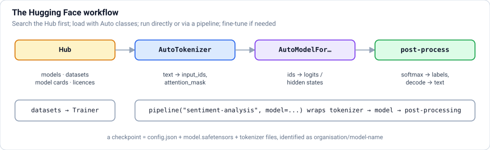

### 39.1 The Hub and the transformers library

The **Hugging Face Hub** (huggingface.co) hosts over a million pretrained models and hundreds of thousands of datasets. Each model is a folder named `organisation/model-name` holding a `config.json` (the architecture's sizes), the weights (`model.safetensors`, Chapter 17.3), and the tokenizer's files. Each also has a **model card** describing its training data, intended uses and **licence**: check the licence before using a model in a product.

The **transformers** library loads them. Its `Auto…` classes read the config and build the right architecture: `AutoTokenizer` for the tokenizer, and a class per task, such as `AutoModelForCausalLM` for next-token prediction. Downloads are cached on disk, so the second load is instant. The examples below download GPT-2 (500 MB) and a small sentiment model (270 MB) the first time they run.

### 39.2 A real tokenizer

GPT-2's tokenizer is the byte-level BPE of Chapter 29.4, with 50,257 tokens learned from web text:

```python
import torch
from transformers import AutoTokenizer

tok = AutoTokenizer.from_pretrained("openai-community/gpt2")
text = "Tokenisation isn't magic: unbelievably, it's just BPE!"
ids = tok(text)["input_ids"]
print(len(tok), "tokens in the vocabulary")
print(ids)
print(tok.convert_ids_to_tokens(ids))
print(repr(tok.decode(ids)))
```

**Output:**

```text
50257 tokens in the vocabulary
[30642, 5612, 2125, 470, 5536, 25, 48943, 11, 340, 338, 655, 347, 11401, 0]
['Token', 'isation', 'Ġisn', "'t", 'Ġmagic', ':', 'Ġunbelievably', ',', 'Ġit', "'s", 'Ġjust', 'ĠB', 'PE', '!']
"Tokenisation isn't magic: unbelievably, it's just BPE!"
```

`Ġ` is how GPT-2 displays the byte for a space: most tokens carry their leading space with them, so " magic" and "magic" are different tokens. Common words are single tokens; rarer ones split into pieces.

Calling the tokenizer on a **list** of texts with `padding=True` and `return_tensors="pt"` returns a batch of PyTorch tensors with the attention mask of Chapter 29.5. GPT-2 has no padding token of its own, so we reuse its end-of-text token:

```python
tok.pad_token = tok.eos_token
batch = tok(["Hello there", "A much longer sentence than the first"], padding=True, return_tensors="pt")
print(batch["input_ids"])
print(batch["attention_mask"])
```

**Output:**

```text
tensor([[15496,   612, 50256, 50256, 50256, 50256, 50256],
        [   32,   881,  2392,  6827,   621,   262,   717]])
tensor([[1, 1, 0, 0, 0, 0, 0],
        [1, 1, 1, 1, 1, 1, 1]])
```

### 39.3 A real GPT

`AutoModelForCausalLM` loads GPT-2 small, the 124-million-parameter model whose parameters Chapter 35.3 counted. Its config holds the sizes you know:

```python
from transformers import AutoModelForCausalLM

gpt2 = AutoModelForCausalLM.from_pretrained("openai-community/gpt2")
gpt2.eval()
c = gpt2.config
print(f"layers {c.n_layer}, d_model {c.n_embd}, heads {c.n_head}, context {c.n_positions}, vocabulary {c.vocab_size}")
print(f"parameters: {sum(p.numel() for p in gpt2.parameters()):,}")
print(gpt2.transformer.h[0])
```

**Output:**

```text
layers 12, d_model 768, heads 12, context 1024, vocabulary 50257
parameters: 124,439,808
GPT2Block(
  (ln_1): LayerNorm((768,), eps=1e-05, elementwise_affine=True, bias=True)
  (attn): GPT2Attention(
    (c_attn): Conv1D(nf=2304, nx=768)
    (c_proj): Conv1D(nf=768, nx=768)
    (attn_dropout): Dropout(p=0.1, inplace=False)
    (resid_dropout): Dropout(p=0.1, inplace=False)
  )
  (ln_2): LayerNorm((768,), eps=1e-05, elementwise_affine=True, bias=True)
  (mlp): GPT2MLP(
    (c_fc): Conv1D(nf=3072, nx=768)
    (c_proj): Conv1D(nf=768, nx=3072)
    (act): NewGELUActivation()
    (dropout): Dropout(p=0.1, inplace=False)
  )
)
```

`transformer.h[0]` is the first block: two LayerNorms, attention (`c_attn` makes Q, K and V in one layer, as our `qkv` did; `c_proj` is W_O) and an MLP from 768 to 3,072 and back, with GELU, plus dropout. GPT-2's code calls its linear layers `Conv1D` for historical reasons; they're ordinary linear layers. The same design as Chapter 35, at a larger size.

Calling the model returns an object whose `.logits` hold one score per vocabulary token at every position, exactly like `TinyGPT`. The next-token prediction is at the last position:

```python
inputs = tok("The capital of France is", return_tensors="pt")
with torch.no_grad():
    logits = gpt2(**inputs).logits                                   # (1, T, 50257)
probs = torch.softmax(logits[0, -1], dim=-1)
top = probs.topk(5)
print(logits.shape)
print([(tok.decode(i), round(p, 3)) for p, i in zip(top.values.tolist(), top.indices.tolist())])
```

**Output:**

```text
torch.Size([1, 5, 50257])
[(' the', 0.085), (' now', 0.048), (' a', 0.046), (' France', 0.032), (' Paris', 0.032)]
```

`**inputs` passes the dictionary's entries (`input_ids`, `attention_mask`) as named arguments.

### 39.4 generate()

`model.generate` runs the decoding loop of Chapter 37, with the KV cache built in. Its arguments are the strategies you implemented: `do_sample`, `temperature`, `top_k`, `top_p`, `num_beams`:

```python
torch.manual_seed(0)
out = gpt2.generate(**inputs, max_new_tokens=25, do_sample=True, temperature=0.8, top_p=0.9, pad_token_id=tok.eos_token_id)
print(tok.decode(out[0]))
greedy = gpt2.generate(**inputs, max_new_tokens=25, do_sample=False, pad_token_id=tok.eos_token_id)
print(tok.decode(greedy[0]))
```

**Output:**

```text
The capital of France is a place that has never had much of a French culture, the birthplace of the French language, and the birthplace of the nation
The capital of France is the capital of the French Republic, and the capital of the French Republic is the capital of the French Republic.

The
```

The sampled text wanders; the greedy text loops, just as in Chapter 37.2. GPT-2 is a 2019 **base model**: it continues text plausibly, but it wasn't trained to answer questions or follow instructions. Chapter 43 covers how base models become assistants.

### 39.5 Task models and pipelines

Many Hub models come with a **task head** already trained. `AutoModelForSequenceClassification` loads a transformer with a classification head on top. This one is DistilBERT (a smaller BERT, Chapter 40) fine-tuned on movie-review sentiment:

```python
from transformers import AutoModelForSequenceClassification

name = "distilbert/distilbert-base-uncased-finetuned-sst-2-english"
clf_tok = AutoTokenizer.from_pretrained(name)
clf = AutoModelForSequenceClassification.from_pretrained(name)
clf.eval()
reviews = ["A gripping, beautifully shot film.", "Two hours of my life I will never get back."]
batch = clf_tok(reviews, padding=True, return_tensors="pt")
with torch.no_grad():
    probs = torch.softmax(clf(**batch).logits, dim=-1)
print(clf.config.id2label)
print(probs.round(decimals=3))
```

**Output:**

```text
{0: 'NEGATIVE', 1: 'POSITIVE'}
tensor([[0.0000, 1.0000],
        [0.2550, 0.7450]])
```

`config.id2label` names the output classes. The first review is clearly positive. The second is negative, but the model gives it 75% positive: sarcasm with no negative words fools a small model trained on short review phrases. Always look at examples, not just accuracy. A **pipeline** wraps the three steps (tokenise, run the model, turn logits into labels) into one call:

```python
from transformers import pipeline

sentiment = pipeline("sentiment-analysis", model=name)
for result in sentiment(["Not bad at all.", "Not good at all."]):
    print(result["label"], round(result["score"], 4))
```

**Output:**

```text
POSITIVE 0.9993
NEGATIVE 0.9998
```

Pipelines are handy for quick use. For anything you'll train or tune, use the tokenizer and model directly, as above, so you can see every step.

### 39.6 Summary

```
tok = AutoTokenizer.from_pretrained("org/name");   tok(texts, padding=True, return_tensors="pt")
model = AutoModelForCausalLM / AutoModelForSequenceClassification / … .from_pretrained("org/name")
model(**inputs).logits;   model.generate(**inputs, max_new_tokens=…, do_sample=…, temperature=…, top_p=…)
pipeline("task", model="org/name")(texts)              check the model card and licence
```

**Key terms:**

- **Hugging Face Hub:** the main online repository of pretrained models and datasets.
- **transformers (library):** Hugging Face's Python library for loading and running pretrained models.
- **Model card:** a model's documentation: training data, intended uses, limitations and licence.
- **Auto classes:** `AutoTokenizer`, `AutoModel…`: classes that build the right tokenizer or architecture from a model's config.
- **`config.json`:** the file holding a model's architecture settings, such as layer count and width.
- **Base model:** a model trained only to predict the next token, not to follow instructions.
- **Task head:** the final layers that adapt a pretrained transformer to a task, such as classification.
- **Pipeline:** a single call that tokenises, runs a model and post-processes its output.

### Exercises

1. How many GPT-2 tokens are "hello", " hello", "Hello" and "HELLO"? Why do they differ?
2. Use `gpt2.generate` with `num_beams=4` on "The capital of France is" and compare with the greedy output.

<details>
<summary><b>Answers</b></summary>

```python
for w in ["hello", " hello", "Hello", "HELLO"]:
    print(repr(w), tok.convert_ids_to_tokens(tok(w)["input_ids"]))
beam = gpt2.generate(**inputs, max_new_tokens=25, num_beams=4, do_sample=False, pad_token_id=tok.eos_token_id)
print(tok.decode(beam[0]))
```

**Output:**

```text
'hello' ['hello']
' hello' ['Ġhello']
'Hello' ['Hello']
'HELLO' ['HE', 'LL', 'O']
The capital of France is the capital of France. It is the capital of France. It is the capital of France. It is the capital of France
```

1. The tokenizer learned from real text, where " hello" (with its space) and "Hello" are common and "HELLO" rare, so the rare form splits into pieces. Capitals and spaces are different bytes, so they make different tokens.
2. Beam search returns the higher-probability continuation (Chapter 37.5), which for a base model is often bland or repetitive.

</details>

**Learn more:** [Hugging Face: LLM course](https://huggingface.co/learn/llm-course) · [transformers documentation](https://huggingface.co/docs/transformers/index)

---

## 40. Encoders, Decoders and Encoder–Decoders: BERT, GPT and T5

**You need:** Chapters 32, 34 and 39. · **You'll learn:** the three shapes of transformer, the training objective of each, what each is good for, and why decoder-only models took over.


### 40.1 Three shapes

All transformers are stacks of the blocks of Chapter 35. They differ in the attention mask and in how they're trained:

| family | attention | trained to | good at | examples |
|---|---|---|---|---|
| encoder-only | every token sees every token | fill in masked tokens | understanding: classification, tagging, search embeddings | BERT, RoBERTa, ModernBERT |
| decoder-only | causal: only the past | predict the next token | generating; at scale, almost everything | GPT, Llama, Claude, Gemini |
| encoder–decoder | encoder: full; decoder: causal, plus **cross-attention** to the encoder | rewrite an input into an output | translation, summarisation, speech to text | T5, BART, Whisper |

### 40.2 Encoders: BERT and masked language modelling

**BERT** (Google, 2018) is an encoder, so a next-token objective would be trivial: every position can already see the next token. Instead it's trained by **masked language modelling** (**MLM**): hide about 15% of the tokens, replacing them with a special `[MASK]` token, and train the model to predict the originals from the context on **both** sides.

`AutoModelForMaskedLM` loads such a model with its prediction head. DistilBERT is a 66-million-parameter, 6-layer version of BERT, trained to imitate it (Chapter 52):

```python
import torch
from transformers import AutoTokenizer, AutoModelForMaskedLM

name = "distilbert/distilbert-base-uncased"
tok = AutoTokenizer.from_pretrained(name)
mlm = AutoModelForMaskedLM.from_pretrained(name)
mlm.eval()

def fill_mask(sentence, k=5):
    batch = tok(sentence, return_tensors="pt")
    position = (batch["input_ids"][0] == tok.mask_token_id).nonzero().item()     # where [MASK] is
    with torch.no_grad():
        probs = torch.softmax(mlm(**batch).logits[0, position], dim=-1)
    top = probs.topk(k)
    return [(tok.decode(i), round(p, 3)) for p, i in zip(top.values.tolist(), top.indices.tolist())]

print(fill_mask("She opened the [MASK] and poured the wine."))
print(fill_mask("She opened the [MASK] and read the first chapter."))
```

**Output:**

```text
[('refrigerator', 0.316), ('fridge', 0.224), ('bottle', 0.091), ('door', 0.056), ('cupboard', 0.045)]
[('book', 0.196), ('folder', 0.118), ('door', 0.096), ('notebook', 0.072), ('envelope', 0.069)]
```

The two sentences are identical up to the mask; only the words **after** it differ, and the predictions follow them: something to pour wine from, or something to read. A causal model reading left to right couldn't do that. The tokenizer also adds `[CLS]` at the start and `[SEP]` at the end of every input; `[CLS]`'s final vector is used as a summary of the whole text.

### 40.3 Using an encoder's vectors

`AutoModel` loads the encoder without any head. Its output `last_hidden_state` is one contextual vector per token (Chapter 33.1), shape (N, T, 768):

```python
from transformers import AutoModel

encoder = AutoModel.from_pretrained(name)
encoder.eval()
batch = tok(["I sat on the river bank.", "I paid the money into the bank."], padding=True, return_tensors="pt")
with torch.no_grad():
    states = encoder(**batch).last_hidden_state
print(states.shape)

bank = tok.convert_tokens_to_ids("bank")
v1 = states[0][batch["input_ids"][0] == bank][0]
v2 = states[1][batch["input_ids"][1] == bank][0]
print("cosine similarity of the two 'bank' vectors:", round(torch.cosine_similarity(v1, v2, dim=0).item(), 3))
```

**Output:**

```text
torch.Size([2, 10, 768])
cosine similarity of the two 'bank' vectors: 0.691
```

Same token, different vectors: unlike the fixed embeddings of Chapter 30, these depend on the sentence. Encoders are fine-tuned for:

- **classification:** a linear head on the `[CLS]` vector (Chapter 41 does this);
- **token tagging**, such as finding names of people and places (**named-entity recognition**): a head on every token's vector;
- **embeddings for search:** one vector per text, trained so similar texts land close together (Chapter 44).

They're small, fast and still widely used for these jobs.

### 40.4 Encoder–decoders: T5 and cross-attention

An encoder–decoder pairs an encoder over the input with a decoder that generates the output, like the seq2seq model of Chapter 32, with transformers instead of RNNs. Each decoder block has a third sub-layer, **cross-attention**: the **queries** come from the decoder, while the **keys and values** come from the encoder's final vectors. That's exactly Chapter 32's attention, where each output step looks back over the input.

**T5** (Google, 2019) frames every task as text in, text out, with the task named in the input. Its pretraining objective, **span corruption**, replaces random spans of the input with placeholders and trains the decoder to write out the missing spans. `AutoModelForSeq2SeqLM` loads it:

```python
from transformers import AutoModelForSeq2SeqLM

t5_tok = AutoTokenizer.from_pretrained("google-t5/t5-small")
t5 = AutoModelForSeq2SeqLM.from_pretrained("google-t5/t5-small")
t5.eval()
for prompt in ["translate English to German: The weather is nice today.",
               "summarize: The meeting was moved from Tuesday to Thursday because the manager was travelling, "
               "and everyone was asked to bring their quarterly reports and the budget figures."]:
    ids = t5_tok(prompt, return_tensors="pt")
    out = t5.generate(**ids, max_new_tokens=40)
    print(t5_tok.decode(out[0], skip_special_tokens=True))
```

**Output:**

```text
Das Wetter ist heute schön.
the meeting was moved from Tuesday to Thursday because the manager was travelling. everyone was asked to bring their quarterly reports and budget figures.
```

`skip_special_tokens=True` drops markers such as the end token. t5-small has 60 million parameters, small enough to run anywhere, and it shows: the translation is right, but the "summary" mostly copies the input. Encoder–decoders remain common where the input is long and the output is a transformation of it: translation, and speech recognition (Whisper's encoder reads audio, its decoder writes text).

### 40.5 Why decoder-only models won

Large language models today are almost all decoder-only:

- **One simple objective on any text.** Next-token prediction needs no masking scheme and no pairs of inputs and outputs: every document is training data, and every position is a prediction (Chapter 36.2).
- **Every task is text continuation.** Translate, summarise, classify, answer: phrase it as a prompt and the model continues it. One model replaces many specialised ones.
- **It scales.** As GPT-2 grew into GPT-3 (175 billion parameters, 2020), new abilities appeared, including **in-context learning**: performing a task from a few examples placed in the prompt, without any training.

Encoders remain the efficient choice for classification, tagging and embeddings; encoder–decoders for translation and speech.

### 40.6 Summary

```
encoder-only (BERT):      full attention;  masked language modelling;  [CLS] vector, per-token vectors
decoder-only (GPT):       causal attention;  next-token prediction;  generate anything
encoder–decoder (T5):     encoder + decoder with cross-attention (Q from decoder, K, V from encoder)
AutoModelForMaskedLM · AutoModel (.last_hidden_state) · AutoModelForCausalLM · AutoModelForSeq2SeqLM
```

**Key terms:**

- **Encoder-only transformer:** a transformer with unmasked attention, producing a contextual vector for every token.
- **BERT:** an encoder-only transformer from 2018, pretrained with masked language modelling.
- **Masked language modelling (MLM):** training a model to predict tokens hidden by a `[MASK]` token, using context on both sides.
- **`[CLS]` / `[SEP]` / `[MASK]`:** BERT's special tokens for the summary position, the separator and the hidden token.
- **Named-entity recognition (NER):** tagging the names of people, places, organisations and so on in text.
- **Encoder–decoder transformer:** an encoder over the input and a decoder that generates the output while attending to the encoder.
- **Cross-attention:** attention whose queries come from one sequence and keys and values from another.
- **T5:** an encoder–decoder transformer that treats every task as text-to-text.
- **Span corruption:** T5's pretraining task: reconstruct spans of the input replaced by placeholders.
- **In-context learning:** a model performing a new task from examples given in its prompt, without any weight updates.

### Exercises

1. Try "The [MASK] barked all night long." and "The [MASK] purred all night long." Does the small model get both right?
2. Which family would you choose for (a) routing support tickets into 12 categories, (b) a chatbot, (c) turning meeting audio into text?

<details>
<summary><b>Answers</b></summary>

```python
print(fill_mask("The [MASK] barked all night long."))
print(fill_mask("The [MASK] purred all night long."))
```

**Output:**

```text
[('dog', 0.165), ('dogs', 0.12), ('wolf', 0.034), ('cat', 0.024), ('hound', 0.02)]
[('dogs', 0.026), ('wolf', 0.019), ('dog', 0.017), ('stallion', 0.017), ('horses', 0.015)]
```

1. "Barked" gives "dog" clearly; "purred" doesn't give "cat" at all. A 66-million-parameter model has learned common patterns, not everything: small models fail in ways larger ones don't, so test them on your own examples.
2. (a) An encoder fine-tuned for classification: small, fast and accurate. (b) A decoder-only LLM. (c) An encoder–decoder speech model such as Whisper.

</details>

**Learn more:** [Devlin et al., BERT](https://arxiv.org/abs/1810.04805) · [Raffel et al., T5](https://arxiv.org/abs/1910.10683)

---

## 41. Fine-Tuning a Pretrained Transformer

**You need:** Chapters 16, 27 and 40, and text classification (`machine-learning.md` Chapter 42). · **You'll learn:** how to load a dataset from the Hub, fine-tune a pretrained encoder for classification with the Trainer, and compare it fairly with a classic baseline.

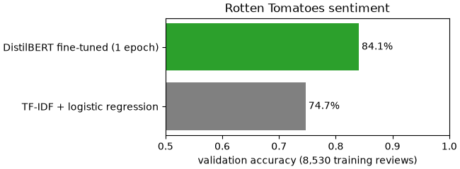

### 41.1 The task and the data

**Rotten Tomatoes** is 10,662 one-sentence movie-review snippets labelled positive or negative. The **datasets** library loads it from the Hub with `load_dataset`, already split into train, validation and test:

```python
import os, tempfile, time
import torch
from datasets import load_dataset

reviews = load_dataset("cornell-movie-review-data/rotten_tomatoes")
print(reviews)
print(reviews["train"][0])
```

**Output:**

```text
DatasetDict({
    train: Dataset({
        features: ['text', 'label'],
        num_rows: 8530
    })
    validation: Dataset({
        features: ['text', 'label'],
        num_rows: 1066
    })
    test: Dataset({
        features: ['text', 'label'],
        num_rows: 1066
    })
})
{'text': 'the rock is destined to be the 21st century\'s new " conan " and that he\'s going to make a splash even greater than arnold schwarzenegger , jean-claud van damme or steven segal .', 'label': 1}
```

A `Dataset` behaves like a table: index it by row number for one example, or by column name for a whole column.

### 41.2 A baseline first

Before any deep learning, measure what a classic model gets (`machine-learning.md` Chapter 42): TF-IDF features of words and word pairs, and logistic regression, trained in seconds:

```python
from sklearn.feature_extraction.text import TfidfVectorizer
from sklearn.linear_model import LogisticRegression
from sklearn.pipeline import make_pipeline

train_text, train_y = reviews["train"]["text"], reviews["train"]["label"]
val_text, val_y = reviews["validation"]["text"], reviews["validation"]["label"]
baseline = make_pipeline(TfidfVectorizer(ngram_range=(1, 2), min_df=2, sublinear_tf=True), LogisticRegression(C=4, max_iter=2000))
baseline.fit(list(train_text), list(train_y))
results = {"TF-IDF + logistic regression": baseline.score(list(val_text), list(val_y))}
print(f"baseline validation accuracy: {results['TF-IDF + logistic regression']:.3f}")
```

**Output:**

```text
baseline validation accuracy: 0.747
```

About three-quarters right. Short snippets are hard for word counts: "not bad", sarcasm, and words whose meaning depends on their neighbours.

### 41.3 Prepare the model and the data

Start from `distilbert/distilbert-base-uncased`, a general pretrained encoder that has **never** seen a sentiment label. `AutoModelForSequenceClassification` with `num_labels=2` adds a new, randomly initialised head on the `[CLS]` vector (Chapter 40.3), just as Chapter 27 replaced ResNet's head. For DistilBERT the head is two small linear layers, `pre_classifier` and `classifier`:

```python
from transformers import AutoTokenizer, AutoModelForSequenceClassification

name = "distilbert/distilbert-base-uncased"
tok = AutoTokenizer.from_pretrained(name)
torch.manual_seed(0)
model = AutoModelForSequenceClassification.from_pretrained(name, num_labels=2)
print(f"parameters: {sum(p.numel() for p in model.parameters()):,}")
print("new head:", [n for n, _ in model.named_parameters() if "classifier" in n])
```

**Output:**

```text
parameters: 66,955,010
new head: ['pre_classifier.weight', 'pre_classifier.bias', 'classifier.weight', 'classifier.bias']
```

Tokenise the whole dataset once. `Dataset.map` applies a function to batches of rows and adds its outputs as new columns:

```python
encoded = reviews.map(lambda batch: tok(batch["text"], truncation=True, max_length=64), batched=True)
print(encoded["train"].column_names)
```

**Output:**

```text
['text', 'label', 'input_ids', 'token_type_ids', 'attention_mask']
```

`max_length=64` truncates the rare long snippets. No padding yet: each training batch will be padded only to its own longest example (**dynamic padding**), which wastes far less computation than padding everything to 64.

### 41.4 The Trainer

You could fine-tune with the loop of Chapter 16. The **Trainer** class runs that loop for you: batching with a collator, AdamW, a learning-rate schedule with warm-up, evaluation and checkpointing. `TrainingArguments` holds the settings:

```python
from transformers import Trainer, TrainingArguments, DataCollatorWithPadding
from transformers.trainer_callback import PrinterCallback

def compute_metrics(eval_pred):
    logits, labels = eval_pred
    return {"accuracy": float((logits.argmax(-1) == labels).mean())}

args = TrainingArguments(
    output_dir=tempfile.mkdtemp(),                   # where checkpoints would go
    num_train_epochs=1,
    per_device_train_batch_size=32,
    learning_rate=3e-5,                              # small: we start from good weights (Chapter 27.6)
    weight_decay=0.01,
    warmup_steps=0.06,                               # a fraction means "6% of all steps"
    save_strategy="no", logging_strategy="no", report_to=[], disable_tqdm=True,
    use_cpu=True, seed=0,
)
trainer = Trainer(model=model, args=args, train_dataset=encoded["train"], eval_dataset=encoded["validation"],
                  data_collator=DataCollatorWithPadding(tok), compute_metrics=compute_metrics)
trainer.remove_callback(PrinterCallback)             # keep the printed output short
```

`DataCollatorWithPadding` does the dynamic padding and builds the attention mask. `compute_metrics` turns the predictions on the evaluation set into whatever scores you want. By default the schedule decays linearly to 0 after the warm-up. Train and evaluate:

```python
start = time.time()
trainer.train()
results["DistilBERT, fine-tuned 1 epoch"] = trainer.evaluate()["eval_accuracy"]
print(f"fine-tuned validation accuracy: {results['DistilBERT, fine-tuned 1 epoch']:.3f}  ({time.time() - start:.0f} s on a laptop CPU)")
```

**Output:**

```text
fine-tuned validation accuracy: 0.849  (145 s on a laptop CPU)
```

About ten points above the baseline, from one pass over 8,530 short reviews, a few minutes on a CPU. The pretrained encoder already understands negation, phrasing and word meaning in context; fine-tuning only has to connect that knowledge to the two labels.

```python
model.eval()
samples = ["The plot is thin, but the performances are wonderful.", "It looks great and says nothing.",
           "Not as bad as the trailer suggested."]
with torch.no_grad():
    probs = torch.softmax(model(**tok(samples, padding=True, return_tensors="pt")).logits, dim=-1)[:, 1]
for text, p in zip(samples, probs.tolist()):
    print(f"P(positive) = {p:.2f}   {text}")
```

**Output:**

```text
P(positive) = 0.97   The plot is thin, but the performances are wonderful.
P(positive) = 0.10   It looks great and says nothing.
P(positive) = 0.19   Not as bad as the trailer suggested.
```

The first two are right. The third is mildly positive, and the model misses it: "not as bad as" is the kind of reversal that still trips up small models.

### 41.5 Check the Hub first

Before fine-tuning anything, search the Hub for a model already trained on a similar task. The sentiment model of Chapter 39.5 was fine-tuned on SST-2, a different collection of movie-review sentences:

```python
from transformers import pipeline

ready_made = pipeline("sentiment-analysis", model="distilbert/distilbert-base-uncased-finetuned-sst-2-english")
predictions = ready_made(list(val_text), batch_size=64, truncation=True)
results["DistilBERT, already tuned on SST-2"] = sum((p["label"] == "POSITIVE") == bool(y) for p, y in zip(predictions, val_y)) / len(val_y)
print(f"ready-made model, no training by us: {results['DistilBERT, already tuned on SST-2']:.3f}")
```

**Output:**

```text
ready-made model, no training by us: 0.905
```

It beats our one-epoch model without any training, because it was fine-tuned longer on more sentiment data. The lesson: a model trained for your task, or a close one, is the strongest starting point; fine-tune it further if your data differs.

### 41.6 Summary

```
data:     load_dataset("org/name") → DatasetDict;  ds.map(tokenise, batched=True)
model:    AutoModelForSequenceClassification.from_pretrained(name, num_labels=K)   (new random head)
train:    Trainer(model, TrainingArguments(lr ≈ 2e-5–5e-5, epochs 1–3, warmup), train/eval datasets,
          DataCollatorWithPadding(tok), compute_metrics).train()
always:   a classic baseline first, and a search of the Hub for a model tuned on a similar task
```

**Key terms:**

- **datasets (library):** Hugging Face's library for loading and processing datasets, with `load_dataset`.
- **Fine-tuning:** continuing to train a pretrained model on a specific task's data (Chapter 27.6).
- **Trainer:** Hugging Face's class that runs the training and evaluation loop.
- **TrainingArguments:** the settings for a Trainer run: learning rate, epochs, batch size, schedule and more.
- **Data collator:** a function that combines examples into a batch; `DataCollatorWithPadding` pads each batch to its longest example.
- **Dynamic padding:** padding each batch only to its own longest sequence.
- **SST-2:** the Stanford Sentiment Treebank's two-class sentiment dataset of movie-review sentences.

### Exercises

1. Why is the learning rate for fine-tuning (3e-5) so much smaller than the 1e-3 used to train our tiny GPT from scratch?
2. How many optimiser steps did the fine-tuning run take?

<details>
<summary><b>Answers</b></summary>

```python
import math
print("steps:", math.ceil(len(encoded["train"]) / 32))
```

**Output:**

```text
steps: 267
```

1. The weights are already good. Big steps would overwrite the pretrained knowledge (catastrophic forgetting, Chapter 27) before the small dataset could replace it.
2. ⌈8,530 / 32⌉ = 267 steps for one epoch.

</details>

**Learn more:** [Hugging Face: fine-tuning a pretrained model](https://huggingface.co/docs/transformers/training)

<details>
<summary><b>Code for the chart at the top</b></summary>

```python
import matplotlib.pyplot as plt

fig, ax = plt.subplots(figsize=(7, 2.6), layout="constrained")
ax.barh(list(results), list(results.values()), color=["gray", "C0", "C2"])
for k, v in enumerate(results.values()):
    ax.text(v + 0.005, k, f"{v:.1%}", va="center")
ax.set(xlim=(0.5, 1), xlabel="validation accuracy", title="Rotten Tomatoes sentiment")
fig.savefig("finetune-results.png", dpi=100)
plt.close(fig)
```

</details>

---

## 42. Parameter-Efficient Fine-Tuning: LoRA and QLoRA

**You need:** Chapters 19 and 41. · **You'll learn:** why fully fine-tuning a large model is so expensive, how LoRA trains a tiny low-rank update instead, built by hand and then with the PEFT library, and how QLoRA adds 4-bit weights.

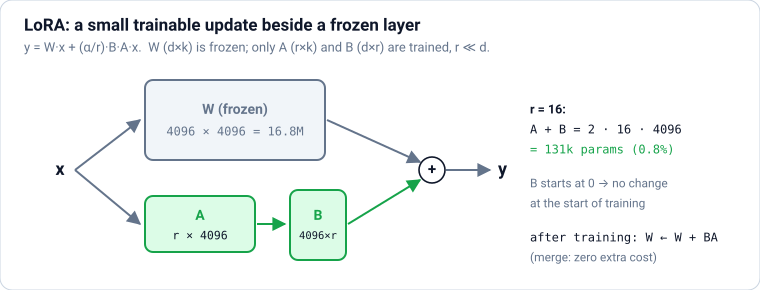

### 42.1 The cost of full fine-tuning

Chapter 41 updated all 67 million of DistilBERT's weights. For a 7-billion-parameter model, full fine-tuning with AdamW needs memory for, per parameter:

| what | bytes per parameter |
|---|---|
| the weight (16-bit) | 2 |
| its gradient (16-bit) | 2 |
| Adam's two running averages (32-bit, Chapter 19.4) | 8 |
| a 32-bit master copy of the weight (Chapter 49) | 4 |

That's about 16 bytes per parameter, 112 GB for 7 billion: more than any single consumer GPU, before counting the activations. And every fine-tuned version is another full 14 GB copy to store and serve.

### 42.2 The idea: a low-rank update

Fine-tuning changes a weight matrix W (d_out × d_in) into W + ΔW. **LoRA** (**low-rank adaptation**, Microsoft, 2021) freezes W and learns ΔW in a restricted form, the product of two thin matrices:

```
ΔW = B A,      B: (d_out × r),   A: (r × d_in),   r small (4 to 64)
y = W x + (α / r) · B A x
```

A matrix that can be written as such a product has **rank** at most r: it only changes the layer's output within an r-dimensional subspace. The number of trained parameters drops from d_in · d_out to r · (d_in + d_out). For a 4,096 × 4,096 layer with r = 16, that's 131,072 instead of 16.8 million, 0.8%.

Why so few parameters can be enough: experiments show that the weight changes of fine-tuning are close to low-rank anyway. Adapting an already capable model to a task needs a small, structured adjustment, not a new model.

Three details:

- **B starts at 0**, A random. So BA = 0 and the model starts out exactly the pretrained one; training moves it gradually.
- **α / r** scales the update, so that changing r doesn't require re-tuning the learning rate. α = 2r is a common choice.
- **Merging.** After training, W ← W + (α/r)BA gives an ordinary layer with no extra computation at prediction time.

### 42.3 LoRA by hand

```python
import torch
from torch import nn

class LoRALinear(nn.Module):
    def __init__(self, base, r=8, alpha=16):
        super().__init__()
        self.base = base
        for p in self.base.parameters():
            p.requires_grad = False                                # freeze the pretrained layer
        self.A = nn.Parameter(torch.randn(r, base.in_features) * 0.01)
        self.B = nn.Parameter(torch.zeros(base.out_features, r))   # zero: no change at the start
        self.scale = alpha / r

    def forward(self, x):
        return self.base(x) + self.scale * (x @ self.A.T @ self.B.T)

    def merged(self):
        layer = nn.Linear(self.base.in_features, self.base.out_features)
        layer.weight.data = self.base.weight.data + self.scale * self.B.data @ self.A.data
        layer.bias.data = self.base.bias.data.clone()
        return layer

torch.manual_seed(0)
base = nn.Linear(4096, 4096)
lora = LoRALinear(base, r=16, alpha=32)
x = torch.randn(8, 4096)
print("same as the base layer at the start:", torch.equal(lora(x), base(x)))
trainable = sum(p.numel() for p in lora.parameters() if p.requires_grad)
total = sum(p.numel() for p in lora.parameters())
print(f"trainable: {trainable:,} of {total:,} ({trainable / total:.2%})")
```

**Output:**

```text
same as the base layer at the start: True
trainable: 131,072 of 16,912,384 (0.78%)
```

`x @ A.T @ B.T` computes BAx without ever forming the big d_out × d_in matrix BA: two thin products are far cheaper. Train it to fit some target, then check that merging changes nothing:

```python
target = torch.randn(8, 4096)
optimizer = torch.optim.AdamW([lora.A, lora.B], lr=1e-3)
for step in range(100):
    optimizer.zero_grad()
    loss = (lora(x) - target).pow(2).mean()
    loss.backward()
    optimizer.step()
print(f"loss {loss.item():.3f}; base weights unchanged: {base.weight.grad is None}")
print("merged layer gives the same outputs:", torch.allclose(lora.merged()(x), lora(x), atol=1e-4))
print("rank of the learned update:", torch.linalg.matrix_rank(lora.B @ lora.A).item())
```

**Output:**

```text
loss 0.000; base weights unchanged: True
merged layer gives the same outputs: True
rank of the learned update: 16
```

`torch.linalg.matrix_rank` confirms the update has rank at most 16, however many steps it trains.

### 42.4 LoRA with the PEFT library

The **PEFT** library (parameter-efficient fine-tuning) adds LoRA to any Hugging Face model. `LoraConfig` says which layers to adapt; `get_peft_model` wraps the model, freezes the rest, and inserts the A and B matrices. The common choice is the attention projections; in DistilBERT, the query and value layers are named `q_lin` and `v_lin`:

```python
import tempfile, time, os
from datasets import load_dataset
from peft import LoraConfig, get_peft_model
from transformers import (AutoTokenizer, AutoModelForSequenceClassification, Trainer, TrainingArguments,
                          DataCollatorWithPadding)
from transformers.trainer_callback import PrinterCallback

reviews = load_dataset("cornell-movie-review-data/rotten_tomatoes")
name = "distilbert/distilbert-base-uncased"
tok = AutoTokenizer.from_pretrained(name)
encoded = reviews.map(lambda b: tok(b["text"], truncation=True, max_length=64), batched=True)

torch.manual_seed(0)
model = AutoModelForSequenceClassification.from_pretrained(name, num_labels=2)
config = LoraConfig(r=8, lora_alpha=16, lora_dropout=0.1, target_modules=["q_lin", "v_lin"], task_type="SEQ_CLS")
model = get_peft_model(model, config)
model.print_trainable_parameters()
```

**Output:**

```text
trainable params: 739,586 || all params: 67,694,596 || trainable%: 1.0925
```

`task_type="SEQ_CLS"` tells PEFT to keep the new classification head trainable too, since it starts random. The training is Chapter 41's, with a learning rate about 30 times higher: the LoRA matrices start from zero and have far fewer parameters to move:

```python
args = TrainingArguments(output_dir=tempfile.mkdtemp(), num_train_epochs=1, per_device_train_batch_size=32,
                         learning_rate=1e-3, save_strategy="no", logging_strategy="no", report_to=[],
                         disable_tqdm=True, use_cpu=True, seed=0)
trainer = Trainer(model=model, args=args, train_dataset=encoded["train"], data_collator=DataCollatorWithPadding(tok))
trainer.remove_callback(PrinterCallback)
start = time.time()
trainer.train()
pred = trainer.predict(encoded["validation"])
print(f"LoRA validation accuracy: {(pred.predictions.argmax(-1) == pred.label_ids).mean():.3f} "
      f"({time.time() - start:.0f} s)   full fine-tuning in Chapter 41: about 0.85")
```

**Output:**

```text
LoRA validation accuracy: 0.841 (681 s)   full fine-tuning in Chapter 41: about 0.85
```

Nearly the accuracy of full fine-tuning, while training about 1% of the weights. What you save is just the adapter:

```python
folder = tempfile.mkdtemp()
model.save_pretrained(folder)
for f in sorted(os.listdir(folder)):
    print(f"{f:28s} {os.path.getsize(os.path.join(folder, f)) / 1e6:.2f} MB")
```

**Output:**

```text
README.md                    0.01 MB
adapter_config.json          0.00 MB
adapter_model.safetensors    2.96 MB
```

A few megabytes instead of 268 MB for the whole model. One base model can serve many tasks, loading a different small adapter for each.

### 42.5 QLoRA

LoRA removes the gradient and optimiser memory for the frozen weights, but the frozen weights themselves still take 2 bytes each in 16-bit. **QLoRA** (2023) also stores them in **4 bits**, using a format called NF4 designed for the bell-shaped distribution of weights (quantisation is Chapter 51), and trains 16-bit LoRA matrices on top. In each forward pass the 4-bit weights are expanded back to 16 bits, one layer at a time, just for the computation. A 65-billion-parameter model then fits on a single 48 GB GPU for fine-tuning, with results close to full 16-bit fine-tuning. In code it's one extra setting when loading the model (`BitsAndBytesConfig(load_in_4bit=True, bnb_4bit_quant_type="nf4")`, from the bitsandbytes library), which needs an NVIDIA GPU, so it isn't run here.

Variants keep appearing (DoRA, for example, learns a separate magnitude for each weight column), but plain LoRA on the attention and MLP projections, with r between 8 and 64, remains the standard way to fine-tune large models.

### 42.6 Summary

```
y = Wx + (α/r) B A x;   W frozen;  A (r × d_in) random, B (d_out × r) = 0;  r(d_in + d_out) trained parameters
merge after training:   W ← W + (α/r) B A
PEFT:   get_peft_model(model, LoraConfig(r, lora_alpha, target_modules=[…], task_type=…));  lr ~1e-4–1e-3
QLoRA:  frozen base in 4-bit NF4 + 16-bit LoRA matrices
```

**Key terms:**

- **Parameter-efficient fine-tuning (PEFT):** adapting a model by training only a small number of added or selected parameters.
- **LoRA (low-rank adaptation):** freezing a weight matrix and training a low-rank update B·A beside it.
- **Rank:** the number of independent directions a matrix's outputs span; B·A has rank at most r.
- **Adapter:** the small set of trained parameters (such as LoRA's A and B) saved separately from the base model.
- **Merging:** adding the trained LoRA update into the base weight so no extra computation remains.
- **QLoRA:** LoRA on top of a base model stored in 4-bit precision.
- **NF4 (4-bit NormalFloat):** a 4-bit number format whose levels suit normally distributed weights.

### Exercises

1. How many LoRA parameters does the PEFT model above train in its attention layers? DistilBERT has 6 layers, d_model = 768, and r = 8 on two projections per layer.
2. Why must B (or A) start at zero, rather than both random?

<details>
<summary><b>Answers</b></summary>

```python
per_projection = 8 * (768 + 768)
print(per_projection * 2 * 6)
```

**Output:**

```text
147456
```

1. Each adapted projection has 8 · (768 + 768) = 12,288 LoRA parameters; 2 per layer × 6 layers gives 147,456. `print_trainable_parameters` reports more, because it also counts the new classification head.
2. With both random, BA would be a random, non-zero change to every adapted layer, so training would start from a damaged model. With B = 0 it starts exactly at the pretrained model.

</details>

| # | Problem (Deep-ML) | Difficulty |
|---|---|---|
| 1 | [222. LoRA: Low-Rank Adaptation Forward Pass](https://www.deep-ml.com/problems/222) | 🟡 Medium |
| 2 | [223. QLoRA: Quantized Low-Rank Adaptation Forward Pass](https://www.deep-ml.com/problems/223) | 🟡 Medium |

**Learn more:** [Hu et al., LoRA](https://arxiv.org/abs/2106.09685) · [Dettmers et al., QLoRA](https://arxiv.org/abs/2305.14314) · [PEFT documentation](https://huggingface.co/docs/peft)

---

## 43. From Base Model to Assistant: SFT, RLHF and DPO

**You need:** Chapters 6, 36, 39 and 42. · **You'll learn:** the training stages that turn a next-token predictor into a helpful assistant: supervised fine-tuning on conversations, preference tuning with RLHF or DPO (derived and run on GPT-2), and reinforcement learning for reasoning.


### 43.1 Why a base model isn't an assistant

A pretrained model predicts how text continues (Chapter 39.4). Ask it "What is the capital of France?" and a plausible continuation might be another quiz question, because that's what follows questions in many web pages. Turning it into an assistant takes further training, in stages, each starting from the previous model. Together they're called **post-training**.

### 43.2 Supervised fine-tuning (SFT)

Collect examples of good behaviour: conversations where a person wrote an ideal assistant reply, typically 10,000 to a million of them. Fine-tune on them with the same next-token loss, with two changes.

**A chat template.** Conversations are flattened into one text with special tokens marking who's speaking. Each model family has its own; the tokenizer applies it:

```python
import copy
import torch
import torch.nn.functional as F
from transformers import AutoTokenizer, AutoModelForCausalLM

chat_tok = AutoTokenizer.from_pretrained("Qwen/Qwen2.5-0.5B-Instruct")         # only the tokenizer, a few MB
messages = [{"role": "system", "content": "You are a helpful assistant."},
            {"role": "user", "content": "What is LoRA?"},
            {"role": "assistant", "content": "A cheap way to fine-tune large models."}]
print(chat_tok.apply_chat_template(messages, tokenize=False))
```

**Output:**

```text
<|im_start|>system
You are a helpful assistant.<|im_end|>
<|im_start|>user
What is LoRA?<|im_end|>
<|im_start|>assistant
A cheap way to fine-tune large models.<|im_end|>
```

**Loss on the response only.** The model should learn to write the assistant's turns, not to predict the user's. So the loss is computed only on response tokens. In Hugging Face, a label of **−100** means "ignore this position" (it's the `ignore_index` of PyTorch's cross-entropy):

```python
tok = AutoTokenizer.from_pretrained("openai-community/gpt2")
gpt2 = AutoModelForCausalLM.from_pretrained("openai-community/gpt2")
prompt, response = "Q: What is 2 + 2?\nA:", " 4."
prompt_ids, response_ids = tok(prompt)["input_ids"], tok(response)["input_ids"]
input_ids = torch.tensor([prompt_ids + response_ids])
labels = torch.tensor([[-100] * len(prompt_ids) + response_ids])
print(tok.convert_ids_to_tokens(input_ids[0]))
print(labels[0].tolist())
print(f"SFT loss on the response tokens only: {gpt2(input_ids, labels=labels).loss.item():.3f}")
```

**Output:**

```text
['Q', ':', 'ĠWhat', 'Ġis', 'Ġ2', 'Ġ+', 'Ġ2', '?', 'Ċ', 'A', ':', 'Ġ4', '.']
[-100, -100, -100, -100, -100, -100, -100, -100, -100, -100, -100, 604, 13]
SFT loss on the response tokens only: 4.073
```

Passing `labels` makes a Hugging Face causal model compute the shifted next-token loss itself (Chapter 36.2). After SFT the model answers in the assistant's format and follows instructions much better.

### 43.3 Preferences and the reward model

SFT can only imitate. Often it's easier for people to **compare** two answers than to write the ideal one. So collect **preference data**: for a prompt x, two responses, one marked **chosen** (y_c) and one **rejected** (y_r).

The classic way to use them, **RLHF** (reinforcement learning from human feedback, used for InstructGPT and the first ChatGPT, 2022), first trains a **reward model** r(x, y): a transformer with a head that outputs one score. It's trained with the **Bradley–Terry** model of comparisons, which says the probability that y_c beats y_r is

```
P(y_c ≻ y_r) = σ( r(x, y_c) − r(x, y_r) )
```

and maximising the likelihood of the human choices gives the loss −log σ(r_c − r_r): the logistic regression of Chapter 6, applied to a difference of scores. Then the language model, now called the **policy** π, is trained with reinforcement learning (usually the **PPO** algorithm) to produce responses the reward model scores highly, with a penalty for drifting too far from the SFT model π_ref:

```
maximise   E[ r(x, y) ]  −  β · KL( π ‖ π_ref )
```

The **KL divergence** measures how different two probability distributions are. Without the penalty, the policy finds strange outputs that fool the reward model, a failure called **reward hacking**. RLHF works, but it's complex: four models in memory (policy, reference, reward, and a value model for PPO) and a notoriously touchy training loop.

### 43.4 DPO: preferences without a reward model

**Direct preference optimisation** (**DPO**, 2023) gets the same objective with a plain supervised loss. The key fact is that the best policy for the RLHF objective can be written down exactly, which lets the reward be expressed through the policy itself:

```
r(x, y) = β log( π(y | x) / π_ref(y | x) ) + (a term that depends only on x)
```

Substituting this into Bradley–Terry, the term that depends only on x cancels in the difference r_c − r_r, leaving a loss on the policy directly:

```
L_DPO = −log σ( β [ (log π(y_c|x) − log π_ref(y_c|x)) − (log π(y_r|x) − log π_ref(y_r|x)) ] )
```

<details>
<summary><b>Derivation</b></summary>

The RLHF objective for one prompt is max over π of Σ_y π(y)r(y) − β Σ_y π(y) log(π(y)/π_ref(y)). Its maximiser (a standard result, found with a Lagrange multiplier for Σπ = 1) is

π*(y) = π_ref(y) e^{r(y)/β} / Z,   Z = Σ_y π_ref(y) e^{r(y)/β}.

Take logs and rearrange: r(y) = β log(π*(y)/π_ref(y)) + β log Z. Z depends on the prompt but not on y.

In Bradley–Terry only r(y_c) − r(y_r) appears, and β log Z cancels in the difference:

r(y_c) − r(y_r) = β[log(π*(y_c)/π_ref(y_c)) − log(π*(y_r)/π_ref(y_r))].

Replace π* by the policy being trained, π, and maximise the log-likelihood of the observed preferences: that's L_DPO.

</details>

In words: raise the log-probability of the chosen answer, **relative to the reference model**, more than that of the rejected one. The reference terms stop the policy from simply making everything very likely or very unlikely. Traced: with β = 0.1, if the policy has raised the chosen answer's log-probability by 2.0 relative to the reference and lowered the rejected one's by 1.0, then the loss is −log σ(0.1 · (2.0 − (−1.0))) = −log σ(0.3) = 0.554.

The log-probability of a whole answer is the sum of its tokens' log-probabilities, each read off the logits at the position before it:

```python
def answer_log_prob(model, prompt, answer):
    p_ids, a_ids = tok(prompt)["input_ids"], tok(answer)["input_ids"]
    ids = torch.tensor([p_ids + a_ids])
    log_probs = torch.log_softmax(model(ids).logits[0, :-1], dim=-1)     # position t predicts token t + 1
    targets = ids[0, 1:]
    token_lp = log_probs[torch.arange(len(targets)), targets]
    return token_lp[len(p_ids) - 1:].sum()                              # only the answer's tokens

def dpo_loss(policy, reference, prompt, chosen, rejected, beta=0.1):
    with torch.no_grad():
        ref_c = answer_log_prob(reference, prompt, chosen)
        ref_r = answer_log_prob(reference, prompt, rejected)
    margin = beta * ((answer_log_prob(policy, prompt, chosen) - ref_c) - (answer_log_prob(policy, prompt, rejected) - ref_r))
    return -F.logsigmoid(margin), margin

print("traced example:", round(-F.logsigmoid(torch.tensor(0.1 * (2.0 - (-1.0)))).item(), 3))
```

**Output:**

```text
traced example: 0.554
```

`F.logsigmoid(z)` computes log σ(z) stably. Run a few DPO steps on GPT-2 with one preference pair. The reference is a frozen copy of the starting model, made with `copy.deepcopy`:

```python
prompt = "User: How do I reset my password?\nAssistant:"
chosen = " Click 'Forgot password' on the login page and follow the link we email you."
rejected = " Figure it out yourself."

torch.manual_seed(0)
policy, reference = gpt2, copy.deepcopy(gpt2).eval()
optimizer = torch.optim.AdamW(policy.parameters(), lr=1e-5)
for step in range(8):
    loss, margin = dpo_loss(policy, reference, prompt, chosen, rejected)
    optimizer.zero_grad()
    loss.backward()
    optimizer.step()
    if step in (0, 3, 7):
        print(f"step {step}: DPO loss {loss.item():.3f}, margin {round(margin.item(), 3) + 0.0:+.3f}")   # + 0.0 turns −0.0 into 0.0
```

**Output:**

```text
step 0: DPO loss 0.693, margin +0.000
step 3: DPO loss 0.121, margin +2.055
step 7: DPO loss 0.013, margin +4.315
```

At step 0 the policy equals the reference, so the margin is 0 and the loss is log 2 = 0.693. As training raises the chosen answer relative to the rejected one, the margin grows and the loss falls. On real data, DPO trains on tens of thousands of pairs, usually with LoRA (Chapter 42) on a model that has already had SFT; libraries such as Hugging Face's TRL provide ready-made trainers.

### 43.5 Reinforcement learning for reasoning

Since 2024, a further stage has made models much better at maths, code and multi-step problems: **reinforcement learning with verifiable rewards** (**RLVR**). Instead of a learned reward model, use problems whose answers can be **checked** automatically: a maths answer compared with the known solution, code run against tests. The model writes a long chain of reasoning before its answer, and gets reward 1 if the final answer is right and 0 if not.

A popular algorithm is **GRPO** (group relative policy optimisation, from DeepSeek, 2024). For each problem, sample a group of G answers, score them, and use each answer's reward relative to the group as its **advantage**:

```
advantage_i = (r_i − mean(r_1 … r_G)) / std(r_1 … r_G)
```

Then raise the log-probability of every token in answers with positive advantage, and lower it for negative ones, with a KL penalty to the reference model as in RLHF. No value model is needed, since the group itself provides the baseline:

```python
rewards = torch.tensor([1.0, 0.0, 0.0, 1.0, 0.0, 0.0, 0.0, 0.0])      # 8 sampled answers, 2 correct
advantages = (rewards - rewards.mean()) / rewards.std()
print(advantages.round(decimals=2))
```

**Output:**

```text
tensor([ 1.6200, -0.5400, -0.5400,  1.6200, -0.5400, -0.5400, -0.5400, -0.5400])
```

The correct answers get strongly positive advantages; the wrong ones mildly negative. Trained this way at scale, models learn on their own to check their work, try alternatives and backtrack: the "thinking" of reasoning models such as OpenAI's o-series, DeepSeek-R1 and Claude's extended thinking.

### 43.6 Summary

```
pretraining → base model;   SFT: next-token loss on demonstrations, labels = −100 on the prompt
reward model:   P(y_c ≻ y_r) = σ(r_c − r_r);   loss −log σ(r_c − r_r)
RLHF:           maximise E[r] − β·KL(π‖π_ref) with PPO
DPO:            −log σ(β[(log π − log π_ref)(y_c) − (log π − log π_ref)(y_r)])
RLVR / GRPO:    checkable rewards;  advantage = (r − mean)/std within a group of samples
```

**Key terms:**

- **Post-training:** all training after pretraining, such as SFT and preference tuning.
- **Supervised fine-tuning (SFT):** fine-tuning on example conversations with ideal responses.
- **Chat template:** the format, with special tokens, that turns a conversation into one token sequence.
- **Preference data:** pairs of responses to the same prompt, one marked chosen and one rejected.
- **Reward model:** a model trained to score responses so that preferred ones score higher.
- **Bradley–Terry model:** P(a beats b) = σ(score_a − score_b).
- **RLHF (reinforcement learning from human feedback):** training the model to maximise a learned reward, with a KL penalty to a reference model.
- **Policy:** in reinforcement learning, the model that chooses actions; here, the language model generating text.
- **PPO (proximal policy optimisation):** the reinforcement-learning algorithm classically used for RLHF.
- **KL divergence:** a measure of how much one probability distribution differs from another.
- **Reward hacking:** a policy exploiting flaws in its reward instead of genuinely improving.
- **DPO (direct preference optimisation):** a supervised loss on preference pairs that achieves the RLHF objective without a reward model.
- **RLVR (reinforcement learning with verifiable rewards):** RL on problems whose answers can be checked automatically.
- **GRPO:** an RL algorithm that scores each sampled answer against the others in its group.
- **Advantage:** how much better an action (here, an answer) did than the expected baseline.

### Exercises

1. A reward model scores the chosen answer 2.5 and the rejected one 1.0. What's its loss? And if the scores were swapped?
2. Why does DPO's loss at the very first step always equal log 2?

<details>
<summary><b>Answers</b></summary>

```python
for r_c, r_r in [(2.5, 1.0), (1.0, 2.5)]:
    print(f"chosen {r_c}, rejected {r_r}: loss {-F.logsigmoid(torch.tensor(r_c - r_r)).item():.3f}")
```

**Output:**

```text
chosen 2.5, rejected 1.0: loss 0.201
chosen 1.0, rejected 2.5: loss 1.701
```

1. −log σ(1.5) = 0.201 when the chosen answer scores higher; −log σ(−1.5) = 1.701 when it scores lower, a much larger loss pushing the scores the right way.
2. At the start the policy is the reference, so both log-ratios are 0, the margin is 0, and −log σ(0) = −log 0.5 = log 2.

</details>

**Learn more:** [Ouyang et al., InstructGPT](https://arxiv.org/abs/2203.02155) · [Rafailov et al., DPO](https://arxiv.org/abs/2305.18290) · [DeepSeek-R1](https://arxiv.org/abs/2501.12948) · [Hugging Face TRL](https://huggingface.co/docs/trl)

---

## 44. Contrastive Learning: Sentence Embeddings and CLIP

**You need:** Chapters 30, 38 and 40. · **You'll learn:** how to turn whole texts (and images) into vectors whose distances mean similarity, the contrastive loss that trains them, and CLIP, which puts images and text in one shared space.

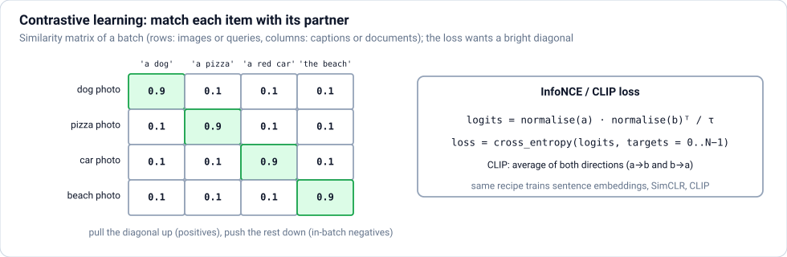

### 44.1 Embeddings for whole texts

**Semantic search** means finding texts that mean the same thing, even with no words in common: "I can't remember my sign-in credentials" should find "How do I reset my password?". Word-count methods such as TF-IDF can't, since the words differ.

A **sentence-embedding model** maps each text to one vector, so that texts with similar meanings get vectors with high cosine similarity (Chapter 30.4). A common recipe takes an encoder's per-token vectors (Chapter 40.3) and averages them over the real tokens, using the attention mask to skip padding. This is **mean pooling**. Then each vector is normalised to length 1, so the dot product is the cosine. `all-MiniLM-L6-v2` is a small (22-million-parameter) encoder trained for exactly this:

```python
import io
import numpy as np
import pandas as pd
import torch
import torch.nn.functional as F
from PIL import Image
from transformers import AutoTokenizer, AutoModel

name = "sentence-transformers/all-MiniLM-L6-v2"
tok, encoder = AutoTokenizer.from_pretrained(name), AutoModel.from_pretrained(name)
encoder.eval()

def embed(texts):
    batch = tok(texts, padding=True, truncation=True, return_tensors="pt")
    with torch.no_grad():
        tokens = encoder(**batch).last_hidden_state                   # (N, T, 384)
    mask = batch["attention_mask"].unsqueeze(-1).float()                # (N, T, 1): 1 for real tokens
    mean = (tokens * mask).sum(dim=1) / mask.sum(dim=1)                 # mean pooling
    return F.normalize(mean, dim=-1)                                    # length 1

docs = ["How do I reset my password?", "The weather is lovely today.", "Steps to recover a forgotten login.",
        "Best pizza places in Naples.", "My account is locked after too many attempts.", "Where can I get good Italian food?"]
D = embed(docs)
print(D.shape)
```

**Output:**

```text
torch.Size([6, 384])
```

`F.normalize(x, dim=-1)` divides each row by its length. Search: embed the query, take dot products with every document, sort:

```python
for query in ["I can't remember my sign-in credentials", "recommend a restaurant for Neapolitan pizza"]:
    scores = embed([query])[0] @ D.T
    best = scores.argsort(descending=True)[:2]
    print(query, "→", [(docs[i], round(scores[i].item(), 2)) for i in best.tolist()])
```

**Output:**

```text
I can't remember my sign-in credentials → [('Steps to recover a forgotten login.', 0.63), ('How do I reset my password?', 0.63)]
recommend a restaurant for Neapolitan pizza → [('Best pizza places in Naples.', 0.61), ('Where can I get good Italian food?', 0.52)]
```

Neither query shares a meaningful word with its best matches. This is the retrieval step behind **retrieval-augmented generation** (`rag-and-agents.md`): embed every document once, store the vectors, and find the nearest ones to each question.

### 44.2 How such models are trained: contrastive learning

Where do vectors like these come from? From **pairs** of things that belong together: a question and its answer, a sentence and its paraphrase, an image and its caption. **Contrastive learning** trains two encoders (often the same one) so that each pair's vectors are close and unrelated items' vectors are far apart.

Take a batch of N pairs (a_i, b_i). Encode and normalise them, and compute the N × N matrix of similarities a_i · b_j, divided by a **temperature** τ (around 0.05 to 0.1, which sharpens the softmax, as in Chapter 37.3). Now treat each row as a classification problem: "which of the N items in this batch is a_i's partner?", where the right answer is column i. The loss is ordinary cross-entropy (Chapter 6.4) with targets 0, 1, …, N − 1:

```
logits = normalise(A) · normalise(B)ᵀ / τ          (N, N)
InfoNCE = cross_entropy(logits, targets = [0, 1, …, N−1])
```

This is the **InfoNCE** loss. The other N − 1 items in the batch serve as **in-batch negatives**, so no negative examples have to be collected: bigger batches give more negatives, and usually better embeddings. Traced with N = 2, τ = 0.1, similarities [[0.9, 0.2], [0.1, 0.8]]: row 1's logits are (9, 2), so its loss is −log(e⁹/(e⁹ + e²)) = 0.0009; row 2's are (1, 8), giving the same 0.0009. The diagonal already wins clearly, so the loss is tiny.

```python
def info_nce(a, b, tau=0.1):
    logits = F.normalize(a, dim=-1) @ F.normalize(b, dim=-1).T / tau
    return F.cross_entropy(logits, torch.arange(len(a)))

def clip_loss(a, b, tau=0.1):
    return (info_nce(a, b, tau) + info_nce(b, a, tau)) / 2           # both directions: a → b and b → a

print(round(F.cross_entropy(torch.tensor([[0.9, 0.2], [0.1, 0.8]]) / 0.1, torch.arange(2)).item(), 4))
```

**Output:**

```text
0.0009
```

### 44.3 Contrastive training in miniature

Two different "views" of 512 hidden concepts, think of image features and caption features, made from the same concepts by different random maps plus noise. Two linear encoders map each view into one shared 32-dimensional space. Before training, matching a view-A item to its view-B partner is chance (1 in 512):

```python
torch.manual_seed(0)
n, d = 512, 32
concept = torch.randn(n, d)
view_a = concept @ torch.randn(d, 64) + 0.5 * torch.randn(n, 64)
view_b = concept @ torch.randn(d, 48) + 0.5 * torch.randn(n, 48)
enc_a, enc_b = torch.nn.Linear(64, 32), torch.nn.Linear(48, 32)

def retrieval_accuracy():
    with torch.no_grad():
        sims = F.normalize(enc_a(view_a), dim=-1) @ F.normalize(enc_b(view_b), dim=-1).T
    return (sims.argmax(dim=1) == torch.arange(n)).float().mean().item()

print(f"before: retrieval accuracy {retrieval_accuracy():.3f} (chance {1 / n:.3f})")
optimizer = torch.optim.Adam(list(enc_a.parameters()) + list(enc_b.parameters()), lr=1e-2)
for step in range(300):
    idx = torch.randperm(n)[:128]                                   # a batch of 128 pairs
    optimizer.zero_grad()
    clip_loss(enc_a(view_a[idx]), enc_b(view_b[idx])).backward()
    optimizer.step()
print(f"after:  retrieval accuracy {retrieval_accuracy():.3f}")
```

**Output:**

```text
before: retrieval accuracy 0.008 (chance 0.002)
after:  retrieval accuracy 1.000
```

Neither encoder was told what the concepts are. Being pulled towards its partner and pushed away from 127 others at every step was enough to align the two spaces.

### 44.4 CLIP: images and text in one space

**CLIP** (OpenAI, 2021) is this recipe at scale: a vision transformer (Chapter 38) for images, a text transformer for captions, trained with the symmetric loss above on 400 million image–caption pairs from the web.

The result can classify images into classes it was never trained on, **zero-shot**: embed the image, embed a sentence such as "a photo of a dog" for every class, and pick the class whose sentence is most similar. Try it on 300 CIFAR-10 test images (the file from Chapter 27) with the ViT-B/32 CLIP model (600 MB download). `CLIPProcessor` resizes and normalises the images and tokenises the texts:

```python
from transformers import CLIPModel, CLIPProcessor

clip = CLIPModel.from_pretrained("openai/clip-vit-base-patch32")
processor = CLIPProcessor.from_pretrained("openai/clip-vit-base-patch32")
clip.eval()

df = pd.read_parquet("data/cifar10-test.parquet")[:300]
images = [Image.open(io.BytesIO(d["bytes"])) for d in df["img"]]
labels = torch.tensor(df["label"].values)
classes = ["airplane", "automobile", "bird", "cat", "deer", "dog", "frog", "horse", "ship", "truck"]
prompts = [f"a photo of a {c}" for c in classes]

inputs = processor(text=prompts, images=images, return_tensors="pt", padding=True)
with torch.no_grad():
    out = clip(**inputs)
print(out.logits_per_image.shape, "| learned 1/τ:", round(clip.logit_scale.exp().item(), 1))
pred = out.logits_per_image.argmax(dim=1)
print(f"zero-shot accuracy on {len(labels)} CIFAR-10 images: {(pred == labels).float().mean():.3f} (chance 0.1)")
```

**Output:**

```text
torch.Size([300, 10]) | learned 1/τ: 100.0
zero-shot accuracy on 300 CIFAR-10 images: 0.917 (chance 0.1)
```

`logits_per_image` is the (images × texts) matrix of cosine similarities between the normalised embeddings, multiplied by 1/τ: exactly the logits of the InfoNCE loss in 44.2. CLIP learns its temperature during training, and it ends at τ = 0.01.

No CIFAR-10 image was used for training, and no classifier head was trained: the class names, written as text, **are** the classifier. CLIP-style encoders became a standard component: they rank images for search, filter training data, guide image generators (Chapter 48), and connect vision to language models in multimodal assistants.

### 44.5 Summary

```
sentence embedding:  encoder → mean pooling over real tokens (mask) → normalise;  similarity = dot product
InfoNCE:             logits = norm(A)·norm(B)ᵀ / τ;  cross_entropy(logits, arange(N));  in-batch negatives
CLIP loss:           average of InfoNCE(a → b) and InfoNCE(b → a)
zero-shot:           compare an image embedding with "a photo of a {class}" text embeddings
```

**Key terms:**

- **Semantic search:** finding texts by meaning rather than by shared words.
- **Sentence embedding:** a single vector representing a whole text.
- **Mean pooling:** averaging the token vectors of a text, ignoring padding, to get one vector.
- **Contrastive learning:** training encoders to bring matching pairs together and push non-matching items apart.
- **InfoNCE loss:** cross-entropy over a batch's similarity matrix, with each item's partner as the correct class.
- **In-batch negatives:** using the other pairs in a batch as the non-matching examples.
- **Temperature (τ):** the divisor of the similarities that controls how sharp the softmax is.
- **CLIP:** a model with an image encoder and a text encoder trained contrastively on image–caption pairs.
- **Zero-shot classification:** classifying into classes with no training examples, here by comparing with text descriptions.
- **Retrieval-augmented generation (RAG):** answering questions by first retrieving relevant documents, often with embeddings, and giving them to a language model.

### Exercises

1. Add the document "Forgot your password? Use the reset link." and search again for "I can't remember my sign-in credentials". Where does it rank?
2. In InfoNCE, what happens to the loss if τ is very large, say 100?

<details>
<summary><b>Answers</b></summary>

```python
docs2 = docs + ["Forgot your password? Use the reset link."]
scores = embed(["I can't remember my sign-in credentials"])[0] @ embed(docs2).T
print([(docs2[i], round(scores[i].item(), 2)) for i in scores.argsort(descending=True)[:3].tolist()])
sims = torch.tensor([[0.9, 0.2], [0.1, 0.8]])
print("τ = 100:", round(F.cross_entropy(sims / 100, torch.arange(2)).item(), 4), "  log 2 =", round(np.log(2), 4))
```

**Output:**

```text
[('Forgot your password? Use the reset link.', 0.64), ('Steps to recover a forgotten login.', 0.63), ('How do I reset my password?', 0.63)]
τ = 100: 0.6897   log 2 = 0.6931
```

1. It ranks at or near the top, alongside the other password and login documents.
2. Dividing by 100 makes every logit nearly 0, so the softmax is almost uniform and the loss approaches log N whatever the similarities: the model gets almost no signal to separate pairs. A small τ sharpens the comparison.

</details>

**Learn more:** [Radford et al., CLIP](https://arxiv.org/abs/2103.00020) · [Sentence Transformers documentation](https://www.sbert.net/)

---

# Part IX — Generative Models

Four chapters on networks that create new data: autoencoders and VAEs, GANs, diffusion models built from scratch, and the guidance and latent-space tricks behind today's image and video generators.

---

## 45. Autoencoders and Variational Autoencoders

**You need:** Chapters 6, 16 and 22, and probability (`machine-learning.md` Chapter 6). · **You'll learn:** how a network can compress an image into a few numbers and rebuild it, and how the variational autoencoder turns that into a model that generates new images.

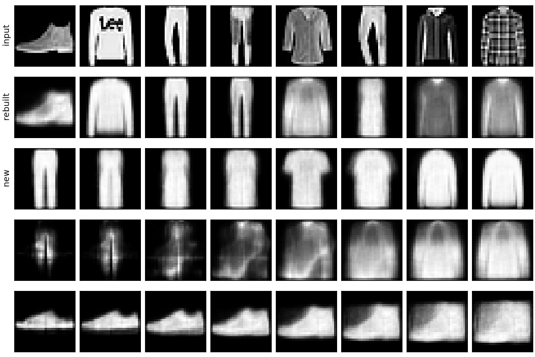

### 45.1 The autoencoder

An **autoencoder** is two networks trained together:

- an **encoder** squeezes the input x into a short vector z, the **code** (or **latent vector**);
- a **decoder** rebuilds the input from z, giving x̂.

The loss compares x̂ with x, so no labels are needed. Because z is much smaller than x (here 16 numbers for 784 pixels), the network can't simply copy: it has to learn a compact description that keeps what matters about the images.

```python
import time
import torch
from torch import nn
from torch.utils.data import DataLoader, TensorDataset
from torchvision import datasets

def fashion(train):
    raw = datasets.FashionMNIST(root="data", train=train, download=True)
    return raw.data.float().unsqueeze(1) / 255, raw.targets

X_train, y_train = fashion(True)
X_test, y_test = fashion(False)
loader = DataLoader(TensorDataset(X_train), batch_size=128, shuffle=True)

torch.manual_seed(0)
encoder = nn.Sequential(nn.Flatten(), nn.Linear(784, 256), nn.ReLU(), nn.Linear(256, 16))
decoder = nn.Sequential(nn.Linear(16, 256), nn.ReLU(), nn.Linear(256, 784), nn.Sigmoid(), nn.Unflatten(1, (1, 28, 28)))
optimizer = torch.optim.Adam(list(encoder.parameters()) + list(decoder.parameters()), lr=1e-3)

for epoch in range(5):
    for (x,) in loader:
        optimizer.zero_grad()
        loss = nn.functional.mse_loss(decoder(encoder(x)), x)
        loss.backward()
        optimizer.step()
with torch.no_grad():
    test_mse = nn.functional.mse_loss(decoder(encoder(X_test)), X_test).item()
print(f"test reconstruction error (MSE per pixel): {test_mse:.4f}   predicting the average image: {((X_test - X_train.mean(0)) ** 2).mean():.4f}")
```

**Output:**

```text
test reconstruction error (MSE per pixel): 0.0130   predicting the average image: 0.0866
```

The final `nn.Sigmoid` keeps outputs in [0, 1], like the pixels, and `nn.Unflatten(1, (1, 28, 28))` reshapes the 784 outputs back into an image. Sixteen numbers per image are enough to cut the error several times below the best constant guess.

Autoencoders are useful for compression, denoising (train with noisy inputs and clean targets) and **anomaly detection**: inputs unlike the training data reconstruct badly, so a high reconstruction error flags them.

### 45.2 Why a plain autoencoder can't generate

To **generate** a new image you'd pick a code z and decode it. But which z? The encoder places training images wherever is convenient, so the codes form an irregular cloud with gaps, at a scale nobody chose. A random z usually lands somewhere no training image was mapped, and decodes to a smudge. We need codes that fill a **known** region, from which we can sample.

### 45.3 The variational autoencoder

A **variational autoencoder** (**VAE**, 2013) makes two changes.

1. **The encoder outputs a distribution, not a point.** For each input it gives a mean μ and a log-variance log σ² for every latent number, and the code is **sampled** from that normal distribution: z ~ N(μ, σ²). Nearby codes must then decode to similar images, which fills the space smoothly.
2. **The loss pulls each distribution towards the standard normal N(0, 1)**, the **prior**, with a KL-divergence penalty (Chapter 43.3). After training, codes from the whole dataset roughly fill N(0, 1), so sampling z ~ N(0, 1) and decoding gives plausible new images.

```
loss = reconstruction(x̂, x) + KL( N(μ, σ²) ‖ N(0, 1) )
KL = ½ Σⱼ ( μⱼ² + σⱼ² − log σⱼ² − 1 )            summed over the latent numbers
```

The KL term is 0 exactly when μ = 0 and σ = 1, and grows as a code's distribution moves away or shrinks. The two terms pull against each other: reconstruction wants precise, well-separated codes; KL wants them all overlapping at the origin.

<details>
<summary><b>Derivation of the KL term</b></summary>

For one dimension, KL(p ‖ q) = E_p[log p(z) − log q(z)] with p = N(μ, σ²) and q = N(0, 1):

log p(z) = −½ log(2πσ²) − (z − μ)²/(2σ²),   log q(z) = −½ log(2π) − z²/2.

Under p, E[(z − μ)²] = σ² and E[z²] = σ² + μ². So

KL = −½ log σ² − ½ + ½(σ² + μ²) = ½(μ² + σ² − log σ² − 1).

The latent numbers are independent, so their KLs add.

</details>

### 45.4 The reparameterisation trick

Sampling is random, and you can't backpropagate through "draw a random number". The fix is to move the randomness outside the network: draw ε ~ N(0, 1), then compute

```
z = μ + σ · ε
```

z has exactly the distribution N(μ, σ²), but now it's an ordinary differentiable function of μ and σ, with ε just an input: ∂z/∂μ = 1 and ∂z/∂σ = ε. Gradients flow to the encoder as usual. This is the **reparameterisation trick**.

A traced example for one latent number: μ = 0.5, log σ² = −0.5, so σ² = e^{−0.5} = 0.607; KL = ½(0.25 + 0.607 + 0.5 − 1) = 0.178.

```python
class VAE(nn.Module):
    def __init__(self, z_dim=2):
        super().__init__()
        self.body = nn.Sequential(nn.Flatten(), nn.Linear(784, 400), nn.ReLU())
        self.mu = nn.Linear(400, z_dim)
        self.logvar = nn.Linear(400, z_dim)
        self.decoder = nn.Sequential(nn.Linear(z_dim, 400), nn.ReLU(), nn.Linear(400, 784), nn.Sigmoid(),
                                     nn.Unflatten(1, (1, 28, 28)))

    def forward(self, x):
        h = self.body(x)
        mu, logvar = self.mu(h), self.logvar(h)
        z = mu + torch.exp(0.5 * logvar) * torch.randn_like(mu)          # reparameterisation trick
        return self.decoder(z), mu, logvar

def vae_loss(x_hat, x, mu, logvar):
    recon = nn.functional.binary_cross_entropy(x_hat, x, reduction="sum") / len(x)
    kl = 0.5 * (mu ** 2 + logvar.exp() - logvar - 1).sum() / len(x)
    return recon + kl, recon, kl

print("traced KL:", round(0.5 * (0.5 ** 2 + torch.exp(torch.tensor(-0.5)).item() + 0.5 - 1), 3))
```

**Output:**

```text
traced KL: 0.178
```

σ = exp(½ log σ²): predicting the log-variance lets the encoder output any real number while σ stays positive. The reconstruction term is binary cross-entropy over the pixels (treating each pixel's brightness as a probability), summed per image so that it's on the same scale as the KL. With only **2** latent numbers, so that we can draw the space:

```python
torch.manual_seed(0)
vae = VAE(z_dim=2)
optimizer = torch.optim.Adam(vae.parameters(), lr=1e-3)
start = time.time()
for epoch in range(1, 9):
    for (x,) in loader:
        optimizer.zero_grad()
        x_hat, mu, logvar = vae(x)
        loss, recon, kl = vae_loss(x_hat, x, mu, logvar)
        loss.backward()
        optimizer.step()
    if epoch in (1, 8):
        print(f"epoch {epoch}: loss {loss.item():.1f} = reconstruction {recon.item():.1f} + KL {kl.item():.2f}")
print(f"trained in {time.time() - start:.0f} s")
```

**Output:**

```text
epoch 1: loss 284.7 = reconstruction 278.5 + KL 6.15
epoch 8: loss 256.5 = reconstruction 249.5 + KL 7.02
trained in 5 s
```

### 45.5 Generating

Decode points of the standard normal, and look at where the classes landed:

```python
vae.eval()
with torch.no_grad():
    mu_test = vae.mu(vae.body(X_test))
print("codes of the test set: mean", [round(v, 2) for v in mu_test.mean(0).tolist()],
      "std", [round(v, 2) for v in mu_test.std(0).tolist()])
names = datasets.FashionMNIST(root="data", train=False).classes
for c in [1, 7, 8]:
    print(f"average code of {names[c]!r}: {[round(v, 2) for v in mu_test[y_test == c].mean(0).tolist()]}")
```

**Output:**

```text
codes of the test set: mean [0.26, 0.24] std [1.26, 1.4]
average code of 'Trouser': [-1.81, 1.3]
average code of 'Sneaker': [-0.62, -1.81]
average code of 'Bag': [1.51, -0.95]
```

The codes roughly fill N(0, 1), as the KL term asked, and the classes occupy different regions, which the VAE found without labels. The picture at the top decodes a grid of points: most give plausible garments, and neighbouring points give similar ones. Points between clusters decode to blurry mixtures, and VAE images are generally blurry: averaging over the uncertainty in z smooths the details. Sharper generators came next (Chapters 46–47), but the VAE survives in a key role: compressing images into the latent space where modern diffusion models work (Chapter 48).

### 45.6 Summary

```
autoencoder:  z = enc(x), x̂ = dec(z);  loss = reconstruction(x̂, x)
VAE:          enc(x) → μ, log σ²;  z = μ + σ·ε, ε ~ N(0, 1)  (reparameterisation)
              loss = reconstruction + ½ Σ (μ² + σ² − log σ² − 1)
generate:     z ~ N(0, 1) → dec(z)
```

**Key terms:**

- **Autoencoder:** an encoder and a decoder trained together to reconstruct their input through a small code.
- **Latent vector (code, z):** the compressed representation an encoder produces.
- **Latent space:** the space of all possible codes.
- **Reconstruction error:** how different the rebuilt input is from the original.
- **Anomaly detection:** finding inputs unlike the training data, for example by high reconstruction error.
- **Variational autoencoder (VAE):** an autoencoder whose encoder outputs a distribution, trained with a KL penalty so that sampling from a standard normal generates new data.
- **Prior:** the distribution the latent codes are pushed towards, here N(0, 1).
- **Reparameterisation trick:** writing a random sample as z = μ + σε so gradients can flow through μ and σ.

### Exercises

1. Compute the KL term for μ = 0, log σ² = 0, and for μ = 2, log σ² = 0. Which code is penalised, and why?
2. Generate 8 new images by sampling z ~ N(0, 1) and decoding. Are they sharp?

<details>
<summary><b>Answers</b></summary>

```python
for m, lv in [(0.0, 0.0), (2.0, 0.0)]:
    print(f"μ = {m}, log σ² = {lv}: KL = {0.5 * (m ** 2 + 1.0 - lv - 1):.1f}")
torch.manual_seed(1)
with torch.no_grad():
    new = vae.decoder(torch.randn(8, 2))
print(new.shape, "pixel range", round(new.min().item(), 2), "to", round(new.max().item(), 2))
```

**Output:**

```text
μ = 0.0, log σ² = 0.0: KL = 0.0
μ = 2.0, log σ² = 0.0: KL = 2.0
torch.Size([8, 1, 28, 28]) pixel range 0.0 to 0.73
```

1. 0 for the standard normal itself and 2.0 for a code centred at μ = 2: codes far from the origin pay a penalty, which keeps the whole latent space near N(0, 1).
2. They're recognisable garments, but soft-edged: the VAE's blurriness (draw them with `plt.imshow` to see).

</details>

| # | Problem (Deep-ML) | Difficulty |
|---|---|---|
| 1 | [56. KL Divergence Between Two Normal Distributions](https://www.deep-ml.com/problems/56) | 🟢 Easy |

**Learn more:** [Kingma & Welling, Auto-Encoding Variational Bayes](https://arxiv.org/abs/1312.6114)

<details>
<summary><b>Code for the chart at the top</b></summary>

```python
import matplotlib.pyplot as plt

with torch.no_grad():
    rebuilt = vae.decoder(vae.mu(vae.body(X_test[:8])))
    grid = torch.tensor([[a, b] for b in torch.linspace(2, -2, 3) for a in torch.linspace(-2, 2, 8)])
    generated = vae.decoder(grid)
fig, axes = plt.subplots(5, 8, figsize=(9, 6), layout="constrained")
for k in range(8):
    axes[0, k].imshow(X_test[k, 0], cmap="gray")
    axes[1, k].imshow(rebuilt[k, 0], cmap="gray")
for k in range(24):
    axes[2 + k // 8, k % 8].imshow(generated[k, 0], cmap="gray")
for ax in axes.flat:
    ax.set(xticks=[], yticks=[])
axes[0, 0].set_ylabel("input"); axes[1, 0].set_ylabel("rebuilt"); axes[2, 0].set_ylabel("new")
fig.savefig("autoencoder-digits.png", dpi=100)
plt.close(fig)
```

</details>

---

## 46. Generative Adversarial Networks (GANs)

**You need:** Chapters 6, 14 and 45. · **You'll learn:** how two networks trained against each other, a generator and a discriminator, learn to produce realistic samples, and why that training is unstable.

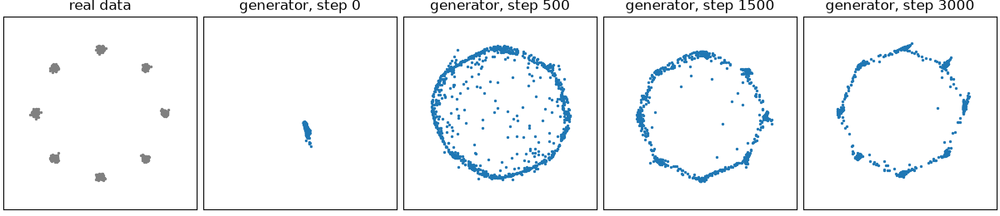

### 46.1 The idea: a forger and a detective

A VAE generates by reconstructing, and comes out blurry. A **generative adversarial network** (**GAN**, Goodfellow et al., 2014) learns differently, through a contest between two networks:

- the **generator** G turns random noise z into a sample G(z), and tries to make its samples look real;
- the **discriminator** D looks at a sample and outputs the probability that it's real rather than generated.

D is trained to tell real from fake; G is trained to fool D. As D gets better at spotting fakes, G must make better fakes, until (ideally) its samples can't be told apart from real data. Nobody ever writes down what "realistic" means: the discriminator learns it.

### 46.2 The losses

D is an ordinary binary classifier (Chapter 6.3), with label 1 for real and 0 for generated:

```
L_D = −[ log D(x) + log(1 − D(G(z))) ]          x real, z random
```

G wants D(G(z)) to be 1. Minimising log(1 − D(G(z))) is the textbook objective, but early in training D easily rejects G's samples, D(G(z)) ≈ 0, and that log is flat there, so G gets almost no gradient. In practice G minimises the **non-saturating** loss instead, which has the same goal and a strong gradient exactly when G is doing badly:

```
L_G = −log D(G(z))          "make D call my samples real"
```

Both are binary cross-entropy, so with D outputting a logit, `BCEWithLogitsLoss` computes them (Chapter 14.1): L_D against labels 1 (real) and 0 (fake), L_G against label 1 for the fakes.

### 46.3 Training

Training alternates two steps on every batch:

1. **Discriminator step:** compute L_D on a real batch and a generated batch, and update D only. The generated batch is `.detach()`ed (Chapter 12.5), so no gradient flows into G.
2. **Generator step:** compute L_G, backpropagate **through** D into G, and update G only.

The data: 8 small clusters of points arranged on a ring. Two dimensions keep training fast and let us see every sample:

```python
import math
import torch
from torch import nn

def real_batch(n, generator):
    k = torch.randint(0, 8, (n,), generator=generator)                       # which cluster
    angle = 2 * math.pi * k / 8
    centres = 2 * torch.stack([torch.cos(angle), torch.sin(angle)], dim=1)
    return centres + 0.05 * torch.randn(n, 2, generator=generator)

def clusters_covered(samples):
    """How many of the 8 clusters have at least one sample near them."""
    angle = torch.atan2(samples[:, 1], samples[:, 0]) % (2 * math.pi)
    near_ring = (samples.norm(dim=1) - 2).abs() < 0.5
    return len(set(((angle[near_ring] / (2 * math.pi / 8)).round() % 8).int().tolist()))
```

`torch.atan2(y, x)` gives each point's angle around the origin. Two small MLPs; the discriminator uses **LeakyReLU** (Chapter 4, Exercise 1), a common choice for GAN discriminators. Adam with β₁ = 0.5 instead of 0.9 is the standard GAN setting: less momentum suits a target that keeps moving:

```python
torch.manual_seed(0)
gen = torch.Generator().manual_seed(0)
G = nn.Sequential(nn.Linear(2, 128), nn.ReLU(), nn.Linear(128, 128), nn.ReLU(), nn.Linear(128, 2))
D = nn.Sequential(nn.Linear(2, 128), nn.LeakyReLU(0.2), nn.Linear(128, 128), nn.LeakyReLU(0.2), nn.Linear(128, 1))
opt_G = torch.optim.Adam(G.parameters(), lr=1e-3, betas=(0.5, 0.999))
opt_D = torch.optim.Adam(D.parameters(), lr=1e-3, betas=(0.5, 0.999))
bce = nn.BCEWithLogitsLoss()
real_label, fake_label = torch.ones(256, 1), torch.zeros(256, 1)
fixed_z = torch.randn(1000, 2, generator=gen)                                 # to watch the same noise over time
snapshots = {}

for step in range(3001):
    x, z = real_batch(256, gen), torch.randn(256, 2, generator=gen)
    fake = G(z)
    # 1. discriminator step
    opt_D.zero_grad()
    loss_D = bce(D(x), real_label) + bce(D(fake.detach()), fake_label)
    loss_D.backward()
    opt_D.step()
    # 2. generator step
    opt_G.zero_grad()
    loss_G = bce(D(fake), real_label)                                          # non-saturating: "call it real"
    loss_G.backward()
    opt_G.step()
    if step in (0, 500, 1500, 3000):
        with torch.no_grad():
            snapshots[step] = G(fixed_z)
        print(f"step {step:4d}: D loss {loss_D.item():.3f}, G loss {loss_G.item():.3f}, clusters covered {clusters_covered(snapshots[step])}/8")
```

**Output:**

```text
step    0: D loss 1.372, G loss 0.709, clusters covered 0/8
step  500: D loss 1.239, G loss 0.921, clusters covered 8/8
step 1500: D loss 1.192, G loss 1.031, clusters covered 8/8
step 3000: D loss 1.263, G loss 1.015, clusters covered 8/8
```

Neither loss goes to 0, and they don't tell you much on their own: each network's loss depends on how good the **other** one is. That's the first practical difficulty of GANs. The picture at the top shows the samples at each snapshot. By step 500 they reach all 8 clusters, and by step 3,000 they gather on them, though thin bridges of samples remain in between. The generator is a smooth function of smooth noise, so it struggles to jump cleanly from one separate cluster to the next.

### 46.4 Why GANs are hard to train

- **No loss to watch.** GAN training is a two-player game, not a minimisation. The losses bounce around, and a falling generator loss can mean either a better generator or a weaker discriminator. People judge progress by looking at samples, or with sample-quality scores such as **FID** (Fréchet inception distance, which compares statistics of real and generated images' features).
- **Mode collapse.** The generator can find a few outputs that fool D and produce only those, here a few of the 8 clusters instead of all of them. D eventually learns to reject them, G jumps to others, and the pair can chase each other in circles.
- **Instability.** If D becomes too good, G's gradients vanish; if too weak, G learns nothing useful. Balancing them took years of tricks: careful architectures (DCGAN), spectral normalisation, Wasserstein losses.

### 46.5 Where GANs stand

From 2014 to about 2021, GANs made the sharpest images: StyleGAN's photorealistic faces, image-to-image translation, super-resolution. Diffusion models (Chapter 47) then overtook them in quality and diversity, with far more stable training. GANs survive where their one-step generation speed matters: real-time super-resolution, audio **vocoders** (HiFi-GAN turns spectrograms into speech), and as an extra **adversarial loss** that sharpens the decoders of image and audio autoencoders, including those inside latent diffusion models.

### 46.6 Summary

```
D: binary classifier, real (1) vs generated (0);   L_D = BCE(D(x), 1) + BCE(D(G(z).detach()), 0)
G: noise → sample;   L_G = BCE(D(G(z)), 1)    (non-saturating)
each step: update D on real + fake, then update G through D
problems: no meaningful loss curve, mode collapse, instability
```

**Key terms:**

- **Generative model:** a model that produces new samples resembling its training data.
- **Generative adversarial network (GAN):** a generator and a discriminator trained against each other.
- **Generator:** the network that turns random noise into samples.
- **Discriminator:** the network that classifies samples as real or generated.
- **Non-saturating loss:** the generator loss −log D(G(z)), which gives strong gradients when the generator is poor.
- **Mode collapse:** a generator producing only a few kinds of output instead of the full variety of the data.
- **FID (Fréchet inception distance):** a score comparing the feature statistics of real and generated images; lower is better.
- **LeakyReLU:** max(az, z) with a small slope a for negative inputs.

### Exercises

1. Early in training D(G(z)) ≈ 0.01. Compare the slope of the textbook generator loss log(1 − D) with that of −log D, with respect to D, at that point.
2. Why is the fake batch detached in the discriminator step but not in the generator step?

<details>
<summary><b>Answers</b></summary>

```python
d = torch.tensor(0.01, requires_grad=True)
torch.log(1 - d).backward()
print("slope of log(1 − D):", round(d.grad.item(), 3))
d.grad = None
(-torch.log(d)).backward()
print("slope of −log D:    ", round(d.grad.item(), 1))
```

**Output:**

```text
slope of log(1 − D): -1.01
slope of −log D:     -100.0
```

1. About −1 for log(1 − D), against −100 for −log D: the non-saturating loss pushes a hundred times harder exactly when the generator is losing badly.
2. In the discriminator step only D should change, so the graph into G is cut. In the generator step the gradient must flow through D back into G: that's how G learns what D considers real (D's weights get gradients too, but only `opt_G.step()` is called, and D's gradients are reset by `opt_D.zero_grad()` before its next step).

</details>

| # | Problem (Deep-ML) | Difficulty |
|---|---|---|
| 1 | [174. Train a Simple GAN on 1D Gaussian Data](https://www.deep-ml.com/problems/174) | 🔴 Hard |

**Learn more:** [Goodfellow et al., Generative Adversarial Networks](https://arxiv.org/abs/1406.2661)

<details>
<summary><b>Code for the chart at the top</b></summary>

```python
import matplotlib.pyplot as plt

fig, axes = plt.subplots(1, 5, figsize=(12, 2.6), layout="constrained")
axes[0].scatter(*real_batch(1000, gen).T, s=2, color="gray")
axes[0].set_title("real data")
for ax, (step, samples) in zip(axes[1:], snapshots.items()):
    ax.scatter(*samples.T, s=2)
    ax.set_title(f"generator, step {step}")
for ax in axes:
    ax.set(xlim=(-3, 3), ylim=(-3, 3), xticks=[], yticks=[], aspect="equal")
fig.savefig("gan-2d.png", dpi=100)
plt.close(fig)
```

</details>

---

## 47. Diffusion Models from Scratch

**You need:** Chapters 34.4, 45 and 46. · **You'll learn:** the idea behind today's image and video generators: add noise step by step until data becomes pure noise, train a network to undo one step, then generate by denoising from scratch. Every formula is derived, and a complete model is trained on 2-D data.

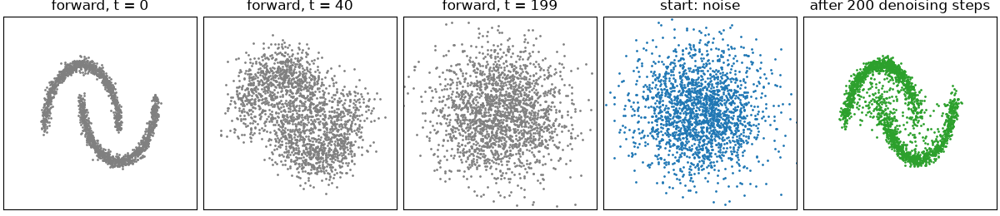

### 47.1 The idea

Turning data into noise is easy: keep adding a little random noise and any image dissolves into static. A **diffusion model** learns to run that process **backwards**. If a network can take a slightly noisy sample and remove a little of the noise, then starting from pure noise and applying it many times produces a brand-new sample from the data distribution.

Each denoising step is a simple regression problem with a fixed target, so training is as stable as ordinary supervised learning: no adversary, no mode collapse. That, plus excellent sample quality and diversity, is why diffusion overtook GANs around 2021.

### 47.2 The forward process

Over T steps (here T = 200), each step shrinks the data slightly and adds a little Gaussian noise:

```
x_t = √(1 − β_t) · x_{t−1} + √β_t · ε,        ε ~ N(0, I)
```

The **noise schedule** β_1, …, β_T is a list of small numbers, here rising linearly from 0.0001 to 0.04. The shrinking factor √(1 − β_t) is chosen so that, if x_{t−1} has variance 1, so does x_t: (1 − β_t) + β_t = 1. The data never blows up; it just turns into noise.

Crucially, you can jump straight to **any** step t without simulating the ones before. With α_t = 1 − β_t and ᾱ_t = α_1 · α_2 · … · α_t (the fraction of the original signal's variance left):

```
x_t = √ᾱ_t · x_0 + √(1 − ᾱ_t) · ε
```

<details>
<summary><b>Derivation for two steps (the general case follows the same way)</b></summary>

x_1 = √α_1 x_0 + √(1 − α_1) ε_1 and x_2 = √α_2 x_1 + √(1 − α_2) ε_2. Substitute:

x_2 = √(α_1α_2) x_0 + √α_2 √(1 − α_1) ε_1 + √(1 − α_2) ε_2.

The last two terms are independent Gaussians with mean 0, so their sum is a Gaussian whose variance is the sum of the variances: α_2(1 − α_1) + (1 − α_2) = 1 − α_1α_2. So x_2 = √ᾱ_2 x_0 + √(1 − ᾱ_2) ε with ᾱ_2 = α_1α_2. Repeating the argument adds one factor α_t per step.

</details>

Traced: if ᾱ_t = 0.64, then x_t = 0.8 · x_0 + 0.6 · ε. For x_0 = (1, 0) and ε = (0.5, −1): x_t = (0.8 + 0.3, 0 − 0.6) = (1.1, −0.6).

```python
import math, time
import torch
from torch import nn

T = 200
betas = torch.linspace(1e-4, 0.04, T)
alphas = 1 - betas
alpha_bar = torch.cumprod(alphas, dim=0)                       # ᾱ_t = α_1 · … · α_t
print("signal left ᾱ_t at t = 0, 50, 100, 199:", [round(alpha_bar[t].item(), 3) for t in (0, 50, 100, 199)])
print("traced:", [round(v, 2) for v in (0.8 * torch.tensor([1.0, 0.0]) + 0.6 * torch.tensor([0.5, -1.0])).tolist()])
```

**Output:**

```text
signal left ᾱ_t at t = 0, 50, 100, 199: [1.0, 0.77, 0.357, 0.017]
traced: [1.1, -0.6]
```

`torch.cumprod` gives running products. By the last step about 2% of the signal's variance remains: x_T is essentially pure noise.

### 47.3 What the network learns

The network ε_θ(x_t, t) gets a noisy sample and its step number, and predicts the **noise** ε that was mixed in. Training is plain regression:

1. Take a real x_0, a random step t, and fresh noise ε.
2. Make x_t = √ᾱ_t x_0 + √(1 − ᾱ_t) ε in one jump (47.2).
3. Loss = ‖ε_θ(x_t, t) − ε‖², the mean squared error.

Why predict the noise rather than the clean data? They're equivalent: given x_t and a noise estimate ε̂, the formula of 47.2 rearranges to an estimate of the clean data, x̂_0 = (x_t − √(1 − ᾱ_t) ε̂)/√ᾱ_t. Predicting ε has the convenient property that the target always has the same scale (variance 1) at every t, which makes training easy.

The network must know t, since the right amount of denoising depends on how noisy the input is. The step number is turned into a vector with the sinusoidal encoding of Chapter 34.4 and concatenated with x_t.

### 47.4 Train it on two moons

Two interleaved half-circles, 20,000 points, standardised:

```python
gen = torch.Generator().manual_seed(0)
n = 20_000
moon = torch.randint(0, 2, (n,), generator=gen)                           # which moon
theta = torch.rand(n, generator=gen) * math.pi
x = torch.where(moon == 0, torch.cos(theta), 1 - torch.cos(theta))
y = torch.where(moon == 0, torch.sin(theta), 0.5 - torch.sin(theta))
data = torch.stack([x, y], dim=1) + 0.05 * torch.randn(n, 2, generator=gen)
data = (data - data.mean(0)) / data.std(0)

def time_embedding(t, dim=32):
    freqs = torch.exp(-math.log(10000) * torch.arange(dim // 2) / (dim // 2))
    angles = t[:, None].float() * freqs[None]
    return torch.cat([angles.sin(), angles.cos()], dim=1)

class Denoiser(nn.Module):
    def __init__(self):
        super().__init__()
        self.net = nn.Sequential(nn.Linear(2 + 32, 128), nn.SiLU(), nn.Linear(128, 128), nn.SiLU(),
                                 nn.Linear(128, 128), nn.SiLU(), nn.Linear(128, 2))

    def forward(self, x, t):
        return self.net(torch.cat([x, time_embedding(t)], dim=1))            # predicted noise
```

`torch.where(condition, a, b)` picks from a where the condition holds and from b elsewhere. `nn.SiLU` is the activation of Chapter 4.4. The training loop is the three steps of 47.3:

```python
torch.manual_seed(0)
model = Denoiser()
optimizer = torch.optim.Adam(model.parameters(), lr=1e-3)
start = time.time()
for step in range(6000):
    x0 = data[torch.randint(n, (256,))]
    t = torch.randint(0, T, (256,))
    eps = torch.randn_like(x0)
    xt = alpha_bar[t].sqrt()[:, None] * x0 + (1 - alpha_bar[t]).sqrt()[:, None] * eps
    optimizer.zero_grad()
    loss = ((model(xt, t) - eps) ** 2).mean()
    loss.backward()
    optimizer.step()
    if step in (0, 2000, 5999):
        print(f"step {step:4d}: noise-prediction MSE {loss.item():.3f}")
print(f"trained in {time.time() - start:.0f} s")
```

**Output:**

```text
step    0: noise-prediction MSE 1.092
step 2000: noise-prediction MSE 0.367
step 5999: noise-prediction MSE 0.349
trained in 4 s
```

The loss can't approach 0: at large t the input is nearly pure noise, and there the noise is easy to predict (it **is** the input), but at small t the tiny amount of noise is hard to separate from the data. The average settles well below 1, the error of always predicting 0.

### 47.5 Sampling: run it backwards

Start from pure noise x_T ~ N(0, I) and, for t = T, …, 1, remove a little of the predicted noise and add back a smaller amount of fresh noise. The **DDPM** update (denoising diffusion probabilistic models, Ho et al., 2020) is:

```
x_{t−1} = ( x_t − β_t / √(1 − ᾱ_t) · ε_θ(x_t, t) ) / √α_t  +  √β_t · z,        z ~ N(0, I), none at the last step
```

The first part takes the step's share of the predicted noise out and undoes the shrinking; the fresh noise keeps the samples varied instead of all collapsing onto the most likely points. (The exact coefficients come from the probability of x_{t−1} given x_t and x_0, which is Gaussian; the derivation is in the DDPM paper.)

```python
@torch.no_grad()
def sample(model, n=2000, seed=0):
    g = torch.Generator().manual_seed(seed)
    x = torch.randn(n, 2, generator=g)                                       # pure noise
    for t in reversed(range(T)):
        eps_hat = model(x, torch.full((n,), t))
        x = (x - betas[t] / (1 - alpha_bar[t]).sqrt() * eps_hat) / alphas[t].sqrt()
        if t > 0:
            x = x + betas[t].sqrt() * torch.randn(x.shape, generator=g)
    return x

samples = sample(model)
real = data[:2000]
closest = lambda a, b: torch.cdist(a, b).min(dim=1).values.mean().item()     # average distance to the nearest real point
print(f"generated points: {closest(samples, real):.3f} from the nearest real point (pure noise: {closest(torch.randn(2000, 2), real):.3f})")
landed_on = moon[:2000][torch.cdist(samples, real).argmin(dim=1)]
print("share of samples on each moon:", [round(v, 2) for v in (torch.bincount(landed_on, minlength=2).float() / 2000).tolist()])
```

**Output:**

```text
generated points: 0.042 from the nearest real point (pure noise: 0.256)
share of samples on each moon: [0.55, 0.45]
```

`torch.cdist(a, b)` gives every pairwise distance. Starting from noise, 200 small denoising steps put the points on the moons, and on **both** moons in roughly equal shares, with no mode collapse.

### 47.6 From moons to images

Image diffusion models are this exact recipe, with two changes in scale:

- **The denoiser** is a large network over millions of pixel values: originally a **U-Net** (Chapter 28.5) with attention layers, now increasingly a transformer over image patches, a **diffusion transformer** (**DiT**), as in Chapter 38.
- **Fewer sampling steps.** DDPM needed about 1,000 steps per image. **DDIM** and other samplers take bigger, deterministic steps and need 20–50. **Flow matching**, used in Stable Diffusion 3 and FLUX, learns a velocity that carries noise to data along nearly straight paths, which needs fewer steps still; distillation methods get down to 1–4.

Chapter 48 adds the two ingredients that make text-to-image generation work: conditioning with guidance, and running diffusion in a compressed latent space.

### 47.7 Summary

```
forward:   x_t = √ᾱ_t x_0 + √(1 − ᾱ_t) ε,   ᾱ_t = Π (1 − β_s)
train:     t ~ U{1..T}, ε ~ N(0, I);   loss = ‖ε_θ(x_t, t) − ε‖²
sample:    x_T ~ N(0, I);   x_{t−1} = (x_t − β_t/√(1 − ᾱ_t) · ε_θ)/√α_t + √β_t z
```

**Key terms:**

- **Diffusion model:** a generative model trained to reverse a gradual noising process.
- **Forward process:** the fixed process that adds noise to data step by step until it's pure noise.
- **Reverse process:** generating data by removing noise step by step, starting from pure noise.
- **Noise schedule (β_t):** how much noise each forward step adds.
- **ᾱ_t (alpha-bar):** the product of (1 − β) up to step t: the fraction of the original signal's variance left.
- **Noise prediction (ε-prediction):** training the network to predict the noise that was added.
- **DDPM:** the standard diffusion training and sampling method of Ho et al. (2020).
- **U-Net:** an encoder–decoder CNN with skip connections, the classic diffusion denoiser.
- **Diffusion transformer (DiT):** a transformer used as the denoiser of a diffusion model.
- **Flow matching:** training a model to move noise to data along a learned velocity field, a close relative of diffusion.

### Exercises

1. Show numerically that x_t made by 50 single steps has the same spread as the one-jump formula of 47.2.
2. Sample with only every 10th step (20 steps, using the same update). How good are the samples now?

<details>
<summary><b>Answers</b></summary>

```python
torch.manual_seed(0)
x0 = data[:5000]
xt = x0.clone()
for t in range(50):
    xt = alphas[t].sqrt() * xt + betas[t].sqrt() * torch.randn_like(xt)
jump = alpha_bar[49].sqrt() * x0 + (1 - alpha_bar[49]).sqrt() * torch.randn_like(x0)
print("std after 50 steps:", [round(v, 3) for v in xt.std(0).tolist()], "  one jump:", [round(v, 3) for v in jump.std(0).tolist()])

@torch.no_grad()
def sample_coarse(model, n=2000, every=10):
    x = torch.randn(n, 2, generator=torch.Generator().manual_seed(0))
    for t in reversed(range(0, T, every)):
        eps_hat = model(x, torch.full((n,), t))
        x = (x - betas[t] / (1 - alpha_bar[t]).sqrt() * eps_hat) / alphas[t].sqrt()
    return x
print(f"20 naive steps: {closest(sample_coarse(model), real):.3f} from the nearest real point")
```

**Output:**

```text
std after 50 steps: [0.995, 1.001]   one jump: [0.995, 0.998]
20 naive steps: 0.153 from the nearest real point
```

1. The spreads agree to within sampling noise: 50 small steps and one jump give the same distribution.
2. Much worse: each DDPM step only removes one small step's share of the noise, so skipping steps leaves most of it in. Samplers that skip steps, such as DDIM, use different update formulas designed for big jumps.

</details>

**Learn more:** [Ho et al., Denoising Diffusion Probabilistic Models](https://arxiv.org/abs/2006.11239) · [Lilian Weng: What are Diffusion Models?](https://lilianweng.github.io/posts/2021-07-11-diffusion-models/)

<details>
<summary><b>Code for the chart at the top</b></summary>

```python
import matplotlib.pyplot as plt

fig, axes = plt.subplots(1, 5, figsize=(12, 2.6), layout="constrained")
for ax, t in zip(axes[:3], (0, 40, 199)):
    noisy = alpha_bar[t].sqrt() * real + (1 - alpha_bar[t]).sqrt() * torch.randn_like(real)
    ax.scatter(*noisy.T, s=1, color="gray")
    ax.set_title(f"forward, t = {t}")
axes[3].scatter(*torch.randn(2000, 2).T, s=1)
axes[3].set_title("start: pure noise")
axes[4].scatter(*samples.T, s=1, color="C2")
axes[4].set_title("after 200 denoising steps")
for ax in axes:
    ax.set(xlim=(-3, 3), ylim=(-3, 3), xticks=[], yticks=[], aspect="equal")
fig.savefig("diffusion-moons.png", dpi=100)
plt.close(fig)
```

</details>

---

## 48. Conditioning, Guidance and Latent Diffusion

**You need:** Chapters 40.4, 44, 45 and 47. · **You'll learn:** how a diffusion model generates what you ask for (conditioning and classifier-free guidance, built and measured on 2-D data), and how latent diffusion makes high-resolution images affordable.


### 48.1 Conditioning

The model of Chapter 47 generates **some** sample from the data. To generate a sample of a particular kind ("a moon-1 point", "a cat", "a watercolour of a lighthouse"), give the denoiser a **condition** c as an extra input, and train on (data, condition) pairs:

```
loss = ‖ε_θ(x_t, t, c) − ε‖²
```

The network then learns to denoise towards samples that match c. For a class label, c can be an embedding (Chapter 30) added to the input; for a text prompt, the text encoder's vectors (CLIP or T5, Chapters 40 and 44) are read through cross-attention (Chapter 40.4).

### 48.2 Classifier-free guidance

A conditional model often follows its condition only loosely. **Classifier-free guidance** (**CFG**, 2022) strengthens it with one trick in training and one at sampling:

- **Training:** replace the condition with a special "no condition" token ∅ at random, 10–20% of the time. The same network then learns both the conditional prediction ε_θ(x_t, t, c) and the unconditional one ε_θ(x_t, t, ∅).
- **Sampling:** compute both, and move further in the direction the condition points:

```
ε̂ = ε_θ(x_t, t, ∅) + w · ( ε_θ(x_t, t, c) − ε_θ(x_t, t, ∅) )
```

The difference ε_θ(c) − ε_θ(∅) is what knowing the condition changes. w = 0 ignores the condition, w = 1 is the plain conditional model, and w > 1 exaggerates the condition's effect. Text-to-image models typically use w around 3 to 8: images match the prompt much better, at the cost of some variety and realism.

### 48.3 Build it

The two moons of Chapter 47, with each point's moon (0 or 1) as its condition, and 2 standing for ∅:

```python
import math
import torch
from torch import nn

T = 200
betas = torch.linspace(1e-4, 0.04, T)
alphas = 1 - betas
alpha_bar = torch.cumprod(alphas, dim=0)

gen = torch.Generator().manual_seed(0)
n = 20_000
moon = torch.randint(0, 2, (n,), generator=gen)
theta = torch.rand(n, generator=gen) * math.pi
x = torch.where(moon == 0, torch.cos(theta), 1 - torch.cos(theta))
y = torch.where(moon == 0, torch.sin(theta), 0.5 - torch.sin(theta))
data = torch.stack([x, y], dim=1) + 0.05 * torch.randn(n, 2, generator=gen)
data = (data - data.mean(0)) / data.std(0)
NULL = 2                                                                    # the "no condition" class

def time_embedding(t, dim=32):
    freqs = torch.exp(-math.log(10000) * torch.arange(dim // 2) / (dim // 2))
    angles = t[:, None].float() * freqs[None]
    return torch.cat([angles.sin(), angles.cos()], dim=1)

class CondDenoiser(nn.Module):
    def __init__(self):
        super().__init__()
        self.cond = nn.Embedding(3, 32)                                     # moon 0, moon 1, ∅
        self.net = nn.Sequential(nn.Linear(2 + 32 + 32, 128), nn.SiLU(), nn.Linear(128, 128), nn.SiLU(),
                                 nn.Linear(128, 128), nn.SiLU(), nn.Linear(128, 2))

    def forward(self, x, t, c):
        return self.net(torch.cat([x, time_embedding(t), self.cond(c)], dim=1))
```

Training is Chapter 47's loop, plus the random dropping of the condition:

```python
torch.manual_seed(0)
model = CondDenoiser()
optimizer = torch.optim.Adam(model.parameters(), lr=1e-3)
for step in range(6000):
    idx = torch.randint(n, (256,))
    x0, c = data[idx], moon[idx].clone()
    c[torch.rand(256) < 0.15] = NULL                                        # drop the condition 15% of the time
    t = torch.randint(0, T, (256,))
    eps = torch.randn_like(x0)
    xt = alpha_bar[t].sqrt()[:, None] * x0 + (1 - alpha_bar[t]).sqrt()[:, None] * eps
    optimizer.zero_grad()
    loss = ((model(xt, t, c) - eps) ** 2).mean()
    loss.backward()
    optimizer.step()
print(f"final noise-prediction MSE {loss.item():.3f}")
```

**Output:**

```text
final noise-prediction MSE 0.324
```

Sampling with guidance scale w combines the two predictions at every step:

```python
@torch.no_grad()
def sample(cls, w, n=1000, seed=0):
    g = torch.Generator().manual_seed(seed)
    x = torch.randn(n, 2, generator=g)
    c, null = torch.full((n,), cls), torch.full((n,), NULL)
    for t in reversed(range(T)):
        tt = torch.full((n,), t)
        e_uncond = model(x, tt, null)
        eps_hat = e_uncond + w * (model(x, tt, c) - e_uncond)              # classifier-free guidance
        x = (x - betas[t] / (1 - alpha_bar[t]).sqrt() * eps_hat) / alphas[t].sqrt()
        if t > 0:
            x = x + betas[t].sqrt() * torch.randn(x.shape, generator=g)
    return x

def on_target(samples, cls):
    """Share of samples whose nearest real point belongs to the requested moon."""
    nearest = torch.cdist(samples, data[:4000]).argmin(dim=1)
    return (moon[:4000][nearest] == cls).float().mean().item()

for w in [0.0, 1.0, 4.0]:
    print(f"asking for moon 1, guidance scale {w}: {on_target(sample(1, w), 1):.1%} of samples land on moon 1")
```

**Output:**

```text
asking for moon 1, guidance scale 0.0: 45.2% of samples land on moon 1
asking for moon 1, guidance scale 1.0: 100.0% of samples land on moon 1
asking for moon 1, guidance scale 4.0: 100.0% of samples land on moon 1
```

At w = 0 the condition is ignored: the samples come from the unconditional prediction, which was trained on only 15% of the steps, so they spread loosely over both moons. At w = 1 they all follow the condition. At w = 4 the share stays at 100%, but the picture at the top shows what changes: the samples are squeezed into a thinner, exaggerated curve bunched on part of the moon, losing some of its spread. That's the trade-off on real images too: strong guidance gives pictures that match the prompt closely but look over-saturated and less varied.

### 48.4 Latent diffusion

Diffusing directly on pixels is expensive: a 512 × 512 colour image is 786,432 numbers, and the denoiser runs on all of them at every one of dozens of steps. **Latent diffusion** (Rombach et al., 2022, the basis of Stable Diffusion) runs the diffusion in the compressed space of an autoencoder (Chapter 45):

1. Train an autoencoder (a VAE with an extra adversarial loss from Chapter 46 to keep details sharp) that shrinks each image by 8 in height and width: 512 × 512 × 3 → a 64 × 64 × 4 latent, 48 times fewer numbers.
2. Train the diffusion model on latents instead of pixels, conditioned on a text encoder's output through cross-attention.
3. To generate: start from noise in latent space, denoise with guidance, then decode once with the autoencoder's decoder.

```python
pixels, latent = 512 * 512 * 3, 64 * 64 * 4
print(f"pixels {pixels:,}, latent {latent:,}: {pixels / latent:.0f}× fewer numbers to diffuse")
```

**Output:**

```text
pixels 786,432, latent 16,384: 48× fewer numbers to diffuse
```

The autoencoder keeps the perceptually important structure and drops pixel-level detail the decoder can reinvent, so the expensive diffusion network works on what matters.

### 48.5 Modern image and video generators

The 2026 recipe combines everything in Part IX and much of Part VIII:

- a **latent autoencoder**, to make the space small;
- a **diffusion transformer** (Chapter 47.6) as the denoiser, often trained with **flow matching**;
- a **text encoder** (CLIP or T5-style, or a full language model) for the prompt, with classifier-free guidance;
- **distillation** into few-step samplers for speed.

Stable Diffusion 3 and FLUX are latent flow-matching transformers of this kind. Video generators apply the same design to **spacetime patches**, latents that span several frames, so the transformer attends across both space and time. The details differ between labs and change quickly; the components are the ones in these chapters.

### 48.6 Summary

```
conditional training:   ε_θ(x_t, t, c);  replace c by ∅ 10–20% of the time
guidance:               ε̂ = ε_θ(∅) + w (ε_θ(c) − ε_θ(∅));   w = 0 unconditional, 1 conditional, > 1 stronger
latent diffusion:       autoencoder (≈ 8× smaller per side) → diffuse latents → decode once
modern:                 latent + diffusion transformer + flow matching + text encoder + CFG + distillation
```

**Key terms:**

- **Conditioning:** giving a generative model extra input, such as a class or a text prompt, that its output should match.
- **Classifier-free guidance (CFG):** combining conditional and unconditional predictions as ε(∅) + w(ε(c) − ε(∅)) to strengthen the condition's effect.
- **Guidance scale (w):** how strongly guidance pushes towards the condition.
- **Null condition (∅):** the "no condition" input used to train the unconditional prediction.
- **Latent diffusion:** running diffusion in an autoencoder's compressed latent space rather than on pixels.
- **Text-to-image model:** a model that generates images from a text prompt.
- **Spacetime patch:** a patch of a video latent spanning several frames, used as a token by video diffusion transformers.

### Exercises

1. What does the guidance formula give when w = 1? When w = 0?
2. Ask for moon 0 with w = 4. Does guidance work for the other class too?

<details>
<summary><b>Answers</b></summary>

```python
print(f"asking for moon 0, guidance 4: {on_target(sample(0, 4.0), 0):.1%} on moon 0")
```

**Output:**

```text
asking for moon 0, guidance 4: 100.0% on moon 0
```

1. w = 1: ε(∅) + ε(c) − ε(∅) = ε(c), the plain conditional prediction. w = 0: ε(∅), the unconditional one; the condition is ignored.
2. Yes: guidance works for any condition the model was trained with.

</details>

**Learn more:** [Ho & Salimans, Classifier-Free Diffusion Guidance](https://arxiv.org/abs/2207.12598) · [Rombach et al., Latent Diffusion Models](https://arxiv.org/abs/2112.10752) · [Peebles & Xie, Diffusion Transformers](https://arxiv.org/abs/2212.09748)

<details>
<summary><b>Code for the chart at the top</b></summary>

```python
import matplotlib.pyplot as plt

fig, axes = plt.subplots(1, 4, figsize=(11, 2.8), layout="constrained")
axes[0].scatter(*data[:2000].T, s=1, c=moon[:2000], cmap="coolwarm")
axes[0].set_title("training data (2 moons)")
for ax, w in zip(axes[1:], [0.0, 1.0, 4.0]):
    ax.scatter(*data[:2000].T, s=1, color="lightgray")
    ax.scatter(*sample(1, w).T, s=1, color="C3")
    ax.set_title(f"moon 1 requested, w = {w:g}")
for ax in axes:
    ax.set(xlim=(-3, 3), ylim=(-3, 3), xticks=[], yticks=[], aspect="equal")
fig.savefig("cfg-guidance.png", dpi=100)
plt.close(fig)
```

</details>

---

# Part X — Efficiency and Scale

Eight chapters on making networks cheaper and bigger: smaller number formats, training across many GPUs, quantisation, distillation and pruning, fast inference, the architectures of frontier models, scaling laws, and what changed from 2023 to 2026.

---

## 49. Number Formats and Mixed Precision

**You need:** Chapters 11 and 16. · **You'll learn:** how floating-point formats trade range for precision, why training in 16-bit is safe when done right (mixed precision, autocast, loss scaling), and where 8-bit and 4-bit formats fit.

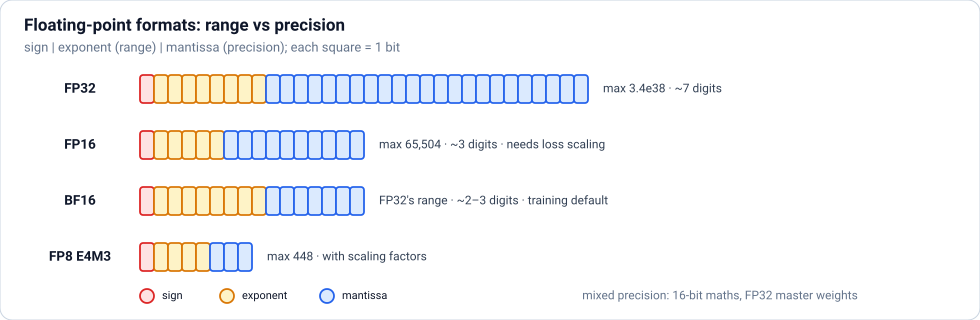

### 49.1 How a float is stored

A floating-point number is stored as three fields: a **sign** bit, an **exponent** (which power of 2, setting the **range**) and a **mantissa** (the digits, setting the **precision**). More exponent bits reach bigger and smaller numbers; more mantissa bits give finer steps between neighbouring numbers. With a fixed budget of bits, each format chooses a split:

```python
import torch

for dtype in [torch.float32, torch.float16, torch.bfloat16, torch.float8_e4m3fn]:
    info = torch.finfo(dtype)
    print(f"{str(dtype):22s} {info.bits:2d} bits | largest {info.max:.3g} | smallest normal {info.tiny:.3g} | step at 1.0: {info.eps:.3g}")
```

**Output:**

```text
torch.float32          32 bits | largest 3.4e+38 | smallest normal 1.18e-38 | step at 1.0: 1.19e-07
torch.float16          16 bits | largest 6.55e+04 | smallest normal 6.1e-05 | step at 1.0: 0.000977
torch.bfloat16         16 bits | largest 3.39e+38 | smallest normal 1.18e-38 | step at 1.0: 0.00781
torch.float8_e4m3fn     8 bits | largest 448 | smallest normal 0.0156 | step at 1.0: 0.125
```

`torch.finfo` describes a float type. **eps** is the gap between 1.0 and the next representable number, a measure of precision: FP32 resolves about 7 decimal digits, FP16 about 3, BF16 about 2.

- **FP16** (half precision) spends its bits on precision: fine steps, but nothing above 65,504 and nothing below about 6 × 10⁻⁸ (even counting its extra-small "subnormal" numbers).
- **BF16** (brain float, from Google) keeps FP32's 8 exponent bits, so it has FP32's huge range, and gives up precision instead.

What goes wrong in each:

```python
for value in [70000.0, 1 + 1 / 1000, 1e-8]:
    stored = {name: torch.tensor(value, dtype=dt).item() for name, dt in
              [("fp32", torch.float32), ("fp16", torch.float16), ("bf16", torch.bfloat16)]}
    print(f"{value!r:>10} → " + ", ".join(f"{k} {v:.6g}" for k, v in stored.items()))
```

**Output:**

```text
   70000.0 → fp32 70000, fp16 inf, bf16 70144
     1.001 → fp32 1.001, fp16 1.00098, bf16 1
     1e-08 → fp32 1e-08, fp16 0, bf16 1.00117e-08
```

FP16 **overflows** 70,000 to infinity and **underflows** 10⁻⁸ to 0. BF16 handles both, approximately (70,000 becomes 70,144, the nearest value it can store), but rounds 1.001 to 1.0: the difference is below its precision. Small errors also accumulate when many small numbers are added:

```python
for name, dt in [("fp32", torch.float32), ("fp16", torch.float16), ("bf16", torch.bfloat16)]:
    total = torch.tensor(0.0, dtype=dt)
    for _ in range(10_000):
        total = total + torch.tensor(0.001, dtype=dt)
    print(f"{name}: 0.001 added 10,000 times = {total.item():.3f}   (exact: 10)")
```

**Output:**

```text
fp32: 0.001 added 10,000 times = 10.000   (exact: 10)
fp16: 0.001 added 10,000 times = 4.000   (exact: 10)
bf16: 0.001 added 10,000 times = 0.500   (exact: 10)
```

Once the running total is large, adding 0.001 changes it by less than one step of the format, and the addition rounds away to nothing. That's why sums and averages (losses, normalisation statistics, gradient accumulations) are kept in FP32 even in low-precision training.

### 49.2 Why 16-bit is worth it

Halving the bits halves the memory for weights and activations, and modern GPUs have dedicated matrix units that run 16-bit (and 8-bit) multiplications many times faster than FP32. Since training is dominated by matrix multiplications, 16-bit training is typically 2–3 times faster and fits twice the model or batch.

### 49.3 Mixed precision

**Mixed-precision training** gets the speed without the errors:

- keep a **master copy** of the weights in FP32, and do the optimiser update in FP32 (so small updates aren't rounded away, as above);
- run the matrix multiplications of the forward and backward passes in 16-bit;
- keep numerically sensitive operations (softmax, normalisation statistics, losses, sums) in FP32.

`torch.autocast` does the choosing automatically: inside it, each operation runs in the 16-bit type if that's safe, and in FP32 otherwise. The weights themselves stay FP32:

```python
from torch import nn

torch.manual_seed(0)
model = nn.Sequential(nn.Linear(512, 1024), nn.GELU(), nn.Linear(1024, 10))
x, y = torch.randn(64, 512), torch.randint(0, 10, (64,))
with torch.autocast(device_type="cpu", dtype=torch.bfloat16):          # on an NVIDIA GPU: device_type="cuda"
    logits = model(x)
    loss = nn.functional.cross_entropy(logits, y)
print("logits", logits.dtype, "| loss", loss.dtype, "| weights", model[0].weight.dtype)
loss.backward()
print("gradients", model[0].weight.grad.dtype)

with torch.no_grad():
    exact = model(x)
print(f"largest difference from FP32 logits: {(logits.float() - exact).abs().max():.3f}  (typical logit size {exact.abs().mean():.2f})")
```

**Output:**

```text
logits torch.bfloat16 | loss torch.float32 | weights torch.float32
gradients torch.float32
largest difference from FP32 logits: 0.002  (typical logit size 0.15)
```

The matrix products, and so the logits, ran in BF16; cross-entropy ran in FP32; the gradients arrive in FP32 to match the weights. The differences from full precision are small and act like a little extra noise, which training tolerates. On a GPU the only change is `device_type="cuda"`.

### 49.4 FP16 and loss scaling

BF16 needs nothing more. FP16, still used on older GPUs, has a second problem: many gradients are tiny, smaller than FP16's smallest number, and silently become 0. **Loss scaling** fixes it: multiply the loss by a large factor S (say 65,536) before the backward pass, so every gradient is S times bigger and stays representable; then divide the gradients by S, in FP32, before the update:

```python
g = torch.tensor([2e-8])
S = 65536.0
print("tiny gradient stored in FP16:", g.half().item())
scaled = (g * S).half()
print(f"scaled first: {scaled.item():.3g} in FP16 → divided back in FP32: {scaled.float().item() / S:.3g}")
```

**Output:**

```text
tiny gradient stored in FP16: 0.0
scaled first: 0.00131 in FP16 → divided back in FP32: 2e-08
```

`torch.amp.GradScaler` does this automatically and adjusts S as it goes: if any gradient overflows to infinity it skips that step and halves S; after a run of good steps it doubles S. In a loop it wraps the backward pass and the step: `scaler.scale(loss).backward()`, then `scaler.step(optimizer)` and `scaler.update()`.

### 49.5 FP8 and FP4

The trend continues downwards. **FP8** comes in two variants: E4M3 (more precision, for weights and activations) and E5M2 (more range, for gradients). With only 8 bits, a single scale per tensor isn't enough, so values are stored with **scaling factors** per block of numbers, and accumulations still happen in higher precision. DeepSeek-V3 (2024) was trained largely in FP8. NVIDIA's Blackwell GPUs (2025) add hardware **FP4** formats, used mainly to serve models and increasingly in training.

The memory for a model's weights alone shows why this matters:

```python
for name, bytes_per_weight in [("FP32", 4), ("BF16", 2), ("FP8", 1), ("4-bit", 0.5)]:
    print(f"{name:5s}: a 70-billion-parameter model's weights take {70e9 * bytes_per_weight / 1e9:.0f} GB")
```

**Output:**

```text
FP32 : a 70-billion-parameter model's weights take 280 GB
BF16 : a 70-billion-parameter model's weights take 140 GB
FP8  : a 70-billion-parameter model's weights take 70 GB
4-bit: a 70-billion-parameter model's weights take 35 GB
```

Storing weights in fewer bits **after** training, to run models cheaply, is quantisation (Chapter 51).

### 49.6 Summary

```
float = sign | exponent (range) | mantissa (precision)
FP32: 1e±38, ~7 digits · FP16: max 65,504, ~3 digits · BF16: FP32 range, ~2–3 digits · FP8/FP4 + scaling factors
mixed precision: 16-bit matmuls, FP32 master weights, FP32 sums/softmax/norms/losses
with torch.autocast(device_type, dtype=torch.bfloat16): forward + loss       (FP16 also needs GradScaler)
```

**Key terms:**

- **Floating-point number:** a number stored as a sign, an exponent and a mantissa.
- **Exponent:** the bits that set a float's power of 2, and so its range.
- **Mantissa:** the bits that store a float's digits, and so its precision.
- **FP32 / FP16 / BF16 / FP8:** 32-bit single precision; 16-bit half precision; 16-bit brain float with FP32's range; 8-bit floats.
- **Overflow / underflow:** a value too large (becomes infinity) or too small (becomes 0) for a format.
- **Machine epsilon (eps):** the gap between 1.0 and the next representable number.
- **Mixed-precision training:** computing in 16-bit while keeping FP32 master weights and sensitive operations in FP32.
- **`torch.autocast`:** a block in which PyTorch runs each operation in a lower-precision type when that's safe.
- **Loss scaling:** multiplying the loss before the backward pass, and dividing the gradients after, so small FP16 gradients don't underflow.
- **`GradScaler`:** PyTorch's automatic, adaptive loss scaling.

### Exercises

1. A gradient of 2 × 10⁻⁹ is computed in FP16. What happens with no loss scaling, and with S = 65,536?
2. Why is BF16, not FP16, the default for training large language models?

<details>
<summary><b>Answers</b></summary>

```python
g = torch.tensor([2e-9])
print("no scaling:", g.half().item(), f"| scaled: {(g * 65536).half().float().item() / 65536:.3g}")
```

**Output:**

```text
no scaling: 0.0 | scaled: 2e-09
```

1. Without scaling it underflows to 0 and that weight receives no update; scaled by 65,536 it's about 1.3 × 10⁻⁴, comfortably representable, and dividing back in FP32 recovers it (to FP16's precision).
2. BF16 has FP32's range, so activations, losses and gradients don't overflow or underflow, and no loss scaling is needed. Its lower precision matters less, because the FP32 master weights absorb the small updates.

</details>

**Learn more:** [PyTorch: automatic mixed precision](https://pytorch.org/docs/stable/amp.html) · [Micikevicius et al., Mixed Precision Training](https://arxiv.org/abs/1710.03740)

---

## 50. Training Bigger Models: Accumulation, Checkpointing and Parallelism

**You need:** Chapters 9, 12, 42.1 and 49. · **You'll learn:** the tricks that fit a bigger batch or model into limited memory, and the four ways training is split across many GPUs, each checked numerically on a small model.


### 50.1 Where the memory goes

Training memory has two parts:

- **Model state:** the weights, their gradients and the optimiser's state. With mixed precision and Adam, about 16 bytes per parameter (Chapter 42.1).
- **Activations:** every intermediate result the forward pass stores for the backward pass (Chapter 9.3). They grow with the batch size and the sequence length, and for long sequences they can exceed the model state.

The tricks below each attack one of these.

### 50.2 Gradient accumulation: a big batch in small pieces

If a batch of 64 doesn't fit, run 4 micro-batches of 16, calling `backward()` on each **without** resetting the gradients in between. Gradients add up (Chapter 12.4), so after 4 micro-batches `.grad` holds the sum; divide each micro-batch's loss by 4 and the sum is exactly the mean over all 64. Then take one optimiser step:

```python
import torch
from torch import nn

torch.manual_seed(0)
model = nn.Sequential(nn.Linear(20, 64), nn.ReLU(), nn.Linear(64, 1))
X, y = torch.randn(64, 20), torch.randn(64, 1)

model.zero_grad()
nn.functional.mse_loss(model(X), y).backward()                       # one batch of 64
full_batch = model[0].weight.grad.clone()

model.zero_grad()
for xb, yb in zip(X.split(16), y.split(16)):                         # 4 micro-batches of 16
    (nn.functional.mse_loss(model(xb), yb) / 4).backward()            # gradients add up
print("accumulated gradient equals the full-batch gradient:", torch.allclose(model[0].weight.grad, full_batch, atol=1e-6))
```

**Output:**

```text
accumulated gradient equals the full-batch gradient: True
```

`X.split(16)` cuts the tensor into chunks of 16 rows. This trades time for memory: the same result, four smaller forward passes. (With BatchNorm, statistics come from each micro-batch, so it isn't exactly identical; transformers use LayerNorm, so it is.)

### 50.3 Activation checkpointing: recompute instead of storing

**Activation checkpointing** (also called gradient checkpointing) stores the activations at only some points, the **checkpoints**, and during the backward pass recomputes the ones in between from the nearest checkpoint. You pay for roughly one extra forward pass and save most of the activation memory. `torch.utils.checkpoint.checkpoint(block, x)` runs a block this way. Count the forward calls:

```python
from torch.utils.checkpoint import checkpoint

calls = {"n": 0}
class CountedBlock(nn.Module):
    def __init__(self):
        super().__init__()
        self.linear = nn.Linear(256, 256)
    def forward(self, x):
        calls["n"] += 1
        return torch.relu(self.linear(x))

blocks = nn.ModuleList([CountedBlock() for _ in range(8)])
x = torch.randn(32, 256, requires_grad=True)
for use_checkpointing in [False, True]:
    calls["n"] = 0
    h = x
    for block in blocks:
        h = checkpoint(block, h, use_reentrant=False) if use_checkpointing else block(h)
    h.sum().backward()
    print(f"checkpointing {'on ' if use_checkpointing else 'off'}: block forward calls = {calls['n']}")
```

**Output:**

```text
checkpointing off: block forward calls = 8
checkpointing on : block forward calls = 16
```

With checkpointing, each block runs twice: once in the forward pass and once more, recomputed, during the backward pass. Its activations didn't have to be stored in between. (`use_reentrant=False` selects the recommended implementation.) Hugging Face models switch it on with `model.gradient_checkpointing_enable()`.

### 50.4 Data parallelism

With several GPUs, the simplest split is **data parallelism**: every GPU holds a full copy of the model and processes a different slice of the batch. After the backward pass, the GPUs **average their gradients** with an operation called **all-reduce**, so every copy takes the identical step. The average of the slices' gradients is exactly the full batch's gradient, the same argument as accumulation, with the micro-batches running at the same time on different GPUs:

```python
worker_grads = []
for xb, yb in zip(X.split(16), y.split(16)):                         # 4 "GPUs", each with its quarter of the batch
    model.zero_grad()
    nn.functional.mse_loss(model(xb), yb).backward()
    worker_grads.append(model[0].weight.grad.clone())
averaged = torch.stack(worker_grads).mean(dim=0)                      # what all-reduce + averaging produces
print("averaged worker gradients equal the full-batch gradient:", torch.allclose(averaged, full_batch, atol=1e-6))
```

**Output:**

```text
averaged worker gradients equal the full-batch gradient: True
```

PyTorch's `DistributedDataParallel` (DDP) does this across real GPUs, overlapping the all-reduce with the backward pass. Its limit: every GPU must still hold the whole model state.

### 50.5 Sharding the model state: FSDP and ZeRO

**FSDP** (fully sharded data parallel, PyTorch) and **ZeRO** (DeepSpeed) remove that limit. Each of N GPUs permanently stores only 1/N of the weights, gradients and optimiser state. Just before a layer runs, its full weights are gathered from all the GPUs, used, and freed again. ZeRO comes in stages: stage 1 shards only the optimiser state, stage 2 also the gradients, stage 3 (= FSDP) everything. For a 7-billion-parameter model at 16 bytes per parameter on 8 GPUs:

```python
P = 7e9
for name, bytes_per_gpu in [("data parallel (DDP)", 16 * P),
                            ("ZeRO stage 1 (8 GPUs)", P * (2 + 2 + 12 / 8)),
                            ("FSDP / ZeRO stage 3 (8 GPUs)", 16 * P / 8)]:
    print(f"{name:30s} {bytes_per_gpu / 1e9:6.1f} GB of model state per GPU")
```

**Output:**

```text
data parallel (DDP)             112.0 GB of model state per GPU
ZeRO stage 1 (8 GPUs)            38.5 GB of model state per GPU
FSDP / ZeRO stage 3 (8 GPUs)     14.0 GB of model state per GPU
```

The 12 bytes sharded in stage 1 are the FP32 master weights and Adam's two averages. Sharding costs extra communication, gathering weights for every layer, but it's what lets models far larger than one GPU's memory train at all.

### 50.6 Tensor and pipeline parallelism

When even one layer is too big, or the communication becomes the bottleneck, the model itself is split:

- **Tensor parallelism** splits each weight matrix across GPUs. Since each output column of X W depends only on its own column of W, two GPUs can each compute half of the columns and then concatenate:

```python
W = torch.randn(20, 64)
left_half, right_half = W[:, :32], W[:, 32:]                         # on GPU 0 and GPU 1
combined = torch.cat([X @ left_half, X @ right_half], dim=1)        # each computes its half; then gather
print("split matrix multiplication equals the full one:", torch.allclose(combined, X @ W, atol=1e-5))
```

**Output:**

```text
split matrix multiplication equals the full one: True
```

  It needs very fast links between the GPUs (such as NVLink within one server), because they exchange results inside every layer.

- **Pipeline parallelism** puts different layers on different GPUs: GPU 0 runs layers 1–6, GPU 1 layers 7–12, and so on. To keep every GPU busy, the batch is cut into micro-batches that flow through the pipeline one behind the other; the idle time at the start and end is called the **pipeline bubble**.

Frontier models combine all of them, called **3D parallelism**: tensor parallelism within a server, pipeline parallelism across a few servers, and data parallelism (usually sharded) across everything else, on tens of thousands of GPUs.

### 50.7 Summary

```
memory = model state (~16 bytes/param with Adam + mixed precision) + activations (batch × sequence × layers)
accumulation:    k micro-batches, loss / k, backward each, one step  = one batch k times bigger
checkpointing:   store some activations, recompute the rest in backward  (~1 extra forward pass)
data parallel:   full copy per GPU, split the batch, all-reduce (average) gradients
FSDP / ZeRO-3:   shard weights, gradients, optimiser state; gather each layer when needed
tensor parallel: split weight matrices;   pipeline parallel: split layers, stream micro-batches
```

**Key terms:**

- **Activations (memory):** the intermediate results stored during the forward pass for use in the backward pass.
- **Gradient accumulation:** summing gradients over several micro-batches before one optimiser step, to simulate a larger batch.
- **Micro-batch:** one of the small pieces a batch is split into.
- **Activation (gradient) checkpointing:** storing only some activations and recomputing the others during the backward pass.
- **Data parallelism:** each GPU holds the full model and processes part of every batch.
- **All-reduce:** a communication operation that combines (for example, averages) values across all GPUs and gives every GPU the result.
- **FSDP / ZeRO:** sharding the weights, gradients and optimiser state across GPUs, gathering them only when needed.
- **Tensor parallelism:** splitting individual weight matrices across GPUs.
- **Pipeline parallelism:** placing different layers on different GPUs and streaming micro-batches through them.
- **Pipeline bubble:** the idle time of pipeline stages at the start and end of each batch.

### Exercises

1. You want an effective batch of 256 sequences but only 8 fit on each of your 4 GPUs. How many accumulation steps do you need?
2. Which technique would you reach for first if (a) a 1-billion-parameter model fits but your batch doesn't; (b) a 70-billion-parameter model doesn't fit on one GPU?

<details>
<summary><b>Answers</b></summary>

```python
print("accumulation steps:", 256 // (8 * 4))
```

**Output:**

```text
accumulation steps: 8
```

1. 4 GPUs × 8 = 32 sequences per step, so 256 / 32 = 8 accumulation steps.
2. (a) Gradient accumulation, plus activation checkpointing if even a micro-batch is too big. (b) FSDP (or ZeRO-3) across several GPUs, often with LoRA (Chapter 42) to shrink the optimiser state, or tensor parallelism if the GPUs are linked by NVLink.

</details>

**Learn more:** [PyTorch: FSDP tutorial](https://pytorch.org/tutorials/intermediate/FSDP_tutorial.html) · [Hugging Face: the Ultra-Scale Playbook](https://huggingface.co/spaces/nanotron/ultrascale-playbook)

---

## 51. Quantisation: INT8, INT4 and Running Models Locally

**You need:** Chapters 41 and 49. · **You'll learn:** how to store a trained model's weights in 8 or 4 bits, built by hand, why outliers make it hard and how per-group scales fix that, and how much accuracy a real model loses.


### 51.1 Why quantise

**Quantisation** stores weights (and sometimes activations) as low-bit integers instead of floats, after training. Two reasons:

- **Memory.** A 70-billion-parameter model is 140 GB in BF16, 35 GB in 4 bits (Chapter 49.5), the difference between a server and a single workstation GPU.
- **Speed.** When a language model generates text, each new token requires reading **every** weight from memory once, while doing little arithmetic per weight. So generation speed is limited by memory bandwidth, roughly bandwidth ÷ model size in bytes. Halve the bytes and you roughly double the tokens per second.

```python
for name, size_gb in [("BF16", 16), ("8-bit", 8), ("4-bit", 4)]:
    print(f"8B-parameter model in {name}: {size_gb} GB → at most about {400 / size_gb:.0f} tokens/s with 400 GB/s of memory bandwidth")
```

**Output:**

```text
8B-parameter model in BF16: 16 GB → at most about 25 tokens/s with 400 GB/s of memory bandwidth
8B-parameter model in 8-bit: 8 GB → at most about 50 tokens/s with 400 GB/s of memory bandwidth
8B-parameter model in 4-bit: 4 GB → at most about 100 tokens/s with 400 GB/s of memory bandwidth
```

### 51.2 Absmax quantisation, by hand

The simplest scheme maps the range [−max|w|, max|w|] onto the integers −127 … 127:

```
scale = max|w| / 127,      q = round(w / scale)  (an int8),      ŵ = q · scale  (back to a float)
```

The model stores q (1 byte each) plus one float scale. With the picture's weights, max|w| = 1.27, so scale = 0.01: 0.12 → 12, −0.50 → −50, 0.33 → 33, 1.27 → 127, and multiplying back recovers every weight exactly.

```python
import torch

w = torch.tensor([0.12, -0.50, 0.33, 1.27])
scale = w.abs().max() / 127
q = torch.round(w / scale).to(torch.int8)
print("scale", round(scale.item(), 4), "| int8", q.tolist(), "| back", [round(v, 3) for v in (q.float() * scale).tolist()])

w_outlier = torch.tensor([0.12, -0.50, 0.33, 12.7])
s = w_outlier.abs().max() / 127
print("with an outlier:", [round(v, 3) for v in (torch.round(w_outlier / s) * s).tolist()])
```

**Output:**

```text
scale 0.01 | int8 [12, -50, 33, 127] | back [0.12, -0.5, 0.33, 1.27]
with an outlier: [0.1, -0.5, 0.3, 12.7]
```

`.to(torch.int8)` converts to 8-bit integers. One large **outlier** sets the scale for everyone: with 12.7 in the group, the step becomes 0.1, and 0.12 comes back as 0.1. The small weights, usually the vast majority, lose most of their precision.

### 51.3 Smaller groups, smaller errors

Real weight matrices do have outliers, often whole columns tied to particular features. The fix is to use **more scales**, each covering fewer weights:

- **per-tensor:** one scale for the whole matrix;
- **per-channel:** one scale per output row;
- **per-group:** one scale per group of 32–128 consecutive weights within a row. This is standard for 4-bit.

A function that quantises and immediately dequantises, so we can measure the damage with ordinary float tensors (**fake quantisation**):

```python
def fake_quant(W, bits=8, group=None):
    """Symmetric quantisation: one scale per row, or per group of `group` weights within each row."""
    levels = 2 ** (bits - 1) - 1                                       # 127 for 8 bits, 7 for 4 bits
    G = W.reshape(W.shape[0], -1, group) if group else W.reshape(W.shape[0], 1, -1)
    s = G.abs().amax(dim=-1, keepdim=True).clamp(min=1e-8) / levels
    return (torch.round(G / s).clamp(-levels, levels) * s).reshape(W.shape)

torch.manual_seed(0)
W = torch.randn(768, 768) * 0.02
W[:, 5] *= 30                                                          # one outlier column, as in real models
relative_error = lambda Wq: ((Wq - W).norm() / W.norm()).item()
print(f"int8 per-tensor     {relative_error(fake_quant(W.reshape(1, -1)).reshape(W.shape)):.4f}")
print(f"int8 per-channel    {relative_error(fake_quant(W)):.4f}")
print(f"int4 per-channel    {relative_error(fake_quant(W, bits=4)):.4f}")
print(f"int4 groups of 64   {relative_error(fake_quant(W, bits=4, group=64)):.4f}")
```

**Output:**

```text
int8 per-tensor     0.1464
int8 per-channel    0.0460
int4 per-channel    0.5074
int4 groups of 64   0.1616
```

`amax` is the maximum along an axis, and `clamp` keeps values inside a range. Per-channel scales cut the 8-bit error by a factor of 3. At 4 bits, with only 15 levels, per-channel isn't enough: every row contains part of the outlier column, which coarsens the whole row. Groups of 64 confine the outlier to one group per row, and cut the 4-bit error by a factor of 3, to about the level of 8 bits with a single scale. Each group's scale costs a little extra: a 16-bit scale per 64 weights adds 16/64 = 0.25 bits per weight.

### 51.4 Does a real model notice?

Quantise every linear layer of the DistilBERT sentiment model from Chapter 39 and measure its accuracy on the Rotten Tomatoes validation set (Chapter 41):

```python
from torch import nn
from datasets import load_dataset
from transformers import AutoTokenizer, AutoModelForSequenceClassification

name = "distilbert/distilbert-base-uncased-finetuned-sst-2-english"
tok = AutoTokenizer.from_pretrained(name)
reviews = load_dataset("cornell-movie-review-data/rotten_tomatoes", split="validation")
batch = tok(list(reviews["text"]), padding=True, truncation=True, max_length=64, return_tensors="pt")
labels = torch.tensor(reviews["label"])

def accuracy(model):
    with torch.no_grad():
        preds = torch.cat([model(input_ids=batch["input_ids"][i:i + 128],
                                 attention_mask=batch["attention_mask"][i:i + 128]).logits.argmax(-1)
                           for i in range(0, len(labels), 128)])
    return (preds == labels).float().mean().item()

for setting in [None, dict(bits=8), dict(bits=4, group=64), dict(bits=4), dict(bits=3, group=64)]:
    model = AutoModelForSequenceClassification.from_pretrained(name).eval()
    linears = [m for m in model.modules() if isinstance(m, nn.Linear)]
    if setting:
        with torch.no_grad():
            for m in linears:
                m.weight.copy_(fake_quant(m.weight, **setting))
    bits = setting["bits"] if setting else 32
    label = "FP32 (original)" if not setting else f"int{bits} " + (f"groups of {setting['group']}" if "group" in setting else "per-channel")
    size_mb = sum(m.weight.numel() for m in linears) * bits / 8 / 1e6
    print(f"{label:22s} accuracy {accuracy(model):.3f}   linear weights {size_mb:6.1f} MB")
```

**Output:**

```text
FP32 (original)        accuracy 0.905   linear weights  172.2 MB
int8 per-channel       accuracy 0.906   linear weights   43.1 MB
int4 groups of 64      accuracy 0.905   linear weights   21.5 MB
int4 per-channel       accuracy 0.902   linear weights   21.5 MB
int3 groups of 64      accuracy 0.900   linear weights   16.1 MB
```

`model.modules()` walks every sub-module, and `isinstance` picks out the linear layers. 8-bit matches the original at a quarter of the size, 4-bit loses almost nothing, and 3-bit half a point. A two-class decision is forgiving, though: generative models are more sensitive, because errors compound over hundreds of generated tokens, especially below 4 bits. Always measure on your own task before shipping a quantised model.

### 51.5 Quantisation in practice

- **Smarter rounding.** Round-to-nearest, as above, is the baseline. **GPTQ** and **AWQ** use a small calibration set of real inputs to choose roundings and scales that preserve the layer's **outputs**, not just its weights; they make 4-bit models nearly as good as 16-bit.
- **Quantisation-aware training** simulates the rounding during training (with fake quantisation in the forward pass) so the model learns weights that survive it. It's used for the most aggressive formats.
- **Formats for running models locally.** **GGUF** files run with llama.cpp and Ollama on ordinary computers; MLX targets Apple Silicon; AWQ and GPTQ checkpoints, and FP8, are served by GPU inference engines such as vLLM. The **KV cache** (Chapter 37.6) can be quantised too, which matters for long contexts.

A 4-bit 8-billion-parameter model takes about 5 GB, so it runs on a laptop. That, more than anything, is what made local LLMs practical.

### 51.6 Summary

```
absmax:      scale = max|w| / (2^(bits−1) − 1);  q = round(w / scale);  ŵ = q · scale
outliers:    one large value coarsens everyone's steps → per-channel or per-group (32–128) scales
bytes:       FP32 4 · BF16 2 · int8 1 · int4 0.5 (+ scales)
generation:  tokens/s ≈ memory bandwidth / model bytes
methods:     round-to-nearest · GPTQ / AWQ (calibrated) · quantisation-aware training;  GGUF · MLX · vLLM
```

**Key terms:**

- **Quantisation:** storing numbers in fewer bits, as integers with a scale, to save memory and time.
- **Absmax quantisation:** scaling by the largest absolute value so that it maps to the largest integer.
- **Scale:** the float multiplier that converts quantised integers back to approximate weights.
- **Outlier:** a weight (or activation) much larger than the rest, which coarsens the quantisation of its group.
- **Per-channel / per-group quantisation:** using one scale per output row, or per small group of weights.
- **Fake quantisation:** quantising and immediately dequantising, to simulate the effect in floating point.
- **Memory-bound:** limited by how fast data can be read from memory rather than by arithmetic.
- **Post-training quantisation (PTQ):** quantising an already trained model.
- **GPTQ / AWQ:** post-training methods that use calibration data to choose roundings that preserve layer outputs.
- **Quantisation-aware training (QAT):** training with simulated quantisation so the model adapts to it.
- **GGUF:** the file format used by llama.cpp and Ollama for quantised models.

### Exercises

1. Quantise (0.9, −0.3, 0.05, −0.9) to 4 bits with absmax. What comes back?
2. How many bits per weight does 4-bit quantisation with groups of 64 take, counting a 16-bit scale per group?

<details>
<summary><b>Answers</b></summary>

```python
v = torch.tensor([0.9, -0.3, 0.05, -0.9])
s = v.abs().max() / 7
print(torch.round(v / s).tolist(), [round(x, 3) for x in (torch.round(v / s) * s).tolist()])
print("bits per weight:", 4 + 16 / 64)
```

**Output:**

```text
[7.0, -2.0, 0.0, -7.0] [0.9, -0.257, 0.0, -0.9]
bits per weight: 4.25
```

1. The scale is 0.9/7 = 0.129, so the integers are (7, −2, 0, −7) and the weights come back as (0.9, −0.257, 0, −0.9). 0.05 rounds to 0: with only 15 levels, small weights vanish.
2. 4 + 16/64 = 4.25 bits.

</details>

| # | Problem (Deep-ML) | Difficulty |
|---|---|---|
| 1 | [234. Block-wise FP8 Quantization](https://www.deep-ml.com/problems/234) | 🟡 Medium |

**Learn more:** [Hugging Face: quantisation overview](https://huggingface.co/docs/transformers/quantization/overview) · [llama.cpp](https://github.com/ggml-org/llama.cpp)

---

## 52. Knowledge Distillation and Pruning

**You need:** Chapters 22, 25 and 51. · **You'll learn:** two more ways to make a model smaller: train a small "student" to imitate a big "teacher", and delete the weights that matter least.

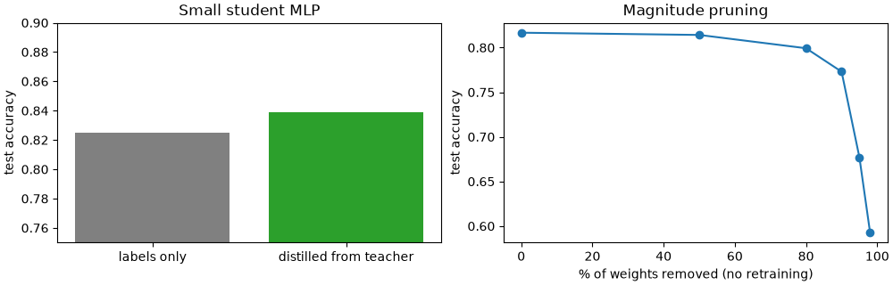

### 52.1 Soft targets carry more information

A trained classifier's output says more than its top answer. For an image of a shirt, a good model might give "shirt 0.7, T-shirt 0.2, coat 0.08, sandal 0.0001": shirts look like T-shirts and coats, not like sandals. Those **soft targets** describe how the classes relate, which a one-hot label can't.

**Knowledge distillation** (Hinton et al., 2015) trains a small **student** model to match a large **teacher** model's output probabilities, in addition to (or instead of) the true labels.

The teacher's probabilities are often nearly one-hot, hiding the small values. Dividing the logits by a **temperature** T > 1 before the softmax (Chapter 37.3) brings them out:

```python
import time
import torch
from torch import nn
from torch.utils.data import DataLoader, TensorDataset
from torchvision import datasets

logits = torch.tensor([3.0, 8.0, 2.0])
print("T = 1:", [round(v, 3) for v in torch.softmax(logits, dim=0).tolist()])
print("T = 4:", [round(v, 3) for v in torch.softmax(logits / 4, dim=0).tolist()])
```

**Output:**

```text
T = 1: [0.007, 0.991, 0.002]
T = 4: [0.19, 0.662, 0.148]
```

### 52.2 The distillation loss

The student is trained on a mix of the usual cross-entropy with the labels and a term that pulls its softened distribution towards the teacher's:

```
L = α · T² · KL( softmax(z_teacher / T) ‖ softmax(z_student / T) )  +  (1 − α) · CE(z_student, y)
```

The KL divergence (Chapter 43.3) is 0 when the two distributions match. The factor T² is there because softening by T shrinks the gradients of the KL term by about 1/T² (the softmax's slopes shrink when its inputs are divided by T), so multiplying by T² keeps the two terms balanced whatever T you choose. `F.kl_div(log_q, p)` computes KL(p ‖ q) from the student's log-probabilities and the teacher's probabilities.

### 52.3 Teacher and student

The teacher is Chapter 25's CNN, trained on all 60,000 Fashion-MNIST images. The student is a much smaller MLP that only gets 5,000 labelled images, a common real situation: plenty of unlabelled data for the teacher to label, few human labels:

```python
def fashion(train):
    raw = datasets.FashionMNIST(root="data", train=train, download=True)
    return (raw.data.float().unsqueeze(1) / 255 - 0.286) / 0.353, raw.targets      # standardised pixels

X_all, y_all = fashion(True)
X_test, y_test = fashion(False)
X_small, y_small = X_all[:5_000], y_all[:5_000]

def accuracy(model):
    model.eval()
    with torch.no_grad():
        return (model(X_test).argmax(1) == y_test).float().mean().item()

torch.manual_seed(0)
teacher = nn.Sequential(nn.Conv2d(1, 32, 3, padding=1), nn.ReLU(), nn.MaxPool2d(2),
                        nn.Conv2d(32, 64, 3, padding=1), nn.ReLU(), nn.MaxPool2d(2),
                        nn.Flatten(), nn.Linear(64 * 7 * 7, 128), nn.ReLU(), nn.Linear(128, 10))
optimizer = torch.optim.AdamW(teacher.parameters(), lr=1e-3)
start = time.time()
for epoch in range(3):
    teacher.train()
    for x, y in DataLoader(TensorDataset(X_all, y_all), batch_size=128, shuffle=True):
        optimizer.zero_grad()
        nn.functional.cross_entropy(teacher(x), y).backward()
        optimizer.step()
print(f"teacher CNN: {sum(p.numel() for p in teacher.parameters()):,} parameters, test accuracy {accuracy(teacher):.3f} ({time.time() - start:.0f} s)")
```

**Output:**

```text
teacher CNN: 421,642 parameters, test accuracy 0.907 (35 s)
```

Train the student both ways, three times each with different seeds, since single runs on 5,000 images are noisy:

```python
def train_student(distill, T=4.0, alpha=0.7, epochs=15, seed=0):
    torch.manual_seed(seed)
    student = nn.Sequential(nn.Flatten(), nn.Linear(784, 64), nn.ReLU(), nn.Linear(64, 10))
    optimizer = torch.optim.AdamW(student.parameters(), lr=1e-3)
    teacher.eval()
    for epoch in range(epochs):
        student.train()
        for x, y in DataLoader(TensorDataset(X_small, y_small), batch_size=128, shuffle=True):
            s_logits = student(x)
            loss = nn.functional.cross_entropy(s_logits, y)
            if distill:
                with torch.no_grad():
                    t_logits = teacher(x)
                kd = nn.functional.kl_div(torch.log_softmax(s_logits / T, dim=1), torch.softmax(t_logits / T, dim=1),
                                          reduction="batchmean") * T * T
                loss = alpha * kd + (1 - alpha) * loss
            optimizer.zero_grad()
            loss.backward()
            optimizer.step()
    return student

results = {}
for distill in [False, True]:
    scores = [accuracy(train_student(distill, seed=s)) for s in range(3)]
    name = "distilled from teacher" if distill else "labels only"
    results[name] = sum(scores) / 3
    print(f"student MLP (50,890 parameters), {name:22s}: {[round(v, 3) for v in scores]}  mean {results[name]:.3f}")
```

**Output:**

```text
student MLP (50,890 parameters), labels only           : [0.825, 0.834, 0.816]  mean 0.825
student MLP (50,890 parameters), distilled from teacher: [0.841, 0.84, 0.836]  mean 0.839
```

The same small network, the same 5,000 images, and distillation is better in every run: each image now teaches the student about all 10 classes at once, through the teacher's probabilities. At scale, distillation is how the small members of model families are made: DistilBERT keeps about 97% of BERT's quality at 60% of the size, and many small open LLMs are trained on the outputs or logits of their larger siblings.

### 52.4 Pruning

Trained networks have many weights close to 0 that contribute little. **Magnitude pruning** sets the smallest weights (by absolute value) to exactly 0. Done **globally** across layers, a single threshold is chosen so that a given fraction of all the weights falls below it:

```python
def train_mlp(seed=0):
    torch.manual_seed(seed)
    model = nn.Sequential(nn.Flatten(), nn.Linear(784, 256), nn.ReLU(), nn.Linear(256, 10))
    optimizer = torch.optim.AdamW(model.parameters(), lr=1e-3)
    for epoch in range(5):
        model.train()
        for x, y in DataLoader(TensorDataset(X_small, y_small), batch_size=128, shuffle=True):
            optimizer.zero_grad()
            nn.functional.cross_entropy(model(x), y).backward()
            optimizer.step()
    return model

def prune(model, fraction):
    layers = [model[1], model[3]]
    all_weights = torch.cat([l.weight.detach().abs().flatten() for l in layers])
    threshold = all_weights.kthvalue(max(1, int(fraction * len(all_weights)))).values   # k-th smallest |w|
    masks = []
    with torch.no_grad():
        for l in layers:
            mask = (l.weight.abs() > threshold).float()
            l.weight.mul_(mask)                                        # zero the small weights
            masks.append(mask)
    return masks

base = train_mlp()
base_state = {k: v.clone() for k, v in base.state_dict().items()}
sparsities, accs = [0.0, 0.5, 0.8, 0.9, 0.95, 0.98], []
for fraction in sparsities:
    base.load_state_dict(base_state)                                   # start from the trained weights each time
    if fraction:
        prune(base, fraction)
    accs.append(accuracy(base))
    print(f"{fraction:4.0%} of weights removed: test accuracy {accs[-1]:.3f}")
```

**Output:**

```text
  0% of weights removed: test accuracy 0.817
 50% of weights removed: test accuracy 0.814
 80% of weights removed: test accuracy 0.799
 90% of weights removed: test accuracy 0.773
 95% of weights removed: test accuracy 0.677
 98% of weights removed: test accuracy 0.592
```

`kthvalue(k)` returns the k-th smallest value. Half the weights can go with no loss, and 80% with little. Beyond that accuracy drops, but much of it comes back if the pruned network is fine-tuned briefly, keeping the removed weights at 0 (Exercise 1).

The catch is speed. Scattered zeros (**unstructured** sparsity) save storage but rarely run faster on GPUs, whose matrix units multiply dense blocks. Speed-ups need **structured** pruning, removing whole neurons, attention heads or layers, so the matrices genuinely shrink, or hardware patterns such as NVIDIA's **2:4 sparsity**, where exactly 2 of every 4 consecutive weights are zero. Structured pruning followed by distillation from the original model is a standard recipe for making smaller LLMs.

### 52.5 Summary

```
soft targets:   softmax(z / T), T > 1 reveals how the teacher relates the classes
distillation:   L = α T² KL(p_teacher^T ‖ p_student^T) + (1 − α) CE(student, y)
pruning:        zero the weights with the smallest |w| (global threshold); fine-tune with the mask fixed
speed:          unstructured zeros save storage; structured (neurons, heads, layers) or 2:4 patterns save time
```

**Key terms:**

- **Knowledge distillation:** training a small student model to imitate a larger teacher model's outputs.
- **Teacher / student:** the large trained model being imitated / the small model learning from it.
- **Soft targets:** a model's full output probabilities, used as training targets instead of one-hot labels.
- **Pruning:** removing (zeroing) weights or parts of a network that contribute least.
- **Magnitude pruning:** pruning the weights with the smallest absolute values.
- **Sparsity:** the fraction of weights that are exactly zero.
- **Unstructured / structured pruning:** removing individual weights anywhere / removing whole neurons, channels, heads or layers.
- **2:4 sparsity:** a pattern with 2 zeros in every 4 consecutive weights, which some GPUs can accelerate.

### Exercises

1. Prune 95% of the weights, then fine-tune for one epoch on the 5,000 images, re-applying the mask after every step. How much accuracy comes back?
2. Why does 90% unstructured sparsity rarely make a model 10 times faster on a GPU?

<details>
<summary><b>Answers</b></summary>

```python
base.load_state_dict(base_state)
masks = prune(base, 0.95)
before = accuracy(base)
optimizer = torch.optim.AdamW(base.parameters(), lr=1e-3)
base.train()
for x, y in DataLoader(TensorDataset(X_small, y_small), batch_size=128, shuffle=True):
    optimizer.zero_grad()
    nn.functional.cross_entropy(base(x), y).backward()
    optimizer.step()
    with torch.no_grad():
        for layer, mask in zip([base[1], base[3]], masks):
            layer.weight.mul_(mask)                                    # keep pruned weights at zero
print(f"95% pruned: {before:.3f} → after one epoch of fine-tuning {accuracy(base):.3f}"
      f"  (zeros kept: {(base[1].weight == 0).float().mean():.0%})")
```

**Output:**

```text
95% pruned: 0.677 → after one epoch of fine-tuning 0.814  (zeros kept: 95%)
```

1. Most of the lost accuracy returns: the surviving 5% of the weights adjust to cover for the removed ones.
2. GPU matrix units are built for dense blocks. Skipping scattered zeros needs extra bookkeeping per weight, which usually costs more than the multiplications it saves, unless the sparsity is extreme or follows a hardware-supported pattern.

</details>

| # | Problem (Deep-ML) | Difficulty |
|---|---|---|
| 1 | [227. Knowledge Distillation Loss](https://www.deep-ml.com/problems/227) | 🟡 Medium |

**Learn more:** [Hinton et al., Distilling the Knowledge in a Neural Network](https://arxiv.org/abs/1503.02531) · [Sanh et al., DistilBERT](https://arxiv.org/abs/1910.01108)

<details>
<summary><b>Code for the chart at the top</b></summary>

```python
import matplotlib.pyplot as plt

fig, axes = plt.subplots(1, 2, figsize=(10, 3.2), layout="constrained")
axes[0].bar(list(results), list(results.values()), color=["gray", "C2"])
axes[0].set(ylim=(0.75, 0.9), ylabel="test accuracy", title="small student MLP, 5,000 labels")
axes[1].plot([s * 100 for s in sparsities], accs, "o-")
axes[1].set(xlabel="% of weights removed (no retraining)", ylabel="test accuracy", title="magnitude pruning")
fig.savefig("distill-prune.png", dpi=100)
plt.close(fig)
```

</details>

---

## 53. Fast Inference: Compilation, Batching, Smaller KV Caches and Speculative Decoding

**You need:** Chapters 37, 39 and 51. · **You'll learn:** where inference time goes, and the main tools for cutting it, each measured: compilation, ONNX, batching, grouped-query attention, and speculative decoding.

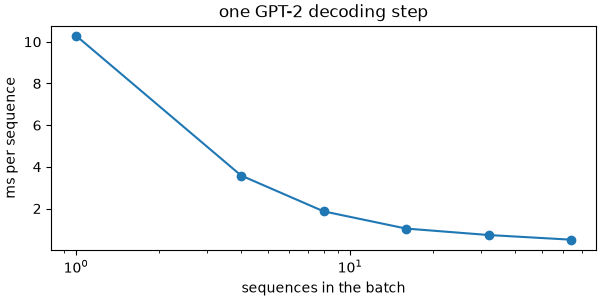

### 53.1 Where the time goes

Serving a model has two goals that pull against each other: **latency** (how long one request waits) and **throughput** (how many requests per second the hardware handles). For language models, generation has two phases:

- **Prefill:** the whole prompt is processed in one forward pass. Lots of arithmetic per weight read, so it's limited by compute.
- **Decode:** one token per forward pass, reading every weight (and the KV cache) for very little arithmetic. It's limited by memory bandwidth (Chapter 51.1).

Most of the tricks below either do more useful work per byte read, or read fewer bytes.

A timing helper (always time after a warm-up call, since the first call pays one-off costs):

```python
import time, os, tempfile
import numpy as np
import torch
from torch import nn

def bench(fn, reps=50):
    fn()                                                                # warm-up
    start = time.perf_counter()
    for _ in range(reps):
        fn()
    return (time.perf_counter() - start) / reps * 1000                  # milliseconds per call

torch.manual_seed(0)
model = nn.Sequential(nn.Linear(512, 2048), nn.GELU(), nn.Linear(2048, 512), nn.GELU(), nn.Linear(512, 10)).eval()
x = torch.randn(256, 512)
with torch.no_grad():
    eager_ms = bench(lambda: model(x))
print(f"eager PyTorch: {eager_ms:.2f} ms per batch")
```

**Output:**

```text
eager PyTorch: 1.07 ms per batch
```

`time.perf_counter()` is Python's most precise clock.

### 53.2 Compilation

Normally PyTorch runs **eagerly**: each operation launches separately, reading its input from memory and writing its output back. `torch.compile(model)` traces the model into a graph and generates optimised code for it, chiefly **fusing** chains of element-wise operations into one kernel, so intermediate results stay in fast on-chip memory:

```python
with torch.no_grad():
    start = time.perf_counter()
    compiled = torch.compile(model)
    compiled(x)                                                          # compiling happens on the first call
    compile_s = time.perf_counter() - start
    compiled_ms = bench(lambda: compiled(x))
    same = torch.allclose(compiled(x), model(x), atol=1e-5)
print(f"torch.compile: {compiled_ms:.2f} ms per batch, after {compile_s:.1f} s of compiling (same outputs: {same})")
```

**Output:**

```text
torch.compile: 1.07 ms per batch, after 3.6 s of compiling (same outputs: True)
```

On a small model on a laptop CPU the difference is modest and varies from run to run: there's little to fuse, and the matrix multiplications already use optimised libraries. On GPUs, with large models, compilation typically gives 1.3–2× speed-ups. Measure on your own model and hardware before assuming, and remember the compile time, paid again whenever the input shapes change.

### 53.3 ONNX

**ONNX** (Open Neural Network Exchange, `machine-learning.md` Chapter 48) is a file format for a model's computation graph that many runtimes can execute without PyTorch: **ONNX Runtime** on servers, phones and browsers, and hardware vendors' own engines. `torch.onnx.export` traces the model; `dynamic_shapes` marks the batch axis as variable:

```python
import onnxruntime as ort

path = os.path.join(tempfile.mkdtemp(), "model.onnx")
program = torch.onnx.export(model, (x,), dynamic_shapes=({0: torch.export.Dim("batch")},), verbose=False)
program.save(path)
session = ort.InferenceSession(path)
input_name = session.get_inputs()[0].name
onnx_ms = bench(lambda: session.run(None, {input_name: x.numpy()}))
matches = np.allclose(session.run(None, {input_name: x.numpy()})[0], model(x).detach().numpy(), atol=1e-4)
print(f"ONNX Runtime: {onnx_ms:.2f} ms per batch (matches PyTorch: {matches}), file {os.path.getsize(path) / 1e6:.1f} MB")
```

**Output:**

```text
ONNX Runtime: 2.97 ms per batch (matches PyTorch: True), file 8.4 MB
```

Here ONNX Runtime is actually slower than PyTorch: on a small model on a laptop CPU, PyTorch's own matrix routines are hard to beat, and the runtime's thread settings matter a lot. The main value of ONNX is **portability**: one exported file runs in C++, C#, JavaScript or on a phone, with no Python. Whether it's faster depends on the model, the hardware and the runtime's settings, so measure.

### 53.4 Batching

The cheapest speed-up for a server is to process requests **together**. In a decoding step, reading the weights is the expensive part, and a batch of 32 sequences shares that one read. Measure one GPT-2 decoding step, a forward pass over a single new token, for a growing number of sequences at once:

```python
import matplotlib.pyplot as plt
from transformers import AutoTokenizer, AutoModelForCausalLM

tok = AutoTokenizer.from_pretrained("openai-community/gpt2")
gpt2 = AutoModelForCausalLM.from_pretrained("openai-community/gpt2").eval()
ids = tok(" the", return_tensors="pt")["input_ids"]                       # one token: like a single decoding step
sizes, per_example = [1, 4, 8, 16, 32, 64], []
with torch.no_grad():
    for b in sizes:
        per_example.append(bench(lambda: gpt2(ids.repeat(b, 1)), reps=20) / b)
print("ms per sequence:", {b: round(t, 1) for b, t in zip(sizes, per_example)})

fig, ax = plt.subplots(figsize=(6, 3), layout="constrained")
ax.plot(sizes, per_example, "o-")
ax.set(xscale="log", xlabel="sequences in the batch", ylabel="ms per sequence", title="one GPT-2 decoding step")
fig.savefig("batching-throughput.png", dpi=100)
plt.close(fig)
```

**Output:**

```text
ms per sequence: {1: 10.3, 4: 3.6, 8: 1.9, 16: 1.0, 32: 0.7, 64: 0.5}
```

`ids.repeat(b, 1)` copies the token b times along the batch axis. The cost per sequence falls several times over as the batch grows, because the weights are read once per step whatever the batch size. (Individual timings on a laptop are noisy; the trend is what matters.) LLM servers push this further with **continuous batching**: rather than waiting for a whole batch to finish, a finished sequence leaves the batch and a new request takes its slot at the very next step. **vLLM** combines that with **PagedAttention**, which stores the KV cache in small fixed-size pages, like an operating system's virtual memory, so memory isn't wasted on sequences of unknown length.

### 53.5 A smaller KV cache: grouped-query attention

During decoding, the KV cache (Chapter 37.6) is read at every step, and for long contexts it outgrows the weights. **Multi-query attention** (**MQA**) shares one key head and one value head among all the query heads; **grouped-query attention** (**GQA**) shares each key/value head among a **group** of query heads. With 64 query heads and 8 key/value heads, the cache shrinks 8 times, with little loss in quality. Llama 3, Mistral, Qwen and most recent models use GQA.

In code, the 8 key/value heads are simply repeated to line up with the 64 query heads before ordinary attention:

```python
import torch.nn.functional as F

N, T, d_head = 1, 10, 128
q = torch.randn(N, 64, T, d_head)                                        # 64 query heads
k, v = torch.randn(N, 8, T, d_head), torch.randn(N, 8, T, d_head)        # only 8 key/value heads are cached
out = F.scaled_dot_product_attention(q, k.repeat_interleave(8, dim=1), v.repeat_interleave(8, dim=1), is_causal=True)
print(out.shape)

layers, context = 80, 32_000
for name, kv_heads in [("multi-head (64 K/V heads)", 64), ("grouped-query (8)", 8), ("multi-query (1)", 1)]:
    cache_gb = 2 * layers * kv_heads * d_head * context * 2 / 1e9            # K and V · bf16
    print(f"{name:26s} KV cache for one 32k-token sequence: {cache_gb:5.1f} GB")
```

**Output:**

```text
torch.Size([1, 64, 10, 128])
multi-head (64 K/V heads)  KV cache for one 32k-token sequence:  83.9 GB
grouped-query (8)          KV cache for one 32k-token sequence:  10.5 GB
multi-query (1)            KV cache for one 32k-token sequence:   1.3 GB
```

`repeat_interleave(8, dim=1)` repeats each head 8 times in place, so query heads 0–7 share key/value head 0, and so on. The numbers are for a model shaped like Llama 3 70B (80 layers, head size 128). DeepSeek's models go further with **multi-head latent attention**, caching a small compressed vector per token from which keys and values are rebuilt.

### 53.6 Speculative decoding

Decoding uses one full pass of the big model per token, even when the next few tokens are easy to guess. **Speculative decoding** uses a small, fast **draft** model to guess the next k tokens, then runs the big **target** model **once** on all k of them. One pass gives the target's own prediction at every one of those positions (the causal mask makes each position independent of later ones). Keep the drafted tokens up to the first one the target disagrees with, then take the target's own token there. With greedy decoding, the output is **exactly** what the target alone would produce; only the number of target passes changes:

```python
target = AutoModelForCausalLM.from_pretrained("openai-community/gpt2-medium").eval()   # 355M parameters (1.5 GB download)
draft = AutoModelForCausalLM.from_pretrained("distilbert/distilgpt2").eval()           # 82M parameters, same tokenizer

@torch.no_grad()
def speculative_greedy(prompt, n_new=40, k=4):
    seq = tok(prompt, return_tensors="pt")["input_ids"]
    goal = seq.shape[1] + n_new
    target_passes, accepted = 0, 0
    while seq.shape[1] < goal:
        proposal = seq
        for _ in range(k):                                              # the draft guesses k tokens
            next_id = draft(proposal).logits[:, -1].argmax(-1, keepdim=True)
            proposal = torch.cat([proposal, next_id], dim=1)
        checks = target(proposal).logits[0, seq.shape[1] - 1:].argmax(-1)    # one target pass: its choice at each position
        target_passes += 1
        guesses = proposal[0, seq.shape[1]:]
        n_ok = 0
        while n_ok < k and guesses[n_ok] == checks[n_ok]:
            n_ok += 1
        accepted += n_ok
        seq = torch.cat([seq, guesses[:n_ok][None], checks[n_ok:n_ok + 1][None]], dim=1)   # matches + the target's own next token
    return seq[:, :goal], target_passes, accepted

prompt = "The capital of France is Paris. The capital of Germany is"
n_prompt = len(tok(prompt)["input_ids"])
spec, passes, accepted = speculative_greedy(prompt)
plain = target.generate(**tok(prompt, return_tensors="pt"), max_new_tokens=spec.shape[1] - n_prompt, do_sample=False,
                        pad_token_id=tok.eos_token_id)
print("identical to the target's own greedy output:", torch.equal(spec[0], plain[0, :spec.shape[1]]))
print(f"{spec.shape[1] - n_prompt} new tokens with {passes} target passes (plain decoding: one pass per token); "
      f"{accepted / (passes * 4):.0%} of drafted tokens accepted")
```

**Output:**

```text
identical to the target's own greedy output: True
40 new tokens with 14 target passes (plain decoding: one pass per token); 48% of drafted tokens accepted
```

Each target pass yields between 1 and k + 1 tokens, so the saving depends on how often the draft guesses right: high for predictable text (code, quotes, structured output), lower for creative text. Since a pass over 5 tokens costs about the same as a pass over 1 when decoding is memory-bound, fewer passes means faster generation. With sampling instead of greedy decoding, a rejection-sampling rule keeps the output distribution exactly the target's. Variants train extra prediction heads on the target itself instead of using a separate draft model.

### 53.7 Summary

```
prefill: compute-bound;  decode: memory-bound (weights + KV cache read every token)
torch.compile: fuse operations (GPU gains 1.3–2×; measure)      ONNX: portable runtime, no Python needed
batching / continuous batching (vLLM, PagedAttention): share each weight read among many requests
GQA / MQA: share key/value heads → KV cache several times smaller
speculative decoding: draft guesses k tokens; target verifies them all in one pass; greedy output unchanged
```

**Key terms:**

- **Latency:** the time one request takes.
- **Throughput:** the number of requests (or tokens) processed per second.
- **Prefill / decode:** processing the prompt in one pass / generating the output one token per pass.
- **Eager execution:** running each operation immediately, one at a time, as Python reaches it.
- **`torch.compile`:** PyTorch's compiler, which captures a model as a graph and generates optimised, fused code.
- **Kernel fusion:** combining several operations into one, so intermediate results needn't be written to memory.
- **ONNX Runtime:** an engine that runs ONNX models on many platforms without PyTorch.
- **Continuous batching:** adding new requests to a running batch as soon as other sequences finish.
- **PagedAttention:** storing the KV cache in fixed-size pages to avoid wasted memory.
- **Multi-query / grouped-query attention (MQA / GQA):** sharing key and value heads across all, or groups of, query heads to shrink the KV cache.
- **Speculative decoding:** a small draft model proposes several tokens that the large model verifies in a single pass.

### Exercises

1. With k = 4, what is the most tokens one target pass can produce? How many passes would 40 tokens need with a perfect draft, and with a useless one?
2. A model has 32 layers, 32 query heads, 8 key/value heads and head size 128. How big is its KV cache for 100,000 tokens in BF16?

<details>
<summary><b>Answers</b></summary>

```python
print("perfect draft:", 40 // 5, "passes | useless draft:", 40, "passes")
print(f"KV cache: {2 * 32 * 8 * 128 * 100_000 * 2 / 1e9:.1f} GB")
```

**Output:**

```text
perfect draft: 8 passes | useless draft: 40 passes
KV cache: 13.1 GB
```

1. k + 1 = 5: all 4 drafted tokens accepted, plus the target's own next token. A perfect draft needs 8 passes for 40 tokens; a useless one still makes progress, 1 token per pass, so 40 passes, the same as plain decoding (plus the wasted draft work).
2. 2 × 32 × 8 × 128 × 100,000 × 2 bytes ≈ 13.1 GB. Without GQA (32 key/value heads) it would be 4 times that.

</details>

**Learn more:** [vLLM documentation](https://docs.vllm.ai/) · [Leviathan et al., Fast Inference via Speculative Decoding](https://arxiv.org/abs/2211.17192) · [Ainslie et al., GQA](https://arxiv.org/abs/2305.13245)

---

## 54. Modern Architectures: Mixture of Experts, Efficient Attention and State-Space Models

**You need:** Chapters 31, 33–35 and 53. · **You'll learn:** three changes to the transformer that frontier models use: mixture-of-experts layers, attention computed without the T × T matrix, and state-space layers that run like RNNs, each built small enough to check.


### 54.1 Mixture of experts

In a transformer block, the feed-forward network holds most of the parameters (Chapter 35.1), and every token uses all of them. A **mixture-of-experts** (**MoE**) layer replaces the one FFN with E separate FFNs, the **experts**, plus a small **router**:

1. The router, a linear layer, gives each token a score per expert; softmax turns them into probabilities.
2. Each token goes only to its **top-k** experts (typically k = 1 to 8 out of 8 to 256).
3. The output is the sum of those experts' outputs, weighted by the router's probabilities (renormalised over the chosen k).

So a model can hold E times the parameters, and the knowledge they can store, while each token pays for only k experts. DeepSeek-V3 has 671 billion parameters but activates 37 billion per token; Mixtral, Qwen MoE, Llama 4 and most frontier models use the same idea.

```python
import time
import torch
from torch import nn
import torch.nn.functional as F

class MoE(nn.Module):
    def __init__(self, d, n_experts=8, k=2):
        super().__init__()
        self.k = k
        self.router = nn.Linear(d, n_experts, bias=False)
        self.experts = nn.ModuleList([nn.Sequential(nn.Linear(d, 4 * d), nn.GELU(), nn.Linear(4 * d, d))
                                      for _ in range(n_experts)])

    def forward(self, x):                                                # x: (tokens, d)
        probs = torch.softmax(self.router(x), dim=-1)                    # (tokens, E)
        weights, chosen = probs.topk(self.k, dim=-1)                     # top-k experts per token
        weights = weights / weights.sum(dim=-1, keepdim=True)
        out = torch.zeros_like(x)
        for e, expert in enumerate(self.experts):
            token_idx, slot = (chosen == e).nonzero(as_tuple=True)       # tokens that picked expert e
            if len(token_idx):
                out[token_idx] += weights[token_idx, slot, None] * expert(x[token_idx])
        return out, probs, chosen

torch.manual_seed(0)
moe = MoE(d=64)
tokens = torch.randn(1000, 64)
out, probs, chosen = moe(tokens)
per_expert = sum(p.numel() for p in moe.experts[0].parameters())
print(f"expert parameters: {8 * per_expert:,} in total, {2 * per_expert:,} used per token")
print("tokens per expert:", torch.bincount(chosen.flatten(), minlength=8).tolist())
```

**Output:**

```text
expert parameters: 264,704 in total, 66,176 used per token
tokens per expert: [248, 251, 240, 235, 228, 281, 252, 265]
```

`nonzero(as_tuple=True)` returns the rows and columns where a condition holds, here which tokens chose expert e and in which of their k slots. Each expert runs only on its own tokens.

**Load balancing.** Left alone, the router tends to favour a few experts, which then get more training and become even more favoured, while the rest sit idle. Training adds a small **auxiliary loss** that's smallest when tokens are spread evenly. A common form multiplies, for each expert, the fraction of tokens routed to it by its average router probability:

```python
def balance_loss(probs, chosen, n_experts=8):
    fraction = torch.bincount(chosen.flatten(), minlength=n_experts).float() / chosen.numel()
    importance = probs.mean(dim=0)
    return n_experts * (fraction * importance).sum()                     # 1.0 when perfectly even

print(f"balance loss: {balance_loss(probs, chosen):.3f} (1.0 = perfectly even)")
```

**Output:**

```text
balance loss: 1.001 (1.0 = perfectly even)
```

MoE's costs: all experts must sit in memory even though few run per token, and spreading experts across GPUs adds communication.

### 54.2 Attention without the T × T matrix

Plain attention builds the full T × T score matrix (Chapter 33.6). For T = 32,000 that's a billion scores per head, far too much memory to store, and moving it in and out of GPU memory is slow. **FlashAttention** (2022) computes exactly the same result without ever storing the matrix. It processes the keys and values in **blocks**, keeping for each query only a running result, and uses the **online softmax** trick to combine the blocks exactly:

- keep a running maximum m of the scores seen so far, a running sum ℓ of e^(score − m), and a running weighted sum o of the values;
- when a new block raises the maximum to m', rescale the old ℓ and o by e^(m − m'), then add the new block's terms.

It's the stable softmax of Chapter 4.5, computed incrementally:

```python
torch.manual_seed(0)
T, d = 1024, 64
q, k, v = torch.randn(d), torch.randn(T, d), torch.randn(T, d)
scores = k @ q / d ** 0.5

full = torch.softmax(scores, dim=0) @ v                                  # stores all T weights at once

m, l, o = torch.tensor(float("-inf")), torch.tensor(0.0), torch.zeros(d)
for start in range(0, T, 128):                                           # 8 blocks of 128 keys
    s = scores[start:start + 128]
    m_new = torch.maximum(m, s.max())
    rescale = torch.exp(m - m_new)                                       # correct what was added under the old max
    l = l * rescale + torch.exp(s - m_new).sum()
    o = o * rescale + torch.exp(s - m_new) @ v[start:start + 128]
    m = m_new
print("blockwise online softmax equals full attention:", torch.allclose(o / l, full, atol=1e-5))
```

**Output:**

```text
blockwise online softmax equals full attention: True
```

Each block only needs its own scores, so the working memory is a small tile rather than the whole matrix. On GPUs this makes attention several times faster and lets context lengths reach hundreds of thousands of tokens. `F.scaled_dot_product_attention` (Chapter 34.3) picks such a fused kernel automatically when one is available.

Other approaches cut the work itself, not just the memory:

- **Sliding-window attention:** each token attends only to the last W tokens (Mistral, Gemma alternate it with full-attention layers).
- **Linear attention** variants replace softmax with a form that can be computed in O(T).

### 54.3 State-space models

**State-space models** (**SSMs**) return to recurrence (Chapter 31) in a form that trains in parallel. The simplest linear version carries a state h:

```
h_t = a · h_{t−1} + b · x_t,      y_t = c · h_t
```

With no non-linearity inside the recurrence, unrolling it gives y_t = Σ_k c · aᵏ · b · x_{t−k}: a **convolution** of the input with the kernel (c·b, c·a·b, c·a²·b, …). So it can be **trained** as a convolution, in parallel over the whole sequence like a transformer, and **run** as a recurrence, one cheap step per token with a fixed-size state and no growing KV cache:

```python
def ssm_recurrent(x, a=0.9, b=1.0, c=1.0):
    h, ys = 0.0, []
    for x_t in x:
        h = a * h + b * x_t
        ys.append(c * h)
    return torch.stack(ys)

def ssm_convolution(x, a=0.9, b=1.0, c=1.0):
    kernel = c * b * a ** torch.arange(len(x)).float()                  # c·aᵏ·b
    return torch.stack([(kernel[:t + 1].flip(0) * x[:t + 1]).sum() for t in range(len(x))])

seq = torch.randn(50)
print("recurrence equals convolution:", torch.allclose(ssm_recurrent(seq), ssm_convolution(seq), atol=1e-4))
```

**Output:**

```text
recurrence equals convolution: True
```

Real SSMs (S4, 2021; **Mamba**, 2023) use vector and matrix states, careful parameterisations of a, and, in Mamba, a and b that depend on the input, so the model can choose what to remember and what to forget, like an LSTM's gates. Pure SSMs struggle with tasks that need exact recall of something far back, which attention does easily. So the trend is **hybrids**: mostly SSM or linear-attention layers for cheap long contexts, with a few full-attention layers (models such as Jamba and NVIDIA's Nemotron-H).

### 54.4 Summary

```
MoE:              router softmax → top-k experts per token → weighted sum;  + load-balancing loss
                  total parameters ≫ active parameters per token
FlashAttention:   blockwise, online softmax (running max, sum, output, rescaled by e^(m − m'));  exact, no T × T matrix
SSM:              h_t = a h_{t−1} + b x_t, y_t = c h_t  =  convolution with c aᵏ b;  train in parallel, run as RNN
hybrids:          mostly SSM / linear attention + a few full attention layers
```

**Key terms:**

- **Mixture of experts (MoE):** a layer with many expert sub-networks, of which a router activates only a few per token.
- **Expert:** one of the parallel feed-forward networks in an MoE layer.
- **Router (gating network):** the small network that chooses which experts process each token.
- **Top-k routing:** sending each token to the k experts with the highest router scores.
- **Load-balancing loss:** an auxiliary loss that encourages the router to spread tokens evenly over the experts.
- **Active parameters:** the parameters actually used for one token, as opposed to the model's total.
- **FlashAttention:** an exact attention algorithm that works block by block and never stores the full score matrix.
- **Online softmax:** computing a softmax-weighted sum incrementally, rescaling by the running maximum.
- **Sliding-window attention:** attention restricted to the most recent W tokens.
- **State-space model (SSM):** a sequence layer with a linear recurrence that can be computed as a convolution.
- **Mamba:** an SSM whose recurrence parameters depend on the input, letting it select what to remember.

### Exercises

1. An MoE layer has 64 experts, each a 2-matrix FFN of 7,168 × 2,048, plus 1 always-on shared expert, and routes each token to 8. How many expert parameters are active per token, out of how many?
2. In the online softmax, why must the old sum ℓ be multiplied by e^(m − m') when the maximum rises?

<details>
<summary><b>Answers</b></summary>

```python
per_expert = 2 * 7168 * 2048
print(f"active: {(8 + 1) * per_expert / 1e6:.0f}M of {(64 + 1) * per_expert / 1e6:.0f}M expert parameters per layer")
```

**Output:**

```text
active: 264M of 1908M expert parameters per layer
```

1. 9 experts (8 routed + 1 shared) of 29.4M each, about 264M, out of 65 × 29.4M ≈ 1.9 billion: one-seventh. (These are the shapes of DeepSeek-V3's MoE layers.)
2. The old terms were added as e^(score − m); to compare them with new terms computed as e^(score − m'), they must be expressed relative to the new maximum: e^(score − m) · e^(m − m') = e^(score − m'). Without the rescaling, blocks would be weighted inconsistently.

</details>

| # | Problem (Deep-ML) | Difficulty |
|---|---|---|
| 1 | [123. Calculate Computational Efficiency of MoE](https://www.deep-ml.com/problems/123) | 🟢 Easy |
| 2 | [125. Implement a Sparse Mixture of Experts Layer](https://www.deep-ml.com/problems/125) | 🔴 Hard |
| 3 | [208. Flash Attention v1 - Forward Pass](https://www.deep-ml.com/problems/208) | 🔴 Hard |

**Learn more:** [Dao et al., FlashAttention](https://arxiv.org/abs/2205.14135) · [Gu & Dao, Mamba](https://arxiv.org/abs/2312.00752) · [DeepSeek-V3 technical report](https://arxiv.org/abs/2412.19437)

---

## 55. Scaling Laws and How Frontier Models Are Trained

**You need:** Chapters 36, 43 and 50. · **You'll learn:** the power laws that predict how loss falls with model size, data and compute; how to split a compute budget between parameters and tokens; and the stages of training a frontier model.

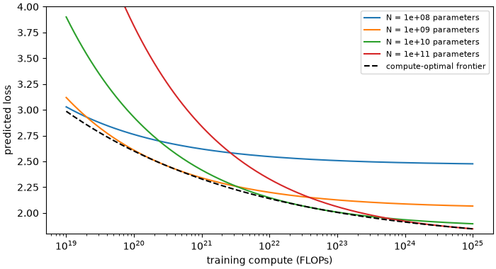

### 55.1 Loss follows a power law

Train language models of different sizes on different amounts of data, and their final losses fall on remarkably smooth curves. Plotted on log–log axes, loss against model size, against data, or against compute is nearly a straight line, down to an irreducible floor. A straight line on log–log axes is a **power law**: L ∝ x^(−α) for some exponent α.

**Scaling laws** (Kaplan et al., 2020; Hoffmann et al., the "Chinchilla" paper, 2022) fit these curves. The Chinchilla fit for loss as a function of parameters N and training tokens D is:

```
L(N, D) = E + A / N^α + B / D^β
E = 1.69,  A = 406.4,  B = 410.7,  α = 0.34,  β = 0.28
```

E is the irreducible loss of the text itself; the other two terms are what a too-small model and too little data cost you. Such laws let labs predict a huge model's loss from small experiments before spending the money.

### 55.2 How much compute a training run takes

Training costs about **6 floating-point operations per parameter per token**:

```
C ≈ 6 N D
```

The forward pass does one multiply and one add per weight per token: 2 operations. The backward pass computes two products per weight, one for the gradient with respect to the layer's input and one for the weight's own gradient (Chapter 9.1), so twice the forward pass: 4 more. Together, 6.

```python
N, D = 70e9, 15e12                                                     # 70B parameters, 15 trillion tokens
C = 6 * N * D
gpu_flops = 4e14                                                       # ~400 TFLOP/s achieved per GPU in BF16
print(f"compute {C:.1e} FLOPs = {C / gpu_flops / 3600 / 1e6:.1f} million GPU-hours,"
      f" about {C / gpu_flops / 3600 / 24 / 10_000:.0f} days on 10,000 GPUs")
```

**Output:**

```text
compute 6.3e+24 FLOPs = 4.4 million GPU-hours, about 18 days on 10,000 GPUs
```

### 55.3 Spending a compute budget

With a fixed budget C, you can train a big model on fewer tokens or a smaller model on more. Which gives the lowest loss? Use the fitted law: for each model size N, the budget allows D = C / 6N tokens; compute L(N, D) and take the best:

```python
import numpy as np

E, A, B, alpha, beta = 1.69, 406.4, 410.7, 0.34, 0.28
def loss(N, D):
    return E + A / N ** alpha + B / D ** beta

for C in [1e21, 1e23, 1e25]:
    sizes = np.logspace(7, 13, 2000)                                    # 10M to 10T parameters
    tokens = C / (6 * sizes)
    best = np.argmin(loss(sizes, tokens))
    print(f"C = {C:.0e}: best N ≈ {sizes[best]:.2g} parameters on D ≈ {tokens[best]:.2g} tokens"
          f" ({tokens[best] / sizes[best]:.0f} tokens per parameter), loss {loss(sizes[best], tokens[best]):.3f}")
```

**Output:**

```text
C = 1e+21: best N ≈ 1.8e+09 parameters on D ≈ 9.2e+10 tokens (50 tokens per parameter), loss 2.329
C = 1e+23: best N ≈ 1.5e+10 parameters on D ≈ 1.1e+12 tokens (78 tokens per parameter), loss 2.005
C = 1e+25: best N ≈ 1.2e+11 parameters on D ≈ 1.4e+13 tokens (122 tokens per parameter), loss 1.845
```

`np.logspace(7, 13, 2000)` gives 2,000 sizes spaced evenly on a log scale from 10⁷ to 10¹³. The robust conclusion: parameters and tokens should grow **together**, roughly in proportion. The exact ratio is less certain. This fitted formula puts it at 50–120 tokens per parameter, rising with the budget; the paper's two other estimation methods gave about 20, which became the famous rule of thumb, and a 2024 re-analysis found errors in the published fit itself. Either way, earlier large models, such as GPT-3 with 175B parameters on 300B tokens (under 2 tokens per parameter), were far too big for their data.

**In practice, models are deliberately "over-trained"**: Llama 3's 8B model saw 15 trillion tokens, nearly 2,000 per parameter. Compute-optimal minimises the cost of **training** for a given loss, but a model is trained once and used billions of times. A smaller model trained on more data costs more to train and much less to run.

### 55.4 How a frontier model is built

The stages, each using techniques from this book:

1. **Data.** Trillions of tokens from web crawls, books, code and papers, heavily filtered: quality classifiers, removal of duplicates and near-duplicates, removal of personal data, language balancing. Increasingly, **synthetic data** generated by earlier models, especially for maths and code.
2. **Tokenizer.** A byte-level BPE (Chapter 29) with 100,000–250,000 tokens, trained on the data mix.
3. **Pretraining.** Next-token prediction (Chapter 36) at full scale: a decoder transformer, often MoE (Chapter 54), with RMSNorm, RoPE and SwiGLU (Chapter 35), trained in BF16 or FP8 (Chapter 49) with 3D parallelism (Chapter 50) on tens of thousands of GPUs for months. Engineering problems dominate: hardware failures, loss spikes (handled by restarting from a checkpoint and skipping the offending data), and the learning-rate schedule (Chapter 20).
4. **Mid-training.** A shorter phase on the highest-quality data, and on long documents to extend the context window, often while the learning rate decays.
5. **Post-training** (Chapter 43): SFT, preference tuning, and reinforcement learning with verifiable rewards for reasoning, plus training for tool use and safety.
6. **Evaluation.** Benchmarks for knowledge, reasoning, coding and safety, checked for **contamination** (test questions leaking into the training data), plus human and red-team testing before release.

### 55.5 Summary

```
scaling law:      L(N, D) = E + A/N^α + B/D^β   (straight lines on log–log axes)
compute:          C ≈ 6 N D FLOPs  (2 forward + 4 backward per parameter per token)
compute-optimal:  N and D grow together (Chinchilla: ~20 tokens per parameter as a rule of thumb)
in practice:      over-train smaller models for cheaper inference
pipeline:         data → tokenizer → pretraining → mid-training → post-training → evaluation
```

**Key terms:**

- **Power law:** a relationship y ∝ x^(−α); a straight line on log–log axes.
- **Scaling law:** a fitted formula predicting a model's loss from its size, data and compute.
- **Irreducible loss (E):** the part of the loss no model can remove, set by the randomness of the text itself.
- **FLOPs:** floating-point operations, the unit of training compute.
- **Compute-optimal (Chinchilla-optimal):** the split of a compute budget between parameters and tokens that minimises loss.
- **Over-training:** training a model on far more tokens than compute-optimal, to make it cheaper to run.
- **Synthetic data:** training data generated by other models.
- **Mid-training:** a phase between pretraining and post-training on selected high-quality or long-context data.
- **Benchmark contamination:** test data leaking into training data, which inflates scores.

### Exercises

1. Using C ≈ 6ND, how many tokens can a budget of 10²³ FLOPs train a 7-billion-parameter model on? How many tokens per parameter is that?
2. By the Chinchilla fit, what loss would a 70B model reach with unlimited data, and with unlimited parameters but 1.4 trillion tokens?

<details>
<summary><b>Answers</b></summary>

```python
D = 1e23 / (6 * 7e9)
print(f"{D:.2g} tokens, {D / 7e9:.0f} tokens per parameter")
print(f"70B, unlimited data: {E + A / 70e9 ** alpha:.3f}   unlimited size, 1.4T tokens: {E + B / 1.4e12 ** beta:.3f}")
```

**Output:**

```text
2.4e+12 tokens, 340 tokens per parameter
70B, unlimited data: 1.773   unlimited size, 1.4T tokens: 1.853
```

1. About 2.4 trillion tokens, around 340 tokens per parameter: far more than compute-optimal, typical of today's over-trained small models.
2. About 1.77 and 1.85: each removes only one of the two terms, and neither gets near the floor of 1.69. Both size and data have to grow to keep lowering the loss.

</details>

**Learn more:** [Kaplan et al., Scaling Laws for Neural Language Models](https://arxiv.org/abs/2001.08361) · [Hoffmann et al., Training Compute-Optimal Large Language Models](https://arxiv.org/abs/2203.15556) · [Llama 3 paper](https://arxiv.org/abs/2407.21783)

<details>
<summary><b>Code for the chart at the top</b></summary>

```python
import matplotlib.pyplot as plt

compute = np.logspace(19, 25, 200)
fig, ax = plt.subplots(figsize=(7, 3.8), layout="constrained")
for n in [1e8, 1e9, 1e10, 1e11]:
    ax.plot(compute, loss(n, compute / (6 * n)), label=f"N = {n:.0e} parameters")
frontier = [loss(s, c / (6 * s)).min() for c in compute for s in [np.logspace(7, 13, 600)]]
ax.plot(compute, frontier, "k--", label="compute-optimal frontier")
ax.set(xscale="log", xlabel="training compute (FLOPs)", ylabel="predicted loss", ylim=(1.8, 4))
ax.legend(fontsize=8)
fig.savefig("scaling-laws.png", dpi=100)
plt.close(fig)
```

</details>

---

## 56. What's New in Deep Learning (2023–2026)

**You need:** Parts VII–X. · **You'll learn:** the main shifts of the last few years, and how each one maps onto ideas from this book.


### 56.1 The shifts

Between 2023 and 2026 the centre of deep learning became the **foundation model**: one very large pretrained transformer, adapted to many tasks. The main changes, with the chapters that explain each:

| Area | 2022 | 2026 | Chapters |
|---|---|---|---|
| best models | closed only | closed and **open-weight** models close to each other | 39 |
| architecture | dense transformers | **MoE**, GQA or latent attention, long context; some SSM hybrids | 53, 54 |
| post-training | SFT + RLHF | SFT + DPO-style preference tuning + **RL for reasoning** and tool use | 43 |
| inference | one answer per call | **test-time compute**: reasoning before answering, sampling, verification | 37, 43.5 |
| modalities | text, plus separate image models | **natively multimodal** in and out, including video | 38, 44, 48 |
| precision | BF16 | FP8 training common; FP4 hardware | 49, 51 |
| deployment | data-centre GPUs | also laptops and phones (4-bit, MLX, on-device runtimes) | 51, 52 |
| image generation | latent diffusion U-Nets | diffusion / flow-matching transformers, few-step samplers | 47, 48 |

A few terms that came with them:

- **Open-weight model:** a model whose trained weights can be downloaded (Llama, Mistral, Qwen, DeepSeek, Gemma), even if its training data and code aren't public.
- **Reasoning model:** an LLM trained with reinforcement learning (Chapter 43.5) to write a long chain of thought before its answer (OpenAI's o-series, DeepSeek-R1, Claude's extended thinking, Gemini's thinking models).
- **Test-time compute:** spending more computation per question at inference, by reasoning longer or sampling several answers and checking them, to get better answers from the same model.
- **Agents:** LLMs that plan and call tools in a loop (`rag-and-agents.md`).
- **Mechanistic interpretability:** reverse-engineering what networks compute internally, for example with sparse autoencoders trained on a model's activations (Chapter 45's idea, applied to a model's internal vectors).

### 56.2 Two trends in numbers

**Tokenizers grew.** Larger vocabularies with better coverage of other languages and code make the same text cost fewer tokens:

```python
from transformers import AutoTokenizer

text = "Deep learning in 2026: अंग्रेज़ी से आगे, 多语言模型, and code like `def f(x): return x**2`."
for name in ["openai-community/gpt2", "Qwen/Qwen2.5-0.5B-Instruct"]:
    tok = AutoTokenizer.from_pretrained(name)
    print(f"{name:28s} vocabulary {len(tok):>7,} | tokens for the sentence: {len(tok(text)['input_ids'])}")
```

**Output:**

```text
openai-community/gpt2        vocabulary  50,257 | tokens for the sentence: 63
Qwen/Qwen2.5-0.5B-Instruct   vocabulary 151,665 | tokens for the sentence: 44
```

**Data grew faster than models, and MoE split capacity from cost.** Using C ≈ 6 × active parameters × tokens (Chapter 55.2):

```python
models = [("GPT-3 (2020)", 175e9, 175e9, 3e11),
          ("Llama 3.1 405B (2024)", 405e9, 405e9, 1.56e13),
          ("DeepSeek-V3 (2024)", 671e9, 37e9, 1.48e13)]
print(f"{'model':24s} {'total params':>12s} {'active':>8s} {'tokens':>8s} {'training FLOPs':>15s}")
for name, total, active, tokens in models:
    print(f"{name:24s} {total:12.1e} {active:8.1e} {tokens:8.1e} {6 * active * tokens:15.1e}")
```

**Output:**

```text
model                    total params   active   tokens  training FLOPs
GPT-3 (2020)                  1.8e+11  1.8e+11  3.0e+11         3.2e+23
Llama 3.1 405B (2024)         4.0e+11  4.0e+11  1.6e+13         3.8e+25
DeepSeek-V3 (2024)            6.7e+11  3.7e+10  1.5e+13         3.3e+24
```

Training data grew about 50-fold from GPT-3 to the 2024 models while parameters grew 2–4 times. And DeepSeek-V3, a mixture of experts, has more parameters than Llama 3.1 405B but needed about a tenth of the training compute, because only 37 billion of them are active per token.

### 56.3 What hasn't changed

Every one of these systems is trained with mini-batch gradient descent and backpropagation (Part II), uses attention, residual connections and normalisation (Part VII), is fine-tuned and aligned with the methods of Part VIII, and is evaluated on held-out data. New papers mostly recombine pieces you now understand, which is why reading a 2026 technical report with this book as a map is the best way to keep up.

Three habits help more than following every announcement: evaluate models on **your own** task, not only on benchmarks (which can be contaminated, Chapter 55.4); try a small fine-tuned or distilled model before reaching for the largest one; and watch for the rare idea that changes the fundamentals rather than the scale.

### 56.4 Summary

```
2023–2026: open weights · MoE · GQA/MLA · long context · RL for reasoning · test-time compute
           native multimodality · video generation · FP8/FP4 · on-device models · agents
unchanged: gradient descent, backprop, attention, residuals, normalisation, held-out evaluation
```

**Key terms:**

- **Foundation model:** a large pretrained model adapted to many downstream tasks.
- **Open-weight model:** a model whose weights are publicly downloadable.
- **Reasoning model:** a model trained to produce a long chain of thought before answering.
- **Chain of thought:** intermediate reasoning steps written out before a final answer.
- **Test-time compute:** extra computation spent at inference, such as longer reasoning or multiple samples, to improve answers.
- **Natively multimodal model:** one model that takes in and produces several kinds of data, such as text, images and audio.
- **Mechanistic interpretability:** research into the internal computations of trained networks.

### Exercises

1. List at least six ideas from this book that a 2026 reasoning model uses, with their chapters.
2. Pick a recent open model's technical report and find its total and active parameters, training tokens, context length and post-training methods.

<details>
<summary><b>Answers</b></summary>

1. Byte-level BPE tokenisation (29), embeddings (30), causal multi-head attention with RoPE and GQA (33–34, 53), pre-norm blocks with RMSNorm and SwiGLU (35), mixture of experts (54), mixed precision and distributed training (49–50), SFT, preference tuning and RL with verifiable rewards (43), sampling with a KV cache (37), quantisation and speculative decoding for serving (51, 53).
2. Technical reports (Llama 3, DeepSeek-V3, Qwen3, Gemma 3) list these in their first pages.

</details>

| # | Problem (Deep-ML) | Difficulty |
|---|---|---|
| 1 | [405. Multi-Head Latent Attention (MLA)](https://www.deep-ml.com/problems/405) | 🔴 Hard |
| 2 | [409. MoE with Shared Expert Forward Pass](https://www.deep-ml.com/problems/409) | 🟡 Medium |

**Learn more:** [Sebastian Raschka: the big LLM architecture comparison](https://magazine.sebastianraschka.com/p/the-big-llm-architecture-comparison) · [Stanford AI Index report](https://hai.stanford.edu/ai-index)

---

# Part XI — Interview Prep

Four chapters for revision: the building blocks to code from memory, the topics interviews cover, a cheat sheet, and the most-asked questions with short answers. The glossary closes the book.

---

## 57. Interview Coding: Building Blocks from Scratch

**You need:** Parts I–VII. · **You'll learn:** to write the seven building blocks interviews ask for most, in NumPy, each one checked against PyTorch.

### 57.1 How to approach it

Deep-learning coding questions ask for one building block in 20–40 minutes, in NumPy or plain PyTorch. They test **shapes, numerical stability and gradients**, not library calls. A routine that works:

1. Write the input and output **shapes** first: input (N, D), weights (D, H), output (N, H).
2. Write the forward pass, and say where stability matters (subtract the max, add ε).
3. If asked, derive the backward pass with the chain rule; every gradient has the shape of its variable.
4. Test on a tiny example, against a numerical gradient or a library.
5. Mention complexity and edge cases: padding masks, batch size 1, long sequences.

Everything below uses double precision, so the comparisons with PyTorch are exact:

```python
import numpy as np
import torch
import torch.nn.functional as F

rng = np.random.default_rng(0)
T64 = lambda a: torch.tensor(a, dtype=torch.float64)                   # NumPy → float64 tensor

def softmax(z):
    z = z - z.max(axis=-1, keepdims=True)                              # stability (Chapter 4.5)
    e = np.exp(z)
    return e / e.sum(axis=-1, keepdims=True)
```

### 57.2 Linear layer with softmax cross-entropy, forward and backward

Chapters 6 and 9: dZ = (P − onehot(y))/N, then dW = Xᵀ dZ, db = Σ dZ, dX = dZ Wᵀ.

```python
X, W, b = rng.normal(size=(4, 5)), rng.normal(size=(5, 3)), rng.normal(size=3)
y = np.array([0, 2, 1, 2])

Z = X @ W + b                                                          # (4, 3)
P = softmax(Z)
loss = -np.log(P[np.arange(4), y]).mean()
dZ = P.copy()
dZ[np.arange(4), y] -= 1                                               # P − onehot(y)
dZ /= 4
dW, db, dX = X.T @ dZ, dZ.sum(axis=0), dZ @ W.T

Xt, Wt, bt = (T64(a).requires_grad_() for a in (X, W, b))
F.cross_entropy(Xt @ Wt + bt, torch.tensor(y)).backward()
print("loss", round(loss, 4), "| gradients match:", all(np.allclose(mine, t.grad.numpy()) for mine, t in [(dW, Wt), (db, bt), (dX, Xt)]))
```

**Output:**

```text
loss 1.3796 | gradients match: True
```

### 57.3 Scaled dot-product attention with a causal mask

Chapters 33–34: softmax(QKᵀ/√d) V, with −∞ above the diagonal.

```python
def attention(Q, K, V, causal=True):
    scores = Q @ K.swapaxes(-1, -2) / np.sqrt(Q.shape[-1])            # (…, T, T)
    if causal:
        future = np.triu(np.ones(scores.shape[-2:], dtype=bool), k=1)
        scores = np.where(future, -np.inf, scores)
    return softmax(scores) @ V

Q, K, V = (rng.normal(size=(2, 6, 8)) for _ in range(3))
print("matches F.scaled_dot_product_attention:",
      np.allclose(attention(Q, K, V), F.scaled_dot_product_attention(T64(Q), T64(K), T64(V), is_causal=True).numpy()))
```

**Output:**

```text
matches F.scaled_dot_product_attention: True
```

`swapaxes(-1, -2)` is NumPy's transpose of the last two axes. Complexity O(T²·d) time and O(T²) memory for the scores.

### 57.4 LayerNorm and BatchNorm

Chapter 21: the same formula, averaged over a different axis.

```python
x, g, beta = rng.normal(size=(8, 16)), rng.normal(size=16), rng.normal(size=16)
layer_norm = (x - x.mean(-1, keepdims=True)) / np.sqrt(x.var(-1, keepdims=True) + 1e-5) * g + beta   # per example
batch_norm = (x - x.mean(0)) / np.sqrt(x.var(0) + 1e-5) * g + beta                                   # per feature
print("LayerNorm matches:", np.allclose(layer_norm, F.layer_norm(T64(x), (16,), T64(g), T64(beta)).numpy()),
      "| BatchNorm (training mode) matches:",
      np.allclose(batch_norm, F.batch_norm(T64(x), None, None, T64(g), T64(beta), training=True).numpy()))
```

**Output:**

```text
LayerNorm matches: True | BatchNorm (training mode) matches: True
```

NumPy's `var` divides by N by default, as normalisation layers do. Mention that BatchNorm uses running averages at inference.

### 57.5 Convolution via im2col

Chapter 24: copy every k×k patch into a column (**im2col**), and the whole convolution becomes one matrix multiplication, which is how many libraries implement it.

```python
def conv2d_im2col(x, w):
    """x: (C, H, W), w: (C_out, C, k, k); stride 1, no padding"""
    C, H, Wd = x.shape
    c_out, _, k, _ = w.shape
    oh, ow = H - k + 1, Wd - k + 1
    cols = np.stack([x[:, i:i + k, j:j + k].ravel() for i in range(oh) for j in range(ow)], axis=1)  # (C·k·k, oh·ow)
    return (w.reshape(c_out, -1) @ cols).reshape(c_out, oh, ow)

image, kernels = rng.normal(size=(3, 7, 7)), rng.normal(size=(4, 3, 3, 3))
print("matches F.conv2d:", np.allclose(conv2d_im2col(image, kernels), F.conv2d(T64(image)[None], T64(kernels))[0].numpy()))
```

**Output:**

```text
matches F.conv2d: True
```

### 57.6 One Adam step

Chapter 19.4, with bias correction:

```python
def adam_step(w, grad, m, v, t, lr=1e-3, b1=0.9, b2=0.999, eps=1e-8):
    m = b1 * m + (1 - b1) * grad
    v = b2 * v + (1 - b2) * grad ** 2
    m_hat, v_hat = m / (1 - b1 ** t), v / (1 - b2 ** t)
    return w - lr * m_hat / (np.sqrt(v_hat) + eps), m, v

w0, grad = rng.normal(size=5), rng.normal(size=5)
mine, _, _ = adam_step(w0.copy(), grad, np.zeros(5), np.zeros(5), t=1)
p = torch.nn.Parameter(T64(w0.copy()))
opt = torch.optim.Adam([p], lr=1e-3)
p.grad = T64(grad)
opt.step()
print("matches torch.optim.Adam:", np.allclose(mine, p.detach().numpy()))
```

**Output:**

```text
matches torch.optim.Adam: True
```

### 57.7 Inverted dropout and top-p sampling

Chapters 22.3 and 37.4:

```python
def dropout(x, p, rng):
    mask = rng.random(x.shape) >= p                                     # keep with probability 1 − p
    return x * mask / (1 - p)

def top_p_sample(logits, p, rng):
    probs = softmax(logits)
    order = np.argsort(-probs)                                          # most likely first
    n_keep = np.searchsorted(np.cumsum(probs[order]), p) + 1            # smallest prefix reaching p
    keep = order[:n_keep]
    return rng.choice(keep, p=probs[keep] / probs[keep].sum())

print("dropout keeps the mean:", round(dropout(np.ones(100_000), 0.3, rng).mean(), 2))
draws = [top_p_sample(np.array([2.0, 1.0, 0.0, -1.0]), 0.85, rng) for _ in range(2000)]
print("top-p 0.85 draws only tokens", sorted(set(int(d) for d in draws)),
      "with frequencies", np.round(np.bincount(draws, minlength=4) / 2000, 3).tolist())
```

**Output:**

```text
dropout keeps the mean: 1.0
top-p 0.85 draws only tokens [0, 1] with frequencies [0.739, 0.261, 0.0, 0.0]
```

`np.searchsorted(a, p)` finds where p would be inserted in the sorted array a, here the first position where the running total reaches p. The four tokens have probabilities 0.64, 0.24, 0.09 and 0.03, so the nucleus for p = 0.85 is the first two, resampled in proportion 0.73 : 0.27.

### 57.8 Summary

| Block | Forward | Backward / key fact | Cost |
|---|---|---|---|
| linear | Y = XW + b | dX = dY Wᵀ, dW = Xᵀ dY, db = Σ dY | O(N·D·H) |
| softmax + CE | p = softmax(z); −mean log p_y | dz = (p − onehot)/N | O(N·C) |
| attention | softmax(QKᵀ/√d + mask) V | O(T²) memory | O(T²·d) |
| LayerNorm / BatchNorm | normalise over features / over the batch | BatchNorm: running stats at inference | O(n) |
| conv2d | im2col + matmul | out = (n + 2p − k)/s + 1 | O(N·C_out·H·W·C_in·k²) |
| Adam | m, v averages, bias-corrected | step ≈ lr whatever the gradient's scale | O(params) |
| dropout | x · mask/(1 − p) in training | identity in eval | O(n) |

**Key terms:**

- **im2col:** rearranging image patches into columns so a convolution becomes one matrix multiplication.
- **Shape contract:** the input and output shapes of a function, written down before its body.

### Exercises

1. Implement multi-head attention by reshaping (N, T, D) to (N, h, T, D/h), calling `attention`, and reshaping back. Check it against `F.scaled_dot_product_attention` on the reshaped tensors.
2. Write the backward pass of ReLU and check it against autograd.

<details>
<summary><b>Answers</b></summary>

```python
def multi_head(x, h):
    N, T, D = x.shape
    split = x.reshape(N, T, h, D // h).transpose(0, 2, 1, 3)            # (N, h, T, D/h)
    out = attention(split, split, split)                                # Q = K = V = x, for the check
    return out.transpose(0, 2, 1, 3).reshape(N, T, D), split

x = rng.normal(size=(2, 5, 12))
ours, split = multi_head(x, h=3)
ref = F.scaled_dot_product_attention(T64(split), T64(split), T64(split), is_causal=True).numpy().transpose(0, 2, 1, 3).reshape(2, 5, 12)
print("multi-head matches:", np.allclose(ours, ref))

z = rng.normal(size=10)
dy = rng.normal(size=10)
dz = dy * (z > 0)
zt = T64(z).requires_grad_()
torch.relu(zt).backward(T64(dy))
print("ReLU backward matches:", np.allclose(dz, zt.grad.numpy()))
```

**Output:**

```text
multi-head matches: True
ReLU backward matches: True
```

1. Reshape splits D into heads, the transpose moves the head axis before T, and the same `attention` runs on every head at once; reversing the steps joins them.
2. dz = dy · (z > 0). `backward(T64(dy))` passes dy as the upstream gradient, so autograd computes exactly this.

</details>

| # | Problem (Deep-ML) | Difficulty |
|---|---|---|
| 1 | [134. Compute Multi-class Cross-Entropy Loss](https://www.deep-ml.com/problems/134) | 🟢 Easy |
| 2 | [53. Implement Self-Attention Mechanism](https://www.deep-ml.com/problems/53) | 🟡 Medium |
| 3 | [115. Implement Batch Normalization for BCHW Input](https://www.deep-ml.com/problems/115) | 🟡 Medium |
| 4 | [87. Adam Optimizer](https://www.deep-ml.com/problems/87) | 🟡 Medium |
| 5 | [151. Dropout Layer](https://www.deep-ml.com/problems/151) | 🟡 Medium |

---

## 58. Interview Topic Checklist: What Companies Ask

**You'll learn:** what deep-learning interviews cover, which chapters prepare each topic, and the practice problems worth doing first.

### 58.1 The rounds

Deep-learning, ML-engineer, applied-scientist and research-engineer interviews usually combine these rounds:

| Round | What happens | Prepare with |
|---|---|---|
| **fundamentals** | rapid questions on backpropagation, activations, initialisation, normalisation, optimisers, overfitting | Parts I–IV; Chapter [60](#60-the-most-asked-deep-learning-theory-questions) |
| **coding from scratch** | implement a layer, attention, a loss or an optimiser in NumPy or PyTorch | Chapter [57](#57-interview-coding-building-blocks-from-scratch) |
| **architecture deep dive** | explain CNNs, transformers, attention variants, positions, MoE; count parameters and FLOPs | Parts V–VII, Chapters [53](#53-fast-inference-compilation-batching-smaller-kv-caches-and-speculative-decoding), [54](#54-modern-architectures-mixture-of-experts-efficient-attention-and-state-space-models) |
| **training and debugging** | "the loss is NaN, or flat, or diverging: what do you do?" | Chapters [18](#18-initialisation-and-vanishing-and-exploding-gradients)–[23](#23-debugging-training) |
| **LLM-specific** | tokenisation, decoding, KV cache, fine-tuning, LoRA, RLHF and DPO, quantisation, serving | Parts VI–VIII, X |
| **ML system design** | design a training or serving system, with numbers | Chapters [50](#50-training-bigger-models-accumulation-checkpointing-and-parallelism)–[53](#53-fast-inference-compilation-batching-smaller-kv-caches-and-speculative-decoding); `machine-learning.md` Chapter 53 |
| **project or paper discussion** | explain one of your projects, or a recent paper, in depth | Chapters [55](#55-scaling-laws-and-how-frontier-models-are-trained), [56](#56-whats-new-in-deep-learning-20232026) |

Applied ML roles add `machine-learning.md`; LLM application roles add `llm-engineering.md` and `rag-and-agents.md`.

### 58.2 Topics, by priority

⭐⭐⭐ appears in almost every interview loop; ⭐⭐ is common; ⭐ is occasional but separates strong candidates.

| Topic | Priority | Chapters | Practice (Deep-ML) |
|---|---|---|---|
| Neurons, activations, MLPs | ⭐⭐⭐ | [3](#3-the-artificial-neuron)–[5](#5-layers-and-the-forward-pass) | [24. Single Neuron](https://www.deep-ml.com/problems/24) · [42. Implement ReLU Activation Function](https://www.deep-ml.com/problems/42) · [147. GeLU Activation Function](https://www.deep-ml.com/problems/147) · [371. Calculate Number of Parameters in Neural Network](https://www.deep-ml.com/problems/371) |
| Losses and softmax | ⭐⭐⭐ | [6](#6-loss-functions-for-networks) | [23. Softmax Activation Function Implementation](https://www.deep-ml.com/problems/23) · [39. Implementation of Log Softmax Function](https://www.deep-ml.com/problems/39) · [134. Compute Multi-class Cross-Entropy Loss](https://www.deep-ml.com/problems/134) · [263. Implement Binary Cross-Entropy Loss](https://www.deep-ml.com/problems/263) |
| Gradient descent, backprop, autograd | ⭐⭐⭐ | [7](#7-gradient-descent-mini-batches-and-epochs)–[10](#10-a-tiny-autograd-engine) | [25. Single Neuron with Backpropagation](https://www.deep-ml.com/problems/25) · [26. Implementing Basic Autograd Operations](https://www.deep-ml.com/problems/26) · [220. Derivative of Cross-Entropy Loss w.r.t. Logits](https://www.deep-ml.com/problems/220) · [313. Numerical Gradient Checking](https://www.deep-ml.com/problems/313) |
| PyTorch fluency | ⭐⭐⭐ | [11](#11-pytorch-tensors)–[17](#17-saving-loading-and-checkpointing) | write a full training loop from memory; explain `zero_grad`, `eval`, `no_grad` |
| Initialisation, optimisers, schedules | ⭐⭐⭐ | [18](#18-initialisation-and-vanishing-and-exploding-gradients)–[20](#20-learning-rate-schedules) | [290. Implement He Weight Initialization](https://www.deep-ml.com/problems/290) · [146. Momentum Optimizer](https://www.deep-ml.com/problems/146) · [87. Adam Optimizer](https://www.deep-ml.com/problems/87) · [169. Implement AdamW Optimizer Step](https://www.deep-ml.com/problems/169) · [196. Warmup + Cosine Decay Schedule](https://www.deep-ml.com/problems/196) |
| Normalisation and regularisation | ⭐⭐⭐ | [21](#21-normalisation-layers-batchnorm-layernorm-and-rmsnorm), [22](#22-regularisation-weight-decay-dropout-early-stopping-and-augmentation) | [115. Implement Batch Normalization for BCHW Input](https://www.deep-ml.com/problems/115) · [372. Implement RMSNorm (Root Mean Square Layer Normalization)](https://www.deep-ml.com/problems/372) · [151. Dropout Layer](https://www.deep-ml.com/problems/151) |
| Debugging training | ⭐⭐⭐ | [23](#23-debugging-training) | explain the overfit-one-batch test and how to read loss curves |
| CNNs and ResNet | ⭐⭐ | [24](#24-convolutions-from-scratch)–[27](#27-transfer-learning-with-pretrained-vision-models) | [41. Simple Convolutional 2D Layer](https://www.deep-ml.com/problems/41) · [114. Implement Global Average Pooling](https://www.deep-ml.com/problems/114) · [113. Implement a Simple Residual Block with Shortcut Connection](https://www.deep-ml.com/problems/113) |
| Detection basics | ⭐ | [28](#28-object-detection-and-segmentation) | [242. Non-Maximum Suppression for Object Detection](https://www.deep-ml.com/problems/242) · [72. Calculate Jaccard Index for Binary Classification](https://www.deep-ml.com/problems/72) |
| Tokenisation and embeddings | ⭐⭐ | [29](#29-tokenisation-characters-words-and-subwords), [30](#30-embeddings-turning-tokens-into-vectors) | [380. Byte Pair Encoding (BPE) Tokenizer](https://www.deep-ml.com/problems/380) · [76. Calculate Cosine Similarity Between Vectors](https://www.deep-ml.com/problems/76) |
| RNNs and LSTMs | ⭐⭐ | [31](#31-recurrent-neural-networks-rnn-lstm-and-gru), [32](#32-sequence-to-sequence-models-and-the-birth-of-attention) | [54. Implementing a Simple RNN](https://www.deep-ml.com/problems/54) · [59. Implement Long Short-Term Memory (LSTM) Network](https://www.deep-ml.com/problems/59) · [287. Implement GRU Cell](https://www.deep-ml.com/problems/287) |
| Attention and transformers | ⭐⭐⭐ | [33](#33-self-attention-from-scratch)–[36](#36-build-a-tiny-gpt) | [53. Implement Self-Attention Mechanism](https://www.deep-ml.com/problems/53) · [107. Implement Masked Self-Attention](https://www.deep-ml.com/problems/107) · [94. Implement Multi-Head Attention](https://www.deep-ml.com/problems/94) · [381. Rotary Positional Embeddings (RoPE)](https://www.deep-ml.com/problems/381) · [391. Implement Grouped Query Attention (GQA)](https://www.deep-ml.com/problems/391) |
| Decoding and the KV cache | ⭐⭐⭐ | [37](#37-generating-text-decoding-strategies-and-the-kv-cache) | [383. Top-p (Nucleus) Sampling](https://www.deep-ml.com/problems/383) · [376. KV Cache for Efficient Autoregressive Attention](https://www.deep-ml.com/problems/376) · [320. Calculate Perplexity for Language Models](https://www.deep-ml.com/problems/320) |
| Pretrained models, fine-tuning, LoRA | ⭐⭐⭐ | [39](#39-hugging-face-the-hub-tokenizers-models-and-pipelines)–[42](#42-parameter-efficient-fine-tuning-lora-and-qlora) | [222. LoRA: Low-Rank Adaptation Forward Pass](https://www.deep-ml.com/problems/222) · [223. QLoRA: Quantized Low-Rank Adaptation Forward Pass](https://www.deep-ml.com/problems/223) |
| Alignment: SFT, RLHF, DPO, RL for reasoning | ⭐⭐⭐ | [43](#43-from-base-model-to-assistant-sft-rlhf-and-dpo) | [382. Direct Preference Optimization (DPO) Loss](https://www.deep-ml.com/problems/382) · [322. Bradley-Terry Model for Pairwise Rankings](https://www.deep-ml.com/problems/322) |
| Contrastive learning and embeddings | ⭐⭐ | [38](#38-vision-transformers), [44](#44-contrastive-learning-sentence-embeddings-and-clip) | [384. Contrastive Loss (InfoNCE / SimCLR-style)](https://www.deep-ml.com/problems/384) · [387. Triplet Margin Loss](https://www.deep-ml.com/problems/387) |
| Generative models | ⭐⭐ | [45](#45-autoencoders-and-variational-autoencoders)–[48](#48-conditioning-guidance-and-latent-diffusion) | [393. Implement Variational Autoencoder (VAE) Loss (ELBO)](https://www.deep-ml.com/problems/393) · [303. Forward Diffusion Process](https://www.deep-ml.com/problems/303) · [396. Implement DDPM Reverse Sampling Step](https://www.deep-ml.com/problems/396) · [397. Classifier-Free Guidance for Conditional Diffusion](https://www.deep-ml.com/problems/397) |
| Precision, quantisation, distillation | ⭐⭐ | [49](#49-number-formats-and-mixed-precision)–[52](#52-knowledge-distillation-and-pruning) | [294. Implement INT8 Quantization](https://www.deep-ml.com/problems/294) · [428. Number Format Precision Comparison (FP16 vs BF16 vs FP8 vs FP4)](https://www.deep-ml.com/problems/428) · [227. Knowledge Distillation Loss](https://www.deep-ml.com/problems/227) |
| Inference, MoE, scale | ⭐⭐ | [53](#53-fast-inference-compilation-batching-smaller-kv-caches-and-speculative-decoding)–[55](#55-scaling-laws-and-how-frontier-models-are-trained) | [229. Sparse MoE Top-K Routing](https://www.deep-ml.com/problems/229) · [389. Mixture of Experts Load Balancing Loss](https://www.deep-ml.com/problems/389) · [394. Implement Speculative Decoding Verification](https://www.deep-ml.com/problems/394) |

### 58.3 A study plan

1. Solve the practice problems above in table order.
2. Build the tiny GPT of Chapter [36](#36-build-a-tiny-gpt) from memory, then generate from it with a KV cache (Chapter [37](#37-generating-text-decoding-strategies-and-the-kv-cache)).
3. Fine-tune one Hugging Face model end to end (Chapter [41](#41-fine-tuning-a-pretrained-transformer)), with a baseline, and write up the result.
4. Read one recent technical report (Llama 3, DeepSeek-V3) with this book beside you.

### 58.4 What interviewers look for, beyond the answer

1. **Shapes first:** write them down before coding.
2. **The why:** why √d_k, why residuals, why AdamW, why BF16, not just the what.
3. **Systematic debugging:** initial loss, overfit one batch, gradient norms, learning-rate range test.
4. **Numbers:** parameter counts (12d² per block), FLOPs (6ND), memory (bytes per parameter, KV cache size).
5. **Trade-offs:** CNN vs ViT, LoRA vs full fine-tuning, quantisation vs quality, latency vs throughput.
6. **Honesty:** when you don't know, say what you'd measure.

---

## 59. Cheat Sheet: Which Architecture, Loss, Optimiser or Trick When?

**You'll learn:** the book's main decisions on a few pages, for quick revision.

### 59.1 Which architecture first?

| data / task | start with | then try | chapters |
|---|---|---|---|
| tabular data | gradient boosting (`machine-learning.md`) | an MLP only with lots of data | 1 |
| image classification | a pretrained CNN or ViT: linear probe, then fine-tune | CLIP zero-shot | 27, 38, 44 |
| detection, segmentation | a pretrained detector (YOLO-style); U-Net or SAM for masks | | 28 |
| text classification, tagging | a fine-tuned encoder (DistilBERT, ModernBERT) | LoRA; an LLM with few-shot prompts | 40–42 |
| text generation, chat, code | a pretrained decoder LLM | LoRA fine-tuning, preference tuning | 39, 42, 43 |
| translation, summaries, speech to text | an encoder–decoder (T5, Whisper) or an LLM | | 40 |
| search, retrieval | a sentence-embedding model | contrastive fine-tuning on your pairs | 44 |
| image generation | a latent diffusion / flow transformer with guidance | LoRA for styles | 47, 48 |
| sequences, streaming | a transformer | an LSTM or SSM for tight latency or memory | 31, 54 |

### 59.2 Losses

| task | output layer | loss | chapter |
|---|---|---|---|
| regression | 1 value, no activation | MSE (or L1, Huber) | 6 |
| yes/no, multi-label | logits | `BCEWithLogitsLoss` | 6, 14 |
| one of K classes | K logits | `CrossEntropyLoss` (+ label smoothing) | 6, 22 |
| language modelling | vocabulary logits per position | cross-entropy on shifted targets | 36 |
| embeddings, retrieval | vectors | InfoNCE (contrastive) | 44 |
| VAE | reconstruction + μ, log σ² | reconstruction + KL | 45 |
| GAN | real/fake logit | BCE, non-saturating for G | 46 |
| diffusion | predicted noise | MSE to the true noise | 47 |
| distillation | student logits | T²·KL to the teacher's softened outputs + CE | 52 |
| preferences | log-probs of chosen and rejected | DPO / Bradley–Terry | 43 |

### 59.3 Default training recipe

```
AdamW;  lr 1e-3 (small nets from scratch) · 3e-4 (transformers) · 2e-5–5e-5 (full fine-tuning) · 1e-4–1e-3 (LoRA)
weight decay 0.01–0.1;  warm-up 1–5% then cosine decay;  clip gradients at 1.0
BF16 autocast;  the largest batch that fits (accumulate if needed);  early stopping on validation loss
```

### 59.4 Debugging

**Order:** look at the data → initial loss ≈ log K → overfit one batch → learning-rate range test → full run with curves and gradient norms → regularise → tune (Chapter 23).

| symptom | likely cause | fix |
|---|---|---|
| loss NaN or exploding | lr too high, log(0), FP16 overflow | lower lr, warm-up, clipping, losses from logits, BF16 |
| loss flat from the start | a bug, lr far too low | overfit one batch; check labels and wiring |
| training ≪ validation loss | overfitting | augmentation, weight decay, dropout, early stopping, more data |
| both high | underfitting | bigger model, train longer, higher lr |
| deep network won't train | vanishing gradients | residuals, normalisation, He initialisation |
| eval much worse than training | `model.eval()` forgotten (BatchNorm, dropout) | switch modes |

### 59.5 Normalisation and efficiency

**Normalisation:** BatchNorm for CNNs · LayerNorm for transformers · RMSNorm, pre-norm, for modern LLMs.

**Efficiency:** BF16 mixed precision · gradient accumulation and activation checkpointing for memory · FSDP beyond one GPU · LoRA / QLoRA to fine-tune large models · INT8 / 4-bit (AWQ, GPTQ, GGUF) to serve · distillation for small fast models · batching and paged KV caches for LLM serving · GQA for smaller caches · speculative decoding when a good draft model exists.

### 59.6 Numbers worth knowing

```
activation spread:    He σ = √(2/fan_in)                     conv output:  ⌊(n + 2p − k)/s⌋ + 1
transformer block:    ≈ 12 d² parameters                     attention:    O(T²) time and memory per layer
training compute:     C ≈ 6 N D FLOPs                        Chinchilla:   N and D grow together (~20 tokens/param)
training memory:      ≈ 16 bytes/parameter (Adam, mixed)     weights:      BF16 2 bytes, int8 1, int4 0.5
KV cache:             2 × layers × KV heads × d_head × tokens × bytes
LoRA parameters:      r (d_in + d_out) per adapted matrix    ViT tokens:   (image size / patch size)²
```

---

## 60. The Most Asked Deep Learning Theory Questions

**You'll learn:** short, correct answers to the questions that come up most, each pointing back to the chapter that explains it. Cover the answers and answer out loud first.

### 60.1 Foundations

1. **Why do networks need non-linear activations?** Without them, any stack of layers multiplies out into one matrix: a linear model. (Ch 4)
2. **Why ReLU rather than sigmoid in hidden layers?** ReLU's slope is 1 for positive inputs, so gradients don't shrink layer after layer; sigmoid's slope is at most 0.25 and near 0 when saturated. ReLU is also cheap. (Ch 4, 18)
3. **What is a dead ReLU?** A unit whose input is negative for every example outputs 0 with zero gradient and never recovers. Leaky ReLU, GELU, good initialisation and moderate learning rates help. (Ch 4)
4. **Explain backpropagation.** The chain rule applied from the loss backwards through the computational graph, multiplying local derivatives and reusing the forward pass's values, so one backward pass gives every gradient. (Ch 8, 9)
5. **What is the gradient of softmax cross-entropy with respect to the logits?** (p − onehot(y))/N. (Ch 6)
6. **Why train on mini-batches?** Cheaper per step than the full dataset, far less noisy than single examples, and they use the GPU's parallelism. (Ch 7)

### 60.2 Training

7. **Vanishing and exploding gradients: causes and fixes?** Gradients are products of many factors through depth (or time); smaller than 1 they vanish, larger they explode. Fixes: ReLU-family activations, He or Xavier initialisation, normalisation, residual connections, gradient clipping, gated RNNs. (Ch 18, 26, 31)
8. **Why does initialisation matter, and why not all zeros?** The weights' scale decides whether signals keep their size through the layers (Var(w) = 2/fan-in for ReLU). Identical weights get identical gradients, so the units never become different. (Ch 18)
9. **SGD vs Adam vs AdamW?** SGD with momentum uses one step size, and can generalise slightly better when well tuned. Adam adds per-parameter step sizes from gradient statistics, and is robust. AdamW is Adam with decoupled weight decay: the usual default. (Ch 19)
10. **Why warm-up and learning-rate decay?** Warm-up avoids huge early steps while weights and Adam's statistics are unreliable (vital for transformers); decay lets training settle into a minimum. (Ch 20)
11. **BatchNorm vs LayerNorm?** BatchNorm normalises each feature over the batch, depends on batch size and needs running averages at inference (CNNs). LayerNorm normalises each example over its features, the same in training and inference (transformers). (Ch 21)
12. **How does dropout work, and why scale by 1/(1 − p)?** Units are zeroed at random during training so none can be relied on; scaling the survivors keeps the expected value equal to evaluation, when nothing is dropped. (Ch 22)
13. **Your loss is NaN. What do you check?** The learning rate, missing warm-up or clipping, log of 0 or division by 0 (compute losses from logits), FP16 overflow, bad input data. (Ch 23, 49)
14. **What does "overfit one batch" test?** That the model, loss, optimiser and loop can learn at all. Failure means a bug; success says nothing about generalisation, or about whether the labels are right. (Ch 23)
15. **How do you reduce overfitting?** More data, augmentation, weight decay, dropout, label smoothing, early stopping, a smaller model, or starting from a pretrained one. (Ch 22, 27)

### 60.3 Architectures

16. **Why do CNNs suit images?** Local filters with shared weights: far fewer parameters, and built-in assumptions (locality, translation) that hold for images. (Ch 24)
17. **What is a convolution's output size?** ⌊(n + 2p − k)/s⌋ + 1. (Ch 24)
18. **Why do residual connections help?** ∂y/∂x = I + ∂F/∂x gives gradients a direct path through any depth, and each block only has to learn a correction. (Ch 26)
19. **When do you train from scratch rather than transfer?** Almost always start pretrained: a linear probe for tiny data, fine-tuning for more. From scratch only with huge in-domain data. (Ch 27)
20. **Why did LSTMs replace plain RNNs?** The gated, additive cell state lets information and gradients survive many steps. (Ch 31)
21. **Why did transformers replace RNNs?** Attention connects any two positions in one step, and the whole sequence trains in parallel. (Ch 32, 33)
22. **Explain self-attention.** Each token's query is compared with every token's key; the softmax of the scaled scores weights an average of the values. (Ch 33)
23. **Why divide by √d_k?** q·k has variance d_k; without scaling, the softmax saturates and its gradients vanish. (Ch 33)
24. **Why several heads?** Different heads can attend to different relationships at the same total cost. (Ch 34)
25. **Why positional information, and what is RoPE?** Attention is order-blind. RoPE rotates queries and keys by position-dependent angles, so scores depend on relative distance. (Ch 34)
26. **What is a causal mask?** −∞ on scores for future positions, so each token sees only the past; it makes one sequence give T next-token training examples. (Ch 34)
27. **How many parameters in a transformer block?** About 12d²: 4d² for attention, 8d² for the FFN. (Ch 35)
28. **Pre-norm or post-norm?** Pre-norm (normalise each sub-layer's input) trains deep stacks stably, and is what modern models use. (Ch 35)
29. **BERT vs GPT vs T5?** Encoder with masked language modelling / decoder with next-token prediction / encoder–decoder with cross-attention, text to text. (Ch 40)
30. **How does a ViT read an image?** Patches become tokens, plus learned positions and a [CLS] token, then a transformer encoder. It needs more data than a CNN. (Ch 38)

### 60.4 Language models

31. **What is BPE, and why subwords?** Repeatedly merge the most frequent adjacent pair; nothing is ever unknown, and sequences stay short. Byte-level BPE starts from bytes, so any text works. (Ch 29)
32. **Greedy, beam search or sampling? What do temperature, top-k and top-p do?** Greedy loops; beam search finds likely sequences (translation); sampling with temperature and top-p gives varied, natural text. (Ch 37)
33. **What is the KV cache, and how big is it?** Stored keys and values of past tokens, so each step processes one new token: 2 × layers × KV heads × d_head × tokens × bytes. (Ch 37, 53)
34. **What are MQA and GQA?** Query heads share key/value heads (all of them, or in groups), shrinking the KV cache with little quality loss. (Ch 53)
35. **Fine-tuning vs LoRA vs prompting?** Full fine-tuning updates every weight; LoRA trains a small low-rank update (cheap, swappable adapters); prompting changes no weights. (Ch 41, 42)
36. **How does LoRA work, and why does B start at 0?** y = Wx + (α/r)BAx with W frozen; B = 0 makes training start exactly at the pretrained model. (Ch 42)
37. **What do SFT, RLHF and DPO do?** SFT imitates demonstrations; RLHF maximises a learned reward with a KL penalty; DPO optimises preference pairs directly with a classification-style loss against a reference model. (Ch 43)
38. **How do reasoning models learn to reason?** Reinforcement learning on problems with checkable answers (GRPO and similar), rewarding correct final answers after long chains of thought. (Ch 43)
39. **How are sentence embeddings trained?** Contrastively: InfoNCE over pairs, with the rest of the batch as negatives. (Ch 44)
40. **What is perplexity?** e^(average cross-entropy per token): the effective number of equally likely choices. (Ch 36)

### 60.5 Generative models

41. **Autoencoder vs VAE?** A VAE's encoder outputs a distribution, trained with a KL term towards N(0, 1) and the reparameterisation trick, so its latent space can be sampled. (Ch 45)
42. **How does a GAN train? What is mode collapse?** A generator and a discriminator play a game; mode collapse is the generator producing only a few kinds of output that fool the discriminator. (Ch 46)
43. **Explain diffusion models.** Train a network to predict the noise added at a random noise level; generate by denoising step by step from pure noise. (Ch 47)
44. **What is classifier-free guidance?** ε̂ = ε(∅) + w(ε(c) − ε(∅)); larger w follows the condition more closely, with less variety. (Ch 48)

### 60.6 Efficiency and scale

45. **FP16 vs BF16?** Both 16 bits. BF16 keeps FP32's range, so no loss scaling is needed; FP16 has more precision but overflows and underflows. (Ch 49)
46. **Data vs tensor vs pipeline parallelism, and FSDP?** Split the batch / the weight matrices / the layers; FSDP shards weights, gradients and optimiser state across GPUs. (Ch 50)
47. **How does quantisation work, and why per-group scales?** Store integers times a scale; small groups stop one outlier coarsening everyone's precision. (Ch 51)
48. **What is knowledge distillation?** A small student learns to match a large teacher's softened output probabilities. (Ch 52)
49. **How does speculative decoding keep the output unchanged?** The target model verifies the draft's guesses in one pass and keeps only those it would have produced itself. (Ch 53)
50. **What is a mixture of experts?** A router sends each token to a few expert FFNs: large total capacity at a small active cost per token. (Ch 54)
51. **What do scaling laws say?** Loss falls as a power law in parameters, data and compute; parameters and tokens should grow together; training compute C ≈ 6ND. (Ch 55)

---

## 61. Glossary: Every Term in These Notes

Every term from the chapters’ **Key terms** lists, A to Z, with a plain definition and a link to the chapter that teaches it (the first link is where it's introduced). Terms are listed by their main word; symbols and code names (like `nn.Linear` or `lr`) are sorted by their first letter.


### #

- **1×1 convolution:** a convolution with a 1×1 filter, which mixes channels at each position; used to change the channel count. *(Chapter [26](#26-residual-networks-resnet))*
- **2:4 sparsity:** a pattern with 2 zeros in every 4 consecutive weights, which some GPUs can accelerate. *(Chapter [52](#52-knowledge-distillation-and-pruning))*

### A

- **Absmax quantisation:** scaling by the largest absolute value so that it maps to the largest integer. *(Chapter [51](#51-quantisation-int8-int4-and-running-models-locally))*
- **Activation:** a neuron's output, f(z); also used for the activation function f itself. *(Chapter [3](#3-the-artificial-neuron))*
- **Activation (gradient) checkpointing:** storing only some activations and recomputing the others during the backward pass. *(Chapter [50](#50-training-bigger-models-accumulation-checkpointing-and-parallelism))*
- **Activation function:** the non-linear function a neuron applies to its weighted sum. *(Chapter [4](#4-activation-functions))*
- **Activations (memory):** the intermediate results stored during the forward pass for use in the backward pass. *(Chapter [50](#50-training-bigger-models-accumulation-checkpointing-and-parallelism))*
- **Active parameters:** the parameters actually used for one token, as opposed to the model's total. *(Chapter [54](#54-modern-architectures-mixture-of-experts-efficient-attention-and-state-space-models))*
- **Adam:** momentum and RMSProp combined, with bias correction. *(Chapter [19](#19-optimisers-momentum-rmsprop-adam-and-adamw))*
- **AdamW:** Adam with weight decay applied directly to the weights, separate from the adaptive scaling. *(Chapter [19](#19-optimisers-momentum-rmsprop-adam-and-adamw))*
- **Adapter:** the small set of trained parameters (such as LoRA's A and B) saved separately from the base model. *(Chapter [42](#42-parameter-efficient-fine-tuning-lora-and-qlora))*
- **Adaptive learning rate:** a step size that differs per parameter, set by the history of its gradients. *(Chapter [19](#19-optimisers-momentum-rmsprop-adam-and-adamw))*
- **Advantage:** how much better an action (here, an answer) did than the expected baseline. *(Chapter [43](#43-from-base-model-to-assistant-sft-rlhf-and-dpo))*
- **All-reduce:** a communication operation that combines (for example, averages) values across all GPUs and gives every GPU the result. *(Chapter [50](#50-training-bigger-models-accumulation-checkpointing-and-parallelism))*
- **γ and β (scale and shift):** the learned parameters a normalisation layer applies after normalising. *(Chapter [21](#21-normalisation-layers-batchnorm-layernorm-and-rmsnorm))*
- **Anomaly detection:** finding inputs unlike the training data, for example by high reconstruction error. *(Chapter [45](#45-autoencoders-and-variational-autoencoders))*
- **argmax:** the index of the largest value; applied to logits it gives the predicted class. *(Chapter [16](#16-the-training-loop))*
- **Attention:** computing a weighted average of a set of vectors, with weights from a softmax over similarity scores. *(Chapter [32](#32-sequence-to-sequence-models-and-the-birth-of-attention))*
- **Attention head:** one of the parallel attention operations, with its own query, key and value projections. *(Chapter [34](#34-multi-head-attention-causal-masks-and-positions))*
- **Attention mask:** a tensor of 1s and 0s marking which positions hold real tokens. *(Chapter [29](#29-tokenisation-characters-words-and-subwords))*
- **Attention matrix:** the T × T matrix of attention weights; row i is how token i spreads its attention. *(Chapter [33](#33-self-attention-from-scratch))*
- **Attention weights:** the softmax outputs saying how much each position contributes. *(Chapter [32](#32-sequence-to-sequence-models-and-the-birth-of-attention))*
- **Auto classes:** `AutoTokenizer`, `AutoModel…`: classes that build the right tokenizer or architecture from a model's config. *(Chapter [39](#39-hugging-face-the-hub-tokenizers-models-and-pipelines))*
- **Autoencoder:** an encoder and a decoder trained together to reconstruct their input through a small code. *(Chapter [45](#45-autoencoders-and-variational-autoencoders))*
- **Automatic differentiation (autograd):** computing gradients automatically by recording each operation as it runs and then applying the chain rule backwards. *(Chapter [10](#10-a-tiny-autograd-engine))*
- **Autoregressive generation:** producing a sequence one token at a time, each conditioned on everything before it. *(Chapter [36](#36-build-a-tiny-gpt))*
- **Average pooling:** keeping the mean of each window. *(Chapter [25](#25-pooling-and-your-first-cnn))*
- **Axis (dimension):** one direction of a tensor; axis 0 is usually the batch. *(Chapter [2](#2-tensors-and-shapes))*

### B

- **Backbone:** the part of a network that computes features from the input. *(Chapter [25](#25-pooling-and-your-first-cnn))*
- **Backpropagation:** computing the gradients of the loss with respect to every parameter by applying the chain rule backwards through the layers. *(Chapter [9](#9-backpropagation-from-scratch))*
- **Backpropagation through time (BPTT):** backpropagation applied to an RNN unrolled over its time steps. *(Chapter [31](#31-recurrent-neural-networks-rnn-lstm-and-gru))*
- **Backward pass (backpropagation):** computing the gradient of the loss with respect to every value, from the loss back to the inputs, with the chain rule. *(Chapter [8](#8-the-chain-rule-and-computational-graphs))*
- **Base model:** a model trained only to predict the next token, not to follow instructions. *(Chapter [39](#39-hugging-face-the-hub-tokenizers-models-and-pipelines))*
- **Batch:** a group of examples processed together; the **batch size** N is the first axis. *(Chapter [2](#2-tensors-and-shapes))*
- **Batch normalisation (BatchNorm):** normalising each feature using the mean and variance over the batch. *(Chapter [21](#21-normalisation-layers-batchnorm-layernorm-and-rmsnorm))*
- **Batch size (B):** the number of examples in a mini-batch. *(Chapter [7](#7-gradient-descent-mini-batches-and-epochs))*
- **Beam search:** keeping the B most probable partial sequences at each step and extending them all. *(Chapter [37](#37-generating-text-decoding-strategies-and-the-kv-cache))*
- **Benchmark contamination:** test data leaking into training data, which inflates scores. *(Chapter [55](#55-scaling-laws-and-how-frontier-models-are-trained))*
- **BERT:** an encoder-only transformer from 2018, pretrained with masked language modelling. *(Chapter [40](#40-encoders-decoders-and-encoderdecoders-bert-gpt-and-t5))*
- **Bias:** a learned number added to the weighted sum, shifting the decision boundary. *(Chapter [3](#3-the-artificial-neuron))*
- **Bias correction:** dividing Adam's running averages by (1 − βᵗ) to undo their start at zero. *(Chapter [19](#19-optimisers-momentum-rmsprop-adam-and-adamw))*
- **Bidirectional RNN:** two RNNs, one reading forwards and one backwards, whose outputs are combined. *(Chapter [31](#31-recurrent-neural-networks-rnn-lstm-and-gru))*
- **Binary cross-entropy (log loss):** −log of the probability given to the correct yes/no answer. *(Chapter [6](#6-loss-functions-for-networks))*
- **Block size (context length):** the maximum number of tokens the model can look at in one forward pass. *(Chapter [36](#36-build-a-tiny-gpt))*
- **Bottleneck:** a narrow point that limits how much information can pass, such as one fixed-size vector for a whole input. *(Chapter [32](#32-sequence-to-sequence-models-and-the-birth-of-attention))*
- **Bounding box:** a rectangle around an object, often stored as its corners (x₁, y₁, x₂, y₂). *(Chapter [28](#28-object-detection-and-segmentation))*
- **Bradley–Terry model:** P(a beats b) = σ(score_a − score_b). *(Chapter [43](#43-from-base-model-to-assistant-sft-rlhf-and-dpo))*
- **Broadcasting:** stretching size-1 or missing axes so that arrays of different shapes can be combined. *(Chapter [2](#2-tensors-and-shapes))*
- **Byte-level BPE:** BPE that starts from the 256 UTF-8 byte values, so any text can be encoded. *(Chapter [29](#29-tokenisation-characters-words-and-subwords))*
- **Byte-pair encoding (BPE):** learning subword tokens by repeatedly merging the most frequent adjacent pair. *(Chapter [29](#29-tokenisation-characters-words-and-subwords))*

### C

- **Causal mask:** a mask that stops each position from attending to later positions. *(Chapter [34](#34-multi-head-attention-causal-masks-and-positions))*
- **Cell state:** the LSTM's additive memory, passed from step to step mainly through the forget gate. *(Chapter [31](#31-recurrent-neural-networks-rnn-lstm-and-gru))*
- **Central difference:** the numerical slope (f(θ + h) − f(θ − h)) / 2h. *(Chapter [8](#8-the-chain-rule-and-computational-graphs))*
- **Chain of thought:** intermediate reasoning steps written out before a final answer. *(Chapter [56](#56-whats-new-in-deep-learning-20232026))*
- **Chain rule:** the slope of a composition is the product of the slopes of its steps. *(Chapter [8](#8-the-chain-rule-and-computational-graphs))*
- **Channel:** one of the values stored per pixel position, for example red, green and blue. *(Chapter [2](#2-tensors-and-shapes))*
- **Chat template:** the format, with special tokens, that turns a conversation into one token sequence. *(Chapter [43](#43-from-base-model-to-assistant-sft-rlhf-and-dpo))*
- **Checkpoint:** a saved snapshot of everything needed to resume training: weights, optimiser state, epoch and random state. *(Chapter [17](#17-saving-loading-and-checkpointing))*
- **CIFAR-10:** 60,000 32×32 colour images in 10 classes. *(Chapter [27](#27-transfer-learning-with-pretrained-vision-models))*
- **Classifier-free guidance (CFG):** combining conditional and unconditional predictions as ε(∅) + w(ε(c) − ε(∅)) to strengthen the condition's effect. *(Chapter [48](#48-conditioning-guidance-and-latent-diffusion))*
- **CLIP:** a model with an image encoder and a text encoder trained contrastively on image–caption pairs. *(Chapter [44](#44-contrastive-learning-sentence-embeddings-and-clip))*
- **`[CLS]` / `[SEP]` / `[MASK]`:** BERT's special tokens for the summary position, the separator and the hidden token. *(Chapter [40](#40-encoders-decoders-and-encoderdecoders-bert-gpt-and-t5))*
- **[CLS] token:** an extra learned token whose final vector summarises the whole input for classification. *(Chapter [38](#38-vision-transformers))*
- **Collate:** combining a list of single examples into batch tensors. *(Chapter [15](#15-datasets-and-dataloaders))*
- **Computational graph:** a computation drawn as a graph of small operations and the values flowing between them. *(Chapter [8](#8-the-chain-rule-and-computational-graphs))*
- **Compute-optimal (Chinchilla-optimal):** the split of a compute budget between parameters and tokens that minimises loss. *(Chapter [55](#55-scaling-laws-and-how-frontier-models-are-trained))*
- **Conditioning:** giving a generative model extra input, such as a class or a text prompt, that its output should match. *(Chapter [48](#48-conditioning-guidance-and-latent-diffusion))*
- **`config.json`:** the file holding a model's architecture settings, such as layer count and width. *(Chapter [39](#39-hugging-face-the-hub-tokenizers-models-and-pipelines))*
- **Context vector:** the attention-weighted average of the encoder states. *(Chapter [32](#32-sequence-to-sequence-models-and-the-birth-of-attention))*
- **Contextual representation:** a token's vector after attention, describing the token in its context. *(Chapter [33](#33-self-attention-from-scratch))*
- **Continuous batching:** adding new requests to a running batch as soon as other sequences finish. *(Chapter [53](#53-fast-inference-compilation-batching-smaller-kv-caches-and-speculative-decoding))*
- **Contrastive learning:** training encoders to bring matching pairs together and push non-matching items apart. *(Chapter [44](#44-contrastive-learning-sentence-embeddings-and-clip))*
- **Convolution:** sliding a small filter over an input and taking the sum of element-wise products at each position. *(Chapter [24](#24-convolutions-from-scratch))*
- **Convolutional neural network (CNN):** a network built mainly from convolution layers, usually with pooling. *(Chapter [25](#25-pooling-and-your-first-cnn))*
- **Cosine decay (cosine annealing):** lowering the learning rate along half a cosine curve, from its peak to a minimum. *(Chapter [20](#20-learning-rate-schedules))*
- **Cosine similarity:** the cosine of the angle between two vectors, a·b/(‖a‖‖b‖). *(Chapter [30](#30-embeddings-turning-tokens-into-vectors))*
- **Cross-attention:** attention whose queries come from one sequence and keys and values from another. *(Chapter [40](#40-encoders-decoders-and-encoderdecoders-bert-gpt-and-t5))*
- **Cross-correlation:** convolution without flipping the filter, which is what deep-learning libraries compute. *(Chapter [24](#24-convolutions-from-scratch))*
- **Cross-entropy:** −log of the probability given to the correct class, out of K. *(Chapter [6](#6-loss-functions-for-networks))*
- **CUDA:** NVIDIA's platform for running computations on its GPUs. *(Chapter [11](#11-pytorch-tensors))*

### D

- **Data augmentation:** creating extra training examples by random label-preserving changes to existing ones. *(Chapter [22](#22-regularisation-weight-decay-dropout-early-stopping-and-augmentation))*
- **Data collator:** a function that combines examples into a batch; `DataCollatorWithPadding` pads each batch to its longest example. *(Chapter [41](#41-fine-tuning-a-pretrained-transformer))*
- **Data parallelism:** each GPU holds the full model and processes part of every batch. *(Chapter [50](#50-training-bigger-models-accumulation-checkpointing-and-parallelism))*
- **DataLoader:** turns a dataset into batches, with optional shuffling and parallel loading. *(Chapter [15](#15-datasets-and-dataloaders))*
- **Dataset:** an object that returns one example by index and knows how many it has. *(Chapter [15](#15-datasets-and-dataloaders))*
- **datasets (library):** Hugging Face's library for loading and processing datasets, with `load_dataset`. *(Chapter [41](#41-fine-tuning-a-pretrained-transformer))*
- **DDPM:** the standard diffusion training and sampling method of Ho et al. (2020). *(Chapter [47](#47-diffusion-models-from-scratch))*
- **Dead ReLU:** a ReLU unit that outputs 0 for every input, so it can no longer learn. *(Chapter [4](#4-activation-functions))*
- **Decision boundary:** where a model's output flips from one class to the other; for one neuron, the line z = 0. *(Chapter [3](#3-the-artificial-neuron))*
- **Decoder:** the part that generates the output, one token at a time. *(Chapter [32](#32-sequence-to-sequence-models-and-the-birth-of-attention))*
- **Decoder (transformer):** a stack of causally masked self-attention layers, used to generate text. *(Chapter [34](#34-multi-head-attention-causal-masks-and-positions))*
- **Decoding:** the rule for choosing each next token from a model's probabilities. *(Chapter [37](#37-generating-text-decoding-strategies-and-the-kv-cache))*
- **Deep learning:** machine learning with neural networks of many layers. *(Chapter [1](#1-what-deep-learning-is))*
- **Degradation problem:** deeper plain networks reaching a higher training loss than shallower ones. *(Chapter [26](#26-residual-networks-resnet))*
- **Dense (fully connected, linear) layer:** every input connects to every neuron; computes X W + b. *(Chapter [5](#5-layers-and-the-forward-pass))*
- **Depth:** the number of layers in a network. *(Chapter [5](#5-layers-and-the-forward-pass))*
- **detach:** returning a tensor's values without its link to the computational graph. *(Chapter [12](#12-autograd-in-pytorch))*
- **Device:** where a tensor is stored and computed: the CPU, an NVIDIA GPU (`cuda`) or an Apple GPU (`mps`). *(Chapter [11](#11-pytorch-tensors))*
- **Diffusion model:** a generative model trained to reverse a gradual noising process. *(Chapter [47](#47-diffusion-models-from-scratch))*
- **Diffusion transformer (DiT):** a transformer used as the denoiser of a diffusion model. *(Chapter [47](#47-diffusion-models-from-scratch))*
- **Discriminator:** the network that classifies samples as real or generated. *(Chapter [46](#46-generative-adversarial-networks-gans))*
- **Distributional hypothesis:** words that occur in similar contexts tend to have similar meanings. *(Chapter [30](#30-embeddings-turning-tokens-into-vectors))*
- **DPO (direct preference optimisation):** a supervised loss on preference pairs that achieves the RLHF objective without a reward model. *(Chapter [43](#43-from-base-model-to-assistant-sft-rlhf-and-dpo))*
- **Dropout:** randomly zeroing units during training, with probability p. *(Chapter [22](#22-regularisation-weight-decay-dropout-early-stopping-and-augmentation))*
- **dtype:** the number type of a tensor, such as `float32` or `int64`. *(Chapter [2](#2-tensors-and-shapes))*
- **Dynamic padding:** padding each batch only to its own longest sequence. *(Chapter [41](#41-fine-tuning-a-pretrained-transformer))*

### E

- **Eager execution:** running each operation immediately, one at a time, as Python reaches it. *(Chapter [53](#53-fast-inference-compilation-batching-smaller-kv-caches-and-speculative-decoding))*
- **Early stopping:** keeping the model from the epoch with the best validation score, and stopping once it stops improving. *(Chapter [22](#22-regularisation-weight-decay-dropout-early-stopping-and-augmentation))*
- **Element-wise product (⊙):** multiplying two arrays of the same shape number by number. *(Chapter [9](#9-backpropagation-from-scratch))*
- **Embedding:** a learned dense vector representing a token (or other discrete item). *(Chapter [30](#30-embeddings-turning-tokens-into-vectors))*
- **Embedding matrix:** the (vocabulary × dimension) table of embeddings, one row per token. *(Chapter [30](#30-embeddings-turning-tokens-into-vectors))*
- **Encoder:** the part of a model that reads the input and turns it into internal representations. *(Chapter [32](#32-sequence-to-sequence-models-and-the-birth-of-attention))*
- **Encoder (transformer):** a stack of unmasked self-attention layers, where every token sees the whole input. *(Chapter [34](#34-multi-head-attention-causal-masks-and-positions))*
- **Encoder-only transformer:** a transformer with unmasked attention, producing a contextual vector for every token. *(Chapter [40](#40-encoders-decoders-and-encoderdecoders-bert-gpt-and-t5))*
- **Encoder–decoder transformer:** an encoder over the input and a decoder that generates the output while attending to the encoder. *(Chapter [40](#40-encoders-decoders-and-encoderdecoders-bert-gpt-and-t5))*
- **Epoch:** one full pass through the training examples. *(Chapter [3](#3-the-artificial-neuron))*
- **Expert:** one of the parallel feed-forward networks in an MoE layer. *(Chapter [54](#54-modern-architectures-mixture-of-experts-efficient-attention-and-state-space-models))*
- **Exploding gradients:** gradients growing layer after layer until updates become huge and training diverges. *(Chapter [18](#18-initialisation-and-vanishing-and-exploding-gradients))*
- **Exponent:** the bits that set a float's power of 2, and so its range. *(Chapter [49](#49-number-formats-and-mixed-precision))*

### F

- **Fake quantisation:** quantising and immediately dequantising, to simulate the effect in floating point. *(Chapter [51](#51-quantisation-int8-int4-and-running-models-locally))*
- **Fan-in:** the number of inputs to a unit. *(Chapter [18](#18-initialisation-and-vanishing-and-exploding-gradients))*
- **Fashion-MNIST:** 70,000 28×28 grayscale images of clothing in 10 classes. *(Chapter [15](#15-datasets-and-dataloaders))*
- **Feature engineering:** designing input columns by hand from your knowledge of the problem. *(Chapter [1](#1-what-deep-learning-is))*
- **Feature map:** the output of one filter over the whole input; one channel of a convolution's output. *(Chapter [24](#24-convolutions-from-scratch))*
- **Feed-forward network (FFN, MLP):** the per-position two-layer network inside a transformer block. *(Chapter [35](#35-the-transformer-block))*
- **FID (Fréchet inception distance):** a score comparing the feature statistics of real and generated images; lower is better. *(Chapter [46](#46-generative-adversarial-networks-gans))*
- **Filter (kernel):** the small grid of learned weights a convolution slides over the input. *(Chapter [24](#24-convolutions-from-scratch))*
- **Fine-tuning:** continuing to train a pretrained model's weights on new data, usually with a small learning rate. *(Chapter [27](#27-transfer-learning-with-pretrained-vision-models), [41](#41-fine-tuning-a-pretrained-transformer))*
- **FlashAttention:** an exact attention algorithm that works block by block and never stores the full score matrix. *(Chapter [54](#54-modern-architectures-mixture-of-experts-efficient-attention-and-state-space-models))*
- **Flatten:** reshaping everything after the batch axis into one long vector. *(Chapter [2](#2-tensors-and-shapes))*
- **float32:** a 32-bit floating-point number, the default dtype for training. *(Chapter [11](#11-pytorch-tensors))*
- **Floating-point number:** a number stored as a sign, an exponent and a mantissa. *(Chapter [49](#49-number-formats-and-mixed-precision))*
- **FLOPs:** floating-point operations, the unit of training compute. *(Chapter [55](#55-scaling-laws-and-how-frontier-models-are-trained))*
- **Flow matching:** training a model to move noise to data along a learned velocity field, a close relative of diffusion. *(Chapter [47](#47-diffusion-models-from-scratch))*
- **forward:** the method that defines how a module turns its input into its output. *(Chapter [13](#13-building-models-with-nnmodule))*
- **Forward pass:** computing a network's output from its input, layer by layer. *(Chapter [5](#5-layers-and-the-forward-pass), [8](#8-the-chain-rule-and-computational-graphs))*
- **Forward process:** the fixed process that adds noise to data step by step until it's pure noise. *(Chapter [47](#47-diffusion-models-from-scratch))*
- **Foundation model:** a large pretrained model adapted to many downstream tasks. *(Chapter [56](#56-whats-new-in-deep-learning-20232026))*
- **FP32 / FP16 / BF16 / FP8:** 32-bit single precision; 16-bit half precision; 16-bit brain float with FP32's range; 8-bit floats. *(Chapter [49](#49-number-formats-and-mixed-precision))*
- **Freezing:** setting `requires_grad = False` on weights so that training doesn't change them. *(Chapter [27](#27-transfer-learning-with-pretrained-vision-models))*
- **FSDP / ZeRO:** sharding the weights, gradients and optimiser state across GPUs, gathering them only when needed. *(Chapter [50](#50-training-bigger-models-accumulation-checkpointing-and-parallelism))*
- **Full-batch gradient descent:** each step uses the gradient over all the training examples. *(Chapter [7](#7-gradient-descent-mini-batches-and-epochs))*
- **Fully convolutional network:** a network with only convolution-type layers, so its output keeps a spatial layout. *(Chapter [28](#28-object-detection-and-segmentation))*

### G

- **Gate:** a sigmoid layer whose 0-to-1 outputs scale a signal element by element. *(Chapter [31](#31-recurrent-neural-networks-rnn-lstm-and-gru))*
- **GELU:** z · Φ(z), a smooth ReLU used in transformers. *(Chapter [4](#4-activation-functions))*
- **Generative adversarial network (GAN):** a generator and a discriminator trained against each other. *(Chapter [46](#46-generative-adversarial-networks-gans))*
- **Generative model:** a model that produces new samples resembling its training data. *(Chapter [46](#46-generative-adversarial-networks-gans))*
- **Generator:** the network that turns random noise into samples. *(Chapter [46](#46-generative-adversarial-networks-gans))*
- **GGUF:** the file format used by llama.cpp and Ollama for quantised models. *(Chapter [51](#51-quantisation-int8-int4-and-running-models-locally))*
- **Global average pooling:** averaging each channel over all positions, giving one number per channel. *(Chapter [26](#26-residual-networks-resnet))*
- **GPT (generative pretrained transformer):** a decoder-only transformer trained to predict the next token. *(Chapter [36](#36-build-a-tiny-gpt))*
- **GPTQ / AWQ:** post-training methods that use calibration data to choose roundings that preserve layer outputs. *(Chapter [51](#51-quantisation-int8-int4-and-running-models-locally))*
- **GPU (graphics processing unit):** a processor with thousands of small cores; it runs networks far faster than a CPU. *(Chapter [1](#1-what-deep-learning-is))*
- **`.grad`:** where `backward()` stores the gradient of the loss with respect to a leaf tensor. *(Chapter [12](#12-autograd-in-pytorch))*
- **grad_fn:** the node attached to a computed tensor that knows how to pass gradients back to its inputs. *(Chapter [12](#12-autograd-in-pytorch))*
- **Gradient:** the vector of slopes of the loss with respect to every parameter. *(Chapter [7](#7-gradient-descent-mini-batches-and-epochs))*
- **Gradient accumulation:** gradients being added into `grad` rather than replacing it, which is why they're reset before each backward pass. *(Chapter [10](#10-a-tiny-autograd-engine), [50](#50-training-bigger-models-accumulation-checkpointing-and-parallelism))*
- **Gradient check:** comparing analytic gradients with numerical ones to test a backward pass. *(Chapter [9](#9-backpropagation-from-scratch))*
- **Gradient clipping:** shrinking the gradient when its norm exceeds a limit, keeping its direction. *(Chapter [18](#18-initialisation-and-vanishing-and-exploding-gradients))*
- **Gradient norm:** the length of the gradient vector, a quick measure of how big the updates are. *(Chapter [23](#23-debugging-training))*
- **`GradScaler`:** PyTorch's automatic, adaptive loss scaling. *(Chapter [49](#49-number-formats-and-mixed-precision))*
- **Greedy decoding:** always choosing the most probable next token. *(Chapter [37](#37-generating-text-decoding-strategies-and-the-kv-cache))*
- **GRPO:** an RL algorithm that scores each sampled answer against the others in its group. *(Chapter [43](#43-from-base-model-to-assistant-sft-rlhf-and-dpo))*
- **GRU (gated recurrent unit):** a simpler gated RNN with two gates and no separate cell state. *(Chapter [31](#31-recurrent-neural-networks-rnn-lstm-and-gru))*
- **Guidance scale (w):** how strongly guidance pushes towards the condition. *(Chapter [48](#48-conditioning-guidance-and-latent-diffusion))*

### H

- **He (Kaiming) initialisation:** weights with variance 2/fan-in, for ReLU layers. *(Chapter [18](#18-initialisation-and-vanishing-and-exploding-gradients))*
- **Head:** the final layers that turn the backbone's features into the prediction. *(Chapter [25](#25-pooling-and-your-first-cnn))*
- **Hidden layer:** a layer between the input and the output. *(Chapter [5](#5-layers-and-the-forward-pass))*
- **Hidden state:** the vector an RNN carries from step to step, summarising what it has read. *(Chapter [31](#31-recurrent-neural-networks-rnn-lstm-and-gru))*
- **Hugging Face Hub:** the main online repository of pretrained models and datasets. *(Chapter [39](#39-hugging-face-the-hub-tokenizers-models-and-pipelines))*

### I

- **im2col:** rearranging image patches into columns so a convolution becomes one matrix multiplication. *(Chapter [57](#57-interview-coding-building-blocks-from-scratch))*
- **ImageNet:** a dataset of 1.28 million labelled photos in 1,000 classes, the standard source of pretrained vision models. *(Chapter [27](#27-transfer-learning-with-pretrained-vision-models))*
- **In-batch negatives:** using the other pairs in a batch as the non-matching examples. *(Chapter [44](#44-contrastive-learning-sentence-embeddings-and-clip))*
- **In-context learning:** a model performing a new task from examples given in its prompt, without any weight updates. *(Chapter [40](#40-encoders-decoders-and-encoderdecoders-bert-gpt-and-t5))*
- **In-place operation:** an operation that changes a tensor's own memory instead of creating a new tensor; PyTorch marks these with a trailing underscore, as in `zero_()`. *(Chapter [12](#12-autograd-in-pytorch))*
- **Inductive bias:** assumptions built into a model's design, such as locality in a CNN. *(Chapter [38](#38-vision-transformers))*
- **InfoNCE loss:** cross-entropy over a batch's similarity matrix, with each item's partner as the correct class. *(Chapter [44](#44-contrastive-learning-sentence-embeddings-and-clip))*
- **Initialisation:** choosing a network's starting weights. *(Chapter [18](#18-initialisation-and-vanishing-and-exploding-gradients))*
- **Instance segmentation:** giving each separate object its own mask. *(Chapter [28](#28-object-detection-and-segmentation))*
- **Intersection over union (IoU):** the overlap area of two regions divided by the area they cover together. *(Chapter [28](#28-object-detection-and-segmentation))*
- **Inverted dropout:** dropout that scales the surviving units by 1/(1 − p) during training, so nothing changes at evaluation. *(Chapter [22](#22-regularisation-weight-decay-dropout-early-stopping-and-augmentation))*
- **Irreducible loss (E):** the part of the loss no model can remove, set by the randomness of the text itself. *(Chapter [55](#55-scaling-laws-and-how-frontier-models-are-trained))*

### K

- **Kernel fusion:** combining several operations into one, so intermediate results needn't be written to memory. *(Chapter [53](#53-fast-inference-compilation-batching-smaller-kv-caches-and-speculative-decoding))*
- **Key:** a token's projected vector that queries are compared against. *(Chapter [33](#33-self-attention-from-scratch))*
- **KL divergence:** a measure of how much one probability distribution differs from another. *(Chapter [43](#43-from-base-model-to-assistant-sft-rlhf-and-dpo))*
- **Knowledge distillation:** training a small student model to imitate a larger teacher model's outputs. *(Chapter [52](#52-knowledge-distillation-and-pruning))*
- **KV cache:** stored keys and values of earlier positions, reused so each generation step only processes the newest token. *(Chapter [37](#37-generating-text-decoding-strategies-and-the-kv-cache))*

### L

- **Label smoothing:** training against slightly softened targets instead of one-hot ones, to prevent overconfidence. *(Chapter [22](#22-regularisation-weight-decay-dropout-early-stopping-and-augmentation))*
- **Language model:** a model that assigns probabilities to the next token given the previous ones. *(Chapter [36](#36-build-a-tiny-gpt))*
- **Latency:** the time one request takes. *(Chapter [53](#53-fast-inference-compilation-batching-smaller-kv-caches-and-speculative-decoding))*
- **Latent diffusion:** running diffusion in an autoencoder's compressed latent space rather than on pixels. *(Chapter [48](#48-conditioning-guidance-and-latent-diffusion))*
- **Latent space:** the space of all possible codes. *(Chapter [45](#45-autoencoders-and-variational-autoencoders))*
- **Latent vector (code, z):** the compressed representation an encoder produces. *(Chapter [45](#45-autoencoders-and-variational-autoencoders))*
- **Layer:** one stage of a network, turning its input numbers into new numbers. *(Chapter [1](#1-what-deep-learning-is))*
- **Layer normalisation (LayerNorm):** normalising each example using the mean and variance of its own features. *(Chapter [21](#21-normalisation-layers-batchnorm-layernorm-and-rmsnorm))*
- **Leaf:** a value that wasn't computed from other values, such as a parameter or an input. *(Chapter [10](#10-a-tiny-autograd-engine))*
- **LeakyReLU:** max(az, z) with a small slope a for negative inputs. *(Chapter [46](#46-generative-adversarial-networks-gans))*
- **Learning rate (lr):** the step size of gradient descent. *(Chapter [7](#7-gradient-descent-mini-batches-and-epochs))*
- **Learning-rate range test:** a short run with an exponentially rising learning rate, used to choose the rate. *(Chapter [23](#23-debugging-training))*
- **Learning-rate schedule:** a rule that changes the learning rate as training progresses. *(Chapter [20](#20-learning-rate-schedules))*
- **Linear probe:** a frozen pretrained backbone with only a new linear head trained on top. *(Chapter [27](#27-transfer-learning-with-pretrained-vision-models))*
- **Linearly separable:** classes that one straight line (or flat plane) can separate perfectly. *(Chapter [3](#3-the-artificial-neuron))*
- **Load-balancing loss:** an auxiliary loss that encourages the router to spread tokens evenly over the experts. *(Chapter [54](#54-modern-architectures-mixture-of-experts-efficient-attention-and-state-space-models))*
- **Local derivative:** the slope of one node's output with respect to one of its inputs. *(Chapter [8](#8-the-chain-rule-and-computational-graphs))*
- **Log-sum-exp:** log Σ eᶻ, computed stably by first subtracting the maximum. *(Chapter [6](#6-loss-functions-for-networks))*
- **Logits:** the raw scores a network outputs before sigmoid or softmax. *(Chapter [4](#4-activation-functions))*
- **LoRA (low-rank adaptation):** freezing a weight matrix and training a low-rank update B·A beside it. *(Chapter [42](#42-parameter-efficient-fine-tuning-lora-and-qlora))*
- **Loss:** a single number measuring how wrong a model's outputs are; training makes it smaller. *(Chapter [6](#6-loss-functions-for-networks))*
- **Loss function (`nn.…Loss`):** a module that computes the loss from the model's outputs and the targets. *(Chapter [14](#14-losses-and-optimisers-in-pytorch))*
- **Loss scaling:** multiplying the loss before the backward pass, and dividing the gradients after, so small FP16 gradients don't underflow. *(Chapter [49](#49-number-formats-and-mixed-precision))*
- **LSTM (long short-term memory):** an RNN with a cell state and forget, input and output gates, which can keep information over long sequences. *(Chapter [31](#31-recurrent-neural-networks-rnn-lstm-and-gru))*

### M

- **Machine epsilon (eps):** the gap between 1.0 and the next representable number. *(Chapter [49](#49-number-formats-and-mixed-precision))*
- **Magnitude pruning:** pruning the weights with the smallest absolute values. *(Chapter [52](#52-knowledge-distillation-and-pruning))*
- **Mamba:** an SSM whose recurrence parameters depend on the input, letting it select what to remember. *(Chapter [54](#54-modern-architectures-mixture-of-experts-efficient-attention-and-state-space-models))*
- **Mantissa:** the bits that store a float's digits, and so its precision. *(Chapter [49](#49-number-formats-and-mixed-precision))*
- **mAP (mean average precision):** the standard detection score: average precision per class, averaged over classes. *(Chapter [28](#28-object-detection-and-segmentation))*
- **Masked language modelling (MLM):** training a model to predict tokens hidden by a `[MASK]` token, using context on both sides. *(Chapter [40](#40-encoders-decoders-and-encoderdecoders-bert-gpt-and-t5))*
- **Max pooling:** keeping the largest value of each window. *(Chapter [25](#25-pooling-and-your-first-cnn))*
- **Mean pooling:** averaging the token vectors of a text, ignoring padding, to get one vector. *(Chapter [44](#44-contrastive-learning-sentence-embeddings-and-clip))*
- **Mean squared error (MSE):** the average squared difference between predictions and targets. *(Chapter [6](#6-loss-functions-for-networks))*
- **Mechanistic interpretability:** research into the internal computations of trained networks. *(Chapter [56](#56-whats-new-in-deep-learning-20232026))*
- **Memory-bound:** limited by how fast data can be read from memory rather than by arithmetic. *(Chapter [51](#51-quantisation-int8-int4-and-running-models-locally))*
- **Merging:** adding the trained LoRA update into the base weight so no extra computation remains. *(Chapter [42](#42-parameter-efficient-fine-tuning-lora-and-qlora))*
- **Micro-batch:** one of the small pieces a batch is split into. *(Chapter [50](#50-training-bigger-models-accumulation-checkpointing-and-parallelism))*
- **Mid-training:** a phase between pretraining and post-training on selected high-quality or long-context data. *(Chapter [55](#55-scaling-laws-and-how-frontier-models-are-trained))*
- **Mini-batch:** a small random subset of the training examples used for one step. *(Chapter [7](#7-gradient-descent-mini-batches-and-epochs))*
- **Mixed-precision training:** computing in 16-bit while keeping FP32 master weights and sensitive operations in FP32. *(Chapter [49](#49-number-formats-and-mixed-precision))*
- **Mixture of experts (MoE):** a layer with many expert sub-networks, of which a router activates only a few per token. *(Chapter [54](#54-modern-architectures-mixture-of-experts-efficient-attention-and-state-space-models))*
- **Mode collapse:** a generator producing only a few kinds of output instead of the full variety of the data. *(Chapter [46](#46-generative-adversarial-networks-gans))*
- **Model card:** a model's documentation: training data, intended uses, limitations and licence. *(Chapter [39](#39-hugging-face-the-hub-tokenizers-models-and-pipelines))*
- **`model.train()` / `model.eval()`:** switch every module into training or evaluation behaviour. *(Chapter [16](#16-the-training-loop))*
- **Momentum:** stepping along a running sum of past gradients, which speeds up consistent directions and damps oscillations. *(Chapter [19](#19-optimisers-momentum-rmsprop-adam-and-adamw))*
- **MPS (Metal Performance Shaders):** Apple's platform for running computations on Apple Silicon GPUs. *(Chapter [11](#11-pytorch-tensors))*
- **Multi-head attention:** several attention operations ("heads") run in parallel on smaller projections, then concatenated and mixed. *(Chapter [34](#34-multi-head-attention-causal-masks-and-positions))*
- **Multi-query / grouped-query attention (MQA / GQA):** sharing key and value heads across all, or groups of, query heads to shrink the KV cache. *(Chapter [53](#53-fast-inference-compilation-batching-smaller-kv-caches-and-speculative-decoding))*
- **Multilayer perceptron (MLP):** a chain of dense layers with activations between them. *(Chapter [5](#5-layers-and-the-forward-pass))*

### N

- **Named-entity recognition (NER):** tagging the names of people, places, organisations and so on in text. *(Chapter [40](#40-encoders-decoders-and-encoderdecoders-bert-gpt-and-t5))*
- **`nan` (not a number):** the result of an invalid operation such as 0/0 or ∞ − ∞; once in the loss, it spreads to every weight. *(Chapter [23](#23-debugging-training))*
- **Natively multimodal model:** one model that takes in and produces several kinds of data, such as text, images and audio. *(Chapter [56](#56-whats-new-in-deep-learning-20232026))*
- **NCHW / NHWC:** the two layouts of an image batch: channels before or after height and width. PyTorch uses NCHW. *(Chapter [2](#2-tensors-and-shapes))*
- **Neural network:** a model made of layers; each layer computes new features from the previous layer's output, with learned weights. *(Chapter [1](#1-what-deep-learning-is))*
- **Neuron (unit):** computes a weighted sum of its inputs plus a bias, then applies an activation function. *(Chapter [3](#3-the-artificial-neuron))*
- **NF4 (4-bit NormalFloat):** a 4-bit number format whose levels suit normally distributed weights. *(Chapter [42](#42-parameter-efficient-fine-tuning-lora-and-qlora))*
- **`nn.BCEWithLogitsLoss`:** binary cross-entropy from logits and float 0/1 targets. *(Chapter [14](#14-losses-and-optimisers-in-pytorch))*
- **`nn.Conv2d`:** PyTorch's 2-D convolution layer. *(Chapter [24](#24-convolutions-from-scratch))*
- **`nn.CrossEntropyLoss`:** cross-entropy from logits and integer class labels. *(Chapter [14](#14-losses-and-optimisers-in-pytorch))*
- **`nn.Embedding`:** PyTorch's embedding layer: a learnable lookup table. *(Chapter [30](#30-embeddings-turning-tokens-into-vectors))*
- **`nn.GRUCell`:** a single step of a GRU, for writing step-by-step loops by hand. *(Chapter [32](#32-sequence-to-sequence-models-and-the-birth-of-attention))*
- **`nn.Linear`:** PyTorch's dense layer, computing x Wᵀ + b with W stored as (d_out, d_in). *(Chapter [13](#13-building-models-with-nnmodule))*
- **`nn.Module`:** the base class for every PyTorch layer and network; it registers sub-modules and parameters. *(Chapter [13](#13-building-models-with-nnmodule))*
- **`nn.ModuleList`:** a list of modules that registers each one. *(Chapter [13](#13-building-models-with-nnmodule))*
- **`nn.Parameter`:** a tensor registered as a learnable parameter of a module. *(Chapter [38](#38-vision-transformers))*
- **`nn.Sequential`:** a module that runs its sub-modules one after another. *(Chapter [13](#13-building-models-with-nnmodule))*
- **Noise prediction (ε-prediction):** training the network to predict the noise that was added. *(Chapter [47](#47-diffusion-models-from-scratch))*
- **Noise schedule (β_t):** how much noise each forward step adds. *(Chapter [47](#47-diffusion-models-from-scratch))*
- **Non-maximum suppression (NMS):** removing overlapping duplicate detections, keeping the highest-scoring one. *(Chapter [28](#28-object-detection-and-segmentation))*
- **Non-saturating loss:** the generator loss −log D(G(z)), which gives strong gradients when the generator is poor. *(Chapter [46](#46-generative-adversarial-networks-gans))*
- **Norm (‖g‖):** the length of a vector, √(Σ gᵢ²). *(Chapter [18](#18-initialisation-and-vanishing-and-exploding-gradients))*
- **Normalisation layer:** a layer that rescales its input to a fixed mean and spread, then applies a learned scale and shift. *(Chapter [21](#21-normalisation-layers-batchnorm-layernorm-and-rmsnorm))*
- **Null condition (∅):** the "no condition" input used to train the unconditional prediction. *(Chapter [48](#48-conditioning-guidance-and-latent-diffusion))*
- **`num_workers`:** the number of background processes a DataLoader uses to load batches. *(Chapter [15](#15-datasets-and-dataloaders))*
- **Numerical gradient:** a slope estimated by nudging the input slightly: (f(x + h) − f(x − h)) / 2h. *(Chapter [6](#6-loss-functions-for-networks))*

### O

- **Object detection:** finding each object in an image as a box with a label and a score. *(Chapter [28](#28-object-detection-and-segmentation))*
- **One-cycle schedule:** a warm-up to a high peak followed by a long decay to nearly 0. *(Chapter [20](#20-learning-rate-schedules))*
- **One-hot vector:** a vector of zeros with a single 1 at the position of the true class. *(Chapter [6](#6-loss-functions-for-networks), [30](#30-embeddings-turning-tokens-into-vectors))*
- **Online softmax:** computing a softmax-weighted sum incrementally, rescaling by the running maximum. *(Chapter [54](#54-modern-architectures-mixture-of-experts-efficient-attention-and-state-space-models))*
- **ONNX Runtime:** an engine that runs ONNX models on many platforms without PyTorch. *(Chapter [53](#53-fast-inference-compilation-batching-smaller-kv-caches-and-speculative-decoding))*
- **Open-weight model:** a model whose weights are publicly downloadable. *(Chapter [56](#56-whats-new-in-deep-learning-20232026))*
- **Operator overloading:** defining methods such as `__add__` so that `+` and `*` work on your own objects. *(Chapter [10](#10-a-tiny-autograd-engine))*
- **Optimiser:** an object that updates the parameters from their gradients, such as `torch.optim.SGD`. *(Chapter [14](#14-losses-and-optimisers-in-pytorch), [19](#19-optimisers-momentum-rmsprop-adam-and-adamw))*
- **Optimiser state:** values an optimiser keeps between steps, such as running averages of gradients. *(Chapter [17](#17-saving-loading-and-checkpointing))*
- **`optimizer.step()`:** applies one update to every parameter the optimiser holds. *(Chapter [14](#14-losses-and-optimisers-in-pytorch))*
- **`optimizer.zero_grad()`:** resets the gradients of every parameter the optimiser holds. *(Chapter [14](#14-losses-and-optimisers-in-pytorch))*
- **Outlier:** a weight (or activation) much larger than the rest, which coarsens the quantisation of its group. *(Chapter [51](#51-quantisation-int8-int4-and-running-models-locally))*
- **Output projection (W_O):** the linear layer that mixes the concatenated heads. *(Chapter [34](#34-multi-head-attention-causal-masks-and-positions))*
- **Over-training:** training a model on far more tokens than compute-optimal, to make it cheaper to run. *(Chapter [55](#55-scaling-laws-and-how-frontier-models-are-trained))*
- **Overfitting:** the model fitting details of the training data that don't generalise, seen as training loss falling while validation loss doesn't. *(Chapter [16](#16-the-training-loop))*
- **Overfitting one batch:** training repeatedly on a single small batch to check that the model and loop can reach near-zero loss. *(Chapter [23](#23-debugging-training))*
- **Overflow / underflow:** a value too large (becomes infinity) or too small (becomes 0) for a format. *(Chapter [49](#49-number-formats-and-mixed-precision))*

### P

- **Padding:** adding a border of zeros around the input, usually to keep the output the same size. *(Chapter [24](#24-convolutions-from-scratch), [29](#29-tokenisation-characters-words-and-subwords))*
- **PagedAttention:** storing the KV cache in fixed-size pages to avoid wasted memory. *(Chapter [53](#53-fast-inference-compilation-batching-smaller-kv-caches-and-speculative-decoding))*
- **Parameter:** a number learned in training, a weight or a bias. *(Chapter [5](#5-layers-and-the-forward-pass))*
- **Parameter-efficient fine-tuning (PEFT):** adapting a model by training only a small number of added or selected parameters. *(Chapter [42](#42-parameter-efficient-fine-tuning-lora-and-qlora))*
- **`parameters()`:** returns every learnable tensor in a module and its sub-modules. *(Chapter [13](#13-building-models-with-nnmodule))*
- **Parquet:** a compact, column-oriented file format for tables. *(Chapter [27](#27-transfer-learning-with-pretrained-vision-models))*
- **Patch:** a small square of pixels, flattened and embedded as one token. *(Chapter [38](#38-vision-transformers))*
- **Patch embedding:** the linear layer that turns a flattened patch into a token vector. *(Chapter [38](#38-vision-transformers))*
- **Patience:** how many epochs without improvement early stopping waits before stopping. *(Chapter [22](#22-regularisation-weight-decay-dropout-early-stopping-and-augmentation))*
- **Peak learning rate:** the highest rate a schedule reaches. *(Chapter [20](#20-learning-rate-schedules))*
- **Per-channel / per-group quantisation:** using one scale per output row, or per small group of weights. *(Chapter [51](#51-quantisation-int8-int4-and-running-models-locally))*
- **Perceptron:** a step-activation neuron trained by nudging its weights after each mistake. *(Chapter [3](#3-the-artificial-neuron))*
- **Permutation equivariance:** shuffling the inputs shuffles the outputs the same way and changes nothing else. *(Chapter [33](#33-self-attention-from-scratch))*
- **Perplexity:** e raised to the cross-entropy loss; the effective number of equally likely choices per token. *(Chapter [36](#36-build-a-tiny-gpt))*
- **pickle:** Python's general object-saving format; loading an untrusted pickle can run arbitrary code. *(Chapter [17](#17-saving-loading-and-checkpointing))*
- **Pipeline:** a single call that tokenises, runs a model and post-processes its output. *(Chapter [39](#39-hugging-face-the-hub-tokenizers-models-and-pipelines))*
- **Pipeline bubble:** the idle time of pipeline stages at the start and end of each batch. *(Chapter [50](#50-training-bigger-models-accumulation-checkpointing-and-parallelism))*
- **Pipeline parallelism:** placing different layers on different GPUs and streaming micro-batches through them. *(Chapter [50](#50-training-bigger-models-accumulation-checkpointing-and-parallelism))*
- **Policy:** in reinforcement learning, the model that chooses actions; here, the language model generating text. *(Chapter [43](#43-from-base-model-to-assistant-sft-rlhf-and-dpo))*
- **Pooling:** shrinking a feature map by summarising each small window with one number. *(Chapter [25](#25-pooling-and-your-first-cnn))*
- **Positional encoding:** information about each token's position, added to or applied to its vectors. *(Chapter [34](#34-multi-head-attention-causal-masks-and-positions))*
- **Post-norm:** normalising after adding the residual, as in the original 2017 transformer. *(Chapter [35](#35-the-transformer-block))*
- **Post-training:** all training after pretraining, such as SFT and preference tuning. *(Chapter [43](#43-from-base-model-to-assistant-sft-rlhf-and-dpo))*
- **Post-training quantisation (PTQ):** quantising an already trained model. *(Chapter [51](#51-quantisation-int8-int4-and-running-models-locally))*
- **Power law:** a relationship y ∝ x^(−α); a straight line on log–log axes. *(Chapter [55](#55-scaling-laws-and-how-frontier-models-are-trained))*
- **PPO (proximal policy optimisation):** the reinforcement-learning algorithm classically used for RLHF. *(Chapter [43](#43-from-base-model-to-assistant-sft-rlhf-and-dpo))*
- **Pre-activation (z):** the weighted sum plus bias, before the activation function. *(Chapter [3](#3-the-artificial-neuron))*
- **Pre-norm:** normalising the input of each sub-layer, inside the residual branch. *(Chapter [35](#35-the-transformer-block))*
- **Preference data:** pairs of responses to the same prompt, one marked chosen and one rejected. *(Chapter [43](#43-from-base-model-to-assistant-sft-rlhf-and-dpo))*
- **Prefill / decode:** processing the prompt in one pass / generating the output one token per pass. *(Chapter [53](#53-fast-inference-compilation-batching-smaller-kv-caches-and-speculative-decoding))*
- **Pretrained model:** a network already trained on a large dataset, which you download and adapt. *(Chapter [1](#1-what-deep-learning-is))*
- **Prior:** the distribution the latent codes are pushed towards, here N(0, 1). *(Chapter [45](#45-autoencoders-and-variational-autoencoders))*
- **Pruning:** removing (zeroing) weights or parts of a network that contribute least. *(Chapter [52](#52-knowledge-distillation-and-pruning))*
- **PyTorch:** the most widely used deep-learning library, and the one this book uses. *(Chapter [1](#1-what-deep-learning-is))*
- **PyTorch tensor (`torch.Tensor`):** PyTorch's n-dimensional array; it can live on a GPU and record operations for gradients. *(Chapter [11](#11-pytorch-tensors))*

### Q

- **QLoRA:** LoRA on top of a base model stored in 4-bit precision. *(Chapter [42](#42-parameter-efficient-fine-tuning-lora-and-qlora))*
- **Quantisation:** storing numbers in fewer bits, as integers with a scale, to save memory and time. *(Chapter [51](#51-quantisation-int8-int4-and-running-models-locally))*
- **Quantisation-aware training (QAT):** training with simulated quantisation so the model adapts to it. *(Chapter [51](#51-quantisation-int8-int4-and-running-models-locally))*
- **Query:** a token's projected vector describing what it looks for. *(Chapter [33](#33-self-attention-from-scratch))*

### R

- **Rank:** the number of independent directions a matrix's outputs span; B·A has rank at most r. *(Chapter [42](#42-parameter-efficient-fine-tuning-lora-and-qlora))*
- **Reasoning model:** a model trained to produce a long chain of thought before answering. *(Chapter [56](#56-whats-new-in-deep-learning-20232026))*
- **Receptive field:** the region of the input that can influence one output value. *(Chapter [24](#24-convolutions-from-scratch))*
- **Reconstruction error:** how different the rebuilt input is from the original. *(Chapter [45](#45-autoencoders-and-variational-autoencoders))*
- **Recurrent neural network (RNN):** a network that reads a sequence step by step, updating a hidden state with the same weights at every step. *(Chapter [31](#31-recurrent-neural-networks-rnn-lstm-and-gru))*
- **Registration:** a module automatically recording the sub-modules and parameters assigned as its attributes. *(Chapter [13](#13-building-models-with-nnmodule))*
- **Regularisation:** any technique that reduces overfitting. *(Chapter [22](#22-regularisation-weight-decay-dropout-early-stopping-and-augmentation))*
- **Relative error:** |a − n| / (|a| + |n|), a scale-free measure of how much two numbers differ. *(Chapter [9](#9-backpropagation-from-scratch))*
- **ReLU:** max(0, z), the default activation for hidden layers. *(Chapter [4](#4-activation-functions))*
- **Reparameterisation trick:** writing a random sample as z = μ + σε so gradients can flow through μ and σ. *(Chapter [45](#45-autoencoders-and-variational-autoencoders))*
- **Representation learning:** learning the features from data instead of designing them. *(Chapter [1](#1-what-deep-learning-is))*
- **requires_grad:** a tensor flag telling PyTorch to record operations on it so that gradients can be computed. *(Chapter [12](#12-autograd-in-pytorch))*
- **Reshape:** laying the same numbers out in a new shape, in memory order. *(Chapter [2](#2-tensors-and-shapes))*
- **Residual block:** a block whose output is its input plus a learned correction, x + F(x). *(Chapter [26](#26-residual-networks-resnet))*
- **Residual stream:** the vector for each position that runs through all the blocks, each block adding its output to it. *(Chapter [35](#35-the-transformer-block))*
- **ResNet:** a CNN built from residual blocks (He et al., 2015). *(Chapter [26](#26-residual-networks-resnet))*
- **Retrieval-augmented generation (RAG):** answering questions by first retrieving relevant documents, often with embeddings, and giving them to a language model. *(Chapter [44](#44-contrastive-learning-sentence-embeddings-and-clip))*
- **Reverse process:** generating data by removing noise step by step, starting from pure noise. *(Chapter [47](#47-diffusion-models-from-scratch))*
- **Reverse-mode automatic differentiation:** computing all gradients of one output with one backward pass over the graph. *(Chapter [8](#8-the-chain-rule-and-computational-graphs))*
- **Reward hacking:** a policy exploiting flaws in its reward instead of genuinely improving. *(Chapter [43](#43-from-base-model-to-assistant-sft-rlhf-and-dpo))*
- **Reward model:** a model trained to score responses so that preferred ones score higher. *(Chapter [43](#43-from-base-model-to-assistant-sft-rlhf-and-dpo))*
- **RLHF (reinforcement learning from human feedback):** training the model to maximise a learned reward, with a KL penalty to a reference model. *(Chapter [43](#43-from-base-model-to-assistant-sft-rlhf-and-dpo))*
- **RLVR (reinforcement learning with verifiable rewards):** RL on problems whose answers can be checked automatically. *(Chapter [43](#43-from-base-model-to-assistant-sft-rlhf-and-dpo))*
- **RMSNorm:** dividing each example by the root mean square of its features, without subtracting the mean. *(Chapter [21](#21-normalisation-layers-batchnorm-layernorm-and-rmsnorm))*
- **RMSProp:** dividing each parameter's gradient by the root mean square of its recent gradients, giving every parameter its own step size. *(Chapter [19](#19-optimisers-momentum-rmsprop-adam-and-adamw))*
- **Rotary position embedding (RoPE):** rotating queries and keys by position-dependent angles, so scores depend on relative position. *(Chapter [34](#34-multi-head-attention-causal-masks-and-positions))*
- **Router (gating network):** the small network that chooses which experts process each token. *(Chapter [54](#54-modern-architectures-mixture-of-experts-efficient-attention-and-state-space-models))*
- **Running averages (running mean and variance):** the statistics BatchNorm accumulates during training and uses in eval mode. *(Chapter [21](#21-normalisation-layers-batchnorm-layernorm-and-rmsnorm))*

### S

- **safetensors:** a file format that stores only tensors, so loading it is safe and fast. *(Chapter [17](#17-saving-loading-and-checkpointing))*
- **Sampling:** choosing the next token at random according to the model's probabilities. *(Chapter [36](#36-build-a-tiny-gpt))*
- **Saturation:** the flat ends of sigmoid and tanh, where the slope is almost 0. *(Chapter [4](#4-activation-functions))*
- **Scale:** the float multiplier that converts quantised integers back to approximate weights. *(Chapter [51](#51-quantisation-int8-int4-and-running-models-locally))*
- **Scaled dot-product attention:** softmax(QKᵀ/√d_k)V. *(Chapter [33](#33-self-attention-from-scratch))*
- **Scaling law:** a fitted formula predicting a model's loss from its size, data and compute. *(Chapter [55](#55-scaling-laws-and-how-frontier-models-are-trained))*
- **Self-attention:** attention in which every position of a sequence attends to every position of the same sequence. *(Chapter [33](#33-self-attention-from-scratch))*
- **Self-supervised learning:** learning from labels made from the data itself, such as the next token of a text. *(Chapter [36](#36-build-a-tiny-gpt))*
- **Semantic search:** finding texts by meaning rather than by shared words. *(Chapter [44](#44-contrastive-learning-sentence-embeddings-and-clip))*
- **Semantic segmentation:** assigning a class to every pixel. *(Chapter [28](#28-object-detection-and-segmentation))*
- **Sentence embedding:** a single vector representing a whole text. *(Chapter [44](#44-contrastive-learning-sentence-embeddings-and-clip))*
- **Sequence:** ordered data, such as text, audio or a time series. *(Chapter [31](#31-recurrent-neural-networks-rnn-lstm-and-gru))*
- **Sequence-to-sequence (seq2seq):** a model that maps an input sequence to an output sequence of possibly different length. *(Chapter [32](#32-sequence-to-sequence-models-and-the-birth-of-attention))*
- **Shape:** the size of a tensor along each axis. *(Chapter [2](#2-tensors-and-shapes))*
- **Shape contract:** the input and output shapes of a function, written down before its body. *(Chapter [57](#57-interview-coding-building-blocks-from-scratch))*
- **Shared memory:** two objects reading and writing the same numbers in memory, so a change to one shows in the other. *(Chapter [11](#11-pytorch-tensors))*
- **Sigmoid (σ):** 1/(1 + e⁻ᶻ), which squashes numbers into (0, 1). *(Chapter [4](#4-activation-functions))*
- **SiLU (swish):** z · σ(z), another smooth ReLU. *(Chapter [4](#4-activation-functions))*
- **Sinusoidal positional encoding:** fixed sine and cosine waves of many frequencies, one pattern per position. *(Chapter [34](#34-multi-head-attention-causal-masks-and-positions))*
- **Skip connection (shortcut):** the path that carries a block's input around its layers to be added to their output. *(Chapter [26](#26-residual-networks-resnet))*
- **Sliding-window attention:** attention restricted to the most recent W tokens. *(Chapter [54](#54-modern-architectures-mixture-of-experts-efficient-attention-and-state-space-models))*
- **Soft targets:** a model's full output probabilities, used as training targets instead of one-hot labels. *(Chapter [52](#52-knowledge-distillation-and-pruning))*
- **Softmax:** turns a vector of logits into probabilities that sum to 1. *(Chapter [4](#4-activation-functions))*
- **Spacetime patch:** a patch of a video latent spanning several frames, used as a token by video diffusion transformers. *(Chapter [48](#48-conditioning-guidance-and-latent-diffusion))*
- **Span corruption:** T5's pretraining task: reconstruct spans of the input replaced by placeholders. *(Chapter [40](#40-encoders-decoders-and-encoderdecoders-bert-gpt-and-t5))*
- **Sparsity:** the fraction of weights that are exactly zero. *(Chapter [52](#52-knowledge-distillation-and-pruning))*
- **Special tokens:** tokens with reserved meanings, such as beginning, end and padding. *(Chapter [29](#29-tokenisation-characters-words-and-subwords))*
- **Speculative decoding:** a small draft model proposes several tokens that the large model verifies in a single pass. *(Chapter [53](#53-fast-inference-compilation-batching-smaller-kv-caches-and-speculative-decoding))*
- **SST-2:** the Stanford Sentiment Treebank's two-class sentiment dataset of movie-review sentences. *(Chapter [41](#41-fine-tuning-a-pretrained-transformer))*
- **State-space model (SSM):** a sequence layer with a linear recurrence that can be computed as a convolution. *(Chapter [54](#54-modern-architectures-mixture-of-experts-efficient-attention-and-state-space-models))*
- **state_dict:** a dictionary from each parameter's name to its tensor. *(Chapter [17](#17-saving-loading-and-checkpointing))*
- **Stem:** the first layers of a CNN, which turn the raw image into the first feature maps. *(Chapter [26](#26-residual-networks-resnet))*
- **Step (iteration):** one parameter update. *(Chapter [7](#7-gradient-descent-mini-batches-and-epochs))*
- **Step decay:** multiplying the learning rate by a fixed factor every fixed number of steps. *(Chapter [20](#20-learning-rate-schedules))*
- **Stochastic gradient descent (SGD):** gradient descent where each step uses a random mini-batch (originally a single example). *(Chapter [7](#7-gradient-descent-mini-batches-and-epochs))*
- **Stride:** how many positions the filter moves between outputs; stride 2 halves the output size. *(Chapter [24](#24-convolutions-from-scratch))*
- **Subword tokenization:** splitting text into frequent pieces of words, so common words stay whole and rare words split. *(Chapter [29](#29-tokenisation-characters-words-and-subwords))*
- **Supervised fine-tuning (SFT):** fine-tuning on example conversations with ideal responses. *(Chapter [43](#43-from-base-model-to-assistant-sft-rlhf-and-dpo))*
- **SwiGLU:** a gated feed-forward layer, W₂(SiLU(W₁x) ⊙ W₃x), used in Llama-style models. *(Chapter [35](#35-the-transformer-block))*
- **Symmetry breaking:** using random starting weights so that units in a layer learn different features. *(Chapter [18](#18-initialisation-and-vanishing-and-exploding-gradients))*
- **Synthetic data:** training data generated by other models. *(Chapter [55](#55-scaling-laws-and-how-frontier-models-are-trained))*

### T

- **ᾱ_t (alpha-bar):** the product of (1 − β) up to step t: the fraction of the original signal's variance left. *(Chapter [47](#47-diffusion-models-from-scratch))*
- **T5:** an encoder–decoder transformer that treats every task as text-to-text. *(Chapter [40](#40-encoders-decoders-and-encoderdecoders-bert-gpt-and-t5))*
- **Tanh:** the hyperbolic tangent, which squashes numbers into (−1, 1). *(Chapter [4](#4-activation-functions))*
- **Task head:** the final layers that adapt a pretrained transformer to a task, such as classification. *(Chapter [39](#39-hugging-face-the-hub-tokenizers-models-and-pipelines))*
- **Teacher / student:** the large trained model being imitated / the small model learning from it. *(Chapter [52](#52-knowledge-distillation-and-pruning))*
- **Teacher forcing:** feeding the decoder the correct previous token during training instead of its own prediction. *(Chapter [32](#32-sequence-to-sequence-models-and-the-birth-of-attention))*
- **Temperature:** dividing the logits by τ before the softmax to sharpen (τ < 1) or flatten (τ > 1) the distribution. *(Chapter [37](#37-generating-text-decoding-strategies-and-the-kv-cache))*
- **Temperature (τ):** the divisor of the similarities that controls how sharp the softmax is. *(Chapter [44](#44-contrastive-learning-sentence-embeddings-and-clip))*
- **Tensor:** an array of numbers with any number of axes. *(Chapter [2](#2-tensors-and-shapes))*
- **Tensor parallelism:** splitting individual weight matrices across GPUs. *(Chapter [50](#50-training-bigger-models-accumulation-checkpointing-and-parallelism))*
- **Test-time compute:** extra computation spent at inference, such as longer reasoning or multiple samples, to improve answers. *(Chapter [56](#56-whats-new-in-deep-learning-20232026))*
- **Text-to-image model:** a model that generates images from a text prompt. *(Chapter [48](#48-conditioning-guidance-and-latent-diffusion))*
- **Throughput:** the number of requests (or tokens) processed per second. *(Chapter [53](#53-fast-inference-compilation-batching-smaller-kv-caches-and-speculative-decoding))*
- **Token:** one piece of text that a model treats as a unit: a character, a word or a subword. *(Chapter [29](#29-tokenisation-characters-words-and-subwords))*
- **Tokenizer:** the tool that turns text into token ids and back. *(Chapter [29](#29-tokenisation-characters-words-and-subwords))*
- **Top-k routing:** sending each token to the k experts with the highest router scores. *(Chapter [54](#54-modern-architectures-mixture-of-experts-efficient-attention-and-state-space-models))*
- **Top-k sampling:** sampling only among the k most probable tokens. *(Chapter [37](#37-generating-text-decoding-strategies-and-the-kv-cache))*
- **Top-p (nucleus) sampling:** sampling only among the smallest set of most probable tokens whose probabilities sum to at least p. *(Chapter [37](#37-generating-text-decoding-strategies-and-the-kv-cache))*
- **Topological order:** an ordering of a graph's nodes in which every node comes after all of its inputs. *(Chapter [10](#10-a-tiny-autograd-engine))*
- **`torch.autocast`:** a block in which PyTorch runs each operation in a lower-precision type when that's safe. *(Chapter [49](#49-number-formats-and-mixed-precision))*
- **`torch.compile`:** PyTorch's compiler, which captures a model as a graph and generates optimised, fused code. *(Chapter [53](#53-fast-inference-compilation-batching-smaller-kv-caches-and-speculative-decoding))*
- **`torch.nn.functional` (F):** the same operations as the modules, as plain functions. *(Chapter [14](#14-losses-and-optimisers-in-pytorch))*
- **`torch.no_grad()`:** a block in which PyTorch records no operations. *(Chapter [12](#12-autograd-in-pytorch))*
- **torchvision:** PyTorch's companion library of image datasets, models and transforms. *(Chapter [15](#15-datasets-and-dataloaders))*
- **`torchvision.transforms.v2`:** torchvision's library of image transforms, such as flips and crops. *(Chapter [22](#22-regularisation-weight-decay-dropout-early-stopping-and-augmentation))*
- **Trainer:** Hugging Face's class that runs the training and evaluation loop. *(Chapter [41](#41-fine-tuning-a-pretrained-transformer))*
- **Training loop:** the code that repeats training passes and validation passes over the data, epoch after epoch. *(Chapter [16](#16-the-training-loop))*
- **TrainingArguments:** the settings for a Trainer run: learning rate, epochs, batch size, schedule and more. *(Chapter [41](#41-fine-tuning-a-pretrained-transformer))*
- **Transfer learning:** reusing a model trained on one task as the starting point for another. *(Chapter [27](#27-transfer-learning-with-pretrained-vision-models))*
- **Transformer block:** multi-head attention and a feed-forward network, each with a residual connection and normalisation. *(Chapter [35](#35-the-transformer-block))*
- **transformers (library):** Hugging Face's Python library for loading and running pretrained models. *(Chapter [39](#39-hugging-face-the-hub-tokenizers-models-and-pipelines))*
- **Transpose:** reordering the axes of a tensor. *(Chapter [2](#2-tensors-and-shapes))*

### U

- **U-Net:** a segmentation network with a shrinking encoder, a growing decoder, and skip connections between them. *(Chapter [28](#28-object-detection-and-segmentation), [47](#47-diffusion-models-from-scratch))*
- **Underfitting:** a model too weak, or trained too little, to fit even the training data well. *(Chapter [23](#23-debugging-training))*
- **Universal approximation theorem:** one hidden layer with enough neurons can approximate any continuous function. *(Chapter [5](#5-layers-and-the-forward-pass))*
- **Unknown token (`<unk>`):** a placeholder for anything not in a word vocabulary. *(Chapter [29](#29-tokenisation-characters-words-and-subwords))*
- **Unstructured / structured pruning:** removing individual weights anywhere / removing whole neurons, channels, heads or layers. *(Chapter [52](#52-knowledge-distillation-and-pruning))*
- **Upstream gradient (G):** the gradient arriving at a layer from the layers above it. *(Chapter [9](#9-backpropagation-from-scratch))*
- **UTF-8:** the standard way to store text as bytes, using 1 to 4 bytes per character. *(Chapter [29](#29-tokenisation-characters-words-and-subwords))*

### V

- **Validation set:** data held out from training to choose settings and detect overfitting; the test set stays untouched until the end. *(Chapter [15](#15-datasets-and-dataloaders))*
- **Value:** a token's projected vector that is mixed into the output when it receives attention. *(Chapter [33](#33-self-attention-from-scratch))*
- **Vanishing gradient:** the learning signal shrinking towards 0 as it passes back through many layers with small slopes. *(Chapter [4](#4-activation-functions))*
- **Variational autoencoder (VAE):** an autoencoder whose encoder outputs a distribution, trained with a KL penalty so that sampling from a standard normal generates new data. *(Chapter [45](#45-autoencoders-and-variational-autoencoders))*
- **Velocity:** the running sum of gradients kept by momentum. *(Chapter [19](#19-optimisers-momentum-rmsprop-adam-and-adamw))*
- **Vision Transformer (ViT):** a transformer encoder that treats image patches as tokens. *(Chapter [38](#38-vision-transformers))*
- **Vocabulary:** the fixed list of all tokens a tokenizer knows, each with an integer id. *(Chapter [29](#29-tokenisation-characters-words-and-subwords))*

### W

- **Warm-up:** raising the learning rate from near 0 to its peak over the first steps of training. *(Chapter [20](#20-learning-rate-schedules))*
- **Weight:** a learned number saying how much one input matters, and in which direction. *(Chapter [3](#3-the-artificial-neuron))*
- **Weight decay:** shrinking every weight towards 0 by a small fraction each step. *(Chapter [19](#19-optimisers-momentum-rmsprop-adam-and-adamw), [22](#22-regularisation-weight-decay-dropout-early-stopping-and-augmentation))*
- **Weight sharing:** using the same filter weights at every position of the input. *(Chapter [24](#24-convolutions-from-scratch))*
- **Weight tying:** using the same matrix for the token embedding and the output layer. *(Chapter [35](#35-the-transformer-block))*
- **Width:** the number of neurons in a layer. *(Chapter [5](#5-layers-and-the-forward-pass))*
- **word2vec (skip-gram):** a 2013 method that learns word vectors by predicting each word's neighbours. *(Chapter [30](#30-embeddings-turning-tokens-into-vectors))*

### X

- **Xavier (Glorot) initialisation:** weights with variance 1/fan-in (or 2/(fan-in + fan-out)), for tanh or linear layers. *(Chapter [18](#18-initialisation-and-vanishing-and-exploding-gradients))*
- **XOR:** "exclusive or", which is 1 when exactly one of two inputs is 1; it isn't linearly separable. *(Chapter [3](#3-the-artificial-neuron))*

### Z

- **Zero-shot classification:** classifying into classes with no training examples, here by comparing with text descriptions. *(Chapter [44](#44-contrastive-learning-sentence-embeddings-and-clip))*

---
