# DSA in Python: A Step-by-Step Book

This book teaches data structures and algorithms from zero, in Python only: from the first loop and the maths every programmer needs, through arrays, strings, sorting, hashing and the problem-solving techniques, to linked lists, trees, heaps, graphs, backtracking, greedy algorithms and dynamic programming, then the specialised and real-world algorithms, and finally interview revision.

**Three rules the book follows:**

1. **Nothing is used before it's taught.** No chapter uses a Python feature or a data structure that an earlier chapter hasn't explained: dictionaries arrive in Chapter 19, classes in Chapter 30, `heapq` in Chapter 39.
2. **Every cost is derived.** Each algorithm comes with its running time and memory, worked out step by step: why binary search is O(log n), why merge sort is O(n log n), why the sieve is O(n log log n). Long proofs sit in fold-out boxes.
3. **Every output is real.** Each code block was run with Python 3.13, and the output shown under it is exactly what it printed. Blocks in one chapter share their variables, like cells in a notebook.

**What you need first:** nothing. Chapter 2 teaches the Python that the book uses. (`python.md` covers the language itself in depth.)

**How each chapter is laid out:**

| Part of the chapter | What it gives you |
|---|---|
| **You need / You'll learn** | which earlier chapters it builds on, and the goal |
| **N.1, N.2, …** | the idea in small steps: a picture, a small example traced by hand, the code, then its cost |
| **Summary** | the key code and costs on one screen, and the new terms with one-line definitions |
| **Exercises** | questions with hidden answers, then graded practice problems (🟢 Easy, 🟡 Medium, 🔴 Hard) on LeetCode |

Chapter [61](#61-glossary-every-term-in-these-notes) lists every term from every chapter, A to Z.

**The parts:**

| Part | Chapters | What you can do after it |
|---|---|---|
| I. Programming Fundamentals | 1–6 | write small programs, trace them by hand, and print any pattern |
| II. Maths for Programmers | 7–12 | solve number problems: digits, divisors, primes, GCD, modulo, binary |
| III. Core Data Structures and Algorithms | 13–20 | measure cost with Big-O, recurse, and work with arrays, strings, sorting, searching and hashing |
| IV. Problem-Solving Techniques | 21–29 | use two pointers, sliding windows, prefix sums, intervals, binary search on the answer, merge sort and quick sort |
| V. Linked Lists, Stacks, Queues and Design | 30–35 | build your own data structures from classes and nodes |
| VI. Trees and Heaps | 36–40 | work with hierarchies: binary trees, BSTs, heaps and tries |
| VII. Graphs | 41–46 | model networks: BFS, DFS, shortest paths, topological sort, union-find, spanning trees |
| VIII. Algorithm Design | 47–51 | solve hard problems with backtracking, greedy algorithms, dynamic programming and bits |
| IX. Specialised Topics | 52–54 | string matching, segment and Fenwick trees, advanced graphs |
| X. Algorithms in the Real World | 55–57 | connect DSA to real systems and recent research |
| XI. Interview Prep | 58–61 | check your coverage and revise quickly |

## Contents

**[Part I — Programming Fundamentals](#part-i--programming-fundamentals)**

1. [How to Use These Notes](#1-how-to-use-these-notes)
2. [Python Basics: Values, Variables, Decisions and Functions](#2-python-basics-values-variables-decisions-and-functions)
3. [Loops and Dry Runs](#3-loops-and-dry-runs)
4. [Pattern Printing I: Squares and Triangles](#4-pattern-printing-i-squares-and-triangles)
5. [Pattern Printing II: Pyramids, Diamonds and Hollow Shapes](#5-pattern-printing-ii-pyramids-diamonds-and-hollow-shapes)
6. [Pattern Printing III: Number and Letter Patterns](#6-pattern-printing-iii-number-and-letter-patterns)

**[Part II — Maths for Programmers](#part-ii--maths-for-programmers)**

7. [Working with Digits](#7-working-with-digits)
8. [Divisors and Prime Numbers](#8-divisors-and-prime-numbers)
9. [GCD, LCM and Euclid's Algorithm](#9-gcd-lcm-and-euclids-algorithm)
10. [Sieve of Eratosthenes and Prime Factorisation](#10-sieve-of-eratosthenes-and-prime-factorisation)
11. [Maths Toolbox: Series, Factorials, Fibonacci, Powers and Modulo](#11-maths-toolbox-series-factorials-fibonacci-powers-and-modulo)
12. [Number Systems: Decimal and Binary](#12-number-systems-decimal-and-binary)

**[Part III — Core Data Structures and Algorithms](#part-iii--core-data-structures-and-algorithms)**

13. [Big-O: How Fast Is My Code?](#13-big-o-how-fast-is-my-code)
14. [Recursion Basics](#14-recursion-basics)
15. [Arrays and Python Lists](#15-arrays-and-python-lists)
16. [Strings](#16-strings)
17. [Basic Sorting: Selection, Bubble and Insertion Sort](#17-basic-sorting-selection-bubble-and-insertion-sort)
18. [Searching: Linear Search and Binary Search](#18-searching-linear-search-and-binary-search)
19. [Hashing: Dictionaries and Sets](#19-hashing-dictionaries-and-sets)
20. [Python's Cost Model: What Each Operation Costs](#20-pythons-cost-model-what-each-operation-costs)

**[Part IV — Problem-Solving Techniques](#part-iv--problem-solving-techniques)**

21. [How to Attack a New Problem](#21-how-to-attack-a-new-problem)
22. [Two Pointers](#22-two-pointers)
23. [Sliding Window](#23-sliding-window)
24. [Prefix Sums](#24-prefix-sums)
25. [Classic Array Algorithms: Kadane, Majority Vote, Dutch Flag and More](#25-classic-array-algorithms-kadane-majority-vote-dutch-flag-and-more)
26. [Matrices: 2D Array Problems](#26-matrices-2d-array-problems)
27. [Intervals: Merge, Insert and Overlap](#27-intervals-merge-insert-and-overlap)
28. [Binary Search on the Answer](#28-binary-search-on-the-answer)
29. [Merge Sort and Quick Sort](#29-merge-sort-and-quick-sort)

**[Part V — Linked Lists, Stacks, Queues and Design](#part-v--linked-lists-stacks-queues-and-design)**

30. [Classes, Objects and Nodes](#30-classes-objects-and-nodes)
31. [Linked Lists](#31-linked-lists)
32. [Linked List Interview Problems](#32-linked-list-interview-problems)
33. [Stacks](#33-stacks)
34. [Queues and Deques](#34-queues-and-deques)
35. [Design Problems: Min Stack, Queue from Stacks, LRU Cache](#35-design-problems-min-stack-queue-from-stacks-lru-cache)

**[Part VI — Trees and Heaps](#part-vi--trees-and-heaps)**

36. [Binary Trees and Traversals](#36-binary-trees-and-traversals)
37. [Binary Tree Interview Problems](#37-binary-tree-interview-problems)
38. [Binary Search Trees](#38-binary-search-trees)
39. [Heaps and Priority Queues](#39-heaps-and-priority-queues)
40. [Tries (Prefix Trees)](#40-tries-prefix-trees)

**[Part VII — Graphs](#part-vii--graphs)**

41. [Graphs: Representation, BFS and DFS](#41-graphs-representation-bfs-and-dfs)
42. [Graph Problems: Cycles, Bipartite Graphs and Multi-Source BFS](#42-graph-problems-cycles-bipartite-graphs-and-multi-source-bfs)
43. [Shortest Paths: Dijkstra](#43-shortest-paths-dijkstra)
44. [Topological Sort](#44-topological-sort)
45. [Union-Find (Disjoint Set Union)](#45-union-find-disjoint-set-union)
46. [Minimum Spanning Trees, Bellman-Ford and Floyd-Warshall](#46-minimum-spanning-trees-bellman-ford-and-floyd-warshall)

**[Part VIII — Algorithm Design](#part-viii--algorithm-design)**

47. [Backtracking](#47-backtracking)
48. [Greedy Algorithms](#48-greedy-algorithms)
49. [Dynamic Programming](#49-dynamic-programming)
50. [Dynamic Programming II: Knapsack, Subsequences, Strings and Intervals](#50-dynamic-programming-ii-knapsack-subsequences-strings-and-intervals)
51. [Bit Manipulation](#51-bit-manipulation)

**[Part IX — Specialised Topics](#part-ix--specialised-topics)**

52. [String Algorithms: Palindromes, KMP and Rabin-Karp](#52-string-algorithms-palindromes-kmp-and-rabin-karp)
53. [Range Queries with Updates: Fenwick Trees and Segment Trees](#53-range-queries-with-updates-fenwick-trees-and-segment-trees)
54. [Advanced Graphs: Bridges, Strongly Connected Components and Max Flow](#54-advanced-graphs-bridges-strongly-connected-components-and-max-flow)

**[Part X — Algorithms in the Real World](#part-x--algorithms-in-the-real-world)**

55. [Randomised and Streaming Algorithms: Shuffling, Sampling, Bloom Filters and Sketches](#55-randomised-and-streaming-algorithms-shuffling-sampling-bloom-filters-and-sketches)
56. [Algorithms Behind Real Systems: Consistent Hashing, Rate Limiters, B-Trees, LSM Trees and Vector Search](#56-algorithms-behind-real-systems-consistent-hashing-rate-limiters-b-trees-lsm-trees-and-vector-search)
57. [What's New: Recent Breakthroughs and Modern Practice (2022–2026)](#57-whats-new-recent-breakthroughs-and-modern-practice-20222026)

**[Part XI — Interview Prep](#part-xi--interview-prep)**

58. [Interview Topic Checklist: What Top Companies Ask](#58-interview-topic-checklist-what-top-companies-ask)
59. [Pattern Cheat Sheet: Which Technique When?](#59-pattern-cheat-sheet-which-technique-when)
60. [The Most Asked DSA Theory Questions](#60-the-most-asked-dsa-theory-questions)
61. [Glossary: Every Term in These Notes](#61-glossary-every-term-in-these-notes)

---

# Part I — Programming Fundamentals

Six chapters on the skills everything later is built from: values, variables, decisions and functions; loops and tracing them by hand; and pattern printing, the best practice there is for nested loops.

---

## 1. How to Use These Notes

**You need:** nothing. · **You'll learn:** what data structures and algorithms are, how the book is organised, and how to practise.


### 1.1 What DSA is

**DSA** means **data structures and algorithms**.

- A **data structure** is a way of storing data so the jobs you need to do with it are quick. A phone's contact list is sorted by name, so you find people fast; a stack of plates gives you the top one; a queue at a counter serves whoever came first.
- An **algorithm** is an exact list of steps that solves a problem. A recipe is an algorithm for a cake; "open the dictionary in the middle, then go left or right" is an algorithm for finding a word.

The two go together: the right data structure makes an algorithm fast, and an algorithm is often just "pick the right structure, then loop". Interviews test DSA because it shows how you think: whether you can find a correct solution, explain why it's correct, and make it fast.

### 1.2 How to study

1. **Read in order.** Each chapter uses only what earlier chapters taught.
2. **Type the code** instead of copying it, run it, then change a number and predict the new output *before* running again.
3. **Trace by hand.** For every new algorithm, run it on paper on a small input, writing down each variable after each step (Chapter 3.5). This is how you find bugs, and how interviewers expect you to explain code.
4. **Do the exercises** before opening the answers, then the LeetCode problems, easiest first. If you're stuck for 20–30 minutes, read the hint or the solution, then solve it again from scratch the next day.
5. **Keep a notebook:** one line per problem solved: the idea that cracked it and the mistake you made.

### 1.3 Setting up

- Install Python 3 from [python.org](https://www.python.org/downloads/), save code in a file such as `hello.py`, and run `python3 hello.py` in a terminal.
- Or use [Python Tutor](https://pythontutor.com/visualize.html) in the browser: it runs code one line at a time and draws every variable, the best way to understand loops and recursion.
- Create a free [LeetCode](https://leetcode.com/) account for the practice problems. Each problem asks you to write one function; LeetCode runs it on many hidden inputs.

### 1.4 Summary

```
data structure: how data is stored so the needed operations are fast
algorithm: exact steps that solve a problem
study loop: read → type and run → trace by hand → exercises → LeetCode (easy first) → notebook
```

**Key terms:**

- **DSA:** data structures and algorithms.
- **Data structure:** a way of organising data so the operations you need are fast.
- **Algorithm:** a precise, finite sequence of steps that solves a problem.

### Exercises

1. Name a data structure from everyday life not mentioned above, and the operation it makes fast.

<details>
<summary><b>Answers</b></summary>

1. For example, a library catalogue sorted by author (fast lookup by author), a to-do list with priorities (fast "what's most urgent?"), or a family tree (fast "who are this person's descendants?").

</details>

**Learn more:** [Python Tutor](https://pythontutor.com/visualize.html) · [VisuAlgo (animated algorithms)](https://visualgo.net/en)

---

## 2. Python Basics: Values, Variables, Decisions and Functions

**You need:** Chapter 1. · **You'll learn:** the Python every later chapter uses: values and their types, variables, arithmetic (especially `//` and `%`), comparisons, `if`, functions, a first look at lists, and reading input.

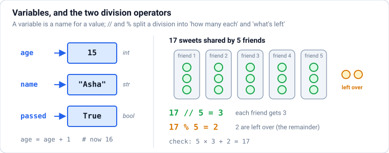

### 2.1 Values, types and variables

A **program** is a list of instructions that Python runs from top to bottom. Every piece of data, a **value**, has a **type**:

| Type | Examples | Holds |
|---|---|---|
| `int` | `7`, `-3`, `0` | whole numbers, of any size |
| `float` | `3.14`, `2.0` | numbers with a decimal point |
| `str` | `"hello"`, `'A'`, `""` | text (a *string* of characters) |
| `bool` | `True`, `False` | yes or no |

A **variable** is a name for a value: `age = 15` stores 15 under the name `age`. The `=` means **store**, not "equals", so `age = age + 1` reads the old value, adds 1 and stores the result. `print` shows values, separated by spaces:

```python
age = 15
age = age + 1
name = "Asha"
print(name, age, type(age), type(3.5), type(name), type(True))
```

**Output:**

```text
Asha 16 <class 'int'> <class 'float'> <class 'str'> <class 'bool'>
```

### 2.2 Arithmetic: // and %

| Operator | Meaning | Example | Result |
|---|---|---|---|
| `+` `-` `*` | add, subtract, multiply | `7 * 3` | 21 |
| `/` | divide (always a float) | `7 / 2` | 3.5 |
| `//` | **floor division**: how many whole times | `17 // 5` | 3 |
| `%` | **modulo**: the remainder | `17 % 5` | 2 |
| `**` | power | `2 ** 10` | 1024 |

`//` and `%` are the most useful operators in DSA. Share 17 sweets between 5 friends: each gets `17 // 5 = 3`, and `17 % 5 = 2` are left over. Always, `a == (a // b) * b + a % b`.

```python
sweets, friends = 17, 5
print(sweets // friends, sweets % friends, 7 / 2, 2 ** 10)
n = 2025
print(n % 10, n // 10, n % 2 == 0, -7 // 2, -7 % 2)
```

**Output:**

```text
3 2 3.5 1024
5 202 False -4 1
```

Three patterns used everywhere later:

- `n % 2 == 0` means n is **even**;
- `n % 10` is the **last digit** of n, and `n // 10` **removes** it;
- `a % b == 0` means **b divides a** exactly.

`//` rounds **down** (towards minus infinity), so `-7 // 2` is −4, and the remainder then has the divisor's sign: `-7 % 2` is 1. `a, b = 3, 4` assigns two variables at once; `x += 5` is short for `x = x + 5` (likewise `-=`, `*=`, `//=`, `%=`).

### 2.3 Comparisons and decisions

`==`, `!=`, `<`, `>`, `<=`, `>=` give `True` or `False`; combine them with `and`, `or`, `not`. Python allows chains such as `0 <= x < 10`.

`if` runs a block only when its condition is true; `elif` ("else if") tests another condition; `else` catches the rest. Only the first true branch runs. The lines inside a branch are **indented** by 4 spaces: indentation is how Python knows which lines belong to it.

```python
marks = 82
if marks >= 90:
    grade = "A"
elif marks >= 75:
    grade = "B"
elif marks >= 40:
    grade = "C"
else:
    grade = "Fail"
print(grade, 0 <= marks < 100, marks > 90 or marks < 40, not True)
```

**Output:**

```text
B True False False
```

`x if condition else y` picks one of two values in one line: `"even" if n % 2 == 0 else "odd"`.

### 2.4 Functions

A **function** names a group of steps so you can reuse them. `def` creates it; the names in brackets are its **parameters** (inputs); `return` sends the answer back to whoever **called** it:

```python
def is_even(n):
    return n % 2 == 0

def is_leap(year):
    # divisible by 4, except century years, which must be divisible by 400
    return (year % 4 == 0 and year % 100 != 0) or year % 400 == 0

def min_max(a, b):
    if a < b:
        return a, b
    return b, a

print(is_even(10), is_even(7), is_leap(2024), is_leap(1900), is_leap(2000))
low, high = min_max(9, 4)
print(low, high)
```

**Output:**

```text
True False True False True
4 9
```

`return a, b` returns two values together as a **tuple**, which `low, high = …` unpacks. `print` *shows* a value; `return` *gives it back* so the program can use it. A function without `return` gives back `None`. Write functions that return answers and print outside them: LeetCode expects exactly this.

### 2.5 A first look at lists and strings

A **list** is a row of boxes holding several values. Boxes are numbered from **0**, so `marks[0]` is the first; `marks[-1]` counts from the end; `len` gives the length; `append` adds at the end. Strings are indexed the same way:

```python
marks = [72, 85, 90]
marks.append(64)
word = "hello"
print(marks, marks[0], marks[-1], len(marks))
print(word[0], word[-1], len(word))
print(f"{word} has {len(word)} letters", abs(-7), max(3, 9), min(3, 9), str(42) + "!")
```

**Output:**

```text
[72, 85, 90, 64] 72 64 4
h o 5
hello has 5 letters 7 9 3 42!
```

An **f-string** (`f"…{expr}…"`) puts values inside text. Chapter 15 covers lists fully and Chapter 16 strings.

### 2.6 Reading input

`input()` reads one line the user types, **always as a string**. Convert with `int()` before doing maths: `"3" + "4"` is `"34"`, but `int("3") + int("4")` is 7. This block isn't run here because it waits for typing:

```python
name = input("Your name: ")
n = int(input("A number: "))
a, b = map(int, input().split())     # two numbers on one line, like "3 4"
print("Hello", name, "- double your number is", 2 * n)
```

### 2.7 Summary

```
int float str bool;  x = value stores;  a, b = b, a swaps
//  floor division (rounds down)   %  remainder   **  power   / always a float
n % 2 == 0 even;  n % 10 last digit;  n // 10 drop last digit;  a % b == 0 b divides a
if … elif … else (indent 4 spaces);  x if cond else y
def f(a, b): return result;  return a, b → a tuple
list: xs[0], xs[-1], len(xs), xs.append(v);  f"{value}";  int(input())
```

**Key terms:**

- **Program:** a list of instructions a computer runs in order.
- **Value:** a piece of data, such as `7` or `"hi"`.
- **Type:** the kind of a value: `int`, `float`, `str`, `bool`, …
- **Variable:** a name that refers to a value.
- **Floor division (`//`):** division rounded down to a whole number.
- **Modulo (`%`):** the remainder after division.
- **Condition:** an expression that is `True` or `False`, used by `if` and `while`.
- **Indentation:** the spaces at the start of a line, which group lines into blocks in Python.
- **Function:** a named, reusable block of code with parameters and a return value.
- **Parameter:** a name for one of a function's inputs.
- **Return value:** the value a function gives back with `return`; `None` if there is none.
- **Tuple:** a fixed group of values in round brackets, such as `(3, 4)`.
- **List:** an ordered, changeable sequence of values, indexed from 0.
- **Index:** the position of an item in a list or string, starting at 0.
- **f-string:** a string starting with `f` whose `{…}` parts are replaced by values.

### Exercises

1. Write `max_of_three(a, b, c)` using only `if`/`else` (no `max`).
2. Write `last_digit(n)` and `without_last_digit(n)` for a positive `n`.
3. Predict, then check: `17 // 4`, `17 % 4`, `-17 // 4`, `-17 % 4`.

<details>
<summary><b>Answers</b></summary>

```python
def max_of_three(a, b, c):
    if a >= b and a >= c:
        return a
    elif b >= c:
        return b
    else:
        return c

def last_digit(n):
    return n % 10

def without_last_digit(n):
    return n // 10

print(max_of_three(4, 9, 2), max_of_three(7, 7, 1), last_digit(2025), without_last_digit(2025))
print(17 // 4, 17 % 4, -17 // 4, -17 % 4)
```

**Output:**

```text
9 7 5 202
4 1 -5 3
```

3. −17 / 4 = −4.25 rounds down to −5, and −17 − (−5 × 4) = 3.

</details>

**Practice:**

| # | Problem (LeetCode) | Difficulty |
|---|---|---|
| 1 | [2235. Add Two Integers](https://leetcode.com/problems/add-two-integers/) | 🟢 Easy |
| 2 | [2469. Convert the Temperature](https://leetcode.com/problems/convert-the-temperature/) | 🟢 Easy |
| 3 | [2413. Smallest Even Multiple](https://leetcode.com/problems/smallest-even-multiple/) | 🟢 Easy |

**Learn more:** [The official Python tutorial](https://docs.python.org/3/tutorial/introduction.html) · [`python.md`](python.md) covers the language in depth

---

## 3. Loops and Dry Runs

**You need:** Chapter 2. · **You'll learn:** `for` and `while` loops, `range`, `break` and `continue`, the three loop patterns (accumulator, counter, best so far), nested loops, and how to trace code by hand with a trace table.

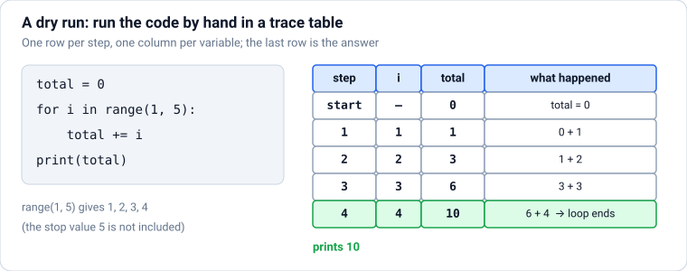

### 3.1 The for loop and range

A **loop** repeats a block of code. A `for` loop runs once for each value of a sequence:

| Code | Values | Remember |
|---|---|---|
| `range(5)` | 0, 1, 2, 3, 4 | starts at 0; the stop value is **not included** |
| `range(1, 6)` | 1, 2, 3, 4, 5 | `range(start, stop)` |
| `range(10, 0, -2)` | 10, 8, 6, 4, 2 | a negative step counts down |
| `for m in marks` | each item | when you need the items |
| `for ch in "abc"` | each character | strings loop like lists |
| `for i, m in enumerate(marks)` | (index, item) pairs | when you need both |

```python
print(list(range(5)), list(range(1, 6)), list(range(10, 0, -2)))
marks = [72, 85, 38, 90, 64]
for i, m in enumerate(marks):
    if m < 40:
        print("failed at index", i)
```

**Output:**

```text
[0, 1, 2, 3, 4] [1, 2, 3, 4, 5] [10, 8, 6, 4, 2]
failed at index 2
```

`list(range(5))` turns the range into a list so it can be printed.

### 3.2 The while loop

`while condition:` repeats as long as the condition is true; something inside must change it, or the loop runs forever (Ctrl+C stops it). Use `for` when you know how many times ("for each item"), `while` when you stop on a condition ("until n reaches 1"):

```python
n, steps = 40, 0
while n > 1:
    n //= 2              # 40 → 20 → 10 → 5 → 2 → 1
    steps += 1
print(steps)
```

**Output:**

```text
5
```

### 3.3 Three loop patterns

Most loops follow one of three patterns:

1. **Accumulator:** start with `total = 0` and add each round.
2. **Counter:** start with `count = 0` and add 1 when something matches.
3. **Best so far:** start with the first item and replace it whenever you find something better.

```python
total = 0
for i in range(1, 5):
    total += i
    print("i =", i, " total =", total)
passed, best = 0, marks[0]
for m in marks:
    if m >= 40:
        passed += 1
    if m > best:
        best = m
print(passed, best)
```

**Output:**

```text
i = 1  total = 1
i = 2  total = 3
i = 3  total = 6
i = 4  total = 10
4 90
```

### 3.4 break, continue and nested loops

`break` leaves the loop at once; `continue` skips the rest of this round. In **nested loops** (a loop inside a loop), the inner loop runs completely for every round of the outer one: 3 outer rounds × 5 inner rounds run the inner body 15 times. `print(x, end=" ")` ends with a space instead of a new line, and `print()` alone ends the line:

```python
for n in range(1, 10):
    if n % 2 == 0:
        continue          # skip even numbers
    if n > 7:
        break             # stop the whole loop
    print(n, end=" ")
print()
for row in range(1, 4):
    for col in range(1, 6):
        print(f"{row * col:3}", end="")    # :3 pads to 3 characters
    print()
```

**Output:**

```text
1 3 5 7 
  1  2  3  4  5
  2  4  6  8 10
  3  6  9 12 15
```

### 3.5 Dry runs and trace tables

A **dry run** runs code by hand, on paper, writing every variable after every step in a **trace table**. Tracing `x = 1; while x < 50: x = x * 3`:

| Step | `x` before | `x < 50`? | `x` after |
|---|---|---|---|
| 1 | 1 | yes | 3 |
| 2 | 3 | yes | 9 |
| 3 | 9 | yes | 27 |
| 4 | 27 | yes | 81 |
| 5 | 81 | no: stop | |

So the loop ends with `x = 81`. Trace the first two rounds, the last round, and any round where something changes direction; that's where off-by-one bugs live. Interviewers ask you to trace your solution on an example: it's how you prove it works without a computer.

```python
x = 1
while x < 50:
    x = x * 3
print(x)
```

**Output:**

```text
81
```

### 3.6 Summary

```
for i in range(start, stop, step)    stop is excluded;  for i, v in enumerate(xs)
while cond:                           something inside must change cond
accumulator (total += x) · counter (count += 1) · best so far (if x > best: best = x)
break leaves the loop; continue skips to the next round;  nested: inner runs fully per outer round
dry run: a trace table of every variable after every step
```

**Key terms:**

- **Loop:** code that repeats a block.
- **for loop:** a loop that runs once for each value of a sequence.
- **range:** a sequence of integers `range(start, stop, step)`, excluding `stop`.
- **while loop:** a loop that repeats while a condition is true.
- **Infinite loop:** a loop whose condition never becomes false.
- **Accumulator:** a variable that collects a running total over a loop.
- **Nested loop:** a loop inside another loop.
- **break / continue:** leave the loop immediately / skip to its next round.
- **Dry run:** executing code by hand to check what it does.
- **Trace table:** a table of each variable's value after each step of a dry run.
- **Off-by-one error:** a bug where a loop runs one time too many or too few.

### Exercises

1. Print the multiplication table of 7 (7 x 1 = 7 … 7 x 10 = 70).
2. Write `count_multiples(n, k)`: how many numbers in 1 … n are divisible by k?
3. Write `smallest(nums)` without using `min`.

<details>
<summary><b>Answers</b></summary>

```python
for i in range(1, 11):
    print(7, "x", i, "=", 7 * i)

def count_multiples(n, k):
    count = 0
    for x in range(1, n + 1):
        if x % k == 0:
            count += 1
    return count

def smallest(nums):
    best = nums[0]
    for x in nums:
        if x < best:
            best = x
    return best

print(count_multiples(20, 3), smallest([8, 3, 9, -2, 5]))
```

**Output:**

```text
7 x 1 = 7
7 x 2 = 14
7 x 3 = 21
7 x 4 = 28
7 x 5 = 35
7 x 6 = 42
7 x 7 = 49
7 x 8 = 56
7 x 9 = 63
7 x 10 = 70
6 -2
```

2. The counter pattern; Chapter 8 shows the one-line answer `n // k`.

</details>

**Practice:**

| # | Problem (LeetCode) | Difficulty |
|---|---|---|
| 1 | [412. Fizz Buzz](https://leetcode.com/problems/fizz-buzz/) | 🟢 Easy |
| 2 | [1342. Number of Steps to Reduce a Number to Zero](https://leetcode.com/problems/number-of-steps-to-reduce-a-number-to-zero/) | 🟢 Easy |
| 3 | [1480. Running Sum of 1d Array](https://leetcode.com/problems/running-sum-of-1d-array/) | 🟢 Easy |
| 4 | [1672. Richest Customer Wealth](https://leetcode.com/problems/richest-customer-wealth/) | 🟢 Easy |
| 5 | [1512. Number of Good Pairs](https://leetcode.com/problems/number-of-good-pairs/) | 🟢 Easy |

**Learn more:** [Python Tutor](https://pythontutor.com/visualize.html) (paste any loop above and step through it)

---

## 4. Pattern Printing I: Squares and Triangles

**You need:** Chapter 3. · **You'll learn:** a four-step method that turns any picture into nested loops, applied to squares, triangles and number triangles.

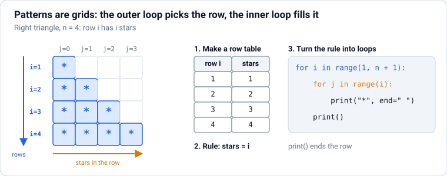

### 4.1 The four-step method

Printing a shape is colouring squares on graph paper one row at a time: the **outer loop** moves down the rows, the **inner loop** prints along one row. It's the best practice there is for nested loops: turning "what should happen" into exact loop bounds.

1. **Count the rows.** That's the outer loop: `for i in range(1, n + 1)`, where `i` is the row number.
2. **Describe one row.** For rows 1 to 4, write down what is printed and how many.
3. **Find the rule** in terms of `i` and `n`.
4. **Write the inner loop** from the rule, then `print()` to end the row.

For a right triangle:

| Row `i` | Stars | Rule |
|---|---|---|
| 1 | 1 | stars = i |
| 2 | 2 | |
| 3 | 3 | |
| 4 | 4 | |

### 4.2 Squares and triangles

```python
def square(n):
    for i in range(n):              # n rows
        for j in range(n):          # n stars in every row
            print("*", end=" ")
        print()                     # end of the row

def right_triangle(n):
    for i in range(1, n + 1):       # row i ...
        for j in range(i):          # ... has i stars
            print("*", end=" ")
        print()

square(4)
print()
right_triangle(4)
```

**Output:**

```text
* * * * 
* * * * 
* * * * 
* * * * 

* 
* * 
* * * 
* * * *
```

For an **inverted** triangle the rule becomes stars = n − i + 1; simpler still, make the outer loop count down:

```python
def inverted_triangle(n):
    for i in range(n, 0, -1):       # rows n, n-1, ..., 1
        for j in range(i):
            print("*", end=" ")
        print()

inverted_triangle(4)
```

**Output:**

```text
* * * * 
* * * 
* * 
*
```

### 4.3 Number triangles

When a row prints numbers, ask *which* number: the column number `j` (1 2 3) or the row number `i` (3 3 3)?

```python
def number_triangle(n):
    for i in range(1, n + 1):
        for j in range(1, i + 1):
            print(j, end=" ")       # the column number
        print()

def row_number_triangle(n):
    for i in range(1, n + 1):
        for j in range(i):
            print(i, end=" ")       # the row number, i times
        print()

number_triangle(4)
print()
row_number_triangle(4)
```

**Output:**

```text
1 
1 2 
1 2 3 
1 2 3 4 

1 
2 2 
3 3 3 
4 4 4 4
```

### 4.4 The string-repeat shortcut

Multiplying a string repeats it: `"* " * 3` is `"* * * "`. So one `print` can draw a whole row. Learn the loop version first: the shortcut only works when a row is one repeated piece.

```python
for i in range(1, 4):
    print("* " * i)
```

**Output:**

```text
* 
* * 
* * *
```

### 4.5 Cost

A pattern with n rows, where row i prints about i characters, prints 1 + 2 + … + n = n(n + 1)/2 characters, so the work grows like n²: doubling n makes it about 4 times as long. Chapter 13 names this **O(n²)**.

### 4.6 Summary

```
outer loop = rows (i);  inner loop = what one row prints;  print() ends the row
row table → rule in i and n → inner loop bounds
square: n × n;  triangle: i per row;  inverted: count i down;  "* " * i repeats a string
```

**Key terms:**

- **Pattern printing:** drawing shapes with characters, as nested-loop practice.
- **Row table:** a table of what each row prints, used to find the rule for the inner loop.
- **String repetition:** `s * k`, which joins k copies of the string s.

### Exercises

1. A rectangle of `#` with `rows` rows and `cols` columns.
2. Each row counts down from `i` to 1 (`3 2 1` in row 3).
3. An inverted triangle of the row's number (`4 4 4 4`, then `3 3 3`, …).

<details>
<summary><b>Answers</b></summary>

```python
def rectangle(rows, cols):
    for i in range(rows):
        for j in range(cols):
            print("#", end=" ")
        print()

def countdown_triangle(n):
    for i in range(1, n + 1):
        for j in range(i, 0, -1):
            print(j, end=" ")
        print()

def inverted_row_numbers(n):
    for i in range(n, 0, -1):
        for j in range(i):
            print(i, end=" ")
        print()

rectangle(3, 5)
countdown_triangle(4)
inverted_row_numbers(4)
```

**Output:**

```text
# # # # # 
# # # # # 
# # # # # 
1 
2 1 
3 2 1 
4 3 2 1 
4 4 4 4 
3 3 3 
2 2 
1
```

</details>

**Learn more:** [HackerRank: Loops](https://www.hackerrank.com/challenges/python-loops/problem)

---

## 5. Pattern Printing II: Pyramids, Diamonds and Hollow Shapes

**You need:** Chapter 4. · **You'll learn:** rows with two parts (spaces then stars), building bigger shapes from smaller ones, and hollow shapes with a decision inside the inner loop.

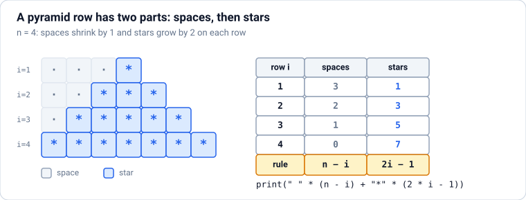

### 5.1 Spaces before the stars

A pyramid row is "some spaces, then some stars": the spaces push it right. Make the row table with one column per part. For n = 4:

| Row `i` | Spaces | Stars |
|---|---|---|
| 1 | 3 | 1 |
| 2 | 2 | 3 |
| 3 | 1 | 5 |
| 4 | 0 | 7 |

The rules: spaces = n − i, and stars = 2i − 1 (the odd numbers). Two inner loops, one per part:

```python
def pyramid(n):
    for i in range(1, n + 1):
        for s in range(n - i):          # part 1: spaces
            print(" ", end="")
        for j in range(2 * i - 1):      # part 2: stars
            print("*", end="")
        print()

def right_aligned_triangle(n):
    for i in range(1, n + 1):
        print(" " * (n - i) + "*" * i)  # the same idea with string repetition

pyramid(4)
right_aligned_triangle(4)
```

**Output:**

```text
   *
  ***
 *****
*******
   *
  **
 ***
****
```

### 5.2 Shapes from shapes

A **diamond** is a pyramid followed by an upside-down pyramid; print the widest row only once, so the bottom half starts at n − 1. A **butterfly** is two triangles facing each other, with 2(n − i) spaces between them:

```python
def pyramid_row(n, i):
    return " " * (n - i) + "*" * (2 * i - 1)

def diamond(n):
    for i in range(1, n + 1):
        print(pyramid_row(n, i))
    for i in range(n - 1, 0, -1):       # skip the middle row
        print(pyramid_row(n, i))

def butterfly(n):
    for i in list(range(1, n + 1)) + list(range(n - 1, 0, -1)):   # 1 2 3 4 3 2 1
        print("*" * i + " " * (2 * (n - i)) + "*" * i)

diamond(4)
butterfly(4)
```

**Output:**

```text
   *
  ***
 *****
*******
 *****
  ***
   *
*      *
**    **
***  ***
********
***  ***
**    **
*      *
```

`pyramid_row` is a **helper function**: naming one row's rule keeps both halves of the diamond identical.

### 5.3 Hollow shapes

A hollow shape adds a decision **inside** the inner loop: print a star on the border, a space inside. For a square, the border is the first or last row (`i == 0` or `i == n − 1`) or the first or last column:

```python
def hollow_square(n):
    for i in range(n):
        for j in range(n):
            if i == 0 or i == n - 1 or j == 0 or j == n - 1:
                print("*", end=" ")
            else:
                print(" ", end=" ")
        print()

def hollow_pyramid(n):
    for i in range(1, n + 1):
        print(" " * (n - i), end="")
        for j in range(1, 2 * i):       # positions 1 .. 2i-1
            if j == 1 or j == 2 * i - 1 or i == n:
                print("*", end="")      # first, last, or the bottom row
            else:
                print(" ", end="")
        print()

hollow_square(4)
hollow_pyramid(4)
```

**Output:**

```text
* * * * 
*     * 
*     * 
* * * * 
   *
  * *
 *   *
*******
```

### 5.4 Summary

```
pyramid row i: n − i spaces, then 2i − 1 stars
diamond: pyramid rows 1..n, then n−1..1 (middle once);  butterfly: i stars, 2(n − i) spaces, i stars
hollow: inside the inner loop, if on the border → "*", else " "
```

**Key terms:**

- **Helper function:** a small function that names one step of a bigger task, so it can be reused.
- **Hollow shape:** a pattern that prints only the border, using a condition inside the inner loop.

### Exercises

1. An upside-down right-aligned triangle (stars lined up on the right edge).
2. A hollow right triangle.
3. A "sandglass": an inverted pyramid followed by a pyramid, with the one-star row once.

<details>
<summary><b>Answers</b></summary>

```python
def mirrored_inverted(n):
    for i in range(n, 0, -1):
        print(" " * (n - i) + "*" * i)

def hollow_right_triangle(n):
    for i in range(1, n + 1):
        for j in range(1, i + 1):
            print("*" if j == 1 or j == i or i == n else " ", end="")
        print()

def sandglass(n):
    for i in range(n, 0, -1):
        print(pyramid_row(n, i))
    for i in range(2, n + 1):           # growing again, skipping the 1-star row
        print(pyramid_row(n, i))

mirrored_inverted(4)
hollow_right_triangle(4)
sandglass(3)
```

**Output:**

```text
****
 ***
  **
   *
*
**
* *
****
*****
 ***
  *
 ***
*****
```

</details>

**Learn more:** [HackerRank: Staircase](https://www.hackerrank.com/challenges/staircase/problem)

---

## 6. Pattern Printing III: Number and Letter Patterns

**You need:** Chapter 5. · **You'll learn:** to decide which number or letter goes in each position (column, row, counter or formula), character codes with `ord` and `chr`, and Pascal's triangle.

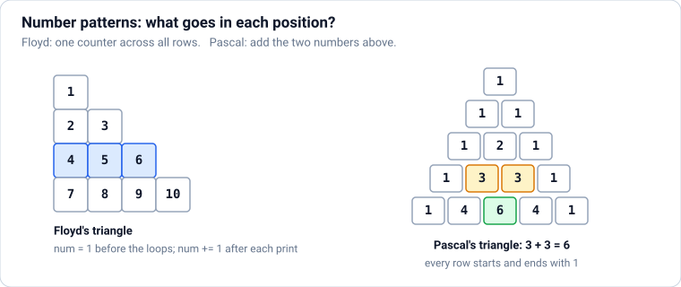

### 6.1 Which value goes where?

The shapes stay simple; the question is which value fills each position:

| The value depends on… | Row 3 | How |
|---|---|---|
| the column `j` | `1 2 3` | print `j` |
| the row `i` | `3 3 3` | print `i` |
| a **counter** that never resets | `4 5 6` (Floyd's triangle) | start `num = 1` before the loops; print it and add 1 |
| a **formula** in `i` and `j` | `1 0 1` | `1 if (i + j) % 2 == 0 else 0` |

```python
def floyd_triangle(n):
    num = 1                         # shared by all rows: never reset
    for i in range(1, n + 1):
        for j in range(i):
            print(num, end=" ")
            num += 1
        print()

def zero_one_triangle(n):
    for i in range(1, n + 1):
        for j in range(1, i + 1):
            print(1 if (i + j) % 2 == 0 else 0, end=" ")
        print()

floyd_triangle(4)
zero_one_triangle(4)
```

**Output:**

```text
1 
2 3 
4 5 6 
7 8 9 10 
1 
0 1 
1 0 1 
0 1 0 1
```

### 6.2 Letters are numbers

Every character has a code number: `ord("A")` is 65, and `chr(65)` turns it back into `"A"`. Letters of the alphabet have consecutive codes, so the j-th letter (from 0) is `chr(ord("A") + j)`:

```python
def letter_triangle(n):
    for i in range(1, n + 1):
        for j in range(i):
            print(chr(ord("A") + j), end=" ")
        print()

def number_palindrome_pyramid(n):
    for i in range(1, n + 1):
        print(" " * (n - i), end="")
        for j in range(1, i + 1):           # climb up: 1 .. i
            print(j, end="")
        for j in range(i - 1, 0, -1):       # climb down: i-1 .. 1
            print(j, end="")
        print()

print(ord("A"), ord("a"), chr(67))
letter_triangle(4)
number_palindrome_pyramid(4)
```

**Output:**

```text
65 97 C
A 
A B 
A B C 
A B C D 
   1
  121
 12321
1234321
```

### 6.3 Pascal's triangle

**Pascal's triangle** starts with a 1; every other number is the **sum of the two numbers above it**, and each row starts and ends with 1. To build the next row from the current one: start with 1, add each pair of neighbours, end with 1:

```
row:       1   3   3   1
pairs:       4   6   4          (1+3, 3+3, 3+1)
next row:  1   4   6   4   1
```

```python
def pascal_triangle(n):
    row = [1]
    for i in range(n):
        print(" " * (n - i - 1) + " ".join(str(x) for x in row))
        next_row = [1]
        for j in range(1, len(row)):
            next_row.append(row[j - 1] + row[j])
        next_row.append(1)
        row = next_row

pascal_triangle(5)
```

**Output:**

```text
    1
   1 1
  1 2 1
 1 3 3 1
1 4 6 4 1
```

`" ".join(str(x) for x in row)` turns each number into text and joins them with spaces (Chapter 16 explains `join`). Build `next_row` separately: changing `row` while reading it would mix old and new values. Row n holds the numbers C(n, k), "n choose k", which count ways to choose k items from n (Chapter 11).

### 6.4 Summary

```
value = column j | row i | running counter (Floyd) | formula in i, j
ord("A") = 65;  chr(65) = "A";  k-th letter = chr(ord("A") + k)
Pascal: next = [1] + [row[j-1] + row[j] for neighbours] + [1];  row n = C(n, k)
```

**Key terms:**

- **Floyd's triangle:** a triangle filled with consecutive numbers 1, 2, 3, … row by row.
- **Character code:** the number that represents a character; `ord` gets it and `chr` turns it back.
- **Pascal's triangle:** a triangle where each number is the sum of the two above it; row n holds the binomial coefficients C(n, k).

### Exercises

1. A "reverse Floyd" triangle counting down from n(n + 1)/2 to 1.
2. Row `i` has the letters from the i-th letter back to A (`C B A` in row 3).
3. Return the n-th row of Pascal's triangle as a list (row 0 is `[1]`).

<details>
<summary><b>Answers</b></summary>

```python
def reverse_floyd(n):
    num = n * (n + 1) // 2
    for i in range(1, n + 1):
        for j in range(i):
            print(num, end=" ")
            num -= 1
        print()

def backward_letters(n):
    for i in range(n):
        for j in range(i, -1, -1):
            print(chr(ord("A") + j), end=" ")
        print()

def pascal_row(n):
    row = [1]
    for _ in range(n):
        next_row = [1]
        for j in range(1, len(row)):
            next_row.append(row[j - 1] + row[j])
        next_row.append(1)
        row = next_row
    return row

reverse_floyd(4)
backward_letters(3)
print(pascal_row(0), pascal_row(4))
```

**Output:**

```text
10 
9 8 
7 6 5 
4 3 2 1 
A 
B A 
C B A 
[1] [1, 4, 6, 4, 1]
```

1. n(n + 1)/2 is how many numbers the triangle holds (Chapter 11 derives it).
3. `_` is a conventional name for a loop variable you don't use.

</details>

**Practice:**

| # | Problem (LeetCode) | Difficulty |
|---|---|---|
| 1 | [118. Pascal's Triangle](https://leetcode.com/problems/pascals-triangle/) | 🟢 Easy |
| 2 | [119. Pascal's Triangle II](https://leetcode.com/problems/pascals-triangle-ii/) | 🟢 Easy |

**Learn more:** [Wikipedia: Pascal's triangle](https://en.wikipedia.org/wiki/Pascal%27s_triangle)

---

# Part II — Maths for Programmers

Six chapters on the number theory behind many problems (digits, divisors, primes, GCD, modulo and binary) and the first comparisons of slow and fast methods.

---

## 7. Working with Digits

**You need:** Chapters 2–3. · **You'll learn:** to read a number's digits with `% 10` and `// 10`, to build a number digit by digit, and the classic digit problems: reversing, palindromes, Armstrong numbers, digital roots and the Luhn check digit.

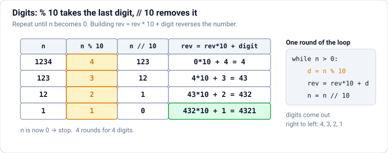

### 7.1 Taking a number apart

Two operators do all the work:

| Operation | Gives | With 1234 |
|---|---|---|
| `n % 10` | the last digit | 4 |
| `n // 10` | the number without its last digit | 123 |

Repeating both in `while n > 0` visits every digit from right to left (4, 3, 2, 1) and stops when `n` reaches 0. Two special cases: `n = 0` has one digit, but the loop never runs; and negative numbers should be handled with `abs(n)`:

```python
def count_digits(n):
    n = abs(n)
    if n == 0:
        return 1
    count = 0
    while n > 0:
        n //= 10
        count += 1
    return count

def sum_digits(n):
    n, total = abs(n), 0
    while n > 0:
        total += n % 10        # take the last digit
        n //= 10               # then drop it
    return total

print(count_digits(1234), count_digits(0), count_digits(-507), sum_digits(1234), sum_digits(9045))
```

**Output:**

```text
4 1 3 10 18
```

**Cost:** one round per digit. A number n has about log₁₀ n digits, so a 9-digit number near a billion takes 9 rounds. Chapter 13 calls this O(log n).

### 7.2 Building a number digit by digit

The reverse move: `result = result * 10 + digit` shifts everything one place left and puts the new digit at the end. Reversing 1234: 0 → 4 → 43 → 432 → 4321.

```python
def reverse_number(n):
    rev = 0
    while n > 0:
        rev = rev * 10 + n % 10
        n //= 10
    return rev

print(reverse_number(1234), reverse_number(1200), len(str(1234)), str(1234)[::-1])
```

**Output:**

```text
4321 21 4 4321
```

Trailing zeros disappear: 1200 reversed is 21. `str(n)` turns a number into text, a fine shortcut in real code (`[::-1]` reverses a string, Chapter 16), but interviewers usually want the arithmetic version.

### 7.3 Classic digit problems

- A **palindrome number** reads the same backwards (121, 1331).
- An **Armstrong number** equals the sum of its digits each raised to the number of digits: 153 = 1³ + 5³ + 3³.
- The **digital root** repeats "add the digits" until one digit remains: 9875 → 29 → 11 → 2.

```python
def is_palindrome_number(n):
    return n >= 0 and n == reverse_number(n)

def is_armstrong(n):
    power = count_digits(n)
    total, m = 0, n            # work on a copy, keep n for the comparison
    while m > 0:
        total += (m % 10) ** power
        m //= 10
    return total == n

def digital_root(n):
    while n >= 10:
        n = sum_digits(n)
    return n

armstrong = []
for x in range(1, 1000):
    if is_armstrong(x):
        armstrong.append(x)
print(is_palindrome_number(121), is_palindrome_number(-121), armstrong, digital_root(9875))
```

**Output:**

```text
True False [1, 2, 3, 4, 5, 6, 7, 8, 9, 153, 370, 371, 407] 2
```

<details>
<summary><b>Why the digital root equals n % 9 (for n &gt; 0, with 9 for multiples of 9)</b></summary>

Write n = d₀ + 10·d₁ + 100·d₂ + …. Since 10 = 9 + 1, every power 10ᵏ leaves remainder 1 when divided by 9, so n and its digit sum leave the **same** remainder mod 9. Repeating the digit sum keeps that remainder until one digit is left; a single digit 1–9 with remainder r is r itself, or 9 when r = 0. So the digital root is `1 + (n - 1) % 9`, with no loop at all.

</details>

### 7.4 A real use: the Luhn check digit

Credit-card numbers end with a **check digit** chosen by the **Luhn algorithm**, so a mistyped number is caught before any payment is tried. From the rightmost digit, double every second digit, subtracting 9 if the result exceeds 9; the number is valid when the total is a multiple of 10:

```python
def luhn_valid(n):
    total, position = 0, 0
    while n > 0:
        d = n % 10
        if position % 2 == 1:      # every second digit from the right
            d *= 2
            if d > 9:
                d -= 9
        total += d
        n //= 10
        position += 1
    return total % 10 == 0

print(luhn_valid(79927398713), luhn_valid(79927398710))
```

**Output:**

```text
True False
```

The check catches every single-digit typo and most swaps of neighbouring digits.

### 7.5 Summary

```
n % 10 last digit;  n // 10 drop it;  while n > 0 visits digits right to left (O(log n) rounds)
build: result = result * 10 + digit
special cases: n == 0 (one digit), negatives (abs), trailing zeros vanish on reversal
palindrome: n == reverse(n);  Armstrong: Σ digitᵏ == n;  digital root = 1 + (n − 1) % 9
```

**Key terms:**

- **Digit:** one of 0–9 in a number's decimal representation.
- **Palindrome number:** a number that reads the same forwards and backwards.
- **Armstrong number:** a number equal to the sum of its digits, each raised to the number of digits.
- **Digital root:** the single digit reached by repeatedly summing a number's digits.
- **Check digit:** an extra digit computed from the others so that typing mistakes can be detected.
- **Luhn algorithm:** the check-digit method used for credit-card numbers.

### Exercises

1. Write `product_of_digits(n)` (234 → 24) and `largest_digit(n)`.
2. Check `digital_root(n) == 1 + (n - 1) % 9` for every n from 1 to 10,000.

<details>
<summary><b>Answers</b></summary>

```python
def product_of_digits(n):
    product = 1
    while n > 0:
        product *= n % 10
        n //= 10
    return product

def largest_digit(n):
    best = 0
    while n > 0:
        best = max(best, n % 10)
        n //= 10
    return best

all_match = True
for n in range(1, 10_001):
    if digital_root(n) != 1 + (n - 1) % 9:
        all_match = False
print(product_of_digits(234), largest_digit(38192), all_match)
```

**Output:**

```text
24 9 True
```

2. `10_001` is 10001: underscores in numbers are only for readability.

</details>

**Practice:**

| # | Problem (LeetCode) | Difficulty |
|---|---|---|
| 1 | [9. Palindrome Number](https://leetcode.com/problems/palindrome-number/) | 🟢 Easy |
| 2 | [7. Reverse Integer](https://leetcode.com/problems/reverse-integer/) | 🟡 Medium |
| 3 | [258. Add Digits](https://leetcode.com/problems/add-digits/) | 🟢 Easy |
| 4 | [1281. Subtract the Product and Sum of Digits of an Integer](https://leetcode.com/problems/subtract-the-product-and-sum-of-digits-of-an-integer/) | 🟢 Easy |
| 5 | [2520. Count the Digits That Divide a Number](https://leetcode.com/problems/count-the-digits-that-divide-a-number/) | 🟢 Easy |

**Learn more:** [Wikipedia: Luhn algorithm](https://en.wikipedia.org/wiki/Luhn_algorithm)

---

## 8. Divisors and Prime Numbers

**You need:** Chapter 7. · **You'll learn:** to find all divisors of n in about √n steps instead of n, why that works, how to test primality, and perfect numbers.

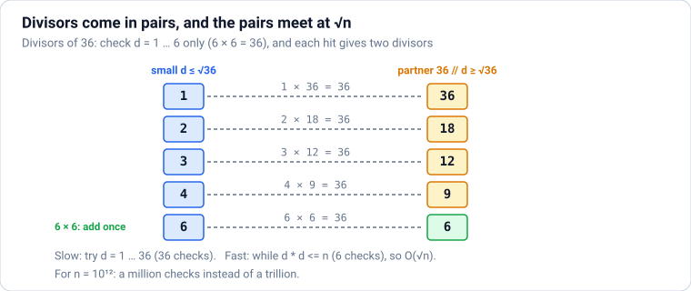

### 8.1 Divisors, the slow way

d is a **divisor** of n when `n % d == 0`. The divisors of 12 are 1, 2, 3, 4, 6, 12. Checking every d from 1 to n takes n rounds: fine for 1,000, hopeless for 10¹².

```python
def divisors_slow(n):
    result = []
    for d in range(1, n + 1):
        if n % d == 0:
            result.append(d)
    return result

print(divisors_slow(36))
```

**Output:**

```text
[1, 2, 3, 4, 6, 9, 12, 18, 36]
```

### 8.2 Divisors come in pairs

If d divides n, so does n // d, because d × (n // d) = n. For 36 the pairs are (1, 36), (2, 18), (3, 12), (4, 9), (6, 6). In every pair one number is at most √n and the other at least √n:

<details>
<summary><b>Why one partner is always ≤ √n</b></summary>

Suppose d × e = n with both d > √n and e > √n. Then d × e > √n × √n = n, a contradiction. So at least one of d, e is ≤ √n. Every pair is therefore found by trying only d = 1, 2, 3, … while d × d ≤ n (which avoids computing a square root with floating point).

</details>

So: try d while `d * d <= n`; each hit gives two divisors, d and n // d, except when d × d = n (a perfect square), where the pair is one number:

```python
def divisors_fast(n):
    small, large = [], []
    d = 1
    while d * d <= n:
        if n % d == 0:
            small.append(d)
            if d != n // d:
                large.append(n // d)
        d += 1
    for x in reversed(large):          # big partners, smallest first
        small.append(x)
    return small

n = 1_000_000
rounds, d = 0, 1
while d * d <= n:
    rounds += 1
    d += 1
print(divisors_fast(36), divisors_fast(97), "rounds for a million:", rounds)
```

**Output:**

```text
[1, 2, 3, 4, 6, 9, 12, 18, 36] [1, 97] rounds for a million: 1000
```

`reversed(xs)` walks a list from the end. About √n rounds instead of n: for n = 10¹², a million instead of a trillion.

### 8.3 Prime numbers

A **prime** has exactly two divisors, 1 and itself: 2, 3, 5, 7, 11, …. 1 is not prime, 2 is the only even prime, and a number above 1 that isn't prime is **composite**. By 8.2, if n has any divisor other than 1 and n, it has one ≤ √n, so trial division up to √n decides primality:

```python
def is_prime(n):
    if n < 2:
        return False
    d = 2
    while d * d <= n:
        if n % d == 0:
            return False
        d += 1
    return True

primes = []
for x in range(1, 51):
    if is_prime(x):
        primes.append(x)
print(primes)
print(is_prime(1), is_prime(2), is_prime(49), is_prime(1_000_003), is_prime(1_000_001))
```

**Output:**

```text
[2, 3, 5, 7, 11, 13, 17, 19, 23, 29, 31, 37, 41, 43, 47]
False True False True False
```

`while d * d < n` (strictly less) would wrongly call 49 = 7 × 7 prime. To test many numbers at once, Chapter 10's sieve is much faster.

### 8.4 Perfect numbers

**Proper divisors** are all divisors except n itself. A **perfect number** equals the sum of its proper divisors: 6 = 1 + 2 + 3, 28 = 1 + 2 + 4 + 7 + 14.

```python
def is_perfect(n):
    total = 0
    for d in divisors_fast(n):
        if d != n:
            total += d
    return total == n

perfect = []
for x in range(2, 10_000):
    if is_perfect(x):
        perfect.append(x)
print(perfect)
```

**Output:**

```text
[6, 28, 496, 8128]
```

### 8.5 Summary

```
d divides n ⇔ n % d == 0;  divisors pair up as (d, n // d), one of each pair ≤ √n
all divisors: d from 1 while d*d <= n, add d and n // d (once if equal)   O(√n)
is_prime: n ≥ 2 and no d in 2..√n divides n   O(√n);  1 is not prime;  2 is the only even prime
perfect: sum of proper divisors == n (6, 28, 496, 8128)
```

**Key terms:**

- **Divisor:** a number that divides another with no remainder.
- **Prime number:** a number greater than 1 whose only divisors are 1 and itself.
- **Composite number:** a number greater than 1 that isn't prime.
- **Trial division:** testing primality by trying divisors up to √n.
- **Proper divisor:** any divisor of n other than n itself.
- **Perfect number:** a number equal to the sum of its proper divisors.

### Exercises

1. Write `count_divisors(n)` with the √n idea (12 has 6 divisors, 36 has 9).
2. Write `next_prime(n)`, the smallest prime bigger than n, and list the twin primes (p, p + 2) below 50.

<details>
<summary><b>Answers</b></summary>

```python
def count_divisors(n):
    count, d = 0, 1
    while d * d <= n:
        if n % d == 0:
            count += 1 if d == n // d else 2
        d += 1
    return count

def next_prime(n):
    candidate = n + 1
    while not is_prime(candidate):
        candidate += 1
    return candidate

twins = []
for p in range(2, 48):
    if is_prime(p) and is_prime(p + 2):
        twins.append((p, p + 2))
print(count_divisors(12), count_divisors(36), next_prime(13), next_prime(90), twins)
```

**Output:**

```text
6 9 17 97 [(3, 5), (5, 7), (11, 13), (17, 19), (29, 31), (41, 43)]
```

1. A perfect square has an odd number of divisors, because its root pairs with itself.

</details>

**Practice:**

| # | Problem (LeetCode) | Difficulty |
|---|---|---|
| 1 | [204. Count Primes](https://leetcode.com/problems/count-primes/) | 🟡 Medium |
| 2 | [1952. Three Divisors](https://leetcode.com/problems/three-divisors/) | 🟢 Easy |
| 3 | [507. Perfect Number](https://leetcode.com/problems/perfect-number/) | 🟢 Easy |
| 4 | [1492. The kth Factor of n](https://leetcode.com/problems/the-kth-factor-of-n/) | 🟡 Medium |

**Learn more:** [Wikipedia: Trial division](https://en.wikipedia.org/wiki/Trial_division)

---

## 9. GCD, LCM and Euclid's Algorithm

**You need:** Chapter 8. · **You'll learn:** the greatest common divisor and least common multiple, Euclid's algorithm, a proof that it's correct and fast, and Python's `math` module.

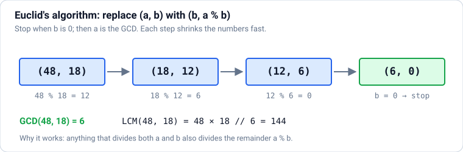

### 9.1 GCD and LCM

- The **GCD** (greatest common divisor, also HCF) of a and b is the largest number dividing both: GCD(12, 18) = 6. It's the biggest square tile that exactly covers an a × b floor.
- The **LCM** (least common multiple) is the smallest number both divide: LCM(4, 6) = 12. It's when two repeating events next line up.

Uses: simplifying fractions (12/18 = 2/3, dividing both by 6), cutting two ropes into equal pieces with nothing left over, and scheduling.

The slow way tries every candidate from min(a, b) down to 1: up to min(a, b) rounds.

### 9.2 Euclid's algorithm

> GCD(a, b) = GCD(b, a % b), and GCD(a, 0) = a.

Replace the pair (a, b) by (b, a % b) until the second number is 0; the first is then the GCD:

```python
def gcd(a, b):
    while b != 0:
        a, b = b, a % b
    return a

a, b = 1071, 462
while b != 0:
    print(a, "%", b, "=", a % b)
    a, b = b, a % b
print("GCD:", a, gcd(48, 18), gcd(17, 5), gcd(0, 9))
```

**Output:**

```text
1071 % 462 = 147
462 % 147 = 21
147 % 21 = 0
GCD: 21 6 1 9
```

<details>
<summary><b>Why it's correct</b></summary>

Write a = q·b + r, where r = a % b. If d divides a and b, it divides a − q·b = r. Conversely, if d divides b and r, it divides q·b + r = a. So the pairs (a, b) and (b, r) have **exactly the same common divisors**, hence the same greatest one. The second number strictly decreases (r < b) and stays ≥ 0, so it reaches 0, and GCD(a, 0) = a because every number divides 0.

</details>

<details>
<summary><b>Why it's fast: the numbers halve every two steps</b></summary>

Take a step (a, b) → (b, r) with a ≥ b. Claim: r < a/2.

- If b ≤ a/2, then r < b ≤ a/2.
- If b > a/2, then a // b = 1, so r = a − b < a − a/2 = a/2.

Two steps turn (a, b) into (r, …), so the first number at least halves every two steps. Starting from a, it reaches 0 within about 2·log₂ a steps: O(log(min(a, b))) in total. For 18-digit numbers that's under 120 steps. (The worst case is two consecutive Fibonacci numbers, Lamé's theorem.)

</details>

### 9.3 LCM from the GCD

a × b = GCD(a, b) × LCM(a, b), because each prime's exponent in the GCD is the smaller of the two and in the LCM the larger, and min + max = sum. So `lcm = a // gcd(a, b) * b`, dividing first to keep numbers small:

```python
def lcm(a, b):
    return a // gcd(a, b) * b

print(lcm(4, 6), lcm(12, 18), lcm(7, 5))
```

**Output:**

```text
12 36 35
```

### 9.4 The math module

Python's standard library has these built in. `import math` loads the `math` **module** (a file of ready-made functions); its functions are then used as `math.name`:

```python
import math
print(math.gcd(1071, 462), math.lcm(4, 6), math.gcd(12, 18, 30), math.isqrt(50))
```

**Output:**

```text
21 12 6 7
```

`math.isqrt(n)` is the exact integer square root, safe for huge numbers where `n ** 0.5` would round. In interviews, write `gcd` yourself if asked; otherwise use `math.gcd`.

### 9.5 Summary

```
gcd(a, b): while b: a, b = b, a % b → a     O(log min(a, b))  (halves every 2 steps)
lcm(a, b) = a // gcd(a, b) * b;  coprime ⇔ gcd == 1
import math: math.gcd, math.lcm, math.isqrt
```

**Key terms:**

- **GCD (greatest common divisor):** the largest number that divides two given numbers.
- **LCM (least common multiple):** the smallest positive number divisible by two given numbers.
- **Euclid's algorithm:** computing the GCD by repeatedly replacing (a, b) with (b, a % b).
- **Coprime:** two numbers whose GCD is 1.
- **Module:** a file of Python code, such as `math`, loaded with `import`.

### Exercises

1. Two buses leave together; one returns every 12 minutes, the other every 18. When do they next leave together?
2. Write `lcm_of_list(nums)` and `are_coprime(a, b)`.
3. Simplify the fraction 84/126.

<details>
<summary><b>Answers</b></summary>

```python
def lcm_of_list(nums):
    result = 1
    for x in nums:
        result = lcm(result, x)
    return result

def are_coprime(a, b):
    return gcd(a, b) == 1

g = gcd(84, 126)
print(lcm(12, 18), lcm_of_list([2, 3, 4, 5]), are_coprime(8, 15), are_coprime(8, 12), f"{84 // g}/{126 // g}")
```

**Output:**

```text
36 60 True False 2/3
```

1. After LCM(12, 18) = 36 minutes.

</details>

**Practice:**

| # | Problem (LeetCode) | Difficulty |
|---|---|---|
| 1 | [1979. Find Greatest Common Divisor of Array](https://leetcode.com/problems/find-greatest-common-divisor-of-array/) | 🟢 Easy |
| 2 | [1071. Greatest Common Divisor of Strings](https://leetcode.com/problems/greatest-common-divisor-of-strings/) | 🟢 Easy |
| 3 | [2413. Smallest Even Multiple](https://leetcode.com/problems/smallest-even-multiple/) | 🟢 Easy |

**Learn more:** [Wikipedia: Euclidean algorithm](https://en.wikipedia.org/wiki/Euclidean_algorithm)

---

## 10. Sieve of Eratosthenes and Prime Factorisation

**You need:** Chapters 8–9. · **You'll learn:** to find all primes up to n by crossing out multiples, why crossing starts at p², the sieve's cost, and how to factorise a number into primes and count its divisors from the factorisation.

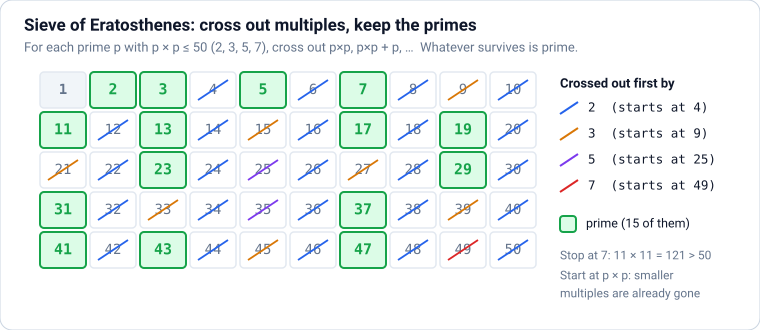

### 10.1 The sieve

To find all primes up to n, testing each number (Chapter 8) costs up to √n per number. The **Sieve of Eratosthenes** crosses out multiples instead:

1. Mark every number 2 … n "maybe prime".
2. Take the next number p still marked: nothing smaller divides it, so it's prime.
3. Cross out its multiples p², p² + p, p² + 2p, …
4. Stop when p² > n. Everything still marked is prime.

Why start at p²? A smaller multiple k·p with k < p has the smaller factor k, so it was already crossed out by a prime ≤ k. In code, the marks are a list of booleans: `[True] * (n + 1)` makes n + 1 boxes all holding `True` (multiplying a list repeats it):

```python
def sieve(n):
    is_prime = [True] * (n + 1)
    is_prime[0] = is_prime[1] = False
    p = 2
    while p * p <= n:
        if is_prime[p]:
            for multiple in range(p * p, n + 1, p):
                is_prime[multiple] = False
        p += 1
    primes = []
    for x in range(n + 1):
        if is_prime[x]:
            primes.append(x)
    return primes

print(sieve(50))
print(len(sieve(1_000_000)), "primes below one million")
```

**Output:**

```text
[2, 3, 5, 7, 11, 13, 17, 19, 23, 29, 31, 37, 41, 43, 47]
78498 primes below one million
```

### 10.2 Cost

Prime p crosses out about n/p numbers, so the total work is about n/2 + n/3 + n/5 + n/7 + … over primes p ≤ √n.

<details>
<summary><b>Why that sum is n log log n</b></summary>

The sum of 1/p over primes p ≤ x grows like ln ln x (Mertens' theorem), much more slowly than the sum of 1/k over all k ≤ x, which grows like ln x. So the work is n × ln ln √n ≈ n ln ln n. For n = 10⁷, ln ln n ≈ 2.8: the sieve does about 3 passes' worth of work over the array. Memory is n + 1 booleans.

</details>

So the sieve is **O(n log log n)**: almost linear. For "all primes up to 10⁷" it takes a fraction of a second, against minutes for testing each number.

### 10.3 Prime factorisation

Every whole number above 1 is a product of primes in exactly one way (the **fundamental theorem of arithmetic**): 360 = 2³ × 3² × 5. To factorise n by trial division, divide out 2 as often as possible, then 3, then 4 (never divides, its 2s are gone), 5, …, while d² ≤ n; whatever is left above 1 is a prime factor:

```python
def prime_factors(n):
    factors = []
    d = 2
    while d * d <= n:
        while n % d == 0:
            factors.append(d)
            n //= d
        d += 1
    if n > 1:
        factors.append(n)
    return factors

print(prime_factors(360), prime_factors(97), prime_factors(1001), prime_factors(2 ** 10))
```

**Output:**

```text
[2, 2, 2, 3, 3, 5] [97] [7, 11, 13] [2, 2, 2, 2, 2, 2, 2, 2, 2, 2]
```

Cost: at most √n rounds of the outer loop, often far fewer, because n shrinks as factors are removed.

### 10.4 Counting divisors from the factorisation

If n = p^a × q^b × …, a divisor picks an exponent 0…a for p, 0…b for q, and so on independently, so n has **(a + 1)(b + 1)…** divisors. For 360 = 2³ × 3² × 5¹: 4 × 3 × 2 = 24.

```python
def count_divisors_from_factors(n):
    factors = prime_factors(n)
    total, i = 1, 0
    while i < len(factors):
        p, exponent = factors[i], 0
        while i < len(factors) and factors[i] == p:   # count repeats of p
            exponent += 1
            i += 1
        total *= exponent + 1
    return total

print(count_divisors_from_factors(360), count_divisors_from_factors(36), count_divisors_from_factors(97))
```

**Output:**

```text
24 9 2
```

### 10.5 Summary

```
sieve: is_prime = [True]*(n+1); for p while p*p <= n: if prime, cross p*p, p*p+p, …   O(n log log n), O(n) memory
factorise: divide out d = 2, 3, … while d*d <= n; leftover > 1 is prime   O(√n)
n = p^a q^b … → (a+1)(b+1)… divisors;  the factorisation is unique
```

**Key terms:**

- **Sieve of Eratosthenes:** finding all primes up to n by crossing out multiples of each prime.
- **Prime factorisation:** writing a number as a product of primes.
- **Fundamental theorem of arithmetic:** every integer above 1 has exactly one prime factorisation.
- **Exponent:** how many times a prime appears in a factorisation, as in the 3 of 2³.

### Exercises

1. Count the primes between 100 and 200 with the sieve.
2. Write `distinct_prime_factors(n)` (360 → [2, 3, 5]) and `largest_prime_factor(n)` (13195 → 29).

<details>
<summary><b>Answers</b></summary>

```python
count = 0
for p in sieve(200):
    if p >= 100:
        count += 1

def distinct_prime_factors(n):
    result = []
    for p in prime_factors(n):
        if len(result) == 0 or result[-1] != p:    # factors come in increasing order
            result.append(p)
    return result

print(count, distinct_prime_factors(360), prime_factors(13195)[-1])
```

**Output:**

```text
21 [2, 3, 5] 29
```

</details>

**Practice:**

| # | Problem (LeetCode) | Difficulty |
|---|---|---|
| 1 | [204. Count Primes](https://leetcode.com/problems/count-primes/) | 🟡 Medium |
| 2 | [263. Ugly Number](https://leetcode.com/problems/ugly-number/) | 🟢 Easy |
| 3 | [2523. Closest Prime Numbers in Range](https://leetcode.com/problems/closest-prime-numbers-in-range/) | 🟡 Medium |
| 4 | [2521. Distinct Prime Factors of Product of Array](https://leetcode.com/problems/distinct-prime-factors-of-product-of-array/) | 🟡 Medium |

**Learn more:** [Wikipedia: Sieve of Eratosthenes](https://en.wikipedia.org/wiki/Sieve_of_Eratosthenes)

---

## 11. Maths Toolbox: Series, Factorials, Fibonacci, Powers and Modulo

**You need:** Chapters 7–10. · **You'll learn:** formulas that replace loops, factorials and Fibonacci numbers, fast power by repeated squaring, modular arithmetic for huge answers, trailing zeros of n!, and combinations.

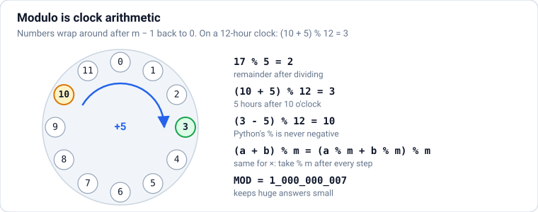

### 11.1 Sums with a formula

Gauss added 1 + 2 + … + 100 by pairing the ends: 1 + 100, 2 + 99, … gives 50 pairs of 101, so 5,050.

<details>
<summary><b>Derivation: 1 + 2 + … + n = n(n + 1)/2</b></summary>

Write the sum S forwards and backwards and add the columns:

```
 S =  1   +   2   + … +   n
 S =  n   + (n−1) + … +   1
2S = (n+1) + (n+1) + … + (n+1)    (n columns)
```

So 2S = n(n + 1), and S = n(n + 1)/2. The same trick gives any arithmetic series: n terms average (first + last)/2, so the sum is n(first + last)/2.

</details>

| Sum | Formula |
|---|---|
| 1 + 2 + … + n | n(n + 1)/2 |
| 1² + 2² + … + n² | n(n + 1)(2n + 1)/6 |
| a + (a + d) + … (n terms) | n(first + last)/2 |
| 1 + r + r² + … + rⁿ⁻¹ | (rⁿ − 1)/(r − 1) |

A loop needs n rounds; the formula one step, however big n is:

```python
def sum_to_n_loop(n):
    total = 0
    for i in range(1, n + 1):
        total += i
    return total

def sum_to_n_formula(n):
    return n * (n + 1) // 2

print(sum_to_n_loop(100), sum_to_n_formula(100), sum_to_n_formula(10 ** 9))
```

**Output:**

```text
5050 5050 500000000500000000
```

The geometric sum shows up constantly in costs: 1 + 2 + 4 + … + 2ᵏ⁻¹ = 2ᵏ − 1, less than the next power of two. (Multiply S by r and subtract S: everything cancels except rⁿ − 1.)

### 11.2 Factorials and Fibonacci numbers

n! = 1 × 2 × … × n (and 0! = 1) counts the orders of n things: 3 books can stand in 3! = 6 orders. It grows very fast: 20! has 19 digits. Python integers never overflow, but other languages need care.

The **Fibonacci numbers** 0, 1, 1, 2, 3, 5, 8, … each equal the sum of the two before. Two variables slide forward:

```python
def factorial(n):
    result = 1
    for i in range(2, n + 1):
        result *= i
    return result

def fibonacci(n):
    a, b = 0, 1                 # F(0), F(1)
    for _ in range(n):
        a, b = b, a + b
    return a

fibs = []
for i in range(10):
    fibs.append(fibonacci(i))
print(factorial(0), factorial(5), factorial(20), fibs)
```

**Output:**

```text
1 120 2432902008176640000 [0, 1, 1, 2, 3, 5, 8, 13, 21, 34]
```

### 11.3 Fast power

`x ** n` with a loop takes n multiplications. **Exponentiation by squaring** takes about log₂ n: write n in binary (Chapter 12); 3¹³ = 3⁸ × 3⁴ × 3¹ because 13 = 1101₂. Walk through the bits from the right: when the bit is 1, multiply the answer by the current power; square the power; halve n:

```python
def fast_power(base, exp):
    result = 1
    while exp > 0:
        if exp % 2 == 1:        # this bit is 1: use the current power
            result *= base
        base *= base            # next power: base², base⁴, base⁸, …
        exp //= 2
    return result

print(fast_power(3, 13), 3 ** 13, fast_power(2, 10))
```

**Output:**

```text
1594323 1594323 1024
```

Trace for 3¹³: (exp 13, odd → result 3), base 9, exp 6 → (even), base 81, exp 3 → (odd → result 243), base 6561, exp 1 → (odd → result 1,594,323), exp 0. Four rounds instead of 13.

### 11.4 Modular arithmetic

When answers are huge, problems ask for them "modulo 10⁹ + 7". **Modular arithmetic** is clock arithmetic: on a 12-hour clock, 5 hours after 10 o'clock is (10 + 5) % 12 = 3. The key rules:

- (a + b) % m = ((a % m) + (b % m)) % m
- (a × b) % m = ((a % m) × (b % m)) % m
- (a − b) % m: Python's `%` always returns 0 … m − 1, even for negatives, so it just works

<details>
<summary><b>Why % can be taken after every step</b></summary>

Write a = q₁m + r₁ and b = q₂m + r₂. Then a + b = (q₁ + q₂)m + (r₁ + r₂), and ab = (q₁q₂m + q₁r₂ + q₂r₁)m + r₁r₂. In both, everything except the r terms is a multiple of m, so the remainder of the result depends only on r₁ and r₂. Reducing early never changes the final remainder, and keeps the numbers small.

</details>

```python
MOD = 1_000_000_007

def fast_power_mod(base, exp, m):
    result, base = 1, base % m
    while exp > 0:
        if exp % 2 == 1:
            result = result * base % m
        base = base * base % m
        exp //= 2
    return result

print(fast_power_mod(2, 1000, MOD), pow(2, 1000, MOD), (10 + 5) % 12, (3 - 5) % 12, -7 % 3)
```

**Output:**

```text
688423210 688423210 3 10 2
```

`pow(x, n, m)` is the built-in version. Division is the exception to the rules: dividing by a under modulo means multiplying by its **modular inverse** a⁻¹, the number with a × a⁻¹ % m = 1. When m is prime, a⁻¹ = a^(m−2) % m (Fermat's little theorem), and `pow(a, -1, m)` computes it.

### 11.5 Trailing zeros of n!

Each trailing zero of n! is a factor 10 = 2 × 5, and there are always more 2s than 5s, so count the 5s: every multiple of 5 gives one, every multiple of 25 one more, and so on: n//5 + n//25 + n//125 + …

```python
def trailing_zeros_of_factorial(n):
    count, power_of_5 = 0, 5
    while power_of_5 <= n:
        count += n // power_of_5
        power_of_5 *= 5
    return count

digits = str(factorial(100))
print(trailing_zeros_of_factorial(5), trailing_zeros_of_factorial(100), len(digits) - len(digits.rstrip("0")))
```

**Output:**

```text
1 24 24
```

The last number checks the formula on the real 158-digit 100!: `rstrip("0")` removes the zeros at the end, so the length difference counts them.

### 11.6 Combinations

"In how many ways can I choose r items from n, ignoring order?" is **n choose r**: C(n, r) = n! / (r!(n − r)!). Choosing 2 of 4 friends: 4!/(2!·2!) = 6. These are exactly the numbers in Pascal's triangle (Chapter 6.3). Under a modulo, divide by multiplying with inverses:

```python
import math

def ncr_mod(n, r, p=MOD):
    fact = [1] * (n + 1)
    for i in range(2, n + 1):
        fact[i] = fact[i - 1] * i % p
    return fact[n] * pow(fact[r], -1, p) % p * pow(fact[n - r], -1, p) % p

print(math.comb(4, 2), math.comb(52, 5), ncr_mod(52, 5), pow(3, -1, 7), 3 * pow(3, -1, 7) % 7)
```

**Output:**

```text
6 2598960 2598960 5 1
```

`p=MOD` is a default parameter value. 5 is the inverse of 3 mod 7, since 3 × 5 = 15 = 2 × 7 + 1.

### 11.7 Summary

```
1+…+n = n(n+1)/2;  1²+…+n² = n(n+1)(2n+1)/6;  1+2+4+…+2^(k−1) = 2^k − 1
fib: a, b = b, a + b;   n! grows faster than any power
fast power: if exp odd: result *= base; base *= base; exp //= 2     O(log n);  pow(x, n, m)
mod: reduce after every + and ×; Python % is never negative; divide via inverse pow(a, -1, p)
zeros of n! = Σ n // 5^k;   C(n, r) = n! / (r!(n−r)!) = math.comb(n, r)
```

**Key terms:**

- **Arithmetic series:** a sum of terms with a constant difference, such as 1 + 2 + 3 + ….
- **Geometric series:** a sum of terms with a constant ratio, such as 1 + 2 + 4 + 8.
- **Factorial (n!):** the product 1 × 2 × … × n; the number of orderings of n items.
- **Fibonacci numbers:** the sequence 0, 1, 1, 2, 3, 5, …, each the sum of the previous two.
- **Exponentiation by squaring (fast power):** computing xⁿ in O(log n) multiplications using the binary digits of n.
- **Modular arithmetic:** arithmetic on remainders modulo m, like clock arithmetic.
- **Modular inverse:** the number a⁻¹ with a × a⁻¹ ≡ 1 (mod m), used to divide under a modulo.
- **Combination (n choose r):** the number of ways to choose r items from n when order doesn't matter.
- **Default parameter:** a parameter value used when the caller doesn't pass one.

### Exercises

1. Write `sum_of_squares(n)` with the formula and check it against a loop for n = 10.
2. How many numbers from a to b are divisible by k, in one step?
3. Compute the last 9 digits of 7^(10^18) without a loop of 10¹⁸ steps.

<details>
<summary><b>Answers</b></summary>

```python
def sum_of_squares(n):
    return n * (n + 1) * (2 * n + 1) // 6

check = 0
for i in range(1, 11):
    check += i * i

def count_divisible(a, b, k):
    return b // k - (a - 1) // k        # multiples up to b, minus those below a

print(sum_of_squares(10), check, count_divisible(10, 30, 7), pow(7, 10 ** 18, 10 ** 9))
```

**Output:**

```text
385 385 3 1
```

3. Fast power modulo 10⁹ takes about 60 rounds, since 10¹⁸ has about 60 bits. The answer happens to be 1: the last nine digits are 000000001.

</details>

**Practice:**

| # | Problem (LeetCode) | Difficulty |
|---|---|---|
| 1 | [509. Fibonacci Number](https://leetcode.com/problems/fibonacci-number/) | 🟢 Easy |
| 2 | [70. Climbing Stairs](https://leetcode.com/problems/climbing-stairs/) | 🟢 Easy |
| 3 | [50. Pow(x, n)](https://leetcode.com/problems/powx-n/) | 🟡 Medium |
| 4 | [172. Factorial Trailing Zeroes](https://leetcode.com/problems/factorial-trailing-zeroes/) | 🟡 Medium |
| 5 | [1922. Count Good Numbers](https://leetcode.com/problems/count-good-numbers/) | 🟡 Medium |

**Learn more:** [cp-algorithms: binary exponentiation](https://cp-algorithms.com/algebra/binary-exp.html) · [cp-algorithms: modular inverse](https://cp-algorithms.com/algebra/module-inverse.html)

---

## 12. Number Systems: Decimal and Binary

**You need:** Chapter 7. · **You'll learn:** how place values work in any base, converting between decimal, binary and hexadecimal by hand and with built-ins, and why a number n has about log₂ n bits.

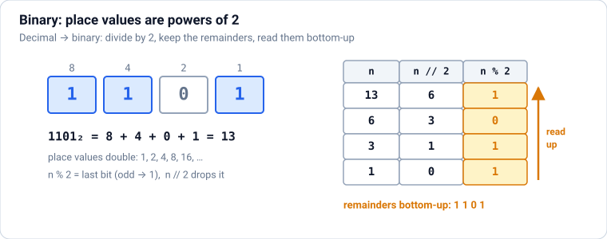

### 12.1 Place values

**Decimal** (base 10) uses the digits 0–9, each place worth 10 times the one to its right: 507 = 5 × 100 + 0 × 10 + 7 × 1. **Binary** (base 2) uses only 0 and 1, each place worth **2** times the one to its right (1, 2, 4, 8, 16, …): 1101₂ = 8 + 4 + 0 + 1 = 13. Computers store everything in binary, because a circuit is reliably either on or off. Each binary digit is a **bit**.

### 12.2 Decimal to binary, and back

Decimal → binary is Chapter 7's digit trick with 2 instead of 10: `n % 2` is the last bit (0 for even, 1 for odd), and `n // 2` drops it. The remainders come out right to left, so each new bit goes on the **left**. Binary → decimal is the build trick: `value = value * 2 + bit`, left to right (1101: 0 → 1 → 3 → 6 → 13):

```python
def to_binary(n):
    if n == 0:
        return "0"
    bits = ""
    while n > 0:
        bits = str(n % 2) + bits        # new bit on the left
        n //= 2
    return bits

def from_binary(bits):
    value = 0
    for b in bits:
        value = value * 2 + int(b)
    return value

print(to_binary(13), to_binary(8), to_binary(255), from_binary("1101"), from_binary("11111111"))
```

**Output:**

```text
1101 1000 11111111 13 255
```

### 12.3 Any base, and hexadecimal

The same method works for any base b with `% b` and `// b`. **Hexadecimal** (base 16) uses 0–9 then A–F for 10–15; one hex digit is exactly 4 bits, so it's a compact way to write binary: web colours (`#FF8800`), memory addresses, hashes. Python has built-ins:

```python
def to_base(n, base):
    digits = "0123456789ABCDEF"
    if n == 0:
        return "0"
    result = ""
    while n > 0:
        result = digits[n % base] + result
        n //= base
    return result

print(to_base(255, 16), to_base(100, 8), to_base(13, 2))
print(bin(13), int("1101", 2), hex(255), int("ff", 16), f"{13:08b}")
```

**Output:**

```text
FF 144 1101
0b1101 13 0xff 255 00001101
```

`f"{13:08b}"` formats 13 in binary, padded with zeros to 8 bits.

### 12.4 How many bits?

With k bits you can write 2ᵏ different numbers, 0 to 2ᵏ − 1 (11.1's geometric sum: 1 + 2 + … + 2ᵏ⁻¹ = 2ᵏ − 1). So n needs k bits where 2ᵏ⁻¹ ≤ n < 2ᵏ, that is k = ⌊log₂ n⌋ + 1. In words: **halving n repeatedly reaches 1 after about log₂ n steps.** That fact is behind every O(log n) algorithm in this book: binary search, balanced trees, heaps, fast power.

```python
for n in [1, 8, 1000, 1_000_000, 10 ** 18]:
    print(n, n.bit_length(), "bits")
```

**Output:**

```text
1 1 bits
8 4 bits
1000 10 bits
1000000 20 bits
1000000000000000000 60 bits
```

1,000 needs 10 bits and a million 20 (since 2¹⁰ = 1,024 ≈ 10³). Powers of two are a 1 followed by zeros: 8 = 1000₂. Chapter 51 works on bits directly with bitwise operators.

### 12.5 Summary

```
base b: digit k is worth b^k;  n % b = last digit, n // b drops it;  build: v = v*b + d
binary: bin(13) = '0b1101'; int('1101', 2) = 13;  hex(255) = '0xff';  f"{n:08b}"
k bits → 2^k values;  n has ⌊log₂ n⌋ + 1 bits (n.bit_length());  halving reaches 1 in ~log₂ n steps
```

**Key terms:**

- **Base (radix):** how many digits a number system uses; each place is worth base times the place to its right.
- **Decimal:** base 10.
- **Binary:** base 2, using only 0 and 1.
- **Bit:** one binary digit.
- **Hexadecimal:** base 16, using 0–9 and A–F; one hex digit is 4 bits.
- **Logarithm (log₂ n):** the power to which 2 must be raised to give n; about how many times n can be halved before reaching 1.

### Exercises

1. Convert 45 to binary by hand (show the remainders), then check with `bin`.
2. Write `count_ones(n)`, the number of 1 bits in n, using `% 2` and `// 2`.
3. Is 1,000,000,000 less than 2³⁰? How many bits does it need?

<details>
<summary><b>Answers</b></summary>

```python
def count_ones(n):
    count = 0
    while n > 0:
        count += n % 2
        n //= 2
    return count

print(bin(45), count_ones(45), count_ones(255), 10 ** 9 < 2 ** 30, (10 ** 9).bit_length())
```

**Output:**

```text
0b101101 4 8 True 30
```

1. 45 → remainders 1, 0, 1, 1, 0, 1 (45, 22, 11, 5, 2, 1); read backwards: 101101.
3. Yes: 2³⁰ = 1,073,741,824. It needs 30 bits.

</details>

**Practice:**

| # | Problem (LeetCode) | Difficulty |
|---|---|---|
| 1 | [191. Number of 1 Bits](https://leetcode.com/problems/number-of-1-bits/) | 🟢 Easy |
| 2 | [67. Add Binary](https://leetcode.com/problems/add-binary/) | 🟢 Easy |
| 3 | [405. Convert a Number to Hexadecimal](https://leetcode.com/problems/convert-a-number-to-hexadecimal/) | 🟢 Easy |
| 4 | [504. Base 7](https://leetcode.com/problems/base-7/) | 🟢 Easy |

**Learn more:** [Khan Academy: binary numbers](https://www.khanacademy.org/computing/computers-and-internet/xcae6f4a7ff015e7d:digital-information/xcae6f4a7ff015e7d:binary-numbers/a/bits-and-binary)

---

# Part III — Core Data Structures and Algorithms

Eight chapters: measuring cost with Big-O, recursion, Python's lists and strings, the basic sorts, linear and binary search, dictionaries and sets, and what every Python operation costs.

---

## 13. Big-O: How Fast Is My Code?

**You need:** Parts I–II. · **You'll learn:** to describe how an algorithm's work grows with its input, the common growth classes, the rules for working out Big-O from code, space complexity, best and worst cases, and what input sizes each class can handle.

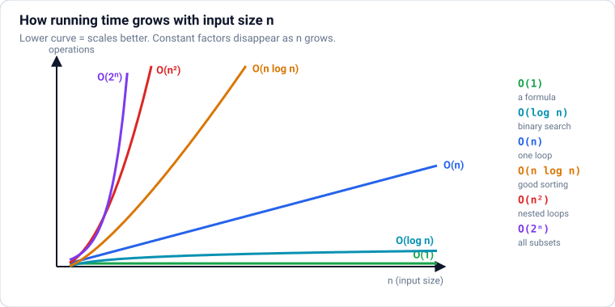

### 13.1 Steps, not seconds

Part II solved the same problems with very different amounts of work:

| Problem | Slow method | Fast method |
|---|---|---|
| 1 + 2 + … + n | loop: n steps | formula: 1 step |
| is n prime? | every divisor: n steps | up to √n: √n steps |
| GCD(a, b) | every candidate: min(a, b) steps | Euclid: about 2 log₂ steps |
| xⁿ | n multiplications | fast power: about log₂ n |

We compare algorithms by **how the number of steps grows as the input grows**, not by seconds, which depend on the computer. **Big-O** names that growth. Counting steps directly for four loops:

```python
def count_steps(n):
    log_steps = sqrt_steps = linear_steps = quadratic_steps = 0
    i = n
    while i > 1:                 # halves each round
        i //= 2
        log_steps += 1
    d = 1
    while d * d <= n:
        d += 1
        sqrt_steps += 1
    for _ in range(n):
        linear_steps += 1
    for _ in range(n):
        for _ in range(n):
            quadratic_steps += 1
    return log_steps, sqrt_steps, linear_steps, quadratic_steps

print(count_steps(16), count_steps(64), count_steps(256))
```

**Output:**

```text
(4, 4, 16, 256) (6, 8, 64, 4096) (8, 16, 256, 65536)
```

Multiplying n by 4 adds 2 to the log count, doubles √n, multiplies the linear count by 4 and the quadratic count by 16. `a = b = 0` sets several names to the same value.

### 13.2 The definition

**f(n) is O(g(n))** if, for all large enough n, f(n) is at most a constant times g(n):

> f(n) ≤ c · g(n) for every n ≥ n₀, for some constants c and n₀.

So Big-O is an **upper bound** on growth, ignoring constant factors and small inputs. 3n + 10 is O(n): take c = 4, then 3n + 10 ≤ 4n once n ≥ 10.

<details>
<summary><b>Why the rules below follow from the definition</b></summary>

- **Drop constants:** if f ≤ c·g then 5f ≤ (5c)·g, still O(g).
- **Keep the biggest term:** for n ≥ 1, n² + n ≤ n² + n² = 2n², so n² + n is O(n²). In general a sum is O of its fastest-growing term.
- **Sequence adds:** if one part is ≤ c₁g and the next ≤ c₂h, together they're ≤ (c₁ + c₂)·max(g, h), so O(g + h).
- **Nesting multiplies:** if an outer loop runs ≤ c₁g times and each round costs ≤ c₂h, the total is ≤ c₁c₂·g·h, so O(g·h).

Related notation: **Ω** (omega) is a lower bound (f ≥ c·g), and **Θ** (theta) means both (the growth is exactly g, up to constants). Interviews say "O" even when they mean Θ.

</details>

### 13.3 Working out Big-O from code

| You see… | Steps | Big-O | Name |
|---|---|---|---|
| no loop depending on n | the same for every n | O(1) | constant |
| n halves each round, or a loop over n's digits | about log n | O(log n) | logarithmic |
| `while d * d <= n` | about √n | O(√n) | square root |
| one loop over n items | n | O(n) | linear |
| n log n, e.g. good sorting (Chapter 29) | | O(n log n) | linearithmic |
| a loop inside a loop, both over n | n² | O(n²) | quadratic |
| every subset of n items (Chapter 47) | 2ⁿ | O(2ⁿ) | exponential |

The rules: keep the fastest-growing term, drop constant factors, add for code in sequence, multiply for nested loops. A **triangle** of loops (inner loop runs i times) is still quadratic, because 1 + 2 + … + n = n(n + 1)/2 (Chapter 11.1):

```python
def triangle_steps(n):
    steps = 0
    for i in range(1, n + 1):
        for j in range(i):
            steps += 1
    return steps

print(triangle_steps(100), 100 * 101 // 2, triangle_steps(200) / triangle_steps(100))
```

**Output:**

```text
5050 5050 3.98019801980198
```

Doubling n multiplied the work by about 4: the signature of O(n²).

### 13.4 What it means in practice

Python does roughly 10⁷ simple steps per second. For n = 10⁶:

| Big-O | Steps | Time |
|---|---|---|
| O(log n) | 20 | instant |
| O(n) | 10⁶ | ~0.1 s |
| O(n log n) | 2 × 10⁷ | ~2 s |
| O(n²) | 10¹² | ~a day |

Turned around, the input limits in a problem statement hint at the expected solution:

| n up to | Acceptable |
|---|---|
| 10–12 | O(n!) or O(2ⁿ · n): try everything |
| 20–25 | O(2ⁿ) |
| 500 | O(n³) |
| 5,000 | O(n²) |
| 10⁵–10⁶ | O(n log n) or O(n) |
| 10⁹ and more | O(log n) or O(1) |

### 13.5 Space, and best and worst cases

**Space complexity** counts extra memory the same way: a few variables are O(1); a list of n items is O(n); the sieve's booleans are O(n). The input itself usually isn't counted.

An algorithm can take different time on different inputs of the same size. Searching a list may find the value first (1 step, the **best case**) or last (n steps, the **worst case**); on random positions it averages n/2 (the **average case**). Big-O statements mean the worst case unless stated otherwise. **Amortised** cost averages over a sequence of operations: a list's `append` occasionally copies everything, yet costs O(1) on average (Chapter 15.5).

### 13.6 Summary

```
f is O(g): f(n) ≤ c·g(n) for all n ≥ n₀  (upper bound; Θ = tight, Ω = lower)
keep the biggest term; drop constants; sequence adds; nesting multiplies; a triangle is still n²
O(1) < O(log n) < O(√n) < O(n) < O(n log n) < O(n²) < O(2ⁿ) < O(n!)
~10⁷ simple Python steps per second;  n ≤ 10⁵ → aim for O(n log n)
space complexity: extra memory;  best / worst / average / amortised cases
```

**Key terms:**

- **Time complexity:** how the number of steps an algorithm takes grows with the input size.
- **Big-O notation:** an upper bound on growth, ignoring constant factors: f is O(g) if f ≤ c·g for large n.
- **Big-Theta (Θ):** a tight bound: growth exactly proportional to g.
- **Big-Omega (Ω):** a lower bound on growth.
- **Constant time, O(1):** work that doesn't depend on the input size.
- **Logarithmic time, O(log n):** work that grows by a constant each time the input doubles.
- **Linear time, O(n):** work proportional to the input size.
- **Quadratic time, O(n²):** work proportional to the square of the input size.
- **Exponential time, O(2ⁿ):** work that doubles with each extra input item.
- **Space complexity:** how the extra memory an algorithm uses grows with the input size.
- **Worst case:** the largest amount of work over all inputs of a given size.
- **Average case:** the expected work over typical or random inputs of a given size.
- **Amortised cost:** the average cost per operation over a long sequence of operations.

### Exercises

What is the Big-O of each snippet?

```
a)  for i in range(n): print(i)            b)  i = 1
    for j in range(n): print(j)                while i < n: i *= 2
c)  for i in range(n):                      d)  total = n * (n + 1) // 2
        for j in range(i, n): print(i, j)
e)  for i in range(n):                      f)  for i in range(n):
        for j in range(5): print(i, j)              j = n
                                                    while j > 1: j //= 2
```

<details>
<summary><b>Answers</b></summary>

- a) O(n): two loops in sequence, n + n.
- b) O(log n): i doubles, reaching n after about log₂ n rounds.
- c) O(n²): n + (n − 1) + … + 1.
- d) O(1).
- e) O(n): the inner loop is a constant 5.
- f) O(n log n): n rounds, each halving from n.

</details>

**Learn more:** [Big-O cheat sheet](https://www.bigocheatsheet.com/) · [MIT 6.006: asymptotic complexity (lecture notes)](https://ocw.mit.edu/courses/6-006-introduction-to-algorithms-spring-2020/)

---

## 14. Recursion Basics

**You need:** Chapters 11 and 13. · **You'll learn:** to write functions that call themselves, the base case and the recursive case, the call stack and the two phases of recursion, the cost of recursive code, and why naive Fibonacci is exponential.

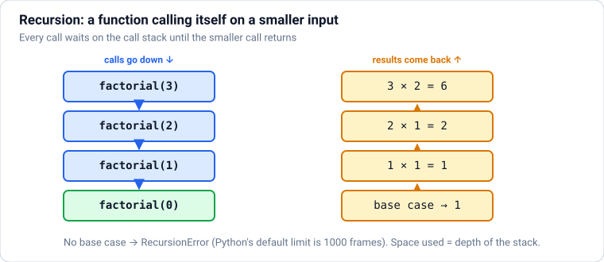

### 14.1 A function that calls itself

A **recursive** function solves a problem by calling itself on a **smaller version** of the same problem. In a long queue, to learn your position you ask the person in front; they ask the person in front of them; the person at the front says "1", and the answers come back, each adding 1.

1. **Base case:** the smallest input, answered directly (the front of the queue). Without one, the calls never stop.
2. **Recursive case:** the answer for n built from the answer for a smaller input: n! = n × (n − 1)!.
3. **Trust it:** assume the smaller call returns the right answer, and check only the base case and one step. (This is induction, Chapter 14.5.)

```python
def factorial(n):
    if n <= 1:                     # base case
        return 1
    return n * factorial(n - 1)    # smaller problem, then combine

def sum_digits(n):
    if n < 10:
        return n
    return n % 10 + sum_digits(n // 10)

def gcd(a, b):
    return a if b == 0 else gcd(b, a % b)

print(factorial(5), sum_digits(9045), gcd(48, 18))
```

**Output:**

```text
120 18 6
```

### 14.2 The call stack: down and back

Every call that hasn't finished waits in memory on the **call stack**, on top of the call that made it. A recursive function runs in two phases: going **down** (calls on smaller inputs until the base case) and coming **back** (answers returning one level at a time). Code before the recursive call runs on the way down; code after it runs on the way back:

```python
def count_down(n):
    if n == 0:
        return
    print(n, end=" ")          # before the call: on the way down
    count_down(n - 1)

def count_up(n):
    if n == 0:
        return
    count_up(n - 1)
    print(n, end=" ")          # after the call: on the way back

count_down(3)
print("|", end=" ")
count_up(3)
print()
```

**Output:**

```text
3 2 1 | 1 2 3
```

Tracing `factorial(4)`: down: f(4) waits on f(3), which waits on f(2), which waits on f(1) = 1; back: f(2) = 2 × 1 = 2, f(3) = 3 × 2 = 6, f(4) = 4 × 6 = 24.

### 14.3 Recursion on ranges

Many recursive functions shrink a *range* of a list or string, passed as two indices. A palindrome check compares the two ends, then the part inside; reversing in place swaps the ends, then reverses the inside:

```python
def is_palindrome(s, lo, hi):
    if lo >= hi:
        return True                     # 0 or 1 characters left
    if s[lo] != s[hi]:
        return False
    return is_palindrome(s, lo + 1, hi - 1)

def reverse_range(nums, lo, hi):
    if lo >= hi:
        return
    nums[lo], nums[hi] = nums[hi], nums[lo]
    reverse_range(nums, lo + 1, hi - 1)

nums = [1, 2, 3, 4, 5]
reverse_range(nums, 0, len(nums) - 1)
print(is_palindrome("racecar", 0, 6), is_palindrome("robot", 0, 4), nums)
```

**Output:**

```text
True False [5, 4, 3, 2, 1]
```

`nums[lo], nums[hi] = nums[hi], nums[lo]` swaps two items in one step.

### 14.4 Cost of recursion

- **Time** = number of calls × work per call. `factorial(n)` makes n calls of O(1) work: O(n).
- **Space** = the deepest the stack gets: every waiting call holds memory, so depth d costs O(d). Python stops at about 1,000 levels:

```python
factorial(5000)
```

**Output:**

```text
Traceback (most recent call last):
  ...
RecursionError: maximum recursion depth exceeded
```

For deep problems use a loop (or raise the limit with `sys.setrecursionlimit`, carefully). Anything recursive can be rewritten with a loop and an explicit stack. Recursion shines when a problem **branches** into several smaller ones: merge sort (Chapter 29), trees (Part VI), backtracking (Chapter 47).

A function that calls itself **twice** can explode. The naive Fibonacci recomputes the same values again and again:

```python
calls = 0
def fib(n):
    global calls
    calls += 1
    if n <= 1:
        return n
    return fib(n - 1) + fib(n - 2)

for n in [10, 20, 25]:
    calls = 0
    print(n, fib(n), calls)
```

**Output:**

```text
10 55 177
20 6765 21891
25 75025 242785
```

`global calls` lets the function change the module-level variable `calls`.

<details>
<summary><b>Derivation: fib(n) makes exactly 2·F(n+1) − 1 calls</b></summary>

Let C(n) be the number of calls made by `fib(n)`. The base cases make one call each: C(0) = C(1) = 1. Otherwise the call itself plus its two sub-calls: C(n) = 1 + C(n − 1) + C(n − 2).

Add 1 to both sides: C(n) + 1 = (C(n − 1) + 1) + (C(n − 2) + 1). So D(n) = C(n) + 1 obeys the Fibonacci rule, with D(0) = D(1) = 2 = 2·F(1) = 2·F(2). Hence D(n) = 2·F(n + 1), and C(n) = 2·F(n + 1) − 1. Check: F(11) = 89, so C(10) = 177. Since F(n) grows like φⁿ with φ = (1 + √5)/2 ≈ 1.618, the calls grow exponentially: O(φⁿ).

</details>

The loop version (Chapter 11.2) takes n steps. Remembering answers already computed, **memoisation**, fixes the recursive version too; Chapter 49 builds dynamic programming on that idea.

### 14.5 Why recursion is correct: induction

A recursive function is correct if (1) the base case is right and (2) assuming the smaller calls are right, the combining step is right. That's **mathematical induction**: true for the smallest case, and "true for n − 1 ⇒ true for n", so true for all n. It's also why you only need to check one step, not trace every level.

### 14.6 Summary

```
recursive function = base case (answer directly) + recursive case (smaller input, then combine)
call stack: down to the base case, then back; code after the call runs on the way back
time = calls × work per call;  space = max depth (Python limit ≈ 1000 → RecursionError)
two calls per level can be exponential: naive fib makes 2·F(n+1) − 1 calls  O(φⁿ)
correctness by induction: base case right + step right ⇒ right for all n
```

**Key terms:**

- **Recursion:** a function calling itself on a smaller version of the problem.
- **Base case:** an input a recursive function answers without recursing.
- **Recursive case:** the part of a recursive function that calls itself on a smaller input.
- **Call stack:** the stack of function calls that have started but not finished.
- **Recursion depth:** how many recursive calls are waiting on the stack at the deepest point.
- **RecursionError:** the error Python raises when recursion goes deeper than its limit.
- **global:** a declaration that lets a function assign to a module-level variable.
- **Memoisation:** storing the results of function calls so repeated calls are answered instantly.
- **Mathematical induction:** proving a statement for all n by proving the smallest case and that each case implies the next.

### Exercises

1. Write `count_digits(n)` recursively.
2. Write `list_sum(nums, i)`, the sum of the items from index i to the end, recursively.
3. Write `power(x, n)` recursively in O(log n) using x^n = (x^(n//2))², times x if n is odd.

<details>
<summary><b>Answers</b></summary>

```python
def count_digits(n):
    return 1 if n < 10 else 1 + count_digits(n // 10)

def list_sum(nums, i):
    if i == len(nums):
        return 0
    return nums[i] + list_sum(nums, i + 1)

def power(x, n):
    if n == 0:
        return 1
    half = power(x, n // 2)          # one recursive call, not two
    return half * half * (x if n % 2 == 1 else 1)

print(count_digits(90210), list_sum([3, 1, 4, 1, 5], 0), power(2, 10), power(3, 13))
```

**Output:**

```text
5 14 1024 1594323
```

3. Computing `half` once is the point: calling `power(x, n // 2)` twice would make the cost O(n) again.

</details>

**Practice:**

| # | Problem (LeetCode) | Difficulty |
|---|---|---|
| 1 | [231. Power of Two](https://leetcode.com/problems/power-of-two/) | 🟢 Easy |
| 2 | [509. Fibonacci Number](https://leetcode.com/problems/fibonacci-number/) | 🟢 Easy |
| 3 | [344. Reverse String](https://leetcode.com/problems/reverse-string/) | 🟢 Easy |
| 4 | [50. Pow(x, n)](https://leetcode.com/problems/powx-n/) | 🟡 Medium |

**Learn more:** [VisuAlgo: recursion tree](https://visualgo.net/en/recursion) · [Python Tutor](https://pythontutor.com/visualize.html)

---

## 15. Arrays and Python Lists

**You need:** Chapters 13–14. · **You'll learn:** how an array sits in memory and why that makes indexing O(1) and inserting at the front O(n); why `append` is amortised O(1); slicing and list comprehensions; 2D lists; and the in-place techniques for array problems.


### 15.1 What an array is

An **array** is a row of boxes **side by side in memory**, numbered from 0. Python's version is the **list** (Chapter 2.5). Because the boxes are contiguous and equal-sized (each holds a reference to a value), the computer finds box i with one calculation, *start + i × box size*: reading or writing `a[i]` is **O(1)**, whatever the length.

Inserting at the front is the opposite: every item must shift one box right to make room, so `insert(0, x)` and `pop(0)` are **O(n)**.

| Operation | Code | Cost | Why |
|---|---|---|---|
| read / write | `a[i]`, `a[i] = x` | O(1) | address arithmetic |
| add / remove at the end | `a.append(x)`, `a.pop()` | O(1) amortised | spare room at the end |
| insert / remove elsewhere | `a.insert(i, x)`, `a.pop(i)` | O(n) | items after i shift |
| search | `x in a`, `a.index(x)`, `a.count(x)` | O(n) | checks items one by one |
| length | `len(a)` | O(1) | stored with the list |
| sum, max, min | `sum(a)`, `max(a)`, `min(a)` | O(n) | visits every item |
| slice | `a[i:j]` | O(j − i) | copies that many items |

```python
a = [10, 20, 30, 40, 50]
print(a[0], a[-1], len(a), a[1:4], a[:2], a[3:], a[::-1])
a.append(60)
a.insert(0, 5)
print(a, a.pop(), a.pop(0), a)
print(30 in a, a.index(30), sum(a), max(a))
```

**Output:**

```text
10 50 5 [20, 30, 40] [10, 20] [40, 50] [50, 40, 30, 20, 10]
[10, 20, 30, 40, 50] 60 5 [10, 20, 30, 40, 50]
True 2 150 50
```

**Slicing** `a[i:j]` copies the items from i up to, not including, j; `a[:j]` from the start, `a[i:]` to the end, `a[::-1]` reversed. A slice is a new list.

### 15.2 Why append is amortised O(1)

A list keeps **spare capacity** at its end; `append` fills the next spare box. When none are left, Python allocates a bigger block, copies everything, and continues. `sys.getsizeof` shows the memory a list object takes, and it jumps only occasionally:

```python
import sys
sizes = []
items = []
for i in range(40):
    size = sys.getsizeof(items)
    if not sizes or size != sizes[-1][1]:
        sizes.append((len(items), size))
    items.append(i)
print(sizes)
```

**Output:**

```text
[(0, 56), (1, 88), (5, 120), (9, 184), (17, 248), (25, 312), (33, 376)]
```

Each jump is a reallocation; between jumps, appends just fill spare room.

<details>
<summary><b>Derivation: growing by a constant factor makes append O(1) on average</b></summary>

Suppose the capacity grows by a factor g > 1 each time it's full (CPython uses about 1.125, plus a small constant). Copying happens at sizes c, cg, cg², …, up to n. The total copying work is c + cg + … + n, a geometric series (Chapter 11.1) at most n · g/(g − 1). For g = 2 that's at most 2n; for g = 1.125, at most 9n. Either way it's O(n) for n appends: **O(1) per append on average**, which is what "amortised O(1)" means. Growing by a fixed number of boxes instead would make the total O(n²).

</details>

### 15.3 List comprehensions

A **list comprehension** builds a list with a loop in one expression. Read `[x * x for x in range(5)]` as "x × x, for each x in range(5)"; an `if` at the end keeps only the items that pass:

```python
squares = [x * x for x in range(6)]
big = [x for x in [7, 2, 9, 4] if x > 3]
print(squares, big)
```

**Output:**

```text
[0, 1, 4, 9, 16, 25] [7, 9, 4]
```

### 15.4 2D lists

A grid is a list of lists: `grid[r][c]` is row r, column c. Create one with a comprehension so each row is a **new** list; `[[0] * cols] * rows` repeats the *same* row object, so changing one changes all:

```python
rows, cols = 2, 3
good = [[0] * cols for _ in range(rows)]
bad = [[0] * cols] * rows
good[0][0] = 1
bad[0][0] = 1
grid = [[1, 2, 3], [4, 5, 6]]
print(good, bad, [sum(row) for row in grid], [[grid[r][c] for r in range(2)] for c in range(3)])
```

**Output:**

```text
[[1, 0, 0], [0, 0, 0]] [[1, 0, 0], [1, 0, 0]] [6, 15] [[1, 4], [2, 5], [3, 6]]
```

The last expression is the **transpose**: rows become columns.

### 15.5 Techniques for array problems

Four techniques solve most easy array problems:

1. **One pass with a "best so far"** variable: maximum, second maximum, counts.
2. **Two indices moving towards each other** from both ends: reversing, palindromes.
3. **A read index and a write index:** the read index visits every item; the write index marks where the next kept item goes, compacting the list in place with O(1) extra memory.
4. **Reversing parts** of the list, for rotations.

```python
def second_largest(nums):
    first = second = None
    for x in nums:
        if first is None or x > first:
            first, second = x, first
        elif x != first and (second is None or x > second):
            second = x
    return second

def move_zeroes(nums):
    write = 0
    for read in range(len(nums)):
        if nums[read] != 0:
            nums[write] = nums[read]
            write += 1
    for i in range(write, len(nums)):
        nums[i] = 0
    return nums

def remove_duplicates_sorted(nums):
    write = 0
    for read in range(len(nums)):
        if read == 0 or nums[read] != nums[read - 1]:
            nums[write] = nums[read]
            write += 1
    return write

nums = [1, 1, 2, 3, 3, 3, 4]
k = remove_duplicates_sorted(nums)
print(second_largest([3, 9, 2, 9, 7]), second_largest([5, 5]), move_zeroes([0, 1, 0, 3, 12]), k, nums[:k])
```

**Output:**

```text
7 None [1, 3, 12, 0, 0] 4 [1, 2, 3, 4]
```

`x is None` tests for `None`, Python's "nothing yet" value.

Rotating right by k in O(1) extra space uses three reversals: reverse all, then the first k, then the rest. `[1..7]` rotated by 3: reverse → 7 6 5 4 3 2 1; reverse first 3 → 5 6 7 | 4 3 2 1; reverse the rest → 5 6 7 1 2 3 4.

```python
def rotate_right(nums, k):
    def reverse(lo, hi):
        while lo < hi:
            nums[lo], nums[hi] = nums[hi], nums[lo]
            lo, hi = lo + 1, hi - 1
    n = len(nums)
    k %= n
    reverse(0, n - 1)
    reverse(0, k - 1)
    reverse(k, n - 1)
    return nums

print(rotate_right([1, 2, 3, 4, 5, 6, 7], 3))
```

**Output:**

```text
[5, 6, 7, 1, 2, 3, 4]
```

A function defined inside another (`reverse`) can use the outer function's variables, here `nums`. Chapter 22 turns techniques 2 and 3 into the general two-pointer method.

### 15.6 Summary

```
a[i] O(1);  append/pop() O(1) amortised;  insert/pop(i)/in/index O(n);  slice a[i:j] copies (O(j−i))
growth by a constant factor ⇒ total copying ≤ g/(g−1)·n ⇒ amortised O(1) append
[expr for x in xs if cond];  grid = [[0]*cols for _ in range(rows)]  (never [[0]*cols]*rows)
techniques: best so far · two ends inwards · read/write indices · reverse parts (rotation)
```

**Key terms:**

- **Array:** a fixed-size sequence of elements stored contiguously in memory, accessed by index.
- **Contiguous memory:** memory locations next to each other, with no gaps.
- **Dynamic array:** an array that grows by reallocating to a bigger block when full; Python's list.
- **Capacity:** how many items a dynamic array can hold before it must grow.
- **Slicing:** taking a copy of part of a list or string with `a[i:j]`.
- **List comprehension:** an expression that builds a list from a loop, such as `[x * x for x in xs]`.
- **2D list (matrix):** a list of lists, indexed as `grid[row][col]`.
- **Transpose:** a matrix with its rows and columns swapped.
- **In-place algorithm:** an algorithm that changes its input directly, using O(1) extra memory.

### Exercises

1. Write `is_sorted(nums)` in one pass.
2. Given a list of daily temperatures, return the indices of days hotter than both neighbours.
3. Why is `for x in nums: nums.insert(0, x)` a bad idea, beyond being O(n²)?

<details>
<summary><b>Answers</b></summary>

```python
def is_sorted(nums):
    for i in range(1, len(nums)):
        if nums[i] < nums[i - 1]:
            return False
    return True

def peaks(temps):
    return [i for i in range(1, len(temps) - 1) if temps[i] > temps[i - 1] and temps[i] > temps[i + 1]]

print(is_sorted([1, 2, 2, 5]), is_sorted([1, 3, 2]), peaks([30, 33, 31, 35, 34, 36, 30]))
```

**Output:**

```text
True False [1, 3, 5]
```

3. It changes the list while looping over it: the loop keeps meeting the items it just inserted, so it never ends. Build a new list instead.

</details>

**Practice:**

| # | Problem (LeetCode) | Difficulty |
|---|---|---|
| 1 | [1929. Concatenation of Array](https://leetcode.com/problems/concatenation-of-array/) | 🟢 Easy |
| 2 | [26. Remove Duplicates from Sorted Array](https://leetcode.com/problems/remove-duplicates-from-sorted-array/) | 🟢 Easy |
| 3 | [283. Move Zeroes](https://leetcode.com/problems/move-zeroes/) | 🟢 Easy |
| 4 | [189. Rotate Array](https://leetcode.com/problems/rotate-array/) | 🟡 Medium |
| 5 | [121. Best Time to Buy and Sell Stock](https://leetcode.com/problems/best-time-to-buy-and-sell-stock/) | 🟢 Easy |
| 6 | [238. Product of Array Except Self](https://leetcode.com/problems/product-of-array-except-self/) | 🟡 Medium |

**Learn more:** [VisuAlgo: array](https://visualgo.net/en/array) · [Python docs: list implementation details (TimeComplexity wiki)](https://wiki.python.org/moin/TimeComplexity)

---

## 16. Strings

**You need:** Chapter 15. · **You'll learn:** strings as immutable sequences, why building a string with `+=` in a loop can be O(n²) and how `join` fixes it, characters as numbers, counting letters with a list of 26, the useful string methods, and the classic string techniques.

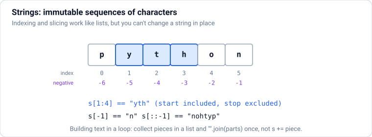

### 16.1 Strings are immutable sequences

A **string** is a sequence of characters. Indexing, negative indexes, slicing, `len` and `for ch in s` work exactly as for lists. The difference: strings are **immutable**, so `s[0] = "P"` is an error, and every "change" builds a new string:

```python
s = "Hello World"
print(len(s), s[0], s[-1], s[6:], s[::-1], "P" + s[1:])
```

**Output:**

```text
11 H d World dlroW olleH Pello World
```

```python
s[0] = "P"
```

**Output:**

```text
Traceback (most recent call last):
  ...
TypeError: 'str' object does not support item assignment
```

### 16.2 Building strings: join, not +=

Because strings can't change, `result += piece` may copy everything built so far. In a loop of n pieces that can cost 1 + 2 + … + n = O(n²) character copies. Collect the pieces in a list and **join** them once, O(total length):

```python
pieces = []
for i in range(5):
    pieces.append(str(i))
print("".join(pieces), "-".join(["a", "b", "c"]), " ".join("the sky is blue".split()[::-1]))
```

**Output:**

```text
01234 a-b-c blue is sky the
```

CPython sometimes optimises `+=` on a string nobody else refers to, but don't rely on it: `join` is guaranteed linear.

### 16.3 Characters are numbers

Every character has a code: `ord("a")` is 97, `chr(98)` is `"b"`. Digits, upper-case and lower-case letters are consecutive:

| Codes | Characters |
|---|---|
| 48–57 | `"0"` … `"9"` |
| 65–90 | `"A"` … `"Z"` |
| 97–122 | `"a"` … `"z"` |

So `ord(c) - ord("a")` turns a lower-case letter into 0–25, perfect as a **list index**. Counting letters with a list of 26 boxes makes an O(n) anagram test (two words are **anagrams** when they have the same letters, in any order):

```python
def letter_counts(s):
    count = [0] * 26
    for ch in s:
        count[ord(ch) - ord("a")] += 1
    return count

def is_anagram(a, b):
    return letter_counts(a) == letter_counts(b)

print(ord("a"), chr(98), ord("z") - ord("a"), letter_counts("banana")[:3], is_anagram("listen", "silent"), is_anagram("rat", "car"))
```

**Output:**

```text
97 b 25 [3, 1, 0] True False
```

`==` on two lists compares them item by item. Python strings are Unicode, so characters beyond English letters have codes too (`ord("₹")` is 8377); the 26-box trick is for problems that promise lower-case English letters.

### 16.4 String methods

Each is O(n):

| Method | Example | Result |
|---|---|---|
| `lower`, `upper` | `"Hi".lower()` | `"hi"` |
| `isalpha`, `isdigit`, `isalnum` | `"a1".isalnum()` | `True` |
| `split()` | `"a b  c".split()` | `["a", "b", "c"]` |
| `strip()` | `"  hi ".strip()` | `"hi"` |
| `replace(a, b)` | `"a-b".replace("-", "+")` | `"a+b"` |
| `find(t)` | `"hello".find("l")` | 2 (−1 if absent) |
| `startswith(t)`, `endswith(t)` | `"python".startswith("py")` | `True` |
| `count(t)` | `"banana".count("a")` | 3 |

`ch in "aeiou"` searches inside a string.

### 16.5 Classic techniques

- **Two ends moving inwards** for palindromes, skipping characters that don't count.
- **Counting** for anagrams and "most common character".
- **Scanning runs** of equal characters with an inner `while` that skips ahead.
- **Shifting letters with `%`**: a Caesar cipher moves each letter k places, wrapping z → a with `% 26` (Chapter 11.4).

```python
def is_palindrome(s):                     # ignore case and non-alphanumerics, O(n), O(1) space
    lo, hi = 0, len(s) - 1
    while lo < hi:
        if not s[lo].isalnum():
            lo += 1
        elif not s[hi].isalnum():
            hi -= 1
        elif s[lo].lower() != s[hi].lower():
            return False
        else:
            lo, hi = lo + 1, hi - 1
    return True

def compress(s):                          # "aaabcc" → "a3b1c2"
    out, i = [], 0
    while i < len(s):
        j = i
        while j < len(s) and s[j] == s[i]:
            j += 1
        out.append(f"{s[i]}{j - i}")
        i = j
    return "".join(out)

def caesar(s, k):
    out = []
    for ch in s:
        if "a" <= ch <= "z":
            out.append(chr((ord(ch) - ord("a") + k) % 26 + ord("a")))
        else:
            out.append(ch)
    return "".join(out)

print(is_palindrome("A man, a plan, a canal: Panama"), compress("aaabcc"), caesar("hello, zebra", 3), caesar(caesar("hello", 3), -3))
```

**Output:**

```text
True a3b1c2 khoor, cheud hello
```

`compress` is O(n) despite the nested `while`: `j` only moves forward, and `i` jumps to `j`, so each character is visited once.

### 16.6 Summary

```
strings: indexing/slicing like lists; immutable (s[0] = … is an error)
build with pieces.append(…) then "".join(pieces): O(n) (not += in a loop: up to O(n²))
ord / chr; letter → 0..25 with ord(c) − ord("a"); counts = [0] * 26
lower upper isalnum split strip replace find startswith count  (each O(n))
two ends inwards · counting · scanning runs (each index moves forward once) · % 26 shifts
```

**Key terms:**

- **String:** an immutable sequence of characters.
- **Immutable:** impossible to change after creation; changes produce new objects.
- **join:** a string method that concatenates a list of strings with a separator, in linear time.
- **ASCII:** the original 128-character code for English letters, digits and symbols.
- **Unicode:** the standard that gives a code to every character in every writing system.
- **Anagram:** a word formed by rearranging the letters of another.
- **Caesar cipher:** shifting each letter a fixed number of places in the alphabet, wrapping around.

### Exercises

1. Write `count_vowels(s)`.
2. Write `longest_common_prefix(words)`.
3. Which character appears most in "mississippi"?

<details>
<summary><b>Answers</b></summary>

```python
def count_vowels(s):
    return len([ch for ch in s.lower() if ch in "aeiou"])

def longest_common_prefix(words):
    prefix = words[0]
    for w in words[1:]:
        while not w.startswith(prefix):
            prefix = prefix[:-1]           # shorten until it fits
    return prefix

counts = letter_counts("mississippi")
best = 0
for i in range(26):
    if counts[i] > counts[best]:      # best so far; ties keep the earlier letter
        best = i
print(count_vowels("Data Structures"), longest_common_prefix(["flower", "flow", "flight"]), chr(ord("a") + best), counts[best])
```

**Output:**

```text
5 fl i 4
```

3. "i" and "s" both appear 4 times; the strict `>` keeps the earlier letter, "i".

</details>

**Practice:**

| # | Problem (LeetCode) | Difficulty |
|---|---|---|
| 1 | [709. To Lower Case](https://leetcode.com/problems/to-lower-case/) | 🟢 Easy |
| 2 | [1768. Merge Strings Alternately](https://leetcode.com/problems/merge-strings-alternately/) | 🟢 Easy |
| 3 | [58. Length of Last Word](https://leetcode.com/problems/length-of-last-word/) | 🟢 Easy |
| 4 | [125. Valid Palindrome](https://leetcode.com/problems/valid-palindrome/) | 🟢 Easy |
| 5 | [242. Valid Anagram](https://leetcode.com/problems/valid-anagram/) | 🟢 Easy |
| 6 | [14. Longest Common Prefix](https://leetcode.com/problems/longest-common-prefix/) | 🟢 Easy |
| 7 | [151. Reverse Words in a String](https://leetcode.com/problems/reverse-words-in-a-string/) | 🟡 Medium |
| 8 | [443. String Compression](https://leetcode.com/problems/string-compression/) | 🟡 Medium |

**Learn more:** [Python docs: string methods](https://docs.python.org/3/library/stdtypes.html#string-methods) · [ASCII table](https://www.asciitable.com/)

---

## 17. Basic Sorting: Selection, Bubble and Insertion Sort

**You need:** Chapters 13 and 15. · **You'll learn:** three simple sorts and why each is correct (its invariant), their costs including best cases, stability, and Python's built-in `sorted` with `key`, `reverse` and `lambda`.

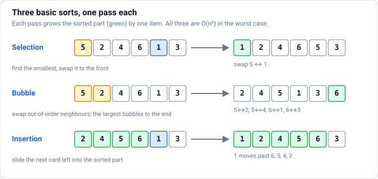

### 17.1 Why sort?

Sorted data is easier to work with: you can binary-search it in O(log n) (Chapter 18), equal items sit next to each other, and the smallest and largest are at the ends. The three basic sorts are O(n²), too slow for big inputs, but they teach how sorting works and are asked in interviews. Each grows a **sorted part** one item per pass.

### 17.2 Selection sort

**"Find the smallest remaining item, put it next."** In pass i, find the smallest item in `a[i:]` and swap it into position i.

```python
def selection_sort(a):
    n = len(a)
    for i in range(n - 1):
        smallest = i
        for j in range(i + 1, n):
            if a[j] < a[smallest]:
                smallest = j
        a[i], a[smallest] = a[smallest], a[i]
    return a

print(selection_sort([5, 2, 4, 6, 1, 3]))
```

**Output:**

```text
[1, 2, 3, 4, 5, 6]
```

**Invariant:** after pass i, `a[:i+1]` holds the i + 1 smallest items in order. An **invariant** is a statement that stays true after every step; proving it holds is how you prove a loop correct. Cost: the inner loop runs (n − 1) + (n − 2) + … + 1 = n(n − 1)/2 times on *every* input, so best and worst are O(n²), but there are at most n − 1 swaps.

### 17.3 Bubble sort

**"Swap neighbours that are out of order."** Each pass walks the list swapping adjacent pairs, so the biggest remaining item "bubbles" to the end. If a pass makes no swaps, the list is sorted and we can stop early:

```python
def bubble_sort(a):
    n = len(a)
    for end in range(n - 1, 0, -1):       # a[end+1:] is already in place
        swapped = False
        for j in range(end):
            if a[j] > a[j + 1]:
                a[j], a[j + 1] = a[j + 1], a[j]
                swapped = True
        if not swapped:
            break
    return a

print(bubble_sort([5, 2, 4, 6, 1, 3]), bubble_sort([1, 2, 3, 4]))
```

**Output:**

```text
[1, 2, 3, 4, 5, 6] [1, 2, 3, 4]
```

**Invariant:** after k passes, the last k items are the k largest, in order. Worst case O(n²); on an already-sorted list the first pass makes no swaps, so the best case is O(n).

### 17.4 Insertion sort

**"Like sorting playing cards in your hand."** Take the next card and slide it left past every bigger card:

```python
a = [5, 2, 4, 6, 1, 3]
for i in range(1, len(a)):
    card, j = a[i], i - 1
    while j >= 0 and a[j] > card:     # shift bigger items one step right
        a[j + 1] = a[j]
        j -= 1
    a[j + 1] = card                   # drop the card into the gap
    print("pass", i, a)
```

**Output:**

```text
pass 1 [2, 5, 4, 6, 1, 3]
pass 2 [2, 4, 5, 6, 1, 3]
pass 3 [2, 4, 5, 6, 1, 3]
pass 4 [1, 2, 4, 5, 6, 3]
pass 5 [1, 2, 3, 4, 5, 6]
```

```python
def insertion_sort(a):
    for i in range(1, len(a)):
        card, j = a[i], i - 1
        while j >= 0 and a[j] > card:
            a[j + 1] = a[j]
            j -= 1
        a[j + 1] = card
    return a
```

**Invariant:** before pass i, `a[:i]` is sorted (though not yet final). Each card moves left past exactly the bigger items before it, so the total work is the number of **inversions**: pairs (i, j) with i < j but a[i] > a[j]. A sorted list has 0 (O(n) total), a reversed one n(n − 1)/2 (O(n²)). So insertion sort is fast on **nearly sorted** data, which is why real sorts use it on small pieces.

### 17.5 Comparison and stability

| Algorithm | Best | Worst | Extra space | Stable? | Good for |
|---|---|---|---|---|---|
| selection | O(n²) | O(n²) | O(1) | no | fewest swaps |
| bubble | O(n) | O(n²) | O(1) | yes | teaching; "already sorted?" |
| insertion | O(n) | O(n²) | O(1) | yes | small or nearly sorted lists |

A sort is **stable** if items with equal keys keep their original order. Sort students by marks with a stable sort, and students with equal marks stay in, say, alphabetical order from an earlier sort. Selection sort's long-distance swap can jump an item past an equal one, so it isn't stable.

### 17.6 Python's built-in sort

In real code use the built-ins. `sorted(a)` returns a **new** sorted list; `a.sort()` sorts in place and returns `None`. Both use **Timsort**: O(n log n) worst case, O(n) on already-sorted runs, and stable. (Chapter 29 shows how O(n log n) is possible.)

- `reverse=True` sorts largest first.
- `key=f` sorts by `f(item)`: `key=len` sorts words by length.
- A **lambda** is a one-line function without a name: `lambda p: p[1]` takes p and returns `p[1]`.
- A key returning a **tuple** sorts by its first value, then breaks ties with the second; tuples compare item by item.

```python
nums = [3, 1, 2]
print(sorted(nums), nums, sorted(nums, reverse=True))
nums.sort()
print(nums, sorted(["banana", "kiwi", "apple"], key=len))
people = [("Asha", 31), ("Ravi", 25), ("Meera", 31), ("Arjun", 25)]
print(sorted(people, key=lambda p: p[1]))
print(sorted(people, key=lambda p: (-p[1], p[0])))
print(max(people, key=lambda p: p[1]), (1, 2) < (1, 3), (2, 0) < (1, 9))
```

**Output:**

```text
[1, 2, 3] [3, 1, 2] [3, 2, 1]
[1, 2, 3] ['kiwi', 'apple', 'banana']
[('Ravi', 25), ('Arjun', 25), ('Asha', 31), ('Meera', 31)]
[('Asha', 31), ('Meera', 31), ('Arjun', 25), ('Ravi', 25)]
('Asha', 31) True False
```

Stability in action: Ravi and Arjun are both 25, and Ravi stays first because he came first. `-p[1]` flips the order to oldest first; `p[0]` then breaks ties alphabetically. `max` and `min` accept `key` too.

### 17.7 Summary

```
selection: pick the min of a[i:], swap to i  O(n²) always, ≤ n−1 swaps, not stable
bubble: swap neighbours; stop when a pass makes no swap  O(n) best, O(n²) worst, stable
insertion: slide each card left  O(n + inversions): O(n) nearly sorted, O(n²) worst, stable
invariant = what stays true after every pass (proves correctness)
sorted(a) new list;  a.sort() in place;  key=lambda x: …;  reverse=True;  tuple keys for tie-breaks  (Timsort, O(n log n), stable)
```

**Key terms:**

- **Sorting:** arranging items in order.
- **Selection sort:** repeatedly selecting the smallest remaining item and moving it into place.
- **Bubble sort:** repeatedly swapping adjacent out-of-order items until none remain.
- **Insertion sort:** inserting each item into its place in the sorted part to its left.
- **Loop invariant:** a condition that holds before and after every iteration of a loop, used to prove it correct.
- **Inversion:** a pair of positions i < j with a[i] > a[j].
- **Stable sort:** a sort that keeps items with equal keys in their original order.
- **Timsort:** Python's built-in sorting algorithm, a stable merge/insertion hybrid that is fast on partly sorted data.
- **Key function:** a function whose result decides the sort order of each item.
- **lambda:** an expression that creates a small anonymous function.

### Exercises

1. Count the inversions of `[3, 1, 2, 5, 4]` with two nested loops; check that insertion sort shifts items exactly that many times.
2. Sort these words by length, longest first, breaking ties alphabetically: "pear", "fig", "apple", "kiwi", "plum".

<details>
<summary><b>Answers</b></summary>

```python
def inversions(a):
    count = 0
    for i in range(len(a)):
        for j in range(i + 1, len(a)):
            if a[i] > a[j]:
                count += 1
    return count

def insertion_shifts(a):
    shifts = 0
    for i in range(1, len(a)):
        card, j = a[i], i - 1
        while j >= 0 and a[j] > card:
            a[j + 1] = a[j]
            j -= 1
            shifts += 1
        a[j + 1] = card
    return shifts

print(inversions([3, 1, 2, 5, 4]), insertion_shifts([3, 1, 2, 5, 4]))
print(sorted(["pear", "fig", "apple", "kiwi", "plum"], key=lambda w: (-len(w), w)))
```

**Output:**

```text
3 3
['apple', 'kiwi', 'pear', 'plum', 'fig']
```

</details>

**Practice:**

| # | Problem (LeetCode) | Difficulty |
|---|---|---|
| 1 | [75. Sort Colors](https://leetcode.com/problems/sort-colors/) | 🟡 Medium |
| 2 | [1051. Height Checker](https://leetcode.com/problems/height-checker/) | 🟢 Easy |
| 3 | [912. Sort an Array](https://leetcode.com/problems/sort-an-array/) | 🟡 Medium |
| 4 | [977. Squares of a Sorted Array](https://leetcode.com/problems/squares-of-a-sorted-array/) | 🟢 Easy |
| 5 | [179. Largest Number](https://leetcode.com/problems/largest-number/) | 🟡 Medium |

**Learn more:** [VisuAlgo: sorting (animated)](https://visualgo.net/en/sorting) · [Python docs: sorting HOW TO](https://docs.python.org/3/howto/sorting.html)

---

## 18. Searching: Linear Search and Binary Search

**You need:** Chapters 12–17. · **You'll learn:** linear search, binary search on sorted data and why it takes O(log n) steps, the lower-bound and upper-bound variants with a template that avoids off-by-one bugs, and Python's `bisect` module.

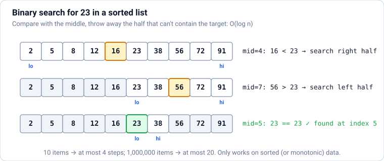

### 18.1 Linear search

**Linear search** checks items one by one: O(n). It works on any list, and it's what `x in a` and `a.index(x)` do:

```python
def linear_search(a, x):
    for i in range(len(a)):
        if a[i] == x:
            return i
    return -1

print(linear_search([4, 8, 1, 9], 1), linear_search([4, 8, 1, 9], 7))
```

**Output:**

```text
2 -1
```

### 18.2 Binary search

On **sorted** data we can do much better. It's the "guess the number" game: guess the middle, hear "higher" or "lower", and half the candidates are gone. Keep a range `lo … hi` where the target could be:

1. look at the middle, `mid = (lo + hi) // 2`;
2. if `a[mid]` is the target, done; if it's too small, the target is right of mid: `lo = mid + 1`; if too big: `hi = mid - 1`;
3. stop when the range is empty (`lo > hi`).

```python
def binary_search(a, x):
    lo, hi = 0, len(a) - 1
    while lo <= hi:
        mid = (lo + hi) // 2
        if a[mid] == x:
            return mid
        if a[mid] < x:
            lo = mid + 1
        else:
            hi = mid - 1
    return -1

a = [2, 5, 8, 12, 16, 23, 38, 56, 72, 91]
print(binary_search(a, 23), binary_search(a, 7), binary_search(a, 2), binary_search(a, 91))
```

**Output:**

```text
5 -1 0 9
```

Trace for 23: range [0, 9] → mid 4 (16 < 23) → [5, 9] → mid 7 (56 > 23) → [5, 6] → mid 5 (23): found in 3 steps.

<details>
<summary><b>Why it takes at most ⌊log₂ n⌋ + 1 steps</b></summary>

Each step looks at one item and keeps at most half of the rest: a range of size m becomes at most ⌊m/2⌋. Starting from n, after k steps at most n/2ᵏ items remain. The search ends once fewer than 1 remain, so k ≤ ⌊log₂ n⌋ + 1 (Chapter 12.4). For a million items: at most 20 steps; for a billion, 30. Correctness: the invariant "if x is in a, it's in a[lo..hi]" holds at the start and after each update, because the discarded half can't contain x in a sorted list.

</details>

```python
def binary_search_steps(a, x):
    lo, hi, steps = 0, len(a) - 1, 0
    while lo <= hi:
        steps += 1
        mid = (lo + hi) // 2
        if a[mid] == x:
            return steps
        if a[mid] < x:
            lo = mid + 1
        else:
            hi = mid - 1
    return steps

million = list(range(1_000_000))
print(binary_search_steps(million, 999_999), binary_search_steps(million, 123_456), binary_search_steps(million, -5))
```

**Output:**

```text
20 16 19
```

The requirement is that the data is sorted; on unsorted data binary search silently gives wrong answers. Sorting first costs O(n log n), worth it only if you'll search many times.

### 18.3 Lower bound and upper bound

Often you need a *position*, not an exact match:

- **lower bound:** the first index with `a[i] >= x`: where x would be inserted, and the first occurrence of a repeated value;
- **upper bound:** the first index with `a[i] > x`. The count of x is upper − lower.

The **half-open template** `[lo, hi)` avoids most off-by-one bugs: `hi` starts at `len(a)` (one past the end), and when `a[mid]` might be the answer we keep it with `hi = mid`:

```python
def lower_bound(a, x):
    lo, hi = 0, len(a)                 # the answer is in [lo, hi]
    while lo < hi:
        mid = (lo + hi) // 2
        if a[mid] < x:
            lo = mid + 1               # mid is too small: discard it
        else:
            hi = mid                   # mid might be the answer: keep it
    return lo

b = [1, 2, 2, 2, 3, 5]
print(lower_bound(b, 2), lower_bound(b, 4), lower_bound(b, 9), lower_bound(b, 0))
```

**Output:**

```text
1 5 6 0
```

The loop always shrinks the range (`mid < hi`), so it can't run forever, and it returns the boundary between "less than x" and "at least x". Changing `<` to `<=` gives the upper bound.

### 18.4 The bisect module

Python's `bisect` module has both. `from bisect import bisect_left, bisect_right` imports just those two functions by name:

```python
from bisect import bisect_left, bisect_right, insort
print(bisect_left(b, 2), bisect_right(b, 2), bisect_right(b, 2) - bisect_left(b, 2))
scores = [10, 20, 30]
insort(scores, 25)                     # insert keeping the list sorted
print(scores)
```

**Output:**

```text
1 4 3
[10, 20, 25, 30]
```

`insort` finds the place in O(log n) but inserting still shifts items, O(n). Chapter 28 shows binary search's most powerful use: searching for an *answer* rather than an item.

### 18.5 Summary

```
linear search O(n), any list;  binary search O(log n), sorted lists only
while lo <= hi: mid = (lo+hi)//2; lo = mid+1 or hi = mid−1     (exact match)
lower bound [lo, hi): lo, hi = 0, len(a); if a[mid] < x: lo = mid+1 else: hi = mid
from bisect import bisect_left, bisect_right, insort;  count(x) = right − left
bugs: lo = mid (no progress), wrong bounds, unsorted input
```

**Key terms:**

- **Linear search:** checking each item in turn until the target is found.
- **Binary search:** finding a target in sorted data by repeatedly halving the search range.
- **Search range:** the part of the data where the target could still be.
- **Lower bound:** the first index whose value is ≥ the target.
- **Upper bound:** the first index whose value is > the target.
- **Half-open interval [lo, hi):** a range that includes lo but not hi.
- **bisect:** Python's module for binary search on sorted lists.

### Exercises

1. Find the first and last positions of 8 in `[5, 7, 7, 8, 8, 10]` with `bisect`.
2. Write `search_insert(a, x)`: the index of x, or where it would be inserted.
3. Integer square root: the largest r with r² ≤ n, by binary search on r.

<details>
<summary><b>Answers</b></summary>

```python
c = [5, 7, 7, 8, 8, 10]
first, last = bisect_left(c, 8), bisect_right(c, 8) - 1

def isqrt(n):
    lo, hi = 0, n
    while lo < hi:
        mid = (lo + hi + 1) // 2       # round up, so lo = mid makes progress
        if mid * mid <= n:
            lo = mid
        else:
            hi = mid - 1
    return lo

print(first, last, lower_bound([1, 3, 5, 6], 5), lower_bound([1, 3, 5, 6], 2), isqrt(50), isqrt(10 ** 12))
```

**Output:**

```text
3 4 2 1 7 1000000
```

2. That's exactly the lower bound.
3. When the update is `lo = mid`, round `mid` up; otherwise a range of size 2 never shrinks.

</details>

**Practice:**

| # | Problem (LeetCode) | Difficulty |
|---|---|---|
| 1 | [704. Binary Search](https://leetcode.com/problems/binary-search/) | 🟢 Easy |
| 2 | [35. Search Insert Position](https://leetcode.com/problems/search-insert-position/) | 🟢 Easy |
| 3 | [278. First Bad Version](https://leetcode.com/problems/first-bad-version/) | 🟢 Easy |
| 4 | [34. Find First and Last Position of Element in Sorted Array](https://leetcode.com/problems/find-first-and-last-position-of-element-in-sorted-array/) | 🟡 Medium |
| 5 | [69. Sqrt(x)](https://leetcode.com/problems/sqrtx/) | 🟢 Easy |
| 6 | [33. Search in Rotated Sorted Array](https://leetcode.com/problems/search-in-rotated-sorted-array/) | 🟡 Medium |

**Learn more:** [Python docs: bisect](https://docs.python.org/3/library/bisect.html) · [Wikipedia: binary search](https://en.wikipedia.org/wiki/Binary_search)

---

## 19. Hashing: Dictionaries and Sets

**You need:** Chapters 15–18. · **You'll learn:** how a hash table turns any key into a slot number so lookups take O(1) on average, collisions and the load factor, dictionaries and sets with their operations, `Counter` and `defaultdict`, and the four hashing patterns behind many interview problems.

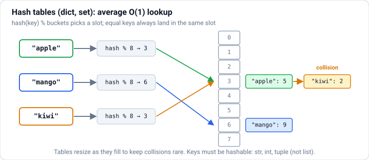

### 19.1 From counting lists to hash tables

Counting how often each value 0–9 appears needs only a list of 10 counters (Chapter 16.3):

```python
def count_small(nums):
    count = [0] * 10
    for x in nums:
        count[x] += 1
    return count

print(count_small([3, 1, 3, 9, 3]))
```

**Output:**

```text
[0, 1, 0, 3, 0, 0, 0, 0, 0, 1]
```

That breaks down when keys aren't small numbers: words, or numbers up to 10¹⁸, would need an impossibly long list. A **hash table** fixes it with a **hash function** that turns any key into a number; `hash(key) % size` then picks one of a modest number of **slots**. Python's `hash` does the first part:

```python
size = 8
print(hash(42), hash(42) % size, hash(10 ** 20) % size, hash((1, 2)) % size)
print(hash("asha") == hash("asha"), hash("asha") == hash("ravi"))
```

**Output:**

```text
42 2 3 3
True False
```

Small integers hash to themselves; tuples combine the hashes of their items. Equal keys always have equal hashes within one run, which is all a table needs. String hashes change between runs of Python (a defence against attackers who craft colliding keys), so never store or print them.

### 19.2 A hash table by hand

Two keys can land in the same slot: a **collision**. The simplest fix, **separate chaining**, keeps a small list of (key, value) pairs in each slot. When the table gets too full, it **resizes** (doubles and re-inserts everything) so chains stay short:

```python
class HashTable:
    def __init__(self):
        self.slots = [[] for _ in range(4)]
        self.count = 0

    def _chain(self, key):
        return self.slots[hash(key) % len(self.slots)]

    def put(self, key, value):
        chain = self._chain(key)
        for i, (k, v) in enumerate(chain):
            if k == key:
                chain[i] = (key, value)        # existing key: replace
                return
        chain.append((key, value))
        self.count += 1
        if self.count > 2 * len(self.slots):    # load factor above 2: grow
            old = [pair for chain in self.slots for pair in chain]
            self.slots = [[] for _ in range(2 * len(self.slots))]
            self.count = 0
            for k, v in old:
                self.put(k, v)

    def get(self, key, default=None):
        for k, v in self._chain(key):
            if k == key:
                return v
        return default

table = HashTable()
for i in range(20):
    table.put(i * 7, f"value{i}")
print(table.get(49), table.get(50, "missing"), len(table.slots), max(len(c) for c in table.slots))
```

**Output:**

```text
value7 missing 16 2
```

The `class` keyword defines a new type of object with its own functions (**methods**); Chapter 30 explains classes properly. Here it just groups the table's data and its `put` and `get`.

<details>
<summary><b>Why lookups are O(1) on average</b></summary>

With n keys in m slots, the **load factor** is α = n/m. If the hash spreads keys evenly and independently, each slot's chain holds α keys on average, so a lookup checks O(1 + α) pairs. Resizing keeps α below a constant (here 2), so lookups are O(1) on average. Resizing doubles m, so its total cost over n insertions is a geometric series, O(n) (as for list `append`, Chapter 15.2): insertion is amortised O(1) too. The **worst case** is O(n): if every key lands in one slot, a lookup scans them all.

</details>

CPython's real `dict` uses **open addressing** instead of chains: on a collision it probes other slots of one big array. The costs are the same.

### 19.3 Dictionaries

A **dict** maps keys to values:

| Operation | Code | Average cost |
|---|---|---|
| create | `{"asha": 31, "ravi": 25}`, `{}` | |
| read | `d[k]` (error if missing), `d.get(k, default)` | O(1) |
| add or change | `d[k] = v` | O(1) |
| check | `k in d` | O(1) |
| delete | `del d[k]` | O(1) |
| loop | `for k, v in d.items()`, `.keys()`, `.values()` | O(n) |

```python
def count_words(words):
    count = {}
    for w in words:
        count[w] = count.get(w, 0) + 1
    return count

ages = {"asha": 31, "ravi": 25}
ages["meera"] = 28
print(count_words(["to", "be", "or", "not", "to", "be"]))
print("ravi" in ages, ages.get("zoe", 0), len(ages), [name for name, age in ages.items() if age > 26])
```

**Output:**

```text
{'to': 2, 'be': 2, 'or': 1, 'not': 1}
True 0 3 ['asha', 'meera']
```

Keys must be **hashable**: in practice, immutable. `int`, `str` and tuples work; lists, dicts and sets don't, because a key that changed after being stored would sit in the wrong slot. Dicts remember insertion order.

```python
bad = {[1, 2]: "list key"}
```

**Output:**

```text
Traceback (most recent call last):
  ...
TypeError: unhashable type: 'list'
```

### 19.4 Sets

A **set** is a hash table of keys only: "have I seen this?" in O(1), and duplicates vanish automatically. `set()` is an empty set (`{}` is an empty dict):

```python
a, b = {1, 2, 3, 4}, {3, 4, 5}
seen = set()
seen.add(7)
print(a | b, a & b, a - b, 7 in seen, set([3, 1, 3, 2, 1]))
```

**Output:**

```text
{1, 2, 3, 4, 5} {3, 4} {1, 2} True {1, 2, 3}
```

`|` is union, `&` intersection, `-` difference. Replacing `x in some_list` (O(n)) with `x in some_set` (O(1)) is the most common way to speed up a slow solution.

### 19.5 Counter and defaultdict

Two helpers from the `collections` module:

- `Counter(items)` counts everything; `.most_common(k)` gives the top k;
- `defaultdict(list)` creates a missing key with an empty list on first touch, so `groups[key].append(x)` just works (`defaultdict(int)` starts at 0).

```python
from collections import Counter, defaultdict
print(Counter("mississippi"), Counter("mississippi").most_common(2))
groups = defaultdict(list)
for word in ["apple", "avocado", "banana", "blueberry", "cherry"]:
    groups[word[0]].append(word)
print(dict(groups))
```

**Output:**

```text
Counter({'i': 4, 's': 4, 'p': 2, 'm': 1}) [('i', 4), ('s', 4)]
{'a': ['apple', 'avocado'], 'b': ['banana', 'blueberry'], 'c': ['cherry']}
```

### 19.6 Four hashing patterns

1. **Counting** frequencies.
2. **"Have I seen it?"** with a set: duplicates, repeated states.
3. **Complement lookup:** for each x, was `target - x` seen? Two Sum in O(n) instead of O(n²).
4. **Grouping** by a shared key: anagrams share their sorted letters.

```python
def contains_duplicate(nums):
    seen = set()
    for x in nums:
        if x in seen:
            return True
        seen.add(x)
    return False

def two_sum(nums, target):
    seen = {}                          # value → index
    for i, x in enumerate(nums):
        if target - x in seen:
            return [seen[target - x], i]
        seen[x] = i
    return []

def group_anagrams(words):
    groups = defaultdict(list)
    for w in words:
        groups["".join(sorted(w))].append(w)
    return list(groups.values())

print(contains_duplicate([1, 2, 3, 1]), two_sum([2, 7, 11, 15], 9), group_anagrams(["eat", "tea", "tan", "ate", "nat", "bat"]))
```

**Output:**

```text
True [0, 1] [['eat', 'tea', 'ate'], ['tan', 'nat'], ['bat']]
```

`sorted("tea")` gives the letters as a sorted list `['a', 'e', 't']`; `"".join` makes the key `"aet"`.

### 19.7 Summary

```
hash table: slot = hash(key) % size; collisions (chaining / open addressing); resize keeps load α bounded
dict/set get, put, in, del: O(1) average, O(n) worst;  keys must be hashable (immutable)
d.get(k, 0)   for k, v in d.items()   set(): | & -   Counter(xs).most_common(k)   defaultdict(list)
patterns: count · seen-set · complement lookup (two sum) · group by key (anagrams)
```

**Key terms:**

- **Hash function:** a function that maps a key to a number, the same every time for the same key.
- **Hash table:** a structure that stores keys in slots chosen by a hash function, for O(1) average lookups.
- **Slot (bucket):** one position in a hash table's array.
- **Collision:** two different keys mapping to the same slot.
- **Separate chaining:** handling collisions by keeping a list of entries in each slot.
- **Open addressing:** handling collisions by probing other slots of the same array.
- **Load factor:** the number of stored keys divided by the number of slots.
- **Hashable:** usable as a dict key or set element; in practice, immutable.
- **Dictionary (dict):** a hash table mapping keys to values.
- **Set:** a hash table of unique keys without values.
- **Counter:** a dict subclass from `collections` that counts items.
- **defaultdict:** a dict from `collections` that creates missing keys with a default value.
- **Class:** a definition of a new type of object with its own data and methods (Chapter 30).

### Exercises

1. Return the index of the first non-repeating character of a string, or −1.
2. Is `ransom` buildable from the letters of `magazine` (each used once)?
3. Find the length of the longest run of consecutive integers in `[100, 4, 200, 1, 3, 2]` in O(n).

<details>
<summary><b>Answers</b></summary>

```python
def first_unique_char(s):
    counts = Counter(s)
    for i, ch in enumerate(s):
        if counts[ch] == 1:
            return i
    return -1

def can_construct(ransom, magazine):
    have = Counter(magazine)
    for ch in ransom:
        if have[ch] == 0:
            return False
        have[ch] -= 1
    return True

def longest_consecutive(nums):
    values, best = set(nums), 0
    for x in values:
        if x - 1 not in values:            # x starts a run
            length = 1
            while x + length in values:
                length += 1
            best = max(best, length)
    return best

print(first_unique_char("leetcode"), first_unique_char("aabb"), can_construct("aab", "baa"), can_construct("aa", "ab"), longest_consecutive([100, 4, 200, 1, 3, 2]))
```

**Output:**

```text
0 -1 True False 4
```

3. Each run is walked once, from its start only, so the total is O(n) even with the inner loop.

</details>

**Practice:**

| # | Problem (LeetCode) | Difficulty |
|---|---|---|
| 1 | [217. Contains Duplicate](https://leetcode.com/problems/contains-duplicate/) | 🟢 Easy |
| 2 | [1. Two Sum](https://leetcode.com/problems/two-sum/) | 🟢 Easy |
| 3 | [242. Valid Anagram](https://leetcode.com/problems/valid-anagram/) | 🟢 Easy |
| 4 | [387. First Unique Character in a String](https://leetcode.com/problems/first-unique-character-in-a-string/) | 🟢 Easy |
| 5 | [383. Ransom Note](https://leetcode.com/problems/ransom-note/) | 🟢 Easy |
| 6 | [49. Group Anagrams](https://leetcode.com/problems/group-anagrams/) | 🟡 Medium |
| 7 | [128. Longest Consecutive Sequence](https://leetcode.com/problems/longest-consecutive-sequence/) | 🟡 Medium |
| 8 | [347. Top K Frequent Elements](https://leetcode.com/problems/top-k-frequent-elements/) | 🟡 Medium |

**Learn more:** [VisuAlgo: hash table](https://visualgo.net/en/hashtable) · [Python docs: collections](https://docs.python.org/3/library/collections.html)

---

## 20. Python's Cost Model: What Each Operation Costs

**You need:** Chapters 13–19. · **You'll learn:** the cost of every common operation on lists, strings, dicts and sets, how to measure running time, and the five Python habits that silently turn O(n) into O(n²).

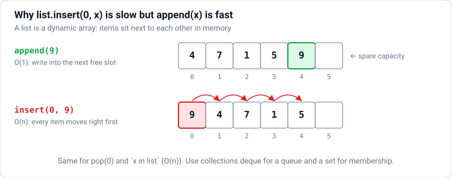

### 20.1 The cost table

| Operation | list | str | dict / set |
|---|---|---|---|
| index `a[i]` | O(1) | O(1) | — |
| look up a key `d[k]` | — | — | O(1) average |
| append / add | O(1) amortised | — (`+` copies) | O(1) average |
| pop from the end | O(1) | — | — |
| insert / pop at front or middle | **O(n)** | — | — |
| `x in …` | **O(n)** | O(n) | **O(1)** average |
| delete a value / key | O(n) | — | O(1) average |
| `len` | O(1) | O(1) | O(1) |
| `sum`, `max`, `min`, `count`, `index` | O(n) | O(n) | O(n) |
| slice `a[i:j]` | O(j − i) | O(j − i) | — |
| sort | O(n log n) | — | — |
| build from n items | O(n) | O(n) with `join` | O(n) |

### 20.2 Measuring

`time.perf_counter()` returns a precise clock reading in seconds; the difference between two readings is the elapsed time. Exact times vary between machines and runs, so compare **ratios**, and repeat a measurement:

```python
import time

def best_time(fn, repeat=5):
    best = float("inf")
    for _ in range(repeat):
        start = time.perf_counter()
        fn()
        best = min(best, time.perf_counter() - start)
    return best

data = list(range(100_000))
lookup = set(data)
queries = list(range(0, 200_000, 200))           # 1,000 queries, half present
list_time = best_time(lambda: [q in data for q in queries])
set_time = best_time(lambda: [q in lookup for q in queries])
print(f"set membership was about {round(list_time / set_time, -2):.0f}× faster", set_time < list_time)
```

**Output:**

```text
set membership was about 14000× faster True
```

`float("inf")` is infinity, a starting value any time beats. A `lambda` with no parameters wraps code to run later. 1,000 list searches of 100,000 items each do up to 10⁸ comparisons; 1,000 set lookups do about 1,000.

### 20.3 The five silent O(n²) habits

1. **`x in some_list` inside a loop.** Build a set once, before the loop:

```python
def slow_common(a, b):
    return [x for x in a if x in b]            # O(n × m)

def fast_common(a, b):
    b_set = set(b)                             # O(m) once
    return [x for x in a if x in b_set]        # O(n)

print(slow_common([1, 5, 9, 12], [9, 1, 7]), fast_common([1, 5, 9, 12], [9, 1, 7]))
```

**Output:**

```text
[1, 9] [1, 9]
```

2. **`pop(0)` or `insert(0, x)` in a loop.** Each shifts the whole list; Chapter 34's `deque` does both in O(1):

```python
def drain_front(n):
    items = list(range(n))
    while items:
        items.pop(0)

t1 = best_time(lambda: drain_front(20_000), 3)
t2 = best_time(lambda: drain_front(40_000), 3)
print(f"doubling n multiplied the time by about {t2 / t1:.1f}")
```

**Output:**

```text
doubling n multiplied the time by about 5.0
```

Doubling n roughly quadruples the time: the O(n²) signature (Chapter 13.3).

3. **`s += piece` in a loop.** Collect pieces and `"".join` once (Chapter 16.2).
4. **Slicing in recursion.** `solve(nums[1:])` copies the list on every call: O(n²) for n levels. Pass an index instead, `solve(nums, i + 1)` (Chapter 14.3).
5. **Recomputing inside a loop.** `max(nums)` or `sorted(nums)` inside a loop over the same data; compute it once, outside.

### 20.4 Constant factors still matter

Big-O hides constants, and they can be large. Built-in functions run in C and are many times faster than the same loop in Python, so `sum(nums)` beats a hand-written loop, and `sorted` beats any sort you write in Python, despite having the same or better Big-O:

```python
nums = list(range(1_000_000))

def manual_sum():
    total = 0
    for x in nums:
        total += x
    return total

print(f"sum() was about {best_time(manual_sum, 3) / best_time(lambda: sum(nums), 3):.0f}× faster than the loop")
```

**Output:**

```text
sum() was about 5× faster than the loop
```

Get the Big-O right first; then prefer built-ins.

### 20.5 Summary

```
list: a[i], append, pop() O(1);  insert/pop(0), in, index, remove O(n);  sort O(n log n)
dict/set: get, add, in, del O(1) average;  str: immutable, join to build
measure: time.perf_counter(), best of several runs, compare ratios
silent O(n²): in-list in a loop · pop(0) in a loop · += on strings · slicing in recursion · recomputing in loops
built-ins (C) beat Python loops by large constant factors
```

**Key terms:**

- **Cost model:** the known costs of a language's basic operations, used to predict an algorithm's speed.
- **Constant factor:** the fixed multiplier that Big-O ignores, such as 5 in 5n.
- **perf_counter:** a high-resolution clock in Python's `time` module, for measuring elapsed time.
- **Benchmark:** a measurement of how long code takes to run.

### Exercises

For each line, give its cost when `a` is a list of n items, `s` a set of n items and `d` a dict of n items:

```
1) a[-1]   2) a.insert(0, 7)   3) 42 in s   4) 42 in a   5) d["key"]   6) max(a)   7) a[:n // 2]   8) sorted(a)
```

<details>
<summary><b>Answers</b></summary>

1) O(1) · 2) O(n) · 3) O(1) average · 4) O(n) · 5) O(1) average · 6) O(n) · 7) O(n), copying n/2 items · 8) O(n log n)

</details>

**Learn more:** [Python wiki: TimeComplexity](https://wiki.python.org/moin/TimeComplexity) · [Python docs: timeit](https://docs.python.org/3/library/timeit.html)

---

# Part IV — Problem-Solving Techniques

Nine chapters on the reusable ideas behind most easy and medium interview problems: a method for attacking new problems, two pointers, sliding windows, prefix sums, the classic array algorithms, matrices, intervals, binary search on the answer, and merge sort and quick sort.

---

## 21. How to Attack a New Problem

**You need:** Part III. · **You'll learn:** a five-step method for any new problem, how to find the wasted work in a brute force, and how the input size tells you how fast your solution must be.

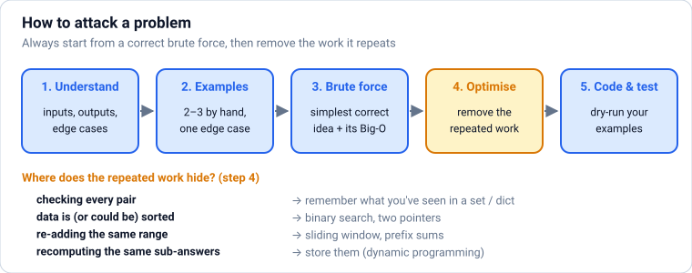

### 21.1 The method

From here on, problems don't say which tool to use. This method works for almost all of them:

1. **Understand.** Restate the problem in your own words. Ask about input size, edge cases (empty, one item, duplicates, negatives) and the exact output.
2. **Examples.** Solve 2–3 small cases **by hand**, including an edge case. If you can't solve it by hand, you can't code it.
3. **Brute force.** The simplest correct idea and its Big-O, however slow. It's your safety net and your starting point.
4. **Optimise.** Find the **repeated or wasted work** in the brute force and remove it (21.2).
5. **Code and test.** Clean code with good names, then dry-run your examples through it (Chapter 3.5) and check the edge cases.

### 21.2 Where the wasted work hides

| The brute force… | Remove the waste with… | Chapter |
|---|---|---|
| checks every pair for a partner | a set or dict of what you've seen | 19 |
| scans sorted (or sortable) data | binary search or two pointers | 18, 22 |
| re-adds overlapping ranges | a sliding window or prefix sums | 23, 24 |
| recomputes the same smaller answers | remembering them (dynamic programming) | 49 |
| tries every candidate answer | binary search on the answer | 28 |

The classic example: does any pair sum to a target? The brute force asks "is the partner somewhere in the list?" again for every item; a set remembers the items seen so far:

```python
def has_pair_brute(nums, target):          # O(n²): every pair
    for i in range(len(nums)):
        for j in range(i + 1, len(nums)):
            if nums[i] + nums[j] == target:
                return True
    return False

def has_pair_fast(nums, target):           # O(n): remember what we've seen
    seen = set()
    for x in nums:
        if target - x in seen:
            return True
        seen.add(x)
    return False

print(has_pair_brute([3, 8, 1, 5], 9), has_pair_fast([3, 8, 1, 5], 9), has_pair_fast([3, 8, 1, 5], 100))
```

**Output:**

```text
True True False
```

### 21.3 Let the input size choose the algorithm

Python manages roughly 10⁷ simple steps per second and judges allow 1–2 seconds (Chapter 13.4):

| n | Target | What usually fits |
|---|---|---|
| ≤ 10 | anything, even O(n!) | try every possibility |
| ≤ 1,000 | O(n²) | nested loops over pairs |
| 10⁵–10⁶ | O(n log n) or O(n) | sorting, hashing, one or two passes |
| 10⁹ or more | O(log n), O(√n), O(1) | binary search, maths |

Chapter 59 has the full version, once every technique has been covered.

### 21.4 Testing your solution

Before submitting, run it on: the examples; the smallest inputs (empty, one item); all-equal items; already sorted and reverse sorted; the largest values (overflow is impossible in Python, but slow code isn't). A **stress test** compares a fast solution against the brute force on many random small inputs, catching cases you didn't think of:

```python
import random
random.seed(1)
mismatches = 0
for _ in range(500):
    nums = [random.randint(-5, 5) for _ in range(random.randint(0, 6))]
    target = random.randint(-10, 10)
    if has_pair_brute(nums, target) != has_pair_fast(nums, target):
        mismatches += 1
print("mismatches:", mismatches)
```

**Output:**

```text
mismatches: 0
```

`random.randint(a, b)` picks a random integer from a to b; `random.seed(1)` makes the sequence repeatable.

### 21.5 Summary

```
understand → examples by hand → brute force (+ Big-O) → find the repeated work → code → test
waste → fix: pair checks → set/dict · sorted → binary search/two pointers · ranges → window/prefix · repeats → DP
n ≤ 10³ → O(n²);  n ≤ 10⁶ → O(n log n);  n ≥ 10⁹ → O(log n)
stress test: compare with the brute force on random small inputs
```

**Key terms:**

- **Brute force:** the straightforward solution that tries every possibility.
- **Edge case:** an unusual input at the limits, such as an empty list or a single item.
- **Optimisation:** making a correct solution faster or smaller without changing its results.
- **Stress test:** checking a fast solution against a simple correct one on many random inputs.

### Exercises

1. Apply the method to "contains duplicate": give an O(n²), an O(n log n) and an O(n) solution.

<details>
<summary><b>Answers</b></summary>

```python
def dup_pairs(nums):
    return any(nums[i] == nums[j] for i in range(len(nums)) for j in range(i + 1, len(nums)))

def dup_sorted(nums):
    s = sorted(nums)
    return any(s[i] == s[i + 1] for i in range(len(s) - 1))

def dup_set(nums):
    return len(set(nums)) < len(nums)

for nums in [[1, 2, 3, 1], [1, 2, 3]]:
    print(dup_pairs(nums), dup_sorted(nums), dup_set(nums))
```

**Output:**

```text
True True True
False False False
```

1. `any(…)` is `True` if any item of the sequence is true. Sorting puts equal values next to each other, so only neighbours need comparing.

</details>

**Practice:**

| # | Problem (LeetCode) | Difficulty |
|---|---|---|
| 1 | [1. Two Sum](https://leetcode.com/problems/two-sum/) | 🟢 Easy |
| 2 | [217. Contains Duplicate](https://leetcode.com/problems/contains-duplicate/) | 🟢 Easy |

**Learn more:** [NeetCode: practice by pattern](https://neetcode.io/practice) · George Pólya, *How to Solve It* (the classic book on this method)

---

## 22. Two Pointers

**You need:** Chapters 15, 17 and 21. · **You'll learn:** the three shapes of the two-pointer technique, why the opposite-ends version is correct, pair and triplet sums, the container problem, and in-place partitioning.

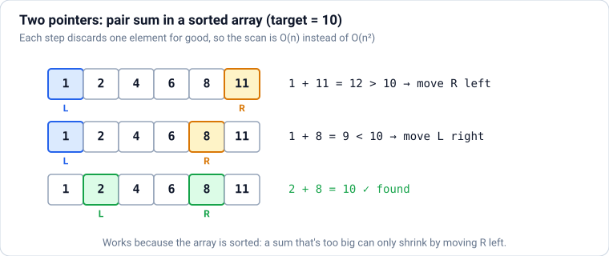

### 22.1 The idea

Checking every pair is O(n²). **Two pointers** keeps two indices and moves them so each step rules out many pairs at once. Two friends look for two books on a shelf sorted by price that add up to exactly ₹100: one starts at the cheapest end, the other at the most expensive, and they move towards each other.

| Shape | How the pointers move | Typical problems |
|---|---|---|
| opposite ends, usually on sorted data | both ends, inwards | pair/triplet sums, container, palindromes |
| same direction, different speeds | both rightwards; one runs ahead | remove duplicates, move zeroes, partition, cycle detection (Chapter 32) |
| two sequences | one pointer per list | merging sorted lists, subsequence checks |

### 22.2 Pair with a target sum

On sorted data: if the sum is too big, move the right pointer left; too small, move the left pointer right. Tracing a pair summing to 10 in `[1, 2, 4, 6, 8, 11]`:

| Step | L (value) | R (value) | Sum | Decision |
|---|---|---|---|---|
| 1 | 0 (1) | 5 (11) | 12 | too big → R left |
| 2 | 0 (1) | 4 (8) | 9 | too small → L right |
| 3 | 1 (2) | 4 (8) | 10 | found |

```python
def pair_with_sum(sorted_nums, target):
    lo, hi = 0, len(sorted_nums) - 1
    while lo < hi:
        total = sorted_nums[lo] + sorted_nums[hi]
        if total == target:
            return (lo, hi)
        if total < target:
            lo += 1
        else:
            hi -= 1
    return None

print(pair_with_sum([1, 2, 4, 6, 8, 11], 10), pair_with_sum([1, 2, 4], 100))
```

**Output:**

```text
(1, 4) None
```

<details>
<summary><b>Why moving a pointer never skips the answer</b></summary>

Suppose the sum a[lo] + a[hi] is too big. Every other partner of a[hi] in the range is a[k] with k ≥ lo, so a[k] ≥ a[lo] and a[k] + a[hi] ≥ a[lo] + a[hi] > target. So a[hi] can't be in any answer within the range: discarding it (hi −= 1) loses nothing. Symmetrically, when the sum is too small, a[lo] pairs with nothing. Each step discards one element safely, so after at most n − 1 steps the range is empty: O(n), and an answer is found if one exists.

</details>

### 22.3 Three numbers: 3Sum

All unique triplets summing to 0: sort, fix the first number with a loop, and run the pair search on the rest. That's O(n²), against O(n³) for three nested loops. Skipping equal neighbours avoids duplicate triplets:

```python
def three_sum(nums):
    nums = sorted(nums)
    out = []
    for i in range(len(nums) - 2):
        if i > 0 and nums[i] == nums[i - 1]:
            continue
        lo, hi = i + 1, len(nums) - 1
        while lo < hi:
            s = nums[i] + nums[lo] + nums[hi]
            if s < 0:
                lo += 1
            elif s > 0:
                hi -= 1
            else:
                out.append([nums[i], nums[lo], nums[hi]])
                lo += 1
                while lo < hi and nums[lo] == nums[lo - 1]:
                    lo += 1
    return out

print(three_sum([-1, 0, 1, 2, -1, -4]), three_sum([0, 0, 0, 0]))
```

**Output:**

```text
[[-1, -1, 2], [-1, 0, 1]] [[0, 0, 0]]
```

### 22.4 Container with most water

Vertical lines of heights `h`; pick two that, with the x-axis, hold the most water: area = (distance) × (shorter height). Start at both ends and always move the **shorter** line inwards:

```python
def max_area(heights):
    lo, hi, best = 0, len(heights) - 1, 0
    while lo < hi:
        best = max(best, (hi - lo) * min(heights[lo], heights[hi]))
        if heights[lo] < heights[hi]:
            lo += 1
        else:
            hi -= 1
    return best

print(max_area([1, 8, 6, 2, 5, 4, 8, 3, 7]))
```

**Output:**

```text
49
```

Why move the shorter one? Any container using the shorter line with a closer partner is narrower and still limited by that same short height, so it's no better: the shorter line can be discarded, as in 22.2.

### 22.5 Same direction: partitioning

The read/write indices of Chapter 15.5 are two pointers moving the same way. Partitioning around a value (smaller items first) uses the same shape, and Chapter 29's quick sort is built on it. The **Dutch national flag** problem sorts 0s, 1s and 2s in one pass with three pointers (Chapter 25).

```python
def partition_odd_first(nums):
    write = 0
    for read in range(len(nums)):
        if nums[read] % 2 == 1:
            nums[write], nums[read] = nums[read], nums[write]
            write += 1
    return nums

def is_subsequence(s, t):                  # two sequences, one pointer each
    i = 0
    for ch in t:
        if i < len(s) and s[i] == ch:
            i += 1
    return i == len(s)

print(partition_odd_first([2, 3, 4, 5, 7, 8]), is_subsequence("ace", "abcde"), is_subsequence("aec", "abcde"))
```

**Output:**

```text
[3, 5, 7, 2, 4, 8] True False
```

### 22.6 Summary

```
opposite ends (sorted): sum too big → hi −= 1; too small → lo += 1   O(n); each move discards a useless element
3Sum: sort + fix one + pair search   O(n²); skip equal neighbours for uniqueness
container: area = width × min height; move the shorter side
same direction: read/write (compact, partition);  two sequences: one pointer each (merge, subsequence)
```

**Key terms:**

- **Two pointers:** a technique that walks two indices through data, moving them by rules that rule out many candidates at once.
- **Partition:** rearranging items so those satisfying a condition come before the rest.
- **Subsequence:** items taken from a sequence in order, not necessarily next to each other.

### Exercises

1. Given a sorted list, return the squares of the numbers, sorted, in O(n) (`[-4, -1, 0, 3, 10]` → `[0, 1, 9, 16, 100]`).
2. Remove all copies of `val` from a list in place and return the new length.

<details>
<summary><b>Answers</b></summary>

```python
def sorted_squares(nums):
    out = [0] * len(nums)
    lo, hi = 0, len(nums) - 1
    for pos in range(len(nums) - 1, -1, -1):      # fill from the biggest
        if abs(nums[lo]) > abs(nums[hi]):
            out[pos] = nums[lo] ** 2
            lo += 1
        else:
            out[pos] = nums[hi] ** 2
            hi -= 1
    return out

def remove_element(nums, val):
    write = 0
    for x in nums:
        if x != val:
            nums[write] = x
            write += 1
    return write

nums = [3, 2, 2, 3, 4]
k = remove_element(nums, 3)
print(sorted_squares([-4, -1, 0, 3, 10]), k, nums[:k])
```

**Output:**

```text
[0, 1, 9, 16, 100] 3 [2, 2, 4]
```

1. The biggest square is at one of the two ends, so fill the output from the back.

</details>

**Practice:**

| # | Problem (LeetCode) | Difficulty |
|---|---|---|
| 1 | [125. Valid Palindrome](https://leetcode.com/problems/valid-palindrome/) | 🟢 Easy |
| 2 | [167. Two Sum II - Input Array Is Sorted](https://leetcode.com/problems/two-sum-ii-input-array-is-sorted/) | 🟡 Medium |
| 3 | [977. Squares of a Sorted Array](https://leetcode.com/problems/squares-of-a-sorted-array/) | 🟢 Easy |
| 4 | [392. Is Subsequence](https://leetcode.com/problems/is-subsequence/) | 🟢 Easy |
| 5 | [15. 3Sum](https://leetcode.com/problems/3sum/) | 🟡 Medium |
| 6 | [11. Container With Most Water](https://leetcode.com/problems/container-with-most-water/) | 🟡 Medium |
| 7 | [42. Trapping Rain Water](https://leetcode.com/problems/trapping-rain-water/) | 🔴 Hard |

**Learn more:** [Wikipedia: Dutch national flag problem](https://en.wikipedia.org/wiki/Dutch_national_flag_problem)

---

## 23. Sliding Window

**You need:** Chapters 19 and 22. · **You'll learn:** fixed-size and variable-size windows over subarrays and substrings, what state a window keeps, why the nested loop is still O(n), and when the technique fails.

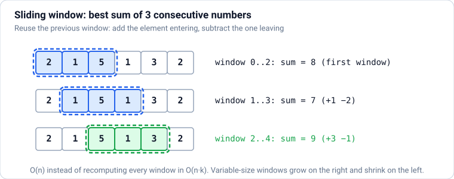

### 23.1 Subarrays and windows

A **subarray** (for strings, a **substring**) is an unbroken piece: `[5, 1, 3]` is a subarray of `[2, 1, 5, 1, 3, 2]`; `[2, 5]` isn't. Many problems ask for the best subarray of some kind. Recomputing each candidate from scratch repeats work; a **sliding window** keeps a running summary and **updates** it as the window moves: add what enters, remove what leaves.

### 23.2 Fixed-size windows

The best sum of k = 3 consecutive items in `[2, 1, 5, 1, 3, 2]`:

| Window | Calculation | Sum |
|---|---|---|
| [2, 1, 5] | first window | 8 |
| [1, 5, 1] | 8 + 1 − 2 | 7 |
| [5, 1, 3] | 7 + 3 − 1 | **9** |
| [1, 3, 2] | 9 + 2 − 5 | 6 |

```python
def max_sum_k(nums, k):
    window = sum(nums[:k])
    best = window
    for right in range(k, len(nums)):
        window += nums[right] - nums[right - k]   # enter right, leave right − k
        best = max(best, window)
    return best

print(max_sum_k([2, 1, 5, 1, 3, 2], 3), max_sum_k([5, -1, 3], 1))
```

**Output:**

```text
9 5
```

Each slide is O(1), so the scan is O(n) instead of O(n·k).

### 23.3 Variable-size windows

The window grows and shrinks to satisfy a rule:

1. **Expand:** move `right` one step and add the new item to the window's state.
2. **Shrink:** while the window breaks the rule, remove `nums[left]` and move `left` right.
3. **Record:** when valid, update the answer.

The shortest subarray with sum ≥ target (positive numbers):

```python
def min_len_subarray(target, nums):
    left, total, best = 0, 0, float("inf")
    for right, x in enumerate(nums):
        total += x
        while total >= target:                 # valid: record, then try shorter
            best = min(best, right - left + 1)
            total -= nums[left]
            left += 1
    return 0 if best == float("inf") else best

print(min_len_subarray(7, [2, 3, 1, 2, 4, 3]), min_len_subarray(100, [1, 2]))
```

**Output:**

```text
2 0
```

<details>
<summary><b>Why a loop inside a loop is still O(n)</b></summary>

Count pointer moves instead of loop rounds. `right` moves n times in total. `left` only moves forward and never passes `right`, so it moves at most n times in total, across all rounds of the outer loop. Each move does O(1) work, so the whole scan is O(2n) = O(n). This "total moves" argument is called **amortised analysis**.

</details>

### 23.4 What the window remembers

The **state** can be a running sum, a dict of counts of what's inside, or the last index where each character was seen. The longest substring without repeating characters keeps the last position of each character, and jumps `left` past a repeat:

```python
def longest_unique_substring(s):
    last_seen, left, best = {}, 0, 0
    for right, ch in enumerate(s):
        if ch in last_seen and last_seen[ch] >= left:
            left = last_seen[ch] + 1
        last_seen[ch] = right
        best = max(best, right - left + 1)
    return best

def longest_with_k_distinct(s, k):
    counts, left, best = {}, 0, 0
    for right, ch in enumerate(s):
        counts[ch] = counts.get(ch, 0) + 1
        while len(counts) > k:                 # too many distinct: shrink
            counts[s[left]] -= 1
            if counts[s[left]] == 0:
                del counts[s[left]]
            left += 1
        best = max(best, right - left + 1)
    return best

print(longest_unique_substring("abcabcbb"), longest_unique_substring("pwwkew"), longest_with_k_distinct("eceba", 2))
```

**Output:**

```text
3 3 3
```

### 23.5 When it fails

"Shrink while the sum is too big" assumes adding items only increases the sum. With **negative numbers** that breaks: a longer window can have a smaller sum. Then use prefix sums with a dict (Chapter 24.3), or Kadane's algorithm for the maximum sum (Chapter 25).

**Clues** that a window fits: "subarray"/"substring", "contiguous", "longest/shortest/maximum … such that …", "at most k distinct", "every window of size k".

### 23.6 Summary

```
fixed k: window += nums[r] − nums[r−k]   O(n)
variable: for right: add; while invalid: remove nums[left], left += 1; record   O(n) amortised
state: running sum · counts dict · last index per character
fails with negatives for sum rules → prefix sums + dict, or Kadane
```

**Key terms:**

- **Subarray:** a contiguous part of an array.
- **Substring:** a contiguous part of a string.
- **Sliding window:** a range over a sequence whose ends move forward while a summary of its contents is updated incrementally.
- **Window state:** the summary a sliding window keeps, such as a sum or counts.
- **Amortised analysis:** bounding total work over a whole run, such as counting all pointer moves, instead of per iteration.

### Exercises

1. The maximum average of any k consecutive items.
2. Do any two equal values appear within distance k of each other?

<details>
<summary><b>Answers</b></summary>

```python
def max_average(nums, k):
    return max_sum_k(nums, k) / k

def near_duplicate(nums, k):
    window = set()
    for i, x in enumerate(nums):
        if x in window:
            return True
        window.add(x)
        if len(window) > k:
            window.remove(nums[i - k])         # keep only the last k values
    return False

print(max_average([1, 12, -5, -6, 50, 3], 4), near_duplicate([1, 2, 3, 1], 3), near_duplicate([1, 2, 3, 1], 2))
```

**Output:**

```text
12.75 True False
```

</details>

**Practice:**

| # | Problem (LeetCode) | Difficulty |
|---|---|---|
| 1 | [643. Maximum Average Subarray I](https://leetcode.com/problems/maximum-average-subarray-i/) | 🟢 Easy |
| 2 | [219. Contains Duplicate II](https://leetcode.com/problems/contains-duplicate-ii/) | 🟢 Easy |
| 3 | [3. Longest Substring Without Repeating Characters](https://leetcode.com/problems/longest-substring-without-repeating-characters/) | 🟡 Medium |
| 4 | [209. Minimum Size Subarray Sum](https://leetcode.com/problems/minimum-size-subarray-sum/) | 🟡 Medium |
| 5 | [424. Longest Repeating Character Replacement](https://leetcode.com/problems/longest-repeating-character-replacement/) | 🟡 Medium |
| 6 | [567. Permutation in String](https://leetcode.com/problems/permutation-in-string/) | 🟡 Medium |
| 7 | [76. Minimum Window Substring](https://leetcode.com/problems/minimum-window-substring/) | 🔴 Hard |

**Learn more:** [GeeksforGeeks: window sliding technique](https://www.geeksforgeeks.org/dsa/window-sliding-technique/)

---

## 24. Prefix Sums

**You need:** Chapters 19 and 23. · **You'll learn:** to answer any range-sum question in O(1) after O(n) preparation, to count subarrays with a given sum using prefix sums and a dict, 2D prefix sums, and difference arrays.

![Prefix sums: the sum of nums[i..j] is P[j + 1] − P[i]](images/dsa/12-prefix-sum.svg)

### 24.1 Running totals

A car's odometer shows the total distance so far; the distance between Monday and Friday is one subtraction. Build `P` with `P[0] = 0` and `P[i + 1] = P[i] + nums[i]`, so `P[i]` is the sum of the first i items. Then:

> sum(nums[i..j]) = P[j + 1] − P[i]

because P[j + 1] = nums[0] + … + nums[j] and P[i] = nums[0] + … + nums[i − 1], and subtracting leaves exactly nums[i] + … + nums[j].

| i | 0 | 1 | 2 | 3 | 4 | 5 | 6 |
|---|---|---|---|---|---|---|---|
| `nums[i]` | 3 | 1 | 4 | 1 | 5 | 9 | |
| `P[i]` | 0 | 3 | 4 | 8 | 9 | 14 | 23 |

The sum of nums[2..4] = 4 + 1 + 5 = P[5] − P[2] = 14 − 4 = 10.

```python
def prefix_sums(nums):
    P = [0]
    for x in nums:
        P.append(P[-1] + x)
    return P

def range_sum(P, i, j):                  # inclusive i..j
    return P[j + 1] - P[i]

P = prefix_sums([3, 1, 4, 1, 5, 9])
print(P, range_sum(P, 2, 4), range_sum(P, 0, 5), range_sum(P, 3, 3))
```

**Output:**

```text
[0, 3, 4, 8, 9, 14, 23] 10 23 1
```

**Cost:** O(n) once, then O(1) per question: ideal for many questions on data that doesn't change. (If values change between questions, use a Fenwick or segment tree, Chapter 53.) `itertools.accumulate(nums)` produces the running totals too.

### 24.2 Counting subarrays with sum k

"How many subarrays sum to exactly k?" A subarray ending at position j sums to k when some **earlier** prefix equals (current prefix − k). Count the prefixes seen so far in a dict; this works with negative numbers, unlike a sliding window:

```python
from collections import defaultdict

def count_subarrays_with_sum(nums, k):
    seen = defaultdict(int)
    seen[0] = 1                          # the empty prefix
    total = count = 0
    for x in nums:
        total += x
        count += seen[total - k]         # earlier prefixes that complete a sum of k
        seen[total] += 1
    return count

print(count_subarrays_with_sum([1, 2, 3, -2, 2], 3), count_subarrays_with_sum([1, 1, 1], 2))
```

**Output:**

```text
4 2
```

For `[1, 2, 3, -2, 2]` and k = 3 the four subarrays are [1, 2], [3], [2, 3, −2] and [3, −2, 2]: each one starts right after an earlier prefix equal to "current − 3". O(n) time, O(n) space.

### 24.3 2D prefix sums

For a grid, let `P[r][c]` be the sum of the rectangle above and left of (r, c). Inclusion–exclusion gives both the table and any rectangle's sum in O(1):

> P[r+1][c+1] = grid[r][c] + P[r][c+1] + P[r+1][c] − P[r][c]
> sum(r1..r2, c1..c2) = P[r2+1][c2+1] − P[r1][c2+1] − P[r2+1][c1] + P[r1][c1]

The overlap subtracted twice is added back once.

```python
def prefix_2d(grid):
    rows, cols = len(grid), len(grid[0])
    P = [[0] * (cols + 1) for _ in range(rows + 1)]
    for r in range(rows):
        for c in range(cols):
            P[r + 1][c + 1] = grid[r][c] + P[r][c + 1] + P[r + 1][c] - P[r][c]
    return P

def rect_sum(P, r1, c1, r2, c2):
    return P[r2 + 1][c2 + 1] - P[r1][c2 + 1] - P[r2 + 1][c1] + P[r1][c1]

grid = [[3, 0, 1, 4], [5, 6, 3, 2], [1, 2, 0, 1]]
P2 = prefix_2d(grid)
print(rect_sum(P2, 0, 0, 2, 3), rect_sum(P2, 1, 1, 2, 2))
```

**Output:**

```text
28 11
```

The same trick powers "integral images" in computer vision, summing any image rectangle in four lookups.

### 24.4 Difference arrays

The reverse trick: to add x to every item of a range many times, record only the changes, `diff[l] += x` and `diff[r + 1] -= x`, and take one prefix sum at the end:

```python
def apply_range_adds(n, updates):
    diff = [0] * (n + 1)
    for l, r, x in updates:
        diff[l] += x
        diff[r + 1] -= x
    out, running = [], 0
    for i in range(n):
        running += diff[i]
        out.append(running)
    return out

print(apply_range_adds(6, [(1, 3, 10), (2, 5, 1), (0, 0, 7)]))
```

**Output:**

```text
[7, 10, 11, 11, 1, 1]
```

k updates and one rebuild: O(n + k) instead of O(n·k). The same idea works for counts (vowels in s[i..j]) and XOR (Chapter 51).

### 24.5 Summary

```
P[0] = 0; P[i+1] = P[i] + nums[i];  sum(i..j) = P[j+1] − P[i]   O(n) build, O(1) query
count subarrays with sum k: seen = {0: 1}; count += seen[total − k]; seen[total] += 1   (works with negatives)
2D: P[r+1][c+1] = g + top + left − diag;  rect = big − top − left + corner
difference array: diff[l] += x; diff[r+1] −= x; prefix-sum once
```

**Key terms:**

- **Prefix sum:** the running total of the first i items of a sequence.
- **Range query:** a question about a contiguous part of a sequence, such as its sum.
- **Inclusion–exclusion:** adding and subtracting overlapping parts so each is counted exactly once.
- **Difference array:** an array of changes whose prefix sums give the final values, for fast range updates.

### Exercises

1. Find the pivot index: where the sum of the items to the left equals the sum to the right (`[1, 7, 3, 6, 5, 6]` → 3).
2. Return the product of all other items for each position, without division, in O(n).

<details>
<summary><b>Answers</b></summary>

```python
def pivot_index(nums):
    total, left = sum(nums), 0
    for i, x in enumerate(nums):
        if left == total - left - x:
            return i
        left += x
    return -1

def product_except_self(nums):
    n = len(nums)
    out = [1] * n
    left = 1
    for i in range(n):                 # products of everything to the left
        out[i] = left
        left *= nums[i]
    right = 1
    for i in range(n - 1, -1, -1):     # times everything to the right
        out[i] *= right
        right *= nums[i]
    return out

print(pivot_index([1, 7, 3, 6, 5, 6]), pivot_index([1, 2, 3]), product_except_self([1, 2, 3, 4]))
```

**Output:**

```text
3 -1 [24, 12, 8, 6]
```

2. Prefix and suffix *products*: the same idea with `*` instead of `+`.

</details>

**Practice:**

| # | Problem (LeetCode) | Difficulty |
|---|---|---|
| 1 | [1480. Running Sum of 1d Array](https://leetcode.com/problems/running-sum-of-1d-array/) | 🟢 Easy |
| 2 | [724. Find Pivot Index](https://leetcode.com/problems/find-pivot-index/) | 🟢 Easy |
| 3 | [303. Range Sum Query - Immutable](https://leetcode.com/problems/range-sum-query-immutable/) | 🟢 Easy |
| 4 | [560. Subarray Sum Equals K](https://leetcode.com/problems/subarray-sum-equals-k/) | 🟡 Medium |
| 5 | [525. Contiguous Array](https://leetcode.com/problems/contiguous-array/) | 🟡 Medium |
| 6 | [304. Range Sum Query 2D - Immutable](https://leetcode.com/problems/range-sum-query-2d-immutable/) | 🟡 Medium |
| 7 | [238. Product of Array Except Self](https://leetcode.com/problems/product-of-array-except-self/) | 🟡 Medium |

**Learn more:** [cp-algorithms: prefix sums and difference arrays](https://usaco.guide/silver/prefix-sums)

---

## 25. Classic Array Algorithms: Kadane, Majority Vote, Dutch Flag and More

**You need:** Chapters 22–24. · **You'll learn:** the famous one-pass algorithms that keep one or two running values: maximum subarray (Kadane), best stock trade, majority element (Boyer–Moore), three-way partition (Dutch flag), next permutation and the missing number, each with the idea that makes it correct.

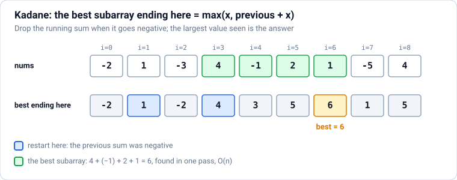

### 25.1 Maximum subarray: Kadane's algorithm

Find the contiguous piece with the largest sum. Trying every subarray is O(n²) (or O(n³) without prefix sums). Kadane's idea: let `best_here` be the best sum of a subarray **ending at** the current position. A subarray ending at x either extends the best one ending just before (`best_here + x`) or starts fresh at x, which wins exactly when `best_here` was negative:

> best_here = max(x, best_here + x),  answer = the largest best_here seen

```python
def max_subarray(nums):
    best_here = best = nums[0]
    start = best_start = best_end = 0
    for i in range(1, len(nums)):
        if best_here < 0:                    # a negative past only drags x down
            best_here, start = nums[i], i
        else:
            best_here += nums[i]
        if best_here > best:
            best, best_start, best_end = best_here, start, i
    return best, best_start, best_end

print(max_subarray([-2, 1, -3, 4, -1, 2, 1, -5, 4]), max_subarray([-3, -1, -2]))
```

**Output:**

```text
(6, 3, 6) (-1, 1, 1)
```

<details>
<summary><b>Why it's correct</b></summary>

Every subarray ends somewhere. The best subarray ending at i is either [i] alone or (best subarray ending at i − 1) + [i]: any other subarray ending at i is (some subarray ending at i − 1) + [i], and replacing that prefix with the best one can only increase the sum. So `best_here` is exactly right at every i (by induction), and the overall answer is the maximum over all i. This is dynamic programming (Chapter 49) with one number of state: O(n) time, O(1) space.

</details>

All-negative input returns the largest single element, −1, not 0: a subarray must be non-empty.

### 25.2 Best time to buy and sell

One buy, then one sell: remember the **lowest price so far**; selling today earns `price − lowest`. With any number of trades, add every rise between consecutive days:

```python
def max_profit(prices):
    lowest, best = prices[0], 0
    for p in prices:
        lowest = min(lowest, p)
        best = max(best, p - lowest)
    return best

def max_profit_many(prices):
    return sum(max(0, prices[i] - prices[i - 1]) for i in range(1, len(prices)))

print(max_profit([7, 1, 5, 3, 6, 4]), max_profit([7, 6, 4, 3, 1]), max_profit_many([7, 1, 5, 3, 6, 4]))
```

**Output:**

```text
5 0 7
```

`sum(… for i in …)` adds the values without building a list. The second works because any profitable trade from day a to day b equals the sum of the daily changes between them, and skipping the negative ones can only help.

### 25.3 Majority element: Boyer–Moore voting

A value filling **more than half** the array survives if you cancel pairs of different values. Keep a `candidate` and a `count`: an equal value adds 1, a different one subtracts 1; at 0, take the next value as the new candidate:

```python
def majority(nums):
    candidate, count = None, 0
    for x in nums:
        if count == 0:
            candidate = x
        count += 1 if x == candidate else -1
    return candidate

print(majority([2, 2, 1, 1, 1, 2, 2]), majority([3, 3, 4]))
```

**Output:**

```text
2 3
```

<details>
<summary><b>Why the majority survives</b></summary>

Each "−1" cancels one occurrence of the candidate against one different value: a pair of two different values is removed. Removing a pair of different values from an array keeps the majority a majority (it loses at most one of its copies while the array loses two items). When count returns to 0, the prefix processed so far splits completely into such pairs, so the majority of the whole array is still the majority of the remaining suffix. At the end, what's left uncancelled is the majority. O(n) time, O(1) space. If a majority isn't guaranteed, verify the candidate with a second pass.

</details>

### 25.4 Dutch national flag: three-way partition

Sort an array of 0s, 1s and 2s in one pass, in place. Three pointers keep four zones: `[0, low)` holds 0s, `[low, mid)` 1s, `[mid, high]` unknown, `(high, end]` 2s:

```python
def sort_colors(nums):
    low, mid, high = 0, 0, len(nums) - 1
    while mid <= high:
        if nums[mid] == 0:
            nums[low], nums[mid] = nums[mid], nums[low]
            low, mid = low + 1, mid + 1
        elif nums[mid] == 1:
            mid += 1
        else:
            nums[mid], nums[high] = nums[high], nums[mid]
            high -= 1                   # don't advance mid: the swapped-in value is unchecked
    return nums

print(sort_colors([2, 0, 2, 1, 1, 0]), sort_colors([1, 2, 0]))
```

**Output:**

```text
[0, 0, 1, 1, 2, 2] [0, 1, 2]
```

Each step shrinks the unknown zone by one, so it's O(n). Quick sort uses this three-way partition to handle many equal keys (Chapter 29).

### 25.5 Next permutation

The next arrangement in dictionary order (1 2 3 → 1 3 2 → 2 1 3 → …):

1. From the right, find the first `i` with `nums[i] < nums[i + 1]`: everything after i is decreasing, already at its largest.
2. From the right, find the first `j` with `nums[j] > nums[i]` and swap them: the smallest possible increase at position i.
3. Reverse the part after i, making it as small as possible (it was decreasing).

If no such i exists, the array is the last permutation; reversing it all wraps to the first:

```python
def next_permutation(nums):
    i = len(nums) - 2
    while i >= 0 and nums[i] >= nums[i + 1]:
        i -= 1
    if i >= 0:
        j = len(nums) - 1
        while nums[j] <= nums[i]:
            j -= 1
        nums[i], nums[j] = nums[j], nums[i]
    nums[i + 1:] = nums[i + 1:][::-1]
    return nums

print(next_permutation([1, 2, 3]), next_permutation([1, 3, 2]), next_permutation([3, 2, 1]), next_permutation([1, 5, 8, 4, 7, 6, 5, 3, 1]))
```

**Output:**

```text
[1, 3, 2] [2, 1, 3] [1, 2, 3] [1, 5, 8, 5, 1, 3, 4, 6, 7]
```

`nums[i + 1:] = …` replaces a slice of the list in place.

### 25.6 Missing number

`nums` holds n distinct numbers from 0…n with one missing. The expected total is n(n + 1)/2 (Chapter 11.1); the missing number is the difference:

```python
def missing_number(nums):
    n = len(nums)
    return n * (n + 1) // 2 - sum(nums)

print(missing_number([3, 0, 1]), missing_number([9, 6, 4, 2, 3, 5, 7, 0, 1]))
```

**Output:**

```text
2 8
```

XOR gives the same answer without large sums (Chapter 51).

### 25.7 Summary

```
Kadane: best_here = max(x, best_here + x); best = max(best, best_here)     O(n), O(1)
stock: track the lowest price so far; many trades: sum of positive daily changes
Boyer–Moore: count == 0 → new candidate; same +1, different −1   (verify if majority not guaranteed)
Dutch flag: low/mid/high zones; 2 → swap with high, don't advance mid   O(n) one pass
next permutation: first dip from the right → swap with the next bigger from the right → reverse the tail
missing number: n(n+1)/2 − sum
```

**Key terms:**

- **Kadane's algorithm:** finding the maximum-sum subarray in one pass by tracking the best sum ending at each position.
- **Boyer–Moore majority vote:** finding the element that occurs more than half the time with one candidate and a counter.
- **Majority element:** a value occurring more than n/2 times.
- **Dutch national flag problem:** partitioning an array into three groups in one pass.
- **Permutation:** one ordering of a set of items.
- **Lexicographic order:** dictionary order, comparing sequences item by item from the left.

### Exercises

1. Maximum product subarray: like Kadane, but track both the largest and smallest product ending here (a negative times the smallest can become the largest).
2. Return all elements appearing more than n/3 times (at most two; generalise Boyer–Moore to two candidates).

<details>
<summary><b>Answers</b></summary>

```python
def max_product(nums):
    hi = lo = best = nums[0]
    for x in nums[1:]:
        candidates = (x, hi * x, lo * x)
        hi, lo = max(candidates), min(candidates)
        best = max(best, hi)
    return best

def majority_third(nums):
    c1, c2, n1, n2 = None, None, 0, 0
    for x in nums:
        if x == c1:
            n1 += 1
        elif x == c2:
            n2 += 1
        elif n1 == 0:
            c1, n1 = x, 1
        elif n2 == 0:
            c2, n2 = x, 1
        else:
            n1, n2 = n1 - 1, n2 - 1         # x cancels one of each
    return [c for c in (c1, c2) if c is not None and nums.count(c) > len(nums) // 3]

print(max_product([2, 3, -2, 4]), max_product([-2, 3, -4]), majority_third([3, 2, 3]), majority_third([1, 2, 1, 2, 3, 1, 2]))
```

**Output:**

```text
6 24 [3] [1, 2]
```

2. The second pass (`nums.count`) verifies the candidates, since survivors aren't guaranteed to qualify.

</details>

**Practice:**

| # | Problem (LeetCode) | Difficulty |
|---|---|---|
| 1 | [53. Maximum Subarray](https://leetcode.com/problems/maximum-subarray/) | 🟡 Medium |
| 2 | [121. Best Time to Buy and Sell Stock](https://leetcode.com/problems/best-time-to-buy-and-sell-stock/) | 🟢 Easy |
| 3 | [122. Best Time to Buy and Sell Stock II](https://leetcode.com/problems/best-time-to-buy-and-sell-stock-ii/) | 🟡 Medium |
| 4 | [169. Majority Element](https://leetcode.com/problems/majority-element/) | 🟢 Easy |
| 5 | [75. Sort Colors](https://leetcode.com/problems/sort-colors/) | 🟡 Medium |
| 6 | [31. Next Permutation](https://leetcode.com/problems/next-permutation/) | 🟡 Medium |
| 7 | [268. Missing Number](https://leetcode.com/problems/missing-number/) | 🟢 Easy |
| 8 | [152. Maximum Product Subarray](https://leetcode.com/problems/maximum-product-subarray/) | 🟡 Medium |

**Learn more:** [Wikipedia: maximum subarray problem](https://en.wikipedia.org/wiki/Maximum_subarray_problem) · [Wikipedia: Boyer–Moore majority vote](https://en.wikipedia.org/wiki/Boyer%E2%80%93Moore_majority_vote_algorithm)

---

## 26. Matrices: 2D Array Problems

**You need:** Chapters 15, 18 and 25. · **You'll learn:** to move around a grid safely with a directions list, diagonals, rotating a matrix in place, spiral order, setting zeroes, and searching sorted matrices in O(log(rc)) and O(r + c).

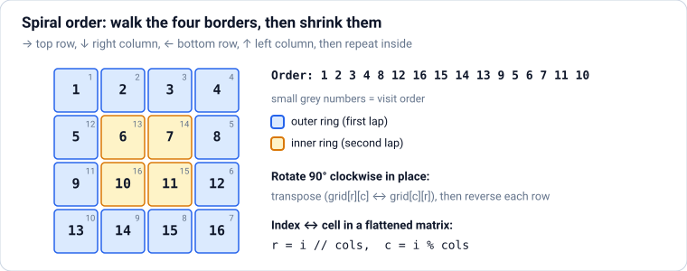

### 26.1 Moving around a grid

A **matrix** (grid) is a list of rows: `grid[r][c]`, with `rows = len(grid)` and `cols = len(grid[0])`. The 4 neighbours of (r, c) are up, down, left and right; keep them in a **directions list** and check bounds before using one:

```python
grid = [[1, 2, 3],
        [4, 5, 6],
        [7, 8, 9]]
rows, cols = len(grid), len(grid[0])

def neighbours(r, c):
    out = []
    for dr, dc in [(-1, 0), (1, 0), (0, -1), (0, 1)]:
        nr, nc = r + dr, c + dc
        if 0 <= nr < rows and 0 <= nc < cols:
            out.append(grid[nr][nc])
    return out

print(neighbours(0, 0), neighbours(1, 1), [grid[i][i] for i in range(3)], [grid[i][2 - i] for i in range(3)])
```

**Output:**

```text
[4, 2] [2, 8, 4, 6] [1, 5, 9] [3, 5, 7]
```

Add the 4 diagonal steps for 8 directions. The **main diagonal** has r == c; the **anti-diagonal** r + c == n − 1; all cells with the same r − c lie on one diagonal line. Chapter 41 explores grids with exactly this neighbour loop.

### 26.2 Rotate 90° clockwise in place

**Transpose, then reverse each row.** Transposing swaps `grid[r][c]` with `grid[c][r]`; reversing the rows then flips left to right. Together, the element at (r, c) ends at (c, n − 1 − r): exactly a clockwise quarter turn.

```python
def rotate_clockwise(m):
    n = len(m)
    for r in range(n):
        for c in range(r + 1, n):          # upper triangle only, or we'd swap back
            m[r][c], m[c][r] = m[c][r], m[r][c]
    for row in m:
        row.reverse()
    return m

print(rotate_clockwise([[1, 2, 3], [4, 5, 6], [7, 8, 9]]))
```

**Output:**

```text
[[7, 4, 1], [8, 5, 2], [9, 6, 3]]
```

O(n²) time (every cell moves), O(1) extra space. Counter-clockwise: reverse each row first, then transpose.

### 26.3 Spiral order

Keep four borders, `top`, `bottom`, `left`, `right`. Walk the top row, down the right column, back along the bottom row, up the left column, shrinking each border after walking it; stop when they cross. The two inner `if`s matter for non-square grids, where the last loop may be a single row or column:

```python
def spiral_order(grid):
    out = []
    top, bottom, left, right = 0, len(grid) - 1, 0, len(grid[0]) - 1
    while top <= bottom and left <= right:
        for c in range(left, right + 1):
            out.append(grid[top][c])
        top += 1
        for r in range(top, bottom + 1):
            out.append(grid[r][right])
        right -= 1
        if top <= bottom:
            for c in range(right, left - 1, -1):
                out.append(grid[bottom][c])
            bottom -= 1
        if left <= right:
            for r in range(bottom, top - 1, -1):
                out.append(grid[r][left])
            left += 1
    return out

print(spiral_order([[1, 2, 3, 4], [5, 6, 7, 8], [9, 10, 11, 12]]))
```

**Output:**

```text
[1, 2, 3, 4, 8, 12, 11, 10, 9, 5, 6, 7]
```

### 26.4 Set matrix zeroes

If a cell is 0, its whole row and column become 0. Clearing as you scan would spread new zeros, so **record first, then clear**:

```python
def set_zeroes(m):
    zero_rows, zero_cols = set(), set()
    for r in range(len(m)):
        for c in range(len(m[0])):
            if m[r][c] == 0:
                zero_rows.add(r)
                zero_cols.add(c)
    for r in range(len(m)):
        for c in range(len(m[0])):
            if r in zero_rows or c in zero_cols:
                m[r][c] = 0
    return m

print(set_zeroes([[1, 1, 1], [1, 0, 1], [1, 1, 1]]))
```

**Output:**

```text
[[1, 0, 1], [0, 0, 0], [1, 0, 1]]
```

O(rc) time, O(r + c) space. (Using the first row and column as the markers brings space to O(1).)

### 26.5 Searching a sorted matrix

- **Rows sorted, and each row starts after the previous ends:** the matrix is one sorted list of r·c items. Binary-search a flat index i and map it to `(i // cols, i % cols)`: O(log(rc)).
- **Rows and columns sorted separately:** start at the **top-right** corner. Too big? Everything below in this column is bigger too, so move left. Too small? Everything left in this row is smaller, so move down. Each step discards a row or a column: O(r + c).

```python
def search_flat(m, target):
    rows, cols = len(m), len(m[0])
    lo, hi = 0, rows * cols - 1
    while lo <= hi:
        mid = (lo + hi) // 2
        value = m[mid // cols][mid % cols]
        if value == target:
            return True
        if value < target:
            lo = mid + 1
        else:
            hi = mid - 1
    return False

def search_staircase(m, target):
    r, c = 0, len(m[0]) - 1
    while r < len(m) and c >= 0:
        if m[r][c] == target:
            return True
        if m[r][c] > target:
            c -= 1
        else:
            r += 1
    return False

g = [[1, 4, 7, 11], [2, 5, 8, 12], [3, 6, 9, 16], [10, 13, 14, 17]]
print(search_flat([[1, 3, 5, 7], [10, 11, 16, 20], [23, 30, 34, 60]], 16), search_staircase(g, 5), search_staircase(g, 15))
```

**Output:**

```text
True True False
```

### 26.6 Summary

```
neighbours: for dr, dc in [(-1,0),(1,0),(0,-1),(0,1)]: check 0 <= nr < rows and 0 <= nc < cols
diagonals: r == c; r + c == n − 1; same r − c
rotate clockwise: transpose (upper triangle) + reverse rows   O(n²), O(1) space
spiral: four shrinking borders, with checks for a last single row/column
set zeroes: record rows/cols, then clear
search: flat binary search O(log rc);  staircase from top-right O(r + c)
```

**Key terms:**

- **Matrix:** a rectangular grid of values, indexed by row and column.
- **Directions list:** the list of (row step, column step) pairs used to visit a cell's neighbours.
- **Main diagonal:** the cells with equal row and column index.
- **Transpose:** swapping a matrix's rows and columns.
- **Spiral order:** visiting a matrix's elements border by border, clockwise, moving inwards.

### Exercises

1. Return the sum of both diagonals of a square matrix, counting the centre once.
2. Generate an n × n matrix filled with 1 … n² in spiral order.

<details>
<summary><b>Answers</b></summary>

```python
def diagonal_sum(m):
    n = len(m)
    total = sum(m[i][i] + m[i][n - 1 - i] for i in range(n))
    return total - (m[n // 2][n // 2] if n % 2 == 1 else 0)

def spiral_matrix(n):
    m = [[0] * n for _ in range(n)]
    r = c = d = 0
    steps = [(0, 1), (1, 0), (0, -1), (-1, 0)]           # right, down, left, up
    for k in range(1, n * n + 1):
        m[r][c] = k
        nr, nc = r + steps[d][0], c + steps[d][1]
        if not (0 <= nr < n and 0 <= nc < n and m[nr][nc] == 0):
            d = (d + 1) % 4                               # turn right
            nr, nc = r + steps[d][0], c + steps[d][1]
        r, c = nr, nc
    return m

print(diagonal_sum([[1, 2, 3], [4, 5, 6], [7, 8, 9]]), spiral_matrix(3))
```

**Output:**

```text
25 [[1, 2, 3], [8, 9, 4], [7, 6, 5]]
```

2. Walk forward; when the next cell is outside or already filled, turn right. `% 4` cycles through the four directions.

</details>

**Practice:**

| # | Problem (LeetCode) | Difficulty |
|---|---|---|
| 1 | [1572. Matrix Diagonal Sum](https://leetcode.com/problems/matrix-diagonal-sum/) | 🟢 Easy |
| 2 | [867. Transpose Matrix](https://leetcode.com/problems/transpose-matrix/) | 🟢 Easy |
| 3 | [48. Rotate Image](https://leetcode.com/problems/rotate-image/) | 🟡 Medium |
| 4 | [54. Spiral Matrix](https://leetcode.com/problems/spiral-matrix/) | 🟡 Medium |
| 5 | [73. Set Matrix Zeroes](https://leetcode.com/problems/set-matrix-zeroes/) | 🟡 Medium |
| 6 | [74. Search a 2D Matrix](https://leetcode.com/problems/search-a-2d-matrix/) | 🟡 Medium |
| 7 | [240. Search a 2D Matrix II](https://leetcode.com/problems/search-a-2d-matrix-ii/) | 🟡 Medium |
| 8 | [36. Valid Sudoku](https://leetcode.com/problems/valid-sudoku/) | 🟡 Medium |

**Learn more:** [GeeksforGeeks: matrix data structure](https://www.geeksforgeeks.org/dsa/matrix/)

---

## 27. Intervals: Merge, Insert and Overlap

**You need:** Chapters 17 and 22. · **You'll learn:** when two intervals overlap, why sorting by start makes one pass enough, merging and inserting intervals, the minimum number of meeting rooms, and intersecting two interval lists.

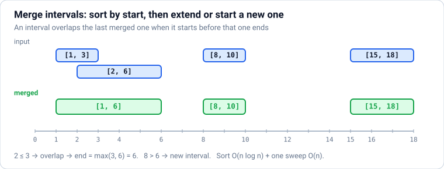

### 27.1 Overlap

An **interval** is a range `[start, end]`: a meeting from 9 to 11, a booking, a stretch of road. `[a, b]` and `[c, d]` overlap exactly when

> a ≤ d and c ≤ b   (each starts before the other ends)

Equivalently, they *don't* overlap when one ends before the other starts: b < c or d < a. Check whether touching ends (`[1, 4]` and `[4, 5]`) count as overlapping: here they do.

### 27.2 Merge overlapping intervals

**Sort by start.** Then any interval that overlaps the current merged block must start before the block ends, and it can only be the next one in order. So one pass suffices: extend the last merged interval while the next starts inside it, otherwise begin a new one:

```python
def merge(intervals):
    intervals = sorted(intervals)
    merged = [intervals[0][:]]              # a copy, so the input isn't changed
    for start, end in intervals[1:]:
        if start <= merged[-1][1]:
            merged[-1][1] = max(merged[-1][1], end)
        else:
            merged.append([start, end])
    return merged

print(merge([[1, 3], [8, 10], [2, 6], [15, 18]]), merge([[1, 4], [4, 5]]), merge([[1, 10], [2, 3]]))
```

**Output:**

```text
[[1, 6], [8, 10], [15, 18]] [[1, 5]] [[1, 10]]
```

`max` matters: `[2, 3]` lies entirely inside `[1, 10]`, and must not shrink it. Sorting dominates: O(n log n). `sorted` on lists of lists compares by the first item, then the second.

### 27.3 Insert into a sorted list

Given non-overlapping intervals sorted by start, insert a new one: copy everything ending before it starts, absorb everything overlapping it, then copy the rest. O(n), no sorting needed:

```python
def insert(intervals, new):
    out, i, n = [], 0, len(intervals)
    while i < n and intervals[i][1] < new[0]:
        out.append(intervals[i])
        i += 1
    start, end = new
    while i < n and intervals[i][0] <= end:
        start, end = min(start, intervals[i][0]), max(end, intervals[i][1])
        i += 1
    out.append([start, end])
    out.extend(intervals[i:])
    return out

print(insert([[1, 2], [3, 5], [6, 7], [8, 10], [12, 16]], [4, 8]), insert([], [5, 7]))
```

**Output:**

```text
[[1, 2], [3, 10], [12, 16]] [[5, 7]]
```

`out.extend(xs)` appends every item of `xs`.

### 27.4 Minimum meeting rooms

The most meetings happening at once is the number of rooms needed. Sort the **starts** and the **ends** separately and sweep: each start takes a room, each end before it frees one:

```python
def min_meeting_rooms(meetings):
    starts = sorted(s for s, e in meetings)
    ends = sorted(e for s, e in meetings)
    rooms = best = j = 0
    for s in starts:
        while ends[j] <= s:                 # finished meetings free their rooms
            rooms -= 1
            j += 1
        rooms += 1
        best = max(best, rooms)
    return best

print(min_meeting_rooms([[0, 30], [5, 10], [15, 20]]), min_meeting_rooms([[1, 5], [5, 8], [8, 9]]))
```

**Output:**

```text
2 1
```

Why can starts and ends be separated? The count of rooms in use at time t is (starts ≤ t) − (ends ≤ t), which doesn't depend on which start belongs to which end. A **sweep line** like this, walking events in time order, solves many interval questions. (A heap of end times, Chapter 39, is the other standard solution.)

### 27.5 Intersecting two lists

Two sorted lists of non-overlapping intervals: the overlap of a and b is `[max(starts), min(ends)]` when non-empty. Then advance whichever ends first, since it can't overlap anything later in the other list:

```python
def interval_intersection(a, b):
    i = j = 0
    out = []
    while i < len(a) and j < len(b):
        lo, hi = max(a[i][0], b[j][0]), min(a[i][1], b[j][1])
        if lo <= hi:
            out.append([lo, hi])
        if a[i][1] < b[j][1]:
            i += 1
        else:
            j += 1
    return out

print(interval_intersection([[0, 2], [5, 10], [13, 23], [24, 25]], [[1, 5], [8, 12], [15, 24], [25, 26]]))
```

**Output:**

```text
[[1, 2], [5, 5], [8, 10], [15, 23], [24, 24], [25, 25]]
```

O(n + m). Choosing the most non-overlapping intervals is a greedy problem (sort by **end**), in Chapter 48.

### 27.6 Summary

```
overlap: a ≤ d and c ≤ b
merge: sort by start; if start ≤ last end: last end = max(...) else append   O(n log n)
insert (sorted input): before / absorb with min/max / after   O(n)
rooms: sort starts and ends separately; sweep   O(n log n)
intersection: [max starts, min ends]; advance the one ending first   O(n + m)
```

**Key terms:**

- **Interval:** a range of values from a start to an end.
- **Overlap:** two intervals sharing at least one point.
- **Sweep line:** processing events (starts and ends) in sorted order while tracking a running state.

### Exercises

1. Can one person attend all these meetings: `[[0, 30], [5, 10], [15, 20]]`? `[[7, 10], [2, 4]]`?
2. Return the free time slots between merged busy intervals `[[1, 3], [6, 7], [2, 4], [9, 12]]`.

<details>
<summary><b>Answers</b></summary>

```python
def can_attend_all(meetings):
    meetings = sorted(meetings)
    return all(meetings[i][0] >= meetings[i - 1][1] for i in range(1, len(meetings)))

def free_slots(busy):
    m = merge(busy)
    return [[m[i][1], m[i + 1][0]] for i in range(len(m) - 1)]

print(can_attend_all([[0, 30], [5, 10], [15, 20]]), can_attend_all([[7, 10], [2, 4]]), free_slots([[1, 3], [6, 7], [2, 4], [9, 12]]))
```

**Output:**

```text
False True [[4, 6], [7, 9]]
```

1. `all(…)` is `True` when every item is true. After sorting, only neighbours need comparing.

</details>

**Practice:**

| # | Problem (LeetCode) | Difficulty |
|---|---|---|
| 1 | [228. Summary Ranges](https://leetcode.com/problems/summary-ranges/) | 🟢 Easy |
| 2 | [56. Merge Intervals](https://leetcode.com/problems/merge-intervals/) | 🟡 Medium |
| 3 | [57. Insert Interval](https://leetcode.com/problems/insert-interval/) | 🟡 Medium |
| 4 | [435. Non-overlapping Intervals](https://leetcode.com/problems/non-overlapping-intervals/) | 🟡 Medium |
| 5 | [986. Interval List Intersections](https://leetcode.com/problems/interval-list-intersections/) | 🟡 Medium |
| 6 | [452. Minimum Number of Arrows to Burst Balloons](https://leetcode.com/problems/minimum-number-of-arrows-to-burst-balloons/) | 🟡 Medium |

**Learn more:** [Wikipedia: sweep line algorithm](https://en.wikipedia.org/wiki/Sweep_line_algorithm)

---

## 28. Binary Search on the Answer

**You need:** Chapter 18. · **You'll learn:** to binary-search over possible *answers* when a yes/no check is monotonic, the four-step recipe, rounding up integer division, and the classic problems: eating speed, shipping capacity and splitting arrays.

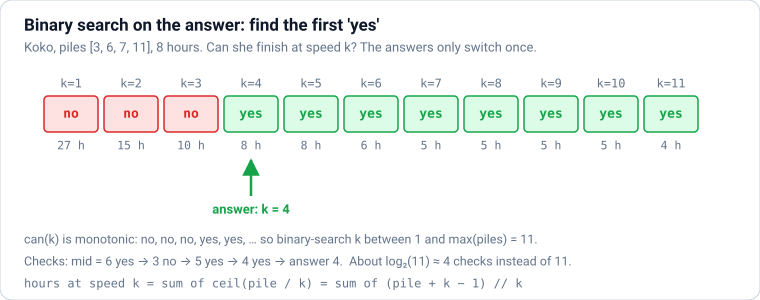

### 28.1 Searching for an answer

Chapter 18 searched sorted data for an *item*. The same halving can search for an **answer**, whenever you can ask a yes/no question about a candidate answer x whose replies, as x grows, look like

> no, no, …, no, **yes**, yes, yes, …

This property is **monotonic**: once "yes", always "yes". Then the first "yes" is a lower bound (Chapter 18.3) over the range of candidate answers, found in O(log(range)) checks.

**Example:** Koko eats bananas from piles at k per hour (finishing a pile ends her hour) and must finish within h hours. "Can she finish at speed k?" is monotonic: eating faster never hurts. The answer is the smallest k that works.

### 28.2 The recipe

1. Bound the answer: its smallest and largest possible values are `lo` and `hi`.
2. Write `can(x)`, a yes/no check for a candidate answer, usually a simple O(n) loop.
3. Make sure `can` is monotonic.
4. Binary-search the first x with `can(x)` true: if `can(mid)`, the answer is mid or smaller (`hi = mid`); otherwise it's bigger (`lo = mid + 1`).

Total cost: O(n · log(range)). A range of 10⁹ needs about 30 checks. Hours for a pile of p at speed k is p/k rounded **up**: `(p + k - 1) // k` in integers.

<details>
<summary><b>Why (p + k − 1) // k rounds up</b></summary>

Write p = qk + r with 0 ≤ r < k. If r = 0, then (p + k − 1)//k = (qk + k − 1)//k = q, since k − 1 < k. If r ≥ 1, then p + k − 1 = (q + 1)k + (r − 1) with 0 ≤ r − 1 < k, so the result is q + 1. That's exactly ⌈p/k⌉, without floating point. Python also allows `-(-p // k)`.

</details>

```python
def min_eating_speed(piles, hours):
    def can_finish(k):
        return sum((p + k - 1) // k for p in piles) <= hours
    lo, hi = 1, max(piles)
    while lo < hi:
        mid = (lo + hi) // 2
        if can_finish(mid):
            hi = mid
        else:
            lo = mid + 1
    return lo

print(min_eating_speed([3, 6, 7, 11], 8), min_eating_speed([30, 11, 23, 4, 20], 5), min_eating_speed([30, 11, 23, 4, 20], 6))
```

**Output:**

```text
4 30 23
```

Check the first answer by hand: at speed 4 the piles take 1 + 2 + 2 + 3 = 8 hours (fits); at speed 3 they take 1 + 2 + 3 + 4 = 10 (too slow).

### 28.3 Minimise the maximum

Ship packages in order within D days; what's the smallest ship capacity? `can(c)` loads greedily, starting a new day whenever the next package doesn't fit. The answer lies between the heaviest package (anything smaller can't carry it) and the total weight (one day):

```python
def ship_within_days(weights, days):
    def can(capacity):
        needed, load = 1, 0
        for w in weights:
            if load + w > capacity:
                needed += 1
                load = 0
            load += w
        return needed <= days
    lo, hi = max(weights), sum(weights)
    while lo < hi:
        mid = (lo + hi) // 2
        if can(mid):
            hi = mid
        else:
            lo = mid + 1
    return lo

print(ship_within_days([1, 2, 3, 4, 5, 6, 7, 8, 9, 10], 5), ship_within_days([3, 2, 2, 4, 1, 4], 3))
```

**Output:**

```text
15 6
```

"Split an array into k parts minimising the largest part's sum" is the same problem in other words. Problems phrased as "minimise the maximum" or "maximise the minimum" are strong hints for this technique.

### 28.4 Searching for the last "yes"

Some answer lines go yes, yes, …, yes, no, no: "the largest r with r² ≤ n". Then search for the **last** yes: when `can(mid)` holds, `lo = mid`, so `mid` must be rounded **up**, or a range of two numbers never shrinks:

```python
def integer_sqrt(n):
    lo, hi = 0, n
    while lo < hi:
        mid = (lo + hi + 1) // 2
        if mid * mid <= n:
            lo = mid
        else:
            hi = mid - 1
    return lo

print(integer_sqrt(50), integer_sqrt(49), integer_sqrt(10 ** 18))
```

**Output:**

```text
7 7 1000000000
```

### 28.5 Summary

```
monotonic check: no…no yes…yes → first yes;  yes…yes no…no → last yes
first yes:  while lo < hi: mid = (lo+hi)//2;  can(mid) → hi = mid  else lo = mid+1
last yes:   mid = (lo+hi+1)//2;  can(mid) → lo = mid  else hi = mid−1
cost O(n · log(hi − lo));  ceil(p/k) = (p + k − 1) // k
clues: "minimum speed/capacity/time such that", "minimise the maximum", "maximise the minimum"
```

**Key terms:**

- **Binary search on the answer:** binary-searching over candidate answers using a yes/no feasibility check.
- **Monotonic predicate:** a yes/no test whose answer changes at most once as its input grows.
- **Feasibility check:** a function that tests whether a candidate answer is achievable.
- **Ceiling division:** division rounded up to the next integer.

### Exercises

1. Place c cows in stalls at given positions to maximise the minimum distance between any two: `positions = [1, 2, 8, 4, 9]`, c = 3.
2. The smallest divisor d such that the sum of `ceil(x / d)` over `[1, 2, 5, 9]` is at most 6.

<details>
<summary><b>Answers</b></summary>

```python
def max_min_distance(positions, cows):
    positions = sorted(positions)
    def can(gap):                         # place greedily, leftmost first
        placed, last = 1, positions[0]
        for p in positions[1:]:
            if p - last >= gap:
                placed, last = placed + 1, p
        return placed >= cows
    lo, hi = 0, positions[-1] - positions[0]
    while lo < hi:                        # last yes: yes for small gaps
        mid = (lo + hi + 1) // 2
        if can(mid):
            lo = mid
        else:
            hi = mid - 1
    return lo

def smallest_divisor(nums, threshold):
    lo, hi = 1, max(nums)
    while lo < hi:
        mid = (lo + hi) // 2
        if sum((x + mid - 1) // mid for x in nums) <= threshold:
            hi = mid
        else:
            lo = mid + 1
    return lo

print(max_min_distance([1, 2, 8, 4, 9], 3), smallest_divisor([1, 2, 5, 9], 6))
```

**Output:**

```text
3 5
```

1. "Maximise the minimum": small gaps are always achievable, so the answer is the last yes.

</details>

**Practice:**

| # | Problem (LeetCode) | Difficulty |
|---|---|---|
| 1 | [69. Sqrt(x)](https://leetcode.com/problems/sqrtx/) | 🟢 Easy |
| 2 | [875. Koko Eating Bananas](https://leetcode.com/problems/koko-eating-bananas/) | 🟡 Medium |
| 3 | [1011. Capacity To Ship Packages Within D Days](https://leetcode.com/problems/capacity-to-ship-packages-within-d-days/) | 🟡 Medium |
| 4 | [1283. Find the Smallest Divisor Given a Threshold](https://leetcode.com/problems/find-the-smallest-divisor-given-a-threshold/) | 🟡 Medium |
| 5 | [410. Split Array Largest Sum](https://leetcode.com/problems/split-array-largest-sum/) | 🔴 Hard |
| 6 | [1552. Magnetic Force Between Two Balls](https://leetcode.com/problems/magnetic-force-between-two-balls/) | 🟡 Medium |

**Learn more:** [TopCoder: binary search tutorial](https://www.topcoder.com/thrive/articles/Binary%20Search)

---

## 29. Merge Sort and Quick Sort

**You need:** Chapters 14, 17, 22 and 25. · **You'll learn:** divide and conquer; merge sort and why it's O(n log n) always; quick sort with in-place partitioning and why its average is O(n log n); quickselect for the k-th smallest in O(n) on average; why comparison sorts can't beat n log n; counting sort; and what real libraries use.

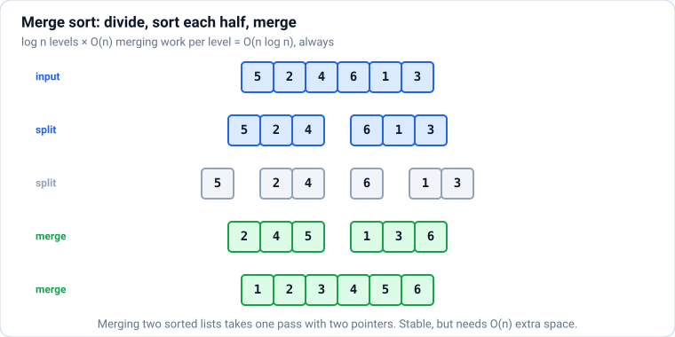

### 29.1 Divide and conquer

The sorts of Chapter 17 are O(n²). **Merge sort** and **quick sort** reach O(n log n) with **divide and conquer**:

1. **Divide** the problem into smaller problems of the same kind;
2. **conquer** them recursively (a list of 0 or 1 items is already sorted: the base case);
3. **combine** their answers.

### 29.2 Merge sort

Split the list in half, sort each half recursively, then **merge** the two sorted halves with two pointers: repeatedly take the smaller front item.

```python
def merge(left, right):
    merged, i, j = [], 0, 0
    while i < len(left) and j < len(right):
        if left[i] <= right[j]:           # <= keeps equal items in order: stable
            merged.append(left[i])
            i += 1
        else:
            merged.append(right[j])
            j += 1
    return merged + left[i:] + right[j:]

def merge_sort(a):
    if len(a) <= 1:
        return a
    mid = len(a) // 2
    return merge(merge_sort(a[:mid]), merge_sort(a[mid:]))

print(merge([1, 4, 6], [2, 3, 7, 9]), merge_sort([5, 2, 4, 6, 1, 3]), merge_sort([("b", 2), ("a", 1), ("c", 2)]))
```

**Output:**

```text
[1, 2, 3, 4, 6, 7, 9] [1, 2, 3, 4, 5, 6] [('a', 1), ('b', 2), ('c', 2)]
```

Merging two lists of total length m takes O(m): each step moves one item.

<details>
<summary><b>Derivation: T(n) = 2T(n/2) + n gives O(n log n)</b></summary>

Let T(n) be merge sort's work on n items: two halves plus a merge, T(n) = 2T(n/2) + cn. Draw the **recursion tree**: level 0 has one problem of size n (merge cost cn); level 1 has two of size n/2 (total 2 · cn/2 = cn); level k has 2ᵏ problems of size n/2ᵏ (total cn). Every level costs cn, and the sizes reach 1 after log₂ n halvings, so there are log₂ n + 1 levels. Total: cn(log₂ n + 1) = **O(n log n)**, in the best, average and worst case alike. Extra space is O(n) for the merged lists (the slices here add more; an index-based version avoids them).

</details>

### 29.3 Quick sort

Pick a **pivot**, split the items into smaller, equal and bigger, and sort the smaller and bigger parts recursively. The short version builds new lists:

```python
def quick_sort(a):
    if len(a) <= 1:
        return a
    pivot = a[len(a) // 2]
    return (quick_sort([x for x in a if x < pivot]) + [x for x in a if x == pivot]
            + quick_sort([x for x in a if x > pivot]))

print(quick_sort([9, 3, 7, 3, 1]))
```

**Output:**

```text
[1, 3, 3, 7, 9]
```

Real quick sorts **partition in place**: move every item smaller than the pivot to the left part and put the pivot right after it. The pivot is then in its final sorted position. The **Lomuto** partition with a random pivot:

```python
import random
random.seed(7)

def partition(a, lo, hi):
    r = random.randint(lo, hi)
    a[r], a[hi] = a[hi], a[r]                 # move the pivot to the end
    pivot, store = a[hi], lo
    for i in range(lo, hi):
        if a[i] < pivot:
            a[i], a[store] = a[store], a[i]   # grow the "smaller" part
            store += 1
    a[store], a[hi] = a[hi], a[store]         # pivot after the smaller items
    return store

def quick_sort_in_place(a, lo=0, hi=None):
    if hi is None:
        hi = len(a) - 1
    if lo < hi:
        p = partition(a, lo, hi)
        quick_sort_in_place(a, lo, p - 1)
        quick_sort_in_place(a, p + 1, hi)
    return a

print(quick_sort_in_place([9, 3, 7, 3, 1, 8]))
```

**Output:**

```text
[1, 3, 3, 7, 8, 9]
```

**Cost:** if every pivot splits the list in half, the recursion tree looks like merge sort's: O(n log n). If every pivot is the smallest item (an already-sorted list with "last item" as pivot), each split removes one item: n + (n − 1) + … = **O(n²)**. A **random pivot** makes that vanishingly unlikely.

<details>
<summary><b>Why a random pivot gives O(n log n) on average</b></summary>

Count comparisons. Name the items by sorted order z₁ < z₂ < … < zₙ. Items zᵢ and zⱼ (i < j) are compared only if one of them is the first pivot chosen among zᵢ, …, zⱼ: if any item between them is chosen first, it sends them to different sides forever. Each of those j − i + 1 items is equally likely to be chosen first, so P(compared) = 2/(j − i + 1). Summing over all pairs: Σᵢ Σ_{d=1}^{n−i} 2/(d + 1) ≤ 2n·(1 + 1/2 + … + 1/n) ≈ 2n ln n. So the expected number of comparisons is O(n log n), whatever the input order.

</details>

Quick sort sorts in place (O(log n) stack on average) and is usually faster than merge sort in practice, but it isn't stable. With many equal keys, the three-way partition of Chapter 25.4 keeps it fast.

### 29.4 Quickselect

To find the **k-th smallest** item, one partition tells you which side holds it; recurse into that side only:

```python
def quickselect(a, k):                       # k = 1 is the minimum
    a = a[:]
    lo, hi, target = 0, len(a) - 1, k - 1
    while True:
        p = partition(a, lo, hi)
        if p == target:
            return a[p]
        if p < target:
            lo = p + 1
        else:
            hi = p - 1

nums = [3, 2, 3, 1, 2, 4, 5, 5, 6]
print(quickselect([3, 2, 1, 5, 6, 4], 2), quickselect(nums, len(nums) - 4 + 1))
```

**Output:**

```text
2 4
```

The second call finds the 4th largest, which is the (n − 4 + 1)-th smallest. With good pivots the sizes go n, n/2, n/4, …, a geometric series summing to 2n: **O(n) on average** (O(n²) worst case).

### 29.5 The n log n lower bound, and beating it

**Any sort that only compares items needs Ω(n log n) comparisons in the worst case.**

<details>
<summary><b>Why</b></summary>

A comparison sort's behaviour is a decision tree: each comparison branches two ways, and each leaf is one output order. All n! orderings of distinct inputs need different leaves, so the tree has at least n! leaves, and its height (the worst-case number of comparisons) is at least log₂(n!). Since n! ≥ (n/2)^(n/2) (the top half of the factors are each ≥ n/2), log₂(n!) ≥ (n/2)·log₂(n/2) = Ω(n log n).

</details>

**Counting sort** escapes the bound by not comparing: for integers in a small range 0…k, count each value, then write them back in order. O(n + k) time and space:

```python
def counting_sort(nums, k):
    count = [0] * (k + 1)
    for x in nums:
        count[x] += 1
    out = []
    for value in range(k + 1):
        out.extend([value] * count[value])
    return out

print(counting_sort([4, 1, 3, 4, 0, 1, 1], 4))
```

**Output:**

```text
[0, 1, 1, 1, 3, 4, 4]
```

**Radix sort** sorts big integers digit by digit with a stable counting sort per digit: O(d·(n + base)) for d digits.

### 29.6 Comparison, and what libraries use

| Algorithm | Best | Average | Worst | Extra space | Stable |
|---|---|---|---|---|---|
| insertion | O(n) | O(n²) | O(n²) | O(1) | yes |
| merge sort | O(n log n) | O(n log n) | O(n log n) | O(n) | yes |
| quick sort (random pivot) | O(n log n) | O(n log n) | O(n²) | O(log n) | no |
| heap sort (Chapter 39) | O(n log n) | O(n log n) | O(n log n) | O(1) | no |
| counting sort | O(n + k) | O(n + k) | O(n + k) | O(n + k) | yes |

No production sort is a pure textbook algorithm; they're tuned hybrids. Python's `sorted` is an adaptive merge sort (Timsort, using the Powersort merge rule since 3.11), stable and O(n) on sorted runs. C++'s `std::sort` is introsort (quick sort that falls back to heap sort if it recurses too deep, plus insertion sort for small pieces); Go uses pdqsort; Java uses dual-pivot quick sort for primitives and TimSort for objects. In real code, always call the built-in.

### 29.7 Summary

```
divide and conquer: split → solve recursively → combine
merge sort: T(n) = 2T(n/2) + n = O(n log n) always; O(n) space; stable
quick sort: partition around a random pivot; O(n log n) average (≈ 2n ln n comparisons), O(n²) worst; in place; not stable
quickselect: partition, recurse into one side   O(n) average
comparison sorts need Ω(log₂ n!) = Ω(n log n);  counting sort O(n + k) for small integer ranges
```

**Key terms:**

- **Divide and conquer:** solving a problem by splitting it into smaller subproblems, solving them recursively and combining the results.
- **Merge sort:** sorting by recursively sorting two halves and merging them.
- **Merge:** combining two sorted lists into one sorted list in linear time.
- **Recursion tree:** a diagram of the calls a recursive algorithm makes, used to add up its cost level by level.
- **Recurrence relation:** an equation defining a cost in terms of smaller costs, such as T(n) = 2T(n/2) + n.
- **Quick sort:** sorting by partitioning around a pivot and sorting the two sides recursively.
- **Pivot:** the item a partition compares every other item against.
- **Lomuto partition:** an in-place partition scheme that keeps a growing "smaller than pivot" region at the left.
- **Quickselect:** finding the k-th smallest item by partitioning and recursing into one side.
- **Comparison sort:** a sort that orders items only by comparing pairs of them.
- **Decision tree:** a tree of the comparisons an algorithm makes, with one leaf per possible outcome.
- **Counting sort:** sorting integers from a small range by counting each value.
- **Radix sort:** sorting numbers digit by digit with a stable sort per digit.

### Exercises

1. Count inversions (Chapter 17.4) in O(n log n) by counting, during each merge, how many left items a right item jumps over.
2. Sort the colours `[2, 0, 2, 1, 1, 0]` with counting sort.

<details>
<summary><b>Answers</b></summary>

```python
def sort_and_count(a):
    if len(a) <= 1:
        return a, 0
    mid = len(a) // 2
    left, inv_left = sort_and_count(a[:mid])
    right, inv_right = sort_and_count(a[mid:])
    merged, i, j, inv = [], 0, 0, inv_left + inv_right
    while i < len(left) and j < len(right):
        if left[i] <= right[j]:
            merged.append(left[i])
            i += 1
        else:
            merged.append(right[j])
            inv += len(left) - i          # right[j] is smaller than every remaining left item
            j += 1
    return merged + left[i:] + right[j:], inv

print(sort_and_count([3, 1, 2, 5, 4])[1], sort_and_count(list(range(10, 0, -1)))[1], counting_sort([2, 0, 2, 1, 1, 0], 2))
```

**Output:**

```text
3 45 [0, 0, 1, 1, 2, 2]
```

1. A reversed list of 10 has 10·9/2 = 45 inversions.

</details>

**Practice:**

| # | Problem (LeetCode) | Difficulty |
|---|---|---|
| 1 | [912. Sort an Array](https://leetcode.com/problems/sort-an-array/) | 🟡 Medium |
| 2 | [215. Kth Largest Element in an Array](https://leetcode.com/problems/kth-largest-element-in-an-array/) | 🟡 Medium |
| 3 | [75. Sort Colors](https://leetcode.com/problems/sort-colors/) | 🟡 Medium |
| 4 | [148. Sort List](https://leetcode.com/problems/sort-list/) | 🟡 Medium |
| 5 | [315. Count of Smaller Numbers After Self](https://leetcode.com/problems/count-of-smaller-numbers-after-self/) | 🔴 Hard |

**Learn more:** [VisuAlgo: sorting (animated)](https://visualgo.net/en/sorting) · [Wikipedia: Timsort](https://en.wikipedia.org/wiki/Timsort)

---

# Part V — Linked Lists, Stacks, Queues and Design

Six chapters on building structures Python doesn't have, from objects linked together: classes and nodes, linked lists and their problems, stacks, queues and deques, and designing combined structures like an LRU cache.

---

## 30. Classes, Objects and Nodes

**You need:** Parts I–IV. · **You'll learn:** to define classes with `__init__`, attributes and methods, why Python variables are references (arrows) rather than boxes, the difference between `is` and `==`, and nodes: the building block of linked lists, trees and graphs.

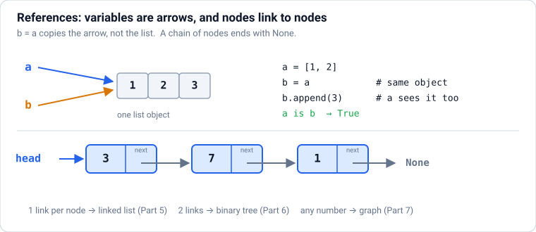

### 30.1 Classes and objects

A **class** is a blueprint ("every student has a name and marks"); an **object** (an **instance**) is one thing built from it (Asha, with her marks):

- `__init__` is the setup method: it runs when an object is created and stores its starting data;
- `self` means "this particular object"; every method takes it first, and Python passes it automatically;
- data stored on an object (`self.name`) is an **attribute**; a function in a class is a **method**.

```python
class Student:
    def __init__(self, name, marks):
        self.name = name
        self.marks = marks

    def average(self):
        return sum(self.marks) / len(self.marks)

    def add_mark(self, m):
        self.marks.append(m)

asha = Student("Asha", [90, 85])
ravi = Student("Ravi", [70, 64, 82])
asha.add_mark(95)
print(asha.name, asha.marks, asha.average(), ravi.average())
```

**Output:**

```text
Asha [90, 85, 95] 90.0 72.0
```

`asha.add_mark(95)` is `Student.add_mark(asha, 95)`: the object before the dot becomes `self`. A `__repr__` method controls how an object prints:

```python
class Point:
    def __init__(self, x, y):
        self.x, self.y = x, y

    def __repr__(self):
        return f"Point({self.x}, {self.y})"

print(Point(1, 2), [Point(0, 0), Point(3, 4)])
```

**Output:**

```text
Point(1, 2) [Point(0, 0), Point(3, 4)]
```

### 30.2 Variables are arrows

A Python variable doesn't *contain* an object; it **refers** to it. `b = a` makes `b` point to the **same** object, not a copy, so a change through `b` is visible through `a`. `a is b` asks "the same object?"; `a == b` asks "equal values?". `None` points to nothing:

```python
a = [1, 2]
b = a
b.append(3)
c = [1, 2, 3]
print(a, a == c, a is c, a is b)
```

**Output:**

```text
[1, 2, 3] True False True
```

This explains Chapter 15.4's grid bug, and why a function can change a list you pass it.

### 30.3 Nodes

A **node** is a small object holding a value plus references to other nodes. Linking nodes builds every structure in Parts V–VII:

| Links per node | Structure | Chapter |
|---|---|---|
| 1 (`next`) | linked list: a chain | 31 |
| 2 (`left`, `right`) | binary tree | 36 |
| any number (a list of neighbours) | graph | 41 |

```python
class Node:
    def __init__(self, val, next=None):
        self.val = val
        self.next = next

def walk(node):
    values = []
    while node is not None:        # stop at the end of the chain
        values.append(node.val)
        node = node.next           # follow the arrow
    return values

third = Node(1)
second = Node(7, third)
first = Node(3, second)
print(walk(first), first.next.next.val)
second.next = None                 # cut the chain after 7
print(walk(first))
```

**Output:**

```text
[3, 7, 1] 1
[3, 7]
```

`current = current.next` until `None` is the most important loop of Part V.

### 30.4 Summary

```
class C: def __init__(self, …): self.attr = …;  def method(self, …): …
obj = C(…);  obj.method() ≡ C.method(obj);  __repr__ for printing
variables are references: b = a shares; a is b (same object) vs a == b (equal values); None = nothing
node: value + references;  walk: while node is not None: …; node = node.next
```

**Key terms:**

- **Object (instance):** one value built from a class, with its own attributes.
- **`__init__`:** the method that initialises a new object.
- **self:** the parameter that refers to the object a method was called on.
- **Attribute:** a value stored on an object.
- **Method:** a function defined in a class.
- **`__repr__`:** the method that returns an object's printable representation.
- **Reference:** a pointer to an object; Python variables hold references.
- **Identity (`is`):** whether two references point to the same object.
- **Node:** an object that holds a value and references to other nodes.

### Exercises

1. Write a class `Rectangle` with `area()` and `perimeter()`.
2. Build the chain 1 → 2 → 3 → 4 with a loop, and write `count_nodes(head)`.

<details>
<summary><b>Answers</b></summary>

```python
class Rectangle:
    def __init__(self, width, height):
        self.width, self.height = width, height

    def area(self):
        return self.width * self.height

    def perimeter(self):
        return 2 * (self.width + self.height)

def count_nodes(head):
    count = 0
    while head is not None:
        count += 1
        head = head.next
    return count

head = None
for v in [4, 3, 2, 1]:                 # build from the back, so 1 ends up first
    head = Node(v, head)
r = Rectangle(3, 4)
print(r.area(), r.perimeter(), walk(head), count_nodes(head))
```

**Output:**

```text
12 14 [1, 2, 3, 4] 4
```

</details>

**Learn more:** [Python tutorial: classes](https://docs.python.org/3/tutorial/classes.html) · [Python Tutor](https://pythontutor.com/visualize.html) (draws every arrow)

---

## 31. Linked Lists

**You need:** Chapter 30. · **You'll learn:** linked lists versus arrays, the basic operations (traverse, insert, delete), the dummy-head trick, in-place reversal, fast and slow pointers with a proof of Floyd's cycle detection, and merging sorted lists.

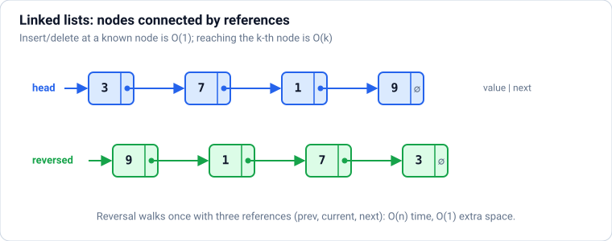

### 31.1 Linked lists versus arrays

A **linked list** is a chain of nodes, each holding a value and a reference to the **next** node; the list is reached through its first node, the **head**.

| Operation | Linked list | Array (Python list) |
|---|---|---|
| access the k-th item | O(k): walk from the head | O(1) |
| insert/delete at the head | **O(1)**: change one arrow | O(n): everything shifts |
| insert/delete after a known node | **O(1)** | O(n) |
| search | O(n) | O(n) |
| memory | an extra reference per node, scattered | compact, contiguous |

Linked lists win when you add and remove at the front or at known places; arrays win for jumping to positions and for cache-friendly scans. In Python you rarely need one for real work (`deque` covers most uses, Chapter 34), but they're central to interviews because they test careful pointer handling.

### 31.2 Building and traversing

```python
class ListNode:
    def __init__(self, val, next=None):
        self.val, self.next = val, next

def build(values):                     # Python list → linked list
    dummy = tail = ListNode(0)
    for v in values:
        tail.next = ListNode(v)
        tail = tail.next
    return dummy.next

def to_list(head):                     # linked list → Python list
    out = []
    while head:                        # None is false, a node is true
        out.append(head.val)
        head = head.next
    return out

print(to_list(build([3, 7, 1])), to_list(build([])))
```

**Output:**

```text
[3, 7, 1] []
```

`dummy = tail = ListNode(0)` creates one node and points both names at it. `dummy` is a **dummy head** (sentinel): a fake node in front of the real head, so adding the first node needs no special case. The real list starts at `dummy.next`.

### 31.3 Insert and delete

- **Insert at the head:** the new node points at the old head and becomes the head. O(1).
- **Insert at the end:** walk to the node whose `next` is `None`, then attach. O(n) (O(1) if you keep a `tail` reference).
- **Delete a value:** find the node **before** it, then skip over it: `prev.next = prev.next.next`. A dummy head handles deleting the first node.

```python
def insert_at_head(head, val):
    return ListNode(val, head)

def insert_at_end(head, val):
    new = ListNode(val)
    if head is None:
        return new
    node = head
    while node.next:
        node = node.next
    node.next = new
    return head

def delete_value(head, val):
    dummy = ListNode(0, head)
    prev = dummy
    while prev.next and prev.next.val != val:
        prev = prev.next
    if prev.next:
        prev.next = prev.next.next
    return dummy.next

head = insert_at_end(insert_at_head(build([3, 7, 1]), 9), 4)
print(to_list(head), to_list(delete_value(build([9, 3, 7]), 9)), to_list(delete_value(build([1, 2, 3]), 2)))
```

**Output:**

```text
[9, 3, 7, 1, 4] [3, 7] [1, 3]
```

### 31.4 Reversal in place

Turn each arrow around, one node at a time, with three variables. Save `next` **before** changing it, or the rest of the list is lost:

```python
def reverse(head):
    prev = None
    while head:
        nxt = head.next          # remember the rest
        head.next = prev         # turn the arrow around
        prev, head = head, nxt
    return prev

print(to_list(reverse(build([3, 7, 1, 9]))), to_list(reverse(build([5]))))
```

**Output:**

```text
[9, 1, 7, 3] [5]
```

Trace on 1 → 2 → 3: prev = None; turn 1 → None; turn 2 → 1; turn 3 → 2; return 3, giving 3 → 2 → 1. O(n) time, O(1) space.

### 31.5 Fast and slow pointers

`slow` moves 1 step and `fast` 2. When `fast` reaches the end, `slow` is at the **middle** (for an even length, the second of the two middle nodes). If the list has a **cycle** (a node whose `next` leads back into the list), `fast` laps `slow` and they meet: **Floyd's tortoise and hare**:

```python
def middle(head):
    slow = fast = head
    while fast and fast.next:
        slow, fast = slow.next, fast.next.next
    return slow.val

def cycle_start(head):
    slow = fast = head
    while fast and fast.next:
        slow, fast = slow.next, fast.next.next
        if slow is fast:                   # they met inside the cycle
            slow = head
            while slow is not fast:        # walk both one step at a time
                slow, fast = slow.next, fast.next
            return slow.val
    return None

looped = build([1, 2, 3, 4, 5])
looped.next.next.next.next.next = looped.next.next      # 5 → back to 3
print(middle(build([1, 2, 3, 4, 5])), middle(build([1, 2, 3, 4])), cycle_start(looped), cycle_start(build([1, 2])))
```

**Output:**

```text
3 3 3 None
```

<details>
<summary><b>Why they meet, and why the second walk finds the cycle's start</b></summary>

**They meet:** once both are inside the cycle, the gap from fast to slow shrinks by exactly 1 per step (fast gains 2, slow 1), so it reaches 0 within one lap. O(n) steps.

**The start:** let the distance from the head to the cycle's start be μ, the cycle length λ, and suppose they meet k steps into the cycle. Slow walked μ + k; fast walked twice that, 2(μ + k), which is also μ + k plus some whole number of laps m·λ. So μ + k = mλ, that is μ = mλ − k. Starting from the meeting point, walking μ steps lands at k + μ = mλ steps into the cycle: exactly its start. A pointer from the head reaches the start after the same μ steps, so the two meet there. O(n) time, O(1) space; a set of visited nodes would also work but uses O(n) memory.

</details>

### 31.6 Merging two sorted lists

Repeatedly take the smaller head, as in merge sort's merge (Chapter 29.2), relinking nodes instead of copying:

```python
def merge_sorted(a, b):
    dummy = tail = ListNode(0)
    while a and b:
        if a.val <= b.val:
            tail.next, a = a, a.next
        else:
            tail.next, b = b, b.next
        tail = tail.next
    tail.next = a or b                     # attach whatever is left
    return dummy.next

print(to_list(merge_sorted(build([1, 4, 6]), build([2, 3, 7]))))
```

**Output:**

```text
[1, 2, 3, 4, 6, 7]
```

`a or b` gives `a` if it isn't `None`, otherwise `b`. A **doubly linked list** adds a `prev` reference to each node, allowing O(1) removal of any node you hold; Chapter 35's LRU cache uses one.

### 31.7 Summary

```
head + next references;  walk: while node: …; node = node.next
dummy head: dummy = ListNode(0, head) … return dummy.next   (no special case for the first node)
insert at head O(1); delete: prev.next = prev.next.next
reverse: nxt = head.next; head.next = prev; prev, head = head, nxt   O(n), O(1)
fast/slow: middle; cycle (meet), cycle start (reset one to head, step both)   O(n), O(1)
merge sorted: take the smaller head; tail.next = a or b
```

**Key terms:**

- **Linked list:** a sequence of nodes where each node references the next.
- **Head:** the first node of a linked list.
- **Tail:** the last node of a linked list.
- **Dummy head (sentinel):** a placeholder node before the real head that removes special cases.
- **Singly / doubly linked list:** nodes with only a `next` reference / with both `next` and `prev`.
- **Cycle:** a chain of `next` references that loops back to an earlier node.
- **Floyd's cycle detection (tortoise and hare):** detecting a cycle with a slow and a fast pointer.
- **Fast and slow pointers:** two pointers moving at different speeds through a sequence.

### Exercises

1. Remove all nodes with value `val` from a list.
2. Remove duplicates from a sorted linked list.

<details>
<summary><b>Answers</b></summary>

```python
def remove_all(head, val):
    dummy = ListNode(0, head)
    prev = dummy
    while prev.next:
        if prev.next.val == val:
            prev.next = prev.next.next        # don't advance: the new next may match too
        else:
            prev = prev.next
    return dummy.next

def dedupe_sorted(head):
    node = head
    while node and node.next:
        if node.next.val == node.val:
            node.next = node.next.next
        else:
            node = node.next
    return head

print(to_list(remove_all(build([7, 7, 1, 7, 2]), 7)), to_list(dedupe_sorted(build([1, 1, 2, 3, 3]))))
```

**Output:**

```text
[1, 2] [1, 2, 3]
```

</details>

**Practice:**

| # | Problem (LeetCode) | Difficulty |
|---|---|---|
| 1 | [206. Reverse Linked List](https://leetcode.com/problems/reverse-linked-list/) | 🟢 Easy |
| 2 | [21. Merge Two Sorted Lists](https://leetcode.com/problems/merge-two-sorted-lists/) | 🟢 Easy |
| 3 | [141. Linked List Cycle](https://leetcode.com/problems/linked-list-cycle/) | 🟢 Easy |
| 4 | [876. Middle of the Linked List](https://leetcode.com/problems/middle-of-the-linked-list/) | 🟢 Easy |
| 5 | [203. Remove Linked List Elements](https://leetcode.com/problems/remove-linked-list-elements/) | 🟢 Easy |
| 6 | [83. Remove Duplicates from Sorted List](https://leetcode.com/problems/remove-duplicates-from-sorted-list/) | 🟢 Easy |
| 7 | [142. Linked List Cycle II](https://leetcode.com/problems/linked-list-cycle-ii/) | 🟡 Medium |
| 8 | [707. Design Linked List](https://leetcode.com/problems/design-linked-list/) | 🟡 Medium |

**Learn more:** [VisuAlgo: linked list](https://visualgo.net/en/list) · [Wikipedia: cycle detection](https://en.wikipedia.org/wiki/Cycle_detection)

---

## 32. Linked List Interview Problems

**You need:** Chapter 31. · **You'll learn:** to combine the four linked-list tools (dummy head, fast/slow pointers, a fixed gap, in-place reversal) to solve the classic problems: removing the n-th node from the end, palindromes, intersections, adding numbers, reversing in groups, and copying a list with random pointers.

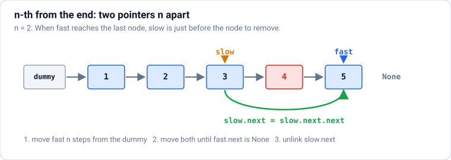

| Tool | What it gives you |
|---|---|
| dummy head | no special case when the head changes |
| fast and slow pointers | the middle; cycles |
| two pointers a fixed gap apart | the n-th node from the end in one pass |
| in-place reversal | reversing all, half, or groups of the list |

```python
class ListNode:
    def __init__(self, val, next=None):
        self.val, self.next = val, next

def build(values):
    dummy = tail = ListNode(0)
    for v in values:
        tail.next = ListNode(v)
        tail = tail.next
    return dummy.next

def to_list(head):
    out = []
    while head:
        out.append(head.val)
        head = head.next
    return out
```

### 32.1 Remove the n-th node from the end

Move `fast` n steps ahead, then move both together until `fast` is at the last node: `slow` is then just before the node to remove. Starting both at a dummy head handles removing the first node:

```python
def remove_nth_from_end(head, n):
    dummy = ListNode(0, head)
    fast = slow = dummy
    for _ in range(n):
        fast = fast.next                 # open a gap of n nodes
    while fast.next:
        fast, slow = fast.next, slow.next
    slow.next = slow.next.next
    return dummy.next

print(to_list(remove_nth_from_end(build([1, 2, 3, 4, 5]), 2)), to_list(remove_nth_from_end(build([1]), 1)), to_list(remove_nth_from_end(build([1, 2]), 2)))
```

**Output:**

```text
[1, 2, 3, 5] [] [2]
```

### 32.2 Palindrome list

Find the middle (fast/slow), reverse the second half, then compare the halves node by node: O(n) time, O(1) space. The three reversal steps fit on one line because Python evaluates the whole right side before assigning:

```python
def is_palindrome(head):
    slow = fast = head
    while fast and fast.next:
        slow, fast = slow.next, fast.next.next
    prev = None
    while slow:                            # reverse the second half
        slow.next, prev, slow = prev, slow, slow.next
    left, right = head, prev
    while right:
        if left.val != right.val:
            return False
        left, right = left.next, right.next
    return True

print(is_palindrome(build([1, 2, 2, 1])), is_palindrome(build([1, 2, 3, 2, 1])), is_palindrome(build([1, 2, 3])))
```

**Output:**

```text
True True False
```

### 32.3 Intersection of two lists

Two lists may merge into a shared tail. Walk pointer `a` along list A then list B, and `b` along B then A. Both travel |A| + |B| nodes in total, so they reach the shared node at the same moment (or both reach `None` together if there's none):

```python
def intersection(head_a, head_b):
    a, b = head_a, head_b
    while a is not b:
        a = a.next if a else head_b
        b = b.next if b else head_a
    return a

shared = build([8, 4, 5])
a = ListNode(4, ListNode(1, shared))
b = ListNode(5, ListNode(6, ListNode(1, shared)))
print(intersection(a, b).val, intersection(build([1]), build([2])))
```

**Output:**

```text
8 None
```

Why: if A = x + c and B = y + c (with c shared), then after x + c + y steps pointer a is at the start of the shared part, and so is b after y + c + x steps: the same number.

### 32.4 Add two numbers

Numbers stored as digit lists, least significant digit first (342 is 2 → 4 → 3): add digit by digit with a **carry**, as on paper. Don't forget a final carry (99 + 1 needs a new node):

```python
def add_two_numbers(l1, l2):
    dummy = tail = ListNode(0)
    carry = 0
    while l1 or l2 or carry:
        total = carry + (l1.val if l1 else 0) + (l2.val if l2 else 0)
        tail.next = ListNode(total % 10)
        carry = total // 10
        tail = tail.next
        l1 = l1.next if l1 else None
        l2 = l2.next if l2 else None
    return dummy.next

print(to_list(add_two_numbers(build([2, 4, 3]), build([5, 6, 4]))), to_list(add_two_numbers(build([9, 9]), build([1]))))
```

**Output:**

```text
[7, 0, 8] [0, 0, 1]
```

### 32.5 Reverse in groups of k

Check that k nodes remain; reverse those k with the usual loop (starting `prev` at the node after the group, so the group's new tail connects onward); then link the previous group to the new group head:

```python
def reverse_k_group(head, k):
    dummy = ListNode(0, head)
    group_prev = dummy
    while True:
        kth = group_prev
        for _ in range(k):
            kth = kth.next
            if kth is None:
                return dummy.next          # fewer than k left: leave them
        group_next = kth.next
        prev, curr = group_next, group_prev.next
        while curr is not group_next:
            curr.next, prev, curr = prev, curr, curr.next
        first = group_prev.next            # now the group's last node
        group_prev.next = kth
        group_prev = first

print(to_list(reverse_k_group(build([1, 2, 3, 4, 5]), 2)), to_list(reverse_k_group(build([1, 2, 3, 4, 5]), 3)))
```

**Output:**

```text
[2, 1, 4, 3, 5] [3, 2, 1, 4, 5]
```

### 32.6 Copy a list with random pointers

Each node has a `next` and a `random` reference. Pass 1 makes a copy of every node in a dict (old node → new node); pass 2 wires the copies using the dict. Nodes can be dict keys: an object is hashable by its identity:

```python
class RandomNode:
    def __init__(self, val, next=None, random=None):
        self.val, self.next, self.random = val, next, random

def copy_random_list(head):
    copy = {None: None}
    node = head
    while node:
        copy[node] = RandomNode(node.val)
        node = node.next
    node = head
    while node:
        copy[node].next = copy[node.next]
        copy[node].random = copy[node.random]
        node = node.next
    return copy[head]

x, y = RandomNode(7), RandomNode(13)
x.next, y.random = y, x
c = copy_random_list(x)
print(c.val, c.next.val, c.next.random.val, c is x, c.next.random is c)
```

**Output:**

```text
7 13 7 False True
```

### 32.7 Summary

```
n-th from end: gap of n from a dummy, move together, skip slow.next
palindrome: middle → reverse second half → compare
intersection: a walks A then B, b walks B then A → meet at the shared node (or None)
add numbers: digit = total % 10, carry = total // 10, loop while l1 or l2 or carry
k-group: check k nodes, reverse with prev = group_next, reconnect
random copy: old → new dict, two passes
```

**Key terms:**

- **Carry:** the amount passed to the next digit position when a digit sum exceeds 9.
- **Deep copy:** a copy that duplicates every node, sharing nothing with the original.

### Exercises

1. Reorder `L0 → L1 → … → Ln` to `L0 → Ln → L1 → Ln−1 → …` in place.
2. Sort a linked list in O(n log n) with merge sort (find the middle, split, merge).

<details>
<summary><b>Answers</b></summary>

```python
def reorder(head):
    slow = fast = head
    while fast and fast.next:
        slow, fast = slow.next, fast.next.next
    second, slow.next = slow.next, None      # split after the middle
    prev = None
    while second:
        second.next, prev, second = prev, second, second.next
    first, second = head, prev
    while second:                             # interleave
        first.next, first = second, first.next
        second.next, second = first, second.next
    return head

def merge_lists(a, b):
    dummy = tail = ListNode(0)
    while a and b:
        if a.val <= b.val:
            tail.next, a = a, a.next
        else:
            tail.next, b = b, b.next
        tail = tail.next
    tail.next = a or b
    return dummy.next

def sort_list(head):
    if head is None or head.next is None:
        return head
    slow, fast = head, head.next
    while fast and fast.next:
        slow, fast = slow.next, fast.next.next
    second, slow.next = slow.next, None
    return merge_lists(sort_list(head), sort_list(second))

print(to_list(reorder(build([1, 2, 3, 4, 5]))), to_list(sort_list(build([4, 2, 1, 3, 0]))))
```

**Output:**

```text
[1, 5, 2, 4, 3] [0, 1, 2, 3, 4]
```

2. Starting `fast` at `head.next` makes `slow` stop at the end of the first half, so a 2-node list splits into 1 + 1.

</details>

**Practice:**

| # | Problem (LeetCode) | Difficulty |
|---|---|---|
| 1 | [234. Palindrome Linked List](https://leetcode.com/problems/palindrome-linked-list/) | 🟢 Easy |
| 2 | [160. Intersection of Two Linked Lists](https://leetcode.com/problems/intersection-of-two-linked-lists/) | 🟢 Easy |
| 3 | [19. Remove Nth Node From End of List](https://leetcode.com/problems/remove-nth-node-from-end-of-list/) | 🟡 Medium |
| 4 | [2. Add Two Numbers](https://leetcode.com/problems/add-two-numbers/) | 🟡 Medium |
| 5 | [143. Reorder List](https://leetcode.com/problems/reorder-list/) | 🟡 Medium |
| 6 | [138. Copy List with Random Pointer](https://leetcode.com/problems/copy-list-with-random-pointer/) | 🟡 Medium |
| 7 | [148. Sort List](https://leetcode.com/problems/sort-list/) | 🟡 Medium |
| 8 | [25. Reverse Nodes in k-Group](https://leetcode.com/problems/reverse-nodes-in-k-group/) | 🔴 Hard |

**Learn more:** [VisuAlgo: linked list](https://visualgo.net/en/list)

---

## 33. Stacks

**You need:** Chapters 14 and 30. · **You'll learn:** the stack and its O(1) operations, why "last in, first out" matches anything closed in reverse order, bracket matching, evaluating postfix expressions, the monotonic stack for "next greater" questions, and how recursion is a stack.

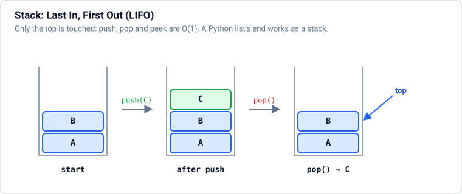

### 33.1 Last in, first out

A **stack** is a pile: add to the top, take from the top, so the last item in is the first out (**LIFO**). A pile of plates, the undo history in an editor, the browser's back button.

| Operation | Meaning | Python (a list used only at its end) |
|---|---|---|
| push | put an item on top | `stack.append(x)` |
| pop | remove and return the top | `stack.pop()` |
| peek | look at the top | `stack[-1]` |
| is empty? | anything left? | `not stack` |

All are O(1), because a list is cheap at its end (Chapter 20).

```python
stack = []
for x in [1, 2, 3]:
    stack.append(x)
print(stack[-1], stack.pop(), stack, not stack)
```

**Output:**

```text
3 3 [1, 2] False
```

### 33.2 Matching brackets

Whenever things must be **closed in the reverse order they were opened**, a stack tracks what's still open. Push each opening bracket; for a closing bracket, the top must be its partner:

| Read | Action | Stack after |
|---|---|---|
| `{` | push | `{` |
| `[` | push | `{ [` |
| `(` | push | `{ [ (` |
| `)` | top is `(`: pop | `{ [` |
| `]` | top is `[`: pop | `{` |
| `}` | top is `{`: pop | (empty) |

```python
def valid_brackets(s):
    pairs = {")": "(", "]": "[", "}": "{"}
    stack = []
    for ch in s:
        if ch in "([{":
            stack.append(ch)
        elif not stack or stack.pop() != pairs[ch]:
            return False
    return not stack                       # anything left open is an error too

print(valid_brackets("{[()()]}"), valid_brackets("([)]"), valid_brackets("(("), valid_brackets(")"))
```

**Output:**

```text
True False False False
```

### 33.3 Evaluating postfix expressions

In **postfix** (reverse Polish) notation the operator follows its operands: `3 4 + 2 *` means (3 + 4) × 2. Push numbers; an operator pops two, applies itself, and pushes the result. Calculators and compilers use exactly this:

```python
def eval_postfix(tokens):
    stack = []
    for t in tokens:
        if t in "+-*/":
            b, a = stack.pop(), stack.pop()        # the top is the RIGHT operand
            if t == "+":
                stack.append(a + b)
            elif t == "-":
                stack.append(a - b)
            elif t == "*":
                stack.append(a * b)
            else:
                stack.append(int(a / b))           # truncate towards zero
        else:
            stack.append(int(t))
    return stack[0]

print(eval_postfix("3 4 + 2 *".split()), eval_postfix(["2", "1", "+", "3", "*"]), eval_postfix(["4", "13", "5", "/", "+"]))
```

**Output:**

```text
14 9 6
```

### 33.4 The monotonic stack

"For each item, what's the **next greater** item to its right?" Comparing every pair is O(n²). A **monotonic stack** keeps the indices still waiting for their answer, with their values decreasing from bottom to top. A new item larger than the top *is* the answer for that index: pop it, record, repeat:

```python
def next_greater(nums):
    result = [-1] * len(nums)
    stack = []                                 # indices still waiting
    for i, x in enumerate(nums):
        while stack and nums[stack[-1]] < x:
            result[stack.pop()] = x
        stack.append(i)
    return result

def daily_temperatures(temps):                 # days until a warmer day
    result = [0] * len(temps)
    stack = []
    for i, t in enumerate(temps):
        while stack and temps[stack[-1]] < t:
            j = stack.pop()
            result[j] = i - j
        stack.append(i)
    return result

print(next_greater([2, 1, 5, 3, 6]), daily_temperatures([73, 74, 75, 71, 69, 72, 76, 73]))
```

**Output:**

```text
[5, 5, 6, 6, -1] [1, 1, 4, 2, 1, 1, 0, 0]
```

Each index is pushed once and popped at most once, so the whole scan is O(n), although there's a `while` inside the `for` (the same "total moves" argument as Chapter 23.3).

### 33.5 Recursion is a stack

The call stack (Chapter 14.2) is a real stack of waiting calls, so any recursion can be rewritten with an explicit stack, avoiding Python's depth limit. Summing a nested list both ways:

```python
def nested_sum_recursive(items):
    total = 0
    for x in items:
        total += nested_sum_recursive(x) if isinstance(x, list) else x
    return total

def nested_sum_stack(items):
    total, stack = 0, [items]
    while stack:
        current = stack.pop()
        for x in current:
            if isinstance(x, list):
                stack.append(x)                # "call" later
            else:
                total += x
    return total

data = [1, [2, [3, 4]], [5], [[[6]]]]
print(nested_sum_recursive(data), nested_sum_stack(data))
```

**Output:**

```text
21 21
```

`isinstance(x, list)` tests whether x is a list.

### 33.6 Summary

```
stack = []: push append(x), pop pop(), peek [-1], empty not stack   all O(1); LIFO
brackets: push openers; closer must match the top; empty at the end
postfix: numbers push; operator pops b then a, pushes a op b
monotonic stack: while stack and nums[top] < x: answer[pop()] = x; push i   O(n)
any recursion → explicit stack
```

**Key terms:**

- **Stack:** a collection where items are added and removed only at the top: last in, first out.
- **LIFO (last in, first out):** the order in which a stack returns items.
- **Push / pop / peek:** add to the top / remove from the top / look at the top.
- **Postfix notation (reverse Polish notation):** writing operators after their operands, as in `3 4 +`.
- **Monotonic stack:** a stack kept in increasing or decreasing order, used for next-greater/next-smaller questions.

### Exercises

1. Simplify a Unix path: `"/a/./b/../../c/"` → `"/c"`.
2. The largest rectangle in a histogram `[2, 1, 5, 6, 2, 3]`, using a monotonic stack of increasing heights.

<details>
<summary><b>Answers</b></summary>

```python
def simplify_path(path):
    parts = []
    for part in path.split("/"):
        if part == "..":
            if parts:
                parts.pop()
        elif part and part != ".":
            parts.append(part)
    return "/" + "/".join(parts)

def largest_rectangle(heights):
    stack, best = [], 0                        # indices with increasing heights
    for i, h in enumerate(heights + [0]):      # a final 0 flushes the stack
        while stack and heights[stack[-1]] >= h:
            height = heights[stack.pop()]
            left = stack[-1] + 1 if stack else 0
            best = max(best, height * (i - left))
        stack.append(i)
    return best

print(simplify_path("/a/./b/../../c/"), simplify_path("/home//foo/"), largest_rectangle([2, 1, 5, 6, 2, 3]))
```

**Output:**

```text
/c /home/foo 10
```

2. When a bar is popped, the current index is the first lower bar to its right, and the new top is the first lower bar to its left: the popped bar's height spans exactly between them.

</details>

**Practice:**

| # | Problem (LeetCode) | Difficulty |
|---|---|---|
| 1 | [20. Valid Parentheses](https://leetcode.com/problems/valid-parentheses/) | 🟢 Easy |
| 2 | [155. Min Stack](https://leetcode.com/problems/min-stack/) | 🟡 Medium |
| 3 | [150. Evaluate Reverse Polish Notation](https://leetcode.com/problems/evaluate-reverse-polish-notation/) | 🟡 Medium |
| 4 | [739. Daily Temperatures](https://leetcode.com/problems/daily-temperatures/) | 🟡 Medium |
| 5 | [496. Next Greater Element I](https://leetcode.com/problems/next-greater-element-i/) | 🟢 Easy |
| 6 | [71. Simplify Path](https://leetcode.com/problems/simplify-path/) | 🟡 Medium |
| 7 | [394. Decode String](https://leetcode.com/problems/decode-string/) | 🟡 Medium |
| 8 | [84. Largest Rectangle in Histogram](https://leetcode.com/problems/largest-rectangle-in-histogram/) | 🔴 Hard |

**Learn more:** [VisuAlgo: stack](https://visualgo.net/en/list) · [Wikipedia: reverse Polish notation](https://en.wikipedia.org/wiki/Reverse_Polish_notation)

---

## 34. Queues and Deques

**You need:** Chapters 20, 23 and 33. · **You'll learn:** the queue (first in, first out), why `list.pop(0)` is the wrong tool, `collections.deque`, a time-window counter, the monotonic deque for sliding-window maximums, and how a queue is built inside a deque.

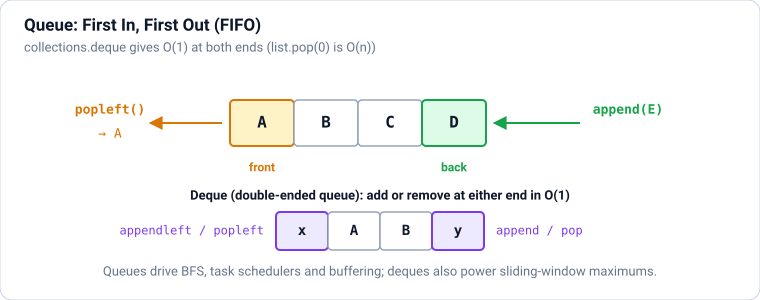

### 34.1 First in, first out

A **queue** is a line at a ticket counter: join at the back, leave from the front, first in, first out (**FIFO**). A **deque** ("deck", double-ended queue) allows both operations at both ends.

| Operation | Meaning | `collections.deque` | Cost |
|---|---|---|---|
| enqueue | join at the back | `q.append(x)` | O(1) |
| dequeue | leave from the front | `q.popleft()` | O(1) |
| front / back | look at either end | `q[0]`, `q[-1]` | O(1) |
| other ends | deque only | `q.appendleft(x)`, `q.pop()` | O(1) |
| middle | rarely needed | `q[i]` | O(n) |

```python
from collections import deque
q = deque([1, 2, 3])
q.append(4)
first = q.popleft()
q.appendleft(0)
print(first, list(q), q[0], q[-1], len(q))
```

**Output:**

```text
1 [0, 2, 3, 4] 0 4 4
```

Never use `list.pop(0)` as a queue: each call shifts every remaining item, O(n), so n dequeues cost O(n²) (Chapter 20.3 measured it). A deque is a doubly linked list of small blocks, so both ends are O(1).

### 34.2 A time-window counter

"How many requests arrived in the last 3,000 ms?" Keep request times in a queue; on each new request, drop times that fell out of the window from the front. Times arrive in order, so the oldest are always at the front:

```python
def recent_calls(times, window=3000):
    q, counts = deque(), []
    for t in times:
        q.append(t)
        while q[0] < t - window:
            q.popleft()
        counts.append(len(q))
    return counts

print(recent_calls([1, 100, 3001, 3002]))
```

**Output:**

```text
[1, 2, 3, 3]
```

Each time enters and leaves once: O(1) amortised per request. Rate limiters ("at most 100 requests per minute") work the same way.

### 34.3 The monotonic deque: sliding-window maximum

The maximum of every window of size k. Recomputing each is O(nk). A deque of indices with **decreasing** values keeps the window's maximum at its front:

1. before adding a new item, pop every **smaller** item from the back: it can never be a maximum again, because the new item is bigger and will stay in the window longer;
2. pop the front if it has slid out of the window;
3. the front is the maximum.

```python
def window_max(nums, k):
    dq, out = deque(), []
    for i, x in enumerate(nums):
        while dq and nums[dq[-1]] <= x:
            dq.pop()
        dq.append(i)
        if dq[0] <= i - k:
            dq.popleft()
        if i >= k - 1:
            out.append(nums[dq[0]])
    return out

print(window_max([1, 3, -1, -3, 5, 3, 6, 7], 3), window_max([9, 8, 7, 6], 2))
```

**Output:**

```text
[3, 3, 5, 5, 6, 7] [9, 8, 7]
```

Every index enters and leaves the deque at most once: O(n) total. The same deque answers window minimums (flip the comparison).

### 34.4 Where queues appear

- **Breadth-first search** (Chapters 36 and 41) processes nodes level by level with a queue: the queue holds the "frontier" in order of distance.
- **Buffers** between a fast producer and a slow consumer (keyboard input, network packets, task queues in web back ends).
- `deque(maxlen=k)` keeps only the last k items, dropping the oldest automatically:

```python
last3 = deque(maxlen=3)
for event in ["a", "b", "c", "d", "e"]:
    last3.append(event)
print(list(last3))
```

**Output:**

```text
['c', 'd', 'e']
```

`queue.Queue` is a different, thread-safe queue for programs with several threads; for algorithms, use `deque`.

### 34.5 Summary

```
from collections import deque;  q.append(x) / q.popleft() FIFO, both O(1);  appendleft / pop at the other ends
never list.pop(0) in a loop (O(n) each)
time window: append, then popleft while too old   O(1) amortised
window max: pop smaller from the back, pop expired from the front, front is the max   O(n)
deque(maxlen=k): keeps the last k;  BFS uses a queue
```

**Key terms:**

- **Queue:** a collection where items join at the back and leave from the front: first in, first out.
- **FIFO (first in, first out):** the order in which a queue returns items.
- **Deque (double-ended queue):** a collection with O(1) adds and removals at both ends.
- **Enqueue / dequeue:** add to the back / remove from the front of a queue.
- **Monotonic deque:** a deque kept in increasing or decreasing order, used for sliding-window maximums and minimums.
- **Buffer:** a queue that holds data between a producer and a consumer working at different speeds.

### Exercises

1. Simulate a round-robin scheduler: tasks `[("a", 3), ("b", 1), ("c", 2)]` each run 1 unit per turn; print the order of finishing.
2. Implement a stack using only a deque's `append` and `popleft` (one queue).

<details>
<summary><b>Answers</b></summary>

```python
def round_robin(tasks):
    q, finished = deque(tasks), []
    while q:
        name, left = q.popleft()
        if left > 1:
            q.append((name, left - 1))        # back of the line
        else:
            finished.append(name)
    return finished

class StackFromQueue:
    def __init__(self):
        self.q = deque()
    def push(self, x):
        self.q.append(x)
        for _ in range(len(self.q) - 1):      # rotate so x is at the front
            self.q.append(self.q.popleft())
    def pop(self):
        return self.q.popleft()

s = StackFromQueue()
for x in [1, 2, 3]:
    s.push(x)
print(round_robin([("a", 3), ("b", 1), ("c", 2)]), s.pop(), s.pop())
```

**Output:**

```text
['b', 'c', 'a'] 3 2
```

2. Each push is O(n), pop O(1): a fair trade only when the interview requires it.

</details>

**Practice:**

| # | Problem (LeetCode) | Difficulty |
|---|---|---|
| 1 | [933. Number of Recent Calls](https://leetcode.com/problems/number-of-recent-calls/) | 🟢 Easy |
| 2 | [232. Implement Queue using Stacks](https://leetcode.com/problems/implement-queue-using-stacks/) | 🟢 Easy |
| 3 | [225. Implement Stack using Queues](https://leetcode.com/problems/implement-stack-using-queues/) | 🟢 Easy |
| 4 | [622. Design Circular Queue](https://leetcode.com/problems/design-circular-queue/) | 🟡 Medium |
| 5 | [239. Sliding Window Maximum](https://leetcode.com/problems/sliding-window-maximum/) | 🔴 Hard |
| 6 | [649. Dota2 Senate](https://leetcode.com/problems/dota2-senate/) | 🟡 Medium |

**Learn more:** [Python docs: deque](https://docs.python.org/3/library/collections.html#collections.deque)

---

## 35. Design Problems: Min Stack, Queue from Stacks, LRU Cache

**You need:** Chapters 19 and 30–34. · **You'll learn:** a method for "design a class whose operations are all O(1)" questions, and four classics: a min stack, a queue from two stacks (with its amortised cost), an LRU cache from a dict and a doubly linked list, and a set with O(1) random picks.

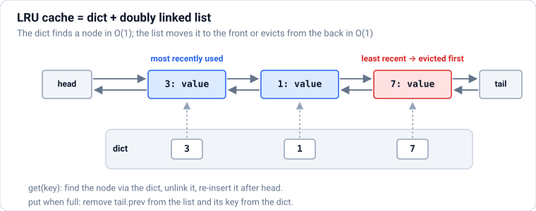

### 35.1 The method

A design question asks for a class with given operations, each within a target cost: "a cache where `get` and `put` are O(1)". No single structure is good at everything, so **combine** them:

1. list the operations and each one's required cost;
2. for each operation, name the structure that makes it cheap: dict (find by key), linked list (insert/remove in the middle), stack (latest item), heap (smallest item, Chapter 39), list (random index);
3. combine them, and keep them **in sync**: every operation updates all of them.

### 35.2 Min stack

Push, pop, top and `get_min`, all O(1). Store each item together with **the minimum at the moment it was pushed**; popping restores the previous minimum automatically:

```python
class MinStack:
    def __init__(self):
        self.items = []                       # (value, min so far)

    def push(self, x):
        current_min = min(x, self.items[-1][1]) if self.items else x
        self.items.append((x, current_min))

    def pop(self):
        return self.items.pop()[0]

    def top(self):
        return self.items[-1][0]

    def get_min(self):
        return self.items[-1][1]

s = MinStack()
for x in [5, 3, 7, 2]:
    s.push(x)
print(s.get_min(), s.pop(), s.get_min(), s.top())
```

**Output:**

```text
2 2 3 7
```

### 35.3 Queue from two stacks

Push onto an `inbox` stack. To pop, if the `outbox` is empty, pour everything from `inbox` into `outbox`, which reverses the order, then pop from `outbox`:

```python
class QueueFromStacks:
    def __init__(self):
        self.inbox, self.outbox = [], []

    def push(self, x):
        self.inbox.append(x)

    def pop(self):
        if not self.outbox:
            while self.inbox:
                self.outbox.append(self.inbox.pop())
        return self.outbox.pop()

q = QueueFromStacks()
for x in [1, 2, 3]:
    q.push(x)
first, second = q.pop(), q.pop()
q.push(4)
print(first, second, q.pop(), q.pop())
```

**Output:**

```text
1 2 3 4
```

A single pop can cost O(n), but each item is moved from inbox to outbox **once** in its life: pushed once, moved once, popped once. So n operations cost O(n) in total: **amortised O(1)** each.

### 35.4 LRU cache

An **LRU** (least recently used) cache holds at most `capacity` items; when full, it evicts the item used longest ago. `get` and `put` must be O(1):

- a **dict** maps each key to its node: O(1) lookup;
- a **doubly linked list** keeps nodes in order of use, most recent at the front. Any node can be unlinked and moved to the front in O(1), because it knows both neighbours. Two dummy nodes, `head` and `tail`, remove all edge cases.

```python
class Node:
    def __init__(self, key=0, val=0):
        self.key, self.val = key, val
        self.prev = self.next = None

class LRUCache:
    def __init__(self, capacity):
        self.capacity = capacity
        self.map = {}                                # key → node
        self.head, self.tail = Node(), Node()        # head.next = most recent
        self.head.next, self.tail.prev = self.tail, self.head

    def _remove(self, node):
        node.prev.next, node.next.prev = node.next, node.prev

    def _add_front(self, node):
        node.prev, node.next = self.head, self.head.next
        self.head.next.prev = node
        self.head.next = node

    def get(self, key):
        if key not in self.map:
            return -1
        node = self.map[key]
        self._remove(node)
        self._add_front(node)                        # now the most recent
        return node.val

    def put(self, key, val):
        if key in self.map:
            self._remove(self.map[key])
        node = Node(key, val)
        self.map[key] = node
        self._add_front(node)
        if len(self.map) > self.capacity:
            lru = self.tail.prev                     # least recently used
            self._remove(lru)
            del self.map[lru.key]                    # nodes store their key for this

cache = LRUCache(2)
cache.put(1, "one")
cache.put(2, "two")
print(cache.get(1))
cache.put(3, "three")                                # full: evicts 2
print(cache.get(2), cache.get(3), cache.get(1))
```

**Output:**

```text
one
-1 three one
```

A name starting with `_` marks a helper for use inside the class (a convention). Python's `OrderedDict` is this exact combination built in: `move_to_end(key)` marks a key recent, `popitem(last=False)` removes the oldest. Real uses: `functools.lru_cache`, browser and CDN caches, database buffer pools.

```python
from collections import OrderedDict

class LRUCacheShort:
    def __init__(self, capacity):
        self.capacity, self.data = capacity, OrderedDict()

    def get(self, key):
        if key not in self.data:
            return -1
        self.data.move_to_end(key)
        return self.data[key]

    def put(self, key, val):
        self.data[key] = val
        self.data.move_to_end(key)
        if len(self.data) > self.capacity:
            self.data.popitem(last=False)

c2 = LRUCacheShort(2)
c2.put("a", 1)
c2.put("b", 2)
c2.get("a")
c2.put("c", 3)
print(list(c2.data))
```

**Output:**

```text
['a', 'c']
```

### 35.5 Insert, delete and get-random in O(1)

Keep the values in a **list** (a random index is O(1)) and a **dict** from value to its index. To delete from the middle of the list in O(1), move the **last** value into the gap, update its index, and pop the end:

```python
import random

class RandomizedSet:
    def __init__(self):
        self.values, self.index = [], {}

    def insert(self, x):
        if x in self.index:
            return False
        self.index[x] = len(self.values)
        self.values.append(x)
        return True

    def remove(self, x):
        if x not in self.index:
            return False
        i, last = self.index[x], self.values[-1]
        self.values[i], self.index[last] = last, i
        self.values.pop()
        del self.index[x]
        return True

    def get_random(self):
        return random.choice(self.values)

rs = RandomizedSet()
print(rs.insert(1), rs.insert(2), rs.insert(1), rs.remove(1), rs.values, rs.get_random())
```

**Output:**

```text
True True False True [2] 2
```

`random.choice(xs)` picks a random item.

### 35.6 Summary

```
design: operations + costs → one structure per need → keep them in sync
min stack: push (value, min so far)
queue from 2 stacks: pour inbox → outbox only when outbox is empty   amortised O(1)
LRU: dict key → node + doubly linked list (dummies head/tail); move to front on use; evict tail.prev
     OrderedDict: move_to_end, popitem(last=False);  functools.lru_cache
random set: list + dict index; delete by swapping the last value in
```

**Key terms:**

- **Design problem:** an interview question asking for a class whose operations meet given cost targets.
- **Min stack:** a stack that also returns its minimum in O(1).
- **LRU cache (least recently used):** a bounded cache that evicts the entry unused for longest.
- **Eviction:** removing an entry from a full cache to make room.
- **Doubly linked list:** a linked list whose nodes reference both the next and the previous node.
- **OrderedDict:** a dict from `collections` with O(1) reordering of keys.

### Exercises

1. Design a hit counter: `hit(t)` and `count(t)` = hits in the last 300 seconds, with times arriving in order.
2. Add `size()` and `peek()` to `QueueFromStacks`.

<details>
<summary><b>Answers</b></summary>

```python
from collections import deque

class HitCounter:
    def __init__(self):
        self.hits = deque()

    def hit(self, t):
        self.hits.append(t)

    def count(self, t):
        while self.hits and self.hits[0] <= t - 300:
            self.hits.popleft()
        return len(self.hits)

class QueueFromStacks2(QueueFromStacks):
    def size(self):
        return len(self.inbox) + len(self.outbox)

    def peek(self):
        if not self.outbox:
            while self.inbox:
                self.outbox.append(self.inbox.pop())
        return self.outbox[-1]

h = HitCounter()
for t in [1, 2, 3, 300]:
    h.hit(t)
q2 = QueueFromStacks2()
q2.push(5)
q2.push(6)
print(h.count(300), h.count(301), q2.peek(), q2.size())
```

**Output:**

```text
4 3 5 2
```

2. `class QueueFromStacks2(QueueFromStacks)` creates a class that **inherits** all of `QueueFromStacks`'s methods and adds more.

</details>

**Practice:**

| # | Problem (LeetCode) | Difficulty |
|---|---|---|
| 1 | [155. Min Stack](https://leetcode.com/problems/min-stack/) | 🟡 Medium |
| 2 | [232. Implement Queue using Stacks](https://leetcode.com/problems/implement-queue-using-stacks/) | 🟢 Easy |
| 3 | [146. LRU Cache](https://leetcode.com/problems/lru-cache/) | 🟡 Medium |
| 4 | [380. Insert Delete GetRandom O(1)](https://leetcode.com/problems/insert-delete-getrandom-o1/) | 🟡 Medium |
| 5 | [706. Design HashMap](https://leetcode.com/problems/design-hashmap/) | 🟢 Easy |
| 6 | [981. Time Based Key-Value Store](https://leetcode.com/problems/time-based-key-value-store/) | 🟡 Medium |
| 7 | [460. LFU Cache](https://leetcode.com/problems/lfu-cache/) | 🔴 Hard |

**Learn more:** [Python docs: functools.lru_cache](https://docs.python.org/3/library/functools.html#functools.lru_cache) · [Wikipedia: cache replacement policies](https://en.wikipedia.org/wiki/Cache_replacement_policies)

---

# Part VI — Trees and Heaps

Five chapters on hierarchical data: binary trees and their traversals, the classic tree problems, binary search trees, heaps and priority queues, and tries.

---

## 36. Binary Trees and Traversals

**You need:** Chapters 14, 30, 33 and 34. · **You'll learn:** binary-tree vocabulary, why a balanced tree of n nodes has height about log₂ n, the four traversals (pre-, in-, post- and level order) recursively and iteratively, and the "solve both subtrees, then combine" pattern.

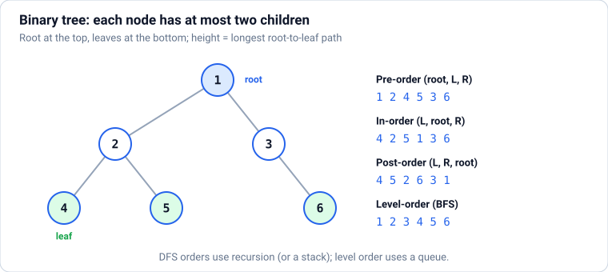

### 36.1 Vocabulary

A **tree** is a family tree of data: a **root** node at the top has children, which have children, and so on. In a **binary tree** each node has at most two children, `left` and `right`. File systems, org charts, tournament brackets, a web page's DOM and a compiler's syntax tree are all trees.

| Word | Meaning |
|---|---|
| root | the top node (no parent) |
| parent / child | a node and the nodes directly below it |
| leaf | a node with no children |
| subtree | a node together with everything below it: a tree itself |
| depth of a node | edges from the root to it (the root has depth 0) |
| height of a tree | the number of levels on the longest root-to-leaf path |
| balanced | left and right heights about equal everywhere |

A tree with n nodes has exactly n − 1 edges: every node except the root has one edge up to its parent.

<details>
<summary><b>Why a balanced tree has height about log₂ n</b></summary>

Level d of a binary tree holds at most 2ᵈ nodes, so a tree of height h holds at most 1 + 2 + … + 2^(h−1) = 2ʰ − 1 nodes (Chapter 11.1). So n ≤ 2ʰ − 1, giving h ≥ log₂(n + 1): no binary tree is shorter than that. A *balanced* tree comes within a constant factor of this bound, so its height is O(log n): about 20 levels for a million nodes. An unbalanced tree can be a chain of height n.

</details>

### 36.2 Building one

```python
from collections import deque

class TreeNode:
    def __init__(self, val, left=None, right=None):
        self.val, self.left, self.right = val, left, right

#        1
#       / \
#      2   3
#     / \   \
#    4   5   6
root = TreeNode(1, TreeNode(2, TreeNode(4), TreeNode(5)), TreeNode(3, None, TreeNode(6)))
```

### 36.3 Depth-first traversals

**Traversal** visits every node once. Every child is the root of a smaller tree, so each traversal is a tiny recursive function; they differ only in *when* the node itself is visited:

| Traversal | Order | Result here | Used for |
|---|---|---|---|
| pre-order | node, left, right | 1 2 4 5 3 6 | copying or saving a tree (parent first) |
| in-order | left, node, right | 4 2 5 1 3 6 | sorted order in a BST (Chapter 38) |
| post-order | left, right, node | 4 5 2 6 3 1 | deleting, or computing sizes and heights bottom up |

```python
def preorder(n):
    return [] if n is None else [n.val] + preorder(n.left) + preorder(n.right)

def inorder(n):
    return [] if n is None else inorder(n.left) + [n.val] + inorder(n.right)

def postorder(n):
    return [] if n is None else postorder(n.left) + postorder(n.right) + [n.val]

print(preorder(root), inorder(root), postorder(root))
```

**Output:**

```text
[1, 2, 4, 5, 3, 6] [4, 2, 5, 1, 3, 6] [4, 5, 2, 6, 3, 1]
```

These are **depth-first** (DFS): they go all the way down one branch before the next. Each is O(n) time (every node once; the list joins add copying, which an output list passed down avoids) and O(h) stack space for height h.

### 36.4 Iterative in-order with a stack

Recursion is a stack (Chapter 33.5). In-order with an explicit stack: go left as far as possible, pushing nodes; pop one, visit it, then go to its right subtree:

```python
def inorder_iterative(root):
    out, stack, node = [], [], root
    while stack or node:
        while node:                    # slide down the left edge
            stack.append(node)
            node = node.left
        node = stack.pop()
        out.append(node.val)
        node = node.right
    return out

print(inorder_iterative(root))
```

**Output:**

```text
[4, 2, 5, 1, 3, 6]
```

### 36.5 Level order (breadth-first)

Level by level, left to right: **breadth-first search** (BFS), with a queue. Taking exactly `len(q)` nodes per round separates the levels:

```python
def level_order(root):
    levels, q = [], deque([root] if root else [])
    while q:
        level = []
        for _ in range(len(q)):        # exactly one level
            node = q.popleft()
            level.append(node.val)
            if node.left:
                q.append(node.left)
            if node.right:
                q.append(node.right)
        levels.append(level)
    return levels

print(level_order(root))
```

**Output:**

```text
[[1], [2, 3], [4, 5, 6]]
```

BFS reaches the nodes closest to the root first; it's the basis of level averages, the right-side view and shortest paths in graphs (Chapter 41).

### 36.6 Solve both subtrees, then combine

Most tree questions follow one pattern: answer for the left subtree, answer for the right subtree, combine at this node, with the empty tree as the base case. Height, size and sum:

```python
def height(n):
    return 0 if n is None else 1 + max(height(n.left), height(n.right))

def size(n):
    return 0 if n is None else 1 + size(n.left) + size(n.right)

def tree_sum(n):
    return 0 if n is None else n.val + tree_sum(n.left) + tree_sum(n.right)

print(height(root), size(root), tree_sum(root))
```

**Output:**

```text
3 6 21
```

### 36.7 Summary

```
binary tree: nodes with left/right; n nodes → n − 1 edges; height ≥ log₂(n+1); balanced → O(log n)
pre (N L R) · in (L N R) · post (L R N): recursive, O(n) time, O(h) space
iterative in-order: push the left edge, pop, visit, go right
level order: queue, len(q) nodes per level
pattern: f(node) = combine(f(left), f(right)); f(None) = base value
```

**Key terms:**

- **Tree:** a hierarchy of nodes where each node except the root has exactly one parent.
- **Binary tree:** a tree where each node has at most two children.
- **Root:** the top node of a tree.
- **Leaf:** a node with no children.
- **Subtree:** a node and all its descendants.
- **Depth:** the number of edges from the root to a node.
- **Height:** the number of levels on the longest root-to-leaf path.
- **Balanced tree:** a tree whose height is O(log n).
- **Traversal:** visiting every node of a tree once in a set order.
- **Pre-order / in-order / post-order:** depth-first orders visiting the node before, between or after its subtrees.
- **Level-order traversal:** visiting a tree level by level.
- **Depth-first search (DFS):** exploring as deep as possible along each branch before backtracking.
- **Breadth-first search (BFS):** exploring all nodes at one distance before the next, using a queue.

### Exercises

1. Count the leaves of `root`.
2. Return the average of each level.
3. Invert (mirror) a tree: swap every node's children.

<details>
<summary><b>Answers</b></summary>

```python
def count_leaves(n):
    if n is None:
        return 0
    if n.left is None and n.right is None:
        return 1
    return count_leaves(n.left) + count_leaves(n.right)

def level_averages(root):
    return [sum(level) / len(level) for level in level_order(root)]

def invert(n):
    if n:
        n.left, n.right = invert(n.right), invert(n.left)
    return n

print(count_leaves(root), level_averages(root), preorder(invert(root)))
```

**Output:**

```text
3 [1.0, 2.5, 5.0] [1, 3, 6, 2, 5, 4]
```

</details>

**Practice:**

| # | Problem (LeetCode) | Difficulty |
|---|---|---|
| 1 | [94. Binary Tree Inorder Traversal](https://leetcode.com/problems/binary-tree-inorder-traversal/) | 🟢 Easy |
| 2 | [144. Binary Tree Preorder Traversal](https://leetcode.com/problems/binary-tree-preorder-traversal/) | 🟢 Easy |
| 3 | [145. Binary Tree Postorder Traversal](https://leetcode.com/problems/binary-tree-postorder-traversal/) | 🟢 Easy |
| 4 | [104. Maximum Depth of Binary Tree](https://leetcode.com/problems/maximum-depth-of-binary-tree/) | 🟢 Easy |
| 5 | [226. Invert Binary Tree](https://leetcode.com/problems/invert-binary-tree/) | 🟢 Easy |
| 6 | [102. Binary Tree Level Order Traversal](https://leetcode.com/problems/binary-tree-level-order-traversal/) | 🟡 Medium |
| 7 | [637. Average of Levels in Binary Tree](https://leetcode.com/problems/average-of-levels-in-binary-tree/) | 🟢 Easy |

**Learn more:** [VisuAlgo: binary search tree (includes traversals)](https://visualgo.net/en/bst)

---

## 37. Binary Tree Interview Problems

**You need:** Chapter 36. · **You'll learn:** the two recursive templates (top-down and bottom-up), returning one value while recording another, and the classic problems: same and symmetric trees, diameter, balance, lowest common ancestor, right-side view, path sums, building a tree from traversals, and serialisation.

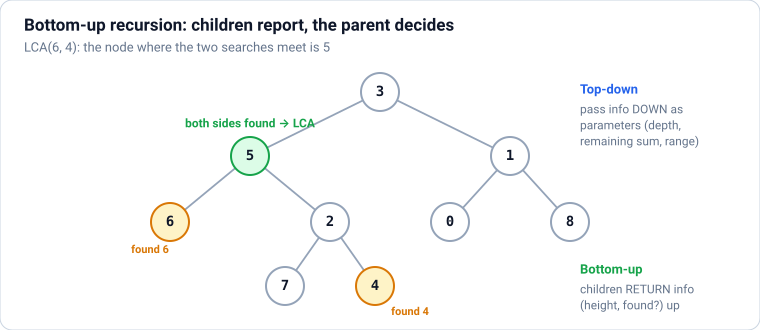

### 37.1 Two templates

| Template | Information flows | Written as | Examples |
|---|---|---|---|
| **top-down** | parent → children, as extra parameters | `dfs(node, info_so_far)` | depths, path sums, valid BST bounds |
| **bottom-up** | children → parent, as return values | `l = dfs(left); r = dfs(right); combine` | height, diameter, balance, LCA |

LeetCode writes trees as a level-order list with `None` for missing children: `[3, 9, 20, None, None, 15, 7]`. A builder, and a printer for checking results:

```python
from collections import deque

class TreeNode:
    def __init__(self, val, left=None, right=None):
        self.val, self.left, self.right = val, left, right

def build_tree(values):
    if not values or values[0] is None:
        return None
    root = TreeNode(values[0])
    q, i = deque([root]), 1
    while q and i < len(values):
        node = q.popleft()
        if i < len(values) and values[i] is not None:
            node.left = TreeNode(values[i])
            q.append(node.left)
        i += 1
        if i < len(values) and values[i] is not None:
            node.right = TreeNode(values[i])
            q.append(node.right)
        i += 1
    return root

def level_values(root):
    out, q = [], deque([root])
    while q:
        node = q.popleft()
        out.append(node.val if node else None)
        if node:
            q.extend([node.left, node.right])
    while out and out[-1] is None:
        out.pop()
    return out

t = build_tree([3, 9, 20, None, None, 15, 7])
print(level_values(t))
```

**Output:**

```text
[3, 9, 20, None, None, 15, 7]
```

`q.extend(xs)` appends each item of xs.

### 37.2 Comparing trees

Two trees are the same if both are empty, or their roots match and both pairs of subtrees are the same. A tree is **symmetric** if its left subtree mirrors its right: compare left with right *crosswise*:

```python
def is_same(a, b):
    if a is None or b is None:
        return a is b
    return a.val == b.val and is_same(a.left, b.left) and is_same(a.right, b.right)

def is_symmetric(root):
    def mirror(a, b):
        if a is None or b is None:
            return a is b
        return a.val == b.val and mirror(a.left, b.right) and mirror(a.right, b.left)
    return mirror(root.left, root.right) if root else True

print(is_same(t, build_tree([3, 9, 20, None, None, 15, 7])), is_symmetric(build_tree([1, 2, 2, 3, 4, 4, 3])), is_symmetric(build_tree([1, 2, 2, None, 3, None, 3])))
```

**Output:**

```text
True True False
```

### 37.3 Return one thing, record another

The **diameter** is the longest path between any two nodes, counted in edges. The longest path that *bends* at a node has length left height + right height; but the parent needs this node's *height*, not its diameter. So return the height and record the best bend in an outer variable; `nonlocal best` lets the inner function assign to it:

```python
def diameter(root):
    best = 0
    def height(node):
        nonlocal best
        if node is None:
            return 0
        l, r = height(node.left), height(node.right)
        best = max(best, l + r)                # longest path bending here
        return 1 + max(l, r)                   # what the parent needs
    height(root)
    return best

def is_balanced(root):
    def check(node):                           # height, or −1 if unbalanced
        if node is None:
            return 0
        l, r = check(node.left), check(node.right)
        if l == -1 or r == -1 or abs(l - r) > 1:
            return -1
        return 1 + max(l, r)
    return check(root) != -1

print(diameter(build_tree([1, 2, 3, 4, 5])), is_balanced(t), is_balanced(build_tree([1, 2, None, 3])))
```

**Output:**

```text
3 True False
```

Returning −1 as soon as any part is unbalanced keeps `is_balanced` O(n); calling a separate `height` at every node would be O(n²).

### 37.4 Lowest common ancestor

The **lowest common ancestor** (LCA) of p and q is the deepest node with both below it (a node counts as below itself). Bottom-up: a call returns p or q if it finds one, else `None`. If the two sides return non-`None`, p and q are split across this node, so it's the LCA:

```python
def lowest_common_ancestor(root, p, q):
    if root is None or root.val in (p, q):
        return root
    left = lowest_common_ancestor(root.left, p, q)
    right = lowest_common_ancestor(root.right, p, q)
    if left and right:
        return root
    return left or right

tree = build_tree([3, 5, 1, 6, 2, 0, 8, None, None, 7, 4])
print(lowest_common_ancestor(tree, 5, 1).val, lowest_common_ancestor(tree, 6, 4).val, lowest_common_ancestor(tree, 5, 4).val)
```

**Output:**

```text
3 5 5
```

### 37.5 Views and path sums

The **right-side view** is the last node of each level of a level-order traversal. A path sum passes the remaining target **down** (top-down). The maximum path sum anywhere combines both templates, ignoring negative branches:

```python
def right_side_view(root):
    view, q = [], deque([root] if root else [])
    while q:
        for i in range(len(q)):
            node = q.popleft()
            if i == 0:
                view.append(node.val)          # right child is queued first
            for child in (node.right, node.left):
                if child:
                    q.append(child)
    return view

def has_path_sum(root, target):
    if root is None:
        return False
    if root.left is None and root.right is None:
        return root.val == target
    return has_path_sum(root.left, target - root.val) or has_path_sum(root.right, target - root.val)

def max_path_sum(root):
    best = float("-inf")
    def gain(node):                            # best downward path starting here
        nonlocal best
        if node is None:
            return 0
        l, r = max(gain(node.left), 0), max(gain(node.right), 0)
        best = max(best, node.val + l + r)
        return node.val + max(l, r)
    gain(root)
    return best

print(right_side_view(build_tree([1, 2, 3, None, 5, None, 4])), has_path_sum(build_tree([5, 4, 8, 11, None, 13, 4, 7, 2]), 22), max_path_sum(build_tree([-10, 9, 20, None, None, 15, 7])))
```

**Output:**

```text
[1, 3, 4] True 42
```

### 37.6 Build from traversals, and serialise

From pre-order and in-order lists: the first pre-order value is the root; its position in the in-order list splits the left and right subtrees. A dict of in-order positions makes each split O(1), so building is O(n). `iter(xs)` makes an **iterator** that hands out values one at a time with `next`:

```python
def build_from_pre_in(preorder, inorder):
    where = {v: i for i, v in enumerate(inorder)}
    it = iter(preorder)
    def build(lo, hi):                         # the subtree made of inorder[lo..hi]
        if lo > hi:
            return None
        val = next(it)
        node = TreeNode(val)
        node.left = build(lo, where[val] - 1)
        node.right = build(where[val] + 1, hi)
        return node
    return build(0, len(inorder) - 1)

def serialize(root):
    out = []
    def pre(node):
        if node is None:
            out.append("#")
            return
        out.append(str(node.val))
        pre(node.left)
        pre(node.right)
    pre(root)
    return ",".join(out)

def deserialize(data):
    it = iter(data.split(","))
    def build():
        val = next(it)
        if val == "#":
            return None
        return TreeNode(int(val), build(), build())
    return build()

print(level_values(build_from_pre_in([3, 9, 20, 15, 7], [9, 3, 15, 20, 7])))
s = serialize(t)
print(s, level_values(deserialize(s)))
```

**Output:**

```text
[3, 9, 20, None, None, 15, 7]
3,9,#,#,20,15,#,#,7,#,# [3, 9, 20, None, None, 15, 7]
```

`{v: i for i, v in enumerate(xs)}` is a **dict comprehension**. Pre-order with a `#` for empty children identifies the tree uniquely, so the same order of reads rebuilds it.

### 37.7 Summary

```
top-down: dfs(node, info) passes state down;  bottom-up: combine dfs(left), dfs(right)
return one thing, record another: nonlocal best (diameter, max path sum)
balanced: return −1 early → O(n);  LCA: split across a node → that node
right view: last per level;  path sum: subtract going down
pre + in → tree (dict of positions, O(n));  serialise: pre-order with # for None
```

**Key terms:**

- **Top-down recursion:** passing information from a node to its children through parameters.
- **Bottom-up recursion:** computing a node's answer from its children's returned answers.
- **nonlocal:** a declaration that lets an inner function assign to a variable of the enclosing function.
- **Diameter of a tree:** the number of edges on the longest path between any two nodes.
- **Lowest common ancestor (LCA):** the deepest node that has both given nodes as descendants.
- **Serialisation:** turning a data structure into text (or bytes) that can be stored and rebuilt.
- **Iterator:** an object that produces values one at a time with `next()`.
- **Dict comprehension:** an expression that builds a dict from a loop, such as `{k: v for …}`.

### Exercises

1. Count the "good" nodes: nodes with no larger value on the path from the root to them (`[3, 1, 4, 3, None, 1, 5]` → 4).
2. Return the zigzag level order (left-to-right, then right-to-left, alternating).

<details>
<summary><b>Answers</b></summary>

```python
def good_nodes(root):
    def dfs(node, best):                       # top-down: the max so far on the path
        if node is None:
            return 0
        here = 1 if node.val >= best else 0
        best = max(best, node.val)
        return here + dfs(node.left, best) + dfs(node.right, best)
    return dfs(root, root.val)

def zigzag(root):
    levels, q, flip = [], deque([root] if root else []), False
    while q:
        level = []
        for _ in range(len(q)):
            node = q.popleft()
            level.append(node.val)
            q.extend(c for c in (node.left, node.right) if c)
        levels.append(level[::-1] if flip else level)
        flip = not flip
    return levels

print(good_nodes(build_tree([3, 1, 4, 3, None, 1, 5])), zigzag(build_tree([3, 9, 20, None, None, 15, 7])))
```

**Output:**

```text
4 [[3], [20, 9], [15, 7]]
```

</details>

**Practice:**

| # | Problem (LeetCode) | Difficulty |
|---|---|---|
| 1 | [100. Same Tree](https://leetcode.com/problems/same-tree/) | 🟢 Easy |
| 2 | [101. Symmetric Tree](https://leetcode.com/problems/symmetric-tree/) | 🟢 Easy |
| 3 | [543. Diameter of Binary Tree](https://leetcode.com/problems/diameter-of-binary-tree/) | 🟢 Easy |
| 4 | [110. Balanced Binary Tree](https://leetcode.com/problems/balanced-binary-tree/) | 🟢 Easy |
| 5 | [112. Path Sum](https://leetcode.com/problems/path-sum/) | 🟢 Easy |
| 6 | [236. Lowest Common Ancestor of a Binary Tree](https://leetcode.com/problems/lowest-common-ancestor-of-a-binary-tree/) | 🟡 Medium |
| 7 | [199. Binary Tree Right Side View](https://leetcode.com/problems/binary-tree-right-side-view/) | 🟡 Medium |
| 8 | [1448. Count Good Nodes in Binary Tree](https://leetcode.com/problems/count-good-nodes-in-binary-tree/) | 🟡 Medium |
| 9 | [105. Construct Binary Tree from Preorder and Inorder Traversal](https://leetcode.com/problems/construct-binary-tree-from-preorder-and-inorder-traversal/) | 🟡 Medium |
| 10 | [124. Binary Tree Maximum Path Sum](https://leetcode.com/problems/binary-tree-maximum-path-sum/) | 🔴 Hard |
| 11 | [297. Serialize and Deserialize Binary Tree](https://leetcode.com/problems/serialize-and-deserialize-binary-tree/) | 🔴 Hard |

**Learn more:** [LeetCode explore: binary tree](https://leetcode.com/explore/learn/card/data-structure-tree/)

---

## 38. Binary Search Trees

**You need:** Chapters 18 and 36–37. · **You'll learn:** the BST ordering rule, search, insert and delete in O(height), why in-order traversal is sorted, validating a BST correctly, k-th smallest, what goes wrong without balancing, and what to use in Python instead.

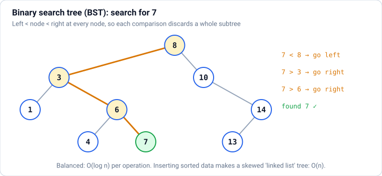

### 38.1 The rule

A **binary search tree** (BST) is a binary tree with an ordering rule **at every node**: every value in the left subtree is smaller than the node, and every value in the right subtree is bigger. It's the "higher or lower" game frozen into a shape: at each node, go left or right.

Inserting 8, 3, 10, 1, 6, 14, 4, 7, 13: 8 becomes the root; 3 < 8 goes left; 10 > 8 goes right; 1 < 8 and 1 < 3 goes left of 3; 6 goes right of 3; and so on.

```python
class Node:
    def __init__(self, val):
        self.val, self.left, self.right = val, None, None

def insert(root, val):
    if root is None:
        return Node(val)
    if val < root.val:
        root.left = insert(root.left, val)
    else:
        root.right = insert(root.right, val)
    return root

def contains(root, val):
    while root:
        if val == root.val:
            return True
        root = root.left if val < root.val else root.right
    return False

def inorder(n):
    return [] if n is None else inorder(n.left) + [n.val] + inorder(n.right)

root = None
for v in [8, 3, 10, 1, 6, 14, 4, 7, 13]:
    root = insert(root, v)
print(contains(root, 7), contains(root, 5), inorder(root))
```

**Output:**

```text
True False [1, 3, 4, 6, 7, 8, 10, 13, 14]
```

### 38.2 What a BST gives you

- **Search, insert and delete follow one path down:** O(h) for height h, so O(log n) when balanced (Chapter 36.1).
- **In-order traversal visits the values in sorted order.** By induction: the left subtree's values all come out (sorted) first and are all smaller, then the node, then the right subtree's (sorted, all bigger).
- The minimum is the leftmost node, the maximum the rightmost; the **successor** of x (the next bigger value) is found by one root-to-leaf walk.

```python
def k_th_smallest(root, k):
    stack = []
    while True:                     # iterative in-order (Chapter 36.4), stopping early
        while root:
            stack.append(root)
            root = root.left
        root = stack.pop()
        k -= 1
        if k == 0:
            return root.val
        root = root.right

def successor(root, x):             # smallest value > x
    best = None
    while root:
        if root.val > x:
            best, root = root.val, root.left      # candidate; look for smaller
        else:
            root = root.right
    return best

print(k_th_smallest(root, 3), successor(root, 8), successor(root, 7), successor(root, 14))
```

**Output:**

```text
4 10 8 None
```

### 38.3 Deleting

Three cases for the node to delete:

1. **no children:** remove it;
2. **one child:** replace it by that child;
3. **two children:** copy in its in-order **successor** (the leftmost node of its right subtree, which has no left child), then delete the successor from the right subtree (case 1 or 2).

```python
def delete(root, val):
    if root is None:
        return None
    if val < root.val:
        root.left = delete(root.left, val)
    elif val > root.val:
        root.right = delete(root.right, val)
    else:
        if root.left is None:
            return root.right
        if root.right is None:
            return root.left
        succ = root.right
        while succ.left:
            succ = succ.left
        root.val = succ.val
        root.right = delete(root.right, succ.val)
    return root

for v in [1, 3, 8]:                 # a leaf, a two-child node, the root
    root = delete(root, v)
print(inorder(root), root.val)
```

**Output:**

```text
[4, 6, 7, 10, 13, 14] 10
```

### 38.4 Validating: the classic trap

Checking only `left.val < node.val < right.val` isn't enough: a small value can hide deep in the *right* subtree. Pass the allowed range **down** (top-down): going left tightens the upper bound, going right the lower:

```python
def is_valid(root, low=float("-inf"), high=float("inf")):
    if root is None:
        return True
    return low < root.val < high and is_valid(root.left, low, root.val) and is_valid(root.right, root.val, high)

bad = Node(5)
bad.left, bad.right = Node(1), Node(6)
bad.right.left = Node(3)            # 3 < 6 locally, but it's right of 5
print(is_valid(root), is_valid(bad))
```

**Output:**

```text
True False
```

(Equivalently: the in-order traversal must be strictly increasing.)

### 38.5 Balance

Inserting sorted data makes every node a right child: a chain of height n, and every operation O(n):

```python
def height(n):
    return 0 if n is None else 1 + max(height(n.left), height(n.right))

import random
random.seed(3)
values = list(range(500))
chain = None
for v in values:
    chain = insert(chain, v)
shuffled = values[:]
random.shuffle(shuffled)
bushy = None
for v in shuffled:
    bushy = insert(bushy, v)
print(height(chain), height(bushy))
```

**Output:**

```text
500 20
```

`random.shuffle` puts a list in random order. Random insertion order gives height O(log n) on average (here far below 500), but no guarantee. **Self-balancing** BSTs (AVL trees, red-black trees) rotate nodes after each insert or delete to keep height O(log n) always: Java's `TreeMap` and C++'s `std::map` are red-black trees. Interviews rarely ask you to code rotations, but expect you to know why balance matters.

### 38.6 What to use in Python

| You need | Use |
|---|---|
| only "is x present?" | a set (O(1) average) |
| sorted order, "next bigger than x", ranges, **with** frequent inserts and deletes | a balanced tree: the `sortedcontainers.SortedList` package |
| sorted data that rarely changes | a sorted list + `bisect` (Chapter 18) |

### 38.7 Summary

```
BST rule at every node: left subtree < node < right subtree
search/insert/delete: one path, O(h); h = O(log n) balanced, O(n) for sorted inserts
in-order = sorted;  k-th smallest: in-order with early stop;  successor: one walk down
delete with two children: copy the successor, delete it from the right subtree
validate with bounds passed down (not parent–child checks)
Python: set · SortedList · sorted list + bisect
```

**Key terms:**

- **Binary search tree (BST):** a binary tree where every left-subtree value is smaller and every right-subtree value is larger than the node.
- **In-order successor:** the next larger value in a BST.
- **Self-balancing BST:** a BST that restructures itself on updates to keep its height O(log n), such as an AVL or red-black tree.
- **Rotation:** a local restructuring of a BST that preserves order and changes heights.
- **Degenerate tree:** a tree shaped like a linked list, with height n.

### Exercises

1. Convert a sorted list into a height-balanced BST (pick the middle as the root, recursively).
2. Find the lowest common ancestor of two values in a BST in O(h), using the ordering.

<details>
<summary><b>Answers</b></summary>

```python
def from_sorted(values):
    if not values:
        return None
    mid = len(values) // 2
    node = Node(values[mid])
    node.left, node.right = from_sorted(values[:mid]), from_sorted(values[mid + 1:])
    return node

def bst_lca(root, p, q):
    while root:
        if p < root.val and q < root.val:
            root = root.left              # both smaller: go left
        elif p > root.val and q > root.val:
            root = root.right
        else:
            return root.val               # they split here (or one is here)

balanced = from_sorted(list(range(1, 16)))
print(height(balanced), inorder(balanced) == list(range(1, 16)), bst_lca(balanced, 3, 7), bst_lca(balanced, 9, 15))
```

**Output:**

```text
4 True 4 12
```

</details>

**Practice:**

| # | Problem (LeetCode) | Difficulty |
|---|---|---|
| 1 | [700. Search in a Binary Search Tree](https://leetcode.com/problems/search-in-a-binary-search-tree/) | 🟢 Easy |
| 2 | [701. Insert into a Binary Search Tree](https://leetcode.com/problems/insert-into-a-binary-search-tree/) | 🟡 Medium |
| 3 | [98. Validate Binary Search Tree](https://leetcode.com/problems/validate-binary-search-tree/) | 🟡 Medium |
| 4 | [230. Kth Smallest Element in a BST](https://leetcode.com/problems/kth-smallest-element-in-a-bst/) | 🟡 Medium |
| 5 | [235. Lowest Common Ancestor of a Binary Search Tree](https://leetcode.com/problems/lowest-common-ancestor-of-a-binary-search-tree/) | 🟡 Medium |
| 6 | [450. Delete Node in a BST](https://leetcode.com/problems/delete-node-in-a-bst/) | 🟡 Medium |
| 7 | [108. Convert Sorted Array to Binary Search Tree](https://leetcode.com/problems/convert-sorted-array-to-binary-search-tree/) | 🟢 Easy |

**Learn more:** [VisuAlgo: binary search tree](https://visualgo.net/en/bst) · [sortedcontainers](https://grantjenks.com/docs/sortedcontainers/)

---

## 39. Heaps and Priority Queues

**You need:** Chapters 29 and 36. · **You'll learn:** how a binary heap keeps the smallest item at the top in a plain list, sift up and sift down, why building a heap is O(n), Python's `heapq`, and the heap patterns: top k, merging k sorted lists, the running median and heap sort.

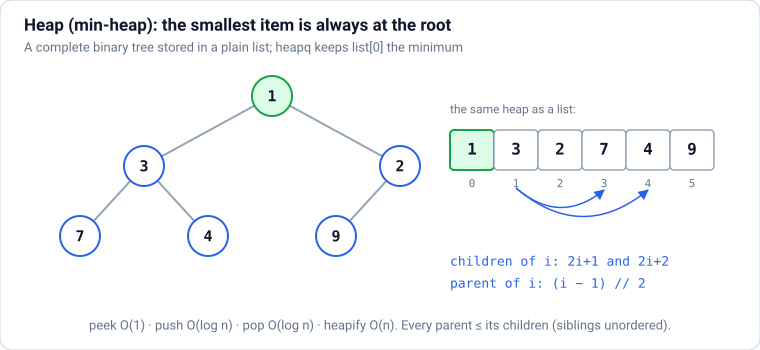

### 39.1 A structure that always knows its minimum

A **priority queue** hands out the most urgent item next, like an emergency room. A **binary heap** implements it as a binary tree with two rules:

1. **shape:** it's **complete**: every level full except possibly the last, which fills from the left, so its height is ⌊log₂ n⌋;
2. **order (min-heap):** every parent ≤ its children, so the smallest item is at the root.

The regular shape means no node objects are needed: the tree lives in a **plain list**, level by level. The children of index i are at 2i + 1 and 2i + 2; its parent is at (i − 1) // 2.

| Operation | Cost |
|---|---|
| peek at the minimum, `h[0]` | O(1) |
| push / pop | O(log n) |
| build from a list (heapify) | O(n) |
| search for any value | O(n): a heap is only "roughly ordered" |

### 39.2 Push and pop by hand

- **Push:** append at the end, then **sift up**: swap with the parent while smaller. At most one swap per level: O(log n).
- **Pop the minimum:** take the root, move the last item to the root, then **sift down**: swap with the smaller child while bigger. O(log n).

```python
def heap_push(h, x):
    h.append(x)
    i = len(h) - 1
    while i > 0 and h[(i - 1) // 2] > h[i]:
        parent = (i - 1) // 2
        h[i], h[parent] = h[parent], h[i]
        i = parent

def sift_down(h, i, n):
    while True:
        smallest, left, right = i, 2 * i + 1, 2 * i + 2
        if left < n and h[left] < h[smallest]:
            smallest = left
        if right < n and h[right] < h[smallest]:
            smallest = right
        if smallest == i:
            return
        h[i], h[smallest] = h[smallest], h[i]
        i = smallest

def heap_pop(h):
    top = h[0]
    last = h.pop()
    if h:
        h[0] = last
        sift_down(h, 0, len(h))
    return top

h = []
for x in [5, 1, 8, 3, 9, 2]:
    heap_push(h, x)
print(h)
print([heap_pop(h) for _ in range(6)])
```

**Output:**

```text
[1, 3, 2, 5, 9, 8]
[1, 2, 3, 5, 8, 9]
```

The list `[1, 3, 2, 5, 9, 8]` isn't sorted, but each parent is ≤ its children; popping repeatedly yields sorted order.

### 39.3 Building a heap in O(n)

n pushes cost O(n log n). **Heapify** does better: sift down every non-leaf node, from the last one up to the root:

```python
def heapify(h):
    for i in range(len(h) // 2 - 1, -1, -1):
        sift_down(h, i, len(h))
    return h

print(heapify([9, 8, 7, 6, 5, 4, 3, 2, 1]))
```

**Output:**

```text
[1, 2, 3, 6, 5, 4, 7, 8, 9]
```

<details>
<summary><b>Why heapify is O(n), not O(n log n)</b></summary>

A node at height k (k levels above the bottom) sifts down at most k steps. In a heap of n nodes there are at most ⌈n/2^(k+1)⌉ nodes at height k: half the nodes are leaves (height 0, no work), a quarter have height 1, and so on. The total work is at most Σₖ (n/2^(k+1)) · k = (n/2) · Σₖ k/2ᵏ. The series Σ k/2ᵏ = 1/2 + 2/4 + 3/8 + … converges to 2, so the total is at most n: **O(n)**. Most nodes are near the bottom, where sifting is cheap.

</details>

### 39.4 heapq

Python's `heapq` module works on a plain list as a **min-heap**: `heappush(h, x)`, `heappop(h)`, `heapify(h)`, `h[0]` to peek, `nsmallest(k, xs)` and `nlargest(k, xs)`. For a **max-heap**, push negated values. Tuples compare item by item, so `(priority, counter, item)` breaks ties without ever comparing the items themselves:

```python
import heapq
nums = [5, 1, 8, 3, 9, 2]
h = nums[:]
heapq.heapify(h)
max_heap = []
for x in [3, 7, 1]:
    heapq.heappush(max_heap, -x)
tasks = []
for order, (priority, name) in enumerate([(2, "write"), (1, "fix bug"), (2, "review")]):
    heapq.heappush(tasks, (priority, order, name))
print(h[0], heapq.nsmallest(3, nums), heapq.nlargest(2, nums), -heapq.heappop(max_heap), [heapq.heappop(tasks)[2] for _ in range(3)])
```

**Output:**

```text
1 [1, 2, 3] [9, 8] 7 ['fix bug', 'write', 'review']
```

### 39.5 Patterns

**Top k:** keep a heap of size k. For the k largest of n items, push each and pop whenever the heap exceeds k; the k largest remain and the k-th largest is at the top. O(n log k): better than sorting when k is small.

**Merge k sorted lists:** keep the current item of each list in a heap and repeatedly take the smallest: O(N log k) for N items in total.

```python
def kth_largest(nums, k):
    heap = []
    for x in nums:
        heapq.heappush(heap, x)
        if len(heap) > k:
            heapq.heappop(heap)
    return heap[0]

def merge_k_sorted(lists):
    heap = [(lst[0], i, 0) for i, lst in enumerate(lists) if lst]
    heapq.heapify(heap)
    out = []
    while heap:
        val, i, j = heapq.heappop(heap)
        out.append(val)
        if j + 1 < len(lists[i]):
            heapq.heappush(heap, (lists[i][j + 1], i, j + 1))
    return out

print(kth_largest([3, 2, 1, 5, 6, 4], 2), merge_k_sorted([[1, 4, 7], [2, 5], [3, 6, 9]]))
```

**Output:**

```text
5 [1, 2, 3, 4, 5, 6, 7, 9]
```

**Running median:** keep the smaller half in a max-heap (`low`, negated) and the larger half in a min-heap (`high`), with `low` holding the same number or one more. The median is then on top of one or both:

```python
class MedianFinder:
    def __init__(self):
        self.low, self.high = [], []

    def add(self, x):
        heapq.heappush(self.low, -x)
        heapq.heappush(self.high, -heapq.heappop(self.low))   # low's largest moves up
        if len(self.high) > len(self.low):
            heapq.heappush(self.low, -heapq.heappop(self.high))

    def median(self):
        if len(self.low) > len(self.high):
            return -self.low[0]
        return (-self.low[0] + self.high[0]) / 2

mf = MedianFinder()
medians = []
for x in [5, 15, 1, 3, 8]:
    mf.add(x)
    medians.append(mf.median())
print(medians)
```

**Output:**

```text
[5, 10.0, 5, 4.0, 5]
```

**Heap sort:** heapify, then pop n times: O(n log n) worst case and O(1) extra space in place (by swapping the root to the end), but not stable. It completes Chapter 29's table.

### 39.6 Summary

```
min-heap: complete tree in a list; parent ≤ children; children 2i+1, 2i+2; parent (i−1)//2
push: append + sift up;  pop: last to root + sift down   O(log n);  heapify O(n)
heapq: heappush heappop heapify nsmallest nlargest;  max-heap: negate;  ties: (priority, counter, item)
top k: size-k heap O(n log k);  merge k lists O(N log k);  median: two heaps;  heap sort O(n log n)
```

**Key terms:**

- **Priority queue:** a collection that always removes the highest-priority item next.
- **Binary heap:** a complete binary tree in a list where each parent is ≤ (min-heap) or ≥ (max-heap) its children.
- **Complete binary tree:** a binary tree with every level full except possibly the last, filled from the left.
- **Min-heap / max-heap:** a heap with the smallest / largest item at the root.
- **Sift up / sift down:** moving an item up or down a heap by swaps until the heap order holds.
- **Heapify:** turning an arbitrary list into a heap in O(n).
- **heapq:** Python's module of min-heap functions on lists.
- **Heap sort:** sorting by building a heap and repeatedly removing its top.

### Exercises

1. Return the k closest points to the origin from `[(1, 3), (-2, 2), (5, 8), (0, 1)]`, k = 2.
2. Sort a list with heap sort using `sift_down` in place.

<details>
<summary><b>Answers</b></summary>

```python
def k_closest(points, k):
    return heapq.nsmallest(k, points, key=lambda p: p[0] ** 2 + p[1] ** 2)

def heap_sort(a):
    n = len(a)
    for i in range(n // 2 - 1, -1, -1):        # build a MAX-heap
        max_sift(a, i, n)
    for end in range(n - 1, 0, -1):
        a[0], a[end] = a[end], a[0]            # largest to its final place
        max_sift(a, 0, end)
    return a

def max_sift(h, i, n):
    while True:
        biggest, left, right = i, 2 * i + 1, 2 * i + 2
        if left < n and h[left] > h[biggest]:
            biggest = left
        if right < n and h[right] > h[biggest]:
            biggest = right
        if biggest == i:
            return
        h[i], h[biggest] = h[biggest], h[i]
        i = biggest

print(k_closest([(1, 3), (-2, 2), (5, 8), (0, 1)], 2), heap_sort([5, 2, 9, 1, 5, 6]))
```

**Output:**

```text
[(0, 1), (-2, 2)] [1, 2, 5, 5, 6, 9]
```

2. Ascending order needs a max-heap: each round swaps the current maximum to the end of the unsorted part. `nsmallest` accepts a `key`, like `sorted`.

</details>

**Practice:**

| # | Problem (LeetCode) | Difficulty |
|---|---|---|
| 1 | [1046. Last Stone Weight](https://leetcode.com/problems/last-stone-weight/) | 🟢 Easy |
| 2 | [703. Kth Largest Element in a Stream](https://leetcode.com/problems/kth-largest-element-in-a-stream/) | 🟢 Easy |
| 3 | [215. Kth Largest Element in an Array](https://leetcode.com/problems/kth-largest-element-in-an-array/) | 🟡 Medium |
| 4 | [973. K Closest Points to Origin](https://leetcode.com/problems/k-closest-points-to-origin/) | 🟡 Medium |
| 5 | [347. Top K Frequent Elements](https://leetcode.com/problems/top-k-frequent-elements/) | 🟡 Medium |
| 6 | [621. Task Scheduler](https://leetcode.com/problems/task-scheduler/) | 🟡 Medium |
| 7 | [23. Merge k Sorted Lists](https://leetcode.com/problems/merge-k-sorted-lists/) | 🔴 Hard |
| 8 | [295. Find Median from Data Stream](https://leetcode.com/problems/find-median-from-data-stream/) | 🔴 Hard |

**Learn more:** [Python docs: heapq](https://docs.python.org/3/library/heapq.html) · [VisuAlgo: binary heap](https://visualgo.net/en/heap)

---

## 40. Tries (Prefix Trees)

**You need:** Chapters 19 and 36. · **You'll learn:** how a trie stores words letter by letter so shared prefixes share a path, insert, search and prefix queries in O(length of the word), listing all words with a prefix, wildcard search, and when a set is the better choice.

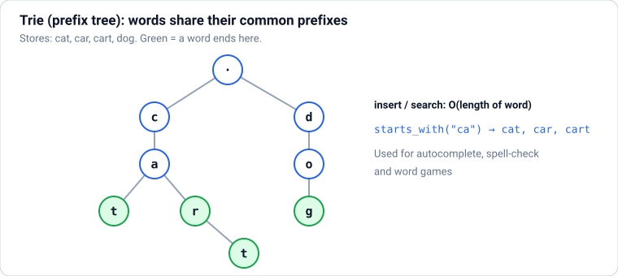

### 40.1 Words as paths

A phone's autocomplete offers "car", "cart", "cat" as soon as you type `ca`, without scanning every word it knows. A **trie** (from re*trie*val, also a **prefix tree**) stores words letter by letter:

- each node has **children**, one per possible next letter, and an **end-of-word** marker;
- the root is the empty string; the path root → c → a → t spells "cat", and the node for `t` is marked;
- words with a common prefix share its path: after inserting "cat", "car", "cart" and "dog", the root has two children, `c` and `d`, and `c` → `a` is shared by three words.

| Operation | How | Cost |
|---|---|---|
| insert(word) | walk the letters, creating missing children; mark the last node | O(L) |
| search(word) | walk the letters; present only if every letter exists **and** the last node is marked | O(L) |
| starts_with(prefix) | walk the letters; true if the walk succeeds | O(L) |

L is the word's length: the cost doesn't depend on how many words are stored.

### 40.2 A trie from dicts

Each node is a dict from a character to the child node, with the key `"$"` as the end marker. `node.setdefault(ch, {})` returns the child, creating an empty one if missing:

```python
class Trie:
    def __init__(self):
        self.root = {}

    def insert(self, word):
        node = self.root
        for ch in word:
            node = node.setdefault(ch, {})
        node["$"] = True

    def _walk(self, prefix):
        node = self.root
        for ch in prefix:
            if ch not in node:
                return None
            node = node[ch]
        return node

    def search(self, word):
        node = self._walk(word)
        return node is not None and "$" in node

    def starts_with(self, prefix):
        return self._walk(prefix) is not None

t = Trie()
for w in ["cat", "car", "cart", "dog"]:
    t.insert(w)
print(t.search("car"), t.search("ca"), t.starts_with("ca"), t.starts_with("cow"), t.root.keys())
```

**Output:**

```text
True False True False dict_keys(['c', 'd'])
```

"ca" walks fine but isn't marked, so it isn't a word. A list of 26 children per node (Chapter 16.3) is faster for lower-case-only words; dicts handle any alphabet.

### 40.3 All words with a prefix

Walk to the prefix's node, then depth-first search everything below it, building each word as you go:

```python
def words_with_prefix(trie, prefix):
    start, out = trie._walk(prefix), []
    def dfs(node, path):
        if "$" in node:
            out.append(prefix + path)
        for ch in sorted(k for k in node if k != "$"):
            dfs(node[ch], path + ch)
    if start is not None:
        dfs(start, "")
    return out

print(words_with_prefix(t, "ca"), words_with_prefix(t, "d"), words_with_prefix(t, "x"))
```

**Output:**

```text
['car', 'cart', 'cat'] ['dog'] []
```

Visiting children in sorted order returns the words alphabetically: autocomplete in O(prefix length + size of the answer).

### 40.4 Wildcard search

"Does any stored word match `c.r`, where `.` is any letter?" At a `.`, try every child; otherwise follow the one matching child. This is backtracking (Chapter 47) on the trie:

```python
def matches(node, pattern, i=0):
    if i == len(pattern):
        return "$" in node
    ch = pattern[i]
    if ch == ".":
        return any(matches(child, pattern, i + 1) for key, child in node.items() if key != "$")
    return ch in node and matches(node[ch], pattern, i + 1)

print(matches(t.root, "c.r"), matches(t.root, "..g"), matches(t.root, "c..."), matches(t.root, "c.."), matches(t.root, "b.."))
```

**Output:**

```text
True True True True False
```

### 40.5 Trie or set?

A set answers "is this exact word present?" in O(L) too, with less memory. Choose a trie when you need **prefix** questions: autocomplete, "is any word a prefix of this?", longest common prefix, wildcard matching, or searching for many words at once in a grid (LeetCode's Word Search II). Tries use a lot of memory, one node per character; **radix trees** (compressed tries) merge chains of single-child nodes. Routers use them to find the longest matching IP prefix.

### 40.6 Summary

```
node = dict of children + "$" end marker;  insert: setdefault walk, then mark
search: walk and check "$";  starts_with: walk succeeds   O(L), independent of word count
prefix listing: walk, then DFS below;  wildcard ".": try every child (backtracking)
trie for prefix questions; set for exact membership
```

**Key terms:**

- **Trie (prefix tree):** a tree that stores strings character by character, with shared prefixes sharing a path.
- **End-of-word marker:** a flag on a trie node meaning a stored word ends there.
- **Prefix:** a starting part of a string, such as "ca" in "cart".
- **Autocomplete:** suggesting stored words that begin with typed text.
- **Radix tree:** a compressed trie whose edges can hold several characters.

### Exercises

1. Find the longest common prefix of `["flower", "flow", "flight"]` with a trie: walk down while there's exactly one child and no word ends.
2. Replace each word in a sentence with its shortest root from a dictionary: roots `["cat", "bat", "rat"]`, sentence "the cattle was rattled by the battery".

<details>
<summary><b>Answers</b></summary>

```python
def lcp(words):
    trie = Trie()
    for w in words:
        trie.insert(w)
    node, prefix = trie.root, ""
    while len(node) == 1 and "$" not in node:
        ch = next(iter(node))
        prefix += ch
        node = node[ch]
    return prefix

def replace_words(roots, sentence):
    trie = Trie()
    for r in roots:
        trie.insert(r)
    out = []
    for word in sentence.split():
        node, prefix = trie.root, ""
        for ch in word:
            if ch not in node or "$" in node:
                break
            node = node[ch]
            prefix += ch
        out.append(prefix if "$" in node else word)
    return " ".join(out)

print(lcp(["flower", "flow", "flight"]), replace_words(["cat", "bat", "rat"], "the cattle was rattled by the battery"))
```

**Output:**

```text
fl the cat was rat by the bat
```

1. `next(iter(node))` gets the only key of a one-key dict.

</details>

**Practice:**

| # | Problem (LeetCode) | Difficulty |
|---|---|---|
| 1 | [14. Longest Common Prefix](https://leetcode.com/problems/longest-common-prefix/) | 🟢 Easy |
| 2 | [208. Implement Trie (Prefix Tree)](https://leetcode.com/problems/implement-trie-prefix-tree/) | 🟡 Medium |
| 3 | [211. Design Add and Search Words Data Structure](https://leetcode.com/problems/design-add-and-search-words-data-structure/) | 🟡 Medium |
| 4 | [648. Replace Words](https://leetcode.com/problems/replace-words/) | 🟡 Medium |
| 5 | [1268. Search Suggestions System](https://leetcode.com/problems/search-suggestions-system/) | 🟡 Medium |
| 6 | [212. Word Search II](https://leetcode.com/problems/word-search-ii/) | 🔴 Hard |

**Learn more:** [Wikipedia: trie](https://en.wikipedia.org/wiki/Trie)

---

# Part VII — Graphs

Six chapters on networks: representing graphs and exploring them with BFS and DFS, cycles and two-colouring, shortest paths with Dijkstra, topological sort, union-find, and spanning trees and other shortest-path algorithms.

---

## 41. Graphs: Representation, BFS and DFS

**You need:** Parts V–VI. · **You'll learn:** the kinds of graphs and three ways to store them, breadth-first and depth-first search in O(V + E), why BFS finds shortest paths in unweighted graphs, rebuilding a path from parent links, and grids as graphs.

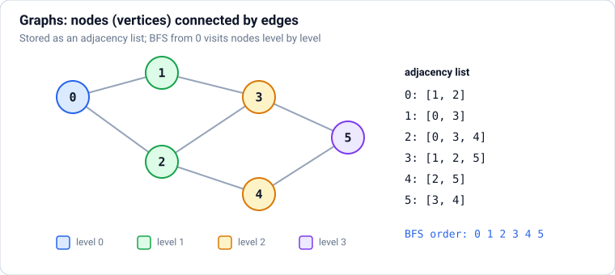

### 41.1 Vertices and edges

A **graph** is a set of **vertices** (nodes) joined by **edges**. It's the most general node structure: a linked list allows one link per node, a tree several but no loops, and a graph no restrictions at all. Maps, social networks, the web, course prerequisites and computer networks are all graphs.

| Kind | Meaning | Example |
|---|---|---|
| undirected | edges work both ways | friendships, two-way roads |
| directed | edges are one-way arrows | "follows", prerequisites |
| weighted | each edge has a cost | road distances |
| unweighted | every edge counts 1 | "fewest moves" |
| cyclic / acyclic | has loops / has none | a directed acyclic graph (**DAG**) models dependencies |

The **degree** of a vertex is its number of edges. V is the number of vertices and E the number of edges.

### 41.2 Storing a graph

| Representation | What it is | Space | Edge u–v? | Neighbours of u | Use when |
|---|---|---|---|---|---|
| **adjacency list** | `graph[u]` = list of u's neighbours | O(V + E) | O(degree) | O(degree) | almost always |
| adjacency matrix | `m[u][v] = 1` if connected | O(V²) | O(1) | O(V) | small, dense graphs |
| edge list | list of (u, v) pairs | O(E) | O(E) | O(E) | the usual input format: convert it |

For an undirected edge, add it **both** ways:

```python
from collections import deque

edges = [(0, 1), (0, 2), (1, 3), (2, 3), (2, 4), (3, 5), (4, 5)]
graph = {v: [] for v in range(6)}
for a, b in edges:
    graph[a].append(b)
    graph[b].append(a)
print(graph)
```

**Output:**

```text
{0: [1, 2], 1: [0, 3], 2: [0, 3, 4], 3: [1, 2, 5], 4: [2, 5], 5: [3, 4]}
```

### 41.3 Breadth-first search

**BFS** explores in rings: the start, then all its neighbours, then theirs. It uses a queue. Unlike trees, graphs have cycles, so a **visited** set stops vertices being processed twice; mark a vertex when it's **enqueued**, not when it's popped, or it can be queued many times:

```python
def bfs_order(graph, start):
    seen, order, q = {start}, [], deque([start])
    while q:
        node = q.popleft()
        order.append(node)
        for nxt in graph[node]:
            if nxt not in seen:
                seen.add(nxt)
                q.append(nxt)
    return order

print(bfs_order(graph, 0))
```

**Output:**

```text
[0, 1, 2, 3, 4, 5]
```

**Cost:** each vertex is enqueued once, and each adjacency list is scanned once, touching every edge twice (once from each end): **O(V + E)**.

### 41.4 BFS finds shortest paths

In an **unweighted** graph, BFS reaches every vertex by a shortest path. Keep a `dist` dict (which doubles as the visited set) and a `parent` dict to rebuild the path backwards:

```python
def shortest_path(graph, start, goal):
    dist, parent, q = {start: 0}, {start: None}, deque([start])
    while q:
        node = q.popleft()
        if node == goal:
            path = []
            while node is not None:            # walk the parents back to the start
                path.append(node)
                node = parent[node]
            return dist[goal], path[::-1]
        for nxt in graph[node]:
            if nxt not in dist:
                dist[nxt] = dist[node] + 1
                parent[nxt] = node
                q.append(nxt)
    return -1, []

print(shortest_path(graph, 0, 5), shortest_path(graph, 4, 1))
```

**Output:**

```text
(3, [0, 1, 3, 5]) (3, [4, 2, 0, 1])
```

<details>
<summary><b>Why BFS distances are shortest</b></summary>

Claim: the queue always holds vertices in order of distance, with at most two distinct distances d and d + 1 present at once. Initially it holds just the start (distance 0). Popping a vertex at distance d enqueues only new vertices at d + 1, at the back, so the order is kept. Hence BFS pops all vertices at distance d before any at d + 1. Suppose some vertex v got dist[v] = k but has a shorter path of length j < k; the vertex u before v on that path has true distance j − 1 and (by induction on distance) was popped with dist[u] = j − 1 before any vertex at distance k − 1; when popped, it would have discovered v with distance j. Contradiction. This fails with edge **weights**: use Dijkstra (Chapter 43).

</details>

### 41.5 Depth-first search

**DFS** goes as deep as it can along one path, then backs up and tries the next: recursion, or an explicit stack. Also O(V + E):

```python
def dfs_recursive(graph, start):
    seen, order = set(), []
    def visit(node):
        seen.add(node)
        order.append(node)
        for nxt in graph[node]:
            if nxt not in seen:
                visit(nxt)
    visit(start)
    return order

def dfs_iterative(graph, start):
    seen, order, stack = set(), [], [start]
    while stack:
        node = stack.pop()
        if node in seen:
            continue
        seen.add(node)
        order.append(node)
        for nxt in reversed(graph[node]):     # reversed: visit neighbours in list order
            if nxt not in seen:
                stack.append(nxt)
    return order

print(dfs_recursive(graph, 0), dfs_iterative(graph, 0))
```

**Output:**

```text
[0, 1, 3, 2, 4, 5] [0, 1, 3, 2, 4, 5]
```

Use BFS for shortest paths and "fewest steps"; DFS for reachability, connected components, cycles and anything that explores whole branches (topological sort, backtracking). The iterative version avoids Python's recursion limit on big graphs.

### 41.6 Grids are graphs

Each cell is a vertex and its up/down/left/right neighbours (Chapter 26.1) are its edges, so BFS and DFS work unchanged. Counting islands of `1`s is counting connected components: start a DFS **flood fill** from every unvisited land cell:

```python
def count_islands(grid):
    rows, cols, seen = len(grid), len(grid[0]), set()
    def fill(r, c):
        if not (0 <= r < rows and 0 <= c < cols) or grid[r][c] == "0" or (r, c) in seen:
            return
        seen.add((r, c))
        for dr, dc in ((1, 0), (-1, 0), (0, 1), (0, -1)):
            fill(r + dr, c + dc)
    islands = 0
    for r in range(rows):
        for c in range(cols):
            if grid[r][c] == "1" and (r, c) not in seen:
                fill(r, c)
                islands += 1
    return islands

print(count_islands(["11000", "11000", "00100", "00011"]))
```

**Output:**

```text
3
```

O(rows × cols): each cell is filled once.

### 41.7 Summary

```
graph = vertices + edges; directed/undirected, weighted/unweighted, cyclic/acyclic (DAG)
adjacency list {u: [neighbours]}  O(V + E) space;  undirected → add both directions
BFS: queue + visited (mark on enqueue)  O(V + E); shortest paths in unweighted graphs; parent dict → path
DFS: recursion or stack + visited  O(V + E); components, cycles, whole branches
grid: cells = vertices, 4 neighbours = edges;  flood fill counts islands
```

**Key terms:**

- **Graph:** a set of vertices connected by edges.
- **Vertex (node):** a point in a graph.
- **Edge:** a connection between two vertices.
- **Directed graph:** a graph whose edges have a direction.
- **Weighted graph:** a graph whose edges carry numbers such as distances.
- **DAG (directed acyclic graph):** a directed graph with no cycles.
- **Degree:** the number of edges touching a vertex.
- **Adjacency list:** a representation storing each vertex's list of neighbours.
- **Adjacency matrix:** a V × V table with a 1 where an edge exists.
- **Connected component:** a maximal set of vertices all reachable from one another.
- **Flood fill:** marking every cell reachable from a starting cell, as in a paint bucket tool.
- **Shortest path:** a path between two vertices with the fewest edges (or least total weight).

### Exercises

1. Count the connected components of the graph with 5 vertices and edges (0, 1), (1, 2), (3, 4).
2. Find the size of the largest island in `["11000", "11010", "00011"]`.

<details>
<summary><b>Answers</b></summary>

```python
def count_components(n, edges):
    g = {v: [] for v in range(n)}
    for a, b in edges:
        g[a].append(b)
        g[b].append(a)
    seen, components = set(), 0
    for v in range(n):
        if v not in seen:
            components += 1
            seen.update(bfs_order(g, v))
    return components

def largest_island(grid):
    rows, cols, seen = len(grid), len(grid[0]), set()
    def size(r, c):
        if not (0 <= r < rows and 0 <= c < cols) or grid[r][c] == "0" or (r, c) in seen:
            return 0
        seen.add((r, c))
        return 1 + size(r + 1, c) + size(r - 1, c) + size(r, c + 1) + size(r, c - 1)
    return max(size(r, c) for r in range(rows) for c in range(cols))

print(count_components(5, [(0, 1), (1, 2), (3, 4)]), largest_island(["11000", "11010", "00011"]))
```

**Output:**

```text
2 4
```

1. `seen.update(xs)` adds every item of xs to the set.

</details>

**Practice:**

| # | Problem (LeetCode) | Difficulty |
|---|---|---|
| 1 | [1971. Find if Path Exists in Graph](https://leetcode.com/problems/find-if-path-exists-in-graph/) | 🟢 Easy |
| 2 | [733. Flood Fill](https://leetcode.com/problems/flood-fill/) | 🟢 Easy |
| 3 | [200. Number of Islands](https://leetcode.com/problems/number-of-islands/) | 🟡 Medium |
| 4 | [695. Max Area of Island](https://leetcode.com/problems/max-area-of-island/) | 🟡 Medium |
| 5 | [133. Clone Graph](https://leetcode.com/problems/clone-graph/) | 🟡 Medium |
| 6 | [1091. Shortest Path in Binary Matrix](https://leetcode.com/problems/shortest-path-in-binary-matrix/) | 🟡 Medium |
| 7 | [127. Word Ladder](https://leetcode.com/problems/word-ladder/) | 🔴 Hard |

**Learn more:** [VisuAlgo: graph traversal](https://visualgo.net/en/dfsbfs) · [Red Blob Games: introduction to A* (BFS explained visually)](https://www.redblobgames.com/pathfinding/a-star/introduction.html)

---

## 42. Graph Problems: Cycles, Bipartite Graphs and Multi-Source BFS

**You need:** Chapter 41. · **You'll learn:** to detect cycles in undirected graphs (the parent rule) and directed graphs (three colours), to test whether a graph is bipartite by two-colouring, multi-source BFS for "distance to the nearest" problems, and connected components.

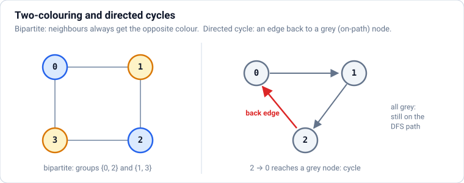

```python
from collections import deque
```

### 42.1 Cycles in an undirected graph

During DFS, reaching an already-visited vertex that **isn't the one you just came from** (the parent) means there's a second way to reach it: a cycle. The parent must be excluded, because every undirected edge leads straight back:

```python
def has_cycle_undirected(n, edges):
    graph = [[] for _ in range(n)]
    for a, b in edges:
        graph[a].append(b)
        graph[b].append(a)
    seen = set()
    def dfs(node, parent):
        seen.add(node)
        for nxt in graph[node]:
            if nxt not in seen:
                if dfs(nxt, node):
                    return True
            elif nxt != parent:
                return True
        return False
    return any(dfs(v, -1) for v in range(n) if v not in seen)

print(has_cycle_undirected(4, [(0, 1), (1, 2), (2, 3)]), has_cycle_undirected(3, [(0, 1), (1, 2), (2, 0)]))
```

**Output:**

```text
False True
```

`any(…)` stops at the first true value. (A connected undirected graph with V vertices is acyclic exactly when it has V − 1 edges: a tree.)

### 42.2 Cycles in a directed graph: three colours

In a directed graph, reaching a visited vertex isn't enough: two separate paths can lead to the same vertex without a loop (0 → 1 → 2 and 0 → 2). Give each vertex one of three states:

- **white** (0): not visited yet;
- **grey** (1): on the **current** DFS path, still being explored;
- **black** (2): finished.

Reaching a **grey** vertex means you've come back to a vertex on your own path: a cycle.

```python
def has_cycle_directed(n, edges):
    graph = [[] for _ in range(n)]
    for a, b in edges:
        graph[a].append(b)
    state = [0] * n
    def dfs(node):
        state[node] = 1
        for nxt in graph[node]:
            if state[nxt] == 1:
                return True
            if state[nxt] == 0 and dfs(nxt):
                return True
        state[node] = 2
        return False
    return any(state[v] == 0 and dfs(v) for v in range(n))

print(has_cycle_directed(3, [(0, 1), (0, 2), (1, 2)]), has_cycle_directed(3, [(0, 1), (1, 2), (2, 0)]))
```

**Output:**

```text
False True
```

"Can all courses be finished given their prerequisites?" is exactly "is the prerequisite graph acyclic?"; Chapter 44 also produces a valid order.

### 42.3 Bipartite graphs

A graph is **bipartite** if its vertices split into two groups with every edge going **between** groups (students and the clubs they join; tasks and workers). Test by **two-colouring** with BFS: colour the start 0, its neighbours 1, theirs 0, …; an edge between two vertices of the same colour means it's impossible:

```python
def is_bipartite(graph):
    color = {}
    for start in range(len(graph)):
        if start in color:
            continue
        color[start] = 0
        q = deque([start])
        while q:
            node = q.popleft()
            for nxt in graph[node]:
                if nxt not in color:
                    color[nxt] = 1 - color[node]
                    q.append(nxt)
                elif color[nxt] == color[node]:
                    return False
    return True

print(is_bipartite([[1, 3], [0, 2], [1, 3], [0, 2]]), is_bipartite([[1, 2, 3], [0, 2], [0, 1, 3], [0, 2]]))
```

**Output:**

```text
True False
```

The outer loop handles graphs in several pieces. A graph is bipartite exactly when it has no cycle of **odd** length: going round an odd cycle, the colours must alternate an odd number of times, which can't return to the start colour.

### 42.4 Multi-source BFS

"How far is each cell from the **nearest** source?" (the nearest 0, rotting oranges, the nearest exit). Running BFS from every source separately costs O(sources × cells). Instead put **all** sources in the queue at distance 0: BFS then grows from all of them at once, and the first time it reaches a cell is from its nearest source:

```python
def rotting_oranges(grid):                   # 0 empty, 1 fresh, 2 rotten; minutes until none fresh
    grid = [row[:] for row in grid]
    rows, cols = len(grid), len(grid[0])
    q, fresh = deque(), 0
    for r in range(rows):
        for c in range(cols):
            if grid[r][c] == 2:
                q.append((r, c, 0))
            elif grid[r][c] == 1:
                fresh += 1
    minutes = 0
    while q:
        r, c, t = q.popleft()
        minutes = max(minutes, t)
        for dr, dc in ((1, 0), (-1, 0), (0, 1), (0, -1)):
            nr, nc = r + dr, c + dc
            if 0 <= nr < rows and 0 <= nc < cols and grid[nr][nc] == 1:
                grid[nr][nc] = 2
                fresh -= 1
                q.append((nr, nc, t + 1))
    return minutes if fresh == 0 else -1

def distance_to_nearest_zero(mat):
    rows, cols = len(mat), len(mat[0])
    dist = [[-1] * cols for _ in range(rows)]
    q = deque()
    for r in range(rows):
        for c in range(cols):
            if mat[r][c] == 0:
                dist[r][c] = 0
                q.append((r, c))
    while q:
        r, c = q.popleft()
        for dr, dc in ((1, 0), (-1, 0), (0, 1), (0, -1)):
            nr, nc = r + dr, c + dc
            if 0 <= nr < rows and 0 <= nc < cols and dist[nr][nc] == -1:
                dist[nr][nc] = dist[r][c] + 1
                q.append((nr, nc))
    return dist

print(rotting_oranges([[2, 1, 1], [1, 1, 0], [0, 1, 1]]), rotting_oranges([[2, 1, 1], [0, 1, 1], [1, 0, 1]]))
print(distance_to_nearest_zero([[0, 0, 0], [0, 1, 0], [1, 1, 1]]))
```

**Output:**

```text
4 -1
[[0, 0, 0], [0, 1, 0], [1, 2, 1]]
```

O(rows × cols) whatever the number of sources: equivalent to one BFS from an imaginary **super-source** joined to every real source.

### 42.5 Summary

```
undirected cycle: DFS reaches a visited vertex that isn't the parent
directed cycle: white/grey/black; reaching grey = back to the current path
bipartite: BFS two-colouring; same-colour edge → no;  ⇔ no odd cycle
multi-source BFS: all sources in the queue at distance 0 → distance to the nearest source   O(V + E)
components: count fresh BFS/DFS starts
```

**Key terms:**

- **Cycle:** a path that starts and ends at the same vertex.
- **Back edge:** in DFS, an edge to a vertex still on the current path; it means a cycle.
- **Three-colour DFS:** marking vertices white, grey or black to detect cycles in directed graphs.
- **Bipartite graph:** a graph whose vertices split into two groups with all edges between groups.
- **Two-colouring:** assigning one of two colours to each vertex so that neighbours differ.
- **Multi-source BFS:** BFS starting from several sources at once.

### Exercises

1. Given n people and "dislike" pairs, can they be split into two groups with no disliking pair together? n = 4, dislikes (1, 2), (1, 3), (2, 4).
2. Count the provinces (connected components) in an adjacency matrix `[[1, 1, 0], [1, 1, 0], [0, 0, 1]]`.

<details>
<summary><b>Answers</b></summary>

```python
def possible_bipartition(n, dislikes):
    graph = [[] for _ in range(n + 1)]       # people are numbered 1..n
    for a, b in dislikes:
        graph[a].append(b)
        graph[b].append(a)
    return is_bipartite(graph)

def provinces(matrix):
    n, seen, count = len(matrix), set(), 0
    for start in range(n):
        if start in seen:
            continue
        count += 1
        stack = [start]
        while stack:
            city = stack.pop()
            if city in seen:
                continue
            seen.add(city)
            stack.extend(j for j in range(n) if matrix[city][j] == 1 and j not in seen)
    return count

print(possible_bipartition(4, [(1, 2), (1, 3), (2, 4)]), possible_bipartition(3, [(1, 2), (1, 3), (2, 3)]), provinces([[1, 1, 0], [1, 1, 0], [0, 0, 1]]))
```

**Output:**

```text
True False 2
```

</details>

**Practice:**

| # | Problem (LeetCode) | Difficulty |
|---|---|---|
| 1 | [547. Number of Provinces](https://leetcode.com/problems/number-of-provinces/) | 🟡 Medium |
| 2 | [207. Course Schedule](https://leetcode.com/problems/course-schedule/) | 🟡 Medium |
| 3 | [785. Is Graph Bipartite?](https://leetcode.com/problems/is-graph-bipartite/) | 🟡 Medium |
| 4 | [886. Possible Bipartition](https://leetcode.com/problems/possible-bipartition/) | 🟡 Medium |
| 5 | [994. Rotting Oranges](https://leetcode.com/problems/rotting-oranges/) | 🟡 Medium |
| 6 | [542. 01 Matrix](https://leetcode.com/problems/01-matrix/) | 🟡 Medium |
| 7 | [417. Pacific Atlantic Water Flow](https://leetcode.com/problems/pacific-atlantic-water-flow/) | 🟡 Medium |
| 8 | [130. Surrounded Regions](https://leetcode.com/problems/surrounded-regions/) | 🟡 Medium |

**Learn more:** [cp-algorithms: checking whether a graph is bipartite](https://cp-algorithms.com/graph/bipartite-check.html)

---

## 43. Shortest Paths: Dijkstra

**You need:** Chapters 39 and 41. · **You'll learn:** shortest paths in weighted graphs with Dijkstra's algorithm and a heap, why each popped distance is final, stale heap entries, rebuilding the path, A* search with a heuristic, and which shortest-path algorithm fits which graph.

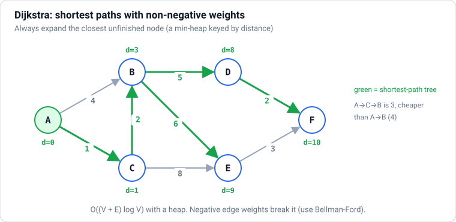

### 43.1 The problem

In a **weighted** graph each edge has a cost (distance, price, time), and the shortest path minimises the **total** cost, not the number of edges. BFS (Chapter 41.4) no longer works: one long edge can cost more than three short ones.

### 43.2 Dijkstra's algorithm

1. `dist[start] = 0`; every other distance is unknown (∞).
2. Keep a min-heap (Chapter 39) of `(distance, vertex)` pairs, starting with `(0, start)`.
3. Pop the vertex u with the **smallest** distance: with non-negative weights, that distance is **final**.
4. **Relax** its edges: for each neighbour v through an edge of weight w, if `dist[u] + w < dist[v]`, a cheaper way to v was found: update it and push `(dist[v], v)`.
5. Repeat until the heap is empty. A popped pair whose distance exceeds the recorded one is a **stale** entry from before an improvement: skip it.

```python
import heapq

def dijkstra(graph, source):
    dist = {source: 0}
    heap = [(0, source)]
    while heap:
        d, u = heapq.heappop(heap)
        if d > dist[u]:
            continue                             # stale entry
        for v, w in graph.get(u, []):
            nd = d + w
            if nd < dist.get(v, float("inf")):
                dist[v] = nd
                heapq.heappush(heap, (nd, v))
    return dist

graph = {
    "A": [("B", 4), ("C", 1)], "C": [("B", 2), ("E", 8)],
    "B": [("D", 5), ("E", 6)], "D": [("F", 2)], "E": [("F", 3)],
}
print(dict(sorted(dijkstra(graph, "A").items())))
```

**Output:**

```text
{'A': 0, 'B': 3, 'C': 1, 'D': 8, 'E': 9, 'F': 10}
```

Trace: A's edges give C = 1, B = 4. Pop C (1): C → B costs 3 < 4, so B improves to 3; C → E gives 9. Pop B (3): D = 8, E = min(9, 3 + 6) = 9. Pop the stale (4, B): skip. Pop D (8): F = 10. Pop E (9): E → F = 12, not better. Done.

<details>
<summary><b>Why the popped distance is final (non-negative weights)</b></summary>

Suppose u is popped with distance d, but some path P to u costs less than d. P starts at the source, whose distance is final; follow P until the first vertex y not yet popped, and let x be the vertex before it (already popped). When x was popped, relaxing x → y set dist[y] ≤ cost of P up to y. All remaining edges of P have weight ≥ 0, so that's ≤ cost(P) < d. Then y would be in the heap with a key below d, and would have been popped before u. Contradiction. So every popped distance is the true shortest distance. With a **negative** edge, the remaining part of P could *reduce* the cost, and the argument (and the algorithm) breaks.

</details>

**Cost:** each edge can push one entry, so the heap holds O(E) entries and each push or pop is O(log E) = O(log V): **O((V + E) log V)** in total.

### 43.3 Getting the path

Record `parent[v] = u` whenever `dist[v]` improves; then walk the parents back from the target. Stopping as soon as the target is popped saves work:

```python
def dijkstra_path(graph, source, target):
    dist, parent = {source: 0}, {source: None}
    heap = [(0, source)]
    while heap:
        d, u = heapq.heappop(heap)
        if d > dist[u]:
            continue
        if u == target:
            break
        for v, w in graph.get(u, []):
            if d + w < dist.get(v, float("inf")):
                dist[v], parent[v] = d + w, u
                heapq.heappush(heap, (d + w, v))
    path, node = [], target
    while node is not None:
        path.append(node)
        node = parent[node]
    return dist[target], path[::-1]

print(dijkstra_path(graph, "A", "F"))
```

**Output:**

```text
(10, ['A', 'C', 'B', 'D', 'F'])
```

### 43.4 A* search

When heading for **one** target, A* orders the heap by *distance so far + an estimate of the distance left*, the **heuristic** h. If h never overestimates (it's **admissible**), A* still finds a shortest path, while exploring far fewer vertices in the target's direction. On a grid with 4-direction moves, the Manhattan distance |Δr| + |Δc| is admissible. With h = 0, A* is exactly Dijkstra:

```python
def a_star(grid, start, goal, use_heuristic=True):
    rows, cols = len(grid), len(grid[0])
    def h(cell):
        return abs(cell[0] - goal[0]) + abs(cell[1] - goal[1]) if use_heuristic else 0
    best = {start: 0}
    heap = [(h(start), 0, start)]
    expanded = 0
    while heap:
        _, g, cell = heapq.heappop(heap)
        if g > best[cell]:
            continue
        expanded += 1
        if cell == goal:
            return g, expanded
        r, c = cell
        for nr, nc in ((r + 1, c), (r - 1, c), (r, c + 1), (r, c - 1)):
            if 0 <= nr < rows and 0 <= nc < cols and grid[nr][nc] != "#":
                if g + 1 < best.get((nr, nc), float("inf")):
                    best[(nr, nc)] = g + 1
                    heapq.heappush(heap, (g + 1 + h((nr, nc)), g + 1, (nr, nc)))
    return -1, expanded

maze = ["....#...",
        ".##.#.#.",
        "....#.#.",
        ".##...#.",
        "......#."]
open_field = ["." * 20 for _ in range(20)]
print(a_star(maze, (0, 0), (4, 5))[0], a_star(open_field, (10, 0), (10, 19)), a_star(open_field, (10, 0), (10, 19), use_heuristic=False))
```

**Output:**

```text
9 (19, 20) (19, 291)
```

Both find the 19-step path across the open field, but A* expands a small fraction of the cells. Map apps use A*-like searches plus heavy precomputation.

### 43.5 Which algorithm?

| Graph | Algorithm | Time |
|---|---|---|
| unweighted | BFS (Chapter 41) | O(V + E) |
| weights 0 or 1 only | 0-1 BFS: a deque, weight-0 edges pushed to the front | O(V + E) |
| non-negative weights | Dijkstra | O((V + E) log V) |
| one target, good estimate | A* | often much less than Dijkstra |
| negative weights, no negative cycle | Bellman-Ford (Chapter 46) | O(V·E) |
| all pairs, small V | Floyd-Warshall (Chapter 46) | O(V³) |

### 43.6 Summary

```
Dijkstra: heap of (dist, v); pop smallest (final if weights ≥ 0); relax edges; skip stale entries
O((V + E) log V);  parent[v] = u on improvement → path;  stop early at the target
A*: key = g + h, h admissible (never overestimates) → still shortest, fewer expansions;  h = 0 → Dijkstra
no negative edges with Dijkstra → Bellman-Ford
```

**Key terms:**

- **Weighted shortest path:** a path minimising the total weight of its edges.
- **Dijkstra's algorithm:** single-source shortest paths for non-negative weights, using a priority queue.
- **Relaxation:** improving a vertex's tentative distance through a newly finalised neighbour.
- **Stale entry:** an outdated heap entry left behind after a distance improved.
- **A\* search:** a shortest-path search that adds a heuristic estimate of the remaining distance to each key.
- **Heuristic:** an estimate used to guide a search.
- **Admissible heuristic:** a heuristic that never overestimates the true remaining cost.
- **Manhattan distance:** |Δrow| + |Δcol|, the grid distance with 4-direction moves.

### Exercises

1. Network delay: signals start at node 1 and travel along `times = [(2, 1, 1), (2, 3, 1), (3, 4, 1)]` (u, v, w), starting from node 2 instead. How long until all 4 nodes have it?
2. The cheapest path in a grid of costs, moving right or down or anywhere 4-way: `[[1, 3, 1], [1, 5, 1], [4, 2, 1]]` from top-left to bottom-right (count every cell entered, including the first).

<details>
<summary><b>Answers</b></summary>

```python
def network_delay(times, n, k):
    g = {}
    for u, v, w in times:
        g.setdefault(u, []).append((v, w))
    dist = dijkstra(g, k)
    return max(dist.values()) if len(dist) == n else -1

def min_cost_grid(costs):
    rows, cols = len(costs), len(costs[0])
    best = {(0, 0): costs[0][0]}
    heap = [(costs[0][0], 0, 0)]
    while heap:
        d, r, c = heapq.heappop(heap)
        if d > best[(r, c)]:
            continue
        for nr, nc in ((r + 1, c), (r - 1, c), (r, c + 1), (r, c - 1)):
            if 0 <= nr < rows and 0 <= nc < cols and d + costs[nr][nc] < best.get((nr, nc), float("inf")):
                best[(nr, nc)] = d + costs[nr][nc]
                heapq.heappush(heap, (best[(nr, nc)], nr, nc))
    return best[(rows - 1, cols - 1)]

print(network_delay([(2, 1, 1), (2, 3, 1), (3, 4, 1)], 4, 2), min_cost_grid([[1, 3, 1], [1, 5, 1], [4, 2, 1]]))
```

**Output:**

```text
2 7
```

2. Here the cost is on the cells: entering a cell costs its value. Dijkstra works unchanged on the grid.

</details>

**Practice:**

| # | Problem (LeetCode) | Difficulty |
|---|---|---|
| 1 | [743. Network Delay Time](https://leetcode.com/problems/network-delay-time/) | 🟡 Medium |
| 2 | [1631. Path With Minimum Effort](https://leetcode.com/problems/path-with-minimum-effort/) | 🟡 Medium |
| 3 | [787. Cheapest Flights Within K Stops](https://leetcode.com/problems/cheapest-flights-within-k-stops/) | 🟡 Medium |
| 4 | [778. Swim in Rising Water](https://leetcode.com/problems/swim-in-rising-water/) | 🔴 Hard |
| 5 | [1514. Path with Maximum Probability](https://leetcode.com/problems/path-with-maximum-probability/) | 🟡 Medium |

**Learn more:** [Red Blob Games: introduction to A*](https://www.redblobgames.com/pathfinding/a-star/introduction.html) · [VisuAlgo: single-source shortest paths](https://visualgo.net/en/sssp)

---

## 44. Topological Sort

**You need:** Chapters 41–42. · **You'll learn:** to order tasks so each comes after its prerequisites, Kahn's algorithm with in-degrees (and its free cycle check), the DFS post-order method, Python's `graphlib`, and handling errors with `try`/`except`.

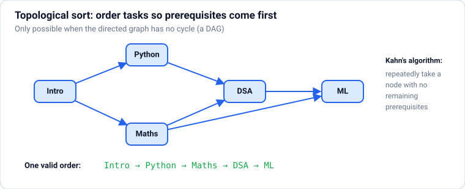

### 44.1 Ordering with dependencies

A course plan: DSA needs Python and Maths; ML needs DSA and Maths; Python and Maths need the intro. A **topological order** lists the tasks so every task comes after everything it depends on. Tasks are vertices and an edge **u → v** means "u before v". An order exists exactly when the graph is a **DAG**: a cycle ("A needs B needs A") makes every order impossible. Many valid orders may exist.

### 44.2 Kahn's algorithm

1. Count each vertex's **in-degree**: how many arrows point into it (prerequisites still pending).
2. Queue every vertex with in-degree 0.
3. Pop a vertex into the order; for each outgoing arrow, decrease that neighbour's in-degree, queueing it when it reaches 0.
4. Repeat until the queue is empty.

```python
from collections import deque

def topo_sort(n, prerequisites):              # (course, needs) pairs
    graph = [[] for _ in range(n)]
    indegree = [0] * n
    for course, needs in prerequisites:
        graph[needs].append(course)
        indegree[course] += 1
    q = deque(i for i in range(n) if indegree[i] == 0)
    order = []
    while q:
        node = q.popleft()
        order.append(node)
        for nxt in graph[node]:
            indegree[nxt] -= 1
            if indegree[nxt] == 0:
                q.append(nxt)
    return order if len(order) == n else []

# 0 Intro, 1 Python, 2 Maths, 3 DSA, 4 ML
print(topo_sort(5, [(1, 0), (2, 0), (3, 1), (3, 2), (4, 3), (4, 2)]), topo_sort(2, [(0, 1), (1, 0)]))
```

**Output:**

```text
[0, 1, 2, 3, 4] []
```

**Cycle check for free:** if the order has fewer than n vertices, the rest never reached in-degree 0: they're waiting on each other in a cycle. Each vertex and edge is handled once: **O(V + E)**. For the smallest order in dictionary order, use a heap instead of the queue.

<details>
<summary><b>Why Kahn's order is valid, and why it finishes on every DAG</b></summary>

**Valid:** a vertex enters the queue only when all its incoming edges have been counted down, that is, after all its prerequisites were output. So every edge u → v has u before v.

**Complete on a DAG:** every non-empty DAG has a vertex of in-degree 0 (otherwise, walking backwards along incoming edges forever would revisit a vertex: a cycle). Removing it leaves a DAG, which again has such a vertex. So the queue never runs dry before all vertices are output.

</details>

### 44.3 The DFS method

Run DFS and add each vertex to a list **after** all its descendants are finished (post-order), then reverse the list. A vertex is finished only after everything that must come after it, so the reversed finish order is topological. The three colours of Chapter 42.2 detect cycles on the way:

```python
def topo_dfs(n, edges):                       # edges u → v
    graph = [[] for _ in range(n)]
    for u, v in edges:
        graph[u].append(v)
    state, finished = [0] * n, []
    def dfs(u):
        state[u] = 1
        for v in graph[u]:
            if state[v] == 1 or (state[v] == 0 and not dfs(v)):
                return False                  # found a cycle
        state[u] = 2
        finished.append(u)
        return True
    for u in range(n):
        if state[u] == 0 and not dfs(u):
            return []
    return finished[::-1]

print(topo_dfs(5, [(0, 1), (0, 2), (1, 3), (2, 3), (3, 4), (2, 4)]), topo_dfs(3, [(0, 1), (1, 2), (2, 0)]))
```

**Output:**

```text
[0, 2, 1, 3, 4] []
```

### 44.4 graphlib, and handling errors

Python has it built in: `graphlib.TopologicalSorter` takes each node's prerequisites and `static_order()` yields an order. On a cycle it **raises** a `CycleError`. `try`/`except` runs the `try` block, and if the named error is raised there, runs the `except` block instead of stopping the program:

```python
from graphlib import TopologicalSorter, CycleError

needs = {"DSA": {"Python", "Maths"}, "ML": {"DSA", "Maths"}, "Python": {"Intro"}, "Maths": {"Intro"}}
order = list(TopologicalSorter(needs).static_order())
print(order[0], order[-1], order.index("Python") < order.index("DSA"))
try:
    list(TopologicalSorter({"a": {"b"}, "b": {"a"}}).static_order())
except CycleError:
    print("cycle found: no valid order")
```

**Output:**

```text
Intro ML True
cycle found: no valid order
```

Build tools (Make, Bazel), package managers installing dependencies, spreadsheets recalculating cells and task schedulers all rely on topological order.

### 44.5 Summary

```
topological order: u before v for every edge u → v;  exists ⇔ DAG
Kahn: in-degrees; queue the zeros; pop, output, decrement neighbours   O(V + E); len(order) < n ⇒ cycle
DFS: append on finish (post-order), reverse; grey vertex ⇒ cycle
graphlib.TopologicalSorter(needs).static_order();  try: … except CycleError: …
```

**Key terms:**

- **Topological order (sort):** an ordering of a DAG's vertices with every edge pointing forward.
- **In-degree:** the number of edges pointing into a vertex.
- **Out-degree:** the number of edges leaving a vertex.
- **Kahn's algorithm:** topological sorting by repeatedly removing vertices with in-degree 0.
- **Post-order (DFS finish order):** the order in which DFS finishes vertices.
- **Exception:** an error raised while a program runs, which can be caught with `try`/`except`.

### Exercises

1. Given 4 courses and prerequisites `[(1, 0), (2, 1), (3, 2)]`, can all be finished? In what order?
2. Find the order of letters in an alien alphabet from sorted words `["wrt", "wrf", "er", "ett", "rftt"]` (compare neighbouring words: the first differing letters give an edge).

<details>
<summary><b>Answers</b></summary>

```python
def alien_order(words):
    letters = {ch for w in words for ch in w}
    graph = {ch: set() for ch in letters}
    indegree = {ch: 0 for ch in letters}
    for a, b in zip(words, words[1:]):
        for x, y in zip(a, b):
            if x != y:
                if y not in graph[x]:
                    graph[x].add(y)
                    indegree[y] += 1
                break
    q = deque(sorted(ch for ch in letters if indegree[ch] == 0))
    order = []
    while q:
        ch = q.popleft()
        order.append(ch)
        for nxt in sorted(graph[ch]):
            indegree[nxt] -= 1
            if indegree[nxt] == 0:
                q.append(nxt)
    return "".join(order) if len(order) == len(letters) else ""

print(topo_sort(4, [(1, 0), (2, 1), (3, 2)]), alien_order(["wrt", "wrf", "er", "ett", "rftt"]))
```

**Output:**

```text
[0, 1, 2, 3] wertf
```

2. `zip(a, b)` pairs up items of two sequences; `zip(words, words[1:])` gives each word with the next. `{… for …}` is a **set comprehension**.

</details>

**Practice:**

| # | Problem (LeetCode) | Difficulty |
|---|---|---|
| 1 | [207. Course Schedule](https://leetcode.com/problems/course-schedule/) | 🟡 Medium |
| 2 | [210. Course Schedule II](https://leetcode.com/problems/course-schedule-ii/) | 🟡 Medium |
| 3 | [802. Find Eventual Safe States](https://leetcode.com/problems/find-eventual-safe-states/) | 🟡 Medium |
| 4 | [2050. Parallel Courses III](https://leetcode.com/problems/parallel-courses-iii/) | 🔴 Hard |
| 5 | [310. Minimum Height Trees](https://leetcode.com/problems/minimum-height-trees/) | 🟡 Medium |

**Learn more:** [Python docs: graphlib](https://docs.python.org/3/library/graphlib.html) · [Wikipedia: topological sorting](https://en.wikipedia.org/wiki/Topological_sorting)

---

## 45. Union-Find (Disjoint Set Union)

**You need:** Chapters 30 and 41. · **You'll learn:** to track groups that keep merging with `find` and `union`, path compression and union by size and why together they make operations almost O(1), detecting cycles as edges arrive, and when union-find beats BFS or DFS.

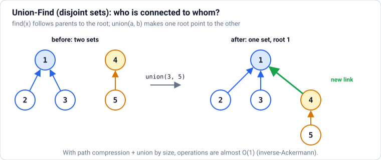

### 45.1 Groups that merge

Friend circles at a party: each circle has a leader, and two people are in the same circle exactly when they have the same leader. When two circles meet, one leader starts following the other. **Union-find** (also **disjoint set union**, DSU) answers two questions fast:

- `find(x)`: which group is x in? Follow parents up to the root, the group's representative.
- `union(a, b)`: merge a's and b's groups. If their roots differ, make one root point to the other; if they're already the same, nothing changes (and in a graph, the edge a–b closes a cycle).

Every item starts as its own group: `parent[x] = x`.

### 45.2 Two tricks

Without care, the trees can become long chains and `find` O(n). Two tricks keep them flat:

1. **Union by size:** attach the **smaller** tree under the root of the larger one.
2. **Path compression:** during `find`, point the nodes you pass at (or closer to) the root, so later finds are short. The version below uses **path halving**: each node on the way is pointed at its grandparent.

```python
class DSU:
    def __init__(self, n):
        self.parent = list(range(n))
        self.size = [1] * n
        self.groups = n

    def find(self, x):
        while self.parent[x] != x:
            self.parent[x] = self.parent[self.parent[x]]   # path halving
            x = self.parent[x]
        return x

    def union(self, a, b):
        ra, rb = self.find(a), self.find(b)
        if ra == rb:
            return False                    # already together
        if self.size[ra] < self.size[rb]:
            ra, rb = rb, ra
        self.parent[rb] = ra                # smaller tree under the larger
        self.size[ra] += self.size[rb]
        self.groups -= 1
        return True

d = DSU(6)
print(d.union(1, 2), d.union(1, 3), d.union(4, 5), d.find(3) == d.find(1), d.find(5) == d.find(1))
print(d.union(3, 5), d.find(5) == d.find(2), d.union(2, 4), d.groups)
```

**Output:**

```text
True True True True False
True True False 2
```

Trace: union(1, 2), union(1, 3) make {1, 2, 3}; union(4, 5) makes {4, 5}; union(3, 5) merges them; union(2, 4) finds both already together, so it returns `False`. Groups left: {0} and {1, 2, 3, 4, 5}.

<details>
<summary><b>Why union by size alone gives O(log n) height</b></summary>

A node's depth increases only when its tree is attached under another root, and with union by size that happens only when its tree is the smaller one, so the merged tree is at least **twice** the size of the node's old tree. A tree's size can double at most log₂ n times before exceeding n, so every node's depth is at most log₂ n: `find` is O(log n). Adding path compression brings the amortised cost per operation down to O(α(n)), where α is the inverse Ackermann function: at most 4 for any input that could fit in the universe, so effectively constant. (Tarjan's proof of this is famously intricate.)

</details>

### 45.3 Cycles as edges arrive

In an undirected graph, the edge u–v closes a cycle exactly when u and v are already connected. So union returning `False` is a cycle detector: "find the redundant connection" in one pass:

```python
def redundant_connection(edges):
    d = DSU(len(edges) + 1)
    for u, v in edges:
        if not d.union(u, v):
            return [u, v]

def count_components(n, edges):
    d = DSU(n)
    for u, v in edges:
        d.union(u, v)
    return d.groups

print(redundant_connection([[1, 2], [1, 3], [2, 3]]), redundant_connection([[1, 2], [2, 3], [3, 4], [1, 4], [1, 5]]), count_components(5, [(0, 1), (1, 2), (3, 4)]))
```

**Output:**

```text
[2, 3] [1, 4] 2
```

### 45.4 Grouping by shared keys

Union-find also merges items that share *anything*: accounts with a common email, or numbers sharing a prime factor. Union each item with a representative of each key:

```python
def merge_accounts(accounts):              # [name, email, email, …]
    d = DSU(len(accounts))
    owner = {}
    for i, acc in enumerate(accounts):
        for email in acc[1:]:
            if email in owner:
                d.union(i, owner[email])
            owner[email] = i
    groups = {}
    for email, i in owner.items():
        groups.setdefault(d.find(i), set()).add(email)
    return sorted([accounts[root][0]] + sorted(emails) for root, emails in groups.items())

print(merge_accounts([["Asha", "a@x", "b@x"], ["Ravi", "r@x"], ["Asha", "b@x", "c@x"], ["Asha", "z@x"]]))
```

**Output:**

```text
[['Asha', 'a@x', 'b@x', 'c@x'], ['Asha', 'z@x'], ['Ravi', 'r@x']]
```

Two different people named Asha stay separate: only a shared email merges accounts.

### 45.5 Union-find or BFS/DFS?

For a fixed graph, both count components in about O(V + E). Union-find wins when **edges arrive one at a time** and you need the answer after each ("are they connected yet?", "how many groups now?"), and it's the heart of Kruskal's spanning tree (Chapter 46). It can't easily *split* groups, or give the path between two items: use BFS for that.

### 45.6 Summary

```
parent[x] = x initially;  find: follow parents to the root (with path halving)
union: roots differ → attach the smaller under the larger; equal → already connected (cycle)
union by size → height ≤ log₂ n;  + path compression → O(α(n)) ≈ O(1) amortised
uses: dynamic connectivity, cycles in undirected graphs, components, grouping by shared keys, Kruskal
```

**Key terms:**

- **Union-find (disjoint set union, DSU):** a structure that maintains a partition of items into groups, with fast merging and membership queries.
- **Representative (root):** the item that identifies a group in union-find.
- **find:** returns an item's group representative.
- **union:** merges the groups of two items.
- **Path compression:** making nodes on a find path point closer to the root.
- **Union by size (or rank):** attaching the smaller tree under the larger to keep trees shallow.
- **Inverse Ackermann function (α):** an extremely slowly growing function, at most 4 for all practical sizes.

### Exercises

1. Count islands with union-find: union each land cell with its land neighbours to the right and below.
2. Given equations like `"a==b"`, `"b!=a"`, decide whether they can all hold.

<details>
<summary><b>Answers</b></summary>

```python
def islands_dsu(grid):
    rows, cols = len(grid), len(grid[0])
    d = DSU(rows * cols)
    land = 0
    for r in range(rows):
        for c in range(cols):
            if grid[r][c] == "1":
                land += 1
                for nr, nc in ((r + 1, c), (r, c + 1)):
                    if nr < rows and nc < cols and grid[nr][nc] == "1" and d.union(r * cols + c, nr * cols + nc):
                        land -= 1           # each successful union merges two islands
    return land

def equations_possible(equations):
    d = DSU(26)
    idx = lambda ch: ord(ch) - ord("a")
    for e in equations:
        if e[1] == "=":
            d.union(idx(e[0]), idx(e[3]))
    return all(d.find(idx(e[0])) != d.find(idx(e[3])) for e in equations if e[1] == "!")

print(islands_dsu(["11000", "11000", "00100", "00011"]), equations_possible(["a==b", "b!=a"]), equations_possible(["a==b", "b==c", "a!=d"]))
```

**Output:**

```text
3 False True
```

1. A cell (r, c) gets the number r·cols + c.
2. Do all the `==` unions first, then check every `!=` pair is in different groups.

</details>

**Practice:**

| # | Problem (LeetCode) | Difficulty |
|---|---|---|
| 1 | [547. Number of Provinces](https://leetcode.com/problems/number-of-provinces/) | 🟡 Medium |
| 2 | [684. Redundant Connection](https://leetcode.com/problems/redundant-connection/) | 🟡 Medium |
| 3 | [721. Accounts Merge](https://leetcode.com/problems/accounts-merge/) | 🟡 Medium |
| 4 | [990. Satisfiability of Equality Equations](https://leetcode.com/problems/satisfiability-of-equality-equations/) | 🟡 Medium |
| 5 | [128. Longest Consecutive Sequence](https://leetcode.com/problems/longest-consecutive-sequence/) | 🟡 Medium |
| 6 | [947. Most Stones Removed with Same Row or Column](https://leetcode.com/problems/most-stones-removed-with-same-row-or-column/) | 🟡 Medium |

**Learn more:** [cp-algorithms: disjoint set union](https://cp-algorithms.com/data_structures/disjoint_set_union.html)

---

## 46. Minimum Spanning Trees, Bellman-Ford and Floyd-Warshall

**You need:** Chapters 43 and 45. · **You'll learn:** minimum spanning trees with Kruskal's and Prim's algorithms and the cut property that makes both correct, Bellman-Ford for negative edge weights and negative-cycle detection, Floyd-Warshall for all pairs, and which algorithm to choose.

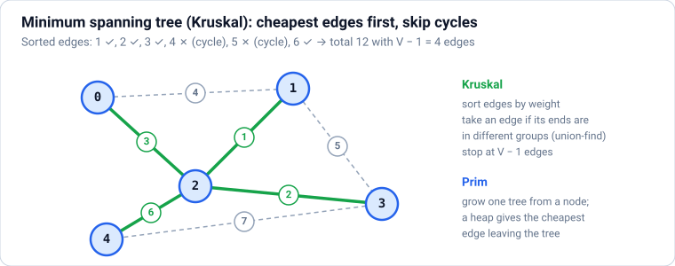

### 46.1 Minimum spanning trees

Given towns and the cost of each possible road, connect **every** town using the cheapest total set of roads. The answer is a **spanning tree** (it reaches all V vertices with V − 1 edges and no cycle, since a cycle's dearest edge could be dropped) of minimum total weight: a **minimum spanning tree** (MST).

- **Kruskal:** sort edges cheapest first; keep an edge if it joins two **different** groups (union-find, Chapter 45), skip it if it would close a cycle. O(E log E) for the sort.
- **Prim:** grow one tree from any vertex; a heap holds the edges leaving the tree; repeatedly add the cheapest edge reaching a new vertex. O(E log V).

```python
import heapq

def kruskal(n, edges):                         # edges: (weight, u, v)
    parent = list(range(n))
    def find(x):
        while parent[x] != x:
            parent[x] = parent[parent[x]]
            x = parent[x]
        return x
    total, used = 0, []
    for w, u, v in sorted(edges):
        ru, rv = find(u), find(v)
        if ru != rv:
            parent[ru] = rv
            total += w
            used.append((u, v))
    return total, used

def prim(n, adj):                              # adj[u] = list of (weight, v)
    seen, total = set(), 0
    heap = [(0, 0)]
    while heap and len(seen) < n:
        w, u = heapq.heappop(heap)
        if u in seen:
            continue
        seen.add(u)
        total += w
        for edge in adj[u]:
            if edge[1] not in seen:
                heapq.heappush(heap, edge)
    return total

edges = [(4, 0, 1), (1, 1, 2), (3, 0, 2), (2, 2, 3), (5, 1, 3), (7, 3, 4), (6, 2, 4)]
adj = [[] for _ in range(5)]
for w, u, v in edges:
    adj[u].append((w, v))
    adj[v].append((w, u))
print(kruskal(5, edges), prim(5, adj))
```

**Output:**

```text
(12, [(1, 2), (2, 3), (0, 2), (2, 4)]) 12
```

Kruskal took 1 (1–2), 2 (2–3), 3 (0–2), skipped 4 (0–1: already connected) and 5, then took 6 (2–4): total 12. Both algorithms always agree on the total weight.

<details>
<summary><b>The cut property: why both are correct</b></summary>

Split the vertices into any two sides (a **cut**). Claim: the cheapest edge e crossing the cut belongs to some MST. Take any MST T without e. Adding e to T creates a cycle, which must cross the cut a second time through some other edge f, with weight(f) ≥ weight(e). Swapping f for e gives a spanning tree no heavier than T, so it's also an MST, and it contains e.

Kruskal's chosen edge is the cheapest crossing the cut between its endpoint's group and everything else (all cheaper edges were already used or lay inside a group). Prim's chosen edge is the cheapest crossing the cut between the tree so far and the rest. Either way, every chosen edge is safe, and induction over the V − 1 choices gives an MST.

</details>

### 46.2 Bellman-Ford: negative weights

Dijkstra breaks with negative weights (Chapter 43.2). **Bellman-Ford** relaxes **every** edge, V − 1 times. A shortest path without cycles has at most V − 1 edges, and after round k all shortest paths using at most k edges are correct, so V − 1 rounds suffice. If a further round still improves something, there's a **negative cycle** (going round it lowers the cost forever, so no shortest path exists):

```python
INF = float("inf")

def bellman_ford(n, edges, source):            # edges: (u, v, w), directed
    dist = [INF] * n
    dist[source] = 0
    for _ in range(n - 1):
        for u, v, w in edges:
            if dist[u] + w < dist[v]:
                dist[v] = dist[u] + w
    for u, v, w in edges:
        if dist[u] + w < dist[v]:
            return None                        # negative cycle
    return dist

print(bellman_ford(4, [(0, 1, 4), (0, 2, 5), (1, 2, -3), (2, 3, 2)], 0), bellman_ford(3, [(0, 1, 1), (1, 2, -2), (2, 1, 1)], 0))
```

**Output:**

```text
[0, 4, 1, 3] None
```

O(V·E). Stopping after k rounds (copying `dist` each round, so a round uses only the previous round's values) answers "cheapest path with at most k edges": LeetCode's "cheapest flights within k stops". Negative cycles in currency-exchange graphs (with weights −log(rate)) reveal arbitrage.

### 46.3 Floyd-Warshall: all pairs

`dist[i][j]` starts as the direct edge weight (∞ if none, 0 on the diagonal). Then, for each vertex k in turn, allow paths that pass through k:

> dist[i][j] = min(dist[i][j], dist[i][k] + dist[k][j])

```python
def floyd_warshall(n, edges):
    dist = [[0 if i == j else INF for j in range(n)] for i in range(n)]
    for u, v, w in edges:
        dist[u][v] = min(dist[u][v], w)
    for k in range(n):
        for i in range(n):
            for j in range(n):
                if dist[i][k] + dist[k][j] < dist[i][j]:
                    dist[i][j] = dist[i][k] + dist[k][j]
    return dist

print(floyd_warshall(3, [(0, 1, 4), (1, 2, 1), (0, 2, 7)]))
```

**Output:**

```text
[[0, 4, 5], [inf, 0, 1], [inf, inf, 0]]
```

After processing k, `dist[i][j]` is the shortest path using only intermediate vertices 0 … k (dynamic programming, Chapter 49): the best such path either avoids k or goes i → k → j, both parts using only 0 … k − 1. O(V³) time, O(V²) space: fine up to a few hundred vertices. A negative value on the diagonal afterwards means a negative cycle.

### 46.4 Choosing

| Problem | Algorithm | Time |
|---|---|---|
| connect everything as cheaply as possible | Kruskal / Prim | O(E log E) / O(E log V) |
| one source, weights ≥ 0 | Dijkstra | O((V + E) log V) |
| one source, negative weights, or "at most k edges" | Bellman-Ford | O(V·E) |
| all pairs, small V | Floyd-Warshall | O(V³) |

### 46.5 Summary

```
MST: V − 1 edges, no cycle, minimum total weight;  cut property: cheapest crossing edge is safe
Kruskal: sort edges + union-find   O(E log E);  Prim: grow from a vertex with a heap   O(E log V)
Bellman-Ford: V − 1 rounds relaxing all edges; improvement in round V ⇒ negative cycle   O(VE)
Floyd-Warshall: for k: for i: for j: dist[i][j] = min(…, dist[i][k] + dist[k][j])   O(V³)
```

**Key terms:**

- **Spanning tree:** a tree that connects all vertices of a graph using some of its edges.
- **Minimum spanning tree (MST):** a spanning tree with the smallest possible total edge weight.
- **Kruskal's algorithm:** building an MST by adding the cheapest edges that don't form cycles.
- **Prim's algorithm:** building an MST by growing one tree with the cheapest edge leaving it.
- **Cut:** a split of a graph's vertices into two sets; a crossing edge joins the two sets.
- **Cut property:** the cheapest edge crossing any cut belongs to some minimum spanning tree.
- **Bellman-Ford algorithm:** single-source shortest paths that allow negative weights, by relaxing all edges V − 1 times.
- **Negative cycle:** a cycle whose total weight is negative, making shortest paths undefined.
- **Floyd-Warshall algorithm:** all-pairs shortest paths by allowing each vertex in turn as an intermediate.

### Exercises

1. Connect all points `[(0, 0), (2, 2), (3, 10), (5, 2), (7, 0)]` with the minimum total Manhattan distance (Prim on the complete graph).
2. Which city has the fewest other cities within distance 4? Edges `[(0, 1, 3), (1, 2, 1), (1, 3, 4), (2, 3, 1)]`, 4 cities (ties: the larger number).

<details>
<summary><b>Answers</b></summary>

```python
def min_cost_connect(points):
    n = len(points)
    adj = [[] for _ in range(n)]
    for i in range(n):
        for j in range(i + 1, n):
            d = abs(points[i][0] - points[j][0]) + abs(points[i][1] - points[j][1])
            adj[i].append((d, j))
            adj[j].append((d, i))
    return prim(n, adj)

def city_fewest_neighbours(n, edges, limit):
    undirected = edges + [(v, u, w) for u, v, w in edges]
    dist = floyd_warshall(n, undirected)
    counts = [sum(1 for j in range(n) if j != i and dist[i][j] <= limit) for i in range(n)]
    return max(i for i in range(n) if counts[i] == min(counts))

print(min_cost_connect([(0, 0), (2, 2), (3, 10), (5, 2), (7, 0)]), city_fewest_neighbours(4, [(0, 1, 3), (1, 2, 1), (1, 3, 4), (2, 3, 1)], 4))
```

**Output:**

```text
20 3
```

</details>

**Practice:**

| # | Problem (LeetCode) | Difficulty |
|---|---|---|
| 1 | [1584. Min Cost to Connect All Points](https://leetcode.com/problems/min-cost-to-connect-all-points/) | 🟡 Medium |
| 2 | [787. Cheapest Flights Within K Stops](https://leetcode.com/problems/cheapest-flights-within-k-stops/) | 🟡 Medium |
| 3 | [1334. Find the City With the Smallest Number of Neighbors at a Threshold Distance](https://leetcode.com/problems/find-the-city-with-the-smallest-number-of-neighbors-at-a-threshold-distance/) | 🟡 Medium |
| 4 | [743. Network Delay Time](https://leetcode.com/problems/network-delay-time/) | 🟡 Medium |

**Learn more:** [VisuAlgo: minimum spanning tree](https://visualgo.net/en/mst) · [cp-algorithms: Bellman-Ford](https://cp-algorithms.com/graph/bellman_ford.html)

---

# Part VIII — Algorithm Design

Five chapters on general strategies for hard problems: trying every choice smartly (backtracking), choosing greedily, remembering answers (dynamic programming, in two chapters), and working directly on bits.

---

## 47. Backtracking

**You need:** Chapters 14 and 41. · **You'll learn:** to explore every possibility one choice at a time with the choose–explore–un-choose template, the decision tree behind it, pruning, avoiding duplicate answers, and the classics: subsets, permutations, combination sums, word search and N-Queens.

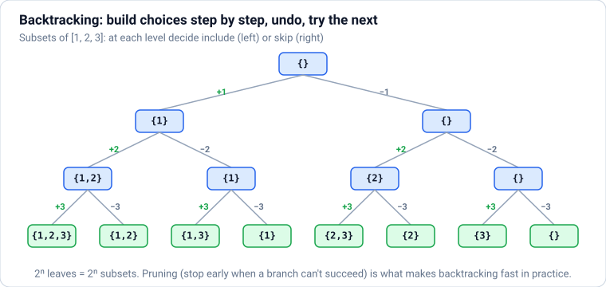

### 47.1 The template

**Backtracking** tries every possibility **one choice at a time**; when a path can't work, it steps back and tries the next option. Packing a suitcase by trial: put an item in, then another; if the lid won't close, take the last item out and try a different one.

Every sequence of choices is a path in a **decision tree**: for the subsets of [1, 2, 3], level one decides "take 1 or not", level two "take 2 or not", and so on; the 8 leaves are the 8 subsets.

```
def backtrack(state):
    if state is complete: record a copy; return
    for choice in the options available now:
        if the choice is allowed:
            make the choice            (choose)
            backtrack(new state)       (explore)
            undo the choice            (un-choose)
```

All branches share one `path` list, so after exploring a choice it must be restored exactly, and recorded answers must be **copies** (`path[:]`), because `path` keeps changing.

### 47.2 Subsets and permutations

```python
def subsets(nums):
    out, path = [], []
    def backtrack(i):
        if i == len(nums):
            out.append(path[:])
            return
        path.append(nums[i])
        backtrack(i + 1)              # take nums[i]
        path.pop()
        backtrack(i + 1)              # skip it
    backtrack(0)
    return out

def permutations(nums):
    out, path, used = [], [], [False] * len(nums)
    def backtrack():
        if len(path) == len(nums):
            out.append(path[:])
            return
        for i, x in enumerate(nums):
            if not used[i]:
                used[i] = True
                path.append(x)
                backtrack()
                path.pop()
                used[i] = False
    backtrack()
    return out

print(subsets([1, 2, 3]), len(permutations([1, 2, 3, 4])), permutations([1, 2, 3])[:3])
```

**Output:**

```text
[[1, 2, 3], [1, 2], [1, 3], [1], [2, 3], [2], [3], []] 24 [[1, 2, 3], [1, 3, 2], [2, 1, 3]]
```

There are 2ⁿ subsets and n! permutations, and copying each answer costs O(n): O(n · 2ⁿ) and O(n · n!). 10! is 3.6 million, so backtracking problems usually have n ≤ 15 or so: the input size is the hint (Chapter 13.4).

### 47.3 Pruning

**Pruning** abandons a branch as soon as it can't lead to a valid answer. In combination sum (numbers may be reused), sorting the candidates lets the loop `break` at the first candidate bigger than what's left, cutting all later ones at once:

```python
def combination_sum(candidates, target, prune=True):
    out, path, calls = [], [], [0]
    candidates = sorted(candidates)
    def backtrack(start, remaining):
        calls[0] += 1
        if remaining == 0:
            out.append(path[:])
            return
        if remaining < 0:
            return
        for i in range(start, len(candidates)):
            if prune and candidates[i] > remaining:
                break
            path.append(candidates[i])
            backtrack(i, remaining - candidates[i])     # i, not i + 1: reuse allowed
            path.pop()
    backtrack(0, target)
    return out, calls[0]

print(combination_sum([2, 3, 6, 7], 7), combination_sum([2, 3, 5, 7, 9], 30)[1], combination_sum([2, 3, 5, 7, 9], 30, prune=False)[1])
```

**Output:**

```text
([[2, 2, 3], [7]], 10) 637 1292
```

For target 30 the pruned search makes about half the calls of the unpruned one (which only stops once the total goes negative), for the same answers; on bigger searches the savings grow quickly. `calls = [0]` is a one-item list so the inner function can update it without `nonlocal`.

**Duplicates:** when the input has repeated values and each item may be used once, sort first and skip a value equal to the previous one *at the same depth*:

```python
def subsets_with_dup(nums):
    nums = sorted(nums)
    out, path = [], []
    def backtrack(start):
        out.append(path[:])
        for i in range(start, len(nums)):
            if i > start and nums[i] == nums[i - 1]:
                continue                     # same value already tried at this depth
            path.append(nums[i])
            backtrack(i + 1)
            path.pop()
    backtrack(0)
    return out

print(subsets_with_dup([1, 2, 2]))
```

**Output:**

```text
[[], [1], [1, 2], [1, 2, 2], [2], [2, 2]]
```

### 47.4 Word search and N-Queens

**Word search** backtracks on the 4 directions of a grid, marking a cell as used on the current path and restoring it afterwards. **N-Queens** places one queen per row; cells on the same diagonal share r − c and on the same anti-diagonal r + c, so three sets detect every attack in O(1):

```python
def word_search(board, word):
    rows, cols = len(board), len(board[0])
    def backtrack(r, c, i):
        if i == len(word):
            return True
        if not (0 <= r < rows and 0 <= c < cols) or board[r][c] != word[i]:
            return False
        board[r][c] = "#"                    # choose: used on this path
        found = any(backtrack(r + dr, c + dc, i + 1) for dr, dc in ((1, 0), (-1, 0), (0, 1), (0, -1)))
        board[r][c] = word[i]                # un-choose
        return found
    return any(backtrack(r, c, 0) for r in range(rows) for c in range(cols))

def n_queens(n):
    cols, diag, anti = set(), set(), set()
    def place(r):
        if r == n:
            return 1
        count = 0
        for c in range(n):
            if c in cols or r - c in diag or r + c in anti:
                continue
            cols.add(c)
            diag.add(r - c)
            anti.add(r + c)
            count += place(r + 1)
            cols.remove(c)
            diag.remove(r - c)
            anti.remove(r + c)
        return count
    return place(0)

grid = [list("ABCE"), list("SFCS"), list("ADEE")]
print(word_search(grid, "ABCCED"), word_search(grid, "SEE"), word_search(grid, "ABCB"), n_queens(4), n_queens(8))
```

**Output:**

```text
True True False 2 92
```

| Problem | Choice at each step | Pruning |
|---|---|---|
| subsets | take or skip this item | none |
| permutations | which unused item next | skip used items |
| combination sum | which candidate to add | stop when bigger than what's left |
| N-Queens | which column in this row | skip attacked columns and diagonals |
| word search | which neighbour next | stop when the letter doesn't match |
| Sudoku | which digit for this empty cell | skip digits in the row, column or box |

### 47.5 Summary

```
choose → explore → un-choose;  record path[:] (a copy)
subsets 2ⁿ, permutations n!: inputs are small (n ≲ 15)
prune: sort, then break when a choice can't fit;  duplicates: sort, skip equal values at the same depth
grids: mark the cell, recurse into neighbours, restore;  N-Queens: sets of columns, r − c, r + c
```

**Key terms:**

- **Backtracking:** building candidates choice by choice and undoing a choice when it can't lead to a solution.
- **Decision tree:** the tree of all choice sequences a backtracking search may explore.
- **Pruning:** cutting off branches of a search that can't lead to a valid answer.
- **Combination:** a selection of items where order doesn't matter.
- **N-Queens problem:** placing n chess queens on an n × n board so that none attack each other.

### Exercises

1. Generate all valid strings of n pairs of brackets (n = 3 gives 5).
2. Generate all combinations of k numbers from 1 … n (n = 4, k = 2).

<details>
<summary><b>Answers</b></summary>

```python
def generate_brackets(n):
    out = []
    def backtrack(path, opened, closed):
        if len(path) == 2 * n:
            out.append(path)
            return
        if opened < n:
            backtrack(path + "(", opened + 1, closed)
        if closed < opened:                  # prune: never close more than opened
            backtrack(path + ")", opened, closed + 1)
    backtrack("", 0, 0)
    return out

def combine(n, k):
    out, path = [], []
    def backtrack(start):
        if len(path) == k:
            out.append(path[:])
            return
        for x in range(start, n + 1):
            path.append(x)
            backtrack(x + 1)
            path.pop()
    backtrack(1)
    return out

print(generate_brackets(3), combine(4, 2))
```

**Output:**

```text
['((()))', '(()())', '(())()', '()(())', '()()()'] [[1, 2], [1, 3], [1, 4], [2, 3], [2, 4], [3, 4]]
```

1. Strings are immutable, so `path + "("` creates a new string per call and nothing needs undoing.

</details>

**Practice:**

| # | Problem (LeetCode) | Difficulty |
|---|---|---|
| 1 | [78. Subsets](https://leetcode.com/problems/subsets/) | 🟡 Medium |
| 2 | [46. Permutations](https://leetcode.com/problems/permutations/) | 🟡 Medium |
| 3 | [39. Combination Sum](https://leetcode.com/problems/combination-sum/) | 🟡 Medium |
| 4 | [90. Subsets II](https://leetcode.com/problems/subsets-ii/) | 🟡 Medium |
| 5 | [22. Generate Parentheses](https://leetcode.com/problems/generate-parentheses/) | 🟡 Medium |
| 6 | [79. Word Search](https://leetcode.com/problems/word-search/) | 🟡 Medium |
| 7 | [17. Letter Combinations of a Phone Number](https://leetcode.com/problems/letter-combinations-of-a-phone-number/) | 🟡 Medium |
| 8 | [131. Palindrome Partitioning](https://leetcode.com/problems/palindrome-partitioning/) | 🟡 Medium |
| 9 | [51. N-Queens](https://leetcode.com/problems/n-queens/) | 🔴 Hard |
| 10 | [37. Sudoku Solver](https://leetcode.com/problems/sudoku-solver/) | 🔴 Hard |

**Learn more:** [Wikipedia: backtracking](https://en.wikipedia.org/wiki/Backtracking)

---

## 48. Greedy Algorithms

**You need:** Chapters 17, 27 and 39. · **You'll learn:** what makes an algorithm greedy, how to pick the right sorting key, proving a greedy rule with an exchange argument, spotting when greedy fails, and the classics: interval scheduling, jump game, gas station, assigning tasks and Huffman coding.

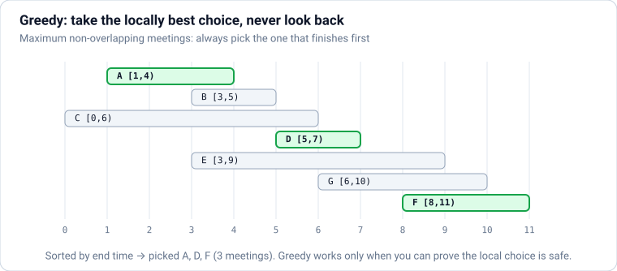

### 48.1 Best choice now, never undone

A **greedy algorithm** makes the choice that looks best **right now** and never revisits it. A shopkeeper giving ₹87 in change hands over the biggest note or coin that fits (50, 20, 10, 5, 2) until nothing is left. Greedy solutions are usually "sort by the right key, then one pass": O(n log n).

### 48.2 Choosing the key

Fit the most meetings into one room:

| Rule | Works? |
|---|---|
| shortest meeting first | no: a short meeting in the middle can block two others |
| earliest start first | no: an early, very long meeting blocks everything |
| **earliest end first** | yes: it leaves the most time for the rest |

```python
def max_meetings(intervals):
    count, last_end = 0, float("-inf")
    for start, end in sorted(intervals, key=lambda m: m[1]):
        if start >= last_end:
            count += 1
            last_end = end
    return count

def by_rule(intervals, key):                   # try a wrong rule for comparison
    count, last_end = 0, float("-inf")
    for start, end in sorted(intervals, key=key):
        if start >= last_end:
            count += 1
            last_end = end
    return count

meetings = [(1, 4), (3, 5), (0, 6), (5, 7), (3, 9), (6, 10), (8, 11)]
print(max_meetings(meetings), by_rule([(0, 10), (1, 2), (3, 4)], key=lambda m: m[0]), max_meetings([(0, 10), (1, 2), (3, 4)]))
```

**Output:**

```text
3 1 2
```

`by_rule` with "earliest start" picks the long (0, 10) and gets 1 meeting; "earliest end" gets 2.

<details>
<summary><b>Exchange argument: why "earliest end" is optimal</b></summary>

Let g be the meeting that ends first, and take any optimal schedule S. If S doesn't start with g, swap S's first meeting f for g. Since g ends no later than f, g doesn't overlap anything that came after f in S, so the result is still valid and has the same number of meetings: an optimal schedule that starts with g. Remove g and everything overlapping it; the same argument applies to the remaining meetings. By induction, the greedy choices build an optimal schedule.

This "swap the optimal solution's choice for the greedy one without making it worse" pattern is the **exchange argument**, the standard way to prove a greedy rule.

</details>

### 48.3 When greedy fails

Coins [1, 3, 4] for amount 6: greedy takes 4, then 1, then 1 (3 coins), but 3 + 3 needs only 2. A choice that's best now limited the future choices:

```python
def greedy_coins(coins, amount):
    count = 0
    for c in sorted(coins, reverse=True):
        count += amount // c
        amount %= c
    return count if amount == 0 else -1

print(greedy_coins([1, 3, 4], 6), greedy_coins([1, 2, 5, 10, 20, 50], 87))
```

**Output:**

```text
3 5
```

(Greedy happens to be optimal for real currencies, which are designed that way.) Chapter 49 solves coin change correctly with dynamic programming.

**In an interview:** propose a greedy rule; spend two minutes trying to break it with a small counterexample; if you can't, sketch an exchange argument; if you can, switch to DP; when unsure, stress-test against a brute force (Chapter 21.4).

### 48.4 Classics

**Jump game:** can you reach the last index, if `nums[i]` is the farthest jump from i? Track the farthest reachable index. **Gas station:** if the total gas covers the total cost, a start exists, and it's just after the point where the running tank is lowest. **Assign cookies:** match the smallest sufficient cookie to the least greedy child, two pointers after sorting.

```python
def can_jump(nums):
    farthest = 0
    for i, jump in enumerate(nums):
        if i > farthest:
            return False
        farthest = max(farthest, i + jump)
    return True

def gas_station(gas, cost):
    if sum(gas) < sum(cost):
        return -1
    tank, start = 0, 0
    for i in range(len(gas)):
        tank += gas[i] - cost[i]
        if tank < 0:                         # can't reach i + 1 from start: restart after i
            start, tank = i + 1, 0
    return start

def assign_cookies(greed, sizes):
    greed, sizes = sorted(greed), sorted(sizes)
    child = 0
    for s in sizes:
        if child < len(greed) and s >= greed[child]:
            child += 1
    return child

print(can_jump([2, 3, 1, 1, 4]), can_jump([3, 2, 1, 0, 4]), gas_station([1, 2, 3, 4, 5], [3, 4, 5, 1, 2]), assign_cookies([1, 2, 3], [1, 1]))
```

**Output:**

```text
True False 3 1
```

### 48.5 Huffman coding

**Huffman coding** compresses text by giving frequent characters short bit codes. Greedily merge the two **least frequent** groups, with a heap, until one tree remains; each merge adds one bit to every code in both groups. Its exchange argument shows the two rarest characters can always be siblings at the deepest level. It's inside ZIP, PNG and HTTP compression:

```python
import heapq
from collections import Counter

def huffman_code_lengths(text):
    heap = [(count, i, {ch: 0}) for i, (ch, count) in enumerate(Counter(text).items())]
    heapq.heapify(heap)
    tiebreak = len(heap)
    while len(heap) > 1:
        c1, _, codes1 = heapq.heappop(heap)
        c2, _, codes2 = heapq.heappop(heap)
        merged = {ch: depth + 1 for ch, depth in (codes1 | codes2).items()}   # one bit deeper
        heapq.heappush(heap, (c1 + c2, tiebreak, merged))
        tiebreak += 1
    return heap[0][2]

text = "abracadabra"
lengths = huffman_code_lengths(text)
counts = Counter(text)
print(sorted(lengths.items()), sum(counts[ch] * lengths[ch] for ch in counts), "bits instead of", 8 * len(text))
```

**Output:**

```text
[('a', 1), ('b', 3), ('c', 3), ('d', 3), ('r', 3)] 23 bits instead of 88
```

`codes1 | codes2` merges two dicts. 'a' (5 times) gets the shortest code.

### 48.6 Summary

```
greedy: best local choice, never undone;  usually sort by a key + one pass   O(n log n)
interval scheduling: earliest END first;  prove with an exchange argument
fails when an early choice limits later ones (coins [1, 3, 4] for 6) → DP
jump game: farthest reach;  gas station: restart after a negative tank;  Huffman: merge the two rarest (heap)
```

**Key terms:**

- **Greedy algorithm:** an algorithm that repeatedly makes the locally best choice without reconsidering.
- **Exchange argument:** proving a greedy rule by swapping an optimal solution's choice for the greedy choice without making it worse.
- **Interval scheduling:** choosing the most non-overlapping intervals.
- **Counterexample:** a specific input on which a proposed rule gives a wrong answer.
- **Huffman coding:** an optimal prefix code built by repeatedly merging the two least frequent symbols.

### Exercises

1. The minimum number of arrows to burst balloons given as intervals `[[10, 16], [2, 8], [1, 6], [7, 12]]` (an arrow at x bursts every balloon covering x).
2. Partition labels: split "ababcbacadefegdehijhklij" into as many parts as possible so each letter appears in only one part.

<details>
<summary><b>Answers</b></summary>

```python
def min_arrows(points):
    arrows, last = 0, float("-inf")
    for start, end in sorted(points, key=lambda p: p[1]):
        if start > last:
            arrows += 1
            last = end                       # shoot at the earliest end
    return arrows

def partition_labels(s):
    last = {ch: i for i, ch in enumerate(s)}
    sizes, start, end = [], 0, 0
    for i, ch in enumerate(s):
        end = max(end, last[ch])
        if i == end:
            sizes.append(end - start + 1)
            start = i + 1
    return sizes

print(min_arrows([[10, 16], [2, 8], [1, 6], [7, 12]]), partition_labels("ababcbacadefegdehijhklij"))
```

**Output:**

```text
2 [9, 7, 8]
```

1. The same earliest-end rule as meetings.

</details>

**Practice:**

| # | Problem (LeetCode) | Difficulty |
|---|---|---|
| 1 | [455. Assign Cookies](https://leetcode.com/problems/assign-cookies/) | 🟢 Easy |
| 2 | [55. Jump Game](https://leetcode.com/problems/jump-game/) | 🟡 Medium |
| 3 | [45. Jump Game II](https://leetcode.com/problems/jump-game-ii/) | 🟡 Medium |
| 4 | [134. Gas Station](https://leetcode.com/problems/gas-station/) | 🟡 Medium |
| 5 | [435. Non-overlapping Intervals](https://leetcode.com/problems/non-overlapping-intervals/) | 🟡 Medium |
| 6 | [452. Minimum Number of Arrows to Burst Balloons](https://leetcode.com/problems/minimum-number-of-arrows-to-burst-balloons/) | 🟡 Medium |
| 7 | [763. Partition Labels](https://leetcode.com/problems/partition-labels/) | 🟡 Medium |
| 8 | [846. Hand of Straights](https://leetcode.com/problems/hand-of-straights/) | 🟡 Medium |

**Learn more:** [Wikipedia: greedy algorithm](https://en.wikipedia.org/wiki/Greedy_algorithm) · [Wikipedia: Huffman coding](https://en.wikipedia.org/wiki/Huffman_coding)

---

## 49. Dynamic Programming

**You need:** Chapters 14, 25 and 48. · **You'll learn:** when dynamic programming applies (overlapping subproblems and optimal substructure), top-down memoisation with `@cache` and bottom-up tables, a five-step recipe for any DP problem, reconstructing the answer, saving memory, and the 1D and 2D classics: stairs, coin change, house robber, grid paths and the longest common subsequence.

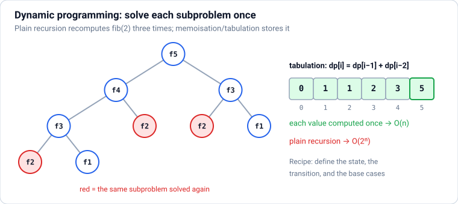

### 49.1 Never solve the same subproblem twice

Asked "what's 1 + 1 + 1 + 1 + 1?", you count 5; asked again with "+ 1" at the end, you say 6 without recounting. **Dynamic programming** (DP) solves a problem from the answers to smaller versions of it, computing each smaller answer **once**. It applies when:

1. **overlapping subproblems:** the same smaller question comes up again and again (naive Fibonacci recomputes the same values exponentially often, Chapter 14.4);
2. **optimal substructure:** the best answer is built from best answers to smaller questions (the fewest coins for 11 is 1 + the fewest for 11 − c, for the right last coin c).

### 49.2 Top-down: memoisation

Write the plain recursion, then **cache** each answer. `@cache` from `functools`, placed above a function, is a **decorator**: it wraps the function so each distinct argument is computed once and then looked up:

```python
from functools import cache

calls = 0
@cache
def climb(n):                    # ways to climb n stairs taking 1 or 2 steps
    global calls
    calls += 1
    return 1 if n <= 1 else climb(n - 1) + climb(n - 2)

print(climb(10), climb(80), calls)
```

**Output:**

```text
89 37889062373143906 81
```

The last move onto stair n was a 1-step (from n − 1) or a 2-step (from n − 2), so ways(n) = ways(n − 1) + ways(n − 2): Fibonacci again. With the cache, each n from 0 to 80 is computed once: 81 calls instead of about 10¹⁶.

### 49.3 Bottom-up: tabulation

Fill a table from the smallest cases upwards in a loop: no recursion limit, and easy to shrink. Coin change, the fewest coins making an amount, fixing greedy's counterexample (Chapter 48.3):

```python
def coin_change(coins, amount):
    INF = amount + 1                       # more coins than could ever be needed
    dp = [0] + [INF] * amount              # dp[a] = fewest coins making a
    for a in range(1, amount + 1):
        for c in coins:
            if c <= a:
                dp[a] = min(dp[a], dp[a - c] + 1)
    return dp[amount] if dp[amount] != INF else -1

print(coin_change([1, 3, 4], 6), coin_change([2], 3), coin_change([1, 2, 5], 11))
```

**Output:**

```text
2 -1 3
```

### 49.4 The recipe

1. **State:** say what `dp[i]` (or `dp[i][j]`) means in a full sentence: "dp[a] = the fewest coins that make amount a".
2. **Transition:** how a state follows from smaller ones: "the last coin is some c, so dp[a] = min over c of dp[a − c] + 1".
3. **Base case:** the smallest states, answered directly: dp[0] = 0.
4. **Order and answer:** compute states before the ones that need them (amounts upwards); the answer is dp[amount].
5. **Save space** (optional): if a state only needs the previous row, keep one or two rows.

**Cost** = (number of states) × (work per state): coin change has `amount` states with `len(coins)` choices each, O(amount × coins).

<details>
<summary><b>Why the recipe gives the right answer</b></summary>

By induction on the order of computation. The base cases are right by definition. When computing a state, every state it reads is smaller and already correct; the transition considers **every** possible last decision (every last coin), and for each one, optimal substructure says the rest is best done optimally, which is exactly what the smaller state holds. So the minimum over the choices is the true optimum. The two conditions of 49.1 are precisely what makes this argument work: substructure for correctness, overlap for speed.

</details>

### 49.5 House robber: take or skip

Rob houses in a row, never two neighbours. For each house: take it (its money + the best up to two houses back) or skip it (the best up to the previous house). Only two values are needed, so O(1) space:

```python
def rob(houses):
    two_back, one_back = 0, 0
    for money in houses:
        two_back, one_back = one_back, max(one_back, two_back + money)
    return one_back

def rob_with_choice(houses):               # also reconstruct which houses
    n = len(houses)
    dp = [0] * (n + 1)                     # dp[i] = best from the first i houses
    for i in range(1, n + 1):
        dp[i] = max(dp[i - 1], (dp[i - 2] if i >= 2 else 0) + houses[i - 1])
    chosen, i = [], n
    while i > 0:                           # walk back: was house i taken?
        if dp[i] == dp[i - 1]:
            i -= 1
        else:
            chosen.append(i - 1)
            i -= 2
    return dp[n], chosen[::-1]

print(rob([2, 7, 9, 3, 1]), rob_with_choice([2, 7, 9, 3, 1]), rob([2, 1, 1, 2]))
```

**Output:**

```text
12 (12, [0, 2, 4]) 4
```

To **reconstruct** the choices, keep the full table and walk back from the answer, checking which option produced each value.

### 49.6 2D DP: grid paths

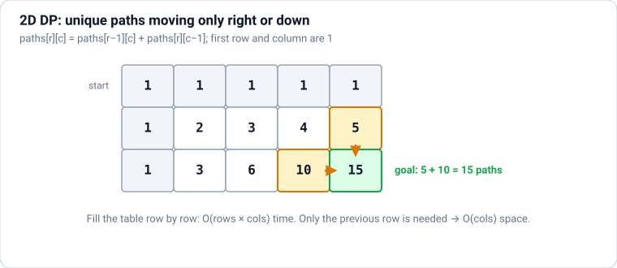

The number of paths from the top-left to the bottom-right of a grid moving only right or down: each cell is reached from above or from the left, so paths(r, c) = paths(r − 1, c) + paths(r, c − 1), with 1 along the top row and left column. One row of the table suffices:

```python
def unique_paths(rows, cols):
    row = [1] * cols
    for _ in range(1, rows):
        for c in range(1, cols):
            row[c] += row[c - 1]           # above (old row[c]) + left (new row[c−1])
    return row[-1]

def min_path_sum(grid):
    rows, cols = len(grid), len(grid[0])
    dp = [[0] * cols for _ in range(rows)]
    for r in range(rows):
        for c in range(cols):
            if r == 0 and c == 0:
                dp[r][c] = grid[0][0]
            elif r == 0:
                dp[r][c] = dp[r][c - 1] + grid[r][c]
            elif c == 0:
                dp[r][c] = dp[r - 1][c] + grid[r][c]
            else:
                dp[r][c] = min(dp[r - 1][c], dp[r][c - 1]) + grid[r][c]
    return dp[-1][-1]

print(unique_paths(3, 7), unique_paths(10, 10), min_path_sum([[1, 3, 1], [1, 5, 1], [4, 2, 1]]))
```

**Output:**

```text
28 48620 7
```

(The path count is also C(rows + cols − 2, rows − 1): choose which moves go down.)

### 49.7 The longest common subsequence

The **longest common subsequence** (LCS) of two strings: the longest sequence of characters appearing in both, in order, not necessarily together. State: dp[i][j] = LCS length of the first i characters of a and the first j of b. If the last characters match, they extend the LCS of both prefixes; otherwise drop one of them:

> dp[i][j] = dp[i−1][j−1] + 1 if a[i−1] == b[j−1], else max(dp[i−1][j], dp[i][j−1])

```python
def lcs(a, b):
    dp = [[0] * (len(b) + 1) for _ in range(len(a) + 1)]
    for i in range(1, len(a) + 1):
        for j in range(1, len(b) + 1):
            if a[i - 1] == b[j - 1]:
                dp[i][j] = dp[i - 1][j - 1] + 1
            else:
                dp[i][j] = max(dp[i - 1][j], dp[i][j - 1])
    out, i, j = [], len(a), len(b)         # walk back to recover one LCS
    while i and j:
        if a[i - 1] == b[j - 1]:
            out.append(a[i - 1])
            i, j = i - 1, j - 1
        elif dp[i - 1][j] >= dp[i][j - 1]:
            i -= 1
        else:
            j -= 1
    return dp[-1][-1], "".join(reversed(out))

print(lcs("abcde", "ace"), lcs("AGGTAB", "GXTXAYB"), lcs("abc", "def"))
```

**Output:**

```text
(3, 'ace') (4, 'GTAB') (0, '')
```

O(len(a) × len(b)). `diff` and `git diff` are built on this idea: the lines that aren't in the LCS are the changes.

### 49.8 Summary

```
DP applies: overlapping subproblems + optimal substructure
top-down: recursion + @cache (functools);  bottom-up: fill a table in order
recipe: state (a sentence) → transition → base case → order + answer → shrink space
cost = states × work per state;  reconstruct by walking back through the table
1D: stairs (fib), coin change min over coins, house robber take/skip
2D: grid paths above + left;  LCS match → diag + 1, else max(up, left)
```

**Key terms:**

- **Dynamic programming (DP):** solving a problem by combining stored solutions of overlapping subproblems.
- **Overlapping subproblems:** the same smaller problems recurring many times in a naive recursion.
- **Optimal substructure:** an optimal solution being made of optimal solutions to subproblems.
- **Memoisation (top-down DP):** caching the results of recursive calls.
- **Tabulation (bottom-up DP):** filling a table from the base cases upwards.
- **Decorator:** `@name` above a function, which wraps the function to change its behaviour.
- **State:** the parameters that identify one subproblem, such as an amount or a pair of indices.
- **Transition:** the formula computing a state from smaller states.
- **Longest common subsequence (LCS):** the longest sequence appearing in order in both of two sequences.

### Exercises

1. Minimum cost climbing stairs: `cost[i]` to step on stair i, start at 0 or 1, climb 1 or 2: `[10, 15, 20]` → 15.
2. The length of the longest increasing subsequence of `[10, 9, 2, 5, 3, 7, 101, 18]` in O(n²).

<details>
<summary><b>Answers</b></summary>

```python
def min_cost_climbing(cost):
    a, b = 0, 0                    # best cost to stand on the step two back / one back
    for i in range(2, len(cost) + 1):
        a, b = b, min(b + cost[i - 1], a + cost[i - 2])
    return b

def lis(nums):
    dp = [1] * len(nums)           # dp[i] = longest increasing subsequence ending at i
    for i in range(len(nums)):
        for j in range(i):
            if nums[j] < nums[i]:
                dp[i] = max(dp[i], dp[j] + 1)
    return max(dp)

print(min_cost_climbing([10, 15, 20]), min_cost_climbing([1, 100, 1, 1, 1, 100, 1, 1, 100, 1]), lis([10, 9, 2, 5, 3, 7, 101, 18]))
```

**Output:**

```text
15 6 4
```

2. Chapter 50 brings LIS down to O(n log n) with binary search.

</details>

**Practice:**

| # | Problem (LeetCode) | Difficulty |
|---|---|---|
| 1 | [70. Climbing Stairs](https://leetcode.com/problems/climbing-stairs/) | 🟢 Easy |
| 2 | [746. Min Cost Climbing Stairs](https://leetcode.com/problems/min-cost-climbing-stairs/) | 🟢 Easy |
| 3 | [198. House Robber](https://leetcode.com/problems/house-robber/) | 🟡 Medium |
| 4 | [322. Coin Change](https://leetcode.com/problems/coin-change/) | 🟡 Medium |
| 5 | [62. Unique Paths](https://leetcode.com/problems/unique-paths/) | 🟡 Medium |
| 6 | [64. Minimum Path Sum](https://leetcode.com/problems/minimum-path-sum/) | 🟡 Medium |
| 7 | [1143. Longest Common Subsequence](https://leetcode.com/problems/longest-common-subsequence/) | 🟡 Medium |
| 8 | [300. Longest Increasing Subsequence](https://leetcode.com/problems/longest-increasing-subsequence/) | 🟡 Medium |
| 9 | [91. Decode Ways](https://leetcode.com/problems/decode-ways/) | 🟡 Medium |
| 10 | [139. Word Break](https://leetcode.com/problems/word-break/) | 🟡 Medium |

**Learn more:** [MIT 6.006: dynamic programming lectures](https://ocw.mit.edu/courses/6-006-introduction-to-algorithms-spring-2020/) · [Wikipedia: dynamic programming](https://en.wikipedia.org/wiki/Dynamic_programming)

---

## 50. Dynamic Programming II: Knapsack, Subsequences, Strings and Intervals

**You need:** Chapter 49. · **You'll learn:** the DP families that cover most interview problems and how to recognise them: 0/1 and unbounded knapsack (and why the loop direction is the whole difference), counting versus optimising, the longest increasing subsequence in O(n log n), edit distance, word break, interval DP and state machines.

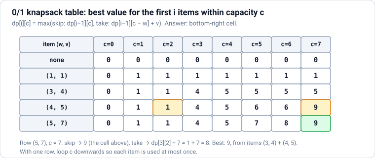

### 50.1 The families

| Family | State | Transition idea | Classics |
|---|---|---|---|
| 0/1 knapsack (each item once) | `dp[c]` = best value within capacity c | skip, or take: `dp[c − w] + v` | knapsack, partition equal subset sum |
| unbounded knapsack (reuse allowed) | `dp[a]` = ways / fewest for amount a | the same, items reusable | coin change I and II |
| one sequence | `dp[i]` = best answer **ending at** i | look back at every j < i | longest increasing subsequence |
| two strings | `dp[i][j]` = answer for prefixes of length i and j | match the last characters, or drop one | LCS, edit distance |
| prefixes of a string | `dp[i]` = can the first i characters be solved? | try every last piece `s[j:i]` | word break, decode ways |
| intervals | `dp[i][j]` = answer for the range i … j | try every split point inside | burst balloons, matrix chains |
| state machine | `dp[i][state]` | move between states each step | stock trading with cooldown |

### 50.2 0/1 knapsack

Items with weights and values; pick a subset with total weight ≤ capacity and the largest total value, each item at most once. For each item and capacity: skip it (`dp[c]`), or take it (`dp[c − w] + v`). With one row, loop capacities **downwards**:

```python
def knapsack(weights, values, capacity):
    dp = [0] * (capacity + 1)
    for w, v in zip(weights, values):
        for c in range(capacity, w - 1, -1):         # downwards: each item once
            dp[c] = max(dp[c], dp[c - w] + v)
    return dp[capacity]

def can_partition(nums):                             # split into two equal-sum halves?
    total = sum(nums)
    if total % 2:
        return False
    reachable = [True] + [False] * (total // 2)      # reachable[s]: some subset sums to s
    for x in nums:
        for s in range(total // 2, x - 1, -1):
            reachable[s] = reachable[s] or reachable[s - x]
    return reachable[total // 2]

print(knapsack([1, 3, 4, 5], [1, 4, 5, 7], 7), can_partition([1, 5, 11, 5]), can_partition([1, 2, 3, 5]))
```

**Output:**

```text
9 True False
```

<details>
<summary><b>Why the loop direction decides "once" versus "reusable"</b></summary>

The full table has one row per item: dp[i][c] = max(dp[i−1][c], dp[i−1][c−w] + v), reading only the **previous** item's row. With one row, `dp[c − w]` must still hold the previous row's value when dp[c] is updated. Going downwards, c − w < c hasn't been overwritten yet in this pass, so it's the old value: the item is used at most once. Going **upwards**, dp[c − w] was already updated in this pass, possibly using this very item, so the item can be taken again: that's the unbounded knapsack. Same code, opposite loop.

</details>

The cost is O(n × capacity): **pseudo-polynomial**, fast when the capacity is a small number, slow when it's huge.

### 50.3 Unbounded knapsack: counting ways

Counting replaces `max` with `+`. For the number of ways to make an amount from unlimited coins, loop **coins outside**, amounts inside: each combination is then counted once, in coin order (amounts outside would count 1 + 2 and 2 + 1 separately: orderings, not combinations):

```python
def coin_change_ways(coins, amount):
    ways = [1] + [0] * amount
    for c in coins:
        for a in range(c, amount + 1):               # upwards: coin c is reusable
            ways[a] += ways[a - c]
    return ways[amount]

def count_orderings(coins, amount):                   # amounts outside: orders count
    ways = [1] + [0] * amount
    for a in range(1, amount + 1):
        for c in coins:
            if c <= a:
                ways[a] += ways[a - c]
    return ways[amount]

print(coin_change_ways([1, 2, 5], 5), count_orderings([1, 2, 5], 5), count_orderings([1, 2, 3], 4))
```

**Output:**

```text
4 9 7
```

### 50.4 Longest increasing subsequence in O(n log n)

Chapter 49's LIS is O(n²). Keep `tails[k]` = the **smallest** possible last value of an increasing subsequence of length k + 1. `tails` is always increasing, so for each x binary-search (Chapter 18.4) the first tail ≥ x and replace it with x, or append x if it's bigger than all:

```python
from bisect import bisect_left

def lis_fast(nums):
    tails = []
    for x in nums:
        i = bisect_left(tails, x)
        if i == len(tails):
            tails.append(x)              # extends the longest so far
        else:
            tails[i] = x                 # a smaller tail for length i + 1
    return len(tails)

nums = [10, 9, 2, 5, 3, 7, 101, 18]
print(lis_fast(nums), lis_fast([0, 1, 0, 3, 2, 3]), lis_fast([7, 7, 7]))
```

**Output:**

```text
4 4 1
```

<details>
<summary><b>Why it works</b></summary>

Invariant: after processing a prefix, `tails[k]` is the smallest last value of any increasing subsequence of length k + 1 in that prefix. A smaller tail is never worse: anything that extends a subsequence ending in a bigger value also extends one ending in a smaller value. For a new x, the subsequences it can extend are those whose tail is < x; the longest has length i = (number of tails < x), so x makes a length-(i + 1) subsequence ending in x. If i = len(tails), that's a new longest; otherwise x ≤ tails[i] is a better tail for length i + 1. `tails` stays sorted, so the binary search is valid, and its length is the LIS length. (`tails` itself is not necessarily a subsequence of the input.)

</details>

### 50.5 Two strings: edit distance

The **edit distance** (Levenshtein distance) is the fewest single-character inserts, deletes and substitutions turning a into b. If the last characters match, no edit: dp[i][j] = dp[i−1][j−1]. Otherwise 1 + the best of delete (dp[i−1][j]), insert (dp[i][j−1]) or substitute (dp[i−1][j−1]). The first row and column are the cost of building from or to the empty string:

```python
def edit_distance(a, b):
    dp = [[0] * (len(b) + 1) for _ in range(len(a) + 1)]
    for i in range(len(a) + 1):
        dp[i][0] = i
    for j in range(len(b) + 1):
        dp[0][j] = j
    for i in range(1, len(a) + 1):
        for j in range(1, len(b) + 1):
            if a[i - 1] == b[j - 1]:
                dp[i][j] = dp[i - 1][j - 1]
            else:
                dp[i][j] = 1 + min(dp[i - 1][j], dp[i][j - 1], dp[i - 1][j - 1])
    return dp[-1][-1]

print(edit_distance("horse", "ros"), edit_distance("intention", "execution"), edit_distance("", "abc"))
```

**Output:**

```text
3 5 3
```

Spell checkers suggest words at small edit distance; DNA alignment uses weighted versions.

### 50.6 Prefixes: word break

Can a string be split into dictionary words? `ok[i]` = the first i characters can be split; it's true if some earlier split point j has `ok[j]` and `s[j:i]` is a word:

```python
def word_break(s, words):
    words = set(words)
    ok = [True] + [False] * len(s)
    for i in range(1, len(s) + 1):
        for j in range(i):
            if ok[j] and s[j:i] in words:
                ok[i] = True
                break
    return ok[len(s)]

print(word_break("leetcode", ["leet", "code"]), word_break("catsandog", ["cats", "dog", "sand", "and", "cat"]))
```

**Output:**

```text
True False
```

### 50.7 Intervals and state machines

**Interval DP** fills `dp[i][j]` by **increasing length**, because a range depends on shorter ranges inside it. Burst balloons: choose which balloon k bursts **last** between i and j; its neighbours at that moment are i and j, which splits the problem cleanly. **State machines** keep one value per state per day: for stock trading with a one-day cooldown, the states are holding, just sold and resting:

```python
def burst_balloons(nums):
    vals = [1] + nums + [1]
    n = len(vals)
    dp = [[0] * n for _ in range(n)]       # dp[i][j]: best for balloons strictly between i and j
    for length in range(2, n):
        for i in range(n - length):
            j = i + length
            for k in range(i + 1, j):
                dp[i][j] = max(dp[i][j], dp[i][k] + vals[i] * vals[k] * vals[j] + dp[k][j])
    return dp[0][n - 1]

def max_profit_cooldown(prices):
    hold, sold, rest = float("-inf"), 0, 0
    for p in prices:
        hold, sold, rest = max(hold, rest - p), hold + p, max(rest, sold)
    return max(sold, rest)

print(burst_balloons([3, 1, 5, 8]), max_profit_cooldown([1, 2, 3, 0, 2]))
```

**Output:**

```text
167 3
```

Burst balloons is O(n³): O(n²) ranges × O(n) split points.

### 50.8 Summary

```
0/1 knapsack: for item: for c DOWN to w: dp[c] = max(dp[c], dp[c−w] + v)   O(n·C), pseudo-polynomial
unbounded: c UP;  counting: + instead of max;  coins outside = combinations, amounts outside = orderings
LIS O(n log n): tails + bisect_left (replace or append)
edit distance: match → diag; else 1 + min(up, left, diag);  word break: ok[i] = any ok[j] and s[j:i] in words
interval DP by increasing length; split at the LAST action;  state machine: one variable per state
```

**Key terms:**

- **0/1 knapsack:** choosing items, each at most once, to maximise value within a weight limit.
- **Unbounded knapsack:** the knapsack problem where each item can be used any number of times.
- **Pseudo-polynomial time:** polynomial in the numeric value of an input (such as a capacity), not in its length.
- **Longest increasing subsequence (LIS):** the longest subsequence whose values strictly increase.
- **Edit distance (Levenshtein distance):** the minimum number of insertions, deletions and substitutions to turn one string into another.
- **Interval DP:** dynamic programming over ranges [i, j], filled by increasing length.
- **State machine DP:** dynamic programming that tracks one value for each of a few states at every step.

### Exercises

1. Target sum: assign + or − to each of `[1, 1, 1, 1, 1]` to reach 3. How many ways? (Hint: the plus-set must sum to (total + target)/2.)
2. The longest palindromic subsequence of "bbbab" (interval DP on the string).

<details>
<summary><b>Answers</b></summary>

```python
def target_sum_ways(nums, target):
    total = sum(nums)
    if (total + target) % 2 or abs(target) > total:
        return 0
    goal = (total + target) // 2
    ways = [1] + [0] * goal
    for x in nums:
        for s in range(goal, x - 1, -1):     # 0/1: downwards
            ways[s] += ways[s - x]
    return ways[goal]

def longest_palindromic_subsequence(s):
    n = len(s)
    dp = [[0] * n for _ in range(n)]
    for i in range(n - 1, -1, -1):
        dp[i][i] = 1
        for j in range(i + 1, n):
            if s[i] == s[j]:
                dp[i][j] = dp[i + 1][j - 1] + 2
            else:
                dp[i][j] = max(dp[i + 1][j], dp[i][j - 1])
    return dp[0][n - 1]

print(target_sum_ways([1, 1, 1, 1, 1], 3), longest_palindromic_subsequence("bbbab"), longest_palindromic_subsequence("cbbd"))
```

**Output:**

```text
5 4 2
```

1. If P is the plus-set, P − (total − P) = target, so P = (total + target)/2: a counting 0/1 knapsack.
2. Looping i downwards fills shorter ranges [i+1, j−1] before [i, j].

</details>

**Practice:**

| # | Problem (LeetCode) | Difficulty |
|---|---|---|
| 1 | [416. Partition Equal Subset Sum](https://leetcode.com/problems/partition-equal-subset-sum/) | 🟡 Medium |
| 2 | [494. Target Sum](https://leetcode.com/problems/target-sum/) | 🟡 Medium |
| 3 | [518. Coin Change II](https://leetcode.com/problems/coin-change-ii/) | 🟡 Medium |
| 4 | [300. Longest Increasing Subsequence](https://leetcode.com/problems/longest-increasing-subsequence/) | 🟡 Medium |
| 5 | [72. Edit Distance](https://leetcode.com/problems/edit-distance/) | 🟡 Medium |
| 6 | [139. Word Break](https://leetcode.com/problems/word-break/) | 🟡 Medium |
| 7 | [516. Longest Palindromic Subsequence](https://leetcode.com/problems/longest-palindromic-subsequence/) | 🟡 Medium |
| 8 | [309. Best Time to Buy and Sell Stock with Cooldown](https://leetcode.com/problems/best-time-to-buy-and-sell-stock-with-cooldown/) | 🟡 Medium |
| 9 | [312. Burst Balloons](https://leetcode.com/problems/burst-balloons/) | 🔴 Hard |

**Learn more:** [Wikipedia: knapsack problem](https://en.wikipedia.org/wiki/Knapsack_problem) · [cp-algorithms: longest increasing subsequence](https://cp-algorithms.com/sequences/longest_increasing_subsequence.html)

---

## 51. Bit Manipulation

**You need:** Chapters 12 and 49. · **You'll learn:** the bitwise operators, testing and changing single bits, the classic tricks (`x & (x − 1)`, XOR cancelling, `x & −x`) and why they work, bitmasks as sets, bitmask DP, and how Python's unlimited integers handle negatives.

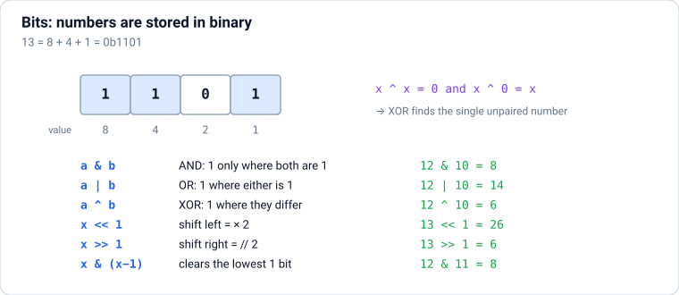

### 51.1 The operators

Every integer is a row of bits (Chapter 12). **Bitwise operators** act on all bits at once, each in O(1). On 12 = `1100` and 10 = `1010`:

| Operator | Name | Rule per bit pair | 12 op 10 | Common use |
|---|---|---|---|---|
| `a & b` | AND | 1 if both are 1 | `1000` = 8 | test or clear bits; `x & 1` is 1 for odd x |
| `a \| b` | OR | 1 if either is 1 | `1110` = 14 | turn bits on |
| `a ^ b` | XOR | 1 if they differ | `0110` = 6 | toggle bits; `x ^ x = 0` |
| `~x` | NOT | flip every bit | | in Python `~x == -x - 1` |
| `x << k` | left shift | move bits k left | 13 << 1 = 26 | multiply by 2ᵏ |
| `x >> k` | right shift | move bits k right | 13 >> 1 = 6 | floor-divide by 2ᵏ |

```python
print(12 & 10, 12 | 10, 12 ^ 10, ~12, 13 << 1, 13 >> 1, f"{12:04b} {10:04b} {12 ^ 10:04b}")
```

**Output:**

```text
8 14 6 -13 26 6 1100 1010 0110
```

**Single bits:** bit i of x is `(x >> i) & 1`; set it with `x | (1 << i)`, clear it with `x & ~(1 << i)`, flip it with `x ^ (1 << i)`:

```python
x = 0b1010
print((x >> 1) & 1, (x >> 2) & 1, bin(x | 1 << 2), bin(x & ~(1 << 3)), bin(x ^ 0b1111))
```

**Output:**

```text
1 0 0b1110 0b10 0b101
```

`0b1010` writes a number in binary. Shifts bind more tightly than `|` and `&`, but brackets are clearer.

### 51.2 The famous tricks

**`x & (x − 1)` removes the lowest 1-bit.** Subtracting 1 turns the lowest 1 into 0 and every 0 below it into 1 (`1000 − 1 = 0111`), and everything above stays; AND-ing with x then clears exactly that lowest 1. So counting bits takes one round per 1-bit, and x is a power of two exactly when x > 0 and `x & (x − 1) == 0`:

```python
def count_bits(x):
    count = 0
    while x:
        x &= x - 1
        count += 1
    return count

def is_power_of_two(x):
    return x > 0 and x & (x - 1) == 0

print(count_bits(13), (13).bit_count(), is_power_of_two(64), is_power_of_two(96), bin(12 & 11))
```

**Output:**

```text
3 3 True False 0b1000
```

**XOR cancels pairs.** a ^ a = 0, a ^ 0 = a, and XOR is commutative and associative, so XOR-ing a list where every number appears twice except one leaves that one. The same idea finds the missing number in 0 … n (Chapter 25.6) without big sums:

```python
def single_number(nums):
    result = 0
    for x in nums:
        result ^= x
    return result

def missing_number(nums):
    result = len(nums)
    for i, x in enumerate(nums):
        result ^= i ^ x                  # every present number cancels with its index
    return result

print(single_number([4, 1, 2, 1, 2]), missing_number([3, 0, 1]), missing_number([9, 6, 4, 2, 3, 5, 7, 0, 1]))
```

**Output:**

```text
4 2 8
```

**`x & -x` isolates the lowest 1-bit.** In two's complement, −x = ~x + 1: flipping makes the lowest 1 a 0 with 1s below it, and adding 1 carries back up to exactly that position. Fenwick trees rely on it (Chapter 53):

```python
print([x & -x for x in [12, 10, 7, 8]], bin(12), bin(12 & -12))
```

**Output:**

```text
[4, 2, 1, 8] 0b1100 0b100
```

### 51.3 Bitmasks: a set in one integer

With up to about 20 items, bit i can mean "item i is in the set". Every subset of n items is one of the numbers 0 … 2ⁿ − 1, union is `|`, intersection `&`, and "is i in it?" is `mask >> i & 1`:

```python
def subsets_by_mask(items):
    n = len(items)
    return [[items[i] for i in range(n) if mask >> i & 1] for mask in range(1 << n)]

print(subsets_by_mask(["a", "b", "c"]))
```

**Output:**

```text
[[], ['a'], ['b'], ['a', 'b'], ['c'], ['a', 'c'], ['b', 'c'], ['a', 'b', 'c']]
```

### 51.4 Bitmask DP

A DP over subsets uses the mask as part of the state. The **travelling salesman problem**: the shortest round trip visiting every city once. dp[mask][j] = the shortest path that starts at city 0, visits exactly the cities in `mask`, and ends at j. It's O(2ⁿ · n²), hopeless beyond n ≈ 20, but vastly better than trying all (n − 1)! orders:

```python
from itertools import permutations

def tsp(dist):
    n = len(dist)
    INF = float("inf")
    dp = [[INF] * n for _ in range(1 << n)]
    dp[1][0] = 0                                  # visited {0}, standing at 0
    for mask in range(1 << n):
        for j in range(n):
            if dp[mask][j] == INF:
                continue
            for k in range(n):
                if not mask >> k & 1:             # k not visited yet
                    new = mask | 1 << k
                    dp[new][k] = min(dp[new][k], dp[mask][j] + dist[j][k])
    full = (1 << n) - 1
    return min(dp[full][j] + dist[j][0] for j in range(1, n))

dist = [[0, 10, 15, 20], [10, 0, 35, 25], [15, 35, 0, 30], [20, 25, 30, 0]]
brute = min(sum(dist[a][b] for a, b in zip((0,) + p, p + (0,))) for p in permutations(range(1, 4)))
print(tsp(dist), brute)
```

**Output:**

```text
80 80
```

`itertools.permutations` yields every ordering; the brute force confirms the DP on this small case.

### 51.5 Python details

Python integers have **unlimited size**, so there's no overflow, and a negative number behaves as if it had infinitely many 1-bits on the left (two's complement extended forever). `bin(-5)` is `'-0b101'`, not a bit pattern. To see the 32-bit pattern other languages store, mask it:

```python
print(bin(-5), bin(-5 & 0xFFFFFFFF), (-5) >> 1, (2 ** 100).bit_length())
```

**Output:**

```text
-0b101 0b11111111111111111111111111111011 -3 101
```

`0xFFFFFFFF` is 32 one-bits in hexadecimal. `-5 >> 1` is −3: right shifts round down, like `//`.

### 51.6 Summary

```
& | ^ ~ << >>   bit i: (x >> i) & 1;  set x | 1<<i;  clear x & ~(1<<i);  flip x ^ 1<<i
x & (x−1) drops the lowest 1 → count bits, power of two;  x & −x keeps only the lowest 1
XOR: a^a = 0, a^0 = a → single number, missing number
bitmask = set of ≤ ~20 items; masks 0..2ⁿ−1 = all subsets;  bitmask DP: dp[mask][j]  (TSP O(2ⁿn²))
Python ints: unlimited, negatives have infinite 1s on the left; mask with 0xFFFFFFFF for 32-bit views
```

**Key terms:**

- **Bitwise operator:** an operator acting on each pair of corresponding bits: AND, OR, XOR, NOT, shifts.
- **XOR (exclusive or):** gives 1 where two bits differ; any value XOR itself is 0.
- **Bit shift:** moving all bits left or right by k places, multiplying or dividing by 2ᵏ.
- **Two's complement:** the standard binary representation of negative integers, where −x = ~x + 1.
- **Bitmask:** an integer whose bits represent membership of items in a set.
- **Bitmask DP:** dynamic programming whose state includes a set encoded as a bitmask.
- **Travelling salesman problem (TSP):** finding the shortest round trip that visits every city exactly once.

### Exercises

1. Count the bits of every number from 0 to n in O(n): `bits[i] = bits[i >> 1] + (i & 1)`.
2. Reverse the 8 bits of 13 (`00001101` → `10110000`).

<details>
<summary><b>Answers</b></summary>

```python
def count_bits_upto(n):
    bits = [0] * (n + 1)
    for i in range(1, n + 1):
        bits[i] = bits[i >> 1] + (i & 1)       # i's bits = (i // 2)'s bits + its last bit
    return bits

def reverse_8_bits(x):
    out = 0
    for _ in range(8):
        out = (out << 1) | (x & 1)             # take the last bit of x, append it to out
        x >>= 1
    return out

print(count_bits_upto(8), reverse_8_bits(13), f"{reverse_8_bits(13):08b}")
```

**Output:**

```text
[0, 1, 1, 2, 1, 2, 2, 3, 1] 176 10110000
```

</details>

**Practice:**

| # | Problem (LeetCode) | Difficulty |
|---|---|---|
| 1 | [191. Number of 1 Bits](https://leetcode.com/problems/number-of-1-bits/) | 🟢 Easy |
| 2 | [136. Single Number](https://leetcode.com/problems/single-number/) | 🟢 Easy |
| 3 | [338. Counting Bits](https://leetcode.com/problems/counting-bits/) | 🟢 Easy |
| 4 | [268. Missing Number](https://leetcode.com/problems/missing-number/) | 🟢 Easy |
| 5 | [231. Power of Two](https://leetcode.com/problems/power-of-two/) | 🟢 Easy |
| 6 | [190. Reverse Bits](https://leetcode.com/problems/reverse-bits/) | 🟢 Easy |
| 7 | [371. Sum of Two Integers](https://leetcode.com/problems/sum-of-two-integers/) | 🟡 Medium |
| 8 | [137. Single Number II](https://leetcode.com/problems/single-number-ii/) | 🟡 Medium |

**Learn more:** [Wikipedia: bit manipulation](https://en.wikipedia.org/wiki/Bit_manipulation)

---

# Part IX — Specialised Topics

Three chapters that harder interview rounds add: string matching, range queries on changing data, and advanced graph algorithms (bridges, strongly connected components, maximum flow).

---

## 52. String Algorithms: Palindromes, KMP and Rabin-Karp

**You need:** Chapters 11, 16 and 19. · **You'll learn:** to find palindromic substrings by expanding around centres, to search for a pattern in linear time with KMP and its failure table, and with Rabin-Karp's rolling hash, and which to use when.

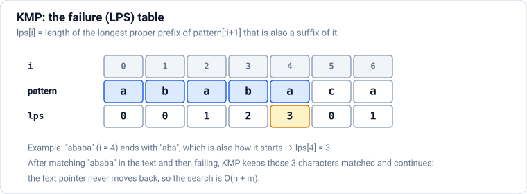

### 52.1 Palindromic substrings: expand around the centre

Every palindrome has a centre: one character ("aba") or the gap between two ("abba"). There are 2n − 1 centres; from each, expand outwards while the two ends match. O(n²) time, O(1) space:

```python
def longest_palindrome(s):
    best_lo, best_len = 0, 0
    for centre in range(2 * len(s) - 1):
        lo = centre // 2
        hi = lo + centre % 2                  # even centre numbers: a character; odd: a gap
        while lo >= 0 and hi < len(s) and s[lo] == s[hi]:
            lo, hi = lo - 1, hi + 1
        if hi - lo - 1 > best_len:
            best_lo, best_len = lo + 1, hi - lo - 1
    return s[best_lo:best_lo + best_len]

def count_palindromes(s):
    count = 0
    for centre in range(2 * len(s) - 1):
        lo, hi = centre // 2, centre // 2 + centre % 2
        while lo >= 0 and hi < len(s) and s[lo] == s[hi]:
            count += 1
            lo, hi = lo - 1, hi + 1
    return count

print(longest_palindrome("babad"), longest_palindrome("cbbd"), count_palindromes("aaa"), count_palindromes("abc"))
```

**Output:**

```text
bab bb 6 3
```

(Manacher's algorithm does it in O(n) by reusing mirror information; it's rarely asked.)

### 52.2 Pattern matching

Find a pattern of length m in a text of length n. The **naive** method tries every start and compares: O(n·m) in the worst case (text `"aaaa…ab"`, pattern `"aaab"`), because after a mismatch it throws away everything it learned. Python's `text.find(pattern)` is a well-tuned version, fine in practice.

### 52.3 KMP

**Knuth–Morris–Pratt** never moves backwards in the text. After a mismatch, it knows the characters just matched were a prefix of the pattern, so it can keep the part of that prefix which is also a suffix of it. The **failure table** (`lps`, "longest proper prefix that is also a suffix") stores, for each prefix of the pattern, the length of that overlap:

```python
def build_lps(pattern):
    lps = [0] * len(pattern)
    length = 0                                # length of the current matching prefix
    for i in range(1, len(pattern)):
        while length and pattern[i] != pattern[length]:
            length = lps[length - 1]          # fall back to a shorter prefix
        if pattern[i] == pattern[length]:
            length += 1
        lps[i] = length
    return lps

def kmp_search(text, pattern):
    lps, out, j = build_lps(pattern), [], 0  # j = characters of the pattern matched so far
    for i, ch in enumerate(text):
        while j and ch != pattern[j]:
            j = lps[j - 1]                   # jump; i never moves back
        if ch == pattern[j]:
            j += 1
        if j == len(pattern):
            out.append(i - j + 1)
            j = lps[j - 1]                   # continue, allowing overlapping matches
    return out

print(build_lps("ababaca"), build_lps("aabaaab"), kmp_search("abababcabab", "abab"))
```

**Output:**

```text
[0, 0, 1, 2, 3, 0, 1] [0, 1, 0, 1, 2, 2, 3] [0, 2, 7]
```

For "ababaca", `lps[4] = 3`: "ababa" ends with "aba", which is also its start. After matching "ababa" and failing on the next character, KMP continues as if "aba" were already matched.

<details>
<summary><b>Why KMP is O(n + m)</b></summary>

In the search loop, j increases by at most 1 per character of the text, so at most n times in total. Each `j = lps[j - 1]` strictly decreases j (lps values are shorter than the prefix), and j never goes below 0, so the total number of decreases can't exceed the total number of increases: at most n. Hence the whole search does O(n) work, even with the inner `while`. The same argument makes `build_lps` O(m). This is amortised analysis again (Chapter 23.3).

</details>

The failure table answers other questions directly: a string is a repetition of a block exactly when n − lps[n − 1] divides n (and lps[n − 1] > 0); the longest prefix that is also a suffix is lps[n − 1].

### 52.4 Rabin-Karp: rolling hashes

Give each length-m window a number, its **hash**, and compare numbers instead of strings. With a **polynomial hash** h(s) = s₀·Bᵐ⁻¹ + s₁·Bᵐ⁻² + … + sₘ₋₁ (mod M), sliding the window one step is O(1): remove the leftmost character's term, multiply by B, add the new character. Equal hashes may still be different strings (a **collision**), so confirm each hash match by comparing:

```python
def rabin_karp(text, pattern, base=256, mod=1_000_000_007):
    n, m = len(text), len(pattern)
    if m > n:
        return []
    high = pow(base, m - 1, mod)             # weight of the leftmost character
    p_hash = t_hash = 0
    for k in range(m):
        p_hash = (p_hash * base + ord(pattern[k])) % mod
        t_hash = (t_hash * base + ord(text[k])) % mod
    out = []
    for i in range(n - m + 1):
        if t_hash == p_hash and text[i:i + m] == pattern:
            out.append(i)
        if i + m < n:                        # roll: drop text[i], add text[i + m]
            t_hash = ((t_hash - ord(text[i]) * high) * base + ord(text[i + m])) % mod
    return out

print(rabin_karp("abababcabab", "abab"), rabin_karp("hello world", "o w"))
```

**Output:**

```text
[0, 2, 7] [4]
```

With a large prime modulus, two different windows collide with probability about 1/M, so false matches are rare and the expected time is O(n + m). Rolling hashes shine for **many** patterns of the same length, or "find any repeated substring of length k" (put every window's hash in a set). rsync and backup tools use rolling hashes to find unchanged blocks.

### 52.5 Which to use

| Need | Use |
|---|---|
| longest or count of palindromic substrings | expand around the centre |
| one pattern, guaranteed linear time | KMP |
| many patterns, or repeated substrings of one length | Rabin-Karp |
| repeated block, longest prefix-suffix | KMP's failure table |
| everyday code | `text.find`, `in`, the `re` module |

### 52.6 Summary

```
palindromes: 2n − 1 centres, expand while ends match   O(n²)
KMP: lps[i] = longest proper prefix of pattern[:i+1] that is also its suffix;  mismatch → j = lps[j−1]   O(n + m)
Rabin-Karp: polynomial hash mod a big prime; roll in O(1); confirm on hash match   O(n + m) expected
repeated block ⇔ lps[−1] > 0 and n % (n − lps[−1]) == 0
```

**Key terms:**

- **Expand around centre:** finding palindromes by growing outwards from every possible centre.
- **Pattern matching:** finding the occurrences of a pattern string in a text.
- **KMP (Knuth–Morris–Pratt):** linear-time pattern matching that uses a failure table to avoid re-reading text.
- **Failure table (LPS array):** for each prefix of a pattern, the length of its longest proper prefix that is also a suffix.
- **Rabin-Karp:** pattern matching by comparing rolling hashes of text windows.
- **Rolling hash:** a hash of a sliding window that updates in O(1) per step.
- **Hash collision:** two different inputs with the same hash value.

### Exercises

1. Is "abcabcabc" a repetition of a smaller block? Is "abcab"? Use the failure table.
2. Find the shortest palindrome by adding characters in front of "aacecaaa" (hint: the longest palindromic prefix, from the lps of s + "#" + reversed s).

<details>
<summary><b>Answers</b></summary>

```python
def repeated_block(s):
    longest = build_lps(s)[-1]
    return longest > 0 and len(s) % (len(s) - longest) == 0

def shortest_palindrome(s):
    combined = s + "#" + s[::-1]
    keep = build_lps(combined)[-1]           # longest palindromic prefix of s
    return s[keep:][::-1] + s

print(repeated_block("abcabcabc"), repeated_block("abcab"), shortest_palindrome("aacecaaa"), shortest_palindrome("abcd"))
```

**Output:**

```text
True False aaacecaaa dcbabcd
```

2. A prefix of s that equals a suffix of reversed s is a palindrome; the `#` stops the match crossing the middle.

</details>

**Practice:**

| # | Problem (LeetCode) | Difficulty |
|---|---|---|
| 1 | [28. Find the Index of the First Occurrence in a String](https://leetcode.com/problems/find-the-index-of-the-first-occurrence-in-a-string/) | 🟢 Easy |
| 2 | [459. Repeated Substring Pattern](https://leetcode.com/problems/repeated-substring-pattern/) | 🟢 Easy |
| 3 | [5. Longest Palindromic Substring](https://leetcode.com/problems/longest-palindromic-substring/) | 🟡 Medium |
| 4 | [647. Palindromic Substrings](https://leetcode.com/problems/palindromic-substrings/) | 🟡 Medium |
| 5 | [214. Shortest Palindrome](https://leetcode.com/problems/shortest-palindrome/) | 🔴 Hard |
| 6 | [187. Repeated DNA Sequences](https://leetcode.com/problems/repeated-dna-sequences/) | 🟡 Medium |

**Learn more:** [cp-algorithms: prefix function (KMP)](https://cp-algorithms.com/string/prefix-function.html) · [cp-algorithms: string hashing](https://cp-algorithms.com/string/string-hashing.html)

---

## 53. Range Queries with Updates: Fenwick Trees and Segment Trees

**You need:** Chapters 24, 36 and 51. · **You'll learn:** to answer range sums (or min, max, GCD) on an array that keeps changing, with a segment tree and a Fenwick tree, both O(log n) per operation, why their operations are logarithmic, and how a Fenwick tree counts "smaller numbers to the right".


### 53.1 The problem

Prefix sums (Chapter 24) answer "sum of nums[i..j]?" in O(1), but only while the array **never changes**: one update can change O(n) prefix sums.

| Structure | Update one value | Range query | Code | Handles |
|---|---|---|---|---|
| plain list | O(1) | O(n) | tiny | anything |
| prefix sums | O(n) | O(1) | tiny | sums, no updates |
| **Fenwick tree** | O(log n) | O(log n) | ~10 lines | sums (operations with an inverse, like + and −) |
| **segment tree** | O(log n) | O(log n) | ~25 lines | sum, min, max, GCD: any associative operation |

Clues: "update one element and query a range, many times", "count of smaller numbers after self", "number of inversions with updates".

### 53.2 Segment tree

A binary tree where each **leaf** is one array value and each inner node stores the sum (or min, …) of its children's ranges. Stored in a list like a heap (Chapter 39.1): leaves at positions n … 2n − 1, node i's children at 2i and 2i + 1.

- **Update:** change the leaf, then walk up to the root recomputing each parent: O(log n).
- **Query [l, r):** move `l` and `r` up level by level from the leaves; when a boundary node lies entirely inside the range, add it and step inwards.

```python
class SegmentTree:
    def __init__(self, nums):
        self.n = len(nums)
        self.tree = [0] * self.n + list(nums)          # leaves at n .. 2n−1
        for i in range(self.n - 1, 0, -1):
            self.tree[i] = self.tree[2 * i] + self.tree[2 * i + 1]

    def update(self, i, value):
        i += self.n
        self.tree[i] = value
        while i > 1:
            i //= 2
            self.tree[i] = self.tree[2 * i] + self.tree[2 * i + 1]

    def query(self, l, r):                             # sum of nums[l:r]
        total, l, r = 0, l + self.n, r + self.n
        while l < r:
            if l % 2 == 1:                             # l is a right child: take it, step right
                total += self.tree[l]
                l += 1
            if r % 2 == 1:                             # r − 1 is inside: take it
                r -= 1
                total += self.tree[r]
            l //= 2
            r //= 2
        return total

st = SegmentTree([5, 8, 6, 3, 2, 7, 2, 6])
print(st.query(0, 8), st.query(2, 6))
st.update(3, 10)
print(st.query(2, 6), st.query(3, 4))
```

**Output:**

```text
39 18
25 10
```

<details>
<summary><b>Why a query touches O(log n) nodes</b></summary>

Each loop round moves both boundaries one level up, so there are at most ⌈log₂ n⌉ + 1 rounds. In each round at most one node is taken on each side: a boundary node is taken only when it's a "partial" child whose parent's range would stick out of [l, r). So at most 2 nodes per level, O(log n) in total, and the taken nodes' ranges exactly tile [l, r). For min or max, replace `+` with `min`/`max` (and 0 with infinity).

</details>

**Lazy propagation** extends segment trees to "add x to every value in a range" updates by postponing the work on children until a query needs it; it's the advanced version, asked occasionally.

### 53.3 Fenwick tree

A **Fenwick tree** (binary indexed tree) is a list where position i (1-based) stores the sum of a block ending at i whose length is i's **lowest set bit**, `i & -i` (Chapter 51.2). Position 6 = `110` covers 2 values (5–6); position 8 = `1000` covers 8 (1–8).

- **Prefix sum up to i:** add tree[i], then drop i's lowest bit (`i -= i & -i`), until 0: one block per 1-bit of i, so at most log₂ n steps.
- **Add to value i:** update every block that covers i: `i += i & -i`, until past n.

```python
class Fenwick:
    def __init__(self, n):
        self.tree = [0] * (n + 1)                      # 1-based

    def add(self, i, delta):
        while i < len(self.tree):
            self.tree[i] += delta
            i += i & -i                                # the next block covering i

    def prefix(self, i):                               # nums[1] + … + nums[i]
        total = 0
        while i > 0:
            total += self.tree[i]
            i -= i & -i                                # drop the lowest set bit
        return total

    def range_sum(self, l, r):                         # inclusive, 1-based
        return self.prefix(r) - self.prefix(l - 1)

fw = Fenwick(8)
for i, v in enumerate([5, 8, 6, 3, 2, 7, 2, 6], start=1):
    fw.add(i, v)
print(fw.range_sum(3, 6), fw.prefix(8), fw.tree[1:])
```

**Output:**

```text
18 39 [5, 13, 6, 22, 2, 9, 2, 39]
```

`enumerate(xs, start=1)` numbers from 1. Range sums use the inverse of +: prefix(r) − prefix(l − 1), which is why Fenwick trees suit sums but not min or max.

### 53.4 Counting with a Fenwick tree

For each item, how many items to its right are smaller? Scan from the right, keeping a Fenwick tree of **counts** indexed by value: the count of smaller values seen is a prefix sum. Large or negative values are first replaced by their **rank** (position in sorted order), a trick called **coordinate compression**:

```python
def count_smaller_after(nums):
    rank = {v: i + 1 for i, v in enumerate(sorted(set(nums)))}
    fw, out = Fenwick(len(rank)), []
    for x in reversed(nums):
        out.append(fw.prefix(rank[x] - 1))             # smaller values already seen
        fw.add(rank[x], 1)
    return out[::-1]

print(count_smaller_after([5, 2, 6, 1]), count_smaller_after([-1, -1]), sum(count_smaller_after([3, 1, 2, 5, 4])))
```

**Output:**

```text
[2, 1, 1, 0] [0, 0] 3
```

The last number sums the answers: it's the inversion count (Chapter 17.4) of [3, 1, 2, 5, 4], in O(n log n).

### 53.5 Summary

```
segment tree: leaves n..2n−1; parent i = 2i + 2i+1; update walks up; query moves l, r up   O(log n) each
  any associative op (sum, min, max, gcd); lazy propagation for range updates
Fenwick: tree[i] covers (i − (i & −i), i];  prefix: i −= i & −i;  add: i += i & −i   O(log n)
  sums via prefix(r) − prefix(l−1);  counts by value + coordinate compression → "smaller after self"
```

**Key terms:**

- **Range query:** a question about a contiguous range of an array, such as its sum or minimum.
- **Point update:** changing one element of an array.
- **Segment tree:** a binary tree over an array whose nodes store aggregates of ranges, for O(log n) queries and updates.
- **Fenwick tree (binary indexed tree):** an array-based structure for prefix sums with O(log n) updates.
- **Lazy propagation:** postponing range updates in a segment tree until a query needs them.
- **Coordinate compression:** replacing values by their ranks so they fit in a small index range.
- **Associative operation:** an operation where grouping doesn't matter: (a ∘ b) ∘ c = a ∘ (b ∘ c).

### Exercises

1. Turn the segment tree into a range-minimum structure and query the minimum of `[5, 8, 6, 3, 2, 7, 2, 6][1:5]`.
2. Maintain a running count of inversions while appending `[3, 1, 2, 5, 4]` one at a time from the left.

<details>
<summary><b>Answers</b></summary>

```python
class MinSegmentTree:
    def __init__(self, nums):
        self.n = len(nums)
        self.tree = [float("inf")] * self.n + list(nums)
        for i in range(self.n - 1, 0, -1):
            self.tree[i] = min(self.tree[2 * i], self.tree[2 * i + 1])

    def query(self, l, r):
        best, l, r = float("inf"), l + self.n, r + self.n
        while l < r:
            if l % 2 == 1:
                best = min(best, self.tree[l])
                l += 1
            if r % 2 == 1:
                r -= 1
                best = min(best, self.tree[r])
            l //= 2
            r //= 2
        return best

def running_inversions(nums):
    rank = {v: i + 1 for i, v in enumerate(sorted(set(nums)))}
    fw, total, out = Fenwick(len(rank)), 0, []
    for seen, x in enumerate(nums):
        total += seen - fw.prefix(rank[x])          # earlier items bigger than x
        fw.add(rank[x], 1)
        out.append(total)
    return out

print(MinSegmentTree([5, 8, 6, 3, 2, 7, 2, 6]).query(1, 5), running_inversions([3, 1, 2, 5, 4]))
```

**Output:**

```text
2 [0, 1, 2, 2, 3]
```

</details>

**Practice:**

| # | Problem (LeetCode) | Difficulty |
|---|---|---|
| 1 | [307. Range Sum Query - Mutable](https://leetcode.com/problems/range-sum-query-mutable/) | 🟡 Medium |
| 2 | [315. Count of Smaller Numbers After Self](https://leetcode.com/problems/count-of-smaller-numbers-after-self/) | 🔴 Hard |
| 3 | [493. Reverse Pairs](https://leetcode.com/problems/reverse-pairs/) | 🔴 Hard |
| 4 | [327. Count of Range Sum](https://leetcode.com/problems/count-of-range-sum/) | 🔴 Hard |
| 5 | [732. My Calendar III](https://leetcode.com/problems/my-calendar-iii/) | 🔴 Hard |

**Learn more:** [VisuAlgo: segment tree](https://visualgo.net/en/segmenttree) · [VisuAlgo: Fenwick tree](https://visualgo.net/en/fenwicktree) · [cp-algorithms: Fenwick tree](https://cp-algorithms.com/data_structures/fenwick.html)

---

## 54. Advanced Graphs: Bridges, Strongly Connected Components and Max Flow

**You need:** Chapters 41–46. · **You'll learn:** to find bridges (critical connections) with DFS discovery times and low-links, strongly connected components with Kosaraju's algorithm, and maximum flow with augmenting paths, plus why max flow equals min cut and how matching becomes a flow problem.


### 54.1 Bridges

In an undirected graph, a **bridge** is an edge whose removal disconnects the graph: a single point of failure. (An **articulation point** is the same idea for vertices.) An edge on a **cycle** is never a bridge, because the cycle offers another route. One DFS finds all bridges, recording for each vertex v:

- `disc[v]`: when DFS first reached v (1, 2, 3, …);
- `low[v]`: the earliest discovery time reachable from v's DFS subtree using tree edges down plus **one** back edge up.

A tree edge u → v is a bridge exactly when `low[v] > disc[u]`: nothing below v can climb back to u or above without that edge.

```python
from collections import deque

def bridges(n, edges):
    graph = [[] for _ in range(n)]
    for a, b in edges:
        graph[a].append(b)
        graph[b].append(a)
    disc, low, time, out = [0] * n, [0] * n, [1], []
    def dfs(u, parent):
        disc[u] = low[u] = time[0]
        time[0] += 1
        for v in graph[u]:
            if v == parent:
                continue
            if disc[v]:                            # back edge to an earlier vertex
                low[u] = min(low[u], disc[v])
            else:
                dfs(v, u)
                low[u] = min(low[u], low[v])
                if low[v] > disc[u]:
                    out.append((u, v))
    for v in range(n):
        if not disc[v]:
            dfs(v, -1)
    return sorted(out)

# two triangles joined by the single edge 2–3
print(bridges(6, [(0, 1), (1, 2), (2, 0), (2, 3), (3, 4), (4, 5), (5, 3)]), bridges(4, [(0, 1), (1, 2), (2, 3)]))
```

**Output:**

```text
[(2, 3)] [(0, 1), (1, 2), (2, 3)]
```

O(V + E). Why the test works: if some vertex in v's subtree had an edge to u or an ancestor of u, then u → v lies on a cycle (down the tree, back up that edge) and low[v] ≤ disc[u]. If no such edge exists, the subtree's only connection upward is u → v itself.

### 54.2 Strongly connected components

In a **directed** graph, a **strongly connected component** (SCC) is a largest group of vertices that can all reach each other. Shrinking each SCC to one vertex leaves a DAG (the **condensation**). **Kosaraju's algorithm:**

1. run DFS on the graph, recording vertices as they **finish**;
2. reverse every edge;
3. take vertices in **reverse** finishing order; each DFS on the reversed graph from an unvisited vertex collects exactly one SCC.

```python
def kosaraju(n, edges):
    graph, reverse = [[] for _ in range(n)], [[] for _ in range(n)]
    for a, b in edges:
        graph[a].append(b)
        reverse[b].append(a)
    seen, order = set(), []
    def dfs1(u):
        seen.add(u)
        for v in graph[u]:
            if v not in seen:
                dfs1(v)
        order.append(u)                          # on finishing
    for v in range(n):
        if v not in seen:
            dfs1(v)
    seen, comps = set(), []
    def dfs2(u, comp):
        seen.add(u)
        comp.append(u)
        for v in reverse[u]:
            if v not in seen:
                dfs2(v, comp)
    for v in reversed(order):
        if v not in seen:
            comp = []
            dfs2(v, comp)
            comps.append(sorted(comp))
    return sorted(comps)

print(kosaraju(6, [(0, 1), (1, 2), (2, 0), (2, 3), (3, 4), (4, 3), (4, 5)]))
```

**Output:**

```text
[[0, 1, 2], [3, 4], [5]]
```

Why it works, in short: the vertex that finishes last lies in a "source" SCC of the condensation. In the reversed graph, that SCC has no edges *out* to other SCCs, so a DFS from it stays inside exactly its own component; removing it, the next-latest finisher plays the same role. O(V + E). (Tarjan's algorithm finds SCCs in one pass with low-links, like the bridge algorithm.)

### 54.3 Maximum flow

Each edge is a pipe with a **capacity**. How much can flow from a source s to a sink t? The **Ford–Fulkerson** idea: while there's a path from s to t with spare capacity (an **augmenting path**), push as much as its narrowest pipe allows. Pushing flow along u → v also adds **residual** capacity v → u, which lets later paths *undo* earlier choices. Finding augmenting paths with BFS (the shortest ones) is **Edmonds–Karp**, O(V·E²):

```python
def max_flow(n, capacity_edges, s, t):
    cap = [[0] * n for _ in range(n)]
    for u, v, c in capacity_edges:
        cap[u][v] += c
    flow = 0
    while True:
        parent = [-1] * n
        parent[s] = s
        q = deque([s])
        while q and parent[t] == -1:             # BFS for a path with spare capacity
            u = q.popleft()
            for v in range(n):
                if parent[v] == -1 and cap[u][v] > 0:
                    parent[v] = u
                    q.append(v)
        if parent[t] == -1:
            return flow                          # no augmenting path left
        push, v = float("inf"), t
        while v != s:                            # the narrowest pipe on the path
            push = min(push, cap[parent[v]][v])
            v = parent[v]
        v = t
        while v != s:                            # use capacity forwards, add it backwards
            cap[parent[v]][v] -= push
            cap[v][parent[v]] += push
            v = parent[v]
        flow += push

pipes = [(0, 1, 16), (0, 2, 13), (1, 2, 10), (2, 1, 4), (1, 3, 12), (3, 2, 9),
         (2, 4, 14), (4, 3, 7), (3, 5, 20), (4, 5, 4)]
print(max_flow(6, pipes, 0, 5))
```

**Output:**

```text
23
```

**Max flow = min cut:** the maximum flow equals the smallest total capacity of pipes whose removal separates s from t. Here pipes 1→3 (12), 4→3 (7) and 4→5 (4) total 23. When no augmenting path remains, the vertices reachable from s in the residual graph form one side of such a minimum cut, which is why the algorithm stops at the optimum.

**Bipartite matching** (workers to jobs, students to projects) is a flow problem: source → each worker → the jobs they can do → sink, all capacities 1; the max flow is the largest matching:

```python
def max_matching(n_workers, n_jobs, can_do):
    s, t = 0, n_workers + n_jobs + 1
    edges = [(s, 1 + w, 1) for w in range(n_workers)]
    edges += [(1 + w, 1 + n_workers + j, 1) for w, j in can_do]
    edges += [(1 + n_workers + j, t, 1) for j in range(n_jobs)]
    return max_flow(t + 1, edges, s, t)

print(max_matching(3, 3, [(0, 0), (0, 1), (1, 0), (2, 2)]), max_matching(3, 2, [(0, 0), (1, 0), (2, 0)]))
```

**Output:**

```text
3 1
```

Interviews rarely ask you to code max flow, but recognising "this is flow or matching" is valuable. (A 2022 algorithm computes max flow in almost-linear time, a landmark result; Chapter 57.)

### 54.4 Summary

```
bridges: DFS disc/low; tree edge u→v is a bridge ⇔ low[v] > disc[u]   O(V + E)
SCC (Kosaraju): DFS finish order → reverse graph → DFS in reverse finish order, one SCC per start   O(V + E)
max flow: augmenting paths with residual (backward) capacity; BFS paths = Edmonds–Karp  O(VE²)
max flow = min cut;  bipartite matching = unit-capacity flow
```

**Key terms:**

- **Bridge:** an edge whose removal increases the number of connected components.
- **Articulation point:** a vertex whose removal increases the number of connected components.
- **Discovery time:** when DFS first visits a vertex.
- **Low-link value:** the earliest discovery time reachable from a vertex's DFS subtree with at most one back edge.
- **Strongly connected component (SCC):** a maximal set of vertices in a directed graph that can all reach each other.
- **Kosaraju's algorithm:** finding SCCs with two DFS passes, the second on the reversed graph.
- **Condensation:** the DAG formed by contracting each SCC to a single vertex.
- **Flow network:** a directed graph whose edges have capacities, with a source and a sink.
- **Augmenting path:** a source-to-sink path with spare capacity on every edge.
- **Residual capacity:** the remaining capacity of an edge, including reverse edges that can cancel flow.
- **Max-flow min-cut theorem:** the maximum flow equals the minimum total capacity of a cut separating source and sink.
- **Bipartite matching:** pairing vertices across the two sides of a bipartite graph, each used at most once.

### Exercises

1. Which edges of a 4-cycle with a tail, `[(0, 1), (1, 2), (2, 3), (3, 0), (3, 4)]`, are bridges?
2. The minimum number of vertices from which every vertex of a DAG is reachable: `edges = [(0, 1), (0, 2), (2, 5), (3, 4), (4, 2)]`, 6 vertices.

<details>
<summary><b>Answers</b></summary>

```python
def min_start_vertices(n, edges):
    has_incoming = {b for a, b in edges}
    return [v for v in range(n) if v not in has_incoming]

print(bridges(5, [(0, 1), (1, 2), (2, 3), (3, 0), (3, 4)]), min_start_vertices(6, [(0, 1), (0, 2), (2, 5), (3, 4), (4, 2)]))
```

**Output:**

```text
[(3, 4)] [0, 3]
```

1. Only the tail edge (3, 4): every cycle edge has another route.
2. In a DAG, every vertex with no incoming edge must be a start, and those starts reach everything else.

</details>

**Practice:**

| # | Problem (LeetCode) | Difficulty |
|---|---|---|
| 1 | [1192. Critical Connections in a Network](https://leetcode.com/problems/critical-connections-in-a-network/) | 🔴 Hard |
| 2 | [1557. Minimum Number of Vertices to Reach All Nodes](https://leetcode.com/problems/minimum-number-of-vertices-to-reach-all-nodes/) | 🟡 Medium |
| 3 | [2360. Longest Cycle in a Graph](https://leetcode.com/problems/longest-cycle-in-a-graph/) | 🔴 Hard |
| 4 | [1568. Minimum Number of Days to Disconnect Island](https://leetcode.com/problems/minimum-number-of-days-to-disconnect-island/) | 🔴 Hard |

**Learn more:** [cp-algorithms: finding bridges](https://cp-algorithms.com/graph/bridge-searching.html) · [cp-algorithms: strongly connected components](https://cp-algorithms.com/graph/strongly-connected-components.html) · [cp-algorithms: Edmonds–Karp](https://cp-algorithms.com/graph/edmonds_karp.html)

---

# Part X — Algorithms in the Real World

Three chapters on how the ideas of this book run inside real systems: randomised and streaming algorithms, the structures behind databases, caches and AI search, and the research results of the last few years.

---

## 55. Randomised and Streaming Algorithms: Shuffling, Sampling, Bloom Filters and Sketches

**You need:** Chapters 19, 24, 29 and 51. · **You'll learn:** Las Vegas versus Monte Carlo algorithms, fair shuffling (Fisher–Yates), sampling a stream of unknown length (reservoir sampling) and why it's fair, weighted random choice, and the probabilistic structures big systems rely on: Bloom filters (with their false-positive rate derived), Count-Min sketches and HyperLogLog.


### 55.1 Two kinds of randomness

- **Las Vegas** algorithms are always correct; only their running time is random. Randomised quick sort and quickselect (Chapter 29) are Las Vegas.
- **Monte Carlo** algorithms are always fast, but may be slightly wrong, with a probability you control: Bloom filters and sketches below.

`random.seed(n)` makes the "random" numbers repeat exactly on every run, essential for tests and debugging.

### 55.2 Fair shuffling: Fisher–Yates

Go from the last position down to the first; swap position i with a random position **from 0 to i** (inclusive). Every one of the n! orders is equally likely, in O(n). The classic bug, swapping with a random position from the whole list, is biased:

```python
import random
random.seed(42)

def fisher_yates(items):
    a = items[:]
    for i in range(len(a) - 1, 0, -1):
        j = random.randint(0, i)
        a[i], a[j] = a[j], a[i]
    return a

def biased_shuffle(items):
    a = items[:]
    for i in range(len(a)):
        j = random.randint(0, len(a) - 1)      # wrong range
        a[i], a[j] = a[j], a[i]
    return a

for shuffle in (fisher_yates, biased_shuffle):
    counts = {}
    for _ in range(60_000):
        order = tuple(shuffle([1, 2, 3]))
        counts[order] = counts.get(order, 0) + 1
    print(shuffle.__name__, len(counts), round(max(counts.values()) / min(counts.values()), 2))
```

**Output:**

```text
fisher_yates 6 1.02
biased_shuffle 6 1.25
```

Why the biased version must be biased: it makes nⁿ equally likely sequences of choices (27 for n = 3), which can't divide evenly into n! = 6 orders. Fisher–Yates makes n·(n − 1)·…·1 = n! choice sequences, one per order. `shuffle.__name__` is a function's name.

### 55.3 Reservoir sampling

Pick k random lines from a log of billions of lines, without storing it or knowing its length. Keep the first k items; for item number i > k, keep it with probability k/i, replacing a random slot. Memory: O(k).

<details>
<summary><b>Why every item ends up with probability k/n</b></summary>

By induction on the number of items seen. After i − 1 items, suppose each is in the reservoir with probability k/(i − 1). Item i enters with probability k/i. An item already in the reservoir survives step i unless item i enters **and** replaces its slot: probability (k/i)·(1/k) = 1/i. So it remains with probability k/(i − 1) · (1 − 1/i) = k/(i − 1) · (i − 1)/i = k/i. Every item seen so far now has probability k/i; at the end of the stream, k/n.

</details>

```python
def reservoir_sample(stream, k):
    sample = []
    for i, item in enumerate(stream, start=1):
        if i <= k:
            sample.append(item)
        else:
            j = random.randint(1, i)
            if j <= k:
                sample[j - 1] = item
    return sample

hits = [0] * 10
for _ in range(20_000):
    for x in reservoir_sample(range(10), 3):
        hits[x] += 1
print(reservoir_sample(range(1_000_000), 5), hits, round(max(hits) / min(hits), 2))
```

**Output:**

```text
[882452, 524483, 340086, 403590, 850384] [6064, 6113, 6019, 6019, 6018, 5988, 5953, 5834, 6010, 5982] 1.05
```

Each of the 10 items should appear about 20,000 × 3/10 = 6,000 times, and does.

### 55.4 Weighted random choice

To pick index i with probability w[i]/sum(w): build prefix sums of the weights (Chapter 24), pick a random number r in [0, total), and binary-search the first prefix sum greater than r. O(n) setup, O(log n) per pick:

```python
from bisect import bisect_right
from itertools import accumulate

def weighted_pick(prefix, r):
    return bisect_right(prefix, r)

prefix = list(accumulate([1, 3, 6]))
picks = [0, 0, 0]
for _ in range(10_000):
    picks[weighted_pick(prefix, random.random() * prefix[-1])] += 1
print(prefix, [weighted_pick(prefix, r) for r in (0.5, 1.0, 3.9, 4.0, 9.9)], picks)
```

**Output:**

```text
[1, 4, 10] [0, 1, 1, 2, 2] [1034, 2919, 6047]
```

`random.random()` is uniform in [0, 1); about 10%, 30% and 60% of picks land on each index.

### 55.5 Bloom filters

A **Bloom filter** answers "definitely not" or "probably yes" about set membership in tiny memory: a bit array of m bits and k hash functions.

- **Add:** compute the item's k positions and set those bits.
- **Check:** if **any** of its k bits is 0, the item was **definitely never added**; if all are 1, it was **probably** added (other items may have set those bits: a **false positive**). There are no false negatives.

```python
import hashlib

class BloomFilter:
    def __init__(self, m, k):
        self.m, self.k, self.bits = m, k, 0            # one big int as a row of m bits
    def _positions(self, item):
        for seed in range(self.k):                      # k hash functions via different salts
            digest = hashlib.sha256(f"{seed}:{item}".encode()).digest()
            yield int.from_bytes(digest[:8], "big") % self.m
    def add(self, item):
        for p in self._positions(item):
            self.bits |= 1 << p
    def __contains__(self, item):                       # makes `item in bloom` work
        return all(self.bits >> p & 1 for p in self._positions(item))

bf = BloomFilter(m=1000, k=7)
for word in ["apple", "banana", "cherry"]:
    bf.add(word)
print("apple" in bf, "banana" in bf, "grape" in bf)
```

**Output:**

```text
True True False
```

`yield` makes `_positions` a **generator**: it hands out values one at a time to the loop using it. `hashlib.sha256` is a hash that's the same on every run (unlike `hash` on strings, Chapter 19.1). Defining `__contains__` makes `in` work on your class.

<details>
<summary><b>Derivation: the false-positive rate ≈ (1 − e^(−kn/m))^k</b></summary>

After inserting n items, each of the kn bit-settings hits a given bit with probability 1/m, so the bit is still 0 with probability (1 − 1/m)^(kn) ≈ e^(−kn/m). A new item (never added) is a false positive when all its k bits are 1: probability ≈ (1 − e^(−kn/m))^k. For a fixed bits-per-item ratio m/n, this is smallest at k = (m/n) ln 2, giving a rate of about 0.6185^(m/n): **10 bits per item with 7 hash functions gives about 1%**, however large the items are.

</details>

```python
import math
n_items, m_bits, k = 1000, 10_000, 7
bf = BloomFilter(m_bits, k)
for i in range(n_items):
    bf.add(f"user{i}")
false_positives = sum(f"other{i}" in bf for i in range(20_000))
print(f"measured {false_positives / 20_000:.2%}, formula {(1 - math.exp(-k * n_items / m_bits)) ** k:.2%}")
```

**Output:**

```text
measured 0.81%, formula 0.82%
```

Databases like Cassandra and RocksDB keep a Bloom filter per data file to skip files that can't contain a key; caches use them to avoid storing one-hit wonders.

### 55.6 Sketches

A **Count-Min sketch** estimates counts: d rows of w counters, one hash per row. Adding an item increments one counter per row; the estimate is the **minimum** over its d counters. Collisions only ever add, so the estimate is never too low, and the minimum picks the least-polluted row. It answers "roughly how often has this appeared?" for millions of distinct items in kilobytes:

```python
class CountMinSketch:
    def __init__(self, width, depth):
        self.w, self.d = width, depth
        self.table = [[0] * width for _ in range(depth)]
    def _cols(self, item):
        for row in range(self.d):
            digest = hashlib.sha256(f"{row}|{item}".encode()).digest()
            yield row, int.from_bytes(digest[:8], "big") % self.w
    def add(self, item, count=1):
        for row, col in self._cols(item):
            self.table[row][col] += count
    def estimate(self, item):
        return min(self.table[row][col] for row, col in self._cols(item))

cms = CountMinSketch(width=50, depth=4)
for word, n in [("python", 120), ("java", 40), ("rust", 7)]:
    cms.add(word, n)
print(cms.estimate("python"), cms.estimate("java"), cms.estimate("rust"), cms.estimate("go"))
```

**Output:**

```text
120 40 7 0
```

**HyperLogLog** counts **distinct** items ("unique visitors today") in about a kilobyte: it hashes each item and remembers, in small buckets, the longest run of leading zero bits seen; a run of z zeros is a 1-in-2^z event, so long runs hint at many distinct items, and averaging over buckets gives an estimate within about 2%. Redis provides it built in.

### 55.7 Summary

```
Las Vegas: always right, random time (random pivots);  Monte Carlo: always fast, small controlled error
Fisher–Yates: swap a[i] with a[randint(0, i)], i from the end   O(n), uniform
reservoir: keep item i with probability k/i into a random slot   O(k) memory, uniform (proof by induction)
weighted pick: prefix sums + bisect_right(prefix, random() * total)
Bloom filter: k bits per item; any 0 → definitely absent; FP ≈ (1 − e^(−kn/m))^k  (~1% at 10 bits/item, k = 7)
Count-Min: min over d counters, never underestimates;  HyperLogLog: distinct counts in ~1 KB
```

**Key terms:**

- **Randomised algorithm:** an algorithm that makes random choices.
- **Las Vegas algorithm:** a randomised algorithm that is always correct, with random running time.
- **Monte Carlo algorithm:** a randomised algorithm with bounded running time that may be wrong with small probability.
- **Random seed:** a starting value that makes a pseudo-random sequence repeatable.
- **Fisher–Yates shuffle:** an O(n) shuffle that makes every permutation equally likely.
- **Reservoir sampling:** keeping a uniform random sample of k items from a stream of unknown length.
- **Streaming algorithm:** an algorithm that processes data in one pass using little memory.
- **Bloom filter:** a bit-array structure answering set membership with no false negatives and a tunable false-positive rate.
- **False positive:** a "yes" answer that is wrong.
- **Count-Min sketch:** a grid of counters that estimates item frequencies, never underestimating.
- **HyperLogLog:** a structure that estimates the number of distinct items in very little memory.
- **Generator:** a function using `yield` that produces values one at a time.

### Exercises

1. Pick a uniformly random node from a linked list in one pass, without knowing its length (reservoir sampling with k = 1).
2. How many bits does a Bloom filter need for 1 million items at a 1% false-positive rate?

<details>
<summary><b>Answers</b></summary>

```python
def random_from_stream(stream):
    chosen = None
    for i, item in enumerate(stream, start=1):
        if random.randint(1, i) == 1:          # keep with probability 1/i
            chosen = item
    return chosen

counts = [0] * 5
for _ in range(25_000):
    counts[random_from_stream(range(5))] += 1
bits = -1_000_000 * math.log(0.01) / math.log(2) ** 2
print(counts, f"{bits:,.0f} bits ≈ {bits / 8 / 1e6:.1f} MB")
```

**Output:**

```text
[4874, 5089, 4964, 5002, 5071] 9,585,058 bits ≈ 1.2 MB
```

2. The optimal size is m = −n ln p / (ln 2)², about 9.6 bits per item: roughly 1.2 MB for a million items of any size.

</details>

**Practice:**

| # | Problem (LeetCode) | Difficulty |
|---|---|---|
| 1 | [384. Shuffle an Array](https://leetcode.com/problems/shuffle-an-array/) | 🟡 Medium |
| 2 | [382. Linked List Random Node](https://leetcode.com/problems/linked-list-random-node/) | 🟡 Medium |
| 3 | [398. Random Pick Index](https://leetcode.com/problems/random-pick-index/) | 🟡 Medium |
| 4 | [528. Random Pick with Weight](https://leetcode.com/problems/random-pick-with-weight/) | 🟡 Medium |
| 5 | [470. Implement Rand10() Using Rand7()](https://leetcode.com/problems/implement-rand10-using-rand7/) | 🟡 Medium |
| 6 | [710. Random Pick with Blacklist](https://leetcode.com/problems/random-pick-with-blacklist/) | 🔴 Hard |

**Learn more:** [Wikipedia: Fisher–Yates shuffle](https://en.wikipedia.org/wiki/Fisher%E2%80%93Yates_shuffle) · [Wikipedia: Bloom filter](https://en.wikipedia.org/wiki/Bloom_filter) · [Wikipedia: HyperLogLog](https://en.wikipedia.org/wiki/HyperLogLog)

---

## 56. Algorithms Behind Real Systems: Consistent Hashing, Rate Limiters, B-Trees, LSM Trees and Vector Search

**You need:** Chapters 18, 19, 29, 39 and 55. · **You'll learn:** how databases, caches, APIs and AI apps are built from this book's structures: consistent hashing for spreading data across servers, token-bucket rate limiting, B+ tree and LSM-tree database indexes, vector search with cosine similarity, Merkle trees, and how industry applies all this.


### 56.1 Consistent hashing

With N cache servers, the obvious rule is `server = hash(key) % N`. But when N changes (a server is added or dies), almost every key's server changes, and the whole cache misses at once. **Consistent hashing** fixes it:

- put the servers on a **ring** (the circle of hash values), each at its hash;
- a key belongs to the **first server clockwise** from its hash, found by binary search over sorted positions (Chapter 18);
- adding or removing one server moves only the keys in **one slice** of the ring;
- each server sits at many positions (**virtual nodes**), so slices are even.

```python
import hashlib
from bisect import bisect_right

def stable_hash(text):                         # the same on every run, unlike hash()
    return int.from_bytes(hashlib.md5(text.encode()).digest()[:8], "big")

class ConsistentHashRing:
    def __init__(self, servers, vnodes=100):
        self.vnodes, self.ring = vnodes, []    # sorted (position, server) pairs
        for s in servers:
            self.add(s)
    def add(self, server):
        for i in range(self.vnodes):
            self.ring.append((stable_hash(f"{server}#{i}"), server))
        self.ring.sort()
    def server_for(self, key):
        i = bisect_right(self.ring, (stable_hash(key), ""))
        return self.ring[i % len(self.ring)][1]            # wrap around the ring

keys = [f"user:{i}" for i in range(10_000)]
ring = ConsistentHashRing(["A", "B", "C", "D"])
before = {k: ring.server_for(k) for k in keys}
ring.add("E")
moved = sum(before[k] != ring.server_for(k) for k in keys)
modulo_moved = sum(stable_hash(k) % 4 != stable_hash(k) % 5 for k in keys)
print(f"ring moved {moved / len(keys):.0%}, modulo moved {modulo_moved / len(keys):.0%}")
```

**Output:**

```text
ring moved 19%, modulo moved 80%
```

<details>
<summary><b>Why the ring moves about 1/(N + 1) of the keys</b></summary>

A key moves only if the new server's positions land between the key and its old server, that is, the key now falls in a slice claimed by the new server. With virtual nodes spread evenly, the new server ends up owning about 1/(N + 1) of the ring, taken in small pieces from the others, so about 1/(N + 1) of the keys move, all to the new server. With `% N`, a key keeps its server only when hash % N = hash % (N + 1), which happens for about 1/(N + 1) of the keys: the other N/(N + 1) move.

</details>

Used in Amazon's Dynamo-style databases, Cassandra, distributed caches and load balancers.

### 56.2 Rate limiting: the token bucket

"Each user may make at most 10 requests per second, with short bursts allowed." A bucket holds up to `capacity` tokens and refills at `rate` per second; each request takes a token, and with none left it's refused (HTTP 429). Tokens are computed lazily from the time since the last request: O(1) per request:

```python
class TokenBucket:
    def __init__(self, capacity, rate):
        self.capacity, self.rate = capacity, rate
        self.tokens, self.last = capacity, 0.0
    def allow(self, now):
        self.tokens = min(self.capacity, self.tokens + (now - self.last) * self.rate)
        self.last = now
        if self.tokens >= 1:
            self.tokens -= 1
            return True
        return False

bucket = TokenBucket(capacity=3, rate=1)
print([bucket.allow(t) for t in (0, 0, 0, 0, 0.5, 1.0, 2.5)])
```

**Output:**

```text
[True, True, True, False, False, True, True]
```

A burst of 3 passes, the fourth request is refused, and one token returns per second. Alternatives: a fixed window (simple, but allows 2× bursts at window edges) and a sliding log (exact, with a deque of timestamps, Chapter 34.2).

### 56.3 Database indexes: B+ trees

A BST has 2 children per node, so a billion keys need about 30 levels, and on disk each level is a slow read. A **B-tree** node holds **hundreds** of sorted keys and children, sized to one disk page, so a billion keys fit in 3–4 levels, and the top levels stay in memory. Search binary-searches within each node. In a **B+ tree**, all values live in the leaves, linked left to right, so range queries ("orders from March") walk along the leaves. Almost every relational database index (PostgreSQL, MySQL's InnoDB, SQLite) is a B+ tree. With fanout f, the height is log_f n: log₂₅₆(10⁹) ≈ 3.7.

### 56.4 Write-optimised storage: LSM trees

Updating a B-tree in place means random disk writes. A **log-structured merge tree** (LSM tree) turns writes into fast sequential ones:

1. writes go into an in-memory sorted structure (the **memtable**) and an append-only log (for crash safety);
2. a full memtable is written to disk as an immutable sorted file;
3. background **compaction** merges sorted files, a k-way merge with a heap (Chapter 39.5);
4. reads check the memtable, then files newest first, skipping files whose **Bloom filter** (Chapter 55.5) says the key is absent.

```python
import heapq
runs = [[(1, "a"), (5, "old"), (9, "i")], [(2, "b"), (5, "new"), (7, "g")], [(3, "c")]]   # later runs are newer
tagged = [[(key, age, value) for key, value in run] for age, run in enumerate(runs)]
merged = {}
for key, age, value in heapq.merge(*tagged):   # k-way merge; equal keys ordered by run age
    merged[key] = value                        # the newest run's value is written last
print(list(merged.items()))
```

**Output:**

```text
[(1, 'a'), (2, 'b'), (3, 'c'), (5, 'new'), (7, 'g'), (9, 'i')]
```

`heapq.merge` merges sorted iterables lazily; `*tagged` passes each run as a separate argument. Tagging entries with the run's age makes equal keys come out oldest first, so the newest value wins, as in a real compaction. RocksDB, LevelDB, Cassandra and many time-series databases are LSM trees.

### 56.5 Vector search

AI systems turn text, images or products into **embeddings**: lists of hundreds of numbers where similar meanings are close together. "Find documents similar to this question" (the core of retrieval-augmented chatbots) is **nearest-neighbour search** over these vectors, usually by **cosine similarity**, the cosine of the angle between them: dot(a, b) / (|a| |b|), 1 for the same direction and 0 for unrelated:

```python
def cosine(a, b):
    dot = sum(x * y for x, y in zip(a, b))
    return dot / ((sum(x * x for x in a) ** 0.5) * (sum(y * y for y in b) ** 0.5))

def top_k(query, docs, k):                     # exact search: O(n × d)
    scored = sorted(((cosine(query, vec), name) for name, vec in docs.items()), reverse=True)
    return [name for score, name in scored[:k]]

docs = {"cats": [0.9, 0.1, 0.0], "dogs": [0.8, 0.3, 0.1], "stocks": [0.0, 0.2, 0.9], "bonds": [0.1, 0.1, 0.8]}
print(top_k([0.85, 0.2, 0.05], docs, 2), top_k([0.0, 0.25, 0.9], docs, 1), round(cosine([1, 0], [0, 1]), 2))
```

**Output:**

```text
['cats', 'dogs'] ['stocks'] 0.0
```

Exact search is fine for thousands of vectors, too slow for hundreds of millions. **Approximate nearest neighbour** (ANN) indexes trade a little accuracy for huge speed: **HNSW** (hierarchical navigable small world) builds a layered graph, sparse on top for long jumps and dense below for fine search, and walks it greedily (Chapter 48) towards the query; **IVF** clusters vectors and searches only the nearest clusters. Libraries and databases: FAISS, pgvector, Milvus, Qdrant, Weaviate, Pinecone.

### 56.6 Merkle trees

Hash every data block, then hash pairs of hashes, up to one **root hash**. If any block changes, the root changes. Two machines compare roots and, only if they differ, walk down to find **which** blocks differ, in O(log n) comparisons. Git, Bitcoin, Cassandra's anti-entropy repair and certificate-transparency logs use them:

```python
def merkle_root(blocks):
    level = [hashlib.sha256(b.encode()).hexdigest() for b in blocks]
    while len(level) > 1:
        if len(level) % 2:
            level.append(level[-1])            # duplicate the last hash on odd levels
        level = [hashlib.sha256((level[i] + level[i + 1]).encode()).hexdigest() for i in range(0, len(level), 2)]
    return level[0]

r1 = merkle_root(["block1", "block2", "block3", "block4"])
print(r1 == merkle_root(["block1", "block2", "block3", "block4"]), r1 == merkle_root(["block1", "block2", "blockX", "block4"]), r1[:16])
```

**Output:**

```text
True False 63e0c59fbe9ddae8
```

### 56.7 How industry applies all this

- **Use the standard library and proven tools first:** `sorted`, `heapq`, `bisect`, `collections`, `graphlib`, a real database. Hand-written structures are for learning and the rare case a library can't handle.
- **Measure before optimising:** profile, find the real bottleneck, then pick the structure (Chapter 20).
- **At scale, approximate:** Bloom filters, sketches, HyperLogLog and ANN search accept tiny errors for enormous savings.
- **Memory access matters as much as Big-O:** contiguous arrays and cache-friendly layouts often beat theoretically better pointer-heavy structures.
- Other everyday pieces: **external merge sort** (sort memory-sized chunks, then k-way merge), **geospatial indexes** (geohashes, quadtrees, H3) and **inverted indexes** (word → documents, the heart of search engines).

### 56.8 Summary

```
consistent hashing: ring + virtual nodes + bisect; adding a server moves ~1/(N+1) of keys (vs ~N/(N+1) with %)
token bucket: refill = elapsed × rate, capped; spend 1 per request   O(1)
B+ tree: wide nodes (page-sized), height log_f n, linked leaves for ranges;  LSM: memtable → sorted files → merge
vector search: cosine = dot / (|a||b|); exact O(nd); ANN (HNSW, IVF) for scale
Merkle tree: hash pairs up to a root; compare roots, descend where they differ
```

**Key terms:**

- **Consistent hashing:** mapping keys to servers on a hash ring so that adding or removing a server moves few keys.
- **Virtual node:** one of many ring positions given to the same server to balance load.
- **Rate limiter:** a component that caps how many requests a client may make per time period.
- **Token bucket:** a rate-limiting scheme where requests spend tokens that refill at a fixed rate.
- **B-tree / B+ tree:** a balanced search tree with wide nodes, used for disk-based indexes; a B+ tree keeps values in linked leaves.
- **Fanout:** the number of children per node in a tree.
- **LSM tree (log-structured merge tree):** a storage structure that buffers writes in memory and merges sorted files in the background.
- **Compaction:** merging an LSM tree's sorted files and discarding outdated values.
- **Embedding:** a vector of numbers representing an item so that similar items are close.
- **Cosine similarity:** the cosine of the angle between two vectors: dot(a, b) / (|a| |b|).
- **Approximate nearest neighbour (ANN):** finding vectors close to a query quickly, accepting occasional misses.
- **HNSW (hierarchical navigable small world):** a layered graph index for approximate nearest-neighbour search.
- **Merkle tree:** a tree of hashes whose root summarises all data blocks.

### Exercises

1. Design a rate limiter allowing 100 requests per minute per user; compare token bucket, fixed window and sliding log in one sentence each.
2. Sort 10 GB of numbers with 1 GB of memory.

<details>
<summary><b>Answers</b></summary>

1. Token bucket (capacity 100, rate 100/60 per second): smooth, allows bursts up to 100, O(1) memory per user. Fixed window (a counter per calendar minute): simplest, but up to 200 requests can pass around a minute boundary. Sliding log (a deque of timestamps, Chapter 34.2): exact, but O(100) memory per user.
2. External merge sort: read 1 GB at a time, sort it in memory, write it out as a sorted run (10 runs); then k-way merge the 10 runs with a heap holding one number from each run, reading and writing sequentially. O(N log N) work and two passes over the data.

</details>

**Practice:**

| # | Problem (LeetCode) | Difficulty |
|---|---|---|
| 1 | [933. Number of Recent Calls](https://leetcode.com/problems/number-of-recent-calls/) | 🟢 Easy |
| 2 | [1146. Snapshot Array](https://leetcode.com/problems/snapshot-array/) | 🟡 Medium |
| 3 | [981. Time Based Key-Value Store](https://leetcode.com/problems/time-based-key-value-store/) | 🟡 Medium |
| 4 | [146. LRU Cache](https://leetcode.com/problems/lru-cache/) | 🟡 Medium |

**Learn more:** [Wikipedia: consistent hashing](https://en.wikipedia.org/wiki/Consistent_hashing) · [Wikipedia: B+ tree](https://en.wikipedia.org/wiki/B%2B_tree) · [Wikipedia: log-structured merge tree](https://en.wikipedia.org/wiki/Log-structured_merge-tree) · [Pinecone: HNSW explained](https://www.pinecone.io/learn/series/faiss/hnsw/)

---

## 57. What's New: Recent Breakthroughs and Modern Practice (2022–2026)

**You need:** Parts III–IX. · **You'll learn:** the algorithm results of the last few years that changed what's known about shortest paths, flows and hash tables; how AI systems have started discovering algorithms; how the sorts and data structures in your languages changed; post-quantum cryptography; and what all this means for practice.


Algorithms aren't finished: problems studied for 50 years got new, faster answers recently. You don't need these results for interviews; they show where the ideas of this book are heading.

### 57.1 Shortest paths beyond Dijkstra (2025)

Dijkstra with a good heap, O(m + n log n) (Chapter 43), was long thought about the best possible for single-source shortest paths, because it effectively **sorts** vertices by distance, and sorting needs n log n (Chapter 29.5). In 2025 Duan, Mao, Mao, Shu and Yin presented a deterministic algorithm for directed graphs with non-negative weights running in **O(m log^(2/3) n)**, faster than Dijkstra on sparse graphs, by avoiding a full sort; it won the best paper award at STOC 2025. Around the same time (FOCS 2024), Haeupler and colleagues showed that Dijkstra with a specially designed heap is **universally optimal** when the output must include the vertices' order: no algorithm beats it on any graph structure by more than a constant factor.

### 57.2 Negative weights and maximum flow (2022)

- **Negative edge weights in near-linear time:** Bellman-Ford takes O(V·E) (Chapter 46.2). Bernstein, Nanongkai and Wulff-Nilsen found a near-linear-time algorithm for shortest paths with negative integer weights (FOCS 2022 best paper).
- **Maximum flow in almost-linear time:** Chen, Kyng, Liu, Peng, Probst Gutenberg and Sachdeva solved max flow (Chapter 54.3) in m^(1+o(1)) time, essentially as fast as reading the graph. It's a theoretical milestone rather than a practical library routine today.

### 57.3 Hash tables: a 40-year-old conjecture overturned (2025)

In 1985 Andrew Yao conjectured that a certain simple style of open-addressing hash table (Chapter 19.2) couldn't be made faster. Andrew Krapivin, then an undergraduate, with Martín Farach-Colton and William Kuszmaul, showed that with a clever layout it can, using ideas from "tiny pointers". Published in 2025, it changes what's believed possible for the most-used data structure in computing.

### 57.4 AI discovering algorithms

- **AlphaDev** (DeepMind, 2023) used reinforcement learning to find shorter machine-code routines for sorting 3–5 items; they were merged into LLVM's C++ standard library (libc++), so they run in real software.
- **AlphaTensor** (2022) found new ways to multiply small matrices with fewer multiplications; **AlphaEvolve** (2025) found a way to multiply two 4 × 4 complex-valued matrices with 48 multiplications, improving on Strassen's 1969 method (49).
- **FunSearch** (2023) combined a large language model with automatic checking to find new constructions in mathematics and better bin-packing heuristics.

In every case the discovered algorithm is **verified** (by proof or exhaustive checking) before anyone trusts it: a search that produces candidates is only useful with a checker that rejects wrong ones.

### 57.5 How your languages changed

| Change | Year | Chapter |
|---|---|---|
| CPython's `list.sort` switched to the **Powersort** merge policy (Python 3.11) | 2022 | 29 |
| Go's `sort` switched to **pdqsort** (Go 1.19) | 2022 | 29 |
| Rust's sorts replaced by **driftsort** and **ipnsort** (Rust 1.81) | 2024 | 29 |
| Python 3.13 added an experimental **free-threaded** build (no global interpreter lock), officially supported from 3.14 | 2024–2025 | parallel CPU work in pure Python |
| Python 3.14 added built-in **max-heap** functions to `heapq` | 2025 | 39 |

Languages keep changing sorts that are all O(n log n) because constants, adaptivity to partly sorted data and behaviour on real hardware (caches, branch prediction) decide speed in practice.

### 57.6 Post-quantum cryptography (2024)

Large quantum computers could break RSA and elliptic-curve cryptography, which rely on factoring and related problems (Chapter 8). In August 2024 NIST published the first post-quantum standards (ML-KEM, ML-DSA and SLH-DSA), based on lattices and hash functions, and browsers and messaging apps have started deploying them alongside the classic methods.

### 57.7 What changed in engineering practice

- **Vector search went mainstream:** AI applications made approximate nearest-neighbour search (HNSW, IVF, Chapter 56.5) a standard database feature.
- **Probabilistic structures are standard at scale:** Bloom filters, HyperLogLog and sketches (Chapter 55) inside databases, analytics and caches.
- **AI coding assistants are everywhere.** They write a lot of routine code, which makes **understanding** more valuable: you must judge whether generated code is correct and efficient, spot the O(n²) hidden in it, and test the edge cases. Interviews increasingly probe exactly that reasoning.

**What to do with this:** for interviews, master Parts I–VIII. For your career: well-known problems keep getting better solutions and libraries quietly adopt them, so prefer the standard library, keep your tools updated, and stay curious.

### 57.8 Summary

```
2025: shortest paths O(m log^(2/3) n) (Duan et al.); Dijkstra universally optimal with the right heap (2024)
2022: negative-weight SSSP near-linear; max flow m^(1+o(1))
2025: open-addressing hash tables beat Yao's 1985 conjecture
AI-found algorithms (AlphaDev, AlphaTensor, AlphaEvolve, FunSearch) — always verified
Powersort (Python 3.11), pdqsort (Go), driftsort/ipnsort (Rust); free-threaded Python; heapq max-heap (3.14)
NIST post-quantum standards (2024): ML-KEM, ML-DSA, SLH-DSA
```

**Key terms:**

- **Sorting barrier:** the n log n lower bound that algorithms which effectively sort their output must pay.
- **Universally optimal:** an algorithm that is within a constant factor of the best possible on every input structure, not just the worst case.
- **Almost-linear time:** running time m^(1+o(1)), only slightly more than linear.
- **Free-threaded Python:** a CPython build without the global interpreter lock, allowing threads to run Python code in parallel.
- **Post-quantum cryptography:** cryptography designed to stay secure against quantum computers.

### Exercises

1. Why was Dijkstra's O(m + n log n) considered a "sorting barrier", and what does beating it mean?
2. Why must an AI-discovered algorithm still be verified before it's trusted?

<details>
<summary><b>Answers</b></summary>

1. Dijkstra finalises vertices in increasing order of distance, so it produces a sorted order of the vertices, and comparison sorting costs Ω(n log n) (Chapter 29.5). Beating it means computing all distances without fully sorting the vertices by distance.
2. The search proposes candidates by trial and pattern, not by proof; a candidate can be right on every tested input and wrong on another. Only a proof, or exhaustive checking over all inputs of the relevant size (possible for sorting 3–5 items), establishes correctness.

</details>

**Learn more:** [Quanta Magazine: computer science](https://www.quantamagazine.org/computer-science/) · [DeepMind: AlphaDev](https://deepmind.google/discover/blog/alphadev-discovers-faster-sorting-algorithms/) · [NIST: post-quantum cryptography](https://csrc.nist.gov/projects/post-quantum-cryptography)

---

# Part XI — Interview Prep

Four chapters for revision: what top companies ask, a pattern cheat sheet, the most-asked theory questions, and the glossary.

---

## 58. Interview Topic Checklist: What Top Companies Ask

**You need:** Parts I–X. · **You'll learn:** which topics coding interviews draw on, how often each appears, the chapters that teach it, and the must-do practice problems, plus what interviewers check beyond the code.

### 58.1 The topics

Coding rounds at large product companies draw on the same core topics; the widely shared lists (Blind 75, NeetCode 150, LeetCode's Top Interview 150) agree closely. ⭐⭐⭐ appears in almost every interview loop, ⭐⭐ is common, ⭐ is occasional but separates strong candidates.

| Topic | Priority | Chapters | Must-do problems (LeetCode) |
|---|---|---|---|
| Arrays & hashing | ⭐⭐⭐ | [15](#15-arrays-and-python-lists), [19](#19-hashing-dictionaries-and-sets) | [1. Two Sum](https://leetcode.com/problems/two-sum/) · [217. Contains Duplicate](https://leetcode.com/problems/contains-duplicate/) · [242. Valid Anagram](https://leetcode.com/problems/valid-anagram/) · [49. Group Anagrams](https://leetcode.com/problems/group-anagrams/) · [347. Top K Frequent Elements](https://leetcode.com/problems/top-k-frequent-elements/) · [238. Product of Array Except Self](https://leetcode.com/problems/product-of-array-except-self/) · [128. Longest Consecutive Sequence](https://leetcode.com/problems/longest-consecutive-sequence/) |
| Classic array algorithms | ⭐⭐⭐ | [25](#25-classic-array-algorithms-kadane-majority-vote-dutch-flag-and-more) | [53. Maximum Subarray](https://leetcode.com/problems/maximum-subarray/) · [121. Best Time to Buy and Sell Stock](https://leetcode.com/problems/best-time-to-buy-and-sell-stock/) · [169. Majority Element](https://leetcode.com/problems/majority-element/) · [75. Sort Colors](https://leetcode.com/problems/sort-colors/) · [31. Next Permutation](https://leetcode.com/problems/next-permutation/) |
| Two pointers | ⭐⭐⭐ | [22](#22-two-pointers) | [125. Valid Palindrome](https://leetcode.com/problems/valid-palindrome/) · [15. 3Sum](https://leetcode.com/problems/3sum/) · [11. Container With Most Water](https://leetcode.com/problems/container-with-most-water/) · [42. Trapping Rain Water](https://leetcode.com/problems/trapping-rain-water/) |
| Sliding window | ⭐⭐⭐ | [23](#23-sliding-window) | [3. Longest Substring Without Repeating Characters](https://leetcode.com/problems/longest-substring-without-repeating-characters/) · [424. Longest Repeating Character Replacement](https://leetcode.com/problems/longest-repeating-character-replacement/) · [567. Permutation in String](https://leetcode.com/problems/permutation-in-string/) · [76. Minimum Window Substring](https://leetcode.com/problems/minimum-window-substring/) · [239. Sliding Window Maximum](https://leetcode.com/problems/sliding-window-maximum/) |
| Prefix sums | ⭐⭐ | [24](#24-prefix-sums) | [560. Subarray Sum Equals K](https://leetcode.com/problems/subarray-sum-equals-k/) · [724. Find Pivot Index](https://leetcode.com/problems/find-pivot-index/) · [304. Range Sum Query 2D - Immutable](https://leetcode.com/problems/range-sum-query-2d-immutable/) |
| Binary search | ⭐⭐⭐ | [18](#18-searching-linear-search-and-binary-search), [28](#28-binary-search-on-the-answer) | [704. Binary Search](https://leetcode.com/problems/binary-search/) · [33. Search in Rotated Sorted Array](https://leetcode.com/problems/search-in-rotated-sorted-array/) · [34. Find First and Last Position of Element in Sorted Array](https://leetcode.com/problems/find-first-and-last-position-of-element-in-sorted-array/) · [875. Koko Eating Bananas](https://leetcode.com/problems/koko-eating-bananas/) · [410. Split Array Largest Sum](https://leetcode.com/problems/split-array-largest-sum/) |
| Matrices | ⭐⭐ | [26](#26-matrices-2d-array-problems) | [54. Spiral Matrix](https://leetcode.com/problems/spiral-matrix/) · [48. Rotate Image](https://leetcode.com/problems/rotate-image/) · [73. Set Matrix Zeroes](https://leetcode.com/problems/set-matrix-zeroes/) · [240. Search a 2D Matrix II](https://leetcode.com/problems/search-a-2d-matrix-ii/) |
| Intervals | ⭐⭐ | [27](#27-intervals-merge-insert-and-overlap), [48](#48-greedy-algorithms) | [56. Merge Intervals](https://leetcode.com/problems/merge-intervals/) · [57. Insert Interval](https://leetcode.com/problems/insert-interval/) · [435. Non-overlapping Intervals](https://leetcode.com/problems/non-overlapping-intervals/) |
| Sorting & quickselect | ⭐⭐ | [17](#17-basic-sorting-selection-bubble-and-insertion-sort), [29](#29-merge-sort-and-quick-sort) | [912. Sort an Array](https://leetcode.com/problems/sort-an-array/) · [215. Kth Largest Element in an Array](https://leetcode.com/problems/kth-largest-element-in-an-array/) · [148. Sort List](https://leetcode.com/problems/sort-list/) |
| Stacks (incl. monotonic) | ⭐⭐⭐ | [33](#33-stacks) | [20. Valid Parentheses](https://leetcode.com/problems/valid-parentheses/) · [150. Evaluate Reverse Polish Notation](https://leetcode.com/problems/evaluate-reverse-polish-notation/) · [739. Daily Temperatures](https://leetcode.com/problems/daily-temperatures/) · [84. Largest Rectangle in Histogram](https://leetcode.com/problems/largest-rectangle-in-histogram/) |
| Queues & deques | ⭐⭐ | [34](#34-queues-and-deques) | [933. Number of Recent Calls](https://leetcode.com/problems/number-of-recent-calls/) · [239. Sliding Window Maximum](https://leetcode.com/problems/sliding-window-maximum/) · [622. Design Circular Queue](https://leetcode.com/problems/design-circular-queue/) |
| Linked lists | ⭐⭐⭐ | [31](#31-linked-lists), [32](#32-linked-list-interview-problems) | [206. Reverse Linked List](https://leetcode.com/problems/reverse-linked-list/) · [21. Merge Two Sorted Lists](https://leetcode.com/problems/merge-two-sorted-lists/) · [141. Linked List Cycle](https://leetcode.com/problems/linked-list-cycle/) · [19. Remove Nth Node From End of List](https://leetcode.com/problems/remove-nth-node-from-end-of-list/) · [143. Reorder List](https://leetcode.com/problems/reorder-list/) · [138. Copy List with Random Pointer](https://leetcode.com/problems/copy-list-with-random-pointer/) · [25. Reverse Nodes in k-Group](https://leetcode.com/problems/reverse-nodes-in-k-group/) |
| Design | ⭐⭐ | [35](#35-design-problems-min-stack-queue-from-stacks-lru-cache) | [155. Min Stack](https://leetcode.com/problems/min-stack/) · [146. LRU Cache](https://leetcode.com/problems/lru-cache/) · [380. Insert Delete GetRandom O(1)](https://leetcode.com/problems/insert-delete-getrandom-o1/) · [981. Time Based Key-Value Store](https://leetcode.com/problems/time-based-key-value-store/) |
| Binary trees | ⭐⭐⭐ | [36](#36-binary-trees-and-traversals), [37](#37-binary-tree-interview-problems) | [226. Invert Binary Tree](https://leetcode.com/problems/invert-binary-tree/) · [104. Maximum Depth of Binary Tree](https://leetcode.com/problems/maximum-depth-of-binary-tree/) · [102. Binary Tree Level Order Traversal](https://leetcode.com/problems/binary-tree-level-order-traversal/) · [543. Diameter of Binary Tree](https://leetcode.com/problems/diameter-of-binary-tree/) · [236. Lowest Common Ancestor of a Binary Tree](https://leetcode.com/problems/lowest-common-ancestor-of-a-binary-tree/) · [105. Construct Binary Tree from Preorder and Inorder Traversal](https://leetcode.com/problems/construct-binary-tree-from-preorder-and-inorder-traversal/) · [124. Binary Tree Maximum Path Sum](https://leetcode.com/problems/binary-tree-maximum-path-sum/) · [297. Serialize and Deserialize Binary Tree](https://leetcode.com/problems/serialize-and-deserialize-binary-tree/) |
| Binary search trees | ⭐⭐ | [38](#38-binary-search-trees) | [98. Validate Binary Search Tree](https://leetcode.com/problems/validate-binary-search-tree/) · [230. Kth Smallest Element in a BST](https://leetcode.com/problems/kth-smallest-element-in-a-bst/) · [235. Lowest Common Ancestor of a Binary Search Tree](https://leetcode.com/problems/lowest-common-ancestor-of-a-binary-search-tree/) |
| Heaps | ⭐⭐ | [39](#39-heaps-and-priority-queues) | [703. Kth Largest Element in a Stream](https://leetcode.com/problems/kth-largest-element-in-a-stream/) · [973. K Closest Points to Origin](https://leetcode.com/problems/k-closest-points-to-origin/) · [621. Task Scheduler](https://leetcode.com/problems/task-scheduler/) · [23. Merge k Sorted Lists](https://leetcode.com/problems/merge-k-sorted-lists/) · [295. Find Median from Data Stream](https://leetcode.com/problems/find-median-from-data-stream/) |
| Tries | ⭐⭐ | [40](#40-tries-prefix-trees) | [208. Implement Trie (Prefix Tree)](https://leetcode.com/problems/implement-trie-prefix-tree/) · [211. Design Add and Search Words Data Structure](https://leetcode.com/problems/design-add-and-search-words-data-structure/) · [212. Word Search II](https://leetcode.com/problems/word-search-ii/) |
| Backtracking | ⭐⭐ | [47](#47-backtracking) | [78. Subsets](https://leetcode.com/problems/subsets/) · [39. Combination Sum](https://leetcode.com/problems/combination-sum/) · [46. Permutations](https://leetcode.com/problems/permutations/) · [79. Word Search](https://leetcode.com/problems/word-search/) · [51. N-Queens](https://leetcode.com/problems/n-queens/) |
| Graphs: BFS / DFS | ⭐⭐⭐ | [41](#41-graphs-representation-bfs-and-dfs), [42](#42-graph-problems-cycles-bipartite-graphs-and-multi-source-bfs) | [200. Number of Islands](https://leetcode.com/problems/number-of-islands/) · [133. Clone Graph](https://leetcode.com/problems/clone-graph/) · [994. Rotting Oranges](https://leetcode.com/problems/rotting-oranges/) · [417. Pacific Atlantic Water Flow](https://leetcode.com/problems/pacific-atlantic-water-flow/) · [127. Word Ladder](https://leetcode.com/problems/word-ladder/) |
| Topological sort | ⭐⭐ | [44](#44-topological-sort) | [207. Course Schedule](https://leetcode.com/problems/course-schedule/) · [210. Course Schedule II](https://leetcode.com/problems/course-schedule-ii/) |
| Weighted graphs & MST | ⭐⭐ | [43](#43-shortest-paths-dijkstra), [46](#46-minimum-spanning-trees-bellman-ford-and-floyd-warshall) | [743. Network Delay Time](https://leetcode.com/problems/network-delay-time/) · [787. Cheapest Flights Within K Stops](https://leetcode.com/problems/cheapest-flights-within-k-stops/) · [1584. Min Cost to Connect All Points](https://leetcode.com/problems/min-cost-to-connect-all-points/) · [778. Swim in Rising Water](https://leetcode.com/problems/swim-in-rising-water/) |
| Union-find | ⭐⭐ | [45](#45-union-find-disjoint-set-union) | [547. Number of Provinces](https://leetcode.com/problems/number-of-provinces/) · [684. Redundant Connection](https://leetcode.com/problems/redundant-connection/) · [721. Accounts Merge](https://leetcode.com/problems/accounts-merge/) |
| 1D dynamic programming | ⭐⭐⭐ | [49](#49-dynamic-programming), [50](#50-dynamic-programming-ii-knapsack-subsequences-strings-and-intervals) | [70. Climbing Stairs](https://leetcode.com/problems/climbing-stairs/) · [198. House Robber](https://leetcode.com/problems/house-robber/) · [322. Coin Change](https://leetcode.com/problems/coin-change/) · [300. Longest Increasing Subsequence](https://leetcode.com/problems/longest-increasing-subsequence/) · [139. Word Break](https://leetcode.com/problems/word-break/) · [91. Decode Ways](https://leetcode.com/problems/decode-ways/) · [416. Partition Equal Subset Sum](https://leetcode.com/problems/partition-equal-subset-sum/) |
| 2D dynamic programming | ⭐⭐ | [49](#49-dynamic-programming), [50](#50-dynamic-programming-ii-knapsack-subsequences-strings-and-intervals) | [62. Unique Paths](https://leetcode.com/problems/unique-paths/) · [1143. Longest Common Subsequence](https://leetcode.com/problems/longest-common-subsequence/) · [72. Edit Distance](https://leetcode.com/problems/edit-distance/) · [518. Coin Change II](https://leetcode.com/problems/coin-change-ii/) · [312. Burst Balloons](https://leetcode.com/problems/burst-balloons/) |
| Greedy | ⭐⭐ | [48](#48-greedy-algorithms) | [55. Jump Game](https://leetcode.com/problems/jump-game/) · [45. Jump Game II](https://leetcode.com/problems/jump-game-ii/) · [134. Gas Station](https://leetcode.com/problems/gas-station/) · [763. Partition Labels](https://leetcode.com/problems/partition-labels/) |
| Bit manipulation | ⭐ | [12](#12-number-systems-decimal-and-binary), [51](#51-bit-manipulation) | [136. Single Number](https://leetcode.com/problems/single-number/) · [191. Number of 1 Bits](https://leetcode.com/problems/number-of-1-bits/) · [338. Counting Bits](https://leetcode.com/problems/counting-bits/) · [268. Missing Number](https://leetcode.com/problems/missing-number/) |
| Maths | ⭐ | [7](#7-working-with-digits), [8](#8-divisors-and-prime-numbers), [9](#9-gcd-lcm-and-euclids-algorithm), [10](#10-sieve-of-eratosthenes-and-prime-factorisation), [11](#11-maths-toolbox-series-factorials-fibonacci-powers-and-modulo) | [9. Palindrome Number](https://leetcode.com/problems/palindrome-number/) · [50. Pow(x, n)](https://leetcode.com/problems/powx-n/) · [204. Count Primes](https://leetcode.com/problems/count-primes/) · [172. Factorial Trailing Zeroes](https://leetcode.com/problems/factorial-trailing-zeroes/) |
| String algorithms | ⭐ | [16](#16-strings), [52](#52-string-algorithms-palindromes-kmp-and-rabin-karp) | [5. Longest Palindromic Substring](https://leetcode.com/problems/longest-palindromic-substring/) · [647. Palindromic Substrings](https://leetcode.com/problems/palindromic-substrings/) · [28. Find the Index of the First Occurrence in a String](https://leetcode.com/problems/find-the-index-of-the-first-occurrence-in-a-string/) |
| Segment / Fenwick trees | ⭐ | [53](#53-range-queries-with-updates-fenwick-trees-and-segment-trees) | [307. Range Sum Query - Mutable](https://leetcode.com/problems/range-sum-query-mutable/) · [315. Count of Smaller Numbers After Self](https://leetcode.com/problems/count-of-smaller-numbers-after-self/) |
| Advanced graphs | ⭐ | [54](#54-advanced-graphs-bridges-strongly-connected-components-and-max-flow) | [1192. Critical Connections in a Network](https://leetcode.com/problems/critical-connections-in-a-network/) · [2360. Longest Cycle in a Graph](https://leetcode.com/problems/longest-cycle-in-a-graph/) |
| Randomised algorithms | ⭐ | [55](#55-randomised-and-streaming-algorithms-shuffling-sampling-bloom-filters-and-sketches) | [384. Shuffle an Array](https://leetcode.com/problems/shuffle-an-array/) · [382. Linked List Random Node](https://leetcode.com/problems/linked-list-random-node/) · [528. Random Pick with Weight](https://leetcode.com/problems/random-pick-with-weight/) |

That's 129 problems (a few appear twice).

### 58.2 Beyond the problem list

Interviewers also check that you can:

1. **talk while you solve:** restate the problem, ask about constraints and edge cases, and state a brute force before optimising (Chapter [21](#21-how-to-attack-a-new-problem));
2. **state the time and space complexity** without being asked (Chapter [13](#13-big-o-how-fast-is-my-code));
3. **dry-run your code** on a small example and fix bugs yourself (Chapter [3](#3-loops-and-dry-runs));
4. **write clean code:** clear names, small helpers, no copy-pasted blocks;
5. **handle follow-ups:** "what if it doesn't fit in memory?", "can you do it in O(1) space?", "what if it's a stream?".

System design and behavioural questions are interviewed separately; `nodejs.md` covers system design.

### 58.3 A practice plan

1. Finish Parts I–III first.
2. For each row above, solve the must-do problems in order, timing yourself at 25–45 minutes each; if stuck, read the solution, then re-solve it from scratch two days later.
3. Keep a log: problem, pattern, the key insight in one line, the mistake you made.
4. Finish with mixed, random problems: real interviews don't tell you the pattern.

**Key terms:**

- **Blind 75 / NeetCode 150:** widely used lists of the most representative interview problems.
- **Follow-up question:** a variation an interviewer asks after your first solution, such as a memory or streaming constraint.

---

## 59. Pattern Cheat Sheet: Which Technique When?

**You'll learn:** to map the clues in a problem statement to a technique, to read the input size as a hint for the target complexity, and the costs of every core structure, on a few pages for quick revision.

### 59.1 Clues → technique

| Clue in the problem | Try | Chapter |
|---|---|---|
| digits, divisors, primes, "divisible by", "modulo 10⁹ + 7" | `%`, `//`, √n loops, sieve, GCD, fast power | 7–12 |
| "sorted array", "find a pair/triplet" | two pointers, binary search | 18, 22 |
| "contiguous subarray/substring", "longest/shortest … such that" | sliding window (positives), prefix sums + dict (negatives) | 23, 24 |
| "maximum subarray sum", "best day to buy and sell" | Kadane, running minimum | 25 |
| "appears more than n/2 times" | Boyer–Moore voting | 25 |
| "sort 0s, 1s and 2s", "partition around a value" | Dutch national flag | 25 |
| grid: rotate, spiral, search a sorted matrix | transpose + reverse, four borders, staircase | 26 |
| meetings, bookings, "overlapping ranges" | sort by start and sweep; rooms: sweep starts and ends | 27 |
| "how many times", "have we seen", "group by" | dict, set, `Counter` | 19 |
| "minimum X that works", "maximise the minimum" | binary search on the answer | 28 |
| "k-th smallest/largest" | quickselect, or a heap of size k | 29, 39 |
| "next greater/smaller", "matching brackets" | stack, monotonic stack | 33 |
| linked list: "middle", "cycle", "n-th from the end" | fast/slow pointers, a fixed gap | 31, 32 |
| "design a class with O(1) get/put", "least recently used" | dict + doubly linked list (`OrderedDict`) | 35 |
| tree: "height", "diameter", "ancestor", "path sum" | recursion: top-down parameters or bottom-up returns | 36, 37 |
| "top k", "merge k sorted", "running median" | heap (two heaps for the median) | 39 |
| "prefix", "autocomplete", "words from a dictionary" | trie | 40 |
| "shortest path", "minimum steps" (unweighted, grid) | BFS (multi-source for "nearest") | 41, 42 |
| weighted shortest path, non-negative weights | Dijkstra (A* for one target) | 43 |
| negative weights, "at most k stops" / all pairs | Bellman-Ford / Floyd-Warshall | 46 |
| "split into two groups with no conflicts" | bipartite check (two-colouring) | 42 |
| "order with dependencies", "can all tasks finish" | topological sort, directed cycle detection | 44 |
| "connected groups", "merge accounts", edges arriving over time | union-find | 45 |
| "connect everything at minimum cost" | MST (Kruskal, Prim) | 46 |
| "all combinations/permutations/subsets", "place N queens" | backtracking | 47 |
| "number of ways", "min/max cost", overlapping choices | dynamic programming | 49 |
| "pick items within a capacity/target sum" | knapsack DP (0/1 down, unbounded up) | 50 |
| "transform one string into another", "common subsequence" | two-string DP (edit distance, LCS) | 49, 50 |
| "pick the best locally" with an exchange argument | greedy | 48 |
| "palindromic substring", "find a pattern in text" | expand around centre, KMP, rolling hash | 52 |
| "update a value and query a range", many times | Fenwick tree, segment tree | 53 |
| "appears once while others appear twice", subsets of ≤ 20 | bit manipulation, bitmasks | 51 |
| "critical connection", "single point of failure" | bridges (low-link) | 54 |
| "groups where everyone reaches everyone" (directed) | strongly connected components | 54 |
| "maximum throughput", "assign workers to jobs" | max flow, bipartite matching | 54 |
| "shuffle", "sample from a stream", "pick by weight" | Fisher–Yates, reservoir sampling, prefix sums + bisect | 55 |
| "seen before?" in tiny memory, unique counts at scale | Bloom filter, HyperLogLog, Count-Min | 55 |
| "spread keys over servers that come and go" | consistent hashing | 56 |
| "find similar items/documents" | embeddings + cosine + ANN (HNSW) | 56 |

### 59.2 Input size → target complexity

About 10⁷ simple Python steps per second (Chapter 13.4):

| n up to | Target | Typical approach |
|---|---|---|
| 10 | O(n!) | try every ordering |
| 20 | O(2ⁿ · n) | subsets, bitmask DP |
| 500 | O(n³) | triple loops, interval DP, Floyd-Warshall |
| 5,000 | O(n²) | nested loops, 2D DP |
| 10⁶ | O(n log n) or O(n) | sorting, heaps, hashing, two pointers |
| 10⁹ and more | O(log n), O(√n), O(1) | binary search, maths |

### 59.3 Costs of the core structures

| Structure | Access | Search | Insert | Delete | Chapter |
|---|---|---|---|---|---|
| list (dynamic array) | O(1) | O(n) | O(1) end, O(n) middle | O(1) end, O(n) middle | 15 |
| dict / set (hash table) | — | O(1) avg | O(1) avg | O(1) avg | 19 |
| linked list | O(n) | O(n) | O(1) at a known node | O(1) at a known node | 31 |
| stack / queue / deque | ends O(1) | O(n) | O(1) | O(1) | 33, 34 |
| balanced BST | O(log n) | O(log n) | O(log n) | O(log n) | 38 |
| binary heap | min O(1) | O(n) | O(log n) | pop O(log n) | 39 |
| trie | — | O(L) | O(L) | O(L) | 40 |
| union-find | — | O(α(n)) | — | — | 45 |
| segment / Fenwick tree | range query O(log n) | — | update O(log n) | — | 53 |

### 59.4 Algorithm costs

```
binary search O(log n) · merge/heap sort O(n log n) · quick sort O(n log n) avg · counting sort O(n + k)
BFS / DFS / topological sort / SCC / bridges O(V + E) · Dijkstra O((V + E) log V) · Bellman-Ford O(VE)
Floyd-Warshall O(V³) · Kruskal O(E log E) · Prim O(E log V) · Edmonds–Karp O(VE²)
KMP O(n + m) · sieve O(n log log n) · Euclid O(log min) · fast power O(log n)
DP = states × work per state · backtracking: subsets 2ⁿ, permutations n!
```

### 59.5 Python tools

```
sorted(xs, key=…, reverse=…)   bisect_left / bisect_right / insort   heapq.heappush / heappop / heapify / nsmallest
collections: Counter, defaultdict, deque, OrderedDict   functools.cache   itertools: accumulate, permutations, combinations
graphlib.TopologicalSorter   math: gcd, lcm, isqrt, comb   pow(x, n, m)   int.bit_count()
```

---

## 60. The Most Asked DSA Theory Questions

**You'll learn:** short, correct answers to the theory questions interviewers ask most, each pointing back to the chapter that explains it. Cover the answer and answer out loud first.

### 60.1 Basics and complexity

1. **`print` vs `return`?** `print` shows a value; `return` hands it back to the caller. A function without `return` gives `None`. (Ch 2)
2. **Why are `//` and `%` everywhere?** They peel digits (`% 10`, `// 10`), test parity and divisibility, and keep huge answers small (`% m`). (Ch 2, 7, 11)
3. **Why check divisors only up to √n?** Divisors pair up as d × (n/d) = n, and one of each pair is ≤ √n. (Ch 8)
4. **What does O(log n) mean in plain words?** How many times n can be halved before reaching 1: about 20 for a million. It appears whenever each step discards half the work. (Ch 12, 13)
5. **What does Big-O actually say?** An upper bound on growth up to constant factors: f is O(g) if f(n) ≤ c·g(n) for large n. (Ch 13)
6. **What is amortised complexity? Example?** The average cost per operation over a sequence: `list.append` is amortised O(1) because capacity grows by a constant factor. (Ch 15)
7. **Why must recursion have a base case?** Without one the calls never stop and Python raises `RecursionError` at about 1,000 levels. Space is O(depth). (Ch 14)
8. **Time of naive recursive Fibonacci, and the fix?** About φⁿ calls (exactly 2·F(n+1) − 1) because subproblems repeat; memoise or tabulate for O(n). (Ch 14, 49)

### 60.2 Data structures

9. **Array vs linked list?** O(1) indexing and cache-friendly vs O(1) insertion at a known node but O(n) to reach the k-th item. (Ch 15, 31)
10. **How does a hash table get O(1)? When does it degrade?** The hash maps a key straight to a slot; resizing keeps the load factor bounded. Many collisions (a bad hash, adversarial keys) degrade it to O(n). (Ch 19)
11. **Why must dict keys be immutable?** A key's hash must never change while stored, or it would sit in the wrong slot. (Ch 19)
12. **Stack vs queue, and real uses?** LIFO (undo, call stack, DFS, brackets) vs FIFO (BFS, scheduling, buffers). (Ch 33, 34)
13. **What is a heap, and how is it stored?** A complete binary tree with parent ≤ children, stored in a list (children at 2i+1, 2i+2): O(1) peek, O(log n) push/pop, O(n) build. (Ch 39)
14. **Why is heapify O(n)?** Most nodes are near the bottom and sift down only a few levels; the total Σ n/2^(k+1)·k is ≤ n. (Ch 39)
15. **BST vs hash table?** A BST keeps order (sorted iteration, successor, ranges) in O(log n) if balanced; a hash table is O(1) average but unordered. (Ch 19, 38)
16. **What's a trie good for that a set isn't?** Prefix queries (autocomplete, `starts_with`) in O(length of the prefix). (Ch 40)
17. **How would you build an LRU cache with O(1) get and put?** A dict from key to node plus a doubly linked list in order of use; move to the front on use, evict from the back. (Ch 35)
18. **How does union-find stay nearly O(1)?** Union by size keeps trees O(log n) tall; path compression brings operations to O(α(n)) amortised. (Ch 45)

### 60.3 Algorithms

19. **When does binary search apply beyond sorted arrays?** Whenever a yes/no condition is monotonic: binary search on the answer. (Ch 18, 28)
20. **Merge sort vs quick sort?** Guaranteed O(n log n), stable, O(n) extra space vs faster in practice and in place, O(n²) worst case (random pivots avoid it), not stable. (Ch 29)
21. **Can comparison sorting beat n log n?** No: a decision tree needs n! leaves, so height ≥ log₂ n! = Ω(n log n). Counting and radix sort escape it by not comparing. (Ch 29)
22. **What is a stable sort? Is Python's stable?** Equal keys keep their input order; yes, Timsort is stable. (Ch 17)
23. **How does Kadane's algorithm work?** Track the best sum ending here, `max(x, best_here + x)`; a negative running sum is dropped. O(n), O(1). (Ch 25)
24. **Why is KMP linear?** The text pointer never moves back; failure-table jumps only undo earlier advances, so total work is O(n + m). (Ch 52)
25. **When do you need a Fenwick or segment tree instead of prefix sums?** When values change between range queries. (Ch 24, 53)

### 60.4 Graphs

26. **BFS vs DFS?** BFS: shortest paths in unweighted graphs, levels, O(width) memory. DFS: connectivity, cycles, topological sort, backtracking, O(depth) memory. (Ch 41)
27. **Why can't Dijkstra handle negative edges?** It finalises the closest vertex assuming no later path can be cheaper; a negative edge breaks that. Use Bellman-Ford. (Ch 43, 46)
28. **Cycle detection, directed vs undirected?** Directed: three-colour DFS (reaching a grey vertex), or Kahn outputting fewer than V vertices. Undirected: a visited non-parent neighbour, or union-find. (Ch 42, 44, 45)
29. **MST vs shortest-path tree?** An MST minimises the total weight connecting everything; a shortest-path tree minimises each vertex's distance from one source. They usually differ. (Ch 43, 46)
30. **Why are Kruskal and Prim correct?** The cut property: the cheapest edge crossing any cut belongs to some MST. (Ch 46)
31. **What is a bridge and how do you find all of them?** An edge whose removal disconnects the graph; one DFS with discovery times and low-links: u → v is a bridge when low[v] > disc[u]. (Ch 54)

### 60.5 Design strategies

32. **What does a problem need for DP?** Overlapping subproblems and optimal substructure. (Ch 49)
33. **Memoisation vs tabulation?** Top-down recursion with a cache vs bottom-up table filling: same complexity; tabulation avoids recursion limits and shrinks space easily. (Ch 49)
34. **Greedy vs DP?** Greedy needs a proof (an exchange argument) that the local choice is safe; if choices interact, use DP. (Ch 48)
35. **How do you choose a data structure?** List the operations the problem needs most (lookup, minimum, order, prefix…) and pick the structure that makes those cheapest. (Ch 35, 59)

### 60.6 Systems

36. **What does a Bloom filter guarantee?** "No" is always right; "yes" may be wrong at a tunable rate (≈ 1% at 10 bits per item). It can't delete or list items. (Ch 55)
37. **Why consistent hashing instead of `hash(key) % N`?** Changing N remaps almost every key with `%`; with a ring, adding a server moves about 1/(N + 1) of them. (Ch 56)
38. **Why do databases use B+ trees rather than BSTs?** Disk reads are slow; wide page-sized nodes make the tree 3–4 levels deep, and linked leaves serve ranges. (Ch 56)
39. **Exact vs approximate nearest-neighbour search?** Exact compares with every vector, O(n·d); ANN indexes (HNSW, IVF) check a small, well-chosen fraction, occasionally missing the true nearest. (Ch 56)
40. **What is a Las Vegas vs a Monte Carlo algorithm?** Always correct with random running time (random-pivot quick sort) vs always fast with a small, controlled chance of error (Bloom filters, sketches). (Ch 55)

---

## 61. Glossary: Every Term in These Notes

Every term from the chapters’ **Key terms** lists, A to Z, with a plain definition and a link to the chapter that teaches it (the first link is where it's introduced). Terms are listed by their main word; symbols and code names (like `heapq` or `O(n)`) are sorted by their first letter.


### #

- **0/1 knapsack:** choosing items, each at most once, to maximise value within a weight limit. *(Chapter [50](#50-dynamic-programming-ii-knapsack-subsequences-strings-and-intervals))*
- **2D list (matrix):** a list of lists, indexed as `grid[row][col]`. *(Chapter [15](#15-arrays-and-python-lists))*

### A

- **Accumulator:** a variable that collects a running total over a loop. *(Chapter [3](#3-loops-and-dry-runs))*
- **Adjacency list:** a representation storing each vertex's list of neighbours. *(Chapter [41](#41-graphs-representation-bfs-and-dfs))*
- **Adjacency matrix:** a V × V table with a 1 where an edge exists. *(Chapter [41](#41-graphs-representation-bfs-and-dfs))*
- **Admissible heuristic:** a heuristic that never overestimates the true remaining cost. *(Chapter [43](#43-shortest-paths-dijkstra))*
- **Algorithm:** a precise, finite sequence of steps that solves a problem. *(Chapter [1](#1-how-to-use-these-notes))*
- **Almost-linear time:** running time m^(1+o(1)), only slightly more than linear. *(Chapter [57](#57-whats-new-recent-breakthroughs-and-modern-practice-20222026))*
- **Amortised analysis:** bounding total work over a whole run, such as counting all pointer moves, instead of per iteration. *(Chapter [23](#23-sliding-window))*
- **Amortised cost:** the average cost per operation over a long sequence of operations. *(Chapter [13](#13-big-o-how-fast-is-my-code))*
- **Anagram:** a word formed by rearranging the letters of another. *(Chapter [16](#16-strings))*
- **Approximate nearest neighbour (ANN):** finding vectors close to a query quickly, accepting occasional misses. *(Chapter [56](#56-algorithms-behind-real-systems-consistent-hashing-rate-limiters-b-trees-lsm-trees-and-vector-search))*
- **Arithmetic series:** a sum of terms with a constant difference, such as 1 + 2 + 3 + …. *(Chapter [11](#11-maths-toolbox-series-factorials-fibonacci-powers-and-modulo))*
- **Armstrong number:** a number equal to the sum of its digits, each raised to the number of digits. *(Chapter [7](#7-working-with-digits))*
- **Array:** a fixed-size sequence of elements stored contiguously in memory, accessed by index. *(Chapter [15](#15-arrays-and-python-lists))*
- **Articulation point:** a vertex whose removal increases the number of connected components. *(Chapter [54](#54-advanced-graphs-bridges-strongly-connected-components-and-max-flow))*
- **ASCII:** the original 128-character code for English letters, digits and symbols. *(Chapter [16](#16-strings))*
- **Associative operation:** an operation where grouping doesn't matter: (a ∘ b) ∘ c = a ∘ (b ∘ c). *(Chapter [53](#53-range-queries-with-updates-fenwick-trees-and-segment-trees))*
- **Attribute:** a value stored on an object. *(Chapter [30](#30-classes-objects-and-nodes))*
- **Augmenting path:** a source-to-sink path with spare capacity on every edge. *(Chapter [54](#54-advanced-graphs-bridges-strongly-connected-components-and-max-flow))*
- **Autocomplete:** suggesting stored words that begin with typed text. *(Chapter [40](#40-tries-prefix-trees))*
- **Average case:** the expected work over typical or random inputs of a given size. *(Chapter [13](#13-big-o-how-fast-is-my-code))*

### B

- **B-tree / B+ tree:** a balanced search tree with wide nodes, used for disk-based indexes; a B+ tree keeps values in linked leaves. *(Chapter [56](#56-algorithms-behind-real-systems-consistent-hashing-rate-limiters-b-trees-lsm-trees-and-vector-search))*
- **Back edge:** in DFS, an edge to a vertex still on the current path; it means a cycle. *(Chapter [42](#42-graph-problems-cycles-bipartite-graphs-and-multi-source-bfs))*
- **Backtracking:** building candidates choice by choice and undoing a choice when it can't lead to a solution. *(Chapter [47](#47-backtracking))*
- **Balanced tree:** a tree whose height is O(log n). *(Chapter [36](#36-binary-trees-and-traversals))*
- **Base (radix):** how many digits a number system uses; each place is worth base times the place to its right. *(Chapter [12](#12-number-systems-decimal-and-binary))*
- **Base case:** an input a recursive function answers without recursing. *(Chapter [14](#14-recursion-basics))*
- **Bellman-Ford algorithm:** single-source shortest paths that allow negative weights, by relaxing all edges V − 1 times. *(Chapter [46](#46-minimum-spanning-trees-bellman-ford-and-floyd-warshall))*
- **Benchmark:** a measurement of how long code takes to run. *(Chapter [20](#20-pythons-cost-model-what-each-operation-costs))*
- **Big-O notation:** an upper bound on growth, ignoring constant factors: f is O(g) if f ≤ c·g for large n. *(Chapter [13](#13-big-o-how-fast-is-my-code))*
- **Big-Omega (Ω):** a lower bound on growth. *(Chapter [13](#13-big-o-how-fast-is-my-code))*
- **Big-Theta (Θ):** a tight bound: growth exactly proportional to g. *(Chapter [13](#13-big-o-how-fast-is-my-code))*
- **Binary:** base 2, using only 0 and 1. *(Chapter [12](#12-number-systems-decimal-and-binary))*
- **Binary heap:** a complete binary tree in a list where each parent is ≤ (min-heap) or ≥ (max-heap) its children. *(Chapter [39](#39-heaps-and-priority-queues))*
- **Binary search:** finding a target in sorted data by repeatedly halving the search range. *(Chapter [18](#18-searching-linear-search-and-binary-search))*
- **Binary search on the answer:** binary-searching over candidate answers using a yes/no feasibility check. *(Chapter [28](#28-binary-search-on-the-answer))*
- **Binary search tree (BST):** a binary tree where every left-subtree value is smaller and every right-subtree value is larger than the node. *(Chapter [38](#38-binary-search-trees))*
- **Binary tree:** a tree where each node has at most two children. *(Chapter [36](#36-binary-trees-and-traversals))*
- **Bipartite graph:** a graph whose vertices split into two groups with all edges between groups. *(Chapter [42](#42-graph-problems-cycles-bipartite-graphs-and-multi-source-bfs))*
- **Bipartite matching:** pairing vertices across the two sides of a bipartite graph, each used at most once. *(Chapter [54](#54-advanced-graphs-bridges-strongly-connected-components-and-max-flow))*
- **bisect:** Python's module for binary search on sorted lists. *(Chapter [18](#18-searching-linear-search-and-binary-search))*
- **Bit:** one binary digit. *(Chapter [12](#12-number-systems-decimal-and-binary))*
- **Bit shift:** moving all bits left or right by k places, multiplying or dividing by 2ᵏ. *(Chapter [51](#51-bit-manipulation))*
- **Bitmask:** an integer whose bits represent membership of items in a set. *(Chapter [51](#51-bit-manipulation))*
- **Bitmask DP:** dynamic programming whose state includes a set encoded as a bitmask. *(Chapter [51](#51-bit-manipulation))*
- **Bitwise operator:** an operator acting on each pair of corresponding bits: AND, OR, XOR, NOT, shifts. *(Chapter [51](#51-bit-manipulation))*
- **Blind 75 / NeetCode 150:** widely used lists of the most representative interview problems. *(Chapter [58](#58-interview-topic-checklist-what-top-companies-ask))*
- **Bloom filter:** a bit-array structure answering set membership with no false negatives and a tunable false-positive rate. *(Chapter [55](#55-randomised-and-streaming-algorithms-shuffling-sampling-bloom-filters-and-sketches))*
- **Bottom-up recursion:** computing a node's answer from its children's returned answers. *(Chapter [37](#37-binary-tree-interview-problems))*
- **Boyer–Moore majority vote:** finding the element that occurs more than half the time with one candidate and a counter. *(Chapter [25](#25-classic-array-algorithms-kadane-majority-vote-dutch-flag-and-more))*
- **Breadth-first search (BFS):** exploring all nodes at one distance before the next, using a queue. *(Chapter [36](#36-binary-trees-and-traversals))*
- **break / continue:** leave the loop immediately / skip to its next round. *(Chapter [3](#3-loops-and-dry-runs))*
- **Bridge:** an edge whose removal increases the number of connected components. *(Chapter [54](#54-advanced-graphs-bridges-strongly-connected-components-and-max-flow))*
- **Brute force:** the straightforward solution that tries every possibility. *(Chapter [21](#21-how-to-attack-a-new-problem))*
- **Bubble sort:** repeatedly swapping adjacent out-of-order items until none remain. *(Chapter [17](#17-basic-sorting-selection-bubble-and-insertion-sort))*
- **Buffer:** a queue that holds data between a producer and a consumer working at different speeds. *(Chapter [34](#34-queues-and-deques))*

### C

- **Caesar cipher:** shifting each letter a fixed number of places in the alphabet, wrapping around. *(Chapter [16](#16-strings))*
- **Call stack:** the stack of function calls that have started but not finished. *(Chapter [14](#14-recursion-basics))*
- **Capacity:** how many items a dynamic array can hold before it must grow. *(Chapter [15](#15-arrays-and-python-lists))*
- **Carry:** the amount passed to the next digit position when a digit sum exceeds 9. *(Chapter [32](#32-linked-list-interview-problems))*
- **Ceiling division:** division rounded up to the next integer. *(Chapter [28](#28-binary-search-on-the-answer))*
- **Character code:** the number that represents a character; `ord` gets it and `chr` turns it back. *(Chapter [6](#6-pattern-printing-iii-number-and-letter-patterns))*
- **Check digit:** an extra digit computed from the others so that typing mistakes can be detected. *(Chapter [7](#7-working-with-digits))*
- **Class:** a definition of a new type of object with its own data and methods (Chapter 30). *(Chapter [19](#19-hashing-dictionaries-and-sets))*
- **Collision:** two different keys mapping to the same slot. *(Chapter [19](#19-hashing-dictionaries-and-sets))*
- **Combination:** a selection of items where order doesn't matter. *(Chapter [47](#47-backtracking))*
- **Combination (n choose r):** the number of ways to choose r items from n when order doesn't matter. *(Chapter [11](#11-maths-toolbox-series-factorials-fibonacci-powers-and-modulo))*
- **Compaction:** merging an LSM tree's sorted files and discarding outdated values. *(Chapter [56](#56-algorithms-behind-real-systems-consistent-hashing-rate-limiters-b-trees-lsm-trees-and-vector-search))*
- **Comparison sort:** a sort that orders items only by comparing pairs of them. *(Chapter [29](#29-merge-sort-and-quick-sort))*
- **Complete binary tree:** a binary tree with every level full except possibly the last, filled from the left. *(Chapter [39](#39-heaps-and-priority-queues))*
- **Composite number:** a number greater than 1 that isn't prime. *(Chapter [8](#8-divisors-and-prime-numbers))*
- **Condensation:** the DAG formed by contracting each SCC to a single vertex. *(Chapter [54](#54-advanced-graphs-bridges-strongly-connected-components-and-max-flow))*
- **Condition:** an expression that is `True` or `False`, used by `if` and `while`. *(Chapter [2](#2-python-basics-values-variables-decisions-and-functions))*
- **Connected component:** a maximal set of vertices all reachable from one another. *(Chapter [41](#41-graphs-representation-bfs-and-dfs))*
- **Consistent hashing:** mapping keys to servers on a hash ring so that adding or removing a server moves few keys. *(Chapter [56](#56-algorithms-behind-real-systems-consistent-hashing-rate-limiters-b-trees-lsm-trees-and-vector-search))*
- **Constant factor:** the fixed multiplier that Big-O ignores, such as 5 in 5n. *(Chapter [20](#20-pythons-cost-model-what-each-operation-costs))*
- **Constant time, O(1):** work that doesn't depend on the input size. *(Chapter [13](#13-big-o-how-fast-is-my-code))*
- **Contiguous memory:** memory locations next to each other, with no gaps. *(Chapter [15](#15-arrays-and-python-lists))*
- **Coordinate compression:** replacing values by their ranks so they fit in a small index range. *(Chapter [53](#53-range-queries-with-updates-fenwick-trees-and-segment-trees))*
- **Coprime:** two numbers whose GCD is 1. *(Chapter [9](#9-gcd-lcm-and-euclids-algorithm))*
- **Cosine similarity:** the cosine of the angle between two vectors: dot(a, b) / (|a| |b|). *(Chapter [56](#56-algorithms-behind-real-systems-consistent-hashing-rate-limiters-b-trees-lsm-trees-and-vector-search))*
- **Cost model:** the known costs of a language's basic operations, used to predict an algorithm's speed. *(Chapter [20](#20-pythons-cost-model-what-each-operation-costs))*
- **Count-Min sketch:** a grid of counters that estimates item frequencies, never underestimating. *(Chapter [55](#55-randomised-and-streaming-algorithms-shuffling-sampling-bloom-filters-and-sketches))*
- **Counter:** a dict subclass from `collections` that counts items. *(Chapter [19](#19-hashing-dictionaries-and-sets))*
- **Counterexample:** a specific input on which a proposed rule gives a wrong answer. *(Chapter [48](#48-greedy-algorithms))*
- **Counting sort:** sorting integers from a small range by counting each value. *(Chapter [29](#29-merge-sort-and-quick-sort))*
- **Cut:** a split of a graph's vertices into two sets; a crossing edge joins the two sets. *(Chapter [46](#46-minimum-spanning-trees-bellman-ford-and-floyd-warshall))*
- **Cut property:** the cheapest edge crossing any cut belongs to some minimum spanning tree. *(Chapter [46](#46-minimum-spanning-trees-bellman-ford-and-floyd-warshall))*
- **Cycle:** a chain of `next` references that loops back to an earlier node. *(Chapter [31](#31-linked-lists), [42](#42-graph-problems-cycles-bipartite-graphs-and-multi-source-bfs))*

### D

- **DAG (directed acyclic graph):** a directed graph with no cycles. *(Chapter [41](#41-graphs-representation-bfs-and-dfs))*
- **Data structure:** a way of organising data so the operations you need are fast. *(Chapter [1](#1-how-to-use-these-notes))*
- **Decimal:** base 10. *(Chapter [12](#12-number-systems-decimal-and-binary))*
- **Decision tree:** a tree of the comparisons an algorithm makes, with one leaf per possible outcome. *(Chapter [29](#29-merge-sort-and-quick-sort), [47](#47-backtracking))*
- **Decorator:** `@name` above a function, which wraps the function to change its behaviour. *(Chapter [49](#49-dynamic-programming))*
- **Deep copy:** a copy that duplicates every node, sharing nothing with the original. *(Chapter [32](#32-linked-list-interview-problems))*
- **Default parameter:** a parameter value used when the caller doesn't pass one. *(Chapter [11](#11-maths-toolbox-series-factorials-fibonacci-powers-and-modulo))*
- **defaultdict:** a dict from `collections` that creates missing keys with a default value. *(Chapter [19](#19-hashing-dictionaries-and-sets))*
- **Degenerate tree:** a tree shaped like a linked list, with height n. *(Chapter [38](#38-binary-search-trees))*
- **Degree:** the number of edges touching a vertex. *(Chapter [41](#41-graphs-representation-bfs-and-dfs))*
- **Depth:** the number of edges from the root to a node. *(Chapter [36](#36-binary-trees-and-traversals))*
- **Depth-first search (DFS):** exploring as deep as possible along each branch before backtracking. *(Chapter [36](#36-binary-trees-and-traversals))*
- **Deque (double-ended queue):** a collection with O(1) adds and removals at both ends. *(Chapter [34](#34-queues-and-deques))*
- **Design problem:** an interview question asking for a class whose operations meet given cost targets. *(Chapter [35](#35-design-problems-min-stack-queue-from-stacks-lru-cache))*
- **Diameter of a tree:** the number of edges on the longest path between any two nodes. *(Chapter [37](#37-binary-tree-interview-problems))*
- **Dict comprehension:** an expression that builds a dict from a loop, such as `{k: v for …}`. *(Chapter [37](#37-binary-tree-interview-problems))*
- **Dictionary (dict):** a hash table mapping keys to values. *(Chapter [19](#19-hashing-dictionaries-and-sets))*
- **Difference array:** an array of changes whose prefix sums give the final values, for fast range updates. *(Chapter [24](#24-prefix-sums))*
- **Digit:** one of 0–9 in a number's decimal representation. *(Chapter [7](#7-working-with-digits))*
- **Digital root:** the single digit reached by repeatedly summing a number's digits. *(Chapter [7](#7-working-with-digits))*
- **Dijkstra's algorithm:** single-source shortest paths for non-negative weights, using a priority queue. *(Chapter [43](#43-shortest-paths-dijkstra))*
- **Directed graph:** a graph whose edges have a direction. *(Chapter [41](#41-graphs-representation-bfs-and-dfs))*
- **Directions list:** the list of (row step, column step) pairs used to visit a cell's neighbours. *(Chapter [26](#26-matrices-2d-array-problems))*
- **Discovery time:** when DFS first visits a vertex. *(Chapter [54](#54-advanced-graphs-bridges-strongly-connected-components-and-max-flow))*
- **Divide and conquer:** solving a problem by splitting it into smaller subproblems, solving them recursively and combining the results. *(Chapter [29](#29-merge-sort-and-quick-sort))*
- **Divisor:** a number that divides another with no remainder. *(Chapter [8](#8-divisors-and-prime-numbers))*
- **Doubly linked list:** a linked list whose nodes reference both the next and the previous node. *(Chapter [35](#35-design-problems-min-stack-queue-from-stacks-lru-cache))*
- **Dry run:** executing code by hand to check what it does. *(Chapter [3](#3-loops-and-dry-runs))*
- **DSA:** data structures and algorithms. *(Chapter [1](#1-how-to-use-these-notes))*
- **Dummy head (sentinel):** a placeholder node before the real head that removes special cases. *(Chapter [31](#31-linked-lists))*
- **Dutch national flag problem:** partitioning an array into three groups in one pass. *(Chapter [25](#25-classic-array-algorithms-kadane-majority-vote-dutch-flag-and-more))*
- **Dynamic array:** an array that grows by reallocating to a bigger block when full; Python's list. *(Chapter [15](#15-arrays-and-python-lists))*
- **Dynamic programming (DP):** solving a problem by combining stored solutions of overlapping subproblems. *(Chapter [49](#49-dynamic-programming))*

### E

- **Edge:** a connection between two vertices. *(Chapter [41](#41-graphs-representation-bfs-and-dfs))*
- **Edge case:** an unusual input at the limits, such as an empty list or a single item. *(Chapter [21](#21-how-to-attack-a-new-problem))*
- **Edit distance (Levenshtein distance):** the minimum number of insertions, deletions and substitutions to turn one string into another. *(Chapter [50](#50-dynamic-programming-ii-knapsack-subsequences-strings-and-intervals))*
- **Embedding:** a vector of numbers representing an item so that similar items are close. *(Chapter [56](#56-algorithms-behind-real-systems-consistent-hashing-rate-limiters-b-trees-lsm-trees-and-vector-search))*
- **End-of-word marker:** a flag on a trie node meaning a stored word ends there. *(Chapter [40](#40-tries-prefix-trees))*
- **Enqueue / dequeue:** add to the back / remove from the front of a queue. *(Chapter [34](#34-queues-and-deques))*
- **Euclid's algorithm:** computing the GCD by repeatedly replacing (a, b) with (b, a % b). *(Chapter [9](#9-gcd-lcm-and-euclids-algorithm))*
- **Eviction:** removing an entry from a full cache to make room. *(Chapter [35](#35-design-problems-min-stack-queue-from-stacks-lru-cache))*
- **Exception:** an error raised while a program runs, which can be caught with `try`/`except`. *(Chapter [44](#44-topological-sort))*
- **Exchange argument:** proving a greedy rule by swapping an optimal solution's choice for the greedy choice without making it worse. *(Chapter [48](#48-greedy-algorithms))*
- **Expand around centre:** finding palindromes by growing outwards from every possible centre. *(Chapter [52](#52-string-algorithms-palindromes-kmp-and-rabin-karp))*
- **Exponent:** how many times a prime appears in a factorisation, as in the 3 of 2³. *(Chapter [10](#10-sieve-of-eratosthenes-and-prime-factorisation))*
- **Exponential time, O(2ⁿ):** work that doubles with each extra input item. *(Chapter [13](#13-big-o-how-fast-is-my-code))*
- **Exponentiation by squaring (fast power):** computing xⁿ in O(log n) multiplications using the binary digits of n. *(Chapter [11](#11-maths-toolbox-series-factorials-fibonacci-powers-and-modulo))*

### F

- **f-string:** a string starting with `f` whose `{…}` parts are replaced by values. *(Chapter [2](#2-python-basics-values-variables-decisions-and-functions))*
- **Factorial (n!):** the product 1 × 2 × … × n; the number of orderings of n items. *(Chapter [11](#11-maths-toolbox-series-factorials-fibonacci-powers-and-modulo))*
- **Failure table (LPS array):** for each prefix of a pattern, the length of its longest proper prefix that is also a suffix. *(Chapter [52](#52-string-algorithms-palindromes-kmp-and-rabin-karp))*
- **False positive:** a "yes" answer that is wrong. *(Chapter [55](#55-randomised-and-streaming-algorithms-shuffling-sampling-bloom-filters-and-sketches))*
- **Fanout:** the number of children per node in a tree. *(Chapter [56](#56-algorithms-behind-real-systems-consistent-hashing-rate-limiters-b-trees-lsm-trees-and-vector-search))*
- **Fast and slow pointers:** two pointers moving at different speeds through a sequence. *(Chapter [31](#31-linked-lists))*
- **Feasibility check:** a function that tests whether a candidate answer is achievable. *(Chapter [28](#28-binary-search-on-the-answer))*
- **Fenwick tree (binary indexed tree):** an array-based structure for prefix sums with O(log n) updates. *(Chapter [53](#53-range-queries-with-updates-fenwick-trees-and-segment-trees))*
- **Fibonacci numbers:** the sequence 0, 1, 1, 2, 3, 5, …, each the sum of the previous two. *(Chapter [11](#11-maths-toolbox-series-factorials-fibonacci-powers-and-modulo))*
- **FIFO (first in, first out):** the order in which a queue returns items. *(Chapter [34](#34-queues-and-deques))*
- **find:** returns an item's group representative. *(Chapter [45](#45-union-find-disjoint-set-union))*
- **Fisher–Yates shuffle:** an O(n) shuffle that makes every permutation equally likely. *(Chapter [55](#55-randomised-and-streaming-algorithms-shuffling-sampling-bloom-filters-and-sketches))*
- **Flood fill:** marking every cell reachable from a starting cell, as in a paint bucket tool. *(Chapter [41](#41-graphs-representation-bfs-and-dfs))*
- **Floor division (`//`):** division rounded down to a whole number. *(Chapter [2](#2-python-basics-values-variables-decisions-and-functions))*
- **Flow network:** a directed graph whose edges have capacities, with a source and a sink. *(Chapter [54](#54-advanced-graphs-bridges-strongly-connected-components-and-max-flow))*
- **Floyd's cycle detection (tortoise and hare):** detecting a cycle with a slow and a fast pointer. *(Chapter [31](#31-linked-lists))*
- **Floyd's triangle:** a triangle filled with consecutive numbers 1, 2, 3, … row by row. *(Chapter [6](#6-pattern-printing-iii-number-and-letter-patterns))*
- **Floyd-Warshall algorithm:** all-pairs shortest paths by allowing each vertex in turn as an intermediate. *(Chapter [46](#46-minimum-spanning-trees-bellman-ford-and-floyd-warshall))*
- **Follow-up question:** a variation an interviewer asks after your first solution, such as a memory or streaming constraint. *(Chapter [58](#58-interview-topic-checklist-what-top-companies-ask))*
- **for loop:** a loop that runs once for each value of a sequence. *(Chapter [3](#3-loops-and-dry-runs))*
- **Free-threaded Python:** a CPython build without the global interpreter lock, allowing threads to run Python code in parallel. *(Chapter [57](#57-whats-new-recent-breakthroughs-and-modern-practice-20222026))*
- **Function:** a named, reusable block of code with parameters and a return value. *(Chapter [2](#2-python-basics-values-variables-decisions-and-functions))*
- **Fundamental theorem of arithmetic:** every integer above 1 has exactly one prime factorisation. *(Chapter [10](#10-sieve-of-eratosthenes-and-prime-factorisation))*

### G

- **GCD (greatest common divisor):** the largest number that divides two given numbers. *(Chapter [9](#9-gcd-lcm-and-euclids-algorithm))*
- **Generator:** a function using `yield` that produces values one at a time. *(Chapter [55](#55-randomised-and-streaming-algorithms-shuffling-sampling-bloom-filters-and-sketches))*
- **Geometric series:** a sum of terms with a constant ratio, such as 1 + 2 + 4 + 8. *(Chapter [11](#11-maths-toolbox-series-factorials-fibonacci-powers-and-modulo))*
- **global:** a declaration that lets a function assign to a module-level variable. *(Chapter [14](#14-recursion-basics))*
- **Graph:** a set of vertices connected by edges. *(Chapter [41](#41-graphs-representation-bfs-and-dfs))*
- **Greedy algorithm:** an algorithm that repeatedly makes the locally best choice without reconsidering. *(Chapter [48](#48-greedy-algorithms))*

### H

- **Half-open interval [lo, hi):** a range that includes lo but not hi. *(Chapter [18](#18-searching-linear-search-and-binary-search))*
- **Hash collision:** two different inputs with the same hash value. *(Chapter [52](#52-string-algorithms-palindromes-kmp-and-rabin-karp))*
- **Hash function:** a function that maps a key to a number, the same every time for the same key. *(Chapter [19](#19-hashing-dictionaries-and-sets))*
- **Hash table:** a structure that stores keys in slots chosen by a hash function, for O(1) average lookups. *(Chapter [19](#19-hashing-dictionaries-and-sets))*
- **Hashable:** usable as a dict key or set element; in practice, immutable. *(Chapter [19](#19-hashing-dictionaries-and-sets))*
- **Head:** the first node of a linked list. *(Chapter [31](#31-linked-lists))*
- **Heap sort:** sorting by building a heap and repeatedly removing its top. *(Chapter [39](#39-heaps-and-priority-queues))*
- **Heapify:** turning an arbitrary list into a heap in O(n). *(Chapter [39](#39-heaps-and-priority-queues))*
- **heapq:** Python's module of min-heap functions on lists. *(Chapter [39](#39-heaps-and-priority-queues))*
- **Height:** the number of levels on the longest root-to-leaf path. *(Chapter [36](#36-binary-trees-and-traversals))*
- **Helper function:** a small function that names one step of a bigger task, so it can be reused. *(Chapter [5](#5-pattern-printing-ii-pyramids-diamonds-and-hollow-shapes))*
- **Heuristic:** an estimate used to guide a search. *(Chapter [43](#43-shortest-paths-dijkstra))*
- **Hexadecimal:** base 16, using 0–9 and A–F; one hex digit is 4 bits. *(Chapter [12](#12-number-systems-decimal-and-binary))*
- **HNSW (hierarchical navigable small world):** a layered graph index for approximate nearest-neighbour search. *(Chapter [56](#56-algorithms-behind-real-systems-consistent-hashing-rate-limiters-b-trees-lsm-trees-and-vector-search))*
- **Hollow shape:** a pattern that prints only the border, using a condition inside the inner loop. *(Chapter [5](#5-pattern-printing-ii-pyramids-diamonds-and-hollow-shapes))*
- **Huffman coding:** an optimal prefix code built by repeatedly merging the two least frequent symbols. *(Chapter [48](#48-greedy-algorithms))*
- **HyperLogLog:** a structure that estimates the number of distinct items in very little memory. *(Chapter [55](#55-randomised-and-streaming-algorithms-shuffling-sampling-bloom-filters-and-sketches))*

### I

- **Identity (`is`):** whether two references point to the same object. *(Chapter [30](#30-classes-objects-and-nodes))*
- **Immutable:** impossible to change after creation; changes produce new objects. *(Chapter [16](#16-strings))*
- **In-degree:** the number of edges pointing into a vertex. *(Chapter [44](#44-topological-sort))*
- **In-order successor:** the next larger value in a BST. *(Chapter [38](#38-binary-search-trees))*
- **In-place algorithm:** an algorithm that changes its input directly, using O(1) extra memory. *(Chapter [15](#15-arrays-and-python-lists))*
- **Inclusion–exclusion:** adding and subtracting overlapping parts so each is counted exactly once. *(Chapter [24](#24-prefix-sums))*
- **Indentation:** the spaces at the start of a line, which group lines into blocks in Python. *(Chapter [2](#2-python-basics-values-variables-decisions-and-functions))*
- **Index:** the position of an item in a list or string, starting at 0. *(Chapter [2](#2-python-basics-values-variables-decisions-and-functions))*
- **Infinite loop:** a loop whose condition never becomes false. *(Chapter [3](#3-loops-and-dry-runs))*
- **`__init__`:** the method that initialises a new object. *(Chapter [30](#30-classes-objects-and-nodes))*
- **Insertion sort:** inserting each item into its place in the sorted part to its left. *(Chapter [17](#17-basic-sorting-selection-bubble-and-insertion-sort))*
- **Interval:** a range of values from a start to an end. *(Chapter [27](#27-intervals-merge-insert-and-overlap))*
- **Interval DP:** dynamic programming over ranges [i, j], filled by increasing length. *(Chapter [50](#50-dynamic-programming-ii-knapsack-subsequences-strings-and-intervals))*
- **Interval scheduling:** choosing the most non-overlapping intervals. *(Chapter [48](#48-greedy-algorithms))*
- **Inverse Ackermann function (α):** an extremely slowly growing function, at most 4 for all practical sizes. *(Chapter [45](#45-union-find-disjoint-set-union))*
- **Inversion:** a pair of positions i < j with a[i] > a[j]. *(Chapter [17](#17-basic-sorting-selection-bubble-and-insertion-sort))*
- **Iterator:** an object that produces values one at a time with `next()`. *(Chapter [37](#37-binary-tree-interview-problems))*

### J

- **join:** a string method that concatenates a list of strings with a separator, in linear time. *(Chapter [16](#16-strings))*

### K

- **Kadane's algorithm:** finding the maximum-sum subarray in one pass by tracking the best sum ending at each position. *(Chapter [25](#25-classic-array-algorithms-kadane-majority-vote-dutch-flag-and-more))*
- **Kahn's algorithm:** topological sorting by repeatedly removing vertices with in-degree 0. *(Chapter [44](#44-topological-sort))*
- **Key function:** a function whose result decides the sort order of each item. *(Chapter [17](#17-basic-sorting-selection-bubble-and-insertion-sort))*
- **KMP (Knuth–Morris–Pratt):** linear-time pattern matching that uses a failure table to avoid re-reading text. *(Chapter [52](#52-string-algorithms-palindromes-kmp-and-rabin-karp))*
- **Kosaraju's algorithm:** finding SCCs with two DFS passes, the second on the reversed graph. *(Chapter [54](#54-advanced-graphs-bridges-strongly-connected-components-and-max-flow))*
- **Kruskal's algorithm:** building an MST by adding the cheapest edges that don't form cycles. *(Chapter [46](#46-minimum-spanning-trees-bellman-ford-and-floyd-warshall))*

### L

- **lambda:** an expression that creates a small anonymous function. *(Chapter [17](#17-basic-sorting-selection-bubble-and-insertion-sort))*
- **Las Vegas algorithm:** a randomised algorithm that is always correct, with random running time. *(Chapter [55](#55-randomised-and-streaming-algorithms-shuffling-sampling-bloom-filters-and-sketches))*
- **Lazy propagation:** postponing range updates in a segment tree until a query needs them. *(Chapter [53](#53-range-queries-with-updates-fenwick-trees-and-segment-trees))*
- **LCM (least common multiple):** the smallest positive number divisible by two given numbers. *(Chapter [9](#9-gcd-lcm-and-euclids-algorithm))*
- **Leaf:** a node with no children. *(Chapter [36](#36-binary-trees-and-traversals))*
- **Level-order traversal:** visiting a tree level by level. *(Chapter [36](#36-binary-trees-and-traversals))*
- **Lexicographic order:** dictionary order, comparing sequences item by item from the left. *(Chapter [25](#25-classic-array-algorithms-kadane-majority-vote-dutch-flag-and-more))*
- **LIFO (last in, first out):** the order in which a stack returns items. *(Chapter [33](#33-stacks))*
- **Linear search:** checking each item in turn until the target is found. *(Chapter [18](#18-searching-linear-search-and-binary-search))*
- **Linear time, O(n):** work proportional to the input size. *(Chapter [13](#13-big-o-how-fast-is-my-code))*
- **Linked list:** a sequence of nodes where each node references the next. *(Chapter [31](#31-linked-lists))*
- **List:** an ordered, changeable sequence of values, indexed from 0. *(Chapter [2](#2-python-basics-values-variables-decisions-and-functions))*
- **List comprehension:** an expression that builds a list from a loop, such as `[x * x for x in xs]`. *(Chapter [15](#15-arrays-and-python-lists))*
- **Load factor:** the number of stored keys divided by the number of slots. *(Chapter [19](#19-hashing-dictionaries-and-sets))*
- **Logarithm (log₂ n):** the power to which 2 must be raised to give n; about how many times n can be halved before reaching 1. *(Chapter [12](#12-number-systems-decimal-and-binary))*
- **Logarithmic time, O(log n):** work that grows by a constant each time the input doubles. *(Chapter [13](#13-big-o-how-fast-is-my-code))*
- **Lomuto partition:** an in-place partition scheme that keeps a growing "smaller than pivot" region at the left. *(Chapter [29](#29-merge-sort-and-quick-sort))*
- **Longest common subsequence (LCS):** the longest sequence appearing in order in both of two sequences. *(Chapter [49](#49-dynamic-programming))*
- **Longest increasing subsequence (LIS):** the longest subsequence whose values strictly increase. *(Chapter [50](#50-dynamic-programming-ii-knapsack-subsequences-strings-and-intervals))*
- **Loop:** code that repeats a block. *(Chapter [3](#3-loops-and-dry-runs))*
- **Loop invariant:** a condition that holds before and after every iteration of a loop, used to prove it correct. *(Chapter [17](#17-basic-sorting-selection-bubble-and-insertion-sort))*
- **Low-link value:** the earliest discovery time reachable from a vertex's DFS subtree with at most one back edge. *(Chapter [54](#54-advanced-graphs-bridges-strongly-connected-components-and-max-flow))*
- **Lower bound:** the first index whose value is ≥ the target. *(Chapter [18](#18-searching-linear-search-and-binary-search))*
- **Lowest common ancestor (LCA):** the deepest node that has both given nodes as descendants. *(Chapter [37](#37-binary-tree-interview-problems))*
- **LRU cache (least recently used):** a bounded cache that evicts the entry unused for longest. *(Chapter [35](#35-design-problems-min-stack-queue-from-stacks-lru-cache))*
- **LSM tree (log-structured merge tree):** a storage structure that buffers writes in memory and merges sorted files in the background. *(Chapter [56](#56-algorithms-behind-real-systems-consistent-hashing-rate-limiters-b-trees-lsm-trees-and-vector-search))*
- **Luhn algorithm:** the check-digit method used for credit-card numbers. *(Chapter [7](#7-working-with-digits))*

### M

- **Main diagonal:** the cells with equal row and column index. *(Chapter [26](#26-matrices-2d-array-problems))*
- **Majority element:** a value occurring more than n/2 times. *(Chapter [25](#25-classic-array-algorithms-kadane-majority-vote-dutch-flag-and-more))*
- **Manhattan distance:** |Δrow| + |Δcol|, the grid distance with 4-direction moves. *(Chapter [43](#43-shortest-paths-dijkstra))*
- **Mathematical induction:** proving a statement for all n by proving the smallest case and that each case implies the next. *(Chapter [14](#14-recursion-basics))*
- **Matrix:** a rectangular grid of values, indexed by row and column. *(Chapter [26](#26-matrices-2d-array-problems))*
- **Max-flow min-cut theorem:** the maximum flow equals the minimum total capacity of a cut separating source and sink. *(Chapter [54](#54-advanced-graphs-bridges-strongly-connected-components-and-max-flow))*
- **Memoisation:** storing the results of function calls so repeated calls are answered instantly. *(Chapter [14](#14-recursion-basics))*
- **Memoisation (top-down DP):** caching the results of recursive calls. *(Chapter [49](#49-dynamic-programming))*
- **Merge:** combining two sorted lists into one sorted list in linear time. *(Chapter [29](#29-merge-sort-and-quick-sort))*
- **Merge sort:** sorting by recursively sorting two halves and merging them. *(Chapter [29](#29-merge-sort-and-quick-sort))*
- **Merkle tree:** a tree of hashes whose root summarises all data blocks. *(Chapter [56](#56-algorithms-behind-real-systems-consistent-hashing-rate-limiters-b-trees-lsm-trees-and-vector-search))*
- **Method:** a function defined in a class. *(Chapter [30](#30-classes-objects-and-nodes))*
- **Min stack:** a stack that also returns its minimum in O(1). *(Chapter [35](#35-design-problems-min-stack-queue-from-stacks-lru-cache))*
- **Min-heap / max-heap:** a heap with the smallest / largest item at the root. *(Chapter [39](#39-heaps-and-priority-queues))*
- **Minimum spanning tree (MST):** a spanning tree with the smallest possible total edge weight. *(Chapter [46](#46-minimum-spanning-trees-bellman-ford-and-floyd-warshall))*
- **Modular arithmetic:** arithmetic on remainders modulo m, like clock arithmetic. *(Chapter [11](#11-maths-toolbox-series-factorials-fibonacci-powers-and-modulo))*
- **Modular inverse:** the number a⁻¹ with a × a⁻¹ ≡ 1 (mod m), used to divide under a modulo. *(Chapter [11](#11-maths-toolbox-series-factorials-fibonacci-powers-and-modulo))*
- **Module:** a file of Python code, such as `math`, loaded with `import`. *(Chapter [9](#9-gcd-lcm-and-euclids-algorithm))*
- **Modulo (`%`):** the remainder after division. *(Chapter [2](#2-python-basics-values-variables-decisions-and-functions))*
- **Monotonic deque:** a deque kept in increasing or decreasing order, used for sliding-window maximums and minimums. *(Chapter [34](#34-queues-and-deques))*
- **Monotonic predicate:** a yes/no test whose answer changes at most once as its input grows. *(Chapter [28](#28-binary-search-on-the-answer))*
- **Monotonic stack:** a stack kept in increasing or decreasing order, used for next-greater/next-smaller questions. *(Chapter [33](#33-stacks))*
- **Monte Carlo algorithm:** a randomised algorithm with bounded running time that may be wrong with small probability. *(Chapter [55](#55-randomised-and-streaming-algorithms-shuffling-sampling-bloom-filters-and-sketches))*
- **Multi-source BFS:** BFS starting from several sources at once. *(Chapter [42](#42-graph-problems-cycles-bipartite-graphs-and-multi-source-bfs))*

### N

- **N-Queens problem:** placing n chess queens on an n × n board so that none attack each other. *(Chapter [47](#47-backtracking))*
- **Negative cycle:** a cycle whose total weight is negative, making shortest paths undefined. *(Chapter [46](#46-minimum-spanning-trees-bellman-ford-and-floyd-warshall))*
- **Nested loop:** a loop inside another loop. *(Chapter [3](#3-loops-and-dry-runs))*
- **Node:** an object that holds a value and references to other nodes. *(Chapter [30](#30-classes-objects-and-nodes))*
- **nonlocal:** a declaration that lets an inner function assign to a variable of the enclosing function. *(Chapter [37](#37-binary-tree-interview-problems))*

### O

- **Object (instance):** one value built from a class, with its own attributes. *(Chapter [30](#30-classes-objects-and-nodes))*
- **Off-by-one error:** a bug where a loop runs one time too many or too few. *(Chapter [3](#3-loops-and-dry-runs))*
- **Open addressing:** handling collisions by probing other slots of the same array. *(Chapter [19](#19-hashing-dictionaries-and-sets))*
- **Optimal substructure:** an optimal solution being made of optimal solutions to subproblems. *(Chapter [49](#49-dynamic-programming))*
- **Optimisation:** making a correct solution faster or smaller without changing its results. *(Chapter [21](#21-how-to-attack-a-new-problem))*
- **OrderedDict:** a dict from `collections` with O(1) reordering of keys. *(Chapter [35](#35-design-problems-min-stack-queue-from-stacks-lru-cache))*
- **Out-degree:** the number of edges leaving a vertex. *(Chapter [44](#44-topological-sort))*
- **Overlap:** two intervals sharing at least one point. *(Chapter [27](#27-intervals-merge-insert-and-overlap))*
- **Overlapping subproblems:** the same smaller problems recurring many times in a naive recursion. *(Chapter [49](#49-dynamic-programming))*

### P

- **Palindrome number:** a number that reads the same forwards and backwards. *(Chapter [7](#7-working-with-digits))*
- **Parameter:** a name for one of a function's inputs. *(Chapter [2](#2-python-basics-values-variables-decisions-and-functions))*
- **Partition:** rearranging items so those satisfying a condition come before the rest. *(Chapter [22](#22-two-pointers))*
- **Pascal's triangle:** a triangle where each number is the sum of the two above it; row n holds the binomial coefficients C(n, k). *(Chapter [6](#6-pattern-printing-iii-number-and-letter-patterns))*
- **Path compression:** making nodes on a find path point closer to the root. *(Chapter [45](#45-union-find-disjoint-set-union))*
- **Pattern matching:** finding the occurrences of a pattern string in a text. *(Chapter [52](#52-string-algorithms-palindromes-kmp-and-rabin-karp))*
- **Pattern printing:** drawing shapes with characters, as nested-loop practice. *(Chapter [4](#4-pattern-printing-i-squares-and-triangles))*
- **perf_counter:** a high-resolution clock in Python's `time` module, for measuring elapsed time. *(Chapter [20](#20-pythons-cost-model-what-each-operation-costs))*
- **Perfect number:** a number equal to the sum of its proper divisors. *(Chapter [8](#8-divisors-and-prime-numbers))*
- **Permutation:** one ordering of a set of items. *(Chapter [25](#25-classic-array-algorithms-kadane-majority-vote-dutch-flag-and-more))*
- **Pivot:** the item a partition compares every other item against. *(Chapter [29](#29-merge-sort-and-quick-sort))*
- **Point update:** changing one element of an array. *(Chapter [53](#53-range-queries-with-updates-fenwick-trees-and-segment-trees))*
- **Post-order (DFS finish order):** the order in which DFS finishes vertices. *(Chapter [44](#44-topological-sort))*
- **Post-quantum cryptography:** cryptography designed to stay secure against quantum computers. *(Chapter [57](#57-whats-new-recent-breakthroughs-and-modern-practice-20222026))*
- **Postfix notation (reverse Polish notation):** writing operators after their operands, as in `3 4 +`. *(Chapter [33](#33-stacks))*
- **Pre-order / in-order / post-order:** depth-first orders visiting the node before, between or after its subtrees. *(Chapter [36](#36-binary-trees-and-traversals))*
- **Prefix:** a starting part of a string, such as "ca" in "cart". *(Chapter [40](#40-tries-prefix-trees))*
- **Prefix sum:** the running total of the first i items of a sequence. *(Chapter [24](#24-prefix-sums))*
- **Prim's algorithm:** building an MST by growing one tree with the cheapest edge leaving it. *(Chapter [46](#46-minimum-spanning-trees-bellman-ford-and-floyd-warshall))*
- **Prime factorisation:** writing a number as a product of primes. *(Chapter [10](#10-sieve-of-eratosthenes-and-prime-factorisation))*
- **Prime number:** a number greater than 1 whose only divisors are 1 and itself. *(Chapter [8](#8-divisors-and-prime-numbers))*
- **Priority queue:** a collection that always removes the highest-priority item next. *(Chapter [39](#39-heaps-and-priority-queues))*
- **Program:** a list of instructions a computer runs in order. *(Chapter [2](#2-python-basics-values-variables-decisions-and-functions))*
- **Proper divisor:** any divisor of n other than n itself. *(Chapter [8](#8-divisors-and-prime-numbers))*
- **Pruning:** cutting off branches of a search that can't lead to a valid answer. *(Chapter [47](#47-backtracking))*
- **Pseudo-polynomial time:** polynomial in the numeric value of an input (such as a capacity), not in its length. *(Chapter [50](#50-dynamic-programming-ii-knapsack-subsequences-strings-and-intervals))*
- **Push / pop / peek:** add to the top / remove from the top / look at the top. *(Chapter [33](#33-stacks))*

### Q

- **Quadratic time, O(n²):** work proportional to the square of the input size. *(Chapter [13](#13-big-o-how-fast-is-my-code))*
- **Queue:** a collection where items join at the back and leave from the front: first in, first out. *(Chapter [34](#34-queues-and-deques))*
- **Quick sort:** sorting by partitioning around a pivot and sorting the two sides recursively. *(Chapter [29](#29-merge-sort-and-quick-sort))*
- **Quickselect:** finding the k-th smallest item by partitioning and recursing into one side. *(Chapter [29](#29-merge-sort-and-quick-sort))*

### R

- **Rabin-Karp:** pattern matching by comparing rolling hashes of text windows. *(Chapter [52](#52-string-algorithms-palindromes-kmp-and-rabin-karp))*
- **Radix sort:** sorting numbers digit by digit with a stable sort per digit. *(Chapter [29](#29-merge-sort-and-quick-sort))*
- **Radix tree:** a compressed trie whose edges can hold several characters. *(Chapter [40](#40-tries-prefix-trees))*
- **Random seed:** a starting value that makes a pseudo-random sequence repeatable. *(Chapter [55](#55-randomised-and-streaming-algorithms-shuffling-sampling-bloom-filters-and-sketches))*
- **Randomised algorithm:** an algorithm that makes random choices. *(Chapter [55](#55-randomised-and-streaming-algorithms-shuffling-sampling-bloom-filters-and-sketches))*
- **range:** a sequence of integers `range(start, stop, step)`, excluding `stop`. *(Chapter [3](#3-loops-and-dry-runs))*
- **Range query:** a question about a contiguous part of a sequence, such as its sum. *(Chapter [24](#24-prefix-sums), [53](#53-range-queries-with-updates-fenwick-trees-and-segment-trees))*
- **Rate limiter:** a component that caps how many requests a client may make per time period. *(Chapter [56](#56-algorithms-behind-real-systems-consistent-hashing-rate-limiters-b-trees-lsm-trees-and-vector-search))*
- **Recurrence relation:** an equation defining a cost in terms of smaller costs, such as T(n) = 2T(n/2) + n. *(Chapter [29](#29-merge-sort-and-quick-sort))*
- **Recursion:** a function calling itself on a smaller version of the problem. *(Chapter [14](#14-recursion-basics))*
- **Recursion depth:** how many recursive calls are waiting on the stack at the deepest point. *(Chapter [14](#14-recursion-basics))*
- **Recursion tree:** a diagram of the calls a recursive algorithm makes, used to add up its cost level by level. *(Chapter [29](#29-merge-sort-and-quick-sort))*
- **RecursionError:** the error Python raises when recursion goes deeper than its limit. *(Chapter [14](#14-recursion-basics))*
- **Recursive case:** the part of a recursive function that calls itself on a smaller input. *(Chapter [14](#14-recursion-basics))*
- **Reference:** a pointer to an object; Python variables hold references. *(Chapter [30](#30-classes-objects-and-nodes))*
- **Relaxation:** improving a vertex's tentative distance through a newly finalised neighbour. *(Chapter [43](#43-shortest-paths-dijkstra))*
- **`__repr__`:** the method that returns an object's printable representation. *(Chapter [30](#30-classes-objects-and-nodes))*
- **Representative (root):** the item that identifies a group in union-find. *(Chapter [45](#45-union-find-disjoint-set-union))*
- **Reservoir sampling:** keeping a uniform random sample of k items from a stream of unknown length. *(Chapter [55](#55-randomised-and-streaming-algorithms-shuffling-sampling-bloom-filters-and-sketches))*
- **Residual capacity:** the remaining capacity of an edge, including reverse edges that can cancel flow. *(Chapter [54](#54-advanced-graphs-bridges-strongly-connected-components-and-max-flow))*
- **Return value:** the value a function gives back with `return`; `None` if there is none. *(Chapter [2](#2-python-basics-values-variables-decisions-and-functions))*
- **Rolling hash:** a hash of a sliding window that updates in O(1) per step. *(Chapter [52](#52-string-algorithms-palindromes-kmp-and-rabin-karp))*
- **Root:** the top node of a tree. *(Chapter [36](#36-binary-trees-and-traversals))*
- **Rotation:** a local restructuring of a BST that preserves order and changes heights. *(Chapter [38](#38-binary-search-trees))*
- **Row table:** a table of what each row prints, used to find the rule for the inner loop. *(Chapter [4](#4-pattern-printing-i-squares-and-triangles))*

### S

- **Search range:** the part of the data where the target could still be. *(Chapter [18](#18-searching-linear-search-and-binary-search))*
- **Segment tree:** a binary tree over an array whose nodes store aggregates of ranges, for O(log n) queries and updates. *(Chapter [53](#53-range-queries-with-updates-fenwick-trees-and-segment-trees))*
- **Selection sort:** repeatedly selecting the smallest remaining item and moving it into place. *(Chapter [17](#17-basic-sorting-selection-bubble-and-insertion-sort))*
- **self:** the parameter that refers to the object a method was called on. *(Chapter [30](#30-classes-objects-and-nodes))*
- **Self-balancing BST:** a BST that restructures itself on updates to keep its height O(log n), such as an AVL or red-black tree. *(Chapter [38](#38-binary-search-trees))*
- **Separate chaining:** handling collisions by keeping a list of entries in each slot. *(Chapter [19](#19-hashing-dictionaries-and-sets))*
- **Serialisation:** turning a data structure into text (or bytes) that can be stored and rebuilt. *(Chapter [37](#37-binary-tree-interview-problems))*
- **Set:** a hash table of unique keys without values. *(Chapter [19](#19-hashing-dictionaries-and-sets))*
- **Shortest path:** a path between two vertices with the fewest edges (or least total weight). *(Chapter [41](#41-graphs-representation-bfs-and-dfs))*
- **Sieve of Eratosthenes:** finding all primes up to n by crossing out multiples of each prime. *(Chapter [10](#10-sieve-of-eratosthenes-and-prime-factorisation))*
- **Sift up / sift down:** moving an item up or down a heap by swaps until the heap order holds. *(Chapter [39](#39-heaps-and-priority-queues))*
- **Singly / doubly linked list:** nodes with only a `next` reference / with both `next` and `prev`. *(Chapter [31](#31-linked-lists))*
- **Slicing:** taking a copy of part of a list or string with `a[i:j]`. *(Chapter [15](#15-arrays-and-python-lists))*
- **Sliding window:** a range over a sequence whose ends move forward while a summary of its contents is updated incrementally. *(Chapter [23](#23-sliding-window))*
- **Slot (bucket):** one position in a hash table's array. *(Chapter [19](#19-hashing-dictionaries-and-sets))*
- **Sorting:** arranging items in order. *(Chapter [17](#17-basic-sorting-selection-bubble-and-insertion-sort))*
- **Sorting barrier:** the n log n lower bound that algorithms which effectively sort their output must pay. *(Chapter [57](#57-whats-new-recent-breakthroughs-and-modern-practice-20222026))*
- **Space complexity:** how the extra memory an algorithm uses grows with the input size. *(Chapter [13](#13-big-o-how-fast-is-my-code))*
- **Spanning tree:** a tree that connects all vertices of a graph using some of its edges. *(Chapter [46](#46-minimum-spanning-trees-bellman-ford-and-floyd-warshall))*
- **Spiral order:** visiting a matrix's elements border by border, clockwise, moving inwards. *(Chapter [26](#26-matrices-2d-array-problems))*
- **Stable sort:** a sort that keeps items with equal keys in their original order. *(Chapter [17](#17-basic-sorting-selection-bubble-and-insertion-sort))*
- **Stack:** a collection where items are added and removed only at the top: last in, first out. *(Chapter [33](#33-stacks))*
- **Stale entry:** an outdated heap entry left behind after a distance improved. *(Chapter [43](#43-shortest-paths-dijkstra))*
- **State:** the parameters that identify one subproblem, such as an amount or a pair of indices. *(Chapter [49](#49-dynamic-programming))*
- **State machine DP:** dynamic programming that tracks one value for each of a few states at every step. *(Chapter [50](#50-dynamic-programming-ii-knapsack-subsequences-strings-and-intervals))*
- **Streaming algorithm:** an algorithm that processes data in one pass using little memory. *(Chapter [55](#55-randomised-and-streaming-algorithms-shuffling-sampling-bloom-filters-and-sketches))*
- **Stress test:** checking a fast solution against a simple correct one on many random inputs. *(Chapter [21](#21-how-to-attack-a-new-problem))*
- **String:** an immutable sequence of characters. *(Chapter [16](#16-strings))*
- **String repetition:** `s * k`, which joins k copies of the string s. *(Chapter [4](#4-pattern-printing-i-squares-and-triangles))*
- **Strongly connected component (SCC):** a maximal set of vertices in a directed graph that can all reach each other. *(Chapter [54](#54-advanced-graphs-bridges-strongly-connected-components-and-max-flow))*
- **Subarray:** a contiguous part of an array. *(Chapter [23](#23-sliding-window))*
- **Subsequence:** items taken from a sequence in order, not necessarily next to each other. *(Chapter [22](#22-two-pointers))*
- **Substring:** a contiguous part of a string. *(Chapter [23](#23-sliding-window))*
- **Subtree:** a node and all its descendants. *(Chapter [36](#36-binary-trees-and-traversals))*
- **Sweep line:** processing events (starts and ends) in sorted order while tracking a running state. *(Chapter [27](#27-intervals-merge-insert-and-overlap))*

### T

- **Tabulation (bottom-up DP):** filling a table from the base cases upwards. *(Chapter [49](#49-dynamic-programming))*
- **Tail:** the last node of a linked list. *(Chapter [31](#31-linked-lists))*
- **Three-colour DFS:** marking vertices white, grey or black to detect cycles in directed graphs. *(Chapter [42](#42-graph-problems-cycles-bipartite-graphs-and-multi-source-bfs))*
- **Time complexity:** how the number of steps an algorithm takes grows with the input size. *(Chapter [13](#13-big-o-how-fast-is-my-code))*
- **Timsort:** Python's built-in sorting algorithm, a stable merge/insertion hybrid that is fast on partly sorted data. *(Chapter [17](#17-basic-sorting-selection-bubble-and-insertion-sort))*
- **Token bucket:** a rate-limiting scheme where requests spend tokens that refill at a fixed rate. *(Chapter [56](#56-algorithms-behind-real-systems-consistent-hashing-rate-limiters-b-trees-lsm-trees-and-vector-search))*
- **Top-down recursion:** passing information from a node to its children through parameters. *(Chapter [37](#37-binary-tree-interview-problems))*
- **Topological order (sort):** an ordering of a DAG's vertices with every edge pointing forward. *(Chapter [44](#44-topological-sort))*
- **Trace table:** a table of each variable's value after each step of a dry run. *(Chapter [3](#3-loops-and-dry-runs))*
- **Transition:** the formula computing a state from smaller states. *(Chapter [49](#49-dynamic-programming))*
- **Transpose:** a matrix with its rows and columns swapped. *(Chapter [15](#15-arrays-and-python-lists), [26](#26-matrices-2d-array-problems))*
- **Travelling salesman problem (TSP):** finding the shortest round trip that visits every city exactly once. *(Chapter [51](#51-bit-manipulation))*
- **Traversal:** visiting every node of a tree once in a set order. *(Chapter [36](#36-binary-trees-and-traversals))*
- **Tree:** a hierarchy of nodes where each node except the root has exactly one parent. *(Chapter [36](#36-binary-trees-and-traversals))*
- **Trial division:** testing primality by trying divisors up to √n. *(Chapter [8](#8-divisors-and-prime-numbers))*
- **Trie (prefix tree):** a tree that stores strings character by character, with shared prefixes sharing a path. *(Chapter [40](#40-tries-prefix-trees))*
- **Tuple:** a fixed group of values in round brackets, such as `(3, 4)`. *(Chapter [2](#2-python-basics-values-variables-decisions-and-functions))*
- **Two pointers:** a technique that walks two indices through data, moving them by rules that rule out many candidates at once. *(Chapter [22](#22-two-pointers))*
- **Two's complement:** the standard binary representation of negative integers, where −x = ~x + 1. *(Chapter [51](#51-bit-manipulation))*
- **Two-colouring:** assigning one of two colours to each vertex so that neighbours differ. *(Chapter [42](#42-graph-problems-cycles-bipartite-graphs-and-multi-source-bfs))*
- **Type:** the kind of a value: `int`, `float`, `str`, `bool`, … *(Chapter [2](#2-python-basics-values-variables-decisions-and-functions))*

### U

- **Unbounded knapsack:** the knapsack problem where each item can be used any number of times. *(Chapter [50](#50-dynamic-programming-ii-knapsack-subsequences-strings-and-intervals))*
- **Unicode:** the standard that gives a code to every character in every writing system. *(Chapter [16](#16-strings))*
- **union:** merges the groups of two items. *(Chapter [45](#45-union-find-disjoint-set-union))*
- **Union by size (or rank):** attaching the smaller tree under the larger to keep trees shallow. *(Chapter [45](#45-union-find-disjoint-set-union))*
- **Union-find (disjoint set union, DSU):** a structure that maintains a partition of items into groups, with fast merging and membership queries. *(Chapter [45](#45-union-find-disjoint-set-union))*
- **Universally optimal:** an algorithm that is within a constant factor of the best possible on every input structure, not just the worst case. *(Chapter [57](#57-whats-new-recent-breakthroughs-and-modern-practice-20222026))*
- **Upper bound:** the first index whose value is > the target. *(Chapter [18](#18-searching-linear-search-and-binary-search))*

### V

- **Value:** a piece of data, such as `7` or `"hi"`. *(Chapter [2](#2-python-basics-values-variables-decisions-and-functions))*
- **Variable:** a name that refers to a value. *(Chapter [2](#2-python-basics-values-variables-decisions-and-functions))*
- **Vertex (node):** a point in a graph. *(Chapter [41](#41-graphs-representation-bfs-and-dfs))*
- **Virtual node:** one of many ring positions given to the same server to balance load. *(Chapter [56](#56-algorithms-behind-real-systems-consistent-hashing-rate-limiters-b-trees-lsm-trees-and-vector-search))*

### W

- **Weighted graph:** a graph whose edges carry numbers such as distances. *(Chapter [41](#41-graphs-representation-bfs-and-dfs))*
- **Weighted shortest path:** a path minimising the total weight of its edges. *(Chapter [43](#43-shortest-paths-dijkstra))*
- **while loop:** a loop that repeats while a condition is true. *(Chapter [3](#3-loops-and-dry-runs))*
- **Window state:** the summary a sliding window keeps, such as a sum or counts. *(Chapter [23](#23-sliding-window))*
- **Worst case:** the largest amount of work over all inputs of a given size. *(Chapter [13](#13-big-o-how-fast-is-my-code))*

### X

- **XOR (exclusive or):** gives 1 where two bits differ; any value XOR itself is 0. *(Chapter [51](#51-bit-manipulation))*

---
