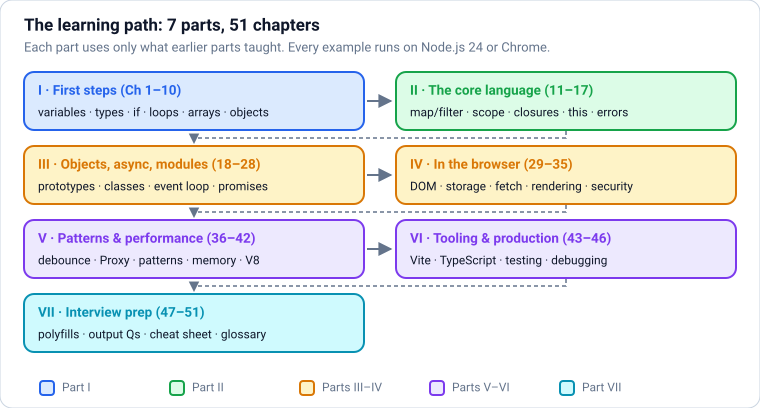
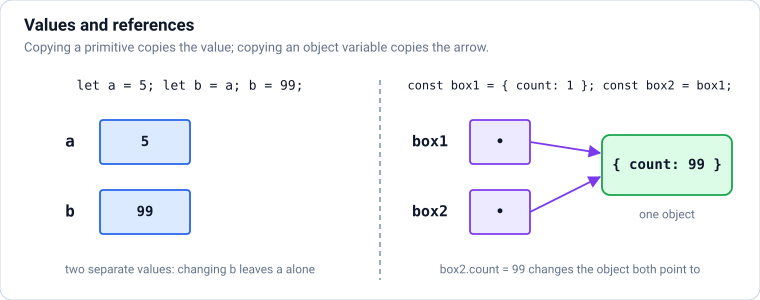
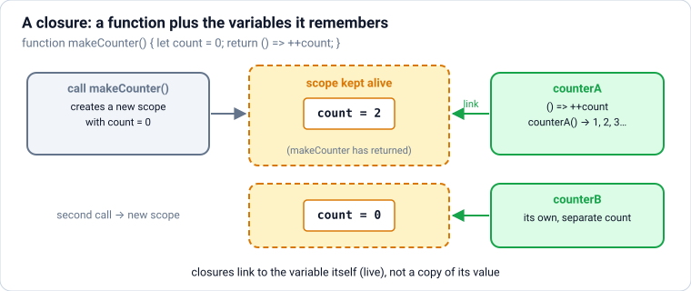
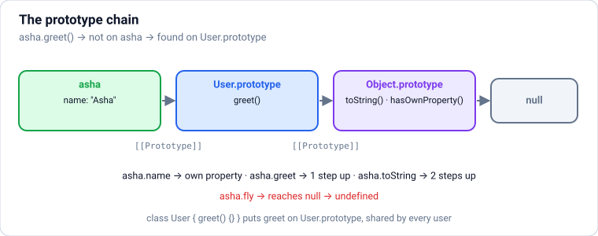
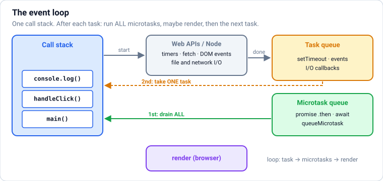
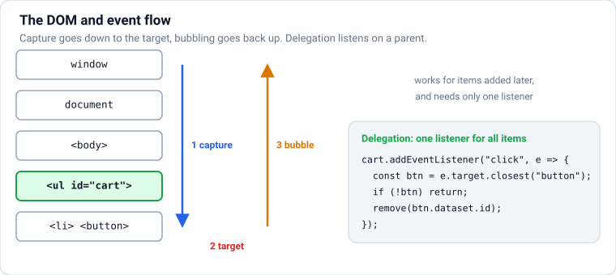
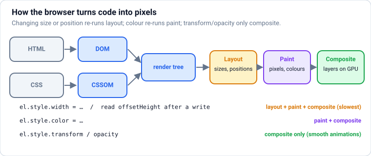
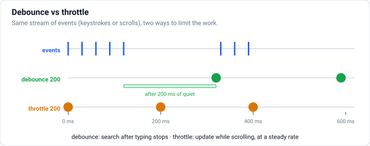

# JavaScript: A Step-by-Step Book

This book teaches JavaScript from the first `console.log` to production code and interviews: the language itself, how it runs asynchronous code, the browser and its APIs, patterns and performance, and the tools professionals use to build, test and debug. Each idea starts with the problem it solves and a small example you can check by eye.

**Three rules the book follows:**

1. **Nothing is used before it's taught.** No example uses a keyword, method or API that an earlier chapter hasn't explained: functions arrive in Chapter 10, `try`/`catch` in Chapter 17, classes in Chapter 20, promises in Chapter 24. Until Chapter 17, an example that crashes simply shows the error it throws.
2. **Every output is real.** Every block was run with **Node.js 24**; browser blocks (marked "runs in a browser") ran in **headless Chrome 156** against a local server. The text under **Output** is what they printed.
3. **Blocks in one chapter share their variables,** like cells in a notebook: a name defined in one block can be used in the next.

**What you need first:** nothing. Chapter 1 shows how to run JavaScript.

**How each chapter is laid out:**

| Part of the chapter | What it gives you |
|---|---|
| **You need / You'll learn** | which earlier chapters it builds on, and the goal |
| **N.1, N.2, …** | the idea in small steps: the problem, a small example, then the general rule |
| **Summary** | the key syntax on one screen, and the new terms with one-line definitions |
| **Exercises** | questions with hidden answers, then graded practice problems (🟢 Easy, 🟡 Medium, 🔴 Hard) from LeetCode's JavaScript problem set |

Chapter [51](#51-glossary-every-term-in-these-notes) lists every term from every chapter, A to Z.

**The parts:**

| Part | Chapters | What you can do after it |
|---|---|---|
| I. First Steps | 1–10 | store values, make decisions, loop, and use strings, arrays, objects and functions |
| II. The Core Language | 11–17 | transform data with array methods, and understand scope, closures, `this`, coercion and errors |
| III. Objects, Async and Modules | 18–28 | use prototypes and classes, collections and generators, write asynchronous code with promises and `async`/`await`, split code into modules |
| IV. JavaScript in the Browser | 29–35 | build pages with the DOM and events, store data, call APIs, and understand rendering, networking and security |
| V. Patterns and Performance | 36–42 | write functional and pattern-based code, manage memory, make code fast, and use the newest features |
| VI. Tooling, Testing and Production | 43–46 | set up a project, test it, debug it and make it reliable |
| VII. Interview Prep | 47–51 | implement the classic utilities yourself, predict tricky outputs and answer the common questions |

After this book: `typescript.md` adds types, `react.md` builds user interfaces and `nodejs.md` builds servers.

## Contents

**[Part I — First Steps](#part-i--first-steps)**

1. [Getting Started: What JavaScript Is and Your First Program](#1-getting-started-what-javascript-is-and-your-first-program)
2. [Variables: let, const and var](#2-variables-let-const-and-var)
3. [Data Types: Primitives, Objects, null and undefined](#3-data-types-primitives-objects-null-and-undefined)
4. [Operators: Arithmetic, Comparison, Logical, ?? and ?.](#4-operators-arithmetic-comparison-logical--and-)
5. [Decisions: if, else, switch and the Ternary Operator](#5-decisions-if-else-switch-and-the-ternary-operator)
6. [Loops: for, while, do...while, break and continue](#6-loops-for-while-dowhile-break-and-continue)
7. [Strings and Template Literals](#7-strings-and-template-literals)
8. [Arrays: Ordered Lists](#8-arrays-ordered-lists)
9. [Objects: Grouping Data with Keys](#9-objects-grouping-data-with-keys)
10. [Functions: Declarations, Expressions, Arrows and Parameters](#10-functions-declarations-expressions-arrows-and-parameters)

**[Part II — The Core Language](#part-ii--the-core-language)**

11. [Array Methods: map, filter, reduce, find and Friends](#11-array-methods-map-filter-reduce-find-and-friends)
12. [Destructuring, Spread and Rest](#12-destructuring-spread-and-rest)
13. [Scope, Hoisting and the Temporal Dead Zone](#13-scope-hoisting-and-the-temporal-dead-zone)
14. [Closures](#14-closures)
15. [The this Keyword, call, apply and bind](#15-the-this-keyword-call-apply-and-bind)
16. [Type Conversion, Coercion and == vs ===](#16-type-conversion-coercion-and--vs-)
17. [Error Handling: try, catch, throw and finally](#17-error-handling-try-catch-throw-and-finally)

**[Part III — Objects, Async and Modules](#part-iii--objects-async-and-modules)**

18. [Objects in Depth: Copying, Property Descriptors, Getters/Setters and Immutability](#18-objects-in-depth-copying-property-descriptors-getterssetters-and-immutability)
19. [Prototypes and Prototypal Inheritance](#19-prototypes-and-prototypal-inheritance)
20. [Classes: Fields, Private Members, Static, Inheritance and OOP](#20-classes-fields-private-members-static-inheritance-and-oop)
21. [Map, Set, WeakMap, WeakSet and Symbol](#21-map-set-weakmap-weakset-and-symbol)
22. [Iterators, Generators and Iterator Helpers](#22-iterators-generators-and-iterator-helpers)
23. [How JavaScript Runs: Call Stack, Event Loop, Timers and Callbacks](#23-how-javascript-runs-call-stack-event-loop-timers-and-callbacks)
24. [Promises and Microtasks](#24-promises-and-microtasks)
25. [async/await: Asynchronous Code That Reads Like Normal Code](#25-asyncawait-asynchronous-code-that-reads-like-normal-code)
26. [Modules: import, export, ESM vs CommonJS](#26-modules-import-export-esm-vs-commonjs)
27. [Regular Expressions](#27-regular-expressions)
28. [Dates, Time Zones, Numbers and Intl](#28-dates-time-zones-numbers-and-intl)

**[Part IV — JavaScript in the Browser](#part-iv--javascript-in-the-browser)**

29. [The DOM and Events](#29-the-dom-and-events)
30. [Browser Storage: localStorage, sessionStorage, Cookies and IndexedDB](#30-browser-storage-localstorage-sessionstorage-cookies-and-indexeddb)
31. [Web APIs: fetch, AbortController, URL, Observers and Workers](#31-web-apis-fetch-abortcontroller-url-observers-and-workers)
32. [Files, Blobs, Binary Data and Streams](#32-files-blobs-binary-data-and-streams)
33. [How Browsers Render Pages: Critical Path, Reflow, Web Components and Service Workers](#33-how-browsers-render-pages-critical-path-reflow-web-components-and-service-workers)
34. [Networking for Frontend Developers: From URL to Page, HTTP, Caching and CORS](#34-networking-for-frontend-developers-from-url-to-page-http-caching-and-cors)
35. [Frontend Security: XSS, CSRF, CSP, Prototype Pollution and the Supply Chain](#35-frontend-security-xss-csrf-csp-prototype-pollution-and-the-supply-chain)

**[Part V — Patterns and Performance](#part-v--patterns-and-performance)**

36. [Functional Programming: Pure Functions, Immutability, Currying and Composition](#36-functional-programming-pure-functions-immutability-currying-and-composition)
37. [Debounce and Throttle](#37-debounce-and-throttle)
38. [Proxy and Reflect](#38-proxy-and-reflect)
39. [Design Patterns in JavaScript](#39-design-patterns-in-javascript)
40. [Memory Management, Garbage Collection and Leaks](#40-memory-management-garbage-collection-and-leaks)
41. [Performance: How V8 Runs Your Code and How to Make It Fast](#41-performance-how-v8-runs-your-code-and-how-to-make-it-fast)
42. [Modern JavaScript: What's New in ES2020–ES2026](#42-modern-javascript-whats-new-in-es2020es2026)

**[Part VI — Tooling, Testing and Production](#part-vi--tooling-testing-and-production)**

43. [Tooling: npm, Package Managers, Bundlers, Linters and TypeScript](#43-tooling-npm-package-managers-bundlers-linters-and-typescript)
44. [Testing JavaScript: Unit, Integration and End-to-End](#44-testing-javascript-unit-integration-and-end-to-end)
45. [Debugging JavaScript](#45-debugging-javascript)
46. [Production-Grade JavaScript: Code Quality, Refactoring and Reliability](#46-production-grade-javascript-code-quality-refactoring-and-reliability)

**[Part VII — Interview Prep](#part-vii--interview-prep)**

47. [Polyfills and "Implement It Yourself" Questions](#47-polyfills-and-implement-it-yourself-questions)
48. [Output-Based Questions (Predict the Output)](#48-output-based-questions-predict-the-output)
49. [JavaScript Cheat Sheet](#49-javascript-cheat-sheet)
50. [The Most Asked JavaScript Interview Questions](#50-the-most-asked-javascript-interview-questions)
51. [Glossary: Every Term in These Notes](#51-glossary-every-term-in-these-notes)

---

# Part I — First Steps

Ten chapters on the building blocks every program uses: values and variables, operators, decisions, loops, text, lists, records and functions.

---

## 1. Getting Started: What JavaScript Is and Your First Program

**You need:** nothing. · **You'll learn:** what JavaScript is and where it runs, how to run it, how to print values, and how to read an error.



### 1.1 What JavaScript is

**JavaScript** (JS) is the programming language of the web. Every browser runs it to make pages interactive: buttons that respond, menus that open, maps you can drag. The same language also runs outside the browser:

| Where | Engine (the program that runs JS) | Adds |
|---|---|---|
| Browsers: Chrome, Edge, Firefox, Safari | V8, SpiderMonkey, JavaScriptCore | the page (`document`), `window`, network requests, storage |
| **Node.js** | V8 | files, servers, processes, the npm package registry |
| Deno, Bun | V8, JavaScriptCore | TypeScript out of the box, fast tooling |

The language itself is standardised as **ECMAScript**; a new edition comes out every June (ES2025, ES2026, …). Each environment adds its own **APIs** (application programming interfaces: ready-made functions you can call) on top.

### 1.2 Running JavaScript

Three ways:

- **Browser console:** open DevTools (F12, or Cmd+Option+I on a Mac), choose Console, type `console.log("hi")` and press Enter.
- **Node.js:** install the LTS ("long-term support") version from nodejs.org, save code in `hello.js`, and run `node hello.js` in a terminal. `node` alone opens a **REPL** (read-eval-print loop), where each line runs as you type it.
- **In a web page:** `<script type="module" src="app.js"></script>` inside the HTML.

### 1.3 Your first program

`console.log(…)` prints values, separated by spaces. Text goes in quotes; numbers don't:

```js
console.log("Hello, world!");
console.log("JavaScript", "is", "fun");
console.log(2 + 3, 10 / 4, 7 * 6);
```

**Output:**

```text
Hello, world!
JavaScript is fun
5 2.5 42
```

A **statement** is one instruction; it ends with `;` (often optional, but this book always writes it). `//` starts a **comment**, which JavaScript ignores; `/* … */` spans several lines. Names are case-sensitive: `console.Log` doesn't exist.

```js
// The next line prints a number
console.log(60 * 60 * 24);   /* seconds in a day */
```

**Output:**

```text
86400
```

### 1.4 Reading errors

When JavaScript can't run a line, it stops and **throws an error**: an object with a **type** (`name`) and a **message**. Calling a function that doesn't exist:

```js
console.lgo("typo");
```

**Output:**

```text
TypeError: console.lgo is not a function
```

Using a name that was never created:

```js
console.log(price);
```

**Output:**

```text
ReferenceError: price is not defined
```

| Error type | Usually means |
|---|---|
| `SyntaxError` | the code isn't valid JavaScript: a missing bracket or quote |
| `ReferenceError` | a name that doesn't exist: a typo, or never declared |
| `TypeError` | a value used the wrong way: calling something that isn't a function, reading from nothing |
| `RangeError` | a number out of range |

In Node.js, the full error also shows the file and line number. Read the type and message first: they usually name the problem.

### 1.5 Summary

```
console.log(a, b, c)        print values separated by spaces
// comment    /* comment */  ignored by JavaScript
node file.js                 run a file with Node.js;  node alone opens the REPL
errors: Name: message        SyntaxError, ReferenceError, TypeError, RangeError
```

**Key terms:**

- **JavaScript:** the programming language of web browsers, also used on servers and in apps.
- **ECMAScript:** the official standard that defines the JavaScript language; a new edition each year.
- **Engine:** the program that runs JavaScript code, such as V8 (Chrome, Node.js).
- **Node.js:** a program that runs JavaScript outside the browser, with access to files and the network.
- **API (application programming interface):** a set of ready-made functions and objects a program can use.
- **REPL (read-eval-print loop):** an interactive prompt that runs each line as you type it.
- **Statement:** one complete instruction, usually ending with `;`.
- **Comment:** text in code that JavaScript ignores, written after `//` or between `/*` and `*/`.
- **Error:** an object that JavaScript throws when it can't run code, with a type (`name`) and a `message`.

### Exercises

1. Print your name and city on one line, then the number of minutes in a week.
2. What error does `console.log("hi"` (a missing bracket) give, and which type is it?

<details>
<summary><b>Answers</b></summary>

```js
console.log("Asha", "Pune");
console.log(60 * 24 * 7);
```

**Output:**

```text
Asha Pune
10080
```

2. It's a `SyntaxError` (the exact message differs between engines, e.g. "missing ) after argument list"). Syntax errors are found before any line runs, so nothing prints.

</details>

**Practice:**

| # | Problem (LeetCode) | Difficulty |
|---|---|---|
| 1 | [2667. Create Hello World Function](https://leetcode.com/problems/create-hello-world-function/) | 🟢 Easy |

(LeetCode's JavaScript problems ask you to write a function; come back to this one after Chapter 10.)

**Learn more:** [MDN: JavaScript guide](https://developer.mozilla.org/en-US/docs/Web/JavaScript/Guide) · [javascript.info](https://javascript.info/) · [Node.js: introduction](https://nodejs.org/en/learn/getting-started/introduction-to-nodejs)

---

## 2. Variables: let, const and var

**You need:** Chapter 1. · **You'll learn:** to name values with `const` and `let`, why `var` is avoided, what a block is, and how to name things.

### 2.1 Naming a value

A **variable** is a name for a value, so you can use it later. `const` creates a name that always refers to the same value; `let` creates one you can **reassign** (point at a new value):

```js
const shopName = "ShopKart";
let visitors = 0;
visitors = visitors + 1;
visitors += 1;          // short for visitors = visitors + 1
visitors++;             // add 1
console.log(shopName, visitors);
```

**Output:**

```text
ShopKart 3
```

The `=` sign means "make the name on the left refer to the value on the right", not "is equal to". Reassigning a `const` throws an error:

```js
shopName = "Other";
```

**Output:**

```text
TypeError: Assignment to constant variable.
```

**Use `const` by default** and `let` only for values that change, such as counters. A reader then knows at a glance which names never change.

### 2.2 Declare before use

Declaring with `let` or `const` creates the name. Using a name before its declaration line throws a `ReferenceError`; Chapter 13 explains why:

```js
console.log(total);
let total = 5;
```

**Output:**

```text
ReferenceError: Cannot access 'total' before initialization
```

A `let` declared without a value holds `undefined`, JavaScript's "no value yet" (Chapter 3). A `const` must get its value immediately.

```js
let city;
console.log(city);
city = "Pune";
console.log(city);
```

**Output:**

```text
undefined
Pune
```

### 2.3 Blocks and scope

A **block** is code between `{` and `}`. A name declared with `let` or `const` inside a block exists only inside it: its **scope** is the block. `typeof` (Chapter 3) returns `"undefined"` for a name that doesn't exist here, instead of throwing:

```js
{
  const inside = "only in the block";
  console.log(inside);
}
console.log(typeof inside);
```

**Output:**

```text
only in the block
undefined
```

### 2.4 Why not var

`var` is the original keyword (from 1995). It ignores blocks, so the name leaks out:

```js
{
  var leaky = "I escaped";
}
console.log(leaky);
```

**Output:**

```text
I escaped
```

`var` also allows declaring the same name twice and can be used before its declaration line (it is `undefined` there instead of an error). All three behaviours hide bugs, so modern code uses only `let` and `const`. You'll still meet `var` in older code; Chapter 13 covers it fully.

### 2.5 Naming rules and style

- Letters, digits, `_` and `$`; not starting with a digit; case-sensitive (`total` and `Total` are different).
- Not a **reserved word**, a word with a fixed meaning in the language: `let`, `class`, `return`, `if`, …
- **camelCase** for variables and functions (`totalPrice`), **PascalCase** for classes (`ShoppingCart`), **UPPER_SNAKE_CASE** for fixed settings (`MAX_RETRIES`).
- Descriptive names: `price` beats `p`; `isLoggedIn` reads as a yes/no question.

```js
const 2fast = true;
```

**Output:**

```text
SyntaxError: Invalid or unexpected token
```

### 2.6 Summary

```
const name = value;     can't be reassigned (default choice)
let name = value;       can be reassigned;  let x; holds undefined
x += 1;  x++;           update shortcuts
{ … }                   a block: let/const inside it exist only there
var                     old: ignores blocks, allows redeclaring; avoid
```

**Key terms:**

- **Variable:** a name that refers to a value.
- **Declaration:** the statement that creates a variable, such as `let x = 1;`.
- **Reassign:** make an existing variable refer to a new value with `=`.
- **const:** declares a variable that can't be reassigned.
- **let:** declares a block-scoped variable that can be reassigned.
- **var:** the old way to declare variables; ignores blocks and allows redeclaring.
- **Block:** a group of statements between `{` and `}`.
- **Scope:** the part of the code where a name exists and can be used.
- **Reserved word:** a word with a fixed meaning in JavaScript that can't be used as a name, such as `let` or `if`.
- **camelCase:** a naming style where words are joined and each word after the first starts with a capital letter, as in `totalPrice`.

### Exercises

1. A pen costs ₹20 and the quantity starts at 1. Increase the quantity three times, then print the total. Which variables should be `const`?
2. Which of these names are valid: `user_name`, `$price`, `first-name`, `class`, `_count2`?

<details>
<summary><b>Answers</b></summary>

```js
const PEN_PRICE = 20;
let quantity = 1;
quantity++;
quantity++;
quantity++;
console.log(PEN_PRICE * quantity);
```

**Output:**

```text
80
```

1. The price never changes, so it's `const`; the quantity changes, so it's `let`.
2. Valid: `user_name`, `$price`, `_count2`. Invalid: `first-name` (a minus sign isn't allowed) and `class` (a reserved word).

</details>

**Learn more:** [MDN: let](https://developer.mozilla.org/en-US/docs/Web/JavaScript/Reference/Statements/let) · [MDN: const](https://developer.mozilla.org/en-US/docs/Web/JavaScript/Reference/Statements/const) · [javascript.info: variables](https://javascript.info/variables)

---

## 3. Data Types: Primitives, Objects, null and undefined

**You need:** Chapter 2. · **You'll learn:** the eight types of value, how numbers really work (and why `0.1 + 0.2` isn't `0.3`), `null` versus `undefined`, and the difference between copying a value and copying a reference.

### 3.1 Every value has a type

`typeof value` names a value's **type**:

```js
console.log(typeof 42, typeof 3.14, typeof "hi", typeof true);
console.log(typeof undefined, typeof 10n, typeof Symbol("id"));
```

**Output:**

```text
number number string boolean
undefined bigint symbol
```

There are seven **primitive** types (simple values that can't be changed) and one **object** type for everything else:

| Type | Examples | Meaning |
|---|---|---|
| `number` | `42`, `3.14`, `-7`, `NaN`, `Infinity` | all numbers, whole or decimal |
| `bigint` | `10n` | whole numbers of any size |
| `string` | `"hi"`, `'hi'` | text (Chapter 7) |
| `boolean` | `true`, `false` | yes or no |
| `undefined` | `undefined` | no value yet |
| `null` | `null` | deliberately empty |
| `symbol` | `Symbol("id")` | a unique id (Chapter 21) |
| `object` | `{ name: "Asha" }`, `[1, 2]` | collections: objects (Chapter 9), arrays (Chapter 8), functions, dates, … |

### 3.2 Numbers

JavaScript has one `number` type for whole numbers and decimals, stored as a 64-bit **floating-point** number: a binary fraction times a power of two. Most decimals, like 0.1, have no exact binary form, so tiny rounding errors appear:

```js
console.log(0.1 + 0.2, 0.1 + 0.2 === 0.3);
console.log((0.1 + 0.2).toFixed(2));
```

**Output:**

```text
0.30000000000000004 false
0.30
```

`===` compares two values (Chapter 4). `.toFixed(2)` rounds for display and returns text; the dot calls a **method**, a function attached to a value. For money, store whole paise or cents (`1999`, not `19.99`).

Whole numbers are exact only up to `Number.MAX_SAFE_INTEGER`, 2⁵³ − 1. Beyond it, neighbouring integers can't be told apart; a **BigInt** (a number followed by `n`) is exact at any size:

```js
console.log(Number.MAX_SAFE_INTEGER);
console.log(2 ** 53, 2 ** 53 + 1);
console.log(2n ** 53n + 1n);
```

**Output:**

```text
9007199254740991
9007199254740992 9007199254740992
9007199254740993n
```

`**` is "to the power of". Two special values: **`NaN`** ("not a number"), the result of invalid maths, and **`Infinity`**, from dividing by zero. `NaN` is the only value not equal to itself, so test for it with `Number.isNaN`:

```js
console.log("abc" * 2, 1 / 0, -1 / 0);
console.log(NaN === NaN, Number.isNaN("abc" * 2));
```

**Output:**

```text
NaN Infinity -Infinity
false true
```

### 3.3 undefined and null

Both mean "no value", with different intentions:

- **`undefined`:** nothing assigned yet. A declared variable without a value, a missing property, a function that returns nothing.
- **`null`:** set on purpose by a programmer to say "empty".

```js
let notSetYet;
const user = { name: "Asha", phone: null };
console.log(notSetYet, user.phone, user.email);
```

**Output:**

```text
undefined null undefined
```

`user` is an **object**: a set of named values (Chapter 9). `user.phone` reads one; `user.email` doesn't exist, so it's `undefined`.

One famous quirk: `typeof null` is `"object"`, a bug from 1995 that can't be fixed without breaking old websites. Check for null with `x === null`:

```js
console.log(typeof null, null === null);
```

**Output:**

```text
object true
```

### 3.4 Values and references

Primitives are **immutable**: no operation changes a primitive; operations make new values. Copying a primitive copies the value, so the two names are independent:

```js
let a = 5;
let b = a;
b = 99;
console.log(a, b);
```

**Output:**

```text
5 99
```

An object is different. A variable holds a **reference** to it (where it lives in memory), so copying the variable copies the reference, and both names point to the same object:

```js
const box1 = { count: 1 };
const box2 = box1;
box2.count = 99;
console.log(box1.count, box1 === box2);
console.log({ count: 99 } === { count: 99 });
```

**Output:**

```text
99 true
false
```

`===` on objects asks "the same object?", not "the same contents?", so two separately made objects with equal contents aren't `===`.



### 3.5 Summary

```
typeof x        "number" "bigint" "string" "boolean" "undefined" "symbol" "object" "function";  typeof null → "object"
0.1 + 0.2       0.30000000000000004: binary floating point; money in whole paise
2 ** 53 + 1     unsafe; use BigInt: 2n ** 53n + 1n
NaN             invalid maths; NaN !== NaN; test with Number.isNaN(x)
undefined       not set yet;   null: deliberately empty
primitives      copied by value;  objects: variables hold references, === compares identity
```

**Key terms:**

- **Type:** the kind of a value, which decides what you can do with it; `typeof` names it.
- **Primitive:** a simple, immutable value: a number, bigint, string, boolean, undefined, null or symbol.
- **Object:** a collection of named values; arrays, functions and dates are objects too.
- **Floating point:** the binary format for decimal numbers, which can't store most decimals exactly.
- **Method:** a function attached to a value or object, called with a dot: `x.toFixed(2)`.
- **BigInt:** a whole number of any size, written with an `n` suffix, such as `10n`.
- **NaN (not a number):** the number value produced by invalid maths; not equal to anything, even itself.
- **Infinity:** the number value for results too large to represent, such as `1 / 0`.
- **undefined:** the value of anything not yet assigned.
- **null:** a value that a programmer sets to mean "deliberately empty".
- **Immutable:** can't be changed after it's created.
- **Reference:** what an object variable holds: a pointer to the object, not the object itself.

### Exercises

1. Predict the output of `typeof NaN`, `typeof null`, `0.1 * 3 === 0.3` and `9007199254740993 === 9007199254740992`. Check by running them.
2. A price is ₹19.99 and a customer buys 3. Compute the total exactly using paise.

<details>
<summary><b>Answers</b></summary>

```js
console.log(typeof NaN, typeof null, 0.1 * 3 === 0.3, 9007199254740993 === 9007199254740992);
const pricePaise = 1999;
console.log((pricePaise * 3) / 100);
```

**Output:**

```text
number object false true
59.97
```

1. `NaN` is of type `number` (an invalid number is still a number). `0.1 * 3` is `0.30000000000000004`. The last two numbers are beyond the safe range, so they become the same floating-point number.
2. Multiply whole paise, then divide by 100 only for display.

</details>

**Learn more:** [MDN: JavaScript data types](https://developer.mozilla.org/en-US/docs/Web/JavaScript/Guide/Data_structures) · [javascript.info: data types](https://javascript.info/types) · [What every programmer should know about floating point](https://floating-point-gui.de/)

---

## 4. Operators: Arithmetic, Comparison, Logical, ?? and ?.

**You need:** Chapter 3. · **You'll learn:** to calculate, compare and combine conditions; which values count as false; and the two modern safety operators: `??` for defaults and `?.` for reading from values that may be missing.

### 4.1 Arithmetic

An **operator** combines values into a new value. Besides `+ - * /` and `**`, `%` gives the **remainder** after division, and `Math` holds maths functions:

```js
console.log(7 / 2, 7 % 2, 2 ** 10);
console.log(Math.floor(7 / 2), Math.round(2.5), Math.max(3, 9, 4), Math.abs(-5));
```

**Output:**

```text
3.5 1 1024
3 3 9 5
```

`Math.floor` rounds down, `Math.round` to the nearest whole number. `x % 2 === 0` tests for an even number.

`+` also joins text. If either side is a string, `+` joins, while `-`, `*` and `/` always convert to numbers. It's evaluated left to right:

```js
console.log("5" + 3, "5" - 3, 5 + 3 + "px", "px" + 5 + 3);
console.log(Number("5") + 3);
```

**Output:**

```text
53 2 8px px53
8
```

`Number(text)` converts text to a number; use it before arithmetic on text from a form or a file.

### 4.2 Comparison

`===` ("strictly equal") is true when both values have the same type and value; `!==` is its opposite. `<`, `>`, `<=`, `>=` compare numbers, or strings character by character by their codes, where all capitals come before lower case:

```js
console.log(5 === 5, 5 === "5", 5 !== "5");
console.log(10 > 9, "apple" < "banana", "Zebra" < "apple");
```

**Output:**

```text
true false true
true true true
```

There is also a loose `==`, which converts types before comparing, with rules that surprise everyone (`"" == 0` is true). Always use `===`; Chapter 16 explains `==`.

### 4.3 Logical operators and truthiness

`&&` ("and") is true when both sides are; `||` ("or") when at least one is; `!` ("not") flips true and false:

```js
const age = 25;
const hasTicket = false;
console.log(age >= 18 && hasTicket, age >= 18 || hasTicket, !hasTicket);
```

**Output:**

```text
false true true
```

Any value can stand where a boolean is expected. These eight values count as false and are called **falsy**:

```
false   0   -0   0n   ""   null   undefined   NaN
```

Everything else is **truthy**, including `"0"`, `"false"` and empty objects and arrays. `!!x` turns a value into its boolean:

```js
console.log(!!0, !!"", !!"0", !!"false", !!{});
```

**Output:**

```text
false false true true true
```

`&&` and `||` actually return one of their operands, not necessarily `true` or `false`. `a || b` returns `a` if it's truthy, otherwise `b`; `a && b` returns `a` if it's falsy, otherwise `b`. They also **short-circuit**: the right side isn't evaluated when the left side decides the result.

```js
console.log("Asha" || "Guest", "" || "Guest", 0 || 10);
console.log("logged in" && "show menu", null && "never");
```

**Output:**

```text
Asha Guest 10
show menu null
```

### 4.4 Defaults with ??

`a || b` is often used for defaults, but it also replaces valid values like `0` and `""`. The **nullish coalescing** operator `a ?? b` uses `b` only when `a` is `null` or `undefined`:

```js
const savedVolume = 0;
console.log(savedVolume || 50, savedVolume ?? 50);
console.log(null ?? "default", undefined ?? "default", 0 ?? "default");
```

**Output:**

```text
50 0
default default 0
```

Prefer `??` for defaults; use `||` only when every falsy value should be replaced.

### 4.5 Reading safely with ?.

Reading a property from `null` or `undefined` throws:

```js
const order = { id: 1, customer: null };
console.log(order.customer.city);
```

**Output:**

```text
TypeError: Cannot read properties of null (reading 'city')
```

**Optional chaining**, `?.`, stops and returns `undefined` when the value on its left is `null` or `undefined`:

```js
const order = { id: 1, customer: null };
const order2 = { id: 2, customer: { city: "Pune" } };
console.log(order.customer?.city, order2.customer?.city);
console.log(order.customer?.city ?? "unknown city");
```

**Output:**

```text
undefined Pune
unknown city
```

`?.` and `??` together read a value that might be missing and fall back to a default. Don't scatter `?.` everywhere, though: if a value should always exist, an error tells you about a bug sooner.

### 4.6 Assignment operators and precedence

`x += 5` is short for `x = x + 5`; likewise `-=`, `*=`, `/=`, `**=`. Three logical versions assign only in some cases:

```js
const settings = { theme: null, pageSize: 0 };
settings.theme ??= "light";      // assign if null or undefined
settings.pageSize ||= 20;        // assign if falsy: replaces the valid 0!
console.log(settings);
```

**Output:**

```text
{ theme: 'light', pageSize: 20 }
```

`&&=` assigns only if the current value is truthy.

When an expression mixes operators, **precedence** decides the order: `**` first, then `*` `/` `%`, then `+` `-`, then comparisons, then `&&`, then `||` and `??`. Use brackets whenever the order isn't obvious. JavaScript even refuses to mix `??` with `||` without them:

```js
console.log(2 + 3 * 4, (2 + 3) * 4, 2 ** 3 ** 2);
```

**Output:**

```text
14 20 512
```

`**` groups from the right: `2 ** 3 ** 2` is `2 ** 9`.

### 4.7 Summary

```
+ - * / % **         % remainder; ** power (groups right to left);  "5" + 3 → "53", "5" - 3 → 2
=== !==              compare type and value (never ==)
&& || !              and, or, not; && and || return an operand and short-circuit
falsy                false 0 -0 0n "" null undefined NaN;  everything else truthy
a ?? b               b only if a is null/undefined
a?.b                 undefined instead of an error when a is null/undefined
+= -= ??= ||= &&=    assignment shortcuts
```

**Key terms:**

- **Operator:** a symbol that combines values into a new value, such as `+` or `===`.
- **Remainder (%):** what's left after whole-number division: `7 % 2` is 1.
- **Strict equality (===):** true when two values have the same type and value, without conversion.
- **Falsy:** a value treated as false in a condition: `false`, `0`, `-0`, `0n`, `""`, `null`, `undefined`, `NaN`.
- **Truthy:** any value that isn't falsy.
- **Short-circuit:** skipping the right side of `&&`, `||` or `??` because the left side already decides the result.
- **Nullish coalescing (??):** returns the right side only when the left side is `null` or `undefined`.
- **Nullish:** either `null` or `undefined`.
- **Optional chaining (?.):** reads a property, or calls a method, only if the value on the left isn't nullish; otherwise gives `undefined`.
- **Precedence:** the rules that decide which operator in an expression runs first.

### Exercises

1. An API returns `const api = { volume: 0, prefs: { lang: "" } }`. Read the volume with a default of 50, the language with a default of `"en"` (an empty string means "not chosen"), and `api.prefs.theme` with a default of `"dark"`.
2. Predict, then check: `"3" * "4"`, `true + 1`, `"b" + "a" + +"a" + "a"`.

<details>
<summary><b>Answers</b></summary>

```js
const api = { volume: 0, prefs: { lang: "" } };
console.log(api.volume ?? 50, api.prefs?.lang || "en", api.prefs?.theme ?? "dark");
console.log("3" * "4", true + 1, "b" + "a" + +"a" + "a");
```

**Output:**

```text
0 en dark
12 2 baNaNa
```

1. `0` is a valid volume, so `??` keeps it; an empty language should be replaced, so `||` is right there.
2. `*` converts both strings to numbers; `true` becomes 1; `+"a"` is the number conversion of `"a"`, which is `NaN`, then joined as text: "baNaNa".

</details>

**Learn more:** [MDN: expressions and operators](https://developer.mozilla.org/en-US/docs/Web/JavaScript/Guide/Expressions_and_operators) · [MDN: operator precedence](https://developer.mozilla.org/en-US/docs/Web/JavaScript/Reference/Operators/Operator_precedence)

---

## 5. Decisions: if, else, switch and the Ternary Operator

**You need:** Chapter 4. · **You'll learn:** to run code only when a condition holds, to choose between many cases, and to pick between two values in one expression.

### 5.1 if and else

`if (condition) { … }` runs the block only when the condition is truthy. `else if` tests another condition; `else` catches everything left. Only the first matching branch runs:

```js
const total = 250;
let fee;
if (total >= 499) {
  fee = 0;
} else if (total >= 200) {
  fee = 20;
} else {
  fee = 40;
}
console.log(fee);
```

**Output:**

```text
20
```

Order matters: test the narrowest condition first. Always use braces, even for one line, so a line added later can't fall outside the `if` by accident.

Conditions can rely on truthiness (Chapter 4.3): `if (name)` means "if name isn't empty". Be careful when `0` or `""` are valid values:

```js
const stock = 0;
if (stock) {
  console.log("in stock");
} else {
  console.log("out of stock");
}
```

**Output:**

```text
out of stock
```

A classic typo: `if (x = 5)` *assigns* 5 (truthy), so the branch always runs. Comparisons use `===`.

### 5.2 Choosing a value: the ternary operator

When both branches only pick a value, the **ternary operator** `condition ? valueIfTrue : valueIfFalse` does it in one expression:

```js
const age = 17;
const label = age >= 18 ? "adult" : "minor";
console.log(label, stock > 0 ? "buy now" : "notify me");
```

**Output:**

```text
minor notify me
```

Avoid nesting ternaries more than one level: an `if`/`else` chain is clearer.

### 5.3 switch

`switch` compares one value against several fixed cases with `===`. Execution starts at the matching `case` and continues until a `break`; `default` runs when nothing matches. Stacked cases share code:

```js
const status = "processing";
let message;
switch (status) {
  case "pending":
  case "processing":
    message = "Preparing your order";
    break;
  case "shipped":
    message = "On the way";
    break;
  default:
    message = "Unknown status";
}
console.log(message);
```

**Output:**

```text
Preparing your order
```

Forgetting `break` makes execution **fall through** into the following cases:

```js
const day = 3;
let dayName;
switch (day) {
  case 1: dayName = "Mon";
  case 2: dayName = "Tue";
  case 3: dayName = "Wed";
  case 4: dayName = "Thu";
}
console.log(dayName);
```

**Output:**

```text
Thu
```

It matched 3, set "Wed", then fell through to `case 4`.

### 5.4 Lookup tables instead of long chains

When each case just maps a value to a result, an object (Chapter 9) is shorter than a `switch`; `??` supplies the default:

```js
const LABELS = { pending: "Preparing", shipped: "On the way", delivered: "Delivered" };
console.log(LABELS["shipped"], LABELS["lost"] ?? "Unknown");
```

**Output:**

```text
On the way Unknown
```

### 5.5 Summary

```
if (a) { … } else if (b) { … } else { … }    first truthy branch runs; always use braces
cond ? x : y                                  pick a value
switch (v) { case 1: … break; default: … }    === matching; without break, falls through
TABLE[key] ?? fallback                        lookup table instead of a long switch
```

**Key terms:**

- **Condition:** an expression whose truthiness decides whether code runs.
- **Branch:** one of the alternative blocks of an `if`/`else` or `switch`.
- **Ternary operator:** `condition ? a : b`, an expression that gives `a` if the condition is truthy and `b` otherwise.
- **switch:** a statement that jumps to the `case` matching a value.
- **Fall through:** in a `switch`, running into the next `case` because there was no `break`.
- **Lookup table:** an object that maps keys to results, used instead of a chain of conditions.

### Exercises

1. A score of 82 should become a grade: A (≥ 90), B (≥ 75), C (≥ 50), F otherwise, and "invalid" below 0 or above 100. Write the `if` chain.
2. Rewrite this with a ternary: `let msg; if (count === 1) { msg = "1 item"; } else { msg = count + " items"; }`.

<details>
<summary><b>Answers</b></summary>

```js
const score = 82;
let grade;
if (score < 0 || score > 100) {
  grade = "invalid";
} else if (score >= 90) {
  grade = "A";
} else if (score >= 75) {
  grade = "B";
} else if (score >= 50) {
  grade = "C";
} else {
  grade = "F";
}
const count = 3;
const msg = count === 1 ? "1 item" : count + " items";
console.log(grade, msg);
```

**Output:**

```text
B 3 items
```

1. Check the invalid range first, then the grades from highest to lowest.

</details>

**Learn more:** [MDN: if...else](https://developer.mozilla.org/en-US/docs/Web/JavaScript/Reference/Statements/if...else) · [MDN: switch](https://developer.mozilla.org/en-US/docs/Web/JavaScript/Reference/Statements/switch) · [MDN: conditional operator](https://developer.mozilla.org/en-US/docs/Web/JavaScript/Reference/Operators/Conditional_operator)

---

## 6. Loops: for, while, do...while, break and continue

**You need:** Chapter 5. · **You'll learn:** to repeat code a set number of times or until a condition changes, and to leave or skip rounds of a loop.

### 6.1 The for loop

A **loop** repeats a block. The classic `for` loop has three parts in brackets: a start (`let i = 1`), a condition checked before each round (`i <= 3`), and an update after each round (`i++`):

```js
for (let i = 1; i <= 3; i++) {
  console.log("round", i);
}
```

**Output:**

```text
round 1
round 2
round 3
```

Each run of the block is an **iteration**. Trace it: `i` starts at 1; 1 ≤ 3, so print and add 1; … when `i` is 4, the condition fails and the loop ends. Declare the counter with `let`, so it exists only inside the loop.

A loop that adds up numbers keeps a running total in a variable declared before the loop:

```js
let sum = 0;
for (let n = 1; n <= 100; n++) {
  sum += n;
}
console.log(sum);
```

**Output:**

```text
5050
```

### 6.2 while and do...while

`while (condition) { … }` repeats as long as the condition is truthy. Use it when you don't know the number of rounds in advance, such as "double until above 1000":

```js
let value = 1;
let steps = 0;
while (value <= 1000) {
  value *= 2;
  steps++;
}
console.log(value, steps);
```

**Output:**

```text
1024 10
```

Something inside the loop must eventually make the condition false; otherwise you have an **infinite loop** and the program hangs.

`do { … } while (condition)` checks the condition after the block, so the block always runs at least once:

```js
let tries = 10;
do {
  console.log("try", tries);
  tries++;
} while (tries < 3);
```

**Output:**

```text
try 10
```

### 6.3 break and continue

`break` leaves the loop immediately; `continue` skips the rest of the current round and moves to the next:

```js
let oddSum = 0;
for (let n = 1; n <= 10; n++) {
  if (n % 2 === 0) {
    continue;                // skip even numbers
  }
  oddSum += n;
}
let firstBig = 0;
for (let n = 1; n <= 100; n++) {
  if (n * n > 50) {
    firstBig = n;
    break;                   // stop at the first match
  }
}
console.log(oddSum, firstBig);
```

**Output:**

```text
25 8
```

### 6.4 Nested loops and labels

A loop inside a loop runs the inner loop completely for each round of the outer one, so the inner block runs (outer rounds × inner rounds) times:

```js
for (let row = 1; row <= 3; row++) {
  let line = "";
  for (let col = 1; col <= 3; col++) {
    line += row * col + " ";
  }
  console.log(line);
}
```

**Output:**

```text
1 2 3 
2 4 6 
3 6 9
```

`break` only leaves the innermost loop. To leave both, put a **label** (a name and a colon) before the outer loop and `break` that label:

```js
outer: for (let r = 0; r < 3; r++) {
  for (let c = 0; c < 3; c++) {
    if (r * c === 2) {
      console.log("found at", r, c);
      break outer;
    }
  }
}
```

**Output:**

```text
found at 1 2
```

Labels are rare; putting the search in a function and using `return` (Chapter 10) usually reads better.

### 6.5 Summary

```
for (let i = 0; i < n; i++) { … }    counting loop: start; condition; update
while (cond) { … }                    repeat while cond is truthy (something must change it)
do { … } while (cond)                 runs at least once
break  continue                       leave the loop  /  skip to the next round
label: for (…) { … break label; }     leave an outer loop
```

Chapter 8 adds `for...of` for the items of an array, and Chapter 9 adds `for...in` for the keys of an object.

**Key terms:**

- **Loop:** code that repeats a block.
- **Iteration:** one run of a loop's block.
- **for loop:** a loop with a start, a condition and an update in its header.
- **while loop:** a loop that repeats as long as its condition is truthy.
- **do...while loop:** a loop that checks its condition after each round, so it runs at least once.
- **Infinite loop:** a loop whose condition never becomes false.
- **break:** a statement that leaves the current loop (or `switch`) immediately.
- **continue:** a statement that skips to the next iteration of the loop.
- **Label:** a name before a loop that `break` or `continue` can refer to.

### Exercises

1. Print a triangle of `*` with 4 rows (`*`, `**`, `***`, `****`) using nested loops.
2. Find the first number above 100 divisible by both 7 and 9, with a `while` loop.
3. FizzBuzz: for 1 to 15, print "Fizz" for multiples of 3, "Buzz" for multiples of 5, "FizzBuzz" for both, otherwise the number.

<details>
<summary><b>Answers</b></summary>

```js
for (let row = 1; row <= 4; row++) {
  let stars = "";
  for (let i = 0; i < row; i++) {
    stars += "*";
  }
  console.log(stars);
}
let candidate = 101;
while (candidate % 7 !== 0 || candidate % 9 !== 0) {
  candidate++;
}
console.log(candidate);
let fizz = "";
for (let n = 1; n <= 15; n++) {
  if (n % 15 === 0) {
    fizz += "FizzBuzz ";
  } else if (n % 3 === 0) {
    fizz += "Fizz ";
  } else if (n % 5 === 0) {
    fizz += "Buzz ";
  } else {
    fizz += n + " ";
  }
}
console.log(fizz);
```

**Output:**

```text
*
**
***
****
126
1 2 Fizz 4 Buzz Fizz 7 8 Fizz Buzz 11 Fizz 13 14 FizzBuzz
```

3. Test 15 (both) first: otherwise the "multiple of 3" branch would catch it.

</details>

**Practice:**

| # | Problem (LeetCode) | Difficulty |
|---|---|---|
| 1 | [412. Fizz Buzz](https://leetcode.com/problems/fizz-buzz/) | 🟢 Easy |

**Learn more:** [MDN: loops and iteration](https://developer.mozilla.org/en-US/docs/Web/JavaScript/Guide/Loops_and_iteration) · [javascript.info: loops](https://javascript.info/while-for)

---

## 7. Strings and Template Literals

**You need:** Chapter 6. · **You'll learn:** to build, read, search, cut and change text; to put values into text with template literals; and why an emoji can have length 2.

### 7.1 Creating strings

A **string** is a sequence of characters, written in double quotes, single quotes (identical) or backticks. A backslash starts an **escape sequence** for characters you can't type directly: `\n` (new line), `\t` (tab), `\"`, `\\`:

```js
const single = 'It\'s here';
const double = "Say \"hi\"";
console.log(single, double, "line 1\nline 2");
```

**Output:**

```text
It's here Say "hi" line 1
line 2
```

### 7.2 Template literals

A **template literal** uses backticks and can contain `${expression}`, which inserts the value of any expression, and can span lines:

```js
const name = "Asha";
const items = 3;
const total = 1497;
const message = `Hi ${name}, you have ${items} items.
Total: ₹${total} (${items > 2 ? "free shipping" : "₹40 shipping"})`;
console.log(message);
```

**Output:**

```text
Hi Asha, you have 3 items.
Total: ₹1497 (free shipping)
```

This is called **interpolation**. It reads better than joining with `+` and avoids forgotten spaces.

### 7.3 Characters and length

Positions start at 0. `s[i]` reads one character, `s.at(-1)` counts from the end, and `s.length` is the number of characters:

```js
const city = "Bengaluru";
console.log(city.length, city[0], city[city.length - 1], city.at(-1), city[20]);
```

**Output:**

```text
9 B u u undefined
```

Reading past the end gives `undefined`, not an error. Strings are immutable: `city[0] = "b"` silently does nothing, and every method below returns a **new** string.

A `for` loop can visit each character; Chapter 8 shows the shorter `for...of`:

```js
let vowels = 0;
for (let i = 0; i < city.length; i++) {
  if ("aeiou".includes(city[i])) {
    vowels++;
  }
}
console.log(vowels);
```

**Output:**

```text
4
```

### 7.4 Searching and cutting

```js
console.log(city.includes("galu"), city.startsWith("Ben"), city.endsWith("ru"));
console.log(city.indexOf("u"), city.lastIndexOf("u"), city.indexOf("z"));
console.log(city.slice(0, 4), city.slice(4), city.slice(-4));
```

**Output:**

```text
true true true
6 8 -1
Beng aluru luru
```

`indexOf` returns the first position of a match, or −1 if there's none. `slice(start, end)` returns the part from `start` up to but **not including** `end`; negative numbers count from the end; leaving out `end` means "to the end".

### 7.5 Changing case, trimming, padding and replacing

```js
console.log(city.toUpperCase(), city.toLowerCase(), city);
console.log("  padded  ".trim() + "|", "7".padStart(3, "0"), "ab".repeat(3));
console.log("cat hat cat".replace("cat", "dog"), "|", "cat hat cat".replaceAll("cat", "dog"));
```

**Output:**

```text
BENGALURU bengaluru Bengaluru
padded| 007 ababab
dog hat cat | dog hat dog
```

`city` itself is unchanged. `replace` replaces only the first match; `replaceAll` replaces every one. (Both also accept patterns, Chapter 27.)

### 7.6 Splitting and joining

`split(separator)` cuts a string into an **array** of pieces (Chapter 8); `join(separator)` glues an array back into a string:

```js
const csvLine = "pen,20,blue";
const parts = csvLine.split(",");
console.log(parts, parts[1], parts.join(" | "));
console.log("a,b,,c".split(","), "hi".split(""));
```

**Output:**

```text
[ 'pen', '20', 'blue' ] 20 pen | 20 | blue
[ 'a', 'b', '', 'c' ] [ 'h', 'i' ]
```

### 7.7 Converting between strings and numbers

```js
console.log(String(42) + "!", (42).toString(2), Number("3.5"), Number("3.5kg"));
console.log(parseInt("42px"), parseFloat("3.5kg"), parseInt("ff", 16));
```

**Output:**

```text
42! 101010 3.5 NaN
42 3.5 255
```

`Number` rejects anything that isn't entirely a number (`NaN`); `parseInt` and `parseFloat` read as far as they can. `toString(2)` and `parseInt(text, 16)` convert to and from other bases.

### 7.8 Unicode and length

Text is stored as **UTF-16**: each character is one or two 16-bit **code units**. Most characters take one, but emoji and some rare characters take two, and `length` counts code units:

```js
console.log("hi".length, "👍".length, "👍🏽".length);
```

**Output:**

```text
2 2 4
```

`👍🏽` is a thumbs-up plus a skin-tone modifier, each two code units. Chapter 8 shows how to count real characters; Chapter 28's `Intl.Segmenter` counts what a reader sees as one character.

### 7.9 Comparing strings

`===` compares exactly; `<` compares by character codes, so capitals sort before lower case, and accented letters sort after `z`. `localeCompare` compares the way a language does: it returns a negative number, 0 or a positive number:

```js
console.log("Zebra" < "apple", "é" > "z", "é".localeCompare("z"), "a".localeCompare("B"));
```

**Output:**

```text
true true -1 -1
```

### 7.10 Summary

```
"…"  '…'  `…${expr}…`        quotes; template literals interpolate and span lines
s.length  s[i]  s.at(-1)       length (UTF-16 code units), character, from the end
includes startsWith endsWith indexOf     search (indexOf → -1 if absent)
slice(start, end)              end excluded; negatives count from the end
toUpperCase toLowerCase trim padStart repeat replace replaceAll      return new strings
split(sep) → array;  arr.join(sep) → string
Number("3.5")  parseInt("42px")  String(42)  n.toString(2)
a.localeCompare(b)             language-aware comparison
```

**Key terms:**

- **String:** a sequence of characters; immutable.
- **Escape sequence:** a backslash followed by a character, standing for a special character such as `\n` (new line).
- **Template literal:** a string in backticks that can contain `${…}` expressions and span lines.
- **Interpolation:** inserting the value of an expression into a string.
- **Index:** the position of an item, counting from 0.
- **UTF-16:** the encoding JavaScript strings use: each character is one or two 16-bit code units.
- **Code unit:** one 16-bit piece of a UTF-16 string; `length` counts these.

### Exercises

1. Turn `"  asha RAO  "` into `"Asha Rao"` without loops beyond what you need: trim, split on the space, and capitalise each part.
2. Format the order number 42 as `"ORD-00042"`.
3. Count how many times the letter "a" appears in "banana" with a loop.

<details>
<summary><b>Answers</b></summary>

```js
const raw = "  asha RAO  ".trim().split(" ");
const first = raw[0][0].toUpperCase() + raw[0].slice(1).toLowerCase();
const last = raw[1][0].toUpperCase() + raw[1].slice(1).toLowerCase();
console.log(`${first} ${last}`);
console.log(`ORD-${String(42).padStart(5, "0")}`);
let countA = 0;
for (let i = 0; i < "banana".length; i++) {
  if ("banana"[i] === "a") {
    countA++;
  }
}
console.log(countA);
```

**Output:**

```text
Asha Rao
ORD-00042
3
```

1. Chapter 11 shows how to do this for any number of words with `map`.

</details>

**Practice:**

| # | Problem (LeetCode) | Difficulty |
|---|---|---|
| 1 | [344. Reverse String](https://leetcode.com/problems/reverse-string/) | 🟢 Easy |
| 2 | [125. Valid Palindrome](https://leetcode.com/problems/valid-palindrome/) | 🟢 Easy |
| 3 | [58. Length of Last Word](https://leetcode.com/problems/length-of-last-word/) | 🟢 Easy |

**Learn more:** [MDN: String](https://developer.mozilla.org/en-US/docs/Web/JavaScript/Reference/Global_Objects/String) · [MDN: template literals](https://developer.mozilla.org/en-US/docs/Web/JavaScript/Reference/Template_literals) · [javascript.info: strings](https://javascript.info/string)

---

## 8. Arrays: Ordered Lists

**You need:** Chapters 6–7. · **You'll learn:** to store lists, read and change items by position, add and remove items at either end or in the middle, search, copy, and loop with `for...of`.

### 8.1 Creating and reading

An **array** is an ordered list of values in square brackets. Each value is an **element**, numbered from 0:

```js
const scores = [90, 72, 85];
console.log(scores, scores.length, scores[0], scores.at(-1), scores[10]);
console.log(typeof scores, Array.isArray(scores));
```

**Output:**

```text
[ 90, 72, 85 ] 3 90 85 undefined
object true
```

Arrays are objects (`typeof` says so); `Array.isArray` is the reliable test. Elements can be of any type, mixed, including other arrays:

```js
const grid = [[1, 2], [3, 4]];
console.log(grid[1][0], [1, "two", true, null].length);
```

**Output:**

```text
3 4
```

### 8.2 Changing elements

Assigning to a position replaces that element. A `const` array can still change: `const` fixes which array the name refers to, not its contents (Chapter 3.4):

```js
const colours = ["red", "green", "blue"];
colours[1] = "lime";
console.log(colours);
```

**Output:**

```text
[ 'red', 'lime', 'blue' ]
```

### 8.3 Adding and removing

| Method | Does | Returns |
|---|---|---|
| `push(x, …)` / `pop()` | add / remove at the end | new length / removed element |
| `unshift(x, …)` / `shift()` | add / remove at the start | new length / removed element |
| `splice(start, count, …items)` | remove `count` elements at `start`, insert `items` there | array of removed elements |

```js
const cart = ["pen", "notebook"];
cart.push("bag");
cart.unshift("stickers");
console.log(cart);
console.log(cart.pop(), cart.shift(), cart);
```

**Output:**

```text
[ 'stickers', 'pen', 'notebook', 'bag' ]
bag stickers [ 'pen', 'notebook' ]
```

`push` and `pop` are fast. `shift` and `unshift` must move every other element by one position, so they're slow on very large arrays.

```js
const letters = ["a", "b", "c", "d", "e"];
const removed = letters.splice(1, 2, "X");
console.log(removed, letters);
```

**Output:**

```text
[ 'b', 'c' ] [ 'a', 'X', 'd', 'e' ]
```

`push`, `pop`, `shift`, `unshift` and `splice` all **mutate** (change) the array in place.

### 8.4 Searching and slicing

```js
const nums = [10, 9, 1, 100, 9];
console.log(nums.includes(9), nums.indexOf(9), nums.lastIndexOf(9), nums.indexOf(7));
console.log(nums.slice(1, 3), nums.slice(-2), nums.join("-"));
```

**Output:**

```text
true 1 4 -1
[ 9, 1 ] [ 100, 9 ] 10-9-1-100-9
```

These don't change `nums`. `slice` works as for strings: end excluded, negatives from the end.

### 8.5 Sorting, and the sort trap

`sort()` sorts in place, and `reverse()` reverses in place. With no arguments, `sort` compares elements **as strings**, so numbers sort by their first digit:

```js
const unsorted = [10, 9, 1, 100];
unsorted.sort();
console.log(unsorted, ["pear", "apple", "fig"].sort());
```

**Output:**

```text
[ 1, 10, 100, 9 ] [ 'apple', 'fig', 'pear' ]
```

For numbers, `sort` needs a compare function; Chapter 10 shows `sort((a, b) => a - b)`.

The **copying** versions, added in ES2023, return a new array and leave the original alone: `toSorted()`, `toReversed()`, `toSpliced()`, and `with(index, value)` to replace one element:

```js
const base = [3, 1, 2];
console.log(base.toSorted(), base.toReversed(), base.with(0, 99), base);
```

**Output:**

```text
[ 1, 2, 3 ] [ 2, 1, 3 ] [ 99, 1, 2 ] [ 3, 1, 2 ]
```

Prefer the copying versions when other code may hold the same array.

### 8.6 Copies share references

Assigning an array to another name doesn't copy it (Chapter 3.4). The **spread syntax** `[...arr]` builds a new array with the same elements; `slice()` does too. Chapter 12 covers spread fully.

```js
const original = [1, 2, 3];
const alias = original;
const copy = [...original];
alias.push(4);
console.log(original.length, copy.length);
```

**Output:**

```text
4 3
```

This is a **shallow copy**: if elements are objects, both arrays share them (Chapter 18).

### 8.7 for...of

`for (const x of array)` gives each element in turn, without an index. It works on strings too, one real character at a time:

```js
for (const colour of colours) {
  console.log(colour.toUpperCase());
}
let chars = 0;
for (const ch of "👍🏽ok") {
  chars++;
}
console.log(chars);
```

**Output:**

```text
RED
LIME
BLUE
4
```

`for...of` steps through **code points** (whole characters): the thumb, the skin tone, `o` and `k` make 4, while `"👍🏽ok".length` counts 6 code units. Use a classic `for` loop when you need the index, and `for...of` otherwise.

### 8.8 Building arrays

```js
console.log(Array.from("abc"), Array.of(7), [1, 2, 3].fill(0));
const squares = [];
for (let i = 1; i <= 5; i++) {
  squares.push(i * i);
}
console.log(squares);
```

**Output:**

```text
[ 'a', 'b', 'c' ] [ 7 ] [ 0, 0, 0 ]
[ 1, 4, 9, 16, 25 ]
```

`Array.from` builds an array from anything that can be looped over; `Array.of` from its arguments; `fill(value)` overwrites every element. Chapter 11 shows `Array.from` with a function, the usual way to build arrays like 0, 1, 4, 9, 16.

### 8.9 Summary

```
[a, b, c]  arr.length  arr[i]  arr.at(-1)  Array.isArray(x)
push pop / unshift shift / splice(start, count, …items)    mutate in place
includes indexOf slice join                                   don't mutate
sort() reverse()            in place; sort() compares as strings!
toSorted toReversed toSpliced with(i, x)                      copying versions
[...arr]  arr.slice()       shallow copies;  const b = a is NOT a copy
for (const x of arr)        each element (each character for strings)
```

**Key terms:**

- **Array:** an ordered list of values, numbered from 0.
- **Element:** one value in an array.
- **Mutate:** change an object or array in place.
- **Spread syntax:** `...` before an array (or other iterable) inside `[ ]` or a call, expanding it into separate elements.
- **Shallow copy:** a new array or object whose elements are the same values (so shared objects stay shared).
- **for...of:** a loop over the values of an array, string or other iterable.
- **Code point:** a whole Unicode character, made of one or two UTF-16 code units.

### Exercises

1. Given `const temps = [31, 35, 29, 40, 33]`, print a copy with `29` replaced by `30`, and the copy reversed, without changing `temps`.
2. Find the largest number in `[4, 18, 7, 21, 3]` with a `for...of` loop.
3. Remove the duplicates from `["a", "b", "a", "c", "b"]` with a loop and `includes`.

<details>
<summary><b>Answers</b></summary>

```js
const temps = [31, 35, 29, 40, 33];
const fixed = temps.with(temps.indexOf(29), 30);
console.log(fixed, fixed.toReversed(), temps);
let largest = -Infinity;
for (const n of [4, 18, 7, 21, 3]) {
  if (n > largest) {
    largest = n;
  }
}
console.log(largest);
const unique = [];
for (const item of ["a", "b", "a", "c", "b"]) {
  if (!unique.includes(item)) {
    unique.push(item);
  }
}
console.log(unique);
```

**Output:**

```text
[ 31, 35, 30, 40, 33 ] [ 33, 40, 30, 35, 31 ] [ 31, 35, 29, 40, 33 ]
21
[ 'a', 'b', 'c' ]
```

2. Starting from `-Infinity` means any number replaces it.
3. `includes` scans the whole array, so this takes about n² steps; Chapter 21's `Set` does it in one pass.

</details>

**Practice:**

| # | Problem (LeetCode) | Difficulty |
|---|---|---|
| 1 | [2619. Array Prototype Last](https://leetcode.com/problems/array-prototype-last/) | 🟢 Easy |
| 2 | [27. Remove Element](https://leetcode.com/problems/remove-element/) | 🟢 Easy |
| 3 | [88. Merge Sorted Array](https://leetcode.com/problems/merge-sorted-array/) | 🟢 Easy |

**Learn more:** [MDN: Array](https://developer.mozilla.org/en-US/docs/Web/JavaScript/Reference/Global_Objects/Array) · [javascript.info: arrays](https://javascript.info/array)

---

## 9. Objects: Grouping Data with Keys

**You need:** Chapter 8. · **You'll learn:** to group related values under names, read and change them, loop over them, nest objects and arrays, and convert objects to and from JSON text.

### 9.1 Creating and reading

An **object** groups values under names. Each name–value pair is a **property**; the name is its **key**:

```js
const user = { name: "Asha", age: 29, city: "Pune", tags: ["plus", "early"] };
console.log(user.name, user["city"], user.tags[0], user.email);
```

**Output:**

```text
Asha Pune plus undefined
```

**Dot notation** (`user.name`) is the usual way. **Bracket notation** (`user["city"]`) takes any expression, so it works for keys held in variables or keys that aren't valid names:

```js
const field = "age";
const odd = { "first name": "Asha", 2: "two" };
console.log(user[field], odd["first name"], odd[2]);
```

**Output:**

```text
29 Asha two
```

Keys are always strings (or symbols, Chapter 21): the key `2` is stored as `"2"`. A missing property reads as `undefined`.

### 9.2 Adding, changing and deleting

```js
user.email = "asha@example.com";     // add
user.age += 1;                       // change
delete user.city;                    // remove
console.log(user);
console.log("email" in user, Object.hasOwn(user, "city"));
```

**Output:**

```text
{
  name: 'Asha',
  age: 30,
  tags: [ 'plus', 'early' ],
  email: 'asha@example.com'
}
true false
```

`"key" in obj` and `Object.hasOwn(obj, "key")` test whether a property exists, even one whose value is `undefined`. (`in` also sees inherited properties, Chapter 19.)

### 9.3 Shorthand and computed keys

When a variable has the same name as the key, write it once. A key in square brackets is **computed** from an expression:

```js
const name = "Ravi";
const age = 31;
const statusKey = "status";
const ravi = { name, age, [statusKey]: "active", [`is${"Admin"}`]: false };
console.log(ravi);
```

**Output:**

```text
{ name: 'Ravi', age: 31, status: 'active', isAdmin: false }
```

### 9.4 Looping over an object

`Object.keys`, `Object.values` and `Object.entries` return arrays of keys, values and `[key, value]` pairs. Loop over them with `for...of`:

```js
const prices = { pen: 20, bag: 899, notebook: 60 };
console.log(Object.keys(prices), Object.values(prices));
for (const pair of Object.entries(prices)) {
  console.log(pair[0], "costs", pair[1]);
}
```

**Output:**

```text
[ 'pen', 'bag', 'notebook' ] [ 20, 899, 60 ]
pen costs 20
bag costs 899
notebook costs 60
```

The older `for (const key in obj)` loops over keys too, but also over inherited ones (Chapter 19), so the `Object.*` methods are safer. Never use `for...in` on arrays.

```js
for (const key in prices) {
  console.log(key);
}
```

**Output:**

```text
pen
bag
notebook
```

`Object.fromEntries` turns pairs back into an object, which lets you transform an object through an array:

```js
const pairs = Object.entries(prices);
const cheap = [];
for (const pair of pairs) {
  if (pair[1] < 100) {
    cheap.push(pair);
  }
}
console.log(Object.fromEntries(cheap));
```

**Output:**

```text
{ pen: 20, notebook: 60 }
```

Keys come out in insertion order, except that integer-like keys come first, in ascending order.

### 9.5 Nesting

Objects and arrays nest freely, which is how most real data looks:

```js
const order = {
  id: 90312,
  customer: { name: "Asha", address: { city: "Pune" } },
  items: [{ sku: "P1", qty: 2 }, { sku: "B7", qty: 1 }],
};
console.log(order.customer.address.city, order.items[1].sku, order.items.length);
console.log(order.customer?.phone?.number);
```

**Output:**

```text
Pune B7 2
undefined
```

### 9.6 Methods

A property can also hold a function; it's then called a **method** and is called with a dot, as with `console.log` or `JSON.parse` below. Chapter 10 teaches functions, and Chapter 15 how methods use `this` to reach their own object.

### 9.7 JSON

**JSON** (JavaScript Object Notation) is the text format for sending data between programs. `JSON.stringify` turns a value into JSON text; `JSON.parse` turns text back into a value:

```js
const text = JSON.stringify({ id: 1, items: [{ sku: "P1" }], paid: true, note: undefined });
console.log(text, typeof text);
const back = JSON.parse(text);
console.log(back.items[0].sku);
console.log(JSON.stringify({ a: 1, b: [1, 2] }, null, 2));
```

**Output:**

```text
{"id":1,"items":[{"sku":"P1"}],"paid":true} string
P1
{
  "a": 1,
  "b": [
    1,
    2
  ]
}
```

JSON keys need double quotes. It has no `undefined` (dropped), no functions, no dates (they become strings) and no BigInt. The third argument of `stringify` indents the output. Parsing invalid text throws:

```js
JSON.parse("{name: 'Asha'}");
```

**Output:**

```text
SyntaxError: Expected property name or '}' in JSON at position 1 (line 1 column 2)
```

### 9.8 Summary

```
{ key: value }   obj.key   obj["key"]   obj[variable]   missing → undefined
obj.k = v   delete obj.k   "k" in obj   Object.hasOwn(obj, "k")
{ name, age, [expr]: v }                  shorthand and computed keys
Object.keys / values / entries(obj)      arrays;  Object.fromEntries(pairs) → object
for (const key in obj)                    keys, including inherited ones; never for arrays
JSON.stringify(v, null, 2)   JSON.parse(text)
```

**Key terms:**

- **Property:** a key–value pair in an object.
- **Key:** the name of a property; always a string or a symbol.
- **Dot notation:** reading a property with `obj.key`.
- **Bracket notation:** reading a property with `obj[expression]`, for keys in variables or keys that aren't valid names.
- **Computed key:** a key in an object literal written as `[expression]`, whose value becomes the key.
- **for...in:** a loop over an object's keys, including inherited ones.
- **JSON (JavaScript Object Notation):** a text format for data, based on JavaScript object and array literals.
- **Serialize:** turn a value into text (or bytes) for storing or sending; `JSON.stringify` serializes.

### Exercises

1. Count how many times each word appears in `"the cat and the hat and the bat"`, using an object as the counter.
2. From `const stock = { pen: 0, bag: 4, ink: 0, pad: 12 }`, print the names of the items that are out of stock.

<details>
<summary><b>Answers</b></summary>

```js
const counts = {};
for (const word of "the cat and the hat and the bat".split(" ")) {
  counts[word] = (counts[word] ?? 0) + 1;
}
console.log(counts);
const stock = { pen: 0, bag: 4, ink: 0, pad: 12 };
const empty = [];
for (const item of Object.keys(stock)) {
  if (stock[item] === 0) {
    empty.push(item);
  }
}
console.log(empty);
```

**Output:**

```text
{ the: 3, cat: 1, and: 2, hat: 1, bat: 1 }
[ 'pen', 'ink' ]
```

1. `counts[word] ?? 0` treats a word seen for the first time as 0.

</details>

**Practice:**

| # | Problem (LeetCode) | Difficulty |
|---|---|---|
| 1 | [2727. Is Object Empty](https://leetcode.com/problems/is-object-empty/) | 🟢 Easy |

**Learn more:** [MDN: working with objects](https://developer.mozilla.org/en-US/docs/Web/JavaScript/Guide/Working_with_objects) · [MDN: JSON](https://developer.mozilla.org/en-US/docs/Web/JavaScript/Reference/Global_Objects/JSON) · [javascript.info: objects](https://javascript.info/object)

---

## 10. Functions: Declarations, Expressions, Arrows and Parameters

**You need:** Chapters 1–9. · **You'll learn:** to package code into reusable functions, the three ways to write them, defaults and rest parameters, passing functions to other functions, and recursion.

### 10.1 Declaring and calling

A **function** is a named, reusable block of code. It takes inputs called **parameters**, and `return` sends a result back to the caller:

```js
function shippingFee(total) {
  if (total >= 499) {
    return 0;
  }
  return 40;
}
console.log(shippingFee(250), shippingFee(600));
```

**Output:**

```text
40 0
```

`shippingFee(250)` **calls** the function: the **argument** 250 becomes the parameter `total`, the body runs, and the call is replaced by the returned value. `return` also ends the function immediately, so the first `return 0` skips the rest. A function without `return` returns `undefined`.

Returning early for special cases is called a **guard clause**; it keeps the main logic unindented.

### 10.2 Parameters and arguments

Missing arguments are `undefined`; extra ones are ignored. A **default parameter** (`= value`) is used when the argument is missing or `undefined`:

```js
function greet(name = "friend", greeting = "Hello") {
  return `${greeting}, ${name}!`;
}
console.log(greet(), greet("Ravi"), greet("Ravi", "Hi", "extra"), greet(undefined, "Hey"));
```

**Output:**

```text
Hello, friend! Hello, Ravi! Hi, Ravi! Hey, friend!
```

A **rest parameter** (`...name`, last in the list) collects all remaining arguments into an array:

```js
function sum(...nums) {
  let total = 0;
  for (const n of nums) {
    total += n;
  }
  return total;
}
console.log(sum(), sum(1, 2, 3), sum(...[10, 20]));
```

**Output:**

```text
0 6 30
```

In the last call, `...[10, 20]` is spread syntax (Chapter 8.6): it passes the array's elements as separate arguments.

Arguments are passed **by sharing**: the function gets the same values, so for objects it gets the same reference and can change the caller's object:

```js
function addTag(user, tag) {
  user.tags.push(tag);
}
const asha = { tags: [] };
addTag(asha, "vip");
console.log(asha);
```

**Output:**

```text
{ tags: [ 'vip' ] }
```

Changing arguments like this is a **side effect**, an effect beyond the return value. Functions without side effects that return the same output for the same input are called **pure**; they're easy to test and reuse, so prefer them.

### 10.3 Function expressions and arrow functions

Functions are values: they can be stored in variables, passed around and returned. A **function expression** creates one inside an expression:

```js
const cube = function (n) {
  return n ** 3;
};
console.log(cube(3), typeof cube);
```

**Output:**

```text
27 function
```

An **arrow function** is a shorter expression. With a single expression after `=>`, its value is returned automatically; with braces, you need `return`. One parameter needs no brackets; returning an object literal needs round brackets around it:

```js
const double = (n) => n * 2;
const add = (a, b) => a + b;
const half = n => n / 2;
const makeUser = (name, age) => ({ name, age });
const describe = (n) => {
  const kind = n % 2 === 0 ? "even" : "odd";
  return `${n} is ${kind}`;
};
console.log(double(21), add(2, 3), half(9), makeUser("Asha", 29), describe(7));
```

**Output:**

```text
42 5 4.5 { name: 'Asha', age: 29 } 7 is odd
```

Arrows differ from other functions in how they treat `this` (Chapter 15). Use arrows for short callbacks and declarations for named, top-level functions.

### 10.4 Hoisting

A function **declaration** can be called before the line where it's written, because declarations are processed before the code runs (**hoisting**, Chapter 13). Expressions and arrows assigned to `const` can't:

```js
console.log(square(4));
function square(n) {
  return n * n;
}
```

**Output:**

```text
16
```

```js
console.log(triple(4));
const triple = (n) => n * 3;
```

**Output:**

```text
ReferenceError: Cannot access 'triple' before initialization
```

### 10.5 Functions as arguments: callbacks

A function passed to another function, to be called by it, is a **callback**. Functions that take or return functions are **higher-order functions**:

```js
function applyTwice(fn, value) {
  return fn(fn(value));
}
console.log(applyTwice(double, 5), applyTwice((s) => s + "!", "hey"));
```

**Output:**

```text
20 hey!!
```

The most common callback fixes Chapter 8's sort trap. `sort(compare)` calls `compare(a, b)` for pairs of elements; a negative result puts `a` first, positive puts `b` first, 0 keeps their order:

```js
const nums = [10, 9, 1, 100];
console.log(nums.toSorted((a, b) => a - b), nums.toSorted((a, b) => b - a));
const people = [{ name: "Ravi", age: 31 }, { name: "Asha", age: 29 }, { name: "Meera", age: 35 }];
console.log(people.toSorted((a, b) => a.age - b.age));
console.log(people.toSorted((a, b) => a.name.localeCompare(b.name)));
```

**Output:**

```text
[ 1, 9, 10, 100 ] [ 100, 10, 9, 1 ]
[
  { name: 'Asha', age: 29 },
  { name: 'Ravi', age: 31 },
  { name: 'Meera', age: 35 }
]
[
  { name: 'Asha', age: 29 },
  { name: 'Meera', age: 35 },
  { name: 'Ravi', age: 31 }
]
```

`a - b` is negative when `a` is smaller, so this sorts ascending; `b - a` sorts descending. JavaScript's sort is **stable**: equal elements keep their original order.

A function can also return a function:

```js
function multiplier(factor) {
  return (n) => n * factor;
}
const times3 = multiplier(3);
console.log(times3(10), multiplier(5)(2));
```

**Output:**

```text
30 10
```

The returned function still uses `factor` after `multiplier` has finished; Chapter 14 explains how (closures).

### 10.6 Recursion

A **recursive** function calls itself on a smaller problem until it reaches a **base case** that it answers directly:

```js
function factorial(n) {
  if (n <= 1) {
    return 1;                      // base case
  }
  return n * factorial(n - 1);     // smaller problem
}
console.log(factorial(5));
```

**Output:**

```text
120
```

`factorial(5)` = 5 × `factorial(4)` = 5 × 4 × `factorial(3)` … = 5 × 4 × 3 × 2 × 1 = 120. Each pending call waits on the **call stack** (Chapter 23). Without a base case, the stack overflows:

```js
function forever(n) {
  return forever(n + 1);
}
forever(0);
```

**Output:**

```text
RangeError: Maximum call stack size exceeded
```

Recursion suits nested data (trees, folders, nested arrays); for simple counting, a loop is faster and can't overflow.

### 10.7 Function properties

A function is an object with a `name` and a `length` (the number of parameters before any default or rest):

```js
console.log(factorial.name, factorial.length, greet.length, sum.length, typeof factorial);
```

**Output:**

```text
factorial 1 0 0 function
```

### 10.8 Summary

```
function f(a, b = 1, ...rest) { return …; }   declaration: hoisted; default; rest array
const f = function (a) { … };                  function expression
const f = (a, b) => a + b;                     arrow: one expression is returned
const f = a => ({ key: a });                   object literal needs ( )
f(...array)                                    spread an array into arguments
arr.toSorted((a, b) => a - b)                  numeric sort with a compare callback
recursion: base case + smaller problem         else RangeError: call stack exceeded
```

**Key terms:**

- **Function:** a reusable block of code that takes parameters and can return a value.
- **Parameter:** a name in a function's definition for an input.
- **Argument:** the actual value passed to a parameter when calling a function.
- **Return value:** the value a function sends back with `return`; `undefined` if there's none.
- **Guard clause:** an early `return` that handles a special case at the top of a function.
- **Default parameter:** a parameter's value when its argument is missing or `undefined`.
- **Rest parameter:** a last parameter written `...name` that collects the remaining arguments into an array.
- **Side effect:** anything a function does besides returning a value, such as changing an argument or printing.
- **Pure function:** a function whose result depends only on its arguments and that has no side effects.
- **Function expression:** a function created inside an expression, often assigned to a variable.
- **Arrow function:** a short function expression written with `=>`, without its own `this`.
- **Hoisting:** processing declarations before code runs, so function declarations can be called before their line.
- **Callback:** a function passed to another function to be called later.
- **Higher-order function:** a function that takes or returns a function.
- **Compare function:** a callback for `sort` that returns a negative, zero or positive number to order two elements.
- **Stable sort:** a sort that keeps equal elements in their original order.
- **Recursion:** a function calling itself on a smaller version of the problem.
- **Base case:** the input a recursive function answers directly, which stops the recursion.

### Exercises

1. Write `formatPrice(amount, currency = "INR")` returning e.g. `"INR 1499.00"`.
2. Write `compose(f, g)` returning a function that computes `f(g(x))`, and use it with `double` and `(n) => n + 1`.
3. Write a recursive `sumDigits(n)`: `sumDigits(1234)` is 10.

<details>
<summary><b>Answers</b></summary>

```js
function formatPrice(amount, currency = "INR") {
  return `${currency} ${amount.toFixed(2)}`;
}
const compose = (f, g) => (x) => f(g(x));
const doubleThenInc = compose((n) => n + 1, double);
function sumDigits(n) {
  if (n < 10) {
    return n;
  }
  return (n % 10) + sumDigits(Math.floor(n / 10));
}
console.log(formatPrice(1499), doubleThenInc(5), sumDigits(1234));
```

**Output:**

```text
INR 1499.00 11 10
```

2. `compose` returns an arrow that remembers `f` and `g` (a closure, Chapter 14). `g` runs first.
3. The last digit is `n % 10`; the rest is `Math.floor(n / 10)`.

</details>

**Practice:**

| # | Problem (LeetCode) | Difficulty |
|---|---|---|
| 1 | [2667. Create Hello World Function](https://leetcode.com/problems/create-hello-world-function/) | 🟢 Easy |
| 2 | [2703. Return Length of Arguments Passed](https://leetcode.com/problems/return-length-of-arguments-passed/) | 🟢 Easy |
| 3 | [2629. Function Composition](https://leetcode.com/problems/function-composition/) | 🟢 Easy |
| 4 | [509. Fibonacci Number](https://leetcode.com/problems/fibonacci-number/) | 🟢 Easy |

**Learn more:** [MDN: functions](https://developer.mozilla.org/en-US/docs/Web/JavaScript/Guide/Functions) · [MDN: arrow functions](https://developer.mozilla.org/en-US/docs/Web/JavaScript/Reference/Functions/Arrow_functions) · [javascript.info: functions](https://javascript.info/function-basics)

---

# Part II — The Core Language

Seven chapters on the ideas that make JavaScript code short and correct: array methods, destructuring and spread, scope, closures, `this`, type conversion and errors.

---

## 11. Array Methods: map, filter, reduce, find and Friends

**You need:** Chapters 8 and 10. · **You'll learn:** to transform, select, search and summarise arrays with callbacks instead of loops, and to chain those steps into a pipeline.

### 11.1 From loops to methods

Most loops over arrays do one of a few jobs: transform every element, keep some elements, find one, or combine all into one value. Each job has a method that takes a callback, so the code says *what* it does:

| Job | Method | Returns |
|---|---|---|
| do something with each | `forEach(fn)` | `undefined` |
| transform each | `map(fn)` | new array, same length |
| keep some | `filter(fn)` | new array of the elements where `fn` is truthy |
| find one | `find(fn)`, `findIndex(fn)`, `findLast(fn)` | first match (or `undefined` / −1) |
| test | `some(fn)`, `every(fn)` | boolean |
| combine all | `reduce(fn, start)` | one value |

Each callback receives `(element, index, array)`; most use only the element. All of these leave the original array unchanged.

The data for this chapter:

```js
const products = [
  { name: "Pen", price: 20, category: "stationery", stock: 120 },
  { name: "Bag", price: 899, category: "travel", stock: 0 },
  { name: "Notebook", price: 60, category: "stationery", stock: 40 },
  { name: "Bottle", price: 349, category: "travel", stock: 15 },
];
```

### 11.2 forEach and map

`forEach` calls the function for each element, for side effects such as printing:

```js
products.forEach((p, i) => console.log(i, p.name));
```

**Output:**

```text
0 Pen
1 Bag
2 Notebook
3 Bottle
```

`map` builds a new array from the callback's return values:

```js
const names = products.map((p) => p.name);
const withTax = products.map((p) => ({ name: p.name, price: Math.round(p.price * 1.18) }));
console.log(names, withTax[1]);
```

**Output:**

```text
[ 'Pen', 'Bag', 'Notebook', 'Bottle' ] { name: 'Bag', price: 1061 }
```

Use `map` when you want the results and `forEach` when you don't. `forEach` can't be stopped early with `break`; use `for...of` (or `some`/`find`) when you need to stop.

### 11.3 filter, find and friends

```js
const inStock = products.filter((p) => p.stock > 0);
console.log(inStock.map((p) => p.name));
console.log(products.find((p) => p.price > 100).name, products.findIndex((p) => p.price > 1000));
console.log(products.findLast((p) => p.category === "stationery").name);
console.log(products.some((p) => p.stock === 0), products.every((p) => p.price < 1000));
```

**Output:**

```text
[ 'Pen', 'Notebook', 'Bottle' ]
Bag -1
Notebook
true true
```

`find` stops at the first match, so it's cheaper than `filter(…)[0]`. `some` stops at the first `true` and `every` at the first `false`. On an empty array, `some` is `false` and `every` is `true` ("all of nothing" holds).

### 11.4 reduce

`reduce(fn, start)` combines all elements into one value. It keeps an **accumulator**: it starts as `start`, and for each element the callback receives `(accumulator, element)` and returns the next accumulator. The final accumulator is the result:

```js
const prices = [20, 899, 60, 349];
const total = prices.reduce((acc, price) => acc + price, 0);
console.log(total);
```

**Output:**

```text
1328
```

Trace it: acc = 0 → 0 + 20 = 20 → 20 + 899 = 919 → 919 + 60 = 979 → 979 + 349 = 1328.

The accumulator can be anything, such as an object of counts:

```js
const perCategory = products.reduce((acc, p) => {
  acc[p.category] = (acc[p.category] ?? 0) + 1;
  return acc;
}, {});
console.log(perCategory);
```

**Output:**

```text
{ stationery: 2, travel: 2 }
```

Always pass the start value: without it, `reduce` uses the first element as the start, and an empty array throws:

```js
[].reduce((a, b) => a + b);
```

**Output:**

```text
TypeError: Reduce of empty array with no initial value
```

When a `reduce` gets hard to read, a `for...of` loop is a fine alternative.

### 11.5 Grouping

`Object.groupBy(array, fn)` (ES2024) groups elements into an object by the key the callback returns:

```js
const byCategory = Object.groupBy(products, (p) => p.category);
console.log(Object.keys(byCategory), byCategory.travel.map((p) => p.name));
```

**Output:**

```text
[ 'stationery', 'travel' ] [ 'Bag', 'Bottle' ]
```

### 11.6 Flattening

`flat(depth)` joins nested arrays into one; `flatMap(fn)` is `map` followed by `flat(1)`, handy when each element produces several results:

```js
console.log([1, [2, [3, [4]]]].flat(), [1, [2, [3, [4]]]].flat(Infinity));
const sentences = ["hello world", "good morning"];
console.log(sentences.flatMap((s) => s.split(" ")));
```

**Output:**

```text
[ 1, 2, [ 3, [ 4 ] ] ] [ 1, 2, 3, 4 ]
[ 'hello', 'world', 'good', 'morning' ]
```

### 11.7 Building arrays with Array.from

`Array.from(source, fn)` builds an array and maps it in one step. `{ length: 5 }` is an object with only a length, which `Array.from` treats as 5 empty slots:

```js
console.log(Array.from({ length: 5 }, (_, i) => i * i));
console.log(Array.from("abc", (ch) => ch.toUpperCase()));
```

**Output:**

```text
[ 0, 1, 4, 9, 16 ]
[ 'A', 'B', 'C' ]
```

`_` is a conventional name for a parameter you don't use.

### 11.8 Chaining into a pipeline

Each method returns an array, so calls chain: a pipeline that reads top to bottom.

```js
const report = products
  .filter((p) => p.stock > 0)
  .toSorted((a, b) => b.price - a.price)
  .map((p) => `${p.name}: ₹${p.price}`)
  .join(", ");
console.log(report);
```

**Output:**

```text
Bottle: ₹349, Notebook: ₹60, Pen: ₹20
```

Each step makes a new array. For a few thousand elements that costs nothing noticeable; for millions in a hot loop, one `for` loop is faster (Chapter 41).

### 11.9 Summary

```
arr.forEach((x, i) => …)            side effects; returns undefined; can't break
arr.map(x => …)                      new array of results
arr.filter(x => cond)                new array of matches
arr.find / findIndex / findLast      first match;  some / every → boolean
arr.reduce((acc, x) => next, start)  one value; always give start
Object.groupBy(arr, x => key)        { key: [elements] }
arr.flat(depth)  arr.flatMap(fn)     flatten
Array.from({ length: n }, (_, i) => …)
```

**Key terms:**

- **map:** an array method that returns a new array of the callback's results.
- **filter:** an array method that returns a new array of the elements for which the callback is truthy.
- **find:** an array method that returns the first element for which the callback is truthy.
- **reduce:** an array method that combines all elements into one value with an accumulator.
- **Accumulator:** the running value that `reduce` passes from one step to the next.
- **Method chaining:** calling methods one after another on each result: `a.filter(…).map(…)`.
- **Pipeline:** a sequence of steps, each transforming the previous step's result.
- **Object.groupBy:** groups an array's elements into an object of arrays by a key function.
- **Flatten:** turn nested arrays into one array.

### Exercises

1. From `products`, get the total value of the stock (price × stock, summed).
2. Get the names of the stationery items that cost under ₹50, in upper case.
3. Capitalise every word in `"the quick brown fox"`.

<details>
<summary><b>Answers</b></summary>

```js
console.log(products.reduce((acc, p) => acc + p.price * p.stock, 0));
console.log(products.filter((p) => p.category === "stationery" && p.price < 50).map((p) => p.name.toUpperCase()));
console.log("the quick brown fox".split(" ").map((w) => w[0].toUpperCase() + w.slice(1)).join(" "));
```

**Output:**

```text
10035
[ 'PEN' ]
The Quick Brown Fox
```

</details>

**Practice:**

| # | Problem (LeetCode) | Difficulty |
|---|---|---|
| 1 | [2635. Apply Transform Over Each Element in Array](https://leetcode.com/problems/apply-transform-over-each-element-in-array/) | 🟢 Easy |
| 2 | [2634. Filter Elements from Array](https://leetcode.com/problems/filter-elements-from-array/) | 🟢 Easy |
| 3 | [2626. Array Reduce Transformation](https://leetcode.com/problems/array-reduce-transformation/) | 🟢 Easy |
| 4 | [2631. Group By](https://leetcode.com/problems/group-by/) | 🟡 Medium |
| 5 | [2724. Sort By](https://leetcode.com/problems/sort-by/) | 🟢 Easy |
| 6 | [2625. Flatten Deeply Nested Array](https://leetcode.com/problems/flatten-deeply-nested-array/) | 🟡 Medium |
| 7 | [2677. Chunk Array](https://leetcode.com/problems/chunk-array/) | 🟢 Easy |

**Learn more:** [MDN: Array methods](https://developer.mozilla.org/en-US/docs/Web/JavaScript/Reference/Global_Objects/Array#instance_methods) · [javascript.info: array methods](https://javascript.info/array-methods)

---

## 12. Destructuring, Spread and Rest

**You need:** Chapter 11. · **You'll learn:** to unpack arrays and objects into variables in one line, to copy and merge with spread, to collect "the rest" of the values, and to give functions named options.

### 12.1 Array destructuring

**Destructuring** unpacks values into variables using a pattern that looks like the literal. For arrays, values are taken by position; skip one with an empty slot, and give a default with `=`:

```js
const rgb = [255, 128];
const [red, green, blue = 0] = rgb;
const [, second] = ["a", "b", "c"];
console.log(red, green, blue, second);
```

**Output:**

```text
255 128 0 b
```

A default is used only when the value is `undefined`. Destructuring makes swapping two variables a one-liner:

```js
let left = 1;
let right = 2;
[left, right] = [right, left];
console.log(left, right);
```

**Output:**

```text
2 1
```

### 12.2 Object destructuring

For objects, values are taken by key name. `key: newName` renames; `= value` gives a default; patterns nest:

```js
const user = { id: 7, name: "Asha", address: { city: "Pune", pin: "411001" } };
const { name, role = "member", id: userId } = user;
const { address: { city } } = user;
console.log(name, role, userId, city);
```

**Output:**

```text
Asha member 7 Pune
```

Destructuring a missing nested object throws, like reading through `undefined`:

```js
const { profile: { bio } } = { name: "Ravi" };
```

**Output:**

```text
TypeError: Cannot read properties of undefined (reading 'bio')
```

### 12.3 Rest in patterns

`...rest` at the end of a pattern collects whatever is left: the remaining elements into an array, or the remaining properties into an object. Collecting the rest is a clean way to remove a property without mutating:

```js
const [first, ...others] = [10, 20, 30, 40];
const { id, ...withoutId } = user;
console.log(first, others, withoutId);
```

**Output:**

```text
10 [ 20, 30, 40 ] { name: 'Asha', address: { city: 'Pune', pin: '411001' } }
```

### 12.4 Spread

**Spread** is the same `...` in the opposite role: it expands an array or object into a new literal or into function arguments.

```js
const a = [1, 2];
const b = [3, 4];
console.log([...a, ...b, 5], Math.max(...b), [..."hey"]);
```

**Output:**

```text
[ 1, 2, 3, 4, 5 ] 4 [ 'h', 'e', 'y' ]
```

For objects, later properties win, which makes "copy with changes" easy:

```js
const defaults = { theme: "light", pageSize: 20, lang: "en" };
const saved = { pageSize: 50 };
const settings = { ...defaults, ...saved, lang: "hi" };
console.log(settings, defaults.pageSize);
```

**Output:**

```text
{ theme: 'light', pageSize: 50, lang: 'hi' } 20
```

Spread makes **shallow** copies: nested objects are shared, not copied (Chapter 18 shows deep copies):

```js
const copy = { ...user };
copy.address.city = "Mumbai";
console.log(user.address.city);
```

**Output:**

```text
Mumbai
```

### 12.5 Destructuring in parameters

A function can destructure its arguments directly. Taking one options object with named properties beats a long list of positional arguments: call sites read clearly and the order doesn't matter. The final `= {}` makes calling with no argument work:

```js
function createUser({ name, age = 18, admin = false } = {}) {
  return `${name} (${age})${admin ? " [admin]" : ""}`;
}
console.log(createUser({ name: "Asha", admin: true }), createUser({ age: 40, name: "Ravi" }), createUser());
```

**Output:**

```text
Asha (18) [admin] Ravi (40) undefined (18)
```

Destructuring also works in loops. `Object.entries` gives `[key, value]` pairs, and `array.entries()` gives `[index, element]` pairs:

```js
const stock = { pen: 120, bag: 0 };
for (const [item, count] of Object.entries(stock)) {
  console.log(item, count);
}
for (const [i, letter] of ["x", "y"].entries()) {
  console.log(i, letter);
}
console.log(Object.entries(stock).map(([item, count]) => `${item}=${count}`));
```

**Output:**

```text
pen 120
bag 0
0 x
1 y
[ 'pen=120', 'bag=0' ]
```

### 12.6 Summary

```
const [a, b = 0, ...rest] = arr;          by position; default; rest array
const { k, k2: alias, k3 = 1, ...rest } = obj;   by name; rename; default; rest object
const { outer: { inner } } = obj;          nested (throws if outer is missing)
[a, b] = [b, a];                           swap
[...a, ...b]  { ...defaults, ...overrides }    spread: later keys win; shallow
f(...args)                                 spread into arguments
function f({ name, age = 18 } = {})        named options
for (const [k, v] of Object.entries(obj))
```

**Key terms:**

- **Destructuring:** unpacking values from an array or object into variables with a pattern.
- **Pattern:** the left side of a destructuring assignment, shaped like the array or object it unpacks.
- **Rest element:** `...name` at the end of a pattern, collecting the remaining values.
- **Spread:** `...value` inside a literal or call, expanding an array or object into its elements or properties.
- **Options object:** a single object argument whose named properties act as a function's settings.

### Exercises

1. `const response = { data: { items: [{ id: 1 }, { id: 2 }] }, status: 200 }`: get `status` and the first item's `id` in one destructuring.
2. Write `updateQty(item, qty)` returning a copy of `item` with a new quantity, without changing the original.
3. Merge `[3, 1]` and `[2]` into a sorted new array in one line.

<details>
<summary><b>Answers</b></summary>

```js
const response = { data: { items: [{ id: 1 }, { id: 2 }] }, status: 200 };
const { status, data: { items: [{ id: firstId }] } } = response;
const updateQty = (item, qty) => ({ ...item, qty });
const pen = { sku: "P1", qty: 1 };
console.log(status, firstId, updateQty(pen, 5), pen);
console.log([...[3, 1], ...[2]].toSorted((x, y) => x - y));
```

**Output:**

```text
200 1 { sku: 'P1', qty: 5 } { sku: 'P1', qty: 1 }
[ 1, 2, 3 ]
```

</details>

**Practice:**

| # | Problem (LeetCode) | Difficulty |
|---|---|---|
| 1 | [2705. Compact Object](https://leetcode.com/problems/compact-object/) | 🟡 Medium |
| 2 | [2722. Join Two Arrays by ID](https://leetcode.com/problems/join-two-arrays-by-id/) | 🟡 Medium |

**Learn more:** [MDN: destructuring](https://developer.mozilla.org/en-US/docs/Web/JavaScript/Reference/Operators/Destructuring) · [MDN: spread syntax](https://developer.mozilla.org/en-US/docs/Web/JavaScript/Reference/Operators/Spread_syntax)

---

## 13. Scope, Hoisting and the Temporal Dead Zone

**You need:** Chapter 10. · **You'll learn:** where a name can be used, how JavaScript looks names up, what hoisting does to `var`, functions, `let` and `const`, and why modules run in strict mode.

### 13.1 Four kinds of scope

A name's **scope** is the region of code where it exists. JavaScript has four:

| Scope | Created by | Holds |
|---|---|---|
| global | the environment | `globalThis` properties (`console`, `Math`, …) |
| module | each module file | top-level names of that file (Chapter 26) |
| function | each function call | parameters, and names declared inside |
| block | each `{ }` | `let`, `const`, `class` declared inside |

Scopes nest. Code can see names in its own scope and every **enclosing** (surrounding) scope, but not inside inner ones:

```js
const app = "ShopKart";                 // module scope
function checkout(total) {              // function scope: total, fee
  const fee = total >= 499 ? 0 : 40;
  if (fee > 0) {                        // block scope: note
    const note = `${app}: add ₹${499 - total} for free delivery`;
    console.log(note);
  }
  return total + fee;
}
console.log(checkout(300), typeof fee, typeof note);
```

**Output:**

```text
ShopKart: add ₹199 for free delivery
340 undefined undefined
```

### 13.2 Lexical scope and the scope chain

Scope is **lexical**: it's decided by where code is *written*, not where it's called. To find a name, JavaScript looks in the current scope, then the enclosing one, and so on outwards to the global scope: the **scope chain**. If the name isn't found anywhere, it's a `ReferenceError`.

```js
const level = "module";
function outer() {
  const level = "outer";
  function inner() {
    return level;              // found in outer, the nearest enclosing scope
  }
  return inner();
}
function elsewhere() {
  return level;                // written at module level: sees "module"
}
console.log(outer(), elsewhere());
```

**Output:**

```text
outer module
```

Declaring an inner name equal to an outer one **shadows** the outer: inside, the inner one hides it. Shadowing is legal but confusing; prefer distinct names.

### 13.3 Hoisting

Before a scope's code runs, JavaScript sets up all the names declared in it. This is **hoisting**, and each kind of declaration is set up differently:

| Declaration | Before its line runs |
|---|---|
| `function f() {}` | ready to call, body and all |
| `var x` | exists, value `undefined` |
| `let x`, `const x`, `class X` | exists but **uninitialised**: any access throws |

The time between the start of the scope and the declaration line, when a `let`/`const` name exists but can't be touched, is the **temporal dead zone** (TDZ):

```js
console.log(early);
var early = "set";
console.log(early);
```

**Output:**

```text
undefined
set
```

```js
console.log(lateLet);
let lateLet = "set";
```

**Output:**

```text
ReferenceError: Cannot access 'lateLet' before initialization
```

The TDZ turns "used a variable before setting it" from a silent `undefined` into a loud error, which is one reason `let` and `const` replaced `var`.

### 13.4 var is function-scoped

`var` ignores blocks: a `var` inside an `if` or a loop belongs to the whole function. In a loop, all rounds share one variable. Here three functions are stored during a loop and called afterwards:

```js
const withVar = [];
for (var i = 0; i < 3; i++) {
  withVar.push(() => i);
}
const withLet = [];
for (let j = 0; j < 3; j++) {
  withLet.push(() => j);
}
console.log(withVar.map((f) => f()), withLet.map((f) => f()));
```

**Output:**

```text
[ 3, 3, 3 ] [ 0, 1, 2 ]
```

With `var`, the three functions share one `i`, which is 3 after the loop ends. With `let`, each round gets a fresh `j` holding that round's value. This is the classic interview question; Chapter 14 explains why the functions keep the variables at all (closures), and Chapter 23 shows the same bug with timers.

### 13.5 Strict mode

**Strict mode** is a stricter version of JavaScript that turns silent mistakes into errors. ES modules (Chapter 26) and classes are always strict, as is every example in this book; old scripts opt in with `"use strict";` at the top. The main differences:

- assigning to an undeclared name throws, instead of creating a global variable;
- `this` in a plain function call is `undefined`, not the global object (Chapter 15);
- assigning to read-only properties throws, instead of doing nothing.

```js
undeclaredTotal = 10;
```

**Output:**

```text
ReferenceError: undeclaredTotal is not defined
```

### 13.6 The global object

`globalThis` is the **global object**: its properties are visible everywhere. In browsers it's `window`; in Node.js, `global`. Top-level `let`, `const` and module code don't add properties to it (old scripts' top-level `var` did):

```js
console.log(typeof globalThis, globalThis.Math === Math, globalThis.app);
```

**Output:**

```text
object true undefined
```

Avoid creating globals: they can clash with other scripts and are hard to trace.

### 13.7 Summary

```
scopes: global ⊃ module ⊃ function ⊃ block;  inner code sees outer names, not the reverse
lexical: decided by where code is written;  lookup walks the scope chain outwards
hoisting: function → ready;  var → undefined;  let/const/class → TDZ (ReferenceError)
var: function-scoped, one variable shared by every loop round;  let: fresh per round
strict mode: modules and classes; undeclared assignment throws; plain-call this is undefined
```

**Key terms:**

- **Global scope:** the outermost scope; its names are visible everywhere.
- **Function scope:** the scope created by each function call.
- **Block scope:** the scope of a `{ }` block, for `let`, `const` and `class`.
- **Module scope:** the top-level scope of one module file.
- **Lexical scope:** scope decided by where code is written in the source.
- **Scope chain:** the sequence of enclosing scopes searched to find a name.
- **Shadowing:** an inner declaration hiding an outer one with the same name.
- **Temporal dead zone (TDZ):** the part of a scope before a `let`, `const` or `class` declaration, where using the name throws.
- **Strict mode:** a stricter variant of JavaScript, always on in modules and classes, that turns silent mistakes into errors.
- **globalThis:** the global object in every environment (`window` in browsers, `global` in Node.js).

### Exercises

1. Predict, then check: what does this print, and why?
   ```
   const x = "outer";
   function show() { console.log(x); }
   function run() { const x = "inner"; show(); }
   run();
   ```
2. Which of these throw: reading a `var` before its declaration; calling a function declaration before its line; reading a `const` before its line?

<details>
<summary><b>Answers</b></summary>

```js
const x = "outer";
function show() {
  console.log(x);
}
function run() {
  const x = "inner";
  show();
}
run();
```

**Output:**

```text
outer
```

1. "outer": `show` was written at module level, so it looks up `x` there, wherever it's called from (lexical scope).
2. Only the `const` (TDZ). The `var` gives `undefined`; the function declaration works.

</details>

**Learn more:** [MDN: scope](https://developer.mozilla.org/en-US/docs/Glossary/Scope) · [MDN: hoisting](https://developer.mozilla.org/en-US/docs/Glossary/Hoisting) · [MDN: strict mode](https://developer.mozilla.org/en-US/docs/Web/JavaScript/Reference/Strict_mode)

---

## 14. Closures

**You need:** Chapter 13. · **You'll learn:** what a closure is and why it exists, and how closures give private state, function factories, "run once" wrappers and caches.



### 14.1 The problem

Normally a function's local variables disappear when it returns. But a function created inside another function can still use the outer function's variables later:

```js
function makeCounter() {
  let count = 0;
  return () => {
    count++;
    return count;
  };
}
const counterA = makeCounter();
const counterB = makeCounter();
console.log(counterA(), counterA(), counterA(), counterB());
```

**Output:**

```text
1 2 3 1
```

`makeCounter` has returned, yet `counterA` still reads and changes `count`, and `counterB` has a separate `count`.

### 14.2 What a closure is

Every function keeps a reference to the scope it was created in. A function together with that remembered scope is a **closure**. Because the inner arrow references the scope that holds `count`, that scope stays alive as long as the arrow does. Each call of `makeCounter` creates a new scope, so each counter has its own `count`.

Two consequences:

- closures capture **variables**, not values: they see the current value at the time they run;
- the captured variables live as long as the function that captured them, which costs memory if the function is kept forever (Chapter 40).

```js
let greeting = "Hello";
const greet = (name) => `${greeting}, ${name}`;
greeting = "Hi";
console.log(greet("Asha"));
```

**Output:**

```text
Hi, Asha
```

This also explains Chapter 13.4: the `var` loop's functions all captured the same `i`, while each `let` round created a new `j` to capture.

### 14.3 Private state

Nothing outside `makeCounter` can reach `count` except through the functions it returns. Returning an object of functions gives a small module with **private state**:

```js
function createWallet(initial) {
  let balance = initial;
  return {
    deposit(amount) {
      if (amount <= 0) {
        return false;
      }
      balance += amount;
      return true;
    },
    getBalance: () => balance,
  };
}
const wallet = createWallet(100);
wallet.deposit(50);
wallet.deposit(-999);
console.log(wallet.getBalance(), wallet.balance);
```

**Output:**

```text
150 undefined
```

`wallet.balance` is `undefined`: the only way to change the balance is `deposit`, which validates. (Classes get true private fields with `#`, Chapter 20.)

### 14.4 Function factories

A function that builds customised functions is a **factory**:

```js
function makeFormatter(currency, decimals) {
  return (amount) => `${currency} ${amount.toFixed(decimals)}`;
}
const inr = makeFormatter("₹", 0);
const usd = makeFormatter("$", 2);
console.log(inr(1499.5), usd(19.999));
```

**Output:**

```text
₹ 1500 $ 20.00
```

### 14.5 once and memoize

A wrapper can add behaviour to any function. `once(fn)` lets `fn` run only the first time, remembering its result in a closure:

```js
function once(fn) {
  let done = false;
  let result;
  return (...args) => {
    if (!done) {
      done = true;
      result = fn(...args);
    }
    return result;
  };
}
const init = once(() => {
  console.log("initialising");
  return 42;
});
console.log(init(), init());
```

**Output:**

```text
initialising
42 42
```

**Memoization** caches results by their arguments, so a slow pure function computes each input once. The cache is an object in the closure:

```js
function memoize(fn) {
  const cache = {};
  return (n) => {
    if (!(n in cache)) {
      cache[n] = fn(n);
    }
    return cache[n];
  };
}
let calls = 0;
const slowSquare = (n) => {
  calls++;
  return n * n;
};
const fastSquare = memoize(slowSquare);
console.log(fastSquare(9), fastSquare(9), fastSquare(4), calls);
```

**Output:**

```text
81 81 16 2
```

Memoization helps recursion a lot. The naive Fibonacci recomputes the same values exponentially often; with a cache each value is computed once:

```js
let fibCalls = 0;
function fib(n) {
  fibCalls++;
  return n < 2 ? n : fib(n - 1) + fib(n - 2);
}
console.log(fib(25), fibCalls);
let memoCalls = 0;
const fibMemo = memoize((n) => {
  memoCalls++;
  return n < 2 ? n : fibMemo(n - 1) + fibMemo(n - 2);
});
console.log(fibMemo(25), memoCalls);
```

**Output:**

```text
75025 242785
75025 26
```

This cache keys by one argument using an object, so keys become strings; Chapter 21's `Map` handles any key.

### 14.6 Summary

```
closure = function + the scope it was created in; captured variables outlive the outer call
captures variables (live values), not copies
private state:  function make() { let x; return { get: () => x, … }; }
factory:        const make = (cfg) => (input) => …cfg…input…
once / memoize: wrapper functions that keep results in a closure
```

**Key terms:**

- **Closure:** a function together with the scope it was created in, whose variables it can keep using after that scope's function has returned.
- **Private state:** data reachable only through the functions that close over it.
- **Factory function:** a function that creates and returns new functions or objects.
- **Wrapper:** a function that takes a function and returns a new one that adds behaviour around it.
- **Memoization:** caching a function's results by its arguments so repeated calls are instant.

### Exercises

1. Write `makeIdGenerator(prefix)` so that `const next = makeIdGenerator("ORD-")` returns `"ORD-1"`, `"ORD-2"`, … on successive calls.
2. Write `rateLimit(fn, max)` that calls `fn` at most `max` times, returning `undefined` afterwards.

<details>
<summary><b>Answers</b></summary>

```js
function makeIdGenerator(prefix) {
  let n = 0;
  return () => `${prefix}${++n}`;
}
const nextId = makeIdGenerator("ORD-");
console.log(nextId(), nextId(), nextId());
function rateLimit(fn, max) {
  let used = 0;
  return (...args) => (used++ < max ? fn(...args) : undefined);
}
const shout = rateLimit((s) => s.toUpperCase(), 2);
console.log(shout("a"), shout("b"), shout("c"));
```

**Output:**

```text
ORD-1 ORD-2 ORD-3
A B undefined
```

1. `++n` adds 1 *before* reading, so the first id is 1.
2. `used++ < max` compares the old value, then adds 1.

</details>

**Practice:**

| # | Problem (LeetCode) | Difficulty |
|---|---|---|
| 1 | [2620. Counter](https://leetcode.com/problems/counter/) | 🟢 Easy |
| 2 | [2665. Counter II](https://leetcode.com/problems/counter-ii/) | 🟢 Easy |
| 3 | [2704. To Be Or Not To Be](https://leetcode.com/problems/to-be-or-not-to-be/) | 🟢 Easy |
| 4 | [2666. Allow One Function Call](https://leetcode.com/problems/allow-one-function-call/) | 🟢 Easy |
| 5 | [2623. Memoize](https://leetcode.com/problems/memoize/) | 🟡 Medium |

**Learn more:** [MDN: closures](https://developer.mozilla.org/en-US/docs/Web/JavaScript/Closures) · [javascript.info: closures](https://javascript.info/closure)

---

## 15. The this Keyword, call, apply and bind

**You need:** Chapters 9, 10 and 14. · **You'll learn:** how `this` is decided by the way a function is called, why methods "lose" `this`, how arrow functions differ, and how `call`, `apply` and `bind` set `this` explicitly.

### 15.1 this in methods

Inside a function, `this` refers to the object the function was called on. That lets one method work with whichever object it belongs to:

```js
const cart = {
  owner: "Asha",
  items: [20, 899],
  total() {
    let sum = 0;
    for (const price of this.items) {
      sum += price;
    }
    return `${this.owner}: ₹${sum}`;
  },
};
console.log(cart.total());
```

**Output:**

```text
Asha: ₹919
```

The rule that matters: **`this` is set by how the function is called, not where it's written.** In `cart.total()`, the object before the dot is `cart`, so `this` is `cart`.

### 15.2 The four ways to call

| Call | `this` |
|---|---|
| `obj.method()` | `obj` |
| `fn()` (plain call) | `undefined` in strict mode (all modern code); the global object in old scripts |
| `new Fn()` | the new object being built (Chapter 19) |
| `fn.call(x)`, `fn.apply(x)`, `fn.bind(x)` | `x` |

Arrow functions are the exception: they have no `this` of their own (15.4).

### 15.3 Losing this

Taking a method out of its object and calling it plainly loses `this`:

```js
const total = cart.total;
total();
```

**Output:**

```text
TypeError: Cannot read properties of undefined (reading 'items')
```

The function is the same; the call is different. `total()` has no object before the dot, so `this` is `undefined`, and reading `this.items` throws. This happens whenever a method is passed as a callback, such as to a timer or an event listener.

### 15.4 Arrow functions take this from outside

An arrow function has no own `this`: it uses the `this` of the scope it was written in, like any other outer variable (lexically). That makes arrows ideal for callbacks *inside* methods, and wrong *as* methods:

```js
const team = {
  name: "Core",
  members: ["Asha", "Ravi"],
  list() {
    return this.members.map((m) => `${m} (${this.name})`);
  },
  arrowMethod: () => typeof this,
};
console.log(team.list(), team.arrowMethod());
```

**Output:**

```text
[ 'Asha (Core)', 'Ravi (Core)' ] undefined
```

In `list`, the arrow callback uses `list`'s `this`, which is `team`. `arrowMethod` was written at module level, where `this` is `undefined`, so it can't see `team`. Write methods with the method shorthand, and use arrows for the callbacks inside them.

### 15.5 call, apply and bind

Every function has three methods to set `this` explicitly:

- `fn.call(thisValue, arg1, arg2)` calls now, with arguments listed;
- `fn.apply(thisValue, [arg1, arg2])` calls now, with arguments in an array;
- `fn.bind(thisValue, ...args)` doesn't call: it returns a new function with `this` (and optionally the first arguments) fixed.

```js
function introduce(greeting, punctuation) {
  return `${greeting}, I'm ${this.name}${punctuation}`;
}
const asha = { name: "Asha" };
console.log(introduce.call(asha, "Hi", "!"), introduce.apply(asha, ["Hello", "."]));
const ashaSays = introduce.bind(asha, "Hey");
console.log(ashaSays("?"));
```

**Output:**

```text
Hi, I'm Asha! Hello, I'm Asha.
Hey, I'm Asha?
```

`bind` fixes the lost-`this` problem from 15.3:

```js
const boundTotal = cart.total.bind(cart);
console.log(boundTotal());
```

**Output:**

```text
Asha: ₹919
```

A function bound once stays bound: binding it again, or calling it as a method, can't change its `this`. Wrapping in an arrow, `() => cart.total()`, does the same job and is often clearer.

Binding only arguments (passing `null` for `this`) is **partial application**: fixing some arguments now and supplying the rest later (Chapter 36):

```js
const add = (a, b) => a + b;
const add10 = add.bind(null, 10);
console.log(add10(5));
```

**Output:**

```text
15
```

### 15.6 Borrowing methods

`call` lets one object use another's method, as long as it has the properties the method reads:

```js
const other = { owner: "Ravi", items: [60, 349] };
console.log(cart.total.call(other));
```

**Output:**

```text
Ravi: ₹409
```

### 15.7 Summary

```
this = decided by the call:  obj.m() → obj;  f() → undefined (strict);  new F() → new object
arrow functions: no own this; use the enclosing scope's (good for callbacks, bad as methods)
f.call(t, a, b)   f.apply(t, [a, b])   f.bind(t, a) → new function with this fixed
lost this: const m = obj.m; m()  →  fix with obj.m.bind(obj) or () => obj.m()
```

**Key terms:**

- **this:** a special name inside functions that refers to the object the function was called on (or as set by `call`, `apply`, `bind` or `new`).
- **Method call:** calling a function as a property of an object, `obj.m()`, which sets `this` to `obj`.
- **Plain call:** calling a function on its own, `f()`, which sets `this` to `undefined` in strict mode.
- **call:** a function method that calls the function with a given `this` and listed arguments.
- **apply:** a function method that calls the function with a given `this` and arguments from an array.
- **bind:** a function method that returns a new function with `this` and optionally some arguments fixed.
- **Partial application:** fixing some of a function's arguments to make a new function that takes the rest.
- **Method borrowing:** calling one object's method on another object with `call` or `apply`.

### Exercises

1. Predict, then check: what do `user.hi()` and `user.bye()` return?
   ```
   const user = { name: "Meera", hi() { return this.name; }, bye: () => typeof this };
   ```
2. Fix this so it prints "Meera": `const hi = user.hi; hi();`

<details>
<summary><b>Answers</b></summary>

```js
const user = {
  name: "Meera",
  hi() {
    return this.name;
  },
  bye: () => typeof this,
};
console.log(user.hi(), user.bye());
const hi = user.hi.bind(user);
console.log(hi());
```

**Output:**

```text
Meera undefined
Meera
```

1. `hi` is a method call, so `this` is `user`. `bye` is an arrow written at module level, where `this` is `undefined`.

</details>

**Practice:**

| # | Problem (LeetCode) | Difficulty |
|---|---|---|
| 1 | [2693. Call Function with Custom Context](https://leetcode.com/problems/call-function-with-custom-context/) | 🟡 Medium |

**Learn more:** [MDN: this](https://developer.mozilla.org/en-US/docs/Web/JavaScript/Reference/Operators/this) · [MDN: Function.prototype.bind](https://developer.mozilla.org/en-US/docs/Web/JavaScript/Reference/Global_Objects/Function/bind)

---

## 16. Type Conversion, Coercion and == vs ===

**You need:** Chapters 3–4 and 15. · **You'll learn:** how values convert to strings, numbers and booleans, when JavaScript converts them for you, how objects become primitives, the exact rules of `==`, and `Object.is`.

### 16.1 Explicit conversion

Converting a value on purpose is **explicit conversion** (also called type casting). Three functions do it:

```js
console.log(String(42), String(null), String([1, 2]), String({}));
console.log(Number("42"), Number(" 12 "), Number(""), Number("12px"), Number(null), Number(undefined));
console.log(Number(true), Number([]), Number([5]), Number({}));
console.log(Boolean(0), Boolean("0"), Boolean([]), Boolean(null));
```

**Output:**

```text
42 null 1,2 [object Object]
42 12 0 NaN 0 NaN
1 0 5 NaN
false true true false
```

The number rules worth memorising: surrounding spaces are ignored; an empty string is 0; anything non-numeric is `NaN`; `null` is 0 but `undefined` is `NaN`; `true` is 1. Booleans follow the falsy list from Chapter 4.3.

### 16.2 Implicit conversion (coercion)

When an operator gets a type it doesn't expect, JavaScript converts the value for you: **coercion**.

- `+` with a string on either side converts the other side to a string and joins;
- `- * / %` and comparisons with a number convert to numbers;
- conditions, `!`, `&&`, `||` use truthiness;
- template literals convert to strings.

```js
console.log("4" + 2, "4" - 2, "4" * "2", true + true, null + 1, undefined + 1);
console.log(`${[1, 2]}`, !"", 1 < "2");
```

**Output:**

```text
42 2 8 2 1 NaN
1,2 true true
```

### 16.3 Objects to primitives

When an object meets an operator, it's first turned into a primitive: JavaScript calls its `valueOf()` method and, if that doesn't return a primitive, its `toString()` (in the other order when a string is wanted). For plain objects `toString` gives `"[object Object]"`; for arrays it joins the elements with commas. This explains the famous oddities:

```js
console.log([] + [], [] + {}, [1, 2] + [3], {} + "x");
```

**Output:**

```text
 [object Object] 1,23 [object Object]x
```

Your own objects can choose their primitive by defining `valueOf` or `toString`:

```js
const price = {
  amount: 499,
  valueOf() {
    return this.amount;
  },
  toString() {
    return `₹${this.amount}`;
  },
};
console.log(price * 2, `${price}`, price > 100);
```

**Output:**

```text
998 ₹499 true
```

Dates use this: subtracting two dates gives milliseconds (Chapter 28).

### 16.4 The rules of ==

`===` never converts. `==` (loose equality) converts first, using these steps:

1. same type: compare like `===`;
2. `null == undefined` is true, and they equal nothing else;
3. number vs string: the string becomes a number;
4. a boolean becomes a number (true → 1, false → 0) first;
5. an object vs a primitive: the object becomes a primitive (16.3).

```js
console.log(null == undefined, null == 0, undefined == "");
console.log("1" == 1, "" == 0, "0" == false, " \n" == 0);
console.log([] == false, [] == ![], [1] == 1, "true" == true);
```

**Output:**

```text
true false false
true true true true
true true true false
```

`[] == ![]` is true: `![]` is `false` (an array is truthy); `false` becomes 0; `[]` becomes `""` and then 0. `"true" == true` is false because `true` becomes 1, and `"true"` becomes `NaN`.

The rules are consistent but impossible to apply at a glance, so **always use `===`**. The one common exception is `x == null`, which is true for exactly `null` and `undefined`.

### 16.5 Relational comparisons

`<`, `>`, `<=`, `>=` compare two strings alphabetically and everything else as numbers. Mixed comparisons hide surprises:

```js
console.log("10" < "9", "10" < 9, null >= 0, null > 0, null == 0, undefined >= 0);
```

**Output:**

```text
true false true false false false
```

`"10" < "9"`: two strings, compared by first character, and "1" comes before "9". `null >= 0` is true (`null` becomes 0 for `>=`) while `null == 0` is false (rule 2): convert input to numbers before comparing.

### 16.6 Object.is

`Object.is(a, b)` is like `===` except for two values: it treats `NaN` as equal to itself, and `0` and `-0` as different:

```js
console.log(NaN === NaN, Object.is(NaN, NaN), 0 === -0, Object.is(0, -0));
console.log([NaN].includes(NaN), [NaN].indexOf(NaN));
```

**Output:**

```text
false true true false
true -1
```

`includes` uses this "same value" idea (but treats 0 and −0 as equal), so it finds `NaN`; `indexOf` uses `===` and doesn't.

### 16.7 Summary

```
String(x)  Number(x)  Boolean(x)        explicit conversion
Number: " 12 "→12, ""→0, "12px"→NaN, null→0, undefined→NaN, true→1, []→0, {}→NaN
+ with a string joins;  - * / and comparisons convert to numbers
objects → primitive via valueOf()/toString():  [] + {} → "[object Object]"
==: null == undefined only; strings and booleans → numbers; objects → primitives
always ===;  x == null tests null or undefined
Object.is(NaN, NaN) → true;  Object.is(0, -0) → false
```

**Key terms:**

- **Type conversion:** changing a value from one type to another.
- **Explicit conversion:** converting on purpose with `String`, `Number` or `Boolean`; also called type casting.
- **Coercion:** a conversion JavaScript performs automatically because an operator expects a different type.
- **valueOf:** the method JavaScript calls to get an object's primitive value, usually for numbers.
- **toString:** the method JavaScript calls to turn an object into a string.
- **Loose equality (==):** equality that converts the operands' types before comparing.
- **Object.is:** a comparison like `===` that treats `NaN` as equal to itself and `0` and `-0` as different.

### Exercises

1. Predict, then check: `"5" * "2"`, `"5" + 2 - 1`, `[] + 1`, `[2] * [3]`, `null + "x"`.
2. A form gives `const qty = "3"` and `const unitPrice = "20"`. Compute the total correctly, and show what `+` would do by mistake.

<details>
<summary><b>Answers</b></summary>

```js
console.log("5" * "2", "5" + 2 - 1, [] + 1, [2] * [3], null + "x");
const qty = "3";
const unitPrice = "20";
console.log(qty * unitPrice, Number(qty) * Number(unitPrice), qty + unitPrice);
```

**Output:**

```text
10 51 1 6 nullx
60 60 320
```

1. `"5" + 2` is `"52"`, then `- 1` makes 51. `[] + 1`: `[]` becomes `""`, then joined. `[2] * [3]`: both become numbers.
2. Multiplication happens to convert, but `+` joins (`"320"`); convert with `Number` first.

</details>

**Learn more:** [MDN: equality comparisons](https://developer.mozilla.org/en-US/docs/Web/JavaScript/Guide/Equality_comparisons_and_sameness) · [MDN: type coercion](https://developer.mozilla.org/en-US/docs/Glossary/Type_coercion) · [javascript.info: type conversions](https://javascript.info/type-conversions)

---

## 17. Error Handling: try, catch, throw and finally

**You need:** Chapters 10 and 16. · **You'll learn:** to catch errors so a program can recover, to throw your own, to clean up with `finally`, to wrap errors with a cause, and when *not* to catch.

### 17.1 Catching an error

Until now, an error stopped the program. `try { … } catch (err) { … }` runs the `try` block; if anything in it throws, the rest of the block is skipped and the `catch` block runs with the error:

```js
let data;
try {
  data = JSON.parse("{bad json");
  console.log("never reached");
} catch (err) {
  console.log("Could not parse:", err.name, "-", err.message);
  data = {};
}
console.log("still running", data);
```

**Output:**

```text
Could not parse: SyntaxError - Expected property name or '}' in JSON at position 1 (line 1 column 2)
still running {}
```

The error is an object with a `name` (its type, Chapter 1.4), a `message`, and a `stack`: the chain of calls that led to it, with file names and line numbers:

```js
try {
  null.length;
} catch (err) {
  console.log(err instanceof TypeError, err.stack.split("\n")[0]);
}
```

**Output:**

```text
true TypeError: Cannot read properties of null (reading 'length')
```

`instanceof` checks which kind of error it is (Chapter 19 explains how).

### 17.2 Throwing your own errors

`throw` raises an error yourself. Throw an `Error` object, created with `new Error(message)`, or one of its specific types; `new` creates an object from a constructor (Chapter 19):

```js
function withdraw(balance, amount) {
  if (typeof amount !== "number" || Number.isNaN(amount)) {
    throw new TypeError(`amount must be a number, got ${typeof amount}`);
  }
  if (amount > balance) {
    throw new RangeError(`cannot withdraw ${amount}; balance is ${balance}`);
  }
  return balance - amount;
}
for (const amount of [30, 500, "ten"]) {
  try {
    console.log("left:", withdraw(100, amount));
  } catch (err) {
    console.log(`${err.name}: ${err.message}`);
  }
}
```

**Output:**

```text
left: 70
RangeError: cannot withdraw 500; balance is 100
TypeError: amount must be a number, got string
```

You *can* throw any value (`throw "oops"`), but then there's no `stack` and no `name`, so always throw `Error` objects.

### 17.3 finally

A `finally` block runs whether the `try` succeeded, threw, or returned. It's for cleanup that must always happen: closing a file, hiding a spinner, releasing a lock:

```js
function load(text) {
  console.log("show spinner");
  try {
    return JSON.parse(text);
  } catch (err) {
    return null;
  } finally {
    console.log("hide spinner");
  }
}
console.log(load('{"ok":true}'), load("oops"));
```

**Output:**

```text
show spinner
hide spinner
show spinner
hide spinner
{ ok: true } null
```

`finally` runs even after `return`. Don't `return` from inside `finally` itself: that value replaces the `try`'s result, and it silently swallows any error.

### 17.4 Rethrowing and the cause

Catch only the errors you can handle, and **rethrow** the rest so they aren't hidden:

```js
function parseConfig(text) {
  try {
    return JSON.parse(text);
  } catch (err) {
    if (err instanceof SyntaxError) {
      return { theme: "light" };          // expected: bad config, use defaults
    }
    throw err;                            // unexpected: let it surface
  }
}
console.log(parseConfig("not json"));
```

**Output:**

```text
{ theme: 'light' }
```

When you catch a low-level error and throw a clearer one, pass the original as the **cause**, so the full story survives for debugging:

```js
function loadUser(text) {
  try {
    return JSON.parse(text);
  } catch (err) {
    throw new Error("Failed to load user profile", { cause: err });
  }
}
try {
  loadUser("{");
} catch (err) {
  console.log(err.message, "| caused by:", err.cause.name, err.cause.message);
}
```

**Output:**

```text
Failed to load user profile | caused by: SyntaxError Expected property name or '}' in JSON at position 1 (line 1 column 2)
```

If you don't need the error object, the binding can be left out: `catch { … }`.

### 17.5 Naming your own error types

Code that catches errors often needs to tell your errors apart from bugs. The simplest way is a distinctive `name`; Chapter 20 shows the full approach with `class ValidationError extends Error`:

```js
function validationError(message, field) {
  const err = new Error(message);
  err.name = "ValidationError";
  err.field = field;
  return err;
}
try {
  throw validationError("Email is required", "email");
} catch (err) {
  if (err.name === "ValidationError") {
    console.log(`Show "${err.message}" next to the ${err.field} field`);
  } else {
    throw err;
  }
}
```

**Output:**

```text
Show "Email is required" next to the email field
```

### 17.6 When to catch, and when not to

- **Catch** at a boundary where you can do something useful: show a message, use a default, retry, or log and continue with the next item.
- **Don't catch** just to silence errors. An empty `catch {}` turns a crash you'd notice into wrong data you won't.
- **Don't use exceptions for normal outcomes.** "Item not found" is often better as a return value (`undefined` or `null`) than as an error.
- **Fail fast:** validate inputs at the start of a function and throw immediately, close to the cause.
- `try`/`catch` only catches errors thrown while the `try` block runs. Errors in code scheduled for later (timers, promises) need the tools of Chapters 23–25.

### 17.7 Summary

```
try { … } catch (err) { … } finally { … }    finally always runs; catch { } without a binding
err.name  err.message  err.stack  err.cause
throw new Error(msg)  TypeError  RangeError  SyntaxError  ReferenceError
throw new Error("context", { cause: err })   wrap with a cause
catch what you can handle; rethrow the rest; never swallow silently
```

**Key terms:**

- **Exception:** an error thrown while code runs, which jumps to the nearest `catch`.
- **try...catch:** a statement that runs a block and handles any error thrown inside it.
- **throw:** a statement that raises an error (or any value) at that point.
- **finally:** a block that runs after `try` and `catch`, whatever happened.
- **Stack trace:** the list of function calls active when an error was created, stored in `err.stack`.
- **Rethrow:** throw a caught error again so an outer handler deals with it.
- **Error cause:** the original error attached to a new one with `{ cause }`.
- **new:** an operator that creates an object from a constructor function or class, such as `new Error("…")`.
- **Fail fast:** check inputs early and throw immediately, close to the problem.

### Exercises

1. Write `safeDivide(a, b)` that throws a `RangeError` when `b` is 0, and call it in a `try`/`catch` that prints the message.
2. Write `parseAge(text)` that returns a number, throwing a `TypeError` with a helpful message when the text isn't a whole number from 0 to 150.

<details>
<summary><b>Answers</b></summary>

```js
function safeDivide(a, b) {
  if (b === 0) {
    throw new RangeError("division by zero");
  }
  return a / b;
}
try {
  console.log(safeDivide(10, 2));
  console.log(safeDivide(1, 0));
} catch (err) {
  console.log(err.name, err.message);
}
function parseAge(text) {
  const age = Number(text);
  if (!Number.isInteger(age) || age < 0 || age > 150) {
    throw new TypeError(`"${text}" is not a valid age`);
  }
  return age;
}
for (const input of ["42", "abc", "-3", "4.5"]) {
  try {
    console.log(parseAge(input));
  } catch (err) {
    console.log(err.message);
  }
}
```

**Output:**

```text
5
RangeError division by zero
42
"abc" is not a valid age
"-3" is not a valid age
"4.5" is not a valid age
```

2. `Number.isInteger` is false for `NaN` and decimals, so it covers both.

</details>

**Learn more:** [MDN: control flow and error handling](https://developer.mozilla.org/en-US/docs/Web/JavaScript/Guide/Control_flow_and_error_handling) · [MDN: Error](https://developer.mozilla.org/en-US/docs/Web/JavaScript/Reference/Global_Objects/Error) · [javascript.info: error handling](https://javascript.info/try-catch)

---

# Part III — Objects, Async and Modules

Eleven chapters: how objects really work (copying, property settings, prototypes, classes), the built-in collections and generators, how JavaScript runs asynchronous code with the event loop, promises and `async`/`await`, modules, regular expressions, and dates and numbers.

---

## 18. Objects in Depth: Copying, Property Descriptors, Getters/Setters and Immutability

**You need:** Chapters 9, 12, 15 and 17. · **You'll learn:** to copy objects shallowly and deeply, the hidden settings of every property, computed properties with getters and setters, and how to lock objects against changes.

### 18.1 Shallow and deep copies

Chapter 12's spread copies only the top level. A **deep copy** copies nested objects too, so the copy shares nothing with the original. `structuredClone` makes one:

```js
const order = { id: 90312, items: [{ sku: "P1", qty: 2 }], tags: ["gift"] };
const shallow = { ...order };
const deep = structuredClone(order);
order.items[0].qty = 99;
console.log(shallow.items[0].qty, deep.items[0].qty);
```

**Output:**

```text
99 2
```

| Copy | Depth | Notes |
|---|---|---|
| `b = a` | none | the same object |
| `{ ...a }`, `Object.assign({}, a)`, `[...arr]` | shallow | nested objects shared |
| `structuredClone(a)` | deep | handles arrays, dates, maps, sets and cycles; not functions or class methods |
| `JSON.parse(JSON.stringify(a))` | deep, lossy | the old trick: drops `undefined` and functions, turns dates into strings |

`structuredClone` throws on values it can't copy, such as functions:

```js
structuredClone({ run: () => 1 });
```

**Output:**

```text
DataCloneError: () => 1 could not be cloned.
```

`Object.assign(target, ...sources)` copies properties into an existing object (mutating it) and returns it; spread is the usual choice for new objects.

### 18.2 Property descriptors

Every property has hidden settings, its **property descriptor**:

| Setting | Meaning | Default for normal properties |
|---|---|---|
| `value` | the value | |
| `writable` | can the value change? | `true` |
| `enumerable` | is it listed by `Object.keys`, spread, `for...in` and JSON? | `true` |
| `configurable` | can it be deleted or its settings changed? | `true` |

`Object.getOwnPropertyDescriptor` reads them; `Object.defineProperty` creates a property with chosen settings (each one left out defaults to `false`):

```js
const product = { name: "Pen" };
console.log(Object.getOwnPropertyDescriptor(product, "name"));
Object.defineProperty(product, "code", { value: "X-17" });
console.log(product.code, Object.keys(product), JSON.stringify(product));
```

**Output:**

```text
{ value: 'Pen', writable: true, enumerable: true, configurable: true }
X-17 [ 'name' ] {"name":"Pen"}
```

`code` exists but is hidden from listing and copying. Assigning to a read-only property throws in strict mode:

```js
product.code = "hack";
```

**Output:**

```text
TypeError: Cannot assign to read only property 'code' of object '#<Object>'
```

Built-in methods are non-enumerable, which is why `for...in` doesn't list things like `toString`.

### 18.3 Getters and setters

An **accessor property** runs a function when read (`get`) or assigned (`set`), so a property can be computed or validated:

```js
const person = {
  first: "Asha",
  last: "Rao",
  get fullName() {
    return `${this.first} ${this.last}`;
  },
  set fullName(value) {
    const [first, last] = value.split(" ");
    if (!last) {
      throw new Error("need a first and last name");
    }
    this.first = first;
    this.last = last;
  },
};
console.log(person.fullName);
person.fullName = "Ravi Kumar";
console.log(person.first, person.fullName);
```

**Output:**

```text
Asha Rao
Ravi Ravi Kumar
```

Callers read and assign it like a normal property, with no `()`. A getter without a setter makes a read-only computed property. Keep getters cheap and free of side effects: readers expect property access to be instant.

### 18.4 Locking objects

| Function | Add properties? | Delete? | Change values? |
|---|---|---|---|
| `Object.preventExtensions(o)` | no | yes | yes |
| `Object.seal(o)` | no | no | yes |
| `Object.freeze(o)` | no | no | no |

```js
const config = Object.freeze({ api: "https://api.example.com", retry: { times: 3 } });
config.retry.times = 10;
console.log(config.retry.times, Object.isFrozen(config), Object.isFrozen(config.retry));
```

**Output:**

```text
10 true false
```

```js
config.api = "http://evil.example";
```

**Output:**

```text
TypeError: Cannot assign to read only property 'api' of object '#<Object>'
```

Freezing is **shallow**: `config.retry` is a separate object and still changeable. A recursive deep freeze:

```js
function deepFreeze(obj) {
  for (const value of Object.values(obj)) {
    if (typeof value === "object" && value !== null) {
      deepFreeze(value);
    }
  }
  return Object.freeze(obj);
}
const settings = deepFreeze({ retry: { times: 3 } });
console.log(Object.isFrozen(settings.retry));
```

**Output:**

```text
true
```

In practice, **immutability** (never changing data, making changed copies instead) is mostly a habit, not a lock: build new objects with spread, `map` and `toSorted`, and freeze only shared constants.

### 18.5 Comparing objects by content

`===` compares references (Chapter 3.4). Comparing contents needs a recursive function: equal primitives, or objects with the same keys whose values are deeply equal:

```js
function deepEqual(a, b) {
  if (Object.is(a, b)) {
    return true;
  }
  if (typeof a !== "object" || typeof b !== "object" || a === null || b === null) {
    return false;
  }
  if (Array.isArray(a) !== Array.isArray(b)) {
    return false;
  }
  const keysA = Object.keys(a);
  const keysB = Object.keys(b);
  return keysA.length === keysB.length && keysA.every((k) => Object.hasOwn(b, k) && deepEqual(a[k], b[k]));
}
console.log(deepEqual({ a: [1, { b: 2 }] }, { a: [1, { b: 2 }] }), deepEqual({ a: 1 }, { a: 1, b: undefined }));
```

**Output:**

```text
true false
```

Testing libraries provide this as `assert.deepStrictEqual` (Chapter 44).

### 18.6 Summary

```
{ ...a }  Object.assign(t, a)            shallow copies
structuredClone(a)                        deep copy (no functions)
Object.getOwnPropertyDescriptor(o, k)     { value, writable, enumerable, configurable }
Object.defineProperty(o, k, { value, … }) unspecified settings default to false
get prop() { … }   set prop(v) { … }      computed and validated properties
preventExtensions < seal < freeze         freeze is shallow; recurse for deep freeze
```

**Key terms:**

- **Deep copy:** a copy that duplicates nested objects too, sharing nothing with the original.
- **structuredClone:** a built-in function that makes a deep copy of most values.
- **Property descriptor:** the hidden settings of a property: `value`, `writable`, `enumerable`, `configurable` (or `get` and `set`).
- **Enumerable:** listed by `Object.keys`, spread, `for...in` and `JSON.stringify`.
- **Accessor property:** a property defined by a getter and/or a setter function instead of a stored value.
- **Getter:** a function that runs when a property is read.
- **Setter:** a function that runs when a property is assigned.
- **Object.freeze:** makes an object's properties unchangeable and stops adding or deleting them (shallowly).
- **Immutability:** the practice of never changing data in place, creating changed copies instead.

### Exercises

1. Make a copy of `const state = { user: { name: "Asha" }, cart: [1, 2] }` where changing `copy.user.name` doesn't affect `state`, in two different ways.
2. Add a read-only `total` getter to `const cartObj = { items: [20, 60] }` that sums the items.

<details>
<summary><b>Answers</b></summary>

```js
const state = { user: { name: "Asha" }, cart: [1, 2] };
const copy1 = structuredClone(state);
const copy2 = { ...state, user: { ...state.user }, cart: [...state.cart] };
copy1.user.name = "X";
copy2.user.name = "Y";
console.log(state.user.name);
const cartObj = {
  items: [20, 60],
  get total() {
    return this.items.reduce((a, b) => a + b, 0);
  },
};
cartObj.items.push(100);
console.log(cartObj.total);
```

**Output:**

```text
Asha
180
```

1. The second way copies each nested level by hand: precise, and the usual pattern for updating state in React.

</details>

**Practice:**

| # | Problem (LeetCode) | Difficulty |
|---|---|---|
| 1 | [2705. Compact Object](https://leetcode.com/problems/compact-object/) | 🟡 Medium |

**Learn more:** [MDN: structuredClone](https://developer.mozilla.org/en-US/docs/Web/API/Window/structuredClone) · [MDN: Object.defineProperty](https://developer.mozilla.org/en-US/docs/Web/JavaScript/Reference/Global_Objects/Object/defineProperty) · [MDN: getters](https://developer.mozilla.org/en-US/docs/Web/JavaScript/Reference/Functions/get)

---

## 19. Prototypes and Prototypal Inheritance

**You need:** Chapters 15 and 18. · **You'll learn:** how objects share methods through prototypes, how property lookup walks the prototype chain, what `new` does step by step, and how `instanceof` works.



### 19.1 Where do methods come from?

An empty object has a `toString` method, and every array has `map`, yet we never defined them:

```js
const empty = {};
console.log(typeof empty.toString, Object.keys(empty), Object.hasOwn(empty, "toString"));
```

**Output:**

```text
function [] false
```

`toString` isn't an **own property** of `empty`. It's **inherited**: every object has a hidden link to another object, its **prototype**, and reading a property that the object lacks continues on the prototype.

### 19.2 The prototype chain

`Object.getPrototypeOf(obj)` returns the prototype. Prototypes have prototypes too, forming the **prototype chain**, which ends at `null`:

```js
const arr = [1, 2];
const p1 = Object.getPrototypeOf(arr);
const p2 = Object.getPrototypeOf(p1);
console.log(p1 === Array.prototype, p2 === Object.prototype, Object.getPrototypeOf(p2));
```

**Output:**

```text
true true null
```

Looking up `arr.toString` checks `arr` (no), then `Array.prototype` (yes, it has its own `toString`). `arr.hasOwnProperty` isn't on `Array.prototype`, so the lookup goes on to `Object.prototype`. If the chain ends without finding the name, the result is `undefined`.

Writing is different from reading: assigning a property always creates or changes an **own** property, which then **shadows** the inherited one.

### 19.3 Object.create

`Object.create(proto)` makes a new object whose prototype is `proto`. Methods put on one shared prototype are available to every object created from it, stored only once:

```js
const animal = {
  describe() {
    return `${this.name} says ${this.sound}`;
  },
};
const dog = Object.create(animal);
dog.name = "Rex";
dog.sound = "woof";
console.log(dog.describe(), Object.keys(dog), Object.getPrototypeOf(dog) === animal);
```

**Output:**

```text
Rex says woof [ 'name', 'sound' ] true
```

Inside `describe`, `this` is `dog` (the object before the dot, Chapter 15), even though the method lives on `animal`. That's what makes shared methods work.

`Object.create(null)` makes an object with **no** prototype, so no inherited names like `toString` can clash with your keys; it's a safe plain dictionary (though `Map`, Chapter 21, is usually better).

### 19.4 Constructor functions and new

Before classes (Chapter 20), objects of one kind were made with a **constructor function** called with `new`. Every function has a `prototype` property: an object that becomes the prototype of everything it constructs.

```js
function Person(name) {
  this.name = name;
}
Person.prototype.greet = function () {
  return `Hi, I'm ${this.name}`;
};
const asha = new Person("Asha");
const ravi = new Person("Ravi");
console.log(asha.greet(), ravi.greet(), asha.greet === ravi.greet);
```

**Output:**

```text
Hi, I'm Asha Hi, I'm Ravi true
```

`new Person("Asha")` does four things:

1. creates an empty object;
2. sets its prototype to `Person.prototype`;
3. calls `Person` with `this` set to the new object;
4. returns the new object (unless the function returns another object).

`greet` exists once, on `Person.prototype`, shared by every person. Here are the four steps by hand:

```js
function myNew(Constructor, ...args) {
  const obj = Object.create(Constructor.prototype);
  const result = Constructor.apply(obj, args);
  return typeof result === "object" && result !== null ? result : obj;
}
const meera = myNew(Person, "Meera");
console.log(meera.greet(), Object.getPrototypeOf(meera) === Person.prototype);
```

**Output:**

```text
Hi, I'm Meera true
```

### 19.5 instanceof

`obj instanceof F` asks: does `F.prototype` appear anywhere on `obj`'s prototype chain?

```js
console.log(asha instanceof Person, asha instanceof Object, [] instanceof Array, dog instanceof Object);
```

**Output:**

```text
true true true true
```

That's why Chapter 17's `err instanceof TypeError` works: a `TypeError`'s chain contains `TypeError.prototype`, then `Error.prototype`.

### 19.6 Inheriting between constructors

To make one kind of object extend another, chain the prototypes: `Dog.prototype`'s own prototype becomes `Animal.prototype`, and `Dog` calls `Animal` to set up the shared fields:

```js
function Animal(name) {
  this.name = name;
}
Animal.prototype.eat = function () {
  return `${this.name} eats`;
};
function Dog(name) {
  Animal.call(this, name);
}
Object.setPrototypeOf(Dog.prototype, Animal.prototype);
Dog.prototype.bark = function () {
  return `${this.name} barks`;
};
const rex = new Dog("Rex");
console.log(rex.bark(), rex.eat(), rex instanceof Animal);
```

**Output:**

```text
Rex barks Rex eats true
```

This is exactly what `class Dog extends Animal` does in Chapter 20, with much less ceremony. You'll still meet this style in older code.

### 19.7 Built-in prototypes

`Array.prototype`, `String.prototype` and the rest are ordinary objects, so you *could* add methods to them. Don't: a future JavaScript version may add a method with the same name and different behaviour (this has broken real websites, and is why an ES2019 method is called `flat`, not `flatten`). Write a function instead.

Inherited properties also explain two warnings from earlier chapters: `"key" in obj` and `for...in` see inherited **enumerable** properties, while `Object.hasOwn` and `Object.keys` see only own ones:

```js
const base = { inherited: 1 };
const child = Object.create(base);
child.own = 2;
const seen = [];
for (const key in child) {
  seen.push(key);
}
console.log("inherited" in child, Object.hasOwn(child, "inherited"), Object.keys(child), seen);
```

**Output:**

```text
true false [ 'own' ] [ 'own', 'inherited' ]
```

### 19.8 Summary

```
every object → [[Prototype]] → … → Object.prototype → null
read: own property, else walk up the chain;  write: always an own property (shadows)
Object.getPrototypeOf(o)   Object.create(proto)   Object.create(null)   Object.setPrototypeOf(o, p)
new F(args): create object → prototype = F.prototype → call F with this → return it
o instanceof F: is F.prototype on o's chain?
"k" in o, for...in: own + inherited;  Object.hasOwn, Object.keys: own only
```

**Key terms:**

- **Prototype:** the object another object inherits properties from.
- **Prototype chain:** the sequence of prototypes a property lookup walks through, ending at `null`.
- **Own property:** a property stored on the object itself, not inherited.
- **Inherited property:** a property found on an object's prototype chain.
- **Object.create:** creates a new object with a given prototype.
- **Constructor function:** a function meant to be called with `new` to create objects.
- **F.prototype:** the object that becomes the prototype of every object created with `new F()`.
- **instanceof:** an operator that checks whether a constructor's `prototype` is on an object's prototype chain.
- **Prototypal inheritance:** objects reusing behaviour by linking to other objects through prototypes.

### Exercises

1. Make `const base = { hello() { return "hi from " + this.id; } }` and two objects with ids 1 and 2 that share `hello` through `Object.create`.
2. Write `isOn(obj, proto)` that walks the chain with `Object.getPrototypeOf` and returns whether `proto` is on it (what `instanceof` does).

<details>
<summary><b>Answers</b></summary>

```js
const base2 = {
  hello() {
    return "hi from " + this.id;
  },
};
const one = Object.create(base2);
one.id = 1;
const two = Object.create(base2);
two.id = 2;
console.log(one.hello(), two.hello());
function isOn(obj, proto) {
  let current = Object.getPrototypeOf(obj);
  while (current !== null) {
    if (current === proto) {
      return true;
    }
    current = Object.getPrototypeOf(current);
  }
  return false;
}
console.log(isOn(rex, Animal.prototype), isOn([], Object.prototype), isOn({}, Array.prototype));
```

**Output:**

```text
hi from 1 hi from 2
true true false
```

</details>

**Practice:**

| # | Problem (LeetCode) | Difficulty |
|---|---|---|
| 1 | [2618. Check if Object Instance of Class](https://leetcode.com/problems/check-if-object-instance-of-class/) | 🟡 Medium |
| 2 | [2695. Array Wrapper](https://leetcode.com/problems/array-wrapper/) | 🟢 Easy |

**Learn more:** [MDN: inheritance and the prototype chain](https://developer.mozilla.org/en-US/docs/Web/JavaScript/Inheritance_and_the_prototype_chain) · [javascript.info: prototypes](https://javascript.info/prototypes)

---

## 20. Classes: Fields, Private Members, Static, Inheritance and OOP

**You need:** Chapter 19. · **You'll learn:** to define classes with constructors, methods, fields, private members, getters and static members; to extend a class; to write custom error classes; and when composition beats inheritance.

### 20.1 A class is a cleaner constructor

A **class** is a template for objects of one kind. The `constructor` runs on `new` and sets up the **instance** (the object being created); methods go on the shared prototype, exactly as in Chapter 19.4:

```js
class Account {
  constructor(owner, balance = 0) {
    this.owner = owner;
    this.balance = balance;
  }
  deposit(amount) {
    this.balance += amount;
    return this;
  }
  describe() {
    return `${this.owner}: ₹${this.balance}`;
  }
}
const acc = new Account("Asha", 100);
console.log(acc.deposit(50).deposit(25).describe());
console.log(typeof Account, Object.getPrototypeOf(acc) === Account.prototype, Object.keys(acc));
```

**Output:**

```text
Asha: ₹175
function true [ 'owner', 'balance' ]
```

Returning `this` from `deposit` allows **method chaining**. A class is still a function with a prototype under the hood, but it can't be called without `new`, its body is always strict, and its declaration is in the TDZ until its line (Chapter 13.3).

```js
Account("Ravi");
```

**Output:**

```text
TypeError: Class constructor Account cannot be invoked without 'new'
```

### 20.2 Fields, private members and getters

A **field** declared in the class body is set on every instance before the constructor body runs. A name starting with `#` is **private**: usable only by code inside the class body. Reading it from outside is a syntax error, so privacy is enforced by the language:

```js
class Wallet {
  #balance = 0;
  currency = "INR";
  static #count = 0;

  constructor(owner) {
    this.owner = owner;
    Wallet.#count++;
  }
  deposit(amount) {
    this.#check(amount);
    this.#balance += amount;
  }
  #check(amount) {
    if (!(amount > 0)) {
      throw new RangeError(`invalid amount: ${amount}`);
    }
  }
  get balance() {
    return this.#balance;
  }
  static get count() {
    return Wallet.#count;
  }
}
const w = new Wallet("Asha");
w.deposit(500);
new Wallet("Ravi");
console.log(w.balance, w.currency, Object.keys(w), Wallet.count);
```

**Output:**

```text
500 INR [ 'currency', 'owner' ] 2
```

`balance` has only a getter, so outside code can read it but not change it; `#check` is a private method.

```js
w.deposit(-5);
```

**Output:**

```text
RangeError: invalid amount: -5
```

### 20.3 Static members

A **static** member belongs to the class itself, not to instances: `Wallet.count` above, or helpers like `Number.isNaN`. A common use is a **factory method**, a named alternative to the constructor:

```js
class Temperature {
  constructor(celsius) {
    this.celsius = celsius;
  }
  static fromFahrenheit(f) {
    return new Temperature(((f - 32) * 5) / 9);
  }
}
console.log(Temperature.fromFahrenheit(212).celsius, typeof new Temperature(0).fromFahrenheit);
```

**Output:**

```text
100 undefined
```

### 20.4 Inheritance with extends and super

`class B extends A` makes `B.prototype` inherit from `A.prototype` (Chapter 19.6 in one line). In the subclass, the constructor must call `super(…)`, the parent's constructor, before using `this`; `super.method()` calls the parent's version of an **overridden** method:

```js
class SavingsAccount extends Account {
  constructor(owner, balance, rate) {
    super(owner, balance);
    this.rate = rate;
  }
  addInterest() {
    return this.deposit(Math.round(this.balance * this.rate));
  }
  describe() {
    return `${super.describe()} (savings, ${this.rate * 100}%)`;
  }
}
const savings = new SavingsAccount("Meera", 1000, 0.05);
console.log(savings.addInterest().describe());
console.log(savings instanceof SavingsAccount, savings instanceof Account);
```

**Output:**

```text
Meera: ₹1050 (savings, 5%)
true true
```

Calling different classes' versions of the same method through one interface, as `describe()` does here, is **polymorphism**:

```js
for (const a of [acc, savings]) {
  console.log(a.describe());
}
```

**Output:**

```text
Asha: ₹175
Meera: ₹1050 (savings, 5%)
```

### 20.5 Custom error classes

Extending `Error` is the standard way to make your own error types (completing Chapter 17.5). `instanceof` then tells them apart, and `name` shows in messages:

```js
class ValidationError extends Error {
  constructor(message, field, options) {
    super(message, options);
    this.name = "ValidationError";
    this.field = field;
  }
}
class NotFoundError extends Error {
  name = "NotFoundError";
}
function handle(err) {
  if (err instanceof ValidationError) {
    return `400: ${err.field} - ${err.message}`;
  }
  if (err instanceof NotFoundError) {
    return `404: ${err.message}`;
  }
  return "500: something went wrong";
}
console.log(handle(new ValidationError("is required", "email")), "|", handle(new NotFoundError("no user 7")), "|", handle(new TypeError("x")));
```

**Output:**

```text
400: email - is required | 404: no user 7 | 500: something went wrong
```

Passing `options` through to `super` keeps `{ cause }` (Chapter 17.4) working.

### 20.6 Methods as callbacks

Class methods are ordinary prototype functions, so they lose `this` when passed as callbacks (Chapter 15.3). An **arrow function field** is created per instance and keeps `this`:

```js
class Clicker {
  count = 0;
  handleClick = () => {
    this.count++;
    return this.count;
  };
}
const c = new Clicker();
const callback = c.handleClick;
callback();
console.log(callback(), c.count);
```

**Output:**

```text
2 2
```

The cost: each instance gets its own copy of the function instead of sharing one on the prototype. Use it for methods you pass around, such as event handlers.

### 20.7 Composition over inheritance

Inheritance hierarchies get rigid: a `FlyingSwimmingDuck` doesn't fit a tree of `Bird` and `Fish`. **Composition** builds objects from small parts that each do one thing, and is usually more flexible. Prefer it, and keep inheritance shallow (one or two levels):

```js
const canFly = (obj) => ({ fly: () => `${obj.name} flies` });
const canSwim = (obj) => ({ swim: () => `${obj.name} swims` });
function makeDuck(name) {
  const duck = { name };
  return { ...duck, ...canFly(duck), ...canSwim(duck) };
}
const duck = makeDuck("Donald");
console.log(duck.fly(), duck.swim());
```

**Output:**

```text
Donald flies Donald swims
```

### 20.8 Summary

```
class A { field = 1; #secret; static s = 0;
  constructor(x) { this.x = x; }
  method() { … }   get prop() { … }   set prop(v) { … }   #privateMethod() { … }   static make() { … } }
class B extends A { constructor(x) { super(x); … }   method() { super.method(); … } }
new A(1)              required; classes are strict and in the TDZ until declared
class MyError extends Error { name = "MyError"; }
handler = () => { … this … }    arrow field keeps this for callbacks
prefer composition; keep inheritance shallow
```

**Key terms:**

- **Class:** a template for creating objects of one kind, defined with `class`.
- **Instance:** an object created from a class with `new`.
- **Constructor:** the special method that runs when an instance is created.
- **Field:** a property declared in a class body and set on each instance.
- **Private member:** a field or method whose name starts with `#`, usable only inside the class body.
- **Static member:** a property or method that belongs to the class itself, not to instances.
- **Factory method:** a static method that creates instances, as a named alternative to the constructor.
- **extends:** makes a class inherit from another class.
- **super:** calls the parent class's constructor (`super(…)`) or methods (`super.m()`).
- **Override:** define a method in a subclass with the same name as one in the parent, replacing it.
- **Polymorphism:** different classes responding to the same method call in their own way.
- **Composition:** building objects by combining smaller parts instead of inheriting from a parent class.

### Exercises

1. Write a `Stack` class with a private array and `push`, `pop`, `peek` and a `size` getter.
2. Extend `Account` with `CheckingAccount` whose `withdraw(amount)` throws a `RangeError` if it would make the balance negative.

<details>
<summary><b>Answers</b></summary>

```js
class Stack {
  #items = [];
  push(x) {
    this.#items.push(x);
  }
  pop() {
    return this.#items.pop();
  }
  peek() {
    return this.#items.at(-1);
  }
  get size() {
    return this.#items.length;
  }
}
const s = new Stack();
s.push(1);
s.push(2);
console.log(s.pop(), s.peek(), s.size);
class CheckingAccount extends Account {
  withdraw(amount) {
    if (amount > this.balance) {
      throw new RangeError("insufficient funds");
    }
    this.balance -= amount;
    return this;
  }
}
const chk = new CheckingAccount("Ravi", 100);
try {
  chk.withdraw(30).withdraw(100);
} catch (err) {
  console.log(err.message, chk.balance);
}
```

**Output:**

```text
2 1 1
insufficient funds 70
```

2. `CheckingAccount` needs no constructor: without one, a subclass passes its arguments straight to `super`.

</details>

**Practice:**

| # | Problem (LeetCode) | Difficulty |
|---|---|---|
| 1 | [2726. Calculator with Method Chaining](https://leetcode.com/problems/calculator-with-method-chaining/) | 🟢 Easy |
| 2 | [2694. Event Emitter](https://leetcode.com/problems/event-emitter/) | 🟡 Medium |
| 3 | [155. Min Stack](https://leetcode.com/problems/min-stack/) | 🟡 Medium |

**Learn more:** [MDN: classes](https://developer.mozilla.org/en-US/docs/Web/JavaScript/Reference/Classes) · [MDN: private properties](https://developer.mozilla.org/en-US/docs/Web/JavaScript/Reference/Classes/Private_properties) · [javascript.info: classes](https://javascript.info/classes)

---

## 21. Map, Set, WeakMap, WeakSet and Symbol

**You need:** Chapters 9, 11 and 20. · **You'll learn:** when a `Map` beats a plain object, how a `Set` removes duplicates and answers "seen it?" instantly, what "weak" collections are for, and what symbols are.

### 21.1 Map: a real dictionary

A plain object makes an awkward dictionary: keys become strings, inherited names like `toString` can clash with your keys, and it has no size. A **Map** stores key–value pairs with keys of **any** type, remembers insertion order, and has a `size`:

```js
const stock = new Map();
stock.set("pen", 120).set("bag", 0);
stock.set(42, "a number key");
console.log(stock.get("pen"), stock.get("cap"), stock.has("bag"), stock.size);
stock.delete(42);
console.log([...stock.keys()], [...stock.entries()]);
```

**Output:**

```text
120 undefined true 3
[ 'pen', 'bag' ] [ [ 'pen', 120 ], [ 'bag', 0 ] ]
```

`set` returns the map, so calls chain. A Map is **iterable**: loop over it directly, or convert to and from objects:

```js
for (const [item, count] of stock) {
  console.log(item, count);
}
const fromObject = new Map(Object.entries({ a: 1, b: 2 }));
console.log(fromObject, Object.fromEntries(fromObject));
```

**Output:**

```text
pen 120
bag 0
Map(2) { 'a' => 1, 'b' => 2 } { a: 1, b: 2 }
```

Object keys are compared by reference, so an object can be a key, which plain objects can't do (its key would become `"[object Object]"`):

```js
const asha = { name: "Asha" };
const visits = new Map([[asha, 3]]);
console.log(visits.get(asha), visits.get({ name: "Asha" }));
```

**Output:**

```text
3 undefined
```

The second lookup uses a different object, so it finds nothing.

| Use a… | when |
|---|---|
| plain object | fixed, known keys (a record: `{ name, age }`); JSON |
| `Map` | keys added at run time, non-string keys, frequent adds and deletes, counting |

Counting with a Map, then sorting by count:

```js
const words = "the cat and the hat and the bat".split(" ");
const counts = new Map();
for (const w of words) {
  counts.set(w, (counts.get(w) ?? 0) + 1);
}
console.log([...counts].toSorted((a, b) => b[1] - a[1]).slice(0, 2));
```

**Output:**

```text
[ [ 'the', 3 ], [ 'and', 2 ] ]
```

`Map.groupBy(array, fn)` works like `Object.groupBy` (Chapter 11.5) but returns a Map, so keys can be any value.

### 21.2 Set: unique values

A **Set** holds each value at most once. `has` checks membership in about the same time however big the set is, while an array's `includes` scans every element:

```js
const tags = new Set(["js", "css", "js", "html", "css"]);
tags.add("node");
console.log(tags.size, tags.has("css"), [...tags]);
console.log([...new Set([3, 1, 3, 2, 1])]);
```

**Output:**

```text
4 true [ 'js', 'css', 'html', 'node' ]
[ 3, 1, 2 ]
```

`[...new Set(arr)]` is the standard one-line de-duplication (keeping first-seen order).

ES2025 added set algebra:

```js
const frontend = new Set(["js", "css", "html"]);
const backend = new Set(["js", "sql", "node"]);
console.log(frontend.union(backend), frontend.intersection(backend));
console.log(frontend.difference(backend), frontend.symmetricDifference(backend));
console.log(new Set(["js"]).isSubsetOf(frontend), frontend.isDisjointFrom(new Set(["go"])));
```

**Output:**

```text
Set(5) { 'js', 'css', 'html', 'sql', 'node' } Set(1) { 'js' }
Set(2) { 'css', 'html' } Set(4) { 'css', 'html', 'sql', 'node' }
true true
```

### 21.3 WeakMap and WeakSet

A **WeakMap** takes only objects as keys and holds them **weakly**: if nothing else references a key object, the garbage collector (Chapter 40) may delete it along with its entry. That makes WeakMaps right for attaching extra data to objects you don't own, such as caching per object, without keeping them alive forever:

```js
const metadata = new WeakMap();
let element = { id: "button-1" };
metadata.set(element, { clicks: 3 });
console.log(metadata.get(element), metadata.has(element));
element = null;     // the entry can now be collected
```

**Output:**

```text
{ clicks: 3 } true
```

Because entries can vanish at any time, WeakMaps and WeakSets have no `size` and can't be iterated. A **WeakSet** is the same idea for "have I seen this object?" checks.

### 21.4 Symbols

A **symbol** is a unique primitive value, created with `Symbol(description)`. Two symbols are never equal, even with the same description, so a symbol key can't clash with any other key:

```js
const id = Symbol("id");
const user = { name: "Asha", [id]: 123 };
console.log(user[id], Symbol("id") === Symbol("id"), Object.keys(user), JSON.stringify(user));
```

**Output:**

```text
123 false [ 'name' ] {"name":"Asha"}
```

Symbol keys are skipped by `Object.keys`, `for...in` and JSON: they're for hidden metadata. `Symbol.for("name")` returns the same symbol for the same name everywhere (a global registry).

JavaScript itself uses **well-known symbols** as hooks you can implement: `Symbol.iterator` makes an object work with `for...of` (Chapter 22), `Symbol.toPrimitive` controls conversion (Chapter 16.3), and `Symbol.dispose` supports `using` (Chapter 42).

```js
const money = {
  amount: 499,
  [Symbol.toPrimitive](hint) {
    return hint === "number" ? this.amount : `₹${this.amount}`;
  },
};
console.log(+money, `${money}`);
```

**Output:**

```text
499 ₹499
```

### 21.5 Summary

```
new Map([[k, v]])   .set(k, v) .get(k) .has(k) .delete(k) .size   keys of any type; ordered; iterable
new Map(Object.entries(o))   Object.fromEntries(map)   Map.groupBy(arr, fn)
new Set(arr)   .add .has .delete .size   [...new Set(arr)] de-duplicates
a.union(b) .intersection .difference .symmetricDifference .isSubsetOf .isDisjointFrom
WeakMap / WeakSet: object keys held weakly; no size, no iteration
Symbol("d") unique;  Symbol.for("d") shared;  symbol keys hidden from keys() and JSON
```

**Key terms:**

- **Map:** a collection of key–value pairs with keys of any type, kept in insertion order.
- **Set:** a collection of unique values.
- **Iterable:** a value that `for...of` and spread can loop over, such as an array, string, Map or Set.
- **WeakMap:** a Map whose keys are objects held weakly, so entries disappear when the key object is no longer used elsewhere.
- **WeakSet:** a Set of objects held weakly.
- **Weak reference:** a reference that doesn't stop the garbage collector from removing the object.
- **Symbol:** a unique primitive value, often used as a property key that can't clash with others.
- **Well-known symbol:** a built-in symbol such as `Symbol.iterator` that lets objects plug into language features.

### Exercises

1. Given `const visits = ["home", "cart", "home", "pay", "cart", "home"]`, print the unique pages in first-visit order, and the number of visits per page as a Map.
2. Find the values that appear in both `[1, 2, 3, 4]` and `[3, 4, 5]` using sets.

<details>
<summary><b>Answers</b></summary>

```js
const pageVisits = ["home", "cart", "home", "pay", "cart", "home"];
console.log([...new Set(pageVisits)]);
const perPage = new Map();
for (const page of pageVisits) {
  perPage.set(page, (perPage.get(page) ?? 0) + 1);
}
console.log(perPage);
console.log([...new Set([1, 2, 3, 4]).intersection(new Set([3, 4, 5]))]);
```

**Output:**

```text
[ 'home', 'cart', 'pay' ]
Map(3) { 'home' => 3, 'cart' => 2, 'pay' => 1 }
[ 3, 4 ]
```

</details>

**Practice:**

| # | Problem (LeetCode) | Difficulty |
|---|---|---|
| 1 | [217. Contains Duplicate](https://leetcode.com/problems/contains-duplicate/) | 🟢 Easy |
| 2 | [1. Two Sum](https://leetcode.com/problems/two-sum/) | 🟢 Easy |
| 3 | [349. Intersection of Two Arrays](https://leetcode.com/problems/intersection-of-two-arrays/) | 🟢 Easy |
| 4 | [49. Group Anagrams](https://leetcode.com/problems/group-anagrams/) | 🟡 Medium |

**Learn more:** [MDN: Map](https://developer.mozilla.org/en-US/docs/Web/JavaScript/Reference/Global_Objects/Map) · [MDN: Set](https://developer.mozilla.org/en-US/docs/Web/JavaScript/Reference/Global_Objects/Set) · [MDN: Symbol](https://developer.mozilla.org/en-US/docs/Web/JavaScript/Reference/Global_Objects/Symbol)

---

## 22. Iterators, Generators and Iterator Helpers

**You need:** Chapters 20–21. · **You'll learn:** the protocol behind `for...of` and spread, how to make your own objects iterable, generator functions that pause and resume, lazy sequences, and the ES2025 iterator helpers.

### 22.1 The iteration protocol

`for...of`, spread and destructuring all work the same way. They call the value's `[Symbol.iterator]()` method to get an **iterator**: an object whose `next()` returns `{ value, done }` each time, until `done` is `true`:

```js
const it = ["a", "b"][Symbol.iterator]();
console.log(it.next(), it.next(), it.next());
```

**Output:**

```text
{ value: 'a', done: false } { value: 'b', done: false } { value: undefined, done: true }
```

Any object with a `[Symbol.iterator]` method returning such an iterator is **iterable**. Here is a range object built by hand:

```js
const range = {
  from: 1,
  to: 4,
  [Symbol.iterator]() {
    let current = this.from;
    const last = this.to;
    return {
      next: () => (current <= last ? { value: current++, done: false } : { value: undefined, done: true }),
    };
  },
};
console.log([...range]);
for (const n of range) {
  console.log(n);
}
```

**Output:**

```text
[ 1, 2, 3, 4 ]
1
2
3
4
```

### 22.2 Generator functions

Writing `next()` by hand is clumsy. A **generator function**, written `function*`, returns an iterator automatically. Each `yield value` hands out one value and **pauses** the function; the next `next()` call resumes it from that point:

```js
function* countdown(n) {
  console.log("starting");
  while (n > 0) {
    yield n;
    n--;
  }
  return "liftoff";
}
const gen = countdown(2);
console.log("created");
console.log(gen.next());
console.log(gen.next());
console.log(gen.next());
console.log(gen.next());
```

**Output:**

```text
created
starting
{ value: 2, done: false }
{ value: 1, done: false }
{ value: 'liftoff', done: true }
{ value: undefined, done: true }
```

Nothing runs until the first `next()`: "starting" prints after "created". The `return` value appears once with `done: true`, but `for...of` and spread ignore it. The range becomes three lines:

```js
function* rangeOf(from, to, step = 1) {
  for (let i = from; i <= to; i += step) {
    yield i;
  }
}
console.log([...rangeOf(1, 10, 3)]);
```

**Output:**

```text
[ 1, 4, 7, 10 ]
```

A generator method makes a class iterable; `yield*` hands over to another iterable:

```js
class Playlist {
  #songs = [];
  add(...songs) {
    this.#songs.push(...songs);
    return this;
  }
  *[Symbol.iterator]() {
    yield* this.#songs;
  }
}
console.log([...new Playlist().add("Song A", "Song B")]);
```

**Output:**

```text
[ 'Song A', 'Song B' ]
```

### 22.3 Lazy and infinite sequences

A generator computes each value only when asked, so a sequence can be infinite as long as the consumer stops:

```js
function* naturals() {
  let n = 1;
  while (true) {
    yield n++;
  }
}
const firstFive = [];
for (const n of naturals()) {
  if (n > 5) {
    break;
  }
  firstFive.push(n);
}
console.log(firstFive);
```

**Output:**

```text
[ 1, 2, 3, 4, 5 ]
```

`break` stops the loop and closes the generator. Being **lazy** also saves memory: a generator reading a huge file line by line never holds the whole file.

### 22.4 Iterator helpers

ES2025 added methods to every iterator, like the array methods but lazy: `map`, `filter`, `take`, `drop`, `flatMap`, plus `reduce`, `toArray`, `forEach`, `some`, `every` and `find`. They work on infinite sequences because they process one value at a time:

```js
const evenSquares = naturals()
  .filter((n) => n % 2 === 0)
  .map((n) => n * n)
  .take(4)
  .toArray();
console.log(evenSquares);
```

**Output:**

```text
[ 4, 16, 36, 64 ]
```

Arrays aren't iterators, but `array.values()` gives one, and `Iterator.from(iterable)` wraps anything iterable. With an array, `arr.filter().map()` builds two whole new arrays; the iterator version passes each element through all steps before taking the next:

```js
let steps = 0;
const firstBig = [5, 12, 8, 130, 44].values()
  .map((n) => {
    steps++;
    return n * 2;
  })
  .find((n) => n > 20);
console.log(firstBig, steps);
```

**Output:**

```text
24 2
```

Only two elements were doubled, because `find` stopped at the first match.

### 22.5 Sending values into a generator

`next(value)` resumes the generator and makes the paused `yield` expression evaluate to `value`, so a generator can receive input as well as produce output:

```js
function* runningAverage() {
  let total = 0;
  let count = 0;
  let average = 0;
  while (true) {
    const value = yield average;
    total += value;
    count++;
    average = total / count;
  }
}
const avg = runningAverage();
avg.next();
console.log(avg.next(10).value, avg.next(20).value, avg.next(60).value);
```

**Output:**

```text
10 15 30
```

The first `next()` runs up to the first `yield`. This two-way pausing is how libraries built `async`-like code before `async`/`await` existed (Chapter 25).

### 22.6 Summary

```
iterable: has [Symbol.iterator]() → iterator;  iterator: next() → { value, done }
function* g() { yield x; yield* other; return r; }    pauses at each yield; lazy
*[Symbol.iterator]() { … }                             make a class iterable
iter.map .filter .take .drop .flatMap .toArray .reduce .find   lazy helpers (ES2025)
arr.values()   Iterator.from(iterable)                 get an iterator
gen.next(v)                                             v becomes the value of the paused yield
```

**Key terms:**

- **Iterator:** an object with a `next()` method that returns `{ value, done }` until the sequence ends.
- **Iteration protocol:** the rule that iterables provide `[Symbol.iterator]()` returning an iterator; used by `for...of`, spread and destructuring.
- **Generator function:** a `function*` that returns an iterator and pauses at each `yield`.
- **yield:** hands out one value from a generator and pauses it until `next()` is called again.
- **yield\*:** yields every value of another iterable in turn.
- **Lazy evaluation:** computing values only when they're requested.
- **Iterator helpers:** lazy methods such as `map`, `filter` and `take` available on every iterator (ES2025).

### Exercises

1. Write a generator `fibonacci()` that yields the Fibonacci numbers forever, and print the first 10 with `take`.
2. Write `chunks(arr, size)` as a generator that yields slices of `size` elements.

<details>
<summary><b>Answers</b></summary>

```js
function* fibonacci() {
  let a = 0;
  let b = 1;
  while (true) {
    yield a;
    [a, b] = [b, a + b];
  }
}
console.log(fibonacci().take(10).toArray());
function* chunks(arr, size) {
  for (let i = 0; i < arr.length; i += size) {
    yield arr.slice(i, i + size);
  }
}
console.log([...chunks([1, 2, 3, 4, 5], 2)]);
```

**Output:**

```text
[
  0, 1,  1,  2,  3,
  5, 8, 13, 21, 34
]
[ [ 1, 2 ], [ 3, 4 ], [ 5 ] ]
```

</details>

**Practice:**

| # | Problem (LeetCode) | Difficulty |
|---|---|---|
| 1 | [2648. Generate Fibonacci Sequence](https://leetcode.com/problems/generate-fibonacci-sequence/) | 🟢 Easy |
| 2 | [2649. Nested Array Generator](https://leetcode.com/problems/nested-array-generator/) | 🟡 Medium |

**Learn more:** [MDN: iterators and generators](https://developer.mozilla.org/en-US/docs/Web/JavaScript/Guide/Iterators_and_generators) · [MDN: Iterator helpers](https://developer.mozilla.org/en-US/docs/Web/JavaScript/Reference/Global_Objects/Iterator)

---

## 23. How JavaScript Runs: Call Stack, Event Loop, Timers and Callbacks

**You need:** Chapters 10, 14 and 17. · **You'll learn:** why JavaScript runs one thing at a time, what the call stack is, how timers and the event loop let it wait without blocking, and how callback-based asynchronous code is written (and why it gets messy).

### 23.1 One thread, one call stack

JavaScript runs your code on a single **thread**: one sequence of steps, one at a time. To know where it is, the engine keeps a **call stack**: calling a function pushes a **frame** (its arguments and local variables) on top; returning pops it. The stack trace of an error is a snapshot of this stack:

```js
function a() {
  return b();
}
function b() {
  return new Error("where am I?").stack.split("\n").slice(1, 3).map((line) => line.trim().split(" (")[0]);
}
console.log(a());
```

**Output:**

```text
[ 'at b', 'at a' ]
```

The stack, newest first: `b`, called by `a`; below them (cut off here) is the module's top level, with file names and line numbers.

### 23.2 Blocking

Because there's one thread, a long computation **blocks**: nothing else can happen until it finishes. In a browser that means frozen clicks and scrolling; in a server, every other request waits.

```js
const start = Date.now();
let x = 0;
for (let i = 0; i < 2e8; i++) {
  x += i;
}
console.log(`blocked for about ${Math.round((Date.now() - start) / 100) / 10} s`);
```

**Output:**

```text
blocked for about 0.1 s
```

`Date.now()` returns the current time in milliseconds (Chapter 28). Keep each piece of work short; Chapter 31 moves heavy work to another thread with workers.

### 23.3 Waiting without blocking: timers

Slow operations such as timers, network requests and file reads are done by the **environment** (the browser or Node.js), not by the JavaScript thread. You hand over a **callback**, the thread carries on, and the environment queues the callback when the result is ready.

`setTimeout(fn, ms)` runs `fn` once after at least `ms` milliseconds; `setInterval(fn, ms)` runs it every `ms` until `clearInterval`:

```js
console.log("1. start");
setTimeout(() => console.log("3. timeout fired"), 100);
console.log("2. end of script");
```

**Output:**

```text
1. start
2. end of script
3. timeout fired
```

```js
let ticks = 0;
const id = setInterval(() => {
  ticks++;
  console.log("tick", ticks);
  if (ticks === 3) {
    clearInterval(id);
  }
}, 50);
```

**Output:**

```text
tick 1
tick 2
tick 3
```

`setTimeout` also returns an id; `clearTimeout(id)` cancels it before it fires. Always clear intervals you no longer need: a forgotten interval runs forever and keeps everything it references alive.

### 23.4 The event loop



Finished callbacks wait in a **task queue** (also called the macrotask or callback queue). The **event loop** repeats one rule: *when the call stack is empty, take the next task from the queue and run it to completion.* So:

- a callback never interrupts running code: it waits until the stack is empty;
- the delay is a minimum: `setTimeout(fn, 0)` still waits for the current code to finish;
- tasks run in the order they became ready.

```js
setTimeout(() => console.log("timeout 0"), 0);
setTimeout(() => console.log("timeout 10"), 10);
const t0 = Date.now();
while (Date.now() - t0 < 50) {
  // busy for 50 ms
}
console.log("sync code done after 50 ms");
```

**Output:**

```text
sync code done after 50 ms
timeout 0
timeout 10
```

Both timers were ready long before the loop finished, but neither could run until the stack was empty; then they ran in order. Chapter 24 adds a second, higher-priority queue for promises.

### 23.5 Callbacks for asynchronous results

Before promises, asynchronous functions took a callback to call with the result. Node.js's convention is the **error-first callback**: `callback(error, result)`, with `error` `null` on success:

```js
function fetchUser(id, callback) {
  setTimeout(() => {
    if (id <= 0) {
      callback(new Error(`invalid id ${id}`), null);
    } else {
      callback(null, { id, name: `user${id}` });
    }
  }, 20);
}
fetchUser(7, (err, user) => console.log(err?.message, user));
fetchUser(-1, (err, user) => console.log(err?.message, user));
```

**Output:**

```text
undefined { id: 7, name: 'user7' }
invalid id -1 null
```

`try`/`catch` around the call can't catch errors thrown *inside* the callback: by the time the callback runs, the `try` block finished long ago, and its frame is off the stack. That's why errors are passed as arguments instead.

### 23.6 Callback hell

Steps that depend on each other nest one level per step, and each level needs its own error check. The result drifts right and is hard to read, change and debug: **callback hell**.

```js
function fetchOrders(user, callback) {
  setTimeout(() => callback(null, [{ id: 1, total: 499 }]), 20);
}
function fetchInvoice(order, callback) {
  setTimeout(() => callback(null, `INV-${order.id}: ₹${order.total}`), 20);
}
fetchUser(7, (err, user) => {
  if (err) {
    return console.log("failed:", err.message);
  }
  fetchOrders(user, (err2, orders) => {
    if (err2) {
      return console.log("failed:", err2.message);
    }
    fetchInvoice(orders[0], (err3, invoice) => {
      if (err3) {
        return console.log("failed:", err3.message);
      }
      console.log(user.name, invoice);
    });
  });
});
```

**Output:**

```text
user7 INV-1: ₹499
```

Promises (Chapter 24) and `async`/`await` (Chapter 25) flatten this into straight-line code.

### 23.7 The var loop bug, with timers

Chapter 13.4's bug in its most famous form:

```js
for (var i = 0; i < 3; i++) {
  setTimeout(() => console.log("var", i), 0);
}
for (let j = 0; j < 3; j++) {
  setTimeout(() => console.log("let", j), 0);
}
```

**Output:**

```text
var 3
var 3
var 3
let 0
let 1
let 2
```

The loops finish before any callback runs. All three `var` callbacks close over the same `i`, which is 3 by then; each `let` round has its own `j`.

### 23.8 Summary

```
one thread; call stack of frames; long synchronous work blocks everything
setTimeout(fn, ms) → id; clearTimeout(id);  setInterval(fn, ms); clearInterval(id)
event loop: when the stack is empty, run the next task from the queue to completion
delays are minimums;  setTimeout(fn, 0) waits for the current code to finish
error-first callbacks: callback(err, result);  try/catch can't catch errors inside later callbacks
nested callbacks → callback hell → promises (Ch 24)
```

**Key terms:**

- **Thread:** a single sequence of execution; JavaScript runs your code on one.
- **Call stack:** the stack of active function calls; each call adds a frame and each return removes it.
- **Stack frame:** the record of one function call on the call stack: its arguments, local variables and return point.
- **Blocking:** code that keeps the thread busy so nothing else can run.
- **Asynchronous:** started now and finished later, without blocking the thread.
- **setTimeout:** schedules a function to run once after a minimum delay.
- **setInterval:** schedules a function to run repeatedly at an interval until cleared.
- **Task queue:** the queue where callbacks wait until the event loop runs them; also called the macrotask queue.
- **Event loop:** the mechanism that runs the next queued task whenever the call stack is empty.
- **Error-first callback:** Node.js's callback convention, `callback(error, result)`.
- **Callback hell:** deeply nested callbacks that make asynchronous code hard to follow.

### Exercises

1. Predict the order of the four lines, then check:
   ```
   console.log("A"); setTimeout(() => console.log("B"), 0);
   setTimeout(() => console.log("C"), 0); console.log("D");
   ```
2. Write `delay(ms, value, callback)` that calls `callback(value)` after `ms`, and use it to print "one", then "two" 30 ms later.

<details>
<summary><b>Answers</b></summary>

```js
console.log("A");
setTimeout(() => console.log("B"), 0);
setTimeout(() => console.log("C"), 0);
console.log("D");
```

**Output:**

```text
A
D
B
C
```

```js
function delay(ms, value, callback) {
  setTimeout(() => callback(value), ms);
}
delay(30, "one", (v) => {
  console.log(v);
  delay(30, "two", (w) => console.log(w));
});
```

**Output:**

```text
one
two
```

1. The synchronous lines run first; then the queued timers in order.

</details>

**Practice:**

| # | Problem (LeetCode) | Difficulty |
|---|---|---|
| 1 | [2715. Timeout Cancellation](https://leetcode.com/problems/timeout-cancellation/) | 🟢 Easy |
| 2 | [2725. Interval Cancellation](https://leetcode.com/problems/interval-cancellation/) | 🟢 Easy |

**Learn more:** [MDN: the event loop](https://developer.mozilla.org/en-US/docs/Web/JavaScript/Event_loop) · [Philip Roberts: What the heck is the event loop anyway? (talk)](https://www.youtube.com/watch?v=8aGhZQkoFbQ) · [Node.js: the event loop](https://nodejs.org/en/learn/asynchronous-work/event-loop-timers-and-nexttick)

---

## 24. Promises and Microtasks

**You need:** Chapter 23. · **You'll learn:** what a promise is, how to create and chain them, how errors flow through a chain, the microtask queue that makes promise callbacks run before timers, and the combinators `all`, `allSettled`, `race` and `any`.

### 24.1 A value that arrives later

A **promise** is an object standing for the result of an asynchronous operation that may not have finished yet. It's in one of three **states**:

- **pending:** not finished yet;
- **fulfilled:** finished with a value;
- **rejected:** failed with a reason (usually an `Error`).

Once fulfilled or rejected (together: **settled**), it never changes again. Instead of passing a callback *into* the operation, you get a promise *back* and attach handlers to it.

### 24.2 Creating a promise

`new Promise(executor)` runs the **executor** function immediately, giving it two functions: call `resolve(value)` to fulfil the promise, or `reject(error)` to reject it. Wrapping Chapter 23's callback-style `fetchUser`:

```js
function fetchUser(id) {
  return new Promise((resolve, reject) => {
    setTimeout(() => {
      if (id <= 0) {
        reject(new Error(`invalid id ${id}`));
      } else {
        resolve({ id, name: `user${id}` });
      }
    }, 20);
  });
}
const p = fetchUser(7);
console.log(p);
p.then((user) => console.log("got", user));
```

**Output:**

```text
Promise { <pending> }
got { id: 7, name: 'user7' }
```

Turning a callback API into a promise API like this is **promisifying** it (Node.js has `util.promisify` for error-first callbacks). The most useful tiny promise, a pause:

```js
const sleep = (ms) => new Promise((resolve) => setTimeout(resolve, ms));
sleep(30).then(() => console.log("30 ms later"));
```

**Output:**

```text
30 ms later
```

### 24.3 then, catch and finally

- `p.then(onFulfilled)` runs when `p` fulfils, with the value;
- `p.catch(onRejected)` runs when it rejects, with the reason;
- `p.finally(fn)` runs either way, for cleanup.

```js
fetchUser(-1)
  .then((user) => console.log("never", user))
  .catch((err) => console.log("error:", err.message))
  .finally(() => console.log("done"));
```

**Output:**

```text
error: invalid id -1
done
```

### 24.4 Chaining

`then` returns a **new** promise, which settles with whatever its handler returns. If the handler returns a promise, the chain waits for it. So dependent steps become a flat chain instead of nested callbacks:

```js
const fetchOrders = (user) => sleep(20).then(() => [{ id: 1, total: 499 }]);
const fetchInvoice = (order) => sleep(20).then(() => `INV-${order.id}: ₹${order.total}`);

fetchUser(7)
  .then((user) => fetchOrders(user))
  .then((orders) => fetchInvoice(orders[0]))
  .then((invoice) => console.log(invoice))
  .catch((err) => console.log("failed:", err.message));
```

**Output:**

```text
INV-1: ₹499
```

Compare Chapter 23.6: one level deep, and one `catch` for every step. A rejection (or an error thrown in any handler) skips the following `then`s until the next `catch`, like an exception skipping to `catch` in synchronous code:

```js
Promise.resolve(1)
  .then((n) => {
    throw new Error(`bad value ${n}`);
  })
  .then(() => console.log("skipped"))
  .catch((err) => {
    console.log("caught:", err.message);
    return 0;
  })
  .then((n) => console.log("recovered with", n));
```

**Output:**

```text
caught: bad value 1
recovered with 0
```

`Promise.resolve(v)` and `Promise.reject(err)` make already-settled promises. A `catch` that returns a value recovers: the chain continues fulfilled.

The classic chaining bug is forgetting to `return` inside a handler with braces. The next step then gets `undefined` and doesn't wait:

```js
fetchUser(1)
  .then((user) => {
    fetchOrders(user);          // missing return!
  })
  .then((orders) => console.log("orders:", orders));
```

**Output:**

```text
orders: undefined
```

### 24.5 The microtask queue

Promise handlers don't go into the task queue of Chapter 23. They go into the **microtask queue**, which the event loop empties completely after the current code finishes and **before** the next task (timer, event):

```js
console.log("1. sync");
setTimeout(() => console.log("5. timeout (task)"), 0);
Promise.resolve().then(() => console.log("3. promise (microtask)"));
queueMicrotask(() => console.log("4. queueMicrotask"));
console.log("2. sync");
```

**Output:**

```text
1. sync
2. sync
3. promise (microtask)
4. queueMicrotask
5. timeout (task)
```

The full event loop, one round: run a task to completion → run **all** microtasks (including ones they add) → let the browser repaint if needed → take the next task. A microtask that keeps scheduling microtasks therefore starves timers and rendering.

```js
setTimeout(() => console.log("timeout"), 0);
Promise.resolve()
  .then(() => console.log("then 1"))
  .then(() => console.log("then 2"));
Promise.resolve().then(() => console.log("other then"));
```

**Output:**

```text
then 1
other then
then 2
timeout
```

Each `then` in a chain queues the next microtask only when it runs, so two chains interleave: `then 1`, `other then`, `then 2`.

### 24.6 Running promises together

Independent operations should run **concurrently** (all started at once), not one after another. Four combinators take an array of promises:

| Combinator | Fulfils when | Rejects when |
|---|---|---|
| `Promise.all(ps)` | all fulfil → array of values, in order | any rejects (the first rejection) |
| `Promise.allSettled(ps)` | all settle → array of `{ status, value / reason }` | never |
| `Promise.race(ps)` | the first to settle fulfils | the first to settle rejects |
| `Promise.any(ps)` | the first to fulfil | all reject → `AggregateError` |

```js
const t0 = Date.now();
Promise.all([fetchUser(1), fetchUser(2), fetchUser(3)]).then((users) => {
  console.log(users.map((u) => u.name), `in about ${Math.round((Date.now() - t0) / 10) * 10} ms`);
});
```

**Output:**

```text
[ 'user1', 'user2', 'user3' ] in about 20 ms
```

Three 20 ms requests took about 20 ms in total, not 60. One failure rejects `Promise.all`; `allSettled` reports each outcome instead:

```js
Promise.all([fetchUser(1), fetchUser(-2)]).catch((err) => console.log("all:", err.message));
Promise.allSettled([fetchUser(1), fetchUser(-2)]).then((results) =>
  console.log(results.map((r) => (r.status === "fulfilled" ? r.value.name : r.reason.message))),
);
```

**Output:**

```text
all: invalid id -2
[ 'user1', 'invalid id -2' ]
```

`race` gives a timeout: whichever finishes first wins.

```js
function withTimeout(promise, ms) {
  const timeout = new Promise((_, reject) => setTimeout(() => reject(new Error(`timed out after ${ms} ms`)), ms));
  return Promise.race([promise, timeout]);
}
withTimeout(sleep(100).then(() => "slow result"), 30).catch((err) => console.log(err.message));
withTimeout(sleep(10).then(() => "fast result"), 30).then((v) => console.log(v));
```

**Output:**

```text
fast result
timed out after 30 ms
```

`race` doesn't cancel the loser: the slow operation keeps running, and the timer keeps waiting. Chapter 31's `AbortController` cancels real work.

```js
Promise.any([fetchUser(-1), sleep(10).then(() => "backup server")]).then((v) => console.log("any:", v));
Promise.any([fetchUser(-1), fetchUser(-2)]).catch((err) => console.log(err.name, err.errors.length));
```

**Output:**

```text
any: backup server
AggregateError 2
```

### 24.7 withResolvers and try

`Promise.withResolvers()` (ES2024) returns `{ promise, resolve, reject }`, for when the code that settles the promise lives outside the executor, such as in an event handler:

```js
const { promise: ready, resolve: markReady } = Promise.withResolvers();
ready.then((v) => console.log("ready:", v));
setTimeout(() => markReady("config loaded"), 10);
```

**Output:**

```text
ready: config loaded
```

`Promise.try(fn)` (ES2025) calls `fn` and always returns a promise, turning a synchronous throw into a rejection, so one `catch` covers both kinds of failure.

### 24.8 Unhandled rejections

A rejected promise with no `catch` anywhere is an **unhandled rejection**. Browsers log it to the console; Node.js prints the error and **exits the process**. End every chain with a `catch` (or `await` it inside `try`, Chapter 25), unless you're returning the promise to a caller who will handle it.

### 24.9 Summary

```
new Promise((resolve, reject) => { … })     executor runs at once; settle exactly once
p.then(v => …).catch(e => …).finally(() => …)   each returns a new promise
return inside then → the chain waits for it;  throw → skips to the next catch
Promise.resolve(v)  Promise.reject(e)  Promise.withResolvers()  Promise.try(fn)
microtasks (promise handlers, queueMicrotask) run before the next task (timers, events)
Promise.all (all or first failure)  allSettled (every outcome)  race (first settled)  any (first success)
always handle rejections
```

**Key terms:**

- **Promise:** an object representing the eventual result of an asynchronous operation.
- **Pending:** a promise's state before it settles.
- **Fulfilled:** a promise's state when it has succeeded with a value.
- **Rejected:** a promise's state when it has failed with a reason.
- **Settled:** fulfilled or rejected; a settled promise never changes again.
- **Executor:** the function passed to `new Promise`, which receives `resolve` and `reject`.
- **Promisify:** wrap a callback-based function so it returns a promise.
- **Promise chaining:** linking `then` calls so each step starts after the previous one, with the previous value.
- **Microtask queue:** the queue for promise handlers and `queueMicrotask`, emptied before the next task runs.
- **Microtask:** a callback in the microtask queue.
- **Concurrency:** having several operations in progress at the same time.
- **Promise.all:** waits for all promises and gives their values, or rejects with the first failure.
- **Promise.allSettled:** waits for all promises and reports each outcome.
- **Promise.race:** settles like the first promise to settle.
- **Promise.any:** fulfils with the first fulfilled promise, or rejects with an `AggregateError` if all reject.
- **AggregateError:** an error holding several errors in its `errors` array.
- **Unhandled rejection:** a rejected promise that no handler catches.

### Exercises

1. Predict the order, then check:
   ```
   setTimeout(() => console.log("T"), 0);
   Promise.resolve().then(() => console.log("P"));
   console.log("S");
   ```
2. Write `retry(fn, times)` that calls the promise-returning `fn` and, if it rejects, tries again up to `times` attempts in total, rejecting with the last error.

<details>
<summary><b>Answers</b></summary>

```js
setTimeout(() => console.log("T"), 0);
Promise.resolve().then(() => console.log("P"));
console.log("S");
```

**Output:**

```text
S
P
T
```

```js
function retry(fn, times) {
  return fn().catch((err) => (times > 1 ? retry(fn, times - 1) : Promise.reject(err)));
}
let attempt = 0;
const flaky = () => {
  attempt++;
  return attempt < 3 ? Promise.reject(new Error(`fail ${attempt}`)) : Promise.resolve(`ok on attempt ${attempt}`);
};
retry(flaky, 5).then(console.log);
retry(() => Promise.reject(new Error("always")), 2).catch((err) => console.log(err.message));
```

**Output:**

```text
ok on attempt 3
always
```

1. Synchronous code, then microtasks, then tasks: S, P, T.
2. Each failure returns a new attempt from inside `catch`, so the chain waits for it. Chapter 25 writes the same thing with a loop.

</details>

**Practice:**

| # | Problem (LeetCode) | Difficulty |
|---|---|---|
| 1 | [2723. Add Two Promises](https://leetcode.com/problems/add-two-promises/) | 🟢 Easy |
| 2 | [2621. Sleep](https://leetcode.com/problems/sleep/) | 🟢 Easy |
| 3 | [2637. Promise Time Limit](https://leetcode.com/problems/promise-time-limit/) | 🟡 Medium |
| 4 | [2721. Execute Asynchronous Functions in Parallel](https://leetcode.com/problems/execute-asynchronous-functions-in-parallel/) | 🟡 Medium |

**Learn more:** [MDN: using promises](https://developer.mozilla.org/en-US/docs/Web/JavaScript/Guide/Using_promises) · [MDN: Promise](https://developer.mozilla.org/en-US/docs/Web/JavaScript/Reference/Global_Objects/Promise) · [javascript.info: microtasks](https://javascript.info/microtask-queue)

---

## 25. async/await: Asynchronous Code That Reads Like Normal Code

**You need:** Chapter 24. · **You'll learn:** to write promise code as straight-line code with `async` and `await`, to handle errors with `try`/`catch`, to run steps one after another or concurrently, and to loop over asynchronous data.

### 25.1 async functions and await

An **async function** always returns a promise. Inside it, `await promise` pauses the function until the promise settles, then gives its value (or throws its rejection reason). While the function is paused, the thread is free to run other code:

```js
const sleep = (ms) => new Promise((resolve) => setTimeout(resolve, ms));
function fetchUser(id) {
  return sleep(20).then(() => {
    if (id <= 0) {
      throw new Error(`invalid id ${id}`);
    }
    return { id, name: `user${id}` };
  });
}
const fetchOrders = (user) => sleep(20).then(() => [{ id: 1, total: 499 }]);
const fetchInvoice = (order) => sleep(20).then(() => `INV-${order.id}: ₹${order.total}`);

async function showInvoice(userId) {
  const user = await fetchUser(userId);
  const orders = await fetchOrders(user);
  const invoice = await fetchInvoice(orders[0]);
  return `${user.name} ${invoice}`;
}
console.log(showInvoice(7));
showInvoice(7).then(console.log);
```

**Output:**

```text
Promise { <pending> }
user7 INV-1: ₹499
```

The three dependent steps read top to bottom, like synchronous code. The function's `return` value fulfils its promise; a throw inside rejects it.

`await` works inside async functions and at the top level of modules (as in all this book's examples). Arrow functions and methods can be async too: `async (x) => …`, `async load() { … }`.

### 25.2 Errors with try/catch

A rejected `await` throws at that line, so ordinary `try`/`catch`/`finally` handles asynchronous errors:

```js
async function safeInvoice(userId) {
  try {
    return await showInvoice(userId);
  } catch (err) {
    return `could not load: ${err.message}`;
  } finally {
    console.log("request finished for", userId);
  }
}
console.log(await safeInvoice(-1));
```

**Output:**

```text
request finished for -1
could not load: invalid id -1
```

`return await` inside `try` matters: a plain `return showInvoice(userId)` would hand back the promise *before* it rejects, so this `catch` would never see the error.

### 25.3 Sequential versus concurrent

`await` in sequence waits for each step before starting the next. That's right when steps depend on each other, and wasteful when they don't:

```js
let t0 = Date.now();
const a = await fetchUser(1);
const b = await fetchUser(2);
const c = await fetchUser(3);
console.log("sequential:", [a, b, c].map((u) => u.name), `${Math.round((Date.now() - t0) / 20) * 20} ms`);

t0 = Date.now();
const users = await Promise.all([fetchUser(1), fetchUser(2), fetchUser(3)]);
console.log("concurrent:", users.map((u) => u.name), `${Math.round((Date.now() - t0) / 20) * 20} ms`);
```

**Output:**

```text
sequential: [ 'user1', 'user2', 'user3' ] 60 ms
concurrent: [ 'user1', 'user2', 'user3' ] 20 ms
```

Start independent operations first, then await them together with `Promise.all` (or `allSettled`, Chapter 24.6). Accidental sequential awaits are the most common async performance bug.

### 25.4 await in loops

`for...of` with `await` runs one item at a time, in order. `forEach` with an async callback does **not** wait: it starts every callback and returns immediately, so code after it runs too early:

```js
const ids = [1, 2, 3];
const names = [];
ids.forEach(async (id) => {
  const user = await fetchUser(id);
  names.push(user.name);
});
console.log("after forEach:", names);
for (const id of ids) {
  const user = await fetchUser(id);
  names.push(user.name);
}
console.log("after for...of:", names);
```

**Output:**

```text
after forEach: []
after for...of: [ 'user1', 'user2', 'user3', 'user1', 'user2', 'user3' ]
```

By the time the `for...of` loop finished, the forgotten `forEach` callbacks had finished too, so their names are mixed in. For concurrency, `map` to promises and `Promise.all`:

```js
const all = await Promise.all(ids.map((id) => fetchUser(id)));
console.log(all.map((u) => u.id));
```

**Output:**

```text
[ 1, 2, 3 ]
```

To limit how many run at once (say, at most 2 requests), process in batches or use a small pool:

```js
async function mapWithLimit(items, limit, fn) {
  const results = new Array(items.length);
  let next = 0;
  async function worker() {
    while (next < items.length) {
      const i = next++;
      results[i] = await fn(items[i]);
    }
  }
  await Promise.all(Array.from({ length: limit }, worker));
  return results;
}
let running = 0;
let maxRunning = 0;
const tracked = async (id) => {
  running++;
  maxRunning = Math.max(maxRunning, running);
  const user = await fetchUser(id);
  running--;
  return user.name;
};
console.log(await mapWithLimit([1, 2, 3, 4, 5], 2, tracked), "max at once:", maxRunning);
```

**Output:**

```text
[ 'user1', 'user2', 'user3', 'user4', 'user5' ] max at once: 2
```

Two workers share the `next` counter; each takes the next index whenever it finishes one. JavaScript's single thread means `next++` can't be interrupted, so no two workers take the same item.

### 25.5 Retrying with a loop

Chapter 24's recursive `retry` becomes a plain loop, with a growing pause between attempts (**exponential backoff**):

```js
async function retry(fn, { attempts = 3, baseDelay = 10 } = {}) {
  for (let i = 1; ; i++) {
    try {
      return await fn();
    } catch (err) {
      if (i >= attempts) {
        throw err;
      }
      console.log(`attempt ${i} failed (${err.message}); waiting ${baseDelay * 2 ** (i - 1)} ms`);
      await sleep(baseDelay * 2 ** (i - 1));
    }
  }
}
let calls = 0;
const flaky = async () => {
  calls++;
  if (calls < 3) {
    throw new Error("503");
  }
  return "ok";
};
console.log(await retry(flaky));
```

**Output:**

```text
attempt 1 failed (503); waiting 10 ms
attempt 2 failed (503); waiting 20 ms
ok
```

Chapter 46 adds jitter and the rules for which errors deserve a retry.

### 25.6 Async iteration

An **async iterable** produces values that arrive over time, such as the chunks of a network response or the lines of a file. `for await (const x of source)` awaits each value in turn. An **async generator** (`async function*`) creates one:

```js
async function* pages(total) {
  for (let page = 1; page <= total; page++) {
    await sleep(10);
    yield { page, items: [`item${page * 2 - 1}`, `item${page * 2}`] };
  }
}
for await (const { page, items } of pages(3)) {
  console.log(page, items);
}
console.log(await Array.fromAsync(pages(2), (p) => p.page));
```

**Output:**

```text
1 [ 'item1', 'item2' ]
2 [ 'item3', 'item4' ]
3 [ 'item5', 'item6' ]
[ 1, 2 ]
```

`Array.fromAsync` collects an async iterable into an array.

### 25.7 Summary

```
async function f() { … }      always returns a promise; return fulfils, throw rejects
const v = await p;            pause until p settles; rejection throws here
try { return await p; } catch (e) { … }      return await inside try
await a(); await b();         sequential (dependent steps)
await Promise.all([a(), b()]) concurrent (independent steps)
for (const x of xs) { await f(x); }     one at a time;  xs.forEach(async …) doesn't wait!
await Promise.all(xs.map(f))  all at once;  a worker pool to limit concurrency
async function* g() { yield … }   for await (const x of g()) { … }   Array.fromAsync(g())
```

**Key terms:**

- **async function:** a function declared with `async`, which always returns a promise and may use `await`.
- **await:** pauses an async function until a promise settles, then gives its value or throws its reason.
- **Top-level await:** using `await` directly at the top level of a module.
- **Sequential:** one operation after another, each waiting for the previous one.
- **Concurrency limit:** the maximum number of operations allowed in progress at once.
- **Exponential backoff:** waiting longer between retries each time, usually doubling the delay.
- **Async iterable:** a source whose values arrive asynchronously, looped over with `for await...of`.
- **Async generator:** an `async function*` that can `await` and `yield`, producing an async iterable.

### Exercises

1. Rewrite with `async`/`await`: `fetchUser(2).then((u) => fetchOrders(u)).then((o) => console.log(o.length)).catch((e) => console.log(e.message));`
2. Fetch users 1 to 4 concurrently, but keep only those whose name ends in an even digit.

<details>
<summary><b>Answers</b></summary>

```js
async function countOrders() {
  try {
    const u = await fetchUser(2);
    const o = await fetchOrders(u);
    console.log(o.length);
  } catch (e) {
    console.log(e.message);
  }
}
await countOrders();
const fetched = await Promise.all([1, 2, 3, 4].map(fetchUser));
console.log(fetched.filter((u) => Number(u.name.at(-1)) % 2 === 0).map((u) => u.name));
```

**Output:**

```text
1
[ 'user2', 'user4' ]
```

</details>

**Practice:**

| # | Problem (LeetCode) | Difficulty |
|---|---|---|
| 1 | [2621. Sleep](https://leetcode.com/problems/sleep/) | 🟢 Easy |
| 2 | [2637. Promise Time Limit](https://leetcode.com/problems/promise-time-limit/) | 🟡 Medium |
| 3 | [2622. Cache With Time Limit](https://leetcode.com/problems/cache-with-time-limit/) | 🟡 Medium |
| 4 | [2721. Execute Asynchronous Functions in Parallel](https://leetcode.com/problems/execute-asynchronous-functions-in-parallel/) | 🟡 Medium |

**Learn more:** [MDN: async function](https://developer.mozilla.org/en-US/docs/Web/JavaScript/Reference/Statements/async_function) · [javascript.info: async/await](https://javascript.info/async-await) · [MDN: for await...of](https://developer.mozilla.org/en-US/docs/Web/JavaScript/Reference/Statements/for-await...of)

---

## 26. Modules: import, export, ESM vs CommonJS

**You need:** Chapters 10, 13 and 25. · **You'll learn:** to split code into files with `export` and `import`, the difference between named and default exports, loading modules on demand, how modules are evaluated once, and how ES modules relate to Node's older CommonJS.

### 26.1 Why modules

A **module** is a file with its own scope (Chapter 13.1): its top-level names are private unless it **exports** them, and other files **import** only what they need. That gives each file a clear public surface, avoids clashes between global names, and lets tools drop unused code. The standard system is **ES modules** (ESM), used by browsers, Node.js and every bundler.

### 26.2 Named and default exports

This book's examples so far ran as one module. Here, the blocks marked with a file name are separate files saved next to the main module. A module exports with `export` in front of a declaration, or in a list:

```js
export const TAX_RATE = 0.18;

export function withTax(amount) {
  return Math.round(amount * (1 + TAX_RATE));
}

function formatINR(amount) {
  return `₹${amount.toLocaleString("en-IN")}`;
}

export default formatINR;
globalThis.pricingLoads = (globalThis.pricingLoads ?? 0) + 1;   // count evaluations
```

A module can have many **named exports** and at most one **default export**. Named imports use the exact names in braces (rename with `as`); the default import takes any name; `* as` collects everything into a namespace object:

```js
import format, { withTax, TAX_RATE as GST } from "./pricing.mjs";
import * as pricing from "./pricing.mjs";

console.log(withTax(1000), GST, format(withTax(100000)));
console.log(Object.keys(pricing), pricing.default === format);
console.log("pricing.mjs evaluated", globalThis.pricingLoads, "time(s)");
```

**Output:**

```text
1180 0.18 ₹1,18,000
[ 'TAX_RATE', 'default', 'withTax' ] true
pricing.mjs evaluated 1 time(s)
```

The file was imported twice but evaluated once: a module is **evaluated once**, and every importer gets the same instance. That makes a module a natural place for shared state, such as a configuration object or a cache.

Named exports are usually the better default: the name is fixed, so editors can find every use, and a typo is an error. Imports are **static**: they must be at the top level, with a literal path, and are resolved before any code runs (they're hoisted).

### 26.3 Live bindings

An import isn't a copy: it's a **live binding**, a read-only view of the exporting module's variable. If the exporter changes the variable, importers see the new value; importers can't assign to it themselves:

```js
export let count = 0;
export function increment() {
  count++;
}
```

```js
import { count, increment } from "./counter.mjs";
console.log(count);
increment();
increment();
console.log(count);
```

**Output:**

```text
0
2
```

```js
count = 99;
```

**Output:**

```text
TypeError: Assignment to constant variable.
```

### 26.4 Re-exporting

An **index** (or "barrel") module gathers several modules' exports into one entry point:

```js
export { withTax, TAX_RATE } from "../pricing.mjs";
export { default as formatPrice } from "../pricing.mjs";
export * from "../counter.mjs";
```

```js
import { formatPrice, increment as inc } from "./shop/index.mjs";
console.log(formatPrice(2500), typeof inc);
```

**Output:**

```text
₹2,500 function
```

Barrels are convenient but can make bundlers include more code than needed, and they hide where things really live; use them sparingly.

### 26.5 Dynamic import

`import(path)` is an expression that loads a module **on demand** and returns a promise of its namespace. Use it for code that's rarely needed, such as a heavy chart library behind a button, so it isn't loaded at startup:

```js
const wantsPricing = true;
if (wantsPricing) {
  const { withTax: tax } = await import("./pricing.mjs");
  console.log("loaded on demand:", tax(500));
}
```

**Output:**

```text
loaded on demand: 590
```

The path can be computed at run time. Bundlers split dynamically imported modules into separate files (**code splitting**, Chapter 43).

### 26.6 import.meta and JSON modules

`import.meta` holds information about the current module: `import.meta.url` is its file URL, and in Node.js `import.meta.dirname` and `import.meta.filename` give its folder and path. **Import attributes** (ES2025) import non-JavaScript files; JSON is supported everywhere:

```json
{ "currency": "INR", "freeShippingFrom": 499 }
```

```js
import config from "./config.json" with { type: "json" };
console.log(config.freeShippingFrom, import.meta.url.endsWith("section.mjs"));
```

**Output:**

```text
499 true
```

### 26.7 CommonJS

Node.js had modules before the standard existed. **CommonJS** (CJS) uses `require()` to load and `module.exports` to export. It's synchronous, loads at run time (not hoisted), and exports a copy of values rather than live bindings. Much existing code and many npm packages still use it:

```js
const path = require("node:path");
function slugify(text) {
  return text.toLowerCase().split(" ").filter(Boolean).join("-");
}
module.exports = { slugify, sep: path.sep };
```

```js
const { slugify } = require("./legacy.cjs");
console.log(slugify("  Hello Modules World "), typeof require, typeof module);
```

```bash
node main.cjs
```

**Output:**

```text
hello-modules-world function object
```

| | ES modules | CommonJS |
|---|---|---|
| syntax | `import` / `export` | `require()` / `module.exports` |
| loading | static, hoisted, asynchronous | at run time, synchronous |
| bindings | live | copied value |
| top-level `await` | yes | no |
| `this` at top level | `undefined` | `module.exports` |
| file types | `.mjs`, or `.js` with `"type": "module"` in `package.json` | `.cjs`, or `.js` by default |

An ES module can import a CommonJS module (its `module.exports` becomes the default import), and recent Node.js versions can also `require()` an ES module that doesn't use top-level `await`:

```js
import legacy from "./legacy.cjs";
console.log(legacy.slugify("Mixed Systems"));
```

**Output:**

```text
mixed-systems
```

New code should be ESM: set `"type": "module"` in `package.json` (Chapter 43).

### 26.8 Modules in the browser

`<script type="module" src="app.js">` loads a module in a page. Module scripts are deferred (they run after the HTML is parsed), strict, and can `import` other files by URL. Paths must be relative (`./`) or full URLs; a bare name like `"lodash"` works only through a bundler or an **import map**, a JSON block that maps names to URLs. In practice, a bundler (Chapter 43) prepares modules for the browser.

### 26.9 Summary

```
export const x = 1;  export function f() {}  export default value;
import def, { a, b as c } from "./m.mjs";   import * as ns from "./m.mjs";
export { a } from "./m.mjs";  export * from "./m.mjs";   re-export (barrels)
const m = await import("./m.mjs");          dynamic, on demand
import data from "./d.json" with { type: "json" };   import.meta.url
modules: evaluated once; imports are live, read-only bindings; static and hoisted
CommonJS: const x = require("…"); module.exports = …;  .cjs;  synchronous, copies
```

**Key terms:**

- **Module:** a file with its own scope that shares values only through exports and imports.
- **ES modules (ESM):** JavaScript's standard module system, using `import` and `export`.
- **Named export:** a value exported under its own name, imported with braces.
- **Default export:** a module's single main export, imported under any name.
- **Namespace import:** `import * as ns`, collecting all of a module's exports into one object.
- **Live binding:** an imported name that always shows the exporting module's current value.
- **Re-export:** exporting values from another module, as in `export { x } from "./m.mjs"`.
- **Barrel file:** an index module that re-exports several modules' exports.
- **Dynamic import:** `import(path)`, which loads a module at run time and returns a promise.
- **Code splitting:** breaking an app's code into files that load only when needed.
- **import.meta:** an object with information about the current module, such as its URL.
- **Import attributes:** `with { type: "json" }` after an import, saying what kind of file it is.
- **CommonJS (CJS):** Node.js's original module system, using `require` and `module.exports`.
- **Import map:** a JSON map in a web page from module names to URLs.

### Exercises

1. A module `math.mjs` should export `add` and `PI` as named exports and a `Calculator` class as the default. Write the export statements and an import line that brings in all three.
2. Why does `import { count } from "./counter.mjs"; count++;` fail, and how should the counter be changed instead?

<details>
<summary><b>Answers</b></summary>

1. In `math.mjs`: `export const PI = 3.14159;`, `export function add(a, b) { return a + b; }` and `export default class Calculator { … }`. Import: `import Calculator, { add, PI } from "./math.mjs";`.
2. Imports are read-only bindings; only the exporting module can assign to its variables. Call its exported function, `increment()`, which changes `count` inside the module.

</details>

**Learn more:** [MDN: JavaScript modules](https://developer.mozilla.org/en-US/docs/Web/JavaScript/Guide/Modules) · [Node.js: ECMAScript modules](https://nodejs.org/api/esm.html) · [Node.js: CommonJS modules](https://nodejs.org/api/modules.html)

---

## 27. Regular Expressions

**You need:** Chapters 7 and 11. · **You'll learn:** to describe text patterns with regular expressions, to test, find, extract and replace with them, and the traps: greedy matching, the `g` flag's memory, and patterns that take forever.

### 27.1 What a regular expression is

A **regular expression** (regex) is a pattern that matches text. It's written between slashes, with optional **flags** after: `/\d+/g`. `test` answers "does it match anywhere?":

```js
const hasDigit = /\d/;
console.log(hasDigit.test("Order 66"), hasDigit.test("no digits"));
```

**Output:**

```text
true false
```

### 27.2 The building blocks

| Pattern | Matches |
|---|---|
| `abc` | the exact characters "abc" |
| `.` | any one character except a newline |
| `\d` `\w` `\s` | a digit / a word character (letter, digit, `_`) / whitespace |
| `\D` `\W` `\S` | anything except those |
| `[aeiou]` `[a-z0-9]` `[^0-9]` | one character from a set / a range / not in the set |
| `^` `$` | start / end of the text (of each line with the `m` flag) |
| `\b` | a word boundary |
| `a|b` | either side |
| `( … )` | a group, also captured |
| `\.` `\(` | a literal `.` or `(` (escape special characters) |

**Quantifiers** say how many times the preceding item repeats:

| Quantifier | Times |
|---|---|
| `*` `+` `?` | 0 or more / 1 or more / 0 or 1 |
| `{3}` `{2,4}` `{2,}` | exactly 3 / 2 to 4 / 2 or more |

```js
const pin = /^\d{6}$/;
const phone = /^(\+91[\s-]?)?[6-9]\d{9}$/;
console.log(pin.test("411001"), pin.test("41100"), pin.test("4110012"));
console.log(phone.test("9876543210"), phone.test("+91 9876543210"), phone.test("12345"));
```

**Output:**

```text
true false false
true true false
```

`^` and `$` **anchor** the pattern to the whole text; without them, `/\d{6}/` also matches inside "4110012".

### 27.3 Flags

| Flag | Effect |
|---|---|
| `g` | global: find all matches, not just the first |
| `i` | ignore case |
| `m` | multiline: `^` and `$` match at each line |
| `s` | dotAll: `.` also matches newlines |
| `u` / `v` | Unicode-aware matching (`v` adds set operations) |
| `y` | sticky: match only at `lastIndex` |

### 27.4 Finding and extracting

`str.match(re)` without `g` returns the first match with its **capture groups** (the text matched by each `( … )`); with `g` it returns all matched strings. `matchAll` gives every match with its groups. **Named groups**, `(?<name>…)`, are read from `.groups`:

```js
const text = "Orders: #1042 on 2026-03-14, #1043 on 2026-03-15";
console.log(text.match(/#\d+/), text.match(/#\d+/g));
const datePattern = /(?<year>\d{4})-(?<month>\d{2})-(?<day>\d{2})/g;
for (const m of text.matchAll(datePattern)) {
  console.log(m[0], m.groups.day, m.groups.month, m.index);
}
```

**Output:**

```text
[
  '#1042',
  index: 8,
  input: 'Orders: #1042 on 2026-03-14, #1043 on 2026-03-15',
  groups: undefined
] [ '#1042', '#1043' ]
2026-03-14 14 03 17
2026-03-15 15 03 38
```

`(?:…)` groups without capturing, for applying a quantifier to several characters: `/(?:ab)+/`.

### 27.5 Replacing

`replace` and `replaceAll` accept a regex (`replaceAll` requires the `g` flag). In the replacement, `$1` or `$<name>` inserts a group; a function computes each replacement:

```js
console.log("2026-03-14".replace(/(\d+)-(\d+)-(\d+)/, "$3/$2/$1"));
console.log("  too   many    spaces ".trim().replace(/\s+/g, " "));
console.log("price: 100, tax: 18".replace(/\d+/g, (n) => String(n * 2)));
console.log("hello world".replace(/\b\w/g, (c) => c.toUpperCase()));
```

**Output:**

```text
14/03/2026
too many spaces
price: 200, tax: 36
Hello World
```

`split` also takes a regex: `"a, b;c".split(/[,;]\s*/)`.

### 27.6 Greedy and lazy

Quantifiers are **greedy**: they match as much as possible, then give back only if the rest fails. Adding `?` makes them **lazy** (as little as possible):

```js
const html = "<b>bold</b> and <i>italic</i>";
console.log(html.match(/<.+>/)[0]);
console.log(html.match(/<.+?>/g));
```

**Output:**

```text
<b>bold</b> and <i>italic</i>
[ '<b>', '</b>', '<i>', '</i>' ]
```

Regexes can't properly parse nested formats like HTML or JSON; use a parser (`JSON.parse`, the DOM in Chapter 29).

### 27.7 Lookarounds

A **lookahead** `(?=…)` or **lookbehind** `(?<=…)` checks what comes next or before without including it in the match; `(?!…)` and `(?<!…)` are the negative versions. A password rule, and thousands separators:

```js
const strong = /^(?=.*\d)(?=.*[a-z])(?=.*[A-Z]).{8,}$/;
console.log(strong.test("Passw0rdX"), strong.test("password1"));
console.log("1234567".replace(/\B(?=(\d{3})+$)/g, ","));
```

**Output:**

```text
true false
1,234,567
```

The second pattern finds every position (not at a word boundary) followed by a multiple of three digits up to the end.

### 27.8 Traps

**The `g` flag remembers.** A regex with `g` or `y` keeps a `lastIndex` and continues from it, so reusing one with `test` gives alternating answers:

```js
const re = /a/g;
console.log(re.test("a"), re.test("a"), re.test("a"), re.lastIndex);
```

**Output:**

```text
true false true 1
```

Don't use `g` with `test`; or create the regex where you use it.

**Building a regex from user text.** `new RegExp(string, flags)` builds one at run time; special characters in the string must be escaped, which `RegExp.escape` (ES2025) does:

```js
const search = "1.5+";
console.log(new RegExp(search).test("115"), new RegExp(RegExp.escape(search)).test("version 1.5+"));
```

**Output:**

```text
true true
```

Unescaped, `1.5+` means "1, any character, one or more 5s", which matches "115".

**Catastrophic backtracking.** Nested quantifiers like `/(a+)+$/` can try an exponential number of ways to match before failing. On input from users, that's a denial-of-service hole (**ReDoS**: one request freezes the server):

```js
for (const n of [16, 20, 24]) {
  const input = "a".repeat(n) + "!";
  const t0 = Date.now();
  /^(a+)+$/.test(input);
  console.log(n, "characters:", Date.now() - t0 >= 5 ? "slow" : "fast");
}
```

**Output:**

```text
16 characters: fast
20 characters: slow
24 characters: slow
```

Each extra 4 characters multiplies the time by about 16. Avoid nested quantifiers over the same characters, keep patterns specific, and limit input length.

### 27.9 Summary

```
/pattern/flags   new RegExp(str, flags)   RegExp.escape(userText)
\d \w \s . [abc] [^abc] ^ $ \b   * + ? {n,m}   ( ) (?: ) (?<name> )   a|b
flags: g i m s u v y
re.test(s)   s.match(re)   s.matchAll(/…/g)   s.replace(re, "$1" | fn)   s.split(re)
greedy .+  lazy .+?   lookarounds (?= ) (?! ) (?<= ) (?<! )
traps: g + test keeps lastIndex; escape user input; nested quantifiers → ReDoS
```

**Key terms:**

- **Regular expression (regex):** a pattern that describes a set of strings, used to test, find and replace text.
- **Flag:** a letter after a regex that changes how it matches, such as `g` or `i`.
- **Character class:** a set of characters matched as one, such as `[a-z]` or `\d`.
- **Quantifier:** says how many times the preceding item may repeat, such as `+` or `{2,4}`.
- **Anchor:** a pattern that matches a position, not a character, such as `^`, `$` or `\b`.
- **Capture group:** a part of a regex in `( )` whose matched text is saved.
- **Named group:** a capture group with a name, `(?<name>…)`, read from `match.groups`.
- **Greedy:** a quantifier matching as much as possible.
- **Lazy:** a quantifier followed by `?`, matching as little as possible.
- **Lookahead / lookbehind:** a check of what follows or precedes a position, without consuming it.
- **Backtracking:** the regex engine going back to try other ways to match after a failure.
- **ReDoS (regular expression denial of service):** an attack that sends input making a slow regex run for a very long time.

### Exercises

1. Write a regex that checks an Indian vehicle number like `MH12AB1234`: two letters, two digits, one or two letters, four digits.
2. Extract every hashtag from `"Loving #JavaScript and #regex! #100DaysOfCode"`.
3. Convert `"camelCaseString"` to `"camel_case_string"`.

<details>
<summary><b>Answers</b></summary>

```js
const vehicle = /^[A-Z]{2}\d{2}[A-Z]{1,2}\d{4}$/;
console.log(vehicle.test("MH12AB1234"), vehicle.test("MH12A1234"), vehicle.test("M12AB1234"));
console.log("Loving #JavaScript and #regex! #100DaysOfCode".match(/#\w+/g));
console.log("camelCaseString".replace(/[A-Z]/g, (c) => "_" + c.toLowerCase()));
```

**Output:**

```text
true true false
[ '#JavaScript', '#regex', '#100DaysOfCode' ]
camel_case_string
```

</details>

**Practice:**

| # | Problem (LeetCode) | Difficulty |
|---|---|---|
| 1 | [520. Detect Capital](https://leetcode.com/problems/detect-capital/) | 🟢 Easy |
| 2 | [151. Reverse Words in a String](https://leetcode.com/problems/reverse-words-in-a-string/) | 🟡 Medium |

**Learn more:** [MDN: regular expressions](https://developer.mozilla.org/en-US/docs/Web/JavaScript/Guide/Regular_expressions) · [regex101 (test patterns online)](https://regex101.com/) · [OWASP: ReDoS](https://owasp.org/www-community/attacks/Regular_expression_Denial_of_Service_-_ReDoS)

---

## 28. Dates, Time Zones, Numbers and Intl

**You need:** Chapters 3, 7 and 20. · **You'll learn:** to create, read, compare and calculate with `Date`, the time-zone traps, how to round and format numbers and money correctly, the `Intl` formatters for any language, and `Temporal`, the modern date API.

### 28.1 What a Date is

A `Date` holds one moment in time as a **timestamp**: the number of milliseconds since 1 January 1970 00:00 UTC (the **Unix epoch**). **UTC** (Coordinated Universal Time) is the world's reference clock; local times are offsets from it, such as India's UTC+5:30. The examples here run with the machine's time zone set to India:

```js
const launch = new Date("2026-03-14T10:30:00Z");
console.log(launch.getTime(), launch.toISOString());
console.log(launch.getHours(), launch.getUTCHours(), launch.getTimezoneOffset());
```

**Output:**

```text
1773484200000 2026-03-14T10:30:00.000Z
16 10 -330
```

The `Z` means UTC. 10:30 UTC is 16:00 in India, so the local `getHours()` gives 16; `getTimezoneOffset()` is UTC minus local time in minutes (−330). Store and send times as UTC ISO strings (`toISOString()`); convert to local time only for display.

### 28.2 Creating dates, and the parsing traps

```js
console.log(new Date(2026, 0, 31).toString());
console.log(new Date("2026-03-14").toISOString(), new Date("2026-03-14T00:00").toISOString());
console.log(new Date("14/03/2026").getTime(), Date.now() > 1.7e12);
```

**Output:**

```text
Sat Jan 31 2026 00:00:00 GMT+0530 (India Standard Time)
2026-03-14T00:00:00.000Z 2026-03-13T18:30:00.000Z
NaN true
```

Three traps in three lines:

- in `new Date(year, month, day)`, **months start at 0**: 0 is January, 11 is December;
- a date-only ISO string (`"2026-03-14"`) is read as UTC midnight, but a date-time without `Z` is read as **local** time, so the two differ by 5½ hours here;
- non-ISO strings like `"14/03/2026"` are invalid (`NaN`) or guessed differently by different browsers: parse only ISO 8601.

An invalid date doesn't throw; it holds `NaN`. Check with `Number.isNaN(date.getTime())`.

### 28.3 Calculating with dates

Subtracting dates gives milliseconds (Chapter 16.3: a Date's primitive value is its timestamp). Setters roll over correctly, so adding days is safe with `setDate`:

```js
const start = new Date("2026-01-30T12:00:00Z");
const end = new Date("2026-03-02T12:00:00Z");
const DAY = 24 * 60 * 60 * 1000;
console.log((end - start) / DAY, end > start);
const due = new Date(start);
due.setUTCDate(due.getUTCDate() + 3);
console.log(due.toISOString().slice(0, 10), start.toISOString().slice(0, 10));
```

**Output:**

```text
31 true
2026-02-02 2026-01-30
```

`new Date(start)` copies the date first, because the setters **mutate** the Date. January 30 plus 3 days rolls over to February 2.

Adding months is ambiguous (what's 31 January plus one month?), and a "day" isn't always 24 hours where clocks change for daylight saving. For serious date logic, use `Temporal` (28.7).

### 28.4 Formatting dates for people

`Intl.DateTimeFormat` (or `toLocaleDateString` and `toLocaleString`) formats for any **locale** (a language and region, like `"en-IN"` or `"de-DE"`) and any time zone:

```js
const opts = { dateStyle: "medium", timeStyle: "short" };
console.log(launch.toLocaleString("en-IN", { ...opts, timeZone: "Asia/Kolkata" }));
console.log(launch.toLocaleString("en-US", { ...opts, timeZone: "America/New_York" }));
console.log(launch.toLocaleString("de-DE", { ...opts, timeZone: "Europe/Berlin" }));
console.log(new Intl.DateTimeFormat("en-GB", { weekday: "long", day: "numeric", month: "long" }).format(launch));
```

**Output:**

```text
14 Mar 2026, 4:00 pm
Mar 14, 2026, 6:30 AM
14.03.2026, 11:30
Saturday 14 March
```

`Intl.RelativeTimeFormat` writes "3 days ago" in any language:

```js
const rtf = new Intl.RelativeTimeFormat("en", { numeric: "auto" });
console.log(rtf.format(-1, "day"), rtf.format(3, "week"), new Intl.RelativeTimeFormat("hi").format(-2, "hour"));
```

**Output:**

```text
yesterday in 3 weeks 2 घंटे पहले
```

### 28.5 Numbers: rounding and money

`toFixed` rounds the binary value, which is often slightly below the decimal you typed (Chapter 3.2):

```js
console.log((1.005).toFixed(2), (1.005 * 100).toString(), Math.round(1.005 * 100) / 100);
console.log(0.1 + 0.2 === 0.3, Math.abs(0.1 + 0.2 - 0.3) < Number.EPSILON);
```

**Output:**

```text
1.00 100.49999999999999 1
false true
```

1.005 is really 1.00499999…, so it rounds down, and multiplying by 100 first doesn't help: the product is 100.4999…, which `Math.round` also rounds down. Compare floats with a tolerance (`Number.EPSILON` is the gap between 1 and the next number). For money, compute in whole paise with integers, or BigInt for huge values, and divide only for display:

```js
const items = [{ paise: 19999, qty: 3 }, { paise: 4950, qty: 2 }];
const totalPaise = items.reduce((sum, it) => sum + it.paise * it.qty, 0);
const gstPaise = Math.round(totalPaise * 0.18);
console.log(totalPaise, gstPaise, (totalPaise + gstPaise) / 100);
```

**Output:**

```text
69897 12581 824.78
```

### 28.6 Formatting numbers: Intl.NumberFormat

```js
const n = 12345678.9;
console.log(new Intl.NumberFormat("en-IN").format(n), new Intl.NumberFormat("en-US").format(n), new Intl.NumberFormat("de-DE").format(n));
const inr = new Intl.NumberFormat("en-IN", { style: "currency", currency: "INR" });
console.log(inr.format(1499), new Intl.NumberFormat("en-US", { style: "currency", currency: "USD" }).format(19.5));
console.log(new Intl.NumberFormat("en", { notation: "compact" }).format(1_250_000), new Intl.NumberFormat("en", { style: "percent", maximumFractionDigits: 1 }).format(0.1234));
console.log(new Intl.NumberFormat("en", { style: "unit", unit: "kilometer-per-hour" }).format(80));
```

**Output:**

```text
1,23,45,678.9 12,345,678.9 12.345.678,9
₹1,499.00 $19.50
1.3M 12.3%
80 km/h
```

Indian grouping (lakhs and crores) comes from the `en-IN` locale. `1_250_000` uses **numeric separators**, underscores that only make long literals readable. Create a formatter once and reuse it: creating one is much slower than calling `format`.

Three more `Intl` tools for text:

```js
const plural = new Intl.PluralRules("en", { type: "ordinal" });
const suffix = { one: "st", two: "nd", few: "rd", other: "th" };
console.log([1, 2, 3, 4, 11, 22].map((d) => d + suffix[plural.select(d)]).join(" "));
console.log(new Intl.ListFormat("en", { type: "conjunction" }).format(["pen", "ink", "paper"]));
console.log(["Zoë", "zebra", "Ångström", "apple"].toSorted(new Intl.Collator("en").compare));
console.log([...new Intl.Segmenter("en", { granularity: "grapheme" }).segment("👍🏽ok")].length);
```

**Output:**

```text
1st 2nd 3rd 4th 11th 22nd
pen, ink, and paper
[ 'Ångström', 'apple', 'zebra', 'Zoë' ]
3
```

`Intl.Segmenter` splits text into **graphemes**, the characters a reader sees: the thumbs-up with its skin tone is one, so this finally gives 3 (Chapters 7.8 and 8.7 got 6 and 4).

### 28.7 Temporal

`Date` is mutable, mixes local and UTC methods, counts months from 0 and can't represent "a date without a time". **Temporal** is its replacement: immutable types for each job, with time-zone and calendar support. It ships in Chrome (from 144) and Firefox (from 139), but not yet in Node.js 24, so this block runs in a browser:

```js
const date = Temporal.PlainDate.from("2026-01-31");
console.log(date.add({ months: 1 }).toString(), date.dayOfWeek, date.daysInMonth);
const meeting = Temporal.ZonedDateTime.from("2026-03-14T16:00[Asia/Kolkata]");
console.log(meeting.withTimeZone("America/New_York").toString());
const until = Temporal.PlainDate.from("2026-01-01").until("2026-12-25", { largestUnit: "months" });
console.log(until.toString(), until.months, until.days);
```

**Output:**

```text
2026-02-28 6 31
2026-03-14T06:30:00-04:00[America/New_York]
P11M24D 11 24
```

`PlainDate` is a calendar date with no time or zone; adding one month to 31 January gives 28 February instead of rolling into March. `ZonedDateTime` is an exact moment in a named time zone. Durations print in ISO 8601 form (`P11M24D` is 11 months and 24 days). Until Temporal is everywhere, the `@js-temporal/polyfill` package or a library like date-fns covers the gap.

### 28.8 Summary

```
new Date("2026-03-14T10:30:00Z")   timestamp ms since 1970 UTC;  Date.now()
new Date(y, m0, d)                 months from 0!   only parse ISO strings
d.toISOString()                    store/send UTC;  format with toLocaleString(locale, { timeZone })
b - a → ms;  setDate/setUTCDate roll over;  copy before mutating: new Date(d)
money in integer paise;  float compare with Number.EPSILON;  1.005.toFixed(2) → "1.00"
Intl.NumberFormat(locale, { style: "currency" | "percent" | "unit", notation: "compact" })
Intl.DateTimeFormat  RelativeTimeFormat  PluralRules  ListFormat  Collator  Segmenter
Temporal.PlainDate / ZonedDateTime / Duration     immutable, zone-aware (Chrome, Firefox)
```

**Key terms:**

- **Timestamp:** a moment in time as a number, in JavaScript the milliseconds since the Unix epoch.
- **Unix epoch:** 1 January 1970, 00:00:00 UTC, the zero point of timestamps.
- **UTC (Coordinated Universal Time):** the world's reference time, with no time-zone offset.
- **ISO 8601:** the international date format, such as `2026-03-14T10:30:00Z`.
- **Time zone:** a region's rules for its offset from UTC, including daylight saving changes.
- **Locale:** a language and region identifier, such as `en-IN`, that decides formatting conventions.
- **Intl:** JavaScript's built-in internationalisation API for formatting and comparing in any locale.
- **Number.EPSILON:** the smallest difference between 1 and the next representable number, used as a tolerance.
- **Numeric separator:** an underscore inside a number literal for readability, as in `1_000_000`.
- **Grapheme:** a character as a reader perceives it, which may be several code points.
- **Temporal:** the modern, immutable date and time API replacing `Date`.

### Exercises

1. How many whole days are there from 1 January 2026 to 15 August 2026 (UTC)?
2. Format 2,50,000 rupees in Indian style with the ₹ sign and no decimals.
3. Write `ageOn(birthISO, todayISO)` returning completed years.

<details>
<summary><b>Answers</b></summary>

```js
console.log((new Date("2026-08-15") - new Date("2026-01-01")) / DAY);
console.log(new Intl.NumberFormat("en-IN", { style: "currency", currency: "INR", maximumFractionDigits: 0 }).format(250000));
function ageOn(birthISO, todayISO) {
  const b = new Date(birthISO);
  const t = new Date(todayISO);
  const age = t.getUTCFullYear() - b.getUTCFullYear();
  const hadBirthday = t.getUTCMonth() > b.getUTCMonth() || (t.getUTCMonth() === b.getUTCMonth() && t.getUTCDate() >= b.getUTCDate());
  return hadBirthday ? age : age - 1;
}
console.log(ageOn("2000-08-20", "2026-08-19"), ageOn("2000-08-20", "2026-08-20"));
```

**Output:**

```text
226
₹2,50,000
25 26
```

1. Date-only ISO strings are both UTC midnights, so the difference is a whole number of days.
3. Subtract the years, then take one off if this year's birthday hasn't happened yet.

</details>

**Learn more:** [MDN: Date](https://developer.mozilla.org/en-US/docs/Web/JavaScript/Reference/Global_Objects/Date) · [MDN: Intl](https://developer.mozilla.org/en-US/docs/Web/JavaScript/Reference/Global_Objects/Intl) · [MDN: Temporal](https://developer.mozilla.org/en-US/docs/Web/JavaScript/Reference/Global_Objects/Temporal)

---

# Part IV — JavaScript in the Browser

Seven chapters on JavaScript's home: the page and its events, storage, the web APIs for network requests, files and background work, how browsers render, how the network works, and how to keep a site secure.

---

## 29. The DOM and Events

**You need:** Parts I–III. · **You'll learn:** to find, read, change, create and remove page elements; to respond to clicks, typing and form submissions; how events travel through the page; and event delegation.

The examples in this chapter run on a simulated page (the jsdom library, which implements the DOM in Node.js), so blocks share variables as usual. They work the same in a browser console.

### 29.1 The DOM

When a browser loads HTML, it builds the **DOM** (Document Object Model): a tree of objects, one **node** per element and per piece of text. `document` is the root. JavaScript reads and changes this tree, and the browser redraws the page to match:

```js
document.body.innerHTML = `
  <h1 id="title">ShopKart</h1>
  <ul id="cart" class="list">
    <li data-sku="P1" data-price="20">Pen</li>
    <li data-sku="B1" data-price="899">Bag</li>
  </ul>
  <p class="note">Free delivery over ₹499</p>`;
const cart = document.getElementById("cart");
console.log(cart.tagName, cart.children.length, cart.firstElementChild.textContent, cart.parentElement.tagName);
```

**Output:**

```text
UL 2 Pen BODY
```

An **element** is a node for an HTML tag. Elements have `children` (child elements), `parentElement`, `nextElementSibling` and `previousElementSibling` for walking the tree.

### 29.2 Finding elements

`querySelector(css)` returns the first element matching a **CSS selector** (`#id`, `.class`, `tag`, `[attribute]`, combined freely), or `null`; `querySelectorAll` returns all matches as a static list, which spreads into an array:

```js
console.log(document.querySelector("#title").textContent);
console.log(document.querySelector("li[data-sku='B1']").textContent, document.querySelector(".missing"));
const items = [...document.querySelectorAll("#cart li")];
console.log(items.map((li) => li.dataset.sku));
console.log(items[0].closest("ul").id, items[0].matches(".list li"));
```

**Output:**

```text
ShopKart
Bag null
[ 'P1', 'B1' ]
cart true
```

`closest(css)` finds the nearest **ancestor** (or the element itself) matching a selector; `matches(css)` tests one element. Both can be called on any element, which searches only inside it.

### 29.3 Reading and changing content

| Task | API |
|---|---|
| text | `el.textContent` (safe: shown as text) |
| HTML | `el.innerHTML` (parsed as HTML: dangerous with user data) |
| attributes | `el.getAttribute(name)`, `el.setAttribute(name, v)`, `el.removeAttribute(name)` |
| `data-*` attributes | `el.dataset.camelCaseName` |
| classes | `el.classList.add / remove / toggle / contains` |
| inline styles | `el.style.backgroundColor = "…"` (prefer classes) |
| form values | `input.value`, `checkbox.checked` |

```js
const title = document.querySelector("#title");
title.textContent = "ShopKart <Sale>";
console.log(title.innerHTML);
const pen = items[0];
pen.dataset.qty = "2";
pen.classList.add("selected", "highlight");
pen.classList.toggle("highlight");
console.log(pen.outerHTML, Number(pen.dataset.price) * Number(pen.dataset.qty));
```

**Output:**

```text
ShopKart &lt;Sale&gt;
<li data-sku="P1" data-price="20" data-qty="2" class="selected">Pen</li> 40
```

`textContent` stored the angle brackets as text (`&lt;` in HTML), so they display literally. Setting `innerHTML` from user input would instead let the input inject markup and scripts: **XSS**, Chapter 35. Use `textContent` for any text you didn't write yourself.

### 29.4 Creating, inserting and removing

```js
const li = document.createElement("li");
li.textContent = "Notebook";
li.dataset.sku = "N1";
cart.append(li);
cart.prepend(Object.assign(document.createElement("li"), { textContent: "Stickers" }));
document.querySelector(".note").before(document.createElement("hr"));
cart.querySelector("[data-sku='B1']").remove();
console.log([...cart.children].map((el) => el.textContent), document.body.children.length);
```

**Output:**

```text
[ 'Stickers', 'Pen', 'Notebook' ] 4
```

`append`/`prepend` insert at the end/start inside an element; `before`/`after` insert next to it; `remove` deletes it; `replaceWith` swaps it. Each accepts several nodes or strings.

Each change to a live page can make the browser recalculate layout (Chapter 33). To add many elements, build them in a **DocumentFragment**, a lightweight container that isn't on the page, and insert it once:

```js
const fragment = document.createDocumentFragment();
for (const name of ["Ink", "Ruler", "Glue"]) {
  fragment.append(Object.assign(document.createElement("li"), { textContent: name }));
}
cart.append(fragment);
console.log(cart.children.length, fragment.children.length);
```

**Output:**

```text
6 0
```

The fragment empties itself into the list. (Setting `innerHTML` once with a template string is also fast, but only safe with trusted text.)

### 29.5 Events and listeners

An **event** is a notification that something happened: a click, a key press, a form submission, a page load. `el.addEventListener(type, handler)` registers a **listener**, a function called with an **event object** describing what happened:

```js
const button = document.createElement("button");
button.textContent = "Add to cart";
document.body.append(button);
let clicks = 0;
function onClick(event) {
  clicks++;
  console.log(event.type, event.target.textContent, clicks);
}
button.addEventListener("click", onClick);
button.click();
button.click();
button.removeEventListener("click", onClick);
button.click();
console.log("clicks:", clicks);
```

**Output:**

```text
click Add to cart 1
click Add to cart 2
clicks: 2
```

`button.click()` simulates a click. `removeEventListener` needs the *same* function, so a listener you'll remove must be a named function, not an inline arrow. Options: `{ once: true }` removes the listener after one call; `{ passive: true }` promises not to call `preventDefault`, which lets the browser scroll without waiting.

Common events: `click`, `input` (every change to a field), `change` (on commit), `submit`, `keydown`, `focus`/`blur`, `pointerdown`/`pointermove` (mouse, touch and pen alike), `scroll`, and `DOMContentLoaded` (the HTML has been parsed).

### 29.6 Propagation: capture and bubble



An event doesn't only happen on its target. It travels from `window` **down** to the target (the **capture** phase), then back **up** to `window` (the **bubble** phase). Listeners run during bubbling by default; `{ capture: true }` runs one on the way down:

```js
document.body.innerHTML = `<div id="outer"><button id="inner">Go</button></div>`;
const order = [];
const outer = document.querySelector("#outer");
const inner = document.querySelector("#inner");
outer.addEventListener("click", () => order.push("outer (capture)"), { capture: true });
outer.addEventListener("click", () => order.push("outer (bubble)"));
inner.addEventListener("click", () => order.push("button (target)"));
inner.click();
console.log(order.join(" → "));
```

**Output:**

```text
outer (capture) → button (target) → outer (bubble)
```

`event.target` is where the event happened (the button); `event.currentTarget` is the element whose listener is running. `event.stopPropagation()` stops the journey, but it also hides the event from other code that relies on it (analytics, closing menus), so use it rarely.

### 29.7 Event delegation

Instead of a listener on every list item, put **one** listener on the parent and work out which item was clicked from `event.target`. It uses less memory and works for items added later:

```js
document.body.innerHTML = `<ul id="todo">
  <li data-id="1">Buy milk <button class="del">×</button></li>
  <li data-id="2">Pay bills <button class="del">×</button></li>
</ul>`;
const todo = document.querySelector("#todo");
todo.addEventListener("click", (event) => {
  const del = event.target.closest("button.del");
  if (!del) {
    return;
  }
  const item = del.closest("li");
  console.log("deleting", item.dataset.id, "| listener on", event.currentTarget.id);
  item.remove();
});
todo.insertAdjacentHTML("beforeend", `<li data-id="3">Call mum <button class="del">×</button></li>`);
todo.querySelector("[data-id='1'] .del").click();
todo.querySelector("[data-id='3'] .del").click();
console.log([...todo.children].map((li) => li.dataset.id));
```

**Output:**

```text
deleting 1 | listener on todo
deleting 3 | listener on todo
[ '2' ]
```

Item 3 was added after the listener, and its button still works. `closest` handles clicks on any element inside the button too.

### 29.8 Forms and preventDefault

Many events have a **default action**: a link navigates, a form submits and reloads the page. `event.preventDefault()` cancels it so JavaScript can handle the event. `FormData` reads every named field of a form:

```js
document.body.innerHTML = `<form id="signup">
  <input name="email" value="asha@example.com">
  <input name="plan" value="pro">
  <input type="checkbox" name="news" checked>
  <button>Sign up</button>
</form>`;
const form = document.querySelector("#signup");
form.addEventListener("submit", (event) => {
  event.preventDefault();
  const data = Object.fromEntries(new FormData(form));
  console.log("submitting", data);
});
form.querySelector("[name=email]").addEventListener("input", (e) => console.log("typed:", e.target.value));
const email = form.querySelector("[name=email]");
email.value = "ravi@example.com";
email.dispatchEvent(new Event("input", { bubbles: true }));
form.requestSubmit();
```

**Output:**

```text
typed: ravi@example.com
submitting { email: 'ravi@example.com', plan: 'pro', news: 'on' }
```

`requestSubmit()` submits as if the button were clicked (running validation and the `submit` event). Setting `value` from code doesn't fire `input`; `dispatchEvent` fires one by hand, here to simulate typing.

### 29.9 Custom events

`new CustomEvent(type, { detail })` creates your own event, carrying data in `detail`; `dispatchEvent` fires it. Parts of a page can then communicate without knowing about each other:

```js
document.addEventListener("cart:updated", (e) => console.log("badge shows", e.detail.count));
document.dispatchEvent(new CustomEvent("cart:updated", { detail: { count: 3 } }));
```

**Output:**

```text
badge shows 3
```

### 29.10 Running scripts at the right time

A plain `<script>` in `<head>` runs before the body exists, so `querySelector` finds nothing. Load scripts with `type="module"` or `defer`: both wait until the HTML is parsed and keep their order. `async` scripts run as soon as they download, in any order (fine for independent scripts like analytics).

### 29.11 Summary

```
document.querySelector(css) / querySelectorAll(css) / getElementById(id)   el.closest(css)  el.matches(css)
el.textContent (safe)  el.innerHTML (only trusted HTML)  el.dataset.x  el.classList.toggle(c)  el.setAttribute
document.createElement(tag)  el.append / prepend / before / after / remove / replaceWith   DocumentFragment
el.addEventListener(type, fn, { once, passive, capture })  removeEventListener(type, sameFn)
event.target (origin)  event.currentTarget (listener's element)  preventDefault()  stopPropagation()
capture: window → target;  bubble: target → window;  delegation: one listener on the parent + closest()
new FormData(form)   new CustomEvent(type, { detail })   el.dispatchEvent(ev)   <script type="module">
```

**Key terms:**

- **DOM (Document Object Model):** the tree of objects a browser builds from HTML, which JavaScript can read and change.
- **Node:** any object in the DOM tree: an element, a piece of text, a comment.
- **Element:** a DOM node that represents an HTML tag.
- **CSS selector:** a pattern that picks elements, such as `#id`, `.class` or `ul > li`.
- **textContent:** an element's text, set safely as plain text.
- **innerHTML:** an element's content as HTML, parsed when assigned.
- **dataset:** an element's `data-*` attributes as an object.
- **DocumentFragment:** a container for building nodes off the page before inserting them at once.
- **Event:** a notification that something happened, such as a click or a key press.
- **Event listener:** a function registered to run when an event happens.
- **Event object:** the object passed to a listener, describing the event.
- **Event propagation:** an event's journey through the DOM: capture down to the target, then bubble up.
- **Capture phase:** the part of propagation from `window` down to the target.
- **Bubbling:** the part of propagation from the target back up to `window`.
- **event.target:** the element where the event happened.
- **event.currentTarget:** the element whose listener is currently running.
- **Event delegation:** handling events for many children with one listener on their parent.
- **Default action:** what the browser does for an event by default, such as following a link; cancelled with `preventDefault`.
- **FormData:** an object that reads the named fields of a form.
- **CustomEvent:** an event type you define, carrying data in `detail`.

### Exercises

1. Write `renderList(ul, names)` that replaces a list's contents with one `<li>` per name, safely, in one insertion.
2. With delegation, make clicks on any `<li>` of a list toggle a `done` class on it.

<details>
<summary><b>Answers</b></summary>

```js
document.body.innerHTML = `<ul id="names"></ul>`;
const ul = document.querySelector("#names");
function renderList(list, names) {
  const frag = document.createDocumentFragment();
  for (const name of names) {
    const item = document.createElement("li");
    item.textContent = name;
    frag.append(item);
  }
  list.replaceChildren(frag);
}
renderList(ul, ["Asha", "<b>Ravi</b>"]);
ul.addEventListener("click", (event) => {
  event.target.closest("li")?.classList.toggle("done");
});
ul.firstElementChild.click();
console.log(ul.innerHTML);
```

**Output:**

```text
<li class="done">Asha</li><li>&lt;b&gt;Ravi&lt;/b&gt;</li>
```

1. `replaceChildren` removes the old children and inserts the new ones in one step; `textContent` keeps `<b>` as text.

</details>

**Learn more:** [MDN: introduction to the DOM](https://developer.mozilla.org/en-US/docs/Web/API/Document_Object_Model/Introduction) · [MDN: events](https://developer.mozilla.org/en-US/docs/Learn_web_development/Core/Scripting/Events) · [javascript.info: event delegation](https://javascript.info/event-delegation)

---

## 30. Browser Storage: localStorage, sessionStorage, Cookies and IndexedDB

**You need:** Chapters 9, 25 and 29. · **You'll learn:** where a web page can keep data between visits, how much, for how long and who can read it; and when to use each of Web Storage, cookies and IndexedDB.

The blocks in this chapter and the next ones marked "runs in a browser" ran in headless Chrome on a page served from `http://localhost:8765`. Each such block is its own module, so they share data only through the page, and objects print as JSON.

### 30.1 The options

| Storage | Holds | Size | Lifetime | Sent to the server? |
|---|---|---|---|---|
| `localStorage` | strings | ~5 MB per origin | until cleared | no |
| `sessionStorage` | strings | ~5 MB | until the tab closes | no |
| cookies | short strings | ~4 KB each | until expiry | yes, with every request |
| IndexedDB | structured data, files | large (a share of the disk) | until cleared | no |

All of them are scoped to the **origin**: the scheme, host and port together (`http://localhost:8765`). Pages from another origin can't read them.

### 30.2 localStorage and sessionStorage

The **Web Storage** API is a synchronous key–value store of strings. `localStorage` persists across visits; `sessionStorage` lasts for one tab:

```js
localStorage.setItem("theme", "dark");
localStorage.setItem("visits", 3);
console.log(localStorage.getItem("theme"), localStorage.getItem("visits"), typeof localStorage.getItem("visits"));
console.log(localStorage.getItem("missing"), localStorage.length);
localStorage.removeItem("visits");
sessionStorage.setItem("draft", "Hello…");
console.log(sessionStorage.getItem("draft"), localStorage.length);
```

**Output:**

```text
dark 3 string
null 2
Hello… 1
```

Values are always strings: the number 3 came back as `"3"`. Store objects as JSON, and read them defensively, since stored data may be missing or corrupted by an older version of your code:

```js
function save(key, value) {
  localStorage.setItem(key, JSON.stringify(value));
}
function load(key, fallback) {
  try {
    return JSON.parse(localStorage.getItem(key)) ?? fallback;
  } catch {
    return fallback;
  }
}
save("cart", [{ sku: "P1", qty: 2 }]);
localStorage.setItem("broken", "{not json");
console.log(load("cart", []), load("broken", []), load("nothing", { empty: true }));
```

**Output:**

```text
[{"sku":"P1","qty":2}] [] {"empty":true}
```

Web Storage is synchronous, so large reads and writes block the page; keep it to small settings. When the quota is full, `setItem` throws a `QuotaExceededError`. Changes made in one tab fire a `storage` event in the *other* tabs of the same origin, which lets tabs stay in sync.

Never store secrets (passwords, access tokens) here: any script on the page, including an injected one (Chapter 35), can read it.

### 30.3 Cookies

A **cookie** is a small named value the browser stores for a site and sends back in the `Cookie` header of every request to it. Servers set cookies with a `Set-Cookie` response header; JavaScript can read and write the non-protected ones through `document.cookie`, a single awkward string:

```js
document.cookie = "lang=hi; Max-Age=3600; Path=/; SameSite=Lax";
document.cookie = "consent=yes; Path=/";
console.log(document.cookie);
const cookies = Object.fromEntries(document.cookie.split("; ").map((c) => c.split("=")));
console.log(cookies.lang);
document.cookie = "lang=; Max-Age=0; Path=/";
console.log(document.cookie);
```

**Output:**

```text
lang=hi; consent=yes
hi
consent=yes
```

Assigning sets *one* cookie and leaves the others; `Max-Age=0` deletes one. The **attributes** matter for security:

| Attribute | Effect |
|---|---|
| `Max-Age` / `Expires` | lifetime; without one, a **session cookie** that ends with the browser session |
| `Path`, `Domain` | which URLs receive it |
| `Secure` | sent only over HTTPS |
| `HttpOnly` | hidden from JavaScript (set by the server only): protects session ids from XSS |
| `SameSite=Strict / Lax / None` | whether it's sent on requests from other sites: the main defence against CSRF (Chapter 35) |

Use cookies for what the server must see on every request, above all the login **session**, set by the server as `HttpOnly; Secure; SameSite=Lax`. Every cookie travels with every request, so keep them few and small.

### 30.4 IndexedDB

**IndexedDB** is a transactional database in the browser for large or structured data: offline data, cached API responses, files. It stores objects (anything `structuredClone` can copy) in **object stores**, looked up by key or by **indexes**. Its API predates promises and uses events, so wrap each request in a promise:

```js
const request = (req) => new Promise((resolve, reject) => {
  req.onsuccess = () => resolve(req.result);
  req.onerror = () => reject(req.error);
});
const open = indexedDB.open("shop", 1);
open.onupgradeneeded = () => {
  const store = open.result.createObjectStore("products", { keyPath: "sku" });
  store.createIndex("byCategory", "category");
};
const db = await request(open);

const tx = db.transaction("products", "readwrite");
const products = tx.objectStore("products");
products.put({ sku: "P1", name: "Pen", category: "stationery", price: 20 });
products.put({ sku: "B1", name: "Bag", category: "travel", price: 899 });
products.put({ sku: "N1", name: "Notebook", category: "stationery", price: 60 });
await new Promise((resolve) => (tx.oncomplete = resolve));

const read = db.transaction("products").objectStore("products");
console.log((await request(read.get("B1"))).name);
const stationery = await request(read.index("byCategory").getAll("stationery"));
console.log(stationery.map((p) => p.name), await request(read.count()));
db.close();
```

**Output:**

```text
Bag
["Notebook","Pen"] 3
```

`open(name, version)` fires `upgradeneeded` when the version is new; that's the only place to create stores and indexes (a schema migration). All reads and writes happen inside a **transaction**, which commits all its changes or none. Most projects use a small promise wrapper such as the `idb` package rather than raw requests.

### 30.5 How much space?

```js
const { quota, usage } = await navigator.storage.estimate();
console.log(`using ${usage} bytes of about ${Math.round(quota / 1e9)} GB`, await navigator.storage.persisted());
```

**Output:**

```text
using 73728 bytes of about 11 GB false
```

The browser may delete an origin's data when the disk runs low, unless the page asked for persistent storage (`navigator.storage.persist()`). Treat browser storage as a cache: keep the real copy on a server.

### 30.6 Summary

```
localStorage / sessionStorage: setItem(k, string) getItem(k) → string|null  removeItem  clear
store objects as JSON; parse inside try/catch; small, synchronous, never secrets
document.cookie = "k=v; Max-Age=…; Path=/; Secure; SameSite=Lax"   sent with every request
session cookies: set by the server, HttpOnly; Secure; SameSite
IndexedDB: open(name, version) → upgradeneeded → stores + indexes; transactions; async
navigator.storage.estimate() / persist()
```

**Key terms:**

- **Origin:** the combination of scheme, host and port of a page, such as `https://shop.example:443`, which scopes its storage.
- **Web Storage:** the `localStorage` and `sessionStorage` APIs, storing string key–value pairs.
- **localStorage:** origin-wide string storage that persists until cleared.
- **sessionStorage:** string storage for one tab, cleared when it closes.
- **Cookie:** a small piece of data the browser stores for a site and sends with each request to it.
- **Session cookie:** a cookie without an expiry, deleted when the browser session ends; also used for the cookie holding a login session.
- **HttpOnly:** a cookie attribute that hides the cookie from JavaScript.
- **SameSite:** a cookie attribute that controls whether the cookie is sent on requests started by other sites.
- **IndexedDB:** the browser's built-in transactional database for structured data.
- **Object store:** a collection of records in an IndexedDB database, like a table.
- **Index:** a lookup structure on one property of stored records, for fast queries by that property.
- **Transaction:** a group of database operations that succeed or fail together.
- **Quota:** the maximum storage an origin may use.

### Exercises

1. Write `remember(key, fn)`: return the value cached in `localStorage` under `key`, or call `fn()`, store its result as JSON and return it.
2. Where would you store each: the dark-mode setting; the login session id; 50 MB of offline product data; a half-written comment that should survive a reload of this tab only?

<details>
<summary><b>Answers</b></summary>

```js
function remember(key, fn) {
  const cached = localStorage.getItem(key);
  if (cached !== null) {
    return JSON.parse(cached);
  }
  const value = fn();
  localStorage.setItem(key, JSON.stringify(value));
  return value;
}
let computed = 0;
const slow = () => {
  computed++;
  return { answer: 42 };
};
console.log(remember("answer", slow), remember("answer", slow), computed);
```

**Output:**

```text
{"answer":42} {"answer":42} 1
```

2. Dark mode: `localStorage`. Session id: an `HttpOnly; Secure; SameSite` cookie set by the server. Offline data: IndexedDB. The draft: `sessionStorage`.

</details>

**Learn more:** [MDN: Web Storage API](https://developer.mozilla.org/en-US/docs/Web/API/Web_Storage_API) · [MDN: HTTP cookies](https://developer.mozilla.org/en-US/docs/Web/HTTP/Guides/Cookies) · [MDN: IndexedDB](https://developer.mozilla.org/en-US/docs/Web/API/IndexedDB_API/Using_IndexedDB)

---

## 31. Web APIs: fetch, AbortController, URL, Observers and Workers

**You need:** Chapters 25, 29 and 30. · **You'll learn:** to call HTTP APIs with `fetch` and handle every kind of failure, to cancel and time out requests, to build URLs safely, to react to elements becoming visible or resized, and to run heavy work in a background thread.

### 31.1 fetch

`fetch(url, options)` makes an HTTP request and returns a promise of a **Response**. The body arrives separately, so reading it (`.json()`, `.text()`, `.blob()`) is a second promise. The test server serves a `users.json` file:

```json
[{ "id": 1, "name": "Asha" }, { "id": 2, "name": "Ravi" }]
```

```js
const res = await fetch("/users.json");
console.log(res.status, res.ok, res.headers.get("content-type"));
const users = await res.json();
console.log(users.map((u) => u.name));
```

**Output:**

```text
200 true application/json
["Asha","Ravi"]
```

### 31.2 Failures: HTTP errors don't reject

`fetch` rejects only when no response arrives at all (network down, DNS failure, CORS blocked, aborted). An HTTP error status like 404 or 500 is still a *response*: the promise fulfils, with `ok` set to `false` (`ok` means status 200–299). Check it yourself:

```js
const notFound = await fetch("/status/404");
console.log(notFound.ok, notFound.status, await notFound.json());
try {
  await fetch("http://localhost:1/nothing-listens-here");
} catch (err) {
  console.log("network failure:", err.name, err.message);
}
```

**Output:**

```text
false 404 {"error":"status 404"}
network failure: TypeError Failed to fetch
```

So every real app wraps `fetch` in a helper that turns bad statuses into errors and sends JSON properly:

```js
class HttpError extends Error {
  constructor(response, body) {
    super(`HTTP ${response.status} for ${response.url}`);
    this.name = "HttpError";
    this.status = response.status;
    this.body = body;
  }
}
async function api(path, { body, ...options } = {}) {
  const res = await fetch(path, {
    ...options,
    headers: { Accept: "application/json", ...(body !== undefined && { "Content-Type": "application/json" }), ...options.headers },
    body: body !== undefined ? JSON.stringify(body) : undefined,
  });
  const data = res.headers.get("content-type")?.includes("json") ? await res.json() : await res.text();
  if (!res.ok) {
    throw new HttpError(res, data);
  }
  return data;
}
console.log(await api("/echo", { method: "POST", body: { sku: "P1", qty: 2 } }));
try {
  await api("/status/500");
} catch (err) {
  console.log(err.name, err.status, err.body.error);
}
```

**Output:**

```text
{"method":"POST","contentType":"application/json","body":"{\"sku\":\"P1\",\"qty\":2}"}
HttpError 500 status 500
```

`...(condition && { … })` spreads the header only when the condition holds (spreading `false` adds nothing). The server received the method, the JSON content type and the body as text.

### 31.3 Cancelling and timeouts: AbortController

An **AbortController** cancels work in progress. Pass its `signal` to `fetch`; calling `controller.abort()` rejects the request with an `AbortError` and stops the download. `AbortSignal.timeout(ms)` makes a signal that aborts by itself:

```js
const controller = new AbortController();
const pending = fetch("/slow?ms=1000", { signal: controller.signal });
setTimeout(() => controller.abort(), 50);
try {
  await pending;
} catch (err) {
  console.log("cancelled:", err.name);
}
try {
  await fetch("/slow?ms=1000", { signal: AbortSignal.timeout(100) });
} catch (err) {
  console.log("timed out:", err.name);
}
console.log(await (await fetch("/slow?ms=20", { signal: AbortSignal.timeout(500) })).text());
```

**Output:**

```text
cancelled: AbortError
timed out: TimeoutError
waited 20 ms
```

A timeout rejects with a `TimeoutError` instead, so code can tell "the user cancelled" from "too slow". Unlike `Promise.race` (Chapter 24.6), aborting really stops the work. The classic use: a search box cancels the previous request on each keystroke, so a slow old answer can't overwrite a newer one. `AbortSignal.any([a, b])` combines signals, and `addEventListener(type, fn, { signal })` removes a listener when the signal aborts.

### 31.4 URL and URLSearchParams

Building URLs by joining strings breaks on spaces, `&` and non-English text. `URL` parses and builds them, and `URLSearchParams` handles the query string with correct **percent-encoding** (unsafe characters written as `%` and hex codes):

```js
const url = new URL("https://shop.example/search?q=pens&page=2#results");
console.log(url.hostname, url.pathname, url.searchParams.get("page"), url.hash);
url.searchParams.set("q", "gel pens & ink");
url.searchParams.append("tag", "हिंदी");
console.log(url.href);
console.log(new URL("../img/logo.png", "https://shop.example/a/b/page.html").href);
console.log(Object.fromEntries(new URLSearchParams("a=1&b=two&a=3")), new URLSearchParams({ x: "1 2" }).toString());
```

**Output:**

```text
shop.example /search 2 #results
https://shop.example/search?q=gel+pens+%26+ink&page=2&tag=%E0%A4%B9%E0%A4%BF%E0%A4%82%E0%A4%A6%E0%A5%80#results
https://shop.example/a/img/logo.png
{ a: '3', b: 'two' } x=1+2
```

The second argument of `new URL` is a base for relative paths. A query can repeat a key: `Object.fromEntries` keeps the last value, while `params.getAll("a")` returns all of them. `encodeURIComponent` encodes a single value by hand when needed.

### 31.5 Observers

**Observers** call you back when something changes, instead of you checking repeatedly (**polling**):

| Observer | Reports |
|---|---|
| `IntersectionObserver` | an element entering or leaving the visible area (lazy-loading, infinite scroll, analytics) |
| `ResizeObserver` | an element's size changing |
| `MutationObserver` | changes to the DOM tree or attributes |

```js
document.body.innerHTML = `<div style="height: 2000px"></div>`;
const img = document.querySelector("#lazy");
const seen = new Promise((resolve) => {
  const observer = new IntersectionObserver((entries) => {
    for (const entry of entries) {
      console.log("visible:", entry.isIntersecting);
      if (entry.isIntersecting) {
        observer.disconnect();
        resolve();
      }
    }
  });
  observer.observe(img);
});
await new Promise((r) => setTimeout(r, 50));
window.scrollTo(0, 2000);
await seen;

const box = document.createElement("div");
document.body.append(box);
new ResizeObserver(([entry]) => console.log("width:", entry.contentRect.width)).observe(box);
await new Promise((r) => setTimeout(r, 50));
box.style.width = "120px";
await new Promise((r) => setTimeout(r, 50));

const list = document.createElement("ul");
new MutationObserver((records) => console.log("mutations:", records.length, records[0].type)).observe(list, { childList: true });
list.append(document.createElement("li"), document.createElement("li"));
```

**Output:**

```text
visible: false
visible: true
width: 1264
width: 120
mutations: 1 childList
```

The image started below the visible area, so the observer first reported `false`, then `true` after scrolling. Observers batch their reports and run after layout, so they cost far less than listening to every `scroll` event and measuring.

### 31.6 Web Workers

Heavy computation blocks the page (Chapter 23.2). A **Web Worker** runs a script on a separate thread with its own event loop and no DOM access. Page and worker talk by **messages**: `postMessage(data)` sends a structured-clone copy (Chapter 18.1), and the other side receives a `message` event:

```js
self.addEventListener("message", (event) => {
  const limit = event.data;
  let count = 0;
  for (let n = 2; n <= limit; n++) {
    let prime = true;
    for (let d = 2; d * d <= n; d++) {
      if (n % d === 0) {
        prime = false;
        break;
      }
    }
    if (prime) {
      count++;
    }
  }
  self.postMessage({ limit, count });
});
```

```js
const worker = new Worker("/prime-worker.mjs", { type: "module" });
let ticks = 0;
const ticker = setInterval(() => ticks++, 10);
const result = await new Promise((resolve) => {
  worker.addEventListener("message", (e) => resolve(e.data), { once: true });
  worker.postMessage(3_000_000);
});
clearInterval(ticker);
worker.terminate();
console.log(result, "page stayed responsive:", ticks > 5);
```

**Output:**

```text
{"limit":3000000,"count":216816} page stayed responsive: true
```

While the worker counted primes, the page's own timer kept ticking. Large binary data can be **transferred** instead of copied (`postMessage(buffer, [buffer])`), which moves ownership without copying. Node.js has the same idea in `node:worker_threads`.

### 31.7 Summary

```
const res = await fetch(url, { method, headers, body, signal });   res.ok res.status res.headers
await res.json() / text() / blob()        HTTP errors fulfil with ok === false: check it
api() helper: JSON body + Content-Type, throw an HttpError on !ok
new AbortController(); fetch(url, { signal: c.signal }); c.abort()   AbortSignal.timeout(ms)
new URL(path, base)  url.searchParams.set/append/get  new URLSearchParams(obj)
IntersectionObserver / ResizeObserver / MutationObserver: observe(el), disconnect()
new Worker(url, { type: "module" })  worker.postMessage(data)  "message" events  terminate()
```

**Key terms:**

- **fetch:** the browser and Node.js function for making HTTP requests, returning a promise of a Response.
- **Response:** the object for an HTTP response: status, headers and a body read with `json()`, `text()` and similar.
- **Status code:** the three-digit number in an HTTP response, such as 200 (OK) or 404 (Not Found).
- **response.ok:** true when the status is from 200 to 299.
- **AbortController:** an object whose `abort()` method cancels operations given its `signal`.
- **AbortSignal:** the object passed to cancellable operations; `AbortSignal.timeout(ms)` aborts by itself.
- **URL:** a built-in class for parsing and building web addresses.
- **URLSearchParams:** a built-in class for reading and building query strings.
- **Percent-encoding:** writing unsafe characters in URLs as `%` plus hexadecimal codes.
- **Polling:** checking repeatedly whether something has changed.
- **IntersectionObserver:** reports when elements enter or leave the visible area.
- **ResizeObserver:** reports when elements change size.
- **MutationObserver:** reports changes to the DOM.
- **Web Worker:** a script running on a background thread, communicating with the page by messages.
- **postMessage:** sends a copy of data to a worker, window or channel.
- **Transferable:** data, such as an ArrayBuffer, that can be moved to another thread instead of copied.

### Exercises

1. Write `getJSON(url, ms)` that fetches JSON with a timeout of `ms` and throws a clear error for non-OK statuses.
2. Build the URL `https://api.example/search` with `q` = "red shoes", `size` = 9 and `sort` = "price asc".

<details>
<summary><b>Answers</b></summary>

```js
async function getJSON(url, ms) {
  const res = await fetch(url, { signal: AbortSignal.timeout(ms) });
  if (!res.ok) {
    throw new Error(`HTTP ${res.status}`);
  }
  return res.json();
}
console.log((await getJSON("/users.json", 500)).length);
for (const path of ["/status/503", "/slow?ms=400"]) {
  try {
    await getJSON(path, 100);
  } catch (err) {
    console.log(err.name, err.message);
  }
}
```

**Output:**

```text
2
Error HTTP 503
TimeoutError signal timed out
```

```js
const search = new URL("https://api.example/search");
for (const [k, v] of Object.entries({ q: "red shoes", size: 9, sort: "price asc" })) {
  search.searchParams.set(k, v);
}
console.log(search.href);
```

**Output:**

```text
https://api.example/search?q=red+shoes&size=9&sort=price+asc
```

</details>

**Learn more:** [MDN: using fetch](https://developer.mozilla.org/en-US/docs/Web/API/Fetch_API/Using_Fetch) · [MDN: AbortController](https://developer.mozilla.org/en-US/docs/Web/API/AbortController) · [MDN: Web Workers](https://developer.mozilla.org/en-US/docs/Web/API/Web_Workers_API/Using_web_workers) · [MDN: Intersection Observer](https://developer.mozilla.org/en-US/docs/Web/API/Intersection_Observer_API)

---

## 32. Files, Blobs, Binary Data and Streams

**You need:** Chapters 22, 25 and 31. · **You'll learn:** how JavaScript represents raw bytes, how text becomes bytes and back, how to read and create files in the browser, and how streams process data piece by piece as it arrives.

### 32.1 Bytes: ArrayBuffer and typed arrays

Images, files and network packets are sequences of **bytes** (numbers from 0 to 255). An **ArrayBuffer** is a fixed-size block of raw bytes; you read and write it through a **view**. **Typed arrays** are views that treat the bytes as numbers of one type: `Uint8Array` (unsigned 8-bit), `Int16Array`, `Float32Array`, and so on:

```js
const buffer = new ArrayBuffer(8);
const bytes = new Uint8Array(buffer);
const words = new Uint16Array(buffer);
bytes[0] = 255;
bytes[1] = 1;
console.log(buffer.byteLength, bytes, words[0]);
bytes[2] = 300;
console.log(bytes[2], Uint8Array.from([1, 2, 3]).map((b) => b * 2));
```

**Output:**

```text
8 Uint8Array(8) [
  255, 1, 0, 0,
    0, 0, 0, 0
] 511
44 Uint8Array(3) [ 2, 4, 6 ]
```

Both views share the same 8 bytes: bytes 255 and 1 read as one 16-bit number are 1 × 256 + 255 = 511, because this machine stores the low byte first (**little-endian**). Values wrap to fit: 300 in a byte becomes 300 − 256 = 44. Typed arrays have most array methods, and are much faster for numeric work.

A **DataView** reads and writes numbers of any type at any byte offset with a chosen byte order, which binary file formats need:

```js
const view = new DataView(new ArrayBuffer(6));
view.setUint16(0, 0x4a53);
view.setFloat32(2, 1.5);
console.log(view.getUint8(0).toString(16), view.getUint8(1).toString(16), view.getFloat32(2));
```

**Output:**

```text
4a 53 1.5
```

`0x` writes a number in hexadecimal. DataView defaults to **big-endian** (high byte first), the order used by network protocols.

### 32.2 Text and bytes

Text is turned into bytes by an **encoding**; the web's is **UTF-8**, which uses 1 byte for English letters and 2–4 for other characters. `TextEncoder` and `TextDecoder` convert:

```js
const encoded = new TextEncoder().encode("Hi ₹ 👍");
console.log(encoded.length, encoded);
console.log(new TextDecoder().decode(encoded), "Hi ₹ 👍".length);
```

**Output:**

```text
11 Uint8Array(11) [
   72, 105,  32, 226,
  130, 185,  32, 240,
  159, 145, 141
]
Hi ₹ 👍 7
```

The string has 7 UTF-16 code units (the emoji takes 2) but 11 UTF-8 bytes (`₹` takes 3, the emoji 4). Byte counts matter for storage limits and network headers.

**Base64** writes bytes as text using 64 safe characters, for embedding binary data in JSON or URLs; it's about 33% larger. `btoa`/`atob` handle only Latin-1 strings, so encode to bytes first. (Recent browsers also have the newer `bytes.toBase64()` and `Uint8Array.fromBase64()`; Chapter 42.)

```js
const toBase64 = (u8) => btoa(String.fromCharCode(...u8));
const fromBase64 = (b64) => Uint8Array.from(atob(b64), (c) => c.charCodeAt(0));
const b64 = toBase64(encoded);
console.log(b64, new TextDecoder().decode(fromBase64(b64)));
```

**Output:**

```text
SGkg4oK5IPCfkY0= Hi ₹ 👍
```

### 32.3 Blobs and Files

A **Blob** is an immutable chunk of binary data with a MIME type (such as `text/csv` or `image/png`). A **File** is a Blob with a name and a modification date: what a file input or drag-and-drop gives you. Reading is asynchronous:

```js
const csv = new Blob(["sku,qty\n", "P1,2\n", "B1,1\n"], { type: "text/csv" });
console.log(csv.size, csv.type, await csv.text());
const file = new File([csv], "order.csv", { type: "text/csv" });
console.log(file.name, file.size, (await file.slice(0, 7).text()) === "sku,qty");
console.log(new Uint8Array(await file.arrayBuffer()).slice(0, 3));
```

**Output:**

```text
18 text/csv sku,qty
P1,2
B1,1

order.csv 18 true
Uint8Array(3) [ 115, 107, 117 ]
```

`slice` makes a smaller Blob without copying, useful for uploading a large file in chunks.

In a page, `<input type="file">` gives you its `File` objects in `input.files` (the user picks them; scripts can't read arbitrary files). To let the user **download** data you created, make an **object URL** for a Blob and click a link to it:

```js
const report = new Blob([JSON.stringify({ total: 1499 })], { type: "application/json" });
const objectUrl = URL.createObjectURL(report);
const link = Object.assign(document.createElement("a"), { href: objectUrl, download: "report.json" });
console.log(objectUrl.startsWith("blob:http://localhost:8765/"), link.download);
console.log(await (await fetch(objectUrl)).text());
URL.revokeObjectURL(objectUrl);
```

**Output:**

```text
true report.json
{"total":1499}
```

`link.click()` would start the download. An object URL keeps its Blob in memory until `revokeObjectURL` (or the page closes). The same trick previews an image the user picked before uploading it: set an ``'s `src` to its object URL.

### 32.4 Streams

A **stream** delivers data in **chunks** as it becomes available, instead of all at once. That keeps memory small for huge data and lets processing start before the download finishes. The Streams API has three kinds:

- `ReadableStream`: a source of chunks (a response body, a file);
- `WritableStream`: a destination;
- `TransformStream`: changes chunks on the way through.

A readable stream is async-iterable (Chapter 25.6):

```js
const source = new ReadableStream({
  start(controller) {
    for (const part of ["first ", "second ", "third"]) {
      controller.enqueue(part);
    }
    controller.close();
  },
});
for await (const chunk of source) {
  console.log("chunk:", JSON.stringify(chunk));
}
```

**Output:**

```text
chunk: "first "
chunk: "second "
chunk: "third"
```

`pipeThrough` connects transforms into a pipeline. Here: text → bytes → gzip-compressed bytes → decompressed → text again, with built-in transform streams:

```js
const original = "JavaScript ".repeat(1000);
const compressed = new Blob([original]).stream().pipeThrough(new CompressionStream("gzip"));
const zipped = new Uint8Array(await new Response(compressed).arrayBuffer());
const restored = await new Response(new Blob([zipped]).stream().pipeThrough(new DecompressionStream("gzip"))).text();
console.log(original.length, "→", zipped.length, "bytes;", restored === original);
```

**Output:**

```text
11000 → 73 bytes; true
```

`new Response(stream)` is a handy way to collect a stream into text or bytes. Your own `TransformStream` changes each chunk:

```js
const upper = new TransformStream({
  transform(chunk, controller) {
    controller.enqueue(chunk.toUpperCase());
  },
});
console.log(await new Response(new Blob(["stream me"]).stream().pipeThrough(new TextDecoderStream()).pipeThrough(upper).pipeThrough(new TextEncoderStream())).text());
```

**Output:**

```text
STREAM ME
```

A `fetch` response body is a ReadableStream, so a large download can be processed, or its progress shown, chunk by chunk:

```js
const response = await fetch("/echo", { method: "POST", body: "x".repeat(50_000) });
let received = 0;
for await (const chunk of response.body) {
  received += chunk.length;
}
console.log("received", received, "bytes");   // the 50,000 characters, wrapped in /echo's JSON
```

**Output:**

```text
received 50068 bytes
```

Streams handle **backpressure**: if the consumer is slower than the producer, the stream signals the producer to pause, so chunks don't pile up in memory.

### 32.5 Summary

```
new ArrayBuffer(n)  new Uint8Array(buf) / Float32Array / …  new DataView(buf).getUint16(off)
new TextEncoder().encode(str) → Uint8Array (UTF-8);  new TextDecoder().decode(bytes)
base64: btoa/atob on byte strings;  ~33% bigger
new Blob(parts, { type })  new File(parts, name)  await blob.text() / arrayBuffer()  blob.slice()
URL.createObjectURL(blob) → blob: URL; revokeObjectURL;  <a download>
ReadableStream / WritableStream / TransformStream;  for await (const chunk of stream)
stream.pipeThrough(transform);  CompressionStream("gzip");  new Response(stream).text()
```

**Key terms:**

- **Byte:** 8 bits, a number from 0 to 255; the unit of binary data.
- **ArrayBuffer:** a fixed-length block of raw bytes.
- **Typed array:** an array-like view that reads an ArrayBuffer as numbers of one type, such as `Uint8Array`.
- **DataView:** a view for reading and writing numbers of any type at any offset in an ArrayBuffer.
- **Endianness:** the order of bytes in a multi-byte number: little-endian (low byte first) or big-endian (high byte first).
- **Encoding:** a rule for turning text into bytes; UTF-8 is the web's.
- **UTF-8:** the encoding that stores each character in 1 to 4 bytes, with English letters in 1.
- **Base64:** a way to write binary data as text using 64 characters.
- **Blob:** an immutable chunk of binary data with a MIME type.
- **File:** a Blob with a name and a modification date.
- **MIME type:** a label for a kind of data, such as `text/csv` or `image/png`.
- **Object URL:** a `blob:` URL that points to a Blob in memory.
- **Stream:** data delivered and processed in chunks over time.
- **Chunk:** one piece of a stream's data.
- **Backpressure:** a stream's signal to slow down the producer when the consumer can't keep up.

### Exercises

1. How many bytes does "नमस्ते" take in UTF-8, and how many UTF-16 code units?
2. Write `countLines(blob)` that counts the lines in a text Blob by reading its stream chunk by chunk.

<details>
<summary><b>Answers</b></summary>

```js
console.log(new TextEncoder().encode("नमस्ते").length, "नमस्ते".length);
async function countLines(blob) {
  let lines = 0;
  for await (const chunk of blob.stream().pipeThrough(new TextDecoderStream())) {
    lines += chunk.split("\n").length - 1;
  }
  return lines;
}
console.log(await countLines(new Blob(["a\nb\n", "c\n"])));
```

**Output:**

```text
18 6
3
```

1. Each Devanagari character takes 3 bytes in UTF-8 and one code unit in UTF-16: 18 bytes, 6 code units.
2. Count the newlines in each chunk; a line split across two chunks is still counted once, at its newline.

</details>

**Learn more:** [MDN: typed arrays](https://developer.mozilla.org/en-US/docs/Web/JavaScript/Guide/Typed_arrays) · [MDN: Blob](https://developer.mozilla.org/en-US/docs/Web/API/Blob) · [MDN: Streams API](https://developer.mozilla.org/en-US/docs/Web/API/Streams_API/Using_readable_streams)

---

## 33. How Browsers Render Pages: Critical Path, Reflow, Web Components and Service Workers

**You need:** Chapters 29 and 31. · **You'll learn:** the steps from HTML to pixels, which changes are cheap or expensive to redraw, how to avoid layout thrashing, how to animate smoothly, the Core Web Vitals, and two browser-native building blocks: Web Components and service workers.



### 33.1 From HTML to pixels

To show a page, the browser runs a pipeline:

1. **Parse** HTML into the DOM, and CSS into the **CSSOM** (the CSS object model: every rule, ready to apply).
2. **Style:** work out each element's final styles.
3. **Layout** (also called reflow): compute every box's position and size.
4. **Paint:** fill in the pixels of each layer: text, colours, borders, images.
5. **Composite:** stack the layers in the right order on screen, often on the GPU.

The steps needed before the first pixels appear are the **critical rendering path**. Two things block it:

- **CSS is render-blocking:** the browser won't paint until all stylesheets in `<head>` have loaded (otherwise the page would flash unstyled);
- a plain `<script>` is **parser-blocking:** HTML parsing stops while the script downloads and runs. Use `defer` or `type="module"` (Chapter 29.10).

So, for a fast first load: small critical CSS, scripts deferred, images sized in advance and lazy-loaded below the fold, fonts preloaded.

### 33.2 What a change costs

After load, every change re-runs the pipeline from the first step it affects:

| You change | Re-runs | Examples |
|---|---|---|
| geometry | layout → paint → composite | `width`, `height`, `margin`, `font-size`, adding elements |
| appearance only | paint → composite | `color`, `background`, `box-shadow` |
| compositor-only properties | composite | `transform`, `opacity` |

Animate `transform` and `opacity`: they skip layout and paint, so the GPU can move layers at full speed. Animating `left` or `width` re-lays out the page on every frame.

### 33.3 Layout thrashing

The browser batches changes and lays out once per frame. But reading a geometry property (`offsetHeight`, `getBoundingClientRect()`, `scrollTop`) after a write forces it to lay out **immediately** to answer correctly: **forced synchronous layout**. Alternating reads and writes in a loop forces a layout per element: **layout thrashing**. `performance.now()` gives a precise timestamp in milliseconds, for measuring:

```js
document.body.innerHTML = Array.from({ length: 2000 }, (_, i) => `<div class="row" style="height:${10 + (i % 5)}px">row ${i}</div>`).join("");
const rows = [...document.querySelectorAll(".row")];

let t = performance.now();
for (const row of rows) {
  row.style.height = row.offsetHeight + 1 + "px";     // read, write, read, write…
}
const thrashing = performance.now() - t;

t = performance.now();
const heights = rows.map((row) => row.offsetHeight);  // all reads first
rows.forEach((row, i) => (row.style.height = heights[i] + 1 + "px"));   // then all writes
const batched = performance.now() - t;
console.log(`batched was ${Math.round(thrashing / batched)}× faster`, batched < thrashing);
```

**Output:**

```text
batched was 495× faster true
```

The rule: **read everything first, then write.** Libraries such as React batch DOM writes for you; hand-written DOM code must do it deliberately.

### 33.4 Animating with requestAnimationFrame

Screens refresh about 60 times a second (some at 120), so each **frame** has about 16.7 ms for JavaScript, style, layout and paint together. `requestAnimationFrame(callback)` runs a callback just before the next frame is drawn, with a timestamp. It's the right place for JavaScript animation and for batched DOM writes; it pauses in background tabs:

```js
document.body.innerHTML = `<div id="ball" style="width:20px;height:20px;background:teal"></div>`;
const ball = document.querySelector("#ball");
const frames = [];
await new Promise((resolve) => {
  let start;
  function step(now) {
    start ??= now;
    const progress = Math.min((now - start) / 200, 1);
    ball.style.transform = `translateX(${progress * 300}px)`;
    frames.push(now);
    if (progress < 1) {
      requestAnimationFrame(step);
    } else {
      resolve();
    }
  }
  requestAnimationFrame(step);
});
const gaps = frames.slice(1).map((f, i) => f - frames[i]);
console.log(`${frames.length} frames, about ${Math.round(gaps.reduce((a, b) => a + b) / gaps.length)} ms apart;`, ball.style.transform);
```

**Output:**

```text
14 frames, about 17 ms apart; translateX(300px)
```

The animation uses the elapsed time, not a frame count, so it takes 200 ms whatever the refresh rate. For most animations, CSS transitions and animations (or the Web Animations API, `el.animate()`) are simpler and run off the main thread.

### 33.5 Long tasks and Core Web Vitals

Any task longer than 50 ms is a **long task**: during it the page can't respond to input. Google's **Core Web Vitals** measure what users feel:

| Metric | Measures | Good |
|---|---|---|
| **LCP** (Largest Contentful Paint) | when the main content appears | ≤ 2.5 s |
| **INP** (Interaction to Next Paint) | how quickly the page reacts to clicks and keys | ≤ 200 ms |
| **CLS** (Cumulative Layout Shift) | how much content jumps around while loading | ≤ 0.1 |

To improve them: ship less JavaScript, split long tasks (yield to the event loop with `await scheduler.yield()` or `setTimeout`), move heavy work to workers (Chapter 31.6), give images and ads fixed dimensions, and preload the main image. Measure real users with the `web-vitals` library, and in development with the Performance panel in DevTools (Chapter 45).

### 33.6 Web Components

**Web Components** are the browser's own reusable components, usable in any framework or none:

- **custom elements:** your own HTML tags, defined by a class that extends `HTMLElement`;
- **shadow DOM:** a private DOM subtree whose markup and styles are isolated from the page;
- `<template>` and `<slot>`: inert markup to clone, and placeholders for the user's content.

```js
class PriceTag extends HTMLElement {
  static observedAttributes = ["amount"];
  constructor() {
    super();
    this.attachShadow({ mode: "open" }).innerHTML = `<style>span { font-weight: bold; }</style><span></span> <slot></slot>`;
  }
  attributeChangedCallback(name, oldValue, newValue) {
    const formatted = new Intl.NumberFormat("en-IN", { style: "currency", currency: "INR" }).format(Number(newValue));
    this.shadowRoot.querySelector("span").textContent = formatted;
  }
  connectedCallback() {
    console.log("added to the page");
  }
}
customElements.define("price-tag", PriceTag);
document.body.innerHTML = `<price-tag amount="1499">incl. GST</price-tag>`;
const tag = document.querySelector("price-tag");
console.log(tag.shadowRoot.querySelector("span").textContent, "|", tag.textContent, "|", document.querySelectorAll("span").length);
tag.setAttribute("amount", "99");
console.log(tag.shadowRoot.querySelector("span").textContent);
```

**Output:**

```text
added to the page
₹1,499.00 | incl. GST | 0
₹99.00
```

Custom element names must contain a hyphen. **Lifecycle callbacks** run when the element is added (`connectedCallback`), removed (`disconnectedCallback`) or an observed attribute changes. The page's `querySelectorAll("span")` can't see the span inside the shadow root, and page CSS can't style it: that encapsulation is the point. The slotted text "incl. GST" stays in the normal DOM.

### 33.7 Service workers

A **service worker** is a worker (Chapter 31.6) that sits between the page and the network for a whole origin. Once installed it can answer the page's requests itself: from a cache (offline support, instant repeat visits), or with generated responses. It also receives push messages. Service workers require HTTPS (or `localhost`) and outlive the page.

```js
self.addEventListener("install", () => self.skipWaiting());
self.addEventListener("activate", (event) => event.waitUntil(self.clients.claim()));
self.addEventListener("fetch", (event) => {
  const url = new URL(event.request.url);
  if (url.pathname === "/offline-hello") {
    event.respondWith(new Response("answered by the service worker"));
  }
});
```

```js
const before = await fetch("/offline-hello");
console.log("before:", before.status);
await navigator.serviceWorker.register("/sw.js");
await navigator.serviceWorker.ready;
if (!navigator.serviceWorker.controller) {
  await new Promise((resolve) => navigator.serviceWorker.addEventListener("controllerchange", resolve, { once: true }));
}
const after = await fetch("/offline-hello");
console.log("after:", after.status, await after.text());
```

**Output:**

```text
before: 404
after: 200 answered by the service worker
```

Before registration the server had no such page (404); afterwards the worker answered without touching the network. `skipWaiting` and `clients.claim` make a new worker take control at once (by default it waits until every tab using the old one closes). A real offline app caches its files in `install` with the Cache API (`caches.open(name)`, `cache.addAll(urls)`) and answers `fetch` events from the cache first. Tools like Workbox generate this code; get the update flow wrong and users can be stuck on an old version.

### 33.8 Summary

```
HTML → DOM, CSS → CSSOM → style → layout → paint → composite
CSS blocks rendering; plain <script> blocks parsing → defer / type="module"
geometry → layout+paint; colours → paint; transform/opacity → composite only
read all layout values, then write all (avoid forced synchronous layout / thrashing)
requestAnimationFrame(t => …) for animation; ~16.7 ms per frame;  tasks > 50 ms are long
Core Web Vitals: LCP ≤ 2.5 s, INP ≤ 200 ms, CLS ≤ 0.1
customElements.define("x-y", class extends HTMLElement { … });  attachShadow; <slot>
navigator.serviceWorker.register("/sw.js");  fetch event → respondWith(cache or network)
```

**Key terms:**

- **Rendering pipeline:** the browser's steps from HTML and CSS to pixels: style, layout, paint, composite.
- **CSSOM (CSS Object Model):** the browser's parsed representation of all CSS rules.
- **Layout (reflow):** computing the position and size of every element.
- **Paint:** filling in the pixels of text, colours, borders and images.
- **Compositing:** combining painted layers into the final image, often on the GPU.
- **Critical rendering path:** the steps needed before the first content can be shown.
- **Render-blocking:** a resource the browser must load before it can paint, such as CSS in the head.
- **Forced synchronous layout:** an immediate layout triggered by reading geometry after a change.
- **Layout thrashing:** repeatedly alternating DOM writes and geometry reads, forcing many layouts.
- **performance.now():** a high-precision timestamp in milliseconds, for measuring durations.
- **requestAnimationFrame:** schedules a callback just before the browser's next frame.
- **Frame:** one screen update; about 16.7 ms apart at 60 Hz.
- **Long task:** a task over 50 ms, during which the page can't respond.
- **Core Web Vitals:** Google's user-experience metrics: LCP, INP and CLS.
- **Web Components:** browser-native reusable components built from custom elements, shadow DOM and templates.
- **Custom element:** an HTML tag you define with a class extending `HTMLElement`.
- **Shadow DOM:** an encapsulated DOM subtree with isolated markup and styles.
- **Lifecycle callback:** a method the browser calls at a stage of a custom element's life, such as `connectedCallback`.
- **Service worker:** a background script that intercepts an origin's network requests, enabling offline use and caching.

### Exercises

1. Classify as layout, paint only or composite only: changing `transform`, `color`, `width`, `opacity`, `font-size`.
2. This code shows a list of 1,000 rows' heights doubling. Why is it slow, and how do you fix it? `for (const r of rows) { r.style.height = r.offsetHeight * 2 + "px"; }`

<details>
<summary><b>Answers</b></summary>

1. `transform`, `opacity`: composite only. `color`: paint. `width`, `font-size`: layout (then paint and composite).
2. Each iteration reads `offsetHeight` right after the previous write, forcing 1,000 layouts. Read all heights into an array first, then write them all.

</details>

**Learn more:** [web.dev: critical rendering path](https://web.dev/learn/performance/understanding-the-critical-path) · [web.dev: Core Web Vitals](https://web.dev/articles/vitals) · [MDN: Web Components](https://developer.mozilla.org/en-US/docs/Web/API/Web_components) · [MDN: service workers](https://developer.mozilla.org/en-US/docs/Web/API/Service_Worker_API/Using_Service_Workers)

---

## 34. Networking for Frontend Developers: From URL to Page, HTTP, Caching and CORS

**You need:** Chapters 30–31. · **You'll learn:** what happens between typing a URL and seeing the page, how HTTP requests and responses are built, how browser caching works, and what CORS is, why it blocks requests and how servers allow them.

### 34.1 From URL to page

Typing `https://shop.example/cart` and pressing Enter sets off:

1. **DNS lookup:** the browser asks the Domain Name System for `shop.example`'s IP address (cached at several levels).
2. **Connection:** a TCP connection to that address (or QUIC over UDP for HTTP/3), then a **TLS** handshake that encrypts it and checks the server's certificate: the S in HTTPS.
3. **Request:** the browser sends an HTTP request: `GET /cart` with headers.
4. **Response:** the server answers with a status, headers and the HTML.
5. **Rendering:** the browser parses the HTML, discovers CSS, scripts and images, fetches them (often over the same connection), and renders (Chapter 33).

Each round trip to a distant server costs tens to hundreds of milliseconds, so the speed rules are: fewer requests on the critical path, fewer bytes, and caching. A **CDN** (content delivery network) serves files from servers near the user.

### 34.2 HTTP requests and responses

**HTTP** is a request–response protocol. A request is a method, a path, headers and optionally a body; a response is a status, headers and a body. This is what they look like as text (HTTP/1.1; HTTP/2 and 3 send the same information in a compact binary form):

```text
POST /api/orders HTTP/1.1                    HTTP/1.1 201 Created
Host: shop.example                           Content-Type: application/json
Content-Type: application/json               Location: /api/orders/90312
Cookie: session=abc123                       Cache-Control: no-store
                                             
{"sku":"P1","qty":2}                         {"id":90312,"status":"pending"}
```

| Method | Meaning | Safe? | Idempotent? |
|---|---|---|---|
| `GET` | read | yes | yes |
| `POST` | create, or run an action | no | no |
| `PUT` | replace | no | yes |
| `PATCH` | partly update | no | no |
| `DELETE` | delete | no | yes |

A **safe** method doesn't change anything on the server; an **idempotent** one has the same effect whether sent once or many times, so it can be retried safely (Chapter 46).

| Status | Meaning |
|---|---|
| 200 OK, 201 Created, 204 No Content | success |
| 301 / 308 moved permanently, 302 / 307 temporarily; 304 Not Modified | redirects and cache |
| 400 Bad Request, 401 Unauthorized (not logged in), 403 Forbidden (not allowed), 404 Not Found, 409 Conflict, 422 Unprocessable, 429 Too Many Requests | the client's mistake |
| 500 Internal Server Error, 502 Bad Gateway, 503 Service Unavailable, 504 Gateway Timeout | the server's problem |

Retry 429 and 5xx responses (with backoff); don't retry other 4xx ones, since the same request will fail the same way.

### 34.3 Browser caching

The fastest request is the one never made. The server controls caching with response headers:

| Header | Effect |
|---|---|
| `Cache-Control: max-age=31536000, immutable` | reuse for a year without asking: for files whose name contains a content hash (`app.3f9a1c.js`) |
| `Cache-Control: no-cache` | store, but **revalidate** with the server before each use |
| `Cache-Control: no-store` | never store (private or always-changing data) |
| `ETag: "v42"` / `Last-Modified` | a version tag the browser sends back in `If-None-Match`; if unchanged, the server answers **304 Not Modified** with no body |

The standard recipe: HTML with `no-cache` (always checks for a new version), and every CSS, JS and image file with a hash in its name and a one-year `max-age`. A deploy changes the hashes, the new HTML points to new file names, and nobody gets a stale mix. Bundlers produce hashed names automatically (Chapter 43).

### 34.4 The same-origin policy

Pages from different origins (Chapter 30.1) mustn't read each other's data: otherwise any site you visit could fetch your bank's pages with your cookies and read them. The browser enforces the **same-origin policy**: a page may *send* requests anywhere, but may *read* responses only from its own origin, unless the other server allows it. The check happens in the browser; the server still receives the request.

The examples below run on a page at `http://localhost:8765` and request `http://127.0.0.1:8765`: the same server, but a different host name, so a different origin. Two files are served:

```json
{ "message": "anyone may read this" }
```

```json
{ "message": "same origin only" }
```

```js
console.log(location.origin);
const other = "http://127.0.0.1:8765";
try {
  await fetch(`${other}/closed.json`);
} catch (err) {
  console.log("closed:", err.name, err.message);
}
```

**Output:**

```text
http://localhost:8765
Access to fetch at 'http://127.0.0.1:8765/closed.json' from origin 'http://localhost:8765' has been blocked by CORS policy: No 'Access-Control-Allow-Origin' header is present on the requested resource.
closed: TypeError Failed to fetch
```

The browser logged why, and `fetch` rejected with a `TypeError` that hides the reason from JavaScript (another protection).

### 34.5 CORS

**CORS** (cross-origin resource sharing) is how a server opts in: it adds `Access-Control-Allow-*` response headers saying which origins, methods and headers it accepts. The test server adds them from a configuration file:

```json
{
  "/open.json": { "Access-Control-Allow-Origin": "http://localhost:8765" },
  "/echo": {
    "Access-Control-Allow-Origin": "http://localhost:8765",
    "Access-Control-Allow-Methods": "GET, POST",
    "Access-Control-Allow-Headers": "Content-Type"
  }
}
```

```js
const otherOrigin = "http://127.0.0.1:8765";
const open = await fetch(`${otherOrigin}/open.json`);
console.log("open:", (await open.json()).message);
const posted = await fetch(`${otherOrigin}/echo`, { method: "POST", headers: { "Content-Type": "application/json" }, body: "{}" });
console.log("JSON POST:", posted.status);
try {
  await fetch(`${otherOrigin}/echo`, { method: "POST", headers: { "Content-Type": "application/json", "X-Debug": "1" }, body: "{}" });
} catch (err) {
  console.log("with X-Debug:", err.message);
}
```

**Output:**

```text
open: anyone may read this
JSON POST: 200
Access to fetch at 'http://127.0.0.1:8765/echo' from origin 'http://localhost:8765' has been blocked by CORS policy: Request header field x-debug is not allowed by Access-Control-Allow-Headers in preflight response.
with X-Debug: Failed to fetch
```

The two POSTs needed a **preflight**: because they use a JSON content type (and a custom header), the browser first sends an `OPTIONS` request asking "may I send this?", and sends the real request only if the answer allows the method and every header. `X-Debug` wasn't in `Access-Control-Allow-Headers`, so the preflight failed and the request was never sent. **Simple requests** (GET, or POST with form-style content types and no custom headers) skip the preflight.

Points that trip people up:

- CORS is configured on the **server** (the API), never fixed in frontend code. During development, a dev-server proxy makes API calls same-origin.
- `Access-Control-Allow-Origin: *` allows any origin but forbids cookies. To send cookies cross-origin, use `fetch(url, { credentials: "include" })` and the server must name the exact origin and add `Access-Control-Allow-Credentials: true`.
- CORS doesn't protect the server. It protects *users'* data in their browsers; tools like `curl` ignore it completely.

### 34.6 Other ways browsers and servers talk

| Technique | Direction | Use |
|---|---|---|
| `fetch` | page asks, server answers | almost everything |
| **Server-Sent Events** (`new EventSource(url)`) | server → page, over one long HTTP response | live feeds, notifications, AI token streams |
| **WebSocket** (`new WebSocket("wss://…")`) | both ways, any time | chat, multiplayer, collaborative editing |
| **WebTransport / WebRTC** | both ways, low latency | games, video calls |

### 34.7 Summary

```
URL → DNS → TCP/QUIC + TLS → HTTP request → response → parse and render
request: method path headers [body];  response: status headers body
GET safe+idempotent; PUT/DELETE idempotent; POST neither;  retry 429/5xx, not other 4xx
Cache-Control: max-age (hashed files) | no-cache (HTML, revalidate) | no-store;  ETag → 304
same-origin policy: send anywhere, read only your origin unless the server allows
CORS: Access-Control-Allow-Origin / -Methods / -Headers / -Credentials;  preflight = OPTIONS
SSE (server push), WebSocket (two-way)
```

**Key terms:**

- **DNS (Domain Name System):** the system that turns host names into IP addresses.
- **TLS (Transport Layer Security):** the encryption and certificate checks behind HTTPS.
- **CDN (content delivery network):** servers around the world that serve files from near the user.
- **HTTP:** the request–response protocol of the web.
- **HTTP method:** the action of a request, such as GET, POST, PUT, PATCH or DELETE.
- **Header:** a name–value line of metadata in an HTTP request or response.
- **Safe method:** an HTTP method that doesn't change server state, such as GET.
- **Idempotent:** having the same effect whether done once or several times.
- **Cache-Control:** the response header that tells browsers and CDNs whether and how long to cache.
- **Revalidation:** asking the server whether a cached copy is still current.
- **ETag:** a version identifier for a response, used to revalidate cached copies.
- **304 Not Modified:** the response meaning "your cached copy is still valid".
- **Same-origin policy:** the browser rule that a page may only read responses from its own origin.
- **CORS (cross-origin resource sharing):** response headers with which a server allows other origins to read its responses.
- **Preflight request:** an automatic `OPTIONS` request the browser sends to ask permission before certain cross-origin requests.
- **Simple request:** a cross-origin request that doesn't need a preflight.
- **Server-Sent Events (SSE):** a one-way stream of messages from server to page over HTTP.
- **WebSocket:** a persistent two-way connection between page and server.

### Exercises

1. Your app at `https://app.example` calls `https://api.example/orders` with a JSON body and fails with a CORS error in the console. What must the API's response to `OPTIONS` contain?
2. Which `Cache-Control` would you send for `index.html`, for `app.8c1f2e.js`, and for `GET /api/me`?

<details>
<summary><b>Answers</b></summary>

1. `Access-Control-Allow-Origin: https://app.example`, `Access-Control-Allow-Methods` including `POST`, and `Access-Control-Allow-Headers: Content-Type` (plus `Access-Control-Allow-Credentials: true` if cookies are sent).
2. `index.html`: `no-cache`. The hashed file: `max-age=31536000, immutable`. `/api/me` (private, per user): `no-store`, or `private, no-cache`.

</details>

**Learn more:** [MDN: an overview of HTTP](https://developer.mozilla.org/en-US/docs/Web/HTTP/Guides/Overview) · [MDN: HTTP caching](https://developer.mozilla.org/en-US/docs/Web/HTTP/Guides/Caching) · [MDN: CORS](https://developer.mozilla.org/en-US/docs/Web/HTTP/Guides/CORS)

---

## 35. Frontend Security: XSS, CSRF, CSP, Prototype Pollution and the Supply Chain

**You need:** Chapters 29–34. · **You'll learn:** the attacks that target web frontends and the defences for each: escaping and sanitising output against XSS, Content Security Policy, CSRF protection with cookies, prototype pollution, safe cross-window messaging, and protecting your dependencies.

The rule underneath all of it: **any data that came from outside your code is untrusted**: form input, URL parameters, API responses, `localStorage`, messages from other windows. Untrusted data must never be treated as code.

### 35.1 Cross-site scripting (XSS)

**XSS** happens when untrusted text ends up in a page as HTML, so an attacker's markup runs as script *in your page*, with your user's session: it can read the page, call your APIs as the user, or show a fake login form. A comment box that renders with `innerHTML`:

```js
document.body.innerHTML = `<div id="comment"></div>`;
const comment = `Nice pen! `;
document.querySelector("#comment").innerHTML = comment;
await new Promise((r) => setTimeout(r, 100));
console.log("attacker code ran:", window.stolen !== undefined);
```

**Output:**

```text
attacker code ran: true
```

The broken image's `onerror` handler ran the attacker's code. The defences, in order of preference:

1. **Insert text as text:** `textContent`, `createElement` + `textContent`, or a framework (React, Vue, Svelte escape interpolated values by default).
2. **Escape** when you must build HTML strings: replace `& < > " '` with HTML entities.
3. **Sanitise** when you must accept user HTML (rich text): remove everything but a safe list of tags and attributes, with the built-in `setHTML` (the Sanitizer API, in Chrome) or the DOMPurify library.

```js
document.body.innerHTML = `<div id="a"></div><div id="b"></div>`;
const evil = `<b>bold</b>`;
document.querySelector("#a").textContent = evil;
document.querySelector("#b").setHTML(evil);
await new Promise((r) => setTimeout(r, 100));
console.log(document.querySelector("#a").innerHTML);
console.log(document.querySelector("#b").innerHTML, "| pwned:", window.pwned === true);
```

**Output:**

```text
&lt;b&gt;bold&lt;/b&gt;&lt;img src="x" onerror="window.pwned = true"&gt;
<b>bold</b> | pwned: false
```

`textContent` shows the markup as harmless text; `setHTML` kept the safe `<b>` and dropped the dangerous image.

An **escaping tagged template** makes safe HTML building convenient. A **tagged template** calls a function with the literal parts and the interpolated values separately, so the function can escape only the values:

```js
const escapeHTML = (s) => String(s).replace(/[&<>"']/g, (c) => ({ "&": "&amp;", "<": "&lt;", ">": "&gt;", '"': "&quot;", "'": "&#39;" })[c]);
function html(strings, ...values) {
  return strings.reduce((out, str, i) => out + str + (i < values.length ? escapeHTML(values[i]) : ""), "");
}
const name = `<script>alert("hi")</script>`;
console.log(html`<p class="user">Hello, ${name}!</p>`);
```

**Output:**

```text
<p class="user">Hello, &lt;script&gt;alert(&quot;hi&quot;)&lt;/script&gt;!</p>
```

Other XSS sinks to avoid with untrusted data: `outerHTML`, `insertAdjacentHTML`, `document.write`, `eval`, `new Function`, `setTimeout("string")`, and URLs in `href`/`src`: a `javascript:` URL runs code when clicked, so allow only `https:` (and maybe `mailto:`) links from users.

### 35.2 Content Security Policy

A **Content Security Policy** (CSP) is a response header that tells the browser which sources of script, style, images and connections the page may use. Even if an attacker injects markup, a strict CSP stops it running. Here a page is served with `script-src 'self'`, allowing only script files from its own origin, and the same injection is tried inside it:

```html
<!doctype html><div id="out"></div><script type="module" src="/csp-test.js"></script>
```

```js
document.querySelector("#out").innerHTML = ``;
setTimeout(() => console.log("inside the CSP page, attacker code ran:", window.pwned === true), 100);
```

```json
{ "/csp.html": { "Content-Security-Policy": "script-src 'self'; object-src 'none'; base-uri 'none'" } }
```

```js
const frame = Object.assign(document.createElement("iframe"), { src: "/csp.html" });
document.body.append(frame);
await new Promise((r) => setTimeout(r, 400));
```

**Output:**

```text
Executing inline event handler violates the following Content Security Policy directive 'script-src 'self''. Either the 'unsafe-inline' keyword, a hash ('sha256-...'), or a nonce ('nonce-...') is required to enable inline execution. Note that hashes do not apply to event handlers, style attributes and javascript: navigations unless the 'unsafe-hashes' keyword is present. The action has been blocked.
inside the CSP page, attacker code ran: false
```

The browser refused the inline event handler and reported the violation. A strict policy for a modern app:

```text
Content-Security-Policy: default-src 'self'; script-src 'self' 'nonce-r4nd0m'; object-src 'none';
  base-uri 'none'; frame-ancestors 'none'; connect-src 'self' https://api.example
```

A **nonce** is a random value generated for each response; only `<script nonce="r4nd0m">` tags carrying it may run, so injected scripts can't. `frame-ancestors 'none'` stops other sites from embedding your page in an invisible frame to trick clicks (**clickjacking**). Roll out a CSP with `Content-Security-Policy-Report-Only` first, to see what would break.

### 35.3 Cross-site request forgery (CSRF)

Cookies are sent with every request to their site, even requests started by *another* site. **CSRF** abuses that: a malicious page submits a hidden form to `bank.example/transfer`, and the browser attaches the victim's session cookie. The attacker can't read the response, but the transfer happens.

Defences:

- **`SameSite` cookies** (Chapter 30.3): `Lax` (the browser default) doesn't send the cookie on cross-site POSTs; `Strict` doesn't send it on any cross-site request.
- **Never change state with GET.** `Lax` still sends cookies on top-level GET navigations.
- **CSRF tokens:** the server puts a random token in each form or page and rejects state-changing requests without the matching token, which another site can't know.
- Check the `Origin` header on the server for state-changing requests.

Tokens kept in `localStorage` and sent in an `Authorization` header aren't attached automatically, so they aren't open to CSRF, but any XSS can read them. An `HttpOnly; Secure; SameSite=Lax` cookie is the safer default for sessions.

### 35.4 Prototype pollution

If code merges untrusted JSON into an object key by key, a key named `__proto__` reaches `Object.prototype` (Chapter 19), and the attacker's property appears on **every** object in the program:

```js
function naiveMerge(target, source) {
  for (const key in source) {
    if (typeof source[key] === "object" && source[key] !== null) {
      target[key] ??= {};
      naiveMerge(target[key], source[key]);
    } else {
      target[key] = source[key];
    }
  }
  return target;
}
const attackerJSON = '{ "theme": "dark", "__proto__": { "isAdmin": true } }';
naiveMerge({}, JSON.parse(attackerJSON));
const someUser = {};
console.log(someUser.isAdmin);
delete Object.prototype.isAdmin;
```

**Output:**

```text
true
```

`JSON.parse` creates `__proto__` as an ordinary key; `target["__proto__"]` then returns `Object.prototype`, and the merge writes into it. A brand-new, unrelated object now says it's an admin. (The last line cleans up.) Defences:

- skip dangerous keys (`__proto__`, `constructor`, `prototype`) when copying untrusted data, or copy only known fields;
- use `Map`, or objects from `Object.create(null)`, for dictionaries with untrusted keys;
- validate input with a schema (Chapter 46);
- check `Object.hasOwn` rather than `in` for permissions.

```js
const BLOCKED = new Set(["__proto__", "constructor", "prototype"]);
function safeMerge(target, source) {
  for (const key of Object.keys(source)) {
    if (BLOCKED.has(key)) {
      continue;
    }
    const value = source[key];
    target[key] = typeof value === "object" && value !== null ? safeMerge(target[key] ?? {}, value) : value;
  }
  return target;
}
console.log(safeMerge({}, JSON.parse(attackerJSON)), {}.isAdmin);
```

**Output:**

```text
{ theme: 'dark' } undefined
```

### 35.5 Messages between windows

`window.postMessage` lets pages from different origins talk (an embedded payment frame, a login popup). Anyone can send your window a message, so always check `event.origin` against an exact allow-list, and pass an exact target origin, never `"*"`, when sending secrets:

```text
window.addEventListener("message", (event) => {
  if (event.origin !== "https://pay.example") return;   // ignore everyone else
  handlePayment(event.data);
});
payFrame.contentWindow.postMessage(order, "https://pay.example");
```

### 35.6 The supply chain

A typical frontend depends on hundreds of npm packages, each able to run code on your machine at install time and in your users' browsers. Attackers publish look-alike names (**typosquatting**), take over maintainers' accounts, or slip malware into popular packages. Protect the **software supply chain**:

- commit the **lockfile** and install with `npm ci`, so every build uses the exact reviewed versions;
- run `npm audit` (and automated tools like Dependabot) to find known vulnerabilities;
- add dependencies sparingly, and prefer well-maintained ones; a few lines of your own code beat a tiny package;
- consider disabling install scripts (`npm config set ignore-scripts true`) and enabling them per package;
- load third-party scripts from your own build, or pin them with **Subresource Integrity**: an `integrity` attribute holding the file's hash, so a changed file is refused.

An SRI hash is the base64 of the file's SHA-384 digest; Node's `crypto.subtle` computes it (the same API exists in browsers):

```js
const fileText = 'console.log("analytics loaded");';
const digest = await crypto.subtle.digest("SHA-384", new TextEncoder().encode(fileText));
const sri = "sha384-" + btoa(String.fromCharCode(...new Uint8Array(digest)));
console.log(`<script src="https://cdn.example/a.js" integrity="${sri}" crossorigin="anonymous"></script>`);
```

**Output:**

```text
<script src="https://cdn.example/a.js" integrity="sha384-aAxJrr/1LcmM+ajEpzWt0Yw9iscqGrosBX/Up+peVQA17tr0jMYh98iitYk8n90A" crossorigin="anonymous"></script>
```

### 35.7 Secrets and trust

- **Everything shipped to the browser is public.** API keys in frontend code, "hidden" admin routes and minified logic can all be read. Keep secrets on the server.
- **The frontend can't enforce rules.** Validation in the browser is for user experience; the server must check every permission and value again, because anyone can send requests directly.
- Serve everything over HTTPS, with `Strict-Transport-Security` so browsers never fall back to HTTP.

### 35.8 Summary

```
treat all outside data as untrusted; never let it become code
XSS: textContent / framework escaping; escape when building HTML; sanitise rich HTML (setHTML, DOMPurify)
     avoid innerHTML, eval, new Function, javascript: URLs with untrusted data
CSP: script-src 'self' 'nonce-…'; object-src 'none'; base-uri 'none'; frame-ancestors 'none'
CSRF: SameSite cookies, no state changes on GET, CSRF tokens, Origin checks
prototype pollution: block __proto__/constructor/prototype keys; Map or Object.create(null); validate
postMessage: check event.origin; send to an exact origin
supply chain: lockfile + npm ci, npm audit, few dependencies, SRI for CDN scripts
secrets stay on the server; the server re-checks everything
```

**Key terms:**

- **Untrusted data:** any data that comes from outside your code, such as user input, URLs, API responses or storage.
- **XSS (cross-site scripting):** an attack that gets attacker-controlled script to run in another site's pages.
- **Escaping:** converting special characters into a form that's displayed literally instead of interpreted, such as `<` to `&lt;`.
- **Sanitising:** removing dangerous parts from HTML while keeping a safe subset.
- **Tagged template:** a template literal preceded by a function name, which calls the function with the literal parts and values separately.
- **Content Security Policy (CSP):** a response header restricting which scripts and other resources a page may load or run.
- **Nonce:** a random value used once; in CSP, it marks the script tags allowed to run.
- **Clickjacking:** tricking users into clicking something on a site hidden inside an invisible frame.
- **CSRF (cross-site request forgery):** an attack that makes a victim's browser send an authenticated request to another site.
- **CSRF token:** a random value the server requires with state-changing requests, which other sites can't know.
- **Prototype pollution:** an attack that adds properties to `Object.prototype` through unsafe merging of untrusted data.
- **Typosquatting:** publishing malicious packages with names similar to popular ones.
- **Software supply chain:** all the third-party code and tools that go into building and running your software.
- **Lockfile:** a file recording the exact versions of every installed dependency.
- **Subresource Integrity (SRI):** an `integrity` attribute with a file's hash, so the browser refuses a modified file.

### Exercises

1. A search page shows "Results for: …" using the `q` URL parameter. Write the safe version.
2. Is a login form that sends its token in an `Authorization` header from `localStorage` safe from CSRF? From XSS?

<details>
<summary><b>Answers</b></summary>

1. Read it with `new URL(location.href).searchParams.get("q")` and insert it with `heading.textContent = \`Results for: ${q}\``, never `innerHTML`.
2. Safe from CSRF, since the header isn't attached automatically to cross-site requests. Not safe from XSS: any injected script can read `localStorage` and steal the token, which is why an `HttpOnly` cookie with `SameSite` and a CSRF defence is usually preferred.

</details>

**Learn more:** [OWASP: XSS prevention cheat sheet](https://cheatsheetseries.owasp.org/cheatsheets/Cross_Site_Scripting_Prevention_Cheat_Sheet.html) · [MDN: Content Security Policy](https://developer.mozilla.org/en-US/docs/Web/HTTP/Guides/CSP) · [OWASP: CSRF prevention cheat sheet](https://cheatsheetseries.owasp.org/cheatsheets/Cross-Site_Request_Forgery_Prevention_Cheat_Sheet.html) · [MDN: prototype pollution](https://developer.mozilla.org/en-US/docs/Web/Security/Attacks/Prototype_pollution)

---

# Part V — Patterns and Performance

Seven chapters on writing code that stays clear as it grows and runs fast: functional programming, rate-limiting events, proxies, design patterns, memory management, engine performance and the newest language features.

---

## 36. Functional Programming: Pure Functions, Immutability, Currying and Composition

**You need:** Chapters 11, 12, 14 and 18. · **You'll learn:** the functional style: pure functions over immutable data, functions that build functions (currying and partial application), composing small functions into pipelines, and where this style helps and where it doesn't.

### 36.1 The idea

**Functional programming** (FP) builds programs from **pure functions** (Chapter 10.2): same input, same output, no side effects. Data isn't changed in place; each step returns new data. The benefits: each function can be understood and tested alone, results can be cached, and there are no surprises from shared state changing under you. Side effects (network, DOM, logging) still happen, but at the edges of the program, not mixed into the logic.

```js
const cart = [{ sku: "P1", price: 20, qty: 3 }, { sku: "B1", price: 899, qty: 1 }];

let total = 0;                                         // imperative: mutate a variable step by step
for (const item of cart) {
  total += item.price * item.qty;
}
const lineTotal = (item) => item.price * item.qty;     // functional: describe the result
const sum = (nums) => nums.reduce((a, b) => a + b, 0);
console.log(total, sum(cart.map(lineTotal)));
```

**Output:**

```text
959 959
```

### 36.2 Immutable updates

Instead of changing data, return a changed copy, using spread, `map`, `filter`, `with` and `toSorted` (Chapters 8, 11, 12). Each update touches only the path it changes and shares the rest:

```js
const state = { user: { name: "Asha", prefs: { theme: "light" } }, cart };
const next = {
  ...state,
  user: { ...state.user, prefs: { ...state.user.prefs, theme: "dark" } },
  cart: state.cart.map((it) => (it.sku === "P1" ? { ...it, qty: it.qty + 1 } : it)),
};
console.log(state.user.prefs.theme, next.user.prefs.theme, state.cart[0].qty, next.cart[0].qty);
console.log(next.cart[1] === state.cart[1], next.user === state.user);
```

**Output:**

```text
light dark 3 4
true false
```

Unchanged parts are the *same* objects (`next.cart[1] === state.cart[1]`), so a quick `===` tells you what changed. React, Redux and many other libraries rely on this. Deep nesting makes these updates verbose; libraries like Immer let you write mutations on a draft and produce the copy for you.

### 36.3 Currying and partial application

**Partial application** (Chapter 15.5) fixes some arguments now. **Currying** turns a function of several arguments into a chain of one-argument functions: `f(a, b, c)` becomes `f(a)(b)(c)`. Both make specialised functions from general ones:

```js
const discount = (rate) => (price) => Math.round(price * (1 - rate));
const festiveSale = discount(0.2);
console.log(festiveSale(1000), [500, 899].map(discount(0.1)));
```

**Output:**

```text
800 [ 450, 809 ]
```

A general `curry` uses the function's `length` (Chapter 10.7) to know how many arguments to wait for:

```js
function curry(fn) {
  return function curried(...args) {
    return args.length >= fn.length ? fn(...args) : (...more) => curried(...args, ...more);
  };
}
const volume = curry((l, w, h) => l * w * h);
console.log(volume(2)(3)(4), volume(2, 3)(4), volume(2)(3, 4));
```

**Output:**

```text
24 24 24
```

Currying pays off when you put the **data argument last**: the configuration comes first, so partially applied functions slot straight into `map` and pipelines.

### 36.4 Composition and pipelines

**Composition** combines small functions into a bigger one: `compose(f, g)(x)` is `f(g(x))`. `pipe` does the same left to right, which reads in order of execution:

```js
const pipe = (...fns) => (x) => fns.reduce((acc, fn) => fn(acc), x);
const compose = (...fns) => (x) => fns.reduceRight((acc, fn) => fn(acc), x);

const trim = (s) => s.trim();
const lower = (s) => s.toLowerCase();
const slugWords = (s) => s.split(/\s+/).join("-");
const slugify = pipe(trim, lower, slugWords);
console.log(slugify("  Hello Functional World "), compose(slugWords, lower, trim)("  A B "));
```

**Output:**

```text
hello-functional-world a-b
```

Each step is tiny, pure and testable alone; the pipeline names the whole operation. A data pipeline with curried helpers:

```js
const filterBy = (pred) => (arr) => arr.filter(pred);
const mapBy = (fn) => (arr) => arr.map(fn);
const sortBy = (key) => (arr) => arr.toSorted((a, b) => a[key] - b[key]);
const products = [
  { name: "Bag", price: 899, stock: 0 },
  { name: "Pen", price: 20, stock: 5 },
  { name: "Ink", price: 60, stock: 2 },
];
const inStockByPrice = pipe(filterBy((p) => p.stock > 0), sortBy("price"), mapBy((p) => p.name));
console.log(inStockByPrice(products));
```

**Output:**

```text
[ 'Pen', 'Ink' ]
```

### 36.5 Higher-order utilities

Many everyday utilities are functions that wrap functions: `once` and `memoize` (Chapter 14.5), `debounce` and `throttle` (Chapter 37), and these:

```js
const not = (pred) => (...args) => !pred(...args);
const tap = (fn) => (x) => {
  fn(x);
  return x;
};
const isEven = (n) => n % 2 === 0;
const result = pipe(filterBy(not(isEven)), tap((xs) => console.log("odd:", xs)), sum)([1, 2, 3, 4, 5]);
console.log(result);
```

**Output:**

```text
odd: [ 1, 3, 5 ]
9
```

`tap` runs a side effect (here logging) in the middle of a pipeline without changing the value: handy for debugging.

### 36.6 Where FP fits

- **Good fit:** data transformation, business rules, reducers and state updates, validation: anything that maps input to output.
- **Keep effects at the edges:** fetch the data, run pure functions over it, then write the result to the DOM or the server.
- **Don't overdo it:** deeply curried point-free code (functions defined without naming their arguments) can be harder to read than a loop. A `for` loop with a local variable is fine inside a function that's pure from the outside.
- **Performance:** each `map` and spread copies; that's cheap for normal sizes and costly in hot loops over huge arrays (Chapter 41).

### 36.7 Summary

```
pure: same input → same output, no side effects;  effects at the edges
immutable update: { ...obj, key: value }, arr.map(x => x.id === id ? { ...x, … } : x), toSorted, with
partial application: fix some arguments;  currying: f(a)(b)(c); put the data argument last
pipe(f, g, h)(x) = h(g(f(x)));  compose(f, g, h)(x) = f(g(h(x)))
helpers: once, memoize, not, tap, debounce, throttle
```

**Key terms:**

- **Functional programming:** a style that builds programs from pure functions and immutable data.
- **Imperative style:** describing a computation as a sequence of steps that change state.
- **Declarative style:** describing what result you want, such as with `map` and `filter`, rather than each step.
- **Immutable update:** creating a changed copy that shares the unchanged parts with the original.
- **Currying:** turning a function of several arguments into a chain of one-argument functions.
- **Function composition:** combining functions so the output of one is the input of the next.
- **pipe:** composes functions left to right: `pipe(f, g)(x)` is `g(f(x))`.
- **compose:** composes functions right to left: `compose(f, g)(x)` is `f(g(x))`.
- **Point-free style:** defining functions by combining others without mentioning their arguments.
- **tap:** a helper that runs a side effect on a value and passes the value on unchanged.

### Exercises

1. Write `pluck(key)` returning a function that maps an array of objects to their `key` values, and use it with `pipe` to get the names of products over ₹50.
2. Remove the item with sku `"B1"` from `state.cart` and change the user's name to upper case, immutably, in one expression.

<details>
<summary><b>Answers</b></summary>

```js
const pluck = (key) => (arr) => arr.map((o) => o[key]);
console.log(pipe(filterBy((p) => p.price > 50), pluck("name"))(products));
const updated = { ...state, user: { ...state.user, name: state.user.name.toUpperCase() }, cart: state.cart.filter((it) => it.sku !== "B1") };
console.log(updated.user.name, updated.cart.length, state.cart.length);
```

**Output:**

```text
[ 'Bag', 'Ink' ]
ASHA 1 2
```

</details>

**Practice:**

| # | Problem (LeetCode) | Difficulty |
|---|---|---|
| 1 | [2629. Function Composition](https://leetcode.com/problems/function-composition/) | 🟢 Easy |
| 2 | [2623. Memoize](https://leetcode.com/problems/memoize/) | 🟡 Medium |
| 3 | [2666. Allow One Function Call](https://leetcode.com/problems/allow-one-function-call/) | 🟢 Easy |
| 4 | [2635. Apply Transform Over Each Element in Array](https://leetcode.com/problems/apply-transform-over-each-element-in-array/) | 🟢 Easy |

**Learn more:** [Wikipedia: functional programming](https://en.wikipedia.org/wiki/Functional_programming) · [javascript.info: currying](https://javascript.info/currying-partials) · [Professor Frisby's Mostly Adequate Guide to FP](https://mostly-adequate.gitbook.io/mostly-adequate-guide)

---

## 37. Debounce and Throttle

**You need:** Chapters 14, 23 and 29. · **You'll learn:** to tame events that fire many times a second by running work only after the events stop (debounce) or at most once per interval (throttle), how to build both from closures and timers, and which to use when.



### 37.1 The problem

Typing fires an `input` event on every key; scrolling, resizing and mouse movement fire dozens of times a second. Running an API search or a heavy layout calculation on each one wastes requests and freezes the page. Two wrappers fix it:

| | Debounce | Throttle |
|---|---|---|
| fires | once, after the events stop for `wait` ms | at most once every `interval` ms while events continue |
| good for | search-as-you-type, auto-save, validation, "resize finished" | scroll position, mouse tracking, progress updates, button spam |

To see exactly what each does, the examples feed a simulated burst of events: a user typing "j", "ja", "jav", "java" 40 ms apart, pausing, then typing "javas" 300 ms later.

```js
let start = Date.now();
const at = () => Math.round((Date.now() - start) / 10) * 10;
function simulateTyping(handler) {
  start = Date.now();
  const keys = [[0, "j"], [40, "ja"], [80, "jav"], [120, "java"], [420, "javas"]];
  for (const [time, text] of keys) {
    setTimeout(() => handler(text), time);
  }
}
```

### 37.2 Debounce

**Debounce** delays the call; every new event cancels the pending call and starts the wait again. Only when `wait` ms pass with no events does the function run, with the latest arguments:

```js
function debounce(fn, wait) {
  let timer;
  const debounced = (...args) => {
    clearTimeout(timer);
    timer = setTimeout(() => fn(...args), wait);
  };
  debounced.cancel = () => clearTimeout(timer);
  return debounced;
}
const search = debounce((q) => console.log(`~${at()} ms: search "${q}"`), 150);
simulateTyping(search);
```

**Output:**

```text
~270 ms: search "java"
~570 ms: search "javas"
```

Five keystrokes, two searches: one 150 ms after "java" (the first pause) and one after "javas". The `timer` variable lives in the closure (Chapter 14), shared by every call of `debounced`. `cancel` drops a pending call, for example when the component showing results is removed.

A **leading** debounce runs on the *first* event of a burst and then ignores the rest until things go quiet; useful for a submit button that shouldn't fire twice:

```js
function debounceLeading(fn, wait) {
  let timer = null;
  return (...args) => {
    if (timer === null) {
      fn(...args);
    }
    clearTimeout(timer);
    timer = setTimeout(() => (timer = null), wait);
  };
}
const submit = debounceLeading((q) => console.log(`~${at()} ms: submit "${q}"`), 150);
simulateTyping(submit);
```

**Output:**

```text
~0 ms: submit "j"
~420 ms: submit "javas"
```

### 37.3 Throttle

**Throttle** guarantees a steady rhythm: the first call runs at once, then at most one call per `interval`. A call during the cool-down is remembered and run at the end of the interval (the **trailing** call), so the final state is never lost:

```js
function throttle(fn, interval) {
  let last = -Infinity;
  let timer = null;
  let pendingArgs;
  return (...args) => {
    const remaining = interval - (Date.now() - last);
    if (remaining <= 0) {
      last = Date.now();
      fn(...args);
    } else {
      pendingArgs = args;
      timer ??= setTimeout(() => {
        last = Date.now();
        timer = null;
        fn(...pendingArgs);
      }, remaining);
    }
  };
}
const track = throttle((q) => console.log(`~${at()} ms: track "${q}"`), 100);
simulateTyping(track);
```

**Output:**

```text
~0 ms: track "j"
~100 ms: track "jav"
~200 ms: track "java"
~420 ms: track "javas"
```

"j" ran at once; "ja" and "jav" arrived during the cool-down, so only the latest, "jav", ran at its end; "java" came during the next cool-down and ran at the end of that; "javas" came after a long gap and ran at once.

### 37.4 In a page

Connect them to real events once, not on every render:

```text
input.addEventListener("input", debounce((e) => runSearch(e.target.value), 300));
window.addEventListener("scroll", throttle(updateProgressBar, 100), { passive: true });
```

Points to remember:

- a search box usually wants debounce **and** request cancellation (Chapter 31.3), so a slow old response can't overwrite a newer one;
- for visual updates linked to scrolling, `requestAnimationFrame` (Chapter 33.4) is the natural throttle: at most one update per frame;
- for "is this element visible?" use `IntersectionObserver` (Chapter 31.5) instead of throttled scroll handlers;
- in React, create the debounced function once (with `useMemo` or `useRef`), or each render makes a new one with a new timer.

### 37.5 Summary

```
debounce(fn, wait): clearTimeout + setTimeout on every call → runs once after the quiet period
leading debounce: run on the first call, ignore the rest until quiet
throttle(fn, interval): run now if the interval has passed, else schedule one trailing call
debounce: search, autosave, validation;  throttle: scroll, mousemove, progress;  rAF for visuals
```

**Key terms:**

- **Debounce:** delay a function until calls have stopped for a set time, then run it once.
- **Throttle:** run a function at most once per time interval, however often it's called.
- **Leading edge:** running on the first call of a burst.
- **Trailing edge:** running once more after a burst or interval ends, with the latest arguments.

### Exercises

1. Events arrive at 0, 50, 100 and 400 ms. With `debounce(fn, 200)`, when does `fn` run? With `throttle(fn, 200)` (leading and trailing)?
2. Add a `flush()` method to `debounce` that runs a pending call immediately.

<details>
<summary><b>Answers</b></summary>

1. Debounce: at 300 ms (200 after the event at 100) and at 600 ms. Throttle: at 0 (leading), at 200 (trailing, with the call from 100), and at 400 (more than 200 ms after the last run).

```js
function debounceWithFlush(fn, wait) {
  let timer = null;
  let pending = null;
  const run = () => {
    timer = null;
    const args = pending;
    pending = null;
    fn(...args);
  };
  const debounced = (...args) => {
    pending = args;
    clearTimeout(timer);
    timer = setTimeout(run, wait);
  };
  debounced.flush = () => {
    if (timer !== null) {
      clearTimeout(timer);
      run();
    }
  };
  return debounced;
}
const save = debounceWithFlush((text) => console.log("saved:", text), 1000);
save("draft 1");
save("draft 2");
save.flush();
save.flush();
```

**Output:**

```text
saved: draft 2
```

2. Keep the latest arguments; `flush` clears the timer and runs at once. Calling it with nothing pending does nothing. Useful for auto-save before the page closes.

</details>

**Practice:**

| # | Problem (LeetCode) | Difficulty |
|---|---|---|
| 1 | [2627. Debounce](https://leetcode.com/problems/debounce/) | 🟡 Medium |
| 2 | [2715. Timeout Cancellation](https://leetcode.com/problems/timeout-cancellation/) | 🟢 Easy |
| 3 | [2725. Interval Cancellation](https://leetcode.com/problems/interval-cancellation/) | 🟢 Easy |

**Learn more:** [CSS-Tricks: debouncing and throttling explained](https://css-tricks.com/debouncing-throttling-explained-examples/) · [MDN: debounce glossary](https://developer.mozilla.org/en-US/docs/Glossary/Debounce)

---

## 38. Proxy and Reflect

**You need:** Chapters 18–20. · **You'll learn:** to intercept property reads, writes, deletes and calls on an object with a `Proxy`, to forward to the default behaviour with `Reflect`, and the practical uses: validation, defaults, change tracking and reactivity.

### 38.1 A Proxy intercepts operations

`new Proxy(target, handler)` creates an object that stands in front of `target`. Each operation on the proxy (reading a property, setting one, `in`, `delete`, calling…) first goes to the matching **trap** in the handler, if there is one; otherwise it passes straight through to the target:

```js
const user = { name: "Asha", age: 29 };
const logged = new Proxy(user, {
  get(target, key, receiver) {
    console.log(`read ${String(key)}`);
    return Reflect.get(target, key, receiver);
  },
});
console.log(logged.name, logged.age);
logged.city = "Pune";
console.log(user.city);
```

**Output:**

```text
read name
read age
Asha 29
Pune
```

The write had no trap, so it went straight to `user`.

| Trap | Intercepts |
|---|---|
| `get(target, key, receiver)` | `p.key`, `p[key]` |
| `set(target, key, value, receiver)` | `p.key = value` (return `true` for success) |
| `has(target, key)` | `key in p` |
| `deleteProperty(target, key)` | `delete p.key` |
| `ownKeys(target)` | `Object.keys(p)`, `for...in` |
| `apply(target, thisArg, args)` | `p(...args)` when the target is a function |
| `construct(target, args)` | `new p(...args)` |

### 38.2 Reflect

**Reflect** has one function per trap, doing the default operation: `Reflect.get(target, key, receiver)` reads normally, `Reflect.set(…)` writes normally and returns `true` or `false`, and so on. Inside a trap, call the matching `Reflect` function to do "whatever would normally happen" after your extra work. Passing `receiver` keeps getters' `this` pointing at the proxy.

```js
console.log(Reflect.has(user, "age"), Reflect.ownKeys(user), Reflect.set(Object.freeze({}), "x", 1));
```

**Output:**

```text
true [ 'name', 'age', 'city' ] false
```

`Reflect.set` on a frozen object returns `false` instead of throwing, which makes it easy to report failure from a `set` trap.

### 38.3 Validation

A `set` trap can check every write, so invalid data never gets in:

```js
function validated(target, rules) {
  return new Proxy(target, {
    set(obj, key, value, receiver) {
      const rule = rules[key];
      if (rule && !rule(value)) {
        throw new TypeError(`invalid ${String(key)}: ${JSON.stringify(value)}`);
      }
      return Reflect.set(obj, key, value, receiver);
    },
  });
}
const product = validated({}, {
  price: (v) => Number.isFinite(v) && v >= 0,
  name: (v) => typeof v === "string" && v.length > 0,
});
product.name = "Pen";
product.price = 20;
console.log(product);
```

**Output:**

```text
{ name: 'Pen', price: 20 }
```

```js
product.price = -5;
```

**Output:**

```text
TypeError: invalid price: -5
```

### 38.4 Defaults and negative indexes

A `get` trap can answer for missing properties:

```js
const withDefaults = (obj, fallback) => new Proxy(obj, {
  get: (target, key, receiver) => (key in target ? Reflect.get(target, key, receiver) : fallback),
});
const counts = withDefaults({}, 0);
counts.apple++;
counts.apple++;
console.log(counts.apple, counts.banana);

const pythonic = (arr) => new Proxy(arr, {
  get(target, key, receiver) {
    const i = typeof key === "string" ? Number(key) : NaN;
    return Number.isInteger(i) && i < 0 ? target[target.length + i] : Reflect.get(target, key, receiver);
  },
});
const letters = pythonic(["a", "b", "c"]);
console.log(letters[-1], letters[0], letters.length);
```

**Output:**

```text
2 0
c a 3
```

Property keys arrive as strings (or symbols), so `-1` comes in as `"-1"`.

### 38.5 Tracking changes: reactivity

Frameworks like Vue and MobX use proxies to know when data changes, so they can update the page automatically. The core idea fits in a few lines: a `set` trap notifies subscribers:

```js
function reactive(target, onChange) {
  return new Proxy(target, {
    set(obj, key, value, receiver) {
      const old = obj[key];
      const ok = Reflect.set(obj, key, value, receiver);
      if (ok && old !== value) {
        onChange(key, old, value);
      }
      return ok;
    },
  });
}
const store = reactive({ count: 0 }, (key, from, to) => console.log(`${key}: ${from} → ${to} (re-render)`));
store.count++;
store.count++;
store.count = 2;
```

**Output:**

```text
count: 0 → 1 (re-render)
count: 1 → 2 (re-render)
```

The last assignment didn't change the value, so no update fired. Real implementations also track which properties each piece of UI *read* (in a `get` trap), so they re-render only what depends on the change, and wrap nested objects lazily.

### 38.6 Wrapping functions

The `apply` trap intercepts calls, for timing, logging or argument checks around any function:

```js
const timed = (fn) => new Proxy(fn, {
  apply(target, thisArg, args) {
    const result = Reflect.apply(target, thisArg, args);
    console.log(`${target.name}(${args.join(", ")}) = ${result}`);
    return result;
  },
});
const add = timed(function add(a, b) {
  return a + b;
});
add(2, 3);
console.log(add.name, typeof add);
```

**Output:**

```text
add(2, 3) = 5
add function
```

The proxy still looks like the function: same name, still callable.

### 38.7 Limits and costs

- Proxies are slower than plain objects (every operation runs a function), so avoid them in hot loops.
- Private fields (`#x`) and some built-ins (`Map`, `Date`) check that `this` is the real object; methods called through a proxy then throw. Bind such methods to the target in the `get` trap.
- A proxy is a different object: `proxy !== target`, and `structuredClone` can't copy it.
- `Proxy.revocable(target, handler)` returns `{ proxy, revoke }`; after `revoke()`, every operation throws, which is useful for handing out temporary access.

```js
const m = new Proxy(new Map(), {});
m.set("a", 1);
```

**Output:**

```text
TypeError: Method Map.prototype.set called on incompatible receiver #<Map>
```

### 38.8 Summary

```
new Proxy(target, { get, set, has, deleteProperty, ownKeys, apply, construct })
inside traps: return Reflect.<trap>(...same args) for the default behaviour
set traps return true/false;  keys arrive as strings or symbols
uses: validation, defaults, logging, negative indexes, reactivity (Vue, MobX), API wrappers
costs: slower; breaks #private and Map/Date methods unless bound; Proxy.revocable
```

**Key terms:**

- **Proxy:** an object that intercepts operations on another object (its target) through handler functions.
- **Target:** the object a proxy wraps.
- **Handler:** the object holding a proxy's traps.
- **Trap:** a handler method that intercepts one kind of operation, such as `get` or `set`.
- **Reflect:** a built-in object with functions that perform each operation's default behaviour.
- **Receiver:** the object a property access started from (usually the proxy), passed so getters get the right `this`.
- **Reactivity:** automatically updating dependent code or UI when data changes.

### Exercises

1. Make `readOnly(obj)` return a proxy that throws on any write or delete.
2. Make a proxy that counts how many times each property is read.

<details>
<summary><b>Answers</b></summary>

```js
const readOnly = (obj) => new Proxy(obj, {
  set(target, key) {
    throw new TypeError(`${String(key)} is read-only`);
  },
  deleteProperty(target, key) {
    throw new TypeError(`cannot delete ${String(key)}`);
  },
});
const config = readOnly({ api: "/v1" });
try {
  config.api = "/v2";
} catch (err) {
  console.log(err.message, config.api);
}
const reads = {};
const watched = new Proxy({ a: 1, b: 2 }, {
  get(target, key, receiver) {
    reads[key] = (reads[key] ?? 0) + 1;
    return Reflect.get(target, key, receiver);
  },
});
watched.a;
watched.a;
watched.b;
console.log(reads);
```

**Output:**

```text
api is read-only /v1
{ a: 2, b: 1 }
```

</details>

**Learn more:** [MDN: Proxy](https://developer.mozilla.org/en-US/docs/Web/JavaScript/Reference/Global_Objects/Proxy) · [MDN: Reflect](https://developer.mozilla.org/en-US/docs/Web/JavaScript/Reference/Global_Objects/Reflect) · [javascript.info: Proxy and Reflect](https://javascript.info/proxy)

---

## 39. Design Patterns in JavaScript

**You need:** Chapters 14, 20, 26 and 36. · **You'll learn:** the design patterns that show up constantly in JavaScript code and interviews: singleton, factory, observer, strategy, decorator, adapter, facade, command, middleware and dependency injection, each in its idiomatic JavaScript form.

A **design pattern** is a named, reusable solution to a common design problem. Many classic patterns, first described for class-heavy languages, become a few lines in JavaScript because functions are values and modules exist. Knowing the names helps you read code and discuss designs.

### 39.1 Singleton: one shared instance

A **singleton** is an object with exactly one instance, shared by everyone: a configuration, a logger, a database connection. In JavaScript, a module already gives you that: it's evaluated once and every importer gets the same exports (Chapter 26.2). Without modules, a closure does it:

```js
const getConfig = (() => {
  let instance;
  return () => (instance ??= { apiUrl: "/api", createdAt: Date.now() });
})();
console.log(getConfig() === getConfig(), getConfig().apiUrl);
```

**Output:**

```text
true /api
```

The outer arrow runs once (an **IIFE**, immediately invoked function expression) and keeps `instance` private. Singletons are global state in disguise, which makes tests harder; prefer passing the object in (39.10) where you can.

### 39.2 Factory: create without new

A **factory** is a function that builds and returns objects, choosing what to build from its arguments. Callers don't need to know which class (if any) is behind it:

```js
function createNotifier(channel) {
  const senders = {
    email: (to, msg) => `email to ${to}: ${msg}`,
    sms: (to, msg) => `SMS to ${to}: ${msg.slice(0, 20)}`,
  };
  const send = senders[channel];
  if (!send) {
    throw new Error(`unknown channel: ${channel}`);
  }
  return { channel, send };
}
console.log(createNotifier("email").send("asha@x.com", "Your order shipped"));
console.log(createNotifier("sms").send("98765", "Your order has shipped today"));
```

**Output:**

```text
email to asha@x.com: Your order shipped
SMS to 98765: Your order has shipp
```

### 39.3 Observer and publish/subscribe

The **observer** pattern lets objects subscribe to events from another object without either knowing the other's details. DOM events (Chapter 29) and Node's `EventEmitter` are observers. An emitter in a few lines, with `on` returning an unsubscribe function:

```js
class Emitter {
  #listeners = new Map();
  on(event, fn) {
    if (!this.#listeners.has(event)) {
      this.#listeners.set(event, new Set());
    }
    this.#listeners.get(event).add(fn);
    return () => this.#listeners.get(event).delete(fn);
  }
  once(event, fn) {
    const off = this.on(event, (...args) => {
      off();
      fn(...args);
    });
    return off;
  }
  emit(event, ...args) {
    for (const fn of [...(this.#listeners.get(event) ?? [])]) {
      fn(...args);
    }
  }
}
const cartEvents = new Emitter();
const off = cartEvents.on("added", (item) => console.log("badge: +1", item));
cartEvents.once("added", (item) => console.log("first item ever:", item));
cartEvents.emit("added", "pen");
off();
cartEvents.emit("added", "bag");
```

**Output:**

```text
badge: +1 pen
first item ever: pen
```

`emit` copies the listener set before looping, so listeners that unsubscribe during the loop (like `once`) don't disturb it. **Publish/subscribe** is the same idea with a central broker between publishers and subscribers. The usual bug: forgetting to unsubscribe, which leaks memory (Chapter 40).

### 39.4 Strategy: swap the algorithm

A **strategy** is a family of interchangeable algorithms behind one interface. In JavaScript: an object of functions, picked by key, replacing an `if`/`switch` chain:

```js
const shippingStrategies = {
  standard: (order) => (order.total >= 499 ? 0 : 40),
  express: (order) => 99,
  pickup: () => 0,
};
const shippingFor = (order) => (shippingStrategies[order.method] ?? shippingStrategies.standard)(order);
console.log([{ total: 300, method: "standard" }, { total: 300, method: "express" }, { total: 300, method: "drone" }].map(shippingFor));
```

**Output:**

```text
[ 40, 99, 40 ]
```

Adding a method means adding one entry, without touching the code that uses them.

### 39.5 Decorator: add behaviour around

A **decorator** wraps an object or function to add behaviour while keeping the same interface. Higher-order functions like `memoize`, `once`, `debounce` and the timing proxy of Chapter 38.6 are decorators:

```js
const withLogging = (fn) => (...args) => {
  const result = fn(...args);
  console.log(`${fn.name}(${args.join(", ")}) → ${result}`);
  return result;
};
const withRetry = (fn, attempts = 3) => async (...args) => {
  for (let i = 1; ; i++) {
    try {
      return await fn(...args);
    } catch (err) {
      if (i === attempts) {
        throw err;
      }
    }
  }
};
function applyTax(amount) {
  return Math.round(amount * 1.18);
}
withLogging(applyTax)(100);
let tries = 0;
const flaky = withRetry(async () => (++tries < 3 ? Promise.reject(new Error("fail")) : `ok after ${tries}`));
console.log(await flaky());
```

**Output:**

```text
applyTax(100) → 118
ok after 3
```

(TypeScript and the coming JavaScript decorators proposal add `@decorator` syntax for classes; the idea is the same.)

### 39.6 Adapter and facade

An **adapter** converts one interface into the one your code expects, such as a third-party API's response into your own shape. A **facade** gives a simple interface to a complicated subsystem. Both keep the messy details in one place:

```js
const fromPaymentProvider = (raw) => ({          // adapter: their shape → ours
  id: raw.txn_ref,
  amount: raw.amount_minor / 100,
  paid: raw.state === "CAPTURED",
});
console.log(fromPaymentProvider({ txn_ref: "T-9", amount_minor: 149900, state: "CAPTURED" }));

const checkout = {                                // facade: one call hides several steps
  async placeOrder(cart) {
    const total = cart.reduce((s, i) => s + i.price * i.qty, 0);
    const payment = { id: "T-10", amount: total, paid: true };
    return { orderId: 90313, total, paymentId: payment.id };
  },
};
console.log(await checkout.placeOrder([{ price: 20, qty: 2 }, { price: 899, qty: 1 }]));
```

**Output:**

```text
{ id: 'T-9', amount: 1499, paid: true }
{ orderId: 90313, total: 939, paymentId: 'T-10' }
```

When the provider changes its API, only the adapter changes.

### 39.7 Command: actions as objects, with undo

The **command** pattern represents each action as an object that knows how to `do` and `undo` itself. Keep a history of commands, and undo and redo come almost for free:

```js
function createEditor() {
  let text = "";
  const done = [];
  const undone = [];
  const insert = (str) => ({
    do: () => (text += str),
    undo: () => (text = text.slice(0, -str.length)),
  });
  return {
    type(str) {
      const cmd = insert(str);
      cmd.do();
      done.push(cmd);
      undone.length = 0;
    },
    undo() {
      const cmd = done.pop();
      cmd?.undo();
      if (cmd) {
        undone.push(cmd);
      }
    },
    redo() {
      const cmd = undone.pop();
      cmd?.do();
      if (cmd) {
        done.push(cmd);
      }
    },
    get text() {
      return text;
    },
  };
}
const ed = createEditor();
ed.type("Hello");
ed.type(", world");
ed.undo();
console.log(ed.text);
ed.redo();
console.log(ed.text);
```

**Output:**

```text
Hello
Hello, world
```

Setting `undone.length = 0` empties the redo stack: a new action makes the old redo history meaningless.

### 39.8 Middleware: a chain of handlers

**Middleware** (the chain of responsibility pattern) passes a request through a list of functions; each can act, then call `next()` to continue, or stop the chain. Express, Koa and Redux are built on it:

```js
function compose(middleware) {
  return (ctx) => {
    const dispatch = (i) => (i < middleware.length ? middleware[i](ctx, () => dispatch(i + 1)) : undefined);
    return dispatch(0);
  };
}
const handle = compose([
  (ctx, next) => {
    ctx.log.push("logger in");
    next();
    ctx.log.push("logger out");
  },
  (ctx, next) => {
    if (!ctx.user) {
      ctx.status = 401;
      return;
    }
    next();
  },
  (ctx) => {
    ctx.status = 200;
    ctx.body = `hello ${ctx.user}`;
  },
]);
for (const user of ["asha", null]) {
  const ctx = { user, log: [] };
  handle(ctx);
  console.log(ctx.status, ctx.body, ctx.log);
}
```

**Output:**

```text
200 hello asha [ 'logger in', 'logger out' ]
401 undefined [ 'logger in', 'logger out' ]
```

Code after `next()` runs on the way back out, which is how loggers time requests.

### 39.9 Dependency injection

**Dependency injection** means passing a function or object the things it depends on (a database, a clock, an HTTP client) instead of having it import or create them. Tests can then pass fakes:

```js
function makeOrderService({ db, now = Date.now }) {
  return {
    async create(items) {
      const order = { id: await db.nextId(), items, createdAt: now() };
      await db.save(order);
      return order;
    },
  };
}
const saved = [];
const fakeDb = { nextId: async () => 1, save: async (o) => saved.push(o) };
const service = makeOrderService({ db: fakeDb, now: () => 1_700_000_000_000 });
console.log(await service.create(["pen"]), saved.length);
```

**Output:**

```text
{ id: 1, items: [ 'pen' ], createdAt: 1700000000000 } 1
```

The test controlled both the database and the clock, so the result is exactly predictable (Chapter 44).

### 39.10 Summary

```
singleton: a module (or closure) evaluated once       factory: a function that builds objects
observer / pub-sub: on(event, fn) → off; emit         strategy: an object of interchangeable functions
decorator: wrap to add behaviour, same interface      adapter: their shape → yours;  facade: simple front
command: { do, undo } + history stacks                middleware: (ctx, next) chain
dependency injection: pass dependencies in, fake them in tests
```

**Key terms:**

- **Design pattern:** a named, reusable solution to a common design problem.
- **Singleton:** an object with exactly one shared instance.
- **IIFE (immediately invoked function expression):** a function defined and called at once, often to create a private scope.
- **Factory pattern:** creating objects through a function that decides what to build.
- **Observer pattern:** objects subscribe to events from a subject and are notified when they happen.
- **Publish/subscribe:** an observer variant where a broker sits between publishers and subscribers.
- **Event emitter:** an object with `on`, `off` and `emit` methods for subscribing to and firing named events.
- **Strategy pattern:** interchangeable algorithms chosen at run time behind one interface.
- **Decorator pattern:** wrapping an object or function to add behaviour without changing its interface.
- **Adapter pattern:** converting one interface into another that the code expects.
- **Facade pattern:** a simple interface in front of a complex subsystem.
- **Command pattern:** representing actions as objects, enabling undo, redo and queuing.
- **Middleware:** functions in a chain, each handling a request and deciding whether to pass it on with `next()`.
- **Dependency injection:** giving a component its dependencies from outside instead of creating them inside.

### Exercises

1. Add an `off(event, fn)` method to `Emitter`, and a `listenerCount(event)` method.
2. Rewrite this with the strategy pattern: `if (role === "admin") limit = 100; else if (role === "member") limit = 20; else limit = 5;`

<details>
<summary><b>Answers</b></summary>

```js
class SimpleEmitter {
  #listeners = new Map();
  on(event, fn) {
    if (!this.#listeners.has(event)) {
      this.#listeners.set(event, new Set());
    }
    this.#listeners.get(event).add(fn);
  }
  off(event, fn) {
    this.#listeners.get(event)?.delete(fn);
  }
  emit(event, ...args) {
    for (const fn of [...(this.#listeners.get(event) ?? [])]) {
      fn(...args);
    }
  }
  listenerCount(event) {
    return this.#listeners.get(event)?.size ?? 0;
  }
}
const em = new SimpleEmitter();
const hi = () => console.log("hi");
em.on("greet", hi);
console.log(em.listenerCount("greet"));
em.off("greet", hi);
em.emit("greet");
console.log(em.listenerCount("greet"));
const LIMITS = { admin: 100, member: 20 };
const limitFor = (role) => LIMITS[role] ?? 5;
console.log(limitFor("admin"), limitFor("guest"));
```

**Output:**

```text
1
0
100 5
```

1. `off` deletes the same function from the event's set; that's why listeners you plan to remove must be named functions, as with `removeEventListener`.

</details>

**Practice:**

| # | Problem (LeetCode) | Difficulty |
|---|---|---|
| 1 | [2694. Event Emitter](https://leetcode.com/problems/event-emitter/) | 🟡 Medium |
| 2 | [2726. Calculator with Method Chaining](https://leetcode.com/problems/calculator-with-method-chaining/) | 🟢 Easy |

**Learn more:** [patterns.dev](https://www.patterns.dev/) · [Refactoring Guru: design patterns](https://refactoring.guru/design-patterns)

---

## 40. Memory Management, Garbage Collection and Leaks

**You need:** Chapters 14, 21, 23 and 29. · **You'll learn:** where JavaScript keeps values, how the garbage collector decides what to free, the common ways programs leak memory, and the tools to find leaks: weak references, heap measurements and heap snapshots.

### 40.1 Stack and heap

The engine stores data in two places:

- the **stack** holds each function call's frame (Chapter 23.1): small, fixed-size values and references, freed automatically when the function returns;
- the **heap** holds objects, arrays, strings, closures' scopes: anything that may outlive a call or grow.

Nobody frees heap memory by hand in JavaScript. A **garbage collector** (GC) finds objects the program can no longer use and reclaims their memory.

### 40.2 Reachability

The rule is **reachability**: an object stays alive while it can be reached by following references from a **root**. Roots are the global object, the variables of functions currently on the stack, and pending callbacks (timers, listeners, promises). Everything else is garbage, even if it still references other garbage:

```js
let user = { name: "Asha", friend: { name: "Ravi" } };
const friend = user.friend;
user = null;
console.log(friend.name);
```

**Output:**

```text
Ravi
```

The outer object is now unreachable and can be collected; Ravi's object stays alive because `friend` still references it. Two objects referencing each other in a cycle, with no path from a root, are collected too.

V8 uses a **mark-and-sweep** collector: starting from the roots it *marks* everything reachable, then *sweeps* away the rest. It's **generational**: most objects die young, so new objects live in a small "young generation" collected often and cheaply; survivors move to the "old generation", collected less often. Most collection work happens in the background, in small steps, to avoid long pauses.

### 40.3 Watching memory

Node.js reports heap usage with `process.memoryUsage()`, and `--expose-gc` adds a `gc()` function to force a collection, for experiments only. This script holds 100,000 objects, then lets go of them:

```js
const mb = () => Math.round(process.memoryUsage().heapUsed / 1e6);
gc();
console.log("start:", mb(), "MB");
let big = Array.from({ length: 100_000 }, (_, i) => ({ id: i, name: `user${i}`, tags: ["a", "b"] }));
console.log("holding 100k objects:", mb(), "MB");
big = null;
gc();
console.log("after release + GC:", mb(), "MB");
```

```bash
node --expose-gc heap.mjs
```

**Output:**

```text
start: 3 MB
holding 100k objects: 18 MB
after release + GC: 4 MB
```

### 40.4 The common leaks

A **memory leak** is memory that's still reachable but will never be used again, so the GC can't free it. Memory grows until the tab slows down or the server crashes. The usual causes:

1. **Forgotten timers:** a `setInterval` keeps its callback, and everything the callback references, alive forever.
2. **Forgotten listeners and subscriptions:** a listener on `window` or a long-lived emitter keeps its closure alive after the component that added it is gone.
3. **Unbounded caches and maps:** a `Map` used as a cache, keyed by request or user, that only ever grows.
4. **Closures capturing more than they need:** a small callback that keeps a huge array alive because it was created in the same scope.
5. **Detached DOM nodes:** elements removed from the page but still referenced from a variable or array.
6. **Accidental globals:** in sloppy-mode scripts, assigning an undeclared name creates a permanent global (modules prevent this, Chapter 13.5).

The cache leak and its fix:

```js
const mb = () => Math.round(process.memoryUsage().heapUsed / 1e6);
function handleRequest(cache, id) {
  if (!cache.has(id)) {
    cache.set(id, { id, payload: "x".repeat(1_000) + id });
  }
  return cache.get(id);
}
class LRU {
  #map = new Map();
  constructor(limit) {
    this.limit = limit;
  }
  has(key) {
    return this.#map.has(key);
  }
  get(key) {
    const value = this.#map.get(key);
    this.#map.delete(key);
    this.#map.set(key, value);
    return value;
  }
  set(key, value) {
    this.#map.delete(key);
    this.#map.set(key, value);
    if (this.#map.size > this.limit) {
      this.#map.delete(this.#map.keys().next().value);
    }
  }
}
for (const [label, cache] of [["unbounded Map", new Map()], ["LRU(1000)", new LRU(1000)]]) {
  gc();
  const before = mb();
  for (let id = 0; id < 50_000; id++) {
    handleRequest(cache, id);
  }
  gc();
  console.log(`${label}: +${mb() - before} MB after 50k distinct requests`);
}
```

```bash
node --expose-gc cache-leak.mjs
```

**Output:**

```text
unbounded Map: +26 MB after 50k distinct requests
LRU(1000): +1 MB after 50k distinct requests
```

The unbounded map kept all 50,000 payloads; the **LRU** (least recently used) cache keeps only the 1,000 most recent. It uses the fact that a `Map` remembers insertion order: reading an entry moves it to the end, so the first key is always the least recently used.

The listener and timer leaks have one fix: **clean up what you start**. Remove listeners, clear intervals, unsubscribe, abort fetches. An `AbortController` (Chapter 31.3) removes many listeners at once:

```text
const controller = new AbortController();
window.addEventListener("resize", onResize, { signal: controller.signal });
window.addEventListener("scroll", onScroll, { signal: controller.signal });
// when the widget is destroyed:
controller.abort();          // both listeners removed
```

### 40.5 Weak references

A **WeakMap** (Chapter 21.3) attaches data to an object without keeping the object alive. Two lower-level tools exist for special cases:

- `new WeakRef(obj)` holds a reference that doesn't prevent collection; `ref.deref()` returns the object, or `undefined` once it's been collected;
- `new FinalizationRegistry(callback)` calls `callback` some time after a registered object is collected.

```js
let session = { user: "asha", data: new Array(1e6).fill(0) };
const ref = new WeakRef(session);
const registry = new FinalizationRegistry((label) => console.log("collected:", label));
registry.register(session, "asha's session");
console.log("before:", ref.deref()?.user);
session = null;
await new Promise((r) => setTimeout(r, 0));
gc();
await new Promise((r) => setTimeout(r, 50));
console.log("after:", ref.deref()?.user);
```

```bash
node --expose-gc weak.mjs
```

**Output:**

```text
before: asha
collected: asha's session
after: undefined
```

When the GC runs is up to the engine, so never rely on `WeakRef` or finalizers for program logic; they're for caches and diagnostics. (The `setTimeout` before `gc()` lets the current job finish, because a `WeakRef` keeps its target alive until then.)

### 40.6 Finding leaks

1. **Confirm growth:** in Chrome DevTools' Memory panel (or Node with `--inspect`), repeat the suspect action several times, force GC, and see whether memory keeps rising.
2. **Compare heap snapshots:** take one before and one after repeating the action; sort by objects allocated in between. Detached DOM trees show up as "Detached".
3. **Follow the retainers:** for a leaked object, the snapshot shows the chain of references keeping it alive, ending at a root: usually a listener, a timer, a cache or a global.

### 40.7 Summary

```
stack: call frames;  heap: objects;  the GC frees what's unreachable from the roots
roots: globals, active stack frames, pending timers/listeners/promises
mark-and-sweep, generational (young objects collected often)
leaks: timers, listeners, unbounded caches, big captured closures, detached DOM, globals
fixes: clean up what you start (clearInterval, removeEventListener, AbortController); bounded LRU caches; WeakMap
WeakRef / FinalizationRegistry: diagnostics and caches only;  DevTools heap snapshots → retainers
```

**Key terms:**

- **Stack:** the memory region holding active function calls' frames.
- **Heap:** the memory region where objects are allocated.
- **Garbage collector (GC):** the engine part that automatically frees memory no longer reachable.
- **Reachability:** whether an object can be reached from a root by following references; reachable objects stay alive.
- **Root:** a starting point for reachability, such as the global object or a variable in an active function.
- **Mark-and-sweep:** a GC algorithm that marks reachable objects and frees the rest.
- **Generational GC:** collecting new objects often and long-lived ones rarely, because most objects die young.
- **Memory leak:** memory that stays reachable but will never be used again.
- **LRU cache (least recently used):** a cache with a size limit that evicts the entry used longest ago.
- **Detached DOM node:** an element removed from the page but still referenced by code, so it can't be freed.
- **WeakRef:** a reference that doesn't keep its object alive.
- **FinalizationRegistry:** registers callbacks to run after objects are garbage-collected.
- **Heap snapshot:** a record of every object on the heap and the references between them, for finding leaks.
- **Retainer:** an object or reference keeping another object alive.

### Exercises

1. Why does this leak, and how do you fix it? `function track(el) { const data = new Array(1e6); window.addEventListener("scroll", () => console.log(el.id)); }`
2. Use the `LRU` class idea to explain why `get` deletes and re-inserts the key.

<details>
<summary><b>Answers</b></summary>

1. Each call adds a listener to `window` that's never removed; the listener keeps `el` alive (and, in some engines, the whole scope including `data`). Keep a reference to the handler and remove it (or use an `AbortController` signal) when `el` goes away, and don't create big values in the scope of long-lived closures.
2. A `Map` iterates in insertion order. Deleting and re-inserting moves the key to the end, marking it most recently used, so the first key in the map is always the one to evict.

</details>

**Learn more:** [MDN: memory management](https://developer.mozilla.org/en-US/docs/Web/JavaScript/Guide/Memory_management) · [Chrome DevTools: fix memory problems](https://developer.chrome.com/docs/devtools/memory-problems) · [V8 blog: Trash talk (the Orinoco GC)](https://v8.dev/blog/trash-talk)

---

## 41. Performance: How V8 Runs Your Code and How to Make It Fast

**You need:** Chapters 20, 21, 33 and 40. · **You'll learn:** how a modern engine compiles JavaScript while it runs, what hidden classes and inline caches are and how to keep them fast, how to measure performance honestly, and which optimisations matter most (usually: a better algorithm).

### 41.1 First: measure, and pick the right algorithm

Most slow code is slow because it does too much work, not because of engine details. Doing a search inside a loop is the classic case: `array.includes` scans every element, while `Set.has` jumps straight to the answer. `performance.now()` (Chapter 33.3) measures:

```js
const ids = Array.from({ length: 20_000 }, (_, i) => i * 3);
const wanted = Array.from({ length: 20_000 }, (_, i) => i * 2);

let t = performance.now();
let hits = wanted.filter((x) => ids.includes(x)).length;
const arrayMs = performance.now() - t;

t = performance.now();
const idSet = new Set(ids);
hits = wanted.filter((x) => idSet.has(x)).length;
const setMs = performance.now() - t;
console.log(hits, `Set was ${Math.round(arrayMs / setMs)}× faster`, setMs < arrayMs);
```

**Output:**

```text
6667 Set was 29× faster true
```

20,000 × 20,000 comparisons against 20,000 lookups: an **O(n²)** algorithm against **O(n)**. **Big-O notation** describes how work grows with input size n; going from n² to n beats any engine trick (`dsa-python.md` covers algorithms in depth). So the order of work is: measure → find the hot spot → fix the algorithm → only then tune details.

### 41.2 How V8 runs JavaScript

JavaScript isn't compiled ahead of time. V8 starts fast and gets faster as code runs:

1. **Parse** the source into a syntax tree (lazily: function bodies only when first called).
2. **Ignition**, the interpreter, turns it into **bytecode** and runs it immediately, collecting **type feedback**: which kinds of values each operation actually sees.
3. Code that runs often (**hot** code) is compiled to machine code by faster tiers: **Sparkplug** (quick, simple), **Maglev** (mid-level optimising) and **TurboFan** (heavily optimising, using the feedback to assume types).
4. If an assumption breaks (a function that always got numbers suddenly gets a string), V8 **deoptimises**: it throws away the optimised code and returns to the slower tier.

This is **just-in-time (JIT) compilation**. The practical lesson: code whose types are **predictable** stays optimised.

### 41.3 Hidden classes and inline caches

Objects in JavaScript can gain and lose properties at any time, but V8 still makes property access as fast as a fixed struct: it gives each object a **hidden class** (also called a **shape** or map) describing its layout, shared by all objects built the same way. A property read then caches "for this shape, the property is at offset 2": an **inline cache**.

Node exposes V8 internals with the `--allow-natives-syntax` flag (for experiments only): `%HaveSameMap(a, b)` tells whether two objects share a hidden class, and `%HasFastProperties(o)` whether it still has a fast layout:

```js
const a = { x: 1, y: 2 };
const b = { x: 3, y: 4 };
const c = { y: 4, x: 3 };
const d = { x: 1 };
d.y = 2;
console.log("a, b same shape:", %HaveSameMap(a, b));
console.log("a, c (different order):", %HaveSameMap(a, c));
console.log("a, d (y added later):", %HaveSameMap(a, d));

class Point {
  constructor(x, y) {
    this.x = x;
    this.y = y;
  }
}
console.log("two Points:", %HaveSameMap(new Point(1, 2), new Point(5, 6)));

const e = { x: 1, y: 2, z: 3 };
console.log("fast before delete:", %HasFastProperties(e));
delete e.x;
console.log("fast after delete:", %HasFastProperties(e));
```

```bash
node --allow-natives-syntax shapes.mjs
```

**Output:**

```text
a, b same shape: true
a, c (different order): false
a, d (y added later): false
two Points: true
fast before delete: true
fast after delete: false
```

Objects written the same way share a shape (`a`, `b`, and the two `Point`s). Writing the properties in a different order (`c`) gives a different shape, and so does adding `y` after creation (`d`): an object literal is laid out for all its properties at once, while `d` grew one step at a time. `delete` can switch an object to slow **dictionary mode**. Rules that follow:

- create objects of one kind in one place (a class or factory), with all properties in the same order;
- initialise every property in the constructor, even to `null`, rather than adding them later;
- set a property to `undefined` (or use a `Map`) instead of `delete` on hot objects.

A function that only ever sees one shape is **monomorphic** (fastest); a few shapes, **polymorphic**; many, **megamorphic** (the cache gives up). The same applies to arrays: an array of only small integers is stored more compactly than one mixing types, and an array with holes (`[1, , 3]`) is slower than a packed one.

### 41.4 Benchmarking honestly

**Microbenchmarks** (timing tiny snippets) mislead easily:

- **warm-up:** early runs are interpreted; time only after the code is hot;
- **dead-code elimination:** if the result is unused, the optimiser may skip the work entirely; always use the result;
- **noise:** run many iterations and repeat; compare medians, not one run;
- **realism:** test with real data sizes and shapes.

```js
function bench(label, fn, iterations = 200) {
  for (let i = 0; i < 50; i++) {
    fn();
  }
  const times = [];
  let sink = 0;
  for (let i = 0; i < iterations; i++) {
    const t0 = performance.now();
    sink += fn();
    times.push(performance.now() - t0);
  }
  times.sort((x, y) => x - y);
  return { label, medianMs: times[Math.floor(times.length / 2)], sink };
}
const words = Array.from({ length: 5_000 }, (_, i) => `word${i}`);
const concat = bench("+= in a loop", () => {
  let s = "";
  for (const w of words) {
    s += w + " ";
  }
  return s.length;
});
const joined = bench("join", () => words.join(" ").length);
console.log(concat.label, "vs", joined.label, "→ both fast; ratio about", Math.round(concat.medianMs / joined.medianMs));
```

**Output:**

```text
+= in a loop vs join → both fast; ratio about 1
```

Modern engines make `+=` on strings cheap (they build a rope of pieces and flatten later), so the old "always use `join`" advice matters far less than it used to. Measure before believing performance folklore. For real benchmarks use a tool like `mitata` or `tinybench`, and for real apps, profiles.

### 41.5 Profiling

A **profiler** records where time goes in a real run:

- **browser:** DevTools → Performance → record while doing the slow action; look for long tasks, then the **flame chart** (time on the x-axis, call stack on the y-axis): wide bars are where time is spent;
- **Node.js:** `node --cpu-prof app.js` writes a profile to open in DevTools, or `node --inspect` to attach DevTools live.

Optimise what the profile shows, then measure again.

### 41.6 Practical checklist

- choose data structures for the operations you do (`Set`/`Map` lookups, not repeated `find`/`includes`);
- move work out of loops (compute once, look up many);
- avoid layout thrashing and big DOM updates (Chapter 33);
- do less on the main thread: debounce (Chapter 37), workers (Chapter 31.6), split long tasks;
- load less: smaller bundles, code splitting, lazy loading (Chapters 26 and 43);
- keep types and object shapes consistent in hot code;
- cache expensive pure results (memoization, Chapter 14.5), with bounds (Chapter 40).

### 41.7 Summary

```
measure → profile → fix the algorithm (Big-O) → only then micro-tune
V8: parse → Ignition bytecode + type feedback → Sparkplug / Maglev / TurboFan;  deopt when assumptions break
hidden classes: same properties, same order, set in the constructor; avoid delete on hot objects
inline caches: monomorphic > polymorphic > megamorphic
benchmarks: warm up, use the result, many runs, medians, realistic data
profilers: DevTools Performance (flame chart), node --cpu-prof / --inspect
```

**Key terms:**

- **Big-O notation:** a description of how an algorithm's work grows with input size, such as O(n) or O(n²).
- **Bytecode:** a compact, low-level form of a program that an interpreter runs.
- **Type feedback:** information the engine records about the types an operation actually sees, used to optimise it.
- **Just-in-time (JIT) compilation:** compiling code to machine code while the program runs, based on how it's used.
- **Hot code:** code that runs often, and so gets optimised.
- **Deoptimisation:** discarding optimised code when its assumptions turn out wrong.
- **Hidden class (shape):** the engine's internal description of an object's layout, shared by objects built the same way.
- **Inline cache:** a cache at a property access that remembers where the property was for the shapes seen there.
- **Monomorphic:** an operation that has only seen one shape or type; the fastest case.
- **Megamorphic:** an operation that has seen many shapes, too many to cache.
- **Dictionary mode:** a slower hash-table layout an object can switch to, for example after `delete`.
- **Microbenchmark:** timing a very small piece of code in isolation.
- **Dead-code elimination:** the optimiser removing computations whose results are never used.
- **Profiler:** a tool that records where a program spends its time.
- **Flame chart:** a profile view with time along one axis and the call stack along the other.

### Exercises

1. Why might `function area(s) { return s.w * s.h; }` slow down if called with `{ w, h }`, `{ h, w }`, `{ w, h, color }` and class instances?
2. Speed this up: `for (const order of orders) { const user = users.find((u) => u.id === order.userId); … }` with 10,000 orders and 10,000 users.

<details>
<summary><b>Answers</b></summary>

```js
const users = Array.from({ length: 10_000 }, (_, i) => ({ id: i, name: `u${i}` }));
const orders = Array.from({ length: 10_000 }, (_, i) => ({ id: i, userId: (i * 7) % 10_000 }));
const byId = new Map(users.map((u) => [u.id, u]));
const names = orders.map((o) => byId.get(o.userId).name);
console.log(names.length, names[1]);
```

**Output:**

```text
10000 u7
```

1. The objects have different hidden classes, so the property accesses in `area` become polymorphic or megamorphic and their inline caches stop helping.
2. Build a `Map` from id to user once (O(n)), then each lookup is O(1): 20,000 steps instead of up to 100 million comparisons.

</details>

**Learn more:** [V8 blog: fast properties](https://v8.dev/blog/fast-properties) · [V8 blog: Maglev](https://v8.dev/blog/maglev) · [Chrome DevTools: analyse runtime performance](https://developer.chrome.com/docs/devtools/performance)

---

## 42. Modern JavaScript: What's New in ES2020–ES2026

**You need:** Parts I–IV. · **You'll learn:** which features each recent edition added (most already taught in this book), the newest ones in detail, including `using` for automatic cleanup, and how features get into the language and how to use them safely in older environments.

### 42.1 How features are added

New features go through **TC39**, the committee that maintains ECMAScript, in stages: 0 (idea), 1 (proposal), 2 (draft), 2.7 (spec text approved, awaiting tests), 3 (implementations under way), 4 (finished). Stage 4 features join the next June edition. Browsers and Node.js often ship features at stage 3, before the edition is published.

### 42.2 Edition by edition

| Edition | Highlights | Chapter |
|---|---|---|
| ES2020 | `?.`, `??`, BigInt, `Promise.allSettled`, `globalThis`, dynamic `import()`, `matchAll` | 3, 4, 24, 26, 27 |
| ES2021 | `replaceAll`, `Promise.any`, `??=` `\|\|=` `&&=`, numeric separators, `WeakRef` | 4, 7, 24, 40 |
| ES2022 | class fields, `#private`, static blocks, top-level `await`, `.at()`, `Object.hasOwn`, error `cause` | 8, 9, 17, 20, 25 |
| ES2023 | `toSorted`, `toReversed`, `toSpliced`, `with`, `findLast` | 8, 11 |
| ES2024 | `Object.groupBy`, `Map.groupBy`, `Promise.withResolvers`, RegExp `v` flag, resizable ArrayBuffer | 11, 21, 24 |
| ES2025 | iterator helpers, Set methods, `Promise.try`, `RegExp.escape`, import attributes and JSON modules, `Float16Array`, regex modifiers, duplicate named groups | 21, 22, 24, 26, 27 |
| ES2026 | `using` / `await using`, `Error.isError`, `Array.fromAsync`, `Uint8Array` base64/hex, `Math.sumPrecise` | 25, 42 |

### 42.3 Explicit resource management: using

Resources such as file handles, database connections, locks and subscriptions must be released even when an error happens. Until now that meant `try`/`finally` everywhere. A `using` declaration does it automatically: when the block ends, by any route, it calls the value's `[Symbol.dispose]()` method:

```js
function openConnection(name) {
  console.log(`open ${name}`);
  return {
    query: (sql) => `${name}: ${sql}`,
    [Symbol.dispose]() {
      console.log(`close ${name}`);
    },
  };
}
function report() {
  using db = openConnection("db");
  using cache = openConnection("cache");
  console.log(db.query("SELECT 1"));
  throw new Error("report failed");
}
try {
  report();
} catch (err) {
  console.log("caught:", err.message);
}
```

**Output:**

```text
open db
open cache
db: SELECT 1
close cache
close db
caught: report failed
```

Both resources were closed, in reverse order of opening, before the error reached the `catch`. `await using` does the same with `[Symbol.asyncDispose]()` for asynchronous cleanup. `DisposableStack` collects several cleanups in one object:

```js
{
  using stack = new DisposableStack();
  const timer = setInterval(() => {}, 1000);
  stack.defer(() => {
    clearInterval(timer);
    console.log("timer cleared");
  });
  const listener = () => {};
  stack.defer(() => console.log("listener removed"));
  console.log("working…");
}
```

**Output:**

```text
working…
listener removed
timer cleared
```

### 42.4 Small but useful

```js
console.log(Error.isError(new TypeError("x")), Error.isError({ name: "Error", message: "fake" }));
console.log(new Float16Array([1.5, 65504, 70000, 0.1]));
const re = /(?<year>\d{4})-\d{2}|\d{2}\/(?<year>\d{4})/;
console.log("2026-03".match(re).groups.year, "03/2025".match(re).groups.year);
console.log(/^(?i:hello) World$/.test("HELLO World"), /^(?i:hello) World$/.test("HELLO world"));
```

**Output:**

```text
true false
Float16Array(4) [ 1.5, 65504, Infinity, 0.0999755859375 ]
2026 2025
true false
```

- `Error.isError` recognises real errors, even from another window or worker, where `instanceof Error` fails.
- `Float16Array` stores half-precision floats (2 bytes each, as used by GPUs and machine learning); 65504 is the largest, larger values become `Infinity`, and with only about 3 significant digits 0.1 is stored as 0.0999755859375.
- **Duplicate named groups** may repeat a name in different alternatives.
- **Regex modifiers** `(?i: … )` switch a flag on for part of a pattern only.

The newest additions are already in browsers; this block runs in Chrome:

```js
console.log(Math.sumPrecise([0.1, 0.2, 0.3]), [0.1, 0.2, 0.3].reduce((a, b) => a + b));
const bytes = new TextEncoder().encode("Hi ₹");
console.log(bytes.toBase64(), bytes.toHex(), new TextDecoder().decode(Uint8Array.fromBase64("SGkg4oK5")));
console.log([...Iterator.concat([1, 2], new Set([3]))]);
const visits = new Map();
visits.set("home", (visits.get("home") ?? 0) + 1);
console.log(visits.getOrInsert("cart", 0), visits.getOrInsertComputed("pay", (key) => key.length));
```

**Output:**

```text
0.6 0.6000000000000001
SGkg4oK5 486920e282b9 Hi ₹
[1,2,3]
0 3
```

`Math.sumPrecise` adds without accumulating rounding errors. `Iterator.concat` chains iterables lazily. `getOrInsert` reads a Map entry, inserting a default first if it's missing: the counting pattern without `?? 0`.

### 42.5 Coming next

Proposals at stage 3 or close in late 2026 include **Temporal** (Chapter 28.7; shipping in Chrome and Firefox), **decorators** (`@logged class …`, already supported by TypeScript and Babel), **import defer** and **source phase imports** for faster module loading, and **`AsyncContext`** (passing values through async calls, like request ids in logs). Check the TC39 proposals repository for the current status.

### 42.6 Using new features safely

Not every user runs the newest browser, and servers may run an older Node.js. Three tools close the gap:

- **Feature detection:** test for the feature before using it: `if ("groupBy" in Object)` or `typeof Iterator?.from === "function"`. Never sniff the user-agent string.
- **Transpiling:** a tool (Babel, esbuild, SWC, TypeScript) rewrites new *syntax* (like `?.` or class fields) into older syntax for a chosen **target** (Chapter 43).
- **Polyfills:** code that adds missing *built-ins* (like `Object.groupBy`) in older environments, written in older JavaScript. `core-js` is the standard collection; Chapter 47 writes several by hand.

```js
const groupBy = Object.groupBy ?? ((items, keyFn) => {
  const out = Object.create(null);
  for (const item of items) {
    (out[keyFn(item)] ??= []).push(item);
  }
  return out;
});
console.log(groupBy([1, 2, 3, 4], (n) => (n % 2 ? "odd" : "even")));
```

**Output:**

```text
[Object: null prototype] { odd: [ 1, 3 ], even: [ 2, 4 ] }
```

Check support on MDN's compatibility tables, caniuse.com and node.green. A project's **Browserslist** setting (such as `"> 0.5%, last 2 versions, not dead"`) tells build tools which environments to support.

### 42.7 Summary

```
TC39 stages 0 → 1 → 2 → 2.7 → 3 → 4; stage 4 → next June edition
using x = resource;   disposed at block end via [Symbol.dispose]();  await using / [Symbol.asyncDispose]
DisposableStack: stack.defer(fn), stack.use(resource)
Error.isError  Float16Array  duplicate named groups  (?i: …)  Math.sumPrecise
u8.toBase64() / toHex()  Uint8Array.fromBase64()  Iterator.concat  map.getOrInsert(k, v)
feature detection > UA sniffing;  transpile syntax;  polyfill built-ins;  check MDN / caniuse / node.green
```

**Key terms:**

- **TC39:** the committee that evolves the ECMAScript standard.
- **Proposal stage:** a feature's maturity level in TC39's process, from 0 (idea) to 4 (finished).
- **Explicit resource management:** `using` declarations that automatically dispose resources at the end of a block.
- **Symbol.dispose:** the method `using` calls to release a resource.
- **DisposableStack:** an object that collects cleanup actions and runs them together, in reverse order.
- **Error.isError:** checks whether a value is a genuine error object, even across windows and workers.
- **Feature detection:** checking whether a feature exists before using it.
- **Transpiler:** a tool that rewrites code from newer syntax into older syntax.
- **Polyfill:** code that implements a missing built-in feature for older environments.
- **Browserslist:** a shared configuration listing which browsers a project supports.

### Exercises

1. Write `acquireLock(name)` returning a disposable whose disposal prints "released NAME", and use it with `using` so it's released even when the body throws.
2. Which of these need a polyfill and which need transpiling: `a ?? b`, `Object.groupBy`, class `#private` fields, `Promise.withResolvers`?

<details>
<summary><b>Answers</b></summary>

```js
const acquireLock = (name) => ({
  [Symbol.dispose]: () => console.log(`released ${name}`),
});
try {
  using lock = acquireLock("orders");
  throw new Error("boom");
} catch (err) {
  console.log(err.message);
}
```

**Output:**

```text
released orders
boom
```

2. Syntax needs transpiling: `??` and `#private` fields. Built-ins need polyfills: `Object.groupBy` and `Promise.withResolvers`.

</details>

**Learn more:** [TC39 proposals](https://github.com/tc39/proposals) · [MDN: JavaScript resource management](https://developer.mozilla.org/en-US/docs/Web/JavaScript/Guide/Resource_management) · [node.green (Node.js feature support)](https://node.green/)

---

# Part VI — Tooling, Testing and Production

Four chapters on the work around the code: setting up a project with npm, bundlers, linters and TypeScript; testing it; debugging it; and making it reliable in production.

---

## 43. Tooling: npm, Package Managers, Bundlers, Linters and TypeScript

**You need:** Chapters 26 and 42. · **You'll learn:** to set up a JavaScript project with `package.json` and npm, how version ranges and lockfiles work, what bundlers do (bundling, tree shaking, minifying, transpiling), how a linter catches bugs, and how TypeScript checks types, even in plain `.js` files.

The blocks in this chapter are files of a small project and the terminal commands run on it; the output under each command is what it printed.

### 43.1 package.json and npm

A project is described by **`package.json`**: its name, its **dependencies** (packages it needs), and **scripts** (named commands). **npm**, installed with Node.js, downloads packages from the npm registry into `node_modules/`:

```json
{
  "name": "shop-utils",
  "version": "1.2.0",
  "type": "module",
  "scripts": {
    "build": "esbuild src/main.js --bundle --minify --outfile=dist/app.js",
    "lint": "eslint src",
    "test": "node --test"
  },
  "dependencies": { "date-fns": "^4.1.0" },
  "devDependencies": { "esbuild": "~0.28.2", "eslint": "^10.14.0" },
  "engines": { "node": ">=24" }
}
```

- `"type": "module"` makes `.js` files ES modules (Chapter 26.7).
- **dependencies** are needed at run time; **devDependencies** only for building and testing.
- `npm run build` runs a script; `npm test` and `npm start` are shortcuts. Scripts can use any installed package's command directly.
- `npx tool` runs a package's command without a script (downloading it first if needed).

```bash
npm init -y                 # create package.json
npm install date-fns        # add a dependency (npm i for short)
npm install -D eslint       # add a dev dependency
npm run build               # run a script
npm ci                      # clean install exactly from the lockfile (CI and deploys)
npm outdated; npm audit     # what's old; known vulnerabilities
```

### 43.2 Versions: semver, ranges and the lockfile

Packages use **semantic versioning** (semver): `MAJOR.MINOR.PATCH`. A patch fixes bugs, a minor adds features compatibly, a major may break things. Ranges in `package.json` say which versions are acceptable:

| Range | Accepts | Example `^4.1.0` / `~0.28.2` |
|---|---|---|
| `^4.1.0` | same major: ≥ 4.1.0 and < 5.0.0 | 4.1.3, 4.9.0, not 5.0.0 |
| `~0.28.2` | same minor: ≥ 0.28.2 and < 0.29.0 | 0.28.9, not 0.29.0 |
| `4.1.0` | exactly that | |

(For versions below 1.0.0, `^` acts like `~`, because minor bumps there may break things.)

Ranges alone would let two installs pick different versions. The **lockfile** (`package-lock.json`) records the exact version of every package in the whole dependency tree. Commit it, and use `npm ci` in builds, so everyone runs exactly the same code (and so a newly published malicious version can't slip in, Chapter 35.6).

**Other package managers:** **pnpm** (fast, saves disk space by sharing one copy of each package, strict about undeclared dependencies), **Yarn**, and **Bun** (a whole runtime with a very fast installer). They all read `package.json`; pick one per project, and its lockfile.

### 43.3 Bundlers

Browsers can load ES modules directly, but shipping hundreds of small files, uncompressed and with modern syntax, is slow and may not run everywhere. A **bundler** prepares code for production:

- **bundling:** follows imports from an entry file and combines the modules into a few files;
- **tree shaking:** drops exports nothing imports;
- **minifying:** removes whitespace and comments and shortens names;
- **transpiling:** rewrites newer syntax for older targets (Chapter 42.6);
- **code splitting:** dynamic `import()` becomes a separate file loaded on demand;
- **hashing:** puts a content hash in file names, for long caching (Chapter 34.3).

Common tools: **Vite** (dev server with instant reloads, production builds with Rollup or Rolldown), **esbuild** (very fast, written in Go), **Rollup**, **webpack** (older, very configurable), **Turbopack** (Next.js). A small project, bundled with esbuild:

```js
export const add = (a, b) => a + b;
export const unusedHelper = () => "this export is never imported";
export function formatPrice(paise) {
  return `₹${(paise / 100).toFixed(2)}`;
}
```

```js
import { add, formatPrice } from "./math.js";
const settings = globalThis.userSettings ?? { currency: "INR" };
console.log(formatPrice(add(1999, 500)), settings.currency);
```

```bash
npx esbuild src/main.js --bundle --minify --format=esm --outfile=dist/app.js --log-level=warning
cat dist/app.js; echo; node dist/app.js
grep -c "never imported" dist/app.js || true
```

**Output:**

```text
var r=(e,o)=>e+o;function t(e){return`\u20B9${(e/100).toFixed(2)}`}var n=globalThis.userSettings??{currency:"INR"};console.log(t(r(1999,500)),n.currency);

₹24.99 INR
0
```

One file, minified, and the unused export is gone (`grep` counted 0). The same input for an older target shows transpiling: `??` doesn't exist in ES2019, so esbuild rewrites it:

```bash
npx esbuild src/main.js --bundle --target=es2019 --format=esm 2>&1 | grep settings
```

**Output:**

```text
var settings = (_a = globalThis.userSettings) != null ? _a : { currency: "INR" };
console.log(formatPrice(add(1999, 500)), settings.currency);
```

Add `--sourcemap` to produce a **source map**: a file mapping minified code back to the original lines, so DevTools and error reports show your real code (Chapter 45).

### 43.4 Linting

A **linter** analyses code without running it and reports likely bugs and style problems. **ESLint** is the standard; its rules are configured in `eslint.config.js` (the "flat config" format):

```js
import js from "@eslint/js";

export default [
  js.configs.recommended,
  {
    languageOptions: { globals: { console: "readonly" } },
    rules: { "prefer-const": "error", eqeqeq: "error" },
  },
];
```

```js
export function total(items) {
  let sum = 0;
  let count = items.length;
  for (const item of items) {
    if (item.qty == "0") continue;
    sum += item.price * item.qty;
  }
  return sum;
  console.log("done");
}
```

```bash
npx eslint src/buggy.js  # expect-fail
```

**Output:**

```text

src/buggy.js
  3:7   error  'count' is assigned a value but never used        no-unused-vars
  3:7   error  'count' is never reassigned. Use 'const' instead  prefer-const
  5:18  error  Expected '===' and instead saw '=='               eqeqeq
  9:3   error  Unreachable code                                  no-unreachable

✖ 4 problems (4 errors, 0 warnings)
  1 error and 0 warnings potentially fixable with the `--fix` option.
```

Four real problems found without running anything: a variable that should be `const` (and is unused), a loose `==` (Chapter 16), and code that can never run. `npx eslint --fix` fixes some automatically. A **formatter** such as **Prettier** (or Biome, which is linter and formatter in one) handles layout (indentation, quotes, line length), so teams never argue about style. Editors run both on save.

### 43.5 TypeScript

**TypeScript** is JavaScript plus **static types**: annotations checked before the code runs, catching wrong arguments, typos in property names and missing `null` checks. `typescript.md` covers it fully. You can get much of the benefit in plain JavaScript: JSDoc comments describe types, and `tsc --checkJs` checks them:

```js
/**
 * @param {{ price: number, qty: number }[]} items
 * @returns {number}
 */
export function cartTotal(items) {
  return items.reduce((sum, it) => sum + it.price * it.qty, 0);
}
cartTotal([{ price: 20, qty: "2" }]);
cartTotal([{ price: 20, quantity: 2 }]);
```

```bash
npx tsc --checkJs --noEmit --target es2022 --module nodenext src/cart.js  # expect-fail
```

**Output:**

```text
src/cart.js(8,25): error TS2322: Type 'string' is not assignable to type 'number'.
src/cart.js(9,25): error TS2353: Object literal may only specify known properties, and 'quantity' does not exist in type '{ price: number; qty: number; }'.
```

Both mistakes caught before running: a string where a number was expected, and a misspelt property. Node.js 24 can also run `.ts` files directly by stripping the types (it doesn't check them; `tsc` does):

```ts
const greet = (name: string, times: number = 1): string => `Hello, ${name}! `.repeat(times);
console.log(greet("Asha", 2));
```

```bash
node greet.ts 2>&1 | grep -v ExperimentalWarning
```

**Output:**

```text
Hello, Asha! Hello, Asha!
```

### 43.6 A typical setup

```text
my-app/
  package.json          scripts, dependencies, "type": "module"
  package-lock.json     exact versions (commit it)
  eslint.config.js      lint rules;  .prettierrc for formatting
  tsconfig.json         if using TypeScript or checkJs
  src/                  your code
  test/                 tests (Chapter 44)
  dist/                 build output (not committed)
  .gitignore            node_modules, dist, .env
```

New projects usually start from a template that sets all this up: `npm create vite@latest` for a frontend, a framework's starter for a full-stack app.

### 43.7 Summary

```
package.json: name, "type": "module", scripts, dependencies, devDependencies, engines
npm i pkg / npm i -D pkg / npm run x / npm ci / npx tool / npm audit
semver MAJOR.MINOR.PATCH;  ^ same major, ~ same minor;  commit the lockfile
bundler: bundle, tree-shake, minify, transpile (target), split, hash, source maps  (Vite, esbuild, Rollup, webpack)
ESLint (eslint.config.js) finds bugs;  Prettier/Biome format
TypeScript: tsc --noEmit;  JSDoc + --checkJs for plain JS;  node file.ts strips types
```

**Key terms:**

- **package.json:** the file describing a JavaScript project: its name, scripts and dependencies.
- **npm:** Node.js's package manager and the public registry of packages.
- **Dependency:** a package a project needs; dev dependencies are needed only for development.
- **npm script:** a named command in `package.json`, run with `npm run name`.
- **npx:** runs a package's command-line tool.
- **Semantic versioning (semver):** version numbers `MAJOR.MINOR.PATCH`, where a major change may break compatibility.
- **Version range:** a pattern such as `^4.1.0` describing which versions are acceptable.
- **Lockfile:** a file recording the exact installed version of every dependency.
- **Bundler:** a tool that combines modules into optimised files for production.
- **Tree shaking:** removing exports that nothing imports.
- **Minification:** shrinking code by removing whitespace and shortening names.
- **Source map:** a file mapping transformed code back to the original source.
- **Linter:** a tool that analyses code for likely bugs and style problems without running it.
- **ESLint:** the standard JavaScript linter.
- **Formatter:** a tool that rewrites code layout consistently, such as Prettier.
- **TypeScript:** JavaScript with static type annotations checked by a compiler.
- **Static types:** types checked before the program runs.
- **JSDoc:** a comment format for documenting code, including types that TypeScript can check.

### Exercises

1. A dependency is listed as `"^2.3.1"`. Which of these could `npm install` pick: 2.3.0, 2.3.9, 2.10.0, 3.0.0?
2. Why should `npm ci` be used in a deployment pipeline rather than `npm install`?

<details>
<summary><b>Answers</b></summary>

1. 2.3.9 and 2.10.0. Not 2.3.0 (below the minimum) or 3.0.0 (a new major).
2. `npm ci` installs exactly what the lockfile says, fails if it doesn't match `package.json`, and starts from a clean `node_modules`, so every build is reproducible.

</details>

**Learn more:** [npm docs: package.json](https://docs.npmjs.com/cli/configuring-npm/package-json) · [semver.org](https://semver.org/) · [Vite: getting started](https://vite.dev/guide/) · [ESLint: getting started](https://eslint.org/docs/latest/use/getting-started) · [TypeScript: JS projects using JSDoc](https://www.typescriptlang.org/docs/handbook/intro-to-js-ts.html)

---

## 44. Testing JavaScript: Unit, Integration and End-to-End

**You need:** Chapters 25, 29, 39 and 43. · **You'll learn:** to write automated tests with Node's built-in test runner, to read a failing test, to test asynchronous code with mocks and fake timers, to measure coverage, and how integration and end-to-end tests with a real browser fit in.

### 44.1 Why and what to test

A **test** is code that runs your code and checks the result automatically. Tests catch bugs before users do, and let you change code without fear: if the tests still pass, behaviour is unchanged. The **testing pyramid** suggests the mix:

| Level | Tests | Speed | How many |
|---|---|---|---|
| **unit** | one function or class, alone | milliseconds | many |
| **integration** | several parts together: a component with the DOM, a service with a database | slower | some |
| **end-to-end** (E2E) | the whole app in a real browser, like a user | seconds | few, for critical flows |

Test behaviour (what goes in, what comes out), not implementation details, so tests survive refactoring.

### 44.2 A first unit test

Node.js has a test runner built in: `node:test` provides `test` and `describe`, and `node:assert/strict` the checks. The code under test, and its tests in a separate file:

```js
export function cartTotal(items, { couponPercent = 0 } = {}) {
  if (couponPercent < 0 || couponPercent > 100) {
    throw new RangeError("couponPercent must be between 0 and 100");
  }
  const subtotal = items.reduce((sum, it) => sum + it.price * it.qty, 0);
  return Math.round(subtotal * (1 - couponPercent / 100));
}
```

```js
import { describe, test } from "node:test";
import assert from "node:assert/strict";
import { cartTotal } from "./cart.js";

describe("cartTotal", () => {
  test("adds price × qty", () => {
    assert.equal(cartTotal([{ price: 20, qty: 3 }, { price: 899, qty: 1 }]), 959);
  });
  test("an empty cart is 0", () => {
    assert.equal(cartTotal([]), 0);
  });
  test("applies a coupon", () => {
    assert.equal(cartTotal([{ price: 1000, qty: 1 }], { couponPercent: 15 }), 850);
  });
  test("rejects impossible coupons", () => {
    assert.throws(() => cartTotal([], { couponPercent: 120 }), RangeError);
  });
});
```

```json
{ "type": "module" }
```

```bash
node --test cart.test.js
```

**Output:**

```text
▶ cartTotal
  ✔ adds price × qty
  ✔ an empty cart is 0
  ✔ applies a coupon
  ✔ rejects impossible coupons
✔ cartTotal
ℹ tests 4
ℹ suites 1
ℹ pass 4
ℹ fail 0
ℹ cancelled 0
ℹ skipped 0
ℹ todo 0
```

Each test follows **Arrange–Act–Assert**: set up the input, call the code, check the result. Name tests by the behaviour they check, so a failure reads like a bug report. Edge cases (empty input, zero, limits, invalid values) find the most bugs.

| Assertion | Checks |
|---|---|
| `assert.equal(a, b)` | `a === b` (strict mode) |
| `assert.deepEqual(a, b)` | same structure and values (Chapter 18.5) |
| `assert.ok(x)` | truthy |
| `assert.throws(fn, ErrorType)` | `fn` throws |
| `await assert.rejects(promise, ErrorType)` | the promise rejects |
| `assert.match(str, /re/)` | the string matches |

### 44.3 Reading a failure

A failing test shows what was expected, what actually came out, and where. Suppose someone "simplifies" the rounding:

```js
import { test } from "node:test";
import assert from "node:assert/strict";

const buggyTotal = (items) => items.reduce((sum, it) => sum + it.price * it.qty, 0) * 0.9;

test("10% off 333 rounds to whole rupees", () => {
  assert.equal(buggyTotal([{ price: 333, qty: 1 }]), 300);
});
```

```bash
node --test cart-bug.test.js 2>&1 | sed -n '/failing tests/,/cart-bug.test.js:7/p'  # expect-fail
```

**Output:**

```text
✖ failing tests:

test at cart-bug.test.js:6:1
✖ 10% off 333 rounds to whole rupees
  AssertionError [ERR_ASSERTION]: Expected values to be strictly equal:
  
  299.7 !== 300
  
      at TestContext.<anonymous> (file://cart-bug.test.js:7:10)
```

The report names the test, the values (`299.7 !== 300`) and the file and line of the failing assertion. The missing rounding is found by the test, not by a customer.

### 44.4 Async code, mocks and fake timers

Test functions can be `async`; `await` the code and use `assert.rejects` for failures. To test code that depends on slow or unpredictable things (network, time, randomness), replace them in the test:

- a **mock** (or spy) is a fake function that records its calls and returns what you choose: `mock.fn()`;
- **fake timers** replace `setTimeout` and friends with a clock the test moves forward instantly: `mock.timers`;
- **dependency injection** (Chapter 39.9) makes this easy: pass the fake in.

```js
export function createNotifier({ send, delayMs = 1000 }) {
  let timer;
  return {
    schedule(msg) {
      clearTimeout(timer);
      timer = setTimeout(() => send(msg), delayMs);
    },
  };
}
export async function fetchUserName(id, { fetchJson }) {
  const user = await fetchJson(`/users/${id}`);
  if (!user) {
    throw new Error(`user ${id} not found`);
  }
  return user.name.trim();
}
```

```js
import { test, mock } from "node:test";
import assert from "node:assert/strict";
import { createNotifier, fetchUserName } from "./notify.js";

test("only the last scheduled message is sent", (t) => {
  t.mock.timers.enable({ apis: ["setTimeout"] });
  const send = mock.fn();
  const notifier = createNotifier({ send, delayMs: 1000 });
  notifier.schedule("a");
  notifier.schedule("b");
  t.mock.timers.tick(999);
  assert.equal(send.mock.callCount(), 0);
  t.mock.timers.tick(1);
  assert.equal(send.mock.callCount(), 1);
  assert.deepEqual(send.mock.calls[0].arguments, ["b"]);
});

test("fetchUserName trims the name", async () => {
  const fetchJson = mock.fn(async () => ({ name: "  Asha " }));
  assert.equal(await fetchUserName(7, { fetchJson }), "Asha");
  assert.equal(fetchJson.mock.calls[0].arguments[0], "/users/7");
});

test("fetchUserName rejects for a missing user", async () => {
  await assert.rejects(fetchUserName(9, { fetchJson: async () => null }), /not found/);
});
```

```bash
node --test notify.test.js
```

**Output:**

```text
✔ only the last scheduled message is sent
✔ fetchUserName trims the name
✔ fetchUserName rejects for a missing user
ℹ tests 3
ℹ suites 0
ℹ pass 3
ℹ fail 0
ℹ cancelled 0
ℹ skipped 0
ℹ todo 0
```

The debounced notifier (Chapter 37) took 1,000 ms of simulated time and no real time. Don't over-mock: a test where everything is fake proves only that the fakes work. Mock the edges (network, clock, randomness) and keep the logic real.

### 44.5 Coverage

**Code coverage** reports which lines and branches the tests ran. Low coverage shows untested code; high coverage doesn't prove the tests check the right things:

```bash
node --test --experimental-test-coverage cart.test.js notify.test.js 2>&1 | grep -E "file|cart.js|notify.js|all files"
```

**Output:**

```text
ℹ file      | line % | branch % | funcs % | uncovered lines
ℹ cart.js   | 100.00 |   100.00 |  100.00 | 
ℹ notify.js | 100.00 |   100.00 |  100.00 | 
ℹ all files | 100.00 |   100.00 |  100.00 |
```

### 44.6 Integration tests with a DOM

Components that touch the DOM can be tested in Node with jsdom (Chapter 29), firing events like a user would. Libraries such as Testing Library add helpers to find elements by visible text or role, as users do. Here a counter widget is tested by clicking its button:

```js
export function mountCounter(root) {
  root.innerHTML = `<button>Add</button> <output>0</output>`;
  const output = root.querySelector("output");
  root.querySelector("button").addEventListener("click", () => {
    output.textContent = String(Number(output.textContent) + 1);
  });
}
```

```js
import { test } from "node:test";
import assert from "node:assert/strict";
import { JSDOM } from "jsdom";
import { mountCounter } from "./counter.js";

test("clicking Add increments the count", () => {
  const { document } = new JSDOM("<div id=root></div>").window;
  const root = document.getElementById("root");
  mountCounter(root);
  const button = [...root.querySelectorAll("button")].find((b) => b.textContent === "Add");
  button.click();
  button.click();
  assert.equal(root.querySelector("output").textContent, "2");
});
```

```bash
node --test counter.test.js
```

**Output:**

```text
✔ clicking Add increments the count
ℹ tests 1
ℹ suites 0
ℹ pass 1
ℹ fail 0
ℹ cancelled 0
ℹ skipped 0
ℹ todo 0
```

**Vitest** and **Jest** are popular alternatives to `node:test` with the same ideas and slightly different names: `expect(x).toBe(y)` instead of `assert.equal(x, y)`, `vi.fn()` / `jest.fn()` for mocks, `vi.useFakeTimers()` for timers. Vitest integrates with Vite projects.

### 44.7 End-to-end tests

An **E2E test** drives a real browser through a real flow (open the page, type, click, check what appears). **Playwright** is the standard tool (Cypress is another). Its test runner, `@playwright/test`, looks like this:

```js
import { test, expect } from "@playwright/test";

test("a shopper can add a pen to the cart", async ({ page }) => {
  await page.goto("http://localhost:5173/");
  await page.getByRole("button", { name: "Add pen" }).click();
  await expect(page.getByTestId("cart-count")).toHaveText("1");
});
```

(Not run here: it needs the app's dev server.) Locators like `getByRole` find elements the way users and screen readers do, and `expect(…).toHaveText` retries until the page settles, which avoids most timing failures. E2E tests are slow and brittle compared with unit tests, so keep them for the flows that must never break: sign-up, login, checkout.

A **flaky test** passes and fails without code changes, usually because of timing, shared state between tests, or real network calls. Fix it immediately or delete it: a test nobody trusts is worse than none.

### 44.8 Summary

```
pyramid: many unit, some integration, few E2E;  test behaviour, not internals
import { describe, test, mock } from "node:test";  import assert from "node:assert/strict";
assert.equal / deepEqual / ok / throws / rejects / match;  node --test [files]
Arrange–Act–Assert;  test edge cases;  descriptive names
mock.fn() → .mock.calls / callCount();  t.mock.timers.enable() + tick(ms);  inject dependencies
node --test --experimental-test-coverage
jsdom + events for DOM tests;  Vitest / Jest: expect(x).toBe(y), vi.fn()
Playwright E2E: page.goto, getByRole(...).click(), expect(locator).toHaveText()
```

**Key terms:**

- **Automated test:** code that runs other code and checks its results.
- **Unit test:** a test of one function or class in isolation.
- **Integration test:** a test of several parts working together.
- **End-to-end (E2E) test:** a test that drives the whole application like a user, usually in a real browser.
- **Testing pyramid:** the guideline to have many unit tests, fewer integration tests and few E2E tests.
- **Test runner:** a program that finds, runs and reports tests, such as `node --test`.
- **Assertion:** a check in a test that throws if a condition doesn't hold.
- **Arrange–Act–Assert:** structuring a test as setup, the action, then checks.
- **Mock:** a fake function or object that replaces a real dependency and records how it's used.
- **Fake timers:** a test clock that replaces the real timer functions and can be moved forward instantly.
- **Code coverage:** the share of code lines and branches that the tests run.
- **Playwright:** a library and test runner for automating real browsers.
- **Locator:** a Playwright way to find elements, such as by role or label.
- **Flaky test:** a test that sometimes passes and sometimes fails without any code change.

### Exercises

1. Write tests for `slugify(text)` (lower-case words joined by hyphens): cover normal text, extra spaces, and an empty string.
2. A function retries a request 3 times with 1-second waits. How do you test it without the test taking 3 seconds?

<details>
<summary><b>Answers</b></summary>

```js
import { test } from "node:test";
import assert from "node:assert/strict";

const slugify = (text) => text.trim().toLowerCase().split(/\s+/).filter(Boolean).join("-");

test("joins words with hyphens", () => assert.equal(slugify("Hello World"), "hello-world"));
test("ignores extra spaces", () => assert.equal(slugify("  a   b "), "a-b"));
test("empty input gives an empty slug", () => assert.equal(slugify(""), ""));
```

```bash
node --test slug.test.js
```

**Output:**

```text
✔ joins words with hyphens
✔ ignores extra spaces
✔ empty input gives an empty slug
ℹ tests 3
ℹ suites 0
ℹ pass 3
ℹ fail 0
ℹ cancelled 0
ℹ skipped 0
ℹ todo 0
```

2. Inject the wait (or the clock) and use fake timers (`t.mock.timers`), advancing them with `tick`; or inject a `sleep` function that resolves immediately in tests.

</details>

**Learn more:** [Node.js: test runner](https://nodejs.org/api/test.html) · [Playwright: writing tests](https://playwright.dev/docs/writing-tests) · [Vitest](https://vitest.dev/guide/) · [Martin Fowler: the practical test pyramid](https://martinfowler.com/articles/practical-test-pyramid.html)

---

## 45. Debugging JavaScript

**You need:** Chapters 17, 23–25 and 43. · **You'll learn:** a systematic way to find bugs, the console beyond `console.log`, breakpoints and the `debugger` statement, reading stack traces (including async ones and source-mapped ones), and catching errors nobody handled.

### 45.1 A method, not guesswork

1. **Reproduce** the bug reliably, ideally with a small input. A bug you can trigger on demand is half fixed.
2. **Read the error:** type, message, and the top stack frame that's in *your* code (Chapter 17.1).
3. **Form a hypothesis** about the cause, and test it: log a value, set a breakpoint, change one thing.
4. **Narrow it down:** cut the input or the code in half until the bug lives in a few lines. For "it worked last week", `git bisect` finds the breaking commit by binary search.
5. **Fix the cause, not the symptom,** and add a test that would have caught it (Chapter 44).

Explaining the code line by line to someone (or a rubber duck) often reveals the wrong assumption.

### 45.2 The console, properly

```js
const orders = [
  { id: 1, city: "Pune", total: 1499, items: [{ sku: "P1", qty: 2 }] },
  { id: 2, city: "Delhi", total: 899, items: [] },
];
console.table(orders, ["id", "city", "total"]);
console.dir({ order: orders[0] }, { depth: 0 });
console.log("%s has %d orders worth %o", "Asha", orders.length, { sum: 2398 });
```

**Output:**

```text
┌─────────┬────┬─────────┬───────┐
│ (index) │ id │ city    │ total │
├─────────┼────┼─────────┼───────┤
│ 0       │ 1  │ 'Pune'  │ 1499  │
│ 1       │ 2  │ 'Delhi' │ 899   │
└─────────┴────┴─────────┴───────┘
{ order: [Object] }
Asha has 2 orders worth { sum: 2398 }
```

`console.table` lays out arrays of objects; `console.dir` with `depth` limits how deep objects are printed; `%s`, `%d` and `%o` substitute a string, a number and an object. More tools:

```js
console.group("checkout");
console.log("validating cart");
console.group("payment");
console.log("charging card");
console.groupEnd();
console.groupEnd();
for (const city of ["Pune", "Delhi", "Pune"]) {
  console.count(city);
}
console.assert(orders.length === 3, "expected 3 orders, got", orders.length);
const { id, total } = orders[1];
console.log({ id, total });
```

**Output:**

```text
checkout
  validating cart
  payment
    charging card
Pune: 1
Delhi: 1
Pune: 2
Assertion failed: expected 3 orders, got 2
{ id: 2, total: 899 }
```

- `console.group` / `groupEnd` indent related lines;
- `console.count(label)` counts how often a line runs;
- `console.assert(condition, …)` prints only when the condition is false;
- `console.log({ id, total })` (shorthand properties) labels each value with its name;
- `console.time(label)` / `console.timeEnd(label)` print the time between them; `console.trace()` prints the current stack;
- `console.warn` and `console.error` print to the error stream (in red in browsers, and filterable).

Remove debugging logs before committing; a linter rule (`no-console`) can enforce it.

### 45.3 Breakpoints and the debugger

Logging means guessing in advance what to print. A **debugger** pauses the program at a **breakpoint** so you can inspect every variable, the call stack and the scope chain, then step through line by line:

- **Step over** runs the current line; **step into** enters the function called on it; **step out** finishes the current function.
- **Conditional breakpoints** pause only when an expression is true (`order.total < 0`); **logpoints** log a message without changing the code.
- **Watch expressions** re-evaluate expressions at each pause.
- "Pause on exceptions" stops exactly where an error is thrown, even a caught one.

Ways in:

- **Browser:** DevTools → Sources: click a line number to set a breakpoint.
- **In code:** a `debugger;` statement pauses there whenever DevTools (or another debugger) is attached; it does nothing otherwise.
- **Node.js:** `node --inspect app.js` (or `--inspect-brk` to pause on the first line), then open `chrome://inspect`; or use the VS Code debugger (Run → Start Debugging), which sets breakpoints in the editor.

```js
function applyDiscount(order) {
  if (order.total > 1000) {
    debugger;               // pauses here only when a debugger is attached
  }
  return order.total * 0.9;
}
```

### 45.4 Reading stack traces

A stack trace lists the calls active when the error was created, newest first (Chapter 23.1). Read from the top down to the first frame in *your* code; frames inside `node_modules` or `node:internal` usually just carry the error through:

```js
function parsePrice(text) {
  const value = Number(text);
  if (Number.isNaN(value)) {
    throw new TypeError(`not a price: "${text}"`);
  }
  return value;
}
function importRow(row) {
  return { sku: row[0], price: parsePrice(row[1]) };
}
try {
  ["P1,20", "B1,abc"].map((line) => importRow(line.split(",")));
} catch (err) {
  console.log(err.stack.split("\n").slice(0, 4).map((l) => l.trim().split(" (")[0].replace(/file:\S+/, "<main module>")).join("\n"));
}
```

**Output:**

```text
TypeError: not a price: "abc"
at parsePrice
at importRow
at <main module>
```

(File names and line numbers are cut off here; a real trace ends each frame with them.) The message names the bad value, the top frame is the function that threw, and the next frames show how it was reached: a `map` callback in the main module. Good error messages include the offending value, which often makes the debugger unnecessary.

**Async stack traces.** For code using `await`, V8 records the chain of awaiting functions, so the trace shows how you got there even across waits:

```js
async function loadUser(id) {
  await null;
  throw new Error(`no user ${id}`);
}
async function loadProfile(id) {
  return await loadUser(id);
}
async function page() {
  return await loadProfile(7);
}
try {
  await page();
} catch (err) {
  console.log(err.stack.split("\n").slice(0, 4).map((l) => l.trim().split(" (")[0]).join("\n"));
}
```

**Output:**

```text
Error: no user 7
at loadUser
at async loadProfile
at async page
```

The `async` frames come from V8's zero-cost async stack traces. Older callback code (and promise chains that don't `await`) lose this history, one more reason to prefer `async`/`await`.

**Minified code:** a production stack trace like `at t (app.3f9a1c.js:1:3051)` is unreadable. **Source maps** (Chapter 43.3) translate it back to file, line and name; DevTools uses them automatically, and error-tracking services use uploaded maps.

### 45.5 Errors nobody caught

Some errors escape every `catch`: a throw in an event listener or timer, or a rejected promise without a handler (Chapter 24.8). Global handlers are the last line of defence, for logging and reporting rather than recovery:

```text
// browser
window.addEventListener("error", (e) => report(e.error));
window.addEventListener("unhandledrejection", (e) => report(e.reason));

// Node.js
process.on("uncaughtException", (err) => { report(err); process.exit(1); });
process.on("unhandledRejection", (reason) => { report(reason); process.exit(1); });
```

After an uncaught exception, a Node process may be in a broken state, so log and exit, and let a process manager restart it. Services like Sentry collect these reports from real users, with stack traces and source maps.

### 45.6 Common bug patterns

| Symptom | Usual cause | Chapter |
|---|---|---|
| `Cannot read properties of undefined` | data missing, or `this` lost | 4.5, 15.3 |
| `[object Object]` or `"53"` in output | coercion | 16 |
| `undefined` from an async function | missing `await` or `return` | 24.4, 25.4 |
| code runs before data arrives | not awaiting, or `forEach` with `async` | 25.4 |
| all callbacks see the last loop value | `var` in a loop | 13.4 |
| changes appear in "unrelated" objects | shared references, shallow copies | 3.4, 18.1 |
| numbers like 0.30000000000000004 | floating point | 3.2, 28.5 |
| works on refresh, breaks over time | memory leak, stale state, timers | 40 |

### 45.7 Summary

```
reproduce → read the error → hypothesis → narrow down (bisect) → fix the cause → add a test
console.table / dir(o, { depth }) / group / count / assert / time / trace;  log { name } objects
breakpoints, conditional breakpoints, logpoints, watch, pause on exceptions;  debugger;
node --inspect / --inspect-brk + chrome://inspect, or the VS Code debugger
stack traces: top frame in your code; async traces need await; source maps for minified code
global handlers: window "error"/"unhandledrejection"; process "uncaughtException"/"unhandledRejection"
```

**Key terms:**

- **Debugging:** finding and fixing the cause of incorrect behaviour.
- **Reproduction:** a reliable way to make a bug happen, ideally minimal.
- **git bisect:** a Git command that finds the commit that introduced a bug by binary search.
- **console.table:** prints an array of objects as a table.
- **Debugger:** a tool that pauses a running program to inspect its state and step through it.
- **Breakpoint:** a marked line where the debugger pauses execution.
- **Conditional breakpoint:** a breakpoint that pauses only when an expression is true.
- **Logpoint:** a breakpoint that logs a message instead of pausing.
- **Step over / into / out:** debugger commands to run the current line, enter the called function, or finish the current one.
- **debugger statement:** a statement that pauses execution when a debugger is attached.
- **Async stack trace:** a stack trace that includes the chain of awaiting async functions.
- **Global error handler:** a handler for errors no other code caught.

### Exercises

1. `getTotal()` returns `NaN` for some carts. Describe how you'd find the bad item using a conditional breakpoint, then with one `console.log` line.
2. A teammate's stack trace's top frames are all in `node_modules/express`. Where do you look?

<details>
<summary><b>Answers</b></summary>

1. Breakpoint inside the loop with the condition `Number.isNaN(item.price * item.qty)`, then inspect `item`. Or log `console.log({ item, sub: item.price * item.qty })` and look for the `NaN` line: typically a price stored as text with a currency sign, or a missing `qty`.
2. Further down, at the first frame from your own files: that's the call that passed the bad value into the library. If none appears, the error may have come from data your code passed earlier, so log the inputs at your boundary.

</details>

**Learn more:** [Chrome DevTools: debug JavaScript](https://developer.chrome.com/docs/devtools/javascript) · [Node.js: debugging guide](https://nodejs.org/en/learn/getting-started/debugging) · [MDN: console](https://developer.mozilla.org/en-US/docs/Web/API/console)

---

## 46. Production-Grade JavaScript: Code Quality, Refactoring and Reliability

**You need:** Chapters 17, 25, 39, 44 and 45. · **You'll learn:** what separates code that works on your machine from code that keeps working in production: validating input at the boundaries, handling failure deliberately, retries with backoff and jitter, structured logging, configuration, graceful shutdown, and refactoring code so it stays easy to change.

### 46.1 Validate at the boundaries

Data from outside (requests, forms, files, environment variables, third-party APIs) can be anything. Check it once, where it enters, and convert it into trusted, well-typed values; the code inside can then rely on it. A **schema** describes the expected shape; a tiny validator in the style of libraries like **Zod** and **Valibot**:

```js
const str = ({ min = 0 } = {}) => (v, path) => (typeof v === "string" && v.trim().length >= min ? v.trim() : fail(path, `a string of at least ${min} characters`, v));
const int = ({ min = -Infinity, max = Infinity } = {}) => (v, path) => (Number.isInteger(v) && v >= min && v <= max ? v : fail(path, `an integer from ${min} to ${max}`, v));
const array = (item, { min = 0 } = {}) => (v, path) => (Array.isArray(v) && v.length >= min ? v.map((x, i) => item(x, `${path}[${i}]`)) : fail(path, `an array of at least ${min}`, v));
const object = (shape) => (v, path = "input") => {
  if (typeof v !== "object" || v === null) {
    fail(path, "an object", v);
  }
  return Object.fromEntries(Object.entries(shape).map(([k, check]) => [k, check(v[k], `${path}.${k}`)]));
};
function fail(path, expected, got) {
  throw new TypeError(`${path} must be ${expected}; got ${JSON.stringify(got)}`);
}

const OrderSchema = object({
  customer: str({ min: 2 }),
  items: array(object({ sku: str({ min: 1 }), qty: int({ min: 1, max: 99 }) }), { min: 1 }),
});
console.log(OrderSchema({ customer: "  Asha ", items: [{ sku: "P1", qty: 2 }], isAdmin: true }));
for (const bad of [{ customer: "A", items: [] }, { customer: "Ravi", items: [{ sku: "P1", qty: 0 }] }]) {
  try {
    OrderSchema(bad);
  } catch (err) {
    console.log(err.message);
  }
}
```

**Output:**

```text
{ customer: 'Asha', items: [ { sku: 'P1', qty: 2 } ] }
input.customer must be a string of at least 2 characters; got "A"
input.items[0].qty must be an integer from 1 to 99; got 0
```

The output contains only known fields (`isAdmin` was dropped: no prototype pollution or mass assignment, Chapter 35.4), with trimmed strings, and errors name the exact path. Validate on the server even if the browser already did (Chapter 35.7).

### 46.2 Two kinds of errors

- **Operational errors** are expected failures of a correct program: invalid input, a timeout, a 503 from another service, a full disk. Handle them: show a message, retry, fall back, return a 4xx.
- **Programmer errors** are bugs: reading a property of `undefined`, calling with the wrong arguments. Don't "handle" them; let them surface loudly (crash the request, report it, fix the code).

Keep these apart in code: throw specific error classes (Chapter 20.5) for operational errors, so handlers catch exactly those and rethrow everything else.

### 46.3 Retries with backoff and jitter

Transient failures (network blips, 503, 429) often succeed on a second try. Rules for retrying safely:

- retry only **transient** errors, never 4xx client errors (except 429);
- wait longer each time (**exponential backoff**, Chapter 25.5) and add randomness (**jitter**), so a thousand clients that failed together don't retry together;
- cap the attempts and the total time; honour a `Retry-After` header;
- retry only **idempotent** operations (Chapter 34.2), or make them idempotent with an **idempotency key**: a unique id sent with the request so the server can recognise and ignore duplicates (essential for payments).

```js
const sleep = (ms) => new Promise((r) => setTimeout(r, ms));
class HttpError extends Error {
  constructor(status) {
    super(`HTTP ${status}`);
    this.name = "HttpError";
    this.status = status;
  }
}
const isTransient = (err) => err instanceof HttpError && (err.status === 429 || err.status >= 500);

async function withRetry(fn, { attempts = 4, baseMs = 20, maxMs = 1000, random = Math.random } = {}) {
  for (let attempt = 1; ; attempt++) {
    try {
      return await fn(attempt);
    } catch (err) {
      if (attempt >= attempts || !isTransient(err)) {
        throw err;
      }
      const delay = Math.min(maxMs, baseMs * 2 ** (attempt - 1)) * (0.5 + random() / 2);
      console.log(`attempt ${attempt}: ${err.message}; retrying in ${Math.round(delay)} ms`);
      await sleep(delay);
    }
  }
}
const responses = [503, 429, 200];
console.log(await withRetry(async (n) => {
  const status = responses[n - 1];
  if (status !== 200) {
    throw new HttpError(status);
  }
  return `ok on attempt ${n}`;
}, { random: () => 0.5 }));
try {
  await withRetry(async () => {
    throw new HttpError(404);
  });
} catch (err) {
  console.log("not retried:", err.message);
}
```

**Output:**

```text
attempt 1: HTTP 503; retrying in 15 ms
attempt 2: HTTP 429; retrying in 30 ms
ok on attempt 3
not retried: HTTP 404
```

The delay is half to all of the backoff value ("equal jitter"); the test passes a fixed `random` so the output is predictable (dependency injection again). Pair every retried call with a timeout (Chapter 31.3); a call that hangs forever never gets retried.

### 46.4 Structured logging

In production nobody watches the console. Logs go to a service that searches them, so write **structured logs**: one JSON object per line, with a level, a message and fields, instead of free-form text:

```js
function createLogger(base = {}, { level = "info", now = () => new Date().toISOString() } = {}) {
  const levels = { debug: 10, info: 20, warn: 30, error: 40 };
  const log = (lvl) => (msg, fields = {}) => {
    if (levels[lvl] < levels[level]) {
      return;
    }
    const entry = { time: now(), level: lvl, msg, ...base, ...fields };
    if (fields.err instanceof Error) {
      entry.err = { name: fields.err.name, message: fields.err.message };
    }
    console.log(JSON.stringify(entry));
  };
  return {
    debug: log("debug"),
    info: log("info"),
    warn: log("warn"),
    error: log("error"),
    child: (more) => createLogger({ ...base, ...more }, { level, now }),
  };
}
const logger = createLogger({ service: "orders" }, { now: () => "2026-11-02T10:00:00.000Z" });
const reqLog = logger.child({ requestId: "req-7f3a" });
reqLog.debug("not shown at info level");
reqLog.info("order placed", { orderId: 90312, totalPaise: 149900 });
reqLog.error("payment failed", { err: new Error("card declined") });
```

**Output:**

```text
{"time":"2026-11-02T10:00:00.000Z","level":"info","msg":"order placed","service":"orders","requestId":"req-7f3a","orderId":90312,"totalPaise":149900}
{"time":"2026-11-02T10:00:00.000Z","level":"error","msg":"payment failed","service":"orders","requestId":"req-7f3a","err":{"name":"Error","message":"card declined"}}
```

- a **request id** (correlation id) on every line of one request lets you follow it through every service;
- log levels let production keep `info` and above while development shows `debug`;
- never log secrets or personal data (passwords, tokens, card numbers): logs are widely readable and kept for a long time;
- real projects use a logging library (pino, winston) and add **metrics** (counts, latencies) and **tracing** (OpenTelemetry) to see the system as a whole.

### 46.5 Configuration and fail-fast startup

Settings that differ between environments (database URLs, API keys, feature flags) come from **environment variables**, never from code: `process.env.NAME` in Node.js (Node 24 can also load a `.env` file with `--env-file=.env`; never commit it). Validate them at startup, so a typo fails immediately with a clear message instead of an obscure error at 3 a.m.:

```js
function loadConfig(env) {
  const errors = [];
  const required = (name) => env[name] ?? (errors.push(`${name} is required`), undefined);
  const port = Number(env.PORT ?? 3000);
  if (!Number.isInteger(port) || port < 1 || port > 65535) {
    errors.push(`PORT must be 1-65535, got "${env.PORT}"`);
  }
  const config = Object.freeze({
    port,
    databaseUrl: required("DATABASE_URL"),
    logLevel: env.LOG_LEVEL ?? "info",
    newCheckout: env.FEATURE_NEW_CHECKOUT === "true",
  });
  if (errors.length > 0) {
    throw new Error(`invalid configuration:\n- ${errors.join("\n- ")}`);
  }
  return config;
}
console.log(loadConfig({ DATABASE_URL: "postgres://db/shop", FEATURE_NEW_CHECKOUT: "true" }));
try {
  loadConfig({ PORT: "80a" });
} catch (err) {
  console.log(err.message);
}
```

**Output:**

```text
{
  port: 3000,
  databaseUrl: 'postgres://db/shop',
  logLevel: 'info',
  newCheckout: true
}
invalid configuration:
- PORT must be 1-65535, got "80a"
- DATABASE_URL is required
```

Report every problem at once, not one per restart. `FEATURE_NEW_CHECKOUT` is a **feature flag**: new code ships switched off and is turned on (for some users first) without a deploy, and turned off instantly if it misbehaves.

### 46.6 Graceful shutdown

Servers are stopped and restarted constantly (deploys, scaling). On a shutdown signal (`SIGTERM`), a **graceful shutdown** stops accepting new work, lets in-flight requests finish (with a deadline), closes connections, then exits:

```js
process.on("SIGTERM", async () => {
  logger.info("shutting down");
  server.close();                                  // stop accepting connections
  const deadline = setTimeout(() => process.exit(1), 10_000);
  await Promise.allSettled([finishInFlightRequests(), db.end()]);
  clearTimeout(deadline);
  process.exit(0);
});
```

(Not run here: it needs a running server. `nodejs.md` builds one.) Without this, every deploy drops a few requests.

### 46.7 Code quality and refactoring

**Refactoring** changes the structure of code without changing its behaviour, with tests as the safety net (Chapter 44). The everyday moves:

| Smell | Refactoring |
|---|---|
| a long function doing several things | **extract function**: one job per function, named after it |
| deep nesting | guard clauses (Chapter 10.1) and early returns |
| a long `if`/`switch` on a type | a lookup table or strategy (Chapter 39.4) |
| magic numbers and strings | named constants |
| a boolean argument (`render(true)`) | an options object (`render({ compact: true })`) |
| duplicated logic | one shared function (but wait for the third copy before abstracting) |
| comments explaining *what* | clearer names; keep comments for *why* |

Before and after, same behaviour:

```js
function priceBefore(o) {
  let p = 0;
  if (o) {
    if (o.items.length > 0) {
      for (const i of o.items) {
        p += i.price * i.qty;
      }
      if (o.code === "FEST20") {
        p = p * 0.8;
      } else if (o.code === "NEW10") {
        p = p * 0.9;
      }
      if (p < 499) {
        p += 40;
      }
    }
  }
  return Math.round(p);
}

const DISCOUNTS = { FEST20: 0.2, NEW10: 0.1 };
const FREE_SHIPPING_FROM = 499;
const SHIPPING_FEE = 40;
const subtotal = (items) => items.reduce((sum, it) => sum + it.price * it.qty, 0);
const applyDiscount = (amount, code) => amount * (1 - (DISCOUNTS[code] ?? 0));
const addShipping = (amount) => (amount < FREE_SHIPPING_FROM ? amount + SHIPPING_FEE : amount);

function priceAfter(order) {
  if (!order?.items.length) {
    return 0;
  }
  return Math.round(addShipping(applyDiscount(subtotal(order.items), order.code)));
}

const cases = [null, { items: [] }, { items: [{ price: 300, qty: 1 }], code: "NEW10" }, { items: [{ price: 899, qty: 1 }], code: "FEST20" }];
console.log(cases.map(priceBefore), cases.map(priceAfter));
```

**Output:**

```text
[ 0, 0, 310, 719 ] [ 0, 0, 310, 719 ]
```

Each piece of the refactored version can be read, tested and changed on its own, and a new coupon is one line in a table. The identical outputs are the point: refactoring changes structure, not behaviour.

### 46.8 A production checklist

- [ ] input validated at every boundary; output escaped (Chapter 35)
- [ ] every network call has a timeout; transient failures retried with backoff and jitter; non-idempotent operations protected by idempotency keys
- [ ] errors handled deliberately: operational errors handled, bugs reported, nothing swallowed
- [ ] structured logs with request ids and no secrets; metrics and alerts on error rates and latency
- [ ] configuration from the environment, validated at startup; secrets never in code
- [ ] graceful shutdown; health checks for the load balancer
- [ ] tests in CI on every change; lint and type checks; lockfile and `npm audit`
- [ ] feature flags for risky changes; a fast rollback path

### 46.9 Summary

```
validate at boundaries: schema → trusted values (Zod/Valibot style); server re-validates
operational errors: handle;  programmer errors: surface and fix
retry: transient only (429/5xx), exponential backoff + jitter, capped, with timeouts; idempotency keys
structured JSON logs: level, msg, fields, requestId; child loggers; no secrets
config: process.env, validated at startup, all errors at once, frozen;  feature flags
graceful shutdown on SIGTERM;  refactor with tests: extract, guard clauses, tables, constants
```

**Key terms:**

- **Boundary:** a place where data enters your code from outside: a request, a file, an API, the environment.
- **Schema:** a description of the expected shape and types of data, used to validate it.
- **Operational error:** an expected failure of a correct program, such as a timeout or invalid input.
- **Programmer error:** a bug in the code, such as using an undefined value.
- **Transient error:** a temporary failure that may succeed if retried.
- **Jitter:** randomness added to retry delays so clients don't retry in lockstep.
- **Idempotency key:** a unique id sent with a request so the server can detect and ignore duplicates.
- **Structured logging:** writing logs as machine-readable records (usually JSON) with named fields.
- **Log level:** a log entry's severity, such as debug, info, warn or error.
- **Correlation ID:** an id attached to all logs of one request, to trace it across services.
- **Environment variable:** a named setting provided to a process by its environment.
- **Fail fast:** stop immediately with a clear error when something is wrong, instead of continuing in a bad state.
- **Feature flag:** a switch that turns a feature on or off at run time without a deploy.
- **Graceful shutdown:** stopping a service by finishing in-flight work and closing connections before exiting.
- **Refactoring:** changing code's structure without changing its behaviour.
- **Code smell:** a surface sign in code that often points to a deeper design problem.
- **Magic number:** an unexplained literal value in code that should be a named constant.

### Exercises

1. Add an `email` field to `OrderSchema` that must contain exactly one `@` with text on both sides.
2. Which of these should be retried: `POST /payments` timing out; `GET /products` returning 503; `POST /login` returning 401; `PUT /cart/7` returning 502?

<details>
<summary><b>Answers</b></summary>

```js
const email = () => (v, path) => (typeof v === "string" && /^[^@\s]+@[^@\s]+$/.test(v) ? v.toLowerCase() : fail(path, "an email address", v));
const OrderWithEmail = object({ customer: str({ min: 2 }), email: email() });
console.log(OrderWithEmail({ customer: "Asha", email: "Asha@Example.com" }));
try {
  OrderWithEmail({ customer: "Asha", email: "asha@@x" });
} catch (err) {
  console.log(err.message);
}
```

**Output:**

```text
{ customer: 'Asha', email: 'asha@example.com' }
input.email must be an email address; got "asha@@x"
```

2. `GET /products` 503 and `PUT /cart/7` 502: transient, and both methods are idempotent. `POST /payments` timeout: only with an idempotency key, otherwise you may charge twice. `POST /login` 401: never: wrong credentials won't become right.

</details>

**Learn more:** [Zod](https://zod.dev/) · [AWS: exponential backoff and jitter](https://aws.amazon.com/blogs/architecture/exponential-backoff-and-jitter/) · [The Twelve-Factor App](https://12factor.net/) · [Refactoring (Martin Fowler): catalogue](https://refactoring.com/catalog/)

---

# Part VII — Interview Prep

Five chapters for interviews: implementing built-ins and utilities yourself, predicting tricky outputs, a cheat sheet, the most-asked questions, and the glossary. (Data-structure and algorithm problems are in `dsa-python.md`.)

---

## 47. Polyfills and "Implement It Yourself" Questions

**You need:** Parts I–V. · **You'll learn:** to implement the built-ins and utilities that interviews ask for most: array methods, `call`/`apply`/`bind`, the promise combinators, deep clone, a deep `get`, `promisify` and more, each with its edge cases.

Interviewers ask these because each one tests a core idea: callbacks, `this`, closures, the prototype chain, promises. The methods are named `my…` and added to the built-in prototypes because that's how the questions are posed; in real code, don't modify built-ins (Chapter 19.7).

Already built in earlier chapters, and worth revising from there:

| Utility | Chapter |
|---|---|
| `once`, `memoize`, counters | 14.5 |
| `new` by hand, `instanceof` by hand | 19.4, 19 exercises |
| `curry`, `pipe`, `compose` | 36.3–36.4 |
| `debounce`, `throttle` | 37 |
| event emitter | 39.3 |
| concurrency-limited `map` (promise pool) | 25.4 |
| `deepEqual` | 18.5 |
| `retry` with backoff | 25.5, 46.3 |
| LRU cache | 40.4 |

### 47.1 map, filter and reduce

```js
Array.prototype.myMap = function (callback, thisArg) {
  if (typeof callback !== "function") {
    throw new TypeError(`${callback} is not a function`);
  }
  const result = new Array(this.length);
  for (let i = 0; i < this.length; i++) {
    if (i in this) {
      result[i] = callback.call(thisArg, this[i], i, this);
    }
  }
  return result;
};
Array.prototype.myFilter = function (callback, thisArg) {
  const result = [];
  for (let i = 0; i < this.length; i++) {
    if (i in this && callback.call(thisArg, this[i], i, this)) {
      result.push(this[i]);
    }
  }
  return result;
};
console.log([1, 2, 3].myMap((n, i) => n * 10 + i), [1, 2, 3, 4].myFilter((n) => n % 2 === 0));
console.log([1, , 3].myMap((n) => n * 2), [1, , 3].map((n) => n * 2));
```

**Output:**

```text
[ 10, 21, 32 ] [ 2, 4 ]
[ 2, <1 empty item>, 6 ] [ 2, <1 empty item>, 6 ]
```

The details interviewers look for: the callback gets `(element, index, array)`; `thisArg` sets `this` inside it; **holes** in sparse arrays are skipped (`i in this`) and stay holes, exactly like the built-in; and a non-function throws a `TypeError`.

`reduce` has one tricky part: with no initial value it starts from the first element present, and an empty array then throws (Chapter 11.4). A rest parameter tells "no initial value" apart from "initial value `undefined`":

```js
Array.prototype.myReduce = function (callback, ...initial) {
  let i = 0;
  let acc;
  if (initial.length > 0) {
    acc = initial[0];
  } else {
    while (i < this.length && !(i in this)) {
      i++;
    }
    if (i >= this.length) {
      throw new TypeError("Reduce of empty array with no initial value");
    }
    acc = this[i++];
  }
  for (; i < this.length; i++) {
    if (i in this) {
      acc = callback(acc, this[i], i, this);
    }
  }
  return acc;
};
console.log([1, 2, 3].myReduce((a, b) => a + b), [1, 2, 3].myReduce((a, b) => a + b, 10), [].myReduce((a, b) => a + b, undefined));
```

**Output:**

```text
6 16 undefined
```

### 47.2 flat

Recursion over nested arrays, with a depth:

```js
Array.prototype.myFlat = function (depth = 1) {
  const out = [];
  const visit = (arr, d) => {
    for (const item of arr) {
      if (Array.isArray(item) && d > 0) {
        visit(item, d - 1);
      } else {
        out.push(item);
      }
    }
  };
  visit(this, depth);
  return out;
};
const nested = [1, [2, [3, [4, [5]]]]];
console.log(nested.myFlat(), nested.myFlat(2), nested.myFlat(Infinity));
```

**Output:**

```text
[ 1, 2, [ 3, [ 4, [Array] ] ] ] [ 1, 2, 3, [ 4, [ 5 ] ] ] [ 1, 2, 3, 4, 5 ]
```

An iterative version with an explicit stack avoids stack overflow on extremely deep nesting.

### 47.3 call, apply and bind

`call` works by temporarily making the function a method of `thisArg`, so the normal method-call rule sets `this` (Chapter 15). A symbol key can't clash with the object's own properties:

```js
Function.prototype.myCall = function (thisArg, ...args) {
  const ctx = thisArg ?? globalThis;
  const key = Symbol("fn");
  ctx[key] = this;
  try {
    return ctx[key](...args);
  } finally {
    delete ctx[key];
  }
};
Function.prototype.myApply = function (thisArg, args = []) {
  return this.myCall(thisArg, ...args);
};
function introduce(greeting, punct) {
  return `${greeting}, I'm ${this.name}${punct}`;
}
const asha = { name: "Asha" };
console.log(introduce.myCall(asha, "Hi", "!"), introduce.myApply(asha, ["Hello", "."]), Object.keys(asha));
```

**Output:**

```text
Hi, I'm Asha! Hello, I'm Asha. [ 'name' ]
```

(Primitive `thisArg` values like numbers would need wrapping with `Object(thisArg)`; interviews rarely ask.) `bind` returns a function that fixes `this` and leading arguments, and has one subtle rule: when the bound function is called with `new`, `this` must be the new object, not the bound value:

```js
Function.prototype.myBind = function (thisArg, ...preset) {
  const fn = this;
  function bound(...later) {
    const isNew = new.target !== undefined;
    return fn.apply(isNew ? this : thisArg, [...preset, ...later]);
  }
  bound.prototype = Object.create(fn.prototype);
  return bound;
};
const hey = introduce.myBind(asha, "Hey");
console.log(hey("?"));
function Point(x, y) {
  this.x = x;
  this.y = y;
}
const OnYAxis = Point.myBind(null, 0);
const p = new OnYAxis(5);
console.log(p, p instanceof Point);
```

**Output:**

```text
Hey, I'm Asha?
Point { x: 0, y: 5 } true
```

`new.target` is set only when a function is called with `new`. Linking `bound.prototype` to `fn.prototype` keeps `instanceof` working.

### 47.4 The promise combinators

`Promise.all` (Chapter 24.6): resolve with values *in input order*, reject on the first failure, resolve immediately for an empty input, and accept non-promise values:

```js
function promiseAll(items) {
  return new Promise((resolve, reject) => {
    const list = [...items];
    const results = new Array(list.length);
    let remaining = list.length;
    if (remaining === 0) {
      resolve(results);
      return;
    }
    list.forEach((item, i) => {
      Promise.resolve(item).then((value) => {
        results[i] = value;
        remaining--;
        if (remaining === 0) {
          resolve(results);
        }
      }, reject);
    });
  });
}
const after = (ms, value, fail = false) => new Promise((res, rej) => setTimeout(() => (fail ? rej(new Error(value)) : res(value)), ms));
console.log(await promiseAll([after(30, "slow"), after(10, "fast"), 42]), await promiseAll([]));
try {
  await promiseAll([after(30, "a"), after(10, "boom", true)]);
} catch (err) {
  console.log("rejected:", err.message);
}
```

**Output:**

```text
[ 'slow', 'fast', 42 ] []
rejected: boom
```

Results are stored by index (`results[i]`), not pushed, so order follows the input, not completion time. The other three follow the same pattern:

```js
function promiseAllSettled(items) {
  return promiseAll([...items].map((item) => Promise.resolve(item).then(
    (value) => ({ status: "fulfilled", value }),
    (reason) => ({ status: "rejected", reason: reason.message }),
  )));
}
function promiseRace(items) {
  return new Promise((resolve, reject) => {
    for (const item of items) {
      Promise.resolve(item).then(resolve, reject);
    }
  });
}
function promiseAny(items) {
  return new Promise((resolve, reject) => {
    const list = [...items];
    const errors = new Array(list.length);
    let remaining = list.length;
    if (remaining === 0) {
      reject(new AggregateError([], "All promises were rejected"));
    }
    list.forEach((item, i) => Promise.resolve(item).then(resolve, (err) => {
      errors[i] = err;
      if (--remaining === 0) {
        reject(new AggregateError(errors, "All promises were rejected"));
      }
    }));
  });
}
console.log(await promiseAllSettled([after(10, "ok"), after(5, "bad", true)]));
console.log(await promiseRace([after(30, "slow"), after(10, "fast")]), await promiseAny([after(5, "x", true), after(20, "y")]));
```

**Output:**

```text
[
  { status: 'fulfilled', value: 'ok' },
  { status: 'rejected', reason: 'bad' }
]
fast y
```

`promiseRace` works because a promise settles only once: later `resolve` calls are ignored.

### 47.5 Deep clone

`structuredClone` (Chapter 18.1) is the real answer; interviews ask for one by hand. It must copy each kind of object correctly and survive **cycles** (an object that references itself), which a `WeakMap` of already-copied objects handles:

```js
function deepClone(value, seen = new WeakMap()) {
  if (typeof value !== "object" || value === null) {
    return value;
  }
  if (seen.has(value)) {
    return seen.get(value);
  }
  if (value instanceof Date) {
    return new Date(value);
  }
  if (value instanceof RegExp) {
    return new RegExp(value.source, value.flags);
  }
  if (value instanceof Map) {
    const copy = new Map();
    seen.set(value, copy);
    for (const [k, v] of value) {
      copy.set(deepClone(k, seen), deepClone(v, seen));
    }
    return copy;
  }
  if (value instanceof Set) {
    const copy = new Set();
    seen.set(value, copy);
    for (const v of value) {
      copy.add(deepClone(v, seen));
    }
    return copy;
  }
  const copy = Array.isArray(value) ? [] : Object.create(Object.getPrototypeOf(value));
  seen.set(value, copy);
  for (const key of Reflect.ownKeys(value)) {
    copy[key] = deepClone(value[key], seen);
  }
  return copy;
}
const original = { id: 7, when: new Date("2026-01-15"), tags: new Set(["gift"]), items: [{ sku: "A1" }] };
original.self = original;
const clone = deepClone(original);
clone.items[0].sku = "CHANGED";
console.log(original.items[0].sku, clone.self === clone, clone.when instanceof Date, clone.tags.has("gift"));
```

**Output:**

```text
A1 true true true
```

`Reflect.ownKeys` includes symbol keys, and copying the prototype keeps class instances' methods (which `structuredClone` doesn't).

### 47.6 Deep get and set by path

Read `"user.addresses[0].city"` safely, returning a default when any step is missing (like lodash's `get`):

```js
const toPath = (path) => path.replaceAll("[", ".").replaceAll("]", "").split(".").filter(Boolean);
function get(obj, path, fallback) {
  let current = obj;
  for (const key of toPath(path)) {
    if (current == null) {
      return fallback;
    }
    current = current[key];
  }
  return current === undefined ? fallback : current;
}
function set(obj, path, value) {
  const keys = toPath(path);
  let current = obj;
  keys.slice(0, -1).forEach((key, i) => {
    current[key] ??= /^\d+$/.test(keys[i + 1]) ? [] : {};
    current = current[key];
  });
  current[keys.at(-1)] = value;
  return obj;
}
const data = { user: { addresses: [{ city: "Pune" }] } };
console.log(get(data, "user.addresses[0].city"), get(data, "user.phone.number", "n/a"), get(null, "a.b", 0));
console.log(JSON.stringify(set({}, "a.list[1].name", "x")));
```

**Output:**

```text
Pune n/a 0
{"a":{"list":[null,{"name":"x"}]}}
```

`current == null` (Chapter 16.4) stops on both `null` and `undefined`. `set` creates arrays when the next key is numeric. In production code, block `__proto__` keys here too (Chapter 35.4).

### 47.7 promisify, sleep and setInterval from setTimeout

```js
function promisify(fn) {
  return (...args) => new Promise((resolve, reject) => {
    fn(...args, (err, result) => (err ? reject(err) : resolve(result)));
  });
}
const legacyRead = (name, cb) => setTimeout(() => (name ? cb(null, `contents of ${name}`) : cb(new Error("no name"))), 5);
const read = promisify(legacyRead);
console.log(await read("a.txt"));

function mySetInterval(fn, ms) {
  let timer;
  let stopped = false;
  const tick = () => {
    timer = setTimeout(() => {
      fn();
      if (!stopped) {
        tick();
      }
    }, ms);
  };
  tick();
  return () => {
    stopped = true;
    clearTimeout(timer);
  };
}
let n = 0;
const stop = mySetInterval(() => {
  n++;
  if (n === 3) {
    stop();
    console.log("ticked", n, "times");
  }
}, 10);
```

**Output:**

```text
contents of a.txt
ticked 3 times
```

The `setTimeout` chain waits for each run to finish before scheduling the next, so slow callbacks never pile up (one reason some code prefers it to `setInterval`). The `stopped` flag matters: when `fn` itself calls `stop()`, the timer being cleared has already fired, and without the flag `tick()` would schedule another one forever.

### 47.8 Summary

```
myMap/myFilter: callback(el, i, arr), thisArg, skip holes (i in this), TypeError for non-functions
myReduce: ...initial distinguishes "absent"; empty + no initial → TypeError
myFlat: recursion with depth;  myCall: temp symbol method + finally delete;  myApply via myCall
myBind: preset args; new.target → ignore bound this; link prototype
promiseAll: results[i], counter, empty → [], first rejection;  allSettled / race / any (AggregateError)
deepClone: primitives, Date, RegExp, Map, Set, arrays, prototype, Reflect.ownKeys, WeakMap for cycles
get(obj, "a.b[0].c", fallback);  promisify(errorFirstFn);  setInterval via chained setTimeout
```

**Key terms:**

- **Polyfill:** an implementation of a built-in feature for environments that lack it (Chapter 42.6).
- **Sparse array:** an array with holes: indexes with no element at all.
- **new.target:** inside a function, the constructor used with `new`, or `undefined` for a normal call.
- **Cycle (circular reference):** an object that refers back to itself, directly or through others.

### Exercises

1. Implement `myEvery(callback)` and `mySome(callback)` on `Array.prototype`, with early exit.
2. Implement `promiseTimeout(promise, ms)` that rejects with a `TimeoutError`-named error if `promise` takes longer than `ms`, and clears its timer either way.

<details>
<summary><b>Answers</b></summary>

```js
Array.prototype.myEvery = function (callback, thisArg) {
  for (let i = 0; i < this.length; i++) {
    if (i in this && !callback.call(thisArg, this[i], i, this)) {
      return false;
    }
  }
  return true;
};
Array.prototype.mySome = function (callback, thisArg) {
  for (let i = 0; i < this.length; i++) {
    if (i in this && callback.call(thisArg, this[i], i, this)) {
      return true;
    }
  }
  return false;
};
console.log([2, 4].myEvery((x) => x % 2 === 0), [].myEvery(() => false), [1, 3].mySome((x) => x > 2));

function promiseTimeout(promise, ms) {
  let timer;
  const timeout = new Promise((_, reject) => {
    timer = setTimeout(() => reject(Object.assign(new Error(`timed out after ${ms} ms`), { name: "TimeoutError" })), ms);
  });
  return Promise.race([promise, timeout]).finally(() => clearTimeout(timer));
}
console.log(await promiseTimeout(after(5, "quick"), 50));
try {
  await promiseTimeout(after(50, "slow"), 5);
} catch (err) {
  console.log(err.name, err.message);
}
```

**Output:**

```text
true true true
quick
TimeoutError timed out after 5 ms
```

</details>

**Practice:**

| # | Problem (LeetCode) | Difficulty |
|---|---|---|
| 1 | [2619. Array Prototype Last](https://leetcode.com/problems/array-prototype-last/) | 🟢 Easy |
| 2 | [2635. Apply Transform Over Each Element in Array](https://leetcode.com/problems/apply-transform-over-each-element-in-array/) | 🟢 Easy |
| 3 | [2634. Filter Elements from Array](https://leetcode.com/problems/filter-elements-from-array/) | 🟢 Easy |
| 4 | [2626. Array Reduce Transformation](https://leetcode.com/problems/array-reduce-transformation/) | 🟢 Easy |
| 5 | [2625. Flatten Deeply Nested Array](https://leetcode.com/problems/flatten-deeply-nested-array/) | 🟡 Medium |
| 6 | [2723. Add Two Promises](https://leetcode.com/problems/add-two-promises/) | 🟢 Easy |
| 7 | [2637. Promise Time Limit](https://leetcode.com/problems/promise-time-limit/) | 🟡 Medium |
| 8 | [2721. Execute Asynchronous Functions in Parallel](https://leetcode.com/problems/execute-asynchronous-functions-in-parallel/) | 🟡 Medium |
| 9 | [2693. Call Function with Custom Context](https://leetcode.com/problems/call-function-with-custom-context/) | 🟡 Medium |
| 10 | [2623. Memoize](https://leetcode.com/problems/memoize/) | 🟡 Medium |
| 11 | [2627. Debounce](https://leetcode.com/problems/debounce/) | 🟡 Medium |

**Learn more:** [MDN: Array.prototype.map (specification steps)](https://developer.mozilla.org/en-US/docs/Web/JavaScript/Reference/Global_Objects/Array/map) · [javascript.info: decorators and forwarding](https://javascript.info/call-apply-decorators) · [core-js (real-world polyfills)](https://github.com/zloirock/core-js)

---

## 48. Output-Based Questions (Predict the Output)

**You need:** Parts I–V. · **You'll learn:** to predict exactly what tricky snippets print, the favourite format of JavaScript interviews, by applying the rules from earlier chapters step by step.

For each snippet, write down your prediction before opening the answer. Each one runs in its own scope, in a module (strict mode), so `this` in a plain function call is `undefined`.

### 48.1 Hoisting and scope

**1.**

```js
console.log(a);
var a = 1;
console.log(typeof b, typeof c);
function b() {}
var c = function () {};
```

<details>
<summary><b>Answer</b></summary>

```text
undefined
function undefined
```

`var a` is hoisted as `undefined`; function declarations are hoisted whole, so `b` is a function; `var c` is hoisted but its function value is assigned only on its line (Chapter 13.3).

</details>

**2.**

```js
let x = "outer";
{
  console.log(x);
  let x = "inner";
}
```

<details>
<summary><b>Answer</b></summary>

```text
ReferenceError: Cannot access 'x' before initialization
```

The inner `let x` is hoisted to the top of the block in the TDZ, so it shadows the outer `x` before its line, and reading it throws (Chapter 13.3).

</details>

**3.**

```js
var n = 1;
function f() {
  console.log(n);
  var n = 2;
}
f();
```

<details>
<summary><b>Answer</b></summary>

```text
undefined
```

Inside `f`, the local `var n` is hoisted to the top of the function, shadowing the outer `n`, and is `undefined` until its line.

</details>

### 48.2 Closures and loops

**4.**

```js
const fns = [];
for (var i = 0; i < 3; i++) {
  fns.push(() => i);
}
const gns = [];
for (let j = 0; j < 3; j++) {
  gns.push(() => j);
}
console.log(fns.map((f) => f()), gns.map((g) => g()));
```

<details>
<summary><b>Answer</b></summary>

```text
[ 3, 3, 3 ] [ 0, 1, 2 ]
```

One shared `var i` (3 after the loop) against a fresh `let j` per iteration (Chapters 13.4 and 14.2).

</details>

**5.**

```js
function counter() {
  let count = 0;
  return { inc: () => ++count, get: () => count };
}
const c1 = counter();
const c2 = counter();
c1.inc();
c1.inc();
c2.inc();
console.log(c1.get(), c2.get());
```

<details>
<summary><b>Answer</b></summary>

```text
2 1
```

Each call of `counter` creates its own `count` (Chapter 14.1).

</details>

### 48.3 this

**6.**

```js
const user = {
  name: "Asha",
  regular() {
    return this?.name;
  },
  arrow: () => typeof this,
  delayed() {
    return [1].map(function () {
      return typeof this;
    })[0];
  },
};
const { regular } = user;
console.log(user.regular(), regular(), user.arrow(), user.delayed());
```

<details>
<summary><b>Answer</b></summary>

```text
Asha undefined undefined undefined
```

`user.regular()` is a method call. The destructured `regular()` is a plain call, so `this` is `undefined` and `?.` gives `undefined`. The arrow takes the module's `this` (`undefined`). The `function` callback inside `map` is called plainly by `map`, so its `this` is `undefined` too (Chapter 15).

</details>

**7.**

```js
function show() {
  return this.label;
}
const a = { label: "A", show };
const b = { label: "B" };
const bound = show.bind(a);
console.log(a.show(), show.call(b), bound.call(b), bind2());
function bind2() {
  return bound.bind(b)();
}
```

<details>
<summary><b>Answer</b></summary>

```text
A B A A
```

`call` sets `this` for one call, but a bound function ignores later `call` or `bind`: it stays bound to `a` (Chapter 15.5).

</details>

### 48.4 Types and coercion

**8.**

```js
console.log(typeof null, typeof [], typeof NaN, typeof function () {}, typeof undefined, typeof 10n);
```

<details>
<summary><b>Answer</b></summary>

```text
object object number function undefined bigint
```

The `null` quirk (Chapter 3.3); arrays are objects; `NaN` is a number.

</details>

**9.**

```js
console.log(1 + "2", "3" - 1, "3" * "4", true + 1, [] + [], [] + {}, [1, 2] + 3);
```

<details>
<summary><b>Answer</b></summary>

```text
12 2 12 2  [object Object] 1,23
```

`+` joins if either side is a string (after objects become primitives); other operators convert to numbers (Chapter 16).

</details>

**10.**

```js
console.log(0.1 + 0.2 === 0.3, null == undefined, null == 0, null >= 0, NaN === NaN, [] == false, "b" + "a" + +"a" + "a");
```

<details>
<summary><b>Answer</b></summary>

```text
false true false true false true baNaNa
```

Floating point (Chapter 3.2); the `==` rules and `null`'s special case (Chapter 16.4–16.5); `+"a"` is `NaN`.

</details>

**11.**

```js
console.log([10, 9, 1, 100].sort(), [3, 2, 1].sort() === [1, 2, 3], ["a", , "c"].length, Array(3).join("-"));
```

<details>
<summary><b>Answer</b></summary>

```text
[ 1, 10, 100, 9 ] false 3 --
```

The default sort compares strings (Chapter 8.5). `sort` returns the same array, which is a different object from the literal on the right. The hole still counts in `length`. `Array(3)` has three empty slots, joined by two dashes.

</details>

### 48.5 References and copies

**12.**

```js
const original = { a: 1, nested: { b: 2 } };
const shallow = { ...original };
const deep = structuredClone(original);
shallow.a = 10;
shallow.nested.b = 20;
console.log(original.a, original.nested.b, deep.nested.b);
```

<details>
<summary><b>Answer</b></summary>

```text
1 20 2
```

Spread copies the top level; `nested` is shared, so changing it through `shallow` changes `original` too. The deep copy is independent (Chapter 18.1).

</details>

**13.**

```js
function change(obj, num) {
  obj.value = "changed";
  obj = { value: "replaced" };
  num = 99;
}
const data = { value: "start" };
let count = 1;
change(data, count);
console.log(data.value, count);
```

<details>
<summary><b>Answer</b></summary>

```text
changed 1
```

The function receives the same object, so mutating it is visible outside; reassigning the parameter `obj` only changes the local name. The number was copied (Chapter 10.2).

</details>

### 48.6 The event loop

**14.**

```js
console.log("1");
setTimeout(() => console.log("2"), 0);
Promise.resolve().then(() => console.log("3"));
queueMicrotask(() => console.log("4"));
console.log("5");
```

<details>
<summary><b>Answer</b></summary>

```text
1
5
3
4
2
```

Synchronous code first (1, 5), then all microtasks in order (3, 4), then the timer task (2) (Chapter 24.5).

</details>

**15.**

```js
setTimeout(() => console.log("timeout"), 0);
Promise.resolve()
  .then(() => {
    console.log("a");
    setTimeout(() => console.log("timeout from a"), 0);
  })
  .then(() => console.log("b"));
Promise.resolve().then(() => console.log("c"));
console.log("sync");
```

<details>
<summary><b>Answer</b></summary>

```text
sync
a
c
b
timeout
timeout from a
```

"a" and "c" are the first round of microtasks; "b" is queued when "a"'s handler finishes, so it runs after "c". Both timers come after every microtask, in the order they were created.

</details>

**16.**

```js
async function first() {
  console.log("first start");
  await second();
  console.log("first end");
}
async function second() {
  console.log("second");
}
console.log("script start");
first();
new Promise((resolve) => {
  console.log("executor");
  resolve();
}).then(() => console.log("then"));
console.log("script end");
```

<details>
<summary><b>Answer</b></summary>

```text
script start
first start
second
executor
script end
first end
then
```

An async function runs synchronously until its first `await`, and a promise executor runs immediately. The rest of `first` and the `then` handler are microtasks, queued in that order.

</details>

### 48.7 Promises

**17.**

```js
const p = new Promise((resolve, reject) => {
  resolve("one");
  resolve("two");
  reject(new Error("three"));
});
p.then((v) => console.log("then:", v)).catch((e) => console.log("catch:", e.message));
```

<details>
<summary><b>Answer</b></summary>

```text
then: one
```

A promise settles once; later `resolve` and `reject` calls are ignored (Chapter 24.1).

</details>

**18.**

```js
Promise.resolve(1)
  .then((x) => x + 1)
  .then((x) => {
    throw new Error(`bad ${x}`);
  })
  .then((x) => console.log("skipped", x))
  .catch((e) => {
    console.log("caught", e.message);
    return 10;
  })
  .then((x) => console.log("after catch", x))
  .finally(() => console.log("finally"));
```

<details>
<summary><b>Answer</b></summary>

```text
caught bad 2
after catch 10
finally
```

The throw skips the next `then`; `catch` recovers with 10; `finally` runs at the end (Chapter 24.4).

</details>

**19.**

```js
const results = [];
[3, 1, 2].forEach(async (n) => {
  await new Promise((r) => setTimeout(r, n * 10));
  results.push(n);
});
console.log("right after forEach:", results);
setTimeout(() => console.log("later:", results), 50);
```

<details>
<summary><b>Answer</b></summary>

```text
right after forEach: []
later: [ 1, 2, 3 ]
```

`forEach` doesn't wait for async callbacks (Chapter 25.4); the callbacks finish in order of their delays, not their positions.

</details>

### 48.8 Objects, classes and more

**20.**

```js
const key1 = { id: 1 };
const key2 = { id: 2 };
const obj = {};
obj[key1] = "first";
obj[key2] = "second";
const map = new Map([[key1, "first"], [key2, "second"]]);
console.log(Object.keys(obj), obj[key1], map.get(key1));
```

<details>
<summary><b>Answer</b></summary>

```text
[ '[object Object]' ] second first
```

Object keys are strings: both objects become `"[object Object]"`, so the second assignment overwrites the first. A `Map` keeps object keys by identity (Chapter 21.1).

</details>

**21.**

```js
class Animal {
  name = "animal";
  speak() {
    return `${this.name} makes a sound`;
  }
}
class Dog extends Animal {
  name = "dog";
  speak() {
    return `${super.speak()} (woof)`;
  }
}
const d = new Dog();
console.log(d.speak(), Object.getPrototypeOf(d) === Dog.prototype, d instanceof Animal, Object.hasOwn(d, "speak"));
```

<details>
<summary><b>Answer</b></summary>

```text
dog makes a sound (woof) true true false
```

The subclass field overrides the parent's; `super.speak()` runs the parent method with the same `this`. Methods live on prototypes, not on the instance (Chapters 19–20).

</details>

**22.**

```js
const frozen = Object.freeze({ list: [1, 2] });
frozen.list.push(3);
console.log(frozen.list, Object.isFrozen(frozen.list));
```

<details>
<summary><b>Answer</b></summary>

```text
[ 1, 2, 3 ] false
```

`Object.freeze` is shallow (Chapter 18.4).

</details>

**23.**

```js
function* gen() {
  const received = yield 1;
  console.log("received", received);
  yield received * 2;
  return 99;
}
const g = gen();
console.log(g.next("ignored").value, g.next(5).value, g.next().done, [...gen()]);
```

<details>
<summary><b>Answer</b></summary>

```text
received 5
received undefined
1 10 true [ 1, NaN ]
```

The first `next` argument has no paused `yield` to receive it; `next(5)` makes `received` 5. Spreading a fresh generator calls `next()` with no argument, so there `received` is `undefined` (it logs `received undefined`) and the second yield is `undefined * 2`, `NaN`; the return value 99 is ignored (Chapter 22).

</details>

**24.**

```js
const arr = [1, 2, 3];
arr[10] = 11;
console.log(arr.length, arr.filter(() => true).length, arr.indexOf(undefined), arr.includes(undefined));
```

<details>
<summary><b>Answer</b></summary>

```text
11 4 -1 true
```

Assigning index 10 makes the length 11, with holes from 3 to 9. `filter` skips holes. `indexOf` skips holes too, but `includes` treats them as `undefined` (Chapter 47.1).

</details>

**25.**

```js
console.log([..."héllo👍"].length, "héllo👍".length, [1, 2, 3].at(-1), "abc".at(-4));
```

<details>
<summary><b>Answer</b></summary>

```text
6 7 3 undefined
```

Spreading a string gives code points (the emoji is one), while `length` counts UTF-16 code units (the emoji is two). `at` with a negative index counts from the end, and returns `undefined` when out of range (Chapters 7.8 and 8.7).

</details>

### 48.9 How to approach these questions

1. **Find the synchronous code first,** and run it top to bottom in your head.
2. **Mark every asynchronous part:** promise handlers and the code after `await` are microtasks; timers and events are tasks.
3. **For each name, ask where it's declared** (`var`, `let`, function) and in which scope.
4. **For each `this`, look at the call,** not the definition; arrows look outwards.
5. **For each operator, check the types:** is a string involved? Is it `==`?
6. **For objects, ask "same object or copy?"**

**Key terms:** none new: this chapter applies the terms of Parts I–V.

**Practice:**

| # | Problem (LeetCode) | Difficulty |
|---|---|---|
| 1 | [2704. To Be Or Not To Be](https://leetcode.com/problems/to-be-or-not-to-be/) | 🟢 Easy |
| 2 | [2665. Counter II](https://leetcode.com/problems/counter-ii/) | 🟢 Easy |
| 3 | [2727. Is Object Empty](https://leetcode.com/problems/is-object-empty/) | 🟢 Easy |

**Learn more:** [javascript.info: event loop](https://javascript.info/event-loop) · [JavaScript questions (lydiahallie)](https://github.com/lydiahallie/javascript-questions)

---

## 49. JavaScript Cheat Sheet

**You'll learn:** the book's essentials on a few pages, for quick revision, with the chapter to go back to for each.

### 49.1 Values and operators

```text
const x = 5;  let n = 0;  (never var)                 typeof x   Array.isArray(a)   x instanceof C   Number.isNaN(v)
Number("42")  String(9)  Boolean(0)  parseInt("42px")  7 / 2 = 3.5   Math.floor(7 / 2) = 3   7 % 2 = 1   2 ** 10
falsy: false 0 -0 0n "" null undefined NaN            === always (x == null only to test null/undefined)
a ?? b (only null/undefined)   a || b (any falsy)    obj?.a?.b   fn?.()   x ??= d   x ||= d
money in integer paise;  0.1 + 0.2 !== 0.3;  BigInt for huge integers (10n)
```

Chapters 2–4, 16, 28.

### 49.2 Strings, arrays and objects

| Task | Code | Chapter |
|---|---|---|
| template | `` `Hi ${name}` `` | 7 |
| search / cut | `s.includes(x)`, `s.indexOf(x)`, `s.slice(a, b)`, `s.at(-1)` | 7 |
| clean / format | `s.trim()`, `s.padStart(3, "0")`, `s.replaceAll(a, b)`, `s.split(",")` | 7 |
| add / remove | `push`/`pop` (end, O(1)), `unshift`/`shift` (front, O(n)), `splice` | 8 |
| copy, not mutate | `[...a]`, `toSorted`, `toReversed`, `toSpliced`, `with(i, v)` | 8 |
| numbers sort | `a.toSorted((x, y) => x - y)` | 10 |
| transform | `map`, `filter`, `find`, `some`, `every`, `reduce((acc, x) => …, start)` | 11 |
| group / flatten | `Object.groupBy(a, fn)`, `flat(depth)`, `flatMap` | 11 |
| unpack | `const { a, b: alias = 1, ...rest } = obj`, `const [x, , z] = arr` | 12 |
| merge / copy | `{ ...defaults, ...overrides }` (shallow), `structuredClone(x)` (deep) | 12, 18 |
| loop an object | `for (const [k, v] of Object.entries(obj))` | 9, 12 |
| dictionary / unique | `new Map()`, `new Set(arr)`, `[...new Set(arr)]` | 21 |
| JSON | `JSON.stringify(v, null, 2)`, `JSON.parse(text)` | 9 |

### 49.3 Functions, scope and this

```text
function f(a, b = 1, ...rest) { return …; }   const g = (x) => x * 2;   const h = (x) => ({ key: x });
hoisting: function declarations whole; var → undefined; let/const/class → TDZ
closure = function + the scope it was created in (private state, factories, once, memoize)
this: obj.m() → obj;  f() → undefined (strict);  new F() → new object;  arrow → outer this
f.call(t, a, b)   f.apply(t, [a, b])   f.bind(t, a)        lost this: pass () => obj.m() or obj.m.bind(obj)
```

Chapters 10, 13–15.

### 49.4 Objects, classes and errors

```text
class A extends B { #secret = 1; static count = 0;
  constructor(x) { super(x); }  get v() { … }  method() { super.method(); }  handler = () => { … } }
prototype chain: own → Proto → Object.prototype → null;  new: create, link, call with this, return
Object.freeze (shallow)  Object.defineProperty(o, k, { value, writable, enumerable })  get / set accessors
try { … } catch (err) { … } finally { … }    throw new Error("msg", { cause: err })
class AppError extends Error { name = "AppError"; }   catch what you can handle; rethrow the rest
```

Chapters 17–20.

### 49.5 Async

```text
order: sync code → ALL microtasks (then, await continuations, queueMicrotask) → one task (timer, event) → render → repeat
new Promise((resolve, reject) => …)   p.then(v => …).catch(e => …).finally(() => …)   return inside then to chain
async function f() { try { return await work(); } catch (e) { … } }
await Promise.all(items.map(fn))  (concurrent)     for (const i of items) await fn(i)  (sequential)
Promise.all (fail fast)  allSettled (every outcome)  race (first settled)  any (first success)
fetch(url, { signal: AbortSignal.timeout(5000) }) → check res.ok → await res.json()
forEach never awaits;  every chain needs a catch;  retry transient errors with backoff + jitter
```

Chapters 23–25, 31, 46.

### 49.6 Modules and tools

```text
export const x = 1;  export default f;   import f, { x as y } from "./m.js";   await import("./m.js")
package.json "type": "module";  npm i / npm i -D / npm ci;  ^ same major, ~ same minor;  commit the lockfile
bundler (Vite, esbuild): bundle, tree-shake, minify, transpile, split;  ESLint + Prettier/Biome;  TypeScript / JSDoc + checkJs
node --test + node:assert/strict;  mock.fn(), mock.timers;  Playwright for E2E
```

Chapters 26, 43–44.

### 49.7 Browser

```text
document.querySelector(".c")   el.textContent = userText (never innerHTML)   el.classList.toggle("open")   el.dataset.id
list.addEventListener("click", (e) => e.target.closest("li"))  (delegation)   e.preventDefault()   { once, passive, signal }
localStorage (small strings, no secrets)   IndexedDB (large, structured)   HttpOnly; Secure; SameSite cookies for sessions
IntersectionObserver · ResizeObserver · requestAnimationFrame · Web Workers · service workers
read layout, then write (no thrashing);  animate transform/opacity;  LCP ≤ 2.5 s, INP ≤ 200 ms, CLS ≤ 0.1
CORS is set by the server (Access-Control-Allow-Origin);  CSP script-src 'self';  CSRF: SameSite + tokens
```

Chapters 29–35.

### 49.8 Gotchas

| Gotcha | Fix | Chapter |
|---|---|---|
| `[10, 9, 1].sort()` sorts as text | compare function | 8.5 |
| `0.1 + 0.2 !== 0.3` | integers (paise), tolerance | 3.2 |
| `typeof null === "object"` | `x === null` | 3.3 |
| `NaN !== NaN` | `Number.isNaN` | 3.2 |
| `"5" + 3 === "53"` | `Number()` first | 4.1 |
| `count \|\| 10` replaces 0 | `??` | 4.4 |
| `var` in loops with callbacks | `let` | 13.4 |
| lost `this` in callbacks | arrow or `bind` | 15.3 |
| shallow copies share nested objects | `structuredClone` | 18.1 |
| `forEach` with `async` | `for...of` or `Promise.all(map)` | 25.4 |
| `fetch` doesn't reject on 404/500 | check `res.ok` | 31.2 |
| `innerHTML` with user text | `textContent` | 35.1 |
| `new Date(2026, 1, 1)` is February | months from 0 | 28.2 |
| regex with `g` reused in `test` | no `g`, or a new regex | 27.8 |

---

## 50. The Most Asked JavaScript Interview Questions

**You'll learn:** short, correct answers to the questions that come up most, each pointing back to the chapter that explains it. Cover the answers and answer out loud first.

### 50.1 Basics

1. **What are JavaScript's data types?** Seven primitives (number, bigint, string, boolean, undefined, null, symbol), immutable and compared by value, plus objects (including arrays, functions, dates, maps), compared by reference. (Ch 3)
2. **`var` vs `let` vs `const`?** `var` is function-scoped, hoisted as `undefined` and can be redeclared; `let` and `const` are block-scoped and in the TDZ until declared; `const` can't be reassigned, though the object it refers to can change. (Ch 2, 13)
3. **`==` vs `===`?** `===` compares without conversion; `==` converts types first, with surprising rules. Use `===`; `x == null` is the one common exception. (Ch 16)
4. **`null` vs `undefined`?** `undefined` is "not set yet"; `null` is "deliberately empty". `typeof null` is `"object"`, a historic bug. (Ch 3)
5. **Truthy and falsy?** Falsy: `false`, `0`, `-0`, `0n`, `""`, `null`, `undefined`, `NaN`. Everything else is truthy, including `"0"`, `[]` and `{}`. (Ch 4)
6. **`??` vs `||`?** `||` falls back on any falsy value; `??` only on `null` or `undefined`, so `0` and `""` are kept. (Ch 4)
7. **Why is `0.1 + 0.2 !== 0.3`?** Numbers are binary floating point, which can't store most decimals exactly. Use integers for money. (Ch 3, 28)
8. **What is hoisting?** Declarations are set up before code runs: function declarations completely, `var` as `undefined`, `let`/`const`/`class` uninitialised (TDZ). (Ch 13)
9. **Arrow functions vs regular functions?** Arrows have no own `this`, `arguments` or `prototype`, can't be used with `new`, and take `this` from where they're written: good for callbacks, wrong for methods. (Ch 10, 15)
10. **Spread vs rest?** The same `...`: spread expands an iterable or object into elements or properties; rest collects the remaining ones into an array or object. (Ch 12)
11. **`map` vs `forEach`?** `map` returns a new array of results; `forEach` returns `undefined` and is for side effects. Neither waits for `async` callbacks. (Ch 11, 25)

### 50.2 Core concepts

12. **What is a closure?** A function together with the scope it was created in, whose variables it keeps using after that scope's function returned. Used for private state, factories, memoisation, debounce, React hooks. (Ch 14)
13. **How is `this` determined?** By the call: `obj.m()` → `obj`; a plain call → `undefined` in strict mode; `new` → the new object; `call`/`apply`/`bind` → the given value; arrows → the outer `this`. (Ch 15)
14. **`call` vs `apply` vs `bind`?** `call` and `apply` call now with a given `this` (arguments listed or in an array); `bind` returns a new function with `this` fixed. (Ch 15)
15. **Explain prototypal inheritance.** Every object links to a prototype; property lookups walk up this chain. Classes are syntax over constructor functions and prototypes. (Ch 19, 20)
16. **What does `new` do?** Creates an object, links its prototype to `F.prototype`, calls `F` with `this` set to it, and returns it (unless `F` returns another object). (Ch 19)
17. **Shallow vs deep copy?** A shallow copy (spread, `Object.assign`) duplicates the top level only; a deep copy (`structuredClone`) duplicates nested objects too. (Ch 18)
18. **What are private fields?** `#name` members of a class, accessible only inside its body; enforced by the language. (Ch 20)
19. **`Map` vs object? `Set`?** A `Map` takes keys of any type, keeps insertion order, has `size` and is built for frequent changes; a `Set` holds unique values with O(1) `has`. (Ch 21)
20. **What are `WeakMap` and `WeakRef` for?** Holding objects without keeping them alive: attaching data to objects you don't own, caches. (Ch 21, 40)
21. **What are generators?** `function*` functions that pause at each `yield` and resume on `next()`; they produce lazy, possibly infinite sequences. (Ch 22)

### 50.3 Asynchronous JavaScript

22. **Explain the event loop.** One thread runs code from the call stack. When it's empty, all microtasks run (promise handlers, `await` continuations), then the next task (timer, event), then rendering, and repeat. (Ch 23, 24)
23. **Microtask vs macrotask?** Microtasks (promises, `queueMicrotask`) all run before the next task (`setTimeout`, I/O, events). (Ch 24)
24. **What is a promise? Its states?** An object for a future result: pending, then fulfilled with a value or rejected with a reason, once. (Ch 24)
25. **`Promise.all` vs `allSettled` vs `race` vs `any`?** All values or the first failure / every outcome / the first to settle / the first success. (Ch 24)
26. **How does `async`/`await` work?** An async function returns a promise; `await` pauses it until a promise settles, letting other code run; errors are caught with `try`/`catch`. (Ch 25)
27. **How do you run async work concurrently, or with a limit?** Start them all and `await Promise.all(items.map(fn))`; for a limit, a small worker pool. (Ch 25)
28. **How do you cancel a fetch or add a timeout?** `AbortController` and its `signal`; `AbortSignal.timeout(ms)`. (Ch 31)
29. **Debounce vs throttle?** Debounce runs once after events stop; throttle runs at most once per interval. (Ch 37)

### 50.4 The browser

30. **What is the DOM?** The tree of objects a browser builds from HTML, which JavaScript reads and changes. (Ch 29)
31. **Explain event bubbling, capturing and delegation.** Events travel down to the target (capture) and back up (bubble); delegation handles many children's events with one listener on their parent. (Ch 29)
32. **localStorage vs sessionStorage vs cookies vs IndexedDB?** Small persistent strings / per tab / sent with every request, for sessions / large structured data. (Ch 30)
33. **What is CORS?** Response headers by which a server allows pages from other origins to read its responses; enforced by browsers, configured on the server. (Ch 34)
34. **How do browsers render a page? What is reflow?** Parse HTML and CSS → style → layout → paint → composite. Reflow is recomputing layout; avoid alternating reads and writes (thrashing) and animate `transform`/`opacity`. (Ch 33)
35. **How do you prevent XSS? CSRF?** XSS: insert text with `textContent`, escape or sanitise HTML, add a CSP. CSRF: `SameSite` cookies, no state changes on GET, CSRF tokens. (Ch 35)
36. **What is a service worker?** A background script that intercepts an origin's requests: offline support, caching, push. (Ch 33)

### 50.5 Engineering

37. **What causes memory leaks in JavaScript?** References kept by forgotten timers and listeners, unbounded caches, closures holding big data, detached DOM nodes. (Ch 40)
38. **How does V8 make JavaScript fast?** It interprets bytecode, then JIT-compiles hot code using type feedback; hidden classes and inline caches make property access fast when objects have consistent shapes. (Ch 41)
39. **ES modules vs CommonJS?** `import`/`export`, static, live bindings, top-level `await` vs `require`/`module.exports`, run-time, copied values. (Ch 26)
40. **What does a bundler do?** Bundles modules, tree-shakes unused code, minifies, transpiles for older targets, splits code and hashes file names. (Ch 43)
41. **How do you test JavaScript?** Many unit tests, some integration tests, few E2E tests; mock the network and the clock, not the logic. (Ch 44)
42. **What makes JavaScript code production-ready?** Validation at boundaries, timeouts and retries, deliberate error handling, structured logs, validated config, tests in CI. (Ch 46)

### 50.6 Implement it

43. **Implement `debounce`, `throttle`, `Promise.all`, `bind`, `deepClone`, `curry`, `memoize`, an event emitter.** Chapters 37, 47, 36, 14 and 39 build each one, with the edge cases interviewers check.

**Learn more:** [javascript.info](https://javascript.info/) · [MDN: JavaScript reference](https://developer.mozilla.org/en-US/docs/Web/JavaScript/Reference)

---

## 51. Glossary: Every Term in These Notes

Every term from the chapters’ **Key terms** lists, A to Z, with a plain definition and a link to the chapter that teaches it (the first link is where it's introduced). Terms are listed by their main word; symbols and code names (like `this` or `??`) are sorted by their first letter.


### #

- **304 Not Modified:** the response meaning "your cached copy is still valid". *(Chapter [34](#34-networking-for-frontend-developers-from-url-to-page-http-caching-and-cors))*

### A

- **AbortController:** an object whose `abort()` method cancels operations given its `signal`. *(Chapter [31](#31-web-apis-fetch-abortcontroller-url-observers-and-workers))*
- **AbortSignal:** the object passed to cancellable operations; `AbortSignal.timeout(ms)` aborts by itself. *(Chapter [31](#31-web-apis-fetch-abortcontroller-url-observers-and-workers))*
- **Accessor property:** a property defined by a getter and/or a setter function instead of a stored value. *(Chapter [18](#18-objects-in-depth-copying-property-descriptors-getterssetters-and-immutability))*
- **Accumulator:** the running value that `reduce` passes from one step to the next. *(Chapter [11](#11-array-methods-map-filter-reduce-find-and-friends))*
- **Adapter pattern:** converting one interface into another that the code expects. *(Chapter [39](#39-design-patterns-in-javascript))*
- **AggregateError:** an error holding several errors in its `errors` array. *(Chapter [24](#24-promises-and-microtasks))*
- **Anchor:** a pattern that matches a position, not a character, such as `^`, `$` or `\b`. *(Chapter [27](#27-regular-expressions))*
- **API (application programming interface):** a set of ready-made functions and objects a program can use. *(Chapter [1](#1-getting-started-what-javascript-is-and-your-first-program))*
- **apply:** a function method that calls the function with a given `this` and arguments from an array. *(Chapter [15](#15-the-this-keyword-call-apply-and-bind))*
- **Argument:** the actual value passed to a parameter when calling a function. *(Chapter [10](#10-functions-declarations-expressions-arrows-and-parameters))*
- **Arrange–Act–Assert:** structuring a test as setup, the action, then checks. *(Chapter [44](#44-testing-javascript-unit-integration-and-end-to-end))*
- **Array:** an ordered list of values, numbered from 0. *(Chapter [8](#8-arrays-ordered-lists))*
- **ArrayBuffer:** a fixed-length block of raw bytes. *(Chapter [32](#32-files-blobs-binary-data-and-streams))*
- **Arrow function:** a short function expression written with `=>`, without its own `this`. *(Chapter [10](#10-functions-declarations-expressions-arrows-and-parameters))*
- **Assertion:** a check in a test that throws if a condition doesn't hold. *(Chapter [44](#44-testing-javascript-unit-integration-and-end-to-end))*
- **async function:** a function declared with `async`, which always returns a promise and may use `await`. *(Chapter [25](#25-asyncawait-asynchronous-code-that-reads-like-normal-code))*
- **Async generator:** an `async function*` that can `await` and `yield`, producing an async iterable. *(Chapter [25](#25-asyncawait-asynchronous-code-that-reads-like-normal-code))*
- **Async iterable:** a source whose values arrive asynchronously, looped over with `for await...of`. *(Chapter [25](#25-asyncawait-asynchronous-code-that-reads-like-normal-code))*
- **Async stack trace:** a stack trace that includes the chain of awaiting async functions. *(Chapter [45](#45-debugging-javascript))*
- **Asynchronous:** started now and finished later, without blocking the thread. *(Chapter [23](#23-how-javascript-runs-call-stack-event-loop-timers-and-callbacks))*
- **Automated test:** code that runs other code and checks its results. *(Chapter [44](#44-testing-javascript-unit-integration-and-end-to-end))*
- **await:** pauses an async function until a promise settles, then gives its value or throws its reason. *(Chapter [25](#25-asyncawait-asynchronous-code-that-reads-like-normal-code))*

### B

- **Backpressure:** a stream's signal to slow down the producer when the consumer can't keep up. *(Chapter [32](#32-files-blobs-binary-data-and-streams))*
- **Backtracking:** the regex engine going back to try other ways to match after a failure. *(Chapter [27](#27-regular-expressions))*
- **Barrel file:** an index module that re-exports several modules' exports. *(Chapter [26](#26-modules-import-export-esm-vs-commonjs))*
- **Base case:** the input a recursive function answers directly, which stops the recursion. *(Chapter [10](#10-functions-declarations-expressions-arrows-and-parameters))*
- **Base64:** a way to write binary data as text using 64 characters. *(Chapter [32](#32-files-blobs-binary-data-and-streams))*
- **Big-O notation:** a description of how an algorithm's work grows with input size, such as O(n) or O(n²). *(Chapter [41](#41-performance-how-v8-runs-your-code-and-how-to-make-it-fast))*
- **BigInt:** a whole number of any size, written with an `n` suffix, such as `10n`. *(Chapter [3](#3-data-types-primitives-objects-null-and-undefined))*
- **bind:** a function method that returns a new function with `this` and optionally some arguments fixed. *(Chapter [15](#15-the-this-keyword-call-apply-and-bind))*
- **Blob:** an immutable chunk of binary data with a MIME type. *(Chapter [32](#32-files-blobs-binary-data-and-streams))*
- **Block:** a group of statements between `{` and `}`. *(Chapter [2](#2-variables-let-const-and-var))*
- **Block scope:** the scope of a `{ }` block, for `let`, `const` and `class`. *(Chapter [13](#13-scope-hoisting-and-the-temporal-dead-zone))*
- **Blocking:** code that keeps the thread busy so nothing else can run. *(Chapter [23](#23-how-javascript-runs-call-stack-event-loop-timers-and-callbacks))*
- **Boundary:** a place where data enters your code from outside: a request, a file, an API, the environment. *(Chapter [46](#46-production-grade-javascript-code-quality-refactoring-and-reliability))*
- **Bracket notation:** reading a property with `obj[expression]`, for keys in variables or keys that aren't valid names. *(Chapter [9](#9-objects-grouping-data-with-keys))*
- **Branch:** one of the alternative blocks of an `if`/`else` or `switch`. *(Chapter [5](#5-decisions-if-else-switch-and-the-ternary-operator))*
- **break:** a statement that leaves the current loop (or `switch`) immediately. *(Chapter [6](#6-loops-for-while-dowhile-break-and-continue))*
- **Breakpoint:** a marked line where the debugger pauses execution. *(Chapter [45](#45-debugging-javascript))*
- **Browserslist:** a shared configuration listing which browsers a project supports. *(Chapter [42](#42-modern-javascript-whats-new-in-es2020es2026))*
- **Bubbling:** the part of propagation from the target back up to `window`. *(Chapter [29](#29-the-dom-and-events))*
- **Bundler:** a tool that combines modules into optimised files for production. *(Chapter [43](#43-tooling-npm-package-managers-bundlers-linters-and-typescript))*
- **Byte:** 8 bits, a number from 0 to 255; the unit of binary data. *(Chapter [32](#32-files-blobs-binary-data-and-streams))*
- **Bytecode:** a compact, low-level form of a program that an interpreter runs. *(Chapter [41](#41-performance-how-v8-runs-your-code-and-how-to-make-it-fast))*

### C

- **Cache-Control:** the response header that tells browsers and CDNs whether and how long to cache. *(Chapter [34](#34-networking-for-frontend-developers-from-url-to-page-http-caching-and-cors))*
- **call:** a function method that calls the function with a given `this` and listed arguments. *(Chapter [15](#15-the-this-keyword-call-apply-and-bind))*
- **Call stack:** the stack of active function calls; each call adds a frame and each return removes it. *(Chapter [23](#23-how-javascript-runs-call-stack-event-loop-timers-and-callbacks))*
- **Callback:** a function passed to another function to be called later. *(Chapter [10](#10-functions-declarations-expressions-arrows-and-parameters))*
- **Callback hell:** deeply nested callbacks that make asynchronous code hard to follow. *(Chapter [23](#23-how-javascript-runs-call-stack-event-loop-timers-and-callbacks))*
- **camelCase:** a naming style where words are joined and each word after the first starts with a capital letter, as in `totalPrice`. *(Chapter [2](#2-variables-let-const-and-var))*
- **Capture group:** a part of a regex in `( )` whose matched text is saved. *(Chapter [27](#27-regular-expressions))*
- **Capture phase:** the part of propagation from `window` down to the target. *(Chapter [29](#29-the-dom-and-events))*
- **CDN (content delivery network):** servers around the world that serve files from near the user. *(Chapter [34](#34-networking-for-frontend-developers-from-url-to-page-http-caching-and-cors))*
- **Character class:** a set of characters matched as one, such as `[a-z]` or `\d`. *(Chapter [27](#27-regular-expressions))*
- **Chunk:** one piece of a stream's data. *(Chapter [32](#32-files-blobs-binary-data-and-streams))*
- **Class:** a template for creating objects of one kind, defined with `class`. *(Chapter [20](#20-classes-fields-private-members-static-inheritance-and-oop))*
- **Clickjacking:** tricking users into clicking something on a site hidden inside an invisible frame. *(Chapter [35](#35-frontend-security-xss-csrf-csp-prototype-pollution-and-the-supply-chain))*
- **Closure:** a function together with the scope it was created in, whose variables it can keep using after that scope's function has returned. *(Chapter [14](#14-closures))*
- **Code coverage:** the share of code lines and branches that the tests run. *(Chapter [44](#44-testing-javascript-unit-integration-and-end-to-end))*
- **Code point:** a whole Unicode character, made of one or two UTF-16 code units. *(Chapter [8](#8-arrays-ordered-lists))*
- **Code smell:** a surface sign in code that often points to a deeper design problem. *(Chapter [46](#46-production-grade-javascript-code-quality-refactoring-and-reliability))*
- **Code splitting:** breaking an app's code into files that load only when needed. *(Chapter [26](#26-modules-import-export-esm-vs-commonjs))*
- **Code unit:** one 16-bit piece of a UTF-16 string; `length` counts these. *(Chapter [7](#7-strings-and-template-literals))*
- **Coercion:** a conversion JavaScript performs automatically because an operator expects a different type. *(Chapter [16](#16-type-conversion-coercion-and--vs-))*
- **Command pattern:** representing actions as objects, enabling undo, redo and queuing. *(Chapter [39](#39-design-patterns-in-javascript))*
- **Comment:** text in code that JavaScript ignores, written after `//` or between `/*` and `*/`. *(Chapter [1](#1-getting-started-what-javascript-is-and-your-first-program))*
- **CommonJS (CJS):** Node.js's original module system, using `require` and `module.exports`. *(Chapter [26](#26-modules-import-export-esm-vs-commonjs))*
- **Compare function:** a callback for `sort` that returns a negative, zero or positive number to order two elements. *(Chapter [10](#10-functions-declarations-expressions-arrows-and-parameters))*
- **compose:** composes functions right to left: `compose(f, g)(x)` is `f(g(x))`. *(Chapter [36](#36-functional-programming-pure-functions-immutability-currying-and-composition))*
- **Compositing:** combining painted layers into the final image, often on the GPU. *(Chapter [33](#33-how-browsers-render-pages-critical-path-reflow-web-components-and-service-workers))*
- **Composition:** building objects by combining smaller parts instead of inheriting from a parent class. *(Chapter [20](#20-classes-fields-private-members-static-inheritance-and-oop))*
- **Computed key:** a key in an object literal written as `[expression]`, whose value becomes the key. *(Chapter [9](#9-objects-grouping-data-with-keys))*
- **Concurrency:** having several operations in progress at the same time. *(Chapter [24](#24-promises-and-microtasks))*
- **Concurrency limit:** the maximum number of operations allowed in progress at once. *(Chapter [25](#25-asyncawait-asynchronous-code-that-reads-like-normal-code))*
- **Condition:** an expression whose truthiness decides whether code runs. *(Chapter [5](#5-decisions-if-else-switch-and-the-ternary-operator))*
- **Conditional breakpoint:** a breakpoint that pauses only when an expression is true. *(Chapter [45](#45-debugging-javascript))*
- **console.table:** prints an array of objects as a table. *(Chapter [45](#45-debugging-javascript))*
- **const:** declares a variable that can't be reassigned. *(Chapter [2](#2-variables-let-const-and-var))*
- **Constructor:** the special method that runs when an instance is created. *(Chapter [20](#20-classes-fields-private-members-static-inheritance-and-oop))*
- **Constructor function:** a function meant to be called with `new` to create objects. *(Chapter [19](#19-prototypes-and-prototypal-inheritance))*
- **Content Security Policy (CSP):** a response header restricting which scripts and other resources a page may load or run. *(Chapter [35](#35-frontend-security-xss-csrf-csp-prototype-pollution-and-the-supply-chain))*
- **continue:** a statement that skips to the next iteration of the loop. *(Chapter [6](#6-loops-for-while-dowhile-break-and-continue))*
- **Cookie:** a small piece of data the browser stores for a site and sends with each request to it. *(Chapter [30](#30-browser-storage-localstorage-sessionstorage-cookies-and-indexeddb))*
- **Core Web Vitals:** Google's user-experience metrics: LCP, INP and CLS. *(Chapter [33](#33-how-browsers-render-pages-critical-path-reflow-web-components-and-service-workers))*
- **Correlation ID:** an id attached to all logs of one request, to trace it across services. *(Chapter [46](#46-production-grade-javascript-code-quality-refactoring-and-reliability))*
- **CORS (cross-origin resource sharing):** response headers with which a server allows other origins to read its responses. *(Chapter [34](#34-networking-for-frontend-developers-from-url-to-page-http-caching-and-cors))*
- **Critical rendering path:** the steps needed before the first content can be shown. *(Chapter [33](#33-how-browsers-render-pages-critical-path-reflow-web-components-and-service-workers))*
- **CSRF (cross-site request forgery):** an attack that makes a victim's browser send an authenticated request to another site. *(Chapter [35](#35-frontend-security-xss-csrf-csp-prototype-pollution-and-the-supply-chain))*
- **CSRF token:** a random value the server requires with state-changing requests, which other sites can't know. *(Chapter [35](#35-frontend-security-xss-csrf-csp-prototype-pollution-and-the-supply-chain))*
- **CSS selector:** a pattern that picks elements, such as `#id`, `.class` or `ul > li`. *(Chapter [29](#29-the-dom-and-events))*
- **CSSOM (CSS Object Model):** the browser's parsed representation of all CSS rules. *(Chapter [33](#33-how-browsers-render-pages-critical-path-reflow-web-components-and-service-workers))*
- **Currying:** turning a function of several arguments into a chain of one-argument functions. *(Chapter [36](#36-functional-programming-pure-functions-immutability-currying-and-composition))*
- **Custom element:** an HTML tag you define with a class extending `HTMLElement`. *(Chapter [33](#33-how-browsers-render-pages-critical-path-reflow-web-components-and-service-workers))*
- **CustomEvent:** an event type you define, carrying data in `detail`. *(Chapter [29](#29-the-dom-and-events))*
- **Cycle (circular reference):** an object that refers back to itself, directly or through others. *(Chapter [47](#47-polyfills-and-implement-it-yourself-questions))*

### D

- **dataset:** an element's `data-*` attributes as an object. *(Chapter [29](#29-the-dom-and-events))*
- **DataView:** a view for reading and writing numbers of any type at any offset in an ArrayBuffer. *(Chapter [32](#32-files-blobs-binary-data-and-streams))*
- **Dead-code elimination:** the optimiser removing computations whose results are never used. *(Chapter [41](#41-performance-how-v8-runs-your-code-and-how-to-make-it-fast))*
- **Debounce:** delay a function until calls have stopped for a set time, then run it once. *(Chapter [37](#37-debounce-and-throttle))*
- **Debugger:** a tool that pauses a running program to inspect its state and step through it. *(Chapter [45](#45-debugging-javascript))*
- **debugger statement:** a statement that pauses execution when a debugger is attached. *(Chapter [45](#45-debugging-javascript))*
- **Debugging:** finding and fixing the cause of incorrect behaviour. *(Chapter [45](#45-debugging-javascript))*
- **Declaration:** the statement that creates a variable, such as `let x = 1;`. *(Chapter [2](#2-variables-let-const-and-var))*
- **Declarative style:** describing what result you want, such as with `map` and `filter`, rather than each step. *(Chapter [36](#36-functional-programming-pure-functions-immutability-currying-and-composition))*
- **Decorator pattern:** wrapping an object or function to add behaviour without changing its interface. *(Chapter [39](#39-design-patterns-in-javascript))*
- **Deep copy:** a copy that duplicates nested objects too, sharing nothing with the original. *(Chapter [18](#18-objects-in-depth-copying-property-descriptors-getterssetters-and-immutability))*
- **Default action:** what the browser does for an event by default, such as following a link; cancelled with `preventDefault`. *(Chapter [29](#29-the-dom-and-events))*
- **Default export:** a module's single main export, imported under any name. *(Chapter [26](#26-modules-import-export-esm-vs-commonjs))*
- **Default parameter:** a parameter's value when its argument is missing or `undefined`. *(Chapter [10](#10-functions-declarations-expressions-arrows-and-parameters))*
- **Deoptimisation:** discarding optimised code when its assumptions turn out wrong. *(Chapter [41](#41-performance-how-v8-runs-your-code-and-how-to-make-it-fast))*
- **Dependency:** a package a project needs; dev dependencies are needed only for development. *(Chapter [43](#43-tooling-npm-package-managers-bundlers-linters-and-typescript))*
- **Dependency injection:** giving a component its dependencies from outside instead of creating them inside. *(Chapter [39](#39-design-patterns-in-javascript))*
- **Design pattern:** a named, reusable solution to a common design problem. *(Chapter [39](#39-design-patterns-in-javascript))*
- **Destructuring:** unpacking values from an array or object into variables with a pattern. *(Chapter [12](#12-destructuring-spread-and-rest))*
- **Detached DOM node:** an element removed from the page but still referenced by code, so it can't be freed. *(Chapter [40](#40-memory-management-garbage-collection-and-leaks))*
- **Dictionary mode:** a slower hash-table layout an object can switch to, for example after `delete`. *(Chapter [41](#41-performance-how-v8-runs-your-code-and-how-to-make-it-fast))*
- **DisposableStack:** an object that collects cleanup actions and runs them together, in reverse order. *(Chapter [42](#42-modern-javascript-whats-new-in-es2020es2026))*
- **DNS (Domain Name System):** the system that turns host names into IP addresses. *(Chapter [34](#34-networking-for-frontend-developers-from-url-to-page-http-caching-and-cors))*
- **do...while loop:** a loop that checks its condition after each round, so it runs at least once. *(Chapter [6](#6-loops-for-while-dowhile-break-and-continue))*
- **DocumentFragment:** a container for building nodes off the page before inserting them at once. *(Chapter [29](#29-the-dom-and-events))*
- **DOM (Document Object Model):** the tree of objects a browser builds from HTML, which JavaScript can read and change. *(Chapter [29](#29-the-dom-and-events))*
- **Dot notation:** reading a property with `obj.key`. *(Chapter [9](#9-objects-grouping-data-with-keys))*
- **Dynamic import:** `import(path)`, which loads a module at run time and returns a promise. *(Chapter [26](#26-modules-import-export-esm-vs-commonjs))*

### E

- **ECMAScript:** the official standard that defines the JavaScript language; a new edition each year. *(Chapter [1](#1-getting-started-what-javascript-is-and-your-first-program))*
- **Element:** one value in an array. *(Chapter [8](#8-arrays-ordered-lists), [29](#29-the-dom-and-events))*
- **Encoding:** a rule for turning text into bytes; UTF-8 is the web's. *(Chapter [32](#32-files-blobs-binary-data-and-streams))*
- **End-to-end (E2E) test:** a test that drives the whole application like a user, usually in a real browser. *(Chapter [44](#44-testing-javascript-unit-integration-and-end-to-end))*
- **Endianness:** the order of bytes in a multi-byte number: little-endian (low byte first) or big-endian (high byte first). *(Chapter [32](#32-files-blobs-binary-data-and-streams))*
- **Engine:** the program that runs JavaScript code, such as V8 (Chrome, Node.js). *(Chapter [1](#1-getting-started-what-javascript-is-and-your-first-program))*
- **Enumerable:** listed by `Object.keys`, spread, `for...in` and `JSON.stringify`. *(Chapter [18](#18-objects-in-depth-copying-property-descriptors-getterssetters-and-immutability))*
- **Environment variable:** a named setting provided to a process by its environment. *(Chapter [46](#46-production-grade-javascript-code-quality-refactoring-and-reliability))*
- **Error:** an object that JavaScript throws when it can't run code, with a type (`name`) and a `message`. *(Chapter [1](#1-getting-started-what-javascript-is-and-your-first-program))*
- **Error cause:** the original error attached to a new one with `{ cause }`. *(Chapter [17](#17-error-handling-try-catch-throw-and-finally))*
- **Error-first callback:** Node.js's callback convention, `callback(error, result)`. *(Chapter [23](#23-how-javascript-runs-call-stack-event-loop-timers-and-callbacks))*
- **Error.isError:** checks whether a value is a genuine error object, even across windows and workers. *(Chapter [42](#42-modern-javascript-whats-new-in-es2020es2026))*
- **ES modules (ESM):** JavaScript's standard module system, using `import` and `export`. *(Chapter [26](#26-modules-import-export-esm-vs-commonjs))*
- **Escape sequence:** a backslash followed by a character, standing for a special character such as `\n` (new line). *(Chapter [7](#7-strings-and-template-literals))*
- **Escaping:** converting special characters into a form that's displayed literally instead of interpreted, such as `<` to `&lt;`. *(Chapter [35](#35-frontend-security-xss-csrf-csp-prototype-pollution-and-the-supply-chain))*
- **ESLint:** the standard JavaScript linter. *(Chapter [43](#43-tooling-npm-package-managers-bundlers-linters-and-typescript))*
- **ETag:** a version identifier for a response, used to revalidate cached copies. *(Chapter [34](#34-networking-for-frontend-developers-from-url-to-page-http-caching-and-cors))*
- **Event:** a notification that something happened, such as a click or a key press. *(Chapter [29](#29-the-dom-and-events))*
- **Event delegation:** handling events for many children with one listener on their parent. *(Chapter [29](#29-the-dom-and-events))*
- **Event emitter:** an object with `on`, `off` and `emit` methods for subscribing to and firing named events. *(Chapter [39](#39-design-patterns-in-javascript))*
- **Event listener:** a function registered to run when an event happens. *(Chapter [29](#29-the-dom-and-events))*
- **Event loop:** the mechanism that runs the next queued task whenever the call stack is empty. *(Chapter [23](#23-how-javascript-runs-call-stack-event-loop-timers-and-callbacks))*
- **Event object:** the object passed to a listener, describing the event. *(Chapter [29](#29-the-dom-and-events))*
- **Event propagation:** an event's journey through the DOM: capture down to the target, then bubble up. *(Chapter [29](#29-the-dom-and-events))*
- **event.currentTarget:** the element whose listener is currently running. *(Chapter [29](#29-the-dom-and-events))*
- **event.target:** the element where the event happened. *(Chapter [29](#29-the-dom-and-events))*
- **Exception:** an error thrown while code runs, which jumps to the nearest `catch`. *(Chapter [17](#17-error-handling-try-catch-throw-and-finally))*
- **Executor:** the function passed to `new Promise`, which receives `resolve` and `reject`. *(Chapter [24](#24-promises-and-microtasks))*
- **Explicit conversion:** converting on purpose with `String`, `Number` or `Boolean`; also called type casting. *(Chapter [16](#16-type-conversion-coercion-and--vs-))*
- **Explicit resource management:** `using` declarations that automatically dispose resources at the end of a block. *(Chapter [42](#42-modern-javascript-whats-new-in-es2020es2026))*
- **Exponential backoff:** waiting longer between retries each time, usually doubling the delay. *(Chapter [25](#25-asyncawait-asynchronous-code-that-reads-like-normal-code))*
- **extends:** makes a class inherit from another class. *(Chapter [20](#20-classes-fields-private-members-static-inheritance-and-oop))*

### F

- **F.prototype:** the object that becomes the prototype of every object created with `new F()`. *(Chapter [19](#19-prototypes-and-prototypal-inheritance))*
- **Facade pattern:** a simple interface in front of a complex subsystem. *(Chapter [39](#39-design-patterns-in-javascript))*
- **Factory function:** a function that creates and returns new functions or objects. *(Chapter [14](#14-closures))*
- **Factory method:** a static method that creates instances, as a named alternative to the constructor. *(Chapter [20](#20-classes-fields-private-members-static-inheritance-and-oop))*
- **Factory pattern:** creating objects through a function that decides what to build. *(Chapter [39](#39-design-patterns-in-javascript))*
- **Fail fast:** check inputs early and throw immediately, close to the problem. *(Chapter [17](#17-error-handling-try-catch-throw-and-finally), [46](#46-production-grade-javascript-code-quality-refactoring-and-reliability))*
- **Fake timers:** a test clock that replaces the real timer functions and can be moved forward instantly. *(Chapter [44](#44-testing-javascript-unit-integration-and-end-to-end))*
- **Fall through:** in a `switch`, running into the next `case` because there was no `break`. *(Chapter [5](#5-decisions-if-else-switch-and-the-ternary-operator))*
- **Falsy:** a value treated as false in a condition: `false`, `0`, `-0`, `0n`, `""`, `null`, `undefined`, `NaN`. *(Chapter [4](#4-operators-arithmetic-comparison-logical--and-))*
- **Feature detection:** checking whether a feature exists before using it. *(Chapter [42](#42-modern-javascript-whats-new-in-es2020es2026))*
- **Feature flag:** a switch that turns a feature on or off at run time without a deploy. *(Chapter [46](#46-production-grade-javascript-code-quality-refactoring-and-reliability))*
- **fetch:** the browser and Node.js function for making HTTP requests, returning a promise of a Response. *(Chapter [31](#31-web-apis-fetch-abortcontroller-url-observers-and-workers))*
- **Field:** a property declared in a class body and set on each instance. *(Chapter [20](#20-classes-fields-private-members-static-inheritance-and-oop))*
- **File:** a Blob with a name and a modification date. *(Chapter [32](#32-files-blobs-binary-data-and-streams))*
- **filter:** an array method that returns a new array of the elements for which the callback is truthy. *(Chapter [11](#11-array-methods-map-filter-reduce-find-and-friends))*
- **FinalizationRegistry:** registers callbacks to run after objects are garbage-collected. *(Chapter [40](#40-memory-management-garbage-collection-and-leaks))*
- **finally:** a block that runs after `try` and `catch`, whatever happened. *(Chapter [17](#17-error-handling-try-catch-throw-and-finally))*
- **find:** an array method that returns the first element for which the callback is truthy. *(Chapter [11](#11-array-methods-map-filter-reduce-find-and-friends))*
- **Flag:** a letter after a regex that changes how it matches, such as `g` or `i`. *(Chapter [27](#27-regular-expressions))*
- **Flaky test:** a test that sometimes passes and sometimes fails without any code change. *(Chapter [44](#44-testing-javascript-unit-integration-and-end-to-end))*
- **Flame chart:** a profile view with time along one axis and the call stack along the other. *(Chapter [41](#41-performance-how-v8-runs-your-code-and-how-to-make-it-fast))*
- **Flatten:** turn nested arrays into one array. *(Chapter [11](#11-array-methods-map-filter-reduce-find-and-friends))*
- **Floating point:** the binary format for decimal numbers, which can't store most decimals exactly. *(Chapter [3](#3-data-types-primitives-objects-null-and-undefined))*
- **for loop:** a loop with a start, a condition and an update in its header. *(Chapter [6](#6-loops-for-while-dowhile-break-and-continue))*
- **for...in:** a loop over an object's keys, including inherited ones. *(Chapter [9](#9-objects-grouping-data-with-keys))*
- **for...of:** a loop over the values of an array, string or other iterable. *(Chapter [8](#8-arrays-ordered-lists))*
- **Forced synchronous layout:** an immediate layout triggered by reading geometry after a change. *(Chapter [33](#33-how-browsers-render-pages-critical-path-reflow-web-components-and-service-workers))*
- **Formatter:** a tool that rewrites code layout consistently, such as Prettier. *(Chapter [43](#43-tooling-npm-package-managers-bundlers-linters-and-typescript))*
- **FormData:** an object that reads the named fields of a form. *(Chapter [29](#29-the-dom-and-events))*
- **Frame:** one screen update; about 16.7 ms apart at 60 Hz. *(Chapter [33](#33-how-browsers-render-pages-critical-path-reflow-web-components-and-service-workers))*
- **Fulfilled:** a promise's state when it has succeeded with a value. *(Chapter [24](#24-promises-and-microtasks))*
- **Function:** a reusable block of code that takes parameters and can return a value. *(Chapter [10](#10-functions-declarations-expressions-arrows-and-parameters))*
- **Function composition:** combining functions so the output of one is the input of the next. *(Chapter [36](#36-functional-programming-pure-functions-immutability-currying-and-composition))*
- **Function expression:** a function created inside an expression, often assigned to a variable. *(Chapter [10](#10-functions-declarations-expressions-arrows-and-parameters))*
- **Function scope:** the scope created by each function call. *(Chapter [13](#13-scope-hoisting-and-the-temporal-dead-zone))*
- **Functional programming:** a style that builds programs from pure functions and immutable data. *(Chapter [36](#36-functional-programming-pure-functions-immutability-currying-and-composition))*

### G

- **Garbage collector (GC):** the engine part that automatically frees memory no longer reachable. *(Chapter [40](#40-memory-management-garbage-collection-and-leaks))*
- **Generational GC:** collecting new objects often and long-lived ones rarely, because most objects die young. *(Chapter [40](#40-memory-management-garbage-collection-and-leaks))*
- **Generator function:** a `function*` that returns an iterator and pauses at each `yield`. *(Chapter [22](#22-iterators-generators-and-iterator-helpers))*
- **Getter:** a function that runs when a property is read. *(Chapter [18](#18-objects-in-depth-copying-property-descriptors-getterssetters-and-immutability))*
- **git bisect:** a Git command that finds the commit that introduced a bug by binary search. *(Chapter [45](#45-debugging-javascript))*
- **Global error handler:** a handler for errors no other code caught. *(Chapter [45](#45-debugging-javascript))*
- **Global scope:** the outermost scope; its names are visible everywhere. *(Chapter [13](#13-scope-hoisting-and-the-temporal-dead-zone))*
- **globalThis:** the global object in every environment (`window` in browsers, `global` in Node.js). *(Chapter [13](#13-scope-hoisting-and-the-temporal-dead-zone))*
- **Graceful shutdown:** stopping a service by finishing in-flight work and closing connections before exiting. *(Chapter [46](#46-production-grade-javascript-code-quality-refactoring-and-reliability))*
- **Grapheme:** a character as a reader perceives it, which may be several code points. *(Chapter [28](#28-dates-time-zones-numbers-and-intl))*
- **Greedy:** a quantifier matching as much as possible. *(Chapter [27](#27-regular-expressions))*
- **Guard clause:** an early `return` that handles a special case at the top of a function. *(Chapter [10](#10-functions-declarations-expressions-arrows-and-parameters))*

### H

- **Handler:** the object holding a proxy's traps. *(Chapter [38](#38-proxy-and-reflect))*
- **Header:** a name–value line of metadata in an HTTP request or response. *(Chapter [34](#34-networking-for-frontend-developers-from-url-to-page-http-caching-and-cors))*
- **Heap:** the memory region where objects are allocated. *(Chapter [40](#40-memory-management-garbage-collection-and-leaks))*
- **Heap snapshot:** a record of every object on the heap and the references between them, for finding leaks. *(Chapter [40](#40-memory-management-garbage-collection-and-leaks))*
- **Hidden class (shape):** the engine's internal description of an object's layout, shared by objects built the same way. *(Chapter [41](#41-performance-how-v8-runs-your-code-and-how-to-make-it-fast))*
- **Higher-order function:** a function that takes or returns a function. *(Chapter [10](#10-functions-declarations-expressions-arrows-and-parameters))*
- **Hoisting:** processing declarations before code runs, so function declarations can be called before their line. *(Chapter [10](#10-functions-declarations-expressions-arrows-and-parameters))*
- **Hot code:** code that runs often, and so gets optimised. *(Chapter [41](#41-performance-how-v8-runs-your-code-and-how-to-make-it-fast))*
- **HTTP:** the request–response protocol of the web. *(Chapter [34](#34-networking-for-frontend-developers-from-url-to-page-http-caching-and-cors))*
- **HTTP method:** the action of a request, such as GET, POST, PUT, PATCH or DELETE. *(Chapter [34](#34-networking-for-frontend-developers-from-url-to-page-http-caching-and-cors))*
- **HttpOnly:** a cookie attribute that hides the cookie from JavaScript. *(Chapter [30](#30-browser-storage-localstorage-sessionstorage-cookies-and-indexeddb))*

### I

- **Idempotency key:** a unique id sent with a request so the server can detect and ignore duplicates. *(Chapter [46](#46-production-grade-javascript-code-quality-refactoring-and-reliability))*
- **Idempotent:** having the same effect whether done once or several times. *(Chapter [34](#34-networking-for-frontend-developers-from-url-to-page-http-caching-and-cors))*
- **IIFE (immediately invoked function expression):** a function defined and called at once, often to create a private scope. *(Chapter [39](#39-design-patterns-in-javascript))*
- **Immutability:** the practice of never changing data in place, creating changed copies instead. *(Chapter [18](#18-objects-in-depth-copying-property-descriptors-getterssetters-and-immutability))*
- **Immutable:** can't be changed after it's created. *(Chapter [3](#3-data-types-primitives-objects-null-and-undefined))*
- **Immutable update:** creating a changed copy that shares the unchanged parts with the original. *(Chapter [36](#36-functional-programming-pure-functions-immutability-currying-and-composition))*
- **Imperative style:** describing a computation as a sequence of steps that change state. *(Chapter [36](#36-functional-programming-pure-functions-immutability-currying-and-composition))*
- **Import attributes:** `with { type: "json" }` after an import, saying what kind of file it is. *(Chapter [26](#26-modules-import-export-esm-vs-commonjs))*
- **Import map:** a JSON map in a web page from module names to URLs. *(Chapter [26](#26-modules-import-export-esm-vs-commonjs))*
- **import.meta:** an object with information about the current module, such as its URL. *(Chapter [26](#26-modules-import-export-esm-vs-commonjs))*
- **Index:** the position of an item, counting from 0. *(Chapter [7](#7-strings-and-template-literals), [30](#30-browser-storage-localstorage-sessionstorage-cookies-and-indexeddb))*
- **IndexedDB:** the browser's built-in transactional database for structured data. *(Chapter [30](#30-browser-storage-localstorage-sessionstorage-cookies-and-indexeddb))*
- **Infinite loop:** a loop whose condition never becomes false. *(Chapter [6](#6-loops-for-while-dowhile-break-and-continue))*
- **Infinity:** the number value for results too large to represent, such as `1 / 0`. *(Chapter [3](#3-data-types-primitives-objects-null-and-undefined))*
- **Inherited property:** a property found on an object's prototype chain. *(Chapter [19](#19-prototypes-and-prototypal-inheritance))*
- **Inline cache:** a cache at a property access that remembers where the property was for the shapes seen there. *(Chapter [41](#41-performance-how-v8-runs-your-code-and-how-to-make-it-fast))*
- **innerHTML:** an element's content as HTML, parsed when assigned. *(Chapter [29](#29-the-dom-and-events))*
- **Instance:** an object created from a class with `new`. *(Chapter [20](#20-classes-fields-private-members-static-inheritance-and-oop))*
- **instanceof:** an operator that checks whether a constructor's `prototype` is on an object's prototype chain. *(Chapter [19](#19-prototypes-and-prototypal-inheritance))*
- **Integration test:** a test of several parts working together. *(Chapter [44](#44-testing-javascript-unit-integration-and-end-to-end))*
- **Interpolation:** inserting the value of an expression into a string. *(Chapter [7](#7-strings-and-template-literals))*
- **IntersectionObserver:** reports when elements enter or leave the visible area. *(Chapter [31](#31-web-apis-fetch-abortcontroller-url-observers-and-workers))*
- **Intl:** JavaScript's built-in internationalisation API for formatting and comparing in any locale. *(Chapter [28](#28-dates-time-zones-numbers-and-intl))*
- **ISO 8601:** the international date format, such as `2026-03-14T10:30:00Z`. *(Chapter [28](#28-dates-time-zones-numbers-and-intl))*
- **Iterable:** a value that `for...of` and spread can loop over, such as an array, string, Map or Set. *(Chapter [21](#21-map-set-weakmap-weakset-and-symbol))*
- **Iteration:** one run of a loop's block. *(Chapter [6](#6-loops-for-while-dowhile-break-and-continue))*
- **Iteration protocol:** the rule that iterables provide `[Symbol.iterator]()` returning an iterator; used by `for...of`, spread and destructuring. *(Chapter [22](#22-iterators-generators-and-iterator-helpers))*
- **Iterator:** an object with a `next()` method that returns `{ value, done }` until the sequence ends. *(Chapter [22](#22-iterators-generators-and-iterator-helpers))*
- **Iterator helpers:** lazy methods such as `map`, `filter` and `take` available on every iterator (ES2025). *(Chapter [22](#22-iterators-generators-and-iterator-helpers))*

### J

- **JavaScript:** the programming language of web browsers, also used on servers and in apps. *(Chapter [1](#1-getting-started-what-javascript-is-and-your-first-program))*
- **Jitter:** randomness added to retry delays so clients don't retry in lockstep. *(Chapter [46](#46-production-grade-javascript-code-quality-refactoring-and-reliability))*
- **JSDoc:** a comment format for documenting code, including types that TypeScript can check. *(Chapter [43](#43-tooling-npm-package-managers-bundlers-linters-and-typescript))*
- **JSON (JavaScript Object Notation):** a text format for data, based on JavaScript object and array literals. *(Chapter [9](#9-objects-grouping-data-with-keys))*
- **Just-in-time (JIT) compilation:** compiling code to machine code while the program runs, based on how it's used. *(Chapter [41](#41-performance-how-v8-runs-your-code-and-how-to-make-it-fast))*

### K

- **Key:** the name of a property; always a string or a symbol. *(Chapter [9](#9-objects-grouping-data-with-keys))*

### L

- **Label:** a name before a loop that `break` or `continue` can refer to. *(Chapter [6](#6-loops-for-while-dowhile-break-and-continue))*
- **Layout (reflow):** computing the position and size of every element. *(Chapter [33](#33-how-browsers-render-pages-critical-path-reflow-web-components-and-service-workers))*
- **Layout thrashing:** repeatedly alternating DOM writes and geometry reads, forcing many layouts. *(Chapter [33](#33-how-browsers-render-pages-critical-path-reflow-web-components-and-service-workers))*
- **Lazy:** a quantifier followed by `?`, matching as little as possible. *(Chapter [27](#27-regular-expressions))*
- **Lazy evaluation:** computing values only when they're requested. *(Chapter [22](#22-iterators-generators-and-iterator-helpers))*
- **Leading edge:** running on the first call of a burst. *(Chapter [37](#37-debounce-and-throttle))*
- **let:** declares a block-scoped variable that can be reassigned. *(Chapter [2](#2-variables-let-const-and-var))*
- **Lexical scope:** scope decided by where code is written in the source. *(Chapter [13](#13-scope-hoisting-and-the-temporal-dead-zone))*
- **Lifecycle callback:** a method the browser calls at a stage of a custom element's life, such as `connectedCallback`. *(Chapter [33](#33-how-browsers-render-pages-critical-path-reflow-web-components-and-service-workers))*
- **Linter:** a tool that analyses code for likely bugs and style problems without running it. *(Chapter [43](#43-tooling-npm-package-managers-bundlers-linters-and-typescript))*
- **Live binding:** an imported name that always shows the exporting module's current value. *(Chapter [26](#26-modules-import-export-esm-vs-commonjs))*
- **Locale:** a language and region identifier, such as `en-IN`, that decides formatting conventions. *(Chapter [28](#28-dates-time-zones-numbers-and-intl))*
- **localStorage:** origin-wide string storage that persists until cleared. *(Chapter [30](#30-browser-storage-localstorage-sessionstorage-cookies-and-indexeddb))*
- **Locator:** a Playwright way to find elements, such as by role or label. *(Chapter [44](#44-testing-javascript-unit-integration-and-end-to-end))*
- **Lockfile:** a file recording the exact versions of every installed dependency. *(Chapter [35](#35-frontend-security-xss-csrf-csp-prototype-pollution-and-the-supply-chain), [43](#43-tooling-npm-package-managers-bundlers-linters-and-typescript))*
- **Log level:** a log entry's severity, such as debug, info, warn or error. *(Chapter [46](#46-production-grade-javascript-code-quality-refactoring-and-reliability))*
- **Logpoint:** a breakpoint that logs a message instead of pausing. *(Chapter [45](#45-debugging-javascript))*
- **Long task:** a task over 50 ms, during which the page can't respond. *(Chapter [33](#33-how-browsers-render-pages-critical-path-reflow-web-components-and-service-workers))*
- **Lookahead / lookbehind:** a check of what follows or precedes a position, without consuming it. *(Chapter [27](#27-regular-expressions))*
- **Lookup table:** an object that maps keys to results, used instead of a chain of conditions. *(Chapter [5](#5-decisions-if-else-switch-and-the-ternary-operator))*
- **Loop:** code that repeats a block. *(Chapter [6](#6-loops-for-while-dowhile-break-and-continue))*
- **Loose equality (==):** equality that converts the operands' types before comparing. *(Chapter [16](#16-type-conversion-coercion-and--vs-))*
- **LRU cache (least recently used):** a cache with a size limit that evicts the entry used longest ago. *(Chapter [40](#40-memory-management-garbage-collection-and-leaks))*

### M

- **Magic number:** an unexplained literal value in code that should be a named constant. *(Chapter [46](#46-production-grade-javascript-code-quality-refactoring-and-reliability))*
- **map:** an array method that returns a new array of the callback's results. *(Chapter [11](#11-array-methods-map-filter-reduce-find-and-friends), [21](#21-map-set-weakmap-weakset-and-symbol))*
- **Mark-and-sweep:** a GC algorithm that marks reachable objects and frees the rest. *(Chapter [40](#40-memory-management-garbage-collection-and-leaks))*
- **Megamorphic:** an operation that has seen many shapes, too many to cache. *(Chapter [41](#41-performance-how-v8-runs-your-code-and-how-to-make-it-fast))*
- **Memoization:** caching a function's results by its arguments so repeated calls are instant. *(Chapter [14](#14-closures))*
- **Memory leak:** memory that stays reachable but will never be used again. *(Chapter [40](#40-memory-management-garbage-collection-and-leaks))*
- **Method:** a function attached to a value or object, called with a dot: `x.toFixed(2)`. *(Chapter [3](#3-data-types-primitives-objects-null-and-undefined))*
- **Method borrowing:** calling one object's method on another object with `call` or `apply`. *(Chapter [15](#15-the-this-keyword-call-apply-and-bind))*
- **Method call:** calling a function as a property of an object, `obj.m()`, which sets `this` to `obj`. *(Chapter [15](#15-the-this-keyword-call-apply-and-bind))*
- **Method chaining:** calling methods one after another on each result: `a.filter(…).map(…)`. *(Chapter [11](#11-array-methods-map-filter-reduce-find-and-friends))*
- **Microbenchmark:** timing a very small piece of code in isolation. *(Chapter [41](#41-performance-how-v8-runs-your-code-and-how-to-make-it-fast))*
- **Microtask:** a callback in the microtask queue. *(Chapter [24](#24-promises-and-microtasks))*
- **Microtask queue:** the queue for promise handlers and `queueMicrotask`, emptied before the next task runs. *(Chapter [24](#24-promises-and-microtasks))*
- **Middleware:** functions in a chain, each handling a request and deciding whether to pass it on with `next()`. *(Chapter [39](#39-design-patterns-in-javascript))*
- **MIME type:** a label for a kind of data, such as `text/csv` or `image/png`. *(Chapter [32](#32-files-blobs-binary-data-and-streams))*
- **Minification:** shrinking code by removing whitespace and shortening names. *(Chapter [43](#43-tooling-npm-package-managers-bundlers-linters-and-typescript))*
- **Mock:** a fake function or object that replaces a real dependency and records how it's used. *(Chapter [44](#44-testing-javascript-unit-integration-and-end-to-end))*
- **Module:** a file with its own scope that shares values only through exports and imports. *(Chapter [26](#26-modules-import-export-esm-vs-commonjs))*
- **Module scope:** the top-level scope of one module file. *(Chapter [13](#13-scope-hoisting-and-the-temporal-dead-zone))*
- **Monomorphic:** an operation that has only seen one shape or type; the fastest case. *(Chapter [41](#41-performance-how-v8-runs-your-code-and-how-to-make-it-fast))*
- **Mutate:** change an object or array in place. *(Chapter [8](#8-arrays-ordered-lists))*
- **MutationObserver:** reports changes to the DOM. *(Chapter [31](#31-web-apis-fetch-abortcontroller-url-observers-and-workers))*

### N

- **Named export:** a value exported under its own name, imported with braces. *(Chapter [26](#26-modules-import-export-esm-vs-commonjs))*
- **Named group:** a capture group with a name, `(?<name>…)`, read from `match.groups`. *(Chapter [27](#27-regular-expressions))*
- **Namespace import:** `import * as ns`, collecting all of a module's exports into one object. *(Chapter [26](#26-modules-import-export-esm-vs-commonjs))*
- **NaN (not a number):** the number value produced by invalid maths; not equal to anything, even itself. *(Chapter [3](#3-data-types-primitives-objects-null-and-undefined))*
- **new:** an operator that creates an object from a constructor function or class, such as `new Error("…")`. *(Chapter [17](#17-error-handling-try-catch-throw-and-finally))*
- **new.target:** inside a function, the constructor used with `new`, or `undefined` for a normal call. *(Chapter [47](#47-polyfills-and-implement-it-yourself-questions))*
- **Node:** any object in the DOM tree: an element, a piece of text, a comment. *(Chapter [29](#29-the-dom-and-events))*
- **Node.js:** a program that runs JavaScript outside the browser, with access to files and the network. *(Chapter [1](#1-getting-started-what-javascript-is-and-your-first-program))*
- **Nonce:** a random value used once; in CSP, it marks the script tags allowed to run. *(Chapter [35](#35-frontend-security-xss-csrf-csp-prototype-pollution-and-the-supply-chain))*
- **npm:** Node.js's package manager and the public registry of packages. *(Chapter [43](#43-tooling-npm-package-managers-bundlers-linters-and-typescript))*
- **npm script:** a named command in `package.json`, run with `npm run name`. *(Chapter [43](#43-tooling-npm-package-managers-bundlers-linters-and-typescript))*
- **npx:** runs a package's command-line tool. *(Chapter [43](#43-tooling-npm-package-managers-bundlers-linters-and-typescript))*
- **null:** a value that a programmer sets to mean "deliberately empty". *(Chapter [3](#3-data-types-primitives-objects-null-and-undefined))*
- **Nullish:** either `null` or `undefined`. *(Chapter [4](#4-operators-arithmetic-comparison-logical--and-))*
- **Nullish coalescing (??):** returns the right side only when the left side is `null` or `undefined`. *(Chapter [4](#4-operators-arithmetic-comparison-logical--and-))*
- **Number.EPSILON:** the smallest difference between 1 and the next representable number, used as a tolerance. *(Chapter [28](#28-dates-time-zones-numbers-and-intl))*
- **Numeric separator:** an underscore inside a number literal for readability, as in `1_000_000`. *(Chapter [28](#28-dates-time-zones-numbers-and-intl))*

### O

- **Object:** a collection of named values; arrays, functions and dates are objects too. *(Chapter [3](#3-data-types-primitives-objects-null-and-undefined))*
- **Object store:** a collection of records in an IndexedDB database, like a table. *(Chapter [30](#30-browser-storage-localstorage-sessionstorage-cookies-and-indexeddb))*
- **Object URL:** a `blob:` URL that points to a Blob in memory. *(Chapter [32](#32-files-blobs-binary-data-and-streams))*
- **Object.create:** creates a new object with a given prototype. *(Chapter [19](#19-prototypes-and-prototypal-inheritance))*
- **Object.freeze:** makes an object's properties unchangeable and stops adding or deleting them (shallowly). *(Chapter [18](#18-objects-in-depth-copying-property-descriptors-getterssetters-and-immutability))*
- **Object.groupBy:** groups an array's elements into an object of arrays by a key function. *(Chapter [11](#11-array-methods-map-filter-reduce-find-and-friends))*
- **Object.is:** a comparison like `===` that treats `NaN` as equal to itself and `0` and `-0` as different. *(Chapter [16](#16-type-conversion-coercion-and--vs-))*
- **Observer pattern:** objects subscribe to events from a subject and are notified when they happen. *(Chapter [39](#39-design-patterns-in-javascript))*
- **Operational error:** an expected failure of a correct program, such as a timeout or invalid input. *(Chapter [46](#46-production-grade-javascript-code-quality-refactoring-and-reliability))*
- **Operator:** a symbol that combines values into a new value, such as `+` or `===`. *(Chapter [4](#4-operators-arithmetic-comparison-logical--and-))*
- **Optional chaining (?.):** reads a property, or calls a method, only if the value on the left isn't nullish; otherwise gives `undefined`. *(Chapter [4](#4-operators-arithmetic-comparison-logical--and-))*
- **Options object:** a single object argument whose named properties act as a function's settings. *(Chapter [12](#12-destructuring-spread-and-rest))*
- **Origin:** the combination of scheme, host and port of a page, such as `https://shop.example:443`, which scopes its storage. *(Chapter [30](#30-browser-storage-localstorage-sessionstorage-cookies-and-indexeddb))*
- **Override:** define a method in a subclass with the same name as one in the parent, replacing it. *(Chapter [20](#20-classes-fields-private-members-static-inheritance-and-oop))*
- **Own property:** a property stored on the object itself, not inherited. *(Chapter [19](#19-prototypes-and-prototypal-inheritance))*

### P

- **package.json:** the file describing a JavaScript project: its name, scripts and dependencies. *(Chapter [43](#43-tooling-npm-package-managers-bundlers-linters-and-typescript))*
- **Paint:** filling in the pixels of text, colours, borders and images. *(Chapter [33](#33-how-browsers-render-pages-critical-path-reflow-web-components-and-service-workers))*
- **Parameter:** a name in a function's definition for an input. *(Chapter [10](#10-functions-declarations-expressions-arrows-and-parameters))*
- **Partial application:** fixing some of a function's arguments to make a new function that takes the rest. *(Chapter [15](#15-the-this-keyword-call-apply-and-bind))*
- **Pattern:** the left side of a destructuring assignment, shaped like the array or object it unpacks. *(Chapter [12](#12-destructuring-spread-and-rest))*
- **Pending:** a promise's state before it settles. *(Chapter [24](#24-promises-and-microtasks))*
- **Percent-encoding:** writing unsafe characters in URLs as `%` plus hexadecimal codes. *(Chapter [31](#31-web-apis-fetch-abortcontroller-url-observers-and-workers))*
- **performance.now():** a high-precision timestamp in milliseconds, for measuring durations. *(Chapter [33](#33-how-browsers-render-pages-critical-path-reflow-web-components-and-service-workers))*
- **pipe:** composes functions left to right: `pipe(f, g)(x)` is `g(f(x))`. *(Chapter [36](#36-functional-programming-pure-functions-immutability-currying-and-composition))*
- **Pipeline:** a sequence of steps, each transforming the previous step's result. *(Chapter [11](#11-array-methods-map-filter-reduce-find-and-friends))*
- **Plain call:** calling a function on its own, `f()`, which sets `this` to `undefined` in strict mode. *(Chapter [15](#15-the-this-keyword-call-apply-and-bind))*
- **Playwright:** a library and test runner for automating real browsers. *(Chapter [44](#44-testing-javascript-unit-integration-and-end-to-end))*
- **Point-free style:** defining functions by combining others without mentioning their arguments. *(Chapter [36](#36-functional-programming-pure-functions-immutability-currying-and-composition))*
- **Polling:** checking repeatedly whether something has changed. *(Chapter [31](#31-web-apis-fetch-abortcontroller-url-observers-and-workers))*
- **Polyfill:** code that implements a missing built-in feature for older environments. *(Chapter [42](#42-modern-javascript-whats-new-in-es2020es2026), [47](#47-polyfills-and-implement-it-yourself-questions))*
- **Polymorphism:** different classes responding to the same method call in their own way. *(Chapter [20](#20-classes-fields-private-members-static-inheritance-and-oop))*
- **postMessage:** sends a copy of data to a worker, window or channel. *(Chapter [31](#31-web-apis-fetch-abortcontroller-url-observers-and-workers))*
- **Precedence:** the rules that decide which operator in an expression runs first. *(Chapter [4](#4-operators-arithmetic-comparison-logical--and-))*
- **Preflight request:** an automatic `OPTIONS` request the browser sends to ask permission before certain cross-origin requests. *(Chapter [34](#34-networking-for-frontend-developers-from-url-to-page-http-caching-and-cors))*
- **Primitive:** a simple, immutable value: a number, bigint, string, boolean, undefined, null or symbol. *(Chapter [3](#3-data-types-primitives-objects-null-and-undefined))*
- **Private member:** a field or method whose name starts with `#`, usable only inside the class body. *(Chapter [20](#20-classes-fields-private-members-static-inheritance-and-oop))*
- **Private state:** data reachable only through the functions that close over it. *(Chapter [14](#14-closures))*
- **Profiler:** a tool that records where a program spends its time. *(Chapter [41](#41-performance-how-v8-runs-your-code-and-how-to-make-it-fast))*
- **Programmer error:** a bug in the code, such as using an undefined value. *(Chapter [46](#46-production-grade-javascript-code-quality-refactoring-and-reliability))*
- **Promise:** an object representing the eventual result of an asynchronous operation. *(Chapter [24](#24-promises-and-microtasks))*
- **Promise chaining:** linking `then` calls so each step starts after the previous one, with the previous value. *(Chapter [24](#24-promises-and-microtasks))*
- **Promise.all:** waits for all promises and gives their values, or rejects with the first failure. *(Chapter [24](#24-promises-and-microtasks))*
- **Promise.allSettled:** waits for all promises and reports each outcome. *(Chapter [24](#24-promises-and-microtasks))*
- **Promise.any:** fulfils with the first fulfilled promise, or rejects with an `AggregateError` if all reject. *(Chapter [24](#24-promises-and-microtasks))*
- **Promise.race:** settles like the first promise to settle. *(Chapter [24](#24-promises-and-microtasks))*
- **Promisify:** wrap a callback-based function so it returns a promise. *(Chapter [24](#24-promises-and-microtasks))*
- **Property:** a key–value pair in an object. *(Chapter [9](#9-objects-grouping-data-with-keys))*
- **Property descriptor:** the hidden settings of a property: `value`, `writable`, `enumerable`, `configurable` (or `get` and `set`). *(Chapter [18](#18-objects-in-depth-copying-property-descriptors-getterssetters-and-immutability))*
- **Proposal stage:** a feature's maturity level in TC39's process, from 0 (idea) to 4 (finished). *(Chapter [42](#42-modern-javascript-whats-new-in-es2020es2026))*
- **Prototypal inheritance:** objects reusing behaviour by linking to other objects through prototypes. *(Chapter [19](#19-prototypes-and-prototypal-inheritance))*
- **Prototype:** the object another object inherits properties from. *(Chapter [19](#19-prototypes-and-prototypal-inheritance))*
- **Prototype chain:** the sequence of prototypes a property lookup walks through, ending at `null`. *(Chapter [19](#19-prototypes-and-prototypal-inheritance))*
- **Prototype pollution:** an attack that adds properties to `Object.prototype` through unsafe merging of untrusted data. *(Chapter [35](#35-frontend-security-xss-csrf-csp-prototype-pollution-and-the-supply-chain))*
- **Proxy:** an object that intercepts operations on another object (its target) through handler functions. *(Chapter [38](#38-proxy-and-reflect))*
- **Publish/subscribe:** an observer variant where a broker sits between publishers and subscribers. *(Chapter [39](#39-design-patterns-in-javascript))*
- **Pure function:** a function whose result depends only on its arguments and that has no side effects. *(Chapter [10](#10-functions-declarations-expressions-arrows-and-parameters))*

### Q

- **Quantifier:** says how many times the preceding item may repeat, such as `+` or `{2,4}`. *(Chapter [27](#27-regular-expressions))*
- **Quota:** the maximum storage an origin may use. *(Chapter [30](#30-browser-storage-localstorage-sessionstorage-cookies-and-indexeddb))*

### R

- **Re-export:** exporting values from another module, as in `export { x } from "./m.mjs"`. *(Chapter [26](#26-modules-import-export-esm-vs-commonjs))*
- **Reachability:** whether an object can be reached from a root by following references; reachable objects stay alive. *(Chapter [40](#40-memory-management-garbage-collection-and-leaks))*
- **Reactivity:** automatically updating dependent code or UI when data changes. *(Chapter [38](#38-proxy-and-reflect))*
- **Reassign:** make an existing variable refer to a new value with `=`. *(Chapter [2](#2-variables-let-const-and-var))*
- **Receiver:** the object a property access started from (usually the proxy), passed so getters get the right `this`. *(Chapter [38](#38-proxy-and-reflect))*
- **Recursion:** a function calling itself on a smaller version of the problem. *(Chapter [10](#10-functions-declarations-expressions-arrows-and-parameters))*
- **ReDoS (regular expression denial of service):** an attack that sends input making a slow regex run for a very long time. *(Chapter [27](#27-regular-expressions))*
- **reduce:** an array method that combines all elements into one value with an accumulator. *(Chapter [11](#11-array-methods-map-filter-reduce-find-and-friends))*
- **Refactoring:** changing code's structure without changing its behaviour. *(Chapter [46](#46-production-grade-javascript-code-quality-refactoring-and-reliability))*
- **Reference:** what an object variable holds: a pointer to the object, not the object itself. *(Chapter [3](#3-data-types-primitives-objects-null-and-undefined))*
- **Reflect:** a built-in object with functions that perform each operation's default behaviour. *(Chapter [38](#38-proxy-and-reflect))*
- **Regular expression (regex):** a pattern that describes a set of strings, used to test, find and replace text. *(Chapter [27](#27-regular-expressions))*
- **Rejected:** a promise's state when it has failed with a reason. *(Chapter [24](#24-promises-and-microtasks))*
- **Remainder (%):** what's left after whole-number division: `7 % 2` is 1. *(Chapter [4](#4-operators-arithmetic-comparison-logical--and-))*
- **Render-blocking:** a resource the browser must load before it can paint, such as CSS in the head. *(Chapter [33](#33-how-browsers-render-pages-critical-path-reflow-web-components-and-service-workers))*
- **Rendering pipeline:** the browser's steps from HTML and CSS to pixels: style, layout, paint, composite. *(Chapter [33](#33-how-browsers-render-pages-critical-path-reflow-web-components-and-service-workers))*
- **REPL (read-eval-print loop):** an interactive prompt that runs each line as you type it. *(Chapter [1](#1-getting-started-what-javascript-is-and-your-first-program))*
- **Reproduction:** a reliable way to make a bug happen, ideally minimal. *(Chapter [45](#45-debugging-javascript))*
- **requestAnimationFrame:** schedules a callback just before the browser's next frame. *(Chapter [33](#33-how-browsers-render-pages-critical-path-reflow-web-components-and-service-workers))*
- **Reserved word:** a word with a fixed meaning in JavaScript that can't be used as a name, such as `let` or `if`. *(Chapter [2](#2-variables-let-const-and-var))*
- **ResizeObserver:** reports when elements change size. *(Chapter [31](#31-web-apis-fetch-abortcontroller-url-observers-and-workers))*
- **Response:** the object for an HTTP response: status, headers and a body read with `json()`, `text()` and similar. *(Chapter [31](#31-web-apis-fetch-abortcontroller-url-observers-and-workers))*
- **response.ok:** true when the status is from 200 to 299. *(Chapter [31](#31-web-apis-fetch-abortcontroller-url-observers-and-workers))*
- **Rest element:** `...name` at the end of a pattern, collecting the remaining values. *(Chapter [12](#12-destructuring-spread-and-rest))*
- **Rest parameter:** a last parameter written `...name` that collects the remaining arguments into an array. *(Chapter [10](#10-functions-declarations-expressions-arrows-and-parameters))*
- **Retainer:** an object or reference keeping another object alive. *(Chapter [40](#40-memory-management-garbage-collection-and-leaks))*
- **Rethrow:** throw a caught error again so an outer handler deals with it. *(Chapter [17](#17-error-handling-try-catch-throw-and-finally))*
- **Return value:** the value a function sends back with `return`; `undefined` if there's none. *(Chapter [10](#10-functions-declarations-expressions-arrows-and-parameters))*
- **Revalidation:** asking the server whether a cached copy is still current. *(Chapter [34](#34-networking-for-frontend-developers-from-url-to-page-http-caching-and-cors))*
- **Root:** a starting point for reachability, such as the global object or a variable in an active function. *(Chapter [40](#40-memory-management-garbage-collection-and-leaks))*

### S

- **Safe method:** an HTTP method that doesn't change server state, such as GET. *(Chapter [34](#34-networking-for-frontend-developers-from-url-to-page-http-caching-and-cors))*
- **Same-origin policy:** the browser rule that a page may only read responses from its own origin. *(Chapter [34](#34-networking-for-frontend-developers-from-url-to-page-http-caching-and-cors))*
- **SameSite:** a cookie attribute that controls whether the cookie is sent on requests started by other sites. *(Chapter [30](#30-browser-storage-localstorage-sessionstorage-cookies-and-indexeddb))*
- **Sanitising:** removing dangerous parts from HTML while keeping a safe subset. *(Chapter [35](#35-frontend-security-xss-csrf-csp-prototype-pollution-and-the-supply-chain))*
- **Schema:** a description of the expected shape and types of data, used to validate it. *(Chapter [46](#46-production-grade-javascript-code-quality-refactoring-and-reliability))*
- **Scope:** the part of the code where a name exists and can be used. *(Chapter [2](#2-variables-let-const-and-var))*
- **Scope chain:** the sequence of enclosing scopes searched to find a name. *(Chapter [13](#13-scope-hoisting-and-the-temporal-dead-zone))*
- **Semantic versioning (semver):** version numbers `MAJOR.MINOR.PATCH`, where a major change may break compatibility. *(Chapter [43](#43-tooling-npm-package-managers-bundlers-linters-and-typescript))*
- **Sequential:** one operation after another, each waiting for the previous one. *(Chapter [25](#25-asyncawait-asynchronous-code-that-reads-like-normal-code))*
- **Serialize:** turn a value into text (or bytes) for storing or sending; `JSON.stringify` serializes. *(Chapter [9](#9-objects-grouping-data-with-keys))*
- **Server-Sent Events (SSE):** a one-way stream of messages from server to page over HTTP. *(Chapter [34](#34-networking-for-frontend-developers-from-url-to-page-http-caching-and-cors))*
- **Service worker:** a background script that intercepts an origin's network requests, enabling offline use and caching. *(Chapter [33](#33-how-browsers-render-pages-critical-path-reflow-web-components-and-service-workers))*
- **Session cookie:** a cookie without an expiry, deleted when the browser session ends; also used for the cookie holding a login session. *(Chapter [30](#30-browser-storage-localstorage-sessionstorage-cookies-and-indexeddb))*
- **sessionStorage:** string storage for one tab, cleared when it closes. *(Chapter [30](#30-browser-storage-localstorage-sessionstorage-cookies-and-indexeddb))*
- **Set:** a collection of unique values. *(Chapter [21](#21-map-set-weakmap-weakset-and-symbol))*
- **setInterval:** schedules a function to run repeatedly at an interval until cleared. *(Chapter [23](#23-how-javascript-runs-call-stack-event-loop-timers-and-callbacks))*
- **Setter:** a function that runs when a property is assigned. *(Chapter [18](#18-objects-in-depth-copying-property-descriptors-getterssetters-and-immutability))*
- **setTimeout:** schedules a function to run once after a minimum delay. *(Chapter [23](#23-how-javascript-runs-call-stack-event-loop-timers-and-callbacks))*
- **Settled:** fulfilled or rejected; a settled promise never changes again. *(Chapter [24](#24-promises-and-microtasks))*
- **Shadow DOM:** an encapsulated DOM subtree with isolated markup and styles. *(Chapter [33](#33-how-browsers-render-pages-critical-path-reflow-web-components-and-service-workers))*
- **Shadowing:** an inner declaration hiding an outer one with the same name. *(Chapter [13](#13-scope-hoisting-and-the-temporal-dead-zone))*
- **Shallow copy:** a new array or object whose elements are the same values (so shared objects stay shared). *(Chapter [8](#8-arrays-ordered-lists))*
- **Short-circuit:** skipping the right side of `&&`, `||` or `??` because the left side already decides the result. *(Chapter [4](#4-operators-arithmetic-comparison-logical--and-))*
- **Side effect:** anything a function does besides returning a value, such as changing an argument or printing. *(Chapter [10](#10-functions-declarations-expressions-arrows-and-parameters))*
- **Simple request:** a cross-origin request that doesn't need a preflight. *(Chapter [34](#34-networking-for-frontend-developers-from-url-to-page-http-caching-and-cors))*
- **Singleton:** an object with exactly one shared instance. *(Chapter [39](#39-design-patterns-in-javascript))*
- **Software supply chain:** all the third-party code and tools that go into building and running your software. *(Chapter [35](#35-frontend-security-xss-csrf-csp-prototype-pollution-and-the-supply-chain))*
- **Source map:** a file mapping transformed code back to the original source. *(Chapter [43](#43-tooling-npm-package-managers-bundlers-linters-and-typescript))*
- **Sparse array:** an array with holes: indexes with no element at all. *(Chapter [47](#47-polyfills-and-implement-it-yourself-questions))*
- **Spread:** `...value` inside a literal or call, expanding an array or object into its elements or properties. *(Chapter [12](#12-destructuring-spread-and-rest))*
- **Spread syntax:** `...` before an array (or other iterable) inside `[ ]` or a call, expanding it into separate elements. *(Chapter [8](#8-arrays-ordered-lists))*
- **Stable sort:** a sort that keeps equal elements in their original order. *(Chapter [10](#10-functions-declarations-expressions-arrows-and-parameters))*
- **Stack:** the memory region holding active function calls' frames. *(Chapter [40](#40-memory-management-garbage-collection-and-leaks))*
- **Stack frame:** the record of one function call on the call stack: its arguments, local variables and return point. *(Chapter [23](#23-how-javascript-runs-call-stack-event-loop-timers-and-callbacks))*
- **Stack trace:** the list of function calls active when an error was created, stored in `err.stack`. *(Chapter [17](#17-error-handling-try-catch-throw-and-finally))*
- **Statement:** one complete instruction, usually ending with `;`. *(Chapter [1](#1-getting-started-what-javascript-is-and-your-first-program))*
- **Static member:** a property or method that belongs to the class itself, not to instances. *(Chapter [20](#20-classes-fields-private-members-static-inheritance-and-oop))*
- **Static types:** types checked before the program runs. *(Chapter [43](#43-tooling-npm-package-managers-bundlers-linters-and-typescript))*
- **Status code:** the three-digit number in an HTTP response, such as 200 (OK) or 404 (Not Found). *(Chapter [31](#31-web-apis-fetch-abortcontroller-url-observers-and-workers))*
- **Step over / into / out:** debugger commands to run the current line, enter the called function, or finish the current one. *(Chapter [45](#45-debugging-javascript))*
- **Strategy pattern:** interchangeable algorithms chosen at run time behind one interface. *(Chapter [39](#39-design-patterns-in-javascript))*
- **Stream:** data delivered and processed in chunks over time. *(Chapter [32](#32-files-blobs-binary-data-and-streams))*
- **Strict equality (===):** true when two values have the same type and value, without conversion. *(Chapter [4](#4-operators-arithmetic-comparison-logical--and-))*
- **Strict mode:** a stricter variant of JavaScript, always on in modules and classes, that turns silent mistakes into errors. *(Chapter [13](#13-scope-hoisting-and-the-temporal-dead-zone))*
- **String:** a sequence of characters; immutable. *(Chapter [7](#7-strings-and-template-literals))*
- **Structured logging:** writing logs as machine-readable records (usually JSON) with named fields. *(Chapter [46](#46-production-grade-javascript-code-quality-refactoring-and-reliability))*
- **structuredClone:** a built-in function that makes a deep copy of most values. *(Chapter [18](#18-objects-in-depth-copying-property-descriptors-getterssetters-and-immutability))*
- **Subresource Integrity (SRI):** an `integrity` attribute with a file's hash, so the browser refuses a modified file. *(Chapter [35](#35-frontend-security-xss-csrf-csp-prototype-pollution-and-the-supply-chain))*
- **super:** calls the parent class's constructor (`super(…)`) or methods (`super.m()`). *(Chapter [20](#20-classes-fields-private-members-static-inheritance-and-oop))*
- **switch:** a statement that jumps to the `case` matching a value. *(Chapter [5](#5-decisions-if-else-switch-and-the-ternary-operator))*
- **Symbol:** a unique primitive value, often used as a property key that can't clash with others. *(Chapter [21](#21-map-set-weakmap-weakset-and-symbol))*
- **Symbol.dispose:** the method `using` calls to release a resource. *(Chapter [42](#42-modern-javascript-whats-new-in-es2020es2026))*

### T

- **Tagged template:** a template literal preceded by a function name, which calls the function with the literal parts and values separately. *(Chapter [35](#35-frontend-security-xss-csrf-csp-prototype-pollution-and-the-supply-chain))*
- **tap:** a helper that runs a side effect on a value and passes the value on unchanged. *(Chapter [36](#36-functional-programming-pure-functions-immutability-currying-and-composition))*
- **Target:** the object a proxy wraps. *(Chapter [38](#38-proxy-and-reflect))*
- **Task queue:** the queue where callbacks wait until the event loop runs them; also called the macrotask queue. *(Chapter [23](#23-how-javascript-runs-call-stack-event-loop-timers-and-callbacks))*
- **TC39:** the committee that evolves the ECMAScript standard. *(Chapter [42](#42-modern-javascript-whats-new-in-es2020es2026))*
- **Template literal:** a string in backticks that can contain `${…}` expressions and span lines. *(Chapter [7](#7-strings-and-template-literals))*
- **Temporal:** the modern, immutable date and time API replacing `Date`. *(Chapter [28](#28-dates-time-zones-numbers-and-intl))*
- **Temporal dead zone (TDZ):** the part of a scope before a `let`, `const` or `class` declaration, where using the name throws. *(Chapter [13](#13-scope-hoisting-and-the-temporal-dead-zone))*
- **Ternary operator:** `condition ? a : b`, an expression that gives `a` if the condition is truthy and `b` otherwise. *(Chapter [5](#5-decisions-if-else-switch-and-the-ternary-operator))*
- **Test runner:** a program that finds, runs and reports tests, such as `node --test`. *(Chapter [44](#44-testing-javascript-unit-integration-and-end-to-end))*
- **Testing pyramid:** the guideline to have many unit tests, fewer integration tests and few E2E tests. *(Chapter [44](#44-testing-javascript-unit-integration-and-end-to-end))*
- **textContent:** an element's text, set safely as plain text. *(Chapter [29](#29-the-dom-and-events))*
- **this:** a special name inside functions that refers to the object the function was called on (or as set by `call`, `apply`, `bind` or `new`). *(Chapter [15](#15-the-this-keyword-call-apply-and-bind))*
- **Thread:** a single sequence of execution; JavaScript runs your code on one. *(Chapter [23](#23-how-javascript-runs-call-stack-event-loop-timers-and-callbacks))*
- **Throttle:** run a function at most once per time interval, however often it's called. *(Chapter [37](#37-debounce-and-throttle))*
- **throw:** a statement that raises an error (or any value) at that point. *(Chapter [17](#17-error-handling-try-catch-throw-and-finally))*
- **Time zone:** a region's rules for its offset from UTC, including daylight saving changes. *(Chapter [28](#28-dates-time-zones-numbers-and-intl))*
- **Timestamp:** a moment in time as a number, in JavaScript the milliseconds since the Unix epoch. *(Chapter [28](#28-dates-time-zones-numbers-and-intl))*
- **TLS (Transport Layer Security):** the encryption and certificate checks behind HTTPS. *(Chapter [34](#34-networking-for-frontend-developers-from-url-to-page-http-caching-and-cors))*
- **Top-level await:** using `await` directly at the top level of a module. *(Chapter [25](#25-asyncawait-asynchronous-code-that-reads-like-normal-code))*
- **toString:** the method JavaScript calls to turn an object into a string. *(Chapter [16](#16-type-conversion-coercion-and--vs-))*
- **Trailing edge:** running once more after a burst or interval ends, with the latest arguments. *(Chapter [37](#37-debounce-and-throttle))*
- **Transaction:** a group of database operations that succeed or fail together. *(Chapter [30](#30-browser-storage-localstorage-sessionstorage-cookies-and-indexeddb))*
- **Transferable:** data, such as an ArrayBuffer, that can be moved to another thread instead of copied. *(Chapter [31](#31-web-apis-fetch-abortcontroller-url-observers-and-workers))*
- **Transient error:** a temporary failure that may succeed if retried. *(Chapter [46](#46-production-grade-javascript-code-quality-refactoring-and-reliability))*
- **Transpiler:** a tool that rewrites code from newer syntax into older syntax. *(Chapter [42](#42-modern-javascript-whats-new-in-es2020es2026))*
- **Trap:** a handler method that intercepts one kind of operation, such as `get` or `set`. *(Chapter [38](#38-proxy-and-reflect))*
- **Tree shaking:** removing exports that nothing imports. *(Chapter [43](#43-tooling-npm-package-managers-bundlers-linters-and-typescript))*
- **Truthy:** any value that isn't falsy. *(Chapter [4](#4-operators-arithmetic-comparison-logical--and-))*
- **try...catch:** a statement that runs a block and handles any error thrown inside it. *(Chapter [17](#17-error-handling-try-catch-throw-and-finally))*
- **Type:** the kind of a value, which decides what you can do with it; `typeof` names it. *(Chapter [3](#3-data-types-primitives-objects-null-and-undefined))*
- **Type conversion:** changing a value from one type to another. *(Chapter [16](#16-type-conversion-coercion-and--vs-))*
- **Type feedback:** information the engine records about the types an operation actually sees, used to optimise it. *(Chapter [41](#41-performance-how-v8-runs-your-code-and-how-to-make-it-fast))*
- **Typed array:** an array-like view that reads an ArrayBuffer as numbers of one type, such as `Uint8Array`. *(Chapter [32](#32-files-blobs-binary-data-and-streams))*
- **TypeScript:** JavaScript with static type annotations checked by a compiler. *(Chapter [43](#43-tooling-npm-package-managers-bundlers-linters-and-typescript))*
- **Typosquatting:** publishing malicious packages with names similar to popular ones. *(Chapter [35](#35-frontend-security-xss-csrf-csp-prototype-pollution-and-the-supply-chain))*

### U

- **undefined:** the value of anything not yet assigned. *(Chapter [3](#3-data-types-primitives-objects-null-and-undefined))*
- **Unhandled rejection:** a rejected promise that no handler catches. *(Chapter [24](#24-promises-and-microtasks))*
- **Unit test:** a test of one function or class in isolation. *(Chapter [44](#44-testing-javascript-unit-integration-and-end-to-end))*
- **Unix epoch:** 1 January 1970, 00:00:00 UTC, the zero point of timestamps. *(Chapter [28](#28-dates-time-zones-numbers-and-intl))*
- **Untrusted data:** any data that comes from outside your code, such as user input, URLs, API responses or storage. *(Chapter [35](#35-frontend-security-xss-csrf-csp-prototype-pollution-and-the-supply-chain))*
- **URL:** a built-in class for parsing and building web addresses. *(Chapter [31](#31-web-apis-fetch-abortcontroller-url-observers-and-workers))*
- **URLSearchParams:** a built-in class for reading and building query strings. *(Chapter [31](#31-web-apis-fetch-abortcontroller-url-observers-and-workers))*
- **UTC (Coordinated Universal Time):** the world's reference time, with no time-zone offset. *(Chapter [28](#28-dates-time-zones-numbers-and-intl))*
- **UTF-16:** the encoding JavaScript strings use: each character is one or two 16-bit code units. *(Chapter [7](#7-strings-and-template-literals))*
- **UTF-8:** the encoding that stores each character in 1 to 4 bytes, with English letters in 1. *(Chapter [32](#32-files-blobs-binary-data-and-streams))*

### V

- **valueOf:** the method JavaScript calls to get an object's primitive value, usually for numbers. *(Chapter [16](#16-type-conversion-coercion-and--vs-))*
- **var:** the old way to declare variables; ignores blocks and allows redeclaring. *(Chapter [2](#2-variables-let-const-and-var))*
- **Variable:** a name that refers to a value. *(Chapter [2](#2-variables-let-const-and-var))*
- **Version range:** a pattern such as `^4.1.0` describing which versions are acceptable. *(Chapter [43](#43-tooling-npm-package-managers-bundlers-linters-and-typescript))*

### W

- **Weak reference:** a reference that doesn't stop the garbage collector from removing the object. *(Chapter [21](#21-map-set-weakmap-weakset-and-symbol))*
- **WeakMap:** a Map whose keys are objects held weakly, so entries disappear when the key object is no longer used elsewhere. *(Chapter [21](#21-map-set-weakmap-weakset-and-symbol))*
- **WeakRef:** a reference that doesn't keep its object alive. *(Chapter [40](#40-memory-management-garbage-collection-and-leaks))*
- **WeakSet:** a Set of objects held weakly. *(Chapter [21](#21-map-set-weakmap-weakset-and-symbol))*
- **Web Components:** browser-native reusable components built from custom elements, shadow DOM and templates. *(Chapter [33](#33-how-browsers-render-pages-critical-path-reflow-web-components-and-service-workers))*
- **Web Storage:** the `localStorage` and `sessionStorage` APIs, storing string key–value pairs. *(Chapter [30](#30-browser-storage-localstorage-sessionstorage-cookies-and-indexeddb))*
- **Web Worker:** a script running on a background thread, communicating with the page by messages. *(Chapter [31](#31-web-apis-fetch-abortcontroller-url-observers-and-workers))*
- **WebSocket:** a persistent two-way connection between page and server. *(Chapter [34](#34-networking-for-frontend-developers-from-url-to-page-http-caching-and-cors))*
- **Well-known symbol:** a built-in symbol such as `Symbol.iterator` that lets objects plug into language features. *(Chapter [21](#21-map-set-weakmap-weakset-and-symbol))*
- **while loop:** a loop that repeats as long as its condition is truthy. *(Chapter [6](#6-loops-for-while-dowhile-break-and-continue))*
- **Wrapper:** a function that takes a function and returns a new one that adds behaviour around it. *(Chapter [14](#14-closures))*

### X

- **XSS (cross-site scripting):** an attack that gets attacker-controlled script to run in another site's pages. *(Chapter [35](#35-frontend-security-xss-csrf-csp-prototype-pollution-and-the-supply-chain))*

### Y

- **yield:** hands out one value from a generator and pauses it until `next()` is called again. *(Chapter [22](#22-iterators-generators-and-iterator-helpers))*

---
