# Machine Learning with Python: A Step-by-Step Book

This book teaches machine learning from zero. Every model is built **by hand first**: we work out its maths on a few numbers, write it in plain NumPy, and only then use the library version.

**Three rules the book follows:**

1. **Nothing is used before it's taught.** No chapter uses a model, a library function or a formula that an earlier chapter hasn't explained. scikit-learn first appears in Chapter 9, which is all about it.
2. **Every formula is derived,** step by step. Long proofs sit in fold-out boxes, so you can read the main story first and open them when you're ready.
3. **Every number is real.** Each code block was run with Python 3.13, NumPy 2.5, pandas 3.1 and scikit-learn 1.9 on a laptop (an Apple M3 with 8 GB of memory), and the output shown under it is what it printed.

**What you need first:** basic Python (`python.md`) and a little NumPy and pandas (`data-science.md`, Parts 1–2). School maths is enough; Part I teaches the rest.

**How each chapter is laid out:**

| Part of the chapter | What it gives you |
|---|---|
| **You need / You'll learn** | which earlier chapters it builds on, and the goal |
| **N.1, N.2, …** | the idea in small steps: the problem, the maths, a hand calculation, then the code |
| **Summary** | the formulas on one screen, and the new terms with one-line definitions |
| **Exercises** | questions with hidden answers, then graded practice problems (🟢 Easy, 🟡 Medium, 🔴 Hard) from [Deep-ML](https://www.deep-ml.com), where you implement ML algorithms yourself |

Chapter [60](#60-glossary-every-term-in-these-notes) lists every term from every chapter, A to Z.

**The parts:**

| Part | Chapters | What you can do after it |
|---|---|---|
| I. Foundations | 1–6 | read the maths every model uses: vectors, derivatives, gradient descent, probability |
| II. First Models | 7–18 | build and evaluate linear and logistic regression and k-nearest neighbours, and control overfitting |
| III. Working Properly | 19–26 | run a full, leak-free project with pipelines, cross-validation and tuning |
| IV. Trees and Other Models | 27–33 | use decision trees, random forests, gradient boosting, SVMs and Naive Bayes, and choose between them |
| V. Learning Without Labels | 34–38 | cluster data, reduce dimensions and find anomalies |
| VI. Special Problems | 39–43 | handle imbalanced classes, probabilities, time series, text and recommendations |
| VII. Models You Can Trust | 44–47 | explain, debug and audit a model |
| VIII. Production | 48–53 | save, serve, track and monitor models, and design an ML system |
| IX. ML in the Real World | 54–55 | see how companies use ML, and what changed from 2022 to 2026 |
| X. Interview Prep | 56–60 | code the classic algorithms from memory, and answer the common questions |

After this book, continue with `deep-learning.md`.

## Table of Contents

**[Part I — Foundations](#part-i--foundations)**

1. [What Machine Learning Is](#1-what-machine-learning-is)
2. [Data: Features, Labels and Train/Test Splits](#2-data-features-labels-and-traintest-splits)
3. [Vectors, Matrices and the Dot Product](#3-vectors-matrices-and-the-dot-product)
4. [Derivatives and the Chain Rule](#4-derivatives-and-the-chain-rule)
5. [Gradient Descent](#5-gradient-descent)
6. [Probability, Likelihood and Bayes' Rule](#6-probability-likelihood-and-bayes-rule)

**[Part II — First Models](#part-ii--first-models)**

7. [Linear Regression from Scratch](#7-linear-regression-from-scratch)
8. [Measuring Regression Error: MSE, RMSE, MAE and R²](#8-measuring-regression-error-mse-rmse-mae-and-r²)
9. [Meet scikit-learn: Estimators, fit and predict](#9-meet-scikit-learn-estimators-fit-and-predict)
10. [Logistic Regression](#10-logistic-regression)
11. [Softmax Regression: More Than Two Classes](#11-softmax-regression-more-than-two-classes)
12. [Classification Metrics: Confusion Matrix, Precision, Recall and F1](#12-classification-metrics-confusion-matrix-precision-recall-and-f1)
13. [Thresholds, ROC and Precision–Recall Curves](#13-thresholds-roc-and-precisionrecall-curves)
14. [k-Nearest Neighbours and Feature Scaling](#14-k-nearest-neighbours-and-feature-scaling)
15. [Overfitting, Underfitting and the Bias–Variance Trade-off](#15-overfitting-underfitting-and-the-biasvariance-trade-off)
16. [Regularisation: Ridge, Lasso and Elastic Net](#16-regularisation-ridge-lasso-and-elastic-net)
17. [Better Training: Mini-Batches, Momentum, Adam and Robust Losses](#17-better-training-mini-batches-momentum-adam-and-robust-losses)
18. [Baselines and Choosing the Right Metric](#18-baselines-and-choosing-the-right-metric)

**[Part III — Working Properly](#part-iii--working-properly)**

19. [Pipelines: Chaining Steps Safely](#19-pipelines-chaining-steps-safely)
20. [Missing Values and Categorical Features](#20-missing-values-and-categorical-features)
21. [Cross-Validation](#21-cross-validation)
22. [Hyperparameter Tuning: Grid, Random and Bayesian Search](#22-hyperparameter-tuning-grid-random-and-bayesian-search)
23. [Learning Curves and Validation Curves](#23-learning-curves-and-validation-curves)
24. [Feature Selection](#24-feature-selection)
25. [Data Leakage: Finding and Preventing It](#25-data-leakage-finding-and-preventing-it)
26. [A Complete Project, End to End](#26-a-complete-project-end-to-end)

**[Part IV — Trees and Other Models](#part-iv--trees-and-other-models)**

27. [Decision Trees](#27-decision-trees)
28. [Bagging and Random Forests](#28-bagging-and-random-forests)
29. [Gradient Boosting from Scratch](#29-gradient-boosting-from-scratch)
30. [XGBoost, LightGBM, CatBoost and HistGradientBoosting](#30-xgboost-lightgbm-catboost-and-histgradientboosting)
31. [Support Vector Machines and Kernels](#31-support-vector-machines-and-kernels)
32. [Naive Bayes](#32-naive-bayes)
33. [Choosing a Model, and Combining Models (Stacking)](#33-choosing-a-model-and-combining-models-stacking)

**[Part V — Learning Without Labels](#part-v--learning-without-labels)**

34. [k-Means Clustering](#34-k-means-clustering)
35. [DBSCAN, Hierarchical Clustering and Gaussian Mixtures](#35-dbscan-hierarchical-clustering-and-gaussian-mixtures)
36. [Principal Component Analysis (PCA)](#36-principal-component-analysis-pca)
37. [t-SNE and UMAP for Visualisation](#37-t-sne-and-umap-for-visualisation)
38. [Anomaly Detection](#38-anomaly-detection)

**[Part VI — Special Problems](#part-vi--special-problems)**

39. [Imbalanced Classes](#39-imbalanced-classes)
40. [Probability Calibration and Cost-Based Decisions](#40-probability-calibration-and-cost-based-decisions)
41. [Time-Series Forecasting with Machine Learning](#41-time-series-forecasting-with-machine-learning)
42. [Text Classification: Bag of Words, TF-IDF and Linear Models](#42-text-classification-bag-of-words-tf-idf-and-linear-models)
43. [Recommender Systems: Collaborative Filtering and Matrix Factorisation](#43-recommender-systems-collaborative-filtering-and-matrix-factorisation)

**[Part VII — Models You Can Trust](#part-vii--models-you-can-trust)**

44. [Feature Importance: Impurity, Permutation and Drop-Column](#44-feature-importance-impurity-permutation-and-drop-column)
45. [Partial Dependence, ICE and SHAP](#45-partial-dependence-ice-and-shap)
46. [Debugging Models: Sanity Checks, Error Analysis and Slicing](#46-debugging-models-sanity-checks-error-analysis-and-slicing)
47. [Fairness, Privacy and Responsible ML](#47-fairness-privacy-and-responsible-ml)

**[Part VIII — Production](#part-viii--production)**

48. [Saving Models: joblib, skops and ONNX](#48-saving-models-joblib-skops-and-onnx)
49. [Serving Models: an API Endpoint and Batch Scoring](#49-serving-models-an-api-endpoint-and-batch-scoring)
50. [Experiment Tracking and Reproducibility with MLflow](#50-experiment-tracking-and-reproducibility-with-mlflow)
51. [ML Pipelines, Feature Stores and Training–Serving Skew](#51-ml-pipelines-feature-stores-and-trainingserving-skew)
52. [Monitoring Models in Production: Data Drift, Concept Drift and Retraining](#52-monitoring-models-in-production-data-drift-concept-drift-and-retraining)
53. [ML System Design: a Framework and a Worked Example](#53-ml-system-design-a-framework-and-a-worked-example)

**[Part IX — ML in the Real World](#part-ix--ml-in-the-real-world)**

54. [How Real Systems Use ML: Fraud, Search, Ads, Recommendations and Forecasting](#54-how-real-systems-use-ml-fraud-search-ads-recommendations-and-forecasting)
55. [What's New (2022–2026): Foundation Models for Tables, AutoML and Modern Practice](#55-whats-new-20222026-foundation-models-for-tables-automl-and-modern-practice)

**[Part X — Interview Prep](#part-x--interview-prep)**

56. [Interview Coding: The Algorithms from Scratch in NumPy](#56-interview-coding-the-algorithms-from-scratch-in-numpy)
57. [Interview Topic Checklist: What Companies Ask](#57-interview-topic-checklist-what-companies-ask)
58. [Cheat Sheet: Which Model, Metric and Technique When?](#58-cheat-sheet-which-model-metric-and-technique-when)
59. [The Most Asked Machine Learning Theory Questions](#59-the-most-asked-machine-learning-theory-questions)
60. [Glossary: Every Term in These Notes](#60-glossary-every-term-in-these-notes)

---

# Part I — Foundations

Six short chapters on the ideas and maths every later model uses. Plain Python and NumPy only.

---

## 1. What Machine Learning Is

**You need:** basic Python. · **You'll learn:** what "learning from examples" means, by building the smallest possible learner.

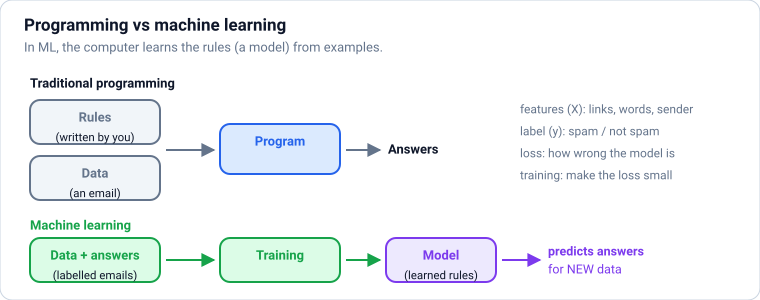

### 1.1 Two ways to get an answer

Suppose you want a program that marks emails as spam.

- **Normal programming:** you write the rule yourself, for example "spam if the email contains the word *free*".
- **Machine learning:** you collect emails that people have already marked spam or not spam, and the computer **finds the rule itself**.

The rule the computer finds is called the **model**. Finding it is called **training**.

### 1.2 Our data

Eight emails. For each one we know two things about it, called **features**, and the answer, called the **label**:

| email | links | contains "free" | spam? (label) |
|---|---|---|---|
| 1 | 0 | 0 | 0 |
| 2 | 1 | 0 | 0 |
| 3 | 5 | 1 | 1 |
| 4 | 7 | 1 | 1 |
| 5 | 2 | 0 | 0 |
| 6 | 6 | 0 | 1 |
| 7 | 0 | 1 | 0 |
| 8 | 8 | 1 | 1 |

(1 means yes and 0 means no.)

### 1.3 A rule written by hand

A person guesses: "spam if it contains *free*". Check it against the table. It gets emails 6 and 7 wrong: email 6 is spam without "free", and email 7 has "free" but isn't spam. That's 6 out of 8 correct, or **75%**.

```python
emails = [  # (links, contains_free, is_spam)
    (0, 0, 0), (1, 0, 0), (5, 1, 1), (7, 1, 1),
    (2, 0, 0), (6, 0, 1), (0, 1, 0), (8, 1, 1),
]

def hand_rule(links, free):
    return 1 if free == 1 else 0

correct = sum(hand_rule(links, free) == spam for links, free, spam in emails)
print("hand rule accuracy:", correct / len(emails))
```

**Output:**

```text
hand rule accuracy: 0.75
```

### 1.4 A rule learned from the data

Now let the computer choose. We give it a **family** of possible rules, "spam if links ≥ t", and let it try every t from 0 to 9. For each t it counts how many emails the rule gets right, and it keeps the best t.

That's the whole idea of training: **try settings, measure how wrong they are on known examples, keep the best.** The setting being chosen, t, is called a **parameter**.

```python
def accuracy_of_threshold(t):
    return sum((links >= t) == bool(spam) for links, _, spam in emails) / len(emails)

for t in range(10):
    print(f"t = {t}: accuracy {accuracy_of_threshold(t):.3f}")
```

**Output:**

```text
t = 0: accuracy 0.500
t = 1: accuracy 0.750
t = 2: accuracy 0.875
t = 3: accuracy 1.000
t = 4: accuracy 1.000
t = 5: accuracy 1.000
t = 6: accuracy 0.875
t = 7: accuracy 0.750
t = 8: accuracy 0.625
t = 9: accuracy 0.500
```

t = 3, 4 and 5 all get every email right. We'll keep the first one:

```python
best_t = max(range(10), key=accuracy_of_threshold)   # max returns the first best
print("learned rule: spam if links >=", best_t)
```

**Output:**

```text
learned rule: spam if links >= 3
```

### 1.5 Using the model on new emails

The point of a model is to answer for emails it has **never seen**. Doing well on new data is called **generalisation**, and using a trained model is called **prediction** (or **inference**).

```python
new_emails = [4, 9, 1]        # number of links in three new emails
for links in new_emails:
    print(links, "links ->", "spam" if links >= best_t else "not spam")
```

**Output:**

```text
4 links -> spam
9 links -> spam
1 links -> not spam
```

Every model in this book works the same way, just with far more parameters and smarter ways of searching than "try them all". Chapter 5 shows that smarter search.

### 1.6 The kinds of machine learning

ML problems are grouped by **what the computer learns from**.

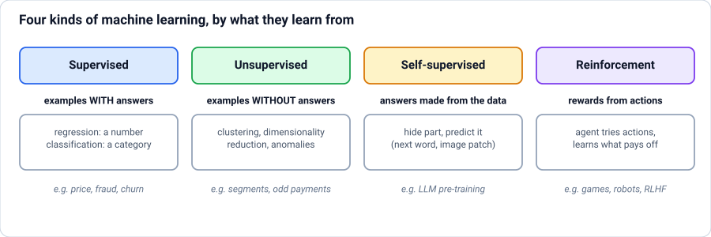

| Kind | Learns from | Predicts | Example | Chapters |
|---|---|---|---|---|
| **supervised: regression** | examples with a number as the answer | a number | house price | 7, 8 |
| **supervised: classification** | examples with a category as the answer | a category | spam or not | 10–14 |
| **unsupervised** | examples with **no** answers | groups, patterns, oddities | customer groups | 34–38 |
| **self-supervised** | answers made from the data itself (hide a word, predict it) | the hidden part | how chatbots are pre-trained | `deep-learning.md` |
| **reinforcement** | rewards from trying actions | which action to take | game-playing agents | `llm-engineering.md` |

Our spam learner is **supervised classification**: it learned from labelled examples, and it predicts a category.

### 1.7 When not to use ML

- An exact formula exists, like converting Celsius to Fahrenheit.
- There are too few examples to learn from.
- No one can provide the right answers (labels) for training.
- Mistakes can't be tolerated and no person checks the output.

### 1.8 Summary

```
training   = try parameter values, measure the error on labelled examples, keep the best
prediction = apply the trained rule to new examples
```

**Key terms:**

- **Machine learning (ML):** getting a computer to find a rule from examples instead of writing the rule by hand.
- **Model:** the rule that training produces, for example "spam if links ≥ 3".
- **Example (row, sample):** one item we have data about, such as one email.
- **Feature:** a measured property of an example, used as input, such as the number of links.
- **Label (target):** the correct answer for an example, the thing we want to predict.
- **Parameter:** a number inside the model that training chooses, such as the threshold t.
- **Training (fitting):** choosing the parameters that make the model's answers match the labels.
- **Accuracy:** the fraction of examples a model gets right.
- **Prediction (inference):** using a trained model to answer for an example.
- **Generalisation:** doing well on new examples, not just the ones used for training.
- **Supervised learning:** learning from examples that have labels.
- **Regression:** predicting a number.
- **Classification:** predicting a category.
- **Unsupervised learning:** finding structure in examples without labels.

**Exercises**

1. Learn a threshold on the "contains free" feature instead (t can only be 0 or 1). What accuracy does the best one get?
2. Which are good ML problems? (a) tomorrow's electricity demand; (b) converting kilometres to miles; (c) flagging fraudulent card payments from millions of past payments.

<details>
<summary><b>Answers</b></summary>

```python
for t in [0, 1]:
    acc = sum((free >= t) == bool(spam) for _, free, spam in emails) / len(emails)
    print(f"t = {t}: accuracy {acc}")
```

**Output:**

```text
t = 0: accuracy 0.5
t = 1: accuracy 0.75
```

1. The best is t = 1, which is the hand rule: 75%. One feature isn't enough here; the number of links is the better feature.
2. (a) Yes: lots of history, and a number to predict. (b) No: there's an exact formula. (c) Yes: many labelled examples, and a repeated decision.

</details>

| # | Problem (Deep-ML) | Difficulty |
|---|---|---|
| 1 | [36. Calculate Accuracy Score](https://www.deep-ml.com/problems/36) | 🟢 Easy |

---

## 2. Data: Features, Labels and Train/Test Splits

**You need:** Chapter 1, and NumPy arrays. · **You'll learn:** how ML data is laid out, and why a model must be tested on data it never trained on.

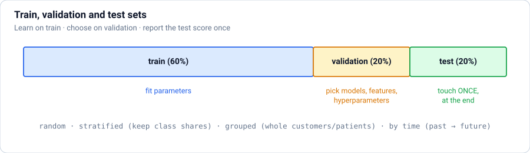

### 2.1 Data is a table

Every dataset in this book has the same shape: **one row per example, one column per feature**, plus the label.

| area (m²) | bedrooms | age (years) | price (lakh ₹) |
|---|---|---|---|
| 120 | 3 | 10 | 85 |
| 60 | 1 | 25 | 38 |
| 200 | 4 | 2 | 150 |

In code, the features go in a 2D array called **X** (capital, because it's a matrix), and the labels in a 1D array called **y**.

```python
import numpy as np

X = np.array([[120, 3, 10],
              [ 60, 1, 25],
              [200, 4,  2]])
y = np.array([85, 38, 150])

print("X shape:", X.shape)      # (rows, columns) = (examples, features)
print("y shape:", y.shape)
print("first example:", X[0], "-> label", y[0])
print("all areas:", X[:, 0])    # column 0
```

**Output:**

```text
X shape: (3, 3)
y shape: (3,)
first example: [120   3  10] -> label 85
all areas: [120  60 200]
```

`X[0]` is the first row, and `X[:, 0]` is the first column (`:` means "every row").

### 2.2 Why we need data the model hasn't seen

Imagine a "model" that simply **memorises** the training table and looks the answer up. On the training data it's perfect. On a new house it has nothing to say.

```python
train_X = [(120, 3, 10), (60, 1, 25), (200, 4, 2)]
train_y = [85, 38, 150]
memory = dict(zip(train_X, train_y))

print(memory.get((120, 3, 10)))   # seen in training: perfect
print(memory.get((125, 3, 9)))    # a new, almost identical house: no answer
```

**Output:**

```text
85
None
```

Scoring a model on its own training data rewards memorising, not learning. Learning the training data too closely like this is called **overfitting** (Chapter 15). So we always **hold back** some data, and score the model only on that.

### 2.3 Splitting by hand

The usual recipe: shuffle the rows, then put about 80% in a **training set** and 20% in a **test set**.

We shuffle **row numbers** (indices), then use the same shuffled numbers for X and y, so that each row stays with its own label.

```python
rng = np.random.default_rng(0)            # a random generator; seed 0 makes it repeatable
X = rng.integers(40, 250, size=(10, 2))   # 10 made-up houses, 2 features
y = np.arange(10)                         # labels 0..9, so we can see where each row goes

order = rng.permutation(len(X))           # the numbers 0..9 in a random order
print("shuffled order:", order)

cut = int(0.8 * len(X))                   # 80% of 10 = 8
train_idx, test_idx = order[:cut], order[cut:]
X_train, y_train = X[train_idx], y[train_idx]
X_test, y_test = X[test_idx], y[test_idx]
print("train labels:", y_train)
print("test labels: ", y_test)
```

**Output:**

```text
shuffled order: [4 7 6 2 5 1 3 9 8 0]
train labels: [4 7 6 2 5 1 3 9]
test labels:  [8 0]
```

Why shuffle? Data often arrives sorted, by date or by city for example. Cutting without shuffling could put all of one kind in the test set.

### 2.4 Three sets: train, validation, test

While building a model you make many choices: which features to use, which model, which settings. If you make those choices by looking at the test score, the test set is no longer "unseen". You've tuned your choices to it.

So there are three roles:

| Set | Used for | Typical share |
|---|---|---|
| **training** | fitting the model's parameters | 60–80% |
| **validation** | comparing choices, picking the best | 10–20% |
| **test** | one final, honest score, used once at the end | 10–20% |

Chapter 21 shows **cross-validation**, a way to get validation scores without permanently giving up data.

### 2.5 Keeping class balance: stratified splits

Say 10% of examples are fraud. A small random test set might, by bad luck, contain no fraud at all, and then it can't test fraud detection. A **stratified** split fixes this: split each class separately, so both sets keep the same mix.

```python
y = np.array([0] * 45 + [1] * 5)          # 50 rows: 45 normal, 5 fraud (10%)
rng = np.random.default_rng(1)

test_idx = []
for cls in [0, 1]:
    rows = np.flatnonzero(y == cls)       # row numbers belonging to this class
    rows = rng.permutation(rows)
    n_test = round(0.2 * len(rows))       # 20% of this class
    test_idx += list(rows[:n_test])

print("test size:", len(test_idx))
print("fraud share in test:", y[test_idx].mean())
```

**Output:**

```text
test size: 10
fraud share in test: 0.1
```

`np.flatnonzero(condition)` returns the positions where the condition is true.

### 2.6 When a random split is wrong

A split should copy how the model will be used. Two common cases break random splitting:

- **Time.** A model trained in 2025 will predict 2026. If the split is random, the training set contains "future" rows, and the test score looks better than reality. **Split by date instead:** train on the past, test on the most recent period.
- **Groups.** If one patient has five scans, a random split can put three in training and two in test. The model then recognises the *patient*, not the disease. **Keep every row of one group on the same side.**

```python
days = np.arange(1, 11)                     # 10 days of data, already in time order
train_days, test_days = days[:8], days[8:]  # past -> train, last 2 days -> test
print("train:", train_days, "| test:", test_days)
```

**Output:**

```text
train: [1 2 3 4 5 6 7 8] | test: [ 9 10]
```

Using information during training that won't be available when the model is really used is called **leakage**. Chapter 25 is about finding and preventing it.

### 2.7 Summary

```
X: 2D array, shape (n_examples, n_features)      y: 1D array, shape (n_examples,)
split: shuffle indices → first 80% train, last 20% test
```

**Key terms:**

- **X (feature matrix):** the 2D array of inputs, one row per example and one column per feature.
- **y (target vector):** the 1D array of labels, one per example.
- **Training set:** the rows the model learns from.
- **Validation set:** rows used to compare choices (models, settings) while building.
- **Test set:** rows held back until the end, for one honest final score.
- **Overfitting:** learning the training data so closely, noise included, that the model does worse on new data.
- **Random seed:** a number that makes "random" results repeatable.
- **Stratified split:** a split that keeps each class's share the same in every set.
- **Time-based split:** training on earlier rows and testing on later ones.
- **Group split:** keeping all rows of one group (a user, a patient) in the same set.
- **Leakage:** training on information that won't be available at prediction time, which makes test scores look better than real use will be.

**Exercises**

1. You have 1,000 rows. How many go to train, validation and test with a 70/15/15 split? Write the index slicing with `order = rng.permutation(1000)`.
2. A shop predicts next week's sales. Should it split randomly or by time? Why?

<details>
<summary><b>Answers</b></summary>

```python
order = np.random.default_rng(0).permutation(1000)
train_idx, val_idx, test_idx = order[:700], order[700:850], order[850:]
print(len(train_idx), len(val_idx), len(test_idx))
```

**Output:**

```text
700 150 150
```

1. 700 / 150 / 150.
2. By time. In use, the model only knows the past. A random split would let it train on weeks that come after the test weeks.

</details>

| # | Problem (Deep-ML) | Difficulty |
|---|---|---|
| 1 | [29. Random Shuffle of Dataset](https://www.deep-ml.com/problems/29) | 🟢 Easy |

---

## 3. Vectors, Matrices and the Dot Product

**You need:** Chapter 2. · **You'll learn:** the three array operations nearly every model is built from: the dot product, matrix–vector multiplication, and distance.

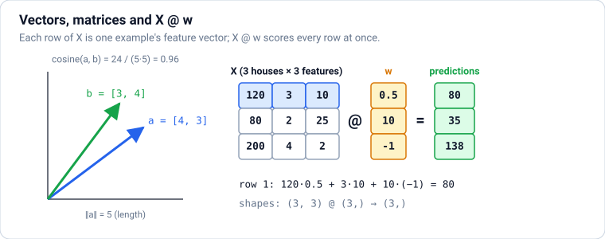

### 3.1 A vector is a list of numbers

One row of X, one house, is a **vector**: `x = [120, 3, 10]` (area, bedrooms, age). The number of entries is its **dimension**, here 3.

### 3.2 The dot product is a weighted sum

Suppose a price is worked out as 0.5 lakh per m², plus 10 lakh per bedroom, minus 1 lakh per year of age. Put those rates in a **weight vector** `w = [0.5, 10, −1]`. Then:

```
price = 0.5·120 + 10·3 + (−1)·10
      = 60 + 30 − 10
      = 80
```

Multiply matching entries and add them up: that's the **dot product**, written `w · x`.

```
w · x = w₁x₁ + w₂x₂ + … + wₙxₙ
```

Linear regression, logistic regression, SVMs and neural-network layers all start by computing a dot product.

```python
import numpy as np

x = np.array([120, 3, 10])
w = np.array([0.5, 10, -1])

print(w * x)            # element by element: [60, 30, -10]
print(np.sum(w * x))    # add them up: the dot product
print(w @ x)            # @ is NumPy's dot-product operator: same answer
```

**Output:**

```text
[ 60.  30. -10.]
80.0
80.0
```

### 3.3 A matrix times a vector: every row at once

X holds many houses, one per row. `X @ w` takes the dot product of **every row** with w, so it gives one prediction per house.

```
      X                 w          X @ w
[120  3  10]       [0.5]       [ 80]   = 0.5·120 + 10·3 − 1·10
[ 80  2  25]   @   [10 ]   =   [ 35]   = 0.5·80  + 10·2 − 1·25
[200  4   2]       [−1 ]       [138]   = 0.5·200 + 10·4 − 1·2
```

**Shape rule:** (rows × n) @ (n,) gives (rows,). The number of columns in X must equal the length of w.

```python
X = np.array([[120, 3, 10],
              [ 80, 2, 25],
              [200, 4,  2]])
print(X @ w)
print(X.shape, "@", w.shape, "->", (X @ w).shape)
```

**Output:**

```text
[ 80.  35. 138.]
(3, 3) @ (3,) -> (3,)
```

### 3.4 The transpose

The **transpose** Xᵀ turns rows into columns. If X is (3 × 2), Xᵀ is (2 × 3). Training formulas use it often. For example, `X.T @ errors` gives, for each feature, the sum of that feature times each row's error. Chapter 7 uses exactly this.

```python
X = np.array([[1, 2],
              [3, 4],
              [5, 6]])
errors = np.array([1, 0, -1])

print(X.T)                # shape (2, 3)
print(X.T @ errors)       # [1·1 + 3·0 + 5·(−1),  2·1 + 4·0 + 6·(−1)] = [−4, −4]
```

**Output:**

```text
[[1 3 5]
 [2 4 6]]
[-4 -4]
```

### 3.5 Length and distance

The **length** (or **norm**) of a vector comes from Pythagoras:

```
‖x‖ = √(x₁² + x₂² + … + xₙ²)
```

The **distance** between two vectors is the length of their difference: `‖a − b‖`. For a = (1, 2) and b = (4, 6): a − b = (−3, −4), so the distance is √(9 + 16) = **5**.

k-nearest neighbours (Chapter 14), k-means (Chapter 34) and SVMs (Chapter 31) all depend on distances.

```python
a, b = np.array([1, 2]), np.array([4, 6])
print(np.sqrt(np.sum((a - b) ** 2)))     # by the formula
print(np.linalg.norm(a - b))             # NumPy's built-in
```

**Output:**

```text
5.0
5.0
```

### 3.6 Cosine similarity: same direction?

Sometimes only the **direction** of a vector matters, not its size. A long and a short document about the same topic point the same way. **Cosine similarity** is the dot product divided by both lengths:

```
cos(a, b) = (a · b) / (‖a‖ · ‖b‖)
```

It's 1 for the same direction, 0 for unrelated (at right angles), and −1 for opposite. For a = [4, 3] and b = [3, 4]: a · b = 12 + 12 = 24, and both lengths are 5, so cos = 24 / 25 = **0.96**: almost the same direction. Text search (Chapter 42) and recommenders (Chapter 43) use it.

```python
a, b = np.array([4, 3]), np.array([3, 4])
print(a @ b / (np.linalg.norm(a) * np.linalg.norm(b)))
```

**Output:**

```text
0.96
```

### 3.7 Broadcasting: one operation on every row

`X - X.mean(axis=0)` subtracts each **column's** mean from every row. `axis=0` means "go down the rows", so you get one mean per column. NumPy automatically repeats the means for every row, which is called **broadcasting**. Chapter 14 uses this to put features on the same scale.

```python
X = np.array([[120, 3], [60, 1], [200, 4]], dtype=float)
means = X.mean(axis=0)
print("column means:", means.round(2))
print((X - means).round(2))          # each column now averages 0
```

**Output:**

```text
column means: [126.67   2.67]
[[ -6.67   0.33]
 [-66.67  -1.67]
 [ 73.33   1.33]]
```

### 3.8 Summary

```
dot product   w · x = Σ wᵢxᵢ                  (w @ x)
all rows      X @ w → one number per row     shape (n, d) @ (d,) → (n,)
transpose     Xᵀ: rows ↔ columns             (X.T)
distance      ‖a − b‖ = √Σ(aᵢ − bᵢ)²          (np.linalg.norm(a - b))
cosine        a · b / (‖a‖ ‖b‖)
```

**Key terms:**

- **Vector:** a list of numbers, such as one example's features.
- **Dimension:** how many numbers a vector has.
- **Dot product:** multiply two vectors entry by entry and add the results: a weighted sum.
- **Weight vector (w):** the numbers a model multiplies the features by.
- **Matrix:** a 2D table of numbers. X is a matrix.
- **Matrix–vector product (X @ w):** the dot product of every row of X with w.
- **Transpose (Xᵀ):** the matrix with rows and columns swapped.
- **Norm (length):** a vector's size, √(sum of squares).
- **Euclidean distance:** the straight-line distance between two vectors, ‖a − b‖.
- **Cosine similarity:** the dot product divided by both lengths; 1 means the same direction.
- **Broadcasting:** NumPy's automatic repeating of a smaller array so it can be combined with a bigger one.
- **axis=0:** "along the rows", which gives one result per column.

**Exercises**

1. By hand: w = [2, −1], x = [3, 5]. What is w · x?
2. X has shape (100, 4). What shape must w have for `X @ w` to work, and what shape is the result?
3. By hand: the distance between (0, 0, 0) and (2, 3, 6).

<details>
<summary><b>Answers</b></summary>

1. 2·3 + (−1)·5 = **1**.
2. w must have shape (4,), and the result has shape (100,): one number per row.
3. √(4 + 9 + 36) = √49 = **7**.

```python
print(np.array([2, -1]) @ np.array([3, 5]), np.linalg.norm([2, 3, 6]))
```

**Output:**

```text
1 7.0
```

</details>

| # | Problem (Deep-ML) | Difficulty |
|---|---|---|
| 1 | [1. Matrix-Vector Dot Product](https://www.deep-ml.com/problems/1) | 🟢 Easy |
| 2 | [76. Calculate Cosine Similarity Between Vectors](https://www.deep-ml.com/problems/76) | 🟢 Easy |

---

## 4. Derivatives and the Chain Rule

**You need:** school algebra. · **You'll learn:** what a derivative tells a model ("which way is downhill"), the few rules this book uses, and the chain rule.

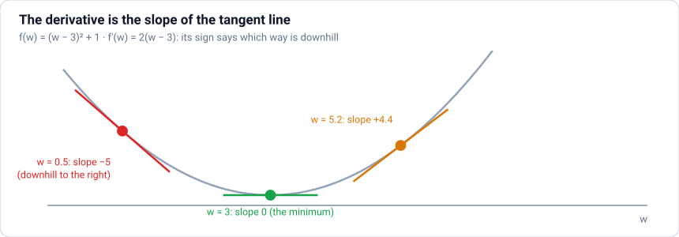

### 4.1 Why models need derivatives

Training means making an error number, the **loss**, as small as possible by changing the parameters. To do that, a model has to know: **if I increase this parameter slightly, does the loss go up or down, and by how much?** That rate of change is the **derivative**.

### 4.2 Slope of a straight line

For a line, the slope is "rise over run": how much f changes when w rises by 1. For f(w) = 3w + 2, raising w by 1 always raises f by 3, so the slope is **3** everywhere.

### 4.3 Slope of a curve

A curve's slope changes from place to place. Take the function in the picture:

```
f(w) = (w − 3)² + 1
```

To find its slope at one point, move a tiny step h and see how much f changes:

```
slope ≈ (f(w + h) − f(w)) / h        (for a very small h)
```

At w = 5, with h = 0.001: f(5.001) = 5.004001 and f(5) = 5, so slope ≈ 0.004001 / 0.001 ≈ **4.0**. As h shrinks towards 0, this ratio settles on the exact slope, called the **derivative**, written f′(w) or df/dw.

```python
def f(w):
    return (w - 3) ** 2 + 1

def numerical_slope(func, w, h=1e-6):
    return (func(w + h) - func(w)) / h

for w in [0.5, 3, 5]:
    print(f"w = {w}: slope ≈ {numerical_slope(f, w):.3f}")
```

**Output:**

```text
w = 0.5: slope ≈ -5.000
w = 3: slope ≈ 0.000
w = 5: slope ≈ 4.000
```

**The sign is what matters for training:**

- slope **negative** (w = 0.5): f falls as w rises → move w **right**.
- slope **zero** (w = 3): the bottom, the minimum.
- slope **positive** (w = 5): f rises as w rises → move w **left**.

### 4.4 The rules you need

Instead of measuring, we use rules that give the exact derivative:

| f(w) | f′(w) | example |
|---|---|---|
| c (a constant) | 0 | f = 7 → 0 |
| c·w | c | f = 3w → 3 |
| wⁿ | n·wⁿ⁻¹ | f = w² → 2w |
| eʷ | eʷ | |
| ln w | 1 / w | |
| f + g | f′ + g′ | f = w² + 3w → 2w + 3 |

Applying them to f(w) = (w − 3)² + 1, expanded as w² − 6w + 9 + 1:

```
f′(w) = 2w − 6 + 0 + 0 = 2(w − 3)
```

Check: f′(5) = 2 × 2 = 4, and f′(0.5) = 2 × (−2.5) = −5. Both match the measured slopes above.

### 4.5 The chain rule

Models are built from functions inside functions. The **chain rule** says: to differentiate a function of a function, **multiply the derivatives of each layer**.

```
if  f(w) = g(u)  and  u = h(w),   then   df/dw = dg/du · du/dw
```

**Example:** f(w) = (3w + 1)².

1. Name the inside: u = 3w + 1, so f = u².
2. Derivative of each layer: df/du = 2u, and du/dw = 3.
3. Multiply: df/dw = 2u · 3 = 6(3w + 1).

At w = 1: 6 × 4 = **24**.

```python
g = lambda w: (3 * w + 1) ** 2
print("chain rule:", 6 * (3 * 1 + 1))
print("measured:  ", round(numerical_slope(g, 1), 3))
```

**Output:**

```text
chain rule: 24
measured:   24.0
```

Every training formula in this book (the linear-regression gradient in Chapter 7, the logistic one in Chapter 10, backpropagation in `deep-learning.md`) is the chain rule applied a few times.

### 4.6 Several parameters: partial derivatives and the gradient

Real losses depend on many parameters at once. A **partial derivative** asks how f changes when you move **one** parameter and hold the others fixed. It's written with a curly ∂.

For f(w, b) = w² + 3wb + b²:

```
∂f/∂w = 2w + 3b         (treat b as a constant)
∂f/∂b = 3w + 2b         (treat w as a constant)
```

Put all the partial derivatives in a vector and you get the **gradient**, written ∇f. At (w, b) = (1, 2): ∇f = [2 + 6, 3 + 4] = **[8, 7]**. The gradient points in the direction where f rises fastest, so **minus the gradient points downhill**. Chapter 5 uses exactly this.

```python
def f2(w, b):
    return w ** 2 + 3 * w * b + b ** 2

h = 1e-6
dw = (f2(1 + h, 2) - f2(1, 2)) / h
db = (f2(1, 2 + h) - f2(1, 2)) / h
print("measured gradient:", round(dw, 3), round(db, 3))
```

**Output:**

```text
measured gradient: 8.0 7.0
```

### 4.7 Summary

```
derivative     f′(w) = how fast f changes as w changes (the slope)
power rule     d/dw wⁿ = n·wⁿ⁻¹         ln: d/dw ln w = 1/w        exp: d/dw eʷ = eʷ
chain rule     d/dw g(h(w)) = g′(h(w)) · h′(w)
gradient       ∇f = [∂f/∂w₁, ∂f/∂w₂, …]  points uphill; −∇f points downhill
```

**Key terms:**

- **Loss:** one number measuring how wrong a model's predictions are; training makes it small.
- **Derivative (f′, df/dw):** the slope of a function at a point: how fast it changes as its input changes.
- **Minimum:** the lowest point of a function, where the slope is 0.
- **Numerical derivative:** an estimate of the slope from (f(w + h) − f(w)) / h with a tiny h; used to check formulas.
- **Chain rule:** the derivative of a function of a function is the product of each layer's derivative.
- **Partial derivative (∂f/∂w):** the derivative with respect to one input, holding the others fixed.
- **Gradient (∇f):** the vector of all partial derivatives; it points in the direction of steepest increase.

**Exercises**

1. Differentiate f(w) = 4w³ − 2w + 5, and evaluate it at w = 1.
2. Use the chain rule on f(w) = ln(1 + w²).
3. For f(w, b) = (w + 2b − 4)², find ∂f/∂w and ∂f/∂b.

<details>
<summary><b>Answers</b></summary>

1. f′(w) = 12w² − 2, so f′(1) = **10**.
2. u = 1 + w², f = ln u: f′ = (1/u) · 2w = **2w / (1 + w²)**.
3. With u = w + 2b − 4: ∂f/∂w = 2u · 1 = **2(w + 2b − 4)**, and ∂f/∂b = 2u · 2 = **4(w + 2b − 4)**.

```python
print(round(numerical_slope(lambda w: 4 * w**3 - 2 * w + 5, 1), 3))
```

**Output:**

```text
10.0
```

</details>

| # | Problem (Deep-ML) | Difficulty |
|---|---|---|
| 1 | [116. Derivative of a Polynomial](https://www.deep-ml.com/problems/116) | 🟢 Easy |

**Learn more:** [3Blue1Brown: Essence of Calculus (videos)](https://www.youtube.com/playlist?list=PLZHQObOWTQDMsr9K-rj53DwVRMYO3t5Yr)

---

## 5. Gradient Descent

**You need:** Chapter 4. · **You'll learn:** the algorithm that trains almost every model in this book: repeatedly step downhill on the loss.

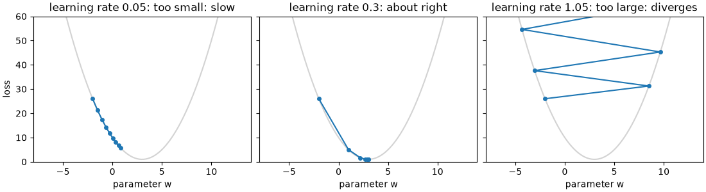

### 5.1 The idea

You're on a hill in thick fog and want to reach the valley. You can't see it, but you can feel the slope under your feet. So you take a step downhill, feel the slope again, and repeat.

Gradient descent does exactly that with the loss:

```
w ← w − lr · f′(w)
```

- f′(w) is the slope (Chapter 4). If it's negative, then −lr · f′(w) is positive, so w moves right, which is downhill. If it's positive, w moves left.
- **lr**, the **learning rate**, is the step size: a small positive number such as 0.1.
- The steps shrink automatically near the bottom, because the slope gets smaller there.

### 5.2 Three steps by hand

f(w) = (w − 3)² + 1, f′(w) = 2(w − 3). Start at w = 0, with lr = 0.1.

| step | w | f′(w) = 2(w − 3) | new w = w − 0.1 · f′(w) |
|---|---|---|---|
| 1 | 0 | −6 | 0 + 0.6 = **0.6** |
| 2 | 0.6 | −4.8 | 0.6 + 0.48 = **1.08** |
| 3 | 1.08 | −3.84 | 1.08 + 0.384 = **1.464** |

w heads towards 3, the minimum, and each step is 80% of the one before.

```python
def f(w):
    return (w - 3) ** 2 + 1

def slope(w):
    return 2 * (w - 3)

w, lr = 0.0, 0.1
for step in range(1, 31):
    w = w - lr * slope(w)
    if step in (1, 2, 3, 10, 30):
        print(f"step {step:>2}: w = {w:.4f}, f(w) = {f(w):.4f}")
```

**Output:**

```text
step  1: w = 0.6000, f(w) = 6.7600
step  2: w = 1.0800, f(w) = 4.6864
step  3: w = 1.4640, f(w) = 3.3593
step 10: w = 2.6779, f(w) = 1.1038
step 30: w = 2.9963, f(w) = 1.0000
```

### 5.3 Choosing the learning rate

The learning rate is the one setting you must choose yourself. Settings like this, chosen by you rather than learned, are called **hyperparameters**.

- **Too small:** correct, but painfully slow.
- **Too large:** each step overshoots the bottom and lands further up the other side, so w **diverges** (moves away for ever).

```python
for lr in [0.01, 0.1, 0.9, 1.1]:
    w = 0.0
    for _ in range(20):
        w = w - lr * slope(w)
    print(f"lr = {lr:<4}: w after 20 steps = {w:10.3f}")
```

**Output:**

```text
lr = 0.01: w after 20 steps =      0.997
lr = 0.1 : w after 20 steps =      2.965
lr = 0.9 : w after 20 steps =      2.965
lr = 1.1 : w after 20 steps =   -112.013
```

With lr = 0.9 each step flips w to the other side of 3, but by a shrinking amount, so it still gets there. It even ends exactly where lr = 0.1 does, for the reason in the box below. With lr = 1.1 every jump is bigger than the last.

<details>
<summary><b>Why 1.0 is the limit here</b></summary>

Write d = w − 3, the distance from the minimum. One step gives new d = d − lr · 2d = (1 − 2·lr) · d. Each step multiplies the distance by (1 − 2·lr). That shrinks only if |1 − 2·lr| < 1, which means 0 < lr < 1. lr = 0.1 gives a factor of 0.8 and lr = 0.9 gives −0.8: the same size, with the sign flipping each step. At lr = 1.1 the factor is −1.2, so the distance grows by 20% every step.

</details>

<details>
<summary><b>Code for the chart at the top</b></summary>

```python
import numpy as np
import matplotlib.pyplot as plt

grid = np.linspace(-0.5, 6.5, 200)
fig, axes = plt.subplots(1, 2, figsize=(9, 3.2), layout="constrained", sharey=True)
for ax, lr in zip(axes, [0.1, 0.9]):
    path = [0.0]
    for _ in range(12):
        path.append(path[-1] - lr * slope(path[-1]))
    ax.plot(grid, f(grid), color="gray")
    ax.plot(path, [f(p) for p in path], "o-", color="tab:blue", markersize=4)
    ax.set(title=f"learning rate {lr}", xlabel="w")
axes[0].set_ylabel("f(w)")
fig.savefig("gradient-descent.png", dpi=100)
plt.close(fig)
```

</details>

### 5.4 More than one parameter

With several parameters, use the gradient (Chapter 4): **move every parameter at once, each by its own partial derivative.**

```
[w, b] ← [w, b] − lr · ∇f
```

For f(w, b) = (w − 3)² + 2(b + 1)², the minimum is at (3, −1), and

```
∂f/∂w = 2(w − 3)        ∂f/∂b = 4(b + 1)
```

```python
import numpy as np

def grad(p):                      # p = [w, b]
    w, b = p
    return np.array([2 * (w - 3), 4 * (b + 1)])

p, lr = np.array([0.0, 0.0]), 0.1
for step in range(50):
    p = p - lr * grad(p)
print("found:", p.round(4), "(the true minimum is [3, -1])")
```

**Output:**

```text
found: [ 3. -1.] (the true minimum is [3, -1])
```

This is the whole training engine of linear regression (Chapter 7), logistic regression (Chapter 10) and neural networks. The only thing that changes between models is **which function is being minimised, and therefore what its gradient is**.

### 5.5 When to stop

Common stopping rules:

- after a fixed number of steps;
- when the gradient is nearly zero (the ground is flat, so you're at the bottom);
- when the loss improves by less than a tiny amount between steps.

### 5.6 One valley or many?

A bowl-shaped function has **one** lowest point, and gradient descent reaches it from anywhere. Such functions are called **convex**. The losses of linear and logistic regression are convex, so their training is reliable. Neural-network losses aren't: they have many dips (**local minima**), and where you end up depends on where you start.

### 5.7 Summary

```
update   w ← w − lr · ∂loss/∂w      (for every parameter, every step)
lr       too small: slow · too large: overshoots and diverges
convex   one valley, so gradient descent finds the best answer
```

**Key terms:**

- **Gradient descent:** repeatedly moving the parameters a small step against the gradient, to make the loss smaller.
- **Learning rate (lr, η):** the size of each step.
- **Hyperparameter:** a setting you choose before training, such as the learning rate; not learned from data.
- **Diverge:** move further from the minimum with every step (the learning rate is too large).
- **Converge:** settle at the minimum.
- **Convex function:** a bowl-shaped function with a single minimum.
- **Local minimum:** a dip that's lower than its surroundings but not the lowest point overall.

**Exercises**

1. By hand: f(w) = w², lr = 0.25, start at w = 4. Do three steps.
2. For f(w) = w², which learning rates converge? (Use the argument in the fold-out box.)

<details>
<summary><b>Answers</b></summary>

1. f′ = 2w, so new w = w − 0.5w = 0.5w: 4 → **2** → **1** → **0.5**.
2. new w = (1 − 2·lr) · w, so it converges when |1 − 2·lr| < 1: **0 < lr < 1**.

```python
w = 4.0
for _ in range(3):
    w -= 0.25 * 2 * w
    print(w)
```

**Output:**

```text
2.0
1.0
0.5
```

</details>

**Learn more:** [Google ML Crash Course: gradient descent](https://developers.google.com/machine-learning/crash-course/linear-regression/gradient-descent)

---

## 6. Probability, Likelihood and Bayes' Rule

**You need:** Chapters 4–5. · **You'll learn:** conditional probability, Bayes' rule, and **maximum likelihood**, the principle behind the loss functions in later chapters.

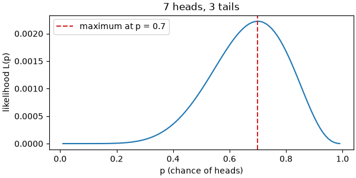

### 6.1 Probability from counts

A **probability** is a number from 0 (never) to 1 (always). From data, it's a count divided by a total. Here are 100 emails:

| | contains "free" | no "free" | total |
|---|---|---|---|
| **spam** | 30 | 10 | 40 |
| **not spam** | 5 | 55 | 60 |
| **total** | 35 | 65 | 100 |

- P(spam) = 40 / 100 = **0.40**
- P(free) = 35 / 100 = **0.35**
- P(spam **and** free) = 30 / 100 = **0.30**

### 6.2 Conditional probability

"Of the emails that contain *free*, what fraction are spam?" This is written **P(spam | free)**, read "probability of spam **given** free". Look only at the "contains free" column:

```
P(spam | free) = 30 / 35 = 0.857
```

It's different from the reverse question, "of the spam emails, what fraction contain *free*":

```
P(free | spam) = 30 / 40 = 0.75
```

In general:

```
P(A | B) = P(A and B) / P(B)
```

Check: 0.30 / 0.35 = 0.857 ✓.

### 6.3 Bayes' rule

From the definition above, P(A and B) can be written two ways:

```
P(A and B) = P(A | B) · P(B)
P(A and B) = P(B | A) · P(A)
```

Both equal the same thing, so set them equal and divide by P(B):

```
P(A | B) = P(B | A) · P(A) / P(B)
```

This is **Bayes' rule**. It turns a probability we can easily measure, P(free | spam), into the one we actually want, P(spam | free). Check with the table: 0.75 × 0.40 / 0.35 = **0.857** ✓.

**A classic surprise.** A disease affects 1% of people. A test catches 99% of sick people, but it also wrongly flags 5% of healthy ones. You test positive. What's the chance you're sick?

```
P(positive) = 0.99 × 0.01 + 0.05 × 0.99 = 0.0099 + 0.0495 = 0.0594
P(sick | positive) = 0.99 × 0.01 / 0.0594 = 0.167
```

Only about **17%**. The disease is so rare that most positive results come from the many healthy people. P(sick), the probability before seeing any evidence, is called the **prior**. Naive Bayes (Chapter 32) is Bayes' rule used as a classifier.

```python
p_sick = 0.01
p_pos_if_sick, p_pos_if_healthy = 0.99, 0.05

p_pos = p_pos_if_sick * p_sick + p_pos_if_healthy * (1 - p_sick)
print("P(positive)          =", round(p_pos, 4))
print("P(sick | positive)   =", round(p_pos_if_sick * p_sick / p_pos, 3))
```

**Output:**

```text
P(positive)          = 0.0594
P(sick | positive)   = 0.167
```

### 6.4 Independent events multiply

Two events are **independent** if one tells you nothing about the other, like two separate coin flips. Then:

```
P(A and B) = P(A) · P(B)
```

For a coin with P(heads) = p, the chance of heads, heads, tails is p · p · (1 − p).

### 6.5 Likelihood: which settings explain the data best?

So far we knew p and asked about the data. Machine learning asks the **reverse**: we have the data, so which p is most believable?

We flip a coin 10 times and get **7 heads, 3 tails**. For any guessed p, the probability of exactly this sequence is

```
L(p) = p⁷ · (1 − p)³
```

Seen as a function of p, with the data fixed, this is called the **likelihood**.

| p | 0.3 | 0.5 | 0.7 | 0.9 |
|---|---|---|---|---|
| L(p) | 0.0000750 | 0.000977 | **0.00222** | 0.000478 |

p = 0.7 makes the observed data most probable. Choosing the parameter that maximises the likelihood is called **maximum likelihood estimation (MLE)**, and it's how most models in this book choose their parameters.

```python
import numpy as np

heads, tails = 7, 3
for p in [0.3, 0.5, 0.7, 0.9]:
    print(f"p = {p}: L = {p**heads * (1 - p)**tails:.7f}")

grid = np.linspace(0.01, 0.99, 99)
L = grid**heads * (1 - grid)**tails
print("best p on a grid:", round(grid[np.argmax(L)], 2))   # argmax = position of the largest value
```

**Output:**

```text
p = 0.3: L = 0.0000750
p = 0.5: L = 0.0009766
p = 0.7: L = 0.0022236
p = 0.9: L = 0.0004783
best p on a grid: 0.7
```

<details>
<summary><b>Code for the chart at the top</b></summary>

```python
import matplotlib.pyplot as plt

fig, ax = plt.subplots(figsize=(6, 3), layout="constrained")
ax.plot(grid, L, color="tab:blue")
ax.axvline(0.7, ls="--", color="tab:red", label="maximum at p = 0.7")
ax.set(xlabel="p (chance of heads)", ylabel="likelihood L(p)", title="7 heads, 3 tails")
ax.legend()
fig.savefig("likelihood.png", dpi=100)
plt.close(fig)
```

</details>

### 6.6 Why we take the log

With many data points the likelihood multiplies many numbers below 1, and the result gets so small that the computer rounds it to 0. This is called **underflow**. Taking the logarithm turns products into sums, because ln(a·b) = ln a + ln b, and sums don't underflow:

```python
probs = np.full(2000, 0.5)          # 2000 events, each with probability 0.5
print("product:    ", np.prod(probs))
print("sum of logs:", round(np.sum(np.log(probs)), 2))
```

**Output:**

```text
product:     0.0
sum of logs: -1386.29
```

ln is increasing (a bigger input always gives a bigger output), so the p that maximises L also maximises ln L, the **log-likelihood**. And maximising the log-likelihood is the same as minimising its negative. That **negative log-likelihood** is the loss that logistic regression (Chapter 10) and neural networks minimise.

### 6.7 Maximum likelihood, solved exactly

For the coin, the log-likelihood is

```
ℓ(p) = ln(p⁷ (1 − p)³) = 7 ln p + 3 ln(1 − p)
```

At the maximum the slope is 0 (Chapter 4). Differentiate, using d/dp ln(1 − p) = −1/(1 − p) by the chain rule:

```
dℓ/dp = 7/p − 3/(1 − p) = 0
7(1 − p) = 3p
7 = 10p
p = 0.7
```

With h heads in n flips the same steps give **p = h / n**. The common-sense answer, "the fraction of heads", is the maximum-likelihood answer.

### 6.8 Mean, variance and the normal distribution

Three more tools that later chapters use:

- **Mean** (average): μ = (1/n) Σ xᵢ.
- **Variance**: the average squared distance from the mean, σ² = (1/n) Σ (xᵢ − μ)².
- **Standard deviation** σ: the square root of the variance, in the same units as the data, roughly "the typical distance from the mean".

The **normal distribution** (bell curve) describes many measured quantities, such as heights and measurement errors. Its formula is

```
p(x) = 1 / (σ√(2π)) · exp(−(x − μ)² / (2σ²))
```

About 68% of values lie within one σ of the mean, and 95% within two.

```python
x = np.array([2, 4, 4, 4, 5, 5, 7, 9])
print("mean:", x.mean(), "| variance:", x.var(), "| std:", x.std())
```

**Output:**

```text
mean: 5.0 | variance: 4.0 | std: 2.0
```

### 6.9 Summary

```
conditional    P(A | B) = P(A and B) / P(B)
Bayes          P(A | B) = P(B | A) · P(A) / P(B)
independent    P(A and B) = P(A) · P(B)
likelihood     L(θ) = P(data | θ), seen as a function of the parameters θ
MLE            choose θ to maximise L, i.e. to minimise −ln L
```

**Key terms:**

- **Probability:** a number from 0 to 1 saying how likely something is; from data, a count divided by a total.
- **Conditional probability P(A | B):** the probability of A among only the cases where B happened.
- **Bayes' rule:** P(A | B) = P(B | A) · P(A) / P(B); it reverses a conditional probability.
- **Prior:** the probability of something before seeing the evidence.
- **Posterior:** the probability after taking the evidence into account, such as P(sick | positive).
- **Independent events:** events where knowing one tells you nothing about the other; their probabilities multiply.
- **Likelihood:** how probable the observed data is under given parameter values, seen as a function of those parameters.
- **Maximum likelihood estimation (MLE):** choosing the parameters that make the observed data most probable.
- **Log-likelihood:** the logarithm of the likelihood; it turns products into sums.
- **Negative log-likelihood (NLL):** minus the log-likelihood; minimising it is the same as MLE, and it's the basis of most classification losses.
- **Underflow:** a number too small for the computer to store, rounded to 0.
- **Mean (μ):** the average.
- **Variance (σ²):** the average squared distance from the mean.
- **Standard deviation (σ):** the square root of the variance; the typical distance from the mean.
- **Normal distribution:** the bell-shaped curve described by a mean and a standard deviation.

**Exercises**

1. From the email table: what are P(free | not spam) and P(not spam | free)?
2. The disease test again, but now 10% of people are sick. What is P(sick | positive)?
3. An event happens 3 times in 12 trials. What is the maximum-likelihood probability?

<details>
<summary><b>Answers</b></summary>

1. P(free | not spam) = 5 / 60 = **0.083**, and P(not spam | free) = 5 / 35 = **0.143**.
2. P(positive) = 0.99 × 0.1 + 0.05 × 0.9 = 0.144, so P(sick | positive) = 0.099 / 0.144 = **0.6875**. A higher prior gives a much higher posterior.
3. 3 / 12 = **0.25**.

```python
p_pos = 0.99 * 0.1 + 0.05 * 0.9
print(round(0.99 * 0.1 / p_pos, 4))
```

**Output:**

```text
0.6875
```

</details>

| # | Problem (Deep-ML) | Difficulty |
|---|---|---|
| 1 | [168. Calculate Conditional Probability from Data](https://www.deep-ml.com/problems/168) | 🟢 Easy |
| 2 | [79. Binomial Distribution Probability](https://www.deep-ml.com/problems/79) | 🟡 Medium |

**Learn more:** [3Blue1Brown: Bayes' theorem (video)](https://www.youtube.com/watch?v=HZGCoVF3YvM) · [StatQuest: probability vs likelihood (video)](https://www.youtube.com/watch?v=pYxNSUDSFH4)

---

# Part II — First Models

Linear regression, logistic regression and k-nearest neighbours, each built from scratch first. Chapter 9 introduces scikit-learn. After that, every model is written by hand, then checked against the library.

---

## 7. Linear Regression from Scratch

**You need:** Chapters 3–5. · **You'll learn:** how to fit a straight line (and a flat "plane" with many features) to data, both with an exact formula and with gradient descent.

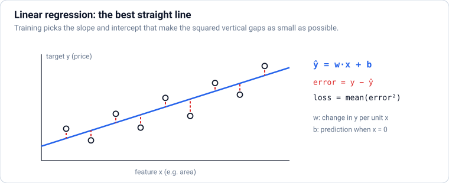

### 7.1 The problem

Predict a **number** from features: a price from a house's area, a delivery time from a distance. Start with one feature and five points:

| x | 1 | 2 | 3 | 4 | 5 |
|---|---|---|---|---|---|
| y | 2 | 4 | 5 | 4 | 5 |

### 7.2 The model

```
ŷ = w · x + b
```

- **ŷ** ("y-hat") is the prediction, and y is the true value.
- **w** is the **slope**: how much ŷ changes when x rises by 1.
- **b** is the **intercept**: the prediction when x = 0.

Training must choose w and b.

### 7.3 The loss: mean squared error

For each point, the **error** (also called the **residual**) is y − ŷ. We square each error and average them:

```
MSE = (1/n) · Σ (yᵢ − ŷᵢ)²
```

Why square the errors?

- Squares are never negative, so errors of +2 and −2 can't cancel out.
- Big misses count much more than small ones: an error of 4 costs 16, but an error of 1 costs only 1.
- The square has a simple derivative, which keeps the maths below easy.

**Traced:** for the guess w = 1, b = 1, the predictions are [2, 3, 4, 5, 6] and the errors are [0, 1, 1, −1, −1]. So MSE = (0 + 1 + 1 + 1 + 1) / 5 = **0.8**.

```python
import numpy as np

x = np.array([1, 2, 3, 4, 5], dtype=float)
y = np.array([2, 4, 5, 4, 5], dtype=float)

def mse(w, b):
    y_hat = w * x + b
    return np.mean((y - y_hat) ** 2)

print("w=1, b=1:", mse(1, 1))
print("w=0.5, b=2.5:", mse(0.5, 2.5))
```

**Output:**

```text
w=1, b=1: 0.8
w=0.5, b=2.5: 0.5
```

<details>
<summary><b>Derivation: squared error is maximum likelihood</b></summary>

Assume each y equals the line plus random noise that follows a normal distribution (Chapter 6.8) with spread σ. The likelihood of one point is proportional to exp(−(y − ŷ)² / (2σ²)). Multiply over all points, take the log, and flip the sign:

```
−ln L = Σ (yᵢ − ŷᵢ)² / (2σ²) + (a constant)
```

Minimising this is the same as minimising Σ (yᵢ − ŷᵢ)². So "least squares" is maximum likelihood under normally distributed noise.

</details>

### 7.4 The best line, exactly

At the minimum, both partial derivatives are zero (Chapter 4). MSE = (1/n) Σ (yᵢ − w xᵢ − b)². By the chain rule, the inner derivative is −1 for b and −xᵢ for w:

```
∂MSE/∂b = −(2/n) Σ (yᵢ − w xᵢ − b)        = 0
∂MSE/∂w = −(2/n) Σ (yᵢ − w xᵢ − b) · xᵢ   = 0
```

Solving these two equations (the steps are in the box below) gives:

```
w = Σ (xᵢ − x̄)(yᵢ − ȳ) / Σ (xᵢ − x̄)²
b = ȳ − w · x̄
```

where x̄ and ȳ are the means of x and y.

**Traced by hand:** x̄ = 3, ȳ = 4.

| x − x̄ | −2 | −1 | 0 | 1 | 2 | sum |
|---|---|---|---|---|---|---|
| y − ȳ | −2 | 0 | 1 | 0 | 1 | |
| product | 4 | 0 | 0 | 0 | 2 | **6** |
| (x − x̄)² | 4 | 1 | 0 | 1 | 4 | **10** |

w = 6 / 10 = **0.6**, and b = 4 − 0.6 × 3 = **2.2**. The best line is ŷ = 0.6x + 2.2.

<details>
<summary><b>Derivation: solving the two equations</b></summary>

From ∂/∂b = 0: Σ yᵢ − w Σ xᵢ − n·b = 0. Divide by n: ȳ − w x̄ − b = 0, so **b = ȳ − w x̄**. The best line always passes through the point (x̄, ȳ).

Substitute b into ∂/∂w = 0: Σ (yᵢ − ȳ − w(xᵢ − x̄)) xᵢ = 0. Since Σ (yᵢ − ȳ − w(xᵢ − x̄)) = 0, we can subtract x̄ times it, which replaces xᵢ with (xᵢ − x̄):

```
Σ (yᵢ − ȳ)(xᵢ − x̄) − w Σ (xᵢ − x̄)² = 0
w = Σ (xᵢ − x̄)(yᵢ − ȳ) / Σ (xᵢ − x̄)²
```

</details>

```python
w = np.sum((x - x.mean()) * (y - y.mean())) / np.sum((x - x.mean()) ** 2)
b = y.mean() - w * x.mean()
print(f"w = {w:.2f}, b = {b:.2f}, MSE = {mse(w, b):.2f}")
```

**Output:**

```text
w = 0.60, b = 2.20, MSE = 0.48
```

The MSE of 0.48 is lower than both guesses in 7.3, and no other line does better.

### 7.5 The same line by gradient descent

The exact formula only works for this model. Gradient descent (Chapter 5) works for every model, so let's train the same line that way. The gradients are the two derivatives from 7.4:

```
∂MSE/∂w = −(2/n) Σ (yᵢ − ŷᵢ) · xᵢ
∂MSE/∂b = −(2/n) Σ (yᵢ − ŷᵢ)
```

In words: **the average error, times the input, times −2.**

```python
w, b, lr = 0.0, 0.0, 0.05
for step in range(2001):
    y_hat = w * x + b
    error = y - y_hat
    grad_w = -2 * np.mean(error * x)
    grad_b = -2 * np.mean(error)
    w -= lr * grad_w
    b -= lr * grad_b
    if step in (0, 10, 100, 2000):
        print(f"step {step:>4}: w = {w:.3f}, b = {b:.3f}, MSE = {mse(w, b):.3f}")
```

**Output:**

```text
step    0: w = 1.320, b = 0.400, MSE = 1.646
step   10: w = 1.034, b = 0.634, MSE = 0.926
step  100: w = 0.694, b = 1.862, MSE = 0.501
step 2000: w = 0.600, b = 2.200, MSE = 0.480
```

Gradient descent arrives at the same w = 0.6 and b = 2.2.

### 7.6 Many features

A house has an area, bedrooms, an age and a distance. The model becomes a dot product (Chapter 3):

```
ŷ = w₁x₁ + w₂x₂ + … + wₙxₙ + b = w · x + b
```

For all rows at once, ŷ = X @ w + b. A common trick: add a column of 1s to X. Then b is just one more weight, the one multiplying that column. X with the extra column is called the **design matrix**.

The gradient for weight j is −(2/n) Σᵢ (yᵢ − ŷᵢ) · xᵢⱼ. Doing that for every j at once is exactly a transpose product (Chapter 3.4):

```
∇MSE = −(2/n) · Xᵀ (y − ŷ)
```

### 7.7 The exact answer with many features: the normal equation

Setting that gradient to zero gives Xᵀ(y − Xw) = 0, which rearranges to XᵀX w = Xᵀy. So:

```
w = (XᵀX)⁻¹ Xᵀ y
```

This is the **normal equation**. In code, don't compute the inverse (⁻¹) directly: it's slow and loses precision. `np.linalg.lstsq` ("least squares") solves the same equation safely.

We'll make 300 houses whose prices come from a known rule, plus noise, and check that we recover the rule:

```python
rng = np.random.default_rng(42)
n = 300
area = rng.uniform(40, 250, n)            # m²
bedrooms = rng.integers(1, 6, n)
age = rng.integers(0, 40, n)              # years
distance = rng.uniform(1, 30, n)          # km to the centre
noise = rng.normal(0, 8, n)               # random noise, standard deviation 8
price = 20 + 0.55 * area + 4 * bedrooms - 0.6 * age - 1.5 * distance + noise

X = np.column_stack([area, bedrooms, age, distance])   # shape (300, 4)
X1 = np.column_stack([X, np.ones(n)])                  # design matrix: add the 1s column
w_exact = np.linalg.lstsq(X1, price)[0]
print("weights:", w_exact[:4].round(2), " intercept:", w_exact[4].round(2))
```

**Output:**

```text
weights: [ 0.53  4.41 -0.57 -1.57]  intercept: 21.46
```

The true rule was 0.55, 4, −0.6, −1.5 and an intercept of 20. The fit is close; the gap comes from the noise.

### 7.8 Gradient descent with many features needs scaled inputs

Area runs into the hundreds while bedrooms are 1–5. One learning rate can't suit both: a step small enough for area barely moves the bedrooms weight. The fix is to **standardise** each feature: subtract its mean and divide by its standard deviation (Chapter 6.8). Every column then has mean 0 and standard deviation 1. Chapter 14 covers this properly.

```python
mu, sigma = X.mean(axis=0), X.std(axis=0)
Xs = (X - mu) / sigma                       # standardised features
Xs1 = np.column_stack([Xs, np.ones(n)])

w = np.zeros(5)
for step in range(1000):
    y_hat = Xs1 @ w
    grad = -2 / n * Xs1.T @ (price - y_hat)
    w -= 0.1 * grad

print("weights per standard deviation:", w[:4].round(2))
print("converted to per unit:         ", (w[:4] / sigma).round(2))
```

**Output:**

```text
weights per standard deviation: [ 32.55   6.39  -6.27 -13.55]
converted to per unit:          [ 0.53  4.41 -0.57 -1.57]
```

Divided by σ, the weights match the exact solution. The standardised weights are useful in their own right: they're **comparable**. Area has the biggest effect per standard deviation, because it varies a lot and matters a lot.

### 7.9 Reading the weights

- **w for area ≈ 0.55:** one more m² adds about 0.55 lakh, **with the other features held fixed**.
- **Negative w (age, distance):** older and further away means cheaper.
- When two features are strongly related (area and bedrooms, say), their individual weights become unreliable, even if the predictions stay good.

### 7.10 Summary

```
model          ŷ = X w + b
loss           MSE = (1/n) Σ (y − ŷ)²
gradient       ∇MSE = −(2/n) Xᵀ (y − ŷ)
exact          w = (XᵀX)⁻¹ Xᵀ y        (use np.linalg.lstsq)
one feature    w = Σ(x − x̄)(y − ȳ) / Σ(x − x̄)²,   b = ȳ − w x̄
```

**Watch out:** linear regression can only draw straight lines (or flat planes). Chapter 15 shows how to bend them.

**Key terms:**

- **Linear regression:** predicting a number as a weighted sum of the features plus an intercept.
- **ŷ (y-hat):** the model's prediction.
- **Slope / weight (w):** how much the prediction changes per unit of a feature, with the others held fixed.
- **Intercept (b, bias):** the prediction when every feature is 0.
- **Residual (error):** y − ŷ for one example.
- **Mean squared error (MSE):** the average squared residual; linear regression's loss.
- **Least squares:** choosing weights to minimise the sum of squared residuals.
- **Design matrix:** X with an extra column of 1s, so the intercept becomes an ordinary weight.
- **Normal equation:** w = (XᵀX)⁻¹Xᵀy, the exact least-squares solution.
- **Closed-form solution:** an answer given directly by a formula, without iterating.
- **Standardise:** rescale a feature to mean 0 and standard deviation 1.

**Exercises**

1. By hand: x = [0, 1, 2], y = [1, 3, 5]. Find w and b.
2. For the 5-point data, what MSE does the line ŷ = 4 (w = 0, b = ȳ) get? Why is that a useful number to compare against?

<details>
<summary><b>Answers</b></summary>

1. x̄ = 1, ȳ = 3; Σ(x − x̄)(y − ȳ) = (−1)(−2) + 0 + (1)(2) = 4, and Σ(x − x̄)² = 2. So w = **2** and b = 3 − 2 = **1**: y = 2x + 1.
2. MSE = mean of [4, 0, 1, 0, 1] = **1.2**. Predicting the mean is the simplest possible model (a **baseline**, Chapter 18). Our line's 0.48 is much better.

```python
print(mse(0, 4))
```

**Output:**

```text
1.2
```

</details>

| # | Problem (Deep-ML) | Difficulty |
|---|---|---|
| 1 | [14. Linear Regression Using Normal Equation](https://www.deep-ml.com/problems/14) | 🟢 Easy |
| 2 | [15. Linear Regression Using Gradient Descent](https://www.deep-ml.com/problems/15) | 🟢 Easy |

**Learn more:** [MLU-Explain: linear regression (interactive)](https://mlu-explain.github.io/linear-regression/) · [StatQuest: linear regression (video)](https://www.youtube.com/watch?v=7ArmBVF2dCs)

---

## 8. Measuring Regression Error: MSE, RMSE, MAE and R²

**You need:** Chapters 2 and 7. · **You'll learn:** the four standard ways to score a number-predicting model, what each one means, and which to report.

### 8.1 One model, several scores

The loss a model trains on (MSE) isn't always the best number to **report**. People want answers like "how many lakh off are we, typically?" or "how much better than guessing the average?" Each of the scores below answers a different question.

We'll use the line from Chapter 7: true y = [2, 4, 5, 4, 5], predictions ŷ = 0.6x + 2.2 = [2.8, 3.4, 4.0, 4.6, 5.2], errors y − ŷ = [−0.8, 0.6, 1.0, −0.6, −0.2].

### 8.2 MSE and RMSE

```
MSE  = (1/n) Σ (y − ŷ)²
RMSE = √MSE
```

MSE = (0.64 + 0.36 + 1.00 + 0.36 + 0.04) / 5 = **0.48**. But MSE is in **squared units** (lakh², say), which is hard to picture. The **root mean squared error** takes the square root to get back to the original units: √0.48 = **0.69**. "Typically about 0.69 off."

### 8.3 MAE

```
MAE = (1/n) Σ |y − ŷ|
```

The plain average size of the errors: (0.8 + 0.6 + 1.0 + 0.6 + 0.2) / 5 = **0.64**.

**MAE vs RMSE.** Squaring makes big errors dominate RMSE. With one wild miss, RMSE jumps while MAE moves much less:

```python
import numpy as np

errors = np.array([1, 1, 1, 1, 1, 1, 1, 1, 1, 1], dtype=float)
with_outlier = errors.copy()
with_outlier[0] = 20                      # one prediction is 20 off

for name, e in [("ten errors of 1", errors), ("one of them is 20", with_outlier)]:
    print(f"{name:<18} MAE = {np.mean(np.abs(e)):.2f}   RMSE = {np.sqrt(np.mean(e ** 2)):.2f}")
```

**Output:**

```text
ten errors of 1    MAE = 1.00   RMSE = 1.00
one of them is 20  MAE = 2.90   RMSE = 6.40
```

Use RMSE when big misses are especially bad (a late delivery estimate that's an hour out). Use MAE when every unit of error costs the same, or when the data has outliers.

### 8.4 R²: better than guessing the average?

The simplest possible model always predicts the mean, ȳ. R² compares our model's squared error with that model's:

```
R² = 1 − Σ (y − ŷ)² / Σ (y − ȳ)²
```

- The top, Σ (y − ŷ)², is our model's total squared error: 0.48 × 5 = 2.4.
- The bottom, Σ (y − ȳ)², is the mean-predictor's total squared error. With ȳ = 4: 4 + 0 + 1 + 0 + 1 = 6.

R² = 1 − 2.4 / 6 = **0.6**. The model removes 60% of the squared error that guessing the mean would make.

| R² | meaning |
|---|---|
| 1 | perfect predictions |
| 0 | no better than predicting the average |
| below 0 | **worse** than predicting the average (possible on test data) |

R² has no units, which makes it easy to compare across problems. But it says nothing about the size of the errors in real terms, so report it alongside RMSE or MAE.

### 8.5 MAPE: error as a percentage

```
MAPE = (1/n) Σ |y − ŷ| / |y|   (× 100%)
```

"On average we're 8% off" is easy for business people to understand. But it blows up when y is near 0, and it punishes over-predictions and under-predictions differently. Avoid it when the true values can be close to zero.

### 8.6 All four in code

```python
y = np.array([2, 4, 5, 4, 5], dtype=float)
y_hat = np.array([2.8, 3.4, 4.0, 4.6, 5.2])
err = y - y_hat

print("MSE :", round(np.mean(err ** 2), 3))
print("RMSE:", round(np.sqrt(np.mean(err ** 2)), 3))
print("MAE :", round(np.mean(np.abs(err)), 3))
print("R²  :", round(1 - np.sum(err ** 2) / np.sum((y - y.mean()) ** 2), 3))
print("MAPE:", round(np.mean(np.abs(err) / np.abs(y)) * 100, 1), "%")
```

**Output:**

```text
MSE : 0.48
RMSE: 0.693
MAE : 0.64
R²  : 0.6
MAPE: 18.8 %
```

### 8.7 Always score on the test set

Training error is too optimistic (Chapter 2.2). Here are the houses from Chapter 7: fit on 80% of them, then score both sets.

```python
rng = np.random.default_rng(42)
n = 300
area, bedrooms = rng.uniform(40, 250, n), rng.integers(1, 6, n)
age, distance = rng.integers(0, 40, n), rng.uniform(1, 30, n)
price = 20 + 0.55 * area + 4 * bedrooms - 0.6 * age - 1.5 * distance + rng.normal(0, 8, n)
X1 = np.column_stack([area, bedrooms, age, distance, np.ones(n)])

order = rng.permutation(n)
train, test = order[:240], order[240:]
w = np.linalg.lstsq(X1[train], price[train])[0]

def rmse(rows):
    return np.sqrt(np.mean((price[rows] - X1[rows] @ w) ** 2))

def r2(rows):
    resid = price[rows] - X1[rows] @ w
    return 1 - np.sum(resid ** 2) / np.sum((price[rows] - price[rows].mean()) ** 2)

print(f"train: RMSE {rmse(train):.2f}, R² {r2(train):.3f}")
print(f"test:  RMSE {rmse(test):.2f}, R² {r2(test):.3f}")
```

**Output:**

```text
train: RMSE 7.73, R² 0.958
test:  RMSE 7.63, R² 0.951
```

The test RMSE is close to the noise level we built in (a standard deviation of 8): the model learned the rule, and the leftover error is the noise, which nothing can predict. Train and test scores are close because a straight-line model is too simple to memorise the training data.

### 8.8 Summary

| score | formula | units | use it when |
|---|---|---|---|
| MSE | mean (y − ŷ)² | squared | training loss; comparing models |
| RMSE | √MSE | original | reporting; big errors matter more |
| MAE | mean \|y − ŷ\| | original | reporting; robust to outliers |
| R² | 1 − SSE / SST | none | "how much better than the mean?" |
| MAPE | mean \|y − ŷ\| / \|y\| | % | business reports, when y is never near 0 |

**Key terms:**

- **RMSE (root mean squared error):** the square root of MSE, in the target's own units.
- **MAE (mean absolute error):** the average size of the errors, ignoring their sign.
- **R² (coefficient of determination):** 1 minus the model's squared error divided by the squared error of always predicting the mean.
- **SSE (sum of squared errors):** Σ (y − ŷ)².
- **SST (total sum of squares):** Σ (y − ȳ)², the squared error of predicting the mean.
- **MAPE (mean absolute percentage error):** the average error as a percentage of the true value.
- **Outlier:** a value far from the rest.

**Exercises**

1. True values [10, 20, 30], predictions [12, 18, 33]. Compute MAE, RMSE and R² by hand.
2. A model has a test R² of −0.2. What does that mean, and what's the simplest model that beats it?

<details>
<summary><b>Answers</b></summary>

1. Errors are [−2, 2, −3]. MAE = 7/3 ≈ **2.33**. RMSE = √(17/3) ≈ **2.38**. SST = 100 + 0 + 100 = 200, so R² = 1 − 17/200 = **0.915**.
2. It's worse than always predicting the training mean. That constant predictor, which scores R² ≈ 0, beats it.

```python
t, p = np.array([10, 20, 30.]), np.array([12, 18, 33.])
print(round(np.mean(np.abs(t - p)), 2), round(np.sqrt(np.mean((t - p) ** 2)), 2),
      round(1 - np.sum((t - p) ** 2) / np.sum((t - t.mean()) ** 2), 3))
```

**Output:**

```text
2.33 2.38 0.915
```

</details>

| # | Problem (Deep-ML) | Difficulty |
|---|---|---|
| 1 | [71. Calculate Root Mean Square Error (RMSE)](https://www.deep-ml.com/problems/71) | 🟢 Easy |
| 2 | [93. Calculate Mean Absolute Error (MAE)](https://www.deep-ml.com/problems/93) | 🟢 Easy |
| 3 | [69. Calculate R-squared for Regression Analysis](https://www.deep-ml.com/problems/69) | 🟢 Easy |

---

## 9. Meet scikit-learn: Estimators, fit and predict

**You need:** Chapters 2, 7 and 8. · **You'll learn:** what scikit-learn is, the one pattern all of its models share, and how it maps onto the code you've already written by hand.

### 9.1 Why a library?

In Chapter 7 we wrote linear regression ourselves: a loss, a gradient, a loop. Real projects use dozens of models, and writing each from scratch is slow and easy to get wrong.

**scikit-learn** (imported as `sklearn`) is the standard Python library for classic machine learning. It contains:

- **models:** linear and logistic regression, trees, forests, SVMs, k-means and many more;
- **tools around the models:** data splitting, scoring functions, feature scaling, pipelines and hyperparameter search;
- **small built-in datasets** for practice.

Its biggest strength is that **every model is used in exactly the same way.** Learn the pattern once, and you can use every model in the library.

Install it with `pip install scikit-learn`. This book uses version 1.9.

### 9.2 The pattern: create, fit, predict

Every scikit-learn model is an **estimator**: a Python object with this life cycle.

```
model = SomeModel(settings)     1. create it, choosing its hyperparameters
model.fit(X_train, y_train)     2. learn the parameters from training data
model.predict(X_new)            3. use the learned parameters on any rows
```

After `fit`, the learned parameters are stored on the object, in attributes whose names **end in an underscore**, such as `coef_`. The underscore means "learned from data".

Here it is with linear regression, on the 5 points from Chapter 7, where we found w = 0.6 and b = 2.2 by hand:

```python
import numpy as np
from sklearn.linear_model import LinearRegression

X = np.array([[1], [2], [3], [4], [5]])     # 2D: 5 rows, 1 feature
y = np.array([2, 4, 5, 4, 5])

model = LinearRegression()      # 1. create
model.fit(X, y)                 # 2. learn
print("w =", model.coef_, " b =", model.intercept_)
print(model.predict([[6], [7]]))   # 3. predict for x = 6 and x = 7
```

**Output:**

```text
w = [0.6]  b = 2.2
[5.8 6.4]
```

The same 0.6 and 2.2. `coef_` is an array, with one weight per feature. Prediction for x = 6: 0.6 × 6 + 2.2 = 5.8.

### 9.3 It's the same code we wrote, inside a class

There's nothing magic inside. Here's our Chapter 7 solution wrapped in a class with the same two methods:

```python
class MyLinearRegression:
    def fit(self, X, y):
        X1 = np.column_stack([X, np.ones(len(X))])     # design matrix (Chapter 7.6)
        w = np.linalg.lstsq(X1, y)[0]                   # normal equation (Chapter 7.7)
        self.coef_, self.intercept_ = w[:-1], w[-1]
        return self                                     # lets you write model.fit(...).predict(...)

    def predict(self, X):
        return np.asarray(X) @ self.coef_ + self.intercept_

mine = MyLinearRegression().fit(X, y)
print("w =", mine.coef_.round(2), " b =", round(mine.intercept_, 2))
print(mine.predict([[6], [7]]).round(2))
```

**Output:**

```text
w = [0.6]  b = 2.2
[5.8 6.4]
```

Same answers. scikit-learn's version adds input checking, speed, and support for many more options, but **`fit` is "run the training maths" and `predict` is "apply the formula"**. For every model in this book, we'll first write the maths ourselves, and then use the library version, knowing what it does.

### 9.4 X must be two-dimensional

scikit-learn always expects X shaped **(rows, features)**, even when there's only one feature. A plain list of numbers is 1D, so reshape it:

```python
hours = np.array([1, 2, 3, 4, 5])
print(hours.shape)                    # (5,)   1D: not accepted as X
print(hours.reshape(-1, 1).shape)     # (5, 1) 2D: 5 rows, 1 column
```

**Output:**

```text
(5,)
(5, 1)
```

`reshape(-1, 1)` means "one column, and as many rows as needed" (−1 = work it out). y stays 1D.

### 9.5 Splitting data: train_test_split

`train_test_split` does what we did by hand in Chapter 2: shuffle, then cut.

```python
from sklearn.model_selection import train_test_split

X = np.arange(20).reshape(10, 2)      # 10 rows, 2 features
y = np.arange(10)

X_train, X_test, y_train, y_test = train_test_split(X, y, test_size=0.2, random_state=0)
print("train labels:", y_train)
print("test labels: ", y_test)
```

**Output:**

```text
train labels: [4 9 1 6 7 3 0 5]
test labels:  [2 8]
```

| argument | meaning |
|---|---|
| `test_size=0.2` | 20% of the rows go to the test set |
| `random_state=0` | the random seed, so the split is the same every run |
| `stratify=y` | keep class shares equal in both sets (Chapter 2.5); for classification |
| `shuffle=False` | no shuffling: the last rows become the test set (for time order, Chapter 2.6) |

It returns four arrays, **in this order**: X_train, X_test, y_train, y_test.

### 9.6 Scoring: sklearn.metrics

The scores from Chapter 8 are ready-made functions. Each takes the **true values first**, then the predictions.

```python
from sklearn.metrics import mean_squared_error, mean_absolute_error, r2_score

y_true = np.array([2, 4, 5, 4, 5])
y_pred = np.array([2.8, 3.4, 4.0, 4.6, 5.2])
print("MSE:", round(mean_squared_error(y_true, y_pred), 3))
print("MAE:", round(mean_absolute_error(y_true, y_pred), 3))
print("R² :", round(r2_score(y_true, y_pred), 3))
```

**Output:**

```text
MSE: 0.48
MAE: 0.64
R² : 0.6
```

The same 0.48, 0.64 and 0.6 we worked out by hand. Models also have a shortcut, `model.score(X, y)`. For regression models it returns R².

### 9.7 Built-in datasets

scikit-learn ships small real datasets (no download needed), and functions that generate artificial ones.

```python
from sklearn.datasets import load_diabetes

data = load_diabetes()
print("X shape:", data.data.shape)
print("features:", data.feature_names)
print("first 5 targets:", data.target[:5])
```

**Output:**

```text
X shape: (442, 10)
features: ['age', 'sex', 'bmi', 'bp', 's1', 's2', 's3', 's4', 's5', 's6']
first 5 targets: [151.  75. 141. 206. 135.]
```

442 diabetes patients, 10 measurements each (age, sex, body-mass index, blood pressure and six blood measurements, already rescaled), and a target that measures how much the disease progressed a year later. `load_diabetes(return_X_y=True)` returns just X and y.

### 9.8 Putting it together

Split, fit, predict, score: the four steps you'll write in every chapter from now on.

```python
X, y = load_diabetes(return_X_y=True)
X_train, X_test, y_train, y_test = train_test_split(X, y, test_size=0.25, random_state=0)

model = LinearRegression().fit(X_train, y_train)
pred = model.predict(X_test)

print("test RMSE:", round(np.sqrt(mean_squared_error(y_test, pred)), 1))
print("test R²:  ", round(r2_score(y_test, pred), 3))
print("weights:  ", model.coef_.round(0))
```

**Output:**

```text
test RMSE: 56.4
test R²:   0.359
weights:   [ -43. -209.  593.  303. -560.  261.   -9.  136.  703.   28.]
```

An R² of about 0.36 means the 10 measurements explain only about a third of the variation in disease progression. That's honest: medicine is noisy. The model is still far better than guessing the average.

### 9.9 Settings vs learned values

| | hyperparameters | learned parameters |
|---|---|---|
| set by | you, when creating the model | `fit`, from the data |
| example | `LinearRegression(fit_intercept=False)` | `coef_`, `intercept_` |
| see them with | `model.get_params()` | the attributes ending in `_` |

```python
print(LinearRegression().get_params())
```

**Output:**

```text
{'copy_X': True, 'fit_intercept': True, 'n_jobs': None, 'positive': False, 'tol': 1e-06}
```

To see what any model or function accepts, run `help(LinearRegression)` or read its page in the [scikit-learn API reference](https://scikit-learn.org/stable/api/index.html).

### 9.10 Summary

```
model = Model(hyperparameters)     choose settings
model.fit(X_train, y_train)        learn: fills coef_, intercept_, …  (names end in _)
model.predict(X)                   apply what was learned
model.score(X, y)                  default score (R² for regression)
train_test_split(X, y, test_size=…, random_state=…, stratify=…)
metrics: mean_squared_error(y_true, y_pred), mean_absolute_error, r2_score
```

**Key terms:**

- **scikit-learn (sklearn):** Python's standard library for classic machine learning: models, data tools and scoring.
- **Estimator:** any scikit-learn object with a `fit` method; models are estimators.
- **fit:** the method that learns parameters from training data.
- **predict:** the method that applies the learned parameters to new rows.
- **Fitted attribute:** a learned value stored on the model after `fit`, named with a trailing underscore (`coef_`).
- **`coef_` / `intercept_`:** a linear model's learned weights and intercept.
- **`random_state`:** scikit-learn's name for the random seed.
- **`get_params()`:** returns a model's hyperparameters.
- **Toy dataset:** a small, well-known dataset bundled with a library for practice.

**Exercises**

1. Fit `LinearRegression` on the diabetes data using **only** the body-mass index column (`X[:, [2]]`; the double brackets keep it 2D). What is the test R²?
2. What happens if you call `model.predict` before `model.fit`? Try it.

<details>
<summary><b>Answers</b></summary>

```python
one = LinearRegression().fit(X_train[:, [2]], y_train)
print("R² with BMI only:", round(one.score(X_test[:, [2]], y_test), 3))
try:
    LinearRegression().predict(X_test)
except Exception as e:
    print(type(e).__name__)
```

**Output:**

```text
R² with BMI only: 0.158
NotFittedError
```

1. About 0.16: body-mass index alone explains some of the variation, but much less than all 10 features together (0.36).
2. It raises `NotFittedError`: there are no learned parameters to apply yet.

</details>

**Learn more:** [scikit-learn: getting started](https://scikit-learn.org/stable/getting_started.html) · [scikit-learn: glossary of common terms](https://scikit-learn.org/stable/glossary.html)

---

## 10. Logistic Regression

**You need:** Chapters 4–7 and 9. · **You'll learn:** how to predict a yes/no answer as a probability, and how to train the model yourself.

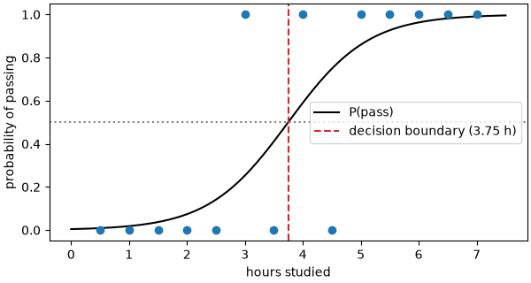

### 10.1 The problem

14 students: hours studied, and whether they passed (1) or failed (0).

| hours | 0.5 | 1 | 1.5 | 2 | 2.5 | 3 | 3.5 | 4 | 4.5 | 5 | 5.5 | 6 | 6.5 | 7 |
|---|---|---|---|---|---|---|---|---|---|---|---|---|---|---|
| passed | 0 | 0 | 0 | 0 | 0 | 1 | 0 | 1 | 0 | 1 | 1 | 1 | 1 | 1 |

We want: **given the hours, the chance of passing.**

A straight line (Chapter 7) fits this as `0.19 · hours − 0.21`. At 0 hours it gives −0.21, and at 10 hours it gives 1.68. A chance must lie between 0 and 1, so a line can't be the answer on its own.

### 10.2 The idea

Keep the line, but pass its output through a function that squeezes any number into 0–1.

```
z = w · x + b          the score: any number
p = σ(z)               the probability: between 0 and 1
predict 1 if p ≥ 0.5
```

### 10.3 The sigmoid

```
σ(z) = 1 / (1 + e^(−z))
```

e^(−z) is always positive, so the denominator is always above 1, and σ(z) always lies between 0 and 1.

| z | −2 | 0 | 2 |
|---|---|---|---|
| e^(−z) | 7.39 | 1 | 0.135 |
| σ(z) | 1/8.39 = **0.12** | 1/2 = **0.50** | 1/1.135 = **0.88** |

```python
import numpy as np

def sigmoid(z):
    return 1 / (1 + np.exp(-z))

for z in [-4, -2, 0, 2, 4]:
    print(f"z = {z:>2}  ->  p = {sigmoid(z):.3f}")
```

**Output:**

```text
z = -4  ->  p = 0.018
z = -2  ->  p = 0.119
z =  0  ->  p = 0.500
z =  2  ->  p = 0.881
z =  4  ->  p = 0.982
```

<details>
<summary><b>Derivation: why this function?</b></summary>

Logistic regression assumes the **log-odds** are a straight line. Odds = p / (1 − p), for example p = 0.8 gives odds of 4. Log-odds can be any number, like a line can.

```
ln(p / (1 − p)) = z
      p / (1 − p) = e^z
                p = e^z − p·e^z
       p(1 + e^z) = e^z
                p = e^z / (1 + e^z) = 1 / (1 + e^(−z))
```

Consequence: one unit more of x adds w to the log-odds, so it **multiplies the odds by e^w**.

</details>

### 10.4 The loss: log loss

Look at the probability the model gave to **what actually happened**: p if y = 1, or 1 − p if y = 0. The loss is minus its log:

```
loss = −[ y · ln(p) + (1 − y) · ln(1 − p) ]
```

(When y = 1 the second term is 0; when y = 0 the first is.)

| y = 1, model's p | 0.9 | 0.5 | 0.1 |
|---|---|---|---|
| loss = −ln(p) | **0.105** | **0.693** | **2.303** |

A confident correct answer costs almost nothing. A confident wrong answer costs a lot.

```python
def log_loss_one(y, p):
    return -(y * np.log(p) + (1 - y) * np.log(1 - p))

print(round(log_loss_one(1, 0.9), 3))
print(round(log_loss_one(1, 0.5), 3))
print(round(log_loss_one(1, 0.1), 3))
```

**Output:**

```text
0.105
0.693
2.303
```

<details>
<summary><b>Derivation: where log loss comes from</b></summary>

The probability the model gives one row's true label is p^y · (1 − p)^(1−y). For all rows, multiply these together (this product is the **likelihood**, Chapter 6.5). Take the log to turn the product into a sum, then flip the sign so it can be minimised. Average it, and you get the log loss.

</details>

### 10.5 The gradient

The chain rule (Chapter 4.5): w → z → p → loss, so

```
∂loss/∂w = ∂loss/∂p · ∂p/∂z · ∂z/∂w
```

| link | result | why |
|---|---|---|
| ∂z/∂w | x | z = w·x + b |
| ∂p/∂z | p(1 − p) | the derivative of the sigmoid (box below) |
| ∂loss/∂p | (p − y) / [p(1 − p)] | differentiate the two logs and combine |

Multiply them, and p(1 − p) cancels:

```
∂loss/∂w = (p − y) · x
∂loss/∂b = (p − y)
```

This has the same form as linear regression's gradient: **error × input**.

<details>
<summary><b>Derivation: the two middle links</b></summary>

Sigmoid derivative:

```
σ(z) = (1 + e^(−z))^(−1)
σ'(z) = e^(−z) / (1 + e^(−z))²
      = [1 / (1 + e^(−z))] · [e^(−z) / (1 + e^(−z))]
      = p · (1 − p)
```

Loss derivative:

```
∂loss/∂p = −y/p + (1 − y)/(1 − p)
         = [−y(1 − p) + (1 − y)p] / [p(1 − p)]
         = (p − y) / [p(1 − p)]
```

</details>

### 10.6 One step by hand

Three students, x = [1, 2, 5], y = [0, 0, 1]. Start at w = b = 0, with learning rate 0.1.

| | 1 | 2 | 3 | average |
|---|---|---|---|---|
| p = σ(0) | 0.5 | 0.5 | 0.5 | |
| p − y | 0.5 | 0.5 | −0.5 | grad_b = **0.167** |
| (p − y)·x | 0.5 | 1.0 | −2.5 | grad_w = **−0.333** |

w = 0 − 0.1 × (−0.333) = **0.033**, and b = 0 − 0.1 × 0.167 = **−0.017**. w went up, so more hours now means a higher chance.

```python
x = np.array([1.0, 2.0, 5.0])
y = np.array([0, 0, 1])
w, b, lr = 0.0, 0.0, 0.1

p = sigmoid(w * x + b)
grad_w = np.mean((p - y) * x)
grad_b = np.mean(p - y)
w, b = w - lr * grad_w, b - lr * grad_b
print("grad_w =", round(grad_w, 3), " grad_b =", round(grad_b, 3))
print("w =", round(w, 3), " b =", round(b, 3))
```

**Output:**

```text
grad_w = -0.333  grad_b = 0.167
w = 0.033  b = -0.017
```

### 10.7 Training

Repeat that step on all 14 students:

```python
hours  = np.array([0.5, 1, 1.5, 2, 2.5, 3, 3.5, 4, 4.5, 5, 5.5, 6, 6.5, 7])
passed = np.array([0,   0, 0,   0, 0,   1, 0,   1, 0,   1, 1,   1, 1,   1])

w, b, lr = 0.0, 0.0, 0.1
for step in range(5001):
    p = sigmoid(w * hours + b)
    if step % 1000 == 0:
        loss = np.mean(log_loss_one(passed, p))
        print(f"step {step:>4}: w = {w:.2f}, b = {b:.2f}, loss = {loss:.3f}")
    w -= lr * np.mean((p - passed) * hours)
    b -= lr * np.mean(p - passed)
```

**Output:**

```text
step    0: w = 0.00, b = 0.00, loss = 0.693
step 1000: w = 1.16, b = -4.24, loss = 0.322
step 2000: w = 1.34, b = -4.99, loss = 0.315
step 3000: w = 1.41, b = -5.27, loss = 0.314
step 4000: w = 1.44, b = -5.38, loss = 0.314
step 5000: w = 1.45, b = -5.43, loss = 0.314
```

The loss starts at 0.693 = −ln(0.5), because at the start every prediction is 50/50. It levels off at 0.314, which means training is done.

### 10.8 Using the model

- **Predict, for 4 hours:** z = 1.45 × 4 − 5.43 = 0.37, and σ(0.37) = **0.59**.
- **Decision boundary:** p = 0.5 where z = 0, so hours = 5.43 / 1.45 = **3.75**.
- **Weight:** each hour multiplies the odds of passing by e^1.45 = **4.26**.

```python
for h in [2, 4, 6]:
    print(f"{h} hours -> P(pass) = {sigmoid(w * h + b):.2f}")
print("boundary:", round(-b / w, 2), "| odds ratio:", round(np.exp(w), 2))
```

**Output:**

```text
2 hours -> P(pass) = 0.07
4 hours -> P(pass) = 0.59
6 hours -> P(pass) = 0.96
boundary: 3.75 | odds ratio: 4.26
```

<details>
<summary><b>Code for the chart at the top</b></summary>

```python
import matplotlib.pyplot as plt

grid = np.linspace(0, 7.5, 200)
fig, ax = plt.subplots(figsize=(6, 3.2), layout="constrained")
ax.scatter(hours, passed, color="tab:blue", zorder=3)
ax.plot(grid, sigmoid(w * grid + b), color="black", label="P(pass)")
ax.axhline(0.5, ls=":", color="gray")
ax.axvline(-b / w, ls="--", color="tab:red", label="decision boundary (3.75 h)")
ax.set(xlabel="hours studied", ylabel="probability of passing")
ax.legend(loc="center right")
fig.savefig("logistic-sigmoid.png", dpi=100)
plt.close(fig)
```

</details>

### 10.9 Many features

With several features, the score is a dot product, z = X @ w + b (Chapter 3.3). The gradient for each weight is the average of (p − y) times that feature, which is a transpose product, exactly as in Chapter 7.6:

```
∇w = (1/n) · Xᵀ (p − y)        ∂/∂b = mean(p − y)
```

We'll use the breast-cancer dataset bundled with scikit-learn: 569 tumours, 30 measurements each (radius, texture and so on), labelled malignant or benign. In this dataset 0 means malignant, so we flip it to make 1 = malignant, the class we want to catch. As in Chapter 7.8, we standardise the features so one learning rate suits all of them.

```python
from sklearn.datasets import load_breast_cancer
from sklearn.model_selection import train_test_split

X, y = load_breast_cancer(return_X_y=True)
y = 1 - y                                         # 1 = malignant
X_train, X_test, y_train, y_test = train_test_split(X, y, test_size=0.25, stratify=y, random_state=0)

mu, sigma = X_train.mean(axis=0), X_train.std(axis=0)   # from the TRAINING rows only
Xs_train, Xs_test = (X_train - mu) / sigma, (X_test - mu) / sigma

w, b = np.zeros(30), 0.0
for step in range(2000):
    p = sigmoid(Xs_train @ w + b)
    w -= 0.1 * Xs_train.T @ (p - y_train) / len(y_train)
    b -= 0.1 * np.mean(p - y_train)

pred = (sigmoid(Xs_test @ w + b) >= 0.5).astype(int)
print("test accuracy:", round(np.mean(pred == y_test), 3))
```

**Output:**

```text
test accuracy: 0.972
```

The mean and standard deviation come from the training rows only, and are then applied to the test rows. The test set must stay unseen, even by the scaling step. Chapter 25 explains why.

### 10.10 In scikit-learn

`LogisticRegression` minimises the same log loss, with a faster optimiser than our loop.

```python
from sklearn.linear_model import LogisticRegression

model = LogisticRegression(C=1e6)          # C: see below
model.fit(hours.reshape(-1, 1), passed)    # X must be 2D: 14 rows × 1 column
print("w =", model.coef_[0][0].round(2), " b =", model.intercept_[0].round(2))
print(model.predict_proba([[2], [4], [6]])[:, 1].round(2))
print(model.predict([[2], [4], [6]]))
```

**Output:**

```text
w = 1.46  b = -5.47
[0.07 0.59 0.96]
[0 1 1]
```

| sklearn | ours |
|---|---|
| `.fit(X, y)` | the loop in 10.7 |
| `.coef_`, `.intercept_` | w, b |
| `.predict_proba(X)[:, 1]` | sigmoid(w·x + b) (column 0 is P(fail)) |
| `.predict(X)` | p ≥ 0.5 → 1 |
| `C` | strength of a penalty on large weights (Chapter 16). `C=1e6` turns it off so the results match ours. |

The weights differ only in the second decimal, because our loop stopped at 5,000 steps.

The same class handles the 30-feature data. Note `max_iter`, the maximum number of optimiser steps; scikit-learn warns if it runs out before converging.

```python
clf = LogisticRegression(max_iter=1000).fit(Xs_train, y_train)
print("test accuracy:", round(clf.score(Xs_test, y_test), 3))
print("P(malignant), first 3 test tumours:", clf.predict_proba(Xs_test[:3])[:, 1].round(3))
```

**Output:**

```text
test accuracy: 0.986
P(malignant), first 3 test tumours: [1.    0.016 0.026]
```

For classifiers, `.score` returns **accuracy**. Chapter 12 shows why accuracy alone can mislead.

### 10.11 Summary

```
score       z = w·x + b
probability p = 1 / (1 + e^(−z))
loss        −[y ln p + (1 − y) ln(1 − p)]
gradient    ∂/∂w = (p − y)·x     ∂/∂b = p − y
update      w ← w − lr · ∂/∂w
```

**Watch out:** standardise features before gradient descent (Chapter 7.8). The 0.5 threshold is a choice, not a rule (Chapter 13).

**Key terms:**

- **Logistic regression:** a classifier that turns a weighted sum into a probability with the sigmoid, trained by minimising log loss.
- **Score (logit, z):** the weighted sum w · x + b before the sigmoid.
- **Sigmoid (σ):** σ(z) = 1 / (1 + e^(−z)); it squeezes any number into the range 0 to 1.
- **Odds:** p / (1 − p), how many times more likely yes is than no.
- **Log-odds:** ln(p / (1 − p)); logistic regression models it as a straight line.
- **Odds ratio:** e^w, how many times the odds multiply when a feature rises by 1.
- **Log loss (binary cross-entropy):** −[y ln p + (1 − y) ln(1 − p)], the negative log-likelihood of the true label.
- **Decision boundary:** where the model is exactly 50/50 (z = 0); one side is predicted 1, the other 0.
- **Threshold:** the probability above which the model predicts 1 (0.5 by default).
- **`predict_proba`:** scikit-learn's method returning a probability for each class.
- **`max_iter`:** the maximum number of optimiser steps scikit-learn may take.

**Exercises**

1. With w = 1.45 and b = −5.43: what is P(pass) at 6 hours? How many hours give 90%? (Hint: p = 0.9 means z = ln(0.9 / 0.1) = ln 9.)
2. A student failed (y = 0) after 3 hours, and the model said p = 0.8. Find the loss and (p − y)·x. Does w go up or down?

<details>
<summary><b>Answers</b></summary>

1. z = 3.27, so p = **0.963**. For 90%: (ln 9 + 5.43) / 1.45 = **5.26 hours**.
2. loss = −ln(0.2) = **1.609**, and (p − y)·x = 0.8 × 3 = **2.4**. The update subtracts it, so w goes **down**.

</details>

| # | Problem (Deep-ML) | Difficulty |
|---|---|---|
| 1 | [22. Sigmoid Activation Function Understanding](https://www.deep-ml.com/problems/22) | 🟢 Easy |
| 2 | [104. Binary Classification with Logistic Regression](https://www.deep-ml.com/problems/104) | 🟢 Easy |
| 3 | [106. Train Logistic Regression with Gradient Descent](https://www.deep-ml.com/problems/106) | 🔴 Hard |

**Learn more:** [StatQuest: logistic regression (video)](https://www.youtube.com/watch?v=yIYKR4sgzI8) · [MLU-Explain: logistic regression](https://mlu-explain.github.io/logistic-regression/)

---

## 11. Softmax Regression: More Than Two Classes

**You need:** Chapter 10. · **You'll learn:** how logistic regression extends to three or more classes, with the softmax function and cross-entropy loss.

### 11.1 The problem

Logistic regression answers yes/no. Many questions have more answers: which of 3 iris species is this flower? Which digit, 0–9? This is **multi-class classification**.

We'll use the iris dataset: 150 flowers, 4 measurements each (sepal length and width, petal length and width, in cm), and 3 species (classes 0, 1, 2).

### 11.2 One score per class

Give each class its own weights and its own score:

```
z₀ = w₀ · x + b₀
z₁ = w₁ · x + b₁
z₂ = w₂ · x + b₂
```

Stack the weight vectors as the columns of a matrix W, of shape (features × classes). Then all scores for all rows come from one product: **Z = X @ W + b**, with shape (rows × classes).

### 11.3 Softmax: scores into probabilities

We need probabilities that are all positive and add up to 1. **Softmax** does that:

```
pₖ = e^(zₖ) / (e^(z₀) + e^(z₁) + … )
```

- e^z is always positive, and bigger scores stay bigger.
- Dividing by the total makes them add up to 1.

**By hand**, for z = [2, 1, 0]: e² = 7.389, e¹ = 2.718, e⁰ = 1, and the total is 11.107.

```
p = [7.389, 2.718, 1] / 11.107 = [0.665, 0.245, 0.090]
```

The model's guess is the class with the highest probability, class 0.

```python
import numpy as np

def softmax(Z):
    Z = Z - Z.max(axis=1, keepdims=True)      # stability trick, explained below
    E = np.exp(Z)
    return E / E.sum(axis=1, keepdims=True)

print(softmax(np.array([[2.0, 1.0, 0.0]])).round(3))
```

**Output:**

```text
[[0.665 0.245 0.09 ]]
```

**The stability trick.** e^1000 is too big for the computer, so it becomes infinity. Subtracting the row's largest score from every score doesn't change the answer, because the factor e^(−max) appears on the top and the bottom and cancels. And it keeps every exponent at 0 or below. `keepdims=True` keeps the result as a column, so it broadcasts across each row (Chapter 3.7).

<details>
<summary><b>Derivation: sigmoid is softmax with two classes</b></summary>

With two classes, fix the second score at 0 (only the difference between scores matters). Then

```
p₁ = e^z / (e^z + e^0) = e^z / (e^z + 1) = 1 / (1 + e^(−z)) = σ(z)
```

So logistic regression is the two-class case of softmax regression.

</details>

### 11.4 The loss: cross-entropy

As in Chapter 10, punish a small probability on the **true** class:

```
loss = −ln(p_true)
```

If the true class is 0 and p = [0.665, 0.245, 0.090], the loss is −ln(0.665) = **0.408**. If the true class were 2, it would be −ln(0.090) = **2.408**.

Write the true class as a **one-hot** vector: all zeros except a 1 at the true class, so class 0 becomes [1, 0, 0]. The loss can then be written as a sum, which is the form you'll see in books:

```
loss = −Σₖ yₖ · ln(pₖ)        (only the true class's term is non-zero)
```

This is **cross-entropy**. Log loss (Chapter 10) is its two-class case.

### 11.5 The gradient

The result is as simple as in Chapter 10. For each class k:

```
∂loss/∂zₖ = pₖ − yₖ
```

That's predicted probability minus one-hot truth. For p = [0.665, 0.245, 0.090] and true class 0: [−0.335, 0.245, 0.090]. Training raises the true class's score and lowers the others. Through z = X @ W + b, by the chain rule (as in Chapter 7.6):

```
∇W = (1/n) · Xᵀ (P − Y)          ∇b = column means of (P − Y)
```

P is the (rows × classes) matrix of probabilities, and Y is the one-hot matrix.

<details>
<summary><b>Derivation: ∂loss/∂zₖ = pₖ − yₖ</b></summary>

Let t be the true class, so loss = −ln pₜ = −zₜ + ln Σⱼ e^(zⱼ). Differentiate with respect to zₖ:

```
∂/∂zₖ (−zₜ)          = −1 if k = t, else 0        = −yₖ
∂/∂zₖ ln Σⱼ e^(zⱼ)   = e^(zₖ) / Σⱼ e^(zⱼ)          = pₖ
```

Adding the two gives pₖ − yₖ.

</details>

### 11.6 Training from scratch

```python
from sklearn.datasets import load_iris
from sklearn.model_selection import train_test_split

X, y = load_iris(return_X_y=True)
X_train, X_test, y_train, y_test = train_test_split(X, y, test_size=0.3, stratify=y, random_state=0)
mu, sigma = X_train.mean(axis=0), X_train.std(axis=0)
X_train, X_test = (X_train - mu) / sigma, (X_test - mu) / sigma

Y = np.eye(3)[y_train]                 # one-hot: row k of the 3×3 identity matrix
print("one-hot for classes 0, 2, 1:\n", np.eye(3)[[0, 2, 1]])

W, b = np.zeros((4, 3)), np.zeros(3)
for step in range(1001):
    P = softmax(X_train @ W + b)
    if step % 250 == 0:
        loss = -np.mean(np.log(P[np.arange(len(y_train)), y_train]))   # −ln p of each row's true class
        print(f"step {step:>4}: loss {loss:.3f}")
    W -= 0.5 * X_train.T @ (P - Y) / len(y_train)
    b -= 0.5 * (P - Y).mean(axis=0)

pred = softmax(X_test @ W + b).argmax(axis=1)   # the most probable class for each row
print("test accuracy:", round(np.mean(pred == y_test), 3))
```

**Output:**

```text
one-hot for classes 0, 2, 1:
 [[1. 0. 0.]
 [0. 0. 1.]
 [0. 1. 0.]]
step    0: loss 1.099
step  250: loss 0.118
step  500: loss 0.090
step  750: loss 0.079
step 1000: loss 0.073
test accuracy: 1.0
```

`P[np.arange(n), y_train]` picks, from each row, the probability of that row's true class. `np.eye(3)` is the 3×3 identity matrix, so indexing its rows by the labels gives the one-hot vectors.

### 11.7 In scikit-learn

`LogisticRegression` switches to softmax automatically when y has more than two classes.

```python
from sklearn.linear_model import LogisticRegression

clf = LogisticRegression(max_iter=1000).fit(X_train, y_train)
print("test accuracy:", round(clf.score(X_test, y_test), 3))
print("coef_ shape:", clf.coef_.shape, "(one row of weights per class)")
print("probabilities for one flower:", clf.predict_proba(X_test[:1]).round(3))
```

**Output:**

```text
test accuracy: 0.978
coef_ shape: (3, 4) (one row of weights per class)
probabilities for one flower: [[0.    0.036 0.964]]
```

Our model got all 45 test flowers right and scikit-learn's got 44. The small difference comes from scikit-learn's default penalty on large weights (`C=1`, Chapter 16). Note that scikit-learn stores the weights as **(classes × features)**, the transpose of our W.

**Another approach: one-vs-rest.** Train one yes/no model per class ("class 0 or not?", "class 1 or not?" …), and pick the class whose model is most confident. It's simple and works with any binary model, but its probabilities don't naturally add up to 1. Softmax is the standard choice for linear models.

### 11.8 Summary

```
scores         Z = X W + b                   (rows × classes)
softmax        pₖ = e^(zₖ) / Σⱼ e^(zⱼ)          (subtract the row max first)
cross-entropy  loss = −ln p_true = −Σ yₖ ln pₖ
gradient       ∂/∂Z = P − Y   →   ∇W = Xᵀ(P − Y)/n
predict        argmax of the probabilities
```

**Key terms:**

- **Multi-class classification:** predicting one of three or more categories.
- **Softmax:** turns a vector of scores into probabilities that are positive and sum to 1: e^(zₖ) / Σ e^(zⱼ).
- **Softmax regression (multinomial logistic regression):** logistic regression with one score per class and softmax on top.
- **One-hot encoding:** a vector of zeros with a single 1 marking the class.
- **Cross-entropy:** −Σ yₖ ln pₖ, the negative log-probability of the true class.
- **argmax:** the position of the largest value; the predicted class.
- **One-vs-rest (OvR):** solving a multi-class problem with one yes/no model per class.

**Exercises**

1. By hand: softmax of z = [0, 0, 0]. Then of z = [10, 10, 10]. What do you notice?
2. For z = [1, 3] (two classes), compute softmax and compare with σ(3 − 1).

<details>
<summary><b>Answers</b></summary>

1. Both give [1/3, 1/3, 1/3]. Adding the same number to every score changes nothing, which is why the stability trick works.
2. softmax = [e¹, e³] / (e¹ + e³) = [0.119, 0.881], and σ(2) = 0.881. They're the same.

```python
print(softmax(np.array([[0., 0, 0], [10, 10, 10]])).round(3))
print(softmax(np.array([[1., 3]])).round(3))
```

**Output:**

```text
[[0.333 0.333 0.333]
 [0.333 0.333 0.333]]
[[0.119 0.881]]
```

</details>

| # | Problem (Deep-ML) | Difficulty |
|---|---|---|
| 1 | [23. Softmax Activation Function Implementation ](https://www.deep-ml.com/problems/23) | 🟢 Easy |
| 2 | [134. Compute Multi-class Cross-Entropy Loss](https://www.deep-ml.com/problems/134) | 🟢 Easy |
| 3 | [105. Train Softmax Regression with Gradient Descent](https://www.deep-ml.com/problems/105) | 🔴 Hard |

---

## 12. Classification Metrics: Confusion Matrix, Precision, Recall and F1

**You need:** Chapters 10 and 11. · **You'll learn:** why accuracy can mislead, and the four numbers that describe a classifier's mistakes properly.

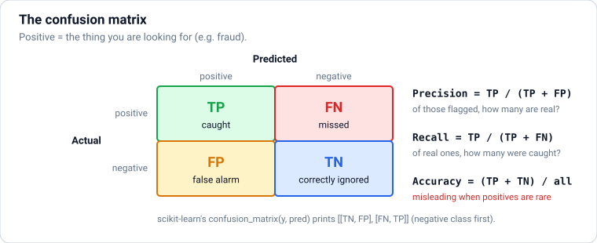

### 12.1 Why accuracy isn't enough

1% of card payments are fraud. A "model" that **always** says "not fraud" is right 99% of the time: 99% accuracy, and it catches **zero** frauds. Accuracy hides which kind of mistake is being made, and when one class is rare, that's all that matters.

### 12.2 The four outcomes

Call the class you're looking for (fraud, disease, spam) **positive**, and the other **negative**. Every prediction lands in one of four boxes:

| | predicted positive | predicted negative |
|---|---|---|
| **actually positive** | **TP** true positive (caught) | **FN** false negative (missed) |
| **actually negative** | **FP** false positive (false alarm) | **TN** true negative (correctly ignored) |

This table of counts is the **confusion matrix**.

**Traced:** 10 patients, 4 of them sick (1).

```
true:      1 1 1 1 0 0 0 0 0 0
predicted: 1 1 1 0 1 1 0 0 0 0
```

- Patients 1–3: sick and flagged → **TP = 3**
- Patient 4: sick and missed → **FN = 1**
- Patients 5–6: healthy but flagged → **FP = 2**
- Patients 7–10: healthy and not flagged → **TN = 4**

### 12.3 Precision and recall

**Precision:** of everything we **flagged**, how much was really positive?

```
precision = TP / (TP + FP) = 3 / (3 + 2) = 0.60
```

**Recall:** of everything **really positive**, how much did we catch?

```
recall = TP / (TP + FN) = 3 / (3 + 1) = 0.75
```

Accuracy = (TP + TN) / all = 7 / 10 = 0.70.

| question | metric | care most when… |
|---|---|---|
| "When it raises an alarm, is it right?" | precision | false alarms are costly (blocking a good customer's card) |
| "Does it find them all?" | recall | misses are costly (missing a cancer) |

The two pull against each other. Flag everyone and recall is 1, but precision collapses. Flag only the most certain case and precision may be 1, but recall is tiny. Chapter 13 shows how to choose the balance.

### 12.4 F1: one number for both

```
F1 = 2 · precision · recall / (precision + recall)
```

For our patients: 2 × 0.6 × 0.75 / 1.35 = **0.667**.

F1 is the **harmonic mean** of precision and recall, and it's low if **either one** is low. Compare it with the ordinary average for precision 1.0 and recall 0.01:

- ordinary average: (1 + 0.01) / 2 = 0.505, which looks fine;
- F1: 2 × 1 × 0.01 / 1.01 = **0.0198**, which correctly says the model is useless.

### 12.5 By hand in NumPy

```python
import numpy as np

y_true = np.array([1, 1, 1, 1, 0, 0, 0, 0, 0, 0])
y_pred = np.array([1, 1, 1, 0, 1, 1, 0, 0, 0, 0])

TP = np.sum((y_true == 1) & (y_pred == 1))
FN = np.sum((y_true == 1) & (y_pred == 0))
FP = np.sum((y_true == 0) & (y_pred == 1))
TN = np.sum((y_true == 0) & (y_pred == 0))
precision, recall = TP / (TP + FP), TP / (TP + FN)
print("TP, FN, FP, TN:", TP, FN, FP, TN)
print("accuracy:", (TP + TN) / len(y_true))
print("precision:", precision, " recall:", recall)
print("F1:", round(2 * precision * recall / (precision + recall), 3))
```

**Output:**

```text
TP, FN, FP, TN: 3 1 2 4
accuracy: 0.7
precision: 0.6  recall: 0.75
F1: 0.667
```

`&` means "and", element by element, and `np.sum` of True/False values counts the Trues.

### 12.6 In scikit-learn

```python
from sklearn.metrics import confusion_matrix, precision_score, recall_score, f1_score

print(confusion_matrix(y_true, y_pred))
print("precision:", precision_score(y_true, y_pred))
print("recall:   ", recall_score(y_true, y_pred))
print("F1:       ", round(f1_score(y_true, y_pred), 3))
```

**Output:**

```text
[[4 2]
 [1 3]]
precision: 0.6
recall:    0.75
F1:        0.667
```

**Careful with the layout:** scikit-learn sorts the classes, so the negative class (0) comes first. The matrix reads `[[TN, FP], [FN, TP]]`, upside down compared with the table in 12.2.

### 12.7 On a real model

The breast-cancer model from Chapter 10 had 98.6% accuracy. Here's what that means for patients:

```python
from sklearn.datasets import load_breast_cancer
from sklearn.model_selection import train_test_split
from sklearn.linear_model import LogisticRegression
from sklearn.metrics import classification_report

X, y = load_breast_cancer(return_X_y=True)
y = 1 - y                                          # 1 = malignant
X_train, X_test, y_train, y_test = train_test_split(X, y, test_size=0.25, stratify=y, random_state=0)
mu, sigma = X_train.mean(axis=0), X_train.std(axis=0)
model = LogisticRegression(max_iter=1000).fit((X_train - mu) / sigma, y_train)
pred = model.predict((X_test - mu) / sigma)

print(confusion_matrix(y_test, pred))
print(classification_report(y_test, pred, target_names=["benign", "malignant"], digits=3))
```

**Output:**

```text
[[90  0]
 [ 2 51]]
              precision    recall  f1-score   support

      benign      0.978     1.000     0.989        90
   malignant      1.000     0.962     0.981        53

    accuracy                          0.986       143
   macro avg      0.989     0.981     0.985       143
weighted avg      0.986     0.986     0.986       143
```

Two malignant tumours were missed (FN = 2) and none were falsely flagged (FP = 0). `classification_report` prints precision, recall and F1 for each class. **Support** is how many true examples of each class there are. The two averages at the bottom:

- **macro avg:** the plain average over classes, so every class counts equally;
- **weighted avg:** each class weighted by its support, so big classes count more.

For multi-class problems, the confusion matrix simply becomes classes × classes: row = true class, column = predicted class.

### 12.8 Summary

```
precision = TP / (TP + FP)        of flagged, how many real
recall    = TP / (TP + FN)        of real, how many flagged
F1        = 2PR / (P + R)         low if either is low
accuracy  = (TP + TN) / all       misleading when classes are imbalanced
sklearn confusion_matrix → [[TN, FP], [FN, TP]]
```

**Key terms:**

- **Positive / negative class:** the class you're trying to detect, and the other one.
- **True positive (TP):** a positive correctly flagged.
- **False positive (FP):** a negative wrongly flagged; a false alarm.
- **False negative (FN):** a positive that was missed.
- **True negative (TN):** a negative correctly left alone.
- **Confusion matrix:** the table of counts of true classes against predicted classes.
- **Precision:** TP / (TP + FP), the share of flagged items that are really positive.
- **Recall (sensitivity, true positive rate):** TP / (TP + FN), the share of real positives that were caught.
- **F1 score:** the harmonic mean of precision and recall.
- **Harmonic mean:** an average that's pulled towards the smaller value.
- **Support:** the number of true examples of a class.
- **Macro average:** the unweighted average of a metric over classes.
- **Imbalanced classes:** one class is much rarer than the other (Chapter 39).

**Exercises**

1. A fraud model flags 50 payments; 40 of them are fraud. There were 80 frauds in total. What are its precision and recall?
2. For the "always say not fraud" model in 12.1, what are recall and precision?

<details>
<summary><b>Answers</b></summary>

1. Precision = 40 / 50 = **0.8**, and recall = 40 / 80 = **0.5**.
2. Recall = 0 / (0 + all frauds) = **0**. Precision = 0 / 0, which is undefined because it flags nothing. scikit-learn returns 0 and shows a warning.

</details>

| # | Problem (Deep-ML) | Difficulty |
|---|---|---|
| 1 | [75. Generate a Confusion Matrix for Binary Classification](https://www.deep-ml.com/problems/75) | 🟢 Easy |
| 2 | [46. Implement Precision Metric](https://www.deep-ml.com/problems/46) | 🟢 Easy |
| 3 | [52. Implement Recall Metric in Binary Classification](https://www.deep-ml.com/problems/52) | 🟢 Easy |
| 4 | [91. Calculate F1 Score from Predicted and True Labels](https://www.deep-ml.com/problems/91) | 🟢 Easy |

**Learn more:** [Google ML Crash Course: accuracy, precision, recall](https://developers.google.com/machine-learning/crash-course/classification/accuracy-precision-recall)

---

## 13. Thresholds, ROC and Precision–Recall Curves

**You need:** Chapter 12. · **You'll learn:** how moving the decision threshold trades precision against recall, how ROC and precision–recall curves show every threshold at once, and how to pick a threshold from costs.

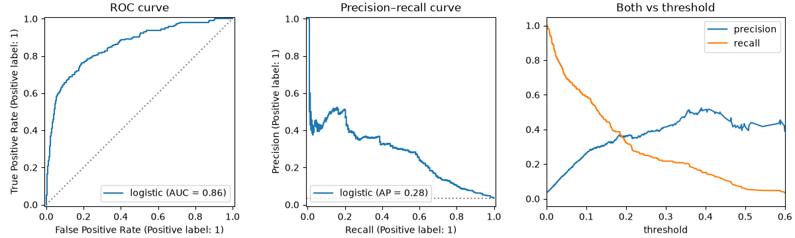

### 13.1 The threshold is a dial

A classifier like logistic regression outputs a **probability**, and we turn it into yes/no with a **threshold**: predict 1 if p ≥ threshold. 0.5 is only the default. Lower it and more cases get flagged: recall rises, precision usually falls. Raise it and the opposite happens.

Eight cases, sorted by the model's probability:

| case | A | B | E | C | F | D | G | H |
|---|---|---|---|---|---|---|---|---|
| p | 0.9 | 0.8 | 0.7 | 0.6 | 0.4 | 0.3 | 0.2 | 0.1 |
| true | 1 | 1 | **0** | 1 | **0** | 1 | 0 | 0 |

| threshold | flagged | TP | FP | FN | precision | recall |
|---|---|---|---|---|---|---|
| 0.75 | A B | 2 | 0 | 2 | 1.00 | 0.50 |
| 0.5 | A B E C | 3 | 1 | 1 | 0.75 | 0.75 |
| 0.25 | A B E C F D | 4 | 2 | 0 | 0.67 | 1.00 |

```python
import numpy as np

y = np.array([1, 1, 0, 1, 0, 1, 0, 0])
p = np.array([0.9, 0.8, 0.7, 0.6, 0.4, 0.3, 0.2, 0.1])

for t in [0.75, 0.5, 0.25]:
    pred = (p >= t).astype(int)
    TP = np.sum((pred == 1) & (y == 1)); FP = np.sum((pred == 1) & (y == 0))
    FN = np.sum((pred == 0) & (y == 1))
    print(f"threshold {t}: precision {TP / (TP + FP):.2f}, recall {TP / (TP + FN):.2f}")
```

**Output:**

```text
threshold 0.75: precision 1.00, recall 0.50
threshold 0.5: precision 0.75, recall 0.75
threshold 0.25: precision 0.67, recall 1.00
```

### 13.2 The ROC curve

The ROC curve plots two rates for **every** threshold:

```
true positive rate  TPR = TP / (TP + FN)      (= recall: share of positives caught)
false positive rate FPR = FP / (FP + TN)      (share of negatives wrongly flagged)
```

Start with the threshold above every score: nothing is flagged, so the point is (0, 0). Lower it past one case at a time. Each positive moves the curve **up** by 1/4 (there are 4 positives), and each negative moves it **right** by 1/4 (4 negatives).

| lower past | A (1) | B (1) | E (0) | C (1) | F (0) | D (1) | G (0) | H (0) |
|---|---|---|---|---|---|---|---|---|
| FPR | 0 | 0 | 0.25 | 0.25 | 0.5 | 0.5 | 0.75 | 1 |
| TPR | 0.25 | 0.5 | 0.5 | 0.75 | 0.75 | 1 | 1 | 1 |

A perfect model goes straight up to (0, 1), then across. Random guessing follows the diagonal from (0, 0) to (1, 1).

### 13.3 AUC: the whole curve in one number

The **area under the ROC curve (AUC)** sums up every threshold at once. It has a neat meaning:

> **AUC = the probability that a randomly chosen positive gets a higher score than a randomly chosen negative.**

Check with our 8 cases. There are 4 × 4 = 16 (positive, negative) pairs. Count the pairs where the positive scores higher:

- A (0.9) and B (0.8) beat all 4 negatives: 4 + 4
- C (0.6) beats F, G, H but not E (0.7): 3
- D (0.3) beats G and H: 2

AUC = 13 / 16 = **0.8125**. 1.0 is perfect, 0.5 is random guessing.

```python
pos, neg = p[y == 1], p[y == 0]
pairs = [(a > b) for a in pos for b in neg]
print("AUC by counting pairs:", np.mean(pairs))
```

**Output:**

```text
AUC by counting pairs: 0.8125
```

AUC doesn't depend on any one threshold, and it only uses the **order** of the scores. That makes it a good way to compare models before choosing a threshold.

### 13.4 The precision–recall curve

When positives are rare (fraud at 0.1%), the ROC curve can look excellent even for a poor model. FPR divides by the huge number of negatives, so thousands of false alarms still look like a small rate. The **precision–recall (PR) curve** plots precision against recall for every threshold instead, and false alarms show up directly in precision.

Its summary number is **average precision (AP)**: the average of the precision values at each point where recall rises. In our table, recall rises at A, B, C and D, where the precision is 1/1, 2/2, 3/4 and 4/6:

```
AP = (1 + 1 + 0.75 + 0.667) / 4 = 0.854
```

A random model's AP equals the share of positives, which here is 0.5. **Use PR curves and AP when positives are rare.**

### 13.5 Choosing a threshold from costs

The best threshold depends on what mistakes **cost**. Suppose a missed fraud (FN) costs ₹5,000 and a false alarm (FP) costs ₹200 of customer annoyance. Try every threshold and keep the cheapest:

```
total cost = FN × 5000 + FP × 200
```

```python
for t in [0.75, 0.5, 0.25, 0.15]:
    pred = (p >= t).astype(int)
    FN = np.sum((pred == 0) & (y == 1)); FP = np.sum((pred == 1) & (y == 0))
    print(f"threshold {t}: FN {FN}, FP {FP}, cost ₹{FN * 5000 + FP * 200}")
```

**Output:**

```text
threshold 0.75: FN 2, FP 0, cost ₹10000
threshold 0.5: FN 1, FP 1, cost ₹5200
threshold 0.25: FN 0, FP 2, cost ₹400
threshold 0.15: FN 0, FP 3, cost ₹600
```

Misses are expensive here, so a low threshold wins. Always pick the threshold on **validation** data, then report the test score at that threshold.

### 13.6 In scikit-learn

Every function takes the true labels and the **probabilities** (not the 0/1 predictions):

```python
from sklearn.metrics import roc_auc_score, average_precision_score, roc_curve

print("AUC:", roc_auc_score(y, p))
print("AP: ", round(average_precision_score(y, p), 3))
fpr, tpr, thresholds = roc_curve(y, p)
print("FPR:", fpr.round(2))
print("TPR:", tpr.round(2))
```

**Output:**

```text
AUC: 0.8125
AP:  0.854
FPR: [0.   0.   0.   0.25 0.25 0.5  0.5  1.  ]
TPR: [0.   0.25 0.5  0.5  0.75 0.75 1.   1.  ]
```

The same 0.8125 and 0.854 we worked out by hand. `roc_curve` adds the starting point (0, 0) and skips points that lie on a straight segment.

On the breast-cancer model:

```python
from sklearn.datasets import load_breast_cancer
from sklearn.model_selection import train_test_split
from sklearn.linear_model import LogisticRegression
from sklearn.metrics import precision_recall_curve

X, y_bc = load_breast_cancer(return_X_y=True)
y_bc = 1 - y_bc
X_train, X_test, y_train, y_test = train_test_split(X, y_bc, test_size=0.25, stratify=y_bc, random_state=0)
mu, sigma = X_train.mean(axis=0), X_train.std(axis=0)
model = LogisticRegression(max_iter=1000).fit((X_train - mu) / sigma, y_train)
proba = model.predict_proba((X_test - mu) / sigma)[:, 1]

print("AUC:", round(roc_auc_score(y_test, proba), 4), "| AP:", round(average_precision_score(y_test, proba), 4))
for t in [0.5, 0.2, 0.05]:
    pred = proba >= t
    print(f"threshold {t}: recall {np.mean(pred[y_test == 1]):.3f}, flagged {pred.sum()} of {len(pred)}")
```

**Output:**

```text
AUC: 0.9958 | AP: 0.994
threshold 0.5: recall 0.962, flagged 51 of 143
threshold 0.2: recall 0.981, flagged 61 of 143
threshold 0.05: recall 1.000, flagged 68 of 143
```

At threshold 0.05 the model catches every malignant tumour. The price is 15 benign tumours sent for review (68 flagged, 53 of them malignant), where 0.5 sent none.

<details>
<summary><b>Code for the chart at the top</b></summary>

```python
import matplotlib.pyplot as plt

fpr_bc, tpr_bc, _ = roc_curve(y_test, proba)
prec_bc, rec_bc, _ = precision_recall_curve(y_test, proba)
fig, (a1, a2) = plt.subplots(1, 2, figsize=(9, 3.4), layout="constrained")
a1.plot(fpr_bc, tpr_bc, color="tab:blue")
a1.plot([0, 1], [0, 1], ls=":", color="gray", label="random")
a1.set(xlabel="false positive rate", ylabel="true positive rate (recall)", title=f"ROC, AUC = {roc_auc_score(y_test, proba):.3f}")
a1.legend()
a2.plot(rec_bc, prec_bc, color="tab:green")
a2.axhline(y_test.mean(), ls=":", color="gray", label="random")
a2.set(xlabel="recall", ylabel="precision", title=f"Precision–recall, AP = {average_precision_score(y_test, proba):.3f}")
a2.legend()
fig.savefig("classifier-curves.png", dpi=100)
plt.close(fig)
```

</details>

### 13.7 Summary

```
TPR = TP/(TP+FN) = recall            FPR = FP/(FP+TN)
ROC: TPR vs FPR over all thresholds  AUC = P(score of a positive > score of a negative)
PR:  precision vs recall             AP ≈ area under it; prefer when positives are rare
threshold: choose on validation data, from the costs of FN and FP
```

**Key terms:**

- **Decision threshold:** the probability above which a case is predicted positive.
- **True positive rate (TPR):** the same as recall, TP / (TP + FN).
- **False positive rate (FPR):** FP / (FP + TN), the share of negatives wrongly flagged.
- **ROC curve:** TPR plotted against FPR as the threshold moves.
- **AUC (ROC AUC):** the area under the ROC curve; the chance a random positive outscores a random negative.
- **Precision–recall (PR) curve:** precision plotted against recall as the threshold moves.
- **Average precision (AP):** a summary of the PR curve; the average precision at each rise in recall.
- **Cost-sensitive threshold:** a threshold chosen to minimise the total cost of mistakes.

**Exercises**

1. A model gives every case the same probability, 0.5. What are its AUC and its ROC curve?
2. In 13.5, the costs change so that a false alarm costs ₹3,000 and a miss ₹5,000. Which threshold is now cheapest?

<details>
<summary><b>Answers</b></summary>

1. Every positive–negative pair is a tie, and ties count as half, so AUC = **0.5**. The curve jumps from (0, 0) straight to (1, 1): the diagonal.

```python
for t in [0.75, 0.5, 0.25, 0.15]:
    pred = (p >= t).astype(int)
    FN = np.sum((pred == 0) & (y == 1)); FP = np.sum((pred == 1) & (y == 0))
    print(f"threshold {t}: cost ₹{FN * 5000 + FP * 3000}")
```

**Output:**

```text
threshold 0.75: cost ₹10000
threshold 0.5: cost ₹8000
threshold 0.25: cost ₹6000
threshold 0.15: cost ₹9000
```

2. Still **0.25** (₹6,000), but its lead over 0.5 (₹8,000) has shrunk from ₹4,800 to ₹2,000. Make false alarms a little more expensive and a higher threshold wins.

</details>

| # | Problem (Deep-ML) | Difficulty |
|---|---|---|
| 1 | [276. Implement ROC Curve Calculation](https://www.deep-ml.com/problems/276) | 🟡 Medium |
| 2 | [277. Calculate AUC (Area Under ROC Curve)](https://www.deep-ml.com/problems/277) | 🟡 Medium |
| 3 | [278. Implement Precision-Recall Curve](https://www.deep-ml.com/problems/278) | 🟡 Medium |

**Learn more:** [Google ML Crash Course: ROC and AUC](https://developers.google.com/machine-learning/crash-course/classification/roc-and-auc) · [MLU-Explain: ROC and AUC](https://mlu-explain.github.io/roc-auc/)

---

## 14. k-Nearest Neighbours and Feature Scaling

**You need:** Chapters 3, 9 and 12. · **You'll learn:** the simplest model of all (copy your nearest neighbours), why it needs features on the same scale, and scikit-learn's **transformers**, which do that scaling.

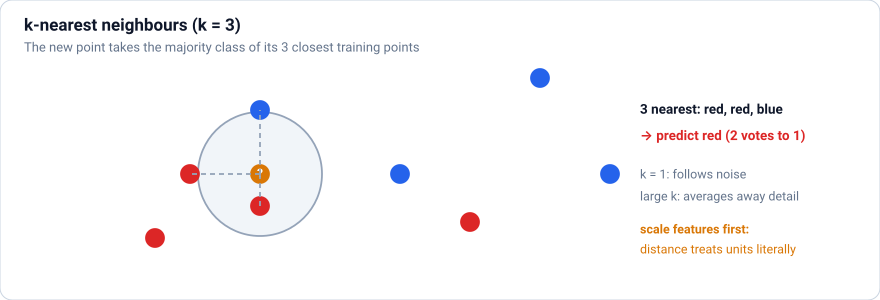

### 14.1 The idea

To classify a new point, find the **k** training points closest to it and take a **vote**. For a number, average their values instead. There's no training at all: the model simply **is** the training data.

### 14.2 Traced by hand

Six training points in two classes, and a new point q = (3, 2.5):

| point | class | distance to q |
|---|---|---|
| (2, 3) | A | √(1² + 0.5²) = **1.12** |
| (4, 1) | B | √(1² + 1.5²) = **1.80** |
| (1, 3) | A | √(2² + 0.5²) = **2.06** |
| (1, 1) | A | 2.50 |
| (5, 4) | B | 2.50 |
| (6, 2) | B | 3.04 |

- **k = 1:** the nearest is (2, 3) → **A**.
- **k = 3:** A, B, A → 2 votes to 1 → **A**.

```python
import numpy as np

X_train = np.array([[1, 1], [2, 3], [1, 3], [5, 4], [4, 1], [6, 2]])
y_train = np.array([0, 0, 0, 1, 1, 1])            # 0 = A, 1 = B

def knn_predict(X_train, y_train, x, k):
    distances = np.sqrt(np.sum((X_train - x) ** 2, axis=1))   # distance to every training row
    nearest = np.argsort(distances)[:k]                        # positions of the k smallest
    votes = np.bincount(y_train[nearest])                      # count of each class among them
    return votes.argmax()

q = np.array([3, 2.5])
for k in [1, 3]:
    print(f"k = {k}: class {knn_predict(X_train, y_train, q, k)}")
```

**Output:**

```text
k = 1: class 0
k = 3: class 0
```

`np.argsort` returns the positions that would sort the array, so its first k entries are the k nearest. `np.bincount` counts how many times each class number appears.

### 14.3 Choosing k

- **k = 1** copies the single nearest point, noise and all. It gets 100% on its own training data (every point is its own nearest neighbour), and that tells you nothing about new data.
- **Large k** averages over so many points that real detail is smoothed away. With k = all points, it always predicts the majority class.

k is a hyperparameter: choose it on **validation** data.

### 14.4 The scaling problem

Distance treats every unit literally. Compare two customers by age (years) and income (₹):

| | age | income |
|---|---|---|
| customer 1 | 25 | 50,000 |
| customer 2 | 60 | 51,000 |
| customer 3 | 26 | 58,000 |

Customer 1 to 2: √(35² + 1000²) ≈ 1,000.6. Customer 1 to 3: √(1² + 8000²) ≈ 8,000. So customer 2, who is 35 years older, counts as the **nearer** one. Income differences are in thousands, so they swamp age completely.

The fix is to put every feature on the same scale before computing distances.

### 14.5 Two ways to scale

**Standardisation** (z-score), as in Chapter 7.8: subtract the mean and divide by the standard deviation. Each feature then has mean 0 and standard deviation 1.

```
z = (x − mean) / std
```

**Min–max scaling:** squeeze each feature into the range [0, 1].

```
x' = (x − min) / (max − min)
```

Standardisation is the usual default. Min–max suits features with natural bounds, such as pixel values from 0 to 255.

**The rule that matters:** compute the mean and standard deviation (or min and max) on the **training** set only, then apply those same numbers to validation, test and live data. Computing them on all the data lets information from the test set into training (leakage, Chapter 25).

### 14.6 Transformers in scikit-learn: fit, then transform

So far, estimators had `fit` and `predict`. Scaling uses a second kind of estimator, a **transformer**, which has `fit` and `transform`:

- `fit(X_train)` **learns** the numbers it needs. For `StandardScaler`, those are each column's mean (`mean_`) and standard deviation (`scale_`).
- `transform(X)` **applies** them to any data.
- `fit_transform(X_train)` does both in one call, on the training data.

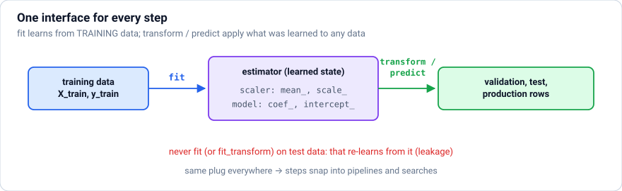

```python
from sklearn.preprocessing import StandardScaler

ages_incomes = np.array([[25, 50_000], [60, 51_000], [26, 58_000]], dtype=float)
scaler = StandardScaler().fit(ages_incomes)
print("learned means:", scaler.mean_.round(1).tolist())
print("learned stds: ", scaler.scale_.round(1).tolist())
scaled = scaler.transform(ages_incomes)
print(scaled.round(2))
print("distance 1→2:", np.linalg.norm(scaled[0] - scaled[1]).round(2),
      "| 1→3:", np.linalg.norm(scaled[0] - scaled[2]).round(2))
```

**Output:**

```text
learned means: [37.0, 53000.0]
learned stds:  [16.3, 3559.0]
[[-0.74 -0.84]
 [ 1.41 -0.56]
 [-0.68  1.4 ]]
distance 1→2: 2.17 | 1→3: 2.25
```

After scaling, **both** features count. Customer 2 is 35 / 16.3 ≈ 2.1 standard deviations away in age, and customer 3 is 8,000 / 3,559 ≈ 2.2 away in income, so their distances (2.17 and 2.25) are now similar. Before scaling, the 35-year age gap counted for almost nothing. `MinMaxScaler` works the same way, with `data_min_` and `data_max_`.

### 14.7 A real dataset: scaling changes everything

The wine dataset: 178 wines, 13 chemical measurements, 3 grape varieties. One feature, proline, runs from about 280 to 1,680, while most of the others stay below 30.

```python
from sklearn.datasets import load_wine
from sklearn.model_selection import train_test_split
from sklearn.neighbors import KNeighborsClassifier

X, y = load_wine(return_X_y=True)
X_train, X_test, y_train, y_test = train_test_split(X, y, test_size=0.3, stratify=y, random_state=0)

raw = KNeighborsClassifier(n_neighbors=5).fit(X_train, y_train)
print("unscaled accuracy:", round(raw.score(X_test, y_test), 3))

scaler = StandardScaler().fit(X_train)                 # learn from training rows only
X_train_s, X_test_s = scaler.transform(X_train), scaler.transform(X_test)
scaled = KNeighborsClassifier(n_neighbors=5).fit(X_train_s, y_train)
print("scaled accuracy:  ", round(scaled.score(X_test_s, y_test), 3))
```

**Output:**

```text
unscaled accuracy: 0.722
scaled accuracy:   0.963
```

Same model, same k, very different results. Without scaling, the distances are basically proline differences.

Our function and scikit-learn's agree:

```python
mine = np.array([knn_predict(X_train_s, y_train, x, 5) for x in X_test_s])
print("same predictions as scikit-learn:", np.array_equal(mine, scaled.predict(X_test_s)))

for k in [1, 5, 15, 51]:
    m = KNeighborsClassifier(n_neighbors=k).fit(X_train_s, y_train)
    print(f"k = {k:>2}: train {m.score(X_train_s, y_train):.3f}, test {m.score(X_test_s, y_test):.3f}")
```

**Output:**

```text
same predictions as scikit-learn: True
k =  1: train 1.000, test 1.000
k =  5: train 0.968, test 0.963
k = 15: train 0.952, test 0.981
k = 51: train 0.952, test 0.963
```

k = 1 is perfect on the training set, as 14.3 predicted. The test set has only 54 wines, so one wine is worth 1.9 percentage points; differences this small between values of k are mostly luck. Chapter 21 shows how to compare settings more reliably. `KNeighborsRegressor` predicts numbers by averaging the k neighbours' values.

### 14.8 Strengths and limits

- **No training time,** but every prediction measures the distance to every training row. That's slow for millions of rows; libraries use tree indexes or approximate search to speed it up.
- **Many features hurt.** In hundreds of dimensions, all points end up roughly the same distance apart, so "nearest" means little. This is called the **curse of dimensionality**.
- **Easy to explain:** "these 5 similar past cases were mostly fraud."

### 14.9 Summary

```
kNN predict   distances to all training rows → k smallest → vote (or average)
standardise   z = (x − mean_train) / std_train
min–max       x' = (x − min_train) / (max_train − min_train)
transformer   fit (learn mean_, scale_) on train → transform any data
```

**Key terms:**

- **k-nearest neighbours (kNN):** predicting from the k closest training examples, by vote or average.
- **k:** the number of neighbours consulted; a hyperparameter.
- **Lazy learner:** a model that does no work at training time and all of it at prediction time.
- **Feature scaling:** putting features on comparable ranges so no one feature dominates.
- **Standardisation (z-score):** (x − mean) / std, giving mean 0 and standard deviation 1.
- **Min–max scaling:** (x − min) / (max − min), giving the range [0, 1].
- **Transformer:** a scikit-learn estimator with `fit` and `transform` that changes data rather than predicting.
- **`fit_transform`:** fit and transform in one call; use it only on training data.
- **`StandardScaler` / `MinMaxScaler`:** scikit-learn's transformers for standardisation and min–max scaling.
- **Curse of dimensionality:** in many dimensions, distances become similar and data becomes sparse, so distance-based methods weaken.

**Exercises**

1. In 14.2, what does k = 5 predict? Which two points tie for 4th and 5th place?
2. Why is calling `scaler.fit_transform(X_test)` a mistake?

<details>
<summary><b>Answers</b></summary>

1. The 5 nearest are A, B, A, then (1, 1) A and (5, 4) B, both at 2.50. That's 3 A to 2 B → **A**. Ties at equal distance are broken by the order of the rows.
2. It learns a new mean and standard deviation from the test set. The test data is then scaled differently from the training data, and the test set has influenced the model's inputs (leakage). Use `scaler.transform(X_test)`.

</details>

| # | Problem (Deep-ML) | Difficulty |
|---|---|---|
| 1 | [16. Feature Scaling Implementation](https://www.deep-ml.com/problems/16) | 🟢 Easy |
| 2 | [112. Min-Max Scaling of Feature Values](https://www.deep-ml.com/problems/112) | 🟢 Easy |
| 3 | [173. Implement K-Nearest Neighbors](https://www.deep-ml.com/problems/173) | 🟡 Medium |

**Learn more:** [scikit-learn: nearest neighbors](https://scikit-learn.org/stable/modules/neighbors.html) · [scikit-learn: preprocessing data](https://scikit-learn.org/stable/modules/preprocessing.html)

---

## 15. Overfitting, Underfitting and the Bias–Variance Trade-off

**You need:** Chapters 7, 8 and 9. · **You'll learn:** how to fit curves with linear regression, how to spot a model that's too simple or too complex, and why test error has a sweet spot.

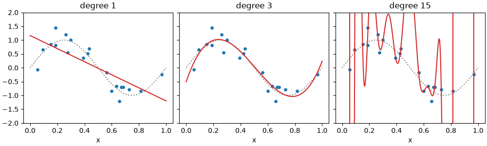

### 15.1 A curved relationship

Twenty points from a wave, y = sin(2πx), plus noise. A straight line can't follow a wave, however it's fitted.

```python
import numpy as np

def make_data(n, rng):
    x = rng.uniform(0, 1, n)
    y = np.sin(2 * np.pi * x) + rng.normal(0, 0.25, n)
    return x, y

rng = np.random.default_rng(2)
x_train, y_train = make_data(20, rng)
x_test, y_test = make_data(500, rng)       # lots of fresh points to measure test error well
print(x_train[:4].round(2), y_train[:4].round(2))
```

**Output:**

```text
[0.26 0.3  0.81 0.09] [ 1.21  1.   -0.84  0.65]
```

### 15.2 Polynomial features: curves from a linear model

Trick: add new features made from x, namely x², x³ and so on. The model

```
ŷ = w₀ + w₁x + w₂x² + w₃x³
```

is a curve in x, but it's still **linear in the weights**: a weighted sum of the features [1, x, x², x³]. So the least-squares maths of Chapter 7 works unchanged. For x = 2, the degree-3 feature row is [1, 2, 4, 8].

```python
def poly_features(x, degree):
    return np.column_stack([x ** p for p in range(degree + 1)])    # columns: x⁰=1, x¹, x², …

print(poly_features(np.array([2.0, 3.0]), 3))

def fit_poly(x, y, degree):
    return np.linalg.lstsq(poly_features(x, degree), y)[0]

def rmse(x, y, w, degree):
    return np.sqrt(np.mean((poly_features(x, degree) @ w - y) ** 2))
```

**Output:**

```text
[[ 1.  2.  4.  8.]
 [ 1.  3.  9. 27.]]
```

The **degree** controls how bendy the curve can be: degree 1 is a line, and degree 3 can make an S-shape.

### 15.3 Too simple, about right, too complex

```python
for degree in [1, 3, 9, 15]:
    w = fit_poly(x_train, y_train, degree)
    print(f"degree {degree:>2}: train RMSE {rmse(x_train, y_train, w, degree):.3f}, "
          f"test RMSE {rmse(x_test, y_test, w, degree):.3f}")
```

**Output:**

```text
degree  1: train RMSE 0.505, test RMSE 0.525
degree  3: train RMSE 0.240, test RMSE 0.278
degree  9: train RMSE 0.201, test RMSE 1.893
degree 15: train RMSE 0.135, test RMSE 17412.832
```

Read the table from top to bottom:

- **Degree 1, underfitting:** high error on both sets. The model is too simple to follow the wave.
- **Degree 3, a good fit:** both errors are low, and close to the noise level of 0.25.
- **Degrees 9 and 15, overfitting:** training error keeps falling, but test error shoots up. With 16 weights and only 20 points, the curve threads through the noise and swings wildly in between.

**Training error always falls as the model gets more complex. Test error falls, then rises.** That's why model choices are made on held-out data.

| what you see | diagnosis | what to try |
|---|---|---|
| train error high, test error high | underfitting | a more flexible model, better features |
| train error low, test error much higher | overfitting | more data, a simpler model, regularisation (Chapter 16) |
| both low and close together | a good fit | stop here |

<details>
<summary><b>Code for the chart at the top</b></summary>

```python
import matplotlib.pyplot as plt

grid = np.linspace(0, 1, 300)
fig, axes = plt.subplots(1, 3, figsize=(10, 3), layout="constrained", sharey=True)
for ax, degree in zip(axes, [1, 3, 15]):
    w = fit_poly(x_train, y_train, degree)
    ax.scatter(x_train, y_train, s=15, color="tab:blue")
    ax.plot(grid, np.sin(2 * np.pi * grid), ls=":", color="gray")
    ax.plot(grid, poly_features(grid, degree) @ w, color="tab:red")
    ax.set(title=f"degree {degree}", ylim=(-2, 2), xlabel="x")
fig.savefig("under-over-fitting.png", dpi=100)
plt.close(fig)
```

</details>

### 15.4 Bias and variance

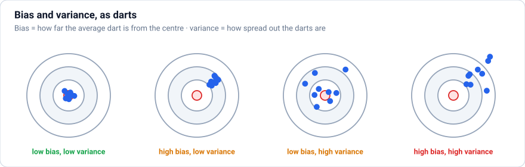

Imagine collecting a **new** training set many times and refitting each time. Two different things can go wrong:

- **Bias:** even averaged over all those fits, the model is off target. A line can't bend into a wave, however much data it sees. This is error from the model being **too simple**.
- **Variance:** each fit is different, because the model chases the noise in its particular sample. This is error from the model being **too sensitive**.

We can measure both directly: refit each degree on 200 fresh training sets, and look at the predictions at a few fixed points.

```python
x_check = np.linspace(0.1, 0.9, 9)
truth = np.sin(2 * np.pi * x_check)
rng = np.random.default_rng(0)

for degree in [1, 3, 6]:
    preds = []
    for _ in range(200):
        x, y = make_data(20, rng)
        preds.append(poly_features(x_check, degree) @ fit_poly(x, y, degree))
    preds = np.array(preds)                                  # shape (200 fits, 9 points)
    bias_sq = np.mean((preds.mean(axis=0) - truth) ** 2)     # average fit vs truth
    variance = np.mean(preds.var(axis=0))                    # spread between fits
    print(f"degree {degree}: bias² {bias_sq:.3f}, variance {variance:.3f}")
```

**Output:**

```text
degree 1: bias² 0.138, variance 0.028
degree 3: bias² 0.003, variance 0.014
degree 6: bias² 0.003, variance 0.349
```

Degree 1 has high bias and low variance. Degree 3 is low on both. Degree 6 has little bias, but its variance is far higher: its fits disagree with each other. The exact variance changes from run to run, but it's always much larger for degree 6 than for degree 3.

For squared error, the expected test error splits exactly into three parts:

```
expected error = bias² + variance + noise
```

The noise (here σ² = 0.25² = 0.0625) is the part no model can remove. Making a model more complex lowers the bias but raises the variance. The best model balances the two, and this is called the **bias–variance trade-off**.

<details>
<summary><b>Derivation: where the three parts come from</b></summary>

At one point x, the truth is y = f(x) + ε, where ε is noise with mean 0 and variance σ². Our prediction f̂(x) depends on the random training set, and its average over training sets is f̄(x). Then:

```
E[(y − f̂)²] = E[(f − f̂ + ε)²]
            = E[(f − f̂)²] + σ²                         (ε is independent, mean 0)
            = E[(f − f̄ + f̄ − f̂)²] + σ²
            = (f − f̄)² + E[(f̄ − f̂)²] + σ²               (the cross term averages to 0)
            =   bias²   +   variance   + noise
```

</details>

### 15.5 How to reduce each

| to reduce | do this |
|---|---|
| **bias** (underfitting) | a more flexible model; more or better features; less regularisation |
| **variance** (overfitting) | **more training data**; a simpler model; regularisation (Chapter 16); averaging many models (Chapter 28) |

More data is the most reliable cure for variance. With 2,000 points, even degree 9 behaves:

```python
x_big, y_big = make_data(2000, np.random.default_rng(5))
w = fit_poly(x_big, y_big, 9)
print("degree 9 trained on 2000 points: test RMSE", round(rmse(x_test, y_test, w, 9), 3))
```

**Output:**

```text
degree 9 trained on 2000 points: test RMSE 0.257
```

### 15.6 In scikit-learn

`PolynomialFeatures` is a transformer (Chapter 14.6) that builds the power columns for you. With several features it also adds **interaction** terms such as x₁·x₂.

```python
from sklearn.preprocessing import PolynomialFeatures
from sklearn.linear_model import LinearRegression

poly = PolynomialFeatures(degree=3)
F_train = poly.fit_transform(x_train.reshape(-1, 1))
print("feature names:", poly.get_feature_names_out())
model = LinearRegression().fit(F_train, y_train)
F_test = poly.transform(x_test.reshape(-1, 1))
print("test RMSE:", round(np.sqrt(np.mean((model.predict(F_test) - y_test) ** 2)), 3))

print(PolynomialFeatures(degree=2).fit([[0, 0]]).get_feature_names_out())   # with two features
```

**Output:**

```text
feature names: ['1' 'x0' 'x0^2' 'x0^3']
test RMSE: 0.278
['1' 'x0' 'x1' 'x0^2' 'x0 x1' 'x1^2']
```

Same test RMSE as our degree-3 fit. With two features, degree 2 already adds x0², x1² and the interaction x0·x1. With many features and high degrees, the number of columns explodes, which is one more road to overfitting.

### 15.7 Summary

```
polynomial features   [1, x, x², …, xᵈ] → still linear regression in the weights
underfitting          train high, test high         (high bias)
overfitting           train low, test much higher   (high variance)
expected error        bias² + variance + noise
```

**Key terms:**

- **Underfitting:** a model too simple to capture the pattern; high error on training and test data.
- **Overfitting:** a model so flexible that it fits the noise; low training error, high test error.
- **Model complexity (capacity):** how flexible a model is, for example a polynomial's degree.
- **Polynomial features:** powers (and products) of the original features, added so a linear model can fit curves.
- **Interaction term:** a product of two features, such as x₁·x₂, letting the effect of one depend on the other.
- **Bias:** error from wrong assumptions; how far the average model (over many training sets) is from the truth.
- **Variance:** error from sensitivity to the particular training sample; how much fits differ from one another.
- **Irreducible error (noise):** randomness in the data that no model can predict.
- **Bias–variance trade-off:** making a model more complex lowers bias but raises variance; the best test error lies between.

**Exercises**

1. A model has training accuracy 99% and test accuracy 70%. Underfitting or overfitting? Name two fixes.
2. How many features does `PolynomialFeatures(degree=2)` produce from 3 input features (including the constant 1)?

<details>
<summary><b>Answers</b></summary>

1. Overfitting (a big gap between training and test). Fixes: more data, a simpler model, regularisation, fewer features.
2. 1 (constant) + 3 (x₁, x₂, x₃) + 3 (squares) + 3 (pairs x₁x₂, x₁x₃, x₂x₃) = **10**.

```python
print(PolynomialFeatures(degree=2).fit(np.zeros((1, 3))).n_output_features_)
```

**Output:**

```text
10
```

</details>

| # | Problem (Deep-ML) | Difficulty |
|---|---|---|
| 1 | [32. Generate Sorted Polynomial Features](https://www.deep-ml.com/problems/32) | 🟡 Medium |
| 2 | [84. Phi Transformation for Polynomial Features](https://www.deep-ml.com/problems/84) | 🟢 Easy |

**Learn more:** [MLU-Explain: bias–variance trade-off](https://mlu-explain.github.io/bias-variance/)

---

## 16. Regularisation: Ridge, Lasso and Elastic Net

**You need:** Chapters 7, 14 and 15. · **You'll learn:** how adding a penalty on large weights tames overfitting, the maths of the two classic penalties, and why one of them switches features off completely.

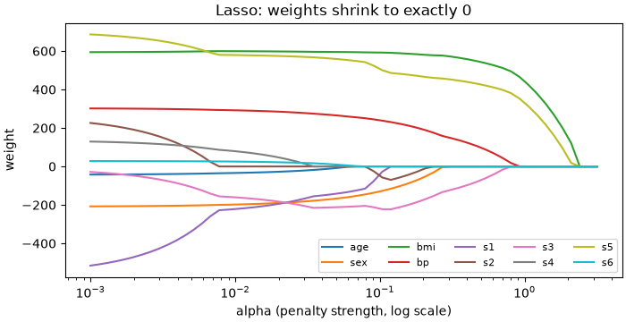

### 16.1 Overfitted models have huge weights

Here's the degree-9 polynomial from Chapter 15 again. To wiggle through every noisy point, it needs enormous weights that cancel each other out.

```python
import numpy as np

def make_data(n, rng):
    x = rng.uniform(0, 1, n)
    return x, np.sin(2 * np.pi * x) + rng.normal(0, 0.25, n)

rng = np.random.default_rng(2)
x_train, y_train = make_data(20, rng)
x_test, y_test = make_data(500, rng)

def features(x):                                   # x¹ … x⁹ (no constant column: see 16.4)
    return np.column_stack([x ** p for p in range(1, 10)])

F_train, F_test = features(x_train), features(x_test)
w = np.linalg.lstsq(np.column_stack([F_train, np.ones(20)]), y_train)[0]
print("largest |weight| without a penalty:", round(np.abs(w).max()))
```

**Output:**

```text
largest |weight| without a penalty: 433613
```

Weights in the hundreds of thousands, for a curve that only goes from −1 to 1. Big weights mean the prediction swings hugely with tiny changes in x.

### 16.2 The idea: charge for big weights

Add a **penalty** to the loss that grows with the size of the weights:

```
loss = MSE + λ · (penalty on w)
```

- **λ** (lambda) is the **regularisation strength**, a hyperparameter. λ = 0 gives the ordinary model; a huge λ forces the weights towards 0.
- The model now has to balance fitting the data against keeping the weights small. Small weights give smoother, calmer predictions.
- The intercept b is **not** penalised; it only shifts predictions up or down.

### 16.3 Ridge: penalise squared weights

```
loss = (1/n) Σ (y − ŷ)² + λ Σ wⱼ²
```

**Its gradient** adds 2λwⱼ to each weight's usual gradient, so every update also pulls each weight a little towards 0. In neural networks this is called **weight decay**.

**Its exact solution.** Setting the gradient to zero, the same way as the normal equation (Chapter 7.7), gives

```
w = (XᵀX + λ·n·I)⁻¹ Xᵀ y
```

where I is the identity matrix. The n appears only because our loss averages over rows; many books write the formula without it.

**Traced on one weight.** One feature, no intercept, x = [1, 2, 3], y = [2, 4, 6]. Here XᵀX = Σx² = 14 and Xᵀy = Σxy = 28. Using the summed form, w = Σxy / (Σx² + λ):

| λ | w = 28 / (14 + λ) |
|---|---|
| 0 | 2.0 (ordinary least squares) |
| 14 | 1.0 |
| 1000 | 0.03 |

The weight shrinks smoothly towards 0, but never reaches it.

### 16.4 Ridge from scratch

The penalty treats all weights alike, so the features must be on the same scale first (Chapter 14.5): x⁹ is tiny next to x. We standardise the features and centre y, so no intercept column is needed. Then we solve the formula for several values of λ.

```python
mu, sigma = F_train.mean(axis=0), F_train.std(axis=0)
Z_train, Z_test = (F_train - mu) / sigma, (F_test - mu) / sigma
y_mean = y_train.mean()                     # the intercept is just the mean of y after centring

def ridge(Z, y, lam):
    n, d = Z.shape
    return np.linalg.solve(Z.T @ Z + lam * n * np.eye(d), Z.T @ (y - y.mean()))

for lam in [0, 1e-4, 1e-2, 1]:
    w = ridge(Z_train, y_train, lam)
    test_rmse = np.sqrt(np.mean((Z_test @ w + y_mean - y_test) ** 2))
    print(f"λ = {lam:<6}: largest |w| = {np.abs(w).max():10.1f}, test RMSE = {test_rmse:.3f}")
```

**Output:**

```text
λ = 0     : largest |w| =    75688.0, test RMSE = 1.891
λ = 0.0001: largest |w| =        5.7, test RMSE = 0.271
λ = 0.01  : largest |w| =        1.0, test RMSE = 0.351
λ = 1     : largest |w| =        0.2, test RMSE = 0.478
```

`np.linalg.solve(A, b)` finds w with A·w = b without forming the inverse. A small λ calms the model down a lot. Too large a λ flattens it back into underfitting, which is why λ must be chosen on validation data (Chapter 22).

### 16.5 Lasso: penalise absolute weights

```
loss = (1/n) Σ (y − ŷ)² + λ Σ |wⱼ|
```

The change looks small, |w| instead of w², but it has a striking effect: **lasso sets some weights to exactly 0**, removing those features from the model. That's automatic **feature selection**.

**Why, on one weight.** Strip the problem down to choosing one w close to a target value z, plus a penalty:

| | minimise | answer |
|---|---|---|
| ridge | ½(w − z)² + ½λw² | w = z / (1 + λ) |
| lasso | ½(w − z)² + λ\|w\| | w = sign(z) · max(\|z\| − λ, 0) |

With z = 3 and λ = 1: ridge gives 3/2 = **1.5**, and lasso gives 3 − 1 = **2**. With z = 0.5 and λ = 1: ridge gives **0.25** (small, but not zero), while lasso gives max(0.5 − 1, 0) = **0**. Lasso subtracts a fixed amount and stops at zero; it's called **soft-thresholding**. Ridge divides, so it never quite gets to zero.

<details>
<summary><b>Derivation: the lasso answer</b></summary>

For w > 0 the slope of ½(w − z)² + λw is (w − z) + λ. Setting it to 0 gives w = z − λ, which is valid only if that's positive, i.e. z > λ. For w < 0, similarly w = z + λ, valid if z < −λ. If |z| ≤ λ, neither side has a zero slope. The function is lowest at the corner w = 0, because the penalty's slope (±λ) beats the pull towards z there. Putting the cases together gives w = sign(z) · max(|z| − λ, 0).

Ridge's slope is (w − z) + λw. Setting it to 0 gives w = z / (1 + λ), which is never exactly 0 unless z = 0.

</details>

```python
def soft_threshold(z, lam):
    return np.sign(z) * np.maximum(np.abs(z) - lam, 0)

for z in [3, 0.5, -2]:
    print(f"z = {z:>4}: ridge {z / 2:5.2f}, lasso {soft_threshold(z, 1):5.2f}")
```

**Output:**

```text
z =    3: ridge  1.50, lasso  2.00
z =  0.5: ridge  0.25, lasso  0.00
z =   -2: ridge -1.00, lasso -1.00
```

Lasso has no closed-form solution in general. Libraries solve it by **coordinate descent**: update one weight at a time with this soft-threshold step, and cycle until nothing changes.

### 16.6 Elastic net: a mix

```
loss = MSE + λ · [ r · Σ|wⱼ| + (1 − r) · Σ wⱼ² ]
```

r (scikit-learn's `l1_ratio`) blends the two penalties. Use it when features are correlated: lasso tends to keep one feature of a correlated group at random, while the ridge part shares the weight among them.

### 16.7 In scikit-learn

| class | penalty | strength argument |
|---|---|---|
| `Ridge` | Σw² | `alpha` (= λ) |
| `Lasso` | Σ\|w\| | `alpha` |
| `ElasticNet` | both | `alpha`, `l1_ratio` |
| `LogisticRegression` | Σw² by default | `C` = 1 / strength, so **smaller C = stronger penalty** |

Each library scales its loss a little differently, so the same `alpha` doesn't always equal our λ. The idea is identical. Here's lasso on the diabetes data (its features are already on similar scales):

```python
from sklearn.datasets import load_diabetes
from sklearn.model_selection import train_test_split
from sklearn.linear_model import Lasso, Ridge, LinearRegression

data = load_diabetes()
X_train, X_test, y_train, y_test = train_test_split(data.data, data.target, test_size=0.25, random_state=0)

for alpha in [0.01, 0.1, 0.5, 1.0]:
    m = Lasso(alpha=alpha).fit(X_train, y_train)
    kept = [name for name, c in zip(data.feature_names, m.coef_) if c != 0]
    print(f"alpha {alpha:<4}: R² {m.score(X_test, y_test):.3f}, {len(kept)} features kept: {kept}")

print("plain linear regression R²:", round(LinearRegression().fit(X_train, y_train).score(X_test, y_test), 3))
print("ridge alpha=0.1 R²:        ", round(Ridge(alpha=0.1).fit(X_train, y_train).score(X_test, y_test), 3))
```

**Output:**

```text
alpha 0.01: R² 0.354, 9 features kept: ['age', 'sex', 'bmi', 'bp', 's1', 's3', 's4', 's5', 's6']
alpha 0.1 : R² 0.355, 7 features kept: ['sex', 'bmi', 'bp', 's1', 's2', 's3', 's5']
alpha 0.5 : R² 0.329, 4 features kept: ['bmi', 'bp', 's3', 's5']
alpha 1.0 : R² 0.278, 2 features kept: ['bmi', 's5']
plain linear regression R²: 0.359
ridge alpha=0.1 R²:         0.369
```

As alpha grows, lasso keeps fewer and fewer features. Body-mass index (`bmi`) and the blood measurement `s5` survive longest, then blood pressure (`bp`) and `s3`. These are the strongest predictors. Accuracy barely drops until alpha 0.5, so the dropped features added little.

<details>
<summary><b>Code for the chart at the top</b></summary>

```python
import matplotlib.pyplot as plt

alphas = np.logspace(-3, 0.5, 60)                 # 60 values from 0.001 to about 3
paths = np.array([Lasso(alpha=a).fit(X_train, y_train).coef_ for a in alphas])
fig, ax = plt.subplots(figsize=(7, 3.6), layout="constrained")
for j, name in enumerate(data.feature_names):
    ax.plot(alphas, paths[:, j], label=name)
ax.set(xscale="log", xlabel="alpha (penalty strength, log scale)", ylabel="weight", title="Lasso: weights shrink to exactly 0")
ax.legend(ncol=5, fontsize=8)
fig.savefig("lasso-path.png", dpi=100)
plt.close(fig)
```

</details>

### 16.8 Summary

```
ridge (L2)     loss = MSE + λ Σ w²       shrinks all weights;  w = (XᵀX + λnI)⁻¹ Xᵀ y
lasso (L1)     loss = MSE + λ Σ |w|      shrinks and zeroes some: feature selection
elastic net    a mix of both              for correlated features
always         standardise features first; don't penalise the intercept; choose λ on validation data
```

**Key terms:**

- **Regularisation:** adding a penalty to the loss to discourage overly complex models.
- **Regularisation strength (λ, `alpha`):** how heavily the penalty counts; a hyperparameter.
- **Ridge regression (L2):** linear regression with a penalty on the sum of squared weights.
- **Lasso (L1):** linear regression with a penalty on the sum of absolute weights; sets some weights to exactly 0.
- **Elastic net:** a blend of the L1 and L2 penalties, controlled by `l1_ratio`.
- **Weight decay:** the L2 penalty seen as a pull on every weight towards 0 at each update.
- **Soft-thresholding:** sign(z) · max(|z| − λ, 0), the lasso's one-weight solution.
- **Coordinate descent:** optimising one parameter at a time while holding the others fixed.
- **Feature selection:** keeping only the useful features.
- **`C`:** the inverse regularisation strength in `LogisticRegression` and SVMs; smaller C means a stronger penalty.

**Exercises**

1. For the one-weight example in 16.3, what λ halves the weight to 1.0? What λ gives 0.5?
2. With lasso on one weight and λ = 2, what are the solutions for z = 5, z = 1.5 and z = −3?

<details>
<summary><b>Answers</b></summary>

1. 28 / (14 + λ) = 1 → **λ = 14**. 28 / (14 + λ) = 0.5 → **λ = 42**.
2. 5 − 2 = **3**; 1.5 is within 2 of 0, so **0**; −3 + 2 = **−1**.

```python
print(soft_threshold(np.array([5, 1.5, -3]), 2))
```

**Output:**

```text
[ 3.  0. -1.]
```

</details>

| # | Problem (Deep-ML) | Difficulty |
|---|---|---|
| 1 | [43. Implement Ridge Regression Loss Function](https://www.deep-ml.com/problems/43) | 🟢 Easy |
| 2 | [50. Implement Lasso Regression using ISTA](https://www.deep-ml.com/problems/50) | 🟡 Medium |
| 3 | [139. Elastic Net Regression via Gradient Descent](https://www.deep-ml.com/problems/139) | 🟡 Medium |

**Learn more:** [StatQuest: ridge regression (video)](https://www.youtube.com/watch?v=Q81RR3yKn30)

---

## 17. Better Training: Mini-Batches, Momentum, Adam and Robust Losses

**You need:** Chapters 5, 7 and 8. · **You'll learn:** the upgrades to plain gradient descent that every modern library uses, and loss functions that aren't thrown off by outliers.

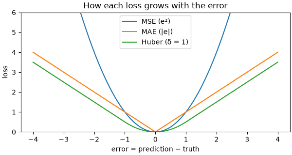

### 17.1 Mini-batches: don't read all the data for every step

Plain gradient descent (Chapter 5) computes the gradient from **every** row before taking one step. With 10 million rows, each step is slow.

**Mini-batch gradient descent** estimates the gradient from a small random **batch** of rows, say 32, and steps right away. The estimate is noisy, but you get thousands of steps for the cost of one full pass.

- One pass through all the rows is called an **epoch**.
- A batch size of 1 is called **stochastic gradient descent (SGD)**. People often say "SGD" for any batch size.
- Shuffle the rows every epoch, so the batches differ each time.

```python
import numpy as np

rng = np.random.default_rng(0)
n = 10_000
X = rng.normal(size=(n, 3))                       # 3 standardised features
y = X @ np.array([2.0, -1.0, 0.5]) + 3 + rng.normal(0, 0.5, n)
X1 = np.column_stack([X, np.ones(n)])             # design matrix

def mse(w):
    return np.mean((X1 @ w - y) ** 2)

def gradient(w, rows):
    err = X1[rows] @ w - y[rows]
    return 2 * X1[rows].T @ err / len(rows)

# full batch: one step per epoch
w = np.zeros(4)
for epoch in range(5):
    w -= 0.1 * gradient(w, np.arange(n))
print("full batch, 5 epochs = 5 steps:   MSE", round(mse(w), 3))

# mini-batches of 32: about 313 steps per epoch
w = np.zeros(4)
for epoch in range(5):
    order = rng.permutation(n)
    for start in range(0, n, 32):
        w -= 0.01 * gradient(w, order[start:start + 32])
print("mini-batch, 5 epochs = 1565 steps: MSE", round(mse(w), 3), "| weights", w.round(2))
```

**Output:**

```text
full batch, 5 epochs = 5 steps:   MSE 1.766
mini-batch, 5 epochs = 1565 steps: MSE 0.258 | weights [ 2.   -1.01  0.5   3.  ]
```

With the same amount of data read (5 epochs), mini-batches get to the best possible MSE (the noise level, 0.5² = 0.25), while full-batch descent has barely started. Neural networks are always trained this way.

### 17.2 Momentum: keep rolling

On a long, narrow valley, gradient descent zig-zags across the steep sides and crawls along the gentle floor. **Momentum** keeps a running "velocity" that adds up past gradients:

```
v ← β·v + gradient          (β ≈ 0.9: remember 90% of the old velocity)
w ← w − lr·v
```

Steps in a consistent direction add up and speed up. Back-and-forth steps cancel out. Test it on a narrow valley, f(a, b) = a² + 100b², starting at (10, 1). It's 100 times steeper across (b) than along (a):

```python
def grad_valley(p):
    return np.array([2 * p[0], 200 * p[1]])

def run(method, lr, steps=100):
    p, v = np.array([10.0, 1.0]), np.zeros(2)
    for _ in range(steps):
        g = grad_valley(p)
        if method == "momentum":
            v = 0.9 * v + g
            p = p - lr * v
        else:
            p = p - lr * g
    return np.linalg.norm(p)                      # distance from the minimum at (0, 0)

print("plain GD (lr 0.0099), 100 steps: distance", round(run("plain", 0.0099), 4))
print("momentum (lr 0.005), 100 steps:  distance", round(run("momentum", 0.005), 4))
```

**Output:**

```text
plain GD (lr 0.0099), 100 steps: distance 1.36
momentum (lr 0.005), 100 steps:  distance 0.0264
```

Plain descent can't simply take bigger steps: in the steep b direction the slope is 200b, and by Chapter 5.3's argument any lr above 0.01 makes b diverge. At its largest safe step, it's still far from the minimum along the gentle a direction. Momentum, with half that step size, gets 50 times closer.

### 17.3 Adam: a step size for each parameter

**Adam** (adaptive moments) keeps two running averages for every parameter:

```
m ← β₁·m + (1 − β₁)·g          average gradient (direction)          β₁ = 0.9
s ← β₂·s + (1 − β₂)·g²         average squared gradient (size)       β₂ = 0.999
m̂ = m / (1 − β₁ᵗ),   ŝ = s / (1 − β₂ᵗ)                               bias correction, t = step number
w ← w − lr · m̂ / (√ŝ + ε)                                             ε ≈ 10⁻⁸ avoids dividing by 0
```

The key is the division by √ŝ. A parameter with huge gradients gets its steps scaled **down**, and one with tiny gradients gets them scaled **up**. Every parameter moves at a similar pace, roughly lr per step, whatever its gradient's scale.

**The bias correction.** m and s start at 0, so early on they're too small. At step 1, m = 0.1·g, and dividing by 1 − 0.9¹ = 0.1 gives back g. As t grows, the correction fades to 1.

**Step 1 by hand** for a gradient g = 50: m = 5, s = 2.5, m̂ = 50, ŝ = 2500, and the step is lr · 50 / 50 = **lr**. For g = 0.01 it's also lr. That's Adam's scale-independence.

```python
def adam(steps=100, lr=0.5, b1=0.9, b2=0.999, eps=1e-8):
    p, m, s = np.array([10.0, 1.0]), np.zeros(2), np.zeros(2)
    for t in range(1, steps + 1):
        g = grad_valley(p)
        m = b1 * m + (1 - b1) * g
        s = b2 * s + (1 - b2) * g ** 2
        m_hat, s_hat = m / (1 - b1 ** t), s / (1 - b2 ** t)
        p = p - lr * m_hat / (np.sqrt(s_hat) + eps)
    return np.linalg.norm(p)

print("Adam (lr 0.5), 100 steps:       distance", round(adam(), 4))
```

**Output:**

```text
Adam (lr 0.5), 100 steps:       distance 0.0423
```

Adam also beats plain descent by a wide margin here: dividing by √ŝ lets the gentle a direction take big steps while the steep b direction takes small ones. Its defaults (lr = 0.001 in most libraries, β₁ = 0.9, β₂ = 0.999) work reasonably on most problems without tuning, which is why it's the usual first choice for neural networks.

### 17.4 Losses that resist outliers

MSE's gradient is proportional to the error, so **one huge error dominates the update**. Two alternatives:

```
MAE   = |y − ŷ|                       gradient: sign of the error (always ±1)
Huber = ½(y − ŷ)²          if |y − ŷ| ≤ δ
        δ·(|y − ŷ| − ½δ)   otherwise   gradient: the error, capped at ±δ
```

**Huber** behaves like MSE for small errors (smooth, precise) and like MAE for large ones (an outlier can only pull with force δ).

**The simplest case shows the difference.** Predict one constant c for the values [1, 2, 3, 4, 100]:

- Minimising Σ(y − c)²: the derivative −2Σ(y − c) = 0 gives c = **mean** = 22. The outlier drags it far away.
- Minimising Σ|y − c|: the derivative is −(number above c) + (number below c), which is zero when half the values are on each side, so c = **median** = 3.

```python
values = np.array([1, 2, 3, 4, 100], dtype=float)

def huber_grad(err, delta=1.0):
    return np.clip(err, -delta, delta)          # the error, capped at ±delta

c = 0.0
for _ in range(2000):                           # gradient descent on the Huber loss, for one constant
    c += 0.05 * np.mean(huber_grad(values - c))
print("MSE best (mean):  ", values.mean())
print("MAE best (median):", np.median(values))
print("Huber best:       ", round(c, 2))
```

**Output:**

```text
MSE best (mean):   22.0
MAE best (median): 3.0
Huber best:        3.0
```

`np.clip(x, lo, hi)` caps values at lo and hi. With δ = 1, Huber lands on the median here; a larger δ moves it towards the mean.

<details>
<summary><b>Code for the chart at the top</b></summary>

```python
import matplotlib.pyplot as plt

e = np.linspace(-3, 3, 200)
huber = np.where(np.abs(e) <= 1, 0.5 * e ** 2, np.abs(e) - 0.5)
fig, ax = plt.subplots(figsize=(6, 3.2), layout="constrained")
ax.plot(e, e ** 2, label="squared (MSE)")
ax.plot(e, np.abs(e), label="absolute (MAE)")
ax.plot(e, huber, label="Huber, δ = 1")
ax.set(xlabel="error y − ŷ", ylabel="loss", ylim=(0, 4))
ax.legend()
fig.savefig("losses.png", dpi=100)
plt.close(fig)
```

</details>

### 17.5 In scikit-learn

`SGDRegressor` trains linear models with mini-batch-style updates (one row at a time), and it accepts several losses. `HuberRegressor` fits a linear model with the Huber loss.

```python
from sklearn.linear_model import SGDRegressor, LinearRegression, HuberRegressor

sgd = SGDRegressor(max_iter=5, tol=None, random_state=0).fit(X, y)     # 5 epochs
print("SGDRegressor weights:", sgd.coef_.round(2), "intercept", sgd.intercept_.round(2))

# 5% of the targets corrupted with huge values
y_bad = y.copy()
bad = rng.choice(n, 500, replace=False)
y_bad[bad] += 50
for model in [LinearRegression(), HuberRegressor()]:
    model.fit(X, y_bad)
    print(f"{type(model).__name__:<16} on corrupted y: weights {model.coef_.round(2)}, intercept {model.intercept_:.2f}")
```

**Output:**

```text
SGDRegressor weights: [ 2.01 -1.01  0.49] intercept [2.99]
LinearRegression on corrupted y: weights [ 2.02 -0.91  0.51], intercept 5.50
HuberRegressor   on corrupted y: weights [ 2.   -1.    0.49], intercept 3.04
```

The true intercept is 3. Adding 50 to 5% of the targets raises their average by 2.5, and plain least squares absorbs that into its intercept (about 5.5). Huber, which caps each row's pull, stays close to 3. `SGDClassifier` is the classification counterpart; with `loss="log_loss"` it's logistic regression trained by SGD.

### 17.6 Summary

```
mini-batch   gradient from a random batch of rows; epoch = one pass over all rows
momentum     v ← βv + g;  w ← w − lr·v
Adam         m, s = running means of g and g²; w ← w − lr·m̂/(√ŝ + ε)
MSE → mean (outlier-sensitive)   MAE → median (robust)   Huber: MSE near 0, MAE far away
```

**Key terms:**

- **Mini-batch gradient descent:** updating the parameters using the gradient from a small random subset of rows.
- **Batch size:** the number of rows in each mini-batch.
- **Epoch:** one full pass over the training data.
- **Stochastic gradient descent (SGD):** gradient descent on one row (or, loosely, one mini-batch) at a time.
- **Momentum:** adding a running velocity of past gradients so consistent directions speed up and zig-zags cancel.
- **Adam:** an optimiser that scales each parameter's step by running averages of its gradient and squared gradient.
- **Bias correction:** dividing Adam's averages by (1 − βᵗ) to undo their start at 0.
- **Huber loss:** squared error for small errors, absolute error beyond a threshold δ.
- **Robust loss:** a loss that limits the influence of outliers.
- **Median:** the middle value when sorted; the constant that minimises absolute error.

**Exercises**

1. Show by hand that Adam's very first step has size lr whatever the gradient (take ε = 0).
2. Huber with δ = 1: what are the loss and gradient for an error of 0.5? For an error of 4?

<details>
<summary><b>Answers</b></summary>

1. m₁ = (1 − β₁)g, so m̂ = g. s₁ = (1 − β₂)g², so ŝ = g². The step is lr · g / √(g²) = lr · g/|g| = ±lr.
2. For 0.5: loss ½ · 0.25 = **0.125**, gradient **0.5**. For 4: loss 1 · (4 − 0.5) = **3.5**, gradient capped at **1**.

</details>

| # | Problem (Deep-ML) | Difficulty |
|---|---|---|
| 1 | [47. Implement Gradient Descent Variants with MSE Loss](https://www.deep-ml.com/problems/47) | 🟡 Medium |
| 2 | [146. Momentum Optimizer](https://www.deep-ml.com/problems/146) | 🟢 Easy |
| 3 | [49. Implement Adam Optimization Algorithm](https://www.deep-ml.com/problems/49) | 🟡 Medium |
| 4 | [192. Implement the Huber Loss Function](https://www.deep-ml.com/problems/192) | 🟡 Medium |

**Learn more:** [Sebastian Ruder: An overview of gradient descent optimization algorithms](https://www.ruder.io/optimizing-gradient-descent/)

---

## 18. Baselines and Choosing the Right Metric

**You need:** Chapters 8, 12 and 13. · **You'll learn:** what a model must beat before it's worth anything, and how to pick the one number you'll judge it by.

### 18.1 A score means nothing alone

"Our model has an MAE of 45." Good or bad? You can't tell until you know what a **trivial** approach scores. A **baseline** is the simplest reasonable prediction. Every model must beat it, and by enough to justify its extra complexity.

The usual ladder, from bottom to top:

1. **Trivial:** predict the average (regression) or the most common class (classification).
2. **Simple rule:** one feature, or the rule the business uses today.
3. **Simple model:** linear or logistic regression.
4. Only then: more complex models (Part IV).

### 18.2 Regression baselines on the diabetes data

```python
import numpy as np
from sklearn.datasets import load_diabetes
from sklearn.model_selection import train_test_split
from sklearn.linear_model import LinearRegression
from sklearn.metrics import mean_absolute_error

X, y = load_diabetes(return_X_y=True)
X_train, X_test, y_train, y_test = train_test_split(X, y, test_size=0.25, random_state=0)

# 1. trivial: always predict the training mean
pred_mean = np.full(len(y_test), y_train.mean())
# 2. simple rule: a line on body-mass index only (column 2)
pred_bmi = LinearRegression().fit(X_train[:, [2]], y_train).predict(X_test[:, [2]])
# 3. simple model: linear regression on all 10 features
pred_lin = LinearRegression().fit(X_train, y_train).predict(X_test)

for name, pred in [("mean", pred_mean), ("BMI only", pred_bmi), ("all features", pred_lin)]:
    print(f"{name:<13} MAE {mean_absolute_error(y_test, pred):.1f}")
```

**Output:**

```text
mean          MAE 58.3
BMI only      MAE 53.3
all features  MAE 45.1
```

Each step up the ladder earns its place. Any fancier model later has to beat about 45, not 58.

scikit-learn packages the trivial baseline as an estimator, so it fits into the same code as real models:

```python
from sklearn.dummy import DummyRegressor

dummy = DummyRegressor(strategy="mean").fit(X_train, y_train)   # also "median", or "constant" with constant=…
print("DummyRegressor MAE:", round(mean_absolute_error(y_test, dummy.predict(X_test)), 1))
```

**Output:**

```text
DummyRegressor MAE: 58.3
```

### 18.3 Classification baselines

For classification, the trivial baseline predicts the most common class. On imbalanced data its accuracy looks impressive, which is exactly why you need to see it.

```python
from sklearn.datasets import load_breast_cancer
from sklearn.dummy import DummyClassifier
from sklearn.metrics import recall_score

Xc, yc = load_breast_cancer(return_X_y=True)
yc = 1 - yc                                                  # 1 = malignant (37% of tumours)
Xc_train, Xc_test, yc_train, yc_test = train_test_split(Xc, yc, test_size=0.25, stratify=yc, random_state=0)

base = DummyClassifier(strategy="most_frequent").fit(Xc_train, yc_train)
pred = base.predict(Xc_test)
print("accuracy:", round(base.score(Xc_test, yc_test), 3), "| recall:", recall_score(yc_test, pred))
```

**Output:**

```text
accuracy: 0.629 | recall: 0.0
```

63% accuracy while catching **no** malignant tumours. Our logistic regression (Chapter 12.7) scored 98.6% accuracy and 96% recall: a genuine improvement. On a fraud dataset with 0.1% fraud, the same dummy would score 99.9% accuracy.

### 18.4 Choosing the metric

Pick the metric **before** building models, from what a mistake costs.

**Regression:**

| situation | metric |
|---|---|
| every unit of error costs the same; outliers in the data | MAE |
| big misses are especially bad | RMSE |
| explaining to non-technical people | MAE, or MAPE if y is never near 0 |
| comparing across problems | R² (alongside MAE or RMSE) |

**Classification:**

| situation | metric |
|---|---|
| balanced classes, equal costs | accuracy |
| missing a positive is costly (disease, fraud) | recall, at a precision you can afford |
| false alarms are costly (blocking customers) | precision, at a recall you need |
| one number balancing both | F1 |
| comparing models' ranking ability, before choosing a threshold | ROC AUC |
| rare positives | average precision (PR AUC) |
| the probabilities themselves are used (pricing, risk) | log loss (Chapter 10.4) |

### 18.5 The metric is not the goal

An offline metric stands in for what you actually care about: money saved, patients treated, customers kept. Check that they move together. A fraud model with higher AUC that blocks more good customers can **lose** money. When possible, the final judgement is an online test: an **A/B test**, where some live users get the new model and the rest keep the old one (`data-science.md` covers A/B testing).

### 18.6 Summary

```
baseline ladder   mean / majority class → one-feature rule → linear model → complex models
DummyRegressor(strategy="mean"),  DummyClassifier(strategy="most_frequent")
metric            chosen from the cost of each kind of mistake, before modelling
```

**Key terms:**

- **Baseline:** the simplest reasonable predictor; the score every model must beat.
- **`DummyRegressor` / `DummyClassifier`:** scikit-learn estimators that ignore the features and predict a constant (mean, median, most frequent class).
- **Business metric:** the real-world outcome a model should improve, such as revenue or fraud losses.
- **Offline evaluation:** scoring a model on held-out historical data.
- **Online evaluation (A/B test):** comparing models on live users by splitting traffic between them.

**Exercises**

1. A churn dataset has 8% churners. What accuracy does `DummyClassifier(strategy="most_frequent")` get? What is its recall?
2. You predict delivery times, and customers complain mostly about very late deliveries. MAE or RMSE?

<details>
<summary><b>Answers</b></summary>

1. About **92%** accuracy (always "won't churn"), and **0** recall.
2. **RMSE.** It punishes large errors much more heavily, which matches the complaints.

</details>

---

**✅ Part II checkpoint.** You can now build linear, logistic and softmax regression and k-nearest neighbours from scratch, use their scikit-learn versions, score them properly, and control overfitting with regularisation. Part III makes this workflow safe and repeatable.

---

# Part III — Working Properly

The tools that make a project correct and repeatable: pipelines, handling messy columns, cross-validation, tuning, feature selection, and avoiding leakage. The part ends with a complete project.

---

## 19. Pipelines: Chaining Steps Safely

**You need:** Chapters 9 and 14. · **You'll learn:** how to bundle preprocessing and a model into one object that is fitted, applied and saved as a single unit.

### 19.1 The problem with doing steps by hand

In Chapters 10–14 we scaled the data by hand every time:

```
mu, sigma = X_train.mean(axis=0), X_train.std(axis=0)
model.fit((X_train - mu) / sigma, y_train)
model.predict((X_test - mu) / sigma)
```

That's three places to make a mistake. Forget to scale the test set, scale it with its own mean, or apply the steps in a different order at prediction time, and the results are silently wrong. With five preprocessing steps, it gets much worse.

A **pipeline** chains the steps into one object:

- `fit` runs `fit_transform` on each preprocessing step in turn, then `fit` on the model;
- `predict` runs `transform` on each step, using what was learned in `fit`, then `predict` on the model.

### 19.2 A pipeline is a short loop

Here's a working pipeline in a few lines. Nothing more is going on in scikit-learn's version.

```python
import numpy as np

class MyPipeline:
    def __init__(self, steps):
        self.steps = steps                      # a list: transformers first, the model last

    def fit(self, X, y):
        for step in self.steps[:-1]:
            X = step.fit_transform(X)           # learn from training data, and transform it
        self.steps[-1].fit(X, y)
        return self

    def predict(self, X):
        for step in self.steps[:-1]:
            X = step.transform(X)               # apply what was learned: never refit
        return self.steps[-1].predict(X)
```

Test it on the wine data from Chapter 14, against the manual version:

```python
from sklearn.datasets import load_wine
from sklearn.model_selection import train_test_split
from sklearn.preprocessing import StandardScaler
from sklearn.neighbors import KNeighborsClassifier

X, y = load_wine(return_X_y=True)
X_train, X_test, y_train, y_test = train_test_split(X, y, test_size=0.3, stratify=y, random_state=0)

pipe = MyPipeline([StandardScaler(), KNeighborsClassifier(n_neighbors=5)]).fit(X_train, y_train)
print("my pipeline accuracy:", round(np.mean(pipe.predict(X_test) == y_test), 3))
```

**Output:**

```text
my pipeline accuracy: 0.963
```

The same 0.963 as Chapter 14.7, with no scaling code to get wrong.

### 19.3 scikit-learn's Pipeline

`make_pipeline` builds one from a list of steps and names each step after its class, in lowercase:

```python
from sklearn.pipeline import make_pipeline, Pipeline

pipe = make_pipeline(StandardScaler(), KNeighborsClassifier(n_neighbors=5))
pipe.fit(X_train, y_train)
print("accuracy:", round(pipe.score(X_test, y_test), 3))
print("step names:", list(pipe.named_steps))
print("the fitted scaler's first 3 means:", pipe.named_steps["standardscaler"].mean_[:3].round(2))
print("last step:", pipe[-1])
```

**Output:**

```text
accuracy: 0.963
step names: ['standardscaler', 'kneighborsclassifier']
the fitted scaler's first 3 means: [13.03  2.35  2.38]
last step: KNeighborsClassifier()
```

`Pipeline` does the same with names you choose, given as (name, step) pairs:

```python
pipe = Pipeline([("scale", StandardScaler()), ("knn", KNeighborsClassifier(n_neighbors=5))])
print(round(pipe.fit(X_train, y_train).score(X_test, y_test), 3))
```

**Output:**

```text
0.963
```

### 19.4 Changing a step's settings: the double underscore

A pipeline's hyperparameters are its steps' hyperparameters, named **step name, two underscores, parameter name**. This is how tuning tools (Chapter 22) reach inside a pipeline.

```python
pipe.set_params(knn__n_neighbors=15)
print(round(pipe.fit(X_train, y_train).score(X_test, y_test), 3))
print([name for name in pipe.get_params() if name.startswith("knn__")][:4])
```

**Output:**

```text
0.981
['knn__algorithm', 'knn__leaf_size', 'knn__metric', 'knn__metric_params']
```

### 19.5 Why this matters beyond tidiness

A pipeline is itself an estimator, with `fit`, `predict` and `score`. So:

- **Cross-validation (Chapter 21)** can refit the **whole** pipeline on each split. The scaler then never sees the rows it's evaluated on. This is the main protection against leakage (Chapter 25).
- **Tuning (Chapter 22)** can search preprocessing and model settings together.
- **Saving (Chapter 26)** stores preprocessing and model as one file, so production applies exactly the same steps as training.

### 19.6 Summary

```
make_pipeline(step1, step2, …, model)       names = lowercase class names
Pipeline([("name", step), …])               names you choose
fit      → fit_transform each step, then fit the model
predict  → transform each step (no refitting), then predict
pipe.named_steps["name"], pipe[-1]          reach the fitted steps
pipe.set_params(name__param=value)          change a step's hyperparameter
```

**Key terms:**

- **Pipeline:** a chain of transformers ending in a model, used as a single estimator.
- **`make_pipeline`:** builds a pipeline and names the steps automatically.
- **Step:** one transformer or model inside a pipeline.
- **`named_steps`:** a dictionary of a pipeline's steps by name.
- **`step__param` (double underscore):** the way to name one step's hyperparameter from outside the pipeline.

**Exercises**

1. Build a pipeline of `PolynomialFeatures(degree=2)`, `StandardScaler()` and `LogisticRegression(max_iter=1000)` on the wine data. What test accuracy does it get?
2. What's wrong with `make_pipeline(StandardScaler(), KNeighborsClassifier()).fit(X, y)` followed by scoring on X_test, where X contains all the rows?

<details>
<summary><b>Answers</b></summary>

```python
from sklearn.preprocessing import PolynomialFeatures
from sklearn.linear_model import LogisticRegression

p = make_pipeline(PolynomialFeatures(degree=2), StandardScaler(), LogisticRegression(max_iter=1000))
print(round(p.fit(X_train, y_train).score(X_test, y_test), 3))
```

**Output:**

```text
1.0
```

1. It gets every test wine right (1.0). 13 features become 105 with degree 2, and logistic regression's default penalty keeps that from overfitting.
2. The pipeline was fitted on all the rows, so the test rows were seen in training: by the scaler and by the model. Fit on X_train only.

</details>

**Learn more:** [scikit-learn: pipelines and composite estimators](https://scikit-learn.org/stable/modules/compose.html)

---

## 20. Missing Values and Categorical Features

**You need:** Chapter 19, and pandas basics. · **You'll learn:** how to fill in missing numbers, how to turn text categories into numbers, and how to apply different steps to different columns in one pipeline.

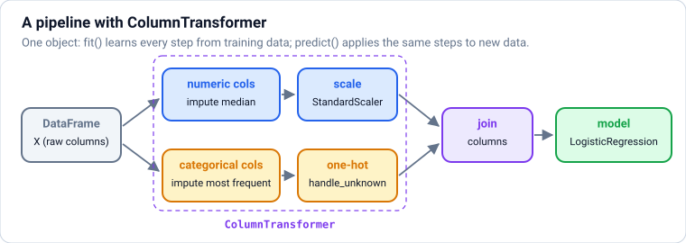

### 20.1 Real tables are messy

Every model so far needed a clean grid of numbers. Real data has **missing values** (NaN, "not a number") and **text categories** like "Pune" or "premium". Here's a made-up customer table to practise on:

```python
import numpy as np
import pandas as pd

rng = np.random.default_rng(0)
n = 1000
df = pd.DataFrame({
    "tenure_months": rng.integers(1, 72, n).astype(float),
    "monthly_charge": rng.uniform(200, 2000, n).round(),
    "city": rng.choice(["Pune", "Delhi", "Goa", "Mumbai"], n),
    "plan": rng.choice(["basic", "standard", "premium"], n),
})
# churn is more likely for new customers, high charges, and basic plans
score = -0.05 * df["tenure_months"] + 0.001 * df["monthly_charge"] + (df["plan"] == "basic") * 1.0 - 0.5
df["churned"] = (rng.random(n) < 1 / (1 + np.exp(-score))).astype(int)
df.loc[rng.random(n) < 0.1, "tenure_months"] = np.nan     # 10% of tenures missing
df.loc[rng.random(n) < 0.05, "city"] = np.nan             # 5% of cities missing

print(df.head())
print(df.isna().sum())
```

**Output:**

```text
   tenure_months  monthly_charge   city      plan  churned
0           61.0           346.0   Pune  standard        0
1           46.0          1775.0   Pune   premium        1
2            NaN          1895.0  Delhi  standard        0
3           20.0           671.0    Goa     basic        1
4            NaN           222.0    Goa   premium        0
tenure_months     105
monthly_charge      0
city               46
plan                0
churned             0
dtype: int64
```

`df.isna().sum()` counts the missing values in each column.

### 20.2 Filling in missing numbers (imputation)

Options, from simplest:

| option | when |
|---|---|
| drop rows with missing values | very few are missing, and they're missing at random |
| fill with the training **median** (or mean) | the usual default for numbers |
| fill with the **most frequent** value | categories |
| fill **and** add a "was missing" column (0/1) | when being missing may itself carry information |

Filling in values is called **imputation**. The median is preferred to the mean because outliers don't move it (Chapter 17.4). As with scaling, the fill value is learned from the **training** rows only.

The "was missing" flag matters more than it looks. If a customer's tenure is missing because they signed up through a partner site, the gap itself may predict churn.

```python
train, test = df.iloc[:800], df.iloc[800:]
median = train["tenure_months"].median()
print("training median tenure:", median)
filled = test["tenure_months"].fillna(median)                     # use the TRAINING median on test rows
print("missing in test before:", test["tenure_months"].isna().sum(), "after:", filled.isna().sum())
```

**Output:**

```text
training median tenure: 38.0
missing in test before: 18 after: 0
```

`SimpleImputer` is the transformer version. It learns the fill value in `fit` and stores it in `statistics_`:

```python
from sklearn.impute import SimpleImputer

imp = SimpleImputer(strategy="median", add_indicator=True)
out = imp.fit_transform(train[["tenure_months", "monthly_charge"]])
print("learned fill values:", imp.statistics_.tolist())
print("first 3 rows (last column = 'tenure was missing'):\n", out[:3].round(1).tolist())
```

**Output:**

```text
learned fill values: [38.0, 1095.5]
first 3 rows (last column = 'tenure was missing'):
 [[61.0, 346.0, 0.0], [46.0, 1775.0, 0.0], [38.0, 1895.0, 1.0]]
```

### 20.3 Categories → numbers: one-hot encoding

Why not just number the cities, Pune = 0, Delhi = 1, Goa = 2? Because a linear model would then treat Goa as "twice Delhi" and assume Delhi lies between Pune and Goa. That's nonsense for categories with no order.

**One-hot encoding** makes one 0/1 column per category instead:

| city | city_Delhi | city_Goa | city_Mumbai | city_Pune |
|---|---|---|---|---|
| Pune | 0 | 0 | 0 | 1 |
| Goa | 0 | 1 | 0 | 0 |
| Delhi | 1 | 0 | 0 | 0 |

Each city gets its own weight, and no fake order is implied.

```python
from sklearn.preprocessing import OneHotEncoder

enc = OneHotEncoder(handle_unknown="ignore", sparse_output=False)
enc.fit(train[["city"]].fillna("missing"))
print("categories learned:", enc.categories_[0])
print(enc.transform(pd.DataFrame({"city": ["Goa", "Chennai"]})))
```

**Output:**

```text
categories learned: ['Delhi' 'Goa' 'Mumbai' 'Pune' 'missing']
[[0. 1. 0. 0. 0.]
 [0. 0. 0. 0. 0.]]
```

"Chennai" never appeared in training. With `handle_unknown="ignore"` it becomes all zeros instead of crashing the live system. `sparse_output=False` returns an ordinary array. By default the encoder returns a **sparse** matrix, which stores only the non-zero entries and saves memory when there are thousands of categories.

### 20.4 Ordered categories: ordinal encoding

When categories **do** have an order (basic < standard < premium, or small < medium < large), mapping them to 0, 1, 2 keeps that order in one column:

```python
from sklearn.preprocessing import OrdinalEncoder

ord_enc = OrdinalEncoder(categories=[["basic", "standard", "premium"]])   # state the order explicitly
print(ord_enc.fit_transform(pd.DataFrame({"plan": ["premium", "basic", "standard"]})).ravel())
```

**Output:**

```text
[2. 0. 1.]
```

Without `categories=`, the encoder sorts alphabetically (basic, premium, standard), which gives the wrong order.

### 20.5 Many categories: target encoding

A column with 5,000 postcodes would become 5,000 one-hot columns. **Target encoding** replaces each category with the **average target** for that category, smoothed towards the overall average when the category is rare:

```
encoded = (count · category_mean + m · overall_mean) / (count + m)
```

m sets how much to trust small categories. With an overall churn rate of 0.4 and m = 10, a postcode seen 2 times, with 2 churns (mean 1.0), gets (2 · 1.0 + 10 · 0.4) / 12 = **0.5**, not 1.0. A postcode seen 200 times with mean 0.7 gets (140 + 4) / 210 = **0.69**, nearly its own mean.

**The danger:** computing a row's encoding from its own target leaks the answer into the feature. scikit-learn's `TargetEncoder` avoids this with **cross-fitting**: it encodes each part of the training data using averages from the other parts.

### 20.6 Different columns, different steps: ColumnTransformer

Numbers need imputing and scaling; categories need imputing and one-hot encoding. A **ColumnTransformer** sends each group of columns through its own pipeline and joins the results side by side:

```python
from sklearn.compose import ColumnTransformer
from sklearn.pipeline import make_pipeline
from sklearn.preprocessing import StandardScaler
from sklearn.linear_model import LogisticRegression

numeric = ["tenure_months", "monthly_charge"]
nominal = ["city"]
ordered = ["plan"]

preprocess = ColumnTransformer([
    ("num", make_pipeline(SimpleImputer(strategy="median", add_indicator=True), StandardScaler()), numeric),
    ("cat", make_pipeline(SimpleImputer(strategy="most_frequent"), OneHotEncoder(handle_unknown="ignore")), nominal),
    ("ord", OrdinalEncoder(categories=[["basic", "standard", "premium"]]), ordered),
])
model = make_pipeline(preprocess, LogisticRegression())

X, y = df.drop(columns="churned"), df["churned"]
X_train, X_test, y_train, y_test = X.iloc[:800], X.iloc[800:], y.iloc[:800], y.iloc[800:]
model.fit(X_train, y_train)
print("test accuracy:", round(model.score(X_test, y_test), 3))
print("baseline (most frequent):", round(max(y_test.mean(), 1 - y_test.mean()), 3))
print("columns going into the model:", list(model[0].get_feature_names_out()))
```

**Output:**

```text
test accuracy: 0.71
baseline (most frequent): 0.675
columns going into the model: ['num__tenure_months', 'num__monthly_charge', 'num__missingindicator_tenure_months', 'cat__city_Delhi', 'cat__city_Goa', 'cat__city_Mumbai', 'cat__city_Pune', 'ord__plan']
```

71% against a 67.5% baseline is a modest gain, which is honest for churn: we built the data with plenty of randomness. The point here is the plumbing. The whole thing, raw DataFrame in and predictions out, is one estimator. Each `(name, transformer, columns)` triple says which columns go where. Columns not listed are **dropped** by default (`remainder="passthrough"` keeps them unchanged).

### 20.7 Summary

```
SimpleImputer(strategy="median" | "most_frequent", add_indicator=True)
OneHotEncoder(handle_unknown="ignore")          categories without order
OrdinalEncoder(categories=[[…in order…]])       categories with order
TargetEncoder()                                 many categories (cross-fitted)
ColumnTransformer([(name, transformer, columns), …])  → inside a Pipeline with the model
```

**Key terms:**

- **Missing value (NaN):** an empty cell; NaN means "not a number".
- **Imputation:** filling in missing values, for example with the training median.
- **Missing indicator:** an extra 0/1 column marking which values were missing.
- **Categorical feature:** a feature whose values are labels, like a city.
- **Nominal category:** a category with no natural order (city).
- **Ordinal category:** a category with a natural order (basic < standard < premium).
- **One-hot encoding:** one 0/1 column per category.
- **Ordinal encoding:** mapping ordered categories to 0, 1, 2, ….
- **Target encoding:** replacing a category with the smoothed average target for that category.
- **Cross-fitting:** computing a row's encoding from other rows' data only, to avoid leakage.
- **Sparse matrix:** a matrix stored as just its non-zero entries.
- **ColumnTransformer:** applies different transformers to different columns and joins the outputs.
- **High cardinality:** a categorical feature with very many distinct values.

**Exercises**

1. A column `size` has values S, M, L, XL. Which encoder, and what `categories=` argument?
2. Why must `SimpleImputer` be inside the pipeline rather than run once on the whole DataFrame before splitting?

<details>
<summary><b>Answers</b></summary>

1. `OrdinalEncoder(categories=[["S", "M", "L", "XL"]])`: the sizes have a real order.
2. Run on all the rows, its median would include the test rows: a small leak of test information into training (Chapter 25). Inside the pipeline, it learns from training rows only, and on every cross-validation split separately.

</details>

**Learn more:** [scikit-learn: imputation](https://scikit-learn.org/stable/modules/impute.html) · [scikit-learn: encoding categorical features](https://scikit-learn.org/stable/modules/preprocessing.html#encoding-categorical-features)

---

## 21. Cross-Validation

**You need:** Chapters 2 and 19. · **You'll learn:** how to get a reliable score by validating on every part of the data in turn, and which kind of split to use for groups and time.

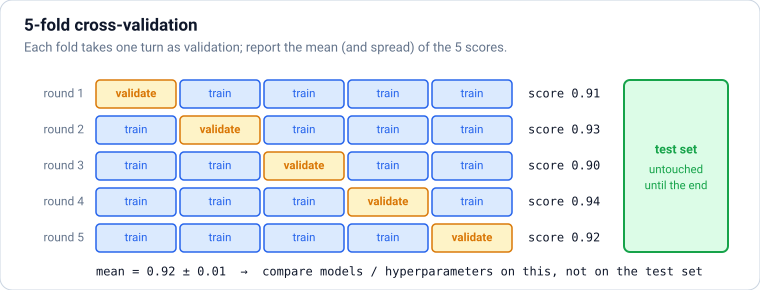

### 21.1 One split is a noisy measurement

The score on one validation set depends on **which** rows happened to land in it. Same model, same data, five different random splits:

```python
import numpy as np
from sklearn.datasets import load_wine
from sklearn.model_selection import train_test_split
from sklearn.pipeline import make_pipeline
from sklearn.preprocessing import StandardScaler
from sklearn.neighbors import KNeighborsClassifier

X, y = load_wine(return_X_y=True)
model = make_pipeline(StandardScaler(), KNeighborsClassifier(n_neighbors=5))

for seed in range(5):
    X_tr, X_va, y_tr, y_va = train_test_split(X, y, test_size=0.3, stratify=y, random_state=seed)
    print(f"split {seed}: accuracy {model.fit(X_tr, y_tr).score(X_va, y_va):.3f}")
```

**Output:**

```text
split 0: accuracy 0.963
split 1: accuracy 0.926
split 2: accuracy 0.926
split 3: accuracy 0.981
split 4: accuracy 0.944
```

The scores vary by several points. If model A beats model B by 2 points on one split, that may just be luck.

### 21.2 k-fold cross-validation by hand

**k-fold cross-validation** uses every row for validation exactly once:

1. Shuffle the rows and cut them into k equal **folds** (k = 5 is common).
2. For each fold: train on the other k − 1 folds, and score on this one.
3. Report the **mean** of the k scores and their **standard deviation** (how much they vary).

Each round needs a **fresh, untrained** copy of the model, so no round learns from another's data. `clone` makes that copy: same settings, no learned parameters.

```python
from sklearn.base import clone

rng = np.random.default_rng(0)
folds = np.array_split(rng.permutation(len(X)), 5)      # 5 groups of row numbers

scores = []
for i in range(5):
    val_idx = folds[i]
    train_idx = np.concatenate([folds[j] for j in range(5) if j != i])
    m = clone(model).fit(X[train_idx], y[train_idx])
    scores.append(m.score(X[val_idx], y[val_idx]))

print("fold scores:", np.round(scores, 3))
print(f"mean {np.mean(scores):.3f} ± {np.std(scores):.3f}")
```

**Output:**

```text
fold scores: [0.972 0.972 0.972 1.    0.829]
mean 0.949 ± 0.061
```

`np.array_split` cuts an array into k nearly equal pieces. Because the model is a **pipeline**, the scaler is refitted inside every round on that round's training folds only. The validation fold is never seen during training, not even by the scaler.

### 21.3 In scikit-learn: cross_val_score

`cross_val_score(model, X, y, cv=…)` runs that whole loop. Passing it our folds gives the identical scores:

```python
from sklearn.model_selection import cross_val_score

my_splits = [(np.concatenate([folds[j] for j in range(5) if j != i]), folds[i]) for i in range(5)]
print(cross_val_score(model, X, y, cv=my_splits).round(3))
```

**Output:**

```text
[0.972 0.972 0.972 1.    0.829]
```

Normally you just pass a number or a **splitter** object:

```python
from sklearn.model_selection import KFold, StratifiedKFold

print("cv=5:              ", cross_val_score(model, X, y, cv=5).round(3))
print("StratifiedKFold:   ", cross_val_score(model, X, y, cv=StratifiedKFold(5, shuffle=True, random_state=0)).round(3))
```

**Output:**

```text
cv=5:               [0.944 0.944 0.972 1.    0.886]
StratifiedKFold:    [0.944 0.944 0.972 0.971 0.971]
```

For classifiers, `cv=5` already means **stratified** 5-fold (Chapter 2.5), without shuffling. Pass a `StratifiedKFold` with `shuffle=True` when the rows might be sorted. For regressors, `cv=5` means plain `KFold`.

`cross_validate` does the same but can return several metrics, training scores, and timings:

```python
from sklearn.model_selection import cross_validate

res = cross_validate(model, X, y, cv=5, scoring=["accuracy", "f1_macro"], return_train_score=True)
print("validation accuracy:", res["test_accuracy"].mean().round(3), "| train accuracy:", res["train_accuracy"].mean().round(3))
print("macro F1:", res["test_f1_macro"].mean().round(3))
```

**Output:**

```text
validation accuracy: 0.949 | train accuracy: 0.975
macro F1: 0.951
```

The scoring names (`"accuracy"`, `"f1_macro"`, `"roc_auc"`, `"neg_mean_absolute_error"`, …) are listed in scikit-learn's docs. Error metrics are **negated** (`neg_…`), so that bigger is always better.

### 21.4 Groups: keep each patient on one side

If one patient contributes 10 scans, a random split puts some of them in training and some in validation. The model can then **recognise the patient**, and the score measures that, not whether it can diagnose a new person.

A demonstration: 40 patients, 10 scans each. Each patient's scans share a personal signature in the features, and the labels are **random**, unrelated to anything a model could learn. The honest score is chance, about 50%.

```python
from sklearn.model_selection import GroupKFold

rng = np.random.default_rng(0)
patient = np.repeat(np.arange(40), 10)                  # patient id for each of 400 scans
signature = rng.normal(0, 3, (40, 2))[patient]          # each patient's scans look alike
Xg = signature + rng.normal(0, 0.3, (400, 2))
yg = rng.integers(0, 2, 40)[patient]                    # random label per patient

knn = KNeighborsClassifier(n_neighbors=3)
print("random KFold:", cross_val_score(knn, Xg, yg, cv=KFold(5, shuffle=True, random_state=0)).mean().round(3))
print("GroupKFold:  ", cross_val_score(knn, Xg, yg, cv=GroupKFold(5), groups=patient).mean().round(3))
```

**Output:**

```text
random KFold: 0.898
GroupKFold:   0.448
```

Random folds report about 90% on labels that are pure noise: the nearest neighbours of a scan are the same patient's other scans. `GroupKFold` keeps each patient's scans in one fold, and the score falls to about chance (45% here), which is the truth. Use group splits whenever rows share a source: users, patients, stores, devices.

### 21.5 Time: always validate on the future

For time-ordered data, every validation fold must come **after** its training data. `TimeSeriesSplit` grows the training window forward:

```python
from sklearn.model_selection import TimeSeriesSplit

days = np.arange(12)
for train_idx, val_idx in TimeSeriesSplit(n_splits=4).split(days):
    print("train days", train_idx, "→ validate days", val_idx)
```

**Output:**

```text
train days [0 1 2 3] → validate days [4 5]
train days [0 1 2 3 4 5] → validate days [6 7]
train days [0 1 2 3 4 5 6 7] → validate days [8 9]
train days [0 1 2 3 4 5 6 7 8 9] → validate days [10 11]
```

### 21.6 Cross-validation doesn't replace the test set

Use cross-validation on the **training** data to compare models and settings. Then fit the chosen model on all the training data and score it **once** on the untouched test set. If you choose among many options by CV score, the best CV score is a little optimistic (you picked the luckiest), and the test set gives the honest number.

### 21.7 Summary

```
k-fold         k folds; each validates once; report mean ± std
classifiers    cv=5 → StratifiedKFold;  regressors → KFold
groups         GroupKFold(…), groups=ids     users / patients / stores
time           TimeSeriesSplit(…)            validate only on later data
cross_val_score(model, X, y, cv=…, scoring=…)    cross_validate(… several metrics …)
```

**Key terms:**

- **Cross-validation (CV):** scoring a model on several different train/validation splits and averaging.
- **Fold:** one of the k equal parts the data is cut into.
- **k-fold CV:** each of k folds serves once as the validation set.
- **Stratified k-fold:** folds that keep each class's share.
- **Group k-fold:** folds that keep all rows of one group together.
- **Time-series split:** validation folds always come after their training data.
- **`clone`:** a fresh, unfitted copy of an estimator with the same settings.
- **Splitter:** an object (KFold, StratifiedKFold, …) that produces train/validation index pairs.
- **Scoring string:** a metric name accepted by scikit-learn's CV tools, such as `"roc_auc"`; error metrics are negated (`neg_…`).

**Exercises**

1. With 1,000 rows and 5-fold CV, how many rows does each model train on, and how many times is each row used for validation?
2. A store-sales model uses rows from 50 stores over 3 years and will forecast next month for the same stores. Which splitter?

<details>
<summary><b>Answers</b></summary>

1. 800 rows per model; each row is validated exactly **once**.
2. `TimeSeriesSplit`, ordered by date. The same stores appear later, so groups aren't the issue; the future is. If it had to forecast **new** stores, you'd also need to keep stores apart.

</details>

| # | Problem (Deep-ML) | Difficulty |
|---|---|---|
| 1 | [18. Implement K-Fold Cross-Validation](https://www.deep-ml.com/problems/18) | 🟡 Medium |

**Learn more:** [scikit-learn: cross-validation](https://scikit-learn.org/stable/modules/cross_validation.html)

---

## 22. Hyperparameter Tuning: Grid, Random and Bayesian Search

**You need:** Chapters 19 and 21. · **You'll learn:** how to choose settings like k or C systematically, with cross-validation, without fooling yourself.

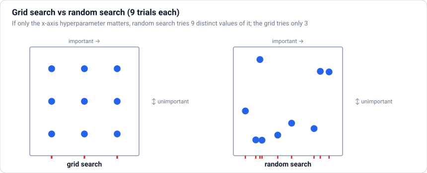

### 22.1 The recipe

Hyperparameters (Chapter 5.3) are settings you choose: k in kNN, C in logistic regression, the degree of polynomial features. **Tuning** means:

1. List candidate values.
2. Score each candidate with cross-validation on the **training** data.
3. Keep the best, and refit it on all the training data.
4. Score it **once** on the test set.

### 22.2 Grid search by hand

Try every combination of k and the voting rule. `weights="distance"` lets closer neighbours count more.

```python
import numpy as np
from sklearn.datasets import load_breast_cancer
from sklearn.model_selection import train_test_split, cross_val_score
from sklearn.pipeline import Pipeline
from sklearn.preprocessing import StandardScaler
from sklearn.neighbors import KNeighborsClassifier

X, y = load_breast_cancer(return_X_y=True)
X_train, X_test, y_train, y_test = train_test_split(X, y, test_size=0.25, stratify=y, random_state=0)
pipe = Pipeline([("scale", StandardScaler()), ("knn", KNeighborsClassifier())])

results = []
for k in [1, 3, 5, 11, 21, 41]:
    for weights in ["uniform", "distance"]:
        pipe.set_params(knn__n_neighbors=k, knn__weights=weights)
        score = cross_val_score(pipe, X_train, y_train, cv=5).mean()
        results.append((score, k, weights))

for score, k, weights in sorted(results, reverse=True)[:3]:
    print(f"k={k:<3} weights={weights:<9} CV accuracy {score:.4f}")
```

**Output:**

```text
k=3   weights=uniform   CV accuracy 0.9742
k=3   weights=distance  CV accuracy 0.9742
k=11  weights=uniform   CV accuracy 0.9625
```

12 combinations × 5 folds = 60 fits. Note that the best few are very close, so any of them would be a sensible choice.

### 22.3 GridSearchCV

`GridSearchCV` runs the same loop. `param_grid` maps each `step__param` name (Chapter 19.4) to its candidate values:

```python
from sklearn.model_selection import GridSearchCV

grid = GridSearchCV(pipe, param_grid={"knn__n_neighbors": [1, 3, 5, 11, 21, 41],
                                      "knn__weights": ["uniform", "distance"]}, cv=5)
grid.fit(X_train, y_train)
print("best settings:", grid.best_params_)
print("best CV accuracy:", round(grid.best_score_, 4))
print("test accuracy:", round(grid.score(X_test, y_test), 4))
```

**Output:**

```text
best settings: {'knn__n_neighbors': 3, 'knn__weights': 'uniform'}
best CV accuracy: 0.9742
test accuracy: 0.951
```

The test accuracy (0.951) is a little below the best CV score (0.974): the winner was partly lucky on these folds (22.6 explains why). After the search, `GridSearchCV` **refits** the best settings on the whole training set (`refit=True` by default), so `grid` itself is now the final model: `grid.predict` and `grid.score` use it. `grid.cv_results_` holds every candidate's scores, and `pd.DataFrame(grid.cv_results_)` turns them into a table.

### 22.4 Random search

A grid grows multiplicatively: 5 settings with 10 values each is 100,000 combinations. And often only one or two settings really matter. With a 3 × 3 grid you try only 3 values of the important one, while 9 random points try 9 different values (see the picture).

**Random search** samples a fixed number of combinations from **distributions**. For settings that span orders of magnitude, like C from 0.001 to 1000, sample on a **log scale**, so 0.001–0.01 is as likely as 100–1000:

```python
from scipy.stats import loguniform
from sklearn.model_selection import RandomizedSearchCV
from sklearn.linear_model import LogisticRegression

logreg = Pipeline([("scale", StandardScaler()), ("clf", LogisticRegression(max_iter=5000))])
search = RandomizedSearchCV(logreg, {"clf__C": loguniform(1e-3, 1e3)}, n_iter=20, cv=5, random_state=0)
search.fit(X_train, y_train)
print("best C:", round(search.best_params_["clf__C"], 4))
print("best CV accuracy:", round(search.best_score_, 4), "| test accuracy:", round(search.score(X_test, y_test), 4))
```

**Output:**

```text
best C: 0.3483
best CV accuracy: 0.9836 | test accuracy: 0.965
```

`loguniform(a, b)` is a distribution from SciPy, Python's scientific-computing library: every power of 10 between a and b is equally likely.

### 22.5 Smarter searches

- **Successive halving** (`HalvingGridSearchCV`, `HalvingRandomSearchCV`): try many candidates on a small slice of the data, keep the best third, give them more data, and repeat. Weak settings are dropped cheaply.
- **Bayesian optimisation:** use the scores so far to guess where the next good setting is likely to be, and try there. **Optuna** is a popular library for this. You write a function that trains with suggested settings and returns a score; Optuna proposes the settings.

```python
import optuna
optuna.logging.set_verbosity(optuna.logging.WARNING)

def objective(trial):
    C = trial.suggest_float("C", 1e-3, 1e3, log=True)
    logreg.set_params(clf__C=C)
    return cross_val_score(logreg, X_train, y_train, cv=5).mean()

study = optuna.create_study(direction="maximize", sampler=optuna.samplers.TPESampler(seed=42))
study.optimize(objective, n_trials=20)
print("best C:", round(study.best_params["C"], 4), "| best CV accuracy:", round(study.best_value, 4))
```

**Output:**

```text
best C: 0.2978 | best CV accuracy: 0.9836
```

For one or two settings, plain grid or random search is fine. Bayesian search pays off with many settings and slow training (boosting in Chapter 30, neural networks).

### 22.6 Don't fool yourself

- **The best CV score is optimistic.** Out of many candidates you picked the one that got luckiest on these folds. That's why the final number is the **test** score, measured once.
- **Never tune on the test set.** Each look at it while making choices uses up its honesty.
- **Search inside a pipeline,** so preprocessing is refitted on every fold (Chapter 25).
- To estimate how good the whole **"tune, then train"** procedure is without a separate test set, use **nested cross-validation**: an outer CV loop around the search. `cross_val_score(grid, X, y, cv=5)` does exactly that.

### 22.7 Summary

```
GridSearchCV(pipe, param_grid={"step__param": [...]}, cv=5)          every combination
RandomizedSearchCV(pipe, {"step__param": distribution}, n_iter=…)    sampled; log scale for C, alpha, lr
.best_params_, .best_score_, .cv_results_;  refit=True → the search object is the final model
report the test score once, after tuning
```

**Key terms:**

- **Hyperparameter tuning:** choosing settings by comparing their cross-validated scores.
- **Grid search:** trying every combination of listed values.
- **Random search:** trying a fixed number of randomly sampled combinations.
- **Log-uniform distribution:** a distribution where each power of 10 in the range is equally likely.
- **Successive halving:** giving more data only to the candidates that did best on less data.
- **Bayesian optimisation:** choosing the next candidate based on the results so far.
- **Optuna:** a Python library for Bayesian-style hyperparameter search.
- **Refit:** retraining the best settings on all the training data after the search.
- **Nested cross-validation:** cross-validating the whole tuning procedure, with an outer loop around the search.

**Exercises**

1. A grid has 4 values of C, 3 kernels and 5 values of gamma, with 5-fold CV. How many fits does `GridSearchCV` run (including the final refit)?
2. Why sample `alpha` from `loguniform(1e-4, 10)` rather than from a uniform range of 0 to 10?

<details>
<summary><b>Answers</b></summary>

1. 4 × 3 × 5 = 60 candidates × 5 folds = 300, plus 1 refit = **301**.
2. With a uniform range, about 90% of the samples fall between 1 and 10, and values like 0.001 are almost never tried. The log scale gives each power of 10 a fair share.

</details>

**Learn more:** [scikit-learn: tuning hyperparameters](https://scikit-learn.org/stable/modules/grid_search.html) · [Optuna documentation](https://optuna.readthedocs.io/)

---

## 23. Learning Curves and Validation Curves

**You need:** Chapters 15 and 21. · **You'll learn:** two charts that diagnose a model: whether more data would help, and which way to turn a hyperparameter.

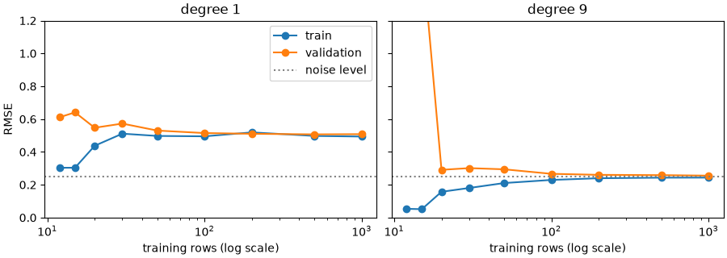

### 23.1 Two questions every project hits

- "Should we collect more data?" Data is expensive, so you want to know before paying for it.
- "Is the model too simple or too complex?"

A **learning curve** answers the first: plot training and validation error against the **number of training rows**. A **validation curve** answers the second: plot them against **one hyperparameter**.

### 23.2 Learning curves by hand

The wave data from Chapter 15, with two models: degree 1 (too simple) and degree 9 (very flexible). For each training size, fit on that many rows, then measure the error on those same training rows and on a large validation set.

```python
import numpy as np

def make_data(n, rng):
    x = rng.uniform(0, 1, n)
    return x, np.sin(2 * np.pi * x) + rng.normal(0, 0.25, n)

def poly(x, d):
    return np.column_stack([x ** p for p in range(d + 1)])

rng = np.random.default_rng(0)
x_pool, y_pool = make_data(2000, rng)
x_val, y_val = make_data(2000, rng)

def rmse(x, y, w, d):
    return np.sqrt(np.mean((poly(x, d) @ w - y) ** 2))

for d in [1, 9]:
    print(f"degree {d}")
    for n in [15, 30, 100, 1000]:
        x, y = x_pool[:n], y_pool[:n]
        w = np.linalg.lstsq(poly(x, d), y)[0]
        print(f"  n = {n:>4}: train RMSE {rmse(x, y, w, d):.3f}, validation RMSE {rmse(x_val, y_val, w, d):.3f}")
```

**Output:**

```text
degree 1
  n =   15: train RMSE 0.304, validation RMSE 0.641
  n =   30: train RMSE 0.511, validation RMSE 0.573
  n =  100: train RMSE 0.495, validation RMSE 0.515
  n = 1000: train RMSE 0.494, validation RMSE 0.508
degree 9
  n =   15: train RMSE 0.051, validation RMSE 1.634
  n =   30: train RMSE 0.180, validation RMSE 0.301
  n =  100: train RMSE 0.229, validation RMSE 0.267
  n = 1000: train RMSE 0.244, validation RMSE 0.255
```

**How to read it:**

| pattern | meaning | will more data help? |
|---|---|---|
| train and validation errors meet early, **both high** (degree 1, around 0.5) | high bias, underfitting | **no**: use a more flexible model or better features |
| **big gap** that shrinks as n grows (degree 9) | high variance, overfitting | **yes**, and the curve shows roughly how much |
| both low, close together | a good fit | only a little |

Degree 1 is stuck near 0.5 from 100 rows on: a thousand more rows won't teach a straight line to bend. Degree 9 starts badly overfitted, but by 1,000 rows it reaches the noise level (0.25). For it, data was the cure.

<details>
<summary><b>Code for the chart at the top</b></summary>

```python
import matplotlib.pyplot as plt

sizes = [12, 15, 20, 30, 50, 100, 200, 500, 1000]
fig, axes = plt.subplots(1, 2, figsize=(9, 3.2), layout="constrained", sharey=True)
for ax, d in zip(axes, [1, 9]):
    tr, va = [], []
    for n in sizes:
        w = np.linalg.lstsq(poly(x_pool[:n], d), y_pool[:n])[0]
        tr.append(rmse(x_pool[:n], y_pool[:n], w, d)); va.append(rmse(x_val, y_val, w, d))
    ax.plot(sizes, tr, "o-", label="train")
    ax.plot(sizes, va, "o-", label="validation")
    ax.axhline(0.25, ls=":", color="gray", label="noise level")
    ax.set(xscale="log", ylim=(0, 1.2), xlabel="training rows (log scale)", title=f"degree {d}")
axes[0].set_ylabel("RMSE")
axes[0].legend()
fig.savefig("learning-curves.png", dpi=100)
plt.close(fig)
```

</details>

### 23.3 learning_curve in scikit-learn

`learning_curve` does the loop with cross-validation at each size. Here's logistic regression on the digits dataset: 1,797 handwritten digits, each an 8×8 image flattened into 64 pixel features, with labels 0–9.

```python
from sklearn.datasets import load_digits
from sklearn.model_selection import learning_curve
from sklearn.pipeline import make_pipeline
from sklearn.preprocessing import StandardScaler
from sklearn.linear_model import LogisticRegression

X, y = load_digits(return_X_y=True)
model = make_pipeline(StandardScaler(), LogisticRegression(max_iter=2000))
sizes, train_scores, val_scores = learning_curve(model, X, y, train_sizes=[0.1, 0.3, 0.6, 1.0], cv=5)

for n, tr, va in zip(sizes, train_scores.mean(axis=1), val_scores.mean(axis=1)):
    print(f"{n:>5} rows: train accuracy {tr:.3f}, validation accuracy {va:.3f}")
```

**Output:**

```text
  143 rows: train accuracy 1.000, validation accuracy 0.779
  431 rows: train accuracy 1.000, validation accuracy 0.884
  862 rows: train accuracy 1.000, validation accuracy 0.921
 1437 rows: train accuracy 0.999, validation accuracy 0.920
```

Validation accuracy climbs fast at first, then flattens at about 0.92 from 862 rows on, while training accuracy stays near 100%. The gap stays wide, which means overfitting. But since validation has stopped improving, more data of the same kind would help little here. Stronger regularisation (23.4) or a different model is the better next step. `train_sizes` are fractions of each CV training set, and the score arrays have one row per size and one column per fold.

### 23.4 Validation curves

Fix the data and vary one hyperparameter. Here it's C, the inverse regularisation strength (Chapter 16.7), on a log scale:

```python
from sklearn.model_selection import validation_curve

Cs = [1e-4, 1e-3, 1e-2, 1e-1, 1, 10]
train_scores, val_scores = validation_curve(model, X, y, param_name="logisticregression__C", param_range=Cs, cv=5)
for C, tr, va in zip(Cs, train_scores.mean(axis=1), val_scores.mean(axis=1)):
    print(f"C = {C:<7}: train {tr:.3f}, validation {va:.3f}")
```

**Output:**

```text
C = 0.0001 : train 0.854, validation 0.811
C = 0.001  : train 0.919, validation 0.880
C = 0.01   : train 0.961, validation 0.915
C = 0.1    : train 0.990, validation 0.925
C = 1      : train 0.999, validation 0.920
C = 10     : train 1.000, validation 0.915
```

Small C (a strong penalty) underfits: both scores are low. As C grows, training accuracy reaches 100%, and validation accuracy peaks and then slips slightly as the model starts to overfit. Choose C near the validation peak, which is C = 0.1 here. A validation curve is a one-hyperparameter grid search that also shows the training score, so you can see **why** a setting is good or bad.

### 23.5 Summary

```
learning curve     error vs training size    gap shrinking → more data helps; both high → change the model
validation curve   error vs one setting      left/right of the peak = under/overfitting
learning_curve(model, X, y, train_sizes=[…], cv=…)
validation_curve(model, X, y, param_name="step__param", param_range=[…], cv=…)
```

**Key terms:**

- **Learning curve:** training and validation scores plotted against the number of training examples.
- **Validation curve:** training and validation scores plotted against one hyperparameter.
- **Generalisation gap:** the difference between training and validation performance.
- **Plateau:** where a curve flattens out, so more data or a bigger setting stops helping.

**Exercises**

1. A learning curve shows training accuracy 0.71 and validation accuracy 0.70, both flat from 5,000 rows on. Your manager offers to label 50,000 more rows. What do you say?
2. In 23.2, why does degree 9's **training** error go **up** as n grows?

<details>
<summary><b>Answers</b></summary>

1. Don't: the curves have plateaued together, which is high bias. More data won't help. Spend the effort on better features or a more flexible model.
2. With few rows, 10 weights can almost thread through every point. With many rows it can't, so it has to fit the general shape, and the training error rises towards the noise level.

</details>

**Learn more:** [scikit-learn: validation and learning curves](https://scikit-learn.org/stable/modules/learning_curve.html)

---

## 24. Feature Selection

**You need:** Chapters 16, 19 and 21. · **You'll learn:** why useless features hurt, three ways to find the useful ones, and the one mistake that makes feature selection lie.

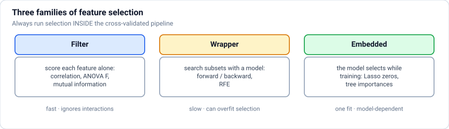

### 24.1 Why fewer features?

- **Noise features hurt** some models directly. kNN's distances get diluted by irrelevant columns, and every model has more chances to fit noise.
- **Simpler** models are easier to explain, faster, and cheaper to run: every feature must be collected, stored and monitored in production.

Add columns of pure noise to the breast-cancer data and watch kNN degrade:

```python
import numpy as np
from sklearn.datasets import load_breast_cancer
from sklearn.model_selection import cross_val_score
from sklearn.pipeline import make_pipeline
from sklearn.preprocessing import StandardScaler
from sklearn.neighbors import KNeighborsClassifier

X, y = load_breast_cancer(return_X_y=True)
rng = np.random.default_rng(1)
knn = make_pipeline(StandardScaler(), KNeighborsClassifier())
for n_noise in [0, 30, 100, 300]:
    X_noisy = np.hstack([X, rng.normal(size=(len(X), n_noise))])
    print(f"{30 + n_noise:>3} features ({n_noise:>3} noise): CV accuracy {cross_val_score(knn, X_noisy, y, cv=5).mean():.3f}")
```

**Output:**

```text
 30 features (  0 noise): CV accuracy 0.965
 60 features ( 30 noise): CV accuracy 0.940
130 features (100 noise): CV accuracy 0.912
330 features (300 noise): CV accuracy 0.866
```

`np.hstack` glues arrays side by side.

### 24.2 Filter methods: score each feature on its own

Give every feature a score for how strongly it relates to the target, and keep the top k. It's fast, but it ignores how features work **together**.

For classification, a common score is the **ANOVA F-statistic**. It asks: are the class averages far apart compared with the spread inside each class?

```
F = (spread between class means) / (spread within classes)
```

**By hand**, two features and two classes of 3 rows each:

| | class 0 values | class 1 values | class means | F |
|---|---|---|---|---|
| feature A | 1, 2, 3 | 7, 8, 9 | 2 and 8 (far apart) | **54** |
| feature B | 1, 5, 9 | 2, 5, 8 | 5 and 5 (the same) | **0** |

For A: the overall mean is 5. Between: 3·(2 − 5)² + 3·(8 − 5)² = 54, divided by (classes − 1) = 1 → 54. Within: (1 + 0 + 1) + (1 + 0 + 1) = 4, divided by (rows − classes) = 4 → 1. So F = 54 / 1 = 54. Feature A separates the classes; B doesn't.

```python
from sklearn.feature_selection import SelectKBest, f_classif

A = [1, 2, 3, 7, 8, 9]
B = [1, 5, 9, 2, 5, 8]
labels = [0, 0, 0, 1, 1, 1]
F, p_values = f_classif(np.column_stack([A, B]), labels)
print("F scores:", F.round(2))

selector = SelectKBest(f_classif, k=5).fit(X, y)
names = load_breast_cancer().feature_names
print("top 5 breast-cancer features:", names[selector.get_support()].tolist())
```

**Output:**

```text
F scores: [54.  0.]
top 5 breast-cancer features: ['mean perimeter', 'mean concave points', 'worst radius', 'worst perimeter', 'worst concave points']
```

`get_support()` returns True for each kept feature. For numeric targets, use `f_regression`, which is based on correlation. `mutual_info_classif` also catches non-linear relationships.

### 24.3 Wrapper methods: let a model judge subsets

**Forward selection:** start with no features. Each round, try adding each remaining feature, keep the one that gives the best CV score, and repeat. It's slow (one CV run per candidate per round), but it judges features in combination.

```python
from sklearn.linear_model import LogisticRegression

model = make_pipeline(StandardScaler(), LogisticRegression(max_iter=1000))
chosen = []
for round_ in range(3):
    best_score, best_j = max(
        (cross_val_score(model, X[:, chosen + [j]], y, cv=5).mean(), j)
        for j in range(X.shape[1]) if j not in chosen)
    chosen.append(best_j)
    print(f"round {round_ + 1}: add '{names[best_j]}' → CV accuracy {best_score:.3f}")
```

**Output:**

```text
round 1: add 'worst perimeter' → CV accuracy 0.917
round 2: add 'worst smoothness' → CV accuracy 0.958
round 3: add 'worst texture' → CV accuracy 0.968
```

Three well-chosen features already reach almost 97%. **Recursive feature elimination (RFE)** works the other way round: fit with all features, drop the one with the smallest weight (features standardised), refit, and repeat. scikit-learn has `RFE` and `SequentialFeatureSelector` for these.

### 24.4 Embedded methods: selection during training

Lasso (Chapter 16.5) sets some weights to exactly 0 while training, so selection comes free. For classification, use logistic regression with the L1 penalty, written `l1_ratio=1.0`. `SelectFromModel` keeps the features with non-zero weights:

```python
from sklearn.feature_selection import SelectFromModel

l1 = LogisticRegression(l1_ratio=1.0, solver="saga", C=0.1, max_iter=5000)
pipe = make_pipeline(StandardScaler(), SelectFromModel(l1), LogisticRegression(max_iter=1000))
pipe.fit(X, y)
print("features kept:", pipe[1].get_support().sum(), "of 30")
print("CV accuracy:", cross_val_score(pipe, X, y, cv=5).mean().round(3))
```

**Output:**

```text
features kept: 8 of 30
CV accuracy: 0.967
```

`solver="saga"` is one of the optimisers that supports the L1 penalty. Smaller C keeps fewer features.

### 24.5 The mistake: selecting before cross-validation

Selection **learns from the labels**, so it must happen **inside** each CV fold, like scaling. Here's what happens otherwise. Take 100 rows with 5,000 features of **pure noise** and random labels. There's nothing to learn, so the honest accuracy is about 50%.

```python
rng = np.random.default_rng(0)
X_noise = rng.normal(size=(100, 5000))
y_noise = rng.integers(0, 2, 100)

# WRONG: pick the 20 "best" features using all rows, then cross-validate
X_picked = SelectKBest(f_classif, k=20).fit_transform(X_noise, y_noise)
print("selected outside CV:", cross_val_score(LogisticRegression(), X_picked, y_noise, cv=5).mean().round(3))

# RIGHT: selection inside the pipeline, so it's redone on each fold's training rows
right = make_pipeline(SelectKBest(f_classif, k=20), LogisticRegression())
print("selected inside CV: ", cross_val_score(right, X_noise, y_noise, cv=5).mean().round(3))
```

**Output:**

```text
selected outside CV: 0.85
selected inside CV:  0.48
```

Out of 5,000 noise columns, some match the random labels by chance, and selecting on all the rows finds exactly those. The validation folds helped choose them, so they "predict" well there. Inside the pipeline, the illusion disappears.

### 24.6 Summary

| family | how | speed | sees interactions? |
|---|---|---|---|
| filter | score each feature alone (F-test, correlation, mutual information) | fast | no |
| wrapper | search subsets with a model (forward selection, RFE) | slow | yes |
| embedded | the model zeroes features while training (L1) | one fit | yes, for that model |

**Always put selection inside the pipeline**, so it's redone on every fold.

**Key terms:**

- **Feature selection:** choosing a subset of the features to keep.
- **Filter method:** ranking features by a score computed one at a time.
- **ANOVA F-statistic:** the spread between class means divided by the spread within classes.
- **Mutual information:** a measure of how much knowing a feature reduces uncertainty about the target; it catches non-linear links.
- **Wrapper method:** choosing features by training and scoring a model on candidate subsets.
- **Forward selection:** adding the best remaining feature one round at a time.
- **Recursive feature elimination (RFE):** repeatedly removing the least important feature and refitting.
- **Embedded method:** selection that happens as part of training, such as L1 regularisation.
- **`SelectKBest` / `SelectFromModel`:** scikit-learn transformers that keep the top k features, or those a model marks as important.

**Exercises**

1. Compute F by hand for one feature with class 0 = [2, 4] and class 1 = [6, 8].
2. A colleague reports 95% CV accuracy after picking 10 of 20,000 gene features with `SelectKBest` on the full dataset. What do you ask?

<details>
<summary><b>Answers</b></summary>

1. The overall mean is 5; the class means are 3 and 7. Between: 2·(3 − 5)² + 2·(7 − 5)² = 16, divided by 1 → 16. Within: (1 + 1) + (1 + 1) = 4, divided by (4 − 2) = 2 → 2. **F = 8**.
2. "Was the selection done inside each fold?" With 20,000 features and selection on all the rows, 95% may be the 24.5 illusion.

```python
print(f_classif(np.array([[2], [4], [6], [8]]), [0, 0, 1, 1])[0])
```

**Output:**

```text
[8.]
```

</details>

**Learn more:** [scikit-learn: feature selection](https://scikit-learn.org/stable/modules/feature_selection.html)

---

## 25. Data Leakage: Finding and Preventing It

**You need:** Chapters 19–24. · **You'll learn:** the four ways information about the answer sneaks into training, and a checklist to catch them before they reach production.

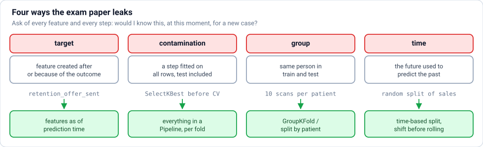

### 25.1 What leakage is

**Leakage** means the model, during training or evaluation, uses information it **won't have** when making real predictions. The validation score looks excellent, and then the model fails in production. It's the most common reason a model that "worked" doesn't.

The test for every feature and every step:

> **Would I know this, at this moment, for a brand-new case?**

### 25.2 Target leakage: a feature that comes from the answer

A telecom company predicts which customers will cancel. One column, `retention_offer_sent`, records whether a retention discount was offered. But the offer is only sent **after** a customer calls to cancel. So the column is really a record of the outcome.

```python
import numpy as np
import pandas as pd
from sklearn.model_selection import cross_val_score
from sklearn.linear_model import LogisticRegression

rng = np.random.default_rng(0)
n = 2000
tenure = rng.integers(1, 72, n)
charge = rng.uniform(200, 2000, n)
churn = (rng.random(n) < 1 / (1 + np.exp(0.04 * tenure - 0.001 * charge))).astype(int)
offer_sent = np.where(churn == 1, rng.random(n) < 0.9, rng.random(n) < 0.03).astype(int)   # recorded after the cancel call

X_honest = np.column_stack([tenure, charge / 1000])
X_leaky = np.column_stack([tenure, charge / 1000, offer_sent])
print("honest features: ", cross_val_score(LogisticRegression(), X_honest, churn, cv=5).mean().round(3))
print("with leaky column:", cross_val_score(LogisticRegression(), X_leaky, churn, cv=5).mean().round(3))
```

**Output:**

```text
honest features:  0.685
with leaky column: 0.956
```

The leaky model looks far better, and cross-validation can't catch it, because the column is "available" in the historical table. In production, at the moment you need the prediction (before the customer calls), `offer_sent` is always 0, and the model collapses. Typical sources: status fields updated after the event, refunds that only exist because of fraud, and totals that include the period being predicted.

**Fix:** build every feature **as of** the prediction time. Record when each column's value became known, and drop anything recorded afterwards.

### 25.3 Contamination: preprocessing that saw the test rows

Any step that **learns** from data (scaling, imputation, encoding, feature selection, oversampling) leaks if it's fitted before the split. Chapter 24.5 showed the worst case: selecting features on all the rows turned pure noise into 85% "accuracy". Scaling leaks less, but still leaks.

**Fix:** put every learning step inside a pipeline (Chapter 19), and give the pipeline to cross-validation and tuning.

### 25.4 Group leakage: the same source on both sides

Chapter 21.4: scans from one patient landed in both training and validation, and a model with **no** real skill scored about 90%.

**Fix:** `GroupKFold`, and a group-aware train/test split. Ask what the model will face in use: new patients? new users? new stores?

### 25.5 Time leakage: using the future

Random splits on time-ordered data let the model train on days that come after the ones it's tested on. Features can also peek ahead: a "7-day average" that includes today's sales, when predicting today's sales.

**Fix:** split by time (`TimeSeriesSplit`, Chapter 21.5). Build features only from data before each row's time: for rolling averages, shift by one step first (Chapter 41).

### 25.6 Duplicates

The same record copied into both training and test makes the test partly a memory exercise. Here's 20% of rows duplicated, with a model that memorises:

```python
from sklearn.model_selection import train_test_split
from sklearn.neighbors import KNeighborsClassifier

X_dup = np.vstack([X_honest, X_honest[:400]])           # 400 rows appear twice
y_dup = np.concatenate([churn, churn[:400]])
for name, (Xd, yd) in {"no duplicates": (X_honest, churn), "with duplicates": (X_dup, y_dup)}.items():
    X_tr, X_te, y_tr, y_te = train_test_split(Xd, yd, test_size=0.3, random_state=0)
    print(f"{name:<16} 1-NN test accuracy {KNeighborsClassifier(1).fit(X_tr, y_tr).score(X_te, y_te):.3f}")
```

**Output:**

```text
no duplicates    1-NN test accuracy 0.592
with duplicates  1-NN test accuracy 0.688
```

The duplicates inflate the score of a model that copies its nearest neighbour. **Fix:** remove exact duplicates (`df.drop_duplicates()`) before splitting, and treat near-duplicates (the same customer with two accounts) as a group.

### 25.7 The leakage checklist

1. For every feature: **when** is it recorded? Is that before the moment of prediction?
2. Is every learning step inside the pipeline?
3. Does the split match use: new groups, the future?
4. Are there duplicates across the split?
5. **Is the score too good?** 99% on a hard problem is a reason to investigate, not to celebrate.
6. Does one feature dominate the model's importance (Chapter 44)? Find out why.

### 25.8 Summary

| kind | example | fix |
|---|---|---|
| target | `offer_sent`, recorded after the cancel call | features as of prediction time |
| contamination | scaler or selector fitted on all rows | everything inside a pipeline |
| group | one patient's scans on both sides | `GroupKFold`, group splits |
| time | random split of daily sales; centred rolling means | time-based splits; shift before rolling |
| duplicates | the same row in train and test | deduplicate before splitting |

**Key terms:**

- **Data leakage:** training or evaluating with information that won't be available at prediction time.
- **Target leakage:** a feature that's created by, or after, the outcome.
- **Contamination (train–test contamination):** fitting a preprocessing step on data that includes the evaluation rows.
- **Point-in-time correctness:** computing each feature only from what was known at the prediction moment.
- **Prediction time:** the moment the model is asked for its answer in real use.

**Exercises**

1. A loan-default model includes `number_of_collection_calls`. Leak or not?
2. Your CV score with oversampling (copying minority rows) done before CV is 0.95; inside the pipeline it's 0.81. Which is real, and why?

<details>
<summary><b>Answers</b></summary>

1. Almost certainly a leak: collection calls happen **after** a payment is missed, which is part of the outcome. At application time it's 0 for everyone.
2. **0.81.** Oversampling before CV puts copies of the same minority rows in both the training and validation folds, the duplicate leak of 25.6.

</details>

**Learn more:** [scikit-learn: common pitfalls (data leakage)](https://scikit-learn.org/stable/common_pitfalls.html) · [Kaggle Learn: data leakage](https://www.kaggle.com/code/alexisbcook/data-leakage)

---

## 26. A Complete Project, End to End

**You need:** Chapters 18–25. · **You'll learn:** how all the pieces fit into one workflow, from the business question to a saved model that scores a new customer.

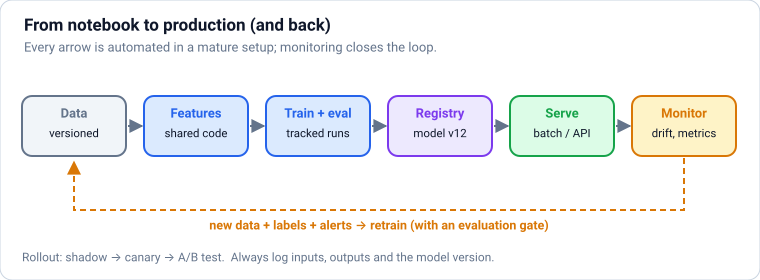

### 26.1 Frame the problem

**Business question:** a telecom company wants to offer a discount to customers likely to cancel within the next month. The retention team can call about 20% of customers each month.

| decision | choice |
|---|---|
| target | churned in the next 30 days (1) or not (0): binary classification |
| features | only what's known on the day of scoring: tenure, monthly charge, city, plan, support calls last month |
| main metric | ROC AUC for comparing models (ranking quality), then **recall at a 20% flag rate**, which matches the team's capacity |
| baseline | most frequent class, and the current rule: "call customers on the basic plan" |

### 26.2 Data and the held-out test set

```python
import numpy as np
import pandas as pd

rng = np.random.default_rng(7)
n = 5000
df = pd.DataFrame({
    "tenure_months": rng.integers(1, 72, n).astype(float),
    "monthly_charge": rng.uniform(200, 2000, n).round(),
    "city": rng.choice(["Pune", "Delhi", "Goa", "Mumbai"], n),
    "plan": rng.choice(["basic", "standard", "premium"], n, p=[0.5, 0.3, 0.2]),
    "support_calls": rng.poisson(1.0, n),        # Poisson: counts of events, average 1
})
score = (-0.06 * df["tenure_months"] + 0.0012 * df["monthly_charge"] + 0.6 * df["support_calls"]
         + 0.8 * (df["plan"] == "basic") - 1.5)
df["churned"] = (rng.random(n) < 1 / (1 + np.exp(-score))).astype(int)
df.loc[rng.random(n) < 0.08, "tenure_months"] = np.nan

print(df.shape, "| churn rate:", df["churned"].mean().round(3))
```

**Output:**

```text
(5000, 6) | churn rate: 0.262
```

Split off the test set **first**, stratified, and don't look at it again until 26.8:

```python
from sklearn.model_selection import train_test_split

X, y = df.drop(columns="churned"), df["churned"]
X_train, X_test, y_train, y_test = train_test_split(X, y, test_size=0.2, stratify=y, random_state=0)
print(len(X_train), "training rows,", len(X_test), "test rows")
```

**Output:**

```text
4000 training rows, 1000 test rows
```

### 26.3 Baselines

```python
from sklearn.model_selection import cross_val_score
from sklearn.dummy import DummyClassifier
from sklearn.metrics import roc_auc_score

dummy_auc = cross_val_score(DummyClassifier(), X_train, y_train, cv=5, scoring="roc_auc").mean()
rule_auc = roc_auc_score(y_train, X_train["plan"] == "basic")     # the business rule as a 0/1 score
print("dummy AUC:", round(dummy_auc, 3), "| 'basic plan' rule AUC:", round(rule_auc, 3))
```

**Output:**

```text
dummy AUC: 0.5 | 'basic plan' rule AUC: 0.568
```

A model must clearly beat the rule's AUC of about 0.57 to be worth deploying.

### 26.4 One preprocessing pipeline, two candidate models

```python
from sklearn.compose import ColumnTransformer
from sklearn.pipeline import make_pipeline
from sklearn.impute import SimpleImputer
from sklearn.preprocessing import StandardScaler, OneHotEncoder, OrdinalEncoder
from sklearn.linear_model import LogisticRegression
from sklearn.neighbors import KNeighborsClassifier

preprocess = ColumnTransformer([
    ("num", make_pipeline(SimpleImputer(strategy="median", add_indicator=True), StandardScaler()),
     ["tenure_months", "monthly_charge", "support_calls"]),
    ("city", OneHotEncoder(handle_unknown="ignore"), ["city"]),
    ("plan", OrdinalEncoder(categories=[["basic", "standard", "premium"]]), ["plan"]),
])

candidates = {
    "logistic": make_pipeline(preprocess, LogisticRegression()),
    "knn (k=25)": make_pipeline(preprocess, KNeighborsClassifier(n_neighbors=25)),
}
for name, model in candidates.items():
    scores = cross_val_score(model, X_train, y_train, cv=5, scoring="roc_auc")
    print(f"{name:<11} CV AUC {scores.mean():.3f} ± {scores.std():.3f}")
```

**Output:**

```text
logistic    CV AUC 0.822 ± 0.012
knn (k=25)  CV AUC 0.797 ± 0.019
```

Both clearly beat the rule, and logistic regression wins. That's expected here, because we generated the data from a logistic formula. On real data, Part IV's models often win on tabular problems like this.

### 26.5 Tune the winner

```python
from sklearn.model_selection import GridSearchCV

search = GridSearchCV(candidates["logistic"], {"logisticregression__C": [0.01, 0.1, 1, 10]}, cv=5, scoring="roc_auc")
search.fit(X_train, y_train)
print("best C:", search.best_params_, "| CV AUC:", round(search.best_score_, 3))
best = search.best_estimator_            # the refitted pipeline
```

**Output:**

```text
best C: {'logisticregression__C': 1} | CV AUC: 0.822
```

### 26.6 Choose the threshold on training data, not test data

The team can call 20% of customers, so we want the threshold that flags 20%. We pick it from **out-of-fold** probabilities: `cross_val_predict` returns, for every training row, the prediction from the CV model that **didn't** train on that row. These are honest probabilities, made without touching the test set.

```python
from sklearn.model_selection import cross_val_predict

oof = cross_val_predict(best, X_train, y_train, cv=5, method="predict_proba")[:, 1]
threshold = np.quantile(oof, 0.80)       # 80% of customers fall below it → flag the top 20%
print("threshold:", round(threshold, 3))
print("training recall at that threshold:", round(np.mean(oof[y_train == 1] >= threshold), 3))
```

**Output:**

```text
threshold: 0.465
training recall at that threshold: 0.497
```

`np.quantile(values, 0.8)` is the value below which 80% of the values fall.

### 26.7 What the model learned

```python
names = best[0].get_feature_names_out()
weights = best[-1].coef_[0]
for name, w in sorted(zip(names, weights), key=lambda t: -abs(t[1]))[:5]:
    print(f"{name:<32} {w:+.2f}")
```

**Output:**

```text
num__tenure_months               -1.17
num__support_calls               +0.63
num__monthly_charge              +0.59
plan__plan                       -0.44
city__city_Mumbai                -0.40
```

Tenure, support calls, charge and plan carry the signal, matching how the data was made: a good sanity check. A city also appears, which needs a careful reading. All four city weights are negative (−0.08 to −0.40). One-hot columns always add up to 1, so a shift they share acts like part of the intercept; only the **differences** between cities mean anything. Those differences come from chance in this sample, since city played no part in generating churn. Reading one-hot weights one at a time is a common trap. With real data, surprises here are often leaks (Chapter 25.7).

### 26.8 The one-time test

```python
proba_test = best.predict_proba(X_test)[:, 1]
flagged = proba_test >= threshold
print("test AUC:", round(roc_auc_score(y_test, proba_test), 3))
print("flagged share:", round(flagged.mean(), 3))
print("recall (churners caught):", round(flagged[y_test == 1].mean(), 3))
print("precision (flagged who churn):", round(y_test[flagged].mean(), 3))
```

**Output:**

```text
test AUC: 0.803
flagged share: 0.189
recall (churners caught): 0.45
precision (flagged who churn): 0.624
```

Report these. They're close to the cross-validated numbers (AUC 0.80 against 0.82, recall 0.45 against 0.50), so the evaluation was honest. For comparison, the "basic plan" rule flags half of all customers, far more than the team can call, and ranks churners much worse (AUC 0.57 against 0.80).

### 26.9 Save the pipeline, load it elsewhere

**joblib** saves a Python object to a file, and loads it back. Saving the **whole pipeline** means the production code applies exactly the same preprocessing as training.

```python
import joblib, os, tempfile

path = os.path.join(tempfile.mkdtemp(), "churn_model.joblib")
joblib.dump({"model": best, "threshold": threshold}, path)

saved = joblib.load(path)                                    # e.g. inside the scoring service
new_customer = pd.DataFrame([{"tenure_months": 3, "monthly_charge": 1800, "city": "Pune",
                              "plan": "basic", "support_calls": 4}])
p = saved["model"].predict_proba(new_customer)[0, 1]
print(f"P(churn) = {p:.2f} → {'call' if p >= saved['threshold'] else 'no call'}")
```

**Output:**

```text
P(churn) = 0.97 → call
```

Only load joblib files you trust: loading one can run code. Chapter 48 covers safer formats, and Chapters 49–53 cover serving, tracking and monitoring.

### 26.10 The workflow on one page

1. **Frame:** the decision, the target, features known at prediction time, the metric, the capacity.
2. **Split** off the test set (stratified, grouped or by time) and lock it away.
3. **Baselines:** the dummy model and the current rule.
4. **Pipeline:** all preprocessing plus the model, in one object.
5. **Compare** candidates with cross-validation.
6. **Tune** the best one.
7. **Choose the threshold** from out-of-fold predictions.
8. **Test once.** Report the metrics with the baseline next to them.
9. **Save** the pipeline and threshold together, then deploy, monitor and retrain (Part VIII).

**Key terms:**

- **Problem framing:** turning a business goal into a precise prediction task with a target, features and a metric.
- **Out-of-fold (OOF) prediction:** a prediction for a training row from a model that didn't train on that row.
- **`cross_val_predict`:** returns out-of-fold predictions for every row.
- **Quantile:** the value below which a given fraction of the data falls.
- **joblib:** a library for saving Python objects, such as fitted pipelines, to files and loading them back.
- **Model artifact:** the saved file (model plus settings) that production loads.

**Exercises**

1. The team's capacity doubles to 40%. What changes in the code, and what happens to recall and precision?
2. Why is the threshold chosen with `cross_val_predict` rather than on the test set?

<details>
<summary><b>Answers</b></summary>

```python
t40 = np.quantile(oof, 0.60)
f40 = proba_test >= t40
print("recall:", round(f40[y_test == 1].mean(), 3), "| precision:", round(y_test[f40].mean(), 3))
```

**Output:**

```text
recall: 0.729 | precision: 0.494
```

1. Use `np.quantile(oof, 0.60)`. Recall rises (more churners called) and precision falls (more of those called weren't going to leave).
2. Choosing anything on the test set makes the test score optimistic. Out-of-fold predictions give honest probabilities from the training data alone.

</details>

---

**✅ Part III checkpoint.** You can now take raw tabular data to a saved, honestly evaluated model: pipelines, cross-validation, tuning, feature selection, and no leakage. Part IV adds the models that usually win on tabular data: trees and their ensembles.

---

# Part IV — Trees and Other Models

Decision trees, the ensembles built from them (random forests and gradient boosting), support vector machines and Naive Bayes. Each is built by hand first.

---

## 27. Decision Trees

**You need:** Chapters 9, 12 and 15. · **You'll learn:** how a tree chooses its questions (Gini impurity and entropy, by hand), how to build one from scratch, and how to stop it overfitting.

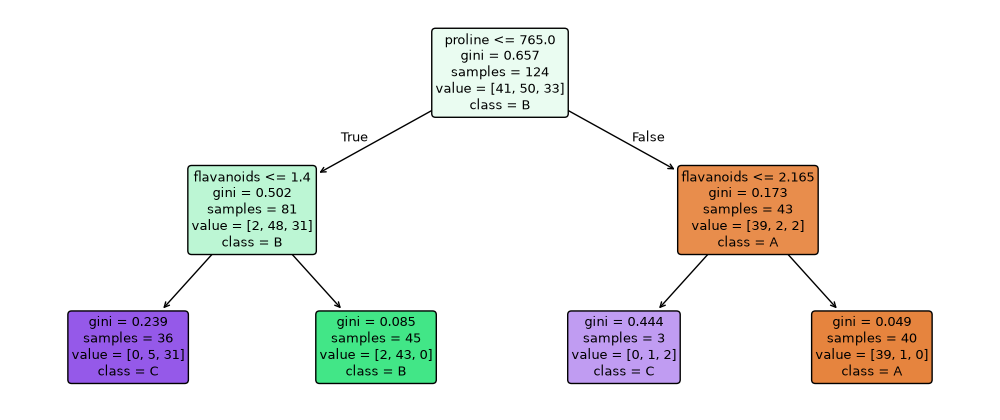

### 27.1 The idea: a flowchart of questions

A decision tree predicts by asking yes/no questions about the features, one after another:

```
worst perimeter ≤ 106.1?
├── yes → worst concave points ≤ 0.13?
│         ├── yes → benign
│         └── no  → malignant
└── no  → malignant
```

Each question is a **split**, each end point is a **leaf**, and a leaf predicts the majority class of the training rows that reach it (for regression, their average). Training means choosing **which question to ask at each step**.

### 27.2 Measuring how mixed a group is

A good question separates the classes. To measure "separated", we need a number for how **mixed** a group of rows is: its **impurity**. With pₖ the share of class k in the group:

```
Gini impurity  G = 1 − Σ pₖ²
Entropy        H = −Σ pₖ · log₂ pₖ
```

| group | p(yes), p(no) | Gini | entropy |
|---|---|---|---|
| 10 yes, 0 no | 1, 0 | 1 − 1 = **0** | **0** |
| 8 yes, 2 no | 0.8, 0.2 | 1 − 0.64 − 0.04 = **0.32** | 0.72 |
| 5 yes, 5 no | 0.5, 0.5 | 1 − 0.25 − 0.25 = **0.5** | **1** |

Both are 0 for a pure group and largest for a 50/50 mix. **Gini** is the chance that two rows picked at random from the group have different classes. **Entropy**, from information theory, is the average number of yes/no questions needed to identify a row's class. In practice they choose almost the same splits; Gini is slightly faster, so it's the default.

```python
import numpy as np

def gini(y):
    p = np.bincount(y) / len(y)
    return 1 - np.sum(p ** 2)

def entropy(y):
    p = np.bincount(y) / len(y)
    p = p[p > 0]                                 # log(0) is undefined; 0·log 0 counts as 0
    return -np.sum(p * np.log2(p)) + 0.0          # + 0.0 turns −0.0 into 0.0

for group in [[1] * 10, [1] * 8 + [0] * 2, [1] * 5 + [0] * 5]:
    print(f"{sum(group)} yes / {10 - sum(group)} no: Gini {gini(np.array(group)):.2f}, entropy {entropy(np.array(group)):.2f}")
```

**Output:**

```text
10 yes / 0 no: Gini 0.00, entropy 0.00
8 yes / 2 no: Gini 0.32, entropy 0.72
5 yes / 5 no: Gini 0.50, entropy 1.00
```

### 27.3 Choosing the best split, by hand

Eight loan applicants. Did they default (1)?

| income (₹k) | 20 | 25 | 30 | 35 | 50 | 60 | 70 | 80 |
|---|---|---|---|---|---|---|---|---|
| default | 1 | 1 | 1 | 0 | 0 | 1 | 0 | 0 |

The whole group has 4 of each, so its Gini is 0.5. Try thresholds halfway between neighbouring incomes. For each one, compute the Gini of the two sides, weighted by their sizes:

```
split score = (n_left / n) · G_left + (n_right / n) · G_right
```

| question | left side | right side | weighted Gini |
|---|---|---|---|
| income ≤ 32.5 | 1, 1, 1 → G = 0 | 0, 0, 1, 0, 0 → G = 0.32 | 3/8·0 + 5/8·0.32 = **0.20** |
| income ≤ 42.5 | 1, 1, 1, 0 → 0.375 | 0, 1, 0, 0 → 0.375 | **0.375** |
| income ≤ 65 | 1, 1, 1, 0, 0, 1 → 0.444 | 0, 0 → 0 | 6/8·0.444 = **0.333** |

The best question is **income ≤ 32.5**: impurity falls from 0.5 to 0.2. That drop, 0.3, is the split's **impurity decrease**. With entropy instead of Gini it's called **information gain**. The tree then repeats the same search inside each side, and keeps going until the groups are pure or a stopping rule kicks in.

```python
income = np.array([20, 25, 30, 35, 50, 60, 70, 80])
default = np.array([1, 1, 1, 0, 0, 1, 0, 0])

def split_score(x, y, t):
    left, right = y[x <= t], y[x > t]
    return len(left) / len(y) * gini(left) + len(right) / len(y) * gini(right)

midpoints = (income[:-1] + income[1:]) / 2
for t in midpoints:
    print(f"income ≤ {t:>4}: weighted Gini {split_score(income, default, t):.3f}")
```

**Output:**

```text
income ≤ 22.5: weighted Gini 0.429
income ≤ 27.5: weighted Gini 0.333
income ≤ 32.5: weighted Gini 0.200
income ≤ 42.5: weighted Gini 0.375
income ≤ 55.0: weighted Gini 0.467
income ≤ 65.0: weighted Gini 0.333
income ≤ 75.0: weighted Gini 0.429
```

### 27.4 Building a whole tree from scratch

The algorithm is recursive. It's greedy: each split is the best **right now**, with no look-ahead.

1. If the node is pure, or the maximum depth is reached, make a leaf (the majority class).
2. Otherwise, try every feature and every midpoint threshold, and keep the split with the lowest weighted Gini.
3. Split the rows, and build each side with step 1.

```python
def best_split(X, y):
    best = (gini(y), None, None)                          # (score, feature, threshold); must beat "no split"
    for j in range(X.shape[1]):
        values = np.unique(X[:, j])
        for t in (values[:-1] + values[1:]) / 2:
            score = split_score(X[:, j], y, t)
            if score < best[0]:
                best = (score, j, t)
    return best[1], best[2]

def build(X, y, depth, max_depth):
    feature, threshold = best_split(X, y) if depth < max_depth else (None, None)
    if feature is None:                                   # pure, too deep, or nothing helps
        return {"leaf": np.bincount(y).argmax()}
    go_left = X[:, feature] <= threshold
    return {"feature": feature, "threshold": threshold,
            "left": build(X[go_left], y[go_left], depth + 1, max_depth),
            "right": build(X[~go_left], y[~go_left], depth + 1, max_depth)}

def predict_one(node, x):
    while "leaf" not in node:                             # walk down until a leaf
        node = node["left"] if x[node["feature"]] <= node["threshold"] else node["right"]
    return node["leaf"]
```

A tree is just nested dictionaries. `~go_left` flips True and False. Try it on the breast-cancer data:

```python
from sklearn.datasets import load_breast_cancer
from sklearn.model_selection import train_test_split

data = load_breast_cancer()
X_train, X_test, y_train, y_test = train_test_split(data.data, data.target, test_size=0.25, stratify=data.target, random_state=0)

tree = build(X_train, y_train, depth=0, max_depth=3)
pred = np.array([predict_one(tree, x) for x in X_test])
print("root question:", data.feature_names[tree["feature"]], "<=", round(tree["threshold"], 3))
print("test accuracy, depth 3:", round(np.mean(pred == y_test), 3))
```

**Output:**

```text
root question: worst perimeter <= 106.1
test accuracy, depth 3: 0.916
```

The same root question and the same test accuracy as scikit-learn's depth-3 tree in 27.6. In this dataset 0 = malignant and 1 = benign.

### 27.5 Regression trees

For a number target, a leaf predicts the **average** of its rows, and the impurity is their **variance**, which is the MSE of predicting that average. The split score is the size-weighted variance of the two sides.

**By hand:** y = [5, 6, 7, 20, 22] at x = 1, 2, 3, 4, 5. The split x ≤ 3.5 gives leaves [5, 6, 7] (mean 6, variance 0.67) and [20, 22] (mean 21, variance 1). Weighted: 3/5 · 0.67 + 2/5 · 1 = **0.8**, down from 49.8 for the whole group. The tree predicts 6 or 21: a **step function**. Trees can't extrapolate: beyond the training range, they repeat the last leaf's value.

### 27.6 Trees overfit unless stopped

Grown until every leaf is pure, a tree memorises the training data, noise and all.

```python
from sklearn.tree import DecisionTreeClassifier

for depth in [1, 2, 3, 5, None]:                          # None = grow until pure
    t = DecisionTreeClassifier(max_depth=depth, random_state=0).fit(X_train, y_train)
    print(f"max_depth={str(depth):<4}: leaves {t.get_n_leaves():>2}, train {t.score(X_train, y_train):.3f}, test {t.score(X_test, y_test):.3f}")
```

**Output:**

```text
max_depth=1   : leaves  2, train 0.930, test 0.888
max_depth=2   : leaves  4, train 0.932, test 0.888
max_depth=3   : leaves  8, train 0.977, test 0.916
max_depth=5   : leaves 18, train 1.000, test 0.902
max_depth=None: leaves 18, train 1.000, test 0.902
```

The fully grown tree is perfect on training data, and no better than depth 3 on the test set. The controls:

| setting | effect |
|---|---|
| `max_depth` | limit the number of questions in a row |
| `min_samples_leaf` | every leaf needs at least this many rows (so no one-row leaves) |
| `min_samples_split` | a node needs this many rows to be split |
| `ccp_alpha` | **cost-complexity pruning**: grow fully, then cut back branches whose impurity gain is less than α per leaf |

Cost-complexity pruning minimises (total impurity of the leaves) + α · (number of leaves). With α = 0 you get the full tree; larger α cuts more. Choose any of these settings with cross-validation (Chapter 22).

### 27.7 In scikit-learn

`DecisionTreeClassifier` and `DecisionTreeRegressor` use the same algorithm as ours, with fast sorting and the stopping rules above. `export_text` prints the learned questions:

```python
from sklearn.tree import export_text

clf = DecisionTreeClassifier(max_depth=2, random_state=0).fit(X_train, y_train)
print(export_text(clf, feature_names=list(data.feature_names)))
```

**Output:**

```text
|--- worst perimeter <= 106.10
|   |--- worst concave points <= 0.13
|   |   |--- class: 1
|   |--- worst concave points >  0.13
|   |   |--- class: 0
|--- worst perimeter >  106.10
|   |--- worst concave points <= 0.14
|   |   |--- class: 0
|   |--- worst concave points >  0.14
|   |   |--- class: 0
```

On the right-hand side, both leaves predict class 0 (malignant). The split was still chosen because it makes one leaf purer, even though the majority doesn't change. Two practical points:

- **No scaling needed.** A split is a threshold on one feature, so stretching a feature changes nothing. Trees also handle mixed units and skewed values without trouble.
- **They're unstable.** Change a few training rows and the root question can change, and with it the whole tree. That's high variance, and Chapter 28 fixes it by averaging many trees.

<details>
<summary><b>Code for the chart at the top</b></summary>

```python
import matplotlib.pyplot as plt
from sklearn.tree import plot_tree

fig, ax = plt.subplots(figsize=(10, 4.5), layout="constrained")
plot_tree(clf, feature_names=data.feature_names, class_names=["malignant", "benign"], filled=True, ax=ax, fontsize=9)
fig.savefig("decision-tree.png", dpi=100)
plt.close(fig)
```

</details>

### 27.8 Summary

```
Gini          1 − Σ pₖ²          entropy  −Σ pₖ log₂ pₖ          (0 = pure)
split score   Σ (n_side / n) · impurity(side)       choose the lowest; greedy, top-down
leaf          majority class (classification) or mean (regression)
stop / prune  max_depth, min_samples_leaf, ccp_alpha  (tune with CV)
```

**Key terms:**

- **Decision tree:** a model that predicts by following a sequence of yes/no questions about the features.
- **Node / split:** a point in the tree where a question divides the rows.
- **Root:** the first question.
- **Leaf:** an end point; it predicts the majority class or the average value of its rows.
- **Depth:** the number of questions from the root to a leaf.
- **Impurity:** how mixed the classes in a group are.
- **Gini impurity:** 1 − Σ pₖ²; the chance that two random rows from the group have different classes.
- **Entropy:** −Σ pₖ log₂ pₖ; the average uncertainty about a row's class.
- **Information gain / impurity decrease:** how much a split lowers the (weighted) impurity.
- **Greedy algorithm:** one that makes the best choice at each step without looking ahead.
- **Regression tree:** a tree that predicts numbers, splitting to reduce variance.
- **Pruning:** removing branches to reduce overfitting.
- **Cost-complexity pruning (`ccp_alpha`):** pruning that trades total leaf impurity against α times the number of leaves.

**Exercises**

1. A node has 6 rows: 2 of class A, 2 of B and 2 of C. What are its Gini and entropy?
2. In 27.3, what is the weighted Gini of the split income ≤ 55?

<details>
<summary><b>Answers</b></summary>

1. Gini = 1 − 3 · (1/3)² = **0.667**. Entropy = −3 · (1/3) · log₂(1/3) = log₂ 3 ≈ **1.585**.
2. Left [1, 1, 1, 0, 0]: p = 0.6, so G = 1 − 0.36 − 0.16 = 0.48. Right [1, 0, 0]: G = 1 − 1/9 − 4/9 = 0.444. Weighted: 5/8 · 0.48 + 3/8 · 0.444 = **0.467**.

```python
print(round(gini(np.array([0, 0, 1, 1, 2, 2])), 3), round(entropy(np.array([0, 0, 1, 1, 2, 2])), 3), round(split_score(income, default, 55), 3))
```

**Output:**

```text
0.667 1.585 0.467
```

</details>

| # | Problem (Deep-ML) | Difficulty |
|---|---|---|
| 1 | [138. Find the Best Gini-Based Split for a Binary Decision Tree](https://www.deep-ml.com/problems/138) | 🟡 Medium |

**Learn more:** [MLU-Explain: decision trees](https://mlu-explain.github.io/decision-tree/) · [StatQuest: decision trees (video)](https://www.youtube.com/watch?v=_L39rN6gz7Y)

---

## 28. Bagging and Random Forests

**You need:** Chapters 15 and 27. · **You'll learn:** why averaging many trees beats one, the bootstrap, and the random forest's extra trick of random features.

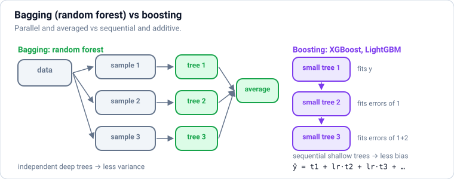

### 28.1 One tree is unstable

Chapter 27.7 warned that trees have **high variance**: small changes to the training rows can change the whole tree. Train the same kind of tree on four random 80% subsets of the data, and look at the root question each one picks:

```python
import numpy as np
from sklearn.datasets import load_breast_cancer
from sklearn.model_selection import train_test_split
from sklearn.tree import DecisionTreeClassifier

data = load_breast_cancer()
X_train, X_test, y_train, y_test = train_test_split(data.data, data.target, test_size=0.25, stratify=data.target, random_state=0)
rng = np.random.default_rng(0)

for i in range(4):
    rows = rng.choice(len(X_train), int(0.8 * len(X_train)), replace=False)
    t = DecisionTreeClassifier(random_state=0).fit(X_train[rows], y_train[rows])
    print(f"tree {i}: root = '{data.feature_names[t.tree_.feature[0]]}', test accuracy {t.score(X_test, y_test):.3f}")
```

**Output:**

```text
tree 0: root = 'worst perimeter', test accuracy 0.930
tree 1: root = 'worst perimeter', test accuracy 0.909
tree 2: root = 'mean concave points', test accuracy 0.937
tree 3: root = 'worst perimeter', test accuracy 0.916
```

`t.tree_.feature[0]` is the feature used at the root. Different data gives different trees and different scores.

### 28.2 Why averaging helps: the maths

Say each model's prediction has variance σ². The average of n **independent** predictions has variance:

```
Var(average) = σ² / n
```

Ten independent models → a tenth of the variance. But our trees aren't independent: they're trained on similar data, so their errors are **correlated**. With correlation ρ (rho) between any two of them:

```
Var(average) = ρ·σ² + (1 − ρ)·σ² / n
```

As n grows, the second term vanishes, but **ρ·σ² stays**. So averaging can only remove the part of the variance the trees don't share. To gain more, the trees must be made **less alike**. Random forests do exactly that (28.5).

<details>
<summary><b>Derivation: the variance of an average</b></summary>

For an average of n predictions f₁ … fₙ, each with variance σ², and each pair with covariance ρσ²:

```
Var((1/n) Σ fᵢ) = (1/n²) [ Σ Var(fᵢ) + Σ_{i≠j} Cov(fᵢ, fⱼ) ]
                = (1/n²) [ n·σ² + n(n − 1)·ρσ² ]
                = σ²/n + ρσ²·(n − 1)/n
                = ρσ² + (1 − ρ)σ²/n
```

With ρ = 0 this is σ²/n; with ρ = 1 (identical models), averaging does nothing.

</details>

### 28.3 The bootstrap: new datasets from one

We have only one training set. **Bootstrap sampling** makes many different ones from it: draw n rows **with replacement**, so some rows are picked twice or more, and others not at all.

**By hand**, from rows [A, B, C, D, E], one bootstrap sample might be [B, D, D, A, E]. C is left out, and D appears twice.

How many distinct rows does a sample contain? The chance that one particular row is **never** picked in n draws is (1 − 1/n)ⁿ. For large n that's e⁻¹ ≈ **0.368**. So each bootstrap sample contains about **63.2%** of the distinct rows, and the other 36.8% are called **out-of-bag** (OOB) for that sample.

```python
n = len(X_train)
sample = rng.integers(0, n, n)                      # n row numbers, with replacement
print("distinct rows in one bootstrap sample:", round(len(np.unique(sample)) / n, 3))
print("theory: 1 - (1 - 1/n)^n =", round(1 - (1 - 1 / n) ** n, 3))
```

**Output:**

```text
distinct rows in one bootstrap sample: 0.641
theory: 1 - (1 - 1/n)^n = 0.633
```

### 28.4 Bagging from scratch

**Bagging** (**b**ootstrap **agg**regat**ing**): train one deep tree per bootstrap sample, and combine them by **majority vote** (for regression, the average).

```python
def bagging_predict(X_train, y_train, X_new, n_trees, max_features=None, seed=0):
    rng = np.random.default_rng(seed)
    votes = np.zeros((len(X_new), 2))
    for i in range(n_trees):
        rows = rng.integers(0, len(X_train), len(X_train))          # bootstrap sample
        tree = DecisionTreeClassifier(max_features=max_features, random_state=i)
        tree.fit(X_train[rows], y_train[rows])
        votes[np.arange(len(X_new)), tree.predict(X_new)] += 1      # one vote per tree
    return votes.argmax(axis=1)
```

One test set of 143 rows is a noisy judge (Chapter 21.1), so we average the test accuracy over 10 different random splits:

```python
def average_accuracy(n_trees, max_features=None, n_splits=10):
    accs = []
    for split in range(n_splits):
        Xtr, Xte, ytr, yte = train_test_split(data.data, data.target, test_size=0.25,
                                              stratify=data.target, random_state=split)
        accs.append(np.mean(bagging_predict(Xtr, ytr, Xte, n_trees, max_features, seed=split) == yte))
    return np.mean(accs)

for n_trees in [1, 5, 25, 100]:
    print(f"{n_trees:>3} bagged trees: average test accuracy {average_accuracy(n_trees):.3f}")
```

**Output:**

```text
  1 bagged trees: average test accuracy 0.927
  5 bagged trees: average test accuracy 0.950
 25 bagged trees: average test accuracy 0.964
100 bagged trees: average test accuracy 0.961
```

Accuracy climbs fast up to about 25 trees, then levels off. The small wobble after that is noise. This is the levelling-off the variance formula predicts: past a point, only the shared part ρσ² is left.

`votes[rows, predictions] += 1` adds one vote in each test row's column for the predicted class.

### 28.5 Random forests: random features too

Bagged trees are still alike. If one feature is very strong, every tree puts it at the root. A **random forest** adds one more source of randomness: **at each split, only a random subset of the features is considered**. The usual size for classification is √d (for d = 30 features, 5 per split). Strong features can't dominate every tree, so the trees become less correlated (smaller ρ in 28.2), and the average improves.

Our function already supports it, through `DecisionTreeClassifier(max_features=…)`:

```python
for name, mf in [("bagging (all 30 features per split)", None), ("random forest (sqrt → 5 per split)", "sqrt")]:
    print(f"{name:<36} average test accuracy {average_accuracy(100, mf):.3f}")
```

**Output:**

```text
bagging (all 30 features per split)  average test accuracy 0.961
random forest (sqrt → 5 per split)   average test accuracy 0.965
```

On this dataset the two are nearly tied. Many of its 30 features measure nearly the same thing (radius, perimeter and area of the same cells), so restricting each split still finds a strong one. The random-feature trick pays off most when a few features dominate, or when there are many features. It never hurts much, which is why random forests use it by default.

### 28.6 In scikit-learn

```python
from sklearn.ensemble import RandomForestClassifier
from sklearn.model_selection import cross_val_score

models = {"single tree": DecisionTreeClassifier(random_state=0),
          "random forest (500 trees)": RandomForestClassifier(n_estimators=500, random_state=0, n_jobs=-1)}
for name, m in models.items():
    print(f"{name:<26} CV accuracy {cross_val_score(m, X_train, y_train, cv=5).mean():.3f}")
```

**Output:**

```text
single tree                CV accuracy 0.925
random forest (500 trees)  CV accuracy 0.955
```

`n_jobs=-1` trains trees in parallel on all CPU cores; the trees are independent, so this is easy.

**The out-of-bag score.** Each row is out-of-bag for about 37% of the trees. Predict each row using only those trees, and you get a validation score for free, without a separate validation set:

```python
rf = RandomForestClassifier(n_estimators=500, oob_score=True, random_state=0, n_jobs=-1).fit(X_train, y_train)
print("OOB accuracy:", round(rf.oob_score_, 3), "| test accuracy:", round(rf.score(X_test, y_test), 3))
```

**Output:**

```text
OOB accuracy: 0.965 | test accuracy: 0.944
```

### 28.7 Settings that matter

| setting | default | notes |
|---|---|---|
| `n_estimators` | 100 | more trees never overfit; they only cost time. Stop when the score stops improving |
| `max_features` | `"sqrt"` (classification), 1.0 = all (regression) | lower = less alike trees, more randomness |
| `min_samples_leaf` / `max_depth` | 1 / None (fully grown) | raise or limit to smooth predictions and shrink the model |
| `class_weight` | None | `"balanced"` for imbalanced classes (Chapter 39) |

Forests work well with little tuning, which makes them a strong first model for tabular data. Their weaknesses: large saved files (hundreds of deep trees), slower prediction than a linear model, and no extrapolation beyond the training range (inherited from trees).

**Feature importance.** `rf.feature_importances_` adds up, for each feature, how much it reduced impurity across all the trees' splits. It's quick but biased towards features with many distinct values. Chapter 44 shows more trustworthy methods.

```python
top = np.argsort(rf.feature_importances_)[::-1][:3]
print([(str(data.feature_names[i]), round(float(rf.feature_importances_[i]), 3)) for i in top])
```

**Output:**

```text
[('worst perimeter', 0.147), ('worst concave points', 0.123), ('worst radius', 0.121)]
```

### 28.8 Summary

```
bootstrap      n rows drawn with replacement → ~63.2% distinct; the rest are out-of-bag
bagging        one deep tree per bootstrap sample; vote (or average)
random forest  bagging + a random subset of features at each split (√d for classification)
variance       ρσ² + (1 − ρ)σ²/n → decorrelate the trees (ρ↓) and use many of them (n↑)
```

**Key terms:**

- **Ensemble:** a model that combines the predictions of several models.
- **Bootstrap sample:** a sample of n rows drawn with replacement from n rows.
- **Bagging (bootstrap aggregating):** training models on bootstrap samples and averaging or voting.
- **Random forest:** bagged decision trees that consider only a random subset of the features at each split.
- **`max_features`:** how many features each split may consider.
- **Out-of-bag (OOB) rows:** the training rows a given tree didn't see; scoring each row on those trees gives the OOB score.
- **Correlation (ρ) between models:** how alike their errors are; it limits how much averaging can help.
- **Majority vote:** predicting the class that most models chose.
- **`n_jobs=-1`:** use all CPU cores.

**Exercises**

1. With σ² = 1 and ρ = 0.3, what is the variance of an average of 10 trees? Of infinitely many?
2. Why doesn't adding more trees to a random forest cause overfitting, when making one tree deeper does?

<details>
<summary><b>Answers</b></summary>

1. 0.3 + 0.7/10 = **0.37**. With infinitely many: **0.3**.
2. More trees only make the average more stable: each new tree is another independent-ish vote, so the forest's variance falls towards ρσ² and stops there. A deeper tree adds complexity to a single model, which can fit noise.

</details>

| # | Problem (Deep-ML) | Difficulty |
|---|---|---|
| 1 | [307. Implement Bagging Classifier from Scratch](https://www.deep-ml.com/problems/307) | 🔴 Hard |
| 2 | [343. Implement Random Forest Feature Importance](https://www.deep-ml.com/problems/343) | 🟡 Medium |

**Learn more:** [MLU-Explain: random forest](https://mlu-explain.github.io/random-forest/) · [scikit-learn: ensembles](https://scikit-learn.org/stable/modules/ensemble.html)

---

## 29. Gradient Boosting from Scratch

**You need:** Chapters 5, 10 and 27. · **You'll learn:** how boosting builds a strong model from many small trees, each correcting the last, and why it's called *gradient* boosting.

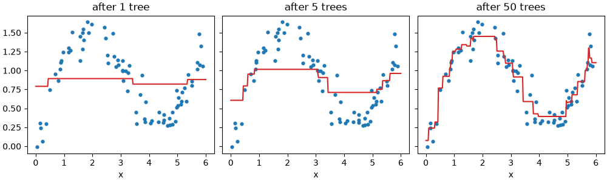

### 29.1 The idea: fix the mistakes, one small step at a time

A random forest builds big trees **independently** and averages them, which cuts variance. **Boosting** builds small trees **one after another**. Each new tree is trained to predict the errors the model is **still** making, and a little of it is added to the model:

```
F₀(x) = the average of y                                   start with a constant
F₁(x) = F₀(x) + lr · tree₁(x)        tree₁ fits y − F₀
F₂(x) = F₁(x) + lr · tree₂(x)        tree₂ fits y − F₁
…
```

The error y − F is the **residual**. lr (the **learning rate** or **shrinkage**, e.g. 0.1) keeps each step small, so no single tree has too much say. Small trees with few splits are each **weak learners**, but hundreds of them added together are strong. Boosting mainly reduces **bias**, the opposite of a forest.

### 29.2 Three rounds by hand

x = [1, 2, 3], y = [3, 5, 9], a learning rate of 0.5, and trees with one split (**stumps**).

| round | prediction F | residual y − F | stump's prediction | new F = F + 0.5 · stump |
|---|---|---|---|---|
| 0 | 5.667, 5.667, 5.667 | −2.667, −0.667, 3.333 | −1.667, −1.667, 3.333 | 4.833, 4.833, 7.333 |
| 1 | 4.833, 4.833, 7.333 | −1.833, 0.167, 1.667 | −1.833, 0.917, 0.917 | 3.917, 5.292, 7.792 |
| 2 | 3.917, 5.292, 7.792 | −0.917, −0.292, 1.208 | −0.604, −0.604, 1.208 | 3.615, 4.990, 8.396 |

- Round 0's best stump splits {1, 2} | {3}. Each side predicts the mean residual of its rows: (−2.667 − 0.667)/2 = −1.667, and 3.333.
- Round 1's residuals look different, so the best split moves to {1} | {2, 3}.
- The predictions creep towards [3, 5, 9], and the residuals shrink each round.

```python
import numpy as np
from sklearn.tree import DecisionTreeRegressor

x = np.array([[1], [2], [3]])
y = np.array([3.0, 5.0, 9.0])
F = np.full(3, y.mean())
for round_ in range(3):
    residual = y - F
    stump = DecisionTreeRegressor(max_depth=1).fit(x, residual)      # fit the residuals, not y
    F = F + 0.5 * stump.predict(x)
    print(f"round {round_}: residual {residual.round(3)} → new F {F.round(3)}")
```

**Output:**

```text
round 0: residual [-2.667 -0.667  3.333] → new F [4.833 4.833 7.333]
round 1: residual [-1.833  0.167  1.667] → new F [3.917 5.292 7.792]
round 2: residual [-0.917 -0.292  1.208] → new F [3.615 4.99  8.396]
```

### 29.3 Why "gradient"?

For the loss L = ½(y − F)², the derivative with respect to the prediction F is

```
∂L/∂F = −(y − F)      so      −∂L/∂F = y − F = the residual
```

So "fit a tree to the residuals and add a bit of it" is really **"step in the direction of the negative gradient"**: gradient descent (Chapter 5). The difference is that the steps are taken on the **predictions** rather than on weights. A tree is how we generalise that step to new x values, where we have no residual to look at.

This works for **any** differentiable loss: compute −∂L/∂F for each row (called the **pseudo-residual**), and fit the next tree to that.

| loss | −∂L/∂F (what each tree fits) |
|---|---|
| squared error ½(y − F)² | y − F |
| absolute error \|y − F\| | sign(y − F) |
| log loss, with F = log-odds and p = σ(F) | y − p (Chapter 10.5) |

### 29.4 Regression from scratch

A wavy curve plus a trend. Use depth-2 trees, a learning rate of 0.1, and 200 rounds, and track the error as trees are added.

```python
rng = np.random.default_rng(1)
def make(n):
    x = np.sort(rng.uniform(0, 6, n)).reshape(-1, 1)
    return x, np.sin(x[:, 0]) + 0.3 * x[:, 0] + rng.normal(0, 0.15, n)
x_train, y_train = make(80)
x_test, y_test = make(500)

class MyGradientBoosting:
    def __init__(self, n_rounds=200, lr=0.1, depth=2):
        self.n_rounds, self.lr, self.depth = n_rounds, lr, depth

    def fit(self, X, y):
        self.start = y.mean()
        F = np.full(len(y), self.start)
        self.trees = []
        for _ in range(self.n_rounds):
            tree = DecisionTreeRegressor(max_depth=self.depth).fit(X, y - F)   # residuals
            F += self.lr * tree.predict(X)
            self.trees.append(tree)
        return self

    def predict(self, X, n_trees=None):
        trees = self.trees[:n_trees]                     # optionally use only the first n trees
        return self.start + self.lr * sum(t.predict(X) for t in trees)

gb = MyGradientBoosting().fit(x_train, y_train)
for k in [1, 10, 50, 200]:
    rmse = np.sqrt(np.mean((gb.predict(x_test, k) - y_test) ** 2))
    print(f"{k:>3} trees: test RMSE {rmse:.3f}")
```

**Output:**

```text
  1 trees: test RMSE 0.428
 10 trees: test RMSE 0.269
 50 trees: test RMSE 0.179
200 trees: test RMSE 0.194
```

The error falls fast, bottoms out around 50 trees, then creeps up slightly as later trees start fitting noise. 29.6 deals with that.

<details>
<summary><b>Code for the chart at the top</b></summary>

```python
import matplotlib.pyplot as plt

grid = np.linspace(0, 6, 300).reshape(-1, 1)
fig, axes = plt.subplots(1, 3, figsize=(10, 3), layout="constrained", sharey=True)
for ax, k in zip(axes, [1, 5, 50]):
    ax.scatter(x_train, y_train, s=12, color="tab:blue")
    ax.plot(grid, gb.predict(grid, k), color="tab:red")
    ax.set(title=f"after {k} tree{'s' if k > 1 else ''}", xlabel="x")
fig.savefig("boosting-rounds.png", dpi=100)
plt.close(fig)
```

</details>

### 29.5 Classification from scratch

For yes/no targets, F is the **log-odds** (Chapter 10.3), and p = σ(F). Start at the log-odds of the overall positive rate, and let each tree fit y − p:

```python
from sklearn.datasets import load_breast_cancer
from sklearn.model_selection import train_test_split

X, y = load_breast_cancer(return_X_y=True)
X_train, X_test, yc_train, yc_test = train_test_split(X, y, test_size=0.25, stratify=y, random_state=0)

def sigmoid(z):
    return 1 / (1 + np.exp(-z))

rate = yc_train.mean()
F = np.full(len(yc_train), np.log(rate / (1 - rate)))      # start: log-odds of the base rate
F_test = np.full(len(yc_test), F[0])
for _ in range(100):
    tree = DecisionTreeRegressor(max_depth=2).fit(X_train, yc_train - sigmoid(F))   # pseudo-residuals y − p
    F += 0.3 * tree.predict(X_train)
    F_test += 0.3 * tree.predict(X_test)
print("test accuracy:", round(np.mean((sigmoid(F_test) >= 0.5) == yc_test), 3))
```

**Output:**

```text
test accuracy: 0.937
```

Real libraries make one improvement here: each leaf's value is set by a **Newton step**, Σ(y − p) / Σp(1 − p) over the leaf's rows, rather than the plain mean of the pseudo-residuals. That uses the loss's curvature (its second derivative) for a better step size. XGBoost and LightGBM (Chapter 30) are built around this.

### 29.6 Learning rate, rounds and early stopping

Unlike a forest, boosting **can overfit** as rounds are added: eventually the trees start fitting noise. The learning rate and the number of rounds trade off against each other:

- a smaller lr needs more rounds, but usually generalises a bit better;
- pick the number of rounds with **early stopping**: watch a validation score and stop when it hasn't improved for a while.

```python
for lr in [1.0, 0.1, 0.01]:
    model = MyGradientBoosting(n_rounds=1000, lr=lr).fit(x_train, y_train)
    errors = [np.sqrt(np.mean((model.predict(x_test, k) - y_test) ** 2)) for k in range(1, 1001)]
    best_k = int(np.argmin(errors)) + 1
    print(f"lr {lr:<4}: best test RMSE {min(errors):.3f} at {best_k:>4} trees, RMSE after 1000 trees {errors[-1]:.3f}")
```

**Output:**

```text
lr 1.0 : best test RMSE 0.205 at    8 trees, RMSE after 1000 trees 0.213
lr 0.1 : best test RMSE 0.178 at   57 trees, RMSE after 1000 trees 0.212
lr 0.01: best test RMSE 0.179 at  596 trees, RMSE after 1000 trees 0.183
```

(Here we watch the test set only to illustrate. In practice, use a validation split.)

### 29.7 In scikit-learn

`GradientBoostingRegressor` and `GradientBoostingClassifier` implement the same algorithm. `n_iter_no_change` turns on early stopping, using an internal validation split of size `validation_fraction`.

```python
from sklearn.ensemble import GradientBoostingRegressor, GradientBoostingClassifier

reg = GradientBoostingRegressor(n_estimators=200, learning_rate=0.1, max_depth=2, random_state=0).fit(x_train, y_train)
print("sklearn regression test RMSE:", round(np.sqrt(np.mean((reg.predict(x_test) - y_test) ** 2)), 3))

clf = GradientBoostingClassifier(n_estimators=1000, learning_rate=0.1, max_depth=2,
                                 n_iter_no_change=20, validation_fraction=0.2, random_state=0).fit(X_train, yc_train)
print("classifier stopped after", clf.n_estimators_, "trees | test accuracy", round(clf.score(X_test, yc_test), 3))
```

**Output:**

```text
sklearn regression test RMSE: 0.194
classifier stopped after 64 trees | test accuracy 0.944
```

| | random forest | gradient boosting |
|---|---|---|
| trees | deep, independent, built in parallel | shallow, built one after another |
| mainly reduces | variance | bias |
| more trees | never hurts | eventually overfits: use early stopping |
| tuning needed | little | more (learning rate, rounds, depth) |
| accuracy on tabular data | very good | usually the best |

### 29.8 Summary

```
F₀ = mean (or the base-rate log-odds)
repeat:  rᵢ = −∂L/∂F at each row         pseudo-residuals (y − F for MSE, y − p for log loss)
         fit a small tree to r
         F ← F + lr · tree
tune:    lr ↓ with rounds ↑, depth 2–8, early stopping on validation data
```

**Key terms:**

- **Boosting:** building an ensemble sequentially, each model correcting the errors of the ones before.
- **Gradient boosting:** boosting where each tree fits the negative gradient of the loss with respect to the current predictions.
- **Weak learner:** a model only a little better than guessing, such as a stump.
- **Stump:** a tree with a single split.
- **Pseudo-residual:** −∂L/∂F for a row; the target each new tree fits.
- **Learning rate (shrinkage):** the fraction of each new tree added to the model.
- **Additive model:** a model whose prediction is a sum of parts: F = F₀ + lr·tree₁ + lr·tree₂ + ….
- **Early stopping:** ending training when the validation score stops improving.
- **Newton step:** a step size set using the second derivative (curvature) of the loss.
- **`n_estimators_`:** the number of trees actually trained when early stopping is on.

**Exercises**

1. Continue the hand trace in 29.2 for round 3. Given the round-2 residuals, which split does the stump choose?
2. For log loss, a row has y = 0 and current log-odds F = 2. What is its pseudo-residual, and which way will the next tree push F?

<details>
<summary><b>Answers</b></summary>

```python
x3, y3 = np.array([[1], [2], [3]]), np.array([3.0, 5.0, 9.0])
F3 = np.array([3.615, 4.990, 8.396])                 # predictions after round 2
residual = y3 - F3
stump = DecisionTreeRegressor(max_depth=1).fit(x3, residual)
print("residual:", residual.round(3), "| stump predicts:", stump.predict(x3).round(3))
```

**Output:**

```text
residual: [-0.615  0.01   0.604] | stump predicts: [-0.615  0.307  0.307]
```

1. The residuals are [−0.615, 0.010, 0.604]. Splitting {1} | {2, 3} leaves squared error (0.010 − 0.307)² + (0.604 − 0.307)² = 0.176. Splitting {1, 2} | {3} leaves 0.195. So the stump splits off x = 1 again.
2. p = σ(2) ≈ 0.881, so the pseudo-residual is 0 − 0.881 = **−0.881**. The tree pushes F **down**, towards predicting 0.

</details>

| # | Problem (Deep-ML) | Difficulty |
|---|---|---|
| 1 | [344. Implement Gradient Boosting Regressor Step](https://www.deep-ml.com/problems/344) | 🟡 Medium |
| 2 | [38. Implement AdaBoost Fit Method](https://www.deep-ml.com/problems/38) | 🔴 Hard |

**Learn more:** [StatQuest: gradient boost (video series)](https://www.youtube.com/watch?v=3CC4N4z3GJc) · [scikit-learn: gradient boosting](https://scikit-learn.org/stable/modules/ensemble.html#gradient-boosting)

---

## 30. XGBoost, LightGBM, CatBoost and HistGradientBoosting

**You need:** Chapters 20 and 29. · **You'll learn:** what the industrial boosting libraries add to Chapter 29's algorithm (the maths of their leaf values, histograms, missing values and categories), and how to use each one.

### 30.1 What they add

The four libraries all run Chapter 29's loop, plus four upgrades:

| upgrade | what it does |
|---|---|
| **second-order leaf values** | each leaf's value uses the loss's slope **and** curvature, with a penalty (30.2) |
| **histograms** | each feature is binned into ≤ 256 buckets once; split search scans the buckets, not every distinct value, which is much faster |
| **missing values** | at each split, rows with NaN are sent to whichever side helps more; no imputation needed |
| **categories** | category columns are split directly, without one-hot encoding |

### 30.2 The maths of XGBoost's leaves

For each row, take the first and second derivatives of the loss with respect to the current prediction F:

```
gᵢ = ∂L/∂F       (gradient)          for squared error ½(y − F)²:  gᵢ = F − yᵢ,  hᵢ = 1
hᵢ = ∂²L/∂F²     (curvature)         for log loss:                  gᵢ = p − yᵢ,  hᵢ = p(1 − p)
```

Adding w to the predictions of one leaf's rows changes the loss by approximately (a second-order Taylor expansion)

```
Σ [gᵢ·w + ½·hᵢ·w²] + ½·λ·w²
```

where λ is an L2 penalty on leaf values (Chapter 16). This is a parabola in w. Its slope is G + (H + λ)·w, where G = Σgᵢ and H = Σhᵢ over the leaf's rows. Setting the slope to 0:

```
best leaf value   w* = −G / (H + λ)
loss reduction    ½ · G² / (H + λ)
split gain        ½ · [ G_L²/(H_L + λ) + G_R²/(H_R + λ) − (G_L + G_R)²/(H_L + H_R + λ) ] − γ
```

γ is a minimum gain: a split that gains less than γ isn't made. That's how XGBoost prunes.

**Traced by hand.** Squared error, y = [1, 2, 3, 10], current prediction F = 4 (the mean), λ = 1. Then g = F − y = [3, 2, 1, −6] and h = [1, 1, 1, 1].

| split | left G, H | right G, H | gain (γ = 0) |
|---|---|---|---|
| {1, 2, 3} \| {10} | 6, 3 | −6, 1 | ½ · [36/4 + 36/2 − 0/5] = **13.5** |
| {1, 2} \| {3, 10} | 5, 2 | −5, 2 | ½ · [25/3 + 25/3 − 0] = **8.33** |

The first split wins. Its leaf values are w = −6/(3 + 1) = **−1.5** and −(−6)/(1 + 1) = **+3**. Without λ, the right leaf would be +6 (the full residual of 10 − 4). λ shrinks leaves that rest on few rows, which is extra protection against overfitting.

```python
import numpy as np

def leaf_value(g, h, lam=1.0):
    return -g.sum() / (h.sum() + lam)

def gain(g, h, left, lam=1.0):
    score = lambda gg, hh: gg.sum() ** 2 / (hh.sum() + lam)
    return 0.5 * (score(g[left], h[left]) + score(g[~left], h[~left]) - score(g, h))

y = np.array([1.0, 2, 3, 10])
g, h = 4 - y, np.ones(4)                           # F = 4 for every row
for left in [np.array([1, 1, 1, 0], bool), np.array([1, 1, 0, 0], bool)]:
    print(f"left = {y[left]}: gain {gain(g, h, left):.2f}, leaves {leaf_value(g[left], h[left]):.2f} / {leaf_value(g[~left], h[~left]):.2f}")
```

**Output:**

```text
left = [1. 2. 3.]: gain 13.50, leaves -1.50 / 3.00
left = [1. 2.]: gain 8.33, leaves -1.67 / 1.67
```

### 30.3 How the four differ

| library | made by | known for |
|---|---|---|
| **HistGradientBoosting** | scikit-learn | built in, no extra install; native NaN and categories; a good default |
| **XGBoost** | DMLC (open source) | the formulas above; very widely used; GPU support |
| **LightGBM** | Microsoft | very fast on big data; grows trees **leaf-wise** (always split the leaf with the biggest gain), so it's controlled by `num_leaves` rather than depth |
| **CatBoost** | Yandex | strongest built-in handling of categories (a target encoding computed in a careful order so it doesn't leak, Chapter 20.5); **symmetric trees** (the same question on every node at one level), which make prediction fast and add regularisation |

### 30.4 All four on the same data

The churn table from Chapter 26, now 20,000 rows, with one interaction added (new customers who call support a lot are especially likely to leave). The categories are stored with pandas' `category` type, which every library can read directly. Missing values are left as NaN.

```python
import pandas as pd, time
from sklearn.model_selection import train_test_split
from sklearn.metrics import roc_auc_score

rng = np.random.default_rng(7)
n = 20_000
df = pd.DataFrame({
    "tenure_months": rng.integers(1, 72, n).astype(float),
    "monthly_charge": rng.uniform(200, 2000, n).round(),
    "city": rng.choice(["Pune", "Delhi", "Goa", "Mumbai"], n),
    "plan": rng.choice(["basic", "standard", "premium"], n, p=[0.5, 0.3, 0.2]),
    "support_calls": rng.poisson(1.0, n),
})
score = (-0.06 * df["tenure_months"] + 0.0012 * df["monthly_charge"] + 0.6 * df["support_calls"]
         + 0.8 * (df["plan"] == "basic") - 1.5
         + 1.2 * ((df["tenure_months"] < 12) & (df["support_calls"] >= 3)))      # an interaction
df["churned"] = (rng.random(n) < 1 / (1 + np.exp(-score))).astype(int)
df.loc[rng.random(n) < 0.08, "tenure_months"] = np.nan
for col in ["city", "plan"]:
    df[col] = df[col].astype("category")

X, y = df.drop(columns="churned"), df["churned"]
X_train, X_test, y_train, y_test = train_test_split(X, y, test_size=0.25, stratify=y, random_state=0)
```

```python
from sklearn.ensemble import HistGradientBoostingClassifier
from xgboost import XGBClassifier
from lightgbm import LGBMClassifier
from catboost import CatBoostClassifier

models = {
    "HistGradientBoosting": HistGradientBoostingClassifier(categorical_features="from_dtype", random_state=0),
    "XGBoost": XGBClassifier(n_estimators=300, learning_rate=0.05, max_depth=4, enable_categorical=True),
    "LightGBM": LGBMClassifier(n_estimators=300, learning_rate=0.05, num_leaves=15, verbose=-1),
    "CatBoost": CatBoostClassifier(iterations=300, learning_rate=0.05, depth=4, cat_features=["city", "plan"],
                                   verbose=0, allow_writing_files=False),
}
for name, model in models.items():
    start = time.time()
    model.fit(X_train, y_train)
    auc = roc_auc_score(y_test, model.predict_proba(X_test)[:, 1])
    print(f"{name:<21} test AUC {auc:.4f}   ({time.time() - start:.2f} s)")
```

**Output:**

```text
HistGradientBoosting  test AUC 0.8180   (0.09 s)
XGBoost               test AUC 0.8218   (0.19 s)
LightGBM              test AUC 0.8215   (0.43 s)
CatBoost              test AUC 0.8223   (1.10 s)
```

They're all within a few thousandths of each other, which is typical. Pick one for practical reasons: what's installed, how categories are handled, GPU needs, speed on your data size. Each follows scikit-learn's `fit` / `predict_proba` pattern, so it drops into pipelines and searches. (CatBoost's `allow_writing_files=False` stops it writing log folders to disk; `verbose=-1` and `verbose=0` silence the others' progress output.)

### 30.5 Early stopping

Each library can watch a validation set during training and keep the best number of rounds. With XGBoost:

```python
X_tr, X_val, y_tr, y_val = train_test_split(X_train, y_train, test_size=0.2, stratify=y_train, random_state=0)
xgb = XGBClassifier(n_estimators=2000, learning_rate=0.05, max_depth=4, enable_categorical=True,
                    early_stopping_rounds=50, eval_metric="auc")
xgb.fit(X_tr, y_tr, eval_set=[(X_val, y_val)], verbose=False)
print("best round:", xgb.best_iteration, "| test AUC:", round(roc_auc_score(y_test, xgb.predict_proba(X_test)[:, 1]), 4))
```

**Output:**

```text
best round: 57 | test AUC: 0.8199
```

Training stops 50 rounds after the validation AUC last improved, keeping the best round. The test AUC is a touch lower than in 30.4 because this model trained on 20% fewer rows (the rest were held back for validation). That's the honest price of choosing the number of rounds without peeking at the test set. LightGBM uses a callback (`lightgbm.early_stopping(50)`), CatBoost takes `early_stopping_rounds=50` in `fit`, and HistGradientBoosting has `early_stopping=True`.

### 30.6 The settings that matter

| idea | XGBoost | LightGBM | CatBoost | HistGradientBoosting |
|---|---|---|---|---|
| number of trees | `n_estimators` | `n_estimators` | `iterations` | `max_iter` |
| learning rate | `learning_rate` | `learning_rate` | `learning_rate` | `learning_rate` |
| tree size | `max_depth` | `num_leaves` | `depth` | `max_leaf_nodes` |
| min rows per leaf | `min_child_weight` (in H units) | `min_child_samples` | `min_data_in_leaf` | `min_samples_leaf` |
| row subsampling | `subsample` | `bagging_fraction` | `subsample` | — |
| feature subsampling | `colsample_bytree` | `feature_fraction` | `rsm` | `max_features` |
| L2 on leaves (λ) | `reg_lambda` | `lambda_l2` | `l2_leaf_reg` | `l2_regularization` |

**A tuning order that works:** fix the learning rate at 0.05–0.1 and use early stopping for the number of trees. Tune the tree size, then the minimum rows per leaf, then subsampling (0.7–0.9). Lower the learning rate at the end for a small extra gain. Bayesian search (Chapter 22.5) suits this well.

Two more useful features: **monotonic constraints** force a prediction to only rise (or only fall) with a feature (price ↑ ⇒ demand ↓), which regulators often require. Custom losses can be supplied as their g and h formulas.

### 30.7 Summary

```
leaf value   w* = −G/(H + λ)        gain  ½[G_L²/(H_L+λ) + G_R²/(H_R+λ) − G²/(H+λ)] − γ
g, h         first and second derivatives of the loss with respect to the prediction
histograms   bin features once; split on bins → fast
native       NaN routed to the better side; categorical splits without one-hot
tune         lr 0.05–0.1 + early stopping → tree size → leaf size → subsampling
```

**Key terms:**

- **XGBoost / LightGBM / CatBoost:** popular gradient-boosting libraries; all use second-order leaf values and histogram split finding.
- **HistGradientBoosting:** scikit-learn's histogram-based gradient boosting.
- **Second-order (Newton) boosting:** choosing leaf values from both the gradient g and the curvature h of the loss.
- **Hessian (h):** the second derivative of the loss; its curvature.
- **Histogram binning:** grouping a feature's values into at most a few hundred buckets before training.
- **Leaf-wise growth:** always splitting the leaf with the biggest gain (LightGBM), rather than one level at a time.
- **Symmetric (oblivious) tree:** a tree that asks the same question across a whole level (CatBoost).
- **γ (`gamma`, `min_split_loss`):** the minimum gain a split must achieve.
- **λ (`reg_lambda`):** the L2 penalty on leaf values.
- **Monotonic constraint:** a rule forcing predictions to only rise (or only fall) as a feature rises.
- **Early stopping rounds:** how many rounds without validation improvement to allow before stopping.

**Exercises**

1. In the trace of 30.2, what are the leaf values for the split {1, 2, 3} | {10} with λ = 0, and with λ = 5?
2. Log loss: a leaf holds 3 rows with p = 0.8, 0.8, 0.8 and y = 1, 1, 0. Compute G, H and the leaf value with λ = 0.

<details>
<summary><b>Answers</b></summary>

1. λ = 0: −6/3 = **−2** and 6/1 = **+6**. λ = 5: −6/8 = **−0.75** and 6/6 = **+1**.
2. g = p − y = [−0.2, −0.2, 0.8], so G = **0.4**. h = p(1 − p) = 0.16 each, so H = **0.48**. w = −0.4 / 0.48 = **−0.833**: the leaf lowers the log-odds, because one of three rows wasn't the predicted class.

```python
print(leaf_value(np.array([-0.2, -0.2, 0.8]), np.full(3, 0.16), lam=0))
```

**Output:**

```text
-0.8333333333333334
```

</details>

| # | Problem (Deep-ML) | Difficulty |
|---|---|---|
| 1 | [347. XGBoost Objective Function Calculation](https://www.deep-ml.com/problems/347) | 🟡 Medium |

**Learn more:** [XGBoost: introduction to boosted trees](https://xgboost.readthedocs.io/en/stable/tutorials/model.html) · [LightGBM documentation](https://lightgbm.readthedocs.io/) · [CatBoost documentation](https://catboost.ai/docs/)

---

## 31. Support Vector Machines and Kernels

**You need:** Chapters 3, 10, 16 and 17. · **You'll learn:** the widest-margin idea and the maths behind it, the hinge loss, a linear SVM trained from scratch, and the kernel trick for curved boundaries.

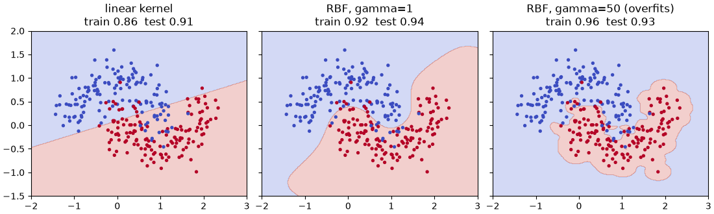

### 31.1 The idea: the widest street

Many straight lines can separate two classes. Logistic regression picks the one that maximises likelihood. A **support vector machine (SVM)** picks the line with the **widest gap** to the nearest points on each side, like painting the widest possible street between two villages without touching a house. Only the houses at the edge of the street matter. They're called **support vectors**; move any other point and the line doesn't change.

### 31.2 How wide is the street? The maths

Labels are written **y ∈ {−1, +1}** (not 0/1), and the boundary is the line (in many dimensions, the flat **hyperplane**) where w · x + b = 0.

**Step 1: distance from a point to the boundary.** w is perpendicular to the boundary. Moving a distance d along w's direction, w/‖w‖, changes w · x + b by d·‖w‖. So a point's distance to the boundary is

```
distance = |w · x + b| / ‖w‖
```

**Step 2: fix the scale.** w and b can be multiplied by any positive number without moving the line (2w · x + 2b = 0 is the same line). So choose the scale where the closest points satisfy |w · x + b| = 1. Every point is then on the right side with room to spare:

```
yᵢ · (w · xᵢ + b) ≥ 1      for every training point
```

**Step 3: the width.** The closest points are at distance 1/‖w‖ on each side, so the street is

```
margin width = 2 / ‖w‖
```

**Traced:** w = (1, 1), b = −3. The point (1, 1) gives w · x + b = −1, and (2, 2) gives +1. Both are at distance 1/√2 ≈ 0.707 from the line, so the width is 2/√2 = **1.414** = 2/‖w‖ ✓.

**Step 4: the training problem.** A wide street means a small ‖w‖. Maximising 2/‖w‖ is the same as minimising ½‖w‖² (the ½ and the square just make the derivative neat):

```
minimise ½‖w‖²     subject to    yᵢ (w · xᵢ + b) ≥ 1  for all i
```

This is the **hard-margin SVM**. It only works if a line can separate the classes perfectly.

### 31.3 Soft margins and the hinge loss

Real data overlaps. Allow some points inside the street, or on the wrong side, but charge for each one:

```
minimise  ½‖w‖² + C · Σ max(0, 1 − yᵢ · f(xᵢ))       where f(x) = w · x + b
```

The charge, max(0, 1 − y·f(x)), is the **hinge loss**:

| y · f(x) | meaning | hinge loss | log loss (for comparison) |
|---|---|---|---|
| 2 | correct, outside the street | **0** | 0.13 |
| 1 | exactly on the edge | **0** | 0.31 |
| 0.5 | correct, but inside the street | **0.5** | 0.47 |
| −1 | wrong side | **2** | 1.31 |

Points safely outside the street cost **exactly zero**, so they have no effect on the answer. That's why only the support vectors matter. **C** sets the trade-off: a large C punishes violations heavily (a narrow street, a tight fit), and a small C allows more of them (a wide street, a smoother boundary). It's the same `C` as in logistic regression: 1/regularisation strength.

So a linear SVM is just a regularised linear model (Chapter 16) with the hinge loss instead of log loss.

### 31.4 A linear SVM from scratch

The hinge loss has a corner at y·f = 1, so we use its **subgradient**: the slope on either side of the corner, picking one at the corner itself.

```
if  y·f(x) < 1:   gradient of the loss = −y·x  (for w)   and  −y  (for b)
else:             0
```

Add the penalty's gradient, w (from ½‖w‖², with C moved to the data term), and run gradient descent:

```python
import numpy as np

rng = np.random.default_rng(0)
X = np.vstack([rng.normal([2, 2], 0.9, (50, 2)), rng.normal([-2, -2], 0.9, (50, 2))])
y = np.array([1] * 50 + [-1] * 50)                     # labels must be ±1

w, b, C = np.zeros(2), 0.0, 1.0
for step in range(5000):
    lr = 0.01 / (1 + step / 100)                       # shrinking steps settle the jitter at the corner
    margins = y * (X @ w + b)
    inside = margins < 1                               # rows with non-zero hinge loss
    grad_w = w - C * (y[inside, None] * X[inside]).sum(axis=0)
    grad_b = -C * y[inside].sum()
    w, b = w - lr * grad_w, b - lr * grad_b

margins = y * (X @ w + b)
print("w =", w.round(3), " b =", round(b, 3))
print("training accuracy:", np.mean(np.sign(X @ w + b) == y))
print("margin width 2/‖w‖ =", round(2 / np.linalg.norm(w), 3))
print("smallest margins y·f(x):", np.sort(margins)[:4].round(3))
```

**Output:**

```text
w = [0.585 0.648]  b = 0.057
training accuracy: 1.0
margin width 2/‖w‖ = 2.29
smallest margins y·f(x): [1.    1.    1.007 1.172]
```

`y[inside, None] * X[inside]` multiplies each selected row by its label (`None` adds an axis so the shapes broadcast). Only rows inside the street contribute to the gradient. A fixed step size makes the solution jitter back and forth across the hinge's corner, so the step shrinks over time.

At the end, the two closest points sit exactly on the street's edge (y·f = 1): they're the support vectors. Every other point is further out and had no say in the final answer. scikit-learn's exact solver for the same problem agrees:

```python
from sklearn.svm import SVC, LinearSVC

exact = SVC(kernel="linear", C=1.0).fit(X, y)
print("SVC w =", exact.coef_[0].round(3), " b =", exact.intercept_.round(3), " support vectors:", exact.n_support_.sum())
print("LinearSVC w =", LinearSVC(C=1.0).fit(X, y).coef_[0].round(3))
```

**Output:**

```text
SVC w = [0.584 0.65 ]  b = [0.057]  support vectors: 2
LinearSVC w = [0.476 0.593]
```

`LinearSVC` is the fast version for large data. Its numbers differ a little, because by default it squares the hinge loss and also penalises b, but the boundary is nearly the same.

### 31.5 Curved boundaries: map to more dimensions

Some classes can't be split by a line: picture one class in a ring around the other. Add a feature x₁² + x₂² (the squared distance from the centre). In 3D, the inner class sits low and the ring sits high, and a **flat plane** separates them. Mapping the data through a function φ(x) into more dimensions can make it linearly separable.

### 31.6 The kernel trick

Building φ(x) explicitly can be expensive, or impossible. The trick is that the SVM's solution can be written using only **dot products** between points:

```
f(x) = Σᵢ αᵢ yᵢ (xᵢ · x) + b         (αᵢ > 0 only for support vectors)
```

So replace every dot product xᵢ · x with a **kernel** k(xᵢ, x) = φ(xᵢ) · φ(x), a function that computes the dot product in the bigger space **without ever building φ**.

**Checked by hand**, for the polynomial kernel k(a, b) = (a · b)² in 2D. It equals φ(a) · φ(b) with φ(x) = (x₁², √2·x₁x₂, x₂²). For a = (1, 2) and b = (3, 1):

- kernel: (1·3 + 2·1)² = 5² = **25**
- explicit: φ(a) = (1, 2√2, 4), φ(b) = (9, 3√2, 1), and φ(a) · φ(b) = 9 + 12 + 4 = **25** ✓

```python
a, b_ = np.array([1.0, 2.0]), np.array([3.0, 1.0])
phi = lambda v: np.array([v[0] ** 2, np.sqrt(2) * v[0] * v[1], v[1] ** 2])
print("kernel:", (a @ b_) ** 2, "| explicit φ(a)·φ(b):", round(phi(a) @ phi(b_), 6))

rbf = lambda u, v, gamma: np.exp(-gamma * np.sum((u - v) ** 2))
print("RBF similarity, gamma=0.5:", round(rbf(a, a, 0.5), 3), round(rbf(a, b_, 0.5), 3), round(rbf(a, a + 10, 0.5), 6))
```

**Output:**

```text
kernel: 25.0 | explicit φ(a)·φ(b): 25.0
RBF similarity, gamma=0.5: 1.0 0.082 0.0
```

The most used kernel is the **RBF** (radial basis function, or Gaussian) kernel:

```
k(a, b) = exp(−γ · ‖a − b‖²)
```

It's 1 for identical points and falls towards 0 with distance, so it's a **similarity**. Its φ has infinitely many dimensions, yet the kernel is a single line of code. **γ (gamma)** sets how quickly similarity fades. A large γ means each training point only influences its immediate neighbourhood, which gives wiggly boundaries and overfitting.

<details>
<summary><b>Where the dot-product form comes from (sketch)</b></summary>

The constrained problem in 31.3 can be rewritten with Lagrange multipliers αᵢ ≥ 0 (one per constraint). Setting the derivative with respect to w to zero gives w = Σ αᵢ yᵢ xᵢ: the weights are a combination of training points. Substituting back, the problem (the **dual**) contains the data only through dot products xᵢ · xⱼ. Points strictly outside the margin get αᵢ = 0, so only the support vectors appear in f(x).

</details>

### 31.7 Kernel SVMs in scikit-learn

`SVC(kernel="rbf", C=…, gamma=…)` on the two-moons dataset (two interleaving half-circles, built by `make_moons`). Scale first: the RBF kernel uses distances (Chapter 14.4).

```python
from sklearn.datasets import make_moons
from sklearn.model_selection import train_test_split
from sklearn.pipeline import make_pipeline
from sklearn.preprocessing import StandardScaler
from sklearn.svm import SVC

Xm, ym = make_moons(n_samples=400, noise=0.25, random_state=0)
Xm_train, Xm_test, ym_train, ym_test = train_test_split(Xm, ym, test_size=0.3, random_state=0)

for kernel, gamma in [("linear", "scale"), ("rbf", 1), ("rbf", 50)]:
    m = make_pipeline(StandardScaler(), SVC(kernel=kernel, gamma=gamma, C=1)).fit(Xm_train, ym_train)
    print(f"{kernel:<6} gamma={str(gamma):<5}: train {m.score(Xm_train, ym_train):.3f}, "
          f"test {m.score(Xm_test, ym_test):.3f}, support vectors {m[-1].n_support_.sum()}")
```

**Output:**

```text
linear gamma=scale: train 0.861, test 0.908, support vectors 101
rbf    gamma=1    : train 0.921, test 0.942, support vectors 81
rbf    gamma=50   : train 0.964, test 0.925, support vectors 245
```

The linear kernel can't bend, so it underfits. γ = 1 bends nicely. γ = 50 hugs individual points: training accuracy goes up, test accuracy goes down. Tune C and γ **together** on log scales (Chapter 22).

<details>
<summary><b>Code for the chart at the top</b></summary>

```python
import matplotlib.pyplot as plt

xx, yy = np.meshgrid(np.linspace(-2, 3, 300), np.linspace(-1.5, 2, 300))
grid = np.c_[xx.ravel(), yy.ravel()]                       # every point of a 300×300 grid
fig, axes = plt.subplots(1, 3, figsize=(10, 3), layout="constrained")
for ax, (kernel, gamma) in zip(axes, [("linear", "scale"), ("rbf", 1), ("rbf", 50)]):
    m = make_pipeline(StandardScaler(), SVC(kernel=kernel, gamma=gamma)).fit(Xm_train, ym_train)
    ax.contourf(xx, yy, m.predict(grid).reshape(xx.shape), alpha=0.3, cmap="coolwarm")
    ax.scatter(Xm_train[:, 0], Xm_train[:, 1], c=ym_train, s=8, cmap="coolwarm")
    ax.set(title=f"{kernel}" + (f", gamma {gamma}" if kernel == "rbf" else ""), xticks=[], yticks=[])
fig.savefig("svm-kernels.png", dpi=100)
plt.close(fig)
```

</details>

**Practical notes:**

- **Cost:** kernel SVMs compare many pairs of points, so training grows roughly with n² to n³. They're fine up to tens of thousands of rows. Beyond that, use `LinearSVC`, or boosting.
- **Probabilities:** an SVM outputs a score f(x), not a probability. `SVC(probability=True)` adds a slow internal calibration, and Chapter 40 shows a better way.
- **When they shine:** small-to-medium datasets with many features (text, genomics), where a clean margin generalises well.
- **Regression:** `SVR` fits a tube of width ε around the data and ignores errors smaller than ε.

### 31.8 Summary

```
labels ±1;  f(x) = w·x + b;   distance = |f(x)| / ‖w‖;   margin width = 2/‖w‖
soft margin   minimise ½‖w‖² + C Σ max(0, 1 − y f(x))       (hinge loss)
subgradient   rows with y·f < 1 contribute −C·y·x;  others 0
kernel        f(x) = Σ αᵢ yᵢ k(xᵢ, x) + b;   RBF k = exp(−γ‖a − b‖²)
tune C and γ together, log scale; scale features first
```

**Key terms:**

- **Support vector machine (SVM):** a classifier that finds the boundary with the widest margin to the nearest points.
- **Hyperplane:** a flat boundary: a line in 2D, a plane in 3D, and so on.
- **Margin:** the width of the gap between the boundary and the nearest points of each class.
- **Support vectors:** the training points on or inside the margin; they alone determine the boundary.
- **Hard margin / soft margin:** no violations allowed, versus violations allowed at a cost.
- **Hinge loss:** max(0, 1 − y·f(x)); zero for points safely outside the margin.
- **Subgradient:** a slope used where a function has a corner and no single derivative.
- **C:** the cost of margin violations; a large C fits tighter, a small C gives a wider, smoother margin.
- **Feature map (φ):** a function that sends inputs into a bigger space.
- **Kernel:** a function k(a, b) equal to φ(a) · φ(b), computed without building φ.
- **Kernel trick:** replacing dot products with a kernel to get non-linear boundaries cheaply.
- **RBF (Gaussian) kernel:** exp(−γ‖a − b‖²), a similarity that fades with distance.
- **gamma (γ):** how quickly RBF similarity fades; a large γ gives wiggly boundaries.
- **Dual problem:** the rewritten SVM problem that depends on the data only through dot products.
- **SVR:** support vector regression; ignores errors smaller than ε.

**Exercises**

1. w = (3, 4), b = −5. What is the margin width? How far is the point (3, 1) from the boundary?
2. With labels ±1 and f(x) = 0.3 for a point with y = −1, what is its hinge loss? Is it a support vector?

<details>
<summary><b>Answers</b></summary>

1. ‖w‖ = 5, so the width is 2/5 = **0.4**. f(3, 1) = 9 + 4 − 5 = 8, so the distance is 8/5 = **1.6**.
2. y·f = −0.3, so the loss is 1 − (−0.3) = **1.3**. It's on the wrong side, so yes, it's a support vector (it's inside the margin and affects w).

</details>

| # | Problem (Deep-ML) | Difficulty |
|---|---|---|
| 1 | [282. Calculate SVM Margin Width](https://www.deep-ml.com/problems/282) | 🟢 Easy |
| 2 | [283. Implement Hinge Loss for SVM](https://www.deep-ml.com/problems/283) | 🟢 Easy |
| 3 | [280. Implement RBF (Gaussian) Kernel Function](https://www.deep-ml.com/problems/280) | 🟡 Medium |
| 4 | [21. Pegasos Kernel SVM Implementation](https://www.deep-ml.com/problems/21) | 🔴 Hard |

**Learn more:** [StatQuest: support vector machines (video)](https://www.youtube.com/watch?v=efR1C6CvhmE) · [scikit-learn: SVMs](https://scikit-learn.org/stable/modules/svm.html)

---

## 32. Naive Bayes

**You need:** Chapter 6. · **You'll learn:** how Bayes' rule becomes a classifier, the "naive" assumption that makes it fast, smoothing, and the versions for word counts and for numbers.

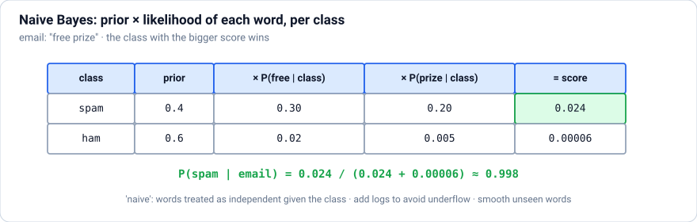

### 32.1 From Bayes' rule to a classifier

For an email with words x₁, x₂, …, Bayes' rule (Chapter 6.3) gives

```
P(spam | words) = P(words | spam) · P(spam) / P(words)
```

To **compare** classes, we can drop P(words): it's the same for every class. So

```
P(class | words) ∝ P(class) · P(words | class)          (∝ means "proportional to")
```

P(words | class), the chance of this exact combination of words, is impossible to estimate directly: almost every email is unique. The **naive** assumption: within a class, the words are **independent**, so their probabilities multiply (Chapter 6.4):

```
P(class | x) ∝ P(class) · P(x₁ | class) · P(x₂ | class) · …
```

The assumption is clearly false ("free" and "prize" go together in spam), but the classifier only needs the classes **ranked** correctly, and it often manages that anyway.

### 32.2 By hand

Training gave P(spam) = 0.4 and P(ham) = 0.6 ("ham" is the traditional name for a legitimate email). Word likelihoods:

| word | P(word \| spam) | P(word \| ham) |
|---|---|---|
| free | 0.30 | 0.02 |
| meeting | 0.01 | 0.10 |
| prize | 0.20 | 0.005 |

Email: **"free meeting"**

| | prior | × P(free) | × P(meeting) | score |
|---|---|---|---|---|
| spam | 0.4 | 0.30 | 0.01 | 0.0012 |
| ham | 0.6 | 0.02 | 0.10 | 0.0012 |

A tie: the strong spam word and the strong ham word cancel out. Normalised: P(spam | email) = 0.0012 / 0.0024 = **0.5**. Add "prize" and spam wins clearly: 0.0012 × 0.20 = 0.00024 against 0.0012 × 0.005 = 0.000006.

### 32.3 Learning the likelihoods: counting, with smoothing

For word counts (**multinomial** Naive Bayes), P(word | class) is estimated by counting:

```
P(word | class) = (count of word in class + α) / (total words in class + α · V)
```

V is the vocabulary size: the number of distinct words. **α = 1** is **Laplace smoothing**. Without it, a word never seen in spam training emails gets probability **0**, and one such word would wipe out the whole product, whatever the other words say. Adding α to every count keeps every probability above 0.

**By hand.** Four training emails:

| email | class |
|---|---|
| "win free prize" | spam |
| "free free offer" | spam |
| "team meeting today" | ham |
| "free lunch meeting" | ham |

The vocabulary is {win, free, prize, offer, team, meeting, today, lunch}, so V = 8. Spam has 6 words, and "free" appears 3 times in it. Ham has 6 words, and "free" appears once.

- P(free | spam) = (3 + 1) / (6 + 8) = 4/14 = **0.286**
- P(free | ham) = (1 + 1) / (6 + 8) = 2/14 = **0.143**
- P(meeting | spam) = (0 + 1) / 14 = **0.071**: unseen in spam, but not zero

### 32.4 From scratch

Multiplying many small probabilities underflows (Chapter 6.6), so we **add logs** instead:

```
score(class) = ln P(class) + Σ (count of word) · ln P(word | class)
```

```python
import numpy as np
from collections import Counter

train = [("win free prize", "spam"), ("free free offer", "spam"),
         ("team meeting today", "ham"), ("free lunch meeting", "ham")]
vocab = sorted({w for text, _ in train for w in text.split()})
classes = ["ham", "spam"]

def fit_nb(train, alpha=1.0):
    log_prior, log_like = {}, {}
    for c in classes:
        texts = [t for t, label in train if label == c]
        counts = Counter(w for t in texts for w in t.split())
        total = sum(counts.values())
        log_prior[c] = np.log(len(texts) / len(train))
        log_like[c] = {w: np.log((counts[w] + alpha) / (total + alpha * len(vocab))) for w in vocab}
    return log_prior, log_like

def predict_nb(text, log_prior, log_like):
    scores = {c: log_prior[c] + sum(log_like[c][w] for w in text.split() if w in vocab) for c in classes}
    top = max(scores.values())
    probs = {c: np.exp(s - top) for c, s in scores.items()}          # back from logs (subtract max for safety)
    total = sum(probs.values())
    return {c: round(float(p / total), 3) for c, p in probs.items()}

log_prior, log_like = fit_nb(train)
print("P(free | spam) =", round(np.exp(log_like["spam"]["free"]), 3), "| P(free | ham) =", round(np.exp(log_like["ham"]["free"]), 3))
for email in ["free prize", "meeting today", "free meeting"]:
    print(f"{email!r:<16} → {predict_nb(email, log_prior, log_like)}")
```

**Output:**

```text
P(free | spam) = 0.286 | P(free | ham) = 0.143
'free prize'     → {'ham': 0.2, 'spam': 0.8}
'meeting today'  → {'ham': 0.857, 'spam': 0.143}
'free meeting'   → {'ham': 0.6, 'spam': 0.4}
```

Words not in the vocabulary are skipped. Training is a single pass of counting, so it's extremely fast, and new data can be added by just updating the counts.

### 32.5 In scikit-learn

`MultinomialNB` expects a matrix of word counts: one row per email, one column per vocabulary word. Here we build it by hand (Chapter 42 shows the library tool for this):

```python
from sklearn.naive_bayes import MultinomialNB

def count_matrix(texts):
    return np.array([[t.split().count(w) for w in vocab] for t in texts])

X_counts = count_matrix([t for t, _ in train])
labels = [c for _, c in train]
nb = MultinomialNB(alpha=1.0).fit(X_counts, labels)
print(nb.classes_, nb.predict_proba(count_matrix(["free prize", "meeting today", "free meeting"])).round(3))
```

**Output:**

```text
['ham' 'spam'] [[0.2   0.8  ]
 [0.857 0.143]
 [0.6   0.4  ]]
```

The same probabilities as our version (columns in the order of `classes_`).

### 32.6 Numbers: Gaussian Naive Bayes

For numeric features, assume each feature follows a **normal distribution** within each class (Chapter 6.8). Training just records each class's mean μ and standard deviation σ for each feature. The likelihood of a value x is the bell-curve height:

```
P(x | class) = 1 / (σ√(2π)) · exp(−(x − μ)² / (2σ²))
```

**By hand**, one feature (height in cm): class A has μ = 160, σ = 5; class B has μ = 175, σ = 5; equal priors. For x = 165, the exponent is −(5)²/50 = −0.5 for A and −(10)²/50 = −2 for B. The σ parts are equal, so the ratio is e^(−0.5) / e^(−2) = e^1.5 ≈ 4.5. So **A is 4.5 times as likely**, and P(A | 165) = 4.5 / 5.5 ≈ **0.82**.

```python
from sklearn.naive_bayes import GaussianNB
from sklearn.datasets import load_wine
from sklearn.model_selection import cross_val_score

heights = np.array([[155], [160], [165], [170], [175], [180]])
groups = np.array(["A", "A", "A", "B", "B", "B"])
print("P(A), P(B) at 165 cm:", GaussianNB().fit(heights, groups).predict_proba([[165]]).round(3))

X, y = load_wine(return_X_y=True)
print("wine, CV accuracy:", cross_val_score(GaussianNB(), X, y, cv=5).mean().round(3))
```

**Output:**

```text
P(A), P(B) at 165 cm: [[0.905 0.095]]
wine, CV accuracy: 0.966
```

The fitted heights give means 160 and 175 as planned, but their σ is about 4.1 rather than 5, so the probability differs a little from our hand calculation. Gaussian NB needs no scaling, because each feature gets its own μ and σ.

### 32.7 Strengths and weaknesses

- **Fast and tiny:** training is counting, and the model is a table of probabilities. Good for streaming data and very large vocabularies.
- **Works with little data,** and is a strong baseline for text.
- **Overconfident probabilities:** correlated words are counted as independent evidence, so it piles them up and pushes probabilities towards 0 and 1. Use its ranking, or calibrate it (Chapter 40).
- **Generative vs discriminative.** Naive Bayes models how the features are **generated** within each class, P(x | class). Logistic regression models the boundary P(class | x) directly. With lots of data, discriminative models usually win; with very little, Naive Bayes often does.

Other variants: `BernoulliNB` (word present or absent, rather than counts), and `ComplementNB` (often better on imbalanced text).

### 32.8 Summary

```
P(class | x) ∝ P(class) · Π P(xⱼ | class)          naive: features independent within a class
multinomial   P(word | c) = (count + α) / (total + α·V)      α = 1: Laplace smoothing
Gaussian      P(x | c) = normal pdf with that class's μ, σ
compute in logs: ln P(c) + Σ ln P(xⱼ | c)
```

**Key terms:**

- **Naive Bayes:** a classifier using Bayes' rule with the assumption that features are independent within each class.
- **Conditional independence:** given the class, one feature tells you nothing more about another.
- **Multinomial Naive Bayes:** Naive Bayes for count features such as word counts.
- **Gaussian Naive Bayes:** Naive Bayes for numeric features, assumed normally distributed within each class.
- **Bernoulli Naive Bayes:** Naive Bayes for present/absent features.
- **Laplace (additive) smoothing (α):** adding α to every count so no probability is exactly 0.
- **Vocabulary (V):** the set of distinct words the model knows.
- **Generative model:** a model of how the features arise within each class, P(x | class).
- **Discriminative model:** a model of the class given the features, P(class | x), directly.
- **∝ (proportional to):** equal up to a constant factor that doesn't affect comparisons.

**Exercises**

1. In 32.3, compute P(prize | ham) and P(offer | spam) with α = 1.
2. With α = 0, what happens when the email "lunch prize" is scored?

<details>
<summary><b>Answers</b></summary>

1. "prize" never appears in ham: (0 + 1) / 14 = **0.071**. "offer" appears once in spam: (1 + 1) / 14 = **0.143**.
2. "lunch" never appears in spam, and "prize" never appears in ham, so **both** class scores become 0 (ln 0 = −∞). The model can't decide, and the maths breaks (0/0). Smoothing prevents this.

</details>

| # | Problem (Deep-ML) | Difficulty |
|---|---|---|
| 1 | [140. Bernoulli Naive Bayes Classifier](https://www.deep-ml.com/problems/140) | 🟡 Medium |
| 2 | [261. Gaussian Naive Bayes Classifier](https://www.deep-ml.com/problems/261) | 🟡 Medium |

**Learn more:** [scikit-learn: Naive Bayes](https://scikit-learn.org/stable/modules/naive_bayes.html)

---

## 33. Choosing a Model, and Combining Models (Stacking)

**You need:** Chapters 18–32. · **You'll learn:** how the models compare, how to run a fair bake-off, and how to combine several models into one with voting and stacking.

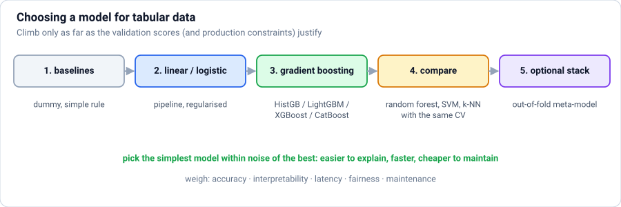

### 33.1 The models side by side

| model | needs scaling | handles curves / interactions | explainable | training cost | typical use |
|---|---|---|---|---|---|
| linear / logistic regression | yes | only via added features | ✅ weights | tiny | baseline, regulated domains, huge sparse data |
| k-nearest neighbours | yes | ✅ | case-based | none (slow to predict) | small data, similarity search |
| decision tree | no | ✅ | ✅ readable rules | small | explanation, a building block |
| random forest | no | ✅ | partly | medium (parallel) | strong default with little tuning |
| gradient boosting | no | ✅ | partly | medium | usually the most accurate on tabular data |
| SVM (RBF) | yes | ✅ | ❌ | grows fast with rows | small-to-medium data, many features |
| Naive Bayes | no | ❌ | ✅ probabilities per word | tiny | text baselines, streaming data |

"Partly" explainable: Chapters 44–45 show tools to explain any model.

### 33.2 A fair bake-off

Compare every candidate on **the same cross-validation splits**, each inside its own pipeline:

```python
import numpy as np
from sklearn.datasets import load_breast_cancer
from sklearn.model_selection import StratifiedKFold, cross_val_score
from sklearn.pipeline import make_pipeline
from sklearn.preprocessing import StandardScaler
from sklearn.dummy import DummyClassifier
from sklearn.linear_model import LogisticRegression
from sklearn.neighbors import KNeighborsClassifier
from sklearn.tree import DecisionTreeClassifier
from sklearn.ensemble import RandomForestClassifier, HistGradientBoostingClassifier
from sklearn.svm import SVC
from sklearn.naive_bayes import GaussianNB

X, y = load_breast_cancer(return_X_y=True)
cv = StratifiedKFold(5, shuffle=True, random_state=0)       # the same splits for every model

candidates = {
    "dummy": DummyClassifier(),
    "logistic": make_pipeline(StandardScaler(), LogisticRegression(max_iter=1000)),
    "kNN": make_pipeline(StandardScaler(), KNeighborsClassifier()),
    "tree": DecisionTreeClassifier(max_depth=4, random_state=0),
    "random forest": RandomForestClassifier(n_estimators=300, random_state=0, n_jobs=-1),
    "boosting": HistGradientBoostingClassifier(random_state=0),
    "SVM (RBF)": make_pipeline(StandardScaler(), SVC()),
    "Gaussian NB": GaussianNB(),
}
for name, model in candidates.items():
    s = cross_val_score(model, X, y, cv=cv, scoring="roc_auc")
    print(f"{name:<14} AUC {s.mean():.4f} ± {s.std():.4f}")
```

**Output:**

```text
dummy          AUC 0.5000 ± 0.0000
logistic       AUC 0.9955 ± 0.0056
kNN            AUC 0.9806 ± 0.0087
tree           AUC 0.9207 ± 0.0247
random forest  AUC 0.9923 ± 0.0070
boosting       AUC 0.9940 ± 0.0053
SVM (RBF)      AUC 0.9957 ± 0.0046
Gaussian NB    AUC 0.9885 ± 0.0065
```

Several models land within one standard deviation of each other at the top. **When scores are within noise, pick the simplest:** it's easier to explain, faster to serve and cheaper to maintain. Here that's logistic regression. On data with strong interactions and mixed types (like the churn table of Chapter 30), boosting usually pulls ahead.

### 33.3 Voting: average several models

Different models make different mistakes, so averaging their probabilities (**soft voting**) can beat each one alone. This is the same variance reduction as in Chapter 28.2. It works best when the models are good **and** different from each other.

```python
from sklearn.ensemble import VotingClassifier

vote = VotingClassifier([("lr", candidates["logistic"]), ("svm", make_pipeline(StandardScaler(), SVC(probability=True, random_state=0))),
                         ("rf", candidates["random forest"])], voting="soft")
print("soft voting AUC:", cross_val_score(vote, X, y, cv=cv, scoring="roc_auc").mean().round(4))
```

**Output:**

```text
soft voting AUC: 0.9964
```

### 33.4 Stacking: learn how to combine

**Stacking** goes one step further: a small **meta-model** learns **how much to trust each model**. The catch is that the meta-model must be trained on predictions the base models made for rows they **didn't** train on. Otherwise it learns to trust whichever model memorised the training data best. Out-of-fold predictions (Chapter 26.6) give exactly that.

From scratch:

```python
from sklearn.model_selection import cross_val_predict, train_test_split
from sklearn.metrics import roc_auc_score

X_train, X_test, y_train, y_test = train_test_split(X, y, test_size=0.3, stratify=y, random_state=0)
base = {"logistic": candidates["logistic"], "kNN": candidates["kNN"], "random forest": candidates["random forest"]}

# level 1: out-of-fold probabilities on the training rows → the meta-model's features
oof = np.column_stack([cross_val_predict(m, X_train, y_train, cv=5, method="predict_proba")[:, 1] for m in base.values()])
meta = LogisticRegression().fit(oof, y_train)
print("meta-model weights:", {k: round(float(v), 2) for k, v in zip(base, meta.coef_[0])})

# at prediction time: base models refitted on all training rows → their probabilities → the meta-model
test_feats = np.column_stack([m.fit(X_train, y_train).predict_proba(X_test)[:, 1] for m in base.values()])
for i, name in enumerate(base):
    print(f"{name:<14} test AUC {roc_auc_score(y_test, test_feats[:, i]):.4f}")
print(f"{'stack':<14} test AUC {roc_auc_score(y_test, meta.predict_proba(test_feats)[:, 1]):.4f}")
```

**Output:**

```text
meta-model weights: {'logistic': 3.3, 'kNN': 2.33, 'random forest': 2.82}
logistic       test AUC 0.9956
kNN            test AUC 0.9739
random forest  test AUC 0.9787
stack          test AUC 0.9908
```

scikit-learn's `StackingClassifier` does all of that internally:

```python
from sklearn.ensemble import StackingClassifier

stack = StackingClassifier(list(base.items()), final_estimator=LogisticRegression(), cv=5)
print("StackingClassifier test AUC:", round(roc_auc_score(y_test, stack.fit(X_train, y_train).predict_proba(X_test)[:, 1]), 4))
```

**Output:**

```text
StackingClassifier test AUC: 0.9908
```

Here stacking **doesn't** help: logistic regression alone scores best on this test set, and the stack is pulled down by its weaker partners. On small, easy problems like this one, a single good model is hard to beat. Stacking earns its keep when the base models are strong and make different mistakes, which is common in competitions, where it often wins by a small margin. Always check against the best single model. In production, the extra models cost serving time and maintenance, so stack only when the gain clearly matters.

### 33.5 A decision guide

1. Start with **baselines**, then **regularised linear/logistic** regression in a pipeline.
2. Try **gradient boosting** (HistGradientBoosting, LightGBM, XGBoost or CatBoost) with early stopping.
3. Compare others on the **same CV splits**: random forest, plus SVM or kNN on small data.
4. Pick the **simplest model within noise of the best**.
5. Weigh more than accuracy: explainability (regulated decisions often need linear models or simple trees), speed of prediction, model size, fairness (Chapter 47) and maintenance.
6. Stack only if the gain is worth the complexity.

### 33.6 Summary

```
bake-off      same CV splits, every model in its own pipeline, mean ± std
soft voting   average the probabilities of good, different models
stacking      meta-model trained on OUT-OF-FOLD predictions of the base models
choose        the simplest model within noise of the best
```

**Key terms:**

- **Model selection:** choosing among candidate models using validation scores and practical constraints.
- **Soft voting:** averaging the predicted probabilities of several models.
- **Hard voting:** taking the majority of several models' predicted classes.
- **Stacking:** training a meta-model on base models' out-of-fold predictions.
- **Base model (level-0 model):** one of the models whose predictions are combined.
- **Meta-model (level-1 model):** the model that learns how to combine the base models.

**Exercises**

1. Why must the meta-model in stacking be trained on out-of-fold predictions rather than on the base models' predictions for their own training rows?
2. Two models score AUC 0.991 ± 0.006 and 0.993 ± 0.005. One is logistic regression and the other a 1,000-tree forest. Which do you deploy, and why?

<details>
<summary><b>Answers</b></summary>

1. On their own training rows, flexible models (deep forests, kNN with small k) look nearly perfect, because they memorised those rows. The meta-model would then trust them far too much, and that trust wouldn't hold on new data.
2. Logistic regression: the difference is well within the noise (the standard deviations are larger than the gap), and the simpler model is easier to explain, faster and cheaper to run.

</details>

**Learn more:** [scikit-learn: stacking and voting](https://scikit-learn.org/stable/modules/ensemble.html#stacked-generalization)

---

**✅ Part IV checkpoint.** You can now build decision trees, random forests and gradient boosting from scratch, use XGBoost, LightGBM and CatBoost, train SVMs with kernels and Naive Bayes, and choose or combine models fairly. Part V turns to data **without labels**.

---

# Part V — Learning Without Labels

Clustering, dimensionality reduction and anomaly detection: finding structure when there's no answer column.

---

## 34. k-Means Clustering

**You need:** Chapters 3, 14 and 21. · **You'll learn:** how to split unlabelled data into groups, the k-means algorithm traced by hand, why it always settles, and how to choose the number of groups.

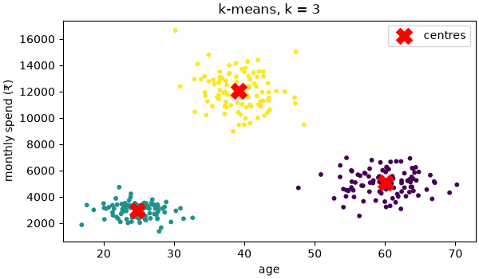

### 34.1 The problem: groups without answers

A shop has customers described by age and monthly spend, but no labels. Are there natural **segments**, groups of similar customers, that marketing could treat differently? Finding groups in unlabelled data is **clustering**. There's no "correct answer" to check against, so the result is judged by whether the groups are compact, well separated, and useful.

### 34.2 What k-means minimises

Choose k, the number of groups. Each group has a **centre** (centroid) μ, and each point belongs to its nearest centre. k-means looks for the centres that make the total squared distance from points to their centres as small as possible:

```
inertia = Σ over points of ‖x − μ(nearest centre)‖²
```

Small inertia means tight groups.

### 34.3 The algorithm, traced by hand

**Lloyd's algorithm** alternates two steps until nothing changes:

1. **Assign:** each point joins its nearest centre.
2. **Update:** move each centre to the **mean** of its points.

1D points [1, 2, 3, 10, 11, 12], k = 2, starting centres 1 and 2 (badly placed on purpose):

| round | centres | assignment (A = first, B = second) | inertia |
|---|---|---|---|
| 0 | 1, 2 | 1→A; 2, 3, 10, 11, 12→B | 0 + 0 + 1 + 64 + 81 + 100 = **246** |
| 1 | 1, 7.6 | 1, 2, 3→A; 10, 11, 12→B | **41.68** |
| 2 | 2, 11 | same as before → stop | **4** |

The new centre in round 1 is mean(2, 3, 10, 11, 12) = 7.6. After that, the assignments stop changing, so the algorithm has **converged**.

**Why it always settles.** Neither step can increase inertia:

- The assign step gives every point its nearest centre, so each squared distance can only shrink or stay the same.
- In the update step, the mean is the point that minimises the sum of squared distances to a group. The derivative of Σ(x − μ)² is −2Σ(x − μ); setting it to 0 gives μ = mean.

Inertia goes down at every round, and there are only finitely many ways to assign points to groups, so the algorithm must stop.

```python
import numpy as np

def kmeans(X, k, n_rounds=100, seed=0):
    rng = np.random.default_rng(seed)
    centres = X[rng.choice(len(X), k, replace=False)]              # start at k random points
    for _ in range(n_rounds):
        dist = np.linalg.norm(X[:, None, :] - centres[None, :, :], axis=2)   # (points × centres) distances
        labels = dist.argmin(axis=1)                                         # assign
        new = np.array([X[labels == j].mean(axis=0) for j in range(k)])      # update
        if np.allclose(new, centres):
            break
        centres = new
    inertia = np.sum((X - centres[labels]) ** 2)
    return labels, centres, inertia

x1d = np.array([[1.0], [2], [3], [10], [11], [12]])
labels, centres, inertia = kmeans(x1d, 2)
print("labels:", labels, "| centres:", centres.ravel(), "| inertia:", inertia)
```

**Output:**

```text
labels: [1 1 1 0 0 0] | centres: [11.  2.] | inertia: 4.0
```

`X[:, None, :] - centres[None, :, :]` uses broadcasting (Chapter 3.7) to subtract every centre from every point at once, giving a (points × centres × features) array.

### 34.4 On customer data

300 customers, three hidden groups. Age and spend are on very different scales, so standardise them first: k-means uses distances (Chapter 14.4).

```python
rng = np.random.default_rng(1)
customers = np.vstack([
    rng.normal([25, 3000], [3, 600], (100, 2)),     # young, low spend
    rng.normal([40, 12000], [4, 1500], (100, 2)),   # middle-aged, high spend
    rng.normal([60, 5000], [4, 900], (100, 2)),     # older, medium spend
])
Z = (customers - customers.mean(axis=0)) / customers.std(axis=0)

labels, centres, inertia = kmeans(Z, 3)
centres_original = centres * customers.std(axis=0) + customers.mean(axis=0)     # undo the scaling
for j in range(3):
    age, spend = centres_original[j]
    print(f"segment {j}: {np.sum(labels == j)} customers, centre age {age:.0f}, spend ₹{spend:,.0f}")
```

**Output:**

```text
segment 0: 44 customers, centre age 38, spend ₹13,247
segment 1: 56 customers, centre age 40, spend ₹11,071
segment 2: 200 customers, centre age 42, spend ₹4,005
```

That's **not** what we hid. From this random start, k-means split the high spenders into two segments and lumped the young and the older customers together. It settled in a bad local minimum. The next section fixes it.


### 34.5 Bad starts and k-means++

k-means finds a **local** minimum (Chapter 5.6): a bad start can leave two centres sharing one real group while another centre straddles two. Two standard fixes:

- **Several starts:** run it n times from different random starts and keep the lowest inertia (`n_init`).
- **k-means++ starts:** pick the first centre at random, then pick each next centre with probability proportional to its **squared distance** from the nearest centre already chosen. This spreads the starting centres out, and it's scikit-learn's default.

```python
runs = [kmeans(Z, 3, seed=seed) for seed in range(5)]
for seed, (_, _, inertia) in enumerate(runs):
    print(f"start {seed}: inertia {inertia:.1f}")

labels, centres, inertia = min(runs, key=lambda r: r[2])          # keep the lowest inertia
centres_original = centres * customers.std(axis=0) + customers.mean(axis=0)
for j in range(3):
    age, spend = centres_original[j]
    print(f"segment {j}: {np.sum(labels == j)} customers, centre age {age:.0f}, spend ₹{spend:,.0f}")
```

**Output:**

```text
start 0: inertia 321.6
start 1: inertia 321.6
start 2: inertia 282.5
start 3: inertia 282.5
start 4: inertia 35.1
segment 0: 100 customers, centre age 60, spend ₹5,053
segment 1: 100 customers, centre age 25, spend ₹2,956
segment 2: 100 customers, centre age 39, spend ₹12,029
```

Only one of five starts found the real structure, with an inertia almost ten times lower. Keeping the best of several starts recovers the three hidden groups, of 100 customers each.

<details>
<summary><b>Code for the chart at the top</b></summary>

```python
import matplotlib.pyplot as plt

fig, ax = plt.subplots(figsize=(6, 3.5), layout="constrained")
ax.scatter(customers[:, 0], customers[:, 1], c=labels, s=10, cmap="viridis")
ax.scatter(centres_original[:, 0], centres_original[:, 1], marker="X", s=200, color="red", label="centres")
ax.set(xlabel="age", ylabel="monthly spend (₹)", title="k-means, k = 3")
ax.legend()
fig.savefig("kmeans-segments.png", dpi=100)
plt.close(fig)
```

</details>


### 34.6 Choosing k

There's no label to validate against, so use these instead:

**The elbow:** inertia always falls as k grows (with k = number of points it's 0), so look for the k where it **stops falling fast**.

**Silhouette score:** for each point, let a be its average distance to the other points in its own cluster, and b its average distance to the points of the nearest **other** cluster. Then

```
s = (b − a) / max(a, b)
```

s is near 1 when the point sits well inside its cluster, near 0 on a border, and negative if it's probably in the wrong cluster. Average s over all points, and pick the k with the highest average.

**By hand:** in [1, 2, 3 | 10, 11, 12], the point 1 has a = mean(1, 2) = 1.5 and b = mean(9, 10, 11) = 10, so s = (10 − 1.5) / 10 = **0.85**.

```python
from sklearn.cluster import KMeans
from sklearn.metrics import silhouette_score

for k in range(2, 7):
    km = KMeans(n_clusters=k, n_init=10, random_state=0).fit(Z)
    print(f"k = {k}: inertia {km.inertia_:7.1f}, silhouette {silhouette_score(Z, km.labels_):.3f}")
```

**Output:**

```text
k = 2: inertia   284.7, silhouette 0.586
k = 3: inertia    35.1, silhouette 0.813
k = 4: inertia    27.5, silhouette 0.678
k = 5: inertia    22.7, silhouette 0.530
k = 6: inertia    20.3, silhouette 0.529
```

Inertia drops sharply up to k = 3 and slowly after it (the elbow), and the silhouette peaks at k = 3. Both point to the three groups we built in. On real data the signals are often less clear, and the usefulness of the segments decides.

### 34.7 In scikit-learn, and the limits of k-means

`KMeans(n_clusters=k, n_init=10)` gives `labels_`, `cluster_centers_` and `inertia_`, and `.predict` assigns new points to the nearest centre. `MiniBatchKMeans` updates the centres from small batches, for millions of points.

k-means assumes clusters are **round blobs of similar size**, because it only uses distance to a centre. It fails on long, curved or nested shapes, and every point is forced into some cluster, outliers included. Chapter 35 covers methods that handle these cases.

### 34.8 Summary

```
objective   inertia = Σ ‖x − μ(assigned)‖²
algorithm   assign to the nearest centre → move centres to the means → repeat until stable
starts      k-means++ and n_init > 1 (local minima)
choose k    elbow in inertia; highest mean silhouette s = (b − a)/max(a, b)
scale features first; clusters are assumed round
```

**Key terms:**

- **Clustering:** grouping similar examples without labels.
- **k-means:** clustering into k groups by minimising the squared distances to the group centres.
- **Centroid (centre):** the mean of a cluster's points.
- **Inertia (within-cluster sum of squares):** the total squared distance from points to their assigned centres.
- **Lloyd's algorithm:** alternate assigning points and moving centres until nothing changes.
- **Convergence:** the point where further rounds change nothing.
- **k-means++:** a starting method that spreads the initial centres apart.
- **`n_init`:** how many random starts to try, keeping the best.
- **Elbow method:** choosing k where inertia stops dropping quickly.
- **Silhouette score:** (b − a)/max(a, b), comparing a point's distance to its own cluster with its distance to the nearest other cluster.
- **Segment:** a group of customers (or other items) treated alike.

**Exercises**

1. Run k-means by hand on [0, 2, 4, 20] with k = 2, starting from centres 0 and 4. What are the final centres?
2. Point p has a = 4 and b = 3. What is its silhouette, and what does that suggest?

<details>
<summary><b>Answers</b></summary>

1. Assign: 0, 2 → 0; 4, 20 → 4. Update: centres 1 and 12. Assign: 0, 2, 4 → 1 (4 is 3 from 1 and 8 from 12); 20 → 12. Update: centres **2 and 20**. Assign: unchanged → stop.
2. s = (3 − 4) / 4 = **−0.25**. It's closer, on average, to the other cluster: it's probably assigned to the wrong one.

```python
print(kmeans(np.array([[0.0], [2], [4], [20]]), 2, seed=1)[1].ravel())
```

**Output:**

```text
[ 2. 20.]
```

</details>

| # | Problem (Deep-ML) | Difficulty |
|---|---|---|
| 1 | [17. K-Means Clustering](https://www.deep-ml.com/problems/17) | 🟡 Medium |
| 2 | [362. Implement K-Means++ Initialization](https://www.deep-ml.com/problems/362) | 🟡 Medium |
| 3 | [254. Silhouette Score for Clustering Evaluation](https://www.deep-ml.com/problems/254) | 🟡 Medium |

**Learn more:** [scikit-learn: clustering](https://scikit-learn.org/stable/modules/clustering.html) · [StatQuest: k-means (video)](https://www.youtube.com/watch?v=4b5d3muPQmA)

---

## 35. DBSCAN, Hierarchical Clustering and Gaussian Mixtures

**You need:** Chapters 6 and 34. · **You'll learn:** three clustering methods that handle what k-means can't: odd shapes and noise (DBSCAN), a whole tree of groupings (hierarchical), and soft, probabilistic membership (Gaussian mixtures, trained with the EM algorithm).

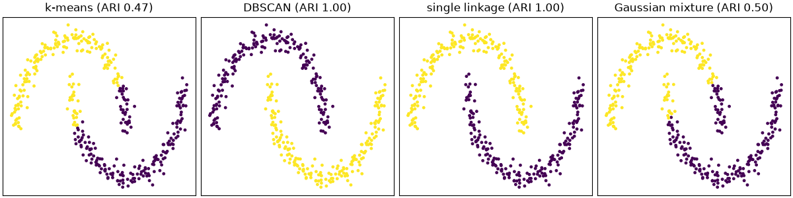

### 35.1 Where k-means fails

On two interleaving half-moons, k-means cuts straight across, because it can only make round groups around centres. To score a clustering against known groups we use the **adjusted Rand index (ARI)**: the share of point pairs that both groupings treat the same way (together or apart), adjusted so that random labelling scores 0 and a perfect match scores 1. Cluster numbers don't need to match, only the groupings.

```python
import numpy as np
from sklearn.datasets import make_moons
from sklearn.preprocessing import StandardScaler
from sklearn.cluster import KMeans
from sklearn.metrics import adjusted_rand_score

X, true_groups = make_moons(n_samples=400, noise=0.06, random_state=0)
Z = StandardScaler().fit_transform(X)
km = KMeans(n_clusters=2, n_init=10, random_state=0).fit_predict(Z)
print("k-means ARI:", round(adjusted_rand_score(true_groups, km), 3))
```

**Output:**

```text
k-means ARI: 0.475
```

### 35.2 DBSCAN: clusters are dense regions

**DBSCAN** (density-based spatial clustering of applications with noise) defines a cluster as a region where points are packed closely. Two settings: a radius **eps**, and **min_samples**.

- A **core point** has at least min_samples points (counting itself) within eps.
- A cluster grows from a core point: every point within eps of it joins, and if that point is also a core point, its neighbours join too, and so on.
- A **border point** is within eps of a core point but isn't core itself; it joins but doesn't spread the cluster.
- Everything else is **noise**, labelled −1.

**By hand:** points [1, 1.5, 2, 8, 8.5, 9, 20] with eps = 1 and min_samples = 2. Point 1 has 1.5 within 1, so it's core, and the cluster spreads 1 → 1.5 → 2. Likewise 8, 8.5, 9 form a second cluster. 20 has no neighbour within 1: **noise**.

```python
def dbscan(X, eps, min_samples):
    n = len(X)
    dist = np.linalg.norm(X[:, None] - X[None, :], axis=2)
    neighbours = [np.flatnonzero(dist[i] <= eps) for i in range(n)]      # includes the point itself
    core = np.array([len(nb) >= min_samples for nb in neighbours])
    labels = np.full(n, -1)                                               # −1 = noise until claimed
    cluster = 0
    for i in range(n):
        if not core[i] or labels[i] != -1:
            continue
        labels[i], queue = cluster, [i]                                   # start a new cluster from core point i
        while queue:
            p = queue.pop()
            for q in neighbours[p]:
                if labels[q] == -1:
                    labels[q] = cluster
                    if core[q]:
                        queue.append(q)                                   # only core points spread the cluster
        cluster += 1
    return labels

points = np.array([[1], [1.5], [2], [8], [8.5], [9], [20]])
print("by hand:", dbscan(points, eps=1, min_samples=2))
print("on the moons, ARI:", round(adjusted_rand_score(true_groups, dbscan(Z, eps=0.3, min_samples=5)), 3))
```

**Output:**

```text
by hand: [ 0  0  0  1  1  1 -1]
on the moons, ARI: 1.0
```

DBSCAN follows the curved shapes perfectly, needs no k, and flags outliers. Its weaknesses: one eps can't suit clusters of very different densities, and it struggles in many dimensions, where distances become similar (Chapter 14.8). To choose eps, plot each point's distance to its min_samples-th nearest neighbour, sorted, and pick the value where the curve bends sharply upwards. scikit-learn's `DBSCAN(eps=…, min_samples=…)` gives the same labels; `HDBSCAN` is a newer variant that removes the need for eps.

### 35.3 Hierarchical clustering: a tree of groups

**Agglomerative** clustering starts with every point as its own cluster, then repeatedly **merges the two closest clusters** until one remains. The record of the merges is a tree, called a **dendrogram**. Cut it at any height to get any number of clusters.

"Closest clusters" needs a definition, the **linkage**:

| linkage | distance between clusters A and B |
|---|---|
| single | the closest pair of points (one from each) |
| complete | the farthest pair |
| average | the average over all pairs |
| Ward | the increase in inertia if A and B were merged (k-means-like, round clusters) |

**By hand**, single linkage on [1, 2, 6, 7, 15]:

1. Merge {1} and {2} (distance 1), and {6} and {7} (distance 1).
2. Merge {1, 2} and {6, 7}: the closest pair is 2 and 6, distance **4**.
3. Merge with {15}: the closest pair is 7 and 15, distance **8**.

Cutting between heights 4 and 8 gives two clusters: {1, 2, 6, 7} and {15}.

```python
from sklearn.cluster import AgglomerativeClustering

for linkage in ["single", "ward"]:
    labels = AgglomerativeClustering(n_clusters=2, linkage=linkage).fit_predict(Z)
    print(f"{linkage:<6} linkage on the moons: ARI {adjusted_rand_score(true_groups, labels):.3f}")
```

**Output:**

```text
single linkage on the moons: ARI 1.000
ward   linkage on the moons: ARI 0.607
```

Single linkage chains along each moon, point by point. Ward prefers round groups, much like k-means. The basic algorithm compares all pairs of clusters, so it's for thousands of points, not millions.

### 35.4 Gaussian mixtures: soft membership

A **Gaussian mixture model (GMM)** assumes the data comes from k bell curves (normal distributions, Chapter 6.8), each with its own mean, spread and weight (its share of the points). Unlike k-means, every point gets a **probability** of belonging to each cluster: soft membership. In more than one dimension, each bell can be stretched and tilted into an ellipse (its **covariance**), so GMMs can model oval clusters.

It's trained with the **EM (expectation–maximisation) algorithm**, which looks a lot like k-means:

1. **E-step (soft assign):** for each point, compute the probability that each component produced it. This is Bayes' rule (Chapter 6.3): weight × bell-curve height, normalised over the components. These probabilities are the **responsibilities**.
2. **M-step (update):** recompute each component's weight, mean and standard deviation as **responsibility-weighted** averages.

Each round can't lower the likelihood, so EM, like k-means, settles at a local optimum.

**From scratch, in one dimension:** 150 points from a bell at 0 (spread 1) and 100 from a bell at 5 (spread 1.5).

```python
def normal_pdf(x, mu, sd):
    return np.exp(-(x - mu) ** 2 / (2 * sd ** 2)) / (sd * np.sqrt(2 * np.pi))

rng = np.random.default_rng(0)
data = np.concatenate([rng.normal(0, 1, 150), rng.normal(5, 1.5, 100)])

weights, means, sds = np.array([0.5, 0.5]), np.array([-1.0, 1.0]), np.array([1.0, 1.0])   # a rough start
for step in range(50):
    # E-step: responsibility of each component for each point (Bayes' rule)
    joint = weights * normal_pdf(data[:, None], means, sds)        # shape (points, 2)
    resp = joint / joint.sum(axis=1, keepdims=True)
    # M-step: weighted share, mean and spread for each component
    Nk = resp.sum(axis=0)
    weights = Nk / len(data)
    means = (resp * data[:, None]).sum(axis=0) / Nk
    sds = np.sqrt((resp * (data[:, None] - means) ** 2).sum(axis=0) / Nk)
    if step in (0, 4, 49):
        print(f"step {step:>2}: weights {weights.round(2)}, means {means.round(2)}, sds {sds.round(2)}")

point = 2.5
p = weights * normal_pdf(point, means, sds)
print(f"x = {point}: membership probabilities {(p / p.sum()).round(3)}")
```

**Output:**

```text
step  0: weights [0.29 0.71], means [-0.55  2.99], sds [0.8  2.47]
step  4: weights [0.4 0.6], means [-0.12  3.39], sds [0.79 2.55]
step 49: weights [0.6 0.4], means [0.08 4.83], sds [0.99 1.66]
x = 2.5: membership probabilities [0.252 0.748]
```

EM recovers the hidden bells: weights near 0.6 / 0.4, means near 0 and 5, and spreads near 1 and 1.5. A point between them, at 2.5, gets a split membership rather than a forced choice.

scikit-learn's `GaussianMixture` does this in any number of dimensions, with full covariance matrices:

```python
from sklearn.mixture import GaussianMixture

gm = GaussianMixture(n_components=2, random_state=0).fit(data.reshape(-1, 1))
print("means:", gm.means_.ravel().round(2), "| weights:", gm.weights_.round(2))
for k in [1, 2, 3, 4]:
    print(f"k = {k}: BIC {GaussianMixture(n_components=k, random_state=0).fit(data.reshape(-1, 1)).bic(data.reshape(-1, 1)):.1f}")
print("on the moons, ARI:", round(adjusted_rand_score(true_groups, GaussianMixture(2, random_state=0).fit_predict(Z)), 3))
```

**Output:**

```text
means: [0.11 4.91] | weights: [0.61 0.39]
k = 1: BIC 1210.2
k = 2: BIC 1128.1
k = 3: BIC 1144.0
k = 4: BIC 1158.2
on the moons, ARI: 0.503
```

To choose k, use the **BIC** (Bayesian information criterion): −2 × log-likelihood + (number of parameters) × ln(n). It rewards fit but charges for complexity, and **lower is better**. Here it picks k = 2, the true number. On the moons a GMM does no better than k-means: ellipses can't bend into crescents either.

<details>
<summary><b>Code for the chart at the top</b></summary>

```python
import matplotlib.pyplot as plt

results = {"k-means": km, "DBSCAN": dbscan(Z, 0.3, 5),
           "single linkage": AgglomerativeClustering(2, linkage="single").fit_predict(Z),
           "Gaussian mixture": GaussianMixture(2, random_state=0).fit_predict(Z)}
fig, axes = plt.subplots(1, 4, figsize=(12, 3), layout="constrained")
for ax, (name, labels) in zip(axes, results.items()):
    ax.scatter(Z[:, 0], Z[:, 1], c=labels, s=6, cmap="viridis")
    ax.set(title=f"{name} (ARI {adjusted_rand_score(true_groups, labels):.2f})", xticks=[], yticks=[])
fig.savefig("clustering-compare.png", dpi=100)
plt.close(fig)
```

</details>

### 35.5 Which clustering method?

| method | cluster shapes | needs k? | noise | scale | soft? |
|---|---|---|---|---|---|
| k-means | round, similar size | yes | forced into clusters | millions of points | no |
| DBSCAN / HDBSCAN | any shape, similar density | no | ✅ labelled −1 | large, low dimensions | no |
| agglomerative | depends on linkage | cut anywhere | single linkage is sensitive | thousands of points | no |
| Gaussian mixture | ellipses | yes (use BIC) | weak | medium | ✅ probabilities |

### 35.6 Summary

```
DBSCAN        core = ≥ min_samples within eps; clusters grow through core points; the rest = noise (−1)
agglomerative merge the closest clusters (single / complete / average / Ward); cut the dendrogram
GMM / EM      E: responsibilities by Bayes' rule;  M: weighted weights, means, spreads;  choose k by BIC
ARI           agreement with known groups: 1 = perfect, 0 = random
```

**Key terms:**

- **DBSCAN:** density-based clustering; clusters are dense regions, and isolated points are noise.
- **eps / min_samples:** DBSCAN's neighbourhood radius, and the number of neighbours needed for a core point.
- **Core / border / noise point:** a dense point that grows a cluster / a point near a core point / a point in no cluster.
- **HDBSCAN:** a hierarchical version of DBSCAN that adapts to varying densities.
- **Agglomerative (hierarchical) clustering:** repeatedly merging the two closest clusters.
- **Linkage:** the rule for the distance between clusters (single, complete, average, Ward).
- **Dendrogram:** the tree diagram of hierarchical merges.
- **Gaussian mixture model (GMM):** a model of the data as a weighted mix of normal distributions.
- **Covariance:** how features vary together; in a GMM it sets each cluster's elliptical shape.
- **EM algorithm:** alternate computing soft memberships (E-step) and re-estimating parameters (M-step).
- **Responsibility:** the probability that a given component generated a given point.
- **Soft clustering:** giving each point a probability for each cluster.
- **BIC (Bayesian information criterion):** a score that balances fit against the number of parameters; lower is better.
- **Adjusted Rand index (ARI):** a measure of agreement between two groupings, adjusted for chance.

**Exercises**

1. DBSCAN with eps = 1 and min_samples = 3 on [1, 1.5, 2, 8, 8.5, 9, 20]. What are the labels?
2. Complete linkage on [1, 2, 6, 7, 15]: at what distance do {1, 2} and {6, 7} merge?

<details>
<summary><b>Answers</b></summary>

1. 1.5 has 1, 1.5 and 2 within 1, so it's core. 1 and 2 have only two points each within 1, so they're border points. Likewise 8.5 is core and 8, 9 are borders. The labels are the same, **[0 0 0 1 1 1 −1]**, but now through one core point per cluster.
2. Complete linkage uses the farthest pair, 1 and 7: distance **6**.

```python
print(dbscan(points, eps=1, min_samples=3))
```

**Output:**

```text
[ 0  0  0  1  1  1 -1]
```

</details>

| # | Problem (Deep-ML) | Difficulty |
|---|---|---|
| 1 | [259. Implement DBSCAN Clustering Algorithm](https://www.deep-ml.com/problems/259) | 🟡 Medium |
| 2 | [364. Implement Hierarchical Clustering (Agglomerative)](https://www.deep-ml.com/problems/364) | 🟡 Medium |
| 3 | [341. Gaussian Mixture Model with EM Algorithm](https://www.deep-ml.com/problems/341) | 🟡 Medium |

**Learn more:** [scikit-learn: clustering methods compared](https://scikit-learn.org/stable/modules/clustering.html) · [scikit-learn: Gaussian mixtures](https://scikit-learn.org/stable/modules/mixture.html)

---

## 36. Principal Component Analysis (PCA)

**You need:** Chapters 3, 4 and 6.8. · **You'll learn:** how to compress many features into a few while keeping most of the information, and why the answer turns out to be the eigenvectors of the covariance matrix.

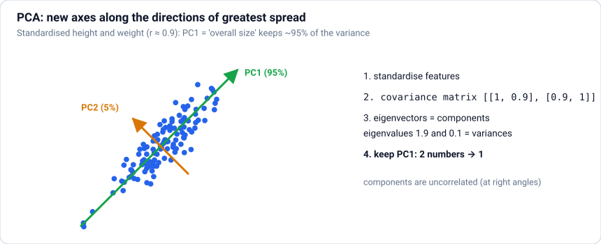

### 36.1 The problem: too many columns

The digits dataset has 64 pixel features. Many of them move together: neighbouring pixels are usually both dark or both light. Could a handful of numbers describe each image almost as well? **Dimensionality reduction** turns d features into k < d new ones. It's used to visualise data in 2D, to speed up models, and to remove noise.

**Principal component analysis (PCA)** finds new axes, called **principal components**, that point along the directions where the data **varies most**, and keeps only the first few.

### 36.2 Projecting onto a direction

A direction is a **unit vector** u (length 1). A point's coordinate along u is the dot product x · u (Chapter 3.2): its **projection**. For centred data (mean subtracted), the variance of those coordinates is

```
Var(x · u) = uᵀ C u
```

where C is the **covariance matrix**: entry (i, j) is the average of feature i × feature j over the centred data, so the diagonal holds each feature's variance. Written as a matrix product: C = XᵀX / n for centred X.

### 36.3 The best direction: an eigenvector

PCA's first component is the unit vector u that **maximises uᵀCu**. With the constraint ‖u‖ = 1, calculus (a Lagrange multiplier λ for the constraint) gives the condition

```
C u = λ u
```

A vector that C only stretches, without turning, is an **eigenvector** of C, and the stretch factor λ is its **eigenvalue**. Multiply both sides by uᵀ: uᵀCu = λ uᵀu = λ. So **the variance along an eigenvector equals its eigenvalue**, and the best direction is the eigenvector with the **largest** eigenvalue. The second component is the best direction at right angles to the first (the next eigenvector), and so on. Because the components are at right angles, the new features are **uncorrelated**.

<details>
<summary><b>Derivation: the Lagrange step</b></summary>

To maximise f(u) = uᵀCu subject to g(u) = uᵀu − 1 = 0, set the gradient of f − λg to zero:

```
∇(uᵀCu − λ(uᵀu − 1)) = 2Cu − 2λu = 0    →    Cu = λu
```

(For a symmetric matrix C, the gradient of uᵀCu is 2Cu, much as the derivative of c·w² is 2c·w.)

</details>

**By hand**, the picture's example: height and weight, standardised, with correlation 0.9. Then

```
C = [[1, 0.9],
     [0.9, 1]]
```

Try u = (1, 1)/√2: Cu = (1.9, 1.9)/√2 = **1.9** · u. So it's an eigenvector with λ = 1.9. Try (1, −1)/√2: Cu = (0.1, −0.1)/√2 = **0.1** · u, with λ = 0.1. The total variance is 1.9 + 0.1 = 2 (= 1 + 1, the two original variances). The first component, "overall size" (height and weight together), keeps 1.9 / 2 = **95%** of it. One number per person instead of two loses only 5%.

```python
import numpy as np

C = np.array([[1, 0.9], [0.9, 1]])
eigenvalues, eigenvectors = np.linalg.eigh(C)           # eigh: for symmetric matrices, ascending order
print("eigenvalues:", eigenvalues)
print("eigenvectors (columns):\n", eigenvectors.round(3))
print("share of variance:", (eigenvalues / eigenvalues.sum()).round(3))
```

**Output:**

```text
eigenvalues: [0.1 1.9]
eigenvectors (columns):
 [[-0.707  0.707]
 [ 0.707  0.707]]
share of variance: [0.05 0.95]
```

The signs of eigenvectors are arbitrary: (−0.707, −0.707) is the same direction as (0.707, 0.707).

### 36.4 PCA from scratch

1. Centre the data (subtract each column's mean).
2. Compute the covariance matrix.
3. Find its eigenvectors, and sort them by eigenvalue, largest first.
4. Project: the new coordinates are X_centred @ (the top k eigenvectors).

```python
def pca(X, k):
    mean = X.mean(axis=0)
    Xc = X - mean
    C = Xc.T @ Xc / len(X)
    values, vectors = np.linalg.eigh(C)
    order = np.argsort(values)[::-1]                    # largest eigenvalue first
    values, vectors = values[order], vectors[:, order]
    W = vectors[:, :k]                                  # (features × k): the components
    return Xc @ W, W, mean, values / values.sum()

from sklearn.datasets import load_digits
X, y = load_digits(return_X_y=True)
Z, W, mean, ratio = pca(X, 2)
print("64 features → shape", Z.shape)
print("variance kept by the first 2 components:", ratio[:2].round(3), "total", ratio[:2].sum().round(3))
print("components needed for 90% of the variance:", np.searchsorted(np.cumsum(ratio), 0.90) + 1)
```

**Output:**

```text
64 features → shape (1797, 2)
variance kept by the first 2 components: [0.149 0.136] total 0.285
components needed for 90% of the variance: 21
```

`np.cumsum` gives running totals, and `np.searchsorted` finds where the running total first reaches 0.90. Two components keep only about 29% of the digits' variance, while 21 keep 90%. Images are complicated; height and weight weren't.

### 36.5 Going back: reconstruction

The projection can be approximately undone: X ≈ Z Wᵀ + mean. The more components you keep, the closer the reconstruction. The gap is the **reconstruction error**, which can also flag unusual rows (Chapter 38).

```python
for k in [2, 10, 21, 40]:
    Zk, Wk, mean, _ = pca(X, k)
    X_back = Zk @ Wk.T + mean
    print(f"k = {k:>2}: mean squared reconstruction error {np.mean((X - X_back) ** 2):.2f}")
```

**Output:**

```text
k =  2: mean squared reconstruction error 13.42
k = 10: mean squared reconstruction error 4.91
k = 21: mean squared reconstruction error 1.82
k = 40: mean squared reconstruction error 0.22
```

### 36.6 In scikit-learn

`PCA` is a transformer (Chapter 14.6). It computes the same components with the **singular value decomposition** (SVD), a matrix factorisation that gets them without forming C, which is faster and more accurate.

```python
from sklearn.decomposition import PCA

p = PCA(n_components=2).fit(X)
print("explained variance ratio:", p.explained_variance_ratio_.round(3))
print("same as ours (up to sign):", np.allclose(np.abs(p.transform(X)), np.abs(Z)))
print("components for 90%:", PCA(n_components=0.90).fit(X).n_components_)
```

**Output:**

```text
explained variance ratio: [0.149 0.136]
same as ours (up to sign): True
components for 90%: 21
```

A float `n_components` such as 0.90 means "as many components as needed for 90% of the variance".

**As a preprocessing step** in a pipeline, PCA can speed up a model or remove noise. Fit it inside cross-validation like any other step:

```python
from sklearn.pipeline import make_pipeline
from sklearn.preprocessing import StandardScaler
from sklearn.linear_model import LogisticRegression
from sklearn.model_selection import cross_val_score

for k in [5, 10, 20, 40]:
    model = make_pipeline(StandardScaler(), PCA(n_components=k), LogisticRegression(max_iter=2000))
    print(f"{k:>2} components: CV accuracy {cross_val_score(model, X, y, cv=5).mean():.3f}")
```

**Output:**

```text
 5 components: CV accuracy 0.771
10 components: CV accuracy 0.840
20 components: CV accuracy 0.899
40 components: CV accuracy 0.914
```

Twenty components (a third of the pixel count) score 0.90, close to the 0.92 of all 64 pixels (Chapter 23.4).

**Practical notes:**

- **Standardise first** when features are in different units. Otherwise the feature with the biggest numbers dominates the variance, and therefore the components.
- PCA is **unsupervised**: it ignores y. The directions of largest variance aren't always the ones that predict y best.
- It only finds **straight** directions. Curved structure needs other tools (Chapter 37).
- Components are mixtures of all features, so they're harder to explain than the original columns.

### 36.7 Summary

```
covariance     C = Xcᵀ Xc / n                         (Xc = centred X)
components     eigenvectors of C, sorted by eigenvalue;  variance along each = its eigenvalue
project        Z = Xc W_k            reconstruct  X ≈ Z W_kᵀ + mean
explained variance ratio = λᵢ / Σλ;  keep enough components for 90–95%
```

**Key terms:**

- **Dimensionality reduction:** representing data with fewer features while keeping most of the information.
- **Principal component analysis (PCA):** finding the uncorrelated directions of greatest variance and keeping the top few.
- **Principal component:** one of those directions (an eigenvector of the covariance matrix).
- **Projection:** the coordinate of a point along a direction: its dot product with a unit vector.
- **Unit vector:** a vector of length 1.
- **Covariance matrix:** the matrix of average products of centred features; the diagonal holds the variances.
- **Eigenvector / eigenvalue:** a vector that a matrix only stretches (Cu = λu), and the stretch factor λ.
- **Explained variance ratio:** the share of total variance captured by a component, λᵢ / Σλ.
- **Reconstruction error:** the difference between the original data and its reconstruction from k components.
- **Singular value decomposition (SVD):** a matrix factorisation used to compute PCA efficiently.
- **Lagrange multiplier:** a method for maximising a function under a constraint.

**Exercises**

1. Standardised features with correlation 0.5: what are the eigenvalues, and what share does PC1 keep?
2. Why can PCA on unscaled data (income in rupees, age in years) give a useless first component?

<details>
<summary><b>Answers</b></summary>

1. C = [[1, 0.5], [0.5, 1]], so the eigenvalues are 1.5 and 0.5 (with the same eigenvectors as before). PC1 keeps 1.5 / 2 = **75%**.
2. Income's variance is in the millions, and age's is in the hundreds, so the direction of greatest variance is basically "income". PC1 just copies income. Standardising gives every feature the same starting variance.

```python
print(np.linalg.eigh(np.array([[1, 0.5], [0.5, 1]]))[0])
```

**Output:**

```text
[0.5 1.5]
```

</details>

| # | Problem (Deep-ML) | Difficulty |
|---|---|---|
| 1 | [19. Principal Component Analysis (PCA) Implementation](https://www.deep-ml.com/problems/19) | 🟡 Medium |
| 2 | [350. Calculate Explained Variance Ratio for PCA](https://www.deep-ml.com/problems/350) | 🟡 Medium |
| 3 | [353. Reconstruction Error from PCA](https://www.deep-ml.com/problems/353) | 🟡 Medium |

**Learn more:** [StatQuest: PCA step by step (video)](https://www.youtube.com/watch?v=FgakZw6K1QQ) · [scikit-learn: PCA](https://scikit-learn.org/stable/modules/decomposition.html#pca)

---

## 37. t-SNE and UMAP for Visualisation

**You need:** Chapters 6 and 36. · **You'll learn:** how t-SNE and UMAP draw high-dimensional data in 2D by keeping **neighbours** together, the idea behind their maths, and how to read (and not over-read) their pictures.

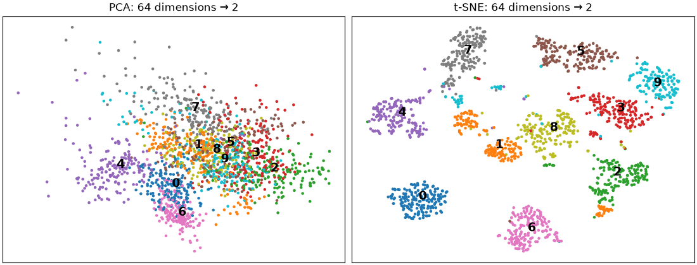

### 37.1 Why PCA isn't enough for pictures

PCA's 2D view of the digits keeps only 29% of the variance (Chapter 36.4), and the ten classes overlap in a blur. PCA preserves **large-scale spread** along straight directions. For a picture, we usually care about something else: **which points are near which**. Are all the 3s close to other 3s?

**t-SNE** (t-distributed stochastic neighbour embedding) and **UMAP** (uniform manifold approximation and projection) place points in 2D so that **points that were neighbours stay neighbours**. They give up global distances to get this.

### 37.2 The idea behind t-SNE, step by step

1. **High-dimensional similarities.** For each point i, turn its distances to the others into probabilities p_{j|i}: close points get high probability, from a bell curve centred on i. The width of each bell is set so that each point has about **perplexity** effective neighbours (a setting, typically 5–50).
2. **Low-dimensional similarities.** Place the points at random in 2D, and compute similarities q_ij the same way, but with a **Student-t** curve, which has heavier tails than the bell. Heavy tails let moderately distant points sit far apart in 2D, which keeps clusters from crushing together.
3. **Match them.** Move the 2D points by gradient descent (Chapter 5) to make Q look like P, measured by the **KL divergence**:

```
KL(P ‖ Q) = Σ pᵢⱼ · ln(pᵢⱼ / qᵢⱼ)
```

**KL by hand.** P = [0.5, 0.5] and Q = [0.9, 0.1]:

```
KL = 0.5·ln(0.5/0.9) + 0.5·ln(0.5/0.1) = 0.5·(−0.588) + 0.5·(1.609) = 0.511
```

It's 0 only when Q = P, and it's large when Q gives a small probability where P's is big. So t-SNE is punished most for **pulling neighbours apart**, and only mildly for putting non-neighbours close together. That's why it preserves local structure, not global structure.

```python
import numpy as np

P, Q = np.array([0.5, 0.5]), np.array([0.9, 0.1])
print("KL(P‖Q) =", round(np.sum(P * np.log(P / Q)), 3), "| KL(P‖P) =", np.sum(P * np.log(P / P)))
```

**Output:**

```text
KL(P‖Q) = 0.511 | KL(P‖P) = 0.0
```

**UMAP** follows the same plan with different formulas: a graph of each point's nearest neighbours, and a cross-entropy objective. It's faster, scales to millions of points, tends to keep more of the global layout, and can map **new** points into an existing picture.

### 37.3 In practice

```python
from sklearn.datasets import load_digits
from sklearn.decomposition import PCA
from sklearn.manifold import TSNE, trustworthiness
import umap

X, y = load_digits(return_X_y=True)
emb = {
    "PCA": PCA(n_components=2).fit_transform(X),
    "t-SNE": TSNE(n_components=2, perplexity=30, random_state=0).fit_transform(X),
    "UMAP": umap.UMAP(n_neighbors=15, random_state=0).fit_transform(X),
}
for name, E in emb.items():
    print(f"{name:<6} trustworthiness {trustworthiness(X, E, n_neighbors=10):.3f}")
```

**Output:**

```text
PCA    trustworthiness 0.830
t-SNE  trustworthiness 0.993
UMAP   trustworthiness 0.988
```

**Trustworthiness** measures how many of each point's 2D neighbours were also its neighbours in the original space (1 = all of them). t-SNE and UMAP score far higher than PCA here, which matches the picture. UMAP lives in its own package (`pip install umap-learn`) and follows scikit-learn's `fit_transform` pattern.

<details>
<summary><b>Code for the chart at the top</b></summary>

```python
import matplotlib.pyplot as plt

fig, axes = plt.subplots(1, 3, figsize=(12, 3.8), layout="constrained")
for ax, (name, E) in zip(axes, emb.items()):
    ax.scatter(E[:, 0], E[:, 1], c=y, s=4, cmap="tab10")
    for digit in range(10):
        cx, cy = np.median(E[y == digit], axis=0)
        ax.text(cx, cy, str(digit), fontsize=12, weight="bold")
    ax.set(title=name, xticks=[], yticks=[])
fig.savefig("pca-tsne-digits.png", dpi=100)
plt.close(fig)
```

</details>

### 37.4 How to read the pictures (and how not to)

- ✅ **Tight islands** suggest groups that really are similar.
- ❌ **The size of an island** means little: t-SNE expands dense groups and shrinks sparse ones.
- ❌ **Distances between islands** mean little, especially in t-SNE. Two islands far apart aren't necessarily very different.
- ❌ **Shapes from one run** can change with the seed or the perplexity. Try a few settings before believing a pattern.
- Use them **to look**, not as model features. t-SNE has no `transform` for new rows, and both methods distort distances that a model would rely on. For features, use PCA (or UMAP, carefully, inside a pipeline).

### 37.5 Settings

| setting | method | effect |
|---|---|---|
| `perplexity` (5–50) | t-SNE | about how many neighbours each point considers; low = many small clumps, high = smoother structure |
| `n_neighbors` (5–50) | UMAP | the same idea as perplexity |
| `min_dist` (0–1) | UMAP | how tightly points may pack within a cluster |
| `random_state` | both | fixes the random start so the picture is reproducible |

On very wide data (hundreds or thousands of features), it's common to run PCA down to about 50 components first, then t-SNE or UMAP. It's faster, and it strips noise.

### 37.6 Summary

```
goal          keep neighbours together in 2D (local structure), not straight-line spread
t-SNE         high-D bell-curve similarities P; 2D Student-t similarities Q; minimise KL(P‖Q)
KL(P‖Q)       Σ p ln(p/q): large when neighbours are pulled apart
UMAP          a neighbour graph + cross-entropy; faster, keeps more global layout, can transform new points
read          islands = maybe groups; island sizes and gaps = don't trust
```

**Key terms:**

- **t-SNE:** a 2D/3D embedding that preserves neighbourhoods by matching similarity distributions.
- **UMAP:** a faster neighbourhood-preserving embedding based on a nearest-neighbour graph.
- **Embedding:** a low-dimensional representation of each data point.
- **Perplexity:** t-SNE's setting for roughly how many neighbours each point considers.
- **Student-t distribution:** a bell-like curve with heavier tails, used for t-SNE's 2D similarities.
- **KL divergence:** Σ p ln(p/q), a measure of how different distribution Q is from P; 0 when they're equal.
- **Local vs global structure:** who is near whom, versus how far apart whole groups are.
- **Trustworthiness:** the share of each point's low-dimensional neighbours that were true neighbours in the original space.

**Exercises**

1. Compute KL(P‖Q) for P = [0.8, 0.2] and Q = [0.5, 0.5]. Is KL(Q‖P) the same?
2. A t-SNE plot shows two clusters far apart and a third close to one of them. Can you conclude the third is "more similar" to its neighbour?

<details>
<summary><b>Answers</b></summary>

1. 0.8·ln(1.6) + 0.2·ln(0.4) = 0.376 − 0.183 = **0.193**. KL(Q‖P) = 0.5·ln(0.625) + 0.5·ln(2.5) = **0.223**: different. KL isn't symmetric.
2. No. Distances between clusters in t-SNE aren't reliable. Check in the original space (the distances between cluster centres, say) or with several runs.

```python
P2, Q2 = np.array([0.8, 0.2]), np.array([0.5, 0.5])
print(round(np.sum(P2 * np.log(P2 / Q2)), 3), round(np.sum(Q2 * np.log(Q2 / P2)), 3))
```

**Output:**

```text
0.193 0.223
```

</details>

**Learn more:** [Distill: How to use t-SNE effectively](https://distill.pub/2016/misread-tsne/) · [UMAP documentation](https://umap-learn.readthedocs.io/)

---

## 38. Anomaly Detection

**You need:** Chapters 13, 14, 27 and 36. · **You'll learn:** how to find rare, unusual rows without labels: simple statistical rules, then distance and density methods, then Isolation Forest, built from scratch.

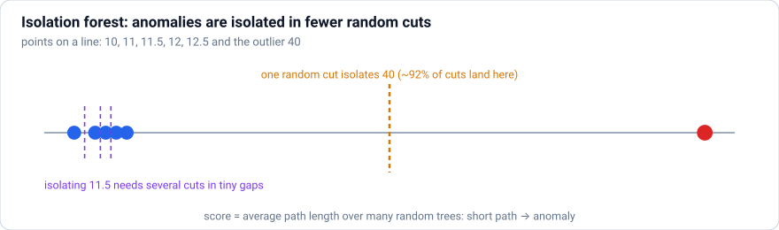

### 38.1 The problem

Fraudulent payments, failing machines, broken sensors, intrusions: the interesting rows are **rare** and **different**, and usually nobody has labelled them. **Anomaly detection** gives every row a score for how unusual it is. People then review the top of the list, or an alert fires above a threshold.

### 38.2 One feature: z-scores and the IQR rule

**z-score:** how many standard deviations a value is from the mean. Flag |z| > 3.

**IQR rule:** Q1 and Q3 are the 25th and 75th percentiles (a quarter of the values lie below Q1, and three quarters below Q3). The **interquartile range** IQR = Q3 − Q1. Flag anything outside [Q1 − 1.5·IQR, Q3 + 1.5·IQR].

**By hand**, daily logins [10, 12, 12, 13, 12, 11, 14, 13, 15, 10, 40]: Q1 = 11.5 and Q3 = 13.5, so IQR = 2 and the fences are 8.5 and 16.5. **40 is flagged.**

```python
import numpy as np

v = np.array([10, 12, 12, 13, 12, 11, 14, 13, 15, 10, 40.0])
q1, q3 = np.percentile(v, [25, 75])
low, high = q1 - 1.5 * (q3 - q1), q3 + 1.5 * (q3 - q1)
print("IQR fences:", low, high, "→ flagged:", v[(v < low) | (v > high)])
print("z-score of 40:", round((40 - v.mean()) / v.std(), 2))
```

**Output:**

```text
IQR fences: 8.5 16.5 → flagged: [40.]
z-score of 40: 3.11
```

40's z-score only just passes 3. The outlier itself inflates the mean and the standard deviation it's measured against, an effect called **masking**. With a few more outliers, z-scores stop working. Median-based rules like the IQR don't have this problem, because a few extreme values barely move the median and the quartiles.

### 38.3 Many features: distance and density

An anomaly can look normal in every single feature and odd only in combination: a high salary with a very young age, say. With several features, two ideas work:

- **Distance:** score each point by its distance to its k-th nearest neighbour (Chapter 14). Isolated points score high.
- **Local density, the Local Outlier Factor (LOF):** compare each point's neighbourhood density with that of its neighbours. A score near 1 means it's as dense as its neighbours, and well above 1 means it's sparser than its surroundings. This catches points just outside a tight cluster even when a loose cluster elsewhere is spread just as wide.

### 38.4 Isolation Forest

**The idea:** anomalies are **few and different**, so they're **easy to separate**. Cut the data with random splits: pick a random feature, then a random threshold between its min and max. Repeat inside each piece. A normal point, in a crowd, needs many cuts before it's alone. An anomaly needs only a few.

**By hand**, points on a line: 10, 11, 11.5, 12, 12.5 and the outlier 40. The first cut is uniform between 10 and 40. Any cut between 12.5 and 40 isolates 40 at once, and that happens with probability 27.5/30 ≈ **92%**. Isolating 11.5 needs cuts that land in the tiny gaps around it, which takes several rounds.

The anomaly score is based on the **average path length** (the number of cuts needed) over many random trees: a **short path → an anomaly**.

```python
def path_length(x, X, rng, depth=0, max_depth=10):
    if len(X) <= 1 or depth >= max_depth:
        return depth
    j = rng.integers(X.shape[1])                        # a random feature
    lo, hi = X[:, j].min(), X[:, j].max()
    if lo == hi:
        return depth
    cut = rng.uniform(lo, hi)                           # a random threshold
    side = X[:, j] <= cut
    same_side = X[side] if x[j] <= cut else X[~side]    # follow x down the tree
    return path_length(x, same_side, rng, depth + 1, max_depth)

pts = np.array([[10], [11], [11.5], [12], [12.5], [40.0]])
rng = np.random.default_rng(0)
for p in pts:
    avg = np.mean([path_length(p, pts, rng) for _ in range(500)])     # 500 random trees
    print(f"x = {p[0]:>4}: average cuts to isolate {avg:.2f}")
```

**Output:**

```text
x = 10.0: average cuts to isolate 2.70
x = 11.0: average cuts to isolate 3.74
x = 11.5: average cuts to isolate 4.17
x = 12.0: average cuts to isolate 3.98
x = 12.5: average cuts to isolate 3.22
x = 40.0: average cuts to isolate 1.10
```

The outlier needs about one cut, and the points in the crowd need three to four. The two edge points of the crowd (10 and 12.5) are a little easier to isolate than the middle ones. Real Isolation Forests build each tree on a random sample of rows (256 by default), stop at a modest depth, and turn the average path length into a score between 0 and 1.

### 38.5 Comparing methods on 2D data

500 normal points in two blobs of different spreads, plus 15 anomalies scattered around them. We know which are which, so we can score each method with **average precision** (Chapter 13.4): how well its ranking puts the anomalies on top.

```python
from sklearn.ensemble import IsolationForest
from sklearn.neighbors import LocalOutlierFactor, NearestNeighbors
from sklearn.metrics import average_precision_score

rng = np.random.default_rng(1)
normal = np.vstack([rng.normal([0, 0], 0.5, (300, 2)), rng.normal([5, 5], 1.5, (200, 2))])
odd = rng.uniform(-4, 10, (15, 2))
X = np.vstack([normal, odd])
is_anomaly = np.r_[np.zeros(500), np.ones(15)]          # np.r_ joins arrays end to end

dist, _ = NearestNeighbors(n_neighbors=6).fit(X).kneighbors(X)       # column 0 is the point itself
scores = {
    "distance to 5th neighbour": dist[:, 5],
    "Local Outlier Factor": -LocalOutlierFactor(n_neighbors=20).fit(X).negative_outlier_factor_,
    "Isolation Forest": -IsolationForest(random_state=0).fit(X).score_samples(X),
}
for name, s in scores.items():
    top15 = np.argsort(s)[::-1][:15]
    print(f"{name:<26} AP {average_precision_score(is_anomaly, s):.3f}, anomalies in top 15: {int(is_anomaly[top15].sum())}")
```

**Output:**

```text
distance to 5th neighbour  AP 0.768, anomalies in top 15: 11
Local Outlier Factor       AP 0.565, anomalies in top 15: 8
Isolation Forest           AP 0.663, anomalies in top 15: 10
```

Here the simplest method, distance to the 5th neighbour, ranks best. No anomaly method wins everywhere, so when a few labelled cases exist, compare several on them. scikit-learn's anomaly scores are "higher = more normal", so we flip the sign to get "higher = more unusual". A few of the random "anomalies" land inside a blob, where no method could call them odd. That's normal with real data too.

**Turning scores into flags.** `IsolationForest(contamination=0.03)` sets the threshold so that 3% of the training rows are flagged, and `.predict` then returns −1 for anomalies and 1 for normal rows. Better still, pick the threshold from how many alerts the reviewers can handle each day (as in Chapter 26.6).

### 38.6 Other approaches

- **Reconstruction error (Chapter 36.5):** fit PCA on normal data. Rows it reconstructs badly don't follow the usual patterns. Autoencoders (`deep-learning.md`) do the same with a neural network.
- **One-class SVM:** learns a boundary around the normal data, with a kernel (Chapter 31). It's sensitive to its settings and slow on big data.
- **With some labels:** once investigators have confirmed some cases, train a supervised classifier (Chapter 39), and keep the unsupervised score as one of its features.

### 38.7 Summary

| method | idea | good for |
|---|---|---|
| z-score / IQR | far from the centre of one feature | quick checks, monitoring single metrics |
| k-NN distance | far from its neighbours | small to medium data |
| LOF | sparser than its neighbours | clusters of different densities |
| Isolation Forest | isolated by few random cuts | a strong default; fast and scales well |
| PCA / autoencoder error | doesn't fit the normal patterns | many correlated features |

**Key terms:**

- **Anomaly (outlier):** a rare example that differs markedly from the rest.
- **Anomaly score:** a number saying how unusual a row is.
- **z-score:** (x − mean) / standard deviation.
- **Percentile / quartile:** the value below which a given share of the data falls; Q1 = 25th, Q3 = 75th.
- **Interquartile range (IQR):** Q3 − Q1.
- **Masking:** outliers inflating the statistics used to detect them, so they hide.
- **Local Outlier Factor (LOF):** a point's neighbourhood density compared with its neighbours'.
- **Isolation Forest:** random trees that isolate points; a short average path length means an anomaly.
- **Path length:** the number of random splits needed to isolate a point.
- **Contamination:** the assumed share of anomalies, used to set a threshold.
- **One-class SVM:** an SVM that learns a boundary around normal data.

**Exercises**

1. For [3, 4, 4, 5, 5, 5, 6, 6, 7, 30], compute the IQR fences (numpy's percentile gives Q1 = 4.25 and Q3 = 6). Is 30 flagged? Is 3?
2. Why does an Isolation Forest need no distance calculations, and why does that help with mixed-unit features?

<details>
<summary><b>Answers</b></summary>

1. IQR = 1.75, so the fences are 4.25 − 2.625 = **1.625** and 6 + 2.625 = **8.625**. 30 is flagged; 3 isn't.
2. It only compares one feature at a time with a random threshold between that feature's min and max. Scale doesn't matter (much like trees, Chapter 27.7), so rupees and years can sit side by side without standardising.

```python
w = np.array([3, 4, 4, 5, 5, 5, 6, 6, 7, 30.0]); a, b = np.percentile(w, [25, 75])
print(a, b, a - 1.5 * (b - a), b + 1.5 * (b - a))
```

**Output:**

```text
4.25 6.0 1.625 8.625
```

</details>

| # | Problem (Deep-ML) | Difficulty |
|---|---|---|
| 1 | [355. Outlier Detection and Removal Using IQR Method](https://www.deep-ml.com/problems/355) | 🟡 Medium |
| 2 | [367. Implement Isolation Forest for Anomaly Detection](https://www.deep-ml.com/problems/367) | 🟡 Medium |

**Learn more:** [scikit-learn: novelty and outlier detection](https://scikit-learn.org/stable/modules/outlier_detection.html)

---

**✅ Part V checkpoint.** You can now cluster data (k-means, DBSCAN, hierarchical, Gaussian mixtures with EM), reduce dimensions (PCA from its eigenvector maths; t-SNE and UMAP for pictures), and score anomalies. Part VI handles problems that need special care: imbalance, probabilities, time, text and recommendations.

---

# Part VI — Special Problems

Imbalanced classes, trustworthy probabilities, time series, text and recommendations: problems where the standard recipe needs adjusting.

---

## 39. Imbalanced Classes

**You need:** Chapters 12, 13, 19 and 21. · **You'll learn:** why rare positives break the usual setup, the three standard remedies and the maths of class weights, and the surprising fact that the simplest remedy, moving the threshold, often does as well as the others.

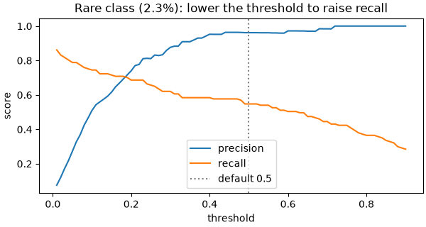

### 39.1 The problem

Fraud, disease, machine failure, clicks: the positive class is often 0.1–5% of the rows. Three things go wrong:

- **Accuracy is useless:** predicting "never" scores 98% (Chapter 18.3).
- **The default threshold is too high:** probabilities for a rare class are mostly small, so at 0.5 few positives get flagged.
- **There are few positives to learn from,** so the model sees little variety.

Here's a dataset with 2.3% positives. `make_classification` generates a synthetic classification problem: `weights=[0.98]` makes 98% of the rows class 0, `n_informative=5` of the 10 features carry signal, and `flip_y` flips a few labels as noise.

```python
import numpy as np
from sklearn.datasets import make_classification
from sklearn.model_selection import train_test_split
from sklearn.linear_model import LogisticRegression
from sklearn.metrics import average_precision_score, precision_score, recall_score

X, y = make_classification(n_samples=20_000, n_features=10, n_informative=5, weights=[0.98],
                           flip_y=0.005, random_state=0)
X_train, X_test, y_train, y_test = train_test_split(X, y, test_size=0.3, stratify=y, random_state=0)
print("positive rate:", y.mean().round(4), "| test positives:", y_test.sum())

def report(name, proba, threshold=0.5):
    pred = (proba >= threshold).astype(int)
    print(f"{name:<24} AP {average_precision_score(y_test, proba):.3f} | at {threshold}: "
          f"recall {recall_score(y_test, pred):.3f}, precision {precision_score(y_test, pred):.3f} | mean prob {proba.mean():.3f}")

plain = LogisticRegression(max_iter=1000).fit(X_train, y_train)
report("plain logistic", plain.predict_proba(X_test)[:, 1])
```

**Output:**

```text
positive rate: 0.0228 | test positives: 137
plain logistic           AP 0.737 | at 0.5: recall 0.547, precision 0.962 | mean prob 0.024
```

Precision is excellent, but at 0.5 the model catches only about half the positives.

### 39.2 Remedy 1: move the threshold

The model's **ranking** may already be fine. If so, just choose a lower threshold, on validation data (Chapter 13.5), from the recall you need or the cost of each mistake:

```python
p_plain = plain.predict_proba(X_test)[:, 1]
for t in [0.5, 0.2, 0.1, 0.05]:
    report("plain, threshold moved", p_plain, t)
```

**Output:**

```text
plain, threshold moved   AP 0.737 | at 0.5: recall 0.547, precision 0.962 | mean prob 0.024
plain, threshold moved   AP 0.737 | at 0.2: recall 0.686, precision 0.740 | mean prob 0.024
plain, threshold moved   AP 0.737 | at 0.1: recall 0.745, precision 0.510 | mean prob 0.024
plain, threshold moved   AP 0.737 | at 0.05: recall 0.788, precision 0.273 | mean prob 0.024
```

AP doesn't change (the ranking is the same model's), and the threshold walks along the precision–recall trade-off. (Here we pick from the test set only for illustration.)

### 39.3 Remedy 2: class weights

Make each mistake on the rare class **cost more** in the loss. With weights w₀ and w₁, log loss becomes

```
loss = −(1/n) Σ [ w₁ · yᵢ · ln pᵢ  +  w₀ · (1 − yᵢ) · ln(1 − pᵢ) ]
```

A weight of 25 on a row has the same effect as copying that row 25 times. scikit-learn's `class_weight="balanced"` sets

```
w_class = n / (number of classes · n_class)
```

**By hand:** 1,000 rows, 20 positive. w₁ = 1000 / (2 · 20) = **25**, and w₀ = 1000 / (2 · 980) = **0.51**. Each class now carries equal total weight (20 × 25 = 980 × 0.51 ≈ 500).

```python
weighted = LogisticRegression(max_iter=1000, class_weight="balanced").fit(X_train, y_train)
report("class_weight='balanced'", weighted.predict_proba(X_test)[:, 1])
```

**Output:**

```text
class_weight='balanced'  AP 0.692 | at 0.5: recall 0.847, precision 0.140 | mean prob 0.248
```

Recall at 0.5 jumps, precision collapses, AP is no better, and the average "probability" is now about 10 times the true positive rate. Weighting mostly **moved the threshold** for us, and in doing so it **broke the probabilities**: they no longer mean "chance of being positive". If the probabilities are used for anything (pricing, expected cost), recalibrate them (Chapter 40).

### 39.4 Remedy 3: resampling

Change the training data instead:

- **Random undersampling:** drop majority rows until the classes are balanced. It's fast, but it throws away data.
- **Random oversampling:** copy minority rows. Same effect as class weights.
- **SMOTE** (synthetic minority oversampling technique): create **new** minority points **between** existing ones. Take a minority point x, pick one of its k nearest minority neighbours x_nn, and place a new point at a random spot on the line between them:

```
x_new = x + u · (x_nn − x),       u random between 0 and 1
```

**By hand:** x = (1, 2), x_nn = (3, 6), u = 0.25 → x_new = (1 + 0.5, 2 + 1) = **(1.5, 3)**.

Resampling must happen **only on the training folds**. Done before the split, copies or near-copies of the same point land in both training and validation, which is a leak (Chapter 25.6). scikit-learn's own `Pipeline` doesn't run resamplers, so the **imbalanced-learn** library (`imblearn`) provides a `Pipeline` that does, on training data only:

```python
from imblearn.over_sampling import SMOTE
from imblearn.pipeline import make_pipeline as make_imb_pipeline

smote_model = make_imb_pipeline(SMOTE(random_state=0), LogisticRegression(max_iter=1000)).fit(X_train, y_train)
report("SMOTE", smote_model.predict_proba(X_test)[:, 1])
```

**Output:**

```text
SMOTE                    AP 0.679 | at 0.5: recall 0.825, precision 0.148 | mean prob 0.221
```

The same story as class weights: higher recall at 0.5 bought with precision, no better ranking, and inflated probabilities.

### 39.5 What actually improves the ranking: a better model

Weights and resampling change **where** the line is drawn. A model that **ranks** better raises the whole precision–recall curve. Gradient boosting, on the same data:

```python
from sklearn.ensemble import HistGradientBoostingClassifier

hgb = HistGradientBoostingClassifier(random_state=0).fit(X_train, y_train)
p_hgb = hgb.predict_proba(X_test)[:, 1]
report("gradient boosting", p_hgb)
report("gradient boosting", p_hgb, 0.1)
```

**Output:**

```text
gradient boosting        AP 0.803 | at 0.5: recall 0.657, precision 0.947 | mean prob 0.020
gradient boosting        AP 0.803 | at 0.1: recall 0.766, precision 0.724 | mean prob 0.020
```

A clearly higher AP. At threshold 0.1 it catches 77% of the positives at 72% precision. To catch a similar share (75%), the plain model has to drop to 51% precision. The better ranking gives a better trade-off at every threshold.

<details>
<summary><b>Code for the chart at the top</b></summary>

```python
import matplotlib.pyplot as plt

ts = np.linspace(0.01, 0.9, 90)
prec = [precision_score(y_test, p_plain >= t, zero_division=1) for t in ts]
rec = [recall_score(y_test, p_plain >= t) for t in ts]
fig, ax = plt.subplots(figsize=(6, 3.2), layout="constrained")
ax.plot(ts, prec, label="precision")
ax.plot(ts, rec, label="recall")
ax.axvline(0.5, ls=":", color="gray", label="default 0.5")
ax.set(xlabel="threshold", ylabel="score", title="Rare class (2.3%): lower the threshold to raise recall")
ax.legend()
fig.savefig("imbalance-thresholds.png", dpi=100)
plt.close(fig)
```

</details>

### 39.6 A practical recipe

1. Use **imbalance-aware metrics:** average precision, recall at a fixed precision (or the reverse), or cost. Never plain accuracy.
2. Use **stratified** splits and CV, so every fold has positives.
3. Get the **best ranking model** you can (boosting is often strongest).
4. **Choose the threshold** from validation data and the business costs.
5. Reach for class weights or resampling if they help **on validation data**. They sometimes help models that otherwise ignore a tiny class. If you use them, recalibrate the probabilities.
6. Get **more positives** if you can: they're worth far more than any trick.

### 39.7 Summary

```
balanced weights   w_c = n / (k · n_c)         ≈ duplicating minority rows
SMOTE              x_new = x + u·(x_nn − x)    only inside training folds (imblearn Pipeline)
threshold moving   same model, a different operating point
weights/resampling mostly shift the threshold and distort probabilities; a better model lifts the PR curve
```

**Key terms:**

- **Class imbalance:** one class being much rarer than another.
- **Class weight:** a multiplier on a class's loss, so its mistakes count more.
- **`class_weight="balanced"`:** weights inversely proportional to class frequency.
- **Undersampling / oversampling:** removing majority rows / adding (copied) minority rows.
- **SMOTE:** creating synthetic minority points on the lines between minority neighbours.
- **imbalanced-learn (`imblearn`):** a library of resampling methods, with a pipeline that resamples only training data.
- **Threshold moving:** changing the decision threshold instead of the model.
- **Operating point:** the chosen threshold, and the precision and recall it gives.
- **`make_classification`:** scikit-learn's generator of synthetic classification datasets.

**Exercises**

1. 10,000 rows, 100 positive. What does `class_weight="balanced"` give each class?
2. SMOTE with x = (2, 2), x_nn = (4, 0) and u = 0.5. What's the new point?

<details>
<summary><b>Answers</b></summary>

1. w₁ = 10000 / (2 · 100) = **50**, and w₀ = 10000 / (2 · 9900) ≈ **0.505**.
2. (2, 2) + 0.5 · (2, −2) = **(3, 1)**.

</details>

| # | Problem (Deep-ML) | Difficulty |
|---|---|---|
| 1 | [357. Handle Imbalanced Data with SMOTE](https://www.deep-ml.com/problems/357) | 🟡 Medium |

**Learn more:** [imbalanced-learn documentation](https://imbalanced-learn.org/stable/) · [scikit-learn: class_weight in the glossary](https://scikit-learn.org/stable/glossary.html#term-class_weight)

---

## 40. Probability Calibration and Cost-Based Decisions

**You need:** Chapters 13 and 39. · **You'll learn:** how to check whether a model's probabilities can be taken at face value, how to fix them, and how to turn calibrated probabilities and costs into the best decision, with the threshold derived.

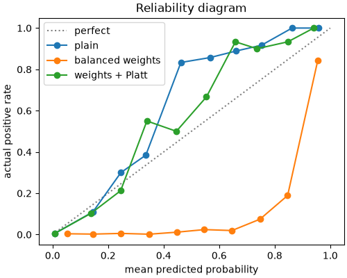

### 40.1 What "calibrated" means

A model is **calibrated** if, among all cases it gives probability 0.3, about 30% really are positive. Ranking metrics like AUC don't check this: a model can rank perfectly while saying 0.9 for cases that are positive only half the time.

Calibration matters whenever the **number itself** is used: an expected loss (probability × amount), insurance pricing, combining scores from several models, or telling a doctor "a 12% risk".

### 40.2 Checking it: the reliability diagram

1. Put predictions into bins (0–0.1, 0.1–0.2, …).
2. In each bin, compare the **average predicted probability** with the **actual positive rate**.
3. Plot one against the other. A calibrated model lies on the diagonal.

Two summary numbers:

```
Brier score = (1/n) Σ (pᵢ − yᵢ)²                              lower is better (it's MSE on probabilities)
ECE         = Σ over bins (n_bin / n) · |mean p in bin − positive rate in bin|      expected calibration error
```

**By hand**, the ECE of four predictions [0.1, 0.2, 0.8, 0.9] with outcomes [0, 1, 1, 1] and two bins (below and above 0.5). Low bin: mean p 0.15, positive rate 0.5, gap 0.35. High bin: mean p 0.85, rate 1.0, gap 0.15. ECE = ½ · 0.35 + ½ · 0.15 = **0.25**.

```python
import numpy as np

def reliability(y, p, n_bins=10):
    bins = np.minimum((p * n_bins).astype(int), n_bins - 1)        # bin number for each prediction
    rows, ece = [], 0.0
    for b in range(n_bins):
        mask = bins == b
        if mask.any():
            gap = abs(p[mask].mean() - y[mask].mean())
            ece += mask.mean() * gap
            rows.append((b / n_bins, mask.sum(), p[mask].mean(), y[mask].mean()))
    return rows, ece

_, ece = reliability(np.array([0, 1, 1, 1]), np.array([0.1, 0.2, 0.8, 0.9]), n_bins=2)
print("ECE by hand example:", round(ece, 3))
```

**Output:**

```text
ECE by hand example: 0.25
```

### 40.3 Two models from Chapter 39

The same rare-class data. The plain logistic model, and the `class_weight="balanced"` one, whose "probabilities" averaged ten times the true rate:

```python
from sklearn.datasets import make_classification
from sklearn.model_selection import train_test_split
from sklearn.linear_model import LogisticRegression
from sklearn.metrics import brier_score_loss

X, y = make_classification(n_samples=20_000, n_features=10, n_informative=5, weights=[0.98], flip_y=0.005, random_state=0)
X_train, X_test, y_train, y_test = train_test_split(X, y, test_size=0.3, stratify=y, random_state=0)

plain = LogisticRegression(max_iter=1000).fit(X_train, y_train)
weighted = LogisticRegression(max_iter=1000, class_weight="balanced").fit(X_train, y_train)
for name, m in [("plain", plain), ("balanced weights", weighted)]:
    p = m.predict_proba(X_test)[:, 1]
    rows, ece = reliability(y_test, p)
    print(f"{name:<17} Brier {brier_score_loss(y_test, p):.4f}, ECE {ece:.3f}")
    for lo, n, mean_p, rate in rows[-3:]:
        print(f"    bin {lo:.1f}+: {n:>4} cases, predicted {mean_p:.2f}, actual {rate:.2f}")
```

**Output:**

```text
plain             Brier 0.0096, ECE 0.005
    bin 0.7+:   12 cases, predicted 0.75, actual 0.92
    bin 0.8+:   11 cases, predicted 0.86, actual 1.00
    bin 0.9+:   39 cases, predicted 0.96, actual 1.00
balanced weights  Brier 0.0949, ECE 0.225
    bin 0.7+:  121 cases, predicted 0.75, actual 0.07
    bin 0.8+:   74 cases, predicted 0.85, actual 0.19
    bin 0.9+:   96 cases, predicted 0.96, actual 0.84
```

The plain logistic model is well calibrated: log loss is a proper training objective for probabilities (Chapter 10.4). The weighted one says 0.7–0.9 for groups that are positive far less often.

### 40.4 Fixing it: Platt scaling and isotonic regression

Both learn a mapping **from the model's score to a calibrated probability**, on data the model **wasn't trained on**.

**Platt scaling:** fit a one-feature logistic regression on the model's log-odds, s = ln(p / (1 − p)):

```
p_calibrated = σ(a · s + b)
```

Two numbers, a and b, so it needs little data, but it can only fix an S-shaped distortion.

**Isotonic regression:** fit the best **non-decreasing step function** from score to outcome. It's flexible enough for any monotonic distortion, but needs more data (thousands of rows) to avoid overfitting.

From scratch, Platt scaling on a held-out calibration split:

```python
X_fit, X_cal, y_fit, y_cal = train_test_split(X_train, y_train, test_size=0.3, stratify=y_train, random_state=0)
model = LogisticRegression(max_iter=1000, class_weight="balanced").fit(X_fit, y_fit)

def log_odds(p):
    p = np.clip(p, 1e-6, 1 - 1e-6)
    return np.log(p / (1 - p))

s_cal = log_odds(model.predict_proba(X_cal)[:, 1]).reshape(-1, 1)
platt = LogisticRegression().fit(s_cal, y_cal)                 # learns a and b
print("a =", platt.coef_[0][0].round(3), " b =", platt.intercept_[0].round(3))

p_test = platt.predict_proba(log_odds(model.predict_proba(X_test)[:, 1]).reshape(-1, 1))[:, 1]
print(f"after Platt: Brier {brier_score_loss(y_test, p_test):.4f}, ECE {reliability(y_test, p_test)[1]:.3f}, mean prob {p_test.mean():.3f}")
```

**Output:**

```text
a = 1.306  b = -3.606
after Platt: Brier 0.0115, ECE 0.006, mean prob 0.024
```

The intercept b is strongly negative: it pulls the inflated log-odds back down to the true base rate.

<details>
<summary><b>Why b ≈ ln(w₀/w₁) for class weights</b></summary>

Weighting the positives by w₁ and the negatives by w₀ is like seeing w₁/w₀ times as many positives, so the model's odds are inflated by that factor: odds_weighted ≈ odds_true · (w₁/w₀). Taking logs: s_weighted ≈ s_true + ln(w₁/w₀). Undoing it needs b ≈ −ln(w₁/w₀) = ln(w₀/w₁). Here w₁/w₀ ≈ 0.977/0.023 ≈ 43, so b ≈ −3.8.

</details>

scikit-learn's `CalibratedClassifierCV` does this with cross-validation, so no data is wasted: the model is trained on some folds and calibrated on the rest, and the results are averaged.

```python
from sklearn.calibration import CalibratedClassifierCV

for method in ["sigmoid", "isotonic"]:                          # "sigmoid" = Platt scaling
    cal = CalibratedClassifierCV(LogisticRegression(max_iter=1000, class_weight="balanced"), method=method, cv=5)
    p = cal.fit(X_train, y_train).predict_proba(X_test)[:, 1]
    print(f"{method:<9} Brier {brier_score_loss(y_test, p):.4f}, ECE {reliability(y_test, p)[1]:.3f}")
```

**Output:**

```text
sigmoid   Brier 0.0111, ECE 0.006
isotonic  Brier 0.0108, ECE 0.001
```

Which models need calibrating? Logistic regression is usually fine. **Naive Bayes** is overconfident (Chapter 32.7). **SVMs** give scores, not probabilities (Chapter 31.7). **Random forests** tend to be under-confident: averaging pulls their probabilities towards the middle. Any model trained with **class weights or resampling** needs it. Boosting is usually decent, but check.

<details>
<summary><b>Code for the chart at the top</b></summary>

```python
import matplotlib.pyplot as plt

fig, ax = plt.subplots(figsize=(5, 4), layout="constrained")
ax.plot([0, 1], [0, 1], ls=":", color="gray", label="perfect")
curves = [("plain", plain.predict_proba(X_test)[:, 1]),
          ("balanced weights", weighted.predict_proba(X_test)[:, 1]),
          ("weights + Platt", p_test)]
for name, p in curves:
    rows, _ = reliability(y_test, p)
    ax.plot([r[2] for r in rows], [r[3] for r in rows], "o-", label=name)
ax.set(xlabel="mean predicted probability", ylabel="actual positive rate", title="Reliability diagram")
ax.legend()
fig.savefig("calibration.png", dpi=100)
plt.close(fig)
```

</details>

### 40.5 Cost-based decisions: the best threshold, derived

Once probabilities are calibrated, costs give the threshold directly. For one case with probability p of being positive:

- flag it: if it's actually negative, we pay a false-alarm cost **C_FP**, so the expected cost is (1 − p)·C_FP;
- don't flag it: if it's actually positive, we pay a miss cost **C_FN**, so the expected cost is p·C_FN.

Flag when flagging is cheaper:

```
(1 − p)·C_FP < p·C_FN      ⟺      p > C_FP / (C_FP + C_FN)
```

**By hand:** a missed fraud costs ₹5,000 and a review costs ₹200. The threshold is 200 / 5200 = **0.038**. Flag anything above a 3.8% chance of fraud. This only works if "3.8%" is a **true** 3.8%, which is why calibration comes first.

Costs can also differ **per case**: missing a ₹50,000 fraud costs more than missing a ₹500 one. Then flag when p · amount > C_FP, with each case's own amount.

```python
p = plain.predict_proba(X_test)[:, 1]                           # the calibrated model
C_FP, C_FN = 200, 5000
best_t = C_FP / (C_FP + C_FN)
for t in [0.5, 0.2, best_t, 0.01]:
    flag = p >= t
    cost = C_FP * np.sum(flag & (y_test == 0)) + C_FN * np.sum(~flag & (y_test == 1))
    print(f"threshold {t:.3f}: total cost ₹{cost:,}")
```

**Output:**

```text
threshold 0.500: total cost ₹310,600
threshold 0.200: total cost ₹221,600
threshold 0.038: total cost ₹217,200
threshold 0.010: total cost ₹385,200
```

The derived threshold gives (close to) the lowest cost, without any search.

### 40.6 Summary

```
calibrated      among cases given p, a share p are positive
check           reliability diagram, Brier = mean (p − y)², ECE = Σ (n_b/n)|p̄_b − ȳ_b|
fix             Platt: σ(a·s + b) on the log-odds s;  isotonic: monotone steps (more data)
                on held-out data, or CalibratedClassifierCV(…, cv=5)
decide          flag if p > C_FP / (C_FP + C_FN)       (needs calibrated p)
```

**Key terms:**

- **Calibration:** agreement between predicted probabilities and actual frequencies.
- **Reliability diagram (calibration curve):** average predicted probability against the actual positive rate, per bin.
- **Brier score:** the mean squared difference between predicted probabilities and outcomes.
- **Expected calibration error (ECE):** the size-weighted average gap between predicted and actual rates over bins.
- **Platt scaling (sigmoid calibration):** fitting σ(a·s + b) to map scores to calibrated probabilities.
- **Isotonic regression:** fitting the best non-decreasing step function.
- **`CalibratedClassifierCV`:** scikit-learn's wrapper that calibrates a model with cross-validation.
- **Expected cost:** probability-weighted cost of a decision.
- **Cost-sensitive threshold:** C_FP / (C_FP + C_FN), the threshold that minimises expected cost.

**Exercises**

1. A miss costs 10 times a false alarm. What threshold minimises the expected cost?
2. Brier score for predictions [0.9, 0.2, 0.6] with outcomes [1, 0, 0]?

<details>
<summary><b>Answers</b></summary>

1. C_FP / (C_FP + 10·C_FP) = 1/11 ≈ **0.091**.
2. ((0.1)² + (0.2)² + (0.6)²) / 3 = (0.01 + 0.04 + 0.36) / 3 = **0.137**.

```python
print(round(brier_score_loss([1, 0, 0], [0.9, 0.2, 0.6]), 3))
```

**Output:**

```text
0.137
```

</details>

| # | Problem (Deep-ML) | Difficulty |
|---|---|---|
| 1 | [260. Calculate Expected Calibration Error (ECE)](https://www.deep-ml.com/problems/260) | 🟡 Medium |

**Learn more:** [scikit-learn: probability calibration](https://scikit-learn.org/stable/modules/calibration.html)

---

## 41. Time-Series Forecasting with Machine Learning

**You need:** Chapters 8, 20, 21 and 25. · **You'll learn:** how to turn a series of past values into an ordinary table (lags, rolling means, calendar features), which baselines to beat, how to evaluate without peeking at the future, and why trees struggle with trends.

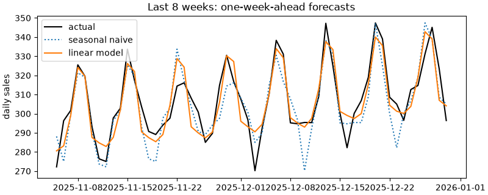

### 41.1 The data

Two years of daily sales for one shop: an upward **trend**, a **weekly pattern** (busy weekends), a gentle **yearly** wave, and noise.

```python
import numpy as np
import pandas as pd

rng = np.random.default_rng(0)
dates = pd.date_range("2024-01-01", periods=730, freq="D")
t = np.arange(730)
weekday_effect = np.array([0, -5, -8, -4, 10, 35, 30])[dates.day_of_week]     # Mon … Sun
sales = 200 + 0.15 * t + weekday_effect + 15 * np.sin(2 * np.pi * t / 365) + rng.normal(0, 8, 730)
df = pd.DataFrame({"sales": sales.round(1)}, index=dates)
print(df.head(8))
```

**Output:**

```text
            sales
2024-01-01  201.0
2024-01-02  194.4
2024-01-03  197.9
2024-01-04  198.1
2024-01-05  207.3
2024-01-06  239.9
2024-01-07  242.9
2024-01-08  210.4
```

`pd.date_range` makes a sequence of dates, and `day_of_week` gives 0 for Monday up to 6 for Sunday.

### 41.2 The question, made precise

We'll forecast **one week ahead**: on each day, predict sales 7 days later, using only data up to today. That decision fixes which features are allowed: anything from 7 or more days before the target day. We test on the **last 8 weeks**, and train on everything before them. Never split time series randomly (Chapter 25.5).

### 41.3 Baselines first

- **Naive:** predict the last known value. One week ahead, that's the value 7 days earlier.
- **Seasonal naive:** predict the value from the same weekday one season ago. With a weekly pattern and a 7-day horizon, that's also "7 days earlier", so here the two coincide.

```python
test_start = df.index[-56]                                    # the last 8 weeks
y_test = df.loc[df.index >= test_start, "sales"]
seasonal_naive = df["sales"].shift(7).loc[y_test.index]       # the value 7 days earlier
yesterday = df["sales"].shift(1).loc[y_test.index]            # NOT allowed for a 7-day horizon; shown for contrast

def mae(a, b):
    return np.mean(np.abs(np.asarray(a) - np.asarray(b)))

print("seasonal naive (7 days earlier) MAE:", round(mae(y_test, seasonal_naive), 2))
print("'yesterday' (not available a week ahead) MAE:", round(mae(y_test, yesterday), 2))
```

**Output:**

```text
seasonal naive (7 days earlier) MAE: 7.96
'yesterday' (not available a week ahead) MAE: 14.56
```

`shift(k)` moves a column down k rows, so each row sees the value from k days earlier. Even with information it isn't allowed, "yesterday" loses to "same weekday last week": the weekly pattern dominates. The model must beat **7.96**.

### 41.4 From a series to a table

Each row becomes one target day, with features computed from the past:

| feature | built from | captures |
|---|---|---|
| `lag_7`, `lag_14` | sales 7 and 14 days earlier | recent level, weekly pattern |
| `roll_7` | mean of the 7 days ending 7 days earlier | a smoother level |
| `day_of_week` | the target date's calendar | weekly pattern |
| `day_sin`, `day_cos` | sine and cosine of the day of the year | yearly pattern, joining 31 Dec to 1 Jan smoothly |
| `t` | the day number | the trend |

**The rule:** every feature must be computable on the forecasting day. A rolling mean must be **shifted first**: `shift(7).rolling(7).mean()` averages days t−13 … t−7. `rolling(7).mean()` alone would include the target day itself, which is a leak.

```python
f = pd.DataFrame(index=df.index)
f["lag_7"] = df["sales"].shift(7)
f["lag_14"] = df["sales"].shift(14)
f["roll_7"] = df["sales"].shift(7).rolling(7).mean()
f["day_of_week"] = df.index.day_of_week
f["day_sin"] = np.sin(2 * np.pi * df.index.day_of_year / 365.25)
f["day_cos"] = np.cos(2 * np.pi * df.index.day_of_year / 365.25)
f["t"] = np.arange(len(df))
f["y"] = df["sales"]
f = f.dropna()                                         # the first 13 days have no full history

train, test = f[f.index < test_start], f[f.index >= test_start]
features = [c for c in f.columns if c != "y"]
print(train.shape, test.shape)
print(test.head(3).round(1))
```

**Output:**

```text
(660, 8) (56, 8)
            lag_7  lag_14  roll_7  day_of_week  day_sin  day_cos    t      y
2025-11-05  288.1   272.2   297.6            2     -0.8      0.6  674  272.2
2025-11-06  275.0   287.4   295.8            3     -0.8      0.6  675  296.3
2025-11-07  300.0   314.6   293.7            4     -0.8      0.6  676  301.7
```

### 41.5 Models

A linear model with the day of the week one-hot encoded (Chapter 20.3), and gradient boosting:

```python
from sklearn.pipeline import make_pipeline
from sklearn.compose import make_column_transformer
from sklearn.preprocessing import OneHotEncoder
from sklearn.linear_model import LinearRegression
from sklearn.ensemble import HistGradientBoostingRegressor

linear = make_pipeline(make_column_transformer((OneHotEncoder(), ["day_of_week"]), remainder="passthrough"),
                       LinearRegression()).fit(train[features], train["y"])
boost = HistGradientBoostingRegressor(random_state=0).fit(train[features], train["y"])
print("linear MAE:  ", round(mae(test["y"], linear.predict(test[features])), 2))
print("boosting MAE:", round(mae(test["y"], boost.predict(test[features])), 2))
```

**Output:**

```text
linear MAE:   6.34
boosting MAE: 10.94
```

`make_column_transformer` is a shortcut for `ColumnTransformer` that names the steps automatically, and `remainder="passthrough"` keeps the other columns unchanged.

The linear model beats the baseline. Boosting does **worse than the baseline**. Why? The test weeks have higher sales than anything in training (the trend keeps rising), and **trees can't extrapolate**: a leaf can only predict values it saw in training (Chapter 27.5). The linear model simply extends its `t` weight into the future.

**Fixes for trees on trending data:** predict a **ratio or change** relative to a recent level instead of the raw value, remove the trend with a linear model first and let the trees model what's left, or use models built for forecasting. Trees shine when there are many related series (thousands of products) and rich outside information (prices, promotions, weather).

<details>
<summary><b>Code for the chart at the top</b></summary>

```python
import matplotlib.pyplot as plt

fig, ax = plt.subplots(figsize=(8, 3.2), layout="constrained")
ax.plot(test.index, test["y"], label="actual", color="black")
ax.plot(test.index, seasonal_naive, label="seasonal naive", ls=":")
ax.plot(test.index, linear.predict(test[features]), label="linear model")
ax.set(ylabel="daily sales", title="Last 8 weeks: one-week-ahead forecasts")
ax.legend()
fig.savefig("forecast-june.png", dpi=100)
plt.close(fig)
```

</details>

### 41.6 Validating over time

One test window can be lucky. **Rolling-origin** evaluation trains on everything up to a cut-off, tests on the next block, then moves the cut-off forward. That's `TimeSeriesSplit` (Chapter 21.5):

```python
from sklearn.model_selection import TimeSeriesSplit, cross_val_score

scores = -cross_val_score(linear, f[features], f["y"], cv=TimeSeriesSplit(n_splits=5, test_size=56),
                          scoring="neg_mean_absolute_error")
print("MAE per 8-week window:", scores.round(2), "| mean", scores.mean().round(2))
```

**Output:**

```text
MAE per 8-week window: [6.64 5.76 5.58 6.76 6.34] | mean 6.22
```

### 41.7 Forecasting further ahead

To forecast h days ahead, every feature must be at least h days old:

- **Direct:** build features with lags ≥ h, one model per horizon. That's what we did, for h = 7.
- **Recursive:** train a one-step-ahead model, then feed its own predictions back in as lags. One model covers all horizons, but its errors compound.

Classical forecasting models (**ARIMA**, exponential smoothing), and libraries such as `statsmodels`, `sktime` and `darts`, model trend and seasonality directly, and also give **prediction intervals**: a range, not just a single number. Always compare them with the ML-table approach, and both with the seasonal-naive baseline.

### 41.8 Summary

```
frame       horizon h → features must be ≥ h days old;  split by time, never randomly
baselines   naive (last value), seasonal naive (same season last time)
features    lags, shifted rolling stats, calendar (day of week; sin/cos of the year), trend t
trees       can't extrapolate trends → model changes/ratios, detrend, or use linear terms
validate    rolling origin (TimeSeriesSplit); report MAE vs the seasonal naive
```

**Key terms:**

- **Time series:** values recorded in time order.
- **Forecast horizon (h):** how far ahead the prediction is made.
- **Trend:** a long-term rise or fall.
- **Seasonality:** a pattern that repeats at a fixed period (weekly, yearly).
- **Lag feature:** the value from k steps earlier.
- **Rolling (window) statistic:** a mean or other summary over a sliding window of past values.
- **Naive / seasonal naive forecast:** predicting the last value / the value from one season earlier.
- **Cyclical encoding:** representing a repeating variable (day of the year) with sine and cosine so its end and start are close.
- **Rolling-origin evaluation (backtesting):** repeatedly training up to a cut-off and testing on the following period.
- **Direct vs recursive forecasting:** one model per horizon versus feeding predictions back as inputs.
- **ARIMA:** a classical statistical forecasting model built from past values and past errors.
- **Prediction interval:** a range expected to contain the future value with a given probability.

**Exercises**

1. For a 3-day-ahead forecast, is `lag_1` allowed? Is `lag_3`?
2. Why do we use sin and cos of the day of the year, instead of the day number 1–365 itself?

<details>
<summary><b>Answers</b></summary>

1. `lag_1` no: on the forecasting day, the value 1 day before the target day is still 2 days in the future. `lag_3` yes: it's exactly today's value.
2. As a plain number, 31 December (365) and 1 January (1) look as far apart as possible, though they're neighbours. Sine and cosine place the days on a circle, so the year wraps around smoothly.

</details>

**Learn more:** [Hyndman & Athanasopoulos: Forecasting: Principles and Practice (free online book)](https://otexts.com/fpp3/)

---

## 42. Text Classification: Bag of Words, TF-IDF and Linear Models

**You need:** Chapters 3.6, 10, 11, 19 and 32. · **You'll learn:** how to turn documents into numbers (word counts and TF-IDF, computed by hand), and why linear models on those numbers make fast, strong text classifiers.

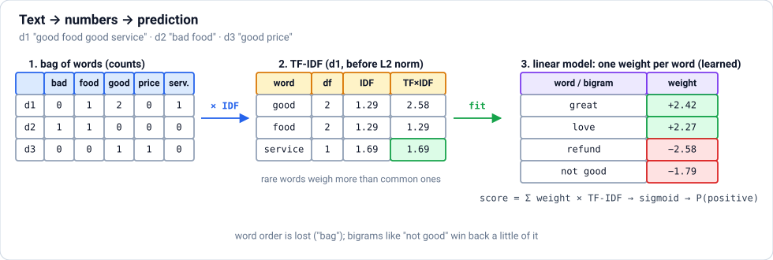

### 42.1 Text into numbers: bag of words

Models need numbers. The simplest representation of a document: **count each word**, and ignore the order. This is the **bag of words**.

1. **Tokenise:** split the text into words (**tokens**), usually lower-cased, with punctuation dropped.
2. Build the **vocabulary**: every distinct token in the training documents.
3. Each document becomes a row with one column per vocabulary word, holding the count.

Three documents: "the cat sat", "the dog sat", "the cat ran". The vocabulary, sorted, is cat, dog, ran, sat, the.

| | cat | dog | ran | sat | the |
|---|---|---|---|---|---|
| the cat sat | 1 | 0 | 0 | 1 | 1 |
| the dog sat | 0 | 1 | 0 | 1 | 1 |
| the cat ran | 1 | 0 | 1 | 0 | 1 |

`CountVectorizer` does all three steps. It's a transformer (Chapter 14.6): `fit` learns the vocabulary, and `transform` counts.

```python
import numpy as np
from sklearn.feature_extraction.text import CountVectorizer, TfidfVectorizer

docs = ["the cat sat", "the dog sat", "the cat ran"]
cv = CountVectorizer()
counts = cv.fit_transform(docs)
print(cv.get_feature_names_out())
print(counts.toarray())
```

**Output:**

```text
['cat' 'dog' 'ran' 'sat' 'the']
[[1 0 0 1 1]
 [0 1 0 1 1]
 [1 0 1 0 1]]
```

The result is a **sparse matrix** (Chapter 20.3). Real vocabularies have tens of thousands of words, and each document uses only a few, so storing only the non-zero counts saves huge amounts of memory. `.toarray()` converts it to an ordinary array for printing.

### 42.2 TF-IDF: weight words by how informative they are

"the" appears in every document, so it tells us nothing about any of them. **TF-IDF** (term frequency × inverse document frequency) scales each count by how **rare** the word is across documents:

```
tf-idf(word, doc) = count(word in doc) × idf(word)
idf(word)         = ln((1 + n) / (1 + df(word))) + 1         (scikit-learn's smoothed version)
```

n is the number of documents, and df is the number of documents containing the word. Then each row is divided by its length (Chapter 3.5), so long documents don't get larger numbers just for being long.

**By hand**, n = 3:

| word | df | idf |
|---|---|---|
| the | 3 | ln(4/4) + 1 = **1.000** |
| cat, sat | 2 | ln(4/3) + 1 = **1.288** |
| dog, ran | 1 | ln(4/2) + 1 = **1.693** |

"the cat sat" → [cat 1.288, sat 1.288, the 1.000]. Its length is √(1.288² + 1.288² + 1²) = 2.078, so the normalised row is cat **0.620**, sat **0.620**, the **0.481**. The common word "the" now counts least.

```python
tfidf = TfidfVectorizer()
X = tfidf.fit_transform(docs)
print("idf:", {w: round(float(v), 3) for w, v in zip(tfidf.get_feature_names_out(), tfidf.idf_)})
print(X.toarray().round(3))
```

**Output:**

```text
idf: {'cat': 1.288, 'dog': 1.693, 'ran': 1.693, 'sat': 1.288, 'the': 1.0}
[[0.62  0.    0.    0.62  0.481]
 [0.    0.72  0.    0.548 0.425]
 [0.548 0.    0.72  0.    0.425]]
```

Since every row has length 1, the dot product of two rows is their **cosine similarity** (Chapter 3.6). That's the basis of simple document search.

### 42.3 Useful options

| option | effect |
|---|---|
| `ngram_range=(1, 2)` | also count **bigrams** (word pairs), such as "not good", which a bag of single words can't see |
| `min_df=2` | drop words that appear in fewer than 2 documents (typos, rare names) |
| `max_df=0.9` | drop words in more than 90% of documents |
| `stop_words="english"` | drop a built-in list of very common English words |
| `sublinear_tf=True` | use 1 + ln(count) instead of the raw count, so 20 repeats don't count 20 times as much |

### 42.4 A real task: newsgroup topics

The 20 Newsgroups dataset holds posts from old internet discussion groups. We take four topics, and strip the headers, signatures and quoted replies, so the model must use the actual text. It's downloaded once (about 14 MB) and cached in a `data` folder.

```python
from sklearn.datasets import fetch_20newsgroups

topics = ["rec.autos", "rec.sport.hockey", "sci.space", "talk.politics.guns"]
strip = ("headers", "footers", "quotes")
train = fetch_20newsgroups(data_home="data", subset="train", categories=topics, remove=strip)
test = fetch_20newsgroups(data_home="data", subset="test", categories=topics, remove=strip)
print(len(train.data), "training posts,", len(test.data), "test posts")
print(train.target_names[train.target[0]], "→", train.data[0][:150].replace("\n", " "))
```

**Output:**

```text
2333 training posts, 1553 test posts
sci.space →      The HGA isn't all that reflective in the wavelengths that might "cook the focal elements", nor is its figure good on those scales--the problem is
```

A pipeline of TF-IDF and a linear classifier, compared with Naive Bayes (Chapter 32):

```python
from sklearn.pipeline import make_pipeline
from sklearn.linear_model import LogisticRegression
from sklearn.svm import LinearSVC
from sklearn.naive_bayes import MultinomialNB

models = {
    "TF-IDF + logistic": make_pipeline(TfidfVectorizer(sublinear_tf=True, min_df=2), LogisticRegression(C=10, max_iter=1000)),
    "TF-IDF + linear SVM": make_pipeline(TfidfVectorizer(sublinear_tf=True, min_df=2), LinearSVC()),
    "counts + Naive Bayes": make_pipeline(CountVectorizer(min_df=2), MultinomialNB(alpha=0.1)),
}
for name, m in models.items():
    m.fit(train.data, train.target)
    print(f"{name:<22} test accuracy {m.score(test.data, test.target):.3f}")
```

**Output:**

```text
TF-IDF + logistic      test accuracy 0.869
TF-IDF + linear SVM    test accuracy 0.874
counts + Naive Bayes   test accuracy 0.864
```

Why do linear models do so well here? With tens of thousands of features and only a few thousand documents, the classes are usually close to **linearly separable**. A weight per word is exactly the right amount of flexibility. The models train in a second or two.

### 42.5 What the model learned

A linear model has one weight per word per class (Chapter 11). The largest weights show the words that push towards each topic:

```python
logreg = models["TF-IDF + logistic"]
words = logreg[0].get_feature_names_out()
for k, topic in enumerate(train.target_names):
    top = np.argsort(logreg[-1].coef_[k])[::-1][:6]
    print(f"{topic:<20} {', '.join(words[top])}")

print(logreg.predict(["The rocket reached orbit after launch", "The goalie made a great save in overtime"]))
```

**Output:**

```text
rec.autos            car, cars, my, ford, oil, dealer
rec.sport.hockey     hockey, team, game, games, play, nhl
sci.space            space, orbit, nasa, launch, earth, moon
talk.politics.guns   gun, guns, weapons, fbi, law, fire
[2 1]
```

The second line shows topic numbers, in the order of `train.target_names`. Explanations like this are a big part of why linear text models are still used: you can see, and check, why a decision was made.

### 42.6 Limits, and what comes next

- Bag of words ignores order ("dog bites man" = "man bites dog") and meaning ("car" and "automobile" are unrelated columns).
- **Word embeddings** and **transformers** represent meaning and context. They power modern NLP (`deep-learning.md`, `llm-engineering.md`). TF-IDF with a linear model is still the fast, explainable baseline every text project should beat.
- Words never seen in training are simply ignored at prediction time.

### 42.7 Summary

```
bag of words   tokenise → vocabulary → counts per document (sparse)
tf-idf         count × [ln((1+n)/(1+df)) + 1], then each row scaled to length 1
model          TfidfVectorizer → LogisticRegression / LinearSVC  (or counts → MultinomialNB)
explain        the largest weights per class = the most telling words
```

**Key terms:**

- **Tokenisation:** splitting text into tokens (usually words).
- **Token:** one unit of text, such as a word.
- **Bag of words:** representing a document by its word counts, ignoring order.
- **`CountVectorizer` / `TfidfVectorizer`:** scikit-learn transformers that turn text into count or TF-IDF matrices.
- **Term frequency (tf):** how often a word appears in a document.
- **Document frequency (df):** how many documents contain a word.
- **Inverse document frequency (idf):** a weight that is high for rare words and low for common ones.
- **TF-IDF:** term frequency × inverse document frequency.
- **n-gram:** a sequence of n consecutive tokens; a bigram is two.
- **Stop words:** very common words often removed ("the", "and").
- **L2 normalisation:** scaling a vector to length 1.
- **Corpus:** a collection of documents.

**Exercises**

1. A 1,000-document corpus; "rocket" appears in 9 documents. What is its idf (with scikit-learn's formula)?
2. Why add `ngram_range=(1, 2)` for sentiment analysis?

<details>
<summary><b>Answers</b></summary>

1. ln(1001 / 10) + 1 = ln(100.1) + 1 ≈ **5.606**.
2. Phrases such as "not good" or "not bad" flip the meaning of a single word, and only a bigram can capture that.

```python
print(round(np.log(1001 / 10) + 1, 3))
```

**Output:**

```text
5.606
```

</details>

| # | Problem (Deep-ML) | Difficulty |
|---|---|---|
| 1 | [60. Implement TF-IDF (Term Frequency-Inverse Document Frequency)](https://www.deep-ml.com/problems/60) | 🟡 Medium |

**Learn more:** [scikit-learn: text feature extraction](https://scikit-learn.org/stable/modules/feature_extraction.html#text-feature-extraction)

---

## 43. Recommender Systems: Collaborative Filtering and Matrix Factorisation

**You need:** Chapters 3.6, 16 and 17. · **You'll learn:** how to predict which items a user will like from everyone's past ratings: baselines with user and item biases, item-to-item similarity, and matrix factorisation with its update rule derived.

### 43.1 The problem

Users rate (or click, watch, buy) items. Put the ratings in a **users × items matrix**. Almost every cell is empty: each user has rated only a tiny share of the catalogue. Recommending means **filling in the empty cells** and showing each user the items with the highest predicted ratings.

**Collaborative filtering** uses only the pattern of who liked what, with no item descriptions at all: "people who liked what you liked also liked this".

We'll make synthetic ratings for 300 users and 100 items, generated from hidden tastes, so we know there is real structure to find. Each user has rated about 15% of the items, on a scale of 1 to 5.

```python
import numpy as np

rng = np.random.default_rng(0)
n_users, n_items, k_true = 300, 100, 3
tastes = rng.normal(0, 0.8, (n_users, k_true))          # hidden user tastes
traits = rng.normal(0, 0.8, (n_items, k_true))          # hidden item traits
user_bias, item_bias = rng.normal(0, 0.4, n_users), rng.normal(0, 0.5, n_items)
full = np.clip(3.4 + user_bias[:, None] + item_bias[None, :] + tastes @ traits.T
               + rng.normal(0, 0.4, (n_users, n_items)), 1, 5)

observed = rng.random((n_users, n_items)) < 0.15       # which cells we actually know
users, items = np.nonzero(observed)                     # one entry per known rating
ratings = full[users, items]
order = rng.permutation(len(ratings))
train, test = order[:int(0.8 * len(order))], order[int(0.8 * len(order)):]
print(len(ratings), "ratings,", f"{observed.mean():.0%} of the matrix;", len(train), "for training")
```

**Output:**

```text
4572 ratings, 15% of the matrix; 3657 for training
```

`np.nonzero` returns the row and column positions of the True cells. We hold out 20% of the known ratings to test on.

### 43.2 Baselines: the average, plus biases

Some users rate everything high, and some items are simply better. A strong baseline models just that:

```
predicted rating = μ + b_user + b_item
```

μ is the overall average; b_user is how much this user rates above or below average; b_item is how much this item is rated above or below average. Each bias is estimated as an average leftover, **shrunk towards 0** for users or items with few ratings, much like ridge regression (Chapter 16.3):

```
b_item = Σ (r − μ − b_user) / (number of ratings + λ)
```

```python
mu = ratings[train].mean()

def rmse(pred):
    return np.sqrt(np.mean((pred - ratings[test]) ** 2))

b_u, b_i, lam = np.zeros(n_users), np.zeros(n_items), 5
u_tr, i_tr, r_tr = users[train], items[train], ratings[train]
for _ in range(10):                                     # alternate: item biases, then user biases
    b_i = np.bincount(i_tr, weights=r_tr - mu - b_u[u_tr], minlength=n_items) / (np.bincount(i_tr, minlength=n_items) + lam)
    b_u = np.bincount(u_tr, weights=r_tr - mu - b_i[i_tr], minlength=n_users) / (np.bincount(u_tr, minlength=n_users) + lam)

print("predict the average:      RMSE", round(rmse(np.full(len(test), mu)), 3))
print("average + user/item bias: RMSE", round(rmse(mu + b_u[users[test]] + b_i[items[test]]), 3))
```

**Output:**

```text
predict the average:      RMSE 1.097
average + user/item bias: RMSE 1.004
```

`np.bincount(ids, weights=w)` adds up w for each id, which gives per-user and per-item sums in one call.

### 43.3 Item-to-item similarity

Two items are **similar** if the same users rate them alike. Represent each item by its column of (bias-removed) ratings, and compare columns with **cosine similarity** (Chapter 3.6). To predict user u's rating of item i, take a similarity-weighted average of u's ratings on the items most similar to i.

**By hand.** Four users rated items A and B as A = [5, 4, 0, 1] and B = [4, 5, 1, 0] (0 means unrated; with real data you'd first subtract the biases). cos(A, B) = (20 + 20 + 0 + 0) / (√42 · √42) = 40/42 = **0.95**. A user who gave B a 5 and hasn't seen A is a good candidate for A.

This is what powers "customers who bought this also bought…". It's easy to explain, and the item–item similarities can be computed ahead of time.

### 43.4 Matrix factorisation

Assume each user and each item can be described by **k hidden numbers**, called **latent factors**. For films, the model might discover something like "how much action" and "how serious", without being told. The predicted rating is a dot product:

```
r̂(u, i) = μ + b_u + b_i + p_u · q_i          p_u, q_i: vectors of length k
```

In matrix form, the interaction part of R is approximated by P Qᵀ: a (users × k) matrix times a (k × items) matrix. That's why it's called **factorisation**. We only fit the **known** cells, with an L2 penalty to stop overfitting:

```
loss = Σ over known (u, i) of (r − r̂)²  +  λ (‖p_u‖² + ‖q_i‖² + b_u² + b_i²)
```

**The update rule, derived.** For one known rating, let e = r − r̂ be the error. With r̂ containing p_u · q_i, the chain rule (Chapter 4.5) gives ∂(e²)/∂p_u = −2e·q_i, and the penalty adds 2λp_u. A gradient step (absorbing the 2 into the learning rate) is

```
p_u ← p_u + lr · (e · q_i − λ · p_u)
q_i ← q_i + lr · (e · p_u − λ · q_i)
b_u ← b_u + lr · (e − λ · b_u)          b_i likewise
```

In words: if we under-predicted (e > 0), push the user's vector towards the item's vector, and vice versa. That's stochastic gradient descent (Chapter 17.1), one rating at a time.

```python
k, lr, lam = 3, 0.02, 0.05
P, Q = rng.normal(0, 0.1, (n_users, k)), rng.normal(0, 0.1, (n_items, k))
bu, bi = np.zeros(n_users), np.zeros(n_items)

for epoch in range(40):
    for j in rng.permutation(train):
        u, i = users[j], items[j]
        e = ratings[j] - (mu + bu[u] + bi[i] + P[u] @ Q[i])
        bu[u] += lr * (e - lam * bu[u])
        bi[i] += lr * (e - lam * bi[i])
        P[u], Q[i] = P[u] + lr * (e * Q[i] - lam * P[u]), Q[i] + lr * (e * P[u] - lam * Q[i])
    if epoch in (0, 9, 39):
        pred = mu + bu[users[test]] + bi[items[test]] + np.sum(P[users[test]] * Q[items[test]], axis=1)
        print(f"epoch {epoch + 1:>2}: test RMSE {rmse(pred):.3f}")
```

**Output:**

```text
epoch  1: test RMSE 1.027
epoch 10: test RMSE 1.007
epoch 40: test RMSE 0.714
```

Matrix factorisation beats the bias-only baseline clearly: it has found the hidden tastes. (Both updates in the last line use the **old** P[u] and Q[i]; that's why they're written as one tuple assignment.)

**Recommending:** for a user, score every item they haven't rated, and show the top few:

```python
u = 0
scores = mu + bu[u] + bi + Q @ P[u]                     # predicted rating for every item
scores[observed[u]] = -np.inf                           # skip items the user has already rated
print("top 5 items for user 0:", np.argsort(scores)[::-1][:5])
```

**Output:**

```text
top 5 items for user 0: [27 56 60 88 30]
```

**ALS** (alternating least squares) is the main alternative to SGD. Fix the item vectors and solve every user vector exactly (it's a ridge regression), then fix the users and solve the items, and repeat. It parallelises well, which is why big-data tools such as Spark use it.

### 43.5 Real-world issues

- **Implicit feedback:** most real data is clicks, views and purchases, not star ratings. There's no "dislike", just missing data. Models treat unobserved items as weak negatives, and they're judged on **ranking** metrics.
- **Ranking metrics:** **precision@k** (the share of the top k recommendations the user actually engaged with), **recall@k**, and NDCG (which rewards putting the best items first).
- **Cold start:** a new user or item has no ratings, so there's nothing to factorise. Fall back to popularity, or to **content features** (item descriptions, user sign-up data). Hybrid models combine both.
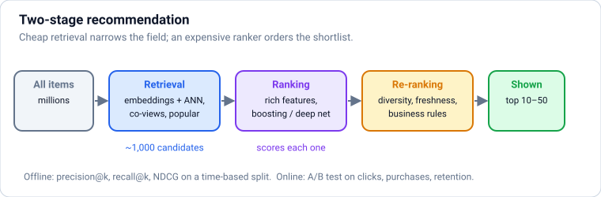

- **Two stages at scale:** with millions of items, a fast **retrieval** model (often user and item embeddings with nearest-neighbour search) picks a few hundred candidates, then a richer **ranking** model (often gradient boosting or a neural network, with many features) orders them. Chapter 54 shows this pattern.

### 43.6 Summary

```
baseline     r̂ = μ + b_u + b_i                (shrunk biases)
item–item    similarity = cosine of item columns; predict = similarity-weighted average
MF           r̂ = μ + b_u + b_i + p_u·q_i;   loss over KNOWN ratings + λ‖·‖²
SGD          e = r − r̂;  p_u += lr(e q_i − λ p_u);  q_i += lr(e p_u − λ q_i)
production   implicit feedback, ranking metrics, cold start, retrieval → ranking
```

**Key terms:**

- **Recommender system:** a system that predicts which items a user will like.
- **Rating matrix (interaction matrix):** users × items, mostly empty.
- **Collaborative filtering:** recommending from the pattern of users' interactions alone.
- **User / item bias:** how much a user's ratings, or an item's, sit above or below the overall average.
- **Item-to-item similarity:** how alike two items' rating patterns are, often measured by cosine similarity.
- **Matrix factorisation:** approximating the rating matrix as the product of user and item factor matrices.
- **Latent factor:** a hidden dimension of taste learned from the data.
- **ALS (alternating least squares):** solving users and items in turn, each as a least-squares problem.
- **Implicit feedback:** behaviour (clicks, views) rather than explicit ratings.
- **Precision@k / recall@k:** the share of the top k recommendations that were relevant / the share of all relevant items found in the top k.
- **Cold start:** having no history for a new user or item.
- **Content-based filtering:** recommending from item and user attributes.
- **Retrieval and ranking:** a cheap first stage that picks candidates, and a richer second stage that orders them.

**Exercises**

1. μ = 3.5, b_u = +0.4, b_i = −0.2, p_u = (1, 0.5), q_i = (0.6, −0.4). What is the predicted rating?
2. In that example the true rating is 4. With lr = 0.1 and λ = 0, what is the new p_u after one update?

<details>
<summary><b>Answers</b></summary>

1. p_u · q_i = 0.6 − 0.2 = 0.4, so r̂ = 3.5 + 0.4 − 0.2 + 0.4 = **4.1**.
2. e = 4 − 4.1 = −0.1. p_u ← (1, 0.5) + 0.1 · (−0.1) · (0.6, −0.4) = **(0.994, 0.504)**: a small nudge away from the item, because we over-predicted.

</details>

**Learn more:** [Koren, Bell & Volinsky: Matrix Factorization Techniques for Recommender Systems (2009)](https://datajobs.com/data-science-repo/Recommender-Systems-%5BNetflix%5D.pdf) · [Google: recommendation systems course](https://developers.google.com/machine-learning/recommendation)

---

**✅ Part VI checkpoint.** You can now handle rare classes, produce probabilities you can trust and turn them into cost-optimal decisions, forecast time series honestly, classify text, and build a recommender. Part VII is about trusting and explaining models.

---

# Part VII — Models You Can Trust

Explaining what a model learned, debugging it, finding leaks, and checking it's fair.

---

## 44. Feature Importance: Impurity, Permutation and Drop-Column

**You need:** Chapters 9, 25 and 28. · **You'll learn:** three ways to measure how much a model relies on each feature, permutation importance built from scratch, and the traps (random noise looking important, correlated features sharing credit).

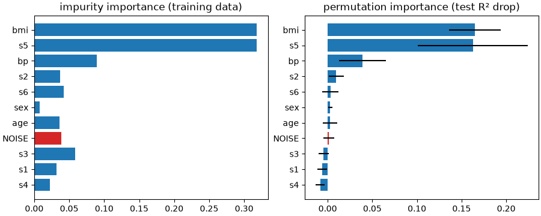

### 44.1 Why ask?

"Which features drive this model?" matters for trust ("is it using sensible signals?"), for debugging (a leaky feature often tops the list, Chapter 25.7), for cost (drop features nobody needs), and for explaining decisions to users and regulators. There are three standard answers, and they don't always agree.

We'll use the diabetes data (Chapter 9.7), plus one extra column of **pure random noise**. A trustworthy method should rank that column near zero.

```python
import numpy as np
from sklearn.datasets import load_diabetes
from sklearn.model_selection import train_test_split
from sklearn.ensemble import RandomForestRegressor

data = load_diabetes()
rng = np.random.default_rng(0)
X = np.column_stack([data.data, rng.normal(size=len(data.data))])       # column 10 = noise
names = list(data.feature_names) + ["NOISE"]
X_train, X_test, y_train, y_test = train_test_split(X, data.target, test_size=0.3, random_state=0)

rf = RandomForestRegressor(n_estimators=300, min_samples_leaf=3, random_state=0, n_jobs=-1).fit(X_train, y_train)
print("test R²:", round(rf.score(X_test, y_test), 3))
```

**Output:**

```text
test R²: 0.315
```

### 44.2 Method 1: impurity importance (MDI)

Every split in a tree reduces impurity (Chapter 27.3), so add up each feature's total reduction over all splits in all trees, then normalise to sum to 1. This is **mean decrease in impurity (MDI)**, the `feature_importances_` attribute. It's free, because it comes out of training.

```python
mdi = rf.feature_importances_
for j in np.argsort(mdi)[::-1]:
    print(f"{names[j]:<6} {mdi[j]:.3f}")
```

**Output:**

```text
bmi    0.318
s5     0.318
bp     0.090
s3     0.059
s6     0.042
NOISE  0.039
s2     0.037
age    0.036
s1     0.032
s4     0.023
sex    0.007
```

The noise column gets a real share of the credit. MDI is measured on the **training** data, where deep trees happily split on noise to fit individual rows. It also favours features with many distinct values (more possible split points), and a continuous noise column has as many as possible.

### 44.3 Method 2: permutation importance

**The idea:** if the model relies on a feature, scrambling that feature should hurt its score. So:

1. Score the fitted model on **held-out** data.
2. **Shuffle** one column (randomly reorder its values), which breaks its link to the target while keeping its distribution.
3. Score again. **Importance = the drop in score.** Repeat a few times and average.

No retraining is needed, and it works with any model.

```python
def permutation_importance_scratch(model, X, y, n_repeats=10, seed=0):
    rng = np.random.default_rng(seed)
    base = model.score(X, y)
    drops = np.zeros((X.shape[1], n_repeats))
    for j in range(X.shape[1]):
        for r in range(n_repeats):
            X_shuffled = X.copy()
            X_shuffled[:, j] = rng.permutation(X_shuffled[:, j])        # break feature j only
            drops[j, r] = base - model.score(X_shuffled, y)
    return drops.mean(axis=1), drops.std(axis=1)

mean_drop, std_drop = permutation_importance_scratch(rf, X_test, y_test)
for j in np.argsort(mean_drop)[::-1]:
    print(f"{names[j]:<6} R² drop {mean_drop[j]:+.3f} ± {std_drop[j]:.3f}")
```

**Output:**

```text
bmi    R² drop +0.165 ± 0.029
s5     R² drop +0.163 ± 0.062
bp     R² drop +0.039 ± 0.026
s2     R² drop +0.009 ± 0.008
s6     R² drop +0.003 ± 0.009
sex    R² drop +0.003 ± 0.003
age    R² drop +0.003 ± 0.008
NOISE  R² drop +0.001 ± 0.006
s3     R² drop -0.005 ± 0.006
s1     R² drop -0.006 ± 0.005
s4     R² drop -0.008 ± 0.005
```

On held-out data, the noise column's importance is about zero (scrambling it doesn't matter), and some weak features come out slightly **negative**: scrambling them helped by chance. Treat anything within about two standard deviations of zero as "no evidence that the model needs it".

scikit-learn's `permutation_importance` does the same, with any scoring function:

```python
from sklearn.inspection import permutation_importance

res = permutation_importance(rf, X_test, y_test, n_repeats=10, random_state=0)
top = np.argsort(res.importances_mean)[::-1][:4]
print([(names[j], round(float(res.importances_mean[j]), 3)) for j in top])
```

**Output:**

```text
[('s5', 0.189), ('bmi', 0.17), ('bp', 0.032), ('s2', 0.006)]
```

<details>
<summary><b>Code for the chart at the top</b></summary>

```python
import matplotlib.pyplot as plt

order = np.argsort(mean_drop)
fig, (a1, a2) = plt.subplots(1, 2, figsize=(9, 3.6), layout="constrained")
a1.barh([names[j] for j in order], mdi[order], color=["tab:red" if names[j] == "NOISE" else "tab:blue" for j in order])
a1.set(title="impurity importance (training data)")
a2.barh([names[j] for j in order], mean_drop[order], xerr=std_drop[order],
        color=["tab:red" if names[j] == "NOISE" else "tab:blue" for j in order])
a2.set(title="permutation importance (test R² drop)")
fig.savefig("feature-importance.png", dpi=100)
plt.close(fig)
```

</details>

### 44.4 Method 3: drop-column importance

The most direct question: how much worse is the model **retrained without** this feature? It's the most honest, and the most expensive: one full retrain (ideally cross-validated) per feature.

```python
from sklearn.model_selection import cross_val_score

def cv_r2(cols):
    model = RandomForestRegressor(n_estimators=200, min_samples_leaf=3, random_state=0, n_jobs=-1)
    return cross_val_score(model, X[:, cols], data.target, cv=5).mean()

all_cols = list(range(X.shape[1]))
full_score = cv_r2(all_cols)
for name in ["bmi", "s5", "NOISE"]:
    j = names.index(name)
    print(f"without {name:<6}: CV R² change {cv_r2([c for c in all_cols if c != j]) - full_score:+.3f}")
```

**Output:**

```text
without bmi   : CV R² change -0.095
without s5    : CV R² change -0.015
without NOISE : CV R² change +0.002
```

Removing bmi costs a lot. Removing s5 costs surprisingly little, even though shuffling it hurt as much as shuffling bmi. When the model is retrained without s5, the other blood measurements, which are correlated with it, take over its job. That's the trap of the next section, appearing on its own.

### 44.5 The correlated-features trap

If two features carry the same information, the model can use either, and both permutation and drop-column importance **understate** each one: scramble or drop one, and its twin covers for it. Add a near-copy of `bmi` and watch its importance shrink:

```python
X2 = np.column_stack([X, X[:, 2] + rng.normal(0, 0.005, len(X))])     # a near-duplicate of bmi
names2 = names + ["bmi_copy"]
X2_train, X2_test, y2_train, y2_test = train_test_split(X2, data.target, test_size=0.3, random_state=0)
rf2 = RandomForestRegressor(n_estimators=300, min_samples_leaf=3, random_state=0, n_jobs=-1).fit(X2_train, y2_train)
drop2, _ = permutation_importance_scratch(rf2, X2_test, y2_test)
print("bmi alone, earlier:", round(mean_drop[2], 3))
print("with a copy:  bmi", round(drop2[2], 3), "| bmi_copy", round(drop2[-1], 3))
```

**Output:**

```text
bmi alone, earlier: 0.165
with a copy:  bmi 0.074 | bmi_copy -0.003
```

Neither half looks as important as bmi did alone. **Fix:** group strongly correlated features and permute or drop them **together**, and say so when you report.

### 44.6 Which to use

| method | measured on | cost | traps |
|---|---|---|---|
| impurity (MDI) | training data | free | rewards noise and many-valued features; trees only |
| permutation | held-out data | cheap (no retraining) | correlated features share credit; shuffling can create unrealistic rows |
| drop-column | retraining | expensive | correlated features cover for each other |
| linear model weights | the model itself | free | only meaningful with standardised features and no strong correlation (Chapters 7.9, 26.7) |

**Importance ≠ causation.** These methods describe what **this model** relies on, not what causes the outcome in the world. A feature can be important because it's a proxy, or a leak.

### 44.7 Summary

```
MDI           Σ impurity decrease per feature (training data)       → biased; quick look only
permutation   score(X) − score(X with column j shuffled), on held-out data, repeated
drop-column   CV score(all features) − CV score(without j)          → retrains per feature
correlated    permute or drop groups together; importance ≠ causation
```

**Key terms:**

- **Feature importance:** a measure of how much a model relies on a feature.
- **Mean decrease in impurity (MDI):** the total impurity reduction from a feature's splits across a tree ensemble.
- **Permutation importance:** the drop in held-out score when one feature's values are randomly shuffled.
- **Drop-column importance:** the change in score when the model is retrained without a feature.
- **Shuffle (permute):** randomly reorder values, breaking their link to everything else in the row.
- **Proxy feature:** a feature that stands in for another (often sensitive or leaky) variable.

**Exercises**

1. A permutation importance is 0.002 ± 0.004. What do you conclude?
2. Why must permutation importance use held-out data rather than training data?

<details>
<summary><b>Answers</b></summary>

1. It's well within noise of zero: there's no evidence the model needs this feature on new data.
2. On training data, a model that memorised a noise feature really does get worse when it's shuffled, so the noise would look important. On held-out data, only features that generalise matter.

</details>

| # | Problem (Deep-ML) | Difficulty |
|---|---|---|
| 1 | [343. Implement Random Forest Feature Importance](https://www.deep-ml.com/problems/343) | 🟡 Medium |

**Learn more:** [scikit-learn: permutation importance](https://scikit-learn.org/stable/modules/permutation_importance.html) · [Christoph Molnar: Interpretable Machine Learning (free book)](https://christophm.github.io/interpretable-ml-book/)

---

## 45. Partial Dependence, ICE and SHAP

**You need:** Chapter 44. · **You'll learn:** how a feature's value changes the prediction (partial dependence and ICE curves, built from scratch), and how to split a single prediction into each feature's contribution (Shapley values, worked out by hand, then SHAP).

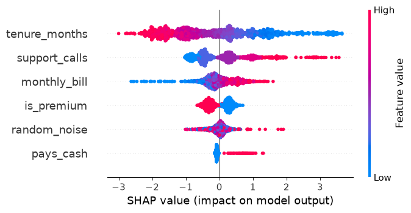

### 45.1 Beyond "how important"

Chapter 44 measured **how much** a model relies on each feature. Two more questions:

- **How** does the prediction change as a feature changes? Up, down, a threshold, a curve? (Partial dependence and ICE.)
- **Why** did this particular person get this prediction? (Shapley values.)

We continue with the diabetes random forest:

```python
import numpy as np
from sklearn.datasets import load_diabetes
from sklearn.model_selection import train_test_split
from sklearn.ensemble import RandomForestRegressor

data = load_diabetes(as_frame=True)                    # as_frame=True: X comes as a pandas DataFrame
X_train, X_test, y_train, y_test = train_test_split(data.data, data.target, test_size=0.3, random_state=0)
rf = RandomForestRegressor(n_estimators=300, min_samples_leaf=3, random_state=0, n_jobs=-1).fit(X_train, y_train)
```

### 45.2 Partial dependence, from scratch

To see how predictions depend on bmi:

1. Pick a grid of bmi values.
2. For each value v: set **every** row's bmi to v (keeping their other features), predict, and **average**.
3. Plot average prediction against v.

That's the **partial dependence (PD)** curve: the model's average response to bmi, with everything else held at its real values.

```python
def partial_dependence_scratch(model, X, feature, grid):
    averages = []
    for v in grid:
        X_mod = X.copy()
        X_mod[feature] = v                             # everyone gets this value
        averages.append(model.predict(X_mod).mean())
    return np.array(averages)

grid = np.quantile(X_train["bmi"], [0.05, 0.25, 0.5, 0.75, 0.95])
pd_bmi = partial_dependence_scratch(rf, X_train, "bmi", grid)
for v, p in zip(grid, pd_bmi):
    print(f"bmi = {v:+.3f}: average prediction {p:.1f}")
```

**Output:**

```text
bmi = -0.067: average prediction 129.8
bmi = -0.036: average prediction 131.0
bmi = -0.008: average prediction 134.7
bmi = +0.030: average prediction 174.1
bmi = +0.087: average prediction 197.8
```

The model predicts more disease progression for higher bmi. The biggest jump, about 40, comes between the median and the 75th percentile. (The diabetes features are pre-scaled, so bmi values look small.)

**ICE (individual conditional expectation)** curves skip the averaging step: one curve **per row**. If the curves have different shapes, the feature's effect depends on other features, an **interaction** that the average hides.

```python
from sklearn.inspection import partial_dependence

pd_res = partial_dependence(rf, X_train, ["bmi"], grid_resolution=5, kind="both")
ice = pd_res["individual"][0]                          # (rows × grid points)
print("scikit-learn PD:", pd_res["average"][0].round(1))
print("ICE rise from lowest to highest bmi, across patients: min", (ice[:, -1] - ice[:, 0]).min().round(1),
      "| max", (ice[:, -1] - ice[:, 0]).max().round(1))
```

**Output:**

```text
scikit-learn PD: [129.8 131.8 159.5 179.  197.8]
ICE rise from lowest to highest bmi, across patients: min 13.4 | max 126.1
```

scikit-learn's grid has 5 **evenly spaced** values from the 5th to the 95th percentile, rather than our quantiles. So the two end points match ours exactly, and the middle points differ. The ICE curves rise by very different amounts for different patients: bmi interacts with the other features. `PartialDependenceDisplay.from_estimator(rf, X, ["bmi", "s5"])` draws the curves.

**Caution:** setting everyone's bmi to an extreme value can create unrealistic rows (very low bmi with very high blood pressure, say), especially when features are correlated. The curve then shows the model's behaviour on data it never saw.

### 45.3 Shapley values: sharing out one prediction

For **one** row, we want: prediction = **base value** (the average prediction) + a contribution from each feature, with the contributions adding up exactly.

**Shapley values**, from cooperative game theory, are the fair way to share a "payout" among "players". Here the payout is the prediction minus the base value, and the players are the features. A feature's Shapley value is its **average extra contribution, over every order in which the features could be added**.

**By hand**, a toy model f(x₁, x₂) = 10x₁ + 5x₂ + 4x₁x₂. Explain the point x = (1, 1), with "absent" meaning set to a baseline of 0:

| features present | f |
|---|---|
| none | f(0, 0) = 0 |
| x₁ only | f(1, 0) = 10 |
| x₂ only | f(0, 1) = 5 |
| both | f(1, 1) = 19 |

- Order x₁ then x₂: x₁ adds 10 − 0 = 10, then x₂ adds 19 − 10 = 9.
- Order x₂ then x₁: x₂ adds 5, then x₁ adds 19 − 5 = 14.
- Averages: φ₁ = (10 + 14)/2 = **12**, φ₂ = (9 + 5)/2 = **7**.

Check: 12 + 7 = 19 = f(x) − f(baseline). The interaction term (4) was split equally between the two features. Shapley values are the **only** way of sharing that satisfies a few fairness rules: the contributions add up exactly, identical features get identical shares, and a feature that never changes the output gets 0.

```python
from itertools import permutations

def shapley_exact(f, x, baseline):
    n = len(x)
    phi = np.zeros(n)
    orders = list(permutations(range(n)))                  # every order of adding the features
    for order in orders:
        current = baseline.copy()
        for j in order:
            before = f(current)
            current[j] = x[j]                              # add feature j
            phi[j] += f(current) - before
    return phi / len(orders)

toy = lambda v: 10 * v[0] + 5 * v[1] + 4 * v[0] * v[1]
print(shapley_exact(toy, np.array([1.0, 1.0]), np.array([0.0, 0.0])))
```

**Output:**

```text
[12.  7.]
```

With d features there are d! orders (10 features: 3.6 million), so the exact method is only for tiny cases.

### 45.4 SHAP in practice

The **SHAP** library computes Shapley values efficiently. For tree models, `TreeExplainer` uses an exact algorithm that follows each tree's structure, and "absent" features are averaged over the training data rather than set to one baseline.

```python
import shap

explainer = shap.TreeExplainer(rf)
sv = explainer(X_test)                                 # one row of contributions per test patient

patient = 0
contrib = dict(zip(X_test.columns, sv.values[patient]))
print(f"base value (average prediction): {sv.base_values[patient]:.1f}")
for name, c in sorted(contrib.items(), key=lambda t: -abs(t[1]))[:4]:
    print(f"  {name:<4} = {X_test.iloc[patient][name]:+.3f} → {c:+.1f}")
print(f"sum of all contributions + base = {sv.base_values[patient] + sv.values[patient].sum():.1f}"
      f" | model prediction = {rf.predict(X_test.iloc[[patient]])[0]:.1f}")
print("global ranking (mean |SHAP|):", X_test.columns[np.argsort(np.abs(sv.values).mean(axis=0))[::-1][:4]].tolist())
```

**Output:**

```text
base value (average prediction): 152.5
  bmi  = +0.105 → +70.4
  bp   = +0.070 → +22.7
  s3   = -0.025 → +6.1
  s2   = -0.027 → +2.4
sum of all contributions + base = 253.0 | model prediction = 253.0
global ranking (mean |SHAP|): ['s5', 'bmi', 'bp', 's3']
```

The contributions plus the base value reproduce the prediction exactly. Averaging the absolute SHAP values over many rows gives a global importance ranking that agrees with permutation importance here (bmi and s5 on top).

<details>
<summary><b>Code for the chart at the top</b></summary>

```python
import matplotlib.pyplot as plt

shap.summary_plot(sv.values, X_test, show=False, plot_size=(7, 4))
plt.savefig("shap-summary.png", dpi=100, bbox_inches="tight")
plt.close("all")
```

</details>

For other models, `shap.Explainer(model.predict, X_background)` uses approximate, model-agnostic methods (slower). For linear models with independent features, a feature's SHAP value is simply w_j · (x_j − mean_j).

### 45.5 Caveats

- These tools explain **the model**, not the world. A large SHAP value for a feature isn't proof that changing it would change the outcome.
- Correlated features make every method unstable: credit can shift between twins (Chapter 44.5).
- Explanations of a bad or leaky model are explanations of a bad or leaky model. Check accuracy first.
- For decisions about people, explanations are often **required** (credit refusals, for example). SHAP-style "reason codes" are a common way to provide them.

### 45.6 Summary

```
partial dependence   set feature j = v for every row, average the predictions; repeat over a grid
ICE                  the same without averaging; spread-out curves = interactions
Shapley value        φ_j = average over all feature orders of j's marginal contribution
                     base value + Σ φ_j = prediction exactly
SHAP                 TreeExplainer (exact, fast for trees); mean |SHAP| = global importance
```

**Key terms:**

- **Partial dependence (PD):** the average prediction as one feature is set to each value of a grid.
- **ICE curve:** one row's prediction as a feature varies; the per-row version of partial dependence.
- **Interaction:** when one feature's effect depends on another feature's value.
- **Shapley value:** a feature's average marginal contribution over all orders of adding features; shares a prediction fairly.
- **Base value:** the average prediction, from which each row's explanation starts.
- **Marginal contribution:** the change in output when one feature is added to a given set.
- **SHAP:** a library (and framework) for computing Shapley-value explanations of model predictions.
- **`TreeExplainer`:** SHAP's exact, fast method for tree models.
- **Reason codes:** the top features behind an individual decision, given to the person affected.

**Exercises**

1. For the toy model f = 10x₁ + 5x₂ + 4x₁x₂, compute the Shapley values at x = (2, 1), with baseline (0, 0).
2. All the ICE curves for a feature are parallel. What does that tell you?

<details>
<summary><b>Answers</b></summary>

1. f(0,0) = 0, f(2,0) = 20, f(0,1) = 5, f(2,1) = 33. Order x₁ then x₂: 20, then 13. Order x₂ then x₁: 5, then 28. So φ₁ = (20 + 28)/2 = **24** and φ₂ = (13 + 5)/2 = **9**; the sum is 33 ✓.
2. The feature's effect is the same for every row: there's no interaction with other features, so the partial dependence curve tells the whole story.

```python
print(shapley_exact(toy, np.array([2.0, 1.0]), np.array([0.0, 0.0])))
```

**Output:**

```text
[24.  9.]
```

</details>

**Learn more:** [SHAP documentation](https://shap.readthedocs.io/) · [scikit-learn: partial dependence and ICE](https://scikit-learn.org/stable/modules/partial_dependence.html) · [Christoph Molnar: Interpretable Machine Learning](https://christophm.github.io/interpretable-ml-book/)

---

## 46. Debugging Models: Sanity Checks, Error Analysis and Slicing

**You need:** Chapters 15, 23, 25 and 28.3. · **You'll learn:** a fixed order for finding out **why** a model is weak, with two sanity checks, a look at the worst errors, and metrics per slice of the data that expose failures an overall score hides.

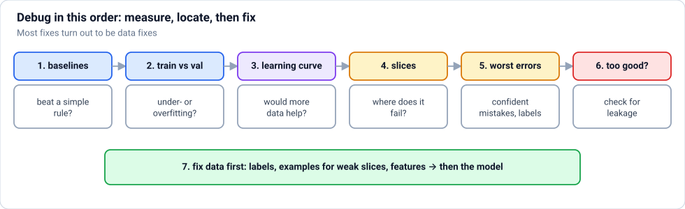

### 46.1 A debugging order

When a model disappoints, resist trying random new models. Work through the questions in order:

1. Does it beat the **baselines** (Chapter 18)?
2. **Train vs validation** scores: underfitting or overfitting (Chapter 15)?
3. **Learning curve:** would more data help (Chapter 23)?
4. **Slices:** where exactly does it fail?
5. **Worst errors:** what do the biggest mistakes have in common? Are some labels wrong?
6. **Too good?** Check for leakage (Chapter 25).
7. Fix the **data** first (labels, more examples of weak slices, better features), then the model.

### 46.2 Two sanity checks for the training code

**Can it overfit a tiny sample?** A flexible model trained on 20 rows should get them (almost) all right. If it can't, there's a bug: shuffled labels, wrong columns, a broken pipeline.

**Does it fail on shuffled labels?** Train on randomly permuted labels. Validation should drop to chance. If it doesn't, something is leaking.

```python
import numpy as np
from sklearn.datasets import load_breast_cancer
from sklearn.model_selection import cross_val_score
from sklearn.ensemble import RandomForestClassifier

X, y = load_breast_cancer(return_X_y=True)
rf = RandomForestClassifier(n_estimators=200, random_state=0, n_jobs=-1)
print("fits 20 rows:          ", rf.fit(X[:20], y[:20]).score(X[:20], y[:20]))
y_shuffled = np.random.default_rng(0).permutation(y)
print("CV with shuffled labels:", cross_val_score(rf, X, y_shuffled, cv=5).mean().round(3), "(chance ≈", round(max(y.mean(), 1 - y.mean()), 3), ")")
```

**Output:**

```text
fits 20 rows:           1.0
CV with shuffled labels: 0.583 (chance ≈ 0.627 )
```

Both behave, so the pipeline itself is sound.

### 46.3 A model that's fine on average

Here's a pricing dataset with a hidden twist: in one city, Goa, each extra square metre is worth **twice** as much as elsewhere. A plain linear model can't see that, because it has one area weight for everyone.

```python
import pandas as pd
from sklearn.model_selection import train_test_split
from sklearn.compose import make_column_transformer
from sklearn.preprocessing import OneHotEncoder
from sklearn.pipeline import make_pipeline
from sklearn.linear_model import LinearRegression

rng = np.random.default_rng(3)
n = 3000
df = pd.DataFrame({"area": rng.uniform(40, 200, n).round(),
                   "age": rng.integers(0, 40, n),
                   "city": rng.choice(["Pune", "Delhi", "Mumbai", "Goa"], n, p=[0.35, 0.3, 0.27, 0.08])})
per_m2 = np.where(df["city"] == "Goa", 1.0, 0.5)                    # Goa: twice the price per m²
df["price"] = 20 + per_m2 * df["area"] - 0.4 * df["age"] + rng.normal(0, 6, n)

train, test = train_test_split(df, test_size=0.3, random_state=0)
features = ["area", "age", "city"]
model = make_pipeline(make_column_transformer((OneHotEncoder(), ["city"]), remainder="passthrough"),
                      LinearRegression()).fit(train[features], train["price"])
test = test.assign(pred=model.predict(test[features]))
test = test.assign(abs_err=(test["price"] - test["pred"]).abs())
print("overall test MAE:", round(test["abs_err"].mean(), 2))
```

**Output:**

```text
overall test MAE: 6.2
```

`assign` adds columns to a DataFrame. The overall MAE looks acceptable. Only 8% of houses are in Goa, so their errors are diluted in the average.

### 46.4 Slicing: the metric per segment

Compute the metric for each value of each important feature (and for buckets of numeric ones):

```python
by_city = test.groupby("city")["abs_err"].agg(["count", "mean"]).round(2)
print(by_city.sort_values("mean", ascending=False))

test = test.assign(area_band=pd.cut(test["area"], [0, 80, 120, 160, 200]))
print(test.groupby("area_band", observed=True)["abs_err"].mean().round(2))
```

**Output:**

```text
        count   mean
city                
Goa        85  17.65
Mumbai    234   5.21
Pune      301   4.93
Delhi     280   4.90
area_band
(0, 80]       7.50
(80, 120]     5.12
(120, 160]    5.21
(160, 200]    7.04
Name: abs_err, dtype: float64
```

`pd.cut` turns numbers into ranges, and `groupby(...).agg` computes several summaries per group. Goa's error is several times everyone else's: the problem is hiding in a small slice.

**Is a slice really worse, or just small and noisy?** Put a **bootstrap confidence interval** on its metric (Chapter 28.3): resample the slice's rows with replacement many times, recompute the metric each time, and take the middle 95% of the results.

```python
def bootstrap_ci(values, n_boot=2000, seed=0):
    rng = np.random.default_rng(seed)
    means = [rng.choice(values, len(values)).mean() for _ in range(n_boot)]
    return np.percentile(means, [2.5, 97.5]).round(2)

for city in ["Goa", "Pune"]:
    print(city, "MAE 95% interval:", bootstrap_ci(test.loc[test["city"] == city, "abs_err"].to_numpy()))
```

**Output:**

```text
Goa MAE 95% interval: [15.03 20.09]
Pune MAE 95% interval: [4.53 5.34]
```

The intervals don't overlap, so the gap is real, not noise.

### 46.5 Error analysis: read the worst cases

Sort by error and **look at the rows**. Patterns (all large Goa houses) suggest a missing feature or interaction. Nonsense (a price of 0) suggests bad data or labels.

```python
print(test.sort_values("abs_err", ascending=False)[["area", "age", "city", "price", "pred", "abs_err"]].head(5).round(1))
```

**Output:**

```text
       area  age city  price   pred  abs_err
2993   50.0   39  Goa   42.1   87.7     45.6
2373   52.0   29  Goa   53.4   92.8     39.4
1061   48.0   26  Goa   52.7   91.9     39.3
1180  199.0   39  Goa  206.1  167.0     39.1
1981   52.0    4  Goa   65.5  103.0     37.5
```

All the worst errors are in Goa, at **both** ends: small Goa houses are over-priced and large ones under-priced. The one-hot column gave Goa its own baseline, but the model still uses the same price per m² as everywhere else, so it's wrong for the small and the large ones. That points straight at the fix: let the area effect depend on the city. Add an **interaction feature**, area × (is Goa).

```python
for d in (train, test):
    d["area_x_goa"] = d["area"] * (d["city"] == "Goa")
features2 = features + ["area_x_goa"]
model2 = make_pipeline(make_column_transformer((OneHotEncoder(), ["city"]), remainder="passthrough"),
                       LinearRegression()).fit(train[features2], train["price"])
err2 = (test["price"] - model2.predict(test[features2])).abs()
print("overall MAE:", round(err2.mean(), 2), "| Goa MAE:", round(err2[test["city"] == "Goa"].mean(), 2))
```

**Output:**

```text
overall MAE: 4.83 | Goa MAE: 5.23
```

Both the overall and the Goa error drop to about the noise level. A more complex model (boosting) would also have found it, but the slice-and-read method tells you **what** was wrong. That's the knowledge you need to trust, explain or fix a model.

### 46.6 Common findings

| what you see | likely cause | fix |
|---|---|---|
| one slice much worse | missing interaction or feature; too few examples of it | add features, collect data, a separate model for it |
| confident wrong predictions with "impossible" labels | label errors | relabel; train with clean labels |
| errors grow with the target size | multiplicative effects | model log(target) |
| great offline, bad in production | leakage, or training data that differs from live data | Chapters 25, 52 |

### 46.7 Summary

```
order          baselines → train vs val → learning curve → slices → worst errors → leakage → fix data
sanity checks  overfit 20 rows (should be near perfect); shuffled labels (should be chance)
slicing        metric per segment; bootstrap CI to tell real gaps from noise
error analysis sort by error, read rows, look for the shared pattern
```

**Key terms:**

- **Error analysis:** inspecting a model's largest errors to find their causes.
- **Slice (segment):** a subset of the data defined by feature values, such as one city.
- **Slice metric:** a metric computed on one slice only.
- **Bootstrap confidence interval:** a range for a statistic, from recomputing it on many resamples.
- **Label noise:** wrong target values in the training or test data.
- **Sanity check:** a quick test that should obviously pass if the code is right.

**Exercises**

1. A model's overall accuracy is 94%. In one region with 2% of users it's 61%. Why might the overall metric never reveal this?
2. A slice's error interval is [3.1, 9.8] and the overall MAE is 5.0. Is the slice clearly worse?

<details>
<summary><b>Answers</b></summary>

1. 2% of the users can only move the overall figure by at most about 0.7 points (2% × 33 points), easily lost among other changes. Only slicing shows it.
2. No. The interval includes 5.0, so the slice may be no worse; it's too small to tell. Collect more data for it, or report the uncertainty.

</details>

**Learn more:** [Google: Rules of Machine Learning (Martin Zinkevich)](https://developers.google.com/machine-learning/guides/rules-of-ml)

---

## 47. Fairness, Privacy and Responsible ML

**You need:** Chapters 12, 13 and 46. · **You'll learn:** how a model can treat groups of people differently even when it never sees the group, the standard fairness metrics computed by hand, one way to adjust a model, and the basics of protecting personal data.

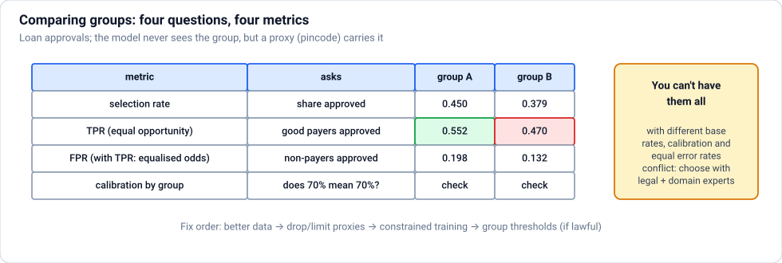

### 47.1 Where unfairness comes from

Models decide who gets a loan, a job interview, a medical follow-up. They can treat groups (by gender, caste, religion, region, age) differently, usually without anyone intending it:

- **Historical bias:** the labels record past decisions that were themselves unfair.
- **Representation bias:** one group has few examples, so the model is worse for it (Chapter 46.4).
- **Measurement bias:** a feature or label means different things for different groups ("arrests" measures policing as well as crime).
- **Proxies:** dropping the sensitive column doesn't help if other features (pincode, first language, college) carry the same information.

### 47.2 Fairness metrics, by hand

Compare the model's behaviour across groups. A loan model, two groups of applicants, "positive" = repays:

| | group A | group B |
|---|---|---|
| applicants | 100 | 100 |
| actually repay | 60 | 40 |
| approved | 50 (45 repay, 5 don't) | 30 (26 repay, 4 don't) |

| metric | question | A | B |
|---|---|---|---|
| **selection rate** (demographic parity) | what share is approved? | 50/100 = **0.50** | 30/100 = **0.30** |
| **true positive rate** (equal opportunity) | of those who'd repay, what share is approved? | 45/60 = **0.75** | 26/40 = **0.65** |
| **false positive rate** (with TPR: equalised odds) | of those who wouldn't, what share is approved? | 5/40 = **0.125** | 4/60 = **0.067** |
| **precision** (predictive parity) | of those approved, what share repay? | 45/50 = **0.90** | 26/30 = **0.87** |

Different metrics tell different stories. Here the selection rates differ a lot, partly because the groups' repayment rates (their **base rates**) differ. The TPR gap says that **creditworthy** applicants in B are approved less often, which is usually the most serious complaint.

**You can't satisfy them all.** When base rates differ, it's mathematically impossible for a useful model to have equal selection rates, equal error rates and equal calibration all at once. Choosing which to prioritise is a value judgement, for domain experts and the law, not something a data scientist should settle alone.

### 47.3 A model that never sees the group

Synthetic loan data. The model gets income and a pincode risk score, but **not** the group. Group B lives mostly in pincodes with higher historical "risk", partly because of past lending patterns.

```python
import numpy as np
from sklearn.linear_model import LogisticRegression
from sklearn.model_selection import train_test_split

rng = np.random.default_rng(0)
n = 20_000
group = rng.choice(["A", "B"], n, p=[0.6, 0.4])
income = rng.normal(np.where(group == "A", 55, 48), 12, n)              # in thousands
pincode_risk = rng.normal(np.where(group == "B", 0.8, 0.0), 0.6, n)     # a proxy for the group
logit = 0.08 * (income - 50) - 0.6 * pincode_risk + 0.3
repays = (rng.random(n) < 1 / (1 + np.exp(-logit))).astype(int)

X = np.column_stack([income, pincode_risk])                              # the group itself is NOT a feature
X_tr, X_te, y_tr, y_te, g_tr, g_te = train_test_split(X, repays, group, test_size=0.4, random_state=0)
model = LogisticRegression().fit(X_tr, y_tr)
approve = model.predict_proba(X_te)[:, 1] >= 0.5

def group_report(approve, y, g):
    for name in ["A", "B"]:
        m = g == name
        sel = approve[m].mean()
        tpr = approve[m & (y == 1)].mean()
        fpr = approve[m & (y == 0)].mean()
        prec = y[m & approve].mean()
        print(f"group {name}: base rate {y[m].mean():.2f} | selection {sel:.2f} | TPR {tpr:.2f} | FPR {fpr:.2f} | precision {prec:.2f}")

group_report(approve, y_te, g_te)
```

**Output:**

```text
group A: base rate 0.64 | selection 0.77 | TPR 0.87 | FPR 0.59 | precision 0.73
group B: base rate 0.43 | selection 0.37 | TPR 0.56 | FPR 0.23 | precision 0.65
```

`train_test_split` can split several arrays at once, keeping the rows aligned. Even without the group column, group B is approved much less often, including its creditworthy members (the lower TPR). The pincode carries the group.

### 47.4 One mitigation: group-specific thresholds

A **post-processing** fix: keep the model, but choose a separate threshold for each group so that a chosen metric matches. Here we equalise the TPR, so creditworthy applicants are approved at the same rate in both groups. (In some countries and domains, using group membership at decision time is itself illegal; check first.)

```python
proba = model.predict_proba(X_te)[:, 1]
target_tpr = 0.80
thresholds = {}
for name in ["A", "B"]:
    good = proba[(g_te == name) & (y_te == 1)]               # scores of applicants who did repay
    thresholds[name] = np.quantile(good, 1 - target_tpr)     # 80% of them score above this
print({k: round(float(v), 3) for k, v in thresholds.items()})

approve2 = proba >= np.where(g_te == "A", thresholds["A"], thresholds["B"])
group_report(approve2, y_te, g_te)
print("overall accuracy before:", round(np.mean(approve == y_te), 3), "| after:", round(np.mean(approve2 == y_te), 3))
```

**Output:**

```text
{'A': 0.565, 'B': 0.337}
group A: base rate 0.64 | selection 0.69 | TPR 0.80 | FPR 0.48 | precision 0.75
group B: base rate 0.43 | selection 0.63 | TPR 0.80 | FPR 0.50 | precision 0.55
overall accuracy before: 0.696 | after: 0.671
```

The TPRs now match (by construction), and here the FPRs come out nearly equal too. But precision has split apart: approved applicants from B now repay less often than those from A (0.55 against 0.75). That's the impossibility of 47.2 in action. Overall accuracy also drops a little. Other options, in roughly the order to consider them: **better data** (more representative samples, fixing labels), **dropping or limiting proxy features**, and **training with fairness constraints** (libraries such as Fairlearn). Every option is a trade-off to be decided with the people affected, and documented.

### 47.5 Privacy

Models are trained on personal data, so:

- **Collect less** (data minimisation): only the features you need, and keep them only as long as you need them.
- **Removing names isn't anonymisation.** Combinations such as pincode + birth date + gender can identify most people. **k-anonymity** requires every combination of such "quasi-identifiers" to be shared by at least k people.
- **Models can leak their training data.** A **membership inference** attack guesses whether a person was in the training set, from how confident the model is about them; overfitted models leak more.
- **Differential privacy** adds carefully sized random noise so that no single person's data changes the result much. For a count, adding Laplace noise with scale 1/ε (ε, epsilon, is the privacy budget: smaller = more private, more noise) gives this guarantee.

```python
true_count = 412                                             # e.g. patients with a condition in a district
for eps in [1.0, 0.1]:
    noisy = true_count + np.random.default_rng(1).laplace(0, 1 / eps, 5)
    print(f"ε = {eps}: five noisy releases {noisy.round(1)}")
```

**Output:**

```text
ε = 1.0: five noisy releases [412.  414.3 410.8 414.3 411.5]
ε = 0.1: five noisy releases [412.2 435.1 399.6 434.8 407.3]
```

- **Regulation:** the EU's GDPR, India's Digital Personal Data Protection Act (2023) and the EU AI Act (2024) set rules on consent, purpose limitation, explanations, and extra checks for "high-risk" uses such as credit and hiring.

### 47.6 Document it

A **model card** is a short document shipped with a model: what it's for (and not for), the training data, metrics overall **and per group**, known limitations, and the fairness checks done. **Datasheets for datasets** do the same for data. Writing them forces the right questions to be asked before launch.

### 47.7 Summary

```
selection rate   P(approved | group)                      demographic parity
TPR, FPR         P(approved | repays, group), P(approved | defaults, group)    equal opportunity / equalised odds
precision        P(repays | approved, group)               predictive parity
can't satisfy all when base rates differ → choose with domain experts and the law
proxies          dropping the sensitive column isn't enough
privacy          minimise data; names off ≠ anonymous; DP: add noise scaled to 1/ε
```

**Key terms:**

- **Sensitive (protected) attribute:** a characteristic such as gender, caste or religion that decisions shouldn't unfairly depend on.
- **Historical / representation / measurement bias:** unfairness from past decisions in the labels / too few examples of a group / features or labels that mean different things for different groups.
- **Base rate:** the share of positives in a group.
- **Demographic parity:** equal selection rates across groups.
- **Equal opportunity:** equal true positive rates across groups.
- **Equalised odds:** equal true positive and false positive rates across groups.
- **Predictive parity:** equal precision across groups.
- **Post-processing:** adjusting a trained model's outputs (such as per-group thresholds) to meet a fairness goal.
- **PII (personally identifiable information):** data that identifies a person.
- **Quasi-identifier:** a field that identifies people in combination with others (pincode, birth date).
- **k-anonymity:** every combination of quasi-identifiers is shared by at least k records.
- **Membership inference:** working out whether a person's data was used to train a model.
- **Differential privacy:** adding calibrated noise so the output barely depends on any one person.
- **Privacy budget (ε):** how much privacy loss is allowed; smaller means more noise and more privacy.
- **Model card:** a document describing a model's purpose, data, performance (overall and per group) and limits.

**Exercises**

1. Group C: 200 applicants, 120 repay; the model approves 90, of whom 80 repay. Compute the selection rate, TPR, FPR and precision.
2. Why doesn't removing the gender column guarantee a gender-fair model?

<details>
<summary><b>Answers</b></summary>

1. Selection 90/200 = **0.45**. TPR 80/120 = **0.667**. FPR 10/80 = **0.125**. Precision 80/90 = **0.889**.
2. Other features can act as proxies (job title, shopping patterns, first name in free text), so the model can still learn gender-linked patterns. Measure the metrics by group to find out.

</details>

**Learn more:** [Fairlearn documentation](https://fairlearn.org/) · [Google: Model Cards](https://modelcards.withgoogle.com/about) · [Barocas, Hardt & Narayanan: Fairness and Machine Learning (free book)](https://fairmlbook.org/)

---

**✅ Part VII checkpoint.** You can now measure what a model relies on, explain single predictions, debug weak models by slicing, and audit a model for fairness and privacy. Part VIII takes a model to production.

---

# Part VIII — Production

Saving, serving, tracking and monitoring models, and designing an ML system around them.

---

## 48. Saving Models: joblib, skops and ONNX

**You need:** Chapters 19 and 26.9. · **You'll learn:** what to save with a model, why plain pickle files are a security risk, and the safer and more portable formats.


### 48.1 What to save

The trained artifact must reproduce **exactly** what was evaluated. So save:

- the **whole pipeline** (preprocessing and model together, Chapter 19.5), never just the model;
- **settings used at decision time**, such as the threshold (Chapter 26.6);
- **metadata:** library versions, training date, a fingerprint of the training data, the feature names in order, and the evaluation metrics.

```python
import numpy as np, json, os, tempfile, hashlib, sklearn
from sklearn.datasets import load_breast_cancer
from sklearn.pipeline import make_pipeline
from sklearn.preprocessing import StandardScaler
from sklearn.linear_model import LogisticRegression

X, y = load_breast_cancer(return_X_y=True)
model = make_pipeline(StandardScaler(), LogisticRegression(max_iter=1000)).fit(X, y)
folder = tempfile.mkdtemp()

metadata = {
    "model_name": "tumour-risk", "version": "2026-11-01.1",
    "sklearn_version": sklearn.__version__, "numpy_version": np.__version__,
    "n_features": X.shape[1], "threshold": 0.3,
    "train_data_sha256": hashlib.sha256(X.tobytes()).hexdigest()[:16],   # a fingerprint of the exact training data
    "cv_auc": 0.995,
}
with open(os.path.join(folder, "metadata.json"), "w") as fh:
    json.dump(metadata, fh, indent=2)
print(json.dumps(metadata, indent=2)[:240])
```

**Output:**

```text
{
  "model_name": "tumour-risk",
  "version": "2026-11-01.1",
  "sklearn_version": "1.9.1",
  "numpy_version": "2.5.4",
  "n_features": 30,
  "threshold": 0.3,
  "train_data_sha256": "6b202a2072f9a038",
  "cv_auc": 0.995
}
```

A **hash** (here SHA-256, from Python's `hashlib`) turns any bytes into a short fingerprint. Change one value in the data and the fingerprint changes completely, so you can later prove which data a model was trained on.

### 48.2 joblib (and pickle): simple, but only for trusted files

`joblib.dump` (Chapter 26.9) uses Python's **pickle** format, which can store almost any Python object. To rebuild objects, pickle can be told to **call any function** while loading. So a malicious file can run code on your machine the moment you load it. Here's a harmless demonstration: the "attack" is just a print.

```python
import joblib

class Sneaky:
    def __reduce__(self):                          # tells pickle how to rebuild this object
        return (print, ("!! this code ran during joblib.load !!",))

path = os.path.join(folder, "sneaky.joblib")
joblib.dump(Sneaky(), path)
joblib.load(path)                                  # just loading runs print(...)
```

**Output:**

```text
!! this code ran during joblib.load !!
```

A real attacker would put something much worse than `print` there. **Rules:** only load pickle or joblib files you created yourself, or that come from a source you fully trust, and load them with the **same library versions** they were saved with. Other versions may warn, fail, or silently behave differently.

### 48.3 skops: a safer format for scikit-learn

**skops** saves scikit-learn objects in a format that **doesn't** run arbitrary code. When loading, it lists any types it doesn't already trust, and you must approve them explicitly.

```python
import skops.io as sio

skops_path = os.path.join(folder, "model.skops")
sio.dump(model, skops_path)
unknown = sio.get_untrusted_types(file=skops_path)
print("types needing approval:", unknown)
loaded = sio.load(skops_path, trusted=unknown)     # review the list before trusting it
print("same predictions:", np.array_equal(loaded.predict(X), model.predict(X)))
```

**Output:**

```text
types needing approval: []
same predictions: True
```

Standard scikit-learn pieces are trusted already, so the list is empty here. A custom transformer of your own would show up for review.

### 48.4 ONNX: run anywhere, without Python

**ONNX** (Open Neural Network Exchange) stores a model as a **graph of standard mathematical operations**: scale, multiply by the weights, sigmoid. Any ONNX runtime can execute it, from C++, Java, JavaScript or a phone, without Python or scikit-learn. **skl2onnx** converts scikit-learn pipelines, and **onnxruntime** runs them.

```python
from skl2onnx import to_onnx
import onnxruntime as ort

onx = to_onnx(model, X[:1].astype(np.float32), options={"zipmap": False})   # example input fixes types and shape
with open(os.path.join(folder, "model.onnx"), "wb") as fh:
    fh.write(onx.SerializeToString())

session = ort.InferenceSession(os.path.join(folder, "model.onnx"), providers=["CPUExecutionProvider"])
input_name = session.get_inputs()[0].name
labels, probs = session.run(None, {input_name: X.astype(np.float32)})
print("labels match scikit-learn:", np.array_equal(labels, model.predict(X)))
print("largest probability difference:", float(np.abs(probs[:, 1] - model.predict_proba(X)[:, 1]).max()))
```

**Output:**

```text
labels match scikit-learn: True
largest probability difference: 3.915448146263323e-07
```

ONNX works in 32-bit floats by default, so the probabilities differ from scikit-learn's in the 7th decimal or so. That's harmless, but worth checking. `zipmap: False` makes it return the probabilities as a plain array, instead of a list of dictionaries.

### 48.5 Which format?

| format | loads with | safe to load untrusted files? | use when |
|---|---|---|---|
| joblib / pickle | Python + the same library versions | ❌ no | your own models, inside one team and environment |
| skops | Python + scikit-learn | ✅ (you approve unknown types) | sharing scikit-learn models |
| ONNX | any ONNX runtime, many languages | ✅ (it's data, not code) | serving outside Python, mobile, low latency |
| native boosting formats | XGBoost / LightGBM / CatBoost | ✅ | boosting models: `model.save_model("model.json")` |

Whatever the format: version the files (never overwrite "model.pkl"), keep them with their metadata, and load and test them in the serving environment before release. Chapter 50 shows a registry that does this bookkeeping.

### 48.6 Summary

```
save            whole pipeline + threshold + metadata (versions, data hash, metrics)
joblib/pickle   simple; loading can run arbitrary code → trusted files only, same versions
skops           sio.dump / sio.get_untrusted_types / sio.load(trusted=…)
ONNX            to_onnx(pipeline, example_X) → onnxruntime.InferenceSession(...).run(...)
```

**Key terms:**

- **Serialisation:** turning an object in memory into bytes that can be saved and loaded later.
- **Pickle:** Python's built-in serialisation format; it can run code while loading.
- **joblib:** a library that saves Python objects (using pickle), efficient for large arrays.
- **skops:** a format for saving scikit-learn models that won't run arbitrary code on load.
- **ONNX:** an open format describing a model as a graph of standard operations.
- **onnxruntime:** a fast engine that runs ONNX models in many languages.
- **Hash (SHA-256):** a short fingerprint computed from data; any change gives a different hash.
- **Model metadata:** information stored with a model (versions, data fingerprint, metrics, settings).
- **Artifact versioning:** giving each saved model a unique, permanent version.

**Exercises**

1. A colleague emails you a `.joblib` model from an unknown website. What do you do?
2. Why save the training data's hash in the metadata?

<details>
<summary><b>Answers</b></summary>

1. Don't load it. Loading can run any code. Ask for a skops or ONNX version, or retrain from known data and code.
2. To prove later exactly which data produced the model (for audits, debugging and reproducing results): if anyone changes the data, the hash won't match.

</details>

**Learn more:** [scikit-learn: model persistence](https://scikit-learn.org/stable/model_persistence.html) · [skops documentation](https://skops.readthedocs.io/) · [ONNX Runtime](https://onnxruntime.ai/)

---

## 49. Serving Models: an API Endpoint and Batch Scoring

**You need:** Chapters 20, 26 and 48. · **You'll learn:** the two ways predictions reach users (batch jobs and live APIs), how to build and test a prediction API with FastAPI, and how new models are rolled out safely.

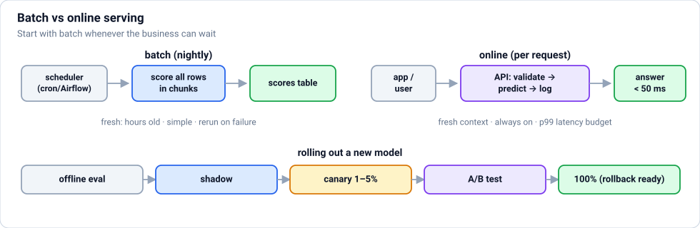

### 49.1 Batch or online?

| | batch | online |
|---|---|---|
| how | a scheduled job scores every row and writes the results to a table | an API scores each request as it arrives |
| freshness | hours old | instant, and can use live context |
| example | tonight's churn scores for the call centre | fraud check during a card payment |
| complexity | low: rerun if it fails | high: always on, with a latency budget |

**Start with batch whenever the business can wait.** It's far simpler to build, test and fix.

### 49.2 The model we'll serve

The churn pipeline from Chapter 26, rebuilt compactly: raw columns in, probability out.

```python
import numpy as np, pandas as pd
from sklearn.compose import ColumnTransformer
from sklearn.pipeline import make_pipeline
from sklearn.impute import SimpleImputer
from sklearn.preprocessing import StandardScaler, OneHotEncoder, OrdinalEncoder
from sklearn.linear_model import LogisticRegression

def make_customers(n, seed):
    rng = np.random.default_rng(seed)
    df = pd.DataFrame({"tenure_months": rng.integers(1, 72, n).astype(float), "monthly_charge": rng.uniform(200, 2000, n).round(),
                       "city": rng.choice(["Pune", "Delhi", "Goa", "Mumbai"], n), "plan": rng.choice(["basic", "standard", "premium"], n),
                       "support_calls": rng.poisson(1.0, n)})
    score = -0.06 * df["tenure_months"] + 0.0012 * df["monthly_charge"] + 0.6 * df["support_calls"] + 0.8 * (df["plan"] == "basic") - 1.5
    return df, (rng.random(n) < 1 / (1 + np.exp(-score))).astype(int)

X, y = make_customers(5000, seed=7)
preprocess = ColumnTransformer([
    ("num", make_pipeline(SimpleImputer(strategy="median"), StandardScaler()), ["tenure_months", "monthly_charge", "support_calls"]),
    ("city", OneHotEncoder(handle_unknown="ignore"), ["city"]),
    ("plan", OrdinalEncoder(categories=[["basic", "standard", "premium"]]), ["plan"])])
MODEL = make_pipeline(preprocess, LogisticRegression()).fit(X, y)
MODEL_VERSION, THRESHOLD = "churn-2026-11-01", 0.46
```

In production the service would `joblib.load` (or skops-load) a saved file once at start-up, rather than train.

### 49.3 Batch scoring

Score a large table in **chunks**, so memory stays flat however big the input is, and write the scores with the model version beside them:

```python
import time

customers, _ = make_customers(200_000, seed=99)               # tonight's customer table
start, parts = time.time(), []
for i in range(0, len(customers), 50_000):                     # 50,000 rows at a time
    chunk = customers.iloc[i:i + 50_000]
    parts.append(pd.DataFrame({"p_churn": MODEL.predict_proba(chunk)[:, 1].round(4),
                               "model_version": MODEL_VERSION}, index=chunk.index))
scores = pd.concat(parts)
print(f"scored {len(scores):,} rows in {time.time() - start:.2f} s")
print("flagged for a call:", int((scores["p_churn"] >= THRESHOLD).sum()))
```

**Output:**

```text
scored 200,000 rows in 0.05 s
flagged for a call: 38291
```

In production this script runs on a schedule (cron, Airflow and similar tools) and writes to a database table that the call-centre app reads.

### 49.4 An online API with FastAPI

**FastAPI** is a Python web framework (`fastapi.md` covers it in depth). Three ideas matter here:

- **Validate input** with a **Pydantic** model: a class that declares each field's type and allowed range. A bad request is rejected with a clear error before it reaches the model.
- **Load the model once,** not per request.
- **Return** the probability, the decision **and the model version**, and **log** them, so every decision can be traced later.

```python
from typing import Literal
from fastapi import FastAPI
from pydantic import BaseModel, Field

class Customer(BaseModel):
    tenure_months: float | None = Field(None, ge=0, le=600)       # None = unknown; the imputer handles it
    monthly_charge: float = Field(..., gt=0)                       # ... = required
    city: str
    plan: Literal["basic", "standard", "premium"]
    support_calls: int = Field(..., ge=0)

app = FastAPI(title="churn-scoring")
prediction_log = []                                                # stand-in for a real log or database

@app.get("/health")
def health():
    return {"status": "ok", "model_version": MODEL_VERSION}

@app.post("/predict")
def predict(customer: Customer):
    row = pd.DataFrame([customer.model_dump()])
    p = float(MODEL.predict_proba(row)[0, 1])
    result = {"p_churn": round(p, 4), "call": p >= THRESHOLD, "model_version": MODEL_VERSION}
    prediction_log.append({**customer.model_dump(), **result})
    return result
```

`@app.post("/predict")` registers the function as the handler for POST requests to /predict. FastAPI reads the JSON body into a `Customer`, checking it, and turns the returned dictionary into JSON.

**Testing without a server.** `TestClient` sends requests to the app in-process. It's ideal for automated tests:

```python
from fastapi.testclient import TestClient

client = TestClient(app)
print(client.get("/health").json())
good = {"tenure_months": 3, "monthly_charge": 1800, "city": "Pune", "plan": "basic", "support_calls": 4}
print(client.post("/predict", json=good).json())

bad = {**good, "plan": "gold", "support_calls": -1}
r = client.post("/predict", json=bad)
print(r.status_code, [err["loc"][-1] for err in r.json()["detail"]])
```

**Output:**

```text
{'status': 'ok', 'model_version': 'churn-2026-11-01'}
{'p_churn': 0.9687, 'call': True, 'model_version': 'churn-2026-11-01'}
422 ['plan', 'support_calls']
```

The invalid request is rejected with status **422** (unprocessable input), and the error names both bad fields. To run it for real, save the code as `app.py` and start a server with `uvicorn app:app --port 8000`. **uvicorn** is the server program that runs FastAPI apps.

**Latency.** Measure the time per request, and watch the slow tail: the **p99** latency, the time that 99% of requests beat.

```python
times = []
for _ in range(200):
    t0 = time.perf_counter()
    client.post("/predict", json=good)
    times.append((time.perf_counter() - t0) * 1000)
print(f"median {np.median(times):.1f} ms, p99 {np.percentile(times, 99):.1f} ms (in-process, one at a time)")
```

**Output:**

```text
median 2.5 ms, p99 4.4 ms (in-process, one at a time)
```

Batch scoring handled 200,000 rows in about 0.05 s, a quarter of a microsecond per row, yet one request takes a couple of milliseconds. Nearly all of that is overhead (building a one-row DataFrame, the pipeline steps, the web layer), not the maths. If milliseconds matter, convert to ONNX (Chapter 48.4) or compute the linear score directly.

### 49.5 Rolling out a new model safely

1. **Offline evaluation:** beats the current model on held-out data, overall and per slice (Chapter 46).
2. **Shadow mode:** the new model scores live traffic **alongside** the old one, but its answers aren't used. Compare its outputs, latency and errors.
3. **Canary:** send 1–5% of real traffic to it, and watch the metrics and errors.
4. **A/B test:** a proper experiment on the business metric (`data-science.md` covers A/B tests).
5. **Full rollout,** keeping the old version ready for an instant **rollback**.

### 49.6 Summary

```
batch    scheduled job → score in chunks → table with model_version     (prefer when possible)
online   FastAPI: Pydantic input validation → load model once → predict → return + log version
test     TestClient in-process; 422 for invalid input; watch p99 latency
rollout  offline → shadow → canary → A/B → 100%, with rollback ready
```

**Key terms:**

- **Batch scoring:** computing predictions for many rows on a schedule.
- **Online (real-time) serving:** computing a prediction per request as it arrives.
- **API endpoint:** a URL that accepts requests and returns responses, such as POST /predict.
- **FastAPI:** a Python framework for building web APIs.
- **Pydantic:** a library for declaring and validating data with Python type hints.
- **Status code 422:** the HTTP response meaning the request body failed validation.
- **uvicorn:** a server program that runs FastAPI apps.
- **Latency / p99:** the time to answer a request / the time 99% of requests come in under.
- **Shadow deployment:** running a new model on live traffic without using its answers.
- **Canary release:** sending a small share of real traffic to a new version first.
- **Rollback:** switching back to the previous version quickly.

**Exercises**

1. Which serving style for: (a) weekly product recommendations by email; (b) approving a card payment; (c) next-day demand for each store?
2. Why return `model_version` in every response?

<details>
<summary><b>Answers</b></summary>

1. (a) batch; (b) online (it must answer within the payment); (c) batch, run nightly.
2. To trace every decision to the exact model that made it, for debugging, audits, comparing versions during a rollout, and complaints ("why was I refused?").

</details>

**Learn more:** [FastAPI documentation](https://fastapi.tiangolo.com/) · `fastapi.md` in these notes

---

## 50. Experiment Tracking and Reproducibility with MLflow

**You need:** Chapters 22 and 48. · **You'll learn:** how to record every training run automatically, compare runs, keep a registry of approved models, and make results reproducible.

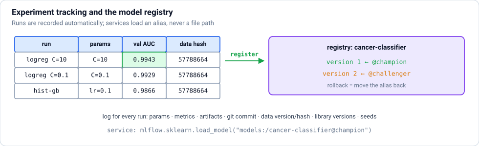

### 50.1 The problem

After two weeks of experiments: "Which settings gave 0.995? Which data was that? Is the model in production the same one?" Notes in a notebook don't survive this. **Experiment tracking** records every **run** (one training attempt) automatically: its parameters, metrics, the model file, the data version and the code version, in a searchable store.

**MLflow** is the most widely used open-source tool for this. It has a tracking store, a model registry, and a web UI (`mlflow ui`) to browse runs.

### 50.2 Logging runs

```python
import os, tempfile
import mlflow, mlflow.sklearn
from sklearn.datasets import load_breast_cancer
from sklearn.model_selection import cross_val_score
from sklearn.pipeline import make_pipeline
from sklearn.preprocessing import StandardScaler
from sklearn.linear_model import LogisticRegression

store = tempfile.mkdtemp()
mlflow.set_tracking_uri(f"sqlite:///{store}/mlflow.db")      # where runs are recorded (a local database file)
mlflow.create_experiment("tumour-risk", artifact_location=f"{store}/artifacts")   # where model files are stored
mlflow.set_experiment("tumour-risk")                          # an experiment groups related runs

X, y = load_breast_cancer(return_X_y=True)
logged = {}
for C in [0.01, 0.1, 1.0]:
    with mlflow.start_run(run_name=f"logreg-C{C}"):          # everything inside is attached to this run
        model = make_pipeline(StandardScaler(), LogisticRegression(C=C, max_iter=1000))
        auc = cross_val_score(model, X, y, cv=5, scoring="roc_auc").mean()
        mlflow.log_params({"model": "logistic", "C": C})
        mlflow.log_metric("cv_auc", auc)
        model.fit(X, y)
        logged[C] = mlflow.sklearn.log_model(model, name="model", input_example=X[:2])   # saves the pipeline
```

The `with mlflow.start_run():` block opens a run and closes it at the end, even if an error happens. `log_model` stores the fitted pipeline together with its environment (library versions) and an input example.

### 50.3 Comparing runs

`search_runs` returns the runs as a pandas table, so they can be sorted and filtered like any DataFrame:

```python
runs = mlflow.search_runs(order_by=["metrics.cv_auc DESC"])
print(runs[["tags.mlflow.runName", "params.C", "metrics.cv_auc"]].round(4))
```

**Output:**

```text
  tags.mlflow.runName params.C  metrics.cv_auc
0         logreg-C1.0      1.0          0.9952
1         logreg-C0.1      0.1          0.9951
2        logreg-C0.01     0.01          0.9924
```

In practice you'd open `mlflow ui` in a browser and sort, filter and chart the runs there. `mlflow.sklearn.autolog()` records parameters and metrics automatically for scikit-learn models, with no explicit `log_` calls.

### 50.4 The model registry

The **model registry** gives approved models a name and numbered **versions**. Services load a model through an **alias** such as `@champion`, never through a file path. Promoting a new model, or rolling back, is then just moving the alias:

```python
from mlflow import MlflowClient

best_C = float(runs.iloc[0]["params.C"])
version = mlflow.register_model(logged[best_C].model_uri, "tumour-risk")
MlflowClient().set_registered_model_alias("tumour-risk", "champion", version.version)

service_model = mlflow.sklearn.load_model("models:/tumour-risk@champion")    # what the serving code does
print("registered version:", version.version, "| first predictions:", service_model.predict(X[:5]))
```

**Output:**

```text
registered version: 1 | first predictions: [0 0 0 0 0]
```

### 50.5 Reproducibility checklist

A result is reproducible when someone else can get the same number from the same inputs. Record, for every run:

| what | how |
|---|---|
| code version | the git commit hash (MLflow records it automatically inside a git repo) |
| data version | a hash of the training data (Chapter 48.1), or a versioned table or snapshot |
| library versions | a lock file (`requirements.txt` with exact versions, or `uv.lock`); MLflow saves the environment with the model |
| randomness | fixed seeds (`random_state=…`, `np.random.default_rng(seed)`) |
| parameters and metrics | logged to the tracker, not copied by hand |
| the model | the logged artifact, loaded by name and version |

Even with all this, some results vary slightly across machines (multithreaded maths adds numbers in different orders). Aim for "the same to a few decimals", and record the hardware.

### 50.6 Summary

```
mlflow.set_tracking_uri(...);  mlflow.set_experiment(name)
with mlflow.start_run():  log_params / log_metric / mlflow.sklearn.log_model(model, name="model")
mlflow.search_runs(order_by=[...])          compare
register_model(model_uri, name);  set alias "champion";  load "models:/name@champion"
reproducible = code commit + data hash + locked versions + seeds + logged params/metrics
```

**Key terms:**

- **Experiment tracking:** automatically recording the inputs and results of every training run.
- **Run:** one training attempt, with its parameters, metrics and artifacts.
- **Experiment (MLflow):** a named group of related runs.
- **MLflow:** an open-source platform for tracking experiments and managing models.
- **Artifact:** a file produced by a run, such as a saved model or a chart.
- **Model registry:** a catalogue of named models with versions and aliases.
- **Alias (`@champion`):** a movable label pointing at one registered version.
- **Reproducibility:** getting the same result again from the same code, data and settings.
- **Lock file:** a file pinning the exact versions of every installed library.
- **Commit hash:** git's identifier for an exact version of the code.

**Exercises**

1. The production model misbehaves after Tuesday's release. With a registry and aliases, what's the fastest fix?
2. Two teammates get CV AUC 0.9951 and 0.9952 from "the same" code. Name three things to compare.

<details>
<summary><b>Answers</b></summary>

1. Move the `@champion` alias back to the previous version. The service loads by alias, so it switches without a code change. Then investigate.
2. Library versions, random seeds, and the exact data (hash). Also the number of threads/CPU and the git commit.

</details>

**Learn more:** [MLflow documentation](https://mlflow.org/docs/latest/)

---

## 51. ML Pipelines, Feature Stores and Training–Serving Skew

**You need:** Chapters 25, 48 and 50. · **You'll learn:** how training becomes an automated, checked workflow, why features computed differently in training and in production silently break models, and what a feature store does about it.

### 51.1 From notebook to workflow

A production model is retrained repeatedly: weekly, or when it drifts (Chapter 52). Each retrain should run the same **steps**, automatically and in order:

```
ingest → validate data → build features → train → evaluate → (if better) register → deploy
```

Steps depend on each other, which makes a **DAG** (directed acyclic graph): arrows show "must run before", and there are no loops. **Orchestrators** such as Airflow, Prefect, Dagster and Kubeflow run DAGs on a schedule, retry failed steps, and keep logs. Python's standard library can already work out a valid order:

```python
from graphlib import TopologicalSorter

steps = {                                  # step: the steps it depends on
    "validate": {"ingest"},
    "features": {"validate"},
    "train": {"features"},
    "evaluate": {"train", "features"},
    "register": {"evaluate"},
}
print(list(TopologicalSorter(steps).static_order()))
```

**Output:**

```text
['ingest', 'validate', 'features', 'train', 'evaluate', 'register']
```

A **topological order** lists every step after all the steps it depends on.

### 51.2 Validate the data before training on it

Garbage in, garbage model out, and nothing crashes to warn you. Check every new batch against expectations: columns, types, ranges, missing shares, allowed categories. **Stop the pipeline** if a check fails.

```python
import numpy as np
import pandas as pd

EXPECTED = {
    "tenure_months": {"min": 0, "max": 600, "max_missing": 0.15},
    "monthly_charge": {"min": 1, "max": 100_000, "max_missing": 0.0},
    "plan": {"allowed": {"basic", "standard", "premium"}, "max_missing": 0.0},
}

def validate(df):
    problems = []
    for col, rule in EXPECTED.items():
        if col not in df:
            problems.append(f"{col}: missing column"); continue
        miss = df[col].isna().mean()
        if miss > rule["max_missing"]:
            problems.append(f"{col}: {miss:.0%} missing")
        values = df[col].dropna()
        if "min" in rule and ((values < rule["min"]) | (values > rule["max"])).any():
            problems.append(f"{col}: values outside [{rule['min']}, {rule['max']}]")
        if "allowed" in rule and not set(values) <= rule["allowed"]:
            problems.append(f"{col}: unexpected {set(values) - rule['allowed']}")
    return problems

good = pd.DataFrame({"tenure_months": [3, 40, np.nan, 12, 25, 60, 8, 33],                  # 1 of 8 missing: within 15%
                     "monthly_charge": [500, 1200, 900, 650, 1500, 800, 300, 999],
                     "plan": ["basic", "premium", "basic", "standard", "basic", "premium", "basic", "standard"]})
bad = pd.DataFrame({"tenure_months": [3, -5, 40], "monthly_charge": [500, 1200, np.nan], "plan": ["basic", "gold", "basic"]})
print("good batch:", validate(good) or "OK")
print("bad batch: ", validate(bad))
```

**Output:**

```text
good batch: OK
bad batch:  ['tenure_months: values outside [0, 600]', 'monthly_charge: 33% missing', "plan: unexpected {'gold'}"]
```

`set(a) <= set(b)` asks "is a a subset of b?". Libraries such as **pandera** and **Great Expectations** provide this kind of checking at scale.

### 51.3 Training–serving skew

The model was trained on features computed by one piece of code (a batch SQL query over history). In production the same features are computed by **different** code (an app, from live data). If the two disagree, even slightly, the model receives inputs unlike its training data, and nothing errors. This is **training–serving skew**, one of the most common production failures.

A typical example: "average spend over the last 30 days". Training computes it over complete 30-day windows. The live app averages only the transactions it has cached, say the last 7 days, and divides by 7.

```python
from sklearn.linear_model import LogisticRegression

rng = np.random.default_rng(0)
n = 5000
daily_spend = rng.gamma(2.0, 50, (n, 30))                    # 30 days of spending per customer (≥ 0, skewed)
avg_30 = daily_spend.mean(axis=1)
churn = (rng.random(n) < 1 / (1 + np.exp(0.03 * (avg_30 - 100)))).astype(int)    # low spenders churn

model = LogisticRegression().fit(avg_30.reshape(-1, 1), churn)

avg_live = daily_spend[:, -7:].mean(axis=1)                    # the app's version: last 7 days only
p_train_style = model.predict_proba(avg_30.reshape(-1, 1))[:, 1]
p_live_style = model.predict_proba(avg_live.reshape(-1, 1))[:, 1]
print("feature mean, training vs live:", avg_30.mean().round(1), avg_live.mean().round(1))
print("feature spread (std), training vs live:", avg_30.std().round(1), avg_live.std().round(1))
print("customers flagged (p > 0.5), training-style vs live:", int((p_train_style > 0.5).sum()), int((p_live_style > 0.5).sum()))
```

**Output:**

```text
feature mean, training vs live: 100.2 100.2
feature spread (std), training vs live: 12.9 26.8
customers flagged (p > 0.5), training-style vs live: 2087 2433
```

The averages look the same, so a quick check would pass. But a 7-day average is much **noisier**, so more customers land in the tails, past the model's 50% line. The live system flags about 17% more people than the model was designed to, and nothing reports an error.

**Fixes:**

- **One definition, used in both places:** compute each feature with the same code (or from the same store) for training and serving.
- **Log the features actually used at serving time,** and train the next model on those logs.
- **Monitor** the live feature distributions against the training ones (Chapter 52).

### 51.4 Feature stores

A **feature store** is shared infrastructure for features, with two halves:

| | offline store | online store |
|---|---|---|
| holds | the full history of feature values, with timestamps | the latest value per entity (customer, card) |
| used for | building training sets | serving: millisecond lookups |
| key operation | the **point-in-time join** | get by key |

Each feature is defined once and computed once, feeding both halves, which removes skew by construction. **Feast** is a popular open-source feature store; cloud platforms have their own.

**The point-in-time join.** For a training example at time t, take each feature's latest value **known at time t**, never a later one, or you leak the future (Chapter 25.5). pandas' `merge_asof` does exactly this:

```python
events = pd.DataFrame({"customer": ["c1", "c1", "c2"],
                       "time": pd.to_datetime(["2026-03-05", "2026-03-20", "2026-03-12"]),
                       "churned_next_30d": [0, 1, 0]})
feature_history = pd.DataFrame({"customer": ["c1", "c1", "c1", "c2"],
                                "time": pd.to_datetime(["2026-03-01", "2026-03-15", "2026-03-25", "2026-03-10"]),
                                "avg_spend_30d": [120.0, 80.0, 40.0, 95.0]})

training = pd.merge_asof(events.sort_values("time"), feature_history.sort_values("time"),
                         on="time", by="customer", direction="backward")      # latest value at or before each event
print(training)
```

**Output:**

```text
  customer       time  churned_next_30d  avg_spend_30d
0       c1 2026-03-05                 0          120.0
1       c2 2026-03-12                 0           95.0
2       c1 2026-03-20                 1           80.0
```

For c1's event on 20 March, the join picks the value from 15 March (80), not the later 25 March value (40), which wasn't known yet.

### 51.5 Retraining with gates

An automated retrain must not ship a worse model. Put **gates** between the steps: data validation passes; the new model beats the current champion on the same held-out data, overall **and** on key slices; fairness checks pass; prediction latency fits the budget. Only then is it registered as a challenger, and rolled out through shadow and canary (Chapter 49.5).

### 51.6 Summary

```
workflow   ingest → validate → features → train → evaluate → register → deploy   (a DAG, run by an orchestrator)
validate   schema, ranges, missing share, categories → stop on failure
skew       training and serving compute features differently → silent failure
           fix: one feature definition, log served features, monitor
feature store   offline (history, point-in-time joins) + online (latest values, fast lookups)
gates      only promote a model that beats the champion overall and on slices
```

**Key terms:**

- **ML pipeline (workflow):** an automated sequence of steps from raw data to a deployed model.
- **DAG (directed acyclic graph):** steps with "runs before" arrows and no cycles.
- **Orchestrator:** a tool that schedules and runs pipeline steps (Airflow, Prefect, Dagster, Kubeflow).
- **Topological order:** an ordering in which every step comes after the steps it depends on.
- **Data validation:** automated checks that new data matches expectations.
- **Training–serving skew:** a difference between how features are computed in training and in production.
- **Feature store:** a system that defines, stores and serves features consistently for training and serving.
- **Offline / online store:** the historical feature data for training / the latest values for fast serving lookups.
- **Point-in-time join:** attaching to each example only the feature values known at that example's time.
- **Gate:** a check that must pass before a pipeline continues or a model is promoted.

**Exercises**

1. Training used `account_age_days` computed from the sign-up date; the live app sends `account_age_months`. What happens, and how would monitoring catch it?
2. In 51.4, which spend value would an event for c1 on 2026-03-14 get?

<details>
<summary><b>Answers</b></summary>

1. The model reads months as days, so every account looks about 30 times newer, which probably inflates the churn scores. Monitoring would show the live feature's distribution (mean around 1/30th of training's) shifted far from the training distribution (Chapter 52).
2. **120.0**: the latest value at or before 14 March is the one from 1 March. The 15 March value isn't known yet.

</details>

**Learn more:** [Feast documentation](https://docs.feast.dev/) · [Google: MLOps: continuous delivery and automation pipelines](https://cloud.google.com/architecture/mlops-continuous-delivery-and-automation-pipelines-in-machine-learning)

---

## 52. Monitoring Models in Production: Data Drift, Concept Drift and Retraining

**You need:** Chapters 13, 28.3 and 51. · **You'll learn:** why models decay after launch, how to measure a shift in the inputs (PSI, by hand, and the KS test), how to catch a change in the relationship itself, and when to retrain.

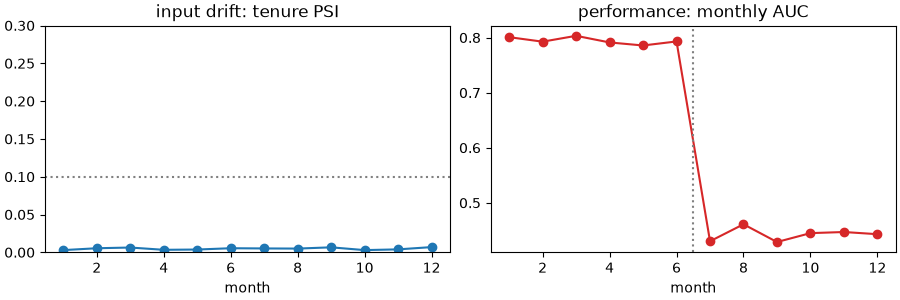

### 52.1 Why models decay

A model learns the world as it was in its training data. Then the world moves:

- **Data drift:** the inputs change. A new customer segment arrives, a sensor is recalibrated, a pricing change shifts spend. The model sees inputs unlike its training data.
- **Concept drift:** the **relationship** between inputs and target changes. Fraudsters change tactics; after a competitor launches, the same usage pattern no longer means "about to leave".
- **Pipeline bugs:** a column arrives in new units, or a feature silently becomes all missing (Chapter 51.3).

Nothing crashes in any of these cases. Without monitoring, you find out from angry users, or never.

### 52.2 What to monitor

| layer | what | needs labels? |
|---|---|---|
| system | errors, latency, throughput | no |
| data | missing share, ranges, **each feature's distribution** vs training | no |
| predictions | the distribution of scores, the share flagged | no |
| performance | AUC, precision, recall… once the true outcomes arrive | **yes**, often weeks late |
| business | the metric the model is meant to move | yes |

Labels often arrive late (did the customer churn? we know in 30 days), so the label-free checks are the early warning.

### 52.3 PSI: has a feature's distribution moved?

The **population stability index** compares a feature's live distribution with its training one:

1. Cut the **training** values into bins (often 10, at the training quantiles, so each holds 10%).
2. Count the share of training values (e) and live values (a) in each bin.
3. Sum over the bins:

```
PSI = Σ (aᵢ − eᵢ) · ln(aᵢ / eᵢ)
```

Each term is ≥ 0, and it's big when a bin's share has changed a lot. A common rule of thumb: **< 0.1** stable, **0.1–0.25** a moderate shift (investigate), **> 0.25** a large shift (act).

**By hand**, four bins. Training shares e = [0.25, 0.25, 0.25, 0.25]; live shares a = [0.10, 0.20, 0.30, 0.40]:

| bin | a − e | ln(a / e) | product |
|---|---|---|---|
| 1 | −0.15 | ln 0.4 = −0.916 | 0.137 |
| 2 | −0.05 | ln 0.8 = −0.223 | 0.011 |
| 3 | +0.05 | ln 1.2 = 0.182 | 0.009 |
| 4 | +0.15 | ln 1.6 = 0.470 | 0.071 |
| | | **PSI** | **0.228** |

A moderate shift: worth investigating.

```python
import numpy as np

def psi(expected, actual, n_bins=10):
    edges = np.quantile(expected, np.linspace(0, 1, n_bins + 1))
    edges[0], edges[-1] = -np.inf, np.inf                             # catch live values outside the training range
    e = np.histogram(expected, edges)[0] / len(expected)
    a = np.histogram(actual, edges)[0] / len(actual)
    e, a = np.clip(e, 1e-6, None), np.clip(a, 1e-6, None)             # avoid log(0)
    return float(np.sum((a - e) * np.log(a / e)))

a_, e_ = np.array([0.10, 0.20, 0.30, 0.40]), np.full(4, 0.25)
print("hand example:", round(float(np.sum((a_ - e_) * np.log(a_ / e_))), 3))

rng = np.random.default_rng(0)
train_spend = rng.normal(1000, 200, 50_000)
for name, live in [("same distribution", rng.normal(1000, 200, 5000)),
                   ("mean +5%", rng.normal(1050, 200, 5000)),
                   ("mean +20%", rng.normal(1200, 200, 5000))]:
    print(f"{name:<18} PSI {psi(train_spend, live):.3f}")
```

**Output:**

```text
hand example: 0.228
same distribution  PSI 0.002
mean +5%           PSI 0.066
mean +20%          PSI 0.965
```

`np.histogram(values, edges)` counts how many values fall into each bin.

### 52.4 The KS test, and why p-values mislead here

The **Kolmogorov–Smirnov (KS)** test compares two samples using the largest gap between their **cumulative distributions** (the share of values below each point). SciPy computes it:

```python
from scipy.stats import ks_2samp

small_shift = rng.normal(1010, 200, 200_000)                           # +1%: irrelevant in practice
res = ks_2samp(train_spend, small_shift)
print(f"KS statistic {res.statistic:.3f}, p-value {res.pvalue:.2g}, PSI {psi(train_spend, small_shift):.4f}")
```

**Output:**

```text
KS statistic 0.022, p-value 2.3e-17, PSI 0.0025
```

With hundreds of thousands of rows, even a trivial 1% shift gives a tiny p-value: "significant", but irrelevant. Monitor **effect sizes** (the PSI, the KS statistic itself, a change in the mean), with thresholds agreed in advance, not p-values.

### 52.5 Concept drift: the inputs look the same, the answers don't

Simulate 12 months. For the first 6, churn depends on support calls the usual way. From month 7, a competitor's offer makes long-tenure customers leave too. The **inputs don't change at all**:

```python
from sklearn.linear_model import LogisticRegression
from sklearn.metrics import roc_auc_score

def month_data(month, n=4000):
    r = np.random.default_rng(month)
    tenure, calls = r.uniform(0, 72, n), r.poisson(1.0, n)
    tenure_effect = -0.05 if month <= 6 else 0.04          # the relationship flips in month 7
    logit = 0.8 * calls + tenure_effect * (tenure - 36) - 1
    y = (r.random(n) < 1 / (1 + np.exp(-logit))).astype(int)
    return np.column_stack([tenure, calls]), y

X0, y0 = month_data(0)
model = LogisticRegression().fit(X0, y0)                    # trained once, before launch
for month in range(1, 13):
    X, y = month_data(month)
    print(f"month {month:>2}: tenure PSI {psi(X0[:, 0], X[:, 0]):.3f} | AUC {roc_auc_score(y, model.predict_proba(X)[:, 1]):.3f}")
```

**Output:**

```text
month  1: tenure PSI 0.003 | AUC 0.801
month  2: tenure PSI 0.005 | AUC 0.793
month  3: tenure PSI 0.006 | AUC 0.803
month  4: tenure PSI 0.003 | AUC 0.791
month  5: tenure PSI 0.004 | AUC 0.786
month  6: tenure PSI 0.005 | AUC 0.793
month  7: tenure PSI 0.005 | AUC 0.430
month  8: tenure PSI 0.005 | AUC 0.461
month  9: tenure PSI 0.007 | AUC 0.429
month 10: tenure PSI 0.003 | AUC 0.445
month 11: tenure PSI 0.004 | AUC 0.447
month 12: tenure PSI 0.007 | AUC 0.443
```

The PSI never moves, because the inputs are identical, but AUC collapses in month 7. Only **performance monitoring**, which needs the labels, catches concept drift. That's why delayed labels are worth collecting, and why leading indicators matter (the prediction distribution, complaints, business metrics).

### 52.6 Retraining

| strategy | when |
|---|---|
| on a schedule (weekly, monthly) | simple; the world changes steadily |
| on a trigger (a drift or performance alert) | changes are sudden and irregular |
| on a recent window (the last N months only) | old data has become misleading (concept drift) |

Retraining on months 7–8 restores the model:

```python
X78 = np.vstack([month_data(7)[0], month_data(8)[0]])
y78 = np.concatenate([month_data(7)[1], month_data(8)[1]])
retrained = LogisticRegression().fit(X78, y78)
X9, y9 = month_data(9)
print("month 9 AUC: old model", round(roc_auc_score(y9, model.predict_proba(X9)[:, 1]), 3),
      "| retrained", round(roc_auc_score(y9, retrained.predict_proba(X9)[:, 1]), 3))
```

**Output:**

```text
month 9 AUC: old model 0.429 | retrained 0.758
```

Every retrained model still passes the gates of Chapter 51.5 before it replaces the champion.

<details>
<summary><b>Code for the chart at the top</b></summary>

```python
import matplotlib.pyplot as plt

months = list(range(1, 13))
psis, aucs = [], []
for m in months:
    X, y = month_data(m)
    psis.append(psi(X0[:, 0], X[:, 0]))
    aucs.append(roc_auc_score(y, model.predict_proba(X)[:, 1]))
fig, (a1, a2) = plt.subplots(1, 2, figsize=(9, 3), layout="constrained")
a1.plot(months, psis, "o-"); a1.axhline(0.1, ls=":", color="gray")
a1.set(title="input drift: tenure PSI", xlabel="month", ylim=(0, 0.3))
a2.plot(months, aucs, "o-", color="tab:red"); a2.axvline(6.5, ls=":", color="gray")
a2.set(title="performance: monthly AUC", xlabel="month")
fig.savefig("drift-monitoring.png", dpi=100)
plt.close(fig)
```

</details>

### 52.7 Summary

```
data drift      inputs change        → PSI = Σ (a − e) ln(a/e) per feature;  <0.1 ok, >0.25 act
concept drift   the relationship changes → only performance (labels) shows it
KS test         use the statistic (effect size), not the p-value, on large samples
monitor         system → data → predictions → performance → business
retrain         schedule, trigger, or recent window; always through the promotion gates
```

**Key terms:**

- **Data drift (covariate shift):** a change in the distribution of the inputs.
- **Concept drift:** a change in the relationship between inputs and target.
- **Population stability index (PSI):** Σ (a − e) ln(a/e) over bins; measures how much a distribution has shifted.
- **Kolmogorov–Smirnov (KS) test:** a test comparing two samples by the largest gap between their cumulative distributions.
- **Cumulative distribution:** for each value, the share of the data at or below it.
- **Effect size:** how big a difference is, as opposed to whether it's statistically detectable.
- **Label delay:** the time between a prediction and learning the true outcome.
- **Retraining trigger:** a monitored condition that starts a retrain.
- **Training window:** the time range of data used to train.

**Exercises**

1. Compute the PSI for e = [0.5, 0.5] and a = [0.6, 0.4].
2. A fraud model's input PSIs all stay below 0.05, but confirmed fraud losses double. What kind of drift is this, and what do you do?

<details>
<summary><b>Answers</b></summary>

1. 0.1 · ln(1.2) + (−0.1) · ln(0.8) = 0.0182 + 0.0223 = **0.041**: stable.
2. Concept drift: fraudsters changed tactics while the inputs look the same. Check performance on recent labelled cases, retrain on recent data (maybe with new features that capture the new pattern), and tighten the threshold in the meantime.

```python
print(round(0.1 * np.log(1.2) - 0.1 * np.log(0.8), 4))
```

**Output:**

```text
0.0405
```

</details>

**Learn more:** [Evidently AI: data drift explained](https://www.evidentlyai.com/ml-in-production/data-drift) · [Chip Huyen: Data distribution shifts and monitoring](https://huyenchip.com/2022/02/07/data-distribution-shifts-and-monitoring.html)

---

## 53. ML System Design: a Framework and a Worked Example

**You need:** Chapters 26 and 48–52. · **You'll learn:** a repeatable way to design an ML system, as asked in interviews and needed at work, applied to real-time payment fraud detection.

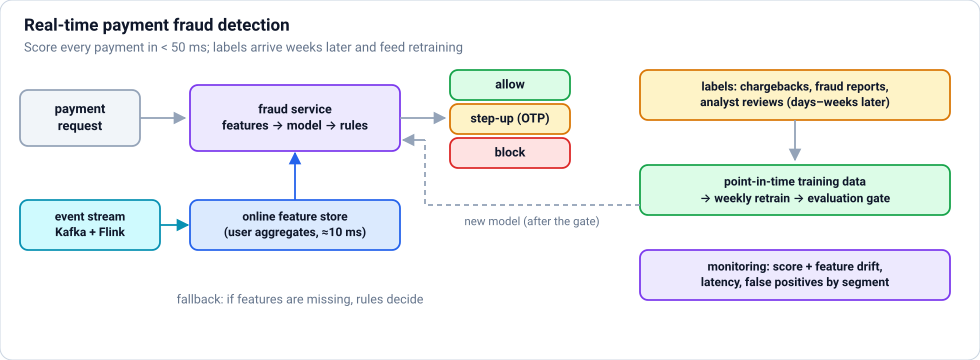

### 53.1 The framework

Work through these eight questions in order. Each one constrains the next.

| # | question | output |
|---|---|---|
| 1 | **Goal:** what decision does the prediction drive, and what business metric should improve? | one sentence, plus a business metric |
| 2 | **Constraints:** latency, volume, cost, explainability, regulation | numbers |
| 3 | **Framing:** what exactly is predicted, from which inputs, at what moment? | target, features, prediction time |
| 4 | **Data and labels:** where do they come from, how late are the labels, how biased? | data sources, label delay |
| 5 | **Features:** which ones, and are they computable at serving time without skew? | feature list, online vs batch |
| 6 | **Model:** baseline first, then candidates | model choice, with reasons |
| 7 | **Evaluation:** offline metric(s), slices, then online test | metrics, test plan |
| 8 | **Serving and operations:** batch or online, fallbacks, monitoring, retraining | architecture |

### 53.2 Worked example: payment fraud

**1. Goal.** Stop fraudulent card payments while annoying as few genuine customers as possible. Business metric: fraud losses + the cost of friction (blocked or challenged genuine payments).

**2. Constraints.** Decide **during** the payment: about **50 ms** for the whole fraud check. Peak volume, say, 2,000 payments a second. Decisions must be explainable to customers and regulators.

A back-of-the-envelope calculation:

```python
payments_per_day = 50_000_000
peak_factor = 3                                       # the busiest hour vs the average
avg_per_second = payments_per_day / 86_400
print(f"average {avg_per_second:,.0f}/s, peak ≈ {avg_per_second * peak_factor:,.0f}/s")

fraud_rate, avg_fraud_amount = 0.001, 4_000          # 0.1% fraud, average ₹4,000
print(f"fraud exposure per day ≈ ₹{payments_per_day * fraud_rate * avg_fraud_amount / 1e7:.0f} crore")
```

**Output:**

```text
average 579/s, peak ≈ 1,736/s
fraud exposure per day ≈ ₹20 crore
```

(1 crore = 10 million.) Numbers like these decide the architecture: thousands of requests a second rules out slow models and slow feature lookups.

**3. Framing.** Binary classification: for each payment at the moment it's requested, P(the payment is later confirmed fraudulent). The output feeds **three actions** rather than two: allow, **step-up** (ask for a one-time password), or block. Thresholds come from costs (Chapter 40.5): a missed fraud costs its amount, a block costs a lost sale and an unhappy customer, and a step-up costs a little friction.

**4. Data and labels.** Labels come from chargebacks, customer reports and analyst reviews, **days to weeks later** (label delay, Chapter 52.2). The data is extremely imbalanced (Chapter 39). The labels are biased too: blocked payments never get a label (we never learn whether they were fraud), so keep a small random sample of **unblocked** traffic for honest evaluation.

**5. Features.**

| type | examples | computed |
|---|---|---|
| payment | amount, merchant category, channel, hour | in the request |
| customer history | average amount over 30 days, number of payments in the last hour, typical countries | **online feature store**, updated from an event stream |
| device / network | new device? distance from usual location | in the request + lookups |
| merchant | merchant fraud rate (target-encoded, Chapter 20.5) | batch, daily |

"Payments in the last hour" must be computed identically in training and serving, with point-in-time joins (Chapter 51.4). This is the biggest skew risk.

**6. Model.** Baseline: the existing rules ("block if amount > ₹50,000 from a new device"). Then gradient boosting (Chapter 30) on the tabular features: the industry standard here, fast at prediction time and explainable with SHAP (Chapter 45). Keep the rules for hard policy limits and as a **fallback**.

**7. Evaluation.** Offline: average precision, and **recall at a fixed false-positive rate** (the friction budget), on a **time-based** split (Chapter 41.2), sliced by merchant type, country and amount band (Chapter 46). Measure the expected cost at the chosen thresholds. Online: shadow, then canary, then an A/B test on fraud losses and the step-up rate (Chapter 49.5).

**8. Serving and operations.**

- Online service: validate → fetch features (about 10 ms) → model (about 5 ms) → rules → decision. Log everything with the model version.
- **Fallback:** if the feature store is slow or a feature is missing, the rules decide. The payment must never wait.
- Monitor: latency, feature drift (PSI), the score distribution, the step-up and block rates, and performance as labels arrive (Chapter 52).
- Retrain weekly on recent data, behind the evaluation gates (Chapter 51.5); fraud patterns change fast (concept drift).

### 53.3 Questions interviewers like

- "How do you handle label delay?" Evaluate on matured data only, monitor label-free signals in the meantime, and use quickly available signals (customer reports) as provisional labels.
- "What if the model's blocks stop us learning about fraud?" Keep a small random **exploration** sample that isn't blocked (or is only stepped up), so unbiased labels keep coming.
- "How do you pick the threshold?" From calibrated probabilities and costs (Chapter 40.5), checked against the friction budget, separately per segment if costs differ.
- "Batch or online?" Online for the decision. Batch for the slower features (merchant risk) and for analytics.

### 53.4 Summary

```
1 goal + business metric   2 constraints (latency, volume, cost, rules)   3 framing (target, prediction time)
4 data + labels (delay, bias)   5 features (online vs batch, no skew)   6 model (baseline → candidates)
7 evaluation (offline, slices, online test)   8 serving, fallback, monitoring, retraining
```

**Key terms:**

- **ML system design:** planning the whole system around a model: data, features, serving, evaluation and operations.
- **Back-of-the-envelope estimate:** a quick calculation of volume, latency or cost to guide the design.
- **QPS (queries per second):** how many requests a system handles each second.
- **Step-up authentication:** asking for extra proof (such as a one-time password) instead of blocking outright.
- **Fallback:** a simpler path used when the main model or its inputs fail.
- **Exploration sample:** a small share of decisions made without the model's filtering, so unbiased labels keep arriving.
- **Event stream:** a continuous feed of events (payments, clicks), used to keep features fresh.

**Exercises**

1. Apply step 3 (framing) to "recommend articles on a news site's home page".
2. Why is a random split a mistake for evaluating the fraud model?

<details>
<summary><b>Answers</b></summary>

1. Rank candidate articles for each user at page-load time by P(click) (or by expected reading time); features from the user's history, the article and the context. Use a two-stage design (Chapter 43.5), because the candidate set changes all the time.
2. Fraud patterns change over time. A random split lets the model train on future fraud patterns and test on past ones, which overstates performance (Chapter 25.5). Split by time.

</details>

**Learn more:** [Chip Huyen: Designing Machine Learning Systems](https://huyenchip.com/books/) · [Google: Rules of Machine Learning](https://developers.google.com/machine-learning/guides/rules-of-ml)

---

**✅ Part VIII checkpoint.** You can now save models safely, serve them in batch or online, track experiments, build skew-free pipelines, monitor drift, and design a complete ML system. Part IX looks at how real companies use ML, and what changed recently.

---

# Part IX — ML in the Real World

How companies actually use these models, and what changed in applied ML between 2022 and 2026.

---

## 54. How Real Systems Use ML: Fraud, Search, Ads, Recommendations and Forecasting

**You need:** Chapters 30, 40, 43 and 53. · **You'll learn:** the recurring patterns behind production ML, the ranking metric NDCG (by hand) with a learned ranker, and bandits for choosing what to show while still learning.

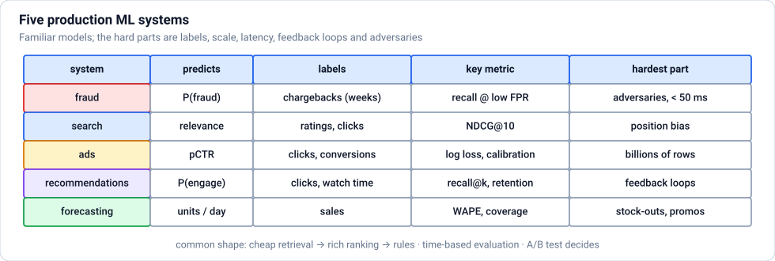

### 54.1 Five systems, one shape

| system | predicts | labels come from | key metric | hardest part |
|---|---|---|---|---|
| payment fraud | P(fraud) per payment | chargebacks (weeks late) | recall at a low false-positive rate | adversaries, < 50 ms |
| search | relevance of each document to a query | human ratings, clicks | NDCG@10 | clicks are biased by position |
| ads | P(click), P(purchase) | clicks, conversions | log loss, calibration | billions of rows; money depends on calibration |
| recommendations | P(engage) per user–item | clicks, watch time | recall@k, retention | feedback loops, cold start |
| demand forecasting | units per product × store × day | sales | weighted error, interval coverage | stock-outs hide true demand |

The common shape: a cheap first stage and an expensive second stage (Chapter 43.5), gradient boosting or neural networks on rich aggregate features, time-based evaluation, and an online A/B test as the final judge.

Two details worth knowing:

- **Ads** rank candidates by bid × P(click), the expected money, so the probabilities must be **calibrated** (Chapter 40). A model with perfect ranking but inflated probabilities would overcharge advertisers.
- **Forecasting** learns from **sales**, but when a product sells out, sales stop while demand continues. The labels are **censored** (cut off at the stock level). Remove or adjust stock-out days before training.

### 54.2 Ranking and NDCG

Search and feeds care about the **order** of results, especially the top few. **DCG** (discounted cumulative gain) adds up each result's relevance, discounted by its position:

```
DCG@k = Σ over positions i = 1..k of  relᵢ / log₂(i + 1)
NDCG@k = DCG@k / (DCG@k of the ideal order)          between 0 and 1
```

**By hand.** Four results with graded relevance (0–3), shown in the order [3, 0, 2, 1]:

| position i | 1 | 2 | 3 | 4 |
|---|---|---|---|---|
| discount 1/log₂(i + 1) | 1 | 0.631 | 0.5 | 0.431 |
| shown: relevance | 3 | 0 | 2 | 1 |
| ideal: relevance | 3 | 2 | 1 | 0 |

DCG = 3 + 0 + 1.0 + 0.431 = **4.431**. Ideal DCG = 3 + 1.262 + 0.5 + 0 = **4.762**. NDCG = **0.930**. Putting the 0 at position 2 cost a little.

```python
import numpy as np
from sklearn.metrics import ndcg_score

def dcg(rels):
    rels = np.asarray(rels, dtype=float)
    return np.sum(rels / np.log2(np.arange(2, len(rels) + 2)))

shown = [3, 0, 2, 1]
print("by hand:", round(dcg(shown) / dcg(sorted(shown, reverse=True)), 3))
print("scikit-learn:", round(ndcg_score([shown], [[4, 3, 2, 1]]), 3))    # true relevances, then the scores that produced the order
```

**Output:**

```text
by hand: 0.93
scikit-learn: 0.93
```

**Learning to rank.** A ranker learns to order the documents **within each query**. LightGBM's `LGBMRanker` with the **LambdaRank** objective focuses its effort on mistakes near the top of the list, which is what NDCG@10 rewards:

```python
import lightgbm as lgb

rng = np.random.default_rng(0)
def make_queries(n_queries, docs=20):
    X, rel = [], []
    for _ in range(n_queries):
        f = rng.normal(size=(docs, 5))                        # e.g. text match, freshness, popularity, …
        score = 1.5 * f[:, 0] + 0.8 * f[:, 1] - 0.5 * f[:, 2] + rng.normal(0, 0.8, docs)
        rel.append(np.digitize(score, [0.5, 1.5, 2.5, 3.5]))  # graded relevance 0–4
        X.append(f)
    return np.vstack(X), np.concatenate(rel), [docs] * n_queries

X_tr, y_tr, g_tr = make_queries(500)
X_te, y_te, g_te = make_queries(100)
ranker = lgb.LGBMRanker(objective="lambdarank", n_estimators=200, learning_rate=0.05, verbose=-1).fit(X_tr, y_tr, group=g_tr)

def mean_ndcg(scores, k=10):
    out, start = [], 0
    for g in g_te:
        out.append(ndcg_score([y_te[start:start + g]], [scores[start:start + g]], k=k))
        start += g
    return np.mean(out)

print(f"NDCG@10: random {mean_ndcg(rng.random(len(y_te))):.3f} | text match only {mean_ndcg(X_te[:, 0]):.3f} | ranker {mean_ndcg(ranker.predict(X_te)):.3f}")
```

**Output:**

```text
NDCG@10: random 0.383 | text match only 0.829 | ranker 0.931
```

`np.digitize` turns scores into grades using the cut points, and `group` tells the ranker how many consecutive rows belong to each query.

### 54.3 Exploring while exploiting: bandits

Which of 4 ad designs gets the most clicks? You learn only about the designs you **show**. Always showing the current best (**exploiting**) may lock onto a lucky early leader. Showing others (**exploring**) costs clicks now but finds the true best. This trade-off is the **multi-armed bandit** problem (each option is an "arm", as on a slot machine). **Regret** is the clicks lost compared with always showing the truly best design.

- **ε-greedy:** with probability ε show a random design; otherwise show the one with the best click rate so far.
- **Thompson sampling:** keep a **Beta distribution** for each design's click rate. Beta(1 + clicks, 1 + non-clicks) is a curve over 0–1 that's wide when a design has few views and narrow when it has many. Each round, draw one plausible rate from each curve and show the design with the highest draw. Uncertain designs sometimes draw high, so they get explored, exactly as much as their uncertainty warrants.

```python
true_ctr = np.array([0.030, 0.045, 0.050, 0.020])          # unknown in reality

def run_bandit(choose, rounds=50_000, seed=0):
    r = np.random.default_rng(seed)
    shows, clicks, total = np.zeros(4), np.zeros(4), 0
    for t in range(rounds):
        arm = t if t < 4 else choose(r, shows, clicks)        # show each design once, then follow the policy
        click = r.random() < true_ctr[arm]
        shows[arm] += 1; clicks[arm] += click; total += click
    return rounds * true_ctr.max() - total, int(shows.argmax() == true_ctr.argmax())

def eps_greedy(eps):
    return lambda r, shows, clicks: r.integers(4) if r.random() < eps else int(np.argmax(clicks / shows))
thompson = lambda r, shows, clicks: int(np.argmax(r.beta(1 + clicks, 1 + shows - clicks)))

for name, policy in [("greedy (ε = 0)", eps_greedy(0.0)), ("ε-greedy, ε = 0.1", eps_greedy(0.1)), ("Thompson sampling", thompson)]:
    runs = [run_bandit(policy, seed=s) for s in range(5)]
    print(f"{name:<18} regret per run {[round(x) for x, _ in runs]}, found the best design in {sum(b for _, b in runs)}/5 runs")
```

**Output:**

```text
greedy (ε = 0)     regret per run [22, 997, 983, 1031, 1020], found the best design in 1/5 runs
ε-greedy, ε = 0.1  regret per run [114, 87, 100, 73, 330], found the best design in 4/5 runs
Thompson sampling  regret per run [7, 35, 56, 27, 96], found the best design in 5/5 runs
```

Five runs each, because a single bandit run is a story about luck. Pure greedy usually locks onto the wrong design. ε-greedy usually finds the right one, but keeps wasting a fixed share of traffic on random designs forever. Thompson sampling explores early, then concentrates, and typically has the lowest regret. Bandits are used for headlines, thumbnails, ad creatives and the exploration samples of Chapter 53.3.

### 54.4 Summary

```
patterns    classify risk · rank items · predict numbers · choose under uncertainty
ranking     DCG@k = Σ rel/log₂(i+1);  NDCG = DCG / ideal DCG;  LGBMRanker(objective="lambdarank")
ads         rank by bid × P(click) → probabilities must be calibrated
forecasting sales ≠ demand when stock runs out (censored labels)
bandits     ε-greedy (simple); Thompson: sample from Beta(1+clicks, 1+misses), show the max
```

**Key terms:**

- **Click-through rate (CTR):** clicks divided by impressions.
- **Impression:** one showing of an item or ad.
- **Learning to rank:** training a model to order items for a query.
- **DCG / NDCG:** a ranking score that rewards relevant items near the top / the same, divided by the best possible.
- **LambdaRank:** a ranking objective that weights mistakes by how much they hurt NDCG.
- **Position bias:** higher-placed items get more clicks regardless of quality.
- **Censored data:** values only known to be at least (or at most) some limit, such as sales capped by stock.
- **Multi-armed bandit:** repeatedly choosing among options to maximise reward while learning which is best.
- **Exploration vs exploitation:** trying options to learn about them vs using the best-known one.
- **Regret:** the reward lost compared with always choosing the best option.
- **ε-greedy:** explore at random with probability ε, otherwise exploit.
- **Thompson sampling:** choose by sampling each option's success rate from its posterior distribution.
- **Beta distribution:** a distribution over values between 0 and 1, often used for unknown rates.

**Exercises**

1. Compute NDCG@3 for relevances shown in the order [0, 2, 3].
2. Why might a forecasting model trained on raw sales under-forecast your best-selling products?

<details>
<summary><b>Answers</b></summary>

1. DCG = 0 + 2·0.631 + 3·0.5 = 2.762. Ideal [3, 2, 0]: 3 + 1.262 + 0 = 4.262. NDCG = **0.648**.
2. They're the ones that sell out. On stock-out days sales stop at the stock level while demand continues, so the labels understate demand exactly for the popular items.

```python
print(round(dcg([0, 2, 3]) / dcg([3, 2, 0]), 3))
```

**Output:**

```text
0.648
```

</details>

| # | Problem (Deep-ML) | Difficulty |
|---|---|---|
| 1 | [158. Epsilon-Greedy Action Selection for n-Armed Bandit](https://www.deep-ml.com/problems/158) | 🟡 Medium |
| 2 | [162. Upper Confidence Bound (UCB) Action Selection](https://www.deep-ml.com/problems/162) | 🟢 Easy |

**Learn more:** [Eugene Yan: applied ML at companies (collection)](https://github.com/eugeneyan/applied-ml)

---

## 55. What's New (2022–2026): Foundation Models for Tables, AutoML and Modern Practice

**You need:** Chapters 22, 30 and 41. · **You'll learn:** what changed in applied ML while large language models took the headlines, including prediction intervals with guaranteed coverage (conformal prediction, built from scratch), and what stayed the same.

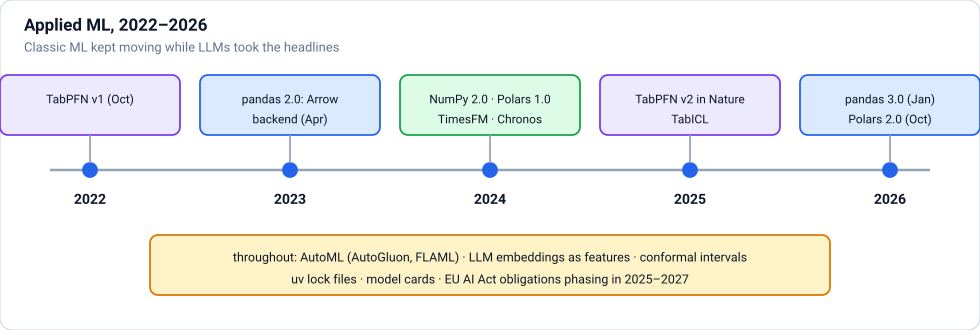

### 55.1 What changed, and what didn't

| area | 2022 practice | 2026 practice |
|---|---|---|
| small tables (up to ~10k rows) | tune gradient boosting carefully | also try a **tabular foundation model**; it's often as strong, with no tuning |
| large tables | gradient boosting | **still gradient boosting** on good features |
| model search | hand-written grid searches | **AutoML** (AutoGluon, FLAML) as a strong baseline in minutes |
| text features | TF-IDF | TF-IDF **and** embeddings from pretrained language models; LLMs to help label data |
| forecasting | per-series models, or boosting on lag features | plus **pretrained forecasters** (Amazon Chronos, Google TimesFM) as baselines |
| uncertainty | single-number predictions | **conformal intervals** and calibrated probabilities |
| data tools | pandas 1 | pandas 3 (Arrow-backed strings, copy-on-write), Polars, DuckDB, NumPy 2 |
| environments | pip + loose requirements | `uv` and lock files |
| governance | informal | model cards, monitoring by default, the EU AI Act (obligations phasing in from 2025 to 2027) |

### 55.2 Foundation models for tables

A **foundation model** is pretrained on broad data, then applied to new tasks with little or no training. **TabPFN** (2022; version 2 published in *Nature* in January 2025) is pretrained on millions of **synthetic** tables. To predict on your table, it reads your training rows **as input** and outputs predictions for the test rows in one forward pass, with no gradient training on your data. This is **in-context learning**, the same trick LLMs use when given examples in a prompt. **TabICL** (2025) applies the same idea to larger tables.

The honest picture: on many small benchmark datasets, TabPFN v2 matched or beat tuned gradient boosting in seconds. But it was designed for small-to-medium tables (v2: about 10,000 rows and 500 features; later versions raise the limits, so check the current documentation), it wants a GPU for speed, and it's harder to explain. **Cross-validate it against a tuned boosting baseline on your data** before believing it wins.

```python
from tabpfn import TabPFNClassifier         # needs PyTorch; not run in these notes
clf = TabPFNClassifier()                    # no hyperparameters to tune
clf.fit(X_train, y_train)                   # "fit" stores the rows; no gradient training happens
proba = clf.predict_proba(X_test)           # one forward pass reads the training rows in context
```

### 55.3 AutoML in miniature

**AutoML** searches model families **and** their settings for you, often finishing with an ensemble. The core is the search you already know (Chapter 22), across several model types at once. Here's successive halving over three families:

```python
import numpy as np
from sklearn.datasets import load_breast_cancer
from sklearn.experimental import enable_halving_search_cv  # noqa: F401  (switches the halving searches on)
from sklearn.model_selection import HalvingRandomSearchCV
from sklearn.pipeline import Pipeline
from sklearn.preprocessing import StandardScaler
from sklearn.linear_model import LogisticRegression
from sklearn.ensemble import RandomForestClassifier, HistGradientBoostingClassifier
from scipy.stats import loguniform, randint

X, y = load_breast_cancer(return_X_y=True)
pipe = Pipeline([("scale", StandardScaler()), ("model", LogisticRegression())])
space = [{"model": [LogisticRegression(max_iter=2000)], "model__C": loguniform(1e-3, 1e2)},
         {"model": [RandomForestClassifier(random_state=0)], "model__max_depth": randint(2, 12)},
         {"model": [HistGradientBoostingClassifier(random_state=0)], "model__learning_rate": loguniform(0.01, 0.3)}]
search = HalvingRandomSearchCV(pipe, space, n_candidates=30, factor=3, cv=5, scoring="roc_auc", random_state=0).fit(X, y)
print("rows per candidate in each round:", search.n_resources_, "| candidates per round:", search.n_candidates_)
print("winner:", type(search.best_params_["model"]).__name__, "| CV AUC", round(search.best_score_, 4))
```

**Output:**

```text
rows per candidate in each round: [20, 60, 180, 540] | candidates per round: [30, 10, 4, 2]
winner: LogisticRegression | CV AUC 0.9942
```

`param_distributions` can be a **list** of spaces, one per model family: the `model` step itself is a hyperparameter. Each round keeps the best third and triples the data. Tools such as AutoGluon add stacking (Chapter 33.4) and time limits, and make a strong baseline for any tabular project.

### 55.4 Conformal prediction: intervals you can trust

A point forecast says "120 units". A decision-maker needs "between 100 and 140, 90% of the time". **Split conformal prediction** wraps **any** regression model to give intervals with guaranteed coverage:

1. Split the training data into a **fit** part and a **calibration** part.
2. Fit the model on the fit part. On the calibration part, compute the absolute errors |y − ŷ|.
3. Let q be the ⌈(n + 1)(1 − α)⌉-th smallest of those n errors (for 90% coverage, α = 0.1). ⌈·⌉ means round up.
4. For a new point, predict ŷ ± q.

**Why it works:** if new points behave like the calibration points (they're **exchangeable**, as with random sampling), a new point's error is equally likely to fall at any rank among the calibration errors. So it's below the chosen one with probability at least 1 − α. No assumption about the model or the noise's shape is needed.

**By hand:** 9 calibration errors [1, 2, 2, 3, 3, 4, 5, 6, 9] and α = 0.2. ⌈10 × 0.8⌉ = 8, so q is the 8th smallest = **6**. The interval is ŷ ± 6.

```python
from sklearn.datasets import load_diabetes
from sklearn.model_selection import train_test_split
from sklearn.linear_model import LinearRegression

Xd, yd = load_diabetes(return_X_y=True)
X_rest, X_test, y_rest, y_test = train_test_split(Xd, yd, test_size=0.3, random_state=0)
X_fit, X_cal, y_fit, y_cal = train_test_split(X_rest, y_rest, test_size=0.4, random_state=0)

model = LinearRegression().fit(X_fit, y_fit)
errors = np.sort(np.abs(y_cal - model.predict(X_cal)))
alpha = 0.1
k = int(np.ceil((len(errors) + 1) * (1 - alpha)))          # the rank to use
q = errors[k - 1]
pred = model.predict(X_test)
covered = np.mean((y_test >= pred - q) & (y_test <= pred + q))
print(f"{len(errors)} calibration errors → q = {q:.1f}; interval = prediction ± {q:.1f}")
print(f"test coverage: {covered:.3f} (target ≥ {1 - alpha})")
```

**Output:**

```text
124 calibration errors → q = 81.1; interval = prediction ± 81.1
test coverage: 0.865 (target ≥ 0.9)
```

Coverage came out a little **below** 0.9 here. That's not a broken guarantee: it holds **on average** over random splits, and one test set of 133 patients is noisy. Repeat the whole procedure over 200 random splits:

```python
coverages = []
for seed in range(200):
    Xr, Xt, yr, yt = train_test_split(Xd, yd, test_size=0.3, random_state=seed)
    Xf, Xc, yf, yc = train_test_split(Xr, yr, test_size=0.4, random_state=seed)
    m = LinearRegression().fit(Xf, yf)
    e = np.sort(np.abs(yc - m.predict(Xc)))
    q_s = e[int(np.ceil((len(e) + 1) * (1 - alpha))) - 1]
    p = m.predict(Xt)
    coverages.append(np.mean((yt >= p - q_s) & (yt <= p + q_s)))
print(f"average coverage {np.mean(coverages):.3f}; middle 90% of single splits {np.percentile(coverages, [5, 95]).round(3)}")
```

**Output:**

```text
average coverage 0.904; middle 90% of single splits [0.842 0.955]
```

On average the target is met. The interval is wide, because diabetes progression is hard to predict (R² ≈ 0.36, Chapter 9.8), and the conformal interval honestly says so. The **MAPIE** library provides conformal methods, including versions whose interval width adapts to each point.

### 55.5 The everyday stack

- **Embeddings as features:** turn text (or images) into vectors with a pretrained model, then feed them to a classic model (`llm-engineering.md`).
- **pandas 3** (January 2026) made Arrow-backed strings and copy-on-write the default. **Polars** and **DuckDB** handle large local data fast. scikit-learn accepts pandas and Polars DataFrames directly.
- **Causal ML / uplift modelling:** estimating the **effect** of an action (a discount) for each person, not just predicting the outcome. Libraries: EconML, DoWhy, CausalML.
- **What didn't change:** clean data, honest splits, baselines, pipelines, monitoring. Every chapter of Parts I–VIII still applies.

### 55.6 Summary

```
tabular foundation models   in-context learning on small tables; validate against tuned boosting
AutoML                      search over model families + settings (halving, stacking); a strong baseline
conformal                   q = ⌈(n+1)(1−α)⌉-th smallest calibration |error|;  interval ŷ ± q, coverage ≥ 1−α
stack                       pandas 3 / Polars / DuckDB, uv lock files, embeddings as features
```

**Key terms:**

- **Foundation model:** a large pretrained model applied to many tasks with little extra training.
- **Tabular foundation model (TabPFN, TabICL):** a model pretrained on many synthetic tables that predicts on new tables in context.
- **In-context learning:** predicting by reading examples as input, without updating weights.
- **AutoML:** automatic search over preprocessing, model families and settings.
- **Conformal prediction:** turning any model's predictions into intervals (or sets) with guaranteed coverage.
- **Calibration set:** held-out data used to measure errors for conformal intervals (or to calibrate probabilities).
- **Coverage:** the share of true values that fall inside the predicted intervals.
- **Exchangeability:** the assumption that the order of data points doesn't matter, as with a random sample.
- **Pretrained forecaster:** a time-series model pretrained on many series that forecasts new ones without training.
- **Uplift (causal) modelling:** estimating how much an action changes the outcome for each individual.

**Exercises**

1. With 99 calibration errors and α = 0.05, which ranked error is q?
2. A team needs 2 ms predictions on 50 million transactions a day, on CPUs. TabPFN, an LLM, or gradient boosting?

<details>
<summary><b>Answers</b></summary>

1. ⌈100 × 0.95⌉ = **95**: the 95th smallest error.
2. **Gradient boosting.** It fits the latency and cost budget on CPUs at that volume, is strong on large tables, and is easy to monitor and explain. Use foundation models and LLMs offline: exploring, labelling, side tasks.

</details>

**Learn more:** [Hollmann et al., Accurate predictions on small data with a tabular foundation model (Nature, 2025)](https://www.nature.com/articles/s41586-024-08328-6) · [AutoGluon documentation](https://auto.gluon.ai/) · [MAPIE: conformal prediction](https://mapie.readthedocs.io/) · [scikit-learn release highlights](https://scikit-learn.org/stable/auto_examples/release_highlights/index.html)

---

**✅ Part IX checkpoint.** You've seen how the methods of this book run in real systems, and which newer tools to add to them. Part X prepares you for interviews.

---

# Part X — Interview Prep

The core algorithms in compact form, a topic checklist, a cheat sheet, the most-asked questions, and the full glossary.

---

## 56. Interview Coding: The Algorithms from Scratch in NumPy

**You need:** the chapters named beside each algorithm. · **You'll learn:** compact, interview-ready versions of the algorithms built in this book. Each one is checked against scikit-learn, so you know it's right.

ML coding rounds ask you to implement a classic algorithm or metric in NumPy in 20–40 minutes. The versions below are the shortest correct ones. Practise writing each from memory, then run the check. If you're stuck, go back to the chapter.

### 56.1 Metrics (Chapters 8, 12, 13)

```python
import numpy as np

def precision_recall_f1(y, pred):
    tp = np.sum((pred == 1) & (y == 1)); fp = np.sum((pred == 1) & (y == 0)); fn = np.sum((pred == 0) & (y == 1))
    p, r = tp / (tp + fp), tp / (tp + fn)
    return p, r, 2 * p * r / (p + r)

def roc_auc(y, score):                     # P(random positive outranks random negative); ties count half
    pos, neg = score[y == 1], score[y == 0]
    return (np.sum(pos[:, None] > neg[None, :]) + 0.5 * np.sum(pos[:, None] == neg[None, :])) / (len(pos) * len(neg))

def r2(y, pred):
    return 1 - np.sum((y - pred) ** 2) / np.sum((y - y.mean()) ** 2)

from sklearn.metrics import precision_score, recall_score, f1_score, roc_auc_score, r2_score
rng = np.random.default_rng(0)
y = rng.integers(0, 2, 200); s = y * 0.3 + rng.random(200); pred = (s > 0.6).astype(int)
print(np.allclose(precision_recall_f1(y, pred), (precision_score(y, pred), recall_score(y, pred), f1_score(y, pred))),
      np.isclose(roc_auc(y, s), roc_auc_score(y, s)), np.isclose(r2(s, s * 0.9), r2_score(s, s * 0.9)))
```

**Output:**

```text
True True True
```

### 56.2 Linear regression: normal equation and gradient descent (Chapter 7)

```python
def linreg_exact(X, y):
    X1 = np.column_stack([X, np.ones(len(X))])
    return np.linalg.lstsq(X1, y)[0]                          # [weights..., intercept]

def linreg_gd(X, y, lr=0.1, steps=2000):
    X1 = np.column_stack([X, np.ones(len(X))]); w = np.zeros(X1.shape[1])
    for _ in range(steps):
        w -= lr * 2 / len(y) * X1.T @ (X1 @ w - y)              # ∇MSE = (2/n) Xᵀ(Xw − y)
    return w

from sklearn.linear_model import LinearRegression
X = rng.normal(size=(300, 3)); y = X @ [2.0, -1.0, 0.5] + 4 + rng.normal(0, 0.1, 300)
ref = LinearRegression().fit(X, y)
print(np.allclose(linreg_exact(X, y), np.r_[ref.coef_, ref.intercept_]), np.allclose(linreg_gd(X, y), np.r_[ref.coef_, ref.intercept_], atol=1e-3))
```

**Output:**

```text
True True
```

### 56.3 Logistic regression (Chapter 10)

```python
def sigmoid(z):
    return 1 / (1 + np.exp(-z))

def logreg(X, y, lr=0.5, steps=5000):
    X1 = np.column_stack([X, np.ones(len(X))]); w = np.zeros(X1.shape[1])
    for _ in range(steps):
        w -= lr * X1.T @ (sigmoid(X1 @ w) - y) / len(y)        # ∇ log loss = Xᵀ(p − y)/n
    return w

from sklearn.linear_model import LogisticRegression
Xc = rng.normal(size=(500, 2)); yc = (rng.random(500) < sigmoid(Xc @ [2.0, -1.0] + 0.5)).astype(int)
ref = LogisticRegression(C=1e6).fit(Xc, yc)
print(np.allclose(logreg(Xc, yc), np.r_[ref.coef_[0], ref.intercept_], atol=1e-2))
```

**Output:**

```text
True
```

### 56.4 k-nearest neighbours (Chapter 14)

```python
def knn_predict(X_train, y_train, X_new, k=5):
    d = np.linalg.norm(X_new[:, None, :] - X_train[None, :, :], axis=2)    # (new × train) distances
    nearest = np.argsort(d, axis=1)[:, :k]
    return np.array([np.bincount(y_train[row]).argmax() for row in nearest])

from sklearn.neighbors import KNeighborsClassifier
print(np.array_equal(knn_predict(Xc[:400], yc[:400], Xc[400:]), KNeighborsClassifier(5).fit(Xc[:400], yc[:400]).predict(Xc[400:])))
```

**Output:**

```text
True
```

### 56.5 k-means (Chapter 34)

```python
def kmeans(X, k, steps=100, seed=0):
    r = np.random.default_rng(seed)
    C = X[r.choice(len(X), k, replace=False)]
    for _ in range(steps):
        labels = np.linalg.norm(X[:, None] - C[None], axis=2).argmin(axis=1)          # assign
        new = np.array([X[labels == j].mean(axis=0) for j in range(k)])               # update
        if np.allclose(new, C):
            break
        C = new
    return labels, C

blobs = np.vstack([rng.normal(m, 0.3, (50, 2)) for m in ([0, 0], [3, 3], [0, 3])])
inertia = lambda run: np.sum((blobs - run[1][run[0]]) ** 2)
labels, C = min((kmeans(blobs, 3, seed=s) for s in range(5)), key=inertia)       # best of 5 starts (Chapter 34.5)
print(sorted(np.bincount(labels).tolist()), "inertia", round(float(np.sum((blobs - C[labels]) ** 2)), 2))
```

**Output:**

```text
[50, 50, 50] inertia 31.61
```

### 56.6 Best decision-tree split by Gini (Chapter 27)

```python
def gini(y):
    p = np.bincount(y) / len(y)
    return 1 - np.sum(p ** 2)

def best_split(X, y):
    best = (gini(y), None, None)                               # (weighted Gini, feature, threshold)
    for j in range(X.shape[1]):
        v = np.unique(X[:, j])
        for t in (v[:-1] + v[1:]) / 2:
            left = X[:, j] <= t
            score = left.mean() * gini(y[left]) + (~left).mean() * gini(y[~left])
            if score < best[0]:
                best = (score, j, t)
    return best

from sklearn.tree import DecisionTreeClassifier
stump = DecisionTreeClassifier(max_depth=1).fit(Xc, yc)
_, j, t = best_split(Xc, yc)
print(j == stump.tree_.feature[0], np.isclose(t, stump.tree_.threshold[0]))
```

**Output:**

```text
True True
```

### 56.7 Gaussian Naive Bayes (Chapter 32)

```python
def gaussian_nb(X_train, y_train, X_new):
    classes = np.unique(y_train)
    scores = []
    for c in classes:
        Xc_ = X_train[y_train == c]
        mu, var = Xc_.mean(axis=0), Xc_.var(axis=0) + 1e-9
        log_like = -0.5 * np.sum(np.log(2 * np.pi * var) + (X_new - mu) ** 2 / var, axis=1)   # Σ log normal pdf
        scores.append(np.log(len(Xc_) / len(X_train)) + log_like)                          # + log prior
    return classes[np.argmax(scores, axis=0)]

from sklearn.naive_bayes import GaussianNB
print(np.array_equal(gaussian_nb(Xc[:400], yc[:400], Xc[400:]), GaussianNB().fit(Xc[:400], yc[:400]).predict(Xc[400:])))
```

**Output:**

```text
True
```

### 56.8 PCA (Chapter 36)

```python
def pca(X, k):
    Xc_ = X - X.mean(axis=0)
    values, vectors = np.linalg.eigh(Xc_.T @ Xc_ / len(X))
    order = np.argsort(values)[::-1][:k]
    return Xc_ @ vectors[:, order], values[order] / values.sum()

from sklearn.decomposition import PCA
Xp = rng.normal(size=(200, 5)) @ rng.normal(size=(5, 5))
Z, ratio = pca(Xp, 2)
ref = PCA(2).fit(Xp)
print(np.allclose(np.abs(Z), np.abs(ref.transform(Xp))), np.allclose(ratio, ref.explained_variance_ratio_))
```

**Output:**

```text
True True
```

### 56.9 k-fold cross-validation (Chapter 21)

```python
def kfold_scores(model_factory, X, y, k=5, seed=0):
    folds = np.array_split(np.random.default_rng(seed).permutation(len(X)), k)
    scores = []
    for i in range(k):
        train = np.concatenate([folds[j] for j in range(k) if j != i])
        m = model_factory().fit(X[train], y[train])
        scores.append(m.score(X[folds[i]], y[folds[i]]))
    return np.mean(scores), np.std(scores)

print(np.round(kfold_scores(lambda: LogisticRegression(), Xc, yc), 3))
```

**Output:**

```text
[0.822 0.046]
```

### 56.10 How to do well in a coding round

1. **Restate the inputs, outputs and shapes** before coding: "X is n × d, return a length-n array".
2. **Vectorise** with NumPy (`X @ w`, broadcasting), and say the complexity: kNN prediction is O(n·d) per query; one k-means round is O(n·k·d).
3. **Handle the edges:** division by zero (empty clusters, no positive predictions), log(0) in losses (clip), ties.
4. **Test on a tiny case you can check by hand,** as every chapter of this book did.

| # | Problem (Deep-ML) | Difficulty |
|---|---|---|
| 1 | [14. Linear Regression Using Normal Equation](https://www.deep-ml.com/problems/14) | 🟢 Easy |
| 2 | [15. Linear Regression Using Gradient Descent](https://www.deep-ml.com/problems/15) | 🟢 Easy |
| 3 | [106. Train Logistic Regression with Gradient Descent](https://www.deep-ml.com/problems/106) | 🔴 Hard |
| 4 | [173. Implement K-Nearest Neighbors](https://www.deep-ml.com/problems/173) | 🟡 Medium |
| 5 | [17. K-Means Clustering](https://www.deep-ml.com/problems/17) | 🟡 Medium |
| 6 | [19. Principal Component Analysis (PCA) Implementation](https://www.deep-ml.com/problems/19) | 🟡 Medium |
| 7 | [138. Find the Best Gini-Based Split for a Binary Decision Tree](https://www.deep-ml.com/problems/138) | 🟡 Medium |
| 8 | [261. Gaussian Naive Bayes Classifier](https://www.deep-ml.com/problems/261) | 🟡 Medium |
| 9 | [18. Implement K-Fold Cross-Validation](https://www.deep-ml.com/problems/18) | 🟡 Medium |

---

## 57. Interview Topic Checklist: What Companies Ask

**You'll learn:** what each interview round tests, which chapters prepare you for it, and which practice problems to do.

### 57.1 The rounds

| round | what happens | chapters |
|---|---|---|
| **ML fundamentals** | quick questions: bias–variance, regularisation, metrics, trees vs boosting, leakage | Parts I–VI; Chapter 59 |
| **ML coding** | implement an algorithm or metric in NumPy; sometimes train a model on a small dataset in 45 minutes | Chapter 56 |
| **ML system design** | "design fraud detection / a feed / search ranking", end to end | Chapters 53, 54 |
| **Practical / take-home** | a dataset and a notebook: exploration, pipeline, model, evaluation, written conclusions | Chapters 19–26 |
| **Coding (algorithms)** | general programming puzzles | `dsa-python.md` |
| **Project deep dive** | explain a past project: decisions, metrics, what went wrong | Chapter 26's workflow as a script |

Data-science roles add statistics and SQL (`data-science.md`); LLM-focused roles add `llm-engineering.md` and `rag-and-agents.md`.

### 57.2 Topics by priority

⭐⭐⭐ = in almost every interview loop · ⭐⭐ = common · ⭐ = occasional, but it separates strong candidates.

| topic | priority | chapters | practice (Deep-ML problem numbers) |
|---|---|---|---|
| vectors, derivatives, gradient descent | ⭐⭐ | 3–5 | 1, 76, 116 |
| probability, likelihood, Bayes | ⭐⭐⭐ | 6 | 168, 79 |
| linear and logistic regression | ⭐⭐⭐ | 7, 10, 11 | 14, 15, 104, 106, 105 |
| regression and classification metrics | ⭐⭐⭐ | 8, 12, 13 | 71, 93, 69, 75, 46, 52, 91, 276, 277 |
| k-NN, scaling | ⭐⭐ | 14 | 16, 112, 173 |
| overfitting, bias–variance, regularisation | ⭐⭐⭐ | 15, 16 | 43, 50, 139 |
| optimisers | ⭐⭐ | 17 | 47, 146, 49 |
| pipelines, CV, tuning, leakage | ⭐⭐⭐ | 19–25 | 18 |
| trees, forests, boosting | ⭐⭐⭐ | 27–30 | 138, 307, 344, 347 |
| SVM, Naive Bayes | ⭐⭐ | 31, 32 | 282, 283, 280, 140, 261 |
| clustering, PCA, anomalies | ⭐⭐ | 34–38 | 17, 362, 259, 19, 350, 367 |
| imbalance, calibration | ⭐⭐⭐ | 39, 40 | 357, 260 |
| time series, text, recommenders | ⭐⭐ | 41–43 | 60 |
| explainability, debugging, fairness | ⭐⭐ | 44–47 | 343 |
| MLOps, monitoring | ⭐⭐ | 48–52 | — |
| ML system design | ⭐⭐⭐ | 53, 54 | design fraud, a home feed, search and ETA prediction out loud, 35 minutes each |

Each problem is at `https://www.deep-ml.com/problems/<number>`. Work through them in table order. Then do two Kaggle Learn courses ([Intro to Machine Learning](https://www.kaggle.com/learn/intro-to-machine-learning), [Intermediate Machine Learning](https://www.kaggle.com/learn/intermediate-machine-learning)) and one full project ([Kaggle: Titanic](https://www.kaggle.com/competitions/titanic) or [House Prices](https://www.kaggle.com/competitions/house-prices-advanced-regression-techniques)) written up as in Chapter 26.

### 57.3 What interviewers listen for

1. **Start from the problem,** not the model: the decision, the metric, the label, and what's known at prediction time.
2. **Always name a baseline,** and how you'd evaluate it: the split, the metric, the slices.
3. **Talk about trade-offs:** accuracy vs latency, interpretability vs power, precision vs recall in money.
4. **Spot leakage and data problems** before tuning anything.
5. **Know what happens after training:** serving, monitoring, retraining.
6. **Explain simply.** "Precision is how many of the flagged payments were really fraud" beats a recited formula.

---

## 58. Cheat Sheet: Which Model, Metric and Technique When?

**You'll learn:** the book's main decisions on a few pages, for quick revision.

### 58.1 Which model first?

| data / task | start with | then try | chapters |
|---|---|---|---|
| tabular, predict a number | linear / ridge regression | gradient boosting | 7, 16, 29–30 |
| tabular, predict a class | logistic regression | gradient boosting, random forest | 10, 28–30 |
| small table (≤ ~10k rows) | regularised linear model, random forest | tuned boosting, a tabular foundation model | 33, 55 |
| many categorical columns | CatBoost or HistGradientBoosting (native categories) | cross-fitted target encoding + boosting | 20, 30 |
| text | TF-IDF + logistic regression | embeddings; fine-tuned transformers (`deep-learning.md`) | 42 |
| groups, no labels | k-means (scaled) | DBSCAN / HDBSCAN, Gaussian mixture | 34, 35 |
| rare unusual rows, no labels | Isolation Forest | LOF; a supervised model once labels exist | 38 |
| forecasting | seasonal naive | linear / boosting on lag features; pretrained forecasters | 41, 55 |
| recommendations | popularity; item–item similarity | matrix factorisation; retrieval + ranking | 43 |
| ranking for a query | one strong feature | LambdaRank | 54 |
| choosing among options live | A/B test | Thompson-sampling bandit | 54 |

### 58.2 The scikit-learn skeleton

```text
prep  = ColumnTransformer([("num", make_pipeline(SimpleImputer(strategy="median"), StandardScaler()), num_cols),
                           ("cat", OneHotEncoder(handle_unknown="ignore"), cat_cols)])
model = make_pipeline(prep, LogisticRegression(max_iter=1000))
X_train, X_test, y_train, y_test = train_test_split(X, y, test_size=0.2, stratify=y, random_state=42)
search = RandomizedSearchCV(model, {"logisticregression__C": loguniform(1e-3, 1e2)}, cv=5, scoring="average_precision")
search.fit(X_train, y_train);  search.score(X_test, y_test)      # test set: once, at the end
joblib.dump(search.best_estimator_, "model.joblib")              # trusted use only (Chapter 48)
```

### 58.3 Metrics

| task | metrics | chapter |
|---|---|---|
| regression | MAE (robust, readable), RMSE (punishes big errors), R² | 8 |
| balanced classification | accuracy, F1, ROC AUC, log loss | 12, 13 |
| imbalanced classification | precision, recall, **average precision**, recall at a fixed precision, expected cost | 13, 39 |
| probabilities | log loss, Brier score, reliability diagram, ECE | 40 |
| ranking, recommendations | precision@k, recall@k, NDCG@k | 43, 54 |
| intervals | coverage, width | 55 |
| clustering | silhouette, and usefulness | 34 |

### 58.4 Splits

Random and stratified (independent rows) · `GroupKFold` (several rows per person, patient or device) · `TimeSeriesSplit` / backtests (time order) · tune on validation or CV, and test once.

### 58.5 Diagnosis

| symptom | likely cause | chapter |
|---|---|---|
| train ≫ validation | overfitting: regularise, simplify, get more data | 15, 16 |
| both poor | underfitting: better features, a more flexible model | 15 |
| learning curve still rising | more data will help | 23 |
| suspiciously good | leakage | 25 |
| good overall, bad slice | slice-specific problem: error analysis | 46 |
| good offline, bad online | training–serving skew, drift | 51, 52 |

### 58.6 Hyperparameters that matter most

| model | tune |
|---|---|
| linear / logistic | `alpha` or `C` (log scale) |
| k-NN | `k`, scaling |
| decision tree | `max_depth`, `min_samples_leaf`, `ccp_alpha` |
| random forest | `max_features`, `min_samples_leaf` (more trees is always fine) |
| gradient boosting | learning rate + early stopping, tree size, minimum leaf size, subsampling, λ |
| SVM (RBF) | `C` and `gamma` together |
| k-means / DBSCAN | `k`, `n_init` / `eps`, `min_samples` |

**Needs scaling:** k-NN, k-means, SVM, PCA, regularised linear models, neural networks. **Doesn't:** trees and tree ensembles.

### 58.7 Checklists

- **Imbalance:** the right metric → a threshold chosen on validation data → class weights or resampling (inside CV only) → recalibrate if the probabilities are used.
- **Leakage:** split first (by time or group when needed) · every learning step inside the pipeline · no features from after the prediction moment · point-in-time joins · no duplicates across the split · test once.
- **Production:** save the whole pipeline with its metadata · validate inputs · log predictions with the model version · monitor data, drift and per-slice performance · retrain behind gates · shadow → canary → A/B · a model card.

### 58.8 The key formulas

```
linear regression    ŷ = Xw + b;  MSE;  ∇ = (2/n)Xᵀ(ŷ − y);  w = (XᵀX)⁻¹Xᵀy
logistic regression  p = σ(z) = 1/(1+e⁻ᶻ);  log loss −[y ln p + (1−y) ln(1−p)];  ∇ = Xᵀ(p − y)/n
softmax              pₖ = e^{zₖ}/Σe^{zⱼ};  ∂loss/∂z = p − y(one-hot)
ridge / lasso        + λΣw²  /  + λΣ|w|  (soft-threshold: sign(z)·max(|z| − λ, 0))
Gini / entropy       1 − Σpₖ²  /  −Σpₖ log₂ pₖ
boosting             fit trees to −∂L/∂F;  XGBoost leaf w = −G/(H + λ)
SVM                  margin 2/‖w‖;  hinge max(0, 1 − y f(x));  RBF exp(−γ‖a − b‖²)
k-means              assign to the nearest centre, move centres to the means
PCA                  eigenvectors of the covariance matrix;  variance kept = λᵢ/Σλ
precision / recall   TP/(TP+FP)  /  TP/(TP+FN);  F1 = 2PR/(P+R)
cost threshold       p > C_FP / (C_FP + C_FN)
PSI                  Σ (a − e) ln(a/e)
conformal            q = ⌈(n+1)(1−α)⌉-th smallest calibration error;  ŷ ± q
```

---

## 59. The Most Asked Machine Learning Theory Questions

**You'll learn:** short, correct answers to the questions that come up most, each pointing back to the chapter that explains it. Cover the answers and answer out loud first.

### 59.1 Foundations

1. **Supervised vs unsupervised vs self-supervised vs reinforcement learning?** Labelled examples / no labels, find structure / labels made from the data itself (predict the next word) / learning from rewards for actions. (Ch 1)
2. **Parameters vs hyperparameters?** Parameters are learned in training (weights). Hyperparameters are chosen before training (depth, learning rate, C), using validation data. (Ch 5, 9)
3. **Why train / validation / test sets?** Train fits; validation (or CV) chooses models and settings, and gets "used up" by those choices; the untouched test set gives the honest final number. (Ch 2, 21)
4. **What is overfitting, and how do you prevent it?** Fitting noise, so validation ≪ train. More data, regularisation, simpler models, early stopping, fewer features; measure honestly with CV. (Ch 15, 16)
5. **Explain the bias–variance trade-off.** Expected error = bias² + variance + noise. Simple models miss patterns (bias); flexible ones change with every sample (variance). (Ch 15)
6. **What is the curse of dimensionality?** In many dimensions, data is sparse and distances become similar, which hurts distance-based methods and needs far more data. (Ch 14)

### 59.2 Optimisation and losses

7. **How does gradient descent work? What does the learning rate do?** Step against the gradient of the loss. Too small is slow; too large overshoots or diverges. (Ch 5)
8. **Batch vs mini-batch vs stochastic gradient descent?** All rows / a small batch / one row per step. Mini-batches balance stable gradients with speed. (Ch 17)
9. **What do momentum and Adam add?** Momentum accumulates past gradients, so it speeds up along consistent directions and damps zig-zags. Adam also scales each parameter's step by its recent gradient size. (Ch 17)
10. **MSE vs MAE vs Huber?** MSE punishes big errors and leads to the mean; MAE is robust and leads to the median; Huber is squared near zero and linear far out. (Ch 8, 17)
11. **Why log loss, not MSE, for logistic regression?** It's the maximum-likelihood loss for yes/no outcomes, it's convex for logistic regression, its gradient is simply (p − y)x, and it punishes confident mistakes hard. (Ch 10)
12. **What is maximum likelihood?** Choosing the parameters that make the observed data most probable. MSE (under normal noise) and log loss both come from it. (Ch 6, 7, 10)

### 59.3 Models

13. **Linear regression assumptions?** A roughly linear relationship, independent errors with constant spread, and no severe multicollinearity (for stable weights). (Ch 7)
14. **L1 vs L2 regularisation?** L1 drives some weights to exactly zero (feature selection, via soft-thresholding); L2 shrinks all weights smoothly and copes with correlated features. (Ch 16)
15. **How does a decision tree choose a split?** Greedily: the feature and threshold that most reduce the weighted impurity (Gini, entropy; variance for regression). (Ch 27)
16. **Random forest vs gradient boosting?** A forest averages deep trees built on bootstrap samples with random features (reduces variance). Boosting adds shallow trees one by one, each fitting the remaining errors (reduces bias; usually most accurate; needs early stopping). (Ch 28, 29)
17. **Why is it called *gradient* boosting?** Each tree fits the negative gradient of the loss with respect to the current predictions: the residuals for MSE, y − p for log loss. (Ch 29)
18. **XGBoost vs LightGBM vs CatBoost?** All second-order, histogram-based boosting. LightGBM grows leaf-wise and is fastest on big data; CatBoost handles categories best, with symmetric trees; XGBoost is the classic, with the regularised leaf formula w = −G/(H + λ). (Ch 30)
19. **Explain the SVM margin and the kernel trick.** The margin width is 2/‖w‖, so maximise it by minimising ‖w‖ with hinge-loss penalties; only the support vectors matter. Kernels compute dot products in a bigger space without building it, which gives curved boundaries. (Ch 31)
20. **Why is Naive Bayes "naive", and why does it still work?** It assumes features are independent within each class. Classification only needs the classes ranked correctly, which often survives even though its probabilities are overconfident. (Ch 32)
21. **How does k-NN work, and why scale features?** Predict from the k nearest training points. Features with big units dominate the distance unless scaled. (Ch 14)

### 59.4 Unsupervised

22. **How does k-means work? How do you choose k?** Assign each point to the nearest centre, move the centres to the means, repeat. Inertia never increases, but it can stop in a local minimum, so use several starts. Choose k by the elbow, the silhouette, and usefulness. (Ch 34)
23. **k-means vs DBSCAN vs Gaussian mixtures?** Round clusters with k given / dense regions of any shape, plus noise / soft, elliptical clusters with probabilities, fitted by EM. (Ch 35)
24. **What does PCA do?** Finds the uncorrelated directions of greatest variance (the eigenvectors of the covariance matrix) and projects onto the top few. (Ch 36)
25. **PCA vs t-SNE / UMAP?** PCA is linear, fast, reversible and usable for features. t-SNE and UMAP are non-linear pictures that preserve neighbours; the gaps between their clusters mean little. (Ch 37)

### 59.5 Evaluation

26. **Precision vs recall: when do you prefer each?** Precision: how many of those flagged are right. Recall: how many of the positives are found. Favour recall when misses are costly, precision when false alarms are. (Ch 12)
27. **ROC AUC vs PR AUC?** ROC AUC measures ranking, and can look high when positives are rare. Average precision (PR AUC) focuses on the rare class. (Ch 13)
28. **How do you choose a threshold?** On validation data, from the costs or a constraint (recall ≥ 90%, ≤ N alerts a day), or with calibrated probabilities: p > C_FP / (C_FP + C_FN). (Ch 13, 40)
29. **What is calibration?** Predicted probabilities matching the observed frequencies. Check with a reliability diagram, Brier score or ECE; fix with Platt scaling or isotonic regression. (Ch 40)
30. **k-fold vs stratified vs group vs time-series CV?** Stratified keeps class shares; group keeps each entity's rows together; time-series always validates on later data. (Ch 21)
31. **Grid vs random vs Bayesian search?** Random beats grid when only a few settings matter; Bayesian search (Optuna) uses past results to choose the next try; successive halving drops weak candidates early. (Ch 22)
32. **Which baselines would you use?** The mean or median, the most frequent class, a simple rule, the seasonal naive forecast, the current system. (Ch 18, 41)

### 59.6 Practice

33. **How do you handle imbalanced data?** The right metric, the threshold, then class weights or resampling (inside training folds only), more positives, and recalibration. (Ch 39)
34. **How do you handle missing values and categories?** Impute inside the pipeline (with missing indicators); one-hot for few categories, cross-fitted target encoding or native categorical support for many. (Ch 20)
35. **What is data leakage? Give examples.** Information unavailable at prediction time: features recorded after the outcome, preprocessing fitted on all rows, group or time leakage, duplicates. (Ch 25)
36. **How would you forecast demand?** Lag, rolling and calendar features without leakage; linear or boosting models; backtests against the seasonal naive; intervals checked for coverage. (Ch 41, 55)
37. **How would you evaluate a recommender?** Time-based splits, recall@k and NDCG offline, then A/B tests on business outcomes. (Ch 43, 54)
38. **How do you explain predictions?** Permutation importance and partial dependence globally, SHAP locally. They explain the model, not cause and effect. (Ch 44, 45)
39. **A model is worse than expected. How do you debug it?** Baselines → train vs validation → learning curve → slices → worst errors and labels → leakage checks. (Ch 46)
40. **How do you make a model fairer?** Measure outcomes and error rates by group, look for proxies and label bias, fix the data, apply constraints or thresholds where lawful, document and monitor. (Ch 47)

### 59.7 Production

41. **Batch vs online inference?** Scheduled bulk scoring (simple, possibly stale) vs per-request scoring (fresh, but needs latency and uptime). (Ch 49)
42. **How do you save and deploy models safely?** Save the whole pipeline with its metadata; never load untrusted pickles (skops or ONNX instead); roll out via shadow → canary → A/B. (Ch 48, 49)
43. **What is training–serving skew?** Features computed differently in training and in serving. Share one definition or a feature store, use point-in-time joins, log the served features. (Ch 51)
44. **Data drift vs concept drift?** The inputs change vs the input–output relationship changes. PSI catches the first; only performance monitoring (with labels) catches the second. (Ch 52)
45. **Why track experiments?** Reproducibility and comparison: parameters, metrics, artifacts, code commit, data version, environment, plus a registry for promotion and rollback. (Ch 50)
46. **Exploration vs exploitation?** Showing the best-known option vs learning about the others. Bandits (ε-greedy, Thompson sampling) balance the two. (Ch 54)
47. **When would you not use ML?** When a simple rule works, there are no data or labels, mistakes can't be tolerated without explanation, or the pattern changes faster than you can retrain. (Ch 1)
48. **Walk me through an ML project end to end.** Goal and metric → data and labels → the right split → baseline → pipeline and models → tuning with CV → error analysis and slices → test once → deploy → monitor and retrain. (Ch 26, 53)

---

## 60. Glossary: Every Term in These Notes

Every term from the chapters’ **Key terms** lists, A to Z, with a plain definition and a link to the chapter that teaches it (the first link is where it's introduced). Terms are listed by their main word; symbols and code names (like `C` or `n_estimators`) are sorted by their first letter.


**A**

- **Accuracy:** the fraction of examples a model gets right. *(Chapter [1](#1-what-machine-learning-is))*
- **Adam:** an optimiser that scales each parameter's step by running averages of its gradient and squared gradient. *(Chapter [17](#17-better-training-mini-batches-momentum-adam-and-robust-losses))*
- **Additive model:** a model whose prediction is a sum of parts: F = F₀ + lr·tree₁ + lr·tree₂ + …. *(Chapter [29](#29-gradient-boosting-from-scratch))*
- **Adjusted Rand index (ARI):** a measure of agreement between two groupings, adjusted for chance. *(Chapter [35](#35-dbscan-hierarchical-clustering-and-gaussian-mixtures))*
- **Agglomerative (hierarchical) clustering:** repeatedly merging the two closest clusters. *(Chapter [35](#35-dbscan-hierarchical-clustering-and-gaussian-mixtures))*
- **Alias (`@champion`):** a movable label pointing at one registered version. *(Chapter [50](#50-experiment-tracking-and-reproducibility-with-mlflow))*
- **ALS (alternating least squares):** solving users and items in turn, each as a least-squares problem. *(Chapter [43](#43-recommender-systems-collaborative-filtering-and-matrix-factorisation))*
- **Anomaly (outlier):** a rare example that differs markedly from the rest. *(Chapter [38](#38-anomaly-detection))*
- **Anomaly score:** a number saying how unusual a row is. *(Chapter [38](#38-anomaly-detection))*
- **ANOVA F-statistic:** the spread between class means divided by the spread within classes. *(Chapter [24](#24-feature-selection))*
- **API endpoint:** a URL that accepts requests and returns responses, such as POST /predict. *(Chapter [49](#49-serving-models-an-api-endpoint-and-batch-scoring))*
- **argmax:** the position of the largest value; the predicted class. *(Chapter [11](#11-softmax-regression-more-than-two-classes))*
- **ARIMA:** a classical statistical forecasting model built from past values and past errors. *(Chapter [41](#41-time-series-forecasting-with-machine-learning))*
- **Artifact:** a file produced by a run, such as a saved model or a chart. *(Chapter [50](#50-experiment-tracking-and-reproducibility-with-mlflow))*
- **Artifact versioning:** giving each saved model a unique, permanent version. *(Chapter [48](#48-saving-models-joblib-skops-and-onnx))*
- **AUC (ROC AUC):** the area under the ROC curve; the chance a random positive outscores a random negative. *(Chapter [13](#13-thresholds-roc-and-precisionrecall-curves))*
- **AutoML:** automatic search over preprocessing, model families and settings. *(Chapter [55](#55-whats-new-20222026-foundation-models-for-tables-automl-and-modern-practice))*
- **Average precision (AP):** a summary of the PR curve; the average precision at each rise in recall. *(Chapter [13](#13-thresholds-roc-and-precisionrecall-curves))*
- **axis=0:** "along the rows", which gives one result per column. *(Chapter [3](#3-vectors-matrices-and-the-dot-product))*

**B**

- **Back-of-the-envelope estimate:** a quick calculation of volume, latency or cost to guide the design. *(Chapter [53](#53-ml-system-design-a-framework-and-a-worked-example))*
- **Bag of words:** representing a document by its word counts, ignoring order. *(Chapter [42](#42-text-classification-bag-of-words-tf-idf-and-linear-models))*
- **Bagging (bootstrap aggregating):** training models on bootstrap samples and averaging or voting. *(Chapter [28](#28-bagging-and-random-forests))*
- **Base model (level-0 model):** one of the models whose predictions are combined. *(Chapter [33](#33-choosing-a-model-and-combining-models-stacking))*
- **Base rate:** the share of positives in a group. *(Chapter [47](#47-fairness-privacy-and-responsible-ml))*
- **Base value:** the average prediction, from which each row's explanation starts. *(Chapter [45](#45-partial-dependence-ice-and-shap))*
- **Baseline:** the simplest reasonable predictor; the score every model must beat. *(Chapter [18](#18-baselines-and-choosing-the-right-metric))*
- **Batch scoring:** computing predictions for many rows on a schedule. *(Chapter [49](#49-serving-models-an-api-endpoint-and-batch-scoring))*
- **Batch size:** the number of rows in each mini-batch. *(Chapter [17](#17-better-training-mini-batches-momentum-adam-and-robust-losses))*
- **Bayes' rule:** P(A | B) = P(B | A) · P(A) / P(B); it reverses a conditional probability. *(Chapter [6](#6-probability-likelihood-and-bayes-rule))*
- **Bayesian optimisation:** choosing the next candidate based on the results so far. *(Chapter [22](#22-hyperparameter-tuning-grid-random-and-bayesian-search))*
- **Bernoulli Naive Bayes:** Naive Bayes for present/absent features. *(Chapter [32](#32-naive-bayes))*
- **Beta distribution:** a distribution over values between 0 and 1, often used for unknown rates. *(Chapter [54](#54-how-real-systems-use-ml-fraud-search-ads-recommendations-and-forecasting))*
- **Bias:** error from wrong assumptions; how far the average model (over many training sets) is from the truth. *(Chapter [15](#15-overfitting-underfitting-and-the-biasvariance-trade-off))*
- **Bias correction:** dividing Adam's averages by (1 − βᵗ) to undo their start at 0. *(Chapter [17](#17-better-training-mini-batches-momentum-adam-and-robust-losses))*
- **Bias–variance trade-off:** making a model more complex lowers bias but raises variance; the best test error lies between. *(Chapter [15](#15-overfitting-underfitting-and-the-biasvariance-trade-off))*
- **BIC (Bayesian information criterion):** a score that balances fit against the number of parameters; lower is better. *(Chapter [35](#35-dbscan-hierarchical-clustering-and-gaussian-mixtures))*
- **Boosting:** building an ensemble sequentially, each model correcting the errors of the ones before. *(Chapter [29](#29-gradient-boosting-from-scratch))*
- **Bootstrap confidence interval:** a range for a statistic, from recomputing it on many resamples. *(Chapter [46](#46-debugging-models-sanity-checks-error-analysis-and-slicing))*
- **Bootstrap sample:** a sample of n rows drawn with replacement from n rows. *(Chapter [28](#28-bagging-and-random-forests))*
- **Brier score:** the mean squared difference between predicted probabilities and outcomes. *(Chapter [40](#40-probability-calibration-and-cost-based-decisions))*
- **Broadcasting:** NumPy's automatic repeating of a smaller array so it can be combined with a bigger one. *(Chapter [3](#3-vectors-matrices-and-the-dot-product))*
- **Business metric:** the real-world outcome a model should improve, such as revenue or fraud losses. *(Chapter [18](#18-baselines-and-choosing-the-right-metric))*

**C**

- **`C`:** the inverse regularisation strength in `LogisticRegression` and SVMs; smaller C means a stronger penalty. *(Chapter [16](#16-regularisation-ridge-lasso-and-elastic-net), [31](#31-support-vector-machines-and-kernels))*
- **`CalibratedClassifierCV`:** scikit-learn's wrapper that calibrates a model with cross-validation. *(Chapter [40](#40-probability-calibration-and-cost-based-decisions))*
- **Calibration:** agreement between predicted probabilities and actual frequencies. *(Chapter [40](#40-probability-calibration-and-cost-based-decisions))*
- **Calibration set:** held-out data used to measure errors for conformal intervals (or to calibrate probabilities). *(Chapter [55](#55-whats-new-20222026-foundation-models-for-tables-automl-and-modern-practice))*
- **Canary release:** sending a small share of real traffic to a new version first. *(Chapter [49](#49-serving-models-an-api-endpoint-and-batch-scoring))*
- **Categorical feature:** a feature whose values are labels, like a city. *(Chapter [20](#20-missing-values-and-categorical-features))*
- **Censored data:** values only known to be at least (or at most) some limit, such as sales capped by stock. *(Chapter [54](#54-how-real-systems-use-ml-fraud-search-ads-recommendations-and-forecasting))*
- **Centroid (centre):** the mean of a cluster's points. *(Chapter [34](#34-k-means-clustering))*
- **Chain rule:** the derivative of a function of a function is the product of each layer's derivative. *(Chapter [4](#4-derivatives-and-the-chain-rule))*
- **Class imbalance:** one class being much rarer than another. *(Chapter [39](#39-imbalanced-classes))*
- **Class weight:** a multiplier on a class's loss, so its mistakes count more. *(Chapter [39](#39-imbalanced-classes))*
- **`class_weight="balanced"`:** weights inversely proportional to class frequency. *(Chapter [39](#39-imbalanced-classes))*
- **Classification:** predicting a category. *(Chapter [1](#1-what-machine-learning-is))*
- **Click-through rate (CTR):** clicks divided by impressions. *(Chapter [54](#54-how-real-systems-use-ml-fraud-search-ads-recommendations-and-forecasting))*
- **`clone`:** a fresh, unfitted copy of an estimator with the same settings. *(Chapter [21](#21-cross-validation))*
- **Closed-form solution:** an answer given directly by a formula, without iterating. *(Chapter [7](#7-linear-regression-from-scratch))*
- **Clustering:** grouping similar examples without labels. *(Chapter [34](#34-k-means-clustering))*
- **`coef_` / `intercept_`:** a linear model's learned weights and intercept. *(Chapter [9](#9-meet-scikit-learn-estimators-fit-and-predict))*
- **Cold start:** having no history for a new user or item. *(Chapter [43](#43-recommender-systems-collaborative-filtering-and-matrix-factorisation))*
- **Collaborative filtering:** recommending from the pattern of users' interactions alone. *(Chapter [43](#43-recommender-systems-collaborative-filtering-and-matrix-factorisation))*
- **ColumnTransformer:** applies different transformers to different columns and joins the outputs. *(Chapter [20](#20-missing-values-and-categorical-features))*
- **Commit hash:** git's identifier for an exact version of the code. *(Chapter [50](#50-experiment-tracking-and-reproducibility-with-mlflow))*
- **Concept drift:** a change in the relationship between inputs and target. *(Chapter [52](#52-monitoring-models-in-production-data-drift-concept-drift-and-retraining))*
- **Conditional independence:** given the class, one feature tells you nothing more about another. *(Chapter [32](#32-naive-bayes))*
- **Conditional probability P(A | B):** the probability of A among only the cases where B happened. *(Chapter [6](#6-probability-likelihood-and-bayes-rule))*
- **Conformal prediction:** turning any model's predictions into intervals (or sets) with guaranteed coverage. *(Chapter [55](#55-whats-new-20222026-foundation-models-for-tables-automl-and-modern-practice))*
- **Confusion matrix:** the table of counts of true classes against predicted classes. *(Chapter [12](#12-classification-metrics-confusion-matrix-precision-recall-and-f1))*
- **Contamination:** the assumed share of anomalies, used to set a threshold. *(Chapter [38](#38-anomaly-detection))*
- **Contamination (train–test contamination):** fitting a preprocessing step on data that includes the evaluation rows. *(Chapter [25](#25-data-leakage-finding-and-preventing-it))*
- **Content-based filtering:** recommending from item and user attributes. *(Chapter [43](#43-recommender-systems-collaborative-filtering-and-matrix-factorisation))*
- **Converge:** settle at the minimum. *(Chapter [5](#5-gradient-descent))*
- **Convergence:** the point where further rounds change nothing. *(Chapter [34](#34-k-means-clustering))*
- **Convex function:** a bowl-shaped function with a single minimum. *(Chapter [5](#5-gradient-descent))*
- **Coordinate descent:** optimising one parameter at a time while holding the others fixed. *(Chapter [16](#16-regularisation-ridge-lasso-and-elastic-net))*
- **Core / border / noise point:** a dense point that grows a cluster / a point near a core point / a point in no cluster. *(Chapter [35](#35-dbscan-hierarchical-clustering-and-gaussian-mixtures))*
- **Corpus:** a collection of documents. *(Chapter [42](#42-text-classification-bag-of-words-tf-idf-and-linear-models))*
- **Correlation (ρ) between models:** how alike their errors are; it limits how much averaging can help. *(Chapter [28](#28-bagging-and-random-forests))*
- **Cosine similarity:** the dot product divided by both lengths; 1 means the same direction. *(Chapter [3](#3-vectors-matrices-and-the-dot-product))*
- **Cost-complexity pruning (`ccp_alpha`):** pruning that trades total leaf impurity against α times the number of leaves. *(Chapter [27](#27-decision-trees))*
- **Cost-sensitive threshold:** a threshold chosen to minimise the total cost of mistakes. *(Chapter [13](#13-thresholds-roc-and-precisionrecall-curves), [40](#40-probability-calibration-and-cost-based-decisions))*
- **`CountVectorizer` / `TfidfVectorizer`:** scikit-learn transformers that turn text into count or TF-IDF matrices. *(Chapter [42](#42-text-classification-bag-of-words-tf-idf-and-linear-models))*
- **Covariance:** how features vary together; in a GMM it sets each cluster's elliptical shape. *(Chapter [35](#35-dbscan-hierarchical-clustering-and-gaussian-mixtures))*
- **Covariance matrix:** the matrix of average products of centred features; the diagonal holds the variances. *(Chapter [36](#36-principal-component-analysis-pca))*
- **Coverage:** the share of true values that fall inside the predicted intervals. *(Chapter [55](#55-whats-new-20222026-foundation-models-for-tables-automl-and-modern-practice))*
- **Cross-entropy:** −Σ yₖ ln pₖ, the negative log-probability of the true class. *(Chapter [11](#11-softmax-regression-more-than-two-classes))*
- **Cross-fitting:** computing a row's encoding from other rows' data only, to avoid leakage. *(Chapter [20](#20-missing-values-and-categorical-features))*
- **Cross-validation (CV):** scoring a model on several different train/validation splits and averaging. *(Chapter [21](#21-cross-validation))*
- **`cross_val_predict`:** returns out-of-fold predictions for every row. *(Chapter [26](#26-a-complete-project-end-to-end))*
- **Cumulative distribution:** for each value, the share of the data at or below it. *(Chapter [52](#52-monitoring-models-in-production-data-drift-concept-drift-and-retraining))*
- **Curse of dimensionality:** in many dimensions, distances become similar and data becomes sparse, so distance-based methods weaken. *(Chapter [14](#14-k-nearest-neighbours-and-feature-scaling))*
- **Cyclical encoding:** representing a repeating variable (day of the year) with sine and cosine so its end and start are close. *(Chapter [41](#41-time-series-forecasting-with-machine-learning))*

**D**

- **DAG (directed acyclic graph):** steps with "runs before" arrows and no cycles. *(Chapter [51](#51-ml-pipelines-feature-stores-and-trainingserving-skew))*
- **Data drift (covariate shift):** a change in the distribution of the inputs. *(Chapter [52](#52-monitoring-models-in-production-data-drift-concept-drift-and-retraining))*
- **Data leakage:** training or evaluating with information that won't be available at prediction time. *(Chapter [25](#25-data-leakage-finding-and-preventing-it))*
- **Data validation:** automated checks that new data matches expectations. *(Chapter [51](#51-ml-pipelines-feature-stores-and-trainingserving-skew))*
- **DBSCAN:** density-based clustering; clusters are dense regions, and isolated points are noise. *(Chapter [35](#35-dbscan-hierarchical-clustering-and-gaussian-mixtures))*
- **DCG / NDCG:** a ranking score that rewards relevant items near the top / the same, divided by the best possible. *(Chapter [54](#54-how-real-systems-use-ml-fraud-search-ads-recommendations-and-forecasting))*
- **Decision boundary:** where the model is exactly 50/50 (z = 0); one side is predicted 1, the other 0. *(Chapter [10](#10-logistic-regression))*
- **Decision threshold:** the probability above which a case is predicted positive. *(Chapter [13](#13-thresholds-roc-and-precisionrecall-curves))*
- **Decision tree:** a model that predicts by following a sequence of yes/no questions about the features. *(Chapter [27](#27-decision-trees))*
- **Demographic parity:** equal selection rates across groups. *(Chapter [47](#47-fairness-privacy-and-responsible-ml))*
- **Dendrogram:** the tree diagram of hierarchical merges. *(Chapter [35](#35-dbscan-hierarchical-clustering-and-gaussian-mixtures))*
- **Depth:** the number of questions from the root to a leaf. *(Chapter [27](#27-decision-trees))*
- **Derivative (f′, df/dw):** the slope of a function at a point: how fast it changes as its input changes. *(Chapter [4](#4-derivatives-and-the-chain-rule))*
- **Design matrix:** X with an extra column of 1s, so the intercept becomes an ordinary weight. *(Chapter [7](#7-linear-regression-from-scratch))*
- **Differential privacy:** adding calibrated noise so the output barely depends on any one person. *(Chapter [47](#47-fairness-privacy-and-responsible-ml))*
- **Dimension:** how many numbers a vector has. *(Chapter [3](#3-vectors-matrices-and-the-dot-product))*
- **Dimensionality reduction:** representing data with fewer features while keeping most of the information. *(Chapter [36](#36-principal-component-analysis-pca))*
- **Direct vs recursive forecasting:** one model per horizon versus feeding predictions back as inputs. *(Chapter [41](#41-time-series-forecasting-with-machine-learning))*
- **Discriminative model:** a model of the class given the features, P(class | x), directly. *(Chapter [32](#32-naive-bayes))*
- **Diverge:** move further from the minimum with every step (the learning rate is too large). *(Chapter [5](#5-gradient-descent))*
- **Document frequency (df):** how many documents contain a word. *(Chapter [42](#42-text-classification-bag-of-words-tf-idf-and-linear-models))*
- **Dot product:** multiply two vectors entry by entry and add the results: a weighted sum. *(Chapter [3](#3-vectors-matrices-and-the-dot-product))*
- **Drop-column importance:** the change in score when the model is retrained without a feature. *(Chapter [44](#44-feature-importance-impurity-permutation-and-drop-column))*
- **Dual problem:** the rewritten SVM problem that depends on the data only through dot products. *(Chapter [31](#31-support-vector-machines-and-kernels))*
- **`DummyRegressor` / `DummyClassifier`:** scikit-learn estimators that ignore the features and predict a constant (mean, median, most frequent class). *(Chapter [18](#18-baselines-and-choosing-the-right-metric))*

**E**

- **Early stopping:** ending training when the validation score stops improving. *(Chapter [29](#29-gradient-boosting-from-scratch))*
- **Early stopping rounds:** how many rounds without validation improvement to allow before stopping. *(Chapter [30](#30-xgboost-lightgbm-catboost-and-histgradientboosting))*
- **Effect size:** how big a difference is, as opposed to whether it's statistically detectable. *(Chapter [52](#52-monitoring-models-in-production-data-drift-concept-drift-and-retraining))*
- **Eigenvector / eigenvalue:** a vector that a matrix only stretches (Cu = λu), and the stretch factor λ. *(Chapter [36](#36-principal-component-analysis-pca))*
- **Elastic net:** a blend of the L1 and L2 penalties, controlled by `l1_ratio`. *(Chapter [16](#16-regularisation-ridge-lasso-and-elastic-net))*
- **Elbow method:** choosing k where inertia stops dropping quickly. *(Chapter [34](#34-k-means-clustering))*
- **EM algorithm:** alternate computing soft memberships (E-step) and re-estimating parameters (M-step). *(Chapter [35](#35-dbscan-hierarchical-clustering-and-gaussian-mixtures))*
- **Embedded method:** selection that happens as part of training, such as L1 regularisation. *(Chapter [24](#24-feature-selection))*
- **Embedding:** a low-dimensional representation of each data point. *(Chapter [37](#37-t-sne-and-umap-for-visualisation))*
- **Ensemble:** a model that combines the predictions of several models. *(Chapter [28](#28-bagging-and-random-forests))*
- **Entropy:** −Σ pₖ log₂ pₖ; the average uncertainty about a row's class. *(Chapter [27](#27-decision-trees))*
- **Epoch:** one full pass over the training data. *(Chapter [17](#17-better-training-mini-batches-momentum-adam-and-robust-losses))*
- **eps / min_samples:** DBSCAN's neighbourhood radius, and the number of neighbours needed for a core point. *(Chapter [35](#35-dbscan-hierarchical-clustering-and-gaussian-mixtures))*
- **Equal opportunity:** equal true positive rates across groups. *(Chapter [47](#47-fairness-privacy-and-responsible-ml))*
- **Equalised odds:** equal true positive and false positive rates across groups. *(Chapter [47](#47-fairness-privacy-and-responsible-ml))*
- **Error analysis:** inspecting a model's largest errors to find their causes. *(Chapter [46](#46-debugging-models-sanity-checks-error-analysis-and-slicing))*
- **Estimator:** any scikit-learn object with a `fit` method; models are estimators. *(Chapter [9](#9-meet-scikit-learn-estimators-fit-and-predict))*
- **Euclidean distance:** the straight-line distance between two vectors, ‖a − b‖. *(Chapter [3](#3-vectors-matrices-and-the-dot-product))*
- **Event stream:** a continuous feed of events (payments, clicks), used to keep features fresh. *(Chapter [53](#53-ml-system-design-a-framework-and-a-worked-example))*
- **Example (row, sample):** one item we have data about, such as one email. *(Chapter [1](#1-what-machine-learning-is))*
- **Exchangeability:** the assumption that the order of data points doesn't matter, as with a random sample. *(Chapter [55](#55-whats-new-20222026-foundation-models-for-tables-automl-and-modern-practice))*
- **Expected calibration error (ECE):** the size-weighted average gap between predicted and actual rates over bins. *(Chapter [40](#40-probability-calibration-and-cost-based-decisions))*
- **Expected cost:** probability-weighted cost of a decision. *(Chapter [40](#40-probability-calibration-and-cost-based-decisions))*
- **Experiment (MLflow):** a named group of related runs. *(Chapter [50](#50-experiment-tracking-and-reproducibility-with-mlflow))*
- **Experiment tracking:** automatically recording the inputs and results of every training run. *(Chapter [50](#50-experiment-tracking-and-reproducibility-with-mlflow))*
- **Explained variance ratio:** the share of total variance captured by a component, λᵢ / Σλ. *(Chapter [36](#36-principal-component-analysis-pca))*
- **Exploration sample:** a small share of decisions made without the model's filtering, so unbiased labels keep arriving. *(Chapter [53](#53-ml-system-design-a-framework-and-a-worked-example))*
- **Exploration vs exploitation:** trying options to learn about them vs using the best-known one. *(Chapter [54](#54-how-real-systems-use-ml-fraud-search-ads-recommendations-and-forecasting))*

**F**

- **F1 score:** the harmonic mean of precision and recall. *(Chapter [12](#12-classification-metrics-confusion-matrix-precision-recall-and-f1))*
- **Fallback:** a simpler path used when the main model or its inputs fail. *(Chapter [53](#53-ml-system-design-a-framework-and-a-worked-example))*
- **False negative (FN):** a positive that was missed. *(Chapter [12](#12-classification-metrics-confusion-matrix-precision-recall-and-f1))*
- **False positive (FP):** a negative wrongly flagged; a false alarm. *(Chapter [12](#12-classification-metrics-confusion-matrix-precision-recall-and-f1))*
- **False positive rate (FPR):** FP / (FP + TN), the share of negatives wrongly flagged. *(Chapter [13](#13-thresholds-roc-and-precisionrecall-curves))*
- **FastAPI:** a Python framework for building web APIs. *(Chapter [49](#49-serving-models-an-api-endpoint-and-batch-scoring))*
- **Feature:** a measured property of an example, used as input, such as the number of links. *(Chapter [1](#1-what-machine-learning-is))*
- **Feature importance:** a measure of how much a model relies on a feature. *(Chapter [44](#44-feature-importance-impurity-permutation-and-drop-column))*
- **Feature map (φ):** a function that sends inputs into a bigger space. *(Chapter [31](#31-support-vector-machines-and-kernels))*
- **Feature scaling:** putting features on comparable ranges so no one feature dominates. *(Chapter [14](#14-k-nearest-neighbours-and-feature-scaling))*
- **Feature selection:** keeping only the useful features. *(Chapter [16](#16-regularisation-ridge-lasso-and-elastic-net), [24](#24-feature-selection))*
- **Feature store:** a system that defines, stores and serves features consistently for training and serving. *(Chapter [51](#51-ml-pipelines-feature-stores-and-trainingserving-skew))*
- **Filter method:** ranking features by a score computed one at a time. *(Chapter [24](#24-feature-selection))*
- **fit:** the method that learns parameters from training data. *(Chapter [9](#9-meet-scikit-learn-estimators-fit-and-predict))*
- **`fit_transform`:** fit and transform in one call; use it only on training data. *(Chapter [14](#14-k-nearest-neighbours-and-feature-scaling))*
- **Fitted attribute:** a learned value stored on the model after `fit`, named with a trailing underscore (`coef_`). *(Chapter [9](#9-meet-scikit-learn-estimators-fit-and-predict))*
- **Fold:** one of the k equal parts the data is cut into. *(Chapter [21](#21-cross-validation))*
- **Forecast horizon (h):** how far ahead the prediction is made. *(Chapter [41](#41-time-series-forecasting-with-machine-learning))*
- **Forward selection:** adding the best remaining feature one round at a time. *(Chapter [24](#24-feature-selection))*
- **Foundation model:** a large pretrained model applied to many tasks with little extra training. *(Chapter [55](#55-whats-new-20222026-foundation-models-for-tables-automl-and-modern-practice))*

**G**

- **gamma (γ):** how quickly RBF similarity fades; a large γ gives wiggly boundaries. *(Chapter [31](#31-support-vector-machines-and-kernels))*
- **γ (`gamma`, `min_split_loss`):** the minimum gain a split must achieve. *(Chapter [30](#30-xgboost-lightgbm-catboost-and-histgradientboosting))*
- **Gate:** a check that must pass before a pipeline continues or a model is promoted. *(Chapter [51](#51-ml-pipelines-feature-stores-and-trainingserving-skew))*
- **Gaussian mixture model (GMM):** a model of the data as a weighted mix of normal distributions. *(Chapter [35](#35-dbscan-hierarchical-clustering-and-gaussian-mixtures))*
- **Gaussian Naive Bayes:** Naive Bayes for numeric features, assumed normally distributed within each class. *(Chapter [32](#32-naive-bayes))*
- **Generalisation:** doing well on new examples, not just the ones used for training. *(Chapter [1](#1-what-machine-learning-is))*
- **Generalisation gap:** the difference between training and validation performance. *(Chapter [23](#23-learning-curves-and-validation-curves))*
- **Generative model:** a model of how the features arise within each class, P(x | class). *(Chapter [32](#32-naive-bayes))*
- **`get_params()`:** returns a model's hyperparameters. *(Chapter [9](#9-meet-scikit-learn-estimators-fit-and-predict))*
- **Gini impurity:** 1 − Σ pₖ²; the chance that two random rows from the group have different classes. *(Chapter [27](#27-decision-trees))*
- **Gradient (∇f):** the vector of all partial derivatives; it points in the direction of steepest increase. *(Chapter [4](#4-derivatives-and-the-chain-rule))*
- **Gradient boosting:** boosting where each tree fits the negative gradient of the loss with respect to the current predictions. *(Chapter [29](#29-gradient-boosting-from-scratch))*
- **Gradient descent:** repeatedly moving the parameters a small step against the gradient, to make the loss smaller. *(Chapter [5](#5-gradient-descent))*
- **ε-greedy:** explore at random with probability ε, otherwise exploit. *(Chapter [54](#54-how-real-systems-use-ml-fraud-search-ads-recommendations-and-forecasting))*
- **Greedy algorithm:** one that makes the best choice at each step without looking ahead. *(Chapter [27](#27-decision-trees))*
- **Grid search:** trying every combination of listed values. *(Chapter [22](#22-hyperparameter-tuning-grid-random-and-bayesian-search))*
- **Group k-fold:** folds that keep all rows of one group together. *(Chapter [21](#21-cross-validation))*
- **Group split:** keeping all rows of one group (a user, a patient) in the same set. *(Chapter [2](#2-data-features-labels-and-traintest-splits))*

**H**

- **Hard margin / soft margin:** no violations allowed, versus violations allowed at a cost. *(Chapter [31](#31-support-vector-machines-and-kernels))*
- **Hard voting:** taking the majority of several models' predicted classes. *(Chapter [33](#33-choosing-a-model-and-combining-models-stacking))*
- **Harmonic mean:** an average that's pulled towards the smaller value. *(Chapter [12](#12-classification-metrics-confusion-matrix-precision-recall-and-f1))*
- **Hash (SHA-256):** a short fingerprint computed from data; any change gives a different hash. *(Chapter [48](#48-saving-models-joblib-skops-and-onnx))*
- **HDBSCAN:** a hierarchical version of DBSCAN that adapts to varying densities. *(Chapter [35](#35-dbscan-hierarchical-clustering-and-gaussian-mixtures))*
- **Hessian (h):** the second derivative of the loss; its curvature. *(Chapter [30](#30-xgboost-lightgbm-catboost-and-histgradientboosting))*
- **High cardinality:** a categorical feature with very many distinct values. *(Chapter [20](#20-missing-values-and-categorical-features))*
- **Hinge loss:** max(0, 1 − y·f(x)); zero for points safely outside the margin. *(Chapter [31](#31-support-vector-machines-and-kernels))*
- **HistGradientBoosting:** scikit-learn's histogram-based gradient boosting. *(Chapter [30](#30-xgboost-lightgbm-catboost-and-histgradientboosting))*
- **Histogram binning:** grouping a feature's values into at most a few hundred buckets before training. *(Chapter [30](#30-xgboost-lightgbm-catboost-and-histgradientboosting))*
- **Historical / representation / measurement bias:** unfairness from past decisions in the labels / too few examples of a group / features or labels that mean different things for different groups. *(Chapter [47](#47-fairness-privacy-and-responsible-ml))*
- **Huber loss:** squared error for small errors, absolute error beyond a threshold δ. *(Chapter [17](#17-better-training-mini-batches-momentum-adam-and-robust-losses))*
- **Hyperparameter:** a setting you choose before training, such as the learning rate; not learned from data. *(Chapter [5](#5-gradient-descent))*
- **Hyperparameter tuning:** choosing settings by comparing their cross-validated scores. *(Chapter [22](#22-hyperparameter-tuning-grid-random-and-bayesian-search))*
- **Hyperplane:** a flat boundary: a line in 2D, a plane in 3D, and so on. *(Chapter [31](#31-support-vector-machines-and-kernels))*

**I**

- **ICE curve:** one row's prediction as a feature varies; the per-row version of partial dependence. *(Chapter [45](#45-partial-dependence-ice-and-shap))*
- **Imbalanced classes:** one class is much rarer than the other (Chapter 39). *(Chapter [12](#12-classification-metrics-confusion-matrix-precision-recall-and-f1))*
- **imbalanced-learn (`imblearn`):** a library of resampling methods, with a pipeline that resamples only training data. *(Chapter [39](#39-imbalanced-classes))*
- **Implicit feedback:** behaviour (clicks, views) rather than explicit ratings. *(Chapter [43](#43-recommender-systems-collaborative-filtering-and-matrix-factorisation))*
- **Impression:** one showing of an item or ad. *(Chapter [54](#54-how-real-systems-use-ml-fraud-search-ads-recommendations-and-forecasting))*
- **Impurity:** how mixed the classes in a group are. *(Chapter [27](#27-decision-trees))*
- **Imputation:** filling in missing values, for example with the training median. *(Chapter [20](#20-missing-values-and-categorical-features))*
- **In-context learning:** predicting by reading examples as input, without updating weights. *(Chapter [55](#55-whats-new-20222026-foundation-models-for-tables-automl-and-modern-practice))*
- **Independent events:** events where knowing one tells you nothing about the other; their probabilities multiply. *(Chapter [6](#6-probability-likelihood-and-bayes-rule))*
- **Inertia (within-cluster sum of squares):** the total squared distance from points to their assigned centres. *(Chapter [34](#34-k-means-clustering))*
- **Information gain / impurity decrease:** how much a split lowers the (weighted) impurity. *(Chapter [27](#27-decision-trees))*
- **Interaction:** when one feature's effect depends on another feature's value. *(Chapter [45](#45-partial-dependence-ice-and-shap))*
- **Interaction term:** a product of two features, such as x₁·x₂, letting the effect of one depend on the other. *(Chapter [15](#15-overfitting-underfitting-and-the-biasvariance-trade-off))*
- **Intercept (b, bias):** the prediction when every feature is 0. *(Chapter [7](#7-linear-regression-from-scratch))*
- **Interquartile range (IQR):** Q3 − Q1. *(Chapter [38](#38-anomaly-detection))*
- **Inverse document frequency (idf):** a weight that is high for rare words and low for common ones. *(Chapter [42](#42-text-classification-bag-of-words-tf-idf-and-linear-models))*
- **Irreducible error (noise):** randomness in the data that no model can predict. *(Chapter [15](#15-overfitting-underfitting-and-the-biasvariance-trade-off))*
- **Isolation Forest:** random trees that isolate points; a short average path length means an anomaly. *(Chapter [38](#38-anomaly-detection))*
- **Isotonic regression:** fitting the best non-decreasing step function. *(Chapter [40](#40-probability-calibration-and-cost-based-decisions))*
- **Item-to-item similarity:** how alike two items' rating patterns are, often measured by cosine similarity. *(Chapter [43](#43-recommender-systems-collaborative-filtering-and-matrix-factorisation))*

**J**

- **joblib:** a library for saving Python objects, such as fitted pipelines, to files and loading them back. *(Chapter [26](#26-a-complete-project-end-to-end), [48](#48-saving-models-joblib-skops-and-onnx))*

**K**

- **k:** the number of neighbours consulted; a hyperparameter. *(Chapter [14](#14-k-nearest-neighbours-and-feature-scaling))*
- **k-anonymity:** every combination of quasi-identifiers is shared by at least k records. *(Chapter [47](#47-fairness-privacy-and-responsible-ml))*
- **k-fold CV:** each of k folds serves once as the validation set. *(Chapter [21](#21-cross-validation))*
- **k-means:** clustering into k groups by minimising the squared distances to the group centres. *(Chapter [34](#34-k-means-clustering))*
- **k-means++:** a starting method that spreads the initial centres apart. *(Chapter [34](#34-k-means-clustering))*
- **k-nearest neighbours (kNN):** predicting from the k closest training examples, by vote or average. *(Chapter [14](#14-k-nearest-neighbours-and-feature-scaling))*
- **Kernel:** a function k(a, b) equal to φ(a) · φ(b), computed without building φ. *(Chapter [31](#31-support-vector-machines-and-kernels))*
- **Kernel trick:** replacing dot products with a kernel to get non-linear boundaries cheaply. *(Chapter [31](#31-support-vector-machines-and-kernels))*
- **KL divergence:** Σ p ln(p/q), a measure of how different distribution Q is from P; 0 when they're equal. *(Chapter [37](#37-t-sne-and-umap-for-visualisation))*
- **Kolmogorov–Smirnov (KS) test:** a test comparing two samples by the largest gap between their cumulative distributions. *(Chapter [52](#52-monitoring-models-in-production-data-drift-concept-drift-and-retraining))*

**L**

- **L2 normalisation:** scaling a vector to length 1. *(Chapter [42](#42-text-classification-bag-of-words-tf-idf-and-linear-models))*
- **Label (target):** the correct answer for an example, the thing we want to predict. *(Chapter [1](#1-what-machine-learning-is))*
- **Label delay:** the time between a prediction and learning the true outcome. *(Chapter [52](#52-monitoring-models-in-production-data-drift-concept-drift-and-retraining))*
- **Label noise:** wrong target values in the training or test data. *(Chapter [46](#46-debugging-models-sanity-checks-error-analysis-and-slicing))*
- **Lag feature:** the value from k steps earlier. *(Chapter [41](#41-time-series-forecasting-with-machine-learning))*
- **Lagrange multiplier:** a method for maximising a function under a constraint. *(Chapter [36](#36-principal-component-analysis-pca))*
- **LambdaRank:** a ranking objective that weights mistakes by how much they hurt NDCG. *(Chapter [54](#54-how-real-systems-use-ml-fraud-search-ads-recommendations-and-forecasting))*
- **Laplace (additive) smoothing (α):** adding α to every count so no probability is exactly 0. *(Chapter [32](#32-naive-bayes))*
- **Lasso (L1):** linear regression with a penalty on the sum of absolute weights; sets some weights to exactly 0. *(Chapter [16](#16-regularisation-ridge-lasso-and-elastic-net))*
- **Latency / p99:** the time to answer a request / the time 99% of requests come in under. *(Chapter [49](#49-serving-models-an-api-endpoint-and-batch-scoring))*
- **Latent factor:** a hidden dimension of taste learned from the data. *(Chapter [43](#43-recommender-systems-collaborative-filtering-and-matrix-factorisation))*
- **Lazy learner:** a model that does no work at training time and all of it at prediction time. *(Chapter [14](#14-k-nearest-neighbours-and-feature-scaling))*
- **Leaf:** an end point; it predicts the majority class or the average value of its rows. *(Chapter [27](#27-decision-trees))*
- **Leaf-wise growth:** always splitting the leaf with the biggest gain (LightGBM), rather than one level at a time. *(Chapter [30](#30-xgboost-lightgbm-catboost-and-histgradientboosting))*
- **Leakage:** training on information that won't be available at prediction time, which makes test scores look better than real use will be. *(Chapter [2](#2-data-features-labels-and-traintest-splits))*
- **Learning curve:** training and validation scores plotted against the number of training examples. *(Chapter [23](#23-learning-curves-and-validation-curves))*
- **Learning rate (lr, η):** the size of each step. *(Chapter [5](#5-gradient-descent))*
- **Learning rate (shrinkage):** the fraction of each new tree added to the model. *(Chapter [29](#29-gradient-boosting-from-scratch))*
- **Learning to rank:** training a model to order items for a query. *(Chapter [54](#54-how-real-systems-use-ml-fraud-search-ads-recommendations-and-forecasting))*
- **Least squares:** choosing weights to minimise the sum of squared residuals. *(Chapter [7](#7-linear-regression-from-scratch))*
- **Likelihood:** how probable the observed data is under given parameter values, seen as a function of those parameters. *(Chapter [6](#6-probability-likelihood-and-bayes-rule))*
- **Linear regression:** predicting a number as a weighted sum of the features plus an intercept. *(Chapter [7](#7-linear-regression-from-scratch))*
- **Linkage:** the rule for the distance between clusters (single, complete, average, Ward). *(Chapter [35](#35-dbscan-hierarchical-clustering-and-gaussian-mixtures))*
- **Lloyd's algorithm:** alternate assigning points and moving centres until nothing changes. *(Chapter [34](#34-k-means-clustering))*
- **Local minimum:** a dip that's lower than its surroundings but not the lowest point overall. *(Chapter [5](#5-gradient-descent))*
- **Local Outlier Factor (LOF):** a point's neighbourhood density compared with its neighbours'. *(Chapter [38](#38-anomaly-detection))*
- **Local vs global structure:** who is near whom, versus how far apart whole groups are. *(Chapter [37](#37-t-sne-and-umap-for-visualisation))*
- **Lock file:** a file pinning the exact versions of every installed library. *(Chapter [50](#50-experiment-tracking-and-reproducibility-with-mlflow))*
- **Log loss (binary cross-entropy):** −[y ln p + (1 − y) ln(1 − p)], the negative log-likelihood of the true label. *(Chapter [10](#10-logistic-regression))*
- **Log-likelihood:** the logarithm of the likelihood; it turns products into sums. *(Chapter [6](#6-probability-likelihood-and-bayes-rule))*
- **Log-odds:** ln(p / (1 − p)); logistic regression models it as a straight line. *(Chapter [10](#10-logistic-regression))*
- **Log-uniform distribution:** a distribution where each power of 10 in the range is equally likely. *(Chapter [22](#22-hyperparameter-tuning-grid-random-and-bayesian-search))*
- **Logistic regression:** a classifier that turns a weighted sum into a probability with the sigmoid, trained by minimising log loss. *(Chapter [10](#10-logistic-regression))*
- **Loss:** one number measuring how wrong a model's predictions are; training makes it small. *(Chapter [4](#4-derivatives-and-the-chain-rule))*

**M**

- **Machine learning (ML):** getting a computer to find a rule from examples instead of writing the rule by hand. *(Chapter [1](#1-what-machine-learning-is))*
- **Macro average:** the unweighted average of a metric over classes. *(Chapter [12](#12-classification-metrics-confusion-matrix-precision-recall-and-f1))*
- **MAE (mean absolute error):** the average size of the errors, ignoring their sign. *(Chapter [8](#8-measuring-regression-error-mse-rmse-mae-and-r²))*
- **Majority vote:** predicting the class that most models chose. *(Chapter [28](#28-bagging-and-random-forests))*
- **`make_classification`:** scikit-learn's generator of synthetic classification datasets. *(Chapter [39](#39-imbalanced-classes))*
- **`make_pipeline`:** builds a pipeline and names the steps automatically. *(Chapter [19](#19-pipelines-chaining-steps-safely))*
- **MAPE (mean absolute percentage error):** the average error as a percentage of the true value. *(Chapter [8](#8-measuring-regression-error-mse-rmse-mae-and-r²))*
- **Margin:** the width of the gap between the boundary and the nearest points of each class. *(Chapter [31](#31-support-vector-machines-and-kernels))*
- **Marginal contribution:** the change in output when one feature is added to a given set. *(Chapter [45](#45-partial-dependence-ice-and-shap))*
- **Masking:** outliers inflating the statistics used to detect them, so they hide. *(Chapter [38](#38-anomaly-detection))*
- **Matrix:** a 2D table of numbers. X is a matrix. *(Chapter [3](#3-vectors-matrices-and-the-dot-product))*
- **Matrix factorisation:** approximating the rating matrix as the product of user and item factor matrices. *(Chapter [43](#43-recommender-systems-collaborative-filtering-and-matrix-factorisation))*
- **Matrix–vector product (X @ w):** the dot product of every row of X with w. *(Chapter [3](#3-vectors-matrices-and-the-dot-product))*
- **`max_features`:** how many features each split may consider. *(Chapter [28](#28-bagging-and-random-forests))*
- **`max_iter`:** the maximum number of optimiser steps scikit-learn may take. *(Chapter [10](#10-logistic-regression))*
- **Maximum likelihood estimation (MLE):** choosing the parameters that make the observed data most probable. *(Chapter [6](#6-probability-likelihood-and-bayes-rule))*
- **Mean (μ):** the average. *(Chapter [6](#6-probability-likelihood-and-bayes-rule))*
- **Mean decrease in impurity (MDI):** the total impurity reduction from a feature's splits across a tree ensemble. *(Chapter [44](#44-feature-importance-impurity-permutation-and-drop-column))*
- **Mean squared error (MSE):** the average squared residual; linear regression's loss. *(Chapter [7](#7-linear-regression-from-scratch))*
- **Median:** the middle value when sorted; the constant that minimises absolute error. *(Chapter [17](#17-better-training-mini-batches-momentum-adam-and-robust-losses))*
- **Membership inference:** working out whether a person's data was used to train a model. *(Chapter [47](#47-fairness-privacy-and-responsible-ml))*
- **Meta-model (level-1 model):** the model that learns how to combine the base models. *(Chapter [33](#33-choosing-a-model-and-combining-models-stacking))*
- **Mini-batch gradient descent:** updating the parameters using the gradient from a small random subset of rows. *(Chapter [17](#17-better-training-mini-batches-momentum-adam-and-robust-losses))*
- **Minimum:** the lowest point of a function, where the slope is 0. *(Chapter [4](#4-derivatives-and-the-chain-rule))*
- **Min–max scaling:** (x − min) / (max − min), giving the range [0, 1]. *(Chapter [14](#14-k-nearest-neighbours-and-feature-scaling))*
- **Missing indicator:** an extra 0/1 column marking which values were missing. *(Chapter [20](#20-missing-values-and-categorical-features))*
- **Missing value (NaN):** an empty cell; NaN means "not a number". *(Chapter [20](#20-missing-values-and-categorical-features))*
- **ML pipeline (workflow):** an automated sequence of steps from raw data to a deployed model. *(Chapter [51](#51-ml-pipelines-feature-stores-and-trainingserving-skew))*
- **ML system design:** planning the whole system around a model: data, features, serving, evaluation and operations. *(Chapter [53](#53-ml-system-design-a-framework-and-a-worked-example))*
- **MLflow:** an open-source platform for tracking experiments and managing models. *(Chapter [50](#50-experiment-tracking-and-reproducibility-with-mlflow))*
- **Model:** the rule that training produces, for example "spam if links ≥ 3". *(Chapter [1](#1-what-machine-learning-is))*
- **Model artifact:** the saved file (model plus settings) that production loads. *(Chapter [26](#26-a-complete-project-end-to-end))*
- **Model card:** a document describing a model's purpose, data, performance (overall and per group) and limits. *(Chapter [47](#47-fairness-privacy-and-responsible-ml))*
- **Model complexity (capacity):** how flexible a model is, for example a polynomial's degree. *(Chapter [15](#15-overfitting-underfitting-and-the-biasvariance-trade-off))*
- **Model metadata:** information stored with a model (versions, data fingerprint, metrics, settings). *(Chapter [48](#48-saving-models-joblib-skops-and-onnx))*
- **Model registry:** a catalogue of named models with versions and aliases. *(Chapter [50](#50-experiment-tracking-and-reproducibility-with-mlflow))*
- **Model selection:** choosing among candidate models using validation scores and practical constraints. *(Chapter [33](#33-choosing-a-model-and-combining-models-stacking))*
- **Momentum:** adding a running velocity of past gradients so consistent directions speed up and zig-zags cancel. *(Chapter [17](#17-better-training-mini-batches-momentum-adam-and-robust-losses))*
- **Monotonic constraint:** a rule forcing predictions to only rise (or only fall) as a feature rises. *(Chapter [30](#30-xgboost-lightgbm-catboost-and-histgradientboosting))*
- **Multi-armed bandit:** repeatedly choosing among options to maximise reward while learning which is best. *(Chapter [54](#54-how-real-systems-use-ml-fraud-search-ads-recommendations-and-forecasting))*
- **Multi-class classification:** predicting one of three or more categories. *(Chapter [11](#11-softmax-regression-more-than-two-classes))*
- **Multinomial Naive Bayes:** Naive Bayes for count features such as word counts. *(Chapter [32](#32-naive-bayes))*
- **Mutual information:** a measure of how much knowing a feature reduces uncertainty about the target; it catches non-linear links. *(Chapter [24](#24-feature-selection))*

**N**

- **n-gram:** a sequence of n consecutive tokens; a bigram is two. *(Chapter [42](#42-text-classification-bag-of-words-tf-idf-and-linear-models))*
- **`n_estimators_`:** the number of trees actually trained when early stopping is on. *(Chapter [29](#29-gradient-boosting-from-scratch))*
- **`n_init`:** how many random starts to try, keeping the best. *(Chapter [34](#34-k-means-clustering))*
- **`n_jobs=-1`:** use all CPU cores. *(Chapter [28](#28-bagging-and-random-forests))*
- **Naive / seasonal naive forecast:** predicting the last value / the value from one season earlier. *(Chapter [41](#41-time-series-forecasting-with-machine-learning))*
- **Naive Bayes:** a classifier using Bayes' rule with the assumption that features are independent within each class. *(Chapter [32](#32-naive-bayes))*
- **`named_steps`:** a dictionary of a pipeline's steps by name. *(Chapter [19](#19-pipelines-chaining-steps-safely))*
- **Negative log-likelihood (NLL):** minus the log-likelihood; minimising it is the same as MLE, and it's the basis of most classification losses. *(Chapter [6](#6-probability-likelihood-and-bayes-rule))*
- **Nested cross-validation:** cross-validating the whole tuning procedure, with an outer loop around the search. *(Chapter [22](#22-hyperparameter-tuning-grid-random-and-bayesian-search))*
- **Newton step:** a step size set using the second derivative (curvature) of the loss. *(Chapter [29](#29-gradient-boosting-from-scratch))*
- **Node / split:** a point in the tree where a question divides the rows. *(Chapter [27](#27-decision-trees))*
- **Nominal category:** a category with no natural order (city). *(Chapter [20](#20-missing-values-and-categorical-features))*
- **Norm (length):** a vector's size, √(sum of squares). *(Chapter [3](#3-vectors-matrices-and-the-dot-product))*
- **Normal distribution:** the bell-shaped curve described by a mean and a standard deviation. *(Chapter [6](#6-probability-likelihood-and-bayes-rule))*
- **Normal equation:** w = (XᵀX)⁻¹Xᵀy, the exact least-squares solution. *(Chapter [7](#7-linear-regression-from-scratch))*
- **Numerical derivative:** an estimate of the slope from (f(w + h) − f(w)) / h with a tiny h; used to check formulas. *(Chapter [4](#4-derivatives-and-the-chain-rule))*

**O**

- **Odds:** p / (1 − p), how many times more likely yes is than no. *(Chapter [10](#10-logistic-regression))*
- **Odds ratio:** e^w, how many times the odds multiply when a feature rises by 1. *(Chapter [10](#10-logistic-regression))*
- **Offline / online store:** the historical feature data for training / the latest values for fast serving lookups. *(Chapter [51](#51-ml-pipelines-feature-stores-and-trainingserving-skew))*
- **Offline evaluation:** scoring a model on held-out historical data. *(Chapter [18](#18-baselines-and-choosing-the-right-metric))*
- **One-class SVM:** an SVM that learns a boundary around normal data. *(Chapter [38](#38-anomaly-detection))*
- **One-hot encoding:** a vector of zeros with a single 1 marking the class. *(Chapter [11](#11-softmax-regression-more-than-two-classes), [20](#20-missing-values-and-categorical-features))*
- **One-vs-rest (OvR):** solving a multi-class problem with one yes/no model per class. *(Chapter [11](#11-softmax-regression-more-than-two-classes))*
- **Online (real-time) serving:** computing a prediction per request as it arrives. *(Chapter [49](#49-serving-models-an-api-endpoint-and-batch-scoring))*
- **Online evaluation (A/B test):** comparing models on live users by splitting traffic between them. *(Chapter [18](#18-baselines-and-choosing-the-right-metric))*
- **ONNX:** an open format describing a model as a graph of standard operations. *(Chapter [48](#48-saving-models-joblib-skops-and-onnx))*
- **onnxruntime:** a fast engine that runs ONNX models in many languages. *(Chapter [48](#48-saving-models-joblib-skops-and-onnx))*
- **Operating point:** the chosen threshold, and the precision and recall it gives. *(Chapter [39](#39-imbalanced-classes))*
- **Optuna:** a Python library for Bayesian-style hyperparameter search. *(Chapter [22](#22-hyperparameter-tuning-grid-random-and-bayesian-search))*
- **Orchestrator:** a tool that schedules and runs pipeline steps (Airflow, Prefect, Dagster, Kubeflow). *(Chapter [51](#51-ml-pipelines-feature-stores-and-trainingserving-skew))*
- **Ordinal category:** a category with a natural order (basic < standard < premium). *(Chapter [20](#20-missing-values-and-categorical-features))*
- **Ordinal encoding:** mapping ordered categories to 0, 1, 2, …. *(Chapter [20](#20-missing-values-and-categorical-features))*
- **Out-of-bag (OOB) rows:** the training rows a given tree didn't see; scoring each row on those trees gives the OOB score. *(Chapter [28](#28-bagging-and-random-forests))*
- **Out-of-fold (OOF) prediction:** a prediction for a training row from a model that didn't train on that row. *(Chapter [26](#26-a-complete-project-end-to-end))*
- **Outlier:** a value far from the rest. *(Chapter [8](#8-measuring-regression-error-mse-rmse-mae-and-r²))*
- **Overfitting:** learning the training data so closely, noise included, that the model does worse on new data. *(Chapter [2](#2-data-features-labels-and-traintest-splits), [15](#15-overfitting-underfitting-and-the-biasvariance-trade-off))*

**P**

- **Parameter:** a number inside the model that training chooses, such as the threshold t. *(Chapter [1](#1-what-machine-learning-is))*
- **Partial dependence (PD):** the average prediction as one feature is set to each value of a grid. *(Chapter [45](#45-partial-dependence-ice-and-shap))*
- **Partial derivative (∂f/∂w):** the derivative with respect to one input, holding the others fixed. *(Chapter [4](#4-derivatives-and-the-chain-rule))*
- **Path length:** the number of random splits needed to isolate a point. *(Chapter [38](#38-anomaly-detection))*
- **Percentile / quartile:** the value below which a given share of the data falls; Q1 = 25th, Q3 = 75th. *(Chapter [38](#38-anomaly-detection))*
- **Permutation importance:** the drop in held-out score when one feature's values are randomly shuffled. *(Chapter [44](#44-feature-importance-impurity-permutation-and-drop-column))*
- **Perplexity:** t-SNE's setting for roughly how many neighbours each point considers. *(Chapter [37](#37-t-sne-and-umap-for-visualisation))*
- **Pickle:** Python's built-in serialisation format; it can run code while loading. *(Chapter [48](#48-saving-models-joblib-skops-and-onnx))*
- **PII (personally identifiable information):** data that identifies a person. *(Chapter [47](#47-fairness-privacy-and-responsible-ml))*
- **Pipeline:** a chain of transformers ending in a model, used as a single estimator. *(Chapter [19](#19-pipelines-chaining-steps-safely))*
- **Plateau:** where a curve flattens out, so more data or a bigger setting stops helping. *(Chapter [23](#23-learning-curves-and-validation-curves))*
- **Platt scaling (sigmoid calibration):** fitting σ(a·s + b) to map scores to calibrated probabilities. *(Chapter [40](#40-probability-calibration-and-cost-based-decisions))*
- **Point-in-time correctness:** computing each feature only from what was known at the prediction moment. *(Chapter [25](#25-data-leakage-finding-and-preventing-it))*
- **Point-in-time join:** attaching to each example only the feature values known at that example's time. *(Chapter [51](#51-ml-pipelines-feature-stores-and-trainingserving-skew))*
- **Polynomial features:** powers (and products) of the original features, added so a linear model can fit curves. *(Chapter [15](#15-overfitting-underfitting-and-the-biasvariance-trade-off))*
- **Population stability index (PSI):** Σ (a − e) ln(a/e) over bins; measures how much a distribution has shifted. *(Chapter [52](#52-monitoring-models-in-production-data-drift-concept-drift-and-retraining))*
- **Position bias:** higher-placed items get more clicks regardless of quality. *(Chapter [54](#54-how-real-systems-use-ml-fraud-search-ads-recommendations-and-forecasting))*
- **Positive / negative class:** the class you're trying to detect, and the other one. *(Chapter [12](#12-classification-metrics-confusion-matrix-precision-recall-and-f1))*
- **Post-processing:** adjusting a trained model's outputs (such as per-group thresholds) to meet a fairness goal. *(Chapter [47](#47-fairness-privacy-and-responsible-ml))*
- **Posterior:** the probability after taking the evidence into account, such as P(sick | positive). *(Chapter [6](#6-probability-likelihood-and-bayes-rule))*
- **Precision:** TP / (TP + FP), the share of flagged items that are really positive. *(Chapter [12](#12-classification-metrics-confusion-matrix-precision-recall-and-f1))*
- **Precision@k / recall@k:** the share of the top k recommendations that were relevant / the share of all relevant items found in the top k. *(Chapter [43](#43-recommender-systems-collaborative-filtering-and-matrix-factorisation))*
- **Precision–recall (PR) curve:** precision plotted against recall as the threshold moves. *(Chapter [13](#13-thresholds-roc-and-precisionrecall-curves))*
- **predict:** the method that applies the learned parameters to new rows. *(Chapter [9](#9-meet-scikit-learn-estimators-fit-and-predict))*
- **`predict_proba`:** scikit-learn's method returning a probability for each class. *(Chapter [10](#10-logistic-regression))*
- **Prediction (inference):** using a trained model to answer for an example. *(Chapter [1](#1-what-machine-learning-is))*
- **Prediction interval:** a range expected to contain the future value with a given probability. *(Chapter [41](#41-time-series-forecasting-with-machine-learning))*
- **Prediction time:** the moment the model is asked for its answer in real use. *(Chapter [25](#25-data-leakage-finding-and-preventing-it))*
- **Predictive parity:** equal precision across groups. *(Chapter [47](#47-fairness-privacy-and-responsible-ml))*
- **Pretrained forecaster:** a time-series model pretrained on many series that forecasts new ones without training. *(Chapter [55](#55-whats-new-20222026-foundation-models-for-tables-automl-and-modern-practice))*
- **Principal component:** one of those directions (an eigenvector of the covariance matrix). *(Chapter [36](#36-principal-component-analysis-pca))*
- **Principal component analysis (PCA):** finding the uncorrelated directions of greatest variance and keeping the top few. *(Chapter [36](#36-principal-component-analysis-pca))*
- **Prior:** the probability of something before seeing the evidence. *(Chapter [6](#6-probability-likelihood-and-bayes-rule))*
- **Privacy budget (ε):** how much privacy loss is allowed; smaller means more noise and more privacy. *(Chapter [47](#47-fairness-privacy-and-responsible-ml))*
- **Probability:** a number from 0 to 1 saying how likely something is; from data, a count divided by a total. *(Chapter [6](#6-probability-likelihood-and-bayes-rule))*
- **Problem framing:** turning a business goal into a precise prediction task with a target, features and a metric. *(Chapter [26](#26-a-complete-project-end-to-end))*
- **Projection:** the coordinate of a point along a direction: its dot product with a unit vector. *(Chapter [36](#36-principal-component-analysis-pca))*
- **∝ (proportional to):** equal up to a constant factor that doesn't affect comparisons. *(Chapter [32](#32-naive-bayes))*
- **Proxy feature:** a feature that stands in for another (often sensitive or leaky) variable. *(Chapter [44](#44-feature-importance-impurity-permutation-and-drop-column))*
- **Pruning:** removing branches to reduce overfitting. *(Chapter [27](#27-decision-trees))*
- **Pseudo-residual:** −∂L/∂F for a row; the target each new tree fits. *(Chapter [29](#29-gradient-boosting-from-scratch))*
- **Pydantic:** a library for declaring and validating data with Python type hints. *(Chapter [49](#49-serving-models-an-api-endpoint-and-batch-scoring))*

**Q**

- **QPS (queries per second):** how many requests a system handles each second. *(Chapter [53](#53-ml-system-design-a-framework-and-a-worked-example))*
- **Quantile:** the value below which a given fraction of the data falls. *(Chapter [26](#26-a-complete-project-end-to-end))*
- **Quasi-identifier:** a field that identifies people in combination with others (pincode, birth date). *(Chapter [47](#47-fairness-privacy-and-responsible-ml))*

**R**

- **Random forest:** bagged decision trees that consider only a random subset of the features at each split. *(Chapter [28](#28-bagging-and-random-forests))*
- **Random search:** trying a fixed number of randomly sampled combinations. *(Chapter [22](#22-hyperparameter-tuning-grid-random-and-bayesian-search))*
- **Random seed:** a number that makes "random" results repeatable. *(Chapter [2](#2-data-features-labels-and-traintest-splits))*
- **`random_state`:** scikit-learn's name for the random seed. *(Chapter [9](#9-meet-scikit-learn-estimators-fit-and-predict))*
- **Rating matrix (interaction matrix):** users × items, mostly empty. *(Chapter [43](#43-recommender-systems-collaborative-filtering-and-matrix-factorisation))*
- **RBF (Gaussian) kernel:** exp(−γ‖a − b‖²), a similarity that fades with distance. *(Chapter [31](#31-support-vector-machines-and-kernels))*
- **Reason codes:** the top features behind an individual decision, given to the person affected. *(Chapter [45](#45-partial-dependence-ice-and-shap))*
- **Recall (sensitivity, true positive rate):** TP / (TP + FN), the share of real positives that were caught. *(Chapter [12](#12-classification-metrics-confusion-matrix-precision-recall-and-f1))*
- **Recommender system:** a system that predicts which items a user will like. *(Chapter [43](#43-recommender-systems-collaborative-filtering-and-matrix-factorisation))*
- **Reconstruction error:** the difference between the original data and its reconstruction from k components. *(Chapter [36](#36-principal-component-analysis-pca))*
- **Recursive feature elimination (RFE):** repeatedly removing the least important feature and refitting. *(Chapter [24](#24-feature-selection))*
- **Refit:** retraining the best settings on all the training data after the search. *(Chapter [22](#22-hyperparameter-tuning-grid-random-and-bayesian-search))*
- **λ (`reg_lambda`):** the L2 penalty on leaf values. *(Chapter [30](#30-xgboost-lightgbm-catboost-and-histgradientboosting))*
- **Regression:** predicting a number. *(Chapter [1](#1-what-machine-learning-is))*
- **Regression tree:** a tree that predicts numbers, splitting to reduce variance. *(Chapter [27](#27-decision-trees))*
- **Regret:** the reward lost compared with always choosing the best option. *(Chapter [54](#54-how-real-systems-use-ml-fraud-search-ads-recommendations-and-forecasting))*
- **Regularisation:** adding a penalty to the loss to discourage overly complex models. *(Chapter [16](#16-regularisation-ridge-lasso-and-elastic-net))*
- **Regularisation strength (λ, `alpha`):** how heavily the penalty counts; a hyperparameter. *(Chapter [16](#16-regularisation-ridge-lasso-and-elastic-net))*
- **Reliability diagram (calibration curve):** average predicted probability against the actual positive rate, per bin. *(Chapter [40](#40-probability-calibration-and-cost-based-decisions))*
- **Reproducibility:** getting the same result again from the same code, data and settings. *(Chapter [50](#50-experiment-tracking-and-reproducibility-with-mlflow))*
- **Residual (error):** y − ŷ for one example. *(Chapter [7](#7-linear-regression-from-scratch))*
- **Responsibility:** the probability that a given component generated a given point. *(Chapter [35](#35-dbscan-hierarchical-clustering-and-gaussian-mixtures))*
- **Retraining trigger:** a monitored condition that starts a retrain. *(Chapter [52](#52-monitoring-models-in-production-data-drift-concept-drift-and-retraining))*
- **Retrieval and ranking:** a cheap first stage that picks candidates, and a richer second stage that orders them. *(Chapter [43](#43-recommender-systems-collaborative-filtering-and-matrix-factorisation))*
- **Ridge regression (L2):** linear regression with a penalty on the sum of squared weights. *(Chapter [16](#16-regularisation-ridge-lasso-and-elastic-net))*
- **RMSE (root mean squared error):** the square root of MSE, in the target's own units. *(Chapter [8](#8-measuring-regression-error-mse-rmse-mae-and-r²))*
- **Robust loss:** a loss that limits the influence of outliers. *(Chapter [17](#17-better-training-mini-batches-momentum-adam-and-robust-losses))*
- **ROC curve:** TPR plotted against FPR as the threshold moves. *(Chapter [13](#13-thresholds-roc-and-precisionrecall-curves))*
- **Rollback:** switching back to the previous version quickly. *(Chapter [49](#49-serving-models-an-api-endpoint-and-batch-scoring))*
- **Rolling (window) statistic:** a mean or other summary over a sliding window of past values. *(Chapter [41](#41-time-series-forecasting-with-machine-learning))*
- **Rolling-origin evaluation (backtesting):** repeatedly training up to a cut-off and testing on the following period. *(Chapter [41](#41-time-series-forecasting-with-machine-learning))*
- **Root:** the first question. *(Chapter [27](#27-decision-trees))*
- **Run:** one training attempt, with its parameters, metrics and artifacts. *(Chapter [50](#50-experiment-tracking-and-reproducibility-with-mlflow))*
- **R² (coefficient of determination):** 1 minus the model's squared error divided by the squared error of always predicting the mean. *(Chapter [8](#8-measuring-regression-error-mse-rmse-mae-and-r²))*

**S**

- **Sanity check:** a quick test that should obviously pass if the code is right. *(Chapter [46](#46-debugging-models-sanity-checks-error-analysis-and-slicing))*
- **scikit-learn (sklearn):** Python's standard library for classic machine learning: models, data tools and scoring. *(Chapter [9](#9-meet-scikit-learn-estimators-fit-and-predict))*
- **Score (logit, z):** the weighted sum w · x + b before the sigmoid. *(Chapter [10](#10-logistic-regression))*
- **Scoring string:** a metric name accepted by scikit-learn's CV tools, such as `"roc_auc"`; error metrics are negated (`neg_…`). *(Chapter [21](#21-cross-validation))*
- **Seasonality:** a pattern that repeats at a fixed period (weekly, yearly). *(Chapter [41](#41-time-series-forecasting-with-machine-learning))*
- **Second-order (Newton) boosting:** choosing leaf values from both the gradient g and the curvature h of the loss. *(Chapter [30](#30-xgboost-lightgbm-catboost-and-histgradientboosting))*
- **Segment:** a group of customers (or other items) treated alike. *(Chapter [34](#34-k-means-clustering))*
- **`SelectKBest` / `SelectFromModel`:** scikit-learn transformers that keep the top k features, or those a model marks as important. *(Chapter [24](#24-feature-selection))*
- **Sensitive (protected) attribute:** a characteristic such as gender, caste or religion that decisions shouldn't unfairly depend on. *(Chapter [47](#47-fairness-privacy-and-responsible-ml))*
- **Serialisation:** turning an object in memory into bytes that can be saved and loaded later. *(Chapter [48](#48-saving-models-joblib-skops-and-onnx))*
- **Shadow deployment:** running a new model on live traffic without using its answers. *(Chapter [49](#49-serving-models-an-api-endpoint-and-batch-scoring))*
- **SHAP:** a library (and framework) for computing Shapley-value explanations of model predictions. *(Chapter [45](#45-partial-dependence-ice-and-shap))*
- **Shapley value:** a feature's average marginal contribution over all orders of adding features; shares a prediction fairly. *(Chapter [45](#45-partial-dependence-ice-and-shap))*
- **Shuffle (permute):** randomly reorder values, breaking their link to everything else in the row. *(Chapter [44](#44-feature-importance-impurity-permutation-and-drop-column))*
- **Sigmoid (σ):** σ(z) = 1 / (1 + e^(−z)); it squeezes any number into the range 0 to 1. *(Chapter [10](#10-logistic-regression))*
- **Silhouette score:** (b − a)/max(a, b), comparing a point's distance to its own cluster with its distance to the nearest other cluster. *(Chapter [34](#34-k-means-clustering))*
- **Singular value decomposition (SVD):** a matrix factorisation used to compute PCA efficiently. *(Chapter [36](#36-principal-component-analysis-pca))*
- **skops:** a format for saving scikit-learn models that won't run arbitrary code on load. *(Chapter [48](#48-saving-models-joblib-skops-and-onnx))*
- **Slice (segment):** a subset of the data defined by feature values, such as one city. *(Chapter [46](#46-debugging-models-sanity-checks-error-analysis-and-slicing))*
- **Slice metric:** a metric computed on one slice only. *(Chapter [46](#46-debugging-models-sanity-checks-error-analysis-and-slicing))*
- **Slope / weight (w):** how much the prediction changes per unit of a feature, with the others held fixed. *(Chapter [7](#7-linear-regression-from-scratch))*
- **SMOTE:** creating synthetic minority points on the lines between minority neighbours. *(Chapter [39](#39-imbalanced-classes))*
- **Soft clustering:** giving each point a probability for each cluster. *(Chapter [35](#35-dbscan-hierarchical-clustering-and-gaussian-mixtures))*
- **Soft voting:** averaging the predicted probabilities of several models. *(Chapter [33](#33-choosing-a-model-and-combining-models-stacking))*
- **Soft-thresholding:** sign(z) · max(|z| − λ, 0), the lasso's one-weight solution. *(Chapter [16](#16-regularisation-ridge-lasso-and-elastic-net))*
- **Softmax:** turns a vector of scores into probabilities that are positive and sum to 1: e^(zₖ) / Σ e^(zⱼ). *(Chapter [11](#11-softmax-regression-more-than-two-classes))*
- **Softmax regression (multinomial logistic regression):** logistic regression with one score per class and softmax on top. *(Chapter [11](#11-softmax-regression-more-than-two-classes))*
- **Sparse matrix:** a matrix stored as just its non-zero entries. *(Chapter [20](#20-missing-values-and-categorical-features))*
- **Splitter:** an object (KFold, StratifiedKFold, …) that produces train/validation index pairs. *(Chapter [21](#21-cross-validation))*
- **SSE (sum of squared errors):** Σ (y − ŷ)². *(Chapter [8](#8-measuring-regression-error-mse-rmse-mae-and-r²))*
- **SST (total sum of squares):** Σ (y − ȳ)², the squared error of predicting the mean. *(Chapter [8](#8-measuring-regression-error-mse-rmse-mae-and-r²))*
- **Stacking:** training a meta-model on base models' out-of-fold predictions. *(Chapter [33](#33-choosing-a-model-and-combining-models-stacking))*
- **Standard deviation (σ):** the square root of the variance; the typical distance from the mean. *(Chapter [6](#6-probability-likelihood-and-bayes-rule))*
- **Standardisation (z-score):** (x − mean) / std, giving mean 0 and standard deviation 1. *(Chapter [14](#14-k-nearest-neighbours-and-feature-scaling))*
- **Standardise:** rescale a feature to mean 0 and standard deviation 1. *(Chapter [7](#7-linear-regression-from-scratch))*
- **`StandardScaler` / `MinMaxScaler`:** scikit-learn's transformers for standardisation and min–max scaling. *(Chapter [14](#14-k-nearest-neighbours-and-feature-scaling))*
- **Status code 422:** the HTTP response meaning the request body failed validation. *(Chapter [49](#49-serving-models-an-api-endpoint-and-batch-scoring))*
- **Step:** one transformer or model inside a pipeline. *(Chapter [19](#19-pipelines-chaining-steps-safely))*
- **Step-up authentication:** asking for extra proof (such as a one-time password) instead of blocking outright. *(Chapter [53](#53-ml-system-design-a-framework-and-a-worked-example))*
- **`step__param` (double underscore):** the way to name one step's hyperparameter from outside the pipeline. *(Chapter [19](#19-pipelines-chaining-steps-safely))*
- **Stochastic gradient descent (SGD):** gradient descent on one row (or, loosely, one mini-batch) at a time. *(Chapter [17](#17-better-training-mini-batches-momentum-adam-and-robust-losses))*
- **Stop words:** very common words often removed ("the", "and"). *(Chapter [42](#42-text-classification-bag-of-words-tf-idf-and-linear-models))*
- **Stratified k-fold:** folds that keep each class's share. *(Chapter [21](#21-cross-validation))*
- **Stratified split:** a split that keeps each class's share the same in every set. *(Chapter [2](#2-data-features-labels-and-traintest-splits))*
- **Student-t distribution:** a bell-like curve with heavier tails, used for t-SNE's 2D similarities. *(Chapter [37](#37-t-sne-and-umap-for-visualisation))*
- **Stump:** a tree with a single split. *(Chapter [29](#29-gradient-boosting-from-scratch))*
- **Subgradient:** a slope used where a function has a corner and no single derivative. *(Chapter [31](#31-support-vector-machines-and-kernels))*
- **Successive halving:** giving more data only to the candidates that did best on less data. *(Chapter [22](#22-hyperparameter-tuning-grid-random-and-bayesian-search))*
- **Supervised learning:** learning from examples that have labels. *(Chapter [1](#1-what-machine-learning-is))*
- **Support:** the number of true examples of a class. *(Chapter [12](#12-classification-metrics-confusion-matrix-precision-recall-and-f1))*
- **Support vector machine (SVM):** a classifier that finds the boundary with the widest margin to the nearest points. *(Chapter [31](#31-support-vector-machines-and-kernels))*
- **Support vectors:** the training points on or inside the margin; they alone determine the boundary. *(Chapter [31](#31-support-vector-machines-and-kernels))*
- **SVR:** support vector regression; ignores errors smaller than ε. *(Chapter [31](#31-support-vector-machines-and-kernels))*
- **Symmetric (oblivious) tree:** a tree that asks the same question across a whole level (CatBoost). *(Chapter [30](#30-xgboost-lightgbm-catboost-and-histgradientboosting))*

**T**

- **t-SNE:** a 2D/3D embedding that preserves neighbourhoods by matching similarity distributions. *(Chapter [37](#37-t-sne-and-umap-for-visualisation))*
- **Tabular foundation model (TabPFN, TabICL):** a model pretrained on many synthetic tables that predicts on new tables in context. *(Chapter [55](#55-whats-new-20222026-foundation-models-for-tables-automl-and-modern-practice))*
- **Target encoding:** replacing a category with the smoothed average target for that category. *(Chapter [20](#20-missing-values-and-categorical-features))*
- **Target leakage:** a feature that's created by, or after, the outcome. *(Chapter [25](#25-data-leakage-finding-and-preventing-it))*
- **Term frequency (tf):** how often a word appears in a document. *(Chapter [42](#42-text-classification-bag-of-words-tf-idf-and-linear-models))*
- **Test set:** rows held back until the end, for one honest final score. *(Chapter [2](#2-data-features-labels-and-traintest-splits))*
- **TF-IDF:** term frequency × inverse document frequency. *(Chapter [42](#42-text-classification-bag-of-words-tf-idf-and-linear-models))*
- **Thompson sampling:** choose by sampling each option's success rate from its posterior distribution. *(Chapter [54](#54-how-real-systems-use-ml-fraud-search-ads-recommendations-and-forecasting))*
- **Threshold:** the probability above which the model predicts 1 (0.5 by default). *(Chapter [10](#10-logistic-regression))*
- **Threshold moving:** changing the decision threshold instead of the model. *(Chapter [39](#39-imbalanced-classes))*
- **Time series:** values recorded in time order. *(Chapter [41](#41-time-series-forecasting-with-machine-learning))*
- **Time-based split:** training on earlier rows and testing on later ones. *(Chapter [2](#2-data-features-labels-and-traintest-splits))*
- **Time-series split:** validation folds always come after their training data. *(Chapter [21](#21-cross-validation))*
- **Token:** one unit of text, such as a word. *(Chapter [42](#42-text-classification-bag-of-words-tf-idf-and-linear-models))*
- **Tokenisation:** splitting text into tokens (usually words). *(Chapter [42](#42-text-classification-bag-of-words-tf-idf-and-linear-models))*
- **Topological order:** an ordering in which every step comes after the steps it depends on. *(Chapter [51](#51-ml-pipelines-feature-stores-and-trainingserving-skew))*
- **Toy dataset:** a small, well-known dataset bundled with a library for practice. *(Chapter [9](#9-meet-scikit-learn-estimators-fit-and-predict))*
- **Training (fitting):** choosing the parameters that make the model's answers match the labels. *(Chapter [1](#1-what-machine-learning-is))*
- **Training set:** the rows the model learns from. *(Chapter [2](#2-data-features-labels-and-traintest-splits))*
- **Training window:** the time range of data used to train. *(Chapter [52](#52-monitoring-models-in-production-data-drift-concept-drift-and-retraining))*
- **Training–serving skew:** a difference between how features are computed in training and in production. *(Chapter [51](#51-ml-pipelines-feature-stores-and-trainingserving-skew))*
- **Transformer:** a scikit-learn estimator with `fit` and `transform` that changes data rather than predicting. *(Chapter [14](#14-k-nearest-neighbours-and-feature-scaling))*
- **Transpose (Xᵀ):** the matrix with rows and columns swapped. *(Chapter [3](#3-vectors-matrices-and-the-dot-product))*
- **`TreeExplainer`:** SHAP's exact, fast method for tree models. *(Chapter [45](#45-partial-dependence-ice-and-shap))*
- **Trend:** a long-term rise or fall. *(Chapter [41](#41-time-series-forecasting-with-machine-learning))*
- **True negative (TN):** a negative correctly left alone. *(Chapter [12](#12-classification-metrics-confusion-matrix-precision-recall-and-f1))*
- **True positive (TP):** a positive correctly flagged. *(Chapter [12](#12-classification-metrics-confusion-matrix-precision-recall-and-f1))*
- **True positive rate (TPR):** the same as recall, TP / (TP + FN). *(Chapter [13](#13-thresholds-roc-and-precisionrecall-curves))*
- **Trustworthiness:** the share of each point's low-dimensional neighbours that were true neighbours in the original space. *(Chapter [37](#37-t-sne-and-umap-for-visualisation))*

**U**

- **UMAP:** a faster neighbourhood-preserving embedding based on a nearest-neighbour graph. *(Chapter [37](#37-t-sne-and-umap-for-visualisation))*
- **Underfitting:** a model too simple to capture the pattern; high error on training and test data. *(Chapter [15](#15-overfitting-underfitting-and-the-biasvariance-trade-off))*
- **Underflow:** a number too small for the computer to store, rounded to 0. *(Chapter [6](#6-probability-likelihood-and-bayes-rule))*
- **Undersampling / oversampling:** removing majority rows / adding (copied) minority rows. *(Chapter [39](#39-imbalanced-classes))*
- **Unit vector:** a vector of length 1. *(Chapter [36](#36-principal-component-analysis-pca))*
- **Unsupervised learning:** finding structure in examples without labels. *(Chapter [1](#1-what-machine-learning-is))*
- **Uplift (causal) modelling:** estimating how much an action changes the outcome for each individual. *(Chapter [55](#55-whats-new-20222026-foundation-models-for-tables-automl-and-modern-practice))*
- **User / item bias:** how much a user's ratings, or an item's, sit above or below the overall average. *(Chapter [43](#43-recommender-systems-collaborative-filtering-and-matrix-factorisation))*
- **uvicorn:** a server program that runs FastAPI apps. *(Chapter [49](#49-serving-models-an-api-endpoint-and-batch-scoring))*

**V**

- **Validation curve:** training and validation scores plotted against one hyperparameter. *(Chapter [23](#23-learning-curves-and-validation-curves))*
- **Validation set:** rows used to compare choices (models, settings) while building. *(Chapter [2](#2-data-features-labels-and-traintest-splits))*
- **Variance:** error from sensitivity to the particular training sample; how much fits differ from one another. *(Chapter [15](#15-overfitting-underfitting-and-the-biasvariance-trade-off))*
- **Variance (σ²):** the average squared distance from the mean. *(Chapter [6](#6-probability-likelihood-and-bayes-rule))*
- **Vector:** a list of numbers, such as one example's features. *(Chapter [3](#3-vectors-matrices-and-the-dot-product))*
- **Vocabulary (V):** the set of distinct words the model knows. *(Chapter [32](#32-naive-bayes))*

**W**

- **Weak learner:** a model only a little better than guessing, such as a stump. *(Chapter [29](#29-gradient-boosting-from-scratch))*
- **Weight decay:** the L2 penalty seen as a pull on every weight towards 0 at each update. *(Chapter [16](#16-regularisation-ridge-lasso-and-elastic-net))*
- **Weight vector (w):** the numbers a model multiplies the features by. *(Chapter [3](#3-vectors-matrices-and-the-dot-product))*
- **Wrapper method:** choosing features by training and scoring a model on candidate subsets. *(Chapter [24](#24-feature-selection))*

**X**

- **X (feature matrix):** the 2D array of inputs, one row per example and one column per feature. *(Chapter [2](#2-data-features-labels-and-traintest-splits))*
- **XGBoost / LightGBM / CatBoost:** popular gradient-boosting libraries; all use second-order leaf values and histogram split finding. *(Chapter [30](#30-xgboost-lightgbm-catboost-and-histgradientboosting))*

**Y**

- **y (target vector):** the 1D array of labels, one per example. *(Chapter [2](#2-data-features-labels-and-traintest-splits))*
- **ŷ (y-hat):** the model's prediction. *(Chapter [7](#7-linear-regression-from-scratch))*

**Z**

- **z-score:** (x − mean) / standard deviation. *(Chapter [38](#38-anomaly-detection))*

---
