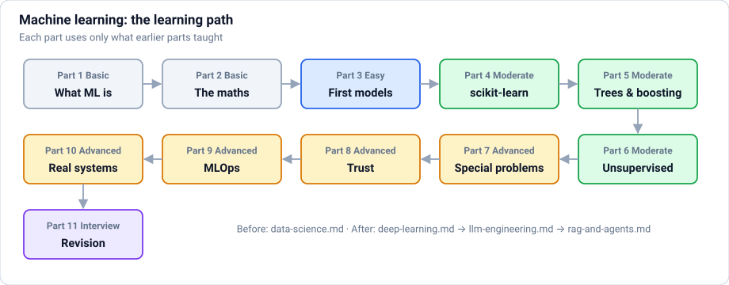
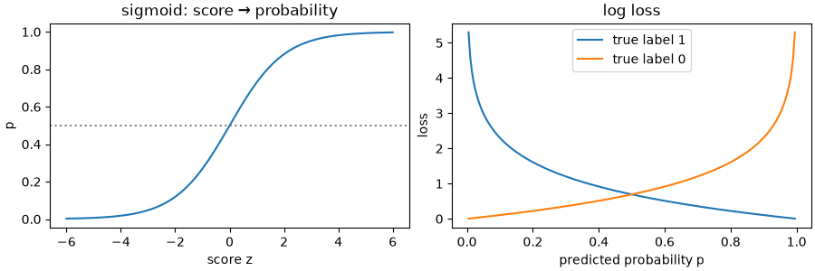
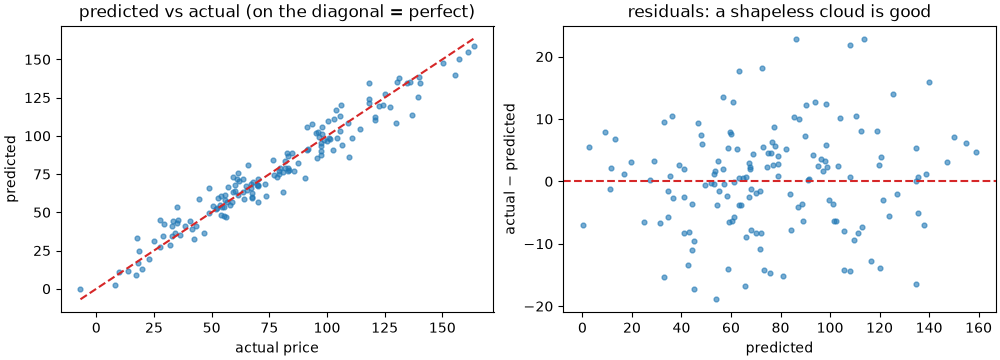
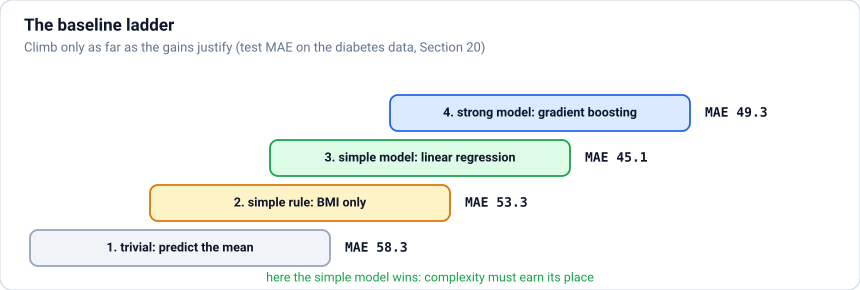
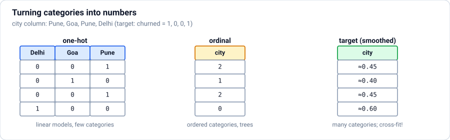
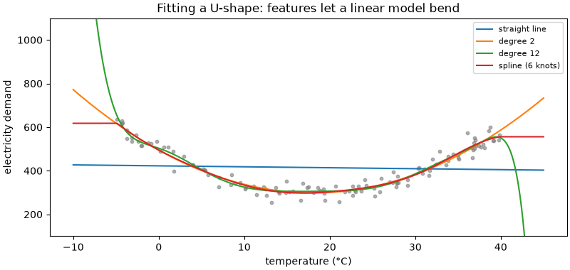
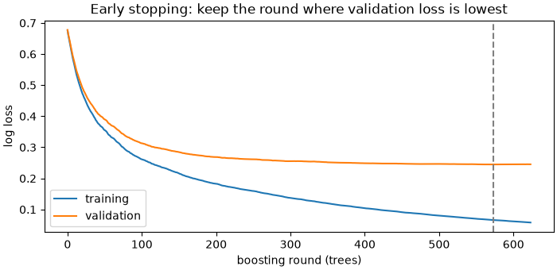
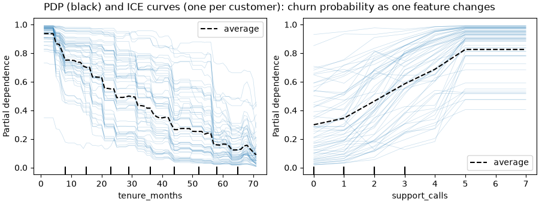

# Machine Learning with Python: From Absolute Basics to Interviews

Machine learning explained from zero, in **five levels**: **Basic** (what ML is, the ML workflow, and the maths it uses: vectors, derivatives, gradient descent, probability, losses, bias and variance) → **Easy** (first models: linear and logistic regression, k-nearest neighbours; honest evaluation and metrics; baselines) → **Moderate** (scikit-learn pipelines, cross-validation, tuning, regularisation, feature selection; decision trees, random forests, gradient boosting with XGBoost, LightGBM and CatBoost, SVMs, Naive Bayes; clustering, PCA, t-SNE/UMAP, anomaly detection) → **Advanced** (imbalanced data, forecasting, recommenders, text, calibration; explainability with SHAP, debugging, leakage, fairness; MLOps: serving, tracking, monitoring, system design; ML inside real products and what's new in 2026) → **Interview Prep**. **Each part uses only what earlier parts taught**, so read in order.

**Nothing is left for you to look up.** Every technical word is explained in plain language the first time it appears (look for the **Words to know** box at the top of each section), and Section [63](#63-glossary-every-term-in-these-notes) collects every term in one alphabetical glossary with a link back to where it's taught.

Every section has the same shape:

1. **Picture:** a diagram or a real chart of the idea.
2. **Theory:** what it is, an everyday picture, how it works step by step (traced by hand where possible), when to use it, when *not* to, common mistakes, and where it's used in real software.
3. **Python:** working programs, first **from scratch in NumPy** (so you see the algorithm) and then **with scikit-learn** (how you'd do it at work). Every example was run with **Python 3.13, scikit-learn 1.9, NumPy 2.5, pandas 3.0, XGBoost 3.4, LightGBM 4.7, CatBoost 1.2, SHAP 0.53, Optuna 5.0 and MLflow 3.17**: results under **Output** are real, and every chart image was produced by the code next to it.
4. **Practice:** exercises with hidden answers, plus graded problems (🟢 Easy, 🟡 Medium, 🔴 Hard, all free) from Deep-ML, where you implement ML algorithms in NumPy, and Kaggle datasets and competitions.

Each part ends with a ✅ **checkpoint**. Before this file, read `data-science.md` (NumPy, pandas, charts, statistics); after it, continue with `deep-learning.md` (neural networks), then `llm-engineering.md` and `rag-and-agents.md`.

## Table of Contents

**[Part 1 — Basic: What Machine Learning Is](#part-1--basic-what-machine-learning-is)**

1. [How to Use These Notes (and What an ML Engineer Does)](#1-how-to-use-these-notes-and-what-an-ml-engineer-does)
2. [What Is Machine Learning? Rules vs Learning from Examples](#2-what-is-machine-learning-rules-vs-learning-from-examples)
3. [Types of Machine Learning: Supervised, Unsupervised, Self-Supervised and Reinforcement](#3-types-of-machine-learning-supervised-unsupervised-self-supervised-and-reinforcement)
4. [The ML Workflow End to End: Problem, Data, Model, Evaluation, Deployment](#4-the-ml-workflow-end-to-end-problem-data-model-evaluation-deployment)
5. [Data for ML: Features, Labels and Train/Validation/Test Splits](#5-data-for-ml-features-labels-and-trainvalidationtest-splits)

**[Part 2 — Basic: The Maths Machine Learning Uses](#part-2--basic-the-maths-machine-learning-uses)**

6. [Vectors, Matrices and the Dot Product for ML](#6-vectors-matrices-and-the-dot-product-for-ml)
7. [Functions, Slopes and Derivatives](#7-functions-slopes-and-derivatives)
8. [Gradients and Gradient Descent](#8-gradients-and-gradient-descent)
9. [Probability for ML: Likelihood, Maximum Likelihood and Bayes](#9-probability-for-ml-likelihood-maximum-likelihood-and-bayes)
10. [Sigmoid, Softmax and Cross-Entropy (Log Loss)](#10-sigmoid-softmax-and-cross-entropy-log-loss)
11. [Loss Functions and Optimisers: MSE, MAE, Huber, Momentum and Adam](#11-loss-functions-and-optimisers-mse-mae-huber-momentum-and-adam)
12. [Bias, Variance and the Bias–Variance Trade-off](#12-bias-variance-and-the-biasvariance-trade-off)

**[Part 3 — Easy: Your First Models](#part-3--easy-your-first-models)**

13. [Linear Regression from Scratch](#13-linear-regression-from-scratch)
14. [Linear Regression with scikit-learn and Regression Metrics](#14-linear-regression-with-scikit-learn-and-regression-metrics)
15. [Learning Curves and Validation Curves: How Much Data, How Much Complexity](#15-learning-curves-and-validation-curves-how-much-data-how-much-complexity)
16. [Logistic Regression: Classification with Probabilities](#16-logistic-regression-classification-with-probabilities)
17. [Classification Metrics I: Confusion Matrix, Accuracy, Precision, Recall and F1](#17-classification-metrics-i-confusion-matrix-accuracy-precision-recall-and-f1)
18. [Classification Metrics II: ROC, AUC, Precision-Recall Curves and Thresholds](#18-classification-metrics-ii-roc-auc-precision-recall-curves-and-thresholds)
19. [k-Nearest Neighbours, Distances and Feature Scaling](#19-k-nearest-neighbours-distances-and-feature-scaling)
20. [Baselines and Choosing the Right Metric](#20-baselines-and-choosing-the-right-metric)

**[Part 4 — Moderate: scikit-learn Properly](#part-4--moderate-scikit-learn-properly)**

21. [The Estimator API: fit, predict, transform](#21-the-estimator-api-fit-predict-transform)
22. [Pipelines and ColumnTransformer](#22-pipelines-and-columntransformer)
23. [Missing Data, Encoding and Scaling Inside Pipelines](#23-missing-data-encoding-and-scaling-inside-pipelines)
24. [Cross-Validation: k-Fold, Stratified, Grouped and Time-Series Splits](#24-cross-validation-k-fold-stratified-grouped-and-time-series-splits)
25. [Hyperparameter Tuning: Grid, Random, Successive Halving and Bayesian Search](#25-hyperparameter-tuning-grid-random-successive-halving-and-bayesian-search)
26. [Regularisation: Ridge, Lasso and Elastic Net](#26-regularisation-ridge-lasso-and-elastic-net)
27. [Polynomial Features, Splines and Non-Linear Relationships](#27-polynomial-features-splines-and-non-linear-relationships)
28. [Feature Selection: Filter, Wrapper and Embedded Methods](#28-feature-selection-filter-wrapper-and-embedded-methods)

**[Part 5 — Moderate: Trees, Ensembles and Other Classic Models](#part-5--moderate-trees-ensembles-and-other-classic-models)**

29. [Decision Trees: Splits, Gini, Entropy and Pruning](#29-decision-trees-splits-gini-entropy-and-pruning)
30. [Bagging and Random Forests](#30-bagging-and-random-forests)
31. [Gradient Boosting from Scratch](#31-gradient-boosting-from-scratch)
32. [XGBoost, LightGBM and CatBoost in Practice](#32-xgboost-lightgbm-and-catboost-in-practice)
33. [Support Vector Machines and Kernels](#33-support-vector-machines-and-kernels)
34. [Naive Bayes](#34-naive-bayes)
35. [Choosing a Model for Tabular Data (and Stacking)](#35-choosing-a-model-for-tabular-data-and-stacking)

**[Part 6 — Moderate: Unsupervised Learning](#part-6--moderate-unsupervised-learning)**

36. [k-Means Clustering](#36-k-means-clustering)
37. [DBSCAN, Hierarchical Clustering and Gaussian Mixtures](#37-dbscan-hierarchical-clustering-and-gaussian-mixtures)
38. [Principal Component Analysis (PCA)](#38-principal-component-analysis-pca)
39. [t-SNE and UMAP for Visualisation](#39-t-sne-and-umap-for-visualisation)
40. [Anomaly Detection: Isolation Forest, Local Outlier Factor and One-Class Methods](#40-anomaly-detection-isolation-forest-local-outlier-factor-and-one-class-methods)

**[Part 7 — Advanced: Special Problems](#part-7--advanced-special-problems)**

41. [Imbalanced Classes: Resampling, Class Weights and Thresholds](#41-imbalanced-classes-resampling-class-weights-and-thresholds)
42. [Time-Series Forecasting with Machine Learning](#42-time-series-forecasting-with-machine-learning)
43. [Recommender Systems: Collaborative Filtering and Matrix Factorisation](#43-recommender-systems-collaborative-filtering-and-matrix-factorisation)
44. [Text Classification: Bag of Words, TF-IDF and Linear Models](#44-text-classification-bag-of-words-tf-idf-and-linear-models)
45. [Probability Calibration and Cost-Sensitive Decisions](#45-probability-calibration-and-cost-sensitive-decisions)

**[Part 8 — Advanced: Models You Can Trust](#part-8--advanced-models-you-can-trust)**

46. [Feature Importance: Impurity, Permutation and Drop-Column](#46-feature-importance-impurity-permutation-and-drop-column)
47. [Partial Dependence, ICE and SHAP](#47-partial-dependence-ice-and-shap)
48. [Debugging Models: Learning Curves, Error Analysis and Slicing](#48-debugging-models-learning-curves-error-analysis-and-slicing)
49. [Data Leakage: Finding and Preventing It](#49-data-leakage-finding-and-preventing-it)
50. [Fairness, Privacy and Responsible ML](#50-fairness-privacy-and-responsible-ml)

**[Part 9 — Advanced: MLOps](#part-9--advanced-mlops)**

51. [Saving Models: joblib, skops and ONNX](#51-saving-models-joblib-skops-and-onnx)
52. [Serving Models: a FastAPI Endpoint and Batch Scoring](#52-serving-models-a-fastapi-endpoint-and-batch-scoring)
53. [Experiment Tracking and Reproducibility with MLflow](#53-experiment-tracking-and-reproducibility-with-mlflow)
54. [ML Pipelines, Feature Stores and Training-Serving Skew](#54-ml-pipelines-feature-stores-and-training-serving-skew)
55. [Monitoring Models in Production: Data Drift, Concept Drift and Retraining](#55-monitoring-models-in-production-data-drift-concept-drift-and-retraining)
56. [ML System Design: a Framework and a Worked Example](#56-ml-system-design-a-framework-and-a-worked-example)

**[Part 10 — Advanced: ML in the Real World (2026)](#part-10--advanced-ml-in-the-real-world-2026)**

57. [How Real Systems Use ML: Fraud, Search Ranking, Ads, Recommendations and Forecasting](#57-how-real-systems-use-ml-fraud-search-ranking-ads-recommendations-and-forecasting)
58. [What's New (2022–2026): Tabular Foundation Models, AutoML and Modern Practice](#58-whats-new-20222026-tabular-foundation-models-automl-and-modern-practice)

**[Part 11 — Interview Prep](#part-11--interview-prep)**

59. [Interview Coding: ML Algorithms from Scratch in NumPy](#59-interview-coding-ml-algorithms-from-scratch-in-numpy)
60. [Interview Topic Checklist: What Companies Ask (ML)](#60-interview-topic-checklist-what-companies-ask-ml)
61. [Cheat Sheet: Which Model / Metric / Technique When?](#61-cheat-sheet-which-model--metric--technique-when)
62. [Most Asked Machine Learning Theory Questions](#62-most-asked-machine-learning-theory-questions)
63. [Glossary: Every Term in These Notes](#63-glossary-every-term-in-these-notes)

---

# Part 1 — Basic: What Machine Learning Is

> **Goal:** Understand what machine learning is and isn't, the main kinds of ML, the full workflow from a business question to a running model, and how data must be split so that evaluation is honest.  
> **You need:** Python basics and `data-science.md` Parts 1–5 (NumPy, pandas). No maths yet: Part 2 teaches it.

---

## 1. How to Use These Notes (and What an ML Engineer Does)



### Theory

> **In simple words:** **machine learning (ML)** is teaching a computer to make predictions by showing it **examples** instead of writing the rules by hand. These notes take you from "what is a model?" to training, evaluating, explaining and deploying models the way companies do, one small step at a time, with every algorithm built from scratch before you use the library version.

**Words to know:**

- **Machine learning (ML):** building programs that learn patterns from data to make predictions or decisions.
- **Model:** the learned function that turns inputs into a prediction (a formula with learned numbers, a tree of questions, a neural network).
- **Training:** the process of adjusting a model's numbers so its predictions match known answers.
- **Prediction (inference):** using a trained model on new data.
- **scikit-learn (`sklearn`):** the standard Python library for classic ML: models, preprocessing, evaluation, all with the same interface.
- **Classic ML vs deep learning:** classic ML (this file) works mostly on **tables** of features with algorithms like linear models and trees; **deep learning** uses large neural networks and dominates images, audio and text (`deep-learning.md`).
- **MLOps:** the practices and tools for running ML in production reliably (deployment, monitoring, retraining), like DevOps for models.
- **Production:** the live system real users depend on (as opposed to your notebook).
- **Data scientist / ML engineer / research scientist / AI engineer:** common job titles: analysing data and building models to answer business questions / building and running ML systems in production / inventing new methods and publishing / building products on top of pretrained models and LLMs.

**Everyday picture.** A new bank employee learns to spot fraud not from a rulebook but by reviewing thousands of past transactions that were already marked "fraud" or "fine". After a while they develop an instinct. ML gives a computer that instinct, and lets it review millions of transactions a second.

**These notes climb level by level:**

| Part | Level | What you learn | Afterwards you can… |
|---|---|---|---|
| 1 | Basic | What ML is, its types, the workflow, data splits | Frame a problem as ML and split data honestly |
| 2 | Basic | The maths: vectors, derivatives, gradient descent, probability, losses, bias–variance | Read any ML explanation without being lost in notation |
| 3 | Easy | Linear and logistic regression, metrics, k-NN, baselines | Train, evaluate and compare your first models |
| 4 | Moderate | scikit-learn properly: pipelines, cross-validation, tuning, regularisation, feature selection | Build leak-free, tuned pipelines |
| 5 | Moderate | Trees, random forests, gradient boosting (XGBoost, LightGBM, CatBoost), SVMs, Naive Bayes | Use the models that win on tabular data |
| 6 | Moderate | Unsupervised learning: clustering, PCA, t-SNE/UMAP, anomaly detection | Find structure without labels |
| 7 | Advanced | Imbalanced data, forecasting, recommenders, text, calibration and cost-based decisions | Handle the problems real projects bring |
| 8 | Advanced | Explainability (SHAP), debugging, leakage, fairness | Build models people can trust |
| 9 | Advanced | Saving and serving models, experiment tracking, pipelines, monitoring, system design | Ship and run models in production |
| 10 | Advanced | ML inside real systems, and what's new in 2026 | Connect the theory to real products |
| 11 | Interview Prep | Algorithms from scratch, what companies ask, cheat sheet, theory questions, glossary | Revise quickly and check your coverage |

**What an ML engineer actually does.** Much less time goes into inventing algorithms than people expect:

| Activity | Share of a typical project |
|---|---|
| framing the problem, agreeing a metric with the business | small, but decides success |
| getting, cleaning and understanding data | **the largest part** |
| building features and baselines | large |
| training and tuning models | moderate |
| evaluating properly (offline, then with A/B tests) | moderate |
| deploying, monitoring, retraining | large, and ongoing |

**Roles you'll hear about (2026):**

| Role | Mostly does |
|---|---|
| **Data scientist** | analysis, experiments, models that inform decisions |
| **ML engineer** | builds, ships and maintains models in production |
| **AI engineer** | builds products on top of LLMs and foundation models (`llm-engineering.md`, `rag-and-agents.md`) |
| **MLOps / ML platform engineer** | the infrastructure: training pipelines, feature stores, serving, monitoring |
| **Research scientist** | invents new methods |

Classic ML from these notes remains the backbone of fraud detection, credit scoring, search ranking, recommendations, forecasting and pricing, even at companies that also use LLMs.

**How to study each section:** look at the picture; read the theory slowly and trace the worked example by hand; **type** the code (from scratch first, then scikit-learn), run it, change one number and predict the result before re-running; then try the practice before opening the answers.

**Setup:** the same environment as `data-science.md`, plus `uv add scikit-learn xgboost lightgbm catboost shap optuna mlflow imbalanced-learn` (or `pip install ...`). Google Colab has most of these preinstalled.

### Practice

1. Pick an everyday prediction you'd like to automate (will it rain tomorrow, will a customer cancel, what price will a used phone sell for). Write down: what exactly is predicted, what information would be available **at the moment of prediction**, and how you'd know if the predictions were good.

**Learn more:** [Google: Machine Learning Crash Course](https://developers.google.com/machine-learning/crash-course) · [scikit-learn: getting started](https://scikit-learn.org/stable/getting_started.html)

---

## 2. What Is Machine Learning? Rules vs Learning from Examples


### Theory

> **In simple words:** in normal programming, **you** write the rules: "if the email contains 'lottery', mark it spam". In machine learning, you give the computer **thousands of examples** (emails already marked spam or not spam) and it **learns** the rules itself. The learned rules are the **model**.

**Words to know:**

- **Example (sample, instance, row):** one thing we have data about. Spam example: one email.
- **Feature (input, attribute, X):** a measurable property of an example: number of links, contains "free", sender known?
- **Label (target, output, y):** the answer we want to predict: spam or not spam.
- **Parameters (weights):** the numbers inside a model that training adjusts, like the 0.8, 2.1 and 3 in "spam if 0.8 × links + 2.1 × free > 3".
- **Training (fitting, learning):** adjusting the parameters so predictions match known labels.
- **Loss:** one number measuring how wrong the predictions are (the fraction of emails misclassified, say); training makes it small.
- **Inference (prediction):** using the trained model on new examples: classifying today's emails.
- **Generalisation:** performing well on **new** data, not just the training examples: catching next month's spam.
- **Labelled data:** examples that come with the correct answer: emails users marked as spam.

**Everyday picture.** Teaching a child what a dog is: you don't give them a definition ("four legs, fur, barks"); you point at dogs and non-dogs until they can tell new ones apart, including breeds they've never seen. That last part, handling new cases, is generalisation, the whole point of ML.

**Rule-based vs learned, side by side:**

| | Hand-written rules | Machine learning |
|---|---|---|
| who decides the logic | a person | the training algorithm, from data |
| needs | expert knowledge | many labelled examples |
| handles subtle, many-factor patterns | poorly | well |
| explains itself | easily | varies (Part 8) |
| adapts when the world changes | someone must rewrite rules | retrain on new data |

**The core loop of every ML algorithm,** traced on the tiny spam example in the code below:

1. Choose a family of possible rules (here: "spam if links ≥ t" for t = 0…9).
2. For each candidate t, count how many training emails it classifies correctly (that's the loss, inverted).
3. Keep the t that does best.
4. Use that rule on new emails.

Real algorithms search far more cleverly (gradient descent, Section [8](#8-gradients-and-gradient-descent); tree building, Section [29](#29-decision-trees-splits-gini-entropy-and-pruning)) over millions of parameters, but the idea is the same: **try parameters, measure the loss on known examples, keep what works**.

**When NOT to use ML:**

- An exact formula or simple rule works (converting currencies, tax calculations).
- There's little or no data, or no labels and no way to get them.
- Mistakes are unacceptable and can't be caught by a human.
- Decisions must be fully explainable by law and a transparent rule would do.
- The patterns change faster than you can collect data.

A well-chosen rule beats a poorly built model, and is a great **baseline** (Section [20](#20-baselines-and-choosing-the-right-metric)).

**Common mistakes:**

- ❌ Starting with a complex model before a simple baseline.
- ❌ Measuring success on the same data the model learned from.
- ❌ Using features that won't exist when the prediction is actually made.

**Used in real software:** spam filters, fraud detection, search ranking, product recommendations, credit scoring, demand forecasting, medical image screening, speech recognition, and the LLMs behind chat assistants.

### Python

```python
# A hand-written rule vs a learned rule, on the same tiny dataset
emails = [  # (number of links, contains "free"?, is spam?)
    (0, 0, 0), (1, 0, 0), (5, 1, 1), (7, 1, 1), (2, 0, 0), (6, 0, 1), (0, 1, 0), (8, 1, 1),
]

def rule(links, free):                 # written by a human
    return 1 if free == 1 else 0

def learn_threshold(data):             # "training": try every threshold, keep the best
    best_t, best_correct = None, -1
    for t in range(10):
        correct = sum((links >= t) == bool(spam) for links, _, spam in data)
        if correct > best_correct:
            best_t, best_correct = t, correct
    return best_t

t = learn_threshold(emails)
print("learned rule: spam if links >=", t)
print("hand rule accuracy:", sum(rule(l, f) == s for l, f, s in emails) / len(emails))
print("learned rule accuracy:", sum((l >= t) == bool(s) for l, _, s in emails) / len(emails))
```

**Output:**

```text
learned rule: spam if links >= 3
hand rule accuracy: 0.75
learned rule accuracy: 1.0
```

```python
new_emails = [(4, 0), (9, 1), (1, 1)]                   # unseen emails: (links, free)
print([("spam" if links >= t else "ham") for links, _ in new_emails])   # inference on new data
```

**Output:**

```text
['spam', 'spam', 'ham']
```

"Ham" is the traditional name for a legitimate (not spam) email.

### Practice

1. For each, say whether it's a good ML problem, and if not, why: (a) predicting tomorrow's electricity demand in megawatts; (b) grouping shoppers by behaviour without predefined groups; (c) deciding if a card transaction is fraud; (d) converting Celsius to Fahrenheit; (e) predicting the winner of next year's election from last year's 1 data point.

<details>
<summary><b>Answer</b></summary>

(a) Yes: plenty of history, a clear number to predict. (b) Yes, unsupervised (clustering, Part 6). (c) Yes: many labelled past transactions. (d) No: there's an exact formula, F = C × 9/5 + 32. (e) No: far too little data to learn from.

</details>

| # | Problem | Difficulty |
|---|---|---|
| 1 | [Kaggle Learn: Intro to Machine Learning (course)](https://www.kaggle.com/learn/intro-to-machine-learning) | 🟢 Easy |

**Learn more:** [Google ML Crash Course: framing](https://developers.google.com/machine-learning/intro-to-ml) · [scikit-learn: getting started](https://scikit-learn.org/stable/getting_started.html)

---

## 3. Types of Machine Learning: Supervised, Unsupervised, Self-Supervised and Reinforcement


### Theory

> **In simple words:** ML problems are grouped by **what the computer learns from**. With **answers** (labels) it's **supervised**; with **no answers** it's **unsupervised**; with answers **made from the data itself** (hide a word, predict it) it's **self-supervised**; and with **rewards** from trying actions it's **reinforcement learning**.

**Words to know:**

- **Supervised learning:** learning from examples that have the correct answer (labels).
  - **Regression:** predicting a **number** (a price, a temperature, minutes until delivery).
  - **Classification:** predicting a **category**. **Binary**: two classes (spam / not). **Multi-class**: one of many (which digit 0–9). **Multi-label**: several at once (a film's genres).
- **Unsupervised learning:** finding structure in data **without** labels.
  - **Clustering:** grouping similar examples (customer segments).
  - **Dimensionality reduction:** compressing many features into a few while keeping most information (for charts, speed, noise removal).
  - **Anomaly detection:** finding unusual examples (odd transactions).
- **Self-supervised learning:** creating labels automatically from unlabelled data (predict the next word, fill in a hidden part of an image). How LLMs and modern image models are **pre-trained**.
- **Reinforcement learning (RL):** an **agent** takes **actions** in an **environment** and learns from **rewards** which actions lead to good long-term outcomes (game playing, robotics, tuning LLMs from human feedback).
- **Semi-supervised learning:** a few labelled examples plus many unlabelled ones.
- **Ranking:** predicting an **order** (which search results first).
- **Binary vs multi-class classification:** predicting one of two classes (spam / not spam) vs one of three or more (digit 0–9).
- **Toy dataset:** a small, clean, well-known dataset (iris, digits, breast cancer) bundled with libraries for learning and testing code.

**Everyday picture.** Learning to cook: following recipes with photos of the finished dish (supervised); sorting a pile of unlabelled spices into groups by smell (unsupervised); covering half a recipe and guessing the rest, millions of times, until you understand how recipes work (self-supervised); and trying dishes on guests and adjusting by their reactions (reinforcement).

**Which type is my problem?**

| If you have… | and want to… | it's… | Examples | In these notes |
|---|---|---|---|---|
| labels that are numbers | predict a number | regression | house price, demand, delivery time | Sections [13](#13-linear-regression-from-scratch), [14](#14-linear-regression-with-scikit-learn-and-regression-metrics) |
| labels that are categories | predict a category | classification | fraud, churn, disease, digit | Sections [16](#16-logistic-regression-classification-with-probabilities)–[19](#19-k-nearest-neighbours-distances-and-feature-scaling) |
| no labels | find groups | clustering | customer segments | Sections [36](#36-k-means-clustering)–[37](#37-dbscan-hierarchical-clustering-and-gaussian-mixtures) |
| no labels | find the unusual | anomaly detection | broken sensors, odd payments | Section [40](#40-anomaly-detection-isolation-forest-local-outlier-factor-and-one-class-methods) |
| many features | compress or visualise | dimensionality reduction | 64-pixel digits → 2D chart | Sections [38](#38-principal-component-analysis-pca)–[39](#39-t-sne-and-umap-for-visualisation) |
| user–item interactions | recommend | recommendation | "you may also like" | Section [43](#43-recommender-systems-collaborative-filtering-and-matrix-factorisation) |
| a time-ordered history | predict the future | forecasting (regression on time) | next week's sales | Section [42](#42-time-series-forecasting-with-machine-learning) |
| huge unlabelled text/images | learn general representations | self-supervised | LLM pre-training | `deep-learning.md`, `llm-engineering.md` |
| a way to try actions and get rewards | learn a policy | reinforcement learning | games, robotics, RLHF | `llm-engineering.md` |

**Turning a business question into an ML problem, traced:** "Which customers should we offer a discount to?"

1. What's predicted? Whether a customer will **cancel in the next 30 days** (yes/no) → **binary classification**.
2. Labels? Past customers and whether they cancelled within 30 days of a given date → available from history.
3. Features? Usage, tenure, support tickets, plan, all **as of** that date.
4. Decision? Offer the discount to customers whose predicted cancellation probability is high **and** whose value justifies the cost.

**Common mistakes:**

- ❌ Treating an ordered category (1–5 stars) as unrelated classes, or a category (city codes) as a number.
- ❌ Framing as classification what's really ranking ("show the best 10 products"), or vice versa.
- ❌ Expecting clustering to find "the right" groups: there's no answer key, so results must be judged by usefulness.

**Used in real software:** regression for pricing and forecasting; classification for fraud, spam, medical triage; clustering for marketing segments; anomaly detection for monitoring; ranking for search and feeds; self-supervised pre-training for every LLM; RL for game AI and LLM alignment.

### Python

```python
from sklearn.datasets import load_diabetes, load_digits, load_wine

X_reg, y_reg = load_diabetes(return_X_y=True)        # regression: disease progression score (a number)
X_clf, y_clf = load_wine(return_X_y=True)            # classification: one of 3 grape cultivars
X_img, y_img = load_digits(return_X_y=True)          # classification: handwritten digit 0–9 (8×8 pixels)

for name, X, y in [("diabetes (regression)", X_reg, y_reg), ("wine (3 classes)", X_clf, y_clf),
                   ("digits (10 classes)", X_img, y_img)]:
    kind = "numbers" if y.dtype.kind == "f" else f"{len(set(y))} classes"
    print(f"{name:<22} X shape {X.shape}, y: {kind}, first targets {y[:5].round(1).tolist()}")
```

**Output:**

```text
diabetes (regression)  X shape (442, 10), y: numbers, first targets [151.0, 75.0, 141.0, 206.0, 135.0]
wine (3 classes)       X shape (178, 13), y: 3 classes, first targets [0, 0, 0, 0, 0]
digits (10 classes)    X shape (1797, 64), y: 10 classes, first targets [0, 1, 2, 3, 4]
```

scikit-learn ships small **toy datasets** (no download needed) that these notes use alongside generated data: `load_diabetes`, `load_wine`, `load_digits`, `load_breast_cancer`. `return_X_y=True` returns the feature matrix `X` and target `y` directly.

```python
import numpy as np
from sklearn.cluster import KMeans

rng = np.random.default_rng(0)
customers = np.vstack([rng.normal([20, 2], [4, 0.6], (50, 2)),       # (age-ish, orders/month): two hidden groups
                       rng.normal([45, 8], [5, 1.0], (50, 2))])
km = KMeans(n_clusters=2, n_init=10, random_state=0).fit(customers)     # unsupervised: no labels given
print("cluster sizes:", np.bincount(km.labels_), "| cluster centres:", km.cluster_centers_.round(1).tolist())
```

**Output:**

```text
cluster sizes: [50 50] | cluster centres: [[44.4, 8.0], [19.9, 2.1]]
```

k-means (Section [36](#36-k-means-clustering)) found the two hidden groups without ever being told they existed: that's unsupervised learning. `np.bincount` counts how many points got each cluster number.

### Practice

1. Classify each problem by type: (a) predicting the number of bikes rented tomorrow; (b) tagging a news article with any of 20 topics; (c) finding groups of similar songs with no genre labels; (d) teaching a warehouse robot to pick items faster by trial and error; (e) ordering 50 hotels for a search query.

<details>
<summary><b>Answer</b></summary>

(a) Regression (forecasting). (b) Multi-label classification. (c) Clustering (unsupervised). (d) Reinforcement learning. (e) Ranking.

</details>

| # | Practice | Difficulty |
|---|---|---|
| 1 | [Kaggle Learn: Intro to Machine Learning](https://www.kaggle.com/learn/intro-to-machine-learning) | 🟢 Easy |
| 2 | [Deep-ML 36. Calculate Accuracy Score](https://www.deep-ml.com/problems/36) | 🟢 Easy |

**Learn more:** [scikit-learn: user guide (supervised and unsupervised)](https://scikit-learn.org/stable/user_guide.html) · [Google: types of ML](https://developers.google.com/machine-learning/intro-to-ml/what-is-ml)

---

## 4. The ML Workflow End to End: Problem, Data, Model, Evaluation, Deployment


### Theory

> **In simple words:** a working ML system is a **loop**, not a single training run: frame the problem → get and prepare data → build a baseline → train and evaluate → deploy → monitor → retrain. Most ML failures come from the steps before and after training, not from choosing the wrong algorithm.

**Words to know:**

- **Problem framing:** turning a business goal into a precise prediction task with a measurable target.
- **Metric:** the number used to judge the model (accuracy, recall, RMSE…) and, separately, the **business metric** it should move (revenue, fraud losses).
- **Offline evaluation:** testing on held-out historical data. **Online evaluation:** measuring real impact on live users, usually with an A/B test (`data-science.md` Section 58).
- **Baseline:** the simplest reasonable approach (predict the average, a business rule, a simple model), which every model must beat.
- **Iteration:** improving in small steps: better data and features first, then better models, then tuning.
- **Deployment:** making the model available to the systems that need its predictions (an API, a nightly batch job).
- **Monitoring:** watching the live model's inputs, outputs and performance for problems.
- **Drift:** the world changing so that the data or the relationships the model learned no longer hold (Section [55](#55-monitoring-models-in-production-data-drift-concept-drift-and-retraining)).
- **Model registry:** a catalogue of trained model versions with their metrics and status (Section [53](#53-experiment-tracking-and-reproducibility-with-mlflow)).
- **API (application programming interface):** a defined way for one program to call another, e.g. an HTTP endpoint that returns predictions.
- **Model version:** an identifier for one specific trained model (e.g. `churn-2026-10-01`), logged with every prediction so decisions can be traced.

**Everyday picture.** Opening a restaurant: deciding what to serve (framing), sourcing ingredients (data), a simple menu first (baseline), test dinners with friends (offline evaluation), opening night (deployment), reading reviews every week (monitoring), and changing the menu when tastes change (retraining).

**The workflow, step by step:**

| Step | Key questions | Typical output |
|---|---|---|
| 1. Frame | What decision will the prediction drive? What's the target exactly? What's a mistake worth? What data exists **at prediction time**? | a one-page problem statement and a metric |
| 2. Data | Where does it come from? Is it labelled? Clean? Representative? Time range? | a training table, documented |
| 3. Split | Random, stratified, grouped or by time (Section [5](#5-data-for-ml-features-labels-and-trainvalidationtest-splits))? | train / validation / test sets |
| 4. Baseline | What does a rule or a trivial model score? | a number to beat |
| 5. Features and models | Which features help? Which model family suits the data? | candidate models with validation scores |
| 6. Evaluate | Does it beat the baseline on the **test** set? Errors by segment? Fairness? | an evaluation report |
| 7. Deploy | Batch or real-time? Latency? Rollback plan? | a service or scheduled job |
| 8. Online test | Does it move the business metric in an A/B test? | a launch decision |
| 9. Monitor and retrain | Drift? Performance decay? Retraining schedule? | dashboards, alerts, a retraining pipeline |

**Where projects really fail:** a vague target ("predict good customers"); labels that leak the answer; training data that doesn't match production (different time, different users); no baseline; evaluation on the wrong split; nobody monitoring after launch. Every one of these is about process, not algorithms.

**When ML adds value:** a repeated decision, made many times, where small accuracy gains are worth money and data is plentiful. **When it doesn't:** one-off decisions, tiny data, or when the cost of building and maintaining the system exceeds the gain.

**Common mistakes:**

- ❌ Optimising an offline metric that doesn't relate to the business goal (high accuracy, no profit).
- ❌ Skipping the baseline.
- ❌ "Launch and forget": models silently decay as the world changes.
- ❌ Treating the notebook as the product: production needs reproducible pipelines (Part 9).

**Used in real software:** every production ML team runs this loop; platforms such as Vertex AI, SageMaker, Databricks and open-source stacks (MLflow, Airflow, Feast) exist to automate its steps.

### Python

This compressed version of the whole loop (on scikit-learn's breast-cancer dataset) previews what later sections teach in depth:

```python
import numpy as np
from sklearn.datasets import load_breast_cancer
from sklearn.dummy import DummyClassifier
from sklearn.linear_model import LogisticRegression
from sklearn.metrics import recall_score, precision_score
from sklearn.model_selection import train_test_split
from sklearn.pipeline import make_pipeline
from sklearn.preprocessing import StandardScaler

# 1. Frame: flag tumours that are malignant (1) so a doctor reviews them; missing one is the costly mistake → recall matters
data = load_breast_cancer()
X, y = data.data, 1 - data.target                         # in this dataset 0 = malignant; flip so 1 = malignant
print("rows, features:", X.shape, "| malignant share:", round(y.mean(), 3))

# 3. Split: hold out a test set, stratified so both sets keep the same class balance
X_train, X_test, y_train, y_test = train_test_split(X, y, test_size=0.25, stratify=y, random_state=0)

# 4. Baseline: always predict the most common class
baseline = DummyClassifier(strategy="most_frequent").fit(X_train, y_train)
print("baseline recall:", recall_score(y_test, baseline.predict(X_test)))

# 5–6. Model and evaluation on the untouched test set
model = make_pipeline(StandardScaler(), LogisticRegression()).fit(X_train, y_train)
pred = model.predict(X_test)
print(f"model recall {recall_score(y_test, pred):.3f}, precision {precision_score(y_test, pred):.3f}")
```

**Output:**

```text
rows, features: (569, 30) | malignant share: 0.373
baseline recall: 0.0
model recall 0.962, precision 1.000
```

The baseline catches **no** malignant tumours (it always says "benign"); the model catches almost all of them. Recall and precision are explained in Section [17](#17-classification-metrics-i-confusion-matrix-accuracy-precision-recall-and-f1); `make_pipeline(StandardScaler(), ...)` in Section [22](#22-pipelines-and-columntransformer).

```python
import joblib, os, tempfile

# 7. Deploy (in miniature): save the trained pipeline, load it elsewhere, predict for a new patient
path = os.path.join(tempfile.mkdtemp(), "cancer_model.joblib")
joblib.dump(model, path)
loaded = joblib.load(path)
new_patient = X_test[:1]
print("P(malignant) =", loaded.predict_proba(new_patient)[0, 1].round(3), "| true label:", y_test[0])

# 9. Monitor (in miniature): compare a live feature's distribution with training
live_mean_radius = X_test[:, 0].mean()                      # pretend this week's patients are the test set
print(f"mean radius: train {X_train[:, 0].mean():.2f} vs live {live_mean_radius:.2f}")
```

**Output:**

```text
P(malignant) = 1.0 | true label: 1
mean radius: train 14.10 vs live 14.19
```

`joblib` saves Python objects (here the whole pipeline) to a file; Section [51](#51-saving-models-joblib-skops-and-onnx) covers saving models safely and portably.

### Practice

1. For "predict which support tickets are urgent", write the frame in four lines: target, label source, features available at prediction time, and the metric (and why).

<details>
<summary><b>Answer</b></summary>

- **Target:** urgent (1) or not (0), where "urgent" = needed an engineer within 4 hours (a definition everyone agrees on).
- **Labels:** past tickets with their resolution category and escalation history.
- **Features:** ticket text, product, customer tier, time of day, number of open tickets, all known when the ticket arrives (not the resolution time!).
- **Metric:** recall on urgent tickets at a precision the support team can handle (e.g. "catch 95% of urgent tickets while flagging at most 20% of all tickets"), because a missed urgent ticket is the costly mistake.

</details>

| # | Practice | Difficulty |
|---|---|---|
| 1 | [Kaggle: Titanic (walk the whole workflow once)](https://www.kaggle.com/competitions/titanic) | 🟢 Easy |
| 2 | [Deep-ML 29. Random Shuffle of Dataset](https://www.deep-ml.com/problems/29) | 🟢 Easy |

**Learn more:** [Google: Rules of Machine Learning (Martin Zinkevich)](https://developers.google.com/machine-learning/guides/rules-of-ml) · [Chip Huyen: Designing Machine Learning Systems (book site)](https://huyenchip.com/books/)

---

## 5. Data for ML: Features, Labels and Train/Validation/Test Splits


### Theory

> **In simple words:** a model must be judged on data it **never saw** during training, otherwise you're grading a student on the exact questions they memorised. So you split your data: a **training set** to learn from, a **validation set** to compare choices, and a **test set** you touch **once** at the very end. How you split (randomly, by group, or by time) must mimic how the model will be used.

**Words to know:**

- **Feature matrix (X):** the table of inputs, shape (rows, features). **Target vector (y):** the answers, one per row.
- **Training set:** the rows the model learns from.
- **Validation set:** rows held out to compare models and settings during development.
- **Test set (hold-out set):** rows kept untouched until the final evaluation.
- **Hyperparameter:** a setting chosen **before** training (tree depth, learning rate, k in k-NN), as opposed to **parameters** learned by training.
- **Random split:** rows assigned to sets at random.
- **Stratified split:** a random split that keeps the class proportions equal in every set.
- **Grouped split:** all rows of the same group (patient, customer, device) go to the same set.
- **Time-based split:** train on earlier data, validate/test on later data.
- **Data leakage:** information from outside the training data (the test set, the future, or the answer itself) influencing training, making results look better than they'll be in use (Section [49](#49-data-leakage-finding-and-preventing-it)).
- **Distribution:** the pattern of values data takes; **i.i.d.** ("independent and identically distributed") means each row is drawn independently from the same distribution, the assumption behind random splits.
- **`random_state`:** a seed that makes a random split repeatable.
- **DataFrame:** a table with named columns of possibly different types (pandas, Polars); one row per example.

**Everyday picture.** A driving school: lessons on practice routes (training), a mock test on routes the instructor picks to decide if you're ready (validation), and the real test on a route you've never seen (test). If you practised on the exact test route, passing would prove nothing.

**Typical proportions:**

| Set | Used for | Typical share |
|---|---|---|
| training | fitting parameters | 60–80% |
| validation | choosing models, features and hyperparameters | 10–20% (or cross-validation, Section [24](#24-cross-validation-k-fold-stratified-grouped-and-time-series-splits)) |
| test | one final, honest estimate | 10–20% |

**Choosing the split, step by step:**

| Your data | Split | Why |
|---|---|---|
| independent rows (i.i.d.) | random | every row is like any other |
| classification with rare classes | **stratified** (`stratify=y`) | each set gets its share of the rare class |
| several rows per person / device / store | **grouped** (`GroupShuffleSplit`) | otherwise the model is graded on people it already saw |
| anything ordered in time (sales, prices, user activity) | **by time** | in real use you always predict the future from the past |

**Why a stratified split matters, traced:** 1,000 rows, 30 positives (3%). A random 20% test set of 200 rows should hold 6 positives, but by chance it might hold 2 or 11, making test scores swing wildly. Stratifying guarantees exactly 6.

**Touch the test set once.** Each time you look at test results and change something, you tune your decisions to the test set, and it stops being an honest estimate. Use validation (or cross-validation) for all choices; report the test score once.

**When the split is the hard part:** user-level products (split by user), medical data (split by patient), forecasting (split by time, with a gap if labels arrive late), and any data where the same real-world thing appears in several rows.

**Common mistakes:**

- ❌ Preprocessing (scaling, filling, encoding) on all data before splitting: leakage (`data-science.md` Section 61).
- ❌ Random splits on time series or grouped data.
- ❌ Re-using the test set to choose models.
- ❌ Splitting after removing duplicates in only one set, or duplicates appearing in both sets.

**Used in real software:** every model evaluation; Kaggle competitions keep a private test set nobody sees until the end; production teams use "backtests" over past time windows (Section [42](#42-time-series-forecasting-with-machine-learning)).

### Python

```python
import numpy as np
import pandas as pd
from sklearn.model_selection import GroupShuffleSplit, train_test_split

rng = np.random.default_rng(0)
n = 1_000
df = pd.DataFrame({"customer": rng.integers(0, 200, n),                       # ~5 rows per customer
                   "date": pd.Timestamp("2025-01-01") + pd.to_timedelta(rng.integers(0, 365, n), unit="D"),
                   "x": rng.normal(size=n),
                   "y": (rng.random(n) < 0.03).astype(int)})                  # 3% positives

random_counts = [int(train_test_split(df, test_size=0.2, random_state=s)[1]["y"].sum()) for s in range(8)]
strat_counts = [int(train_test_split(df, test_size=0.2, stratify=df["y"], random_state=s)[1]["y"].sum()) for s in range(8)]
print("positives in the test set over 8 splits: random", random_counts, "| stratified", strat_counts,
      "| expected", round(0.2 * df["y"].sum()))

train, test = train_test_split(df, test_size=0.2, random_state=1)

shared = set(train["customer"]) & set(test["customer"])
print("customers appearing in BOTH random sets:", len(shared))
gss = GroupShuffleSplit(n_splits=1, test_size=0.2, random_state=1)
tr_idx, te_idx = next(gss.split(df, groups=df["customer"]))
print("customers in both grouped sets:", len(set(df.iloc[tr_idx]["customer"]) & set(df.iloc[te_idx]["customer"])))

cutoff = pd.Timestamp("2025-10-01")
past, future = df[df["date"] < cutoff], df[df["date"] >= cutoff]
print(f"time split: train up to {past['date'].max().date()}, test from {future['date'].min().date()} ({len(past)} / {len(future)} rows)")
```

**Output:**

```text
positives in the test set over 8 splits: random [1, 5, 8, 4, 5, 5, 3, 3] | stratified [5, 5, 5, 5, 5, 5, 5, 5] | expected 5
customers appearing in BOTH random sets: 122
customers in both grouped sets: 0
time split: train up to 2025-09-30, test from 2025-10-01 (738 / 262 rows)
```

With a random split, the number of rare positives in the test set swings from split to split; stratifying pins it at the expected count. `GroupShuffleSplit` assigns whole groups (here customers) to one side; `next(...)` takes the first (only) split it generates. The random split put most customers in **both** sets, so a model could be graded on customers it learned from.

```python
train_val, test = train_test_split(df, test_size=0.2, stratify=df["y"], random_state=0)
train, val = train_test_split(train_val, test_size=0.25, stratify=train_val["y"], random_state=0)   # 0.25 × 0.8 = 0.2
print({name: (len(part), int(part["y"].sum())) for name, part in [("train", train), ("val", val), ("test", test)]})
```

**Output:**

```text
{'train': (600, 15), 'val': (200, 5), 'test': (200, 5)}
```

Two calls give a 60 / 20 / 20 split, each stratified.

### Practice

1. A hospital dataset has 5,000 X-ray images from 800 patients (several images each). How should you split it, and what goes wrong otherwise?
2. You're predicting next month's sales from 3 years of monthly data. Which split, and why not random?

<details>
<summary><b>Answer</b></summary>

1. Split **by patient** (grouped). Otherwise images of the same patient land in both sets, and the model can recognise the patient (or their scanner) rather than the disease, inflating the score.
2. A **time** split: train on the first ~2.5 years, test on the most recent months. A random split would train on months after the ones it's tested on, using the future to predict the past, which can't happen in real use.

</details>

| # | Problem (Deep-ML) | Difficulty |
|---|---|---|
| 1 | [29. Random Shuffle of Dataset](https://www.deep-ml.com/problems/29) | 🟢 Easy |
| 2 | [30. Batch Iterator for Dataset](https://www.deep-ml.com/problems/30) | 🟢 Easy |
| 3 | [275. Implement Stratified Train-Test Split](https://www.deep-ml.com/problems/275) | 🟡 Medium |
| 4 | [33. Generate Random Subsets of a Dataset](https://www.deep-ml.com/problems/33) | 🟡 Medium |

**Learn more:** [scikit-learn: cross-validation and splitters](https://scikit-learn.org/stable/modules/cross_validation.html) · [Google ML Crash Course: dividing the dataset](https://developers.google.com/machine-learning/crash-course/overfitting/dividing-datasets)

---

### ✅ Part 1 checkpoint

Without looking, can you:

- [ ] Explain features, labels, parameters, training, loss, inference and generalisation with one example?
- [ ] Say when ML is the wrong tool?
- [ ] Classify a problem as regression, classification, clustering, anomaly detection, ranking, self-supervised or reinforcement learning?
- [ ] Walk through the nine steps of the ML workflow and name where projects usually fail?
- [ ] Choose between a random, stratified, grouped and time-based split, and explain why the test set is touched once?

Part 2 teaches the small amount of maths every ML algorithm is built on.

---

# Part 2 — Basic: The Maths Machine Learning Uses

> **Goal:** Learn the small amount of maths behind every ML algorithm: vectors and the dot product, slopes and derivatives, gradient descent, probability and likelihood, sigmoid/softmax/cross-entropy, loss functions and optimisers, and the bias–variance trade-off. Each idea is explained in words, traced by hand, and checked in NumPy.  
> **You need:** Part 1, and NumPy from `data-science.md` Part 2. School algebra is enough.

---

## 6. Vectors, Matrices and the Dot Product for ML


### Theory

> **In simple words:** ML turns everything into **lists of numbers**. One house `[area, bedrooms, age]` is a **vector**; a whole dataset of houses stacked row by row is a **matrix**. A model's core operation is the **dot product**: multiply each feature by a weight and add up. That's most of what "linear algebra" means in ML.

**Words to know:**

- **Vector:** an ordered list of numbers; for ML, usually one example's features or a model's weights.
- **Dimension (of a vector):** how many numbers it has. A vector of 3 features lives in 3-dimensional space.
- **Matrix:** a table of numbers with shape (rows, columns). A dataset `X` with n examples and d features has shape (n, d).
- **Dot product (a · b):** a₁b₁ + a₂b₂ + … + aₙbₙ: one number.
- **Weighted sum:** the dot product read as "each input times its importance, added up".
- **Norm:** a vector's length. **L2 norm** ‖x‖₂ = √(x₁² + x₂² + …) (straight-line length); **L1 norm** ‖x‖₁ = |x₁| + |x₂| + … Both return as **regularisation** (Section [26](#26-regularisation-ridge-lasso-and-elastic-net)).
- **Cosine similarity:** (a · b) / (‖a‖ ‖b‖): from −1 (opposite) to 1 (same direction); compares direction, ignoring length.
- **Matrix–vector product (X @ w):** the dot product of **every row** of X with w: one prediction per example.
- **Transpose (Xᵀ, `X.T`):** rows become columns.
- **Embedding:** a vector representing meaning (`data-science.md` Section 16), compared with cosine similarity.

**Everyday picture.** A shopping trolley `[2 kg rice, 3 L milk, 1 loaf]` dotted with a price list `[60, 50, 40]` gives the bill: 2×60 + 3×50 + 1×40 = 310. A model's prediction is the same calculation: features × learned "prices" (weights), added up.

**Two ways to read the dot product:**

1. **As a weighted sum (a model):** `price = 0.5 × area + 10 × bedrooms − 1 × age` is the dot product of weights `w = [0.5, 10, −1]` with features `x`. **Linear regression, logistic regression and every neuron in a neural network start with a dot product.**
2. **As similarity:** a · b = ‖a‖ ‖b‖ cos θ, where θ is the angle between the arrows. Same direction → large positive; at right angles → 0; opposite → negative.

**Traced by hand** for house `x = [120, 3, 10]` and weights `w = [0.5, 10, −1]`: 120 × 0.5 + 3 × 10 + 10 × (−1) = 60 + 30 − 10 = **80**.

**Matrix × vector = predictions for every row at once:**

```text
X (4 houses × 3 features)     w (3)        X @ w (4 predictions)
[[120, 3, 10],                [0.5,        [ 80,
 [ 80, 2, 25],          @      10,    =      35,
 [200, 4,  2],                 -1 ]          138,
 [ 60, 1, 40]]                                0 ]
```

Shapes: (4, 3) @ (3,) → (4,). The inner sizes must match; this is why ML code has no Python loop over rows.

**Matrix × matrix:** (n, k) @ (k, m) → (n, m). Several models (or a neural-network layer of m neurons) applied to all rows at once.

**When the geometry matters:** distance-based models (k-NN, k-means, SVMs) depend on vector lengths and angles, so feature **scales** change their answers (Section [19](#19-k-nearest-neighbours-distances-and-feature-scaling)); embeddings and semantic search use cosine similarity.

**Common mistakes:**

- ❌ `*` (element-wise) instead of `@` (dot/matrix product).
- ❌ Shape mismatches: write the shapes down; the inner numbers must match.
- ❌ Comparing vectors of very different lengths with the raw dot product when only direction matters. ✅ Cosine similarity.

**Used in real software:** every linear model's prediction, every neural-network layer, semantic search and RAG retrieval (cosine similarity of embeddings), recommender systems (user vector · item vector).

### Python

```python
import numpy as np

house = np.array([120, 3, 10])          # area m², bedrooms, age in years
weights = np.array([0.5, 10, -1])       # a (made-up) price model, in lakh rupees
print(house @ weights, np.dot(house, weights), (house * weights).sum())

X = np.array([[120, 3, 10], [80, 2, 25], [200, 4, 2], [60, 1, 40]])
print(X.shape, "@", weights.shape, "->", (X @ weights).shape, "| predictions:", X @ weights)

W = np.array([[0.5, 0.1], [10., 5.0], [-1., 0.0]])     # two models at once: a (3, 2) weight matrix
print((X @ W).shape, (X @ W).tolist())
```

**Output:**

```text
80.0 80.0 80.0
(4, 3) @ (3,) -> (4,) | predictions: [ 80.  35. 138.   0.]
(4, 2) [[80.0, 27.0], [35.0, 18.0], [138.0, 40.0], [0.0, 11.0]]
```

```python
a, b = np.array([3.0, 4.0]), np.array([4.0, 3.0])
print("L2", np.linalg.norm(a), "| L1", np.abs(a).sum(), "| cosine", round(float(a @ b / (np.linalg.norm(a) * np.linalg.norm(b))), 3))

S = np.array([[0.9, 0.1, 0.0], [0.8, 0.2, 0.1], [0.0, 0.3, 0.9]])     # three sentence "embeddings"
unit = S / np.linalg.norm(S, axis=1, keepdims=True)                    # make every row length 1
print((unit @ unit.T).round(2))                                        # all pairwise cosine similarities
```

**Output:**

```text
L2 5.0 | L1 7.0 | cosine 0.96
[[1.   0.98 0.03]
 [0.98 1.   0.19]
 [0.03 0.19 1.  ]]
```

Dividing each row by its length and computing `unit @ unit.T` gives every pair's cosine similarity in one matrix product: sentences 1 and 2 are near-duplicates (0.98), sentence 3 is different. Vector search engines do this at scale.

### Practice

1. Two models score customers with weights `w1 = [0.2, 1.5, -0.3]` and `w2 = [0.1, 2.0, 0.0]` over features `[visits, purchases, complaints]`. Score the customers `[[10, 2, 1], [3, 0, 0]]` with both models in one matrix product.
2. Which pair of vectors is most similar by cosine: `[1, 0]`, `[10, 1]`, `[0, 1]`? Does the length of `[10, 1]` matter?

<details>
<summary><b>Answer</b></summary>

```python
C = np.array([[10, 2, 1], [3, 0, 0]])
Wm = np.array([[0.2, 0.1], [1.5, 2.0], [-0.3, 0.0]])
print(C @ Wm)
v = np.array([[1, 0], [10, 1], [0, 1]], dtype=float)
u = v / np.linalg.norm(v, axis=1, keepdims=True)
print((u @ u.T).round(3))
```

**Output:**

```text
[[4.7 5. ]
 [0.6 0.3]]
[[1.    0.995 0.   ]
 [0.995 1.    0.1  ]
 [0.    0.1   1.   ]]
```

`[1, 0]` and `[10, 1]` (0.995): cosine ignores that `[10, 1]` is ten times longer.

</details>

| # | Problem (Deep-ML) | Difficulty |
|---|---|---|
| 1 | [83. Dot Product Calculator](https://www.deep-ml.com/problems/83) | 🟢 Easy |
| 2 | [1. Matrix-Vector Dot Product](https://www.deep-ml.com/problems/1) | 🟢 Easy |
| 3 | [76. Calculate Cosine Similarity Between Vectors](https://www.deep-ml.com/problems/76) | 🟢 Easy |
| 4 | [9. Matrix times Matrix](https://www.deep-ml.com/problems/9) | 🟡 Medium |

**Learn more:** [3Blue1Brown: Essence of Linear Algebra (videos)](https://www.3blue1brown.com/topics/linear-algebra) · [Mathematics for Machine Learning (free book)](https://mml-book.github.io/)

---

## 7. Functions, Slopes and Derivatives


### Theory

> **In simple words:** training means making the loss smaller, and to know **which way** to change a parameter you need the **slope** of the loss at the current value. The **derivative** is that slope: how much the output changes when you nudge the input a tiny bit. The **chain rule** finds slopes of functions built from other functions, which is how every model, up to the largest neural networks, computes what to change.

**Words to know:**

- **Function f(w):** a rule turning an input w into an output, like loss as a function of a weight.
- **Slope:** rise ÷ run: how much the output changes per unit change of the input.
- **Derivative (f′(w), df/dw):** the slope at a single point: the limit of (f(w + h) − f(w)) / h as the nudge h shrinks to 0.
- **Tangent line:** the straight line that just touches the curve at a point, with the derivative as its slope.
- **Minimum:** the lowest point of a function; there the derivative is 0 (the curve is flat).
- **Power rule:** the derivative of wⁿ is n·wⁿ⁻¹ (w² → 2w, w³ → 3w²).
- **Chain rule:** for a function inside a function, f(g(w)), the derivative is f′(g(w)) × g′(w): multiply the slopes along the chain.
- **Partial derivative (∂f/∂w₁):** the slope with respect to one input while holding all others fixed.
- **Numerical derivative (finite difference):** estimating a slope by actually nudging: (f(w + h) − f(w − h)) / 2h with a tiny h. Used to **check** derivatives computed by formula.
- **Backpropagation:** the chain rule applied layer by layer to get every weight's derivative in a neural network (`deep-learning.md`).
- **Automatic differentiation (autodiff):** software that computes exact derivatives of code by applying the chain rule step by step; how PyTorch and JAX get gradients.
- **Gradient check:** comparing an analytic gradient with a numerical estimate (f(w + h) − f(w − h)) / 2h to catch bugs.
- **Tensor:** an array with any number of axes (a scalar has 0, a vector 1, a matrix 2, a batch of colour images 4).
- **Saddle point:** a point where the slope is zero but which is a minimum in one direction and a maximum in another.

**Everyday picture.** Walking on a hillside in fog: you can't see the valley, but you can feel the ground under your feet tilting. The derivative is that tilt: steep downhill to your left means "step left to go down". At the very bottom the ground is flat: slope zero.

**The rules you need:**

| Function | Derivative | Example |
|---|---|---|
| constant c | 0 | 5 → 0 |
| a·w | a | 3w → 3 |
| wⁿ | n·wⁿ⁻¹ | w² → 2w |
| f + g | f′ + g′ | w² + 3w → 2w + 3 |
| eʷ | eʷ | |
| ln(w) | 1/w | |
| f(g(w)) | f′(g(w)) · g′(w) | (2w + 1)² → 2(2w + 1) · 2 |

**Traced by hand:** f(w) = (w − 3)² + 1.

| w | f(w) | f′(w) = 2(w − 3) | meaning |
|---|---|---|---|
| 0 | 10 | −6 | steep downhill to the right → increase w |
| 2 | 2 | −2 | gentler |
| 3 | 1 | 0 | the bottom |
| 5 | 5 | +4 | uphill to the right → decrease w |

The sign of the derivative tells you which way is downhill; its size tells you how steep.

**The chain rule on a real loss:** a one-weight model predicts ŷ = w·x, and the squared error is L = (ŷ − y)². L depends on ŷ, which depends on w:

- dL/dŷ = 2(ŷ − y)
- dŷ/dw = x
- **dL/dw = 2(ŷ − y) · x**

For x = 2, y = 10, w = 3: ŷ = 6, dL/dw = 2(6 − 10)(2) = **−16**: increasing w reduces the error, fast. This tiny calculation is what gradient descent repeats millions of times.

**When you'll compute derivatives by hand:** rarely, beyond understanding. Libraries do it: scikit-learn has the formulas built in; PyTorch and JAX use **automatic differentiation** (the chain rule done by the computer). Interviews, though, often ask for the gradient of MSE or log loss.

**Common mistakes:**

- ❌ Forgetting the inner derivative in the chain rule ((2w + 1)² → 2(2w + 1) without the × 2).
- ❌ Confusing "derivative is 0" with "minimum" (it could be a maximum or a flat saddle; for the bowl-shaped losses of linear and logistic regression, it's the minimum).
- ❌ Trusting a hand-derived gradient without a numerical check.

**Used in real software:** every training algorithm based on gradients (linear and logistic regression solvers, gradient boosting, neural networks); automatic differentiation in PyTorch, TensorFlow and JAX; physics simulations and finance (sensitivities, "Greeks").

### Python

```python
import numpy as np

def f(w):
    return (w - 3) ** 2 + 1

def f_prime(w):                          # by the rules: 2(w - 3)
    return 2 * (w - 3)

def numerical(func, w, h=1e-5):          # nudge both ways and measure the change
    return (func(w + h) - func(w - h)) / (2 * h)

for w in (0, 2, 3, 5):
    print(f"w={w}: f={f(w)}, formula slope {f_prime(w)}, numerical slope {numerical(f, w):.6f}")
```

**Output:**

```text
w=0: f=10, formula slope -6, numerical slope -6.000000
w=2: f=2, formula slope -2, numerical slope -2.000000
w=3: f=1, formula slope 0, numerical slope 0.000000
w=5: f=5, formula slope 4, numerical slope 4.000000
```

```python
x, y, w = 2.0, 10.0, 3.0

def loss(w):
    return (w * x - y) ** 2

grad = 2 * (w * x - y) * x               # chain rule
print("chain rule:", grad, "| numerical:", round(numerical(loss, w), 6))

g = lambda w: (2 * w + 1) ** 2           # the chain-rule example from the table
print("(2w+1)² at w=1: formula", 2 * (2 * 1 + 1) * 2, "| numerical", round(numerical(g, 1.0), 6))

def L2(w1, w2):                          # a loss with two weights
    return (w1 - 1) ** 2 + 3 * (w2 + 2) ** 2
partial_w1 = numerical(lambda a: L2(a, 0.0), 0.0)        # hold w2 fixed
partial_w2 = numerical(lambda b: L2(0.0, b), 0.0)        # hold w1 fixed
print("partials at (0, 0):", round(partial_w1, 4), round(partial_w2, 4), "(formulas: 2(w1-1) = -2, 6(w2+2) = 12)")
```

**Output:**

```text
chain rule: -16.0 | numerical: -16.0
(2w+1)² at w=1: formula 12 | numerical 12.0
partials at (0, 0): -2.0 12.0 (formulas: 2(w1-1) = -2, 6(w2+2) = 12)
```

This **gradient check** (formula vs numerical slope) is exactly how library authors test their derivative code.

### Practice

1. Find the derivative of L(w) = 4w³ − 2w + 7 and evaluate it at w = 1. Check numerically.
2. For logistic-style loss pieces, the derivative of ln(1 + eʷ) is eʷ / (1 + eʷ). Verify this numerically at w = 0.5.

<details>
<summary><b>Answer</b></summary>

```python
L = lambda w: 4 * w**3 - 2 * w + 7
print("formula 12w² - 2 at 1:", 12 * 1 - 2, "| numerical:", round(numerical(L, 1.0), 6))
s = lambda w: np.log(1 + np.exp(w))
print("formula:", round(np.exp(0.5) / (1 + np.exp(0.5)), 6), "| numerical:", round(numerical(s, 0.5), 6))
```

**Output:**

```text
formula 12w² - 2 at 1: 10 | numerical: 10.0
formula: 0.622459 | numerical: 0.622459
```

The second derivative, eʷ/(1 + eʷ), is the **sigmoid** function (Section [10](#10-sigmoid-softmax-and-cross-entropy-log-loss)): a hint of why logistic regression's gradient is so neat.

</details>

| # | Problem (Deep-ML) | Difficulty |
|---|---|---|
| 1 | [116. Derivative of a Polynomial](https://www.deep-ml.com/problems/116) | 🟢 Easy |
| 2 | [214. Chain Rule for Composite Functions](https://www.deep-ml.com/problems/214) | 🟡 Medium |
| 3 | [215. Partial Derivatives of Multivariable Functions](https://www.deep-ml.com/problems/215) | 🟡 Medium |
| 4 | [309. Product Rule for Derivatives](https://www.deep-ml.com/problems/309) | 🟡 Medium |
| 5 | [313. Numerical Gradient Checking](https://www.deep-ml.com/problems/313) | 🟡 Medium |

**Learn more:** [3Blue1Brown: Essence of Calculus (videos)](https://www.3blue1brown.com/topics/calculus) · [Khan Academy: derivatives](https://www.khanacademy.org/math/differential-calculus)

---

## 8. Gradients and Gradient Descent


### Theory

> **In simple words:** a model has many weights, so the loss is a landscape in many directions. The **gradient** is the list of slopes in every direction; it points **uphill**. **Gradient descent** repeatedly takes a small step in the **opposite** direction, downhill, until the loss stops falling. It trains almost every modern model, from linear regression to GPT-style LLMs.

**Words to know:**

- **Gradient (∇L):** the vector of all partial derivatives of the loss, one per parameter. It points in the direction of steepest **increase**.
- **Gradient descent:** the update w ← w − η · ∇L, repeated.
- **Learning rate (η, "eta"):** the step size. A hyperparameter.
- **Iteration / step:** one update. **Epoch:** one full pass over the training data.
- **Convergence:** the loss settling at (or near) its minimum.
- **Divergence:** the loss growing (often to `inf` or `nan`) because steps overshoot.
- **Batch / stochastic / mini-batch gradient descent:** computing the gradient from all rows / one row / a small batch of rows per step.
- **Convex function:** bowl-shaped, with a single minimum (linear and logistic regression losses). **Non-convex:** many valleys (neural networks).
- **Local vs global minimum:** a valley bottom vs the lowest point overall.
- **Closed-form solution:** an exact formula for the best parameters, with no iteration (linear regression's **normal equation**).

**Everyday picture.** Lost on a foggy mountain, you want the valley. Feel the slope, take a step downhill, repeat. Steps too small: you'll be walking all night. Steps too big: you leap over the valley and up the other side, maybe further each time.

**The algorithm:**

```text
start with some parameters w (often zeros or small random numbers)
repeat:
    g = gradient of the loss at w          # slopes, computed from the training data
    w = w - learning_rate * g              # a step downhill
until the loss stops improving
```

**Traced by hand** on L(w) = (w − 3)² + 1, with L′(w) = 2(w − 3), starting at w = −2, learning rate 0.3:

| step | w | slope 2(w − 3) | update | new w |
|---|---|---|---|---|
| 1 | −2 | −10 | −2 − 0.3 × (−10) | 1.0 |
| 2 | 1.0 | −4 | 1 − 0.3 × (−4) | 2.2 |
| 3 | 2.2 | −1.6 | 2.2 + 0.48 | 2.68 |
| 4 | 2.68 | −0.64 | | 2.872 |

Each step closes 60% of the remaining gap to 3: fast, steady convergence.

**The learning rate decides everything:**

| Learning rate | Behaviour |
|---|---|
| too small | creeps towards the minimum; wastes time |
| about right | falls fast, settles |
| too large | overshoots, oscillates, may diverge (loss → ∞) |

**Variants:**

| Variant | Gradient from | Why |
|---|---|---|
| batch | all rows | exact but slow per step on big data |
| stochastic (SGD) | one row | fast, noisy steps (the noise can even help escape bad spots) |
| **mini-batch** | 32–1,024 rows | the standard compromise; what deep learning uses |

**Why feature scaling matters for gradient descent:** if one feature is in thousands and another in single digits, the loss is a long, thin valley; a step size small enough for the steep direction crawls along the flat one, zig-zagging. Standardising features makes the bowl round (Section [19](#19-k-nearest-neighbours-distances-and-feature-scaling)).

**When you don't need it:** small linear regressions have an exact solution (Section [13](#13-linear-regression-from-scratch)); tree models don't use gradients of the loss with respect to parameters in this way (though gradient **boosting** borrows the idea, Section [31](#31-gradient-boosting-from-scratch)).

**Common mistakes:**

- ❌ A learning rate that's too high: loss goes up or becomes `nan`. Lower it 3–10×.
- ❌ Unscaled features: slow, zig-zagging training.
- ❌ Stopping after a fixed number of steps without looking at the loss curve.
- ❌ Forgetting the minus sign (gradient **ascent** climbs the hill).

**Used in real software:** scikit-learn's `SGDClassifier`/`SGDRegressor` and the solvers inside `LogisticRegression`; every neural network and LLM is trained with mini-batch gradient descent variants (Adam, AdamW; Section [11](#11-loss-functions-and-optimisers-mse-mae-huber-momentum-and-adam)).

### Python

```python
import matplotlib.pyplot as plt
import numpy as np

def loss(w):
    return (w - 3) ** 2 + 1

def slope(w):
    return 2 * (w - 3)

def descend(w, lr, steps=15):
    path = [w]
    for _ in range(steps):
        w = w - lr * slope(w)
        path.append(w)
    return np.array(path)

print("first steps at lr=0.3:", descend(-2.0, 0.3, 4).round(3).tolist())
for lr in (0.05, 0.3, 1.05):
    path = descend(-2.0, lr)
    print(f"lr={lr:<4}  w after 15 steps = {path[-1]:8.3f}   loss = {loss(path[-1]):10.3f}")

w_grid = np.linspace(-8, 14, 200)
fig, axes = plt.subplots(1, 3, figsize=(11, 3), sharey=True, layout="constrained")
for ax, lr, title in zip(axes, (0.05, 0.3, 1.05), ("too small: slow", "about right", "too large: diverges")):
    path = descend(-2.0, lr, steps=8)
    ax.plot(w_grid, loss(w_grid), color="lightgray")
    ax.plot(path, loss(path), "o-", color="tab:blue", markersize=4)
    ax.set(title=f"learning rate {lr}: {title}", xlim=(-8, 14), ylim=(0, 60), xlabel="parameter w")
axes[0].set_ylabel("loss")
fig.savefig("gradient-descent.png", dpi=100)
plt.close(fig)
```

**Output:**

```text
first steps at lr=0.3: [-2.0, 1.0, 2.2, 2.68, 2.872]
lr=0.05  w after 15 steps =    1.971   loss =      2.060
lr=0.3   w after 15 steps =    3.000   loss =      1.000
lr=1.05  w after 15 steps =   23.886   loss =    437.235
```

```python
rng = np.random.default_rng(0)
x = rng.uniform(0, 10, 100)
y = 2.5 * x + 4 + rng.normal(0, 1, 100)          # the "true" answer is w = 2.5, b = 4

w, b, lr = 0.0, 0.0, 0.01
for step in range(2001):
    error = (w * x + b) - y
    grad_w = 2 * np.mean(error * x)              # ∂(mean squared error)/∂w, by the chain rule
    grad_b = 2 * np.mean(error)                  # ∂(mean squared error)/∂b
    w, b = w - lr * grad_w, b - lr * grad_b
    if step in (0, 10, 100, 2000):
        print(f"step {step:4d}: w={w:.3f} b={b:.3f} loss={np.mean(error ** 2):.3f}")
```

**Output:**

```text
step    0: w=2.390 b=0.353 loss=368.511
step   10: w=2.964 b=0.596 loss=3.665
step  100: w=2.802 b=1.748 loss=2.130
step 2000: w=2.487 b=3.992 loss=0.940
```

The parameters walk towards the true values (2.5 and 4), and the loss falls to the noise level (about 1, the variance of the noise we added).

```python
x_big = x * 1000                                         # the same feature in different units (e.g. grams)
for lr in (0.01, 1e-8):
    w, b = 0.0, 0.0
    for _ in range(2000):
        err = w * x_big + b - y
        w, b = w - lr * 2 * np.mean(err * x_big), b - lr * 2 * np.mean(err)
    print(f"unscaled feature, lr={lr}: w={w:.6f} b={b:.3f}")
```

**Output:**

```text
unscaled feature, lr=0.01: w=nan b=nan
unscaled feature, lr=1e-08: w=0.003045 b=0.000
```

With the feature 1,000× bigger, a learning rate of 0.01 explodes to `nan` (not a number) and a tiny one barely moves `b` in 2,000 steps: no single step size suits both parameters. Standardising features fixes this.

### Practice

1. Using `descend`, find roughly the largest learning rate that still converges for this loss (try values between 0.9 and 1.1). Explain the boundary.
2. Change the two-parameter loop to **mini-batch** gradient descent: each step uses a random batch of 10 rows. Does it still reach w ≈ 2.5, b ≈ 4?

<details>
<summary><b>Answer</b></summary>

```python
for lr in (0.9, 0.99, 1.0, 1.01):
    print(lr, round(float(descend(-2.0, lr, steps=50)[-1]), 3))

r = np.random.default_rng(1)
w, b = 0.0, 0.0
for step in range(4000):
    idx = r.choice(len(x), size=10, replace=False)          # a random mini-batch
    err = w * x[idx] + b - y[idx]
    w, b = w - 0.01 * 2 * np.mean(err * x[idx]), b - 0.01 * 2 * np.mean(err)
print(f"mini-batch: w={w:.3f} b={b:.3f}")
```

**Output:**

```text
0.9 3.0
0.99 1.179
1.0 -2.0
1.01 -10.458
mini-batch: w=2.440 b=4.000
```

1. Each step multiplies the distance to the minimum by (1 − 2·lr). Below lr = 1 that factor is between −1 and 1, so the distance shrinks (bouncing side to side near 1); at exactly 1 it bounces forever; above 1 it grows: divergence.
2. Yes, approximately: the noisy mini-batch steps wander around the minimum instead of settling exactly. Shrinking the learning rate over time (a **learning-rate schedule**) settles them.

</details>

| # | Problem (Deep-ML) | Difficulty |
|---|---|---|
| 1 | [15. Linear Regression Using Gradient Descent](https://www.deep-ml.com/problems/15) | 🟢 Easy |
| 2 | [308. Gradient Direction and Magnitude](https://www.deep-ml.com/problems/308) | 🟢 Easy |
| 3 | [47. Implement Gradient Descent Variants with MSE Loss](https://www.deep-ml.com/problems/47) | 🟡 Medium |
| 4 | [221. Newton's Method for Optimization](https://www.deep-ml.com/problems/221) | 🟡 Medium |

**Learn more:** [Google ML Crash Course: gradient descent](https://developers.google.com/machine-learning/crash-course/linear-regression/gradient-descent) · [Distill: why momentum really works](https://distill.pub/2017/momentum/)

---

## 9. Probability for ML: Likelihood, Maximum Likelihood and Bayes


### Theory

> **In simple words:** many ML models output **probabilities**, and training them means choosing parameters that make the data you actually observed as **probable as possible**. That principle, **maximum likelihood**, is where the standard losses come from. Bayes' rule adds a second idea: combine what the data says with what you believed before.

**Words to know:**

- **Probability P(A):** how likely an event is, from 0 to 1 (`data-science.md` Section 53).
- **Conditional probability P(A | B):** the probability of A given B. A classifier estimates P(class | features).
- **Likelihood:** for fixed observed data, how probable that data is under particular parameter values. Same formula as a probability, read the other way round: data fixed, parameters varying.
- **Maximum likelihood estimation (MLE):** choosing the parameters with the highest likelihood.
- **Log-likelihood:** the logarithm of the likelihood. Products of many small probabilities become sums (easier and numerically safer); maximising it gives the same answer.
- **Negative log-likelihood (NLL):** minus the log-likelihood; **minimising** it = maximising likelihood. The losses you'll meet next are NLLs.
- **Prior:** what you believe about the parameters before seeing data. **Posterior:** the updated belief after. **Bayes' rule:** posterior ∝ likelihood × prior.
- **MAP (maximum a posteriori):** choosing the parameters with the highest posterior; adding a prior turns out to be the same as adding **regularisation** (Section [26](#26-regularisation-ridge-lasso-and-elastic-net)).
- **Independence:** for i.i.d. rows, the probability of all the data is the **product** of each row's probability.
- **Underflow:** a number too small for the computer to store becomes exactly 0, e.g. multiplying many small probabilities; avoided by adding logs instead.

**Everyday picture.** You find a coin that landed heads 7 times out of 10. Which coin is most believable: a fair one (p = 0.5), a heavily biased one (p = 0.9), or one with p = 0.7? Ask each candidate "how likely would 7 heads in 10 be under you?" and pick the best answer: p = 0.7. That's maximum likelihood.

**Maximum likelihood, traced:** 7 heads in 10 flips. The likelihood of heads-probability p is L(p) = p⁷ (1 − p)³ (times a constant that doesn't depend on p).

| p | p⁷(1 − p)³ | |
|---|---|---|
| 0.5 | 0.000977 | |
| 0.6 | 0.001792 | |
| **0.7** | **0.002224** | the maximum |
| 0.8 | 0.001678 | |
| 0.9 | 0.000478 | |

The maximum is at p = 0.7 = 7/10: the obvious answer, now with a principle behind it. The same principle applied to other models gives their training losses:

| Model assumption | Negative log-likelihood = | Used by |
|---|---|---|
| y is yes/no with probability p | **log loss / binary cross-entropy** | logistic regression, neural classifiers |
| y is one of k classes | **categorical cross-entropy** | softmax classifiers, LLMs (next token) |
| y = prediction + normal noise | **mean squared error** | linear regression |
| y = prediction + Laplace (pointier, heavier-tailed) noise | **mean absolute error** | robust regression |

So the "standard" losses aren't arbitrary: each is maximum likelihood under an assumption about the noise.

**Bayes' rule in ML:** P(parameters | data) ∝ P(data | parameters) × P(parameters). With few data points the prior matters (it keeps estimates sensible); with lots of data the likelihood dominates. A prior that prefers small weights is mathematically the same as L2 regularisation, and a Beta prior on a conversion rate gives the "add a few pretend successes and failures" smoothing used in target encoding (`data-science.md` Section 61).

**Common mistakes:**

- ❌ Multiplying thousands of small probabilities directly (the result rounds to 0: **underflow**). ✅ Add logs.
- ❌ Confusing likelihood with the probability of the parameters (that's the posterior).
- ❌ Treating a model's outputs as probabilities without checking calibration (Section [45](#45-probability-calibration-and-cost-sensitive-decisions)).

**Used in real software:** every probabilistic classifier's training loss; Naive Bayes spam filters (Section [34](#34-naive-bayes)); Bayesian A/B testing; Gaussian mixture models (Section [37](#37-dbscan-hierarchical-clustering-and-gaussian-mixtures)); LLM training (maximum likelihood of the next token).

### Python

```python
import numpy as np
import matplotlib.pyplot as plt

heads, n = 7, 10
p = np.linspace(0.01, 0.99, 99)
likelihood = p ** heads * (1 - p) ** (n - heads)
log_lik = heads * np.log(p) + (n - heads) * np.log(1 - p)
print("argmax of likelihood:", p[likelihood.argmax()].round(2), "| argmax of log-likelihood:", p[log_lik.argmax()].round(2))
for q in (0.5, 0.7, 0.9):
    print(f"p={q}: likelihood {q**heads * (1-q)**(n-heads):.6f}")

fig, axes = plt.subplots(1, 2, figsize=(9, 3), layout="constrained")
axes[0].plot(p, likelihood); axes[0].axvline(0.7, ls="--", color="tab:red")
axes[0].set(title="likelihood of 7 heads in 10", xlabel="heads probability p")
axes[1].plot(p, log_lik); axes[1].axvline(0.7, ls="--", color="tab:red")
axes[1].set(title="log-likelihood (same peak)", xlabel="heads probability p")
fig.savefig("likelihood.png", dpi=100)
plt.close(fig)
```

**Output:**

```text
argmax of likelihood: 0.7 | argmax of log-likelihood: 0.7
p=0.5: likelihood 0.000977
p=0.7: likelihood 0.002224
p=0.9: likelihood 0.000478
```

```python
probs = np.full(3000, 0.4)                          # 3,000 independent events, each with probability 0.4
print("direct product:", np.prod(probs), "| sum of logs:", round(float(np.sum(np.log(probs))), 2))

rng = np.random.default_rng(0)
x = rng.uniform(0, 10, 200)
y = 3 * x + 5 + rng.normal(0, 2, 200)               # normal noise
def nll_normal(w, b, sigma=2.0):
    resid = y - (w * x + b)
    return np.sum(0.5 * (resid / sigma) ** 2 + np.log(sigma * np.sqrt(2 * np.pi)))
def mse(w, b):
    return np.mean((y - (w * x + b)) ** 2)
grid = [(w, b) for w in np.linspace(2.5, 3.5, 41) for b in np.linspace(3, 7, 41)]
best_nll, best_mse = min(grid, key=lambda wb: nll_normal(*wb)), min(grid, key=lambda wb: mse(*wb))
print("best (w, b) by normal NLL:", [round(float(v), 3) for v in best_nll], "| by MSE:", [round(float(v), 3) for v in best_mse])
```

**Output:**

```text
direct product: 0.0 | sum of logs: -2748.87
best (w, b) by normal NLL: [2.95, 5.1] | by MSE: [2.95, 5.1]
```

The product of 3,000 probabilities **underflows** to exactly 0.0, while the sum of logs is a perfectly usable number. And searching a grid of (w, b) values, the normal negative log-likelihood and the mean squared error pick **the same** best line: MSE is maximum likelihood under normal noise.

### Practice

1. A shop saw 3 purchases in 40 visits. What's the maximum-likelihood purchase rate? With a prior of "2 purchases in 50 visits" (pretend data), what's the smoothed estimate (3 + 2) / (40 + 50)?
2. Why do ML libraries minimise the **negative** log-likelihood rather than maximise the likelihood?

<details>
<summary><b>Answer</b></summary>

```python
print("MLE:", 3 / 40, "| with prior:", round((3 + 2) / (40 + 50), 4))
```

**Output:**

```text
MLE: 0.075 | with prior: 0.0556
```

1. MLE = 3/40 = 7.5%. The prior pulls it towards 4% (2/50): about 5.6%, a sensible estimate when data is scarce.
2. Logs turn products into sums (no underflow, simpler gradients), and optimisers are written to **minimise**, so we flip the sign. The answer is the same parameters.

</details>

| # | Problem (Deep-ML) | Difficulty |
|---|---|---|
| 1 | [168. Calculate Conditional Probability from Data](https://www.deep-ml.com/problems/168) | 🟢 Easy |
| 2 | [213. Bayesian Inference for Beta-Binomial Model](https://www.deep-ml.com/problems/213) | 🟡 Medium |
| 3 | [205. Entropy & Cross-Entropy](https://www.deep-ml.com/problems/205) | 🟡 Medium |

**Learn more:** [StatQuest: maximum likelihood (video)](https://www.youtube.com/watch?v=XepXtl9YKwc) · [Seeing Theory: Bayesian inference](https://seeing-theory.brown.edu/bayesian-inference/index.html)

---

## 10. Sigmoid, Softmax and Cross-Entropy (Log Loss)



### Theory

> **In simple words:** a classifier first computes a **score** (any number). The **sigmoid** turns one score into a probability between 0 and 1; the **softmax** turns several scores (one per class) into probabilities that add up to 1. Training then uses **cross-entropy** (log loss): minus the log of the probability the model gave to the **correct** answer, which punishes being confidently wrong very hard.

**Words to know:**

- **Score (logit, z):** the raw output before conversion to a probability; can be any real number.
- **Sigmoid (logistic function) σ(z):** 1 / (1 + e⁻ᶻ). σ(0) = 0.5; large positive → near 1; large negative → near 0.
- **Odds:** p / (1 − p). **Log-odds (logit):** ln(p / (1 − p)), the inverse of the sigmoid: the score z **is** the log-odds.
- **Softmax:** softmax(z)ᵢ = e^zᵢ / Σⱼ e^zⱼ: k scores → k probabilities summing to 1. The largest score gets the largest probability.
- **Cross-entropy / log loss:** for the true class with predicted probability p, the loss is −ln(p). **Binary** form: −[y ln p + (1 − y) ln(1 − p)].
- **Entropy:** the average uncertainty of a distribution, −Σ p ln p (in bits with log base 2). A fair coin has 1 bit; a certain outcome has 0.
- **KL divergence:** how different a predicted distribution is from the true one (cross-entropy minus entropy). Appears in distillation and LLM fine-tuning.
- **Temperature:** dividing scores by T before the softmax: T > 1 flattens probabilities, T < 1 sharpens them (used when sampling from LLMs).
- **Numerical stability:** computing softmax as e^(z − max z) to avoid overflow; same result.
- **Categorical cross-entropy:** cross-entropy for more than two classes: −log of the probability given to the true class.

**Everyday picture.** A weather forecaster who says "99% sunny" on a day it pours should lose a lot of credibility; one who said "50%" should lose a little. Log loss is that scoring rule: it rewards honest, well-calibrated confidence and punishes confident mistakes.

**Log loss, traced** for a true label of 1:

| predicted p | −ln(p) | verdict |
|---|---|---|
| 0.99 | 0.01 | confident and right: almost no loss |
| 0.9 | 0.11 | |
| 0.5 | 0.69 | unsure |
| 0.1 | 2.30 | wrong |
| 0.01 | 4.61 | confidently wrong: heavy loss |

**Softmax, traced** for scores [2.0, 1.0, 0.1]: e² = 7.39, e¹ = 2.72, e⁰·¹ = 1.11, sum = 11.21 → probabilities [0.659, 0.242, 0.099].

**Why cross-entropy and not accuracy for training?** Accuracy only changes when a prediction flips across the threshold, so it has no useful slope; gradient descent can't use it. Cross-entropy is smooth and still improves when the model becomes **more** confident in the right answer. Train with cross-entropy; **report** accuracy and other metrics.

**The beautiful gradient:** for sigmoid + binary cross-entropy, the derivative of the loss with respect to the score z is simply **p − y** (predicted minus actual). Softmax + cross-entropy gives the same: p − one-hot(y). That simplicity is why these pairs are used everywhere.

**When to use which:** sigmoid for binary and **multi-label** problems (each label independently yes/no); softmax for **multi-class** (exactly one class is right).

**Common mistakes:**

- ❌ `log(0)` when a model predicts exactly 0 or 1. Libraries clip p to [1e-15, 1 − 1e-15].
- ❌ Softmax for multi-label problems (it forces labels to compete).
- ❌ Computing `exp(z)` directly for large z (overflow → `inf`). Subtract the max first.

**Used in real software:** the output layer of almost every classifier (logistic regression, gradient boosting with `binary:logistic`, neural networks); LLMs pick each next token from a softmax over ~100,000 tokens, trained with cross-entropy.

### Python

```python
import numpy as np
import matplotlib.pyplot as plt

def sigmoid(z):
    return 1 / (1 + np.exp(-z))

def softmax(z, temperature=1.0):
    z = np.asarray(z, dtype=float) / temperature
    e = np.exp(z - z.max())                        # subtract the max: avoids overflow, same result
    return e / e.sum()

def log_loss(y, p):
    p = np.clip(p, 1e-15, 1 - 1e-15)
    return -(y * np.log(p) + (1 - y) * np.log(1 - p))

print(sigmoid(np.array([-4, 0, 4])).round(3), "| logit of 0.8:", round(float(np.log(0.8 / 0.2)), 3), "-> sigmoid back:", round(float(sigmoid(np.log(4))), 3))
print(softmax([2.0, 1.0, 0.1]).round(3), "| T=0.5:", softmax([2.0, 1.0, 0.1], 0.5).round(3), "| T=2:", softmax([2.0, 1.0, 0.1], 2).round(3))
print(softmax([1000, 999, 998]).round(3))            # would overflow without the max trick
for p in (0.99, 0.5, 0.01):
    print(f"true label 1, predicted p={p}: loss {log_loss(1, p):.2f}")

z = np.linspace(-6, 6, 200)
pp = np.linspace(0.005, 0.995, 200)
fig, axes = plt.subplots(1, 2, figsize=(9, 3), layout="constrained")
axes[0].plot(z, sigmoid(z)); axes[0].axhline(0.5, ls=":", color="gray")
axes[0].set(title="sigmoid: score → probability", xlabel="score z", ylabel="p")
axes[1].plot(pp, log_loss(1, pp), label="true label 1"); axes[1].plot(pp, log_loss(0, pp), label="true label 0")
axes[1].set(title="log loss", xlabel="predicted probability p", ylabel="loss"); axes[1].legend()
fig.savefig("sigmoid-logloss.png", dpi=100)
plt.close(fig)
```

**Output:**

```text
[0.018 0.5   0.982] | logit of 0.8: 1.386 -> sigmoid back: 0.8
[0.659 0.242 0.099] | T=0.5: [0.864 0.117 0.019] | T=2: [0.502 0.304 0.194]
[0.665 0.245 0.09 ]
true label 1, predicted p=0.99: loss 0.01
true label 1, predicted p=0.5: loss 0.69
true label 1, predicted p=0.01: loss 4.61
```

```python
def numerical(f, z, h=1e-6):
    return (f(z + h) - f(z - h)) / (2 * h)

y, z0 = 1, 0.3
loss_of_z = lambda z: log_loss(y, sigmoid(z))
print("dLoss/dz numerical:", round(numerical(loss_of_z, z0), 6), "| p - y:", round(float(sigmoid(z0) - y), 6))

def entropy(probs):
    probs = np.asarray(probs)
    return float(-(probs * np.log2(probs)).sum())
print("entropy: fair coin", entropy([0.5, 0.5]), "bits | 90/10 coin", round(entropy([0.9, 0.1]), 3), "bits")
true, pred = np.array([0.7, 0.2, 0.1]), np.array([0.5, 0.3, 0.2])
print("KL(true || pred):", round(float(np.sum(true * np.log(true / pred))), 4))
```

**Output:**

```text
dLoss/dz numerical: -0.425557 | p - y: -0.425557
entropy: fair coin 1.0 bits | 90/10 coin 0.469 bits
KL(true || pred): 0.0851
```

The numerical slope matches **p − y** exactly: the clean gradient that makes logistic regression and neural classifiers easy to train.

### Practice

1. A 3-class model outputs scores `[1.0, 3.0, 0.5]` and the true class is the second. What's the softmax probability of the true class, and the cross-entropy loss?
2. A multi-label photo tagger outputs scores `[2.0, -1.0, 0.5]` for {dog, car, outdoor}. Which activation do you use, and what are the probabilities?

<details>
<summary><b>Answer</b></summary>

```python
p = softmax([1.0, 3.0, 0.5])
print(p.round(3), "loss:", round(float(-np.log(p[1])), 3))
print(sigmoid(np.array([2.0, -1.0, 0.5])).round(3))
```

**Output:**

```text
[0.111 0.821 0.067] loss: 0.197
[0.881 0.269 0.622]
```

2. Sigmoid on each score independently (a photo can be both "dog" and "outdoor"); softmax would wrongly force them to share 100%.

</details>

| # | Problem (Deep-ML) | Difficulty |
|---|---|---|
| 1 | [219. Derivative of Softmax](https://www.deep-ml.com/problems/219) | 🟡 Medium |
| 2 | [220. Derivative of Cross-Entropy Loss w.r.t. Logits](https://www.deep-ml.com/problems/220) | 🟡 Medium |
| 3 | [205. Entropy & Cross-Entropy](https://www.deep-ml.com/problems/205) | 🟡 Medium |
| 4 | [194. Implement Label Smoothing for Multi-Class Cross-Entropy](https://www.deep-ml.com/problems/194) | 🟡 Medium |

**Learn more:** [StatQuest: cross entropy (video)](https://www.youtube.com/watch?v=6ArSys5qHAU) · [Chris Olah: visual information theory](https://colah.github.io/posts/2015-09-Visual-Information/)

---

## 11. Loss Functions and Optimisers: MSE, MAE, Huber, Momentum and Adam


### Theory

> **In simple words:** the **loss function** defines what "good" means for your model, and the **optimiser** is the method that pushes the loss down. For regression, **MSE** punishes big errors heavily, **MAE** treats every unit of error the same, and **Huber** is in between. Plain gradient descent has smarter cousins, **momentum** and **Adam**, that train faster and more reliably.

**Words to know:**

- **MSE (mean squared error):** the average of (prediction − truth)². **RMSE** = √MSE, in the target's units.
- **MAE (mean absolute error):** the average of |prediction − truth|.
- **Huber loss:** squared for small errors (below a threshold δ, "delta"), absolute for large ones.
- **Quantile (pinball) loss:** a loss that makes the model predict a chosen percentile (e.g. the 90th) instead of the mean.
- **Robust:** not dominated by a few extreme points.
- **Optimiser:** the algorithm that updates parameters from gradients.
- **Momentum:** keeps a running average of past gradients and moves along it, like a ball rolling downhill that builds up speed and smooths out zig-zags.
- **Adam (adaptive moment estimation):** momentum plus a per-parameter step size that shrinks for parameters with large, noisy gradients. **AdamW** adds properly separated weight decay; the default for neural networks and LLMs.
- **Learning-rate schedule:** changing the learning rate during training (warm-up, then decay).
- **Weight decay:** shrinking weights a little at every step (the optimiser's version of L2 regularisation).
- **Median:** the middle value when sorted; minimising MAE gives the median, minimising MSE gives the mean.
- **Bias correction (in Adam):** dividing the running averages by (1 − βᵗ) so they aren't too small in the first steps, when they start from zero.

**Everyday picture.** MSE is a strict teacher who marks a 20-point mistake as 400 times worse than a 1-point mistake; MAE marks it 20 times worse. Huber is strict about small mistakes and forgiving about a few wild ones. Momentum is a ball rolling down a bumpy hill: it doesn't stop at every small dip.

**MSE vs MAE vs Huber:**

| Loss | Formula | Best constant prediction | Behaviour |
|---|---|---|---|
| MSE | mean (ŷ − y)² | the **mean** | big errors count a lot; smooth; the default |
| MAE | mean \|ŷ − y\| | the **median** | robust to outliers; kink at 0 |
| Huber (δ) | ½e² if \|e\| ≤ δ, else δ(\|e\| − ½δ) | between | smooth near 0, robust far away |
| Quantile (q) | weights under- and over-prediction differently | the q-th **quantile** | forecasts with uncertainty ("90% of days below this") |

**Why does MSE give the mean and MAE the median? Traced:** data [1, 2, 3, 4, 100]. Try predicting one constant c:

| c | MSE | MAE |
|---|---|---|
| 3 (median) | 1,883 | 20.2 |
| 22 (mean) | 1,522 | 31.2 |

MSE prefers the mean (22), dragged up by the outlier; MAE prefers the median (3), which describes the typical value. **Choose the loss that matches the cost of mistakes in your problem.**

**Optimisers, in one table:**

| Optimiser | Update idea | Notes |
|---|---|---|
| SGD | w −= η · g | simple; needs a well-tuned η |
| SGD + momentum | v = β·v + g; w −= η · v | faster along consistent directions, fewer zig-zags (β ≈ 0.9) |
| RMSProp | divide each step by a running average of g² | per-parameter step sizes |
| **Adam / AdamW** | momentum + RMSProp, with bias correction | robust default for deep learning; AdamW for LLMs |

For classic ML you rarely choose optimisers (scikit-learn picks solvers like `lbfgs`); for deep learning (`deep-learning.md`) you will.

**Common mistakes:**

- ❌ MSE when a few huge errors are acceptable or the data has outliers you can't remove.
- ❌ Reporting RMSE and MAE interchangeably: RMSE is always ≥ MAE, and a big gap means a few large errors.
- ❌ Adam with a learning rate tuned for SGD (Adam usually wants ~0.001).

**Used in real software:** `LinearRegression` (MSE), `HuberRegressor`, gradient boosting with `objective="huber"`/`"quantile"`, forecasting systems predicting 10th/50th/90th percentiles, and every neural-network trainer (AdamW).

### Python

```python
import numpy as np
import matplotlib.pyplot as plt

data = np.array([1, 2, 3, 4, 100], dtype=float)
cs = np.linspace(0, 40, 4001)
mse_c = [np.mean((c - data) ** 2) for c in cs]
mae_c = [np.mean(np.abs(c - data)) for c in cs]
print("best constant by MSE:", cs[np.argmin(mse_c)], "(mean", data.mean(), ") | by MAE:", cs[np.argmin(mae_c)], "(median", np.median(data), ")")

def huber(e, delta=1.0):
    a = np.abs(e)
    return np.where(a <= delta, 0.5 * e ** 2, delta * (a - 0.5 * delta))

e = np.linspace(-4, 4, 200)
fig, ax = plt.subplots(figsize=(6, 3.2), layout="constrained")
ax.plot(e, e ** 2, label="MSE (e²)"); ax.plot(e, np.abs(e), label="MAE (|e|)"); ax.plot(e, huber(e), label="Huber (δ = 1)")
ax.set(ylim=(0, 6), xlabel="error = prediction − truth", ylabel="loss", title="How each loss grows with the error")
ax.legend()
fig.savefig("losses.png", dpi=100)
plt.close(fig)

truth = np.array([3.0, 5.0, 2.5, 7.0, 4.0]); pred = np.array([2.5, 5.0, 3.0, 8.0, 4.0])
for name, p in [("normal", pred), ("one big miss", np.where(np.arange(5) == 3, 17.0, pred))]:
    err = p - truth
    print(f"{name:13s} MSE {np.mean(err**2):6.2f} RMSE {np.sqrt(np.mean(err**2)):5.2f} MAE {np.mean(np.abs(err)):4.2f} Huber {np.mean(huber(err)):4.2f}")
```

**Output:**

```text
best constant by MSE: 22.0 (mean 22.0 ) | by MAE: 3.0 (median 3.0 )
normal        MSE   0.30 RMSE  0.55 MAE 0.40 Huber 0.15
one big miss  MSE  20.10 RMSE  4.48 MAE 2.20 Huber 1.95
```

```python
def run(opt, lr, steps=60):
    A = np.diag([1.0, 25.0])                          # a long, thin valley: one direction 25× steeper
    w, v, m, s = np.array([4.0, 1.0]), np.zeros(2), np.zeros(2), np.zeros(2)
    for t in range(1, steps + 1):
        g = A @ w                                     # gradient of 0.5 * wᵀAw
        if opt == "sgd":
            w = w - lr * g
        elif opt == "momentum":
            v = 0.9 * v + g; w = w - lr * v
        elif opt == "adam":
            m = 0.9 * m + 0.1 * g; s = 0.999 * s + 0.001 * g ** 2
            m_hat, s_hat = m / (1 - 0.9 ** t), s / (1 - 0.999 ** t)
            w = w - lr * m_hat / (np.sqrt(s_hat) + 1e-8)
    return 0.5 * w @ A @ w

for opt, lr in [("sgd", 0.035), ("momentum", 0.035), ("adam", 0.3)]:
    print(f"{opt:9s} loss after 60 steps: {run(opt, lr):.6f}")
```

**Output:**

```text
sgd       loss after 60 steps: 0.111267
momentum  loss after 60 steps: 0.014477
adam      loss after 60 steps: 0.002407
```

In a long, thin valley (one parameter far more sensitive than the other), plain SGD must use a small step for the steep direction and crawls along the flat one; momentum builds speed along the valley floor; Adam rescales each direction separately. (`m_hat`, `s_hat` are Adam's **bias-corrected** averages, which matter in the first few steps when the averages start at 0.)

### Practice

1. For delivery times `[20, 22, 25, 24, 21, 95]` minutes (one lorry broke down), which single number would MSE and MAE each choose as "the" prediction? Which would you report to customers?
2. Implement the gradient of the Huber loss with respect to the prediction (it's e for |e| ≤ δ, else δ·sign(e)) and check it numerically at e = 0.5 and e = 3.

<details>
<summary><b>Answer</b></summary>

```python
d = np.array([20, 22, 25, 24, 21, 95])
print("MSE picks the mean:", round(d.mean(), 1), "| MAE picks the median:", np.median(d))

def huber_grad(e, delta=1.0):
    return np.where(np.abs(e) <= delta, e, delta * np.sign(e))
for e0 in (0.5, 3.0):
    num = (huber(e0 + 1e-6) - huber(e0 - 1e-6)) / 2e-6
    print(e0, float(huber_grad(e0)), round(float(num), 6))
```

**Output:**

```text
MSE picks the mean: 34.5 | MAE picks the median: 23.0
0.5 0.5 0.5
3.0 1.0 1.0
```

1. MSE → 34.5 minutes (pulled up by the breakdown); MAE → 23 minutes (typical). For a customer promise you might use a high **quantile** (e.g. "90% arrive within 26 minutes"), which is what quantile loss targets.

</details>

| # | Problem (Deep-ML) | Difficulty |
|---|---|---|
| 1 | [71. Calculate Root Mean Square Error (RMSE)](https://www.deep-ml.com/problems/71) | 🟢 Easy |
| 2 | [93. Calculate Mean Absolute Error (MAE)](https://www.deep-ml.com/problems/93) | 🟢 Easy |
| 3 | [192. Implement the Huber Loss Function](https://www.deep-ml.com/problems/192) | 🟡 Medium |
| 4 | [200. Implement RMSProp Optimizer](https://www.deep-ml.com/problems/200) | 🟡 Medium |
| 5 | [169. Implement AdamW Optimizer Step](https://www.deep-ml.com/problems/169) | 🟡 Medium |

**Learn more:** [scikit-learn: regression metrics](https://scikit-learn.org/stable/modules/model_evaluation.html#regression-metrics) · [Sebastian Ruder: an overview of gradient descent optimisers](https://www.ruder.io/optimizing-gradient-descent/)

---

## 12. Bias, Variance and the Bias–Variance Trade-off


### Theory

> **In simple words:** a model's error on new data comes from three sources. **Bias**: the model is too simple to capture the real pattern (it's consistently off). **Variance**: the model is so flexible it changes a lot depending on which training data it saw (it chases noise). **Noise**: randomness no model can predict. Making a model more flexible lowers bias but raises variance; the best model balances the two.

**Words to know:**

- **Bias (of a model):** systematic error from wrong or too-simple assumptions; present even with infinite data. (Different from the "bias" term b in a linear model, and from unfairness "bias" in Section [50](#50-fairness-privacy-and-responsible-ml).)
- **Variance (of a model):** how much the model's predictions change when trained on different samples of data.
- **Irreducible error (noise):** randomness in the target that no features can explain.
- **Underfitting:** high bias: poor on training **and** test data.
- **Overfitting:** high variance: great on training data, poor on test data.
- **Model complexity / capacity / flexibility:** how complicated a pattern a model can represent (polynomial degree, tree depth, number of parameters).
- **Generalisation gap:** test error minus training error; large means overfitting.
- **Regularisation:** anything that limits flexibility to reduce variance (Section [26](#26-regularisation-ridge-lasso-and-elastic-net)).
- **Double descent:** in very large models (deep learning), test error can fall again after the point where a model fits training data perfectly; classic trade-off intuition still holds for most tabular ML.

**Everyday picture.** Darts. **High bias:** all darts land close together but in the wrong spot (the thrower aims wrong every time). **High variance:** darts land all over the board, centred on the bullseye only on average. You want them tight **and** centred.

**The decomposition:** expected test error (MSE) = **bias² + variance + irreducible noise**. You can only control the first two.

| Model | Bias | Variance | Training error | Test error |
|---|---|---|---|---|
| too simple (straight line through a curve) | high | low | high | high |
| just right | low | low | low | low (a bit above training) |
| too flexible (degree-15 polynomial on 30 points) | low | high | very low | high |

**How to tell which problem you have:**

| Symptom | Diagnosis | Fixes |
|---|---|---|
| training error high, test error similar | underfitting (bias) | more/better features, a more flexible model, less regularisation, train longer |
| training error low, test error much higher | overfitting (variance) | more data, simpler model, regularisation, early stopping, ensembles (bagging) |
| both low, close together | good | ship it (after a proper test) |

**Measuring bias and variance by simulation, step by step:** draw many different training sets from the same process; fit the same kind of model on each; at a fixed point, the **average** prediction's distance from the truth is the bias, and the **spread** of predictions is the variance. The code below does exactly this.

**Common mistakes:**

- ❌ Judging a model by training error.
- ❌ "More complex model" as the reflex fix: check first whether you're under- or overfitting.
- ❌ Collecting more data to fix bias (it won't help a model that's too simple).

**Used in real software:** every model-selection decision; learning curves in Section [48](#48-debugging-models-learning-curves-error-analysis-and-slicing); random forests reduce variance by averaging (Section [30](#30-bagging-and-random-forests)), boosting reduces bias by adding models (Section [31](#31-gradient-boosting-from-scratch)).

### Python

```python
import numpy as np
import matplotlib.pyplot as plt
from sklearn.linear_model import LinearRegression
from sklearn.metrics import mean_squared_error
from sklearn.model_selection import train_test_split
from sklearn.pipeline import make_pipeline
from sklearn.preprocessing import PolynomialFeatures

rng = np.random.default_rng(0)
x = np.sort(rng.uniform(0, 1, 40))
y = np.sin(2 * np.pi * x) + rng.normal(0, 0.2, 40)         # the true pattern is a smooth wave
X = x.reshape(-1, 1)                                        # scikit-learn wants a 2D (rows, features) array
X_train, X_test, y_train, y_test = train_test_split(X, y, test_size=0.3, random_state=1)

grid = np.linspace(0, 1, 200).reshape(-1, 1)
fig, axes = plt.subplots(1, 3, figsize=(11, 3.2), sharey=True, layout="constrained")
for ax, degree in zip(axes, (1, 4, 15)):
    model = make_pipeline(PolynomialFeatures(degree), LinearRegression()).fit(X_train, y_train)
    tr, te = mean_squared_error(y_train, model.predict(X_train)), mean_squared_error(y_test, model.predict(X_test))
    print(f"degree {degree:2d}: train MSE {tr:.3f}   test MSE {te:.3f}")
    ax.scatter(X_train, y_train, s=15, label="train"); ax.scatter(X_test, y_test, s=15, marker="x", color="tab:red", label="test")
    ax.plot(grid, model.predict(grid), color="black")
    ax.set(ylim=(-2, 2), title={1: "degree 1: underfits (bias)", 4: "degree 4: good fit", 15: "degree 15: overfits (variance)"}[degree])
axes[0].legend(loc="lower left")
fig.savefig("under-over-fitting.png", dpi=100)
plt.close(fig)
```

**Output:**

```text
degree  1: train MSE 0.289   test MSE 0.365
degree  4: train MSE 0.033   test MSE 0.064
degree 15: train MSE 0.027   test MSE 0.128
```


`PolynomialFeatures(degree)` creates the features x, x², …, x^degree so a linear model can fit curves (Section [27](#27-polynomial-features-splines-and-non-linear-relationships)); `make_pipeline` chains the steps (Section [22](#22-pipelines-and-columntransformer)).

```python
x0 = np.array([[0.25]])                                   # measure bias and variance at one point
truth = np.sin(2 * np.pi * 0.25)
for degree in (1, 4, 15):
    preds = []
    for seed in range(200):                                # 200 different training sets of 20 points
        r = np.random.default_rng(seed)
        xs = r.uniform(0, 1, 20)
        ys = np.sin(2 * np.pi * xs) + r.normal(0, 0.2, 20)
        m = make_pipeline(PolynomialFeatures(degree), LinearRegression()).fit(xs.reshape(-1, 1), ys)
        preds.append(m.predict(x0)[0])
    preds = np.array(preds)
    print(f"degree {degree:2d}: bias² {(preds.mean() - truth) ** 2:8.4f}   variance {preds.var():10.4f}")
```

**Output:**

```text
degree  1: bias²   0.2727   variance     0.0285
degree  4: bias²   0.0000   variance     0.0137
degree 15: bias²   0.0019   variance     0.1644
```

Degree 1 has large bias and small variance; degree 15 has tiny bias but enormous variance (its prediction at one point swings wildly between training sets); degree 4 keeps both small.

### Practice

1. A model scores 99% accuracy on training data and 71% on test data. Bias or variance? Give three fixes.
2. Another scores 72% train and 71% test, while a domain expert gets 95%. Bias or variance? Give three fixes.

<details>
<summary><b>Answer</b></summary>

1. Variance (overfitting): a big gap. Fixes: more training data, a simpler model or stronger regularisation (shallower trees, larger `min_samples_leaf`, smaller C), early stopping or bagging.
2. Bias (underfitting): train and test are equally poor, far below what's achievable. Fixes: better features (talk to the expert about what they look at), a more flexible model, less regularisation.

</details>

| # | Problem (Deep-ML) | Difficulty |
|---|---|---|
| 1 | [86. Detect Overfitting or Underfitting](https://www.deep-ml.com/problems/86) | 🟢 Easy |

**Learn more:** [scikit-learn: underfitting vs overfitting](https://scikit-learn.org/stable/auto_examples/model_selection/plot_underfitting_overfitting.html) · [MLU-Explain: the bias–variance trade-off (interactive)](https://mlu-explain.github.io/bias-variance/)

---

### ✅ Part 2 checkpoint

Without looking, can you:

- [ ] Compute a dot product and `X @ w` by hand, and explain cosine similarity?
- [ ] Differentiate wⁿ, use the chain rule on (w·x − y)², and check a derivative numerically?
- [ ] Run gradient descent by hand for three steps, and explain what too-small and too-large learning rates do?
- [ ] Explain maximum likelihood with the coin example, and why we minimise negative log-likelihood?
- [ ] Compute a softmax and a log loss by hand, and say why cross-entropy (not accuracy) is used for training?
- [ ] Say which constant MSE and MAE each prefer, and what momentum and Adam add to gradient descent?
- [ ] Diagnose underfitting vs overfitting from training and test errors, and list fixes for each?

Part 3 uses this maths to build your first real models.

---

# Part 3 — Easy: Your First Models

> **Goal:** Build linear and logistic regression from scratch and with scikit-learn, measure them honestly with the right metrics, read learning curves, use k-nearest neighbours, and always start from a baseline.  
> **You need:** Parts 1–2.

---

## 13. Linear Regression from Scratch


### Theory

> **In simple words:** linear regression predicts a **number** by adding up the features, each multiplied by a **weight**, plus a starting value: `price = w₁·area + w₂·bedrooms + … + b`. Training finds the weights that make the **squared errors** as small as possible, either with an exact formula or with gradient descent. It's the first model to try for any number-prediction problem.

**Words to know:**

- **Linear regression:** a model ŷ = w · x + b, fitted by minimising mean squared error.
- **ŷ ("y-hat"):** the prediction (as opposed to y, the true value).
- **Coefficient (weight):** how much the prediction changes when one feature rises by 1, **holding the others fixed**.
- **Intercept (bias term, b):** the prediction when every feature is 0.
- **Residual:** y − ŷ for one row: what the model missed.
- **Least squares:** choosing the weights that minimise the sum of squared residuals.
- **Normal equation:** the exact least-squares solution w = (XᵀX)⁻¹Xᵀy; in practice computed with a stable solver (`np.linalg.lstsq`), never by inverting the matrix.
- **Design matrix:** X with an extra column of 1s, so the intercept becomes just another weight.
- **Closed-form solution:** an answer given by a formula rather than by iterating.
- **Multicollinearity:** features that are strongly correlated with each other, which makes individual weights unstable.
- **Closed form:** an exact formula for the answer (like the normal equation), as opposed to an iterative method such as gradient descent.
- **Standard deviation:** the typical distance of values from their mean; the square root of the variance.

**Everyday picture.** Estimating a taxi fare: a fixed starting charge (the intercept) plus a rate per kilometre plus a rate per minute (the weights). Linear regression looks at many past rides and works out the starting charge and rates that best explain the fares.

**Simple linear regression, traced by hand** (one feature) for x = `[1, 2, 3, 4, 5]`, y = `[2, 4, 5, 4, 5]`:

| | x − x̄ (x̄ = 3) | y − ȳ (ȳ = 4) | product | (x − x̄)² |
|---|---|---|---|---|
| | −2 | −2 | 4 | 4 |
| | −1 | 0 | 0 | 1 |
| | 0 | 1 | 0 | 0 |
| | 1 | 0 | 0 | 1 |
| | 2 | 1 | 2 | 4 |
| **sum** | | | **6** | **10** |

slope w = 6 / 10 = **0.6**; intercept b = ȳ − w·x̄ = 4 − 1.8 = **2.2**. The line: ŷ = 2.2 + 0.6x.

**Two ways to fit (both find the same weights):**

| Method | How | Good for |
|---|---|---|
| **closed form** (least squares) | solve the normal equation with `lstsq` | small to medium data; exact |
| **gradient descent** (Section [8](#8-gradients-and-gradient-descent)) | repeat w −= η · ∇MSE, with ∇MSE = (2/n) Xᵀ(Xw − y) | huge data, streaming data, and as the template for every other model |

**The gradient of MSE, derived:** MSE = (1/n) Σ (xᵢ · w − yᵢ)². By the chain rule, ∂MSE/∂w = (2/n) Σ (xᵢ · w − yᵢ) xᵢ = (2/n) Xᵀ(Xw − y). In words: **the average of each row's error times its features**.

**Assumptions to keep in mind:** the relationship is roughly linear in each feature (transform features, e.g. `log(area)`, if not); errors don't depend on each other; very correlated features make individual weights unreliable (predictions can still be fine). A linear model can't capture "it depends" interactions unless you add them as features (Section [27](#27-polynomial-features-splines-and-non-linear-relationships)).

**When to use:** a quick, explainable baseline for any number prediction; relationships that are roughly additive; when you need to explain the effect of each feature. **When not:** strongly non-linear patterns or many interactions (trees and boosting, Part 5).

**Common mistakes:**

- ❌ Reading a weight as a feature's effect "on its own" when features are strongly correlated.
- ❌ Comparing raw weights of features on different scales to judge importance. Standardise first.
- ❌ Inverting XᵀX directly (numerically unstable). ✅ `lstsq` or scikit-learn.

**Used in real software:** pricing models, demand estimation, marketing-mix models, the baseline for every regression project, and the output layer of many neural networks (a linear layer).

### Python

```python
import numpy as np
import pandas as pd

x, y = np.array([1, 2, 3, 4, 5], dtype=float), np.array([2, 4, 5, 4, 5], dtype=float)
w = ((x - x.mean()) * (y - y.mean())).sum() / ((x - x.mean()) ** 2).sum()
print(f"by hand: y = {y.mean() - w * x.mean():.2f} + {w:.2f}x")

rng = np.random.default_rng(42)
n = 300
houses = pd.DataFrame({"area_m2": rng.uniform(40, 250, n).round(), "bedrooms": rng.integers(1, 6, n),
                       "age_years": rng.integers(0, 40, n), "km_to_centre": rng.uniform(1, 30, n).round(1)})
houses["price_lakh"] = (20 + 0.55 * houses["area_m2"] + 4 * houses["bedrooms"] - 0.6 * houses["age_years"]
                        - 1.5 * houses["km_to_centre"] + rng.normal(0, 8, n)).round(1)
print(houses.head(3))

X = houses[["area_m2", "bedrooms", "age_years", "km_to_centre"]].to_numpy()
y = houses["price_lakh"].to_numpy()
X1 = np.column_stack([X, np.ones(n)])                       # design matrix: a column of 1s for the intercept
w_exact = np.linalg.lstsq(X1, y, rcond=None)[0]
print("closed form: weights", w_exact[:-1].round(2), "intercept", round(float(w_exact[-1]), 2))
```

**Output:**

```text
by hand: y = 2.20 + 0.60x
   area_m2  bedrooms  age_years  km_to_centre  price_lakh
0    203.0         4          0          14.8       120.8
1    132.0         4          1          23.1        73.0
2    220.0         4          8          27.2       113.6
closed form: weights [ 0.53  4.41 -0.57 -1.57] intercept 21.47
```

The learned weights are close to the ones used to create the data (0.55, 4, −0.6, −1.5; intercept 20). With real data you don't know the true values, but the same maths finds the best straight-line fit.

```python
Xs = (X - X.mean(axis=0)) / X.std(axis=0)                  # standardise so one learning rate suits all features
Xs1 = np.column_stack([Xs, np.ones(n)])
w_gd = np.zeros(Xs1.shape[1])
for step in range(3000):
    grad = 2 / n * Xs1.T @ (Xs1 @ w_gd - y)                # the MSE gradient, vectorised
    w_gd -= 0.05 * grad

w_orig = w_gd[:-1] / X.std(axis=0)                          # convert back to per-unit weights
b_orig = w_gd[-1] - (w_orig * X.mean(axis=0)).sum()
print("gradient descent: weights", w_orig.round(2), "intercept", round(float(b_orig), 2))
print("standardised weights (comparable importance):", w_gd[:-1].round(2))
```

**Output:**

```text
gradient descent: weights [ 0.53  4.41 -0.57 -1.57] intercept 21.47
standardised weights (comparable importance): [ 32.55   6.39  -6.27 -13.54]
```

Gradient descent reaches the same answer as the closed form. The **standardised** weights (per standard deviation of each feature) can be compared: area has by far the biggest effect, because it varies a lot and matters a lot.

### Practice

1. Fit y = w·x + b by hand for x = `[0, 1, 2]`, y = `[1, 3, 5]`. Check with `np.polyfit(x, y, 1)`.
2. Add a feature `area_per_bedroom` and refit with `lstsq`. Does the in-sample error change much? Why might it not?

<details>
<summary><b>Answer</b></summary>

```python
print(np.polyfit([0, 1, 2], [1, 3, 5], 1))
X_more = np.column_stack([X1, houses["area_m2"] / houses["bedrooms"]])
for name, M in [("original", X1), ("+ area_per_bedroom", X_more)]:
    wm = np.linalg.lstsq(M, y, rcond=None)[0]
    print(f"{name:<20} RMSE {np.sqrt(np.mean((M @ wm - y) ** 2)):.3f}")
```

**Output:**

```text
[2. 1.]
original             RMSE 7.696
+ area_per_bedroom   RMSE 7.685
```

1. x̄ = 1, ȳ = 3; Σ(x − x̄)(y − ȳ) = 4, Σ(x − x̄)² = 2 → w = 2, b = 3 − 2 = 1: y = 2x + 1 (a perfect fit).
2. Almost no change: the price was generated from area, bedrooms, age and distance only, so the extra feature carries no new information. In-sample error can only stay the same or fall when you add a feature, which is why it must be judged on a test set.

</details>

| # | Problem (Deep-ML) | Difficulty |
|---|---|---|
| 1 | [14. Linear Regression Using Normal Equation](https://www.deep-ml.com/problems/14) | 🟢 Easy |
| 2 | [15. Linear Regression Using Gradient Descent](https://www.deep-ml.com/problems/15) | 🟢 Easy |
| 3 | [92. Linear Regression - Power Grid Optimization](https://www.deep-ml.com/problems/92) | 🟡 Medium |

**Learn more:** [StatQuest: linear regression (video)](https://www.youtube.com/watch?v=7ArmBVF2dCs) · [MLU-Explain: linear regression (interactive)](https://mlu-explain.github.io/linear-regression/)

---

## 14. Linear Regression with scikit-learn and Regression Metrics



### Theory

> **In simple words:** at work you fit linear regression with scikit-learn in three lines, then judge it with **regression metrics**: how far off predictions are on average (**MAE**, **RMSE**), how much of the variation the model explains (**R²**), and how it compares with a **baseline** that just predicts the average. Always measure on data the model didn't train on.

**Words to know:**

- **Estimator:** any scikit-learn model object; created, then `fit(X, y)`, then `predict(X_new)`.
- **`coef_`, `intercept_`:** the fitted weights and intercept (trailing underscore = learned during `fit`).
- **MAE:** mean absolute error, in target units.
- **RMSE:** root mean squared error, in target units; weighs big errors more.
- **R² (coefficient of determination):** 1 − MSE(model) / MSE(predicting the mean): the share of variance explained. 1 = perfect; 0 = no better than the average; negative = worse than the average.
- **MAPE:** mean absolute **percentage** error; easy to explain, but explodes when true values are near 0.
- **Residual plot:** residuals against predictions; should look like random noise around 0.
- **Heteroscedasticity:** residuals that spread more for some predictions (often larger values), a hint to transform the target (e.g. log).
- **Log-transforming the target:** fitting log(y) when errors grow with y (prices, incomes); predict, then `exp` back.

**Everyday picture.** A weather app's temperature forecast. MAE is "how many degrees off on a typical day"; RMSE also punishes the days it was wildly off; R² says how much of the day-to-day change it explains compared with just saying "the seasonal average".

**The scikit-learn pattern** (identical for almost every model):

```text
from sklearn.linear_model import LinearRegression
model = LinearRegression()        # 1. create (choose hyperparameters here)
model.fit(X_train, y_train)       # 2. learn from training data
pred = model.predict(X_test)      # 3. predict for new rows
```

**Metrics, traced by hand** for truth `[3, 5, 2.5, 7]` and predictions `[2.5, 5, 3, 8]`:

| | errors | MAE | MSE | RMSE |
|---|---|---|---|---|
| values | −0.5, 0, 0.5, 1 | (0.5 + 0 + 0.5 + 1) / 4 = **0.5** | (0.25 + 0 + 0.25 + 1) / 4 = **0.375** | √0.375 = **0.61** |

R² = 1 − 0.375 / variance of y (= 3.17) = **0.88**.

**Which metric to report:**

| Situation | Report |
|---|---|
| general case | MAE (easy to explain) and RMSE (penalises big misses) |
| big errors are disproportionately bad | RMSE |
| outliers in the target you can't remove | MAE (or median absolute error) |
| comparing across very different scales | R² or MAPE (if no zeros) |
| business wants percentages | MAPE / WAPE (weighted absolute percentage error) |
| always | the same metric for the **baseline** |

**Reading diagnostics:** a predicted-vs-actual plot should hug the diagonal; a residual plot should be a shapeless cloud around 0. A funnel shape (errors growing with the prediction) suggests modelling log(y); a curve suggests a missing non-linear feature.

**Common mistakes:**

- ❌ Reporting R² without a baseline and on training data.
- ❌ MAPE with targets near zero (division by tiny numbers).
- ❌ Forgetting to transform predictions back after modelling log(y) (and that `exp(mean of logs)` estimates the median, not the mean).

**Used in real software:** sales and demand forecasts, price estimators (property portals, used cars), ETA prediction (delivery and ride apps), energy-load forecasting, with MAE/RMSE/MAPE on dashboards.

### Python

```python
import numpy as np
import pandas as pd
import matplotlib.pyplot as plt
from sklearn.linear_model import LinearRegression
from sklearn.metrics import mean_absolute_error, mean_absolute_percentage_error, mean_squared_error, r2_score
from sklearn.model_selection import train_test_split

truth, guess = np.array([3, 5, 2.5, 7]), np.array([2.5, 5, 3, 8])
print("by hand check:", mean_absolute_error(truth, guess), round(mean_squared_error(truth, guess), 3),
      round(float(np.sqrt(mean_squared_error(truth, guess))), 2), round(r2_score(truth, guess), 2))

rng = np.random.default_rng(42)
n = 600
X = np.column_stack([rng.uniform(40, 250, n), rng.integers(1, 6, n), rng.integers(0, 40, n), rng.uniform(1, 30, n)])
y = 20 + 0.55 * X[:, 0] + 4 * X[:, 1] - 0.6 * X[:, 2] - 1.5 * X[:, 3] + rng.normal(0, 8, n)
X_train, X_test, y_train, y_test = train_test_split(X, y, test_size=0.25, random_state=0)

model = LinearRegression().fit(X_train, y_train)
pred = model.predict(X_test)
baseline = np.full_like(y_test, y_train.mean())               # predict the TRAINING average for everyone
for name, p in [("baseline (mean)", baseline), ("linear regression", pred)]:
    print(f"{name:18s} MAE {mean_absolute_error(y_test, p):6.2f}  RMSE {np.sqrt(mean_squared_error(y_test, p)):6.2f}"
          f"  R² {r2_score(y_test, p):6.3f}  MAPE {mean_absolute_percentage_error(y_test, p):.1%}")
print("coef:", model.coef_.round(2), "intercept:", round(float(model.intercept_), 2))
```

**Output:**

```text
by hand check: 0.5 0.375 0.61 0.88
baseline (mean)    MAE  29.33  RMSE  35.81  R² -0.001  MAPE 70.6%
linear regression  MAE   6.49  RMSE   8.31  R²  0.946  MAPE 11.8%
coef: [ 0.55  3.99 -0.57 -1.52] intercept: 19.66
```

```python
fig, axes = plt.subplots(1, 2, figsize=(10, 3.6), layout="constrained")
axes[0].scatter(y_test, pred, s=12, alpha=0.6)
lims = [y_test.min(), y_test.max()]
axes[0].plot(lims, lims, color="tab:red", ls="--")
axes[0].set(title="predicted vs actual (on the diagonal = perfect)", xlabel="actual price", ylabel="predicted")
axes[1].scatter(pred, y_test - pred, s=12, alpha=0.6)
axes[1].axhline(0, color="tab:red", ls="--")
axes[1].set(title="residuals: a shapeless cloud is good", xlabel="predicted", ylabel="actual − predicted")
fig.savefig("regression-diagnostics.png", dpi=100)
plt.close(fig)

price = np.exp(10 + 0.01 * X[:, 0] + rng.normal(0, 0.3, n))            # multiplicative noise: errors grow with price
Xa, Xb, pa, pb = train_test_split(X, price, test_size=0.25, random_state=0)
raw = LinearRegression().fit(Xa, pa)
logm = LinearRegression().fit(Xa, np.log(pa))
print(f"MAPE fitting raw prices {mean_absolute_percentage_error(pb, raw.predict(Xb)):.1%} | "
      f"fitting log(price) {mean_absolute_percentage_error(pb, np.exp(logm.predict(Xb))):.1%}")
```

**Output:**

```text
MAPE fitting raw prices 32.9% | fitting log(price) 25.5%
```

When the noise is multiplicative (errors proportional to the price), fitting log(price) and transforming back with `exp` gives clearly better percentage errors.

### Practice

1. Compute MAE, RMSE and R² by hand for truth `[10, 20, 30]` and predictions `[12, 18, 33]`, then check with scikit-learn.
2. Why must the baseline use the **training** mean, not the test mean?

<details>
<summary><b>Answer</b></summary>

```python
t, p = np.array([10, 20, 30]), np.array([12, 18, 33])
print(round(mean_absolute_error(t, p), 3), round(float(np.sqrt(mean_squared_error(t, p))), 3), round(r2_score(t, p), 3))
```

**Output:**

```text
2.333 2.38 0.915
```

1. Errors 2, −2, 3 → MAE 7/3 = 2.33; MSE 17/3 = 5.67, RMSE 2.38; variance of t = 66.7 → R² = 1 − 5.67/66.7 = 0.915.
2. At prediction time you don't know the test answers; using their mean leaks information and makes the baseline unfairly good (or the model look worse).

</details>

| # | Problem (Deep-ML) | Difficulty |
|---|---|---|
| 1 | [93. Calculate Mean Absolute Error (MAE)](https://www.deep-ml.com/problems/93) | 🟢 Easy |
| 2 | [71. Calculate Root Mean Square Error (RMSE)](https://www.deep-ml.com/problems/71) | 🟢 Easy |
| 3 | [69. Calculate R-squared for Regression Analysis](https://www.deep-ml.com/problems/69) | 🟢 Easy |
| 4 | [Kaggle: House Prices: Advanced Regression Techniques](https://www.kaggle.com/competitions/house-prices-advanced-regression-techniques) | 🟡 Medium |

**Learn more:** [scikit-learn: linear models](https://scikit-learn.org/stable/modules/linear_model.html) · [scikit-learn: regression metrics](https://scikit-learn.org/stable/modules/model_evaluation.html#regression-metrics)

---

## 15. Learning Curves and Validation Curves: How Much Data, How Much Complexity


### Theory

> **In simple words:** two charts answer the two most practical questions in ML. A **learning curve** (score vs amount of training data) tells you whether **more data** would help. A **validation curve** (score vs one hyperparameter, like model complexity) tells you **how flexible** the model should be. Both compare training and validation scores to diagnose underfitting and overfitting.

**Words to know:**

- **Learning curve:** training and validation score plotted against training-set size.
- **Validation curve:** training and validation score plotted against one hyperparameter's value.
- **Convergence (of curves):** training and validation scores approaching each other.
- **Plateau:** a curve that has stopped improving.
- **Generalisation gap:** the distance between the training and validation curves.
- **Bayes error / irreducible error:** the best error any model could achieve, set by noise (Section [12](#12-bias-variance-and-the-biasvariance-trade-off)).
- **`learning_curve`, `validation_curve`:** scikit-learn helpers that compute these with cross-validation (Section [24](#24-cross-validation-k-fold-stratified-grouped-and-time-series-splits)).
- **Scaling laws:** smooth, predictable improvements in a model's error as data, model size and compute grow; observed for large neural networks and LLMs.

**Everyday picture.** A learning curve is a student's grades over a semester: if practice scores and exam scores are both rising and still far apart, more practice helps; if both have flattened at a mediocre level, they need a different study method (a better model or features), not more of the same.

**Reading learning curves:**

| Pattern | Means | Do |
|---|---|---|
| big gap, validation still rising | high variance; **more data will help** | collect data, or regularise |
| curves meet at a poor score | high bias; more data **won't** help | better features, a more flexible model |
| curves meet at a good score | good fit | stop: extra data won't change much |

**Reading validation curves:** as complexity increases, training score keeps improving; validation score rises, peaks, then falls. Pick the hyperparameter at the validation peak (or the simplest value close to it).

**Why these save money:** collecting labels is expensive. A learning curve that has plateaued tells you to stop labelling and work on features instead.

**Common mistakes:**

- ❌ Reading a single train/test score and guessing whether more data would help.
- ❌ Picking the hyperparameter with the best **training** score.
- ❌ Drawing curves from one random split (noisy); use cross-validation (the helpers do).

**Used in real software:** deciding whether to buy or label more data, sizing data-collection projects, choosing tree depth, regularisation strength or k; the same idea scaled up gives the **scaling laws** behind LLM training budgets (`deep-learning.md`).

### Python

```python
import numpy as np
import matplotlib.pyplot as plt
from sklearn.datasets import load_digits
from sklearn.model_selection import learning_curve, validation_curve
from sklearn.svm import SVC
from sklearn.tree import DecisionTreeClassifier

X, y = load_digits(return_X_y=True)                    # 1,797 handwritten digits, 64 pixel features
sizes, tr, va = learning_curve(DecisionTreeClassifier(random_state=0), X, y,
                               train_sizes=np.linspace(0.1, 1.0, 6), cv=5)
for s, a, b in zip(sizes, tr.mean(axis=1), va.mean(axis=1)):
    print(f"{s:5d} training rows: train {a:.3f}  validation {b:.3f}")

depths = np.arange(1, 16)
tr_d, va_d = validation_curve(DecisionTreeClassifier(random_state=0), X, y, param_name="max_depth", param_range=depths, cv=5)
best = depths[va_d.mean(axis=1).argmax()]
print("best max_depth by validation:", best, "| validation score", round(va_d.mean(axis=1).max(), 3))

fig, axes = plt.subplots(1, 2, figsize=(10, 3.4), layout="constrained")
axes[0].plot(sizes, tr.mean(axis=1), "o-", label="training"); axes[0].plot(sizes, va.mean(axis=1), "o-", label="validation")
axes[0].set(title="learning curve (decision tree on digits)", xlabel="training rows", ylabel="accuracy"); axes[0].legend()
axes[1].plot(depths, tr_d.mean(axis=1), "o-", label="training"); axes[1].plot(depths, va_d.mean(axis=1), "o-", label="validation")
axes[1].axvline(best, ls="--", color="gray")
axes[1].set(title="validation curve: tree depth", xlabel="max_depth", ylabel="accuracy"); axes[1].legend()
fig.savefig("learning-curves.png", dpi=100)
plt.close(fig)
```

**Output:**

```text
  143 training rows: train 1.000  validation 0.524
  402 training rows: train 1.000  validation 0.652
  661 training rows: train 1.000  validation 0.694
  919 training rows: train 1.000  validation 0.746
 1178 training rows: train 1.000  validation 0.794
 1437 training rows: train 1.000  validation 0.786
best max_depth by validation: 10 | validation score 0.787
```

The tree scores 100% on its training rows at every size (it memorises them) while validation accuracy keeps rising with more data: a high-variance model that would benefit from more data, or from a model that generalises better.

```python
sizes_s, tr_s, va_s = learning_curve(SVC(), X, y, train_sizes=np.linspace(0.1, 1.0, 6), cv=5)
print("SVM:", [f"{s}: {b:.3f}" for s, b in zip(sizes_s, va_s.mean(axis=1))])
```

**Output:**

```text
SVM: ['143: 0.817', '402: 0.904', '661: 0.939', '919: 0.950', '1178: 0.960', '1437: 0.963']
```

A support vector machine (Section [33](#33-support-vector-machines-and-kernels)) reaches much higher validation accuracy and plateaus early: for this problem, a better model beats more data.

### Practice

1. Draw (in words) the learning curve you'd expect for a straight-line model on clearly curved data. What does it tell you to do?
2. Using `validation_curve`, find the best `min_samples_leaf` among `[1, 2, 5, 10, 20, 50]` for the decision tree on digits.

<details>
<summary><b>Answer</b></summary>

1. Training and validation scores quickly converge at a poor level and stay flat: high bias. More data won't help; add non-linear features or use a more flexible model.

```python
leafs = [1, 2, 5, 10, 20, 50]
_, va_l = validation_curve(DecisionTreeClassifier(random_state=0), X, y, param_name="min_samples_leaf", param_range=leafs, cv=5)
print({leaf: round(float(v), 3) for leaf, v in zip(leafs, va_l.mean(axis=1))})
```

**Output:**

```text
{1: 0.786, 2: 0.779, 5: 0.77, 10: 0.755, 20: 0.731, 50: 0.698}
```

</details>

| # | Problem (Deep-ML) | Difficulty |
|---|---|---|
| 1 | [86. Detect Overfitting or Underfitting](https://www.deep-ml.com/problems/86) | 🟢 Easy |
| 2 | [135. Implement Early Stopping Based on Validation Loss](https://www.deep-ml.com/problems/135) | 🟢 Easy |

**Learn more:** [scikit-learn: validation and learning curves](https://scikit-learn.org/stable/modules/learning_curve.html)

---

## 16. Logistic Regression: Classification with Probabilities


### Theory

> **In simple words:** logistic regression answers **yes/no** questions (spam? fraud? will this customer leave?). It computes a weighted sum like linear regression, squashes it through the **sigmoid** into a **probability**, and predicts "yes" when that probability is above a **threshold** (usually 0.5). Despite its name, it's a **classification** model, and one of the most widely used in industry.

**Words to know:**

- **Logistic regression:** p = σ(w · x + b), trained by minimising log loss.
- **Decision boundary:** the set of points where p = 0.5 (where w · x + b = 0); a straight line (a flat **hyperplane** in more dimensions).
- **Threshold:** the probability above which you predict the positive class.
- **Log-odds:** ln(p / (1 − p)) = w · x + b; each weight changes the log-odds linearly.
- **Odds ratio:** e^weight: how many times the odds multiply per unit increase of the feature.
- **Multinomial (softmax) logistic regression:** the multi-class version: one score per class, softmax into probabilities.
- **`predict_proba`:** scikit-learn's method returning class probabilities; `predict` applies the threshold.
- **Regularisation strength `C`:** scikit-learn's inverse regularisation parameter: smaller C = simpler model (Section [26](#26-regularisation-ridge-lasso-and-elastic-net)).
- **Solver:** the optimisation algorithm scikit-learn uses (`lbfgs` by default).
- **Convergence warning:** the solver stopped before converging; usually fixed by scaling features or raising `max_iter`.

**Everyday picture.** A loan officer adds up points for income, debts and payment history. Logistic regression does the same, then converts the total into "73% chance this loan is repaid" instead of a bare yes/no, so the bank can set its own cut-off.

**The model, step by step:**

1. Score: z = w · x + b.
2. Probability: p = σ(z) = 1 / (1 + e⁻ᶻ) (Section [10](#10-sigmoid-softmax-and-cross-entropy-log-loss)).
3. Decision: predict 1 if p ≥ threshold.
4. Training: minimise log loss; the gradient is Xᵀ(p − y) / n, so the update is like linear regression's, with p in place of ŷ.

**Traced by hand:** weights w = 1.06 (per hour studied), b = −3.96. For 4 hours: z = 1.06 × 4 − 3.96 = 0.28; p = σ(0.28) = 1 / (1 + e⁻⁰·²⁸) ≈ **0.57** → predict "pass". The boundary is where z = 0: hours = 3.96 / 1.06 ≈ **3.75**.

**Reading the weights:** positive → pushes towards "yes"; negative → towards "no". `exp(weight)` = odds ratio: 2.9 means each unit **multiplies** the odds by 2.9. With standardised features, larger |weight| roughly means more influence.

**Why it's everywhere:** fast, gives probabilities, easy to explain (credit scoring regulations often require it), reasonably calibrated, and a strong **baseline**: if a complex model can't beat logistic regression, the problem is usually the features.

**When to use:** binary and multi-class problems as a first model; when you need probabilities and explanations. **When not:** strongly non-linear boundaries without feature engineering (trees, boosting, kernels).

**Common mistakes:**

- ❌ Linear regression for yes/no targets (predictions go below 0 and above 1).
- ❌ Not scaling features (convergence warnings, misleading weights, uneven regularisation).
- ❌ Treating 0.5 as sacred; choose the threshold from costs (Section [18](#18-classification-metrics-ii-roc-auc-precision-recall-curves-and-thresholds)).

**Used in real software:** credit scoring scorecards, click-through-rate prediction (historically at Google and Facebook, often with huge sparse features), medical risk scores, churn models, and as the final layer of neural classifiers.

### Python

```python
import numpy as np
import matplotlib.pyplot as plt
from sklearn.linear_model import LogisticRegression

hours = np.array([0.5, 1, 1.5, 2, 2.5, 3, 3.5, 4, 4.5, 5, 5.5, 6, 6.5, 7])
passed = np.array([0, 0, 0, 0, 0, 1, 0, 1, 0, 1, 1, 1, 1, 1])

def sigmoid(z):
    return 1 / (1 + np.exp(-z))

w, b = 0.0, 0.0                                          # from scratch: gradient descent on log loss
for step in range(20_000):
    p = sigmoid(w * hours + b)
    w -= 0.05 * np.mean((p - passed) * hours)            # gradient: mean of (p - y) * x
    b -= 0.05 * np.mean(p - passed)
print(f"from scratch: w={w:.2f}, b={b:.2f}, boundary {-b / w:.2f} h")

clf = LogisticRegression(C=1e6).fit(hours.reshape(-1, 1), passed)      # huge C = (almost) no regularisation
print(f"scikit-learn: w={clf.coef_[0][0]:.2f}, b={clf.intercept_[0]:.2f}")
clf_default = LogisticRegression().fit(hours.reshape(-1, 1), passed)    # default C=1.0 shrinks the weight a bit
wd, bd = clf_default.coef_[0][0], clf_default.intercept_[0]
print(f"default C=1: w={wd:.2f}, b={bd:.2f}, P(pass) at 2, 4, 6 h: {clf_default.predict_proba([[2], [4], [6]])[:, 1].round(2)}")

grid = np.linspace(0, 7.5, 200).reshape(-1, 1)
fig, ax = plt.subplots(figsize=(6, 3.2), layout="constrained")
ax.scatter(hours, passed, color="tab:blue", zorder=3)
ax.plot(grid, clf_default.predict_proba(grid)[:, 1], color="black", label="P(pass)")
ax.axhline(0.5, ls=":", color="gray")
ax.axvline(-bd / wd, ls="--", color="tab:red", label="decision boundary")
ax.set(xlabel="hours studied", ylabel="probability of passing", title="Logistic regression: an S-shaped probability")
ax.legend(loc="center right")
fig.savefig("logistic-sigmoid.png", dpi=100)
plt.close(fig)
```

**Output:**

```text
from scratch: w=1.46, b=-5.47, boundary 3.75 h
scikit-learn: w=1.46, b=-5.47
default C=1: w=1.06, b=-3.96, P(pass) at 2, 4, 6 h: [0.14 0.57 0.92]
```

The from-scratch gradient descent and scikit-learn's unregularised fit agree. scikit-learn's **default** applies mild regularisation (C = 1), which shrinks the weight a little.

```python
from sklearn.datasets import load_breast_cancer
from sklearn.model_selection import train_test_split
from sklearn.pipeline import make_pipeline
from sklearn.preprocessing import StandardScaler

data = load_breast_cancer()
X, y = data.data, 1 - data.target                         # make 1 = malignant (the class we want to catch)
X_train, X_test, y_train, y_test = train_test_split(X, y, test_size=0.25, stratify=y, random_state=0)
model = make_pipeline(StandardScaler(), LogisticRegression()).fit(X_train, y_train)
print("test accuracy:", round(model.score(X_test, y_test), 3))

weights = model[-1].coef_[0]
for i in np.argsort(np.abs(weights))[::-1][:4]:
    print(f"{data.feature_names[i]:<22} weight {weights[i]:+.2f}  odds ×{np.exp(weights[i]):.2f} per standard deviation")

from sklearn.datasets import load_wine
Xw, yw = load_wine(return_X_y=True)
multi = make_pipeline(StandardScaler(), LogisticRegression()).fit(Xw, yw)
print("3-class probabilities for one wine:", multi.predict_proba(Xw[:1]).round(3), "sum", multi.predict_proba(Xw[:1]).sum())
```

**Output:**

```text
test accuracy: 0.986
radius error           weight +1.24  odds ×3.46 per standard deviation
worst radius           weight +1.03  odds ×2.79 per standard deviation
worst symmetry         weight +0.98  odds ×2.68 per standard deviation
worst concave points   weight +0.92  odds ×2.51 per standard deviation
3-class probabilities for one wine: [[1. 0. 0.]] sum 1.0
```

`model[-1]` is the last step of the pipeline (the logistic regression). With more than two classes, scikit-learn automatically uses the softmax version: one probability per class, summing to 1.

### Practice

1. With the breast-cancer model, what fraction of test patients get a malignancy probability between 0.3 and 0.7 (the "unsure" zone a doctor might review)?
2. Compute by hand the probability for 6 hours with w = 1.06, b = −3.96. Then find the hours needed for a 90% chance of passing (solve σ(z) = 0.9 → z = ln 9).

<details>
<summary><b>Answer</b></summary>

```python
proba = model.predict_proba(X_test)[:, 1]
print(round(float(np.mean((proba > 0.3) & (proba < 0.7))), 3))
print(round(float(sigmoid(1.06 * 6 - 3.96)), 3), "| hours for 90%:", round((np.log(9) + 3.96) / 1.06, 2))
```

**Output:**

```text
0.07
0.917 | hours for 90%: 5.81
```

1. Only a small fraction are uncertain; routing just those for review is a common, effective design.
2. z = 2.40 → p ≈ 0.92. For p = 0.9, z = ln(0.9/0.1) = 2.197, so hours = (2.197 + 3.96) / 1.06 ≈ 5.8.

</details>

| # | Problem (Deep-ML) | Difficulty |
|---|---|---|
| 1 | [104. Binary Classification with Logistic Regression](https://www.deep-ml.com/problems/104) | 🟢 Easy |
| 2 | [106. Train Logistic Regression with Gradient Descent](https://www.deep-ml.com/problems/106) | 🔴 Hard |
| 3 | [105. Train Softmax Regression with Gradient Descent](https://www.deep-ml.com/problems/105) | 🔴 Hard |

**Learn more:** [scikit-learn: logistic regression](https://scikit-learn.org/stable/modules/linear_model.html#logistic-regression) · [StatQuest: logistic regression (video)](https://www.youtube.com/watch?v=yIYKR4sgzI8) · [MLU-Explain: logistic regression](https://mlu-explain.github.io/logistic-regression/)

---

## 17. Classification Metrics I: Confusion Matrix, Accuracy, Precision, Recall and F1


### Theory

> **In simple words:** "95% accurate" can mean almost nothing. If only 3% of transactions are fraud, a model that **always says "not fraud"** is 97% accurate and catches zero fraud. To judge a classifier you count **which kinds** of mistakes it makes, because missing a fraud and blocking an honest customer cost very different amounts.

**Words to know:**

- **Positive class:** the thing you're looking for (fraud, disease, spam), labelled 1. **Negative class:** everything else.
- **Confusion matrix:** a table counting predictions vs reality.
- **TP (true positive):** a real positive, caught. **FN (false negative):** a real positive, **missed**. **FP (false positive):** a negative wrongly flagged (a **false alarm**). **TN (true negative):** a negative correctly left alone.
- **Accuracy:** (TP + TN) / all.
- **Precision (positive predictive value):** TP / (TP + FP): of the flagged, how many were real?
- **Recall (sensitivity, true positive rate, TPR, hit rate):** TP / (TP + FN): of the real positives, how many were caught?
- **Specificity (true negative rate):** TN / (TN + FP).
- **F1 score:** the **harmonic mean** of precision and recall: 2PR / (P + R). Harmonic means punish imbalance: F1 is high only if **both** are.
- **Fβ:** a version weighting recall β times as much as precision (F2 favours recall).
- **Class imbalance:** one class much rarer than the other (Section [41](#41-imbalanced-classes-resampling-class-weights-and-thresholds)).
- **Macro / weighted / micro averages:** ways to combine per-class metrics in multi-class problems: macro treats every class equally; weighted by class size; micro pools all decisions.
- **MCC (Matthews correlation coefficient):** a single −1…1 score using all four cells; robust under imbalance.

**Everyday picture.** An airport metal detector. Recall: of all passengers carrying metal, how many did it beep for? Precision: of all the beeps, how many were real? Turn the sensitivity up and it catches everything (high recall) but beeps at belt buckles constantly (low precision).

**A confusion matrix, traced:** 1,000 transactions, 30 fraud. The model flags 40; 24 of them are fraud.

| | predicted fraud | predicted fine | total |
|---|---|---|---|
| actually fraud | **TP = 24** | **FN = 6** | 30 |
| actually fine | **FP = 16** | **TN = 954** | 970 |

- accuracy = (24 + 954) / 1000 = **97.8%**
- precision = 24 / 40 = **60%** (6 in 10 alerts are real)
- recall = 24 / 30 = **80%** (catches 8 in 10 frauds)
- F1 = 2 × 0.6 × 0.8 / 1.4 = **0.686**

The "always say fine" model also has 97.0% accuracy, with recall **0**.

**Which metric matters?**

| Situation | Focus on | Example |
|---|---|---|
| missing a positive is very costly | **recall** | cancer screening, fraud, safety defects |
| false alarms are very costly | **precision** | spam filter (hiding real email), automated account bans |
| both matter, one number needed | F1 (or Fβ) | imbalanced benchmarks |
| balanced classes, equal costs | accuracy | balanced digit recognition |
| severe imbalance, one robust number | MCC or PR-AUC (Section [18](#18-classification-metrics-ii-roc-auc-precision-recall-curves-and-thresholds)) | rare events |

**Precision and recall pull against each other:** a lower threshold flags more → recall up, precision down. Choosing the threshold is a **business** decision (Section [45](#45-probability-calibration-and-cost-sensitive-decisions)).

**Common mistakes:**

- ❌ Reporting accuracy on imbalanced data.
- ❌ Mixing up which class is "positive" (scikit-learn uses label 1 by default; `pos_label=` changes it).
- ❌ Comparing F1 across datasets with different positive rates as if it meant the same thing.
- ❌ Reading `confusion_matrix` output upside down: scikit-learn puts **actual** in rows and **predicted** in columns, negative class first: `[[TN, FP], [FN, TP]]`.

**Used in real software:** fraud and abuse teams track precision ("alert quality") and recall ("catch rate"); medical AI reports sensitivity and specificity; content moderation tunes precision to avoid wrongful removals.

### Python

```python
import numpy as np
from sklearn.metrics import (accuracy_score, classification_report, confusion_matrix, f1_score,
                             matthews_corrcoef, precision_score, recall_score)

y_true = np.array([1] * 30 + [0] * 970)                      # the traced example: 30 frauds in 1,000
y_pred = np.array([1] * 24 + [0] * 6 + [1] * 16 + [0] * 954)
print(confusion_matrix(y_true, y_pred))
print(f"accuracy {accuracy_score(y_true, y_pred):.3f} precision {precision_score(y_true, y_pred):.3f} "
      f"recall {recall_score(y_true, y_pred):.3f} F1 {f1_score(y_true, y_pred):.3f} MCC {matthews_corrcoef(y_true, y_pred):.3f}")

always_no = np.zeros(1000, dtype=int)
print(f"always 'no': accuracy {accuracy_score(y_true, always_no):.3f}, recall {recall_score(y_true, always_no):.3f}, "
      f"MCC {matthews_corrcoef(y_true, always_no):.3f}")

def metrics_by_hand(y, p):
    tp = int(((p == 1) & (y == 1)).sum()); fp = int(((p == 1) & (y == 0)).sum()); fn = int(((p == 0) & (y == 1)).sum())
    prec, rec = tp / (tp + fp), tp / (tp + fn)
    return round(prec, 3), round(rec, 3), round(2 * prec * rec / (prec + rec), 3)
print("by hand (precision, recall, F1):", metrics_by_hand(y_true, y_pred))
```

**Output:**

```text
[[954  16]
 [  6  24]]
accuracy 0.978 precision 0.600 recall 0.800 F1 0.686 MCC 0.682
always 'no': accuracy 0.970, recall 0.000, MCC 0.000
by hand (precision, recall, F1): (0.6, 0.8, 0.686)
```

```python
from sklearn.datasets import load_digits
from sklearn.linear_model import LogisticRegression
from sklearn.model_selection import train_test_split
from sklearn.pipeline import make_pipeline
from sklearn.preprocessing import StandardScaler

X, y = load_digits(return_X_y=True)
X_train, X_test, y_train, y_test = train_test_split(X, y, test_size=0.3, stratify=y, random_state=0)
digits_model = make_pipeline(StandardScaler(), LogisticRegression(max_iter=2000)).fit(X_train, y_train)
print(classification_report(y_test, digits_model.predict(X_test), digits=3))
```

**Output:**

```text
              precision    recall  f1-score   support

           0      1.000     1.000     1.000        54
           1      0.885     0.982     0.931        55
           2      1.000     0.981     0.990        53
           3      0.981     0.964     0.972        55
           4      1.000     0.963     0.981        54
           5      0.946     0.964     0.955        55
           6      1.000     0.981     0.991        54
           7      0.982     1.000     0.991        54
           8      0.960     0.923     0.941        52
           9      0.981     0.963     0.972        54

    accuracy                          0.972       540
   macro avg      0.974     0.972     0.972       540
weighted avg      0.973     0.972     0.972       540
```

`classification_report` prints precision, recall and F1 for each class, then the macro and weighted averages; **support** is the number of true examples of each class.

### Practice

1. A screening test on 10,000 people (100 truly sick) flags 300, of whom 90 are sick. Fill in the confusion matrix and compute precision, recall, specificity and F1.
2. Which metric would you optimise for (a) a spam filter for a CEO's inbox, (b) a first-pass cancer screen, (c) a job-application auto-reject system? Why?

<details>
<summary><b>Answer</b></summary>

```python
tp, fp = 90, 210; fn = 100 - tp; tn = 10_000 - tp - fp - fn
prec, rec, spec = tp / (tp + fp), tp / (tp + fn), tn / (tn + fp)
print(f"TP {tp} FP {fp} FN {fn} TN {tn} | precision {prec:.3f} recall {rec:.3f} specificity {spec:.4f} F1 {2*prec*rec/(prec+rec):.3f}")
```

**Output:**

```text
TP 90 FP 210 FN 10 TN 9690 | precision 0.300 recall 0.900 specificity 0.9788 F1 0.450
```

2. (a) Precision of the "spam" label: hiding a real email from the CEO is the worst outcome. (b) Recall: a missed cancer is far worse than a follow-up test. (c) Precision of the "reject" decision (and human review for borderline cases): wrongly rejecting a good candidate is costly and unfair.

</details>

| # | Problem (Deep-ML) | Difficulty |
|---|---|---|
| 1 | [36. Calculate Accuracy Score](https://www.deep-ml.com/problems/36) | 🟢 Easy |
| 2 | [46. Implement Precision Metric](https://www.deep-ml.com/problems/46) | 🟢 Easy |
| 3 | [52. Implement Recall Metric in Binary Classification](https://www.deep-ml.com/problems/52) | 🟢 Easy |
| 4 | [61. Implement F-Score Calculation for Binary Classification](https://www.deep-ml.com/problems/61) | 🟢 Easy |
| 5 | [75. Generate a Confusion Matrix for Binary Classification](https://www.deep-ml.com/problems/75) | 🟢 Easy |
| 6 | [77. Calculate Performance Metrics for a Classification Model](https://www.deep-ml.com/problems/77) | 🟡 Medium |
| 7 | [279. Calculate Matthews Correlation Coefficient](https://www.deep-ml.com/problems/279) | 🟡 Medium |

**Learn more:** [Google ML Crash Course: accuracy, precision, recall](https://developers.google.com/machine-learning/crash-course/classification/accuracy-precision-recall) · [scikit-learn: classification metrics](https://scikit-learn.org/stable/modules/model_evaluation.html#classification-metrics)

---

## 18. Classification Metrics II: ROC, AUC, Precision-Recall Curves and Thresholds


### Theory

> **In simple words:** a classifier outputs a **score**; the threshold turns it into yes/no. Instead of judging one threshold, **curves** show performance at **every** threshold: the **ROC curve** (catch rate vs false-alarm rate) and the **precision–recall curve**. The area under them gives one threshold-free number for comparing models; then you pick the threshold the business needs.

**Words to know:**

- **Threshold:** the score above which you predict positive.
- **ROC curve (receiver operating characteristic):** true positive rate (recall) on the y-axis vs **false positive rate** (FP / (FP + TN)) on the x-axis, as the threshold sweeps from high to low.
- **ROC-AUC (area under the ROC curve):** the probability that the model scores a random positive above a random negative. 0.5 = random guessing, 1.0 = perfect.
- **Precision–recall (PR) curve:** precision vs recall across thresholds.
- **Average precision (AP, PR-AUC):** the area under the PR curve; a random model scores the positive rate.
- **Operating point:** the threshold (and its precision/recall) you actually deploy.
- **Ranking metric:** a metric that only cares about the **order** of scores (AUC is one), not their exact values.
- **Top-k precision (precision@k):** precision among the k highest-scored items, useful when a team can only review k cases a day.

**Everyday picture.** A smoke detector's sensitivity dial. Each dial setting gives a different trade-off between catching fires and false alarms from toast. The ROC curve is the list of all those trade-offs; AUC measures how good the detector is across all dial settings; the operating point is where you leave the dial.

**ROC curve, traced** for 6 cases with scores and true labels: (0.9, 1), (0.8, 1), (0.7, 0), (0.6, 1), (0.4, 0), (0.2, 0). Lower the threshold one case at a time:

| threshold just below | flagged | TP | FP | TPR = TP/3 | FPR = FP/3 |
|---|---|---|---|---|---|
| (none) | 0 | 0 | 0 | 0 | 0 |
| 0.9 | 1 | 1 | 0 | 0.33 | 0 |
| 0.8 | 2 | 2 | 0 | 0.67 | 0 |
| 0.7 | 3 | 2 | 1 | 0.67 | 0.33 |
| 0.6 | 4 | 3 | 1 | 1.0 | 0.33 |
| 0.4 | 5 | 3 | 2 | 1.0 | 0.67 |
| 0.2 | 6 | 3 | 3 | 1.0 | 1.0 |

AUC by counting: of the 3 × 3 = 9 (positive, negative) pairs, the positive outscores the negative in 8 → AUC = **8/9 = 0.889**.

**ROC-AUC vs PR-AUC:**

| | ROC-AUC | PR-AUC (average precision) |
|---|---|---|
| random model | 0.5 | the positive rate (e.g. 0.03) |
| affected by class imbalance | barely (uses rates within each class) | strongly |
| use when | comparing models; balanced-ish data | **rare positives** (fraud, disease, search relevance) |
| risk | looks great while precision is poor on rare positives | harder to compare across datasets |

**Choosing a threshold, step by step:**

1. Decide the constraint from the business: "precision ≥ 50%" (reviewers' time), "recall ≥ 90%" (safety), or "flag at most 200 a day" (capacity).
2. On **validation** data, find the threshold that meets it (`precision_recall_curve` lists every threshold).
3. Report the precision/recall at that threshold on the **test** set once.
4. Or minimise expected cost directly (Section [45](#45-probability-calibration-and-cost-sensitive-decisions)).

**Common mistakes:**

- ❌ Comparing models at different thresholds.
- ❌ Choosing the threshold on the test set.
- ❌ Reporting ROC-AUC alone for rare positives.
- ❌ Treating AUC as accuracy ("AUC 0.85 = 85% correct": no).

**Used in real software:** credit risk (AUC/Gini is the standard model-quality number; Gini = 2·AUC − 1), fraud (PR-AUC, precision@k for review queues), medical tests (ROC analysis), search and ads (ranking metrics).

### Python

```python
import numpy as np
import matplotlib.pyplot as plt
from sklearn.datasets import make_classification
from sklearn.linear_model import LogisticRegression
from sklearn.metrics import (PrecisionRecallDisplay, RocCurveDisplay, average_precision_score,
                             precision_recall_curve, precision_score, recall_score, roc_auc_score, roc_curve)
from sklearn.model_selection import train_test_split

scores = np.array([0.9, 0.8, 0.7, 0.6, 0.4, 0.2]); labels = np.array([1, 1, 0, 1, 0, 0])
pos, neg = scores[labels == 1], scores[labels == 0]
print("AUC by counting pairs:", np.mean([p > n for p in pos for n in neg]).round(3), "| sklearn:", round(roc_auc_score(labels, scores), 3))
fpr, tpr, thr = roc_curve(labels, scores)
print("FPR:", fpr.round(2).tolist(), "TPR:", tpr.round(2).tolist())

X, y = make_classification(n_samples=20_000, n_features=12, n_informative=6, weights=[0.97], class_sep=0.8, random_state=0)
X_train, X_test, y_train, y_test = train_test_split(X, y, test_size=0.3, stratify=y, random_state=0)
proba = LogisticRegression(max_iter=1000).fit(X_train, y_train).predict_proba(X_test)[:, 1]
print(f"ROC-AUC {roc_auc_score(y_test, proba):.3f}   PR-AUC {average_precision_score(y_test, proba):.3f}   (random PR-AUC ≈ {y_test.mean():.3f})")
for t in (0.5, 0.2, 0.1, 0.05):
    pred = (proba >= t).astype(int)
    print(f"threshold {t:<4}  precision {precision_score(y_test, pred):.2f}  recall {recall_score(y_test, pred):.2f}  flagged {pred.sum():4d} of {len(pred)}")
```

**Output:**

```text
AUC by counting pairs: 0.889 | sklearn: 0.889
FPR: [0.0, 0.0, 0.0, 0.33, 0.33, 1.0] TPR: [0.0, 0.33, 0.67, 0.67, 1.0, 1.0]
ROC-AUC 0.857   PR-AUC 0.281   (random PR-AUC ≈ 0.035)
threshold 0.5   precision 0.41  recall 0.06  flagged   29 of 6000
threshold 0.2   precision 0.36  recall 0.33  flagged  190 of 6000
threshold 0.1   precision 0.26  recall 0.59  flagged  476 of 6000
threshold 0.05  precision 0.15  recall 0.70  flagged  985 of 6000
```

`make_classification` generates a synthetic classification dataset; `weights=[0.97]` makes about 97% of rows negative, like fraud data. The ROC-AUC looks respectable while the PR-AUC shows how hard the rare class really is.

```python
prec, rec, thr = precision_recall_curve(y_test, proba)
fig, axes = plt.subplots(1, 3, figsize=(12, 3.6), layout="constrained")
RocCurveDisplay.from_predictions(y_test, proba, ax=axes[0], name="logistic")
axes[0].plot([0, 1], [0, 1], ls=":", color="gray"); axes[0].set_title("ROC curve")
PrecisionRecallDisplay.from_predictions(y_test, proba, ax=axes[1], name="logistic")
axes[1].axhline(y_test.mean(), ls=":", color="gray"); axes[1].set_title("Precision–recall curve")
axes[2].plot(thr, prec[:-1], label="precision"); axes[2].plot(thr, rec[:-1], label="recall")
axes[2].set(title="Both vs threshold", xlabel="threshold", xlim=(0, 0.6)); axes[2].legend()
fig.savefig("classifier-curves.png", dpi=100)
plt.close(fig)

ok = np.where(prec[:-1] >= 0.5)[0]                    # the last precision value has no threshold
i = ok[0]
print(f"lowest threshold with precision ≥ 0.5: {thr[i]:.3f} → precision {prec[i]:.2f}, recall {rec[i]:.2f}")
top_k = np.argsort(proba)[::-1][:100]
print(f"precision@100 (a review team checks 100 cases): {y_test[top_k].mean():.2f}")
```

**Output:**

```text
lowest threshold with precision ≥ 0.5: 0.354 → precision 0.50, recall 0.20
precision@100 (a review team checks 100 cases): 0.44
```

(In a real project, pick the threshold on a **validation** set, then report the test result once; here the test set stands in for brevity.)

### Practice

1. For scores `[0.95, 0.85, 0.6, 0.55, 0.3, 0.1]` with labels `[1, 0, 1, 1, 0, 0]`, compute the ROC-AUC by counting pairs.
2. A fraud team can review 50 cases a day out of 6,000 test transactions. Which metric best describes how useful the model is to them, and what is it here?

<details>
<summary><b>Answer</b></summary>

```python
s2, l2 = np.array([0.95, 0.85, 0.6, 0.55, 0.3, 0.1]), np.array([1, 0, 1, 1, 0, 0])
print(np.mean([p > n for p in s2[l2 == 1] for n in s2[l2 == 0]]).round(3), round(roc_auc_score(l2, s2), 3))
print("precision@50:", y_test[np.argsort(proba)[::-1][:50]].mean())
```

**Output:**

```text
0.778 0.778
precision@50: 0.48
```

1. Positives 0.95, 0.6, 0.55; negatives 0.85, 0.3, 0.1. Pairs won: 0.95 beats all 3; 0.6 beats 2; 0.55 beats 2 → 7/9 ≈ 0.778.
2. Precision@50: the share of the 50 reviewed cases that are real fraud.

</details>

| # | Problem (Deep-ML) | Difficulty |
|---|---|---|
| 1 | [276. Implement ROC Curve Calculation](https://www.deep-ml.com/problems/276) | 🟡 Medium |
| 2 | [277. Calculate AUC (Area Under ROC Curve)](https://www.deep-ml.com/problems/277) | 🟡 Medium |
| 3 | [278. Implement Precision-Recall Curve](https://www.deep-ml.com/problems/278) | 🟡 Medium |

**Learn more:** [Google ML Crash Course: ROC and AUC](https://developers.google.com/machine-learning/crash-course/classification/roc-and-auc) · [MLU-Explain: ROC and AUC (interactive)](https://mlu-explain.github.io/roc-auc/)

---

## 19. k-Nearest Neighbours, Distances and Feature Scaling


### Theory

> **In simple words:** to classify a new wine, find the **k most similar wines** you already know (its nearest neighbours) and let them **vote**. That's **k-nearest neighbours (k-NN)**: no equations, no training beyond storing the data. It also shows why **feature scaling** matters: "similar" is measured by distance, and a feature measured in thousands drowns out one measured in single digits.

**Words to know:**

- **k-nearest neighbours (k-NN):** predict from the k closest training examples: majority vote (classification) or average (regression).
- **Distance metric:** how "closeness" is measured. **Euclidean (L2):** straight-line distance √Σ(aᵢ − bᵢ)². **Manhattan (L1):** Σ|aᵢ − bᵢ|, like walking city blocks. **Cosine distance:** 1 − cosine similarity.
- **Lazy learner (instance-based):** a model that does no work at training time and all the work at prediction time.
- **Feature scaling:** transforming features to comparable ranges. **Standardisation** (`StandardScaler`): mean 0, std 1. **Min–max** (`MinMaxScaler`): range [0, 1]. **Robust** (`RobustScaler`): median 0, scaled by IQR.
- **Curse of dimensionality:** in many dimensions, points become almost equally far apart, so "nearest" loses meaning.
- **Approximate nearest neighbour (ANN) index:** a data structure (like **HNSW**) that finds near neighbours fast without comparing against everything.
- **Weighted k-NN:** closer neighbours get bigger votes (`weights="distance"`).
- **Majority vote:** predicting the class that most of the k neighbours (or trees, or models) choose.

**Everyday picture.** Guessing a house's price by looking at the 5 most similar houses sold nearby and averaging their prices: that's k-NN regression, exactly how many estate agents think.

**How k-NN predicts, traced:** new point (2, 3); training points A (1, 3) class red, B (2, 5) blue, C (4, 3) blue, D (2, 2) red, E (6, 6) blue. Euclidean distances: A 1.0, D 1.0, B 2.0, C 2.0, E 5.0. With k = 3: A (red), D (red), and one of B/C (blue) → **red** wins 2–1.

**Choosing k:** k = 1 follows every noisy point (overfits: high variance); very large k averages everything away (underfits: high bias). Pick k with validation; odd k avoids ties in binary problems.

**Why scaling matters, traced:** two wines differ by 100 in `proline` (range 278–1680) and by 0.5 in `hue` (range 0.5–1.7). Euclidean distance² = 100² + 0.5² = 10,000.25: hue contributes 0.0025%, so the model effectively ignores it, though 0.5 is a big hue difference. After standardising, both contribute comparably.

**Which models need scaling?**

| Needs scaling | Doesn't |
|---|---|
| k-NN, k-means, SVMs (distances) | decision trees, random forests, gradient boosting (they split one feature at a time) |
| linear/logistic regression with regularisation, neural networks (gradients) | Naive Bayes (per-feature probabilities) |
| PCA (variance-based) | |

**Fit the scaler on training data only** (inside a pipeline, Section [22](#22-pipelines-and-columntransformer)), then apply it to validation and test data.

**k-NN at scale:** comparing against every stored point is O(n) per prediction. Production systems use ANN indexes (HNSW, IVF; FAISS, pgvector, vector databases) to search millions of embeddings in milliseconds; recommendation ("users like you"), semantic search and RAG retrieval are nearest-neighbour problems (`dsa-python.md`, `rag-and-agents.md`).

**Common mistakes:**

- ❌ Forgetting to scale.
- ❌ Fitting the scaler on all data (leakage).
- ❌ k-NN on hundreds of raw features (curse of dimensionality); reduce dimensions first (Section [38](#38-principal-component-analysis-pca)).
- ❌ Brute-force k-NN on millions of rows at prediction time.

**Used in real software:** similar-item recommendations, semantic search over embeddings, anomaly detection (distance to neighbours), missing-value imputation (`KNNImputer`), case-based reasoning in support tools.

### Python

```python
import numpy as np
from sklearn.datasets import load_wine
from sklearn.model_selection import train_test_split
from sklearn.neighbors import KNeighborsClassifier
from sklearn.pipeline import make_pipeline
from sklearn.preprocessing import StandardScaler

pts = np.array([[1, 3], [2, 5], [4, 3], [2, 2], [6, 6]]); cls = np.array(["red", "blue", "blue", "red", "blue"])
d = np.linalg.norm(pts - np.array([2, 3]), axis=1)
nearest = np.argsort(d, kind="stable")[:3]
print("distances:", d.round(2).tolist(), "| 3 nearest:", cls[nearest].tolist())

def knn_predict(X_tr, y_tr, X_new, k=5):                       # from scratch, vectorised
    dists = np.linalg.norm(X_new[:, None, :] - X_tr[None, :, :], axis=2)   # every new point × every training point
    idx = np.argsort(dists, axis=1)[:, :k]
    return np.array([np.bincount(row).argmax() for row in y_tr[idx]])

X, y = load_wine(return_X_y=True)
X_train, X_test, y_train, y_test = train_test_split(X, y, test_size=0.3, stratify=y, random_state=0)
scaler = StandardScaler().fit(X_train)                           # learned from training rows only
print("from scratch, scaled:", round((knn_predict(scaler.transform(X_train), y_train, scaler.transform(X_test)) == y_test).mean(), 3))

raw = KNeighborsClassifier(n_neighbors=5).fit(X_train, y_train)
scaled = make_pipeline(StandardScaler(), KNeighborsClassifier(n_neighbors=5)).fit(X_train, y_train)
print("sklearn without scaling:", round(raw.score(X_test, y_test), 3), "| with scaling:", round(scaled.score(X_test, y_test), 3))
```

**Output:**

```text
distances: [1.0, 2.0, 2.0, 1.0, 5.0] | 3 nearest: ['red', 'red', 'blue']
from scratch, scaled: 0.963
sklearn without scaling: 0.722 | with scaling: 0.963
```

Same algorithm, same data: scaling alone takes k-NN from mediocre to excellent, because without it the distance is almost entirely `proline`. `np.bincount(row).argmax()` finds the most common class among the neighbours.

```python
for k in (1, 3, 5, 15, 51, 101):
    m = make_pipeline(StandardScaler(), KNeighborsClassifier(n_neighbors=k)).fit(X_train, y_train)
    print(f"k={k:3d}  train {m.score(X_train, y_train):.3f}  test {m.score(X_test, y_test):.3f}")

rng = np.random.default_rng(0)
for dims in (2, 10, 100, 1000):
    cloud = rng.uniform(size=(500, dims))
    dd = np.linalg.norm(cloud[1:] - cloud[0], axis=1)
    print(f"{dims:5d} dims: nearest/farthest distance ratio = {dd.min() / dd.max():.2f}")
```

**Output:**

```text
k=  1  train 1.000  test 1.000
k=  3  train 0.944  test 0.963
k=  5  train 0.968  test 0.963
k= 15  train 0.952  test 0.981
k= 51  train 0.952  test 0.963
k=101  train 0.419  test 0.426
    2 dims: nearest/farthest distance ratio = 0.01
   10 dims: nearest/farthest distance ratio = 0.30
  100 dims: nearest/farthest distance ratio = 0.73
 1000 dims: nearest/farthest distance ratio = 0.90
```

k = 1 is perfect on training data (each point is its own nearest neighbour), so training accuracy tells you nothing. k = 101 collapses: with only 124 training wines, 101 neighbours is nearly everyone, so it predicts the biggest class for most wines (underfitting). And in 1,000 dimensions the nearest point is almost as far away as the farthest: the curse of dimensionality.

### Practice

1. Try `KNeighborsClassifier(n_neighbors=5, weights="distance")` in the scaled pipeline. Does the test accuracy change?
2. Use k-NN **regression** (`KNeighborsRegressor`) to predict a house price as the average of its 3 nearest neighbours in `[[100, 2], [120, 3], [90, 2], [200, 4], [110, 3]]` (area, bedrooms) with prices `[50, 62, 45, 110, 58]`, for a new house `[115, 3]`. Scale first.

<details>
<summary><b>Answer</b></summary>

```python
m = make_pipeline(StandardScaler(), KNeighborsClassifier(n_neighbors=5, weights="distance")).fit(X_train, y_train)
print(round(m.score(X_test, y_test), 3))

from sklearn.neighbors import KNeighborsRegressor
H = np.array([[100, 2], [120, 3], [90, 2], [200, 4], [110, 3]]); P = np.array([50, 62, 45, 110, 58])
reg = make_pipeline(StandardScaler(), KNeighborsRegressor(n_neighbors=3)).fit(H, P)
print(reg.predict([[115, 3]]))
```

**Output:**

```text
0.963
[56.66666667]
```

</details>

| # | Problem (Deep-ML) | Difficulty |
|---|---|---|
| 1 | [16. Feature Scaling Implementation](https://www.deep-ml.com/problems/16) | 🟢 Easy |
| 2 | [112. Min-Max Scaling of Feature Values](https://www.deep-ml.com/problems/112) | 🟢 Easy |
| 3 | [173. Implement K-Nearest Neighbors](https://www.deep-ml.com/problems/173) | 🟡 Medium |

**Learn more:** [scikit-learn: nearest neighbours](https://scikit-learn.org/stable/modules/neighbors.html) · [scikit-learn: importance of feature scaling](https://scikit-learn.org/stable/auto_examples/preprocessing/plot_scaling_importance.html)

---

## 20. Baselines and Choosing the Right Metric



### Theory

> **In simple words:** a model's score means nothing on its own. "RMSE 12" is great if guessing gives 50 and terrible if guessing gives 13. Always build a **baseline** first, the simplest reasonable approach, and choose a **metric** that matches what the business actually loses when the model is wrong.

**Words to know:**

- **Baseline:** a simple reference approach every model must beat.
- **Dummy model:** a trivial baseline that ignores the features: predict the most frequent class, the class proportions at random, or the mean/median (`DummyClassifier`, `DummyRegressor`).
- **Heuristic (rule-based) baseline:** a simple human rule ("flag transactions over ₹50,000 from new devices"), often surprisingly strong.
- **Naive forecast:** for time series, "tomorrow equals today" or "same day last week".
- **Lift over baseline:** how much better the model is than the baseline, in the metric's units or as a percentage.
- **Offline metric vs business metric:** what you compute on test data (AUC, RMSE) vs what the company cares about (revenue, fraud losses, hours saved).
- **Proxy metric:** an offline metric used because the business metric can't be measured directly before launch.
- **Human-level performance:** how well people do the task, a useful ceiling and sanity check.

**Everyday picture.** A new weather forecaster must beat two free baselines: "tomorrow will be like today" and "the seasonal average for this date". A forecaster who can't beat those adds nothing, however sophisticated their model.

**The baseline ladder (build them in this order):**

| Rung | Classification | Regression | Time series |
|---|---|---|---|
| 1. trivial | most frequent class | training mean or median | last value |
| 2. simple rule | a threshold on one key feature | a group average (per city) | same period last week/year |
| 3. simple model | logistic regression | linear regression | linear model on lags |
| 4. strong model | gradient boosting | gradient boosting | boosting with lag features |

If rung 4 barely beats rung 2, the extra complexity probably isn't worth it.

**Choosing the metric, step by step:**

1. **Ask what a mistake costs.** Missed fraud = the transaction amount; false alarm = a reviewer's 5 minutes + an annoyed customer.
2. **Pick a metric aligned with that cost:** recall at a precision floor; expected cost (Section [45](#45-probability-calibration-and-cost-sensitive-decisions)); MAE in rupees.
3. **Add guardrail metrics:** latency, fairness across groups (Section [50](#50-fairness-privacy-and-responsible-ml)), calibration.
4. **Agree on it before modelling,** so you can't move the goalposts.
5. **Plan the online test:** the business metric is checked with an A/B test after launch (`data-science.md` Section 58).

**Metric cheat sheet:**

| Problem | Default metric | Watch out for |
|---|---|---|
| balanced classification | accuracy, F1 | |
| imbalanced classification | PR-AUC, recall at precision X, precision@k | accuracy is meaningless |
| ranking models by quality | ROC-AUC | optimistic on rare positives |
| probabilities used as risks or prices | log loss, Brier score, calibration (Section [45](#45-probability-calibration-and-cost-sensitive-decisions)) | AUC ignores calibration |
| regression, typical case | MAE, RMSE | |
| regression with outliers | MAE, median absolute error | |
| forecasting | MAE / WAPE vs a naive forecast; quantile loss for ranges | MAPE near zero |
| recommendations / search | precision@k, recall@k, NDCG (Section [43](#43-recommender-systems-collaborative-filtering-and-matrix-factorisation)) | |

**Common mistakes:**

- ❌ No baseline: "our model has 94% accuracy" with a 95% majority class.
- ❌ Optimising a metric nobody in the business cares about.
- ❌ Changing the metric after seeing results.
- ❌ A baseline computed with test-set information (the test mean).

**Used in real software:** ML teams report every model as "lift over the current production model / rule"; Kaggle competitions publish a "sample submission" baseline; forecasting teams always show the naive forecast alongside the model.

### Python

```python
import numpy as np
from sklearn.datasets import load_breast_cancer, load_diabetes
from sklearn.dummy import DummyClassifier, DummyRegressor
from sklearn.ensemble import HistGradientBoostingRegressor
from sklearn.linear_model import LinearRegression, LogisticRegression
from sklearn.metrics import f1_score, mean_absolute_error, recall_score
from sklearn.model_selection import train_test_split
from sklearn.pipeline import make_pipeline
from sklearn.preprocessing import StandardScaler

X, y = load_diabetes(return_X_y=True)                 # 442 patients: disease progression after one year
X_tr, X_te, y_tr, y_te = train_test_split(X, y, test_size=0.25, random_state=0)
ladder = [("mean", DummyRegressor(strategy="mean")), ("median", DummyRegressor(strategy="median")),
          ("linear regression", LinearRegression()), ("gradient boosting", HistGradientBoostingRegressor(random_state=0))]
for name, m in ladder:
    print(f"{name:18s} test MAE {mean_absolute_error(y_te, m.fit(X_tr, y_tr).predict(X_te)):6.1f}")

bmi = X_tr[:, 2]                                         # rung 2: a one-feature rule (higher BMI → worse)
slope, intercept = np.polyfit(bmi, y_tr, 1)
print(f"{'BMI-only rule':18s} test MAE {mean_absolute_error(y_te, intercept + slope * X_te[:, 2]):6.1f}")
```

**Output:**

```text
mean               test MAE   58.3
median             test MAE   58.3
linear regression  test MAE   45.1
gradient boosting  test MAE   49.3
BMI-only rule      test MAE   53.3
```

On this small medical dataset, plain linear regression beats gradient boosting: more complex isn't automatically better, and only the baseline ladder reveals it. `HistGradientBoostingRegressor` is scikit-learn's fast gradient boosting (Section [32](#32-xgboost-lightgbm-and-catboost-in-practice)).

```python
Xc, yc = load_breast_cancer(return_X_y=True); yc = 1 - yc
Xa, Xb, ya, yb = train_test_split(Xc, yc, test_size=0.25, stratify=yc, random_state=0)
for name, m in [("most frequent", DummyClassifier(strategy="most_frequent")),
                ("stratified random", DummyClassifier(strategy="stratified", random_state=0)),
                ("logistic regression", make_pipeline(StandardScaler(), LogisticRegression()))]:
    p = m.fit(Xa, ya).predict(Xb)
    print(f"{name:20s} accuracy {np.mean(p == yb):.3f}  recall {recall_score(yb, p):.3f}  F1 {f1_score(yb, p):.3f}")
```

**Output:**

```text
most frequent        accuracy 0.629  recall 0.000  F1 0.000
stratified random    accuracy 0.559  recall 0.377  F1 0.388
logistic regression  accuracy 0.986  recall 0.962  F1 0.981
```

`strategy="stratified"` guesses classes at random in their training proportions: the "coin-flip" baseline.

### Practice

1. A churn model reaches 91% accuracy. 90% of customers don't churn. What two baselines would you compute, and what metric would you report instead of accuracy?
2. For daily sales forecasting, name two naive baselines and say why "same day last week" is often hard to beat.

<details>
<summary><b>Answer</b></summary>

1. "Predict nobody churns" (90% accuracy: the model adds only 1 point) and a simple rule (e.g. "customers with no login in 30 days churn"). Report recall and precision of the churn class, PR-AUC, or expected saved revenue at the chosen threshold.
2. "Tomorrow = today" and "tomorrow = same day last week". The weekly one captures the weekly pattern (weekends vs weekdays) for free, which is most of the variation in many retail series.

</details>

| # | Problem (Deep-ML) | Difficulty |
|---|---|---|
| 1 | [36. Calculate Accuracy Score](https://www.deep-ml.com/problems/36) | 🟢 Easy |
| 2 | [77. Calculate Performance Metrics for a Classification Model](https://www.deep-ml.com/problems/77) | 🟡 Medium |
| 3 | [279. Calculate Matthews Correlation Coefficient](https://www.deep-ml.com/problems/279) | 🟡 Medium |

**Learn more:** [scikit-learn: dummy estimators](https://scikit-learn.org/stable/modules/model_evaluation.html#dummy-estimators) · [Google: Rules of ML, rule #1 (don't be afraid to launch without ML)](https://developers.google.com/machine-learning/guides/rules-of-ml)

---

### ✅ Part 3 checkpoint

Without looking, can you:

- [ ] Fit a one-feature linear regression by hand, and code it with `lstsq` and with gradient descent?
- [ ] Compute MAE, RMSE and R² by hand and explain when each is the right report?
- [ ] Read a learning curve and a validation curve and say whether more data or a different model would help?
- [ ] Explain how logistic regression turns a weighted sum into a probability, and read its weights as odds ratios?
- [ ] Fill in a confusion matrix and compute precision, recall, F1 and specificity?
- [ ] Trace an ROC curve and an AUC by counting pairs, and say when to prefer PR-AUC?
- [ ] Implement k-NN, explain why it needs scaling, and describe the curse of dimensionality?
- [ ] Build a baseline ladder and choose a metric from the cost of mistakes?

Part 4 turns these pieces into professional, leak-free scikit-learn workflows.

---

# Part 4 — Moderate: scikit-learn Properly

> **Goal:** Work the way professionals do: understand the estimator API, build leak-free pipelines that handle mixed column types and missing values, evaluate with the right cross-validation, tune hyperparameters efficiently, control overfitting with regularisation, model curves with linear models, and keep only the features that help.  
> **You need:** Parts 1–3.

---

## 21. The Estimator API: fit, predict, transform


### Theory

> **In simple words:** every model and every preprocessing step in scikit-learn has the **same few methods**: `fit` learns something from data, `transform` (for preprocessors) or `predict` (for models) applies it. Because they all share this interface, they snap together like LEGO, and you can write your own pieces that fit in too.

**Words to know:**

- **Estimator:** any scikit-learn object that learns from data with `fit`.
- **Transformer (preprocessor):** an estimator that changes data with `transform` (scalers, encoders, imputers). Not to be confused with the transformer neural network (`deep-learning.md`).
- **Predictor:** an estimator with `predict` (models).
- **`fit(X, y)`:** learn from training data (a model's weights, a scaler's means, an encoder's categories).
- **`transform(X)`:** apply what was learned. **`fit_transform(X)`:** both, on training data only.
- **`predict(X)`, `predict_proba(X)`, `decision_function(X)`:** predictions, class probabilities, raw scores.
- **`score(X, y)`:** the default metric (accuracy for classifiers, R² for regressors).
- **Hyperparameters:** constructor arguments (`LogisticRegression(C=0.5)`); read and change them with `get_params()` / `set_params()`.
- **Fitted attributes:** values learned during `fit`, ending in an underscore: `coef_`, `mean_`, `categories_`, `feature_importances_`.
- **Duck typing:** "if it has `fit` and `transform`, it's a transformer": scikit-learn checks methods, not class names, so XGBoost, LightGBM and your own classes plug in.
- **`BaseEstimator`, `TransformerMixin`:** helper classes to inherit from when writing your own estimator (they provide `get_params`, `set_params`, `fit_transform`).
- **Stateless vs stateful transformer:** one that learns nothing (log transform) vs one that learns from training data (a scaler).
- **CPU / GPU:** the computer's general-purpose processor / a graphics processor with thousands of small cores, much faster for the matrix maths of deep learning.

**Everyday picture.** Every appliance in a kitchen uses the same plug. You don't need a different socket for the kettle and the toaster. scikit-learn's shared methods are that standard plug: any step can be swapped for another without rewiring the kitchen.

**The methods at a glance:**

| Method | On | Does | Use on |
|---|---|---|---|
| `fit(X, y)` | everything | learns | **training** data only |
| `transform(X)` | preprocessors | applies the learned change | train, validation, test, production |
| `fit_transform(X)` | preprocessors | fit + transform | training data only |
| `predict(X)` | models | predictions | any data |
| `predict_proba(X)` | classifiers | class probabilities | any data |
| `score(X, y)` | models | default metric | evaluation data |

**The golden rule:** `fit` (and `fit_transform`) only ever on **training** data; `transform`/`predict` on everything else. Calling `fit_transform` on test data re-learns from the test set: leakage.

**Writing a custom transformer, step by step** (a "cap outliers at learned percentiles" step):

1. Inherit from `BaseEstimator` and `TransformerMixin`.
2. Store hyperparameters in `__init__` unchanged (no logic there).
3. In `fit`, learn what you need from X and store it in attributes ending in `_`; return `self`.
4. In `transform`, apply it to any X and return the result.

**When to write your own transformer:** domain-specific steps that need to learn from training data (capping, target encoding, custom feature builders). For stateless functions, `FunctionTransformer(np.log1p)` is enough.

**Common mistakes:**

- ❌ `fit_transform` on test data.
- ❌ Doing work in `__init__` (breaks cloning and tuning). ✅ Only store arguments.
- ❌ Forgetting `return self` in `fit` (breaks chaining).
- ❌ Reading fitted attributes before calling `fit` (`AttributeError`).

**Used in real software:** scikit-learn's design is copied across the ecosystem (XGBoost, LightGBM, CatBoost, imbalanced-learn, skorch for PyTorch, cuML for GPUs), so learning it once covers them all.

### Python

```python
import numpy as np
from sklearn.base import BaseEstimator, TransformerMixin
from sklearn.linear_model import LogisticRegression
from sklearn.preprocessing import FunctionTransformer, StandardScaler

X_train = np.array([[1.0, 200], [2.0, 180], [3.0, 220], [4.0, 260]])
X_test = np.array([[2.5, 5000]])

scaler = StandardScaler().fit(X_train)                     # learns mean_ and scale_ from TRAINING rows
print("learned means:", scaler.mean_, "| scales:", scaler.scale_.round(2))
print("test row scaled with training stats:", scaler.transform(X_test).round(2))
print("WRONG (re-fitted on test):", StandardScaler().fit_transform(X_test))   # one row → everything becomes 0

clf = LogisticRegression(C=0.5)
print(clf.get_params()["C"], clf.set_params(C=2.0).get_params()["C"])
print(FunctionTransformer(np.log1p).fit_transform(np.array([[0.0], [9.0], [99.0]])).ravel().round(3))
```

**Output:**

```text
learned means: [  2.5 215. ] | scales: [ 1.12 29.58]
test row scaled with training stats: [[  0.   161.76]]
WRONG (re-fitted on test): [[0. 0.]]
0.5 2.0
[0.    2.303 4.605]
```

Re-fitting the scaler on a single test row turns it into all zeros: the test data has been "explained" by itself, which is exactly the leakage the golden rule prevents.

```python
class PercentileCapper(BaseEstimator, TransformerMixin):
    """Clip each column to percentiles learned from the training data."""
    def __init__(self, low=1, high=99):
        self.low, self.high = low, high                    # only store arguments here

    def fit(self, X, y=None):
        self.lower_ = np.percentile(X, self.low, axis=0)   # learned state ends with _
        self.upper_ = np.percentile(X, self.high, axis=0)
        return self

    def transform(self, X):
        return np.clip(X, self.lower_, self.upper_)

rng = np.random.default_rng(0)
train = rng.normal(100, 10, size=(1000, 2))
capper = PercentileCapper(low=5, high=95).fit(train)
print("caps:", capper.lower_.round(1), capper.upper_.round(1))
print(capper.transform(np.array([[100.0, 500.0], [10.0, 95.0]])).round(1))
print(capper.get_params(), PercentileCapper(high=90).set_params(low=10).get_params())
```

**Output:**

```text
caps: [83.1 84.2] [116.7 115.7]
[[100.  115.7]
 [ 83.1  95. ]]
{'high': 95, 'low': 5} {'high': 90, 'low': 10}
```

Because it inherits from `BaseEstimator` and `TransformerMixin`, the capper gets `get_params`, `set_params` and `fit_transform` for free, and can go inside pipelines and hyperparameter searches like any built-in step.

### Practice

1. Write a stateless `FunctionTransformer` that adds a column with the ratio of column 0 to column 1.
2. Why does `PercentileCapper` store percentiles in `fit` instead of computing them in `transform`?

<details>
<summary><b>Answer</b></summary>

```python
add_ratio = FunctionTransformer(lambda X: np.column_stack([X, X[:, 0] / X[:, 1]]))
print(add_ratio.fit_transform(X_train)[:2].round(4).tolist())
```

**Output:**

```text
[[1.0, 200.0, 0.005], [2.0, 180.0, 0.0111]]
```

2. So the caps come from **training** data only and are applied unchanged to new data. Computing them in `transform` would use the test data's own percentiles (leakage), and a single production row would be capped by itself.

</details>

| # | Problem (Deep-ML) | Difficulty |
|---|---|---|
| 1 | [16. Feature Scaling Implementation](https://www.deep-ml.com/problems/16) | 🟢 Easy |
| 2 | [34. One-Hot Encoding of Nominal Values](https://www.deep-ml.com/problems/34) | 🟢 Easy |

**Learn more:** [scikit-learn: developing estimators](https://scikit-learn.org/stable/developers/develop.html) · [scikit-learn: glossary of common terms](https://scikit-learn.org/stable/glossary.html)

---

## 22. Pipelines and ColumnTransformer


### Theory

> **In simple words:** a **pipeline** chains the steps (fill missing values → encode categories → scale → model) into **one object** that you fit once and use everywhere. A **ColumnTransformer** applies different steps to different columns (numbers get scaled, categories get one-hot encoded) and joins the results. Together they prevent the most common bug in ML projects: preparing training and test data differently.

**Words to know:**

- **Pipeline:** a sequence of steps where each output feeds the next; the last step is usually a model. `Pipeline([("name", step), ...])` or `make_pipeline(step1, step2)` (names generated automatically).
- **ColumnTransformer:** sends different column groups to different sub-pipelines and concatenates the outputs.
- **Step name and double underscore (`__`):** how you reach a nested step's hyperparameter: `columntransformer__num__simpleimputer__strategy`.
- **Imputer:** fills missing values (`SimpleImputer` with mean/median/most frequent/constant).
- **One-hot encoder:** turns a category column into 0/1 columns, one per category (`OneHotEncoder`).
- **`handle_unknown="ignore"`:** a category not seen in training becomes all zeros instead of an error.
- **`remainder`:** what to do with columns not listed (`"drop"` by default, or `"passthrough"`).
- **`get_feature_names_out()`:** the names of the final features (e.g. `cat__city_Pune`).
- **`set_output(transform="pandas")`:** makes transformers return DataFrames.
- **Training–serving skew:** predictions in production differ from testing because data was prepared differently; pipelines remove one major cause.

**Everyday picture.** A car-wash tunnel: you drive in once and the car automatically goes through rinse, soap, brushes and dry, in the same order, every time. A pipeline is that tunnel for data: training rows, test rows and tomorrow's production rows all get exactly the same treatment.

**Why pipelines matter, three reasons:**

1. **No leakage:** in cross-validation, preprocessing is re-fitted inside each training fold, never on the validation fold.
2. **One object to save and deploy,** preprocessing included (Section [51](#51-saving-models-joblib-skops-and-onnx)).
3. **Tune everything together:** imputer strategy, encoder options and model hyperparameters in one search (Section [25](#25-hyperparameter-tuning-grid-random-successive-halving-and-bayesian-search)).

**Anatomy of a typical tabular pipeline:**

```text
prep = ColumnTransformer([
    ("num", make_pipeline(SimpleImputer(strategy="median"), StandardScaler()), numeric_columns),
    ("cat", make_pipeline(SimpleImputer(strategy="most_frequent"), OneHotEncoder(handle_unknown="ignore")), categorical_columns),
])
model = make_pipeline(prep, LogisticRegression())
model.fit(X_train, y_train)          # every step learns from training rows only
model.predict(X_new)                 # new rows flow through the already-fitted steps
```

**Traced:** a new customer arrives with a missing bill and a city never seen in training. The numeric imputer fills the bill with the **training** median; the scaler uses **training** means; the encoder turns the unknown city into all zeros; the model predicts. No crash, no leakage.

**Common mistakes:**

- ❌ `scaler.fit(X)` on all data, then splitting. ✅ Scaler inside the pipeline.
- ❌ `pd.get_dummies` separately on train and test (mismatched columns). ✅ `OneHotEncoder(handle_unknown="ignore")`.
- ❌ Saving the model without its preprocessing.
- ❌ Listing a column in no group and losing it silently (`remainder="drop"`). ✅ Check `get_feature_names_out()`.

**Used in real software:** most production scikit-learn models are a single pipeline object; the same idea appears as Spark ML Pipelines, TensorFlow Transform, and feature pipelines in feature stores (Section [54](#54-ml-pipelines-feature-stores-and-training-serving-skew)).

### Python

```python
import numpy as np
import pandas as pd
from sklearn.compose import ColumnTransformer
from sklearn.impute import SimpleImputer
from sklearn.linear_model import LogisticRegression
from sklearn.model_selection import train_test_split
from sklearn.pipeline import make_pipeline
from sklearn.preprocessing import OneHotEncoder, StandardScaler

rng = np.random.default_rng(7)
n = 2000
customers = pd.DataFrame({
    "tenure_months": rng.integers(1, 72, n).astype(float),
    "monthly_bill": rng.normal(700, 250, n).clip(99).round(),
    "support_calls": rng.poisson(1.5, n).astype(float),
    "plan": rng.choice(["basic", "plus", "premium"], n, p=[0.5, 0.3, 0.2]),
    "city": rng.choice(["Pune", "Mumbai", "Delhi", "Bengaluru"], n),
    "payment": rng.choice(["upi", "card", "cash"], n, p=[0.6, 0.3, 0.1]),
})
score = (-0.05 * customers["tenure_months"] + 0.5 * customers["support_calls"] + 0.002 * customers["monthly_bill"]
         + np.where(customers["payment"] == "cash", 0.8, 0) + np.where(customers["plan"] == "premium", -0.7, 0))
customers["churned"] = (rng.uniform(size=n) < 1 / (1 + np.exp(-(score - 0.5)))).astype(int)
for col in ["monthly_bill", "support_calls", "payment"]:                  # real data has gaps
    customers.loc[rng.uniform(size=n) < 0.05, col] = np.nan
print(customers.head(3).to_string())
print("churn rate:", round(customers["churned"].mean(), 3), "| missing:", customers.isna().sum()[lambda s: s > 0].to_dict())

X, y = customers.drop(columns="churned"), customers["churned"]
X_train, X_test, y_train, y_test = train_test_split(X, y, test_size=0.25, stratify=y, random_state=0)
numeric, categorical = ["tenure_months", "monthly_bill", "support_calls"], ["plan", "city", "payment"]
prep = ColumnTransformer([
    ("num", make_pipeline(SimpleImputer(strategy="median"), StandardScaler()), numeric),
    ("cat", make_pipeline(SimpleImputer(strategy="most_frequent"), OneHotEncoder(handle_unknown="ignore")), categorical),
])
model = make_pipeline(prep, LogisticRegression(max_iter=1000)).fit(X_train, y_train)
print("test accuracy:", round(model.score(X_test, y_test), 3), "| steps:", list(model.named_steps))
print(model[:-1].get_feature_names_out().tolist())
```

**Output:**

```text
   tenure_months  monthly_bill  support_calls     plan       city payment  churned
0           68.0         308.0            2.0  premium  Bengaluru     upi        0
1           45.0         693.0            2.0    basic      Delhi     upi        1
2           49.0         824.0            4.0  premium       Pune     upi        1
churn rate: 0.445 | missing: {'monthly_bill': 99, 'support_calls': 91, 'payment': 96}
test accuracy: 0.72 | steps: ['columntransformer', 'logisticregression']
['num__tenure_months', 'num__monthly_bill', 'num__support_calls', 'cat__plan_basic', 'cat__plan_plus', 'cat__plan_premium', 'cat__city_Bengaluru', 'cat__city_Delhi', 'cat__city_Mumbai', 'cat__city_Pune', 'cat__payment_card', 'cat__payment_cash', 'cat__payment_upi']
```

`customers.isna().sum()[lambda s: s > 0]` keeps only the columns that have missing values; a lambda inside `[...]` filters a Series by a condition on itself.

```python
new_customer = pd.DataFrame([{"tenure_months": 3, "monthly_bill": np.nan, "support_calls": 4,
                              "plan": "basic", "city": "Chennai", "payment": "cash"}])   # unseen city, missing bill
print("churn probability:", model.predict_proba(new_customer)[0, 1].round(3))

weights = pd.Series(model[-1].coef_[0], index=model[:-1].get_feature_names_out()).sort_values()
print(weights.round(2).to_dict())

pd_prep = ColumnTransformer([("num", SimpleImputer(strategy="median"), numeric)], remainder="drop").set_output(transform="pandas")
print(pd_prep.fit_transform(X_train).head(2))
```

**Output:**

```text
churn probability: 0.969
{'num__tenure_months': -0.97, 'cat__plan_premium': -0.51, 'cat__payment_card': -0.4, 'cat__payment_upi': -0.28, 'cat__city_Delhi': -0.22, 'cat__city_Pune': -0.01, 'cat__city_Bengaluru': 0.05, 'cat__city_Mumbai': 0.1, 'cat__plan_basic': 0.17, 'cat__plan_plus': 0.27, 'num__monthly_bill': 0.47, 'num__support_calls': 0.54, 'cat__payment_cash': 0.61}
      num__tenure_months  num__monthly_bill  num__support_calls
1639                31.0              709.0                 1.0
193                  2.0              245.0                 0.0
```

The model recovered the patterns built into the data: longer tenure and premium plans reduce churn; support calls, higher bills and paying cash increase it. `set_output(transform="pandas")` keeps column names, which makes debugging much easier.

### Practice

1. Swap `StandardScaler` for `RobustScaler` and the numeric imputer's strategy to `"mean"` using `set_params` with step names. Does test accuracy change?
2. What would happen at prediction time if you'd used `OneHotEncoder()` without `handle_unknown="ignore"`?

<details>
<summary><b>Answer</b></summary>

```python
from sklearn.preprocessing import RobustScaler

model.set_params(columntransformer__num__standardscaler=RobustScaler(),
                 columntransformer__num__simpleimputer__strategy="mean")
print(round(model.fit(X_train, y_train).score(X_test, y_test), 3))

strict = make_pipeline(ColumnTransformer([("cat", OneHotEncoder(), ["city"])]), LogisticRegression()).fit(X_train, y_train)
try:
    strict.predict(new_customer)
except ValueError as e:
    print("ValueError:", str(e).splitlines()[0][:80])
```

**Output:**

```text
0.714
ValueError: Found unknown categories ['Chennai'] in column 0 during transform
```

1. Little or no change: with well-behaved features the choice barely matters; the point is that pipelines make such experiments one line each.
2. It raises an error on the unseen city "Chennai", crashing a production prediction.

</details>

| # | Problem | Difficulty |
|---|---|---|
| 1 | [Deep-ML 34. One-Hot Encoding of Nominal Values](https://www.deep-ml.com/problems/34) | 🟢 Easy |
| 2 | [Kaggle Learn: Intermediate Machine Learning (pipelines lesson)](https://www.kaggle.com/learn/intermediate-machine-learning) | 🟡 Medium |

**Learn more:** [scikit-learn: pipelines and composite estimators](https://scikit-learn.org/stable/modules/compose.html) · [scikit-learn: common pitfalls](https://scikit-learn.org/stable/common_pitfalls.html)

---

## 23. Missing Data, Encoding and Scaling Inside Pipelines



### Theory

> **In simple words:** models need numbers with no gaps. This section is the toolbox for getting there **inside** a pipeline: imputers for missing values (simple, k-NN, iterative), encoders for categories (one-hot, ordinal, target), and scalers for numbers, plus which models need which. Doing it inside the pipeline is what keeps it leak-free.

**Words to know:**

- **`SimpleImputer`:** fills with a constant, the mean, the median or the most frequent value.
- **`add_indicator=True`:** adds a 0/1 "was missing" column per imputed feature (missingness can be informative).
- **`KNNImputer`:** fills a gap with the average of the k most similar rows.
- **`IterativeImputer`:** predicts each feature with missing values from the others, in rounds (needs `from sklearn.experimental import enable_iterative_imputer`).
- **`OneHotEncoder`:** one 0/1 column per category; options `drop="first"` (avoid redundancy for unregularised linear models), `min_frequency` (group rare categories), `handle_unknown`.
- **`OrdinalEncoder`:** categories → integers (0, 1, 2…), in an order you can specify; right for ordered categories and for tree models.
- **`TargetEncoder`:** each category → the (smoothed, cross-fitted) average target for that category (`data-science.md` Section 61); scikit-learn's version uses internal cross-fitting to avoid leakage.
- **Cardinality:** number of distinct categories; high cardinality (thousands of product IDs) makes one-hot impractical.
- **Native categorical support:** models that handle categories directly (LightGBM, CatBoost, `HistGradientBoosting` with `categorical_features`).
- **Native missing-value support:** models that handle NaN directly (`HistGradientBoosting`, XGBoost, LightGBM), learning which branch missing values should take.
- **Imputation:** filling in missing values with estimates (median, most frequent, a model's prediction).

**Everyday picture.** Preparing ingredients before cooking: fill the missing spices with sensible substitutes (impute), chop everything to the same size (scale), and translate the recipe's foreign words into ones the cook understands (encode). The pipeline is the prep station that does it identically every time.

**Which preprocessing for which model:**

| Model family | Missing values | Categories | Scaling |
|---|---|---|---|
| linear / logistic regression, SVM, k-NN, neural nets | must impute | one-hot (or target for high cardinality) | **needed** |
| decision trees, random forests | impute (newer versions handle some) | ordinal or one-hot | not needed |
| HistGradientBoosting, XGBoost, LightGBM | handled natively | native / ordinal | not needed |
| CatBoost | handled natively | native (its own target statistics) | not needed |

**Choosing an encoder:**

| Situation | Encoder |
|---|---|
| unordered, few categories (≤ ~30) | `OneHotEncoder(handle_unknown="ignore")` |
| ordered (S < M < L, ratings) | `OrdinalEncoder(categories=[["S", "M", "L"]])` |
| many categories (IDs, postcodes) | `TargetEncoder`, frequency encoding, or `OneHotEncoder(min_frequency=...)`; or a model with native support |
| tree models | `OrdinalEncoder` is usually fine (trees don't assume equal spacing) |

**Imputation choices, traced:** income `[30, 35, NaN, 40, 400]` (₹k). Mean fill → 126 (pulled by 400); median fill → 37.5 (typical); plus `add_indicator` records that row 3 was missing, which a model can use if missing incomes behave differently.

**Common mistakes:**

- ❌ Imputing or target-encoding before the split (leakage).
- ❌ Ordinal-encoding unordered categories for **linear** models (implies Delhi = 2 × Mumbai).
- ❌ One-hot encoding a 50,000-value ID column (huge, sparse, overfits).
- ❌ Scaling for tree models (harmless but pointless) and forgetting it for k-NN/SVM (harmful).

**Used in real software:** production churn, credit and fraud models are mostly "ColumnTransformer + gradient boosting"; CatBoost became popular precisely because it handles high-cardinality categories well out of the box.

### Python

```python
import numpy as np
import pandas as pd
from sklearn.experimental import enable_iterative_imputer  # noqa: F401  (switches the feature on)
from sklearn.impute import IterativeImputer, KNNImputer, SimpleImputer
from sklearn.preprocessing import OneHotEncoder, OrdinalEncoder, TargetEncoder

income = np.array([[30.0], [35.0], [np.nan], [40.0], [400.0]])
print("mean fill:", SimpleImputer(strategy="mean").fit_transform(income).ravel())
print("median + indicator:", SimpleImputer(strategy="median", add_indicator=True).fit_transform(income).tolist())

hw = np.array([[170, 65], [180, 80], [160, np.nan], [175, 72], [165, 58]], dtype=float)   # height, weight
print("KNN fill:", KNNImputer(n_neighbors=2).fit_transform(hw)[2].round(1),
      "| iterative fill:", IterativeImputer(random_state=0).fit_transform(hw)[2].round(1))
```

**Output:**

```text
mean fill: [ 30.    35.   126.25  40.   400.  ]
median + indicator: [[30.0, 0.0], [35.0, 0.0], [37.5, 1.0], [40.0, 0.0], [400.0, 0.0]]
KNN fill: [160.   61.5] | iterative fill: [160.   50.5]
```

The k-NN and iterative imputers fill the missing weight from rows with **similar heights** (the person is 160 cm, so they estimate a lighter weight), which a single median can't do.

```python
sizes = pd.DataFrame({"size": ["M", "S", "L", "M", "XL"]})
print(OrdinalEncoder(categories=[["S", "M", "L", "XL"]]).fit_transform(sizes).ravel())

cities = pd.DataFrame({"city": ["Pune", "Pune", "Goa", "Delhi", "Delhi", "Delhi", "Agra"]})
ohe = OneHotEncoder(handle_unknown="infrequent_if_exist", min_frequency=2, sparse_output=False).fit(cities)
print(ohe.get_feature_names_out().tolist())
print(ohe.transform(pd.DataFrame({"city": ["Goa", "Chennai"]})))

rng = np.random.default_rng(0)
n = 3000
shops = pd.DataFrame({"shop_id": rng.integers(0, 300, n).astype(str)})          # 300 categories
shop_effect = pd.Series(rng.normal(0, 1, 300), index=np.arange(300).astype(str))
y = (rng.random(n) < 1 / (1 + np.exp(-shop_effect[shops["shop_id"]].to_numpy()))).astype(int)
te = TargetEncoder(random_state=0).fit(shops, y)
encoded = te.transform(shops)
print("TargetEncoder: 300 categories →", encoded.shape[1], "column; correlation with true effect:",
      round(float(np.corrcoef(encoded.ravel(), shop_effect[shops["shop_id"]])[0, 1]), 2))
```

**Output:**

```text
[1. 0. 2. 1. 3.]
['city_Delhi', 'city_Pune', 'city_infrequent_sklearn']
[[0. 0. 1.]
 [0. 0. 1.]]
TargetEncoder: 300 categories → 1 column; correlation with true effect: 0.83
```

`min_frequency=2` groups categories seen fewer than twice (Goa, Agra) into an "infrequent" column, and unseen Chennai falls into it too. The target encoder squeezes 300 shop IDs into one column that tracks each shop's true effect, without 300 one-hot columns. (`TargetEncoder.fit_transform` on training data cross-fits internally; `fit` then `transform`, as here, uses all rows and is meant for **new** data.)

### Practice

1. For a gradient-boosting model with columns `age` (some missing), `plan` (basic/plus/premium, ordered) and `postcode` (12,000 values), what preprocessing would you use for each?
2. Why might `add_indicator=True` improve a loan-default model where "income" is sometimes missing?

<details>
<summary><b>Answer</b></summary>

1. `age`: nothing (boosting handles NaN natively) or median + indicator; `plan`: `OrdinalEncoder` with the order basic < plus < premium; `postcode`: target encoding (cross-fitted) or the model's native categorical support; no scaling needed.
2. Applicants who leave income blank may default at a different rate (they might be hiding a low income). The indicator lets the model learn that pattern instead of hiding it under an imputed median.

</details>

| # | Problem (Deep-ML) | Difficulty |
|---|---|---|
| 1 | [34. One-Hot Encoding of Nominal Values](https://www.deep-ml.com/problems/34) | 🟢 Easy |
| 2 | [112. Min-Max Scaling of Feature Values](https://www.deep-ml.com/problems/112) | 🟢 Easy |

**Learn more:** [scikit-learn: imputation](https://scikit-learn.org/stable/modules/impute.html) · [scikit-learn: encoding categorical features](https://scikit-learn.org/stable/modules/preprocessing.html#encoding-categorical-features)

---

## 24. Cross-Validation: k-Fold, Stratified, Grouped and Time-Series Splits


### Theory

> **In simple words:** one train/validation split gives one noisy score. **Cross-validation** splits the training data into k parts (**folds**), trains k times, each time holding out a different fold, and averages the k scores. You get a more reliable estimate **and** a sense of how much it varies. The splitter must respect your data's structure: classes, groups and time.

**Words to know:**

- **Fold:** one of the k parts of the training data.
- **k-fold cross-validation (CV):** train on k − 1 folds, validate on the remaining one, rotate k times.
- **CV score:** the mean of the k validation scores; report it with its **standard deviation**.
- **`KFold`, `StratifiedKFold`, `GroupKFold`, `StratifiedGroupKFold`, `TimeSeriesSplit`:** scikit-learn splitters for plain, class-balanced, grouped, both, and time-ordered data.
- **Leave-one-out (LOO):** k = number of rows; expensive, high-variance; rarely worth it.
- **Repeated k-fold:** run k-fold several times with different shuffles, for more stable estimates on small data.
- **Out-of-fold (OOF) predictions:** for each row, the prediction made by the model that did **not** train on it (`cross_val_predict`); used for stacking and for honest error analysis.
- **Nested cross-validation:** an outer CV loop for evaluation around an inner CV loop for tuning; gives an unbiased score of the whole tuning procedure.
- **Gap / embargo (time series):** leaving a buffer between training and validation periods so information doesn't leak through overlapping windows or delayed labels.

**Everyday picture.** A teacher who wants to know how good a student really is gives five different mock exams, each from a different chapter set, rather than one. The average says how good they are; the spread says how consistent.

**k-fold, step by step (k = 5):**

1. Shuffle (when rows are independent) and split the training data into 5 folds.
2. Round 1: train on folds 2–5, score fold 1. Round 2: train on 1, 3–5, score fold 2. … Round 5.
3. Report mean ± std of the 5 scores.
4. The **test set** stays untouched; it's used once at the end.

**Choosing the splitter:**

| Data | Splitter |
|---|---|
| regression, independent rows | `KFold(n_splits=5, shuffle=True, random_state=0)` |
| classification | `StratifiedKFold` (the default for classifiers in `cross_val_score`) |
| several rows per person/device/session | `GroupKFold` / `StratifiedGroupKFold` |
| time-ordered | `TimeSeriesSplit` (train on the past, validate on the future), with `gap=` if needed |

**Why it matters, traced:** with 100 test rows, accuracy has a standard error of about √(0.9 × 0.1 / 100) = 3 percentage points. A "2-point improvement" from one split is within noise; 5-fold CV averages 5 estimates and shows the spread, so you can tell real improvements from luck.

**How many folds?** 5 or 10 are standard. More folds → each model trains on more data (less pessimistic) but costs more; for big data, 3 folds or even a single validation set is fine; for tiny data, repeated k-fold.

**Common mistakes:**

- ❌ Preprocessing outside the pipeline (each fold's validation data leaks into scaling or feature selection).
- ❌ Plain `KFold` on grouped or time-ordered data.
- ❌ Reporting the best CV score from a search as the expected production performance (it's optimistically biased).
- ❌ Ignoring the standard deviation: two models 0.002 apart with std 0.01 are tied.

**Used in real software:** model selection everywhere; Kaggle competitors trust their own CV over the public leaderboard; time-series teams run "backtests" (rolling-origin evaluation) before every deployment.

### Python

```python
import numpy as np
from sklearn.datasets import load_breast_cancer
from sklearn.linear_model import LogisticRegression
from sklearn.model_selection import (GroupKFold, KFold, StratifiedKFold, TimeSeriesSplit, cross_val_predict,
                                     cross_val_score, cross_validate, train_test_split)
from sklearn.pipeline import make_pipeline
from sklearn.preprocessing import StandardScaler

X, y = load_breast_cancer(return_X_y=True); y = 1 - y
X_train, X_test, y_train, y_test = train_test_split(X, y, test_size=0.2, stratify=y, random_state=0)
model = make_pipeline(StandardScaler(), LogisticRegression(max_iter=1000))

def kfold_by_hand(model, X, y, k=5, seed=0):                        # what cross_val_score does
    idx = np.random.default_rng(seed).permutation(len(X))
    scores = []
    for fold in np.array_split(idx, k):
        train_idx = np.setdiff1d(idx, fold)
        scores.append(model.fit(X[train_idx], y[train_idx]).score(X[fold], y[fold]))
    return np.array(scores)
print("by hand:", kfold_by_hand(model, X_train, y_train).round(3))

cv = StratifiedKFold(n_splits=5, shuffle=True, random_state=0)
scores = cross_val_score(model, X_train, y_train, cv=cv, scoring="roc_auc")
print("ROC-AUC per fold:", scores.round(4), f"| mean {scores.mean():.4f} ± {scores.std():.4f}")
res = cross_validate(model, X_train, y_train, cv=cv, scoring=["accuracy", "recall", "precision"])
print({k: round(float(v.mean()), 3) for k, v in res.items() if k.startswith("test_")})

oof = cross_val_predict(model, X_train, y_train, cv=cv, method="predict_proba")[:, 1]
print("out-of-fold predictions for the first 5 training rows:", oof[:5].round(3))
```

**Output:**

```text
by hand: [0.978 1.    0.967 0.989 0.989]
ROC-AUC per fold: [0.9943 1.     0.9763 0.9871 1.    ] | mean 0.9915 ± 0.0090
{'test_accuracy': 0.982, 'test_recall': 0.959, 'test_precision': 0.994}
out-of-fold predictions for the first 5 training rows: [0.    0.    0.003 0.    1.   ]
```

`np.array_split` cuts the shuffled indices into k nearly equal folds; `np.setdiff1d` gives the indices not in the current fold.

```python
rng = np.random.default_rng(1)
groups = rng.integers(0, 60, len(X_train))                       # pretend: several scans per patient
for name, splitter, kw in [("KFold", KFold(5, shuffle=True, random_state=0), {}),
                           ("GroupKFold", GroupKFold(5), {"groups": groups})]:
    leaks = [len(set(groups[tr]) & set(groups[va])) for tr, va in splitter.split(X_train, y_train, **kw)]
    print(f"{name:10s} patients in both train and validation, per fold: {leaks}")

tss = TimeSeriesSplit(n_splits=4, gap=10)
for tr, va in tss.split(X_train):
    print(f"train rows 0–{tr[-1]}  →  validate rows {va[0]}–{va[-1]}")
```

**Output:**

```text
KFold      patients in both train and validation, per fold: [49, 45, 46, 47, 42]
GroupKFold patients in both train and validation, per fold: [0, 0, 0, 0, 0]
train rows 0–80  →  validate rows 91–181
train rows 0–171  →  validate rows 182–272
train rows 0–262  →  validate rows 273–363
train rows 0–353  →  validate rows 364–454
```

With `KFold`, dozens of patients appear on both sides of every fold; `GroupKFold` guarantees zero. `TimeSeriesSplit` always trains on earlier rows, the training window grows each fold, and `gap=10` leaves 10 rows between training and validation.

### Practice

1. Run `cross_val_score` with `KFold(5, shuffle=True)` using three different `random_state` values. How much does the mean move? What does that say about comparing two models that differ by 0.002?
2. A dataset of 50,000 support chats from 2,000 customers: which splitter, and why?

<details>
<summary><b>Answer</b></summary>

```python
for seed in (0, 1, 2):
    s = cross_val_score(model, X_train, y_train, cv=KFold(5, shuffle=True, random_state=seed), scoring="roc_auc")
    print(seed, round(s.mean(), 4), "±", round(s.std(), 4))
```

**Output:**

```text
0 0.993 ± 0.0074
1 0.995 ± 0.0061
2 0.9944 ± 0.0047
```

1. The mean shifts by a few thousandths just from reshuffling, and the per-fold spread is larger still: a 0.002 difference between models is within the noise. Use repeated CV or a statistical comparison before claiming a winner.
2. `GroupKFold` (or `StratifiedGroupKFold`) by customer, so the model is evaluated on customers it never saw; otherwise it can learn customer-specific phrasing and look better than it is.

</details>

| # | Problem (Deep-ML) | Difficulty |
|---|---|---|
| 1 | [18. Implement K-Fold Cross-Validation](https://www.deep-ml.com/problems/18) | 🟡 Medium |
| 2 | [275. Implement Stratified Train-Test Split](https://www.deep-ml.com/problems/275) | 🟡 Medium |

**Learn more:** [scikit-learn: cross-validation](https://scikit-learn.org/stable/modules/cross_validation.html) · [scikit-learn: visualizing CV behaviour](https://scikit-learn.org/stable/auto_examples/model_selection/plot_cv_indices.html)

---

## 25. Hyperparameter Tuning: Grid, Random, Successive Halving and Bayesian Search


### Theory

> **In simple words:** hyperparameters (tree depth, regularisation strength, learning rate) are settings you choose before training. **Tuning** tries many settings and keeps the one with the best **cross-validated** score. Grid search tries every combination, random search samples, successive halving discards bad candidates early, and Bayesian methods (Optuna) learn where good settings are likely to be.

**Words to know:**

- **Hyperparameter tuning (search):** finding good hyperparameter values by trying them and scoring each with cross-validation.
- **Search space:** the values or ranges to try.
- **Grid search (`GridSearchCV`):** every combination of listed values.
- **Random search (`RandomizedSearchCV`):** random combinations from ranges or distributions, for a fixed budget.
- **Successive halving (`HalvingRandomSearchCV`):** start many candidates on a small budget (few rows or trees), keep the best fraction, give them more, repeat.
- **Bayesian optimisation:** a method that builds a model of "score vs hyperparameters" from past trials and picks promising next trials. **Optuna** (with its default **TPE**, tree-structured Parzen estimator) is the common tool.
- **Trial:** one evaluated hyperparameter setting.
- **Log-uniform distribution:** sampling evenly in **orders of magnitude** (0.001, 0.01, 0.1, 1…), right for scale-like hyperparameters.
- **`refit`:** after the search, retrain the best setting on all training data (on by default), so the search object is the final model.
- **Early stopping:** stopping training (or a trial) when validation performance stops improving.
- **Pruning (Optuna):** abandoning unpromising trials early.

**Everyday picture.** Finding the best oven temperature and baking time for a new cake. A grid is baking at every combination of 5 temperatures × 5 times (25 cakes). Random search bakes 10 cakes at random combinations and often finds a great one sooner. Bayesian search is a baker who learns from each cake which direction to try next.

**Why random beats grid when some hyperparameters matter more:** with 9 trials, a 3 × 3 grid tests only **3** distinct values of each hyperparameter; 9 random trials test **9** distinct values of each. If only one of the two really matters, random search explored it three times as finely (the picture above).

**Choosing a method:**

| Situation | Method |
|---|---|
| 1–2 hyperparameters, few values | grid search |
| several hyperparameters, moderate budget | random search |
| many candidates, cheap partial fits | successive halving |
| expensive models (boosting, neural nets), many hyperparameters | Optuna / Bayesian |
| deep learning at scale | Optuna or Ray Tune with pruning / early stopping |

**Searching sensibly, step by step:**

1. Start from library defaults (they're good).
2. Tune the few hyperparameters that matter most (for boosting: learning rate, number of trees, tree size, subsampling).
3. Use **log scales** for strengths and learning rates.
4. Score with the right CV splitter and metric.
5. Check the winner isn't on the edge of the search space (if it is, widen it).
6. Report the **test** score once at the end; the best CV score is optimistically biased.

**Common mistakes:**

- ❌ Tuning on the test set.
- ❌ Giant fine grids (fits explode multiplicatively: 6 × 6 × 6 × 5 folds = 1,080 fits).
- ❌ Linear ranges for learning rates (most trials wasted on large values).
- ❌ Expecting tuning to rescue weak features: it usually adds a little; better data adds a lot.

**Used in real software:** AutoML services (Vertex AI, SageMaker Autopilot, H2O, AutoGluon, FLAML) automate exactly this; Optuna is widely used for boosting and neural networks.

### Python

```python
import numpy as np
from scipy.stats import loguniform
from sklearn.datasets import load_breast_cancer
from sklearn.experimental import enable_halving_search_cv  # noqa: F401
from sklearn.linear_model import LogisticRegression
from sklearn.model_selection import (GridSearchCV, HalvingRandomSearchCV, RandomizedSearchCV, StratifiedKFold,
                                     cross_val_score, train_test_split)
from sklearn.pipeline import make_pipeline
from sklearn.preprocessing import StandardScaler

X, y = load_breast_cancer(return_X_y=True); y = 1 - y
X_train, X_test, y_train, y_test = train_test_split(X, y, test_size=0.2, stratify=y, random_state=0)
model = make_pipeline(StandardScaler(), LogisticRegression(max_iter=1000))
cv = StratifiedKFold(n_splits=5, shuffle=True, random_state=0)

grid = GridSearchCV(model, {"logisticregression__C": [0.001, 0.01, 0.1, 1, 10, 100]}, cv=cv, scoring="roc_auc").fit(X_train, y_train)
print("grid best:", grid.best_params_, round(grid.best_score_, 4))
for c, s in zip(grid.cv_results_["param_logisticregression__C"], grid.cv_results_["mean_test_score"]):
    print(f"  C={c:<6} ROC-AUC {s:.4f}")

rand = RandomizedSearchCV(model, {"logisticregression__C": loguniform(1e-3, 1e2)}, n_iter=20, cv=cv,
                          scoring="roc_auc", random_state=0).fit(X_train, y_train)
print("random best C:", round(rand.best_params_["logisticregression__C"], 3), round(rand.best_score_, 4))
print("final test ROC-AUC (used once):", round(grid.score(X_test, y_test), 4))
```

**Output:**

```text
grid best: {'logisticregression__C': 0.1} 0.9944
  C=0.001  ROC-AUC 0.9871
  C=0.01   ROC-AUC 0.9935
  C=0.1    ROC-AUC 0.9944
  C=1.0    ROC-AUC 0.9915
  C=10.0   ROC-AUC 0.9885
  C=100.0  ROC-AUC 0.9856
random best C: 0.083 0.9944
final test ROC-AUC (used once): 0.9917
```

Very small C (strong regularisation) underfits a little, very large C overfits a little, and the best is in between. Notice how small the differences are: on an easy dataset, tuning matters much less than data and features.

```python
from sklearn.ensemble import HistGradientBoostingClassifier

halving = HalvingRandomSearchCV(
    HistGradientBoostingClassifier(random_state=0),
    {"learning_rate": loguniform(0.01, 0.5), "max_leaf_nodes": [7, 15, 31, 63], "l2_regularization": loguniform(1e-3, 10)},
    resource="max_iter", min_resources=20, max_resources=300, factor=3, cv=cv, scoring="roc_auc", random_state=0,
).fit(X_train, y_train)
print("halving rounds (candidates per round):", list(halving.n_candidates_), "| best:",
      {k: round(float(v), 3) if isinstance(v, float) else v for k, v in halving.best_params_.items()}, round(halving.best_score_, 4))

import optuna
optuna.logging.set_verbosity(optuna.logging.WARNING)

def objective(trial):
    c = trial.suggest_float("C", 1e-3, 1e2, log=True)
    candidate = make_pipeline(StandardScaler(), LogisticRegression(C=c, max_iter=1000))
    return cross_val_score(candidate, X_train, y_train, cv=cv, scoring="roc_auc").mean()

study = optuna.create_study(direction="maximize", sampler=optuna.samplers.TPESampler(seed=0))
study.optimize(objective, n_trials=25)
print("optuna best C:", round(study.best_params["C"], 3), "| score:", round(study.best_value, 4), "| trials:", len(study.trials))
```

**Output:**

```text
halving rounds (candidates per round): [15, 5, 2] | best: {'l2_regularization': 0.037, 'learning_rate': 0.263, 'max_leaf_nodes': 7, 'max_iter': 180} 0.9926
optuna best C: 0.028 | score: 0.9947 | trials: 25
```

Successive halving started many boosting candidates with only 20 boosting iterations each, kept the best third, tripled their iterations, and so on. `resource="max_iter"` tells it which budget to grow; `factor=3` keeps a third each round.

### Practice

1. A grid of 5 learning rates × 4 depths × 4 leaf sizes with 5-fold CV: how many model fits? How many with a random search of 30 trials?
2. Write a 2-hyperparameter Optuna objective for `HistGradientBoostingClassifier` (`learning_rate` log-uniform 0.01–0.5, `max_leaf_nodes` integer 7–63) and run 15 trials.

<details>
<summary><b>Answer</b></summary>

1. 5 × 4 × 4 × 5 = **400** fits; 30 × 5 = **150** fits (plus one refit each).

```python
def obj2(trial):
    m = HistGradientBoostingClassifier(learning_rate=trial.suggest_float("lr", 0.01, 0.5, log=True),
                                       max_leaf_nodes=trial.suggest_int("leaves", 7, 63), random_state=0)
    return cross_val_score(m, X_train, y_train, cv=cv, scoring="roc_auc").mean()
st2 = optuna.create_study(direction="maximize", sampler=optuna.samplers.TPESampler(seed=1))
st2.optimize(obj2, n_trials=15)
print({k: round(v, 3) for k, v in st2.best_params.items()}, round(st2.best_value, 4))
```

**Output:**

```text
{'lr': 0.366, 'leaves': 29} 0.9929
```

</details>

| # | Problem (Deep-ML) | Difficulty |
|---|---|---|
| 1 | [288. Implement Grid Search](https://www.deep-ml.com/problems/288) | 🟡 Medium |

**Learn more:** [scikit-learn: tuning hyperparameters](https://scikit-learn.org/stable/modules/grid_search.html) · [Optuna: tutorial](https://optuna.readthedocs.io/en/stable/tutorial/index.html) · [Bergstra & Bengio: random search for hyper-parameter optimization (paper)](https://www.jmlr.org/papers/v13/bergstra12a.html)

---

## 26. Regularisation: Ridge, Lasso and Elastic Net


### Theory

> **In simple words:** an overfitting model uses **huge, wild weights** to chase noise. **Regularisation** adds a penalty for big weights to the loss, so the model only uses a large weight when the data really justifies it. The result is simpler, more stable models that generalise better, especially with **many features** or **few rows**.

**Words to know:**

- **Regularisation:** any technique that discourages overly complex models; here, a penalty on weight size added to the loss.
- **Penalty strength (α, "alpha"; or λ, "lambda"):** how much the penalty counts. In scikit-learn classifiers the knob is **C = 1 / strength** (small C = strong regularisation).
- **Ridge (L2) regression:** loss + α Σ w²: shrinks all weights smoothly.
- **Lasso (L1) regression:** loss + α Σ |w|: pushes many weights to **exactly zero** (automatic feature selection). Lasso stands for "least absolute shrinkage and selection operator".
- **Elastic Net:** a mix of L1 and L2, controlled by `l1_ratio`.
- **Sparse model:** one where most weights are zero.
- **Shrinkage:** pulling estimates towards zero (or towards an average) to reduce variance at the cost of a little bias.
- **Regularisation path:** how each weight changes as α varies (the picture above).
- **`RidgeCV`, `LassoCV`, `ElasticNetCV`:** versions that choose α by cross-validation.
- **Weight decay:** the deep-learning name for L2 regularisation applied during training.
- **Dropout:** a neural-network regulariser that randomly switches off a share of neurons during each training step (`deep-learning.md`).

**Everyday picture.** A household budget with a rule: "every rupee spent above essentials needs a strong reason." Ridge trims all spending a little; Lasso cancels whole subscriptions that don't earn their keep. Both stop the budget (the model) from ballooning.

**The loss with a penalty:**

```text
Ridge:       MSE + α · (w₁² + w₂² + … + wₙ²)
Lasso:       MSE + α · (|w₁| + |w₂| + … + |wₙ|)
Elastic Net: MSE + α · (l1_ratio · Σ|w| + (1 − l1_ratio)/2 · Σw²)
```

α = 0 is ordinary regression; huge α pushes every weight to 0 (underfitting). The intercept is not penalised.

**Why L1 gives exact zeros and L2 doesn't, traced:** the penalty's slope (its derivative) is what pushes a weight towards 0. For L2 it's 2αw, which **shrinks as w shrinks**, so the push fades and w gets small but rarely exactly 0. For L1 it's α·sign(w), the **same size however small w gets**, so it keeps pushing until w hits exactly 0 (unless the data pushes back harder).

**Choosing:**

| Method | Use when |
|---|---|
| Ridge | many useful, correlated features; a safe default |
| Lasso | you suspect few features matter; you want a smaller model |
| Elastic Net | many correlated features **and** you want sparsity (Lasso alone picks one of a correlated group arbitrarily) |

**Practical notes:** scale features first (the penalty treats all weights equally); choose α by cross-validation on a log scale; regularisation exists in every model family (tree depth and leaf size for trees, shrinkage and subsampling for boosting, weight decay, dropout and early stopping for neural networks). In Bayesian terms, L2 = a normal prior on weights, L1 = a Laplace prior (Section [9](#9-probability-for-ml-likelihood-maximum-likelihood-and-bayes)).

**Common mistakes:**

- ❌ Regularising unscaled features.
- ❌ Choosing α by eye or on the test set.
- ❌ Reading Lasso's chosen features as "the true causes".
- ❌ Forgetting that `C` is the **inverse** of the strength.

**Used in real software:** credit scorecards (L1/L2 logistic regression), genomics (Lasso picking a few genes from thousands), large sparse text and click models (L1 for memory savings), and weight decay in every LLM training run.

### Python

```python
import matplotlib.pyplot as plt
import numpy as np
from sklearn.linear_model import ElasticNet, Lasso, LassoCV, LinearRegression, Ridge
from sklearn.metrics import r2_score
from sklearn.model_selection import train_test_split
from sklearn.pipeline import make_pipeline
from sklearn.preprocessing import StandardScaler

rng = np.random.default_rng(0)
n, d = 150, 80                                        # few rows, many features: overfitting territory
X = rng.normal(size=(n, d))
true_w = np.zeros(d); true_w[:5] = [3, -2, 1.5, 1, -1]   # only 5 features really matter
y = X @ true_w + rng.normal(0, 1.0, n)
X_train, X_test, y_train, y_test = train_test_split(X, y, test_size=0.4, random_state=0)

for name, reg in [("plain linear", LinearRegression()), ("ridge α=5", Ridge(alpha=5)), ("lasso α=0.1", Lasso(alpha=0.1)),
                  ("elastic net", ElasticNet(alpha=0.1, l1_ratio=0.5))]:
    m = make_pipeline(StandardScaler(), reg).fit(X_train, y_train)
    w = m[-1].coef_
    print(f"{name:13s} train R² {r2_score(y_train, m.predict(X_train)):.3f}  test R² {r2_score(y_test, m.predict(X_test)):.3f}"
          f"  non-zero {np.sum(np.abs(w) > 1e-6):2d}  largest noise weight {np.abs(w[5:]).max():.2f}")
```

**Output:**

```text
plain linear  train R² 0.993  test R² 0.678  non-zero 80  largest noise weight 0.66
ridge α=5     train R² 0.985  test R² 0.839  non-zero 80  largest noise weight 0.43
lasso α=0.1   train R² 0.966  test R² 0.948  non-zero 20  largest noise weight 0.15
elastic net   train R² 0.973  test R² 0.924  non-zero 40  largest noise weight 0.21
```

With 80 features and only 90 training rows, plain regression nearly memorises the training data. Ridge shrinks the noise weights; Lasso sets most to exactly zero and keeps the real ones, giving the best test score.

```python
Xs = StandardScaler().fit_transform(X_train)
w_ridge = np.linalg.solve(Xs.T @ Xs + 5 * np.eye(d), Xs.T @ (y_train - y_train.mean()))   # ridge in closed form
print("ridge by hand matches sklearn:", np.allclose(w_ridge, Ridge(alpha=5).fit(Xs, y_train).coef_))

alphas = np.logspace(-3, 1, 40)
paths = np.array([Lasso(alpha=a).fit(Xs, y_train).coef_ for a in alphas])
fig, ax = plt.subplots(figsize=(7, 3.6), layout="constrained")
ax.plot(alphas, paths[:, 5:], color="lightgray", lw=0.8)
ax.plot(alphas, paths[:, :5], lw=2)
ax.set_xscale("log")
ax.set(xlabel="alpha (regularisation strength, log scale)", ylabel="weight", title="Lasso path: noise weights (grey) hit zero first")
fig.savefig("lasso-path.png", dpi=100)
plt.close(fig)
print("features kept at alpha=0.5:", np.flatnonzero(np.abs(paths[np.searchsorted(alphas, 0.5)]) > 1e-6))

auto = make_pipeline(StandardScaler(), LassoCV(cv=5, random_state=0)).fit(X_train, y_train)
print(f"LassoCV chose alpha {auto[-1].alpha_:.3f}, kept {np.sum(np.abs(auto[-1].coef_) > 1e-6)} features, test R² {r2_score(y_test, auto.predict(X_test)):.3f}")
```

**Output:**

```text
ridge by hand matches sklearn: True
features kept at alpha=0.5: [0 1 2 3 4]
LassoCV chose alpha 0.124, kept 18 features, test R² 0.948
```

Ridge has a closed form, w = (XᵀX + αI)⁻¹Xᵀy: adding α to the diagonal is what "shrinks" the solution (and also makes the matrix always invertible, which is why ridge copes with correlated features). `np.eye(d)` is the d × d identity matrix.

### Practice

1. Fit `LogisticRegression(penalty="l1", solver="liblinear", C=c)` on the standardised breast-cancer data for C in `[0.01, 0.1, 1]`. How many of the 30 weights are non-zero each time?
2. Two features are near-copies of each other. What will Lasso and Ridge each do with them?

<details>
<summary><b>Answer</b></summary>

```python
from sklearn.datasets import load_breast_cancer
from sklearn.linear_model import LogisticRegression
Xb, yb = load_breast_cancer(return_X_y=True)
Xbs = StandardScaler().fit_transform(Xb)
for c in (0.01, 0.1, 1):
    print(c, int(np.sum(LogisticRegression(penalty="l1", solver="liblinear", C=c).fit(Xbs, yb).coef_ != 0)))
```

**Output:**

```text
0.01 4
0.1 8
1 16
```

2. Lasso tends to keep one and zero the other (somewhat arbitrarily); Ridge splits the weight roughly evenly between them. Elastic Net tends to keep both with shared, shrunken weights.

</details>

| # | Problem (Deep-ML) | Difficulty |
|---|---|---|
| 1 | [43. Implement Ridge Regression Loss Function](https://www.deep-ml.com/problems/43) | 🟢 Easy |
| 2 | [198. Implement Weight Decay as L2 Regularization](https://www.deep-ml.com/problems/198) | 🟢 Easy |
| 3 | [50. Implement Lasso Regression using ISTA](https://www.deep-ml.com/problems/50) | 🟡 Medium |
| 4 | [139. Elastic Net Regression via Gradient Descent](https://www.deep-ml.com/problems/139) | 🟡 Medium |

**Learn more:** [scikit-learn: Ridge, Lasso, Elastic Net](https://scikit-learn.org/stable/modules/linear_model.html) · [StatQuest: regularisation (video series)](https://www.youtube.com/watch?v=Q81RR3yKn30)

---

## 27. Polynomial Features, Splines and Non-Linear Relationships



### Theory

> **In simple words:** a linear model draws straight lines, but you can feed it **transformed features** (x², log x, "is weekend", piecewise pieces) so the straight line in the new features is a **curve** in the original ones. **Polynomial features** add powers and products; **splines** stitch smooth pieces together and behave much better at the edges. It's often the cheapest way to make a simple model fit a curved pattern.

**Words to know:**

- **Non-linear relationship:** the effect of x on y changes with x (a curve), or depends on another feature.
- **Feature transformation (basis expansion):** creating new features from old ones so a linear model can fit curves.
- **Polynomial features:** x, x², x³, … and products like x₁·x₂ (`PolynomialFeatures(degree=…)`).
- **Interaction term:** a product of two features, capturing "the effect of one depends on the other".
- **Spline:** a curve built from polynomial pieces joined smoothly at points called **knots** (`SplineTransformer`).
- **Knot:** a point where one spline piece ends and the next begins.
- **Runge's phenomenon:** high-degree polynomials oscillating wildly near the edges of the data.
- **Binning (one-hot of ranges):** a step-function approximation (`KBinsDiscretizer`).
- **Generalised additive model (GAM):** a sum of smooth curves, one per feature; splines are the usual building block.
- **Periodic features:** sine/cosine of time of day or day of year, so 23:00 is close to 00:00.

**Everyday picture.** A tailor making a curved hem with a straight ruler: they mark many short straight segments that together follow the curve. Splines are those segments, smoothly joined; a single high-degree polynomial is trying to bend one long ruler into shape, which snaps at the ends.

**Polynomial features, traced:** for x = 3 with degree 2 and a bias column: [1, 3, 9]. For two features (2, 5), degree 2: [1, 2, 5, 4, 10, 25] = (1, x₁, x₂, x₁², x₁x₂, x₂²). The number of features grows fast: 10 features at degree 3 → 286 columns.

**Choosing:**

| Pattern | Transformation |
|---|---|
| smooth curve, one feature | splines (`SplineTransformer(n_knots=5–10)`) |
| gentle curve | degree-2 polynomial |
| diminishing returns (ad spend) | log(x) or √x |
| cyclical (hour, month) | sin/cos, or periodic splines |
| effect depends on another feature | interaction term x₁·x₂ |
| many features, complex interactions | stop and use trees / boosting (Part 5) |

**Why splines beat high-degree polynomials:** each spline piece only affects its neighbourhood, so a weird point in one region doesn't swing the curve elsewhere, and splines stay sensible at the edges where polynomials fly off.

**Common mistakes:**

- ❌ High-degree polynomials (degree > 3–4): wild edges, overfitting.
- ❌ Polynomial features without scaling (x³ of values in thousands is enormous) or without regularisation.
- ❌ Extrapolating any of these beyond the training range.
- ❌ Hand-crafting dozens of interactions when a tree model would find them.

**Used in real software:** pricing curves, dose–response models in medicine, energy demand vs temperature (a U-shape: heating and cooling), GAMs in insurance and credit risk where regulators want explainable curves, time-of-day effects with sin/cos.

### Python

```python
import numpy as np
import matplotlib.pyplot as plt
from sklearn.linear_model import LinearRegression, Ridge
from sklearn.metrics import mean_squared_error
from sklearn.pipeline import make_pipeline
from sklearn.preprocessing import PolynomialFeatures, SplineTransformer, StandardScaler

print(PolynomialFeatures(degree=2).fit_transform([[3]]), PolynomialFeatures(degree=2).fit_transform([[2, 5]]))
print("10 features at degree 3 →", PolynomialFeatures(3).fit(np.zeros((1, 10))).n_output_features_, "columns")

rng = np.random.default_rng(0)
temp = np.sort(rng.uniform(-5, 40, 120))                            # °C
demand = 300 + 0.6 * (temp - 18) ** 2 + rng.normal(0, 25, 120)      # U-shape: heating when cold, cooling when hot
T = temp.reshape(-1, 1)
grid = np.linspace(-10, 45, 300).reshape(-1, 1)

models = {"straight line": LinearRegression(),
          "degree 2": make_pipeline(PolynomialFeatures(2), LinearRegression()),
          "degree 12": make_pipeline(StandardScaler(), PolynomialFeatures(12), LinearRegression()),
          "spline (6 knots)": make_pipeline(SplineTransformer(n_knots=6, degree=3), Ridge(alpha=1e-3))}
fig, ax = plt.subplots(figsize=(8, 3.8), layout="constrained")
ax.scatter(temp, demand, s=10, color="gray", alpha=0.6)
for name, m in models.items():
    m.fit(T, demand)
    ax.plot(grid, m.predict(grid), label=name)
    print(f"{name:17s} train RMSE {np.sqrt(mean_squared_error(demand, m.predict(T))):6.1f}   prediction at 45°C: {m.predict([[45]])[0]:8.0f}")
ax.set(ylim=(100, 1100), xlabel="temperature (°C)", ylabel="electricity demand", title="Fitting a U-shape: features let a linear model bend")
ax.legend(fontsize=8)
fig.savefig("splines.png", dpi=100)
plt.close(fig)
```

**Output:**

```text
[[1. 3. 9.]] [[ 1.  2.  5.  4. 10. 25.]]
10 features at degree 3 → 286 columns
straight line     train RMSE  102.0   prediction at 45°C:      403
degree 2          train RMSE   25.5   prediction at 45°C:      733
degree 12         train RMSE   23.8   prediction at 45°C:    -2098
spline (6 knots)  train RMSE   24.8   prediction at 45°C:      556
```

The straight line can't follow the U at all. Degree 2 matches the true shape. Degree 12 fits training data slightly better but goes wild just outside the range (look at its prediction for 45 °C). The spline fits well and behaves sensibly, but look at its ends: beyond the training range it holds the last value flat (scikit-learn's default `extrapolation="constant"`), so its 45 °C prediction is a guess too. No model knows what happens outside the data it has seen.

```python
hours = np.arange(24)
cyc = np.column_stack([np.sin(2 * np.pi * hours / 24), np.cos(2 * np.pi * hours / 24)])
dist = lambda a, b: np.linalg.norm(cyc[a] - cyc[b])
print(f"distance 23:00↔00:00 = {dist(23, 0):.2f}, 00:00↔12:00 = {dist(0, 12):.2f}  (raw hours: 23 vs 12)")

x1, x2 = rng.uniform(0, 1, 500), rng.integers(0, 2, 500)          # x2 = is_weekend
yy = 2 * x1 + 3 * x1 * x2 + rng.normal(0, 0.1, 500)                # ads work better on weekends
base = LinearRegression().fit(np.column_stack([x1, x2]), yy)
inter = LinearRegression().fit(np.column_stack([x1, x2, x1 * x2]), yy)
print("without interaction R²:", round(base.score(np.column_stack([x1, x2]), yy), 3),
      "| with x1·x2:", round(inter.score(np.column_stack([x1, x2, x1 * x2]), yy), 3), "| weights:", inter.coef_.round(2))
```

**Output:**

```text
distance 23:00↔00:00 = 0.26, 00:00↔12:00 = 2.00  (raw hours: 23 vs 12)
without interaction R²: 0.886 | with x1·x2: 0.994 | weights: [ 2.   -0.01  3.02]
```

The interaction weight (≈ 3) says "on weekends, each unit of x1 adds 3 more": exactly how the data was built.

### Practice

1. How many columns does `PolynomialFeatures(degree=2, include_bias=False)` make from 4 features? Check in code.
2. Fit `SplineTransformer(n_knots=n)` + `Ridge` on the demand data for n in [3, 5, 10, 20] and compare 5-fold CV RMSE. Which is best?

<details>
<summary><b>Answer</b></summary>

```python
from sklearn.model_selection import cross_val_score
print(PolynomialFeatures(2, include_bias=False).fit(np.zeros((1, 4))).n_output_features_)
for k in (3, 5, 10, 20):
    m = make_pipeline(SplineTransformer(n_knots=k), Ridge(alpha=1e-3))
    s = -cross_val_score(m, T, demand, cv=5, scoring="neg_root_mean_squared_error")
    print(k, round(s.mean(), 1))
```

**Output:**

```text
14
3 60.8
5 58.8
10 63.7
20 104.6
```

1. 4 originals + 4 squares + 6 pairwise products = 14.
2. Moderate knot counts do best; too few can't follow the curve, too many start fitting noise. (The folds here are contiguous temperature ranges because the data is sorted, so CV also tests mild extrapolation, which punishes wiggly fits.)

</details>

| # | Problem (Deep-ML) | Difficulty |
|---|---|---|
| 1 | [84. Phi Transformation for Polynomial Features](https://www.deep-ml.com/problems/84) | 🟢 Easy |
| 2 | [32. Generate Sorted Polynomial Features](https://www.deep-ml.com/problems/32) | 🟡 Medium |

**Learn more:** [scikit-learn: polynomial and spline transformers](https://scikit-learn.org/stable/modules/preprocessing.html#generating-polynomial-features) · [scikit-learn: time-related feature engineering (periodic splines)](https://scikit-learn.org/stable/auto_examples/applications/plot_cyclical_feature_engineering.html)

---

## 28. Feature Selection: Filter, Wrapper and Embedded Methods


### Theory

> **In simple words:** more features aren't always better. Useless or redundant features add noise, slow training, raise overfitting risk and make models harder to explain and maintain. **Feature selection** keeps the ones that help. **Filter** methods score each feature on its own; **wrapper** methods try subsets with a model; **embedded** methods let the model pick while it trains.

**Words to know:**

- **Feature selection:** choosing a subset of features to use.
- **Filter method:** ranks features by a statistic computed without a model (correlation, ANOVA F-score, mutual information, variance).
- **Mutual information:** how much knowing a feature reduces uncertainty about the target; catches non-linear relationships that correlation misses.
- **Variance threshold:** dropping (near-)constant features.
- **Wrapper method:** searches feature subsets by training a model on each (forward selection, backward elimination, recursive feature elimination).
- **RFE (recursive feature elimination):** repeatedly fit a model and drop the least important feature(s).
- **Embedded method:** selection built into training (Lasso's zero weights, tree importances).
- **`SelectKBest`, `SelectFromModel`, `RFECV`, `SequentialFeatureSelector`:** scikit-learn tools for each family.
- **Redundant feature:** one that carries information already provided by others (highly correlated).
- **Selection leakage:** choosing features on the full dataset (including validation/test rows) before cross-validation; produces wildly optimistic scores.

**Everyday picture.** Packing for a hiking trip: filter = discarding items that are obviously useless on their own (an umbrella in the desert); wrapper = trying out different packs on a test walk; embedded = a smart backpack that tells you which items you never used.

**Comparing the families:**

| Family | Speed | Considers interactions? | Risk |
|---|---|---|---|
| filter | very fast | no (each feature alone) | keeps redundant features; drops features useful only together |
| wrapper | slow (many model fits) | yes | overfits the selection to the validation data |
| embedded | moderate (one model) | partly | depends on the model's biases |

**The selection-leakage trap, traced:** 1,000 random noise features, 50 rows, random labels. Pick the 10 features most correlated with the labels **using all rows**, then cross-validate a model on those 10: accuracy looks like 80%+, on pure noise. The selection already "saw" the validation rows. Put selection **inside** the pipeline and accuracy falls back towards 50% (chance), give or take the large noise of only 50 rows.

**A sensible process:**

1. Remove constants and near-duplicates (variance threshold; drop one of each pair with |r| > 0.95).
2. Use domain knowledge to remove features unavailable at prediction time (leakage, Section [49](#49-data-leakage-finding-and-preventing-it)).
3. Try an embedded method (L1, or importances from a tree model) inside a pipeline, with CV.
4. Keep a simpler set if it scores about as well (easier to maintain and explain).

**When to bother:** many features relative to rows, expensive features to compute or collect, or models that must be explained. **When not:** gradient boosting with a few hundred reasonable features usually copes fine; selection may not help much.

**Common mistakes:**

- ❌ Selecting features on all the data before cross-validation (the classic, devastating leak).
- ❌ Dropping a feature because its correlation with the target is low (it may matter in interaction).
- ❌ Treating the selected set as "the causes".

**Used in real software:** credit models trimmed to a few dozen explainable features; genomics and text with tens of thousands of features; production systems dropping expensive features that add little.

### Python

```python
import numpy as np
from sklearn.datasets import load_breast_cancer
from sklearn.ensemble import RandomForestClassifier
from sklearn.feature_selection import RFECV, SelectFromModel, SelectKBest, f_classif, mutual_info_classif
from sklearn.linear_model import LogisticRegression
from sklearn.model_selection import StratifiedKFold, cross_val_score
from sklearn.pipeline import make_pipeline
from sklearn.preprocessing import StandardScaler

rng = np.random.default_rng(0)
noise_X = rng.normal(size=(50, 1000)); noise_y = rng.integers(0, 2, 50)       # pure noise, random labels
corr = np.abs([np.corrcoef(noise_X[:, j], noise_y)[0, 1] for j in range(1000)])
top10 = np.argsort(corr)[-10:]
leaky = cross_val_score(LogisticRegression(), noise_X[:, top10], noise_y, cv=5).mean()
honest = cross_val_score(make_pipeline(SelectKBest(f_classif, k=10), LogisticRegression()), noise_X, noise_y, cv=5).mean()
print(f"select-then-CV (leaky): {leaky:.2f}   select-inside-CV (honest): {honest:.2f}   on PURE NOISE")
```

**Output:**

```text
select-then-CV (leaky): 0.94   select-inside-CV (honest): 0.64   on PURE NOISE
```

The leaky version "finds" signal in random noise. With selection inside the pipeline, each fold selects using only its training rows, and the score falls back towards chance (0.5, plus noise: with only 50 rows, a fold of 10 can easily score 0.6 by luck).

```python
data = load_breast_cancer()
X, y = data.data, 1 - data.target
cv = StratifiedKFold(5, shuffle=True, random_state=0)
names = np.array(data.feature_names)

f_scores, _ = f_classif(X, y)
mi = mutual_info_classif(X, y, random_state=0)
print("top 3 by ANOVA F:", names[np.argsort(f_scores)[-3:]].tolist())
print("top 3 by mutual information:", names[np.argsort(mi)[-3:]].tolist())

for k in (3, 10, 30):
    pipe = make_pipeline(StandardScaler(), SelectKBest(f_classif, k=k), LogisticRegression(max_iter=1000))
    print(f"SelectKBest k={k:2d}: CV ROC-AUC {cross_val_score(pipe, X, y, cv=cv, scoring='roc_auc').mean():.4f}")

l1 = make_pipeline(StandardScaler(), SelectFromModel(LogisticRegression(penalty="l1", solver="liblinear", C=0.1)),
                   LogisticRegression(max_iter=1000))
print("L1-embedded selection CV ROC-AUC:", round(cross_val_score(l1, X, y, cv=cv, scoring="roc_auc").mean(), 4),
      "| kept", int(l1.fit(X, y)[1].get_support().sum()), "features")

rfe = RFECV(RandomForestClassifier(n_estimators=100, random_state=0), step=3, cv=cv, scoring="roc_auc").fit(X, y)
print("RFECV keeps", rfe.n_features_, "features:", names[rfe.support_][:5].tolist(), "...")
```

**Output:**

```text
top 3 by ANOVA F: ['mean concave points', 'worst perimeter', 'worst concave points']
top 3 by mutual information: ['worst radius', 'worst area', 'worst perimeter']
SelectKBest k= 3: CV ROC-AUC 0.9866
SelectKBest k=10: CV ROC-AUC 0.9887
SelectKBest k=30: CV ROC-AUC 0.9955
L1-embedded selection CV ROC-AUC: 0.9919 | kept 8 features
RFECV keeps 30 features: ['mean radius', 'mean texture', 'mean perimeter', 'mean area', 'mean smoothness'] ...
```

Ten well-chosen features score almost as well as all thirty: a simpler model to maintain and explain. `get_support()` returns which features a selector kept.

### Practice

1. Wrap `SelectKBest(f_classif, k=5)` and `LogisticRegression` in a pipeline and report 5-fold CV accuracy on the breast-cancer data. Then repeat the **leaky** way (select on all data first). Which is higher, and which should you report?
2. Name a situation where a feature with near-zero correlation with the target is still essential.

<details>
<summary><b>Answer</b></summary>

```python
pipe = make_pipeline(StandardScaler(), SelectKBest(f_classif, k=5), LogisticRegression(max_iter=1000))
honest_acc = cross_val_score(pipe, X, y, cv=cv).mean()
keep = SelectKBest(f_classif, k=5).fit(X, y).get_support()
leaky_acc = cross_val_score(make_pipeline(StandardScaler(), LogisticRegression(max_iter=1000)), X[:, keep], y, cv=cv).mean()
print(round(honest_acc, 4), round(leaky_acc, 4))
```

**Output:**

```text
0.9473 0.9473
```

1. On this strong-signal dataset the two happen to agree (the same 5 obvious features win in every fold), but the leaky number is never trustworthy, as the noise example shows. Report the pipeline version.
2. When it matters only in combination: e.g. "is_weekend" alone doesn't predict sales, but it changes how much promotions help (an interaction), or XOR-like patterns where neither feature alone is informative.

</details>

| # | Problem | Difficulty |
|---|---|---|
| 1 | [Deep-ML 204. Mutual Information](https://www.deep-ml.com/problems/204) | 🟡 Medium |
| 2 | [Kaggle Learn: Feature Engineering (mutual information lesson)](https://www.kaggle.com/learn/feature-engineering) | 🟡 Medium |

**Learn more:** [scikit-learn: feature selection](https://scikit-learn.org/stable/modules/feature_selection.html) · [Ambroise & McLachlan: selection bias in gene extraction (the classic leakage paper)](https://www.pnas.org/doi/10.1073/pnas.102102699)

---

### ✅ Part 4 checkpoint

Without looking, can you:

- [ ] Explain `fit`, `transform`, `predict` and the golden rule, and write a custom transformer?
- [ ] Build a ColumnTransformer pipeline for mixed numeric and categorical data with missing values?
- [ ] Choose imputers, encoders and scalers for linear models vs tree models, including high-cardinality categories?
- [ ] Pick the right CV splitter (stratified, grouped, time series) and read mean ± std?
- [ ] Choose between grid, random, halving and Bayesian search, and use log scales?
- [ ] Explain Ridge, Lasso and Elastic Net, and why L1 gives exact zeros?
- [ ] Use polynomial features, splines, sin/cos and interactions so a linear model can fit curves?
- [ ] Select features with filter, wrapper and embedded methods, without selection leakage?

Part 5 introduces the models that win on most tabular data: trees and their ensembles.

---

# Part 5 — Moderate: Trees, Ensembles and Other Classic Models

> **Goal:** Understand and use the models that win on most real-world tables: decision trees, random forests, and gradient boosting (built from scratch, then with XGBoost, LightGBM and CatBoost); plus support vector machines and Naive Bayes, and a practical way to choose among them.  
> **You need:** Parts 1–4.

---

## 29. Decision Trees: Splits, Gini, Entropy and Pruning


### Theory

> **In simple words:** a decision tree is a flowchart of yes/no questions learned from data: "Is tenure < 6 months? → Are support calls ≥ 3? → likely to churn". At each step it picks the question that splits the rows into the **purest** groups. Trees are easy to read, need no scaling and handle mixed features, but on their own they overfit easily; combined into ensembles (next sections) they're the strongest models for tabular data.

**Words to know:**

- **Decision tree:** a model that predicts by asking a sequence of feature-threshold questions.
- **Node:** a question. **Root:** the first question. **Leaf (terminal node):** an end point that gives the prediction (the majority class, or the average value).
- **Split:** dividing a node's rows into two children by a rule "feature ≤ threshold".
- **Depth:** the number of questions from the root to a leaf.
- **Impurity:** how mixed the classes in a node are. **Gini impurity** = 1 − Σ pᵢ²; **entropy** = −Σ pᵢ log₂ pᵢ. Both are 0 for a pure node.
- **Information gain:** the drop in impurity from a split (parent impurity minus the size-weighted child impurities).
- **CART (classification and regression trees):** the standard tree-growing algorithm: greedily pick the best split, recurse.
- **Greedy algorithm:** making the best choice at each step without looking ahead; fast but not guaranteed optimal.
- **Regression tree:** splits to minimise squared error; leaves predict the mean.
- **Pre-pruning (stopping rules):** `max_depth`, `min_samples_leaf`, `min_samples_split`, `max_leaf_nodes`.
- **Post-pruning (cost-complexity pruning):** grow a big tree, then cut branches whose improvement doesn't justify their size (`ccp_alpha`).
- **Axis-aligned boundary:** trees split on one feature at a time, so their decision boundaries are made of vertical and horizontal steps.

**Everyday picture.** The game "20 Questions": "Is it an animal? Does it fly? Is it bigger than a cat?" Good players ask the question that splits the remaining possibilities most evenly. A decision tree learns which questions to ask, in which order, from examples.

**Choosing a split, traced:** 10 customers, 6 churn and 4 stay. Gini(parent) = 1 − (0.6² + 0.4²) = **0.48**. Candidate split "tenure < 6 months":

| Child | Rows | churn / stay | Gini |
|---|---|---|---|
| left (tenure < 6) | 6 | 5 / 1 | 1 − ((5/6)² + (1/6)²) = 0.278 |
| right (tenure ≥ 6) | 4 | 1 / 3 | 1 − ((1/4)² + (3/4)²) = 0.375 |

Weighted Gini after = 0.6 × 0.278 + 0.4 × 0.375 = **0.317**. Gain = 0.48 − 0.317 = **0.163**. The tree computes this for every feature and every threshold and keeps the biggest gain.

**Growing a tree (CART), step by step:**

1. At the current node, try every feature and every candidate threshold (midpoints between sorted values).
2. Pick the split with the largest impurity decrease.
3. Repeat on each child until a stopping rule (pure node, max depth, min leaf size).
4. Each leaf predicts its majority class (or mean).

**Controlling overfitting:** an unlimited tree keeps splitting until every leaf is pure: 100% training accuracy, poor generalisation. Limit it with `max_depth`, `min_samples_leaf` (e.g. 20), `max_leaf_nodes`, or `ccp_alpha` pruning, choosing values by cross-validation.

**Strengths and weaknesses:**

| ✅ Strengths | ❌ Weaknesses |
|---|---|
| readable rules; easy to explain | high variance: small data changes → a different tree |
| no scaling; handles non-linearity and interactions | overfits without limits |
| fast to train and predict | step-shaped, axis-aligned boundaries |
| handles missing values (scikit-learn ≥ 1.3) | can't predict beyond training target range (regression) |

**Common mistakes:**

- ❌ Growing trees without limits.
- ❌ Trusting one tree's structure or importances (retrain on slightly different data and it may change completely).
- ❌ Using a tree to extrapolate (predicting prices beyond anything seen).

**Used in real software:** credit and insurance decision rules, medical triage flowcharts, the building block of random forests and gradient boosting (which power fraud, ranking and pricing systems).

### Python

```python
import numpy as np

def gini(counts):
    counts = np.asarray(counts, dtype=float)
    p = counts / counts.sum()
    return 1 - np.sum(p ** 2)

def entropy(counts):
    counts = np.asarray(counts, dtype=float)
    p = counts[counts > 0] / counts.sum()
    return float(-np.sum(p * np.log2(p)))

print("pure:", gini([10, 0]), "| 50/50:", gini([5, 5]), "| 8 vs 2:", round(gini([8, 2]), 2), "| entropy 50/50:", entropy([5, 5]))
before = gini([6, 4])
after = (6 / 10) * gini([5, 1]) + (4 / 10) * gini([1, 3])
print(f"Gini before {before:.3f}, after {after:.3f}, gain {before - after:.3f}")

def best_split(x, y):
    """Best threshold on one feature by Gini gain (the core of CART)."""
    order = np.argsort(x); x, y = x[order], y[order]
    best = (None, 0.0)
    for i in range(1, len(x)):
        if x[i] == x[i - 1]:
            continue
        thr = (x[i] + x[i - 1]) / 2
        left, right = y[:i], y[i:]
        w = (len(left) * gini(np.bincount(left, minlength=2)) + len(right) * gini(np.bincount(right, minlength=2))) / len(y)
        gain = gini(np.bincount(y, minlength=2)) - w
        if gain > best[1]:
            best = (thr, gain)
    return best

tenure = np.array([1, 2, 3, 4, 5, 5, 8, 12, 24, 36]); churn = np.array([1, 1, 1, 1, 1, 0, 1, 0, 0, 0])
thr, gain = best_split(tenure, churn)
print("best threshold on tenure:", float(thr), "| gain:", round(float(gain), 3))
```

**Output:**

```text
pure: 0.0 | 50/50: 0.5 | 8 vs 2: 0.32 | entropy 50/50: 1.0
Gini before 0.480, after 0.317, gain 0.163
best threshold on tenure: 10.0 | gain: 0.309
```

`best_split` tries every midpoint between consecutive sorted values, exactly as CART does for each feature.

```python
import matplotlib.pyplot as plt
from sklearn.datasets import load_wine
from sklearn.model_selection import train_test_split
from sklearn.tree import DecisionTreeClassifier, export_text, plot_tree

data = load_wine()
X_train, X_test, y_train, y_test = train_test_split(data.data, data.target, test_size=0.3, stratify=data.target, random_state=0)
for depth in (1, 2, 3, 5, None):
    t = DecisionTreeClassifier(max_depth=depth, random_state=0).fit(X_train, y_train)
    print(f"max_depth={str(depth):4s} leaves {t.get_n_leaves():2d}  train {t.score(X_train, y_train):.3f}  test {t.score(X_test, y_test):.3f}")

tree = DecisionTreeClassifier(max_depth=2, random_state=0).fit(X_train, y_train)
print(export_text(tree, feature_names=list(data.feature_names)))
fig, ax = plt.subplots(figsize=(10, 4.2), layout="constrained")
plot_tree(tree, feature_names=data.feature_names, class_names=["A", "B", "C"], filled=True, rounded=True, fontsize=9, ax=ax)
fig.savefig("decision-tree.png", dpi=100)
plt.close(fig)

path = DecisionTreeClassifier(random_state=0).cost_complexity_pruning_path(X_train, y_train)
for a in path.ccp_alphas[::3]:
    t = DecisionTreeClassifier(ccp_alpha=a, random_state=0).fit(X_train, y_train)
    print(f"ccp_alpha {a:.4f}: leaves {t.get_n_leaves():2d}, test {t.score(X_test, y_test):.3f}")
```

**Output:**

```text
max_depth=1    leaves  2  train 0.702  test 0.667
max_depth=2    leaves  4  train 0.927  test 0.852
max_depth=3    leaves  8  train 0.984  test 0.963
max_depth=5    leaves  9  train 1.000  test 0.944
max_depth=None leaves  9  train 1.000  test 0.944
|--- proline <= 765.00
|   |--- flavanoids <= 1.40
|   |   |--- class: 2
|   |--- flavanoids >  1.40
|   |   |--- class: 1
|--- proline >  765.00
|   |--- flavanoids <= 2.17
|   |   |--- class: 2
|   |--- flavanoids >  2.17
|   |   |--- class: 0

ccp_alpha 0.0000: leaves  9, test 0.944
ccp_alpha 0.0157: leaves  5, test 0.926
ccp_alpha 0.2275: leaves  2, test 0.667
```

Two questions already classify most test wines correctly; the unlimited tree scores 100% on training data but no better on test data. The pruning path lists the `ccp_alpha` values at which branches get cut; larger alpha = smaller tree.

### Practice

1. By hand, compute the Gini gain of splitting `[churn, stay] = [4, 4]` into `[3, 0]` and `[1, 4]`. Check with `gini`.
2. Train `DecisionTreeClassifier(min_samples_leaf=10, random_state=0)` on the wine data. How many leaves, and how does test accuracy compare with the unlimited tree?

<details>
<summary><b>Answer</b></summary>

```python
print(round(gini([4, 4]) - (3 / 8 * gini([3, 0]) + 5 / 8 * gini([1, 4])), 4))
t = DecisionTreeClassifier(min_samples_leaf=10, random_state=0).fit(X_train, y_train)
print(t.get_n_leaves(), round(t.score(X_test, y_test), 3))
```

**Output:**

```text
0.3
6 0.796
```

1. Parent 0.5; left 0; right 1 − (0.04 + 0.64) = 0.32; weighted 5/8 × 0.32 = 0.2; gain **0.3**.
2. With only 124 training wines, requiring 10 per leaf can stop the tree before it separates the classes well; the right limit depends on data size, so choose it with cross-validation.

</details>

| # | Problem (Deep-ML) | Difficulty |
|---|---|---|
| 1 | [64. Implement Gini Impurity Calculation for a Set of Classes](https://www.deep-ml.com/problems/64) | 🟢 Easy |
| 2 | [138. Find the Best Gini-Based Split for a Binary Decision Tree](https://www.deep-ml.com/problems/138) | 🟡 Medium |
| 3 | [284. Implement Entropy-based Split Selection](https://www.deep-ml.com/problems/284) | 🟡 Medium |
| 4 | [286. Implement Decision Tree for Regression](https://www.deep-ml.com/problems/286) | 🟡 Medium |
| 5 | [285. Decision Tree Pruning with Cost-Complexity](https://www.deep-ml.com/problems/285) | 🟡 Medium |
| 6 | [20. Decision Tree Learning](https://www.deep-ml.com/problems/20) | 🔴 Hard |

**Learn more:** [scikit-learn: decision trees](https://scikit-learn.org/stable/modules/tree.html) · [StatQuest: decision trees (video)](https://www.youtube.com/watch?v=_L39rN6gz7Y) · [R2D3: a visual introduction to machine learning](https://r2d3.us/visual-intro-to-machine-learning-part-1/)

---

## 30. Bagging and Random Forests


### Theory

> **In simple words:** one deep tree is a nervous expert: it overreacts to details of its training data. **Many** trees, each trained on a slightly different random version of the data and allowed to look at random subsets of features, make a calm committee whose **average** vote is accurate and stable. That's a **random forest**: strong results with almost no tuning.

**Words to know:**

- **Ensemble:** a model made by combining several models.
- **Bootstrap sample:** n rows drawn **with replacement** from n rows; about 63% of distinct rows appear (some twice), about 37% are left out.
- **Bagging (bootstrap aggregating):** train each model on its own bootstrap sample, then average (regression) or vote (classification).
- **Random forest:** bagging of decision trees plus **feature subsampling**: at each split, only a random subset of features is considered (`max_features`, default √d for classification).
- **Decorrelation:** making trees differ from each other so their errors don't line up; averaging only reduces variance when errors are independent-ish.
- **Out-of-bag (OOB) rows:** the rows a tree didn't see; scoring each row with only the trees that didn't train on it gives a free validation estimate (`oob_score=True`).
- **Extra Trees (extremely randomised trees):** like a random forest but with random thresholds too; even more variance reduction, faster.
- **Voting ensemble:** averaging different kinds of models (hard voting: majority class; soft voting: average probabilities).

**Everyday picture.** Asking one friend to guess the number of sweets in a jar gives a wild answer; asking 300 people and taking the average gets remarkably close (the "wisdom of crowds"), **provided** they guess independently. Random forests make trees "guess independently" by giving each one different rows and different features.

**Why averaging helps, traced:** each tree's prediction = truth + its own error. If 100 trees' errors were completely independent with spread σ, the average's spread would be σ/√100 = σ/10. Trees trained on similar data are correlated, so the real gain is smaller, which is exactly why random forests add feature subsampling: to decorrelate them.

**The algorithm:**

1. For each of B trees (e.g. 300): draw a bootstrap sample; grow a deep tree, choosing each split from a random subset of `max_features` features.
2. Predict: average the trees' predictions (regression) or average their class probabilities (classification).

**Hyperparameters that matter (few):** `n_estimators` (more is better, until it stops helping; never overfits by adding trees), `max_features` (√d default; lower = more decorrelation), `min_samples_leaf` (1–5 often fine), `max_depth` (usually unlimited).

**Strengths and weaknesses:** robust, little tuning, parallel training, OOB estimate, handles many features. Larger and slower to predict than one tree; usually a bit less accurate than well-tuned gradient boosting; can't extrapolate.

**Common mistakes:**

- ❌ Too few trees (unstable predictions). ✅ Hundreds.
- ❌ Expecting random forests to need scaling (they don't).
- ❌ Trusting impurity-based `feature_importances_` blindly (biased towards high-cardinality features; Section [46](#46-feature-importance-impurity-permutation-and-drop-column)).

**Used in real software:** a robust default in industry and science (credit risk, remote sensing, bioinformatics), quick strong baselines, and anomaly detection's cousin, the isolation forest (Section [40](#40-anomaly-detection-isolation-forest-local-outlier-factor-and-one-class-methods)).

### Python

```python
import numpy as np
from sklearn.datasets import make_classification
from sklearn.ensemble import ExtraTreesClassifier, RandomForestClassifier
from sklearn.model_selection import train_test_split
from sklearn.tree import DecisionTreeClassifier

rng = np.random.default_rng(0)
n = 1000
boot = rng.integers(0, n, n)                                      # a bootstrap sample of row indices
print(f"distinct rows in a bootstrap sample: {len(np.unique(boot)) / n:.1%} (theory 1 - 1/e = {1 - np.exp(-1):.1%})")

X, y = make_classification(n_samples=4000, n_features=20, n_informative=8, flip_y=0.05, class_sep=0.8, random_state=0)
X_train, X_test, y_train, y_test = train_test_split(X, y, test_size=0.25, random_state=0)

def forest_from_scratch(X, y, n_trees=100, max_features="sqrt", seed=0):
    r = np.random.default_rng(seed)
    trees = []
    for _ in range(n_trees):
        idx = r.integers(0, len(X), len(X))                        # bootstrap rows
        t = DecisionTreeClassifier(max_features=max_features, random_state=int(r.integers(1e9))).fit(X[idx], y[idx])
        trees.append(t)
    return trees

trees = forest_from_scratch(X_train, y_train)
votes = np.mean([t.predict_proba(X_test)[:, 1] for t in trees], axis=0)
single = DecisionTreeClassifier(random_state=0).fit(X_train, y_train)
print("one deep tree:", single.score(X_test, y_test), "| our forest:", np.mean((votes > 0.5) == y_test))
```

**Output:**

```text
distinct rows in a bootstrap sample: 62.2% (theory 1 - 1/e = 63.2%)
one deep tree: 0.796 | our forest: 0.895
```

`DecisionTreeClassifier(max_features="sqrt")` makes each split consider a random √20 ≈ 4 features: that one argument turns bagged trees into a random forest.

```python
for n_trees in (1, 10, 100, 300):
    rf = RandomForestClassifier(n_estimators=n_trees, n_jobs=-1, random_state=0).fit(X_train, y_train)
    print(f"{n_trees:3d} trees: test accuracy {rf.score(X_test, y_test):.3f}")

rf = RandomForestClassifier(n_estimators=300, oob_score=True, n_jobs=-1, random_state=0).fit(X_train, y_train)
print(f"OOB score {rf.oob_score_:.3f} vs test {rf.score(X_test, y_test):.3f}")
for mf in (1, "sqrt", None):
    m = RandomForestClassifier(n_estimators=300, max_features=mf, n_jobs=-1, random_state=0).fit(X_train, y_train)
    print(f"max_features={str(mf):5s} test {m.score(X_test, y_test):.3f}")
print("extra trees:", round(ExtraTreesClassifier(n_estimators=300, n_jobs=-1, random_state=0).fit(X_train, y_train).score(X_test, y_test), 3))
```

**Output:**

```text
  1 trees: test accuracy 0.757
 10 trees: test accuracy 0.858
100 trees: test accuracy 0.896
300 trees: test accuracy 0.897
OOB score 0.899 vs test 0.897
max_features=1     test 0.874
max_features=sqrt  test 0.897
max_features=None  test 0.892
extra trees: 0.901
```

`max_features=None` (every feature at every split) is plain bagging: the trees are more alike, so averaging helps less. The OOB score closely matches the test score at no extra cost.

### Practice

1. With 100 trees, 1,000 training rows and bootstrapping, about how many trees will **not** have seen a given row? (Hint: each tree misses it with probability ≈ 0.37.)
2. Build a soft-voting ensemble of a random forest, logistic regression and k-NN (`VotingClassifier(voting="soft")`). Does it beat the forest alone?

<details>
<summary><b>Answer</b></summary>

```python
from sklearn.ensemble import VotingClassifier
from sklearn.linear_model import LogisticRegression
from sklearn.neighbors import KNeighborsClassifier
from sklearn.pipeline import make_pipeline
from sklearn.preprocessing import StandardScaler

vote = VotingClassifier([("rf", RandomForestClassifier(n_estimators=300, random_state=0)),
                         ("lr", make_pipeline(StandardScaler(), LogisticRegression(max_iter=1000))),
                         ("knn", make_pipeline(StandardScaler(), KNeighborsClassifier(15)))], voting="soft").fit(X_train, y_train)
print(round(vote.score(X_test, y_test), 3))
```

**Output:**

```text
0.873
```

1. About 37 of the 100 trees: those trees form the row's out-of-bag "committee".
2. Voting helps when the models make **different** mistakes and are of similar quality; when one member is clearly weaker, it can pull the average down. Check on validation data.

</details>

| # | Problem (Deep-ML) | Difficulty |
|---|---|---|
| 1 | [305. Implement Hard Voting Classifier](https://www.deep-ml.com/problems/305) | 🟢 Easy |
| 2 | [306. Implement Soft Voting Classifier](https://www.deep-ml.com/problems/306) | 🟡 Medium |
| 3 | [33. Generate Random Subsets of a Dataset](https://www.deep-ml.com/problems/33) | 🟡 Medium |
| 4 | [307. Implement Bagging Classifier from Scratch](https://www.deep-ml.com/problems/307) | 🔴 Hard |

**Learn more:** [scikit-learn: forests of randomized trees](https://scikit-learn.org/stable/modules/ensemble.html#forests-of-randomized-trees) · [MLU-Explain: random forests (interactive)](https://mlu-explain.github.io/random-forest/) · [Breiman: Random Forests (2001 paper)](https://link.springer.com/article/10.1023/A:1010933404324)

---

## 31. Gradient Boosting from Scratch


### Theory

> **In simple words:** boosting builds a strong model from many **weak** ones, **one after another**. Start with a simple guess; look at what it gets wrong; train a small tree to predict those mistakes; add a **little** of that tree to the model; repeat hundreds of times. Each new tree fixes what the team still gets wrong. **Gradient** boosting generalises this to any loss, and it's the most accurate family of models for most tabular data.

**Words to know:**

- **Boosting:** building an ensemble sequentially, each model focusing on the errors of the ones before.
- **Weak learner:** a model only slightly better than guessing, here a shallow tree (a **stump** has depth 1).
- **Residual:** truth − current prediction; what's still unexplained.
- **Gradient boosting:** each new tree fits the **negative gradient** of the loss with respect to the current predictions; for squared error that's exactly the residual.
- **Learning rate (shrinkage, η):** how much of each new tree is added (e.g. 0.05–0.1). Smaller = more trees needed, usually better generalisation.
- **Number of rounds (`n_estimators`):** how many trees; chosen with **early stopping** on validation data.
- **AdaBoost:** the original boosting algorithm: reweight the rows that were misclassified so the next weak learner focuses on them.
- **Additive model:** the final prediction is a sum: F(x) = f₀ + η·tree₁(x) + η·tree₂(x) + …
- **Pseudo-residuals:** the negative gradients used as targets for each new tree (for log loss: y − p).
- **Stochastic gradient boosting:** each tree sees a random subsample of rows (and features), which adds regularisation.

**Everyday picture.** A team writing a report: the first draft is rough. The second writer only fixes what's wrong with the draft; the third fixes what's still wrong after the second, and so on. Each editor makes small, careful corrections (the learning rate), and after many rounds the report is excellent.

**Gradient boosting for regression, traced** (squared error, learning rate 0.5), targets y = `[3, 5, 9]`:

| Round | prediction | residual (y − pred) | small tree learns | new prediction |
|---|---|---|---|---|
| 0 | mean = [5.67, 5.67, 5.67] | [−2.67, −0.67, 3.33] | e.g. [−1.67, −1.67, 3.33] (one split) | [4.83, 4.83, 7.33] |
| 1 | [4.83, 4.83, 7.33] | [−1.83, 0.17, 1.67] | [−0.83, −0.83, 1.67] | [4.42, 4.42, 8.17] |

Each round the residuals shrink. The learning rate makes each step cautious so no single tree dominates.

**Why "gradient":** for any differentiable loss L, the residual generalises to −∂L/∂F (the direction that reduces the loss fastest). For MSE that's (y − F); for log loss it's (y − p). So boosting is gradient descent (Section [8](#8-gradients-and-gradient-descent)) where each "step" is a tree, a step **in function space**.

**Random forest vs gradient boosting:**

| | Random forest | Gradient boosting |
|---|---|---|
| trees | deep, independent, parallel | shallow, sequential |
| mainly reduces | variance | bias |
| more trees | never hurts | eventually overfits (use early stopping) |
| tuning | little | more, but it pays off |
| typical tabular accuracy | very good | usually the best |

**Common mistakes:**

- ❌ High learning rate + many trees + no early stopping (overfits).
- ❌ Early-stopping on the test set. ✅ A separate validation split.
- ❌ Deep trees in boosting (depth 3–8 or 15–63 leaves is typical).

**Used in real software:** fraud and credit scoring, search and ads ranking (LambdaMART), demand forecasting, pricing, insurance; most winning Kaggle solutions on tabular data use gradient boosting.

### Python

```python
import numpy as np
import matplotlib.pyplot as plt
from sklearn.tree import DecisionTreeRegressor

rng = np.random.default_rng(1)
x = np.sort(rng.uniform(0, 6, 80)).reshape(-1, 1)
y = np.sin(x[:, 0]) + 0.3 * x[:, 0] + rng.normal(0, 0.15, 80)

prediction = np.full_like(y, y.mean())                         # round 0: the mean
fig, axes = plt.subplots(1, 3, figsize=(11, 3), sharey=True, layout="constrained")
panel = 0
for round_ in range(1, 51):
    residual = y - prediction                                  # what's still wrong
    tree = DecisionTreeRegressor(max_depth=2).fit(x, residual) # a weak learner fits the residuals
    prediction += 0.3 * tree.predict(x)                        # add a little of it
    if round_ in (1, 5, 50):
        axes[panel].scatter(x, y, s=10, color="gray")
        axes[panel].plot(x, prediction, color="tab:red", lw=2)
        axes[panel].set_title(f"after {round_} tree{'s' if round_ > 1 else ''}: MSE {np.mean((y - prediction) ** 2):.3f}")
        panel += 1
fig.savefig("boosting-rounds.png", dpi=100)
plt.close(fig)
print("final training MSE:", round(float(np.mean((y - prediction) ** 2)), 4), "| noise variance:", 0.15 ** 2)
```

**Output:**

```text
final training MSE: 0.0033 | noise variance: 0.0225
```

The final training MSE is **below** the noise variance we added (0.15² = 0.0225): after 50 rounds the model has started fitting noise. That's why real boosting watches a validation set and stops early.

```python
from sklearn.datasets import make_classification
from sklearn.metrics import log_loss, roc_auc_score
from sklearn.model_selection import train_test_split

X, yc = make_classification(n_samples=1500, n_features=10, n_informative=6, flip_y=0.25, random_state=0)   # noisy labels
X_tr, X_va, y_tr, y_va = train_test_split(X, yc, test_size=0.3, random_state=0)

def sigmoid(z):
    return 1 / (1 + np.exp(-z))

F_tr = np.full(len(y_tr), np.log(y_tr.mean() / (1 - y_tr.mean())))   # start at the log-odds of the base rate
F_va = np.full(len(y_va), F_tr[0])
best = (np.inf, 0)
for m in range(1, 401):
    pseudo = y_tr - sigmoid(F_tr)                                      # negative gradient of log loss
    tree = DecisionTreeRegressor(max_depth=3, random_state=0).fit(X_tr, pseudo)
    F_tr += 0.1 * tree.predict(X_tr); F_va += 0.1 * tree.predict(X_va)
    val_loss = log_loss(y_va, sigmoid(F_va))
    if val_loss < best[0]:
        best = (val_loss, m)
    if m in (1, 100, 250, 400):
        print(f"round {m:3d}: train log loss {log_loss(y_tr, sigmoid(F_tr)):.4f}   validation log loss {val_loss:.4f}")
print(f"best validation log loss {best[0]:.4f} at round {best[1]} → early stopping would stop there")
```

**Output:**

```text
round   1: train log loss 0.6847   validation log loss 0.6862
round 100: train log loss 0.4574   validation log loss 0.4925
round 250: train log loss 0.3852   validation log loss 0.4752
round 400: train log loss 0.3458   validation log loss 0.4809
best validation log loss 0.4750 at round 243 → early stopping would stop there
```

This is gradient boosting for classification in ~10 lines: start at the base-rate log-odds, fit each tree to y − p (the negative gradient of log loss), add 10% of it. (Real libraries also compute better leaf values using second derivatives, which XGBoost made famous.) Training loss keeps falling while validation loss bottoms out and rises: early stopping picks the round at the bottom.

### Practice

1. Continue the traced table one more round by hand for y = `[3, 5, 9]` (use the same single split separating the third point, learning rate 0.5).
2. In the classification booster above, try learning rates 0.3 and 0.03. How does the best round change?

<details>
<summary><b>Answer</b></summary>

1. Prediction [4.42, 4.42, 8.17] → residuals [−1.42, 0.58, 0.83]; the split's leaf means are [−0.42, −0.42, 0.83]; adding half gives [4.21, 4.21, 8.58].

```python
for lr in (0.3, 0.03):
    base = np.log(y_tr.mean() / (1 - y_tr.mean()))
    Ft, Fv, best_l = np.full(len(y_tr), base), np.full(len(y_va), base), (np.inf, 0)
    for m in range(1, 601):
        t = DecisionTreeRegressor(max_depth=3, random_state=0).fit(X_tr, y_tr - sigmoid(Ft))
        Ft += lr * t.predict(X_tr); Fv += lr * t.predict(X_va)
        vl = log_loss(y_va, sigmoid(Fv))
        if vl < best_l[0]:
            best_l = (vl, m)
    print(f"lr {lr}: best validation log loss {best_l[0]:.4f} at round {best_l[1]}")
```

**Output:**

```text
lr 0.3: best validation log loss 0.4754 at round 71
lr 0.03: best validation log loss 0.4766 at round 600
```

2. A larger learning rate reaches its best much sooner (and then overfits faster); a smaller one needs many more rounds (0.03 is still improving at round 600 here) but descends more carefully: the classic trade-off between speed and accuracy, which is why practitioners pick a small rate and let early stopping choose the number of trees.

</details>

| # | Problem (Deep-ML) | Difficulty |
|---|---|---|
| 1 | [38. Implement AdaBoost Fit Method](https://www.deep-ml.com/problems/38) | 🔴 Hard |

**Learn more:** [StatQuest: gradient boost (video series)](https://www.youtube.com/watch?v=3CC4N4z3GJc) · [Explained.ai: how to explain gradient boosting](https://explained.ai/gradient-boosting/) · [Friedman: Greedy Function Approximation (the original paper)](https://doi.org/10.1214/aos/1013203451)

---

## 32. XGBoost, LightGBM and CatBoost in Practice



### Theory

> **In simple words:** the three industrial-strength gradient-boosting libraries, **XGBoost**, **LightGBM** and **CatBoost**, implement Section [31](#31-gradient-boosting-from-scratch)'s idea with speed tricks, regularisation, native handling of missing values and categories, and GPU support. In practice you pick one, set a small learning rate, let **early stopping** choose the number of trees, and tune a handful of knobs.

**Words to know:**

- **XGBoost:** "eXtreme Gradient Boosting": regularised boosting using second derivatives (Newton steps) and histogram split finding; very widely used.
- **LightGBM:** Microsoft's library: histogram-based, **leaf-wise** tree growth (grows the leaf with the biggest gain first), very fast on large data, native categorical support.
- **CatBoost:** Yandex's library: **ordered target statistics** for categorical features and **ordered boosting** (reduces a subtle target leak); good results with little tuning.
- **`HistGradientBoostingClassifier/Regressor`:** scikit-learn's built-in LightGBM-style booster; handles missing values and categories natively.
- **Histogram binning:** grouping each feature's values into ~255 bins so split search is fast.
- **Level-wise vs leaf-wise growth:** grow every node at the current depth (XGBoost default) vs always split the single best leaf (LightGBM; use `num_leaves` to limit).
- **Early stopping:** stop adding trees when the validation metric hasn't improved for `early_stopping_rounds` rounds.
- **`eval_set`:** the validation data passed to `fit` for monitoring.
- **Row / column subsampling:** `subsample`, `colsample_bytree`: random fractions of rows and features per tree, for regularisation and speed.
- **`min_child_weight` / `min_child_samples`:** minimum data in a leaf.
- **`reg_alpha`, `reg_lambda`:** L1/L2 penalties on leaf values.
- **`scale_pos_weight`:** weight for the positive class in imbalanced binary problems.
- **Objective:** the loss being optimised (`binary:logistic`, `reg:squarederror`, `rank:ndcg`, `quantile`…).

**Everyday picture.** Three brands of professional power drill. They all drill holes (gradient boosting); they differ in speed, ergonomics and which materials they handle best. A pro picks one that suits the job and learns its settings.

**A practical recipe, step by step:**

1. Split train / validation / test (or use CV).
2. Start with `learning_rate=0.05`, `n_estimators=5000` (a ceiling), early stopping of 50–100 rounds on the validation set.
3. Tune tree size (`max_depth` 3–8 or `num_leaves` 15–255), `min_child_samples`/`min_child_weight`, `subsample` and `colsample_bytree` (0.6–1.0), L2 penalty.
4. Optionally lower the learning rate at the end and let early stopping find more trees.
5. Refit on train + validation with the chosen number of trees (or keep the early-stopped model), evaluate on test once.

**Choosing a library:**

| Library | Strengths | Pick when |
|---|---|---|
| XGBoost | mature, regularised, everywhere, GPU | default choice; wide deployment support |
| LightGBM | fastest on big data, leaf-wise growth | millions of rows, many features |
| CatBoost | categorical features, robust defaults | many/high-cardinality categories, little tuning time |
| sklearn HistGB | no extra dependency, pipelines, native NaN/categories | inside scikit-learn workflows |

They usually end up within a small margin of each other; data and features matter more than the library.

**Common mistakes:**

- ❌ No early stopping (or early stopping on the test set).
- ❌ One-hot encoding high-cardinality categories instead of using native support.
- ❌ Comparing libraries with untuned defaults on one split and declaring a winner.
- ❌ Forgetting that `best_iteration` is 0-based in XGBoost (trees used = `best_iteration + 1`).

**Used in real software:** XGBoost and LightGBM power fraud detection, credit scoring, click and conversion prediction, search ranking, and forecasting at large tech and finance companies; CatBoost is used heavily in e-commerce and search with rich categorical data.

### Python

```python
import catboost as cb
import lightgbm as lgb
import numpy as np
import matplotlib.pyplot as plt
import xgboost as xgb
from sklearn.datasets import make_classification
from sklearn.ensemble import HistGradientBoostingClassifier, RandomForestClassifier
from sklearn.linear_model import LogisticRegression
from sklearn.metrics import roc_auc_score
from sklearn.model_selection import train_test_split
from sklearn.tree import DecisionTreeClassifier

X, y = make_classification(n_samples=20_000, n_features=20, n_informative=10, n_redundant=4, flip_y=0.05, class_sep=0.7, random_state=0)
X_train, X_test, y_train, y_test = train_test_split(X, y, test_size=0.25, random_state=0)
X_tr, X_val, y_tr, y_val = train_test_split(X_train, y_train, test_size=0.2, random_state=1)

models = {
    "logistic regression": LogisticRegression(max_iter=1000),
    "single tree (depth 8)": DecisionTreeClassifier(max_depth=8, random_state=0),
    "random forest": RandomForestClassifier(n_estimators=300, n_jobs=-1, random_state=0),
    "sklearn HistGB": HistGradientBoostingClassifier(random_state=0),
    "XGBoost": xgb.XGBClassifier(n_estimators=400, learning_rate=0.05, max_depth=6, subsample=0.8, colsample_bytree=0.8, random_state=0, n_jobs=4),
    "LightGBM": lgb.LGBMClassifier(n_estimators=400, learning_rate=0.05, num_leaves=31, subsample=0.8, subsample_freq=1,
                                   colsample_bytree=0.8, random_state=0, verbose=-1, n_jobs=4),
    "CatBoost": cb.CatBoostClassifier(iterations=400, learning_rate=0.05, depth=6, random_seed=0, verbose=0, thread_count=4, allow_writing_files=False),
}
for name, m in models.items():
    m.fit(X_tr, y_tr)
    print(f"{name:22s} ROC-AUC {roc_auc_score(y_test, m.predict_proba(X_test)[:, 1]):.3f}")
```

**Output:**

```text
logistic regression    ROC-AUC 0.703
single tree (depth 8)  ROC-AUC 0.849
random forest          ROC-AUC 0.953
sklearn HistGB         ROC-AUC 0.955
XGBoost                ROC-AUC 0.958
LightGBM               ROC-AUC 0.958
CatBoost               ROC-AUC 0.959
```

The ranking is typical: a linear model (which can't capture this non-linear data) < a single tree < random forest < gradient boosting, with the boosting libraries within a whisker of each other.

```python
booster = xgb.XGBClassifier(n_estimators=3000, learning_rate=0.05, max_depth=6, subsample=0.8, colsample_bytree=0.8,
                            early_stopping_rounds=50, eval_metric="logloss", random_state=0, n_jobs=4)
booster.fit(X_tr, y_tr, eval_set=[(X_tr, y_tr), (X_val, y_val)], verbose=False)
hist = booster.evals_result()
print("trees used (best_iteration + 1):", booster.best_iteration + 1, "| test ROC-AUC:", round(roc_auc_score(y_test, booster.predict_proba(X_test)[:, 1]), 3))

fig, ax = plt.subplots(figsize=(7, 3.4), layout="constrained")
ax.plot(hist["validation_0"]["logloss"], label="training")
ax.plot(hist["validation_1"]["logloss"], label="validation")
ax.axvline(booster.best_iteration, ls="--", color="gray")
ax.set(xlabel="boosting round (trees)", ylabel="log loss", title="Early stopping: keep the round where validation loss is lowest")
ax.legend()
fig.savefig("early-stopping.png", dpi=100)
plt.close(fig)

lgbm = lgb.LGBMClassifier(n_estimators=3000, learning_rate=0.05, num_leaves=31, random_state=0, verbose=-1, n_jobs=4)
lgbm.fit(X_tr, y_tr, eval_set=[(X_val, y_val)], callbacks=[lgb.early_stopping(50, verbose=False)])
print("LightGBM best iteration:", lgbm.best_iteration_)
```

**Output:**

```text
trees used (best_iteration + 1): 574 | test ROC-AUC: 0.959
LightGBM best iteration: 595
```

We allowed up to 3,000 trees; early stopping halted once 50 more brought no validation improvement. In the chart, training loss keeps falling while validation loss flattens out: past that point, extra trees only memorise the training data (Section 31's noisier example showed validation loss actually rising).

```python
import pandas as pd

rng = np.random.default_rng(0)
n = 6000
df = pd.DataFrame({"city": rng.choice([f"c{i}" for i in range(400)], n),       # high-cardinality category
                   "amount": rng.lognormal(7, 1, n), "hour": rng.integers(0, 24, n)})
city_risk = pd.Series(rng.normal(0, 1.2, 400), index=[f"c{i}" for i in range(400)])
logit = -2 + city_risk[df["city"]].to_numpy() + 0.0003 * df["amount"] + 0.8 * (df["hour"] < 5)
df["fraud"] = (rng.random(n) < 1 / (1 + np.exp(-logit))).astype(int)
df.loc[rng.random(n) < 0.1, "amount"] = np.nan                                   # missing values too
a_tr, a_te = train_test_split(df, test_size=0.3, random_state=0)
feats = ["city", "amount", "hour"]

cat_model = cb.CatBoostClassifier(iterations=500, learning_rate=0.05, depth=6, verbose=0, random_seed=0, allow_writing_files=False)
cat_model.fit(a_tr[feats], a_tr["fraud"], cat_features=["city"])
lgb_tr, lgb_te = a_tr[feats].astype({"city": "category"}), a_te[feats].astype({"city": "category"})
lgb_model = lgb.LGBMClassifier(n_estimators=300, learning_rate=0.05, min_child_samples=40, verbose=-1, random_state=0).fit(lgb_tr, a_tr["fraud"])
print("CatBoost (native categories + NaN):", round(roc_auc_score(a_te["fraud"], cat_model.predict_proba(a_te[feats])[:, 1]), 3))
print("LightGBM (category dtype + NaN):  ", round(roc_auc_score(a_te["fraud"], lgb_model.predict_proba(lgb_te)[:, 1]), 3))
```

**Output:**

```text
CatBoost (native categories + NaN): 0.708
LightGBM (category dtype + NaN):   0.689
```

Both libraries consumed a 400-value category column and missing amounts directly, with no one-hot encoding or imputation. LightGBM picks up pandas `category` columns automatically; CatBoost needs `cat_features=`.

### Practice

1. Train `HistGradientBoostingClassifier(early_stopping=True, validation_fraction=0.2, max_iter=2000, learning_rate=0.05)` on `X_train` and report how many iterations it used (`n_iter_`) and its test ROC-AUC.
2. Your fraud data has 0.5% positives. Which XGBoost parameter helps, and what's a sensible starting value?

<details>
<summary><b>Answer</b></summary>

```python
hgb = HistGradientBoostingClassifier(early_stopping=True, validation_fraction=0.2, max_iter=2000, learning_rate=0.05,
                                     random_state=0).fit(X_train, y_train)
print(hgb.n_iter_, round(roc_auc_score(y_test, hgb.predict_proba(X_test)[:, 1]), 3))
```

**Output:**

```text
456 0.957
```

2. `scale_pos_weight ≈ negatives / positives = 199`, as a starting point; tune it (or leave it at 1 and adjust the decision threshold, Section [41](#41-imbalanced-classes-resampling-class-weights-and-thresholds)), and check calibration if probabilities matter.

</details>

| # | Problem | Difficulty |
|---|---|---|
| 1 | [Kaggle: Titanic (try a boosting model)](https://www.kaggle.com/competitions/titanic) | 🟢 Easy |
| 2 | [Kaggle Playground Series (monthly tabular competitions)](https://www.kaggle.com/competitions?hostSegmentIdFilter=8) | 🟡 Medium |

**Learn more:** [XGBoost: introduction to boosted trees](https://xgboost.readthedocs.io/en/stable/tutorials/model.html) · [LightGBM: parameter tuning](https://lightgbm.readthedocs.io/en/latest/Parameters-Tuning.html) · [CatBoost: documentation](https://catboost.ai/docs/) · [Grinsztajn et al.: why tree models still beat deep learning on tabular data](https://arxiv.org/abs/2207.08815)

---

## 33. Support Vector Machines and Kernels


### Theory

> **In simple words:** a **support vector machine (SVM)** draws the boundary between two classes with the **widest possible gap** (margin) on each side, which tends to generalise well. Only the points closest to the boundary, the **support vectors**, matter. With the **kernel trick** it can draw curved boundaries too, by measuring similarity in a richer hidden space.

**Words to know:**

- **Hyperplane:** a flat boundary: a line in 2D, a plane in 3D, and so on.
- **Margin:** the distance from the boundary to the nearest points of each class. A **maximum-margin** classifier makes it as wide as possible.
- **Support vectors:** the training points on or inside the margin; they alone define the boundary.
- **Hard margin vs soft margin:** no points allowed inside the margin vs some allowed at a cost. **`C`** controls the cost: large C = fewer violations (tighter fit); small C = wider, smoother margin.
- **Hinge loss:** max(0, 1 − y·f(x)) with labels ±1: zero for points safely on the right side, growing linearly for violations. SVMs minimise hinge loss + an L2 penalty.
- **Kernel:** a function measuring similarity between two points, k(a, b). **Linear:** a · b. **Polynomial:** (a · b + c)^d. **RBF (Gaussian):** exp(−γ‖a − b‖²).
- **Kernel trick:** computing similarities as if points were mapped into a much higher-dimensional space, without ever building that space.
- **`gamma` (RBF):** how far one point's influence reaches. Large gamma = only very close points count = wiggly boundaries (overfitting risk).
- **`LinearSVC` / `SGDClassifier(loss="hinge")`:** fast linear SVMs for large, high-dimensional data (text).
- **SVR (support vector regression):** the regression version, ignoring errors smaller than ε.
- **Support vector machine (SVM):** a model that separates classes with the widest possible margin, optionally in a kernel-defined space.

**Everyday picture.** Painting a road between two villages so that the road is as **wide** as possible without touching any house. Only the houses nearest the road (support vectors) decide where it goes; moving a house far away changes nothing. The kernel trick is like letting the road bend, by imagining the land folded in a third dimension where a straight road fits.

**The maximum margin, traced:** labels y ∈ {−1, +1}, boundary w · x + b = 0. Requiring y(w · x + b) ≥ 1 for every point, the margin width is **2 / ‖w‖**. So maximising the margin = minimising ‖w‖ (with hinge-loss penalties for violations): a regularised linear model with a special loss.

**RBF kernel, traced:** γ = 0.5, points a = (0, 0) and b = (1, 1): ‖a − b‖² = 2, k = e^(−0.5 × 2) = e⁻¹ ≈ **0.37**. Identical points give 1; far-apart points give ≈ 0.

**Choosing an SVM:**

| Data | Choice |
|---|---|
| high-dimensional sparse (text, 100k features) | `LinearSVC` (fast, strong) |
| small–medium dense data with curved boundaries | `SVC(kernel="rbf")`, tune C and gamma on a log grid |
| > ~50k rows | linear SVM, or gradient boosting instead (kernel SVMs scale roughly O(n²)–O(n³)) |
| need probabilities | `SVC(probability=True)` (slow, via internal CV) or calibrate (Section [45](#45-probability-calibration-and-cost-sensitive-decisions)) |

**Common mistakes:**

- ❌ Kernel SVMs on hundreds of thousands of rows.
- ❌ Unscaled features (distance-based kernels).
- ❌ Tuning gamma without C (they interact; search both on log scales).
- ❌ Treating `decision_function` outputs as probabilities.

**Used in real software:** text classification (linear SVMs were the standard before neural models), bioinformatics, image classification before deep learning, and still a strong baseline for small, high-dimensional datasets.

### Python

```python
import numpy as np
import matplotlib.pyplot as plt
from sklearn.datasets import make_moons
from sklearn.model_selection import train_test_split
from sklearn.pipeline import make_pipeline
from sklearn.preprocessing import StandardScaler
from sklearn.svm import SVC

def rbf(a, b, gamma):
    return np.exp(-gamma * np.sum((np.asarray(a) - np.asarray(b)) ** 2))
print("RBF similarities:", round(rbf([0, 0], [1, 1], 0.5), 3), round(rbf([0, 0], [0, 0], 0.5), 3), round(rbf([0, 0], [5, 5], 0.5), 6))

rng = np.random.default_rng(0)                          # a linear SVM from scratch: hinge loss + L2, sub-gradient descent
Xl = np.vstack([rng.normal([2, 2], 0.8, (50, 2)), rng.normal([-2, -2], 0.8, (50, 2))]); yl = np.array([1] * 50 + [-1] * 50)
w, b, lam = np.zeros(2), 0.0, 0.01
for epoch in range(200):
    margins = yl * (Xl @ w + b)
    viol = margins < 1                                   # points inside the margin or misclassified
    w -= 0.01 * (lam * w - (yl[viol, None] * Xl[viol]).sum(axis=0) / len(yl))
    b -= 0.01 * (-(yl[viol]).sum() / len(yl))
print("from scratch: w", w.round(2), "b", round(b, 2), "| accuracy", np.mean(np.sign(Xl @ w + b) == yl), "| margin width", round(2 / np.linalg.norm(w), 2))
```

**Output:**

```text
RBF similarities: 0.368 1.0 0.0
from scratch: w [0.43 0.47] b -0.0 | accuracy 1.0 | margin width 3.12
```

For points with margin ≥ 1 the hinge loss is 0 and only the L2 penalty acts; points inside the margin pull the boundary. That's the whole training rule of a linear SVM.

```python
X, y = make_moons(n_samples=400, noise=0.25, random_state=0)       # two interleaving half-moons
X_train, X_test, y_train, y_test = train_test_split(X, y, test_size=0.3, random_state=0)
xx, yy = np.meshgrid(np.linspace(-2, 3, 300), np.linspace(-1.5, 2, 300))
grid = np.column_stack([xx.ravel(), yy.ravel()])
fig, axes = plt.subplots(1, 3, figsize=(11, 3.3), sharey=True, layout="constrained")
for ax, (title, params) in zip(axes, [("linear kernel", dict(kernel="linear")), ("RBF, gamma=1", dict(kernel="rbf", gamma=1)),
                                      ("RBF, gamma=50 (overfits)", dict(kernel="rbf", gamma=50))]):
    svm = make_pipeline(StandardScaler(), SVC(C=1.0, **params)).fit(X_train, y_train)
    ax.contourf(xx, yy, svm.predict(grid).reshape(xx.shape), alpha=0.25, cmap="coolwarm")
    ax.scatter(X_train[:, 0], X_train[:, 1], c=y_train, s=8, cmap="coolwarm")
    ax.set_title(f"{title}\ntrain {svm.score(X_train, y_train):.2f}  test {svm.score(X_test, y_test):.2f}")
    print(f"{title:26s} support vectors: {svm[-1].n_support_.sum():3d}   test accuracy {svm.score(X_test, y_test):.3f}")
fig.savefig("svm-kernels.png", dpi=100)
plt.close(fig)
```

**Output:**

```text
linear kernel              support vectors: 101   test accuracy 0.908
RBF, gamma=1               support vectors:  81   test accuracy 0.942
RBF, gamma=50 (overfits)   support vectors: 245   test accuracy 0.925
```

`np.meshgrid` builds a grid of points covering the plane; predicting every grid point and colouring it shows the decision regions. The very large gamma memorises the training points (more support vectors, a wiggly boundary) and scores worse on test data.

### Practice

1. Tune C and gamma for the RBF SVM on the moons data with `GridSearchCV` (C in [0.1, 1, 10], gamma in [0.1, 1, 10]).
2. Compute the hinge loss for a point with label +1 and score f(x) = 0.3, then for score 2.0 and score −1.

<details>
<summary><b>Answer</b></summary>

```python
from sklearn.model_selection import GridSearchCV
search = GridSearchCV(make_pipeline(StandardScaler(), SVC()), {"svc__C": [0.1, 1, 10], "svc__gamma": [0.1, 1, 10]}, cv=5).fit(X_train, y_train)
print(search.best_params_, round(search.best_score_, 3), round(search.score(X_test, y_test), 3))
print([max(0, 1 - 1 * s) for s in (0.3, 2.0, -1.0)])
```

**Output:**

```text
{'svc__C': 1, 'svc__gamma': 1} 0.921 0.942
[0.7, 0, 2.0]
```

2. 0.7 (correct side but inside the margin), 0 (safely correct), 2 (wrong side): the loss grows linearly with the violation.

</details>

| # | Problem (Deep-ML) | Difficulty |
|---|---|---|
| 1 | [45. Linear Kernel Function](https://www.deep-ml.com/problems/45) | 🟢 Easy |
| 2 | [283. Implement Hinge Loss for SVM](https://www.deep-ml.com/problems/283) | 🟢 Easy |
| 3 | [282. Calculate SVM Margin Width](https://www.deep-ml.com/problems/282) | 🟢 Easy |
| 4 | [281. Implement Polynomial Kernel Function](https://www.deep-ml.com/problems/281) | 🟢 Easy |
| 5 | [280. Implement RBF (Gaussian) Kernel Function](https://www.deep-ml.com/problems/280) | 🟡 Medium |
| 6 | [21. Pegasos Kernel SVM Implementation](https://www.deep-ml.com/problems/21) | 🔴 Hard |

**Learn more:** [scikit-learn: SVMs](https://scikit-learn.org/stable/modules/svm.html) · [StatQuest: support vector machines (video)](https://www.youtube.com/watch?v=efR1C6CvhmE)

---

## 34. Naive Bayes


### Theory

> **In simple words:** **Naive Bayes** classifies by asking, for each class, "how likely are these features if the item belonged to this class?", multiplied by how common the class is (Bayes' rule). It **naively** assumes features are independent given the class, which is rarely true, yet it trains in one pass, works with very little data, and is a classic strong baseline for text such as spam filtering.

**Words to know:**

- **Naive Bayes:** a classifier applying Bayes' rule with the assumption that features are **conditionally independent** given the class.
- **Prior P(class):** how common the class is in training data.
- **Likelihood P(feature | class):** how probable a feature value is within a class.
- **Posterior P(class | features):** the result, proportional to prior × product of likelihoods.
- **Conditional independence:** knowing the class, one feature tells you nothing more about another. ("free" and "prize" both appear in spam, but given "spam", the model treats them as unrelated.)
- **`MultinomialNB`:** for counts (word counts). **`BernoulliNB`:** for present/absent features. **`GaussianNB`:** for numeric features, assumed normal within each class. **`ComplementNB`:** a variant that's often better on imbalanced text.
- **Laplace (additive) smoothing (`alpha`):** adding a small count to every word so an unseen word doesn't make a probability exactly 0 (which would wipe out the whole product).
- **Log-space computation:** adding log-probabilities instead of multiplying probabilities, to avoid underflow (Section [9](#9-probability-for-ml-likelihood-maximum-likelihood-and-bayes)).
- **Generative vs discriminative model:** Naive Bayes models how features are generated per class (generative); logistic regression models the boundary directly (discriminative).

**Everyday picture.** A doctor reasoning about the flu: "Flu is common this month (prior). Fever is likely with flu, cough is likely with flu, fatigue is likely with flu (likelihoods)." Multiplying those, and comparing with the same calculation for a cold, gives a quick diagnosis, even if the doctor ignores that fever and fatigue tend to come together.

**Naive Bayes, traced for spam:** training gave P(spam) = 0.4, P(ham) = 0.6. Word likelihoods: P("free" | spam) = 0.30, P("free" | ham) = 0.02; P("meeting" | spam) = 0.01, P("meeting" | ham) = 0.10. Email: "free meeting".

| | prior | × P(free) | × P(meeting) | score |
|---|---|---|---|---|
| spam | 0.4 | 0.30 | 0.01 | 0.0012 |
| ham | 0.6 | 0.02 | 0.10 | 0.0012 |

A tie: the strong spam word and the strong ham word cancel. Normalised: P(spam | email) = 0.0012 / 0.0024 = **0.5**. Add "prize" (0.20 vs 0.005) and spam wins decisively.

**Why it works despite the naive assumption:** to classify, Naive Bayes only needs the **ranking** of classes to be right, not the exact probabilities; the errors from ignoring correlations often affect all classes similarly. Its probabilities, however, are usually **overconfident** (correlated words get counted as independent evidence).

**When to use:** text classification baselines (spam, topic, sentiment), very small datasets, streaming data (update counts as data arrives), many features. **When not:** when calibrated probabilities matter, or when strongly correlated numeric features dominate (logistic regression or boosting do better).

**Common mistakes:**

- ❌ `alpha=0` (no smoothing): one unseen word zeroes a class.
- ❌ Trusting its probabilities as calibrated.
- ❌ `GaussianNB` on heavily skewed features (log-transform first).

**Used in real software:** early spam filters (Paul Graham's "A Plan for Spam", 2002, popularised Bayesian filtering), document categorisation, quick sentiment baselines, and fast first-pass filters before heavier models.

### Python

```python
import numpy as np

prior = {"spam": 0.4, "ham": 0.6}
like = {"spam": {"free": 0.30, "meeting": 0.01, "prize": 0.20}, "ham": {"free": 0.02, "meeting": 0.10, "prize": 0.005}}

def posterior(words):
    log_scores = {c: np.log(prior[c]) + sum(np.log(like[c][w]) for w in words) for c in prior}   # add logs
    m = max(log_scores.values())
    exp = {c: np.exp(s - m) for c, s in log_scores.items()}                                     # back to probabilities
    total = sum(exp.values())
    return {c: round(float(v / total), 3) for c, v in exp.items()}

print(posterior(["free", "meeting"]), posterior(["free", "meeting", "prize"]))

texts = ["win a free prize now", "free lottery tickets win cash", "claim your free reward today", "meeting moved to monday",
         "please review the attached report", "lunch at noon tomorrow?", "cheap loans win big", "project update and next steps"]
labels = np.array([1, 1, 1, 0, 0, 0, 1, 0])                       # 1 = spam
vocab = sorted({w for t in texts for w in t.split()})
counts = np.array([[t.split().count(w) for w in vocab] for t in texts])
alpha = 1.0                                                        # Laplace smoothing
log_prior = np.log(np.bincount(labels) / len(labels))
word_counts = np.array([counts[labels == c].sum(axis=0) for c in (0, 1)]) + alpha
log_like = np.log(word_counts / word_counts.sum(axis=1, keepdims=True))

def predict_proba_scratch(text):
    x = np.array([text.split().count(w) for w in vocab])
    s = log_prior + log_like @ x
    p = np.exp(s - s.max())
    return (p / p.sum())[1]

for t in ["free cash prize", "report for monday meeting", "win a free meeting"]:
    print(f"{t!r:28s} P(spam) = {predict_proba_scratch(t):.2f}")
```

**Output:**

```text
{'spam': 0.5, 'ham': 0.5} {'spam': 0.976, 'ham': 0.024}
'free cash prize'            P(spam) = 0.94
'report for monday meeting'  P(spam) = 0.11
'win a free meeting'         P(spam) = 0.94
```

Words not in the vocabulary (like "for") are simply ignored; smoothing means words seen only in one class still get a small probability in the other.

```python
from sklearn.feature_extraction.text import CountVectorizer
from sklearn.naive_bayes import GaussianNB, MultinomialNB
from sklearn.pipeline import make_pipeline

spam_filter = make_pipeline(CountVectorizer(), MultinomialNB(alpha=1.0)).fit(texts, labels)
for t, p in zip(["free cash prize", "report for monday meeting", "win a free meeting"],
                spam_filter.predict_proba(["free cash prize", "report for monday meeting", "win a free meeting"])[:, 1]):
    print(f"sklearn: {t!r:28s} P(spam) = {p:.2f}")

from sklearn.datasets import load_wine
from sklearn.model_selection import cross_val_score
Xw, yw = load_wine(return_X_y=True)
print("GaussianNB on wine, 5-fold accuracy:", round(cross_val_score(GaussianNB(), Xw, yw, cv=5).mean(), 3))
```

**Output:**

```text
sklearn: 'free cash prize'            P(spam) = 0.94
sklearn: 'report for monday meeting'  P(spam) = 0.11
sklearn: 'win a free meeting'         P(spam) = 0.89
GaussianNB on wine, 5-fold accuracy: 0.966
```

scikit-learn's `CountVectorizer` builds a word-count matrix (Section [44](#44-text-classification-bag-of-words-tf-idf-and-linear-models) covers text features properly) and `MultinomialNB` applies the same maths. The first two emails match exactly; the third differs slightly because `CountVectorizer`'s default tokeniser ignores one-letter words like "a" and strips punctuation like the "?" in "tomorrow?", so its vocabulary isn't identical to our simple `split()`. `GaussianNB` fits a normal distribution per feature per class.

### Practice

1. In the traced example, compute P(spam | "free prize") by hand.
2. Why does setting `alpha=0` break the classifier on the email "free meeting tomorrow" if "tomorrow" never appeared in a spam email?

<details>
<summary><b>Answer</b></summary>

```python
print(posterior(["free", "prize"]))
```

**Output:**

```text
{'spam': 0.998, 'ham': 0.002}
```

1. spam: 0.4 × 0.30 × 0.20 = 0.024; ham: 0.6 × 0.02 × 0.005 = 0.00006 → P(spam) = 0.024 / 0.02406 ≈ 0.998.
2. P("tomorrow" | spam) would be exactly 0, so the whole spam product becomes 0 regardless of "free": one unseen word vetoes everything. Smoothing gives it a small non-zero probability.

</details>

| # | Problem (Deep-ML) | Difficulty |
|---|---|---|
| 1 | [140. Bernoulli Naive Bayes Classifier](https://www.deep-ml.com/problems/140) | 🟡 Medium |
| 2 | [261. Gaussian Naive Bayes Classifier](https://www.deep-ml.com/problems/261) | 🟡 Medium |

**Learn more:** [scikit-learn: Naive Bayes](https://scikit-learn.org/stable/modules/naive_bayes.html) · [Paul Graham: A Plan for Spam](https://www.paulgraham.com/spam.html)

---

## 35. Choosing a Model for Tabular Data (and Stacking)


### Theory

> **In simple words:** there's no single best model for every problem (the "no free lunch" idea), but for **tables of business data** the practical answer is clear: start with a baseline and a linear model, then try gradient boosting, which usually wins; use the simplest model that's good enough. **Stacking** combines several models with a second-level model for the last bit of accuracy.

**Words to know:**

- **No free lunch theorem:** averaged over all possible problems, no learning algorithm beats any other; you need assumptions that fit **your** data.
- **Tabular data:** rows and columns of mixed features (numbers, categories), as opposed to images, audio or text.
- **Inductive bias:** the assumptions a model family makes (linear models assume additivity; trees assume step-like, interaction-friendly patterns).
- **Interpretability:** how easily a person can understand why a model made a prediction.
- **Latency:** how long one prediction takes in production.
- **Stacking (stacked generalisation):** train several base models, then train a **meta-model** on their **out-of-fold** predictions to combine them.
- **Blending:** a simpler stacking using a single hold-out set.
- **Model card:** a short document describing a model's purpose, data, performance, limits and risks.

**Everyday picture.** Choosing a vehicle: a bicycle for short trips, a car for most journeys, a lorry for heavy loads. For "most tabular journeys", gradient boosting is the car: not always perfect, nearly always a sensible choice. And you still check whether the bicycle (a simple model) is enough before buying the car.

**A practical selection flow, step by step:**

1. **Baseline** (Section [20](#20-baselines-and-choosing-the-right-metric)): dummy and a simple rule.
2. **Linear/logistic regression** in a pipeline: fast, explainable, a strong reference.
3. **Gradient boosting** (HistGB, LightGBM, XGBoost, CatBoost) with early stopping: usually the most accurate.
4. **Random forest** as a robust comparison; **k-NN / SVM** for small, scaled data; **Naive Bayes** for text baselines.
5. Compare with **cross-validation** and the **right metric**; look at the spread, not just the mean.
6. Weigh accuracy against interpretability, latency, maintenance and fairness; prefer the simpler model when the gap is small.
7. Optionally **stack** the best few models for a last improvement (common in competitions; less common in production because of complexity).

**Model comparison at a glance:**

| Model | Accuracy on tables | Needs scaling | Handles NaN/categories natively | Interpretability | Training speed |
|---|---|---|---|---|---|
| linear / logistic | moderate | yes | no | high | very fast |
| k-NN | moderate | yes | no | medium | none (slow predict) |
| decision tree | low–moderate | no | partly | high (small trees) | fast |
| random forest | good | no | partly | medium | fast (parallel) |
| **gradient boosting** | **best usually** | no | yes (modern libs) | medium (with SHAP) | fast–moderate |
| SVM (RBF) | good on small data | yes | no | low | slow on big data |
| Naive Bayes | baseline | no | n/a | high | very fast |
| neural networks | competitive only with lots of data or special structure | yes | no | low | slow |

**Stacking, step by step:** (1) get **out-of-fold** predictions from each base model with cross-validation (so the meta-model never sees predictions made on a model's own training rows); (2) train a simple meta-model (often logistic regression) on those predictions; (3) at prediction time, base models predict, the meta-model combines. `StackingClassifier` does this for you.

**Common mistakes:**

- ❌ Jumping to the most complex model first.
- ❌ Declaring a winner from one split with a 0.002 difference.
- ❌ Stacking with in-sample (not out-of-fold) base predictions: the meta-model trusts overfitted models.
- ❌ Ignoring production constraints (a 500-model stack that takes 2 seconds per prediction).

**Used in real software:** most production tabular systems run a single gradient-boosting model (sometimes with a logistic-regression fallback for explanations); Kaggle-winning solutions often stack dozens of models; regulated domains (credit) favour interpretable models or boosting with explanations.

### Python

```python
import numpy as np
import lightgbm as lgb
from sklearn.datasets import make_classification
from sklearn.ensemble import HistGradientBoostingClassifier, RandomForestClassifier, StackingClassifier
from sklearn.linear_model import LogisticRegression
from sklearn.model_selection import StratifiedKFold, cross_val_score
from sklearn.naive_bayes import GaussianNB
from sklearn.neighbors import KNeighborsClassifier
from sklearn.pipeline import make_pipeline
from sklearn.preprocessing import StandardScaler
from sklearn.svm import SVC

X, y = make_classification(n_samples=3000, n_features=20, n_informative=10, n_redundant=4, flip_y=0.05, class_sep=0.8, random_state=1)
cv = StratifiedKFold(5, shuffle=True, random_state=0)
candidates = {
    "logistic regression": make_pipeline(StandardScaler(), LogisticRegression(max_iter=1000)),
    "naive Bayes": GaussianNB(),
    "k-NN (k=15)": make_pipeline(StandardScaler(), KNeighborsClassifier(15)),
    "SVM (RBF)": make_pipeline(StandardScaler(), SVC()),
    "random forest": RandomForestClassifier(n_estimators=300, n_jobs=-1, random_state=0),
    "HistGradientBoosting": HistGradientBoostingClassifier(random_state=0),
    "LightGBM": lgb.LGBMClassifier(n_estimators=300, learning_rate=0.05, verbose=-1, random_state=0),
}
results = {}
for name, m in candidates.items():
    s = cross_val_score(m, X, y, cv=cv, scoring="roc_auc")
    results[name] = s
    print(f"{name:22s} ROC-AUC {s.mean():.4f} ± {s.std():.4f}")
```

**Output:**

```text
logistic regression    ROC-AUC 0.8758 ± 0.0109
naive Bayes            ROC-AUC 0.8895 ± 0.0127
k-NN (k=15)            ROC-AUC 0.9551 ± 0.0075
SVM (RBF)              ROC-AUC 0.9599 ± 0.0077
random forest          ROC-AUC 0.9547 ± 0.0076
HistGradientBoosting   ROC-AUC 0.9577 ± 0.0068
LightGBM               ROC-AUC 0.9585 ± 0.0080
```

```python
stack = StackingClassifier(
    estimators=[("svm", make_pipeline(StandardScaler(), SVC(probability=True, random_state=0))),
                ("rf", RandomForestClassifier(n_estimators=300, n_jobs=-1, random_state=0)),
                ("lgbm", lgb.LGBMClassifier(n_estimators=300, learning_rate=0.05, verbose=-1, random_state=0))],
    final_estimator=LogisticRegression(), cv=5, stack_method="predict_proba")
s = cross_val_score(stack, X, y, cv=cv, scoring="roc_auc")
print(f"{'stack (SVM+RF+LGBM)':22s} ROC-AUC {s.mean():.4f} ± {s.std():.4f}")
best_single = max(results, key=lambda k: results[k].mean())
print("best single model:", best_single, round(results[best_single].mean(), 4))
```

**Output:**

```text
stack (SVM+RF+LGBM)    ROC-AUC 0.9608 ± 0.0074
best single model: SVM (RBF) 0.9599
```

The stack may edge out the best single model, by a margin smaller than the fold-to-fold spread: whether that's worth three models in production is a judgement call. Notice that on this synthetic data the SVM is competitive with boosting; on real business tables with categories and missing values, boosting usually pulls ahead.

### Practice

1. From the results above, which models are statistically "tied" with the best one (within one standard deviation)? What would you deploy, and why?
2. A bank needs a credit model regulators can audit, with 50 features and 200k rows. Which model families would you shortlist?

<details>
<summary><b>Answer</b></summary>

```python
best = results[best_single]
print([k for k, v in results.items() if v.mean() >= best.mean() - best.std()])
```

**Output:**

```text
['k-NN (k=15)', 'SVM (RBF)', 'random forest', 'HistGradientBoosting', 'LightGBM']
```

1. Those within one standard deviation are practically tied. Prefer the simplest, fastest and easiest to maintain among them (e.g. HistGradientBoosting over a stack), unless the small gain has clear business value.
2. Regularised logistic regression (a scorecard) as the interpretable baseline, and gradient boosting with monotonic constraints plus SHAP explanations (Section [47](#47-partial-dependence-ice-and-shap)) if it's clearly better; document both with a model card.

</details>

| # | Problem (Deep-ML) | Difficulty |
|---|---|---|
| 1 | [305. Implement Hard Voting Classifier](https://www.deep-ml.com/problems/305) | 🟢 Easy |
| 2 | [306. Implement Soft Voting Classifier](https://www.deep-ml.com/problems/306) | 🟡 Medium |

**Learn more:** [scikit-learn: choosing the right estimator](https://scikit-learn.org/stable/machine_learning_map.html) · [scikit-learn: stacking](https://scikit-learn.org/stable/modules/ensemble.html#stacked-generalization) · [Google: model cards](https://modelcards.withgoogle.com/about)

---

### ✅ Part 5 checkpoint

Without looking, can you:

- [ ] Compute Gini impurity and the gain of a split by hand, and describe how CART grows and prunes a tree?
- [ ] Explain bagging, bootstrap samples, feature subsampling and out-of-bag scores?
- [ ] Write gradient boosting from scratch for regression and classification, and explain why it's "gradient"?
- [ ] Train XGBoost, LightGBM or CatBoost with early stopping, and use native categories and missing values?
- [ ] Explain the SVM margin, support vectors, hinge loss, `C`, kernels and `gamma`?
- [ ] Classify an email with Naive Bayes by hand, and explain smoothing?
- [ ] Choose a model for a tabular problem, and build a stack with out-of-fold predictions?

Part 6 removes the labels: finding structure in data with unsupervised learning.

---

# Part 6 — Moderate: Unsupervised Learning

> **Goal:** Find structure without labels: group similar examples (k-means, DBSCAN, hierarchical clustering, Gaussian mixtures), compress many features into a few (PCA), draw high-dimensional data in 2D (t-SNE, UMAP), and flag unusual examples (anomaly detection).  
> **You need:** Parts 1–5; vectors and distances from Section [6](#6-vectors-matrices-and-the-dot-product-for-ml) and scaling from Section [19](#19-k-nearest-neighbours-distances-and-feature-scaling).

---

## 36. k-Means Clustering


### Theory

> **In simple words:** **clustering** finds groups of similar things **without being told the groups**. **k-means**, the most used method, places k centre points, assigns every example to its nearest centre, moves each centre to the middle of its examples, and repeats until nothing changes. Give it customers' spending and visit patterns and it might find "bargain hunters", "loyal big spenders" and "one-time visitors".

**Words to know:**

- **Clustering:** grouping examples so those in the same group are more similar to each other than to those in other groups.
- **Cluster:** one group. **Centroid:** the centre point (mean) of a cluster.
- **k:** the number of clusters, chosen by you.
- **Inertia (within-cluster sum of squares, WCSS):** the total squared distance from each point to its centroid; k-means minimises it.
- **Lloyd's algorithm:** the assign–update loop k-means uses.
- **k-means++:** a smart way to pick starting centroids spread far apart; avoids bad starts.
- **`n_init`:** how many different starts to try (keeping the best by inertia).
- **Local minimum (clustering):** a stable but not-best solution; different starts can end in different ones.
- **Elbow method:** plot inertia against k and look for the bend where more clusters stop helping much.
- **Silhouette score:** for each point, (b − a) / max(a, b), where a = average distance to its own cluster and b = to the nearest other cluster; from −1 to 1, higher is better.
- **Mini-batch k-means:** k-means on small random batches, for very large data.
- **Segmentation:** dividing customers (or products) into groups for different treatment.

**Everyday picture.** Placing k ice-cream vans on a beach. Each sunbather walks to the nearest van; each van then drives to the middle of its crowd; sunbathers re-pick the nearest van; repeat until no one switches. The final van positions are the centroids.

**k-means, traced** on six 1-D points `[1, 2, 3, 10, 11, 12]` with k = 2, starting centroids at 1 and 2:

| Iteration | centroids | assignment | new centroids |
|---|---|---|---|
| 1 | 1, 2 | {1} → c1; {2, 3, 10, 11, 12} → c2 | 1, 7.6 |
| 2 | 1, 7.6 | {1, 2, 3} → c1 (3 is 2 from 1 and 4.6 from 7.6); {10, 11, 12} → c2 | 2, 11 |
| 3 | 2, 11 | unchanged | 2, 11 → **converged** |

Inertia = (1² + 0 + 1²) + (1² + 0 + 1²) = 4.

**Choosing k:** inertia always falls as k grows (k = n gives inertia 0), so use the **elbow**, the **silhouette score**, and above all **usefulness**: can the business act differently on each segment? Four clear segments beat seven marginally "better" ones.

**What k-means assumes:** roughly round, similar-sized, similar-density clusters; features on comparable scales (**standardise first**); no extreme outliers (they drag centroids). When these fail, use DBSCAN, Gaussian mixtures or hierarchical clustering (next section).

**Common mistakes:**

- ❌ Clustering unscaled features (spend in thousands dominates visits in single digits).
- ❌ Treating clusters as "the truth": different algorithms and settings give different valid groupings.
- ❌ k-means on elongated or nested shapes.
- ❌ Clustering hundreds of raw features; reduce dimensions first (Section [38](#38-principal-component-analysis-pca)).

**Used in real software:** customer and market segmentation, grouping support tickets or documents (often on LLM **embeddings**), image colour quantisation (reducing a photo to k colours), vector-search indexes (IVF indexes cluster vectors with k-means), and as a feature for supervised models.

### Python

```python
import numpy as np

def kmeans(X, k, iters=100, seed=0):
    rng = np.random.default_rng(seed)
    centroids = X[rng.choice(len(X), k, replace=False)]                     # random starting points
    for _ in range(iters):
        dists = np.linalg.norm(X[:, None, :] - centroids[None, :, :], axis=2)   # every point × every centroid
        labels = dists.argmin(axis=1)                                       # assign
        new = np.array([X[labels == j].mean(axis=0) for j in range(k)])    # update
        if np.allclose(new, centroids):
            break
        centroids = new
    inertia = float(((X - centroids[labels]) ** 2).sum())
    return labels, centroids, inertia

pts = np.array([[1.0], [2.0], [3.0], [10.0], [11.0], [12.0]])
labels, cents, inertia = kmeans(pts, 2)
print("labels", labels, "| centroids", cents.ravel(), "| inertia", inertia)
```

**Output:**

```text
labels [1 1 1 0 0 0] | centroids [11.  2.] | inertia 4.0
```

The distance computation is the same broadcasting trick as in `data-science.md` Section 13: `(n, 1, d) − (1, k, d)` gives every point–centroid pair at once.

```python
import pandas as pd
import matplotlib.pyplot as plt
from sklearn.cluster import KMeans
from sklearn.metrics import silhouette_score
from sklearn.preprocessing import StandardScaler

rng = np.random.default_rng(3)
segments = [(2, 400, 150), (12, 350, 120), (6, 2500, 80), (1, 4500, 40)]      # (visits/month, avg spend ₹, customers)
rows = [np.column_stack([rng.normal(v, v * 0.25 + 0.5, n), rng.normal(s, s * 0.15, n)]) for v, s, n in segments]
customers = pd.DataFrame(np.vstack(rows), columns=["visits", "avg_spend"]).clip(lower=0)
X = StandardScaler().fit_transform(customers)

inertias, silhouettes = [], []
for k in range(2, 9):
    km = KMeans(n_clusters=k, n_init=10, random_state=0).fit(X)
    inertias.append(km.inertia_); silhouettes.append(silhouette_score(X, km.labels_))
    print(f"k={k}  inertia {km.inertia_:7.1f}  silhouette {silhouettes[-1]:.3f}")
best_k = range(2, 9)[int(np.argmax(silhouettes))]
km = KMeans(n_clusters=best_k, n_init=10, random_state=0).fit(X)
customers["segment"] = km.labels_
print(customers.groupby("segment").agg(customers=("visits", "size"), visits=("visits", "mean"), avg_spend=("avg_spend", "mean")).round(1))

fig, axes = plt.subplots(1, 2, figsize=(10, 3.6), layout="constrained")
axes[0].plot(range(2, 9), inertias, "o-"); axes[0].set(title="Elbow: inertia by k", xlabel="k", ylabel="inertia")
axes[1].scatter(customers["visits"], customers["avg_spend"], c=customers["segment"], cmap="tab10", s=12)
axes[1].set(title=f"k-means segments (k={best_k})", xlabel="visits per month", ylabel="average spend (₹)")
fig.savefig("kmeans-segments.png", dpi=100)
plt.close(fig)
```

**Output:**

```text
k=2  inertia   433.9  silhouette 0.487
k=3  inertia   155.8  silhouette 0.660
k=4  inertia    80.0  silhouette 0.704
k=5  inertia    49.8  silhouette 0.684
k=6  inertia    40.7  silhouette 0.643
k=7  inertia    33.9  silhouette 0.633
k=8  inertia    28.6  silhouette 0.621
         customers  visits  avg_spend
segment                              
0              160     2.2      402.6
1               80     6.2     2524.4
2              110    12.8      355.1
3               40     0.9     4394.5
```

The silhouette score picks k = 4, matching the four groups we generated; the elbow chart bends there too. With real data the groups won't be this clean, so combine the scores with a look at what each segment means.

### Practice

1. Run the from-scratch `kmeans` on `X` (the standardised customers) with k = 4 and compare its inertia with scikit-learn's. Try three seeds: do they all reach the same inertia?
2. Describe each of the 4 segments in plain words and suggest one marketing action for each.

<details>
<summary><b>Answer</b></summary>

```python
for seed in (0, 1, 2):
    print(seed, round(kmeans(X, 4, seed=seed)[2], 1))
print("sklearn (k-means++, 10 starts):", round(KMeans(n_clusters=4, n_init=10, random_state=0).fit(X).inertia_, 1))
```

**Output:**

```text
0 124.2
1 124.2
2 124.2
sklearn (k-means++, 10 starts): 80.0
```

1. Random starts can land in worse local minima (higher inertia); k-means++ with several restarts (`n_init`) reliably finds the good solution.
2. Occasional low spenders (≈2 visits, ≈₹400): win-back offers. Frequent low spenders (≈12 visits, ≈₹350): loyalty points to grow basket size. Regular high spenders (≈6 visits, ≈₹2,500): premium perks. Rare big-ticket buyers (≈1 visit, ≈₹4,500): personalised reminders.

</details>

| # | Problem (Deep-ML) | Difficulty |
|---|---|---|
| 1 | [17. K-Means Clustering](https://www.deep-ml.com/problems/17) | 🟡 Medium |
| 2 | [254. Silhouette Score for Clustering Evaluation](https://www.deep-ml.com/problems/254) | 🟡 Medium |
| 3 | [256. Calculate Davies-Bouldin Index for Clustering Evaluation](https://www.deep-ml.com/problems/256) | 🟡 Medium |
| 4 | [258. Calinski-Harabasz Index for Clustering Evaluation](https://www.deep-ml.com/problems/258) | 🟡 Medium |

**Learn more:** [scikit-learn: clustering](https://scikit-learn.org/stable/modules/clustering.html) · [StatQuest: k-means (video)](https://www.youtube.com/watch?v=4b5d3muPQmA)

---

## 37. DBSCAN, Hierarchical Clustering and Gaussian Mixtures


### Theory

> **In simple words:** k-means only finds round blobs. **DBSCAN** finds clusters of **any shape** as dense regions and labels sparse points as **noise**. **Hierarchical clustering** builds a family tree of merges you can cut at any level. **Gaussian mixtures** give each point a **probability** of belonging to each cluster, allowing overlapping, oval-shaped groups.

**Words to know:**

- **Density-based clustering:** clusters are regions where points are packed closely, separated by sparse regions.
- **DBSCAN (density-based spatial clustering of applications with noise):** a point with at least `min_samples` neighbours within distance `eps` is a **core point**; clusters grow from core points; points reachable from no core point are **noise** (label −1).
- **`eps`:** the neighbourhood radius. **`min_samples`:** how many neighbours make a point "dense".
- **HDBSCAN:** a hierarchical version of DBSCAN that works across varying densities and needs fewer settings (`min_cluster_size`).
- **Hierarchical (agglomerative) clustering:** start with every point alone; repeatedly merge the two closest clusters.
- **Linkage:** how cluster-to-cluster distance is defined: **single** (closest pair), **complete** (farthest pair), **average**, **Ward** (merge that increases within-cluster variance least).
- **Dendrogram:** the tree diagram of merges; cutting it at a height gives clusters.
- **Gaussian mixture model (GMM):** assumes data comes from k overlapping normal (bell-shaped) distributions, each with its own centre and spread.
- **Soft clustering:** each point gets a probability per cluster (vs **hard** clustering: one label each).
- **EM (expectation–maximisation):** the algorithm that fits GMMs: alternately estimate each point's cluster probabilities (E-step) and update each cluster's parameters (M-step).
- **BIC (Bayesian information criterion):** a score that rewards fit and penalises complexity; used to pick the number of GMM components (lower is better).

**Everyday picture.** Looking at a night-time satellite photo: cities are bright dense blobs of any shape (DBSCAN), isolated farmhouse lights are noise. A family tree of towns merging into regions and regions into countries is hierarchical clustering. A GMM is a weather map showing overlapping zones where "60% chance this is city A's suburbs, 40% city B's".

**DBSCAN, traced** on a line of points `[1, 1.5, 2, 2.4, 8, 8.3, 8.8, 20]` with eps = 0.7, min_samples = 2 (counting the point itself): 1, 1.5, 2, 2.4 each have a neighbour within 0.7 → one cluster; 8, 8.3, 8.8 → a second cluster; 20 has no neighbour within 0.7 → **noise**.

**Choosing among clustering methods:**

| Method | Needs k? | Cluster shapes | Handles noise | Scales to | Use when |
|---|---|---|---|---|---|
| k-means | yes | round, similar size | no | millions | a quick, fast segmentation |
| DBSCAN | no (eps, min_samples) | any | **yes** (labels noise) | ~100k+ | odd shapes, outliers matter |
| HDBSCAN | no | any, varying density | yes | ~100k+ | a strong modern default |
| agglomerative | cut level | depends on linkage | no | ~10k (O(n²) memory) | nested groupings, small data |
| GMM | yes (use BIC) | ovals, overlapping | no | ~100k | soft memberships, probabilities |

**Common mistakes:**

- ❌ Choosing DBSCAN's `eps` blindly. ✅ Plot each point's distance to its k-th nearest neighbour (sorted); the "knee" suggests eps.
- ❌ Hierarchical clustering on 100,000 rows (memory explodes).
- ❌ GMM with too many components (fits noise). ✅ BIC.
- ❌ Forgetting to scale (all of these use distances).

**Used in real software:** DBSCAN/HDBSCAN on GPS points (finding places people visit), topic discovery on document embeddings (BERTopic uses UMAP + HDBSCAN), hierarchical clustering for product taxonomies and in biology (gene expression), GMMs for speaker identification and soft customer segments.

### Python

```python
import numpy as np
import matplotlib.pyplot as plt
from scipy.cluster.hierarchy import dendrogram, linkage
from sklearn.cluster import DBSCAN, HDBSCAN, AgglomerativeClustering, KMeans
from sklearn.datasets import make_blobs, make_moons
from sklearn.mixture import GaussianMixture

line = np.array([1, 1.5, 2, 2.4, 8, 8.3, 8.8, 20]).reshape(-1, 1)
print("DBSCAN on the traced line:", DBSCAN(eps=0.7, min_samples=2).fit_predict(line))

Xm, _ = make_moons(n_samples=300, noise=0.07, random_state=0)
Xm = np.vstack([Xm, [[2.5, 1.5], [-1.5, -0.8]]])               # two obvious outliers
results = {}
for name, model in [("k-means", KMeans(n_clusters=2, n_init=10, random_state=0)), ("DBSCAN", DBSCAN(eps=0.2, min_samples=5)),
                    ("HDBSCAN", HDBSCAN(min_cluster_size=15, copy=True)), ("agglomerative (single)", AgglomerativeClustering(n_clusters=2, linkage="single"))]:
    labels = model.fit_predict(Xm)
    results[name] = labels
    print(f"{name:23s} clusters: {len(set(labels) - {-1})}  noise points: {int(np.sum(labels == -1))}")

small = make_blobs(n_samples=30, centers=3, random_state=2)[0]
fig, axes = plt.subplots(1, 3, figsize=(12, 3.4), layout="constrained")
two = np.array(["tab:blue", "tab:red"])
axes[0].scatter(Xm[:, 0], Xm[:, 1], c=two[results["k-means"]], s=10); axes[0].set_title("k-means: cuts straight across")
clustered = results["DBSCAN"] >= 0
axes[1].scatter(Xm[clustered, 0], Xm[clustered, 1], c=two[results["DBSCAN"][clustered]], s=10)
noise = results["DBSCAN"] == -1
axes[1].scatter(Xm[noise, 0], Xm[noise, 1], marker="x", color="black", s=60); axes[1].set_title("DBSCAN: follows shapes, x = noise")
dendrogram(linkage(small, method="ward"), ax=axes[2], no_labels=True, color_threshold=10)
axes[2].set_title("dendrogram (Ward linkage, 30 points)")
fig.savefig("clustering-compare.png", dpi=100)
plt.close(fig)
```

**Output:**

```text
DBSCAN on the traced line: [ 0  0  0  0  1  1  1 -1]
k-means                 clusters: 2  noise points: 0
DBSCAN                  clusters: 2  noise points: 2
HDBSCAN                 clusters: 2  noise points: 10
agglomerative (single)  clusters: 2  noise points: 0
```

On two interleaving moons, k-means cuts straight across them (it can only make round clusters). DBSCAN follows the moon shapes and labels exactly the two planted outliers as noise; HDBSCAN is more conservative; single linkage chains along each moon. `scipy.cluster.hierarchy.linkage` computes the merge tree that `dendrogram` draws.

```python
rng = np.random.default_rng(0)
X2 = np.vstack([rng.multivariate_normal([0, 0], [[1, 0.8], [0.8, 1]], 200), rng.multivariate_normal([3, 0], [[0.3, 0], [0, 0.3]], 100)])
for k in (1, 2, 3, 4):
    print(f"GMM with {k} components: BIC {GaussianMixture(k, random_state=0).fit(X2).bic(X2):8.1f}")
gmm = GaussianMixture(2, random_state=0).fit(X2)
print("soft memberships of a point between the groups:", gmm.predict_proba([[1.5, 0]]).round(3))
print("estimated weights:", gmm.weights_.round(2), "| means:", gmm.means_.round(2).tolist())

from sklearn.neighbors import NearestNeighbors
d, _ = NearestNeighbors(n_neighbors=5).fit(Xm).kneighbors(Xm)
k_dist = np.sort(d[:, -1])
print("5th-neighbour distance percentiles (50, 90, 98, 100):", np.percentile(k_dist, [50, 90, 98, 100]).round(3))
```

**Output:**

```text
GMM with 1 components: BIC   1882.0
GMM with 2 components: BIC   1672.8
GMM with 3 components: BIC   1703.2
GMM with 4 components: BIC   1731.3
soft memberships of a point between the groups: [[0.654 0.346]]
estimated weights: [0.67 0.33] | means: [[0.09, 0.1], [2.98, 0.04]]
5th-neighbour distance percentiles (50, 90, 98, 100): [0.083 0.124 0.18  1.123]
```

BIC is lowest at 2 components, the true number. The point between the groups gets split membership rather than a forced label. The k-distance percentiles show where the "knee" is: most points have their 5th neighbour within ~0.1–0.15, so an `eps` around 0.2 separates dense regions from the outliers.

### Practice

1. Run DBSCAN on the moons with `eps` in [0.05, 0.1, 0.2, 0.4]. What happens to the number of clusters and noise points?
2. Which method would you use to group 2 million GPS pings into "places", and why?

<details>
<summary><b>Answer</b></summary>

```python
for eps in (0.05, 0.1, 0.2, 0.4):
    lab = DBSCAN(eps=eps, min_samples=5).fit_predict(Xm)
    print(eps, len(set(lab) - {-1}), int((lab == -1).sum()))
```

**Output:**

```text
0.05 5 271
0.1 13 32
0.2 2 2
0.4 1 2
```

1. Too small an eps marks most points as noise and fragments the moons; too large merges everything into one cluster; around 0.2 is right.
2. DBSCAN or HDBSCAN (with a spatial index): places have arbitrary shapes, the number isn't known in advance, and stray pings should be noise, not forced into a cluster.

</details>

| # | Problem (Deep-ML) | Difficulty |
|---|---|---|
| 1 | [259. Implement DBSCAN Clustering Algorithm](https://www.deep-ml.com/problems/259) | 🟡 Medium |
| 2 | [254. Silhouette Score for Clustering Evaluation](https://www.deep-ml.com/problems/254) | 🟡 Medium |

**Learn more:** [scikit-learn: clustering comparison](https://scikit-learn.org/stable/auto_examples/cluster/plot_cluster_comparison.html) · [HDBSCAN: how it works](https://hdbscan.readthedocs.io/en/latest/how_hdbscan_works.html) · [scikit-learn: Gaussian mixtures](https://scikit-learn.org/stable/modules/mixture.html)

---

## 38. Principal Component Analysis (PCA)


### Theory

> **In simple words:** many datasets have dozens or hundreds of columns that largely repeat each other. **PCA** finds new axes, called **principal components**, ordered by how much of the data's variation they capture. Keeping just the first few compresses the data while keeping most of the information: for charts, for speed, for removing noise and correlation.

**Words to know:**

- **Dimensionality reduction:** representing data with fewer features while keeping as much information as possible.
- **Principal component (PC):** a new axis, a weighted combination of the original features. PC1 points along the greatest variance; PC2 along the greatest remaining variance, at right angles to PC1; and so on.
- **Loadings:** the weights of the original features in a component; they say what a component "means".
- **Projection:** a point's coordinate along a component (its **score**).
- **Explained variance ratio:** the share of total variance each component captures.
- **Covariance matrix:** a d × d table of how every pair of features varies together; PCA's components are its **eigenvectors** and their variances its **eigenvalues** (`data-science.md` Section 16).
- **SVD (singular value decomposition):** a matrix factorisation X = UΣVᵀ that computes PCA stably; scikit-learn uses it.
- **Orthogonal:** at right angles; principal components are orthogonal and therefore uncorrelated.
- **Reconstruction:** mapping compressed data back to the original space; the **reconstruction error** measures what was lost.
- **Whitening:** scaling components to unit variance.
- **`TruncatedSVD`:** PCA-like reduction for sparse data (word counts) without centring.
- **PCA (principal component analysis):** finding the directions of greatest variance and projecting data onto the top few.
- **Eigenvector / eigenvalue:** a direction a matrix only stretches (doesn't rotate) / how much it stretches it; the covariance matrix's eigenvectors are the principal components and its eigenvalues their variances.

**Everyday picture.** Photographing a long thin pencil: shot from the side, the photo shows almost everything about it; shot end-on, you see a dot. PCA finds the "side view" of your data: the angle that shows the most spread with the fewest dimensions.

**PCA, step by step:**

1. Standardise the features (otherwise large-unit features dominate).
2. Compute the covariance matrix (or the SVD of the standardised data).
3. Its eigenvectors are the components; sort by eigenvalue (variance), largest first.
4. Keep the first k components; project each row onto them.

**Traced on 2 features:** height and weight are strongly correlated (r ≈ 0.9). After standardising, the covariance matrix is [[1, 0.9], [0.9, 1]]. Its eigenvectors are (1, 1)/√2 ("overall size") with eigenvalue 1.9, and (1, −1)/√2 ("build: tall-and-thin vs short-and-heavy") with eigenvalue 0.1. PC1 alone keeps 1.9 / 2.0 = **95%** of the variance: one number ("size") replaces two.

**How many components?** Keep enough for 90–95% of the variance, or the number that gives the best downstream model score (choose by cross-validation), or 2–3 for a picture.

**Uses:** fewer features for faster models; noise removal; fighting the curse of dimensionality; decorrelating features for linear models; compression; a quick 2D view. **Limits:** only finds **straight-line** structure; components are mixtures that can be hard to name; variance isn't always relevance (a high-variance direction may be irrelevant to your target).

**Common mistakes:**

- ❌ Forgetting to standardise.
- ❌ Fitting PCA on all data before splitting (leakage); put it in the pipeline.
- ❌ Interpreting components as real-world causes.
- ❌ Assuming the low-variance components are useless for prediction (sometimes the signal lives there).

**Used in real software:** image compression and face recognition ("eigenfaces"), genetics (population structure plots), finance (yield-curve factors: level, slope, curvature), sensor data compression, preprocessing for clustering and visualisation, latent semantic analysis of text (`TruncatedSVD`).

### Python

```python
import numpy as np

rng = np.random.default_rng(0)
height = rng.normal(170, 10, 500)
weight = 0.9 * (height - 170) / 10 * 12 + 70 + rng.normal(0, 5, 500)
X = np.column_stack([height, weight])
Xs = (X - X.mean(axis=0)) / X.std(axis=0)                        # 1. standardise
cov = np.cov(Xs, rowvar=False)                                    # 2. covariance matrix
eigvals, eigvecs = np.linalg.eigh(cov)                            # 3. eigen-decomposition
order = np.argsort(eigvals)[::-1]; eigvals, eigvecs = eigvals[order], eigvecs[:, order]
print("covariance:", cov.round(3).tolist())
print("eigenvalues:", eigvals.round(3), "| explained ratio:", (eigvals / eigvals.sum()).round(3))
print("PC1 direction:", eigvecs[:, 0].round(3), "(≈ ±(0.707, 0.707): 'overall size')")
scores = Xs @ eigvecs[:, :1]                                       # 4. project onto PC1
recon = scores @ eigvecs[:, :1].T
print("reconstruction error with 1 component:", round(float(np.mean((Xs - recon) ** 2)), 4))

from sklearn.decomposition import PCA
pca = PCA().fit(Xs)
print("sklearn explained ratio:", pca.explained_variance_ratio_.round(3))
```

**Output:**

```text
covariance: [[1.002, 0.921], [0.921, 1.002]]
eigenvalues: [1.923 0.081] | explained ratio: [0.96 0.04]
PC1 direction: [0.707 0.707] (≈ ±(0.707, 0.707): 'overall size')
reconstruction error with 1 component: 0.0402
sklearn explained ratio: [0.96 0.04]
```

`np.cov(..., rowvar=False)` treats columns as variables; `np.linalg.eigh` decomposes a symmetric matrix. Our hand-made PCA matches scikit-learn (component signs can flip, which doesn't matter: a direction and its opposite are the same axis).

```python
import matplotlib.pyplot as plt
from sklearn.datasets import load_digits
from sklearn.linear_model import LogisticRegression
from sklearn.model_selection import cross_val_score
from sklearn.pipeline import make_pipeline
from sklearn.preprocessing import StandardScaler

X, y = load_digits(return_X_y=True)                      # 64 pixel features
pca = PCA().fit(StandardScaler().fit_transform(X))
cumulative = np.cumsum(pca.explained_variance_ratio_)
for k in (2, 10, 20, 30, 40):
    print(f"{k:2d} components keep {cumulative[k - 1]:.0%} of the variance")
for k in (5, 10, 20, 40, None):
    steps = [StandardScaler()] + ([PCA(n_components=k)] if k else []) + [LogisticRegression(max_iter=2000)]
    acc = cross_val_score(make_pipeline(*steps), X, y, cv=5).mean()
    print(f"{'all 64' if k is None else k:>6} features → CV accuracy {acc:.3f}")
```

**Output:**

```text
 2 components keep 22% of the variance
10 components keep 59% of the variance
20 components keep 79% of the variance
30 components keep 89% of the variance
40 components keep 95% of the variance
     5 features → CV accuracy 0.771
    10 features → CV accuracy 0.840
    20 features → CV accuracy 0.899
    40 features → CV accuracy 0.914
all 64 features → CV accuracy 0.920
```

Twenty components (79% of the variance) give nearly the accuracy of all 64 pixels: most pixels are redundant. PCA is inside the pipeline, so it's refitted on each training fold.

### Practice

1. By hand: standardised features with correlation 0.6 have covariance [[1, 0.6], [0.6, 1]]. What share of variance does PC1 keep? (Eigenvalues are 1 ± r.)
2. Use `PCA(n_components=0.95)` on the standardised digits: how many components does it keep?

<details>
<summary><b>Answer</b></summary>

```python
print("PC1 share:", (1 + 0.6) / 2)
print(PCA(n_components=0.95).fit(StandardScaler().fit_transform(X)).n_components_)
```

**Output:**

```text
PC1 share: 0.8
40
```

1. Eigenvalues 1.6 and 0.4 → PC1 keeps 1.6 / 2 = 80%. The more correlated the features, the more one component captures.
2. A float between 0 and 1 tells PCA to keep as many components as needed to reach that share of variance.

</details>

| # | Problem (Deep-ML) | Difficulty |
|---|---|---|
| 1 | [10. Calculate Covariance Matrix](https://www.deep-ml.com/problems/10) | 🟢 Easy |
| 2 | [6. Calculate Eigenvalues of a Matrix](https://www.deep-ml.com/problems/6) | 🟡 Medium |
| 3 | [19. Principal Component Analysis (PCA) Implementation](https://www.deep-ml.com/problems/19) | 🟡 Medium |
| 4 | [12. Singular Value Decomposition (SVD) of 2x2 Matrix](https://www.deep-ml.com/problems/12) | 🔴 Hard |

**Learn more:** [scikit-learn: PCA](https://scikit-learn.org/stable/modules/decomposition.html#pca) · [StatQuest: PCA step by step (video)](https://www.youtube.com/watch?v=FgakZw6K1QQ) · [Setosa: PCA explained visually](https://setosa.io/ev/principal-component-analysis/)

---

## 39. t-SNE and UMAP for Visualisation


### Theory

> **In simple words:** PCA keeps big straight-line directions, so tangled high-dimensional data can look like a mess in 2D. **t-SNE** and **UMAP** instead try to keep **neighbours together**: points that are close in the original space end up close on the 2D map. They make striking pictures of embeddings and images, but they're for **looking**, not for measuring or modelling.

**Words to know:**

- **Manifold:** a lower-dimensional surface that high-dimensional data lies near (handwritten 7s vary in a few ways: slant, thickness), even though each image has 64 or 784 pixel values.
- **Manifold learning / non-linear dimensionality reduction:** methods that try to unfold that surface.
- **t-SNE (t-distributed stochastic neighbour embedding):** turns distances into "neighbour probabilities" in both the original and the 2D space, and moves the 2D points so the two sets of probabilities match.
- **Perplexity (t-SNE):** roughly how many neighbours each point pays attention to (typically 5–50).
- **UMAP (uniform manifold approximation and projection):** builds a neighbour graph and lays it out in 2D; faster than t-SNE, keeps more global structure, and can transform new points.
- **`n_neighbors`, `min_dist` (UMAP):** how local vs global the view is, and how tightly points pack.
- **Local vs global structure:** who's next to whom vs how far apart whole groups are.
- **Stochastic:** involving randomness; different seeds give different (rotated, rearranged) maps.

**Everyday picture.** Folding a world map into a pocket: you want towns that are close in reality to stay close on the folded paper. t-SNE and UMAP fold high-dimensional "maps" into 2D, keeping neighbourhoods; like any folding, distances between far-apart places get distorted.

**How to read a t-SNE/UMAP plot (and how not to):**

| ✅ You can read | ❌ You can't read |
|---|---|
| which points are neighbours | distances **between** clusters |
| whether groups separate at all | cluster **sizes** (t-SNE expands dense clusters, shrinks sparse ones) |
| outliers and mislabelled points (a 3 sitting among the 8s) | the meaning of the axes (they're arbitrary) |
| | anything from one run with one setting |

**PCA vs t-SNE vs UMAP:**

| | PCA | t-SNE | UMAP |
|---|---|---|---|
| type | linear | non-linear | non-linear |
| keeps | global variance | local neighbourhoods | local + some global |
| speed | very fast | slow on big data | fast |
| transforms new data | yes | no | yes |
| use as model features | yes | no | with care |
| deterministic | yes | no | no (seeded) |

**A good workflow:** reduce to ~50 dimensions with PCA first (removes noise, speeds things up), then run t-SNE or UMAP for the 2D picture; try two or three settings and seeds before concluding anything.

**Common mistakes:**

- ❌ Interpreting cluster sizes or gaps between clusters on a t-SNE plot.
- ❌ Using t-SNE outputs as features for a model.
- ❌ One run, one perplexity, then a strong conclusion.

**Used in real software:** visualising LLM and image embeddings, single-cell biology (every cell-atlas paper has a UMAP), spotting mislabelled data, exploring customer behaviour embeddings, BERTopic topic maps.

### Python

```python
import numpy as np
import matplotlib.pyplot as plt
import umap
from sklearn.datasets import load_digits
from sklearn.decomposition import PCA
from sklearn.manifold import TSNE
from sklearn.neighbors import KNeighborsClassifier
from sklearn.model_selection import cross_val_score
from sklearn.preprocessing import StandardScaler

digits = load_digits()
X, y = StandardScaler().fit_transform(digits.data), digits.target
emb = {"PCA": PCA(n_components=2, random_state=0).fit_transform(X),
       "t-SNE": TSNE(n_components=2, perplexity=30, random_state=0, init="pca").fit_transform(X),
       "UMAP": umap.UMAP(n_neighbors=15, min_dist=0.1, random_state=0).fit_transform(X)}

for name, E in emb.items():          # how well do 2D neighbours share labels? (5-NN accuracy in the 2D map)
    print(f"{name:6s} 2-D neighbour agreement: {cross_val_score(KNeighborsClassifier(5), E, y, cv=5).mean():.3f}")

fig, axes = plt.subplots(1, 2, figsize=(11, 4.2), layout="constrained")
for ax, name in zip(axes, ["PCA", "t-SNE"]):
    E = emb[name]
    ax.scatter(E[:, 0], E[:, 1], c=y, cmap="tab10", s=5)
    for d in range(10):
        cx, cy = np.median(E[y == d], axis=0)
        ax.text(cx, cy, str(d), fontsize=14, weight="bold")
    ax.set_title(f"{name}: 64 dimensions → 2"); ax.set_xticks([]); ax.set_yticks([])
fig.savefig("pca-tsne-digits.png", dpi=100)
plt.close(fig)
```

**Output:**

```text
PCA    2-D neighbour agreement: 0.514
t-SNE  2-D neighbour agreement: 0.954
UMAP   2-D neighbour agreement: 0.966
```

The "neighbour agreement" (how often a point's 5 nearest neighbours **on the 2D map** share its digit) quantifies what the picture shows: PCA's 2D view overlaps heavily, while t-SNE and UMAP keep similar digits together. The numbers in the chart mark each digit's median position.

```python
for perp in (5, 30, 100):
    E = TSNE(n_components=2, perplexity=perp, random_state=0, init="pca").fit_transform(X[:600])
    spread = [np.linalg.norm(E[y[:600] == d] - E[y[:600] == d].mean(axis=0), axis=1).mean() for d in range(10)]
    print(f"perplexity {perp:3d}: average cluster radius on the map {np.mean(spread):6.2f}")
```

**Output:**

```text
perplexity   5: average cluster radius on the map  14.76
perplexity  30: average cluster radius on the map   5.50
perplexity 100: average cluster radius on the map   3.12
```

Changing perplexity changes how big and tight the clusters look, without any change in the data: one reason cluster sizes on t-SNE plots mean nothing.

### Practice

1. Run UMAP with `n_neighbors=5` and `n_neighbors=100` on the digits and compare the neighbour agreement. Which is more "local"?
2. A colleague says "on the t-SNE plot, cluster A is twice as far from B as from C, so A is more similar to C". What do you reply?

<details>
<summary><b>Answer</b></summary>

```python
for nn in (5, 100):
    E = umap.UMAP(n_neighbors=nn, random_state=0).fit_transform(X)
    print(nn, round(cross_val_score(KNeighborsClassifier(5), E, y, cv=5).mean(), 3))
```

**Output:**

```text
5 0.957
100 0.959
```

1. `n_neighbors=5` focuses on very local structure (tight, possibly fragmented clusters); 100 keeps more global layout.
2. Distances between clusters on a t-SNE map aren't meaningful; check similarity in the original space (e.g. distances between cluster centroids, or a PCA view) before concluding.

</details>

| # | Practice | Difficulty |
|---|---|---|
| 1 | [Deep-ML 19. Principal Component Analysis (PCA) Implementation](https://www.deep-ml.com/problems/19) | 🟡 Medium |
| 2 | [Kaggle: Digit Recognizer (map the 784-pixel digits to 2-D with PCA, t-SNE and UMAP)](https://www.kaggle.com/competitions/digit-recognizer) | 🟡 Medium |

**Learn more:** [Distill: how to use t-SNE effectively (interactive)](https://distill.pub/2016/misread-tsne/) · [UMAP: how UMAP works](https://umap-learn.readthedocs.io/en/latest/how_umap_works.html) · [Understanding UMAP (interactive)](https://pair-code.github.io/understanding-umap/)

---

## 40. Anomaly Detection: Isolation Forest, Local Outlier Factor and One-Class Methods


### Theory

> **In simple words:** **anomaly detection** finds the examples that don't look like the rest: a fraudulent transaction, a failing machine, a hacked account. Usually you have few or no labelled anomalies, so methods learn what "normal" looks like and score how unusual each new example is. The **isolation forest** works on a beautifully simple idea: unusual points are **easier to isolate** with random cuts.

**Words to know:**

- **Anomaly (outlier, novelty):** an example that differs markedly from most data. **Outlier detection:** anomalies may be in the training data. **Novelty detection:** train on clean normal data, flag new examples that differ.
- **Anomaly score:** a number saying how unusual an example is; you choose a **threshold** on it.
- **Contamination:** the expected share of anomalies, used to set the threshold.
- **Isolation forest:** many random trees that split on random features at random values; anomalies end up isolated after **fewer** splits (shorter average **path length**).
- **Local Outlier Factor (LOF):** compares a point's local density with its neighbours' densities; much sparser than its neighbourhood = outlier. Good for "locally unusual" points.
- **One-Class SVM:** learns a boundary around normal data (with a kernel); sensitive to settings, slower.
- **Robust z-score:** (x − median) / (1.4826 × MAD), where **MAD** is the median absolute deviation; a simple per-feature method that resists the outliers it's looking for.
- **Reconstruction-error methods:** compress and reconstruct (PCA or an autoencoder); points reconstructed badly are unusual.
- **Precision@k (for alert queues):** the share of real anomalies among the top-k alerts.

**Everyday picture.** Playing "Guess Who?" with random questions: an unusual character (the only one with a red hat and glasses) gets singled out in two questions; a typical one needs many more. Isolation forest asks random questions and measures how quickly each point is singled out.

**Isolation, traced:** points on a line: [10, 11, 11.5, 12, 12.5, 40]. A random cut between the minimum (10) and maximum (40) lands above 12.5 with probability (40 − 12.5) / 30 ≈ 92%, isolating 40 **in one cut** most of the time. Isolating 11.5 needs cuts that fall in the tiny gaps around it: many more. Average path length over many random trees → anomaly score.

**Choosing a method:**

| Situation | Method |
|---|---|
| one or a few numeric features | robust z-score / IQR rule (`data-science.md` Section 30) |
| many features, general purpose | **isolation forest** (fast, few settings) |
| anomalies that are only unusual locally (in a dense region) | LOF |
| clean training data of normals, need a tight boundary | One-Class SVM, or LOF with `novelty=True` |
| images, sequences, complex data | autoencoders / embeddings + distance (`deep-learning.md`) |
| some labelled anomalies exist | supervised classification with imbalance handling (Section [41](#41-imbalanced-classes-resampling-class-weights-and-thresholds)), plus an unsupervised score as a feature |

**Evaluating without many labels:** use any labelled anomalies you have (even 50) to measure precision@k; review the top alerts with domain experts; track how many alerts per day the team can handle and set the threshold accordingly.

**Common mistakes:**

- ❌ Setting `contamination` arbitrarily and treating everything above as fraud.
- ❌ Forgetting to scale for distance-based methods (LOF, One-Class SVM).
- ❌ Assuming "unusual" means "bad" (a new big customer is unusual and great).
- ❌ Never updating the model while "normal" drifts (Section [55](#55-monitoring-models-in-production-data-drift-concept-drift-and-retraining)).

**Used in real software:** card-fraud first-pass screens, network intrusion detection, monitoring metrics for incidents, manufacturing defect detection, detecting bots and fake accounts, data-quality checks in pipelines.

### Python

```python
import numpy as np
from sklearn.ensemble import IsolationForest
from sklearn.neighbors import LocalOutlierFactor
from sklearn.svm import OneClassSVM
from sklearn.preprocessing import StandardScaler

def isolation_depth(x, data, rng, depth=0, limit=12):
    """How many random cuts until x is alone (one random tree, one point)."""
    if len(data) <= 1 or depth >= limit:
        return depth
    lo, hi = data.min(), data.max()
    if lo == hi:
        return depth
    cut = rng.uniform(lo, hi)
    side = data[data < cut] if x < cut else data[data >= cut]
    return isolation_depth(x, side, rng, depth + 1, limit)

line = np.array([10, 11, 11.5, 12, 12.5, 40.0])
r = np.random.default_rng(0)
for x in (11.5, 40.0):
    print(f"x={x}: average cuts to isolate over 1,000 random trees = {np.mean([isolation_depth(x, line, r) for _ in range(1000)]):.2f}")
```

**Output:**

```text
x=11.5: average cuts to isolate over 1,000 random trees = 4.17
x=40.0: average cuts to isolate over 1,000 random trees = 1.09
```

The outlier 40 is isolated in about one cut on average; the typical point 11.5 needs several. Averaging path lengths over many random trees is exactly the isolation forest's score.

```python
rng = np.random.default_rng(42)
normal = rng.multivariate_normal([0, 0], [[1, 0.6], [0.6, 1]], 980)
anomalies = rng.uniform(-6, 6, size=(20, 2))
X = np.vstack([normal, anomalies]); is_anom = np.r_[np.zeros(980), np.ones(20)].astype(bool)
Xs = StandardScaler().fit_transform(X)

scores = {
    "isolation forest": -IsolationForest(n_estimators=300, contamination=0.02, random_state=0).fit(Xs).score_samples(Xs),
    "LOF": -LocalOutlierFactor(n_neighbors=20).fit(Xs).negative_outlier_factor_,
    "one-class SVM": -OneClassSVM(nu=0.02, gamma=0.5).fit(Xs).score_samples(Xs),
    "robust z (max over features)": np.max(np.abs((X - np.median(X, axis=0)) / (1.4826 * np.median(np.abs(X - np.median(X, axis=0)), axis=0))), axis=1),
}
for name, s in scores.items():
    top = np.argsort(s)[::-1][:20]                    # the 20 most anomalous
    print(f"{name:29s} precision@20 = {is_anom[top].mean():.2f}")
```

**Output:**

```text
isolation forest              precision@20 = 0.70
LOF                           precision@20 = 0.70
one-class SVM                 precision@20 = 0.40
robust z (max over features)  precision@20 = 0.75
```

All scores are flipped so that **higher = more anomalous** (scikit-learn's `score_samples` returns higher = more normal). Precision@20 asks: of the 20 most suspicious points, how many are the real planted anomalies? Some planted points fall inside the normal cloud by chance, so no method can catch all 20.

### Practice

1. With the isolation forest, how many of the 20 planted anomalies appear in the top 40 scores?
2. Your fraud team can review 30 alerts a day out of 50,000 transactions. How do you set the threshold, and what do you measure?

<details>
<summary><b>Answer</b></summary>

```python
top40 = np.argsort(scores["isolation forest"])[::-1][:40]
print(int(is_anom[top40].sum()), "of 20")
```

**Output:**

```text
17 of 20
```

2. Rank by anomaly score and flag the top 30 each day (a **fixed alert budget** rather than a fixed contamination). Measure precision@30 from reviewer outcomes, track recall using confirmed frauds found later (chargebacks), and feed the labels back into a supervised model over time.

</details>

| # | Problem | Difficulty |
|---|---|---|
| 1 | [Deep-ML 78. Descriptive Statistics Calculator (for robust scores)](https://www.deep-ml.com/problems/78) | 🟢 Easy |
| 2 | [Kaggle: Credit Card Fraud Detection dataset](https://www.kaggle.com/datasets/mlg-ulb/creditcardfraud) | 🟡 Medium |

**Learn more:** [scikit-learn: novelty and outlier detection](https://scikit-learn.org/stable/modules/outlier_detection.html) · [Liu, Ting & Zhou: Isolation Forest (2008 paper)](https://ieeexplore.ieee.org/document/4781136)

---

### ✅ Part 6 checkpoint

Without looking, can you:

- [ ] Run k-means by hand for two iterations, and choose k with the elbow, the silhouette score and business sense?
- [ ] Explain DBSCAN's eps and min_samples, hierarchical linkage and dendrograms, and soft clustering with Gaussian mixtures?
- [ ] Compute PCA from a covariance matrix, and pick the number of components?
- [ ] Say what you can and can't read from a t-SNE or UMAP plot?
- [ ] Explain why isolation forests isolate anomalies quickly, and evaluate an anomaly detector with precision@k?

Part 7 tackles the special problems that real projects bring: rare classes, time, recommendations, text and decisions.

---

# Part 7 — Advanced: Special Problems

> **Goal:** Handle the problems real projects bring: very rare positive classes, forecasting the future from the past, recommending items to users, classifying text, and turning model scores into **decisions** with calibrated probabilities and real costs.  
> **You need:** Parts 1–6.

---

## 41. Imbalanced Classes: Resampling, Class Weights and Thresholds


### Theory

> **In simple words:** many important problems are about **rare** things: fraud (0.1% of payments), machine failures, rare diseases. A model can be 99.9% accurate by always saying "no". The fixes, in order of usefulness: use the right **metric**, choose the **threshold** deliberately, tell the model rare mistakes cost more (**class weights**), and, sometimes, **resample** the training data.

**Words to know:**

- **Class imbalance:** one class (the **minority**, usually the positive) much rarer than the other (the **majority**).
- **Imbalance ratio:** majority count ÷ minority count (99:1 for 1% positives).
- **Class weights:** multiplying the loss for minority examples so mistakes on them count more (`class_weight="balanced"`, XGBoost's `scale_pos_weight`).
- **Undersampling:** dropping majority-class rows to balance the classes.
- **Oversampling:** duplicating minority rows.
- **SMOTE (synthetic minority oversampling technique):** creating new minority examples by interpolating between a minority point and one of its minority neighbours.
- **`imbalanced-learn` (`imblearn`):** a scikit-learn-compatible library of resampling methods with its own `Pipeline` that resamples only during `fit`.
- **Threshold moving:** keeping the model, but choosing the decision threshold from validation data to hit the needed precision/recall.
- **Focal loss:** a loss that down-weights easy examples so training focuses on hard ones; popular in deep learning for imbalanced detection.
- **Prior shift:** class weights and resampling change the model's idea of how common positives are, so its probabilities become inflated; recalibrate if probabilities matter (Section [45](#45-probability-calibration-and-cost-sensitive-decisions)).

**Everyday picture.** A lifeguard watching 1,000 swimmers, 2 of whom are in trouble. Saying "everyone's fine" is right 99.8% of the time and useless. A good lifeguard accepts some false alarms (checking on swimmers who were fine) in exchange for not missing the two who weren't.

**What actually works, in order:**

1. **Right metrics:** precision, recall, PR-AUC, precision@k, expected cost. Never plain accuracy (Section [17](#17-classification-metrics-i-confusion-matrix-accuracy-precision-recall-and-f1)).
2. **Move the threshold** on validation data. Often the single most effective step.
3. **Class weights:** simple, no data thrown away; mostly shifts scores so the default threshold lands in a better place.
4. **Resampling** (only inside training folds): undersampling for very large data and speed; SMOTE sometimes helps weaker models, rarely boosts strong ones.
5. **More positive examples and better features:** usually worth more than any trick.

**Why weights often "do nothing" to the ranking, traced:** with 1% positives, an unweighted logistic regression gives positives scores like 0.05–0.4, so at threshold 0.5 it flags few (low recall). With balanced weights, every score is pushed up (positives to 0.6–0.95) and the default threshold now flags many. But the **order** of the scores, which decides PR-AUC, barely changes. Threshold moving on the unweighted model achieves the same trade-off.

**Resampling, the right way:** resample **only the training data inside each CV fold**, never validation or test data (otherwise synthetic copies of test-like points leak into training, and evaluation no longer reflects the real class balance). `imblearn.pipeline.Pipeline` does this automatically.

**Common mistakes:**

- ❌ SMOTE (or any resampling) **before** splitting.
- ❌ Evaluating on a resampled (balanced) test set: real data won't be balanced.
- ❌ Judging by accuracy or ROC-AUC alone.
- ❌ Using weighted/resampled models' probabilities as real risks without recalibration.

**Used in real software:** fraud and abuse detection, medical screening, churn and default prediction, predictive maintenance, ad click prediction (CTR around 1%), defect detection in manufacturing.

### Python

```python
import numpy as np
import matplotlib.pyplot as plt
from imblearn.over_sampling import SMOTE
from imblearn.pipeline import make_pipeline as imb_pipeline
from sklearn.datasets import make_classification
from sklearn.linear_model import LogisticRegression
from sklearn.metrics import average_precision_score, precision_recall_curve, precision_score, recall_score
from sklearn.model_selection import StratifiedKFold, cross_val_score, train_test_split
from sklearn.pipeline import make_pipeline
from sklearn.preprocessing import StandardScaler

X, y = make_classification(n_samples=30_000, n_features=15, n_informative=6, weights=[0.99], class_sep=1.0, random_state=1)
X_train, X_test, y_train, y_test = train_test_split(X, y, test_size=0.3, stratify=y, random_state=0)
print("positives in training data:", int(y_train.sum()), "of", len(y_train))

models = {"no weights": LogisticRegression(max_iter=1000),
          "class_weight=balanced": LogisticRegression(class_weight="balanced", max_iter=1000),
          "SMOTE then fit": imb_pipeline(SMOTE(random_state=0), LogisticRegression(max_iter=1000))}
fig, ax = plt.subplots(figsize=(6.5, 3.6), layout="constrained")
for name, m in models.items():
    m.fit(X_train, y_train)
    pred, proba = m.predict(X_test), m.predict_proba(X_test)[:, 1]
    print(f"{name:22s} precision {precision_score(y_test, pred):.2f}  recall {recall_score(y_test, pred):.2f}  "
          f"PR-AUC {average_precision_score(y_test, proba):.3f}  mean P(positive) {proba.mean():.3f}")
    p, r, _ = precision_recall_curve(y_test, proba)
    ax.plot(r, p, label=name)
ax.set(xlabel="recall", ylabel="precision", title="Same ranking quality, different default thresholds")
ax.legend(fontsize=8)
fig.savefig("imbalance-thresholds.png", dpi=100)
plt.close(fig)
```

**Output:**

```text
positives in training data: 324 of 21000
no weights             precision 1.00  recall 0.17  PR-AUC 0.380  mean P(positive) 0.015
class_weight=balanced  precision 0.05  recall 0.71  PR-AUC 0.352  mean P(positive) 0.347
SMOTE then fit         precision 0.05  recall 0.71  PR-AUC 0.348  mean P(positive) 0.341
```

Weights and SMOTE raise recall at the default 0.5 threshold (at the cost of precision) but barely change PR-AUC: the three precision–recall curves almost overlap. The mean predicted probability shows the prior shift: the true positive rate is about 1%, but the weighted models predict about 35%.

```python
for name, m in models.items():
    proba = m.predict_proba(X_test)[:, 1]
    p, r, t = precision_recall_curve(y_test, proba)
    i = np.where(r[:-1] >= 0.5)[0][-1]                  # highest threshold that still gives recall ≥ 0.5
    print(f"{name:22s} threshold {t[i]:.3f} → precision {p[i]:.2f}, recall {r[i]:.2f}")

cv = StratifiedKFold(5, shuffle=True, random_state=0)
honest = cross_val_score(imb_pipeline(StandardScaler(), SMOTE(random_state=0), LogisticRegression(max_iter=1000)),
                         X_train, y_train, cv=cv, scoring="average_precision").mean()
X_res, y_res = SMOTE(random_state=0).fit_resample(X_train, y_train)               # WRONG: resample before CV
leaky = cross_val_score(make_pipeline(StandardScaler(), LogisticRegression(max_iter=1000)), X_res, y_res, cv=cv,
                        scoring="average_precision").mean()
print(f"PR-AUC with SMOTE inside CV (honest) {honest:.3f} vs SMOTE before CV (leaky) {leaky:.3f}")
```

**Output:**

```text
no weights             threshold 0.067 → precision 0.22, recall 0.50
class_weight=balanced  threshold 0.752 → precision 0.23, recall 0.50
SMOTE then fit         threshold 0.762 → precision 0.22, recall 0.50
PR-AUC with SMOTE inside CV (honest) 0.360 vs SMOTE before CV (leaky) 0.857
```

At the same recall, all three reach similar precision; only the threshold differs. Resampling **before** cross-validation evaluates on a fake 50/50 world full of synthetic points and reports a wildly optimistic PR-AUC.

### Practice

1. Train an unweighted `HistGradientBoostingClassifier` on `X_train` and find the threshold that gives precision ≥ 0.6 on the test set. What recall do you get?
2. Your fraud data has 0.2% positives and 50 million rows. Which technique would you start with, and why?

<details>
<summary><b>Answer</b></summary>

```python
from sklearn.ensemble import HistGradientBoostingClassifier
proba = HistGradientBoostingClassifier(random_state=0).fit(X_train, y_train).predict_proba(X_test)[:, 1]
p, r, t = precision_recall_curve(y_test, proba)
i = np.where(p[:-1] >= 0.6)[0][0]
print(f"threshold {t[i]:.3f}: precision {p[i]:.2f}, recall {r[i]:.2f}, PR-AUC {average_precision_score(y_test, proba):.3f}")
```

**Output:**

```text
threshold 0.232: precision 0.60, recall 0.42, PR-AUC 0.444
```

2. Undersample the majority class (e.g. keep 1–5% of negatives) to make training fast and manageable, keep all positives, then correct the probabilities for the sampling (or recalibrate) and choose the threshold on an untouched validation set with the real class balance.

</details>

| # | Problem (Deep-ML) | Difficulty |
|---|---|---|
| 1 | [255. Implement Focal Loss for Imbalanced Classification](https://www.deep-ml.com/problems/255) | 🟡 Medium |
| 2 | [Kaggle: Credit Card Fraud Detection](https://www.kaggle.com/datasets/mlg-ulb/creditcardfraud) | 🟡 Medium |

**Learn more:** [imbalanced-learn documentation](https://imbalanced-learn.org/stable/) · [scikit-learn: tuning the decision threshold](https://scikit-learn.org/stable/modules/classification_threshold.html)

---

## 42. Time-Series Forecasting with Machine Learning


### Theory

> **In simple words:** forecasting predicts **future** values of something measured over time: tomorrow's sales, next hour's electricity demand, next week's sign-ups. To use ML, turn the history into a **table**: each row is one moment, and the features are what was known **before** it (yesterday's value, last week's value, the day of week, planned promotions). Then evaluate by **backtesting**: always predicting the future from the past.

**Words to know:**

- **Time series:** values recorded at regular time steps.
- **Forecast horizon:** how far ahead you predict (1 day, 7 days).
- **Trend / seasonality / noise:** long-term movement / repeating patterns (daily, weekly, yearly) / random variation (`data-science.md` Section 38).
- **Lag feature:** a past value used as a feature (`sales 7 days ago`).
- **Rolling (window) feature:** a statistic over a past window (mean of the last 7 days), **shifted** so it uses only past data.
- **Exogenous variables (covariates):** outside information: price, promotions, weather, holidays.
- **Known-in-advance features:** values you know for future dates (planned promotions, calendar) vs those you don't (future weather is only a forecast).
- **Naive and seasonal-naive forecasts:** "tomorrow = today" and "next Monday = last Monday": the baselines to beat.
- **Recursive vs direct multi-step forecasting:** feed each prediction back as a lag for the next step (errors compound) vs a separate model (or a horizon feature) per step.
- **Backtesting (rolling-origin evaluation):** repeatedly train up to a cut-off date, forecast the next period, move the cut-off forward.
- **WAPE:** Σ|actual − forecast| / Σ|actual|: a weighted percentage error that behaves with near-zero values. **MASE:** error relative to the seasonal-naive forecast (below 1 = better than naive).
- **Quantile forecast / prediction interval:** forecasting percentiles (10th, 90th) to express uncertainty; **coverage** = how often actuals fall inside.
- **Conformal prediction (conformal calibration):** widening (or narrowing) intervals by the errors measured on held-out calibration data, so the interval achieves its promised coverage for any model.
- **Classical models:** ARIMA (autoregressive integrated moving average), exponential smoothing (ETS), Prophet; **foundation models:** pretrained forecasters such as Chronos and TimesFM.

**Everyday picture.** A café owner ordering milk for tomorrow looks at yesterday's sales, last Tuesday's sales, whether there's a festival, and the weather forecast. ML forecasting does exactly that, for thousands of products at once, and learns which clues matter most.

**Turning a series into a table, traced** (daily sales s):

| date | target sₜ | lag 1 (sₜ₋₁) | lag 7 (sₜ₋₇) | mean of previous 7 days | day of week | promo (planned) |
|---|---|---|---|---|---|---|
| Mon 8 Jan | 192 | 213 | 186 | mean(s₁…s₇) | 0 | 0 |

Every feature uses only information available **before** the day being predicted. A rolling mean that includes the target day leaks the answer.

**Choosing an approach:**

| Situation | Approach |
|---|---|
| one or a few series, strong seasonality, little extra data | seasonal naive, exponential smoothing, ARIMA |
| many related series (thousands of products × stores), rich covariates | **gradient boosting on lag/calendar features** (one global model) |
| little history, need a quick strong baseline | pretrained foundation models (Chronos, TimesFM) |
| very long, complex series with lots of data | deep learning (N-BEATS, temporal transformers) |

**Evaluation:** backtest over several cut-offs (e.g. the last 6 months, one month at a time), compare against seasonal naive, and check interval coverage. Never shuffle.

**Common mistakes:**

- ❌ Random train/test splits on time series (training on the future).
- ❌ Rolling features without `shift(1)` (leakage).
- ❌ Lag features that won't exist at forecast time (a 1-day lag when forecasting 7 days ahead).
- ❌ MAPE with near-zero actuals.
- ❌ Point forecasts with no uncertainty for planning decisions.

**Used in real software:** retail demand and inventory planning, energy load and renewable generation forecasting, ride-hailing supply positioning, staffing and call-centre planning, cloud capacity planning, financial cash-flow forecasting.

### Python

```python
import numpy as np
import pandas as pd
import matplotlib.pyplot as plt
from sklearn.ensemble import HistGradientBoostingRegressor

rng = np.random.default_rng(0)
days = pd.date_range("2023-01-01", "2025-06-30", freq="D")
t = np.arange(len(days))
weekly = np.array([0, -5, -5, -3, 5, 25, 30])[days.dayofweek]       # Mon..Sun: weekends busy
yearly = 15 * np.sin(2 * np.pi * (days.dayofyear - 80) / 365.25)
promo = (rng.uniform(size=len(days)) < 0.05).astype(int)            # random promotion days (planned in advance)
sales = 200 + 0.08 * t + weekly + yearly + 40 * promo + rng.normal(0, 8, len(days))
df = pd.DataFrame({"sales": sales.round(), "promo": promo}, index=days)
for lag in (7, 14, 28):                                              # 7+ day lags: usable for a 1-week horizon
    df[f"lag_{lag}"] = df["sales"].shift(lag)
df["roll_mean_7"] = df["sales"].shift(7).rolling(7).mean()          # mean of days t-13 … t-7: only the past
df["roll_mean_28"] = df["sales"].shift(7).rolling(28).mean()
df["dayofweek"], df["dayofyear"] = df.index.dayofweek, df.index.dayofyear
df = df.dropna()
print(df.iloc[:2, :6])

def wape(actual, forecast):
    return np.abs(actual - forecast).sum() / np.abs(actual).sum()

features = [c for c in df.columns if c != "sales"]
results = {"seasonal naive (lag 7)": [], "gradient boosting": []}
for cutoff in pd.date_range("2025-01-01", "2025-06-01", freq="MS"):      # six monthly backtests
    train = df[df.index < cutoff]
    test = df[(df.index >= cutoff) & (df.index < cutoff + pd.DateOffset(months=1))]
    model = HistGradientBoostingRegressor(max_iter=300, learning_rate=0.05, random_state=0).fit(train[features], train["sales"])
    results["gradient boosting"].append(wape(test["sales"], model.predict(test[features])))
    results["seasonal naive (lag 7)"].append(wape(test["sales"], test["lag_7"]))
for name, scores in results.items():
    print(f"{name:24s} WAPE per month: {np.round(scores, 3)}  mean {np.mean(scores):.3f}")
```

**Output:**

```text
            sales  promo  lag_7  lag_14  lag_28  roll_mean_7
2023-02-04  217.0      0  218.0   260.0   222.0   194.857143
2023-02-05  223.0      0  213.0   206.0   212.0   195.857143
seasonal naive (lag 7)   WAPE per month: [0.048 0.054 0.047 0.056 0.048 0.034]  mean 0.048
gradient boosting        WAPE per month: [0.032 0.035 0.032 0.039 0.034 0.026]  mean 0.033
```

Every lag here is at least 7 days old, so the model could really produce these forecasts a week ahead (a 1-day lag would only be available for next-day forecasts). Each backtest trains only on data **before** its month, exactly as it would have in real life. Gradient boosting beats the seasonal-naive baseline in every month.

```python
test = df[df.index >= "2025-06-01"]; train = df[df.index < "2025-06-01"]
mid = HistGradientBoostingRegressor(max_iter=300, learning_rate=0.05, random_state=0).fit(train[features], train["sales"])
low = HistGradientBoostingRegressor(loss="quantile", quantile=0.1, max_iter=300, random_state=0).fit(train[features], train["sales"])
high = HistGradientBoostingRegressor(loss="quantile", quantile=0.9, max_iter=300, random_state=0).fit(train[features], train["sales"])
lo, hi = low.predict(test[features]), high.predict(test[features])

fig, ax = plt.subplots(figsize=(9, 3.4), layout="constrained")
ax.plot(df.index[-75:], df["sales"].iloc[-75:], color="gray", label="actual")
ax.plot(test.index, mid.predict(test[features]), color="tab:blue", label="forecast")
ax.fill_between(test.index, lo, hi, alpha=0.25, label="10–90% range")
ax.set(title="June 2025 forecast with an uncertainty band", ylabel="units sold"); ax.legend(loc="upper left")
fig.savefig("forecast-june.png", dpi=100)
plt.close(fig)
print(f"share of June days inside the 10–90% band: {np.mean((test['sales'] >= lo) & (test['sales'] <= hi)):.0%} (target ≈ 80%)")
mase = np.mean(np.abs(test["sales"] - mid.predict(test[features]))) / np.mean(np.abs(test["sales"] - test["lag_7"]))
print(f"MASE vs seasonal naive: {mase:.2f} (below 1 = better than naive)")
```

**Output:**

```text
share of June days inside the 10–90% band: 53% (target ≈ 80%)
MASE vs seasonal naive: 0.75 (below 1 = better than naive)
```

Quantile loss (Section [11](#11-loss-functions-and-optimisers-mse-mae-huber-momentum-and-adam)) makes the model predict a percentile instead of the mean. The point forecast is good (MASE well below 1), but the band is **too narrow**: a 10–90% band should contain about 80% of days, and this one misses far more. Two reasons: the quantiles were learned on the training data the trees had already fitted, and trees cannot extrapolate the upward trend into new dates, so the model is overconfident about the future. Always check coverage; never trust a band you haven't measured.

The fix is **conformal calibration**: hold out recent months the models didn't train on, measure how far the actuals fell outside the band there, and widen the band by that amount.

```python
fit, cal = df[df.index < "2025-04-01"], df[(df.index >= "2025-04-01") & (df.index < "2025-06-01")]
q_lo = HistGradientBoostingRegressor(loss="quantile", quantile=0.1, max_iter=300, random_state=0).fit(fit[features], fit["sales"])
q_hi = HistGradientBoostingRegressor(loss="quantile", quantile=0.9, max_iter=300, random_state=0).fit(fit[features], fit["sales"])
outside = np.maximum(q_lo.predict(cal[features]) - cal["sales"], cal["sales"] - q_hi.predict(cal[features]))  # > 0 = missed
n = len(outside)
widen = np.quantile(outside, np.ceil((n + 1) * 0.8) / n)          # conformal correction for 80% coverage
print(f"raw band covered {np.mean(outside <= 0):.0%} of April–May days → widen each side by {widen:.1f} units")
lo_c, hi_c = q_lo.predict(test[features]) - widen, q_hi.predict(test[features]) + widen
print(f"June coverage after conformal widening: {np.mean((test['sales'] >= lo_c) & (test['sales'] <= hi_c)):.0%}")
```

**Output:**

```text
raw band covered 38% of April–May days → widen each side by 17.4 units
June coverage after conformal widening: 77%
```

Coverage on 30 June days is a noisy estimate (each day is 3.3 percentage points), but the widened band is now close to its 80% promise. Conformal prediction gives this guarantee for any model, assuming the future behaves like the calibration period.

### Practice

1. Remove the `promo` feature and rerun the backtests. How much worse does gradient boosting get, and why can't the seasonal-naive baseline use promotions at all?
2. You must forecast 14 days ahead. Which of the features above can you still use as they are?

<details>
<summary><b>Answer</b></summary>

```python
no_promo = [f for f in features if f != "promo"]
scores = []
for cutoff in pd.date_range("2025-01-01", "2025-06-01", freq="MS"):
    tr = df[df.index < cutoff]; te = df[(df.index >= cutoff) & (df.index < cutoff + pd.DateOffset(months=1))]
    m = HistGradientBoostingRegressor(max_iter=300, learning_rate=0.05, random_state=0).fit(tr[no_promo], tr["sales"])
    scores.append(wape(te["sales"], m.predict(te[no_promo])))
print(f"mean WAPE without promo: {np.mean(scores):.3f}")
```

**Output:**

```text
mean WAPE without promo: 0.040
```

1. Noticeably worse (mean WAPE about 0.040 instead of 0.033): promotion days add about 40 units, and without the feature the model can't know which days they are. Seasonal naive just copies last week, so it can never anticipate a promotion.
2. Only lags of 14 days or more (`lag_14`, `lag_28`), rolling windows shifted by at least 14 days, and known-in-advance features (`promo`, `dayofweek`, `dayofyear`). `lag_7` and the 7-day-shifted rolling means wouldn't exist yet for the second week of the horizon.

</details>

| # | Problem | Difficulty |
|---|---|---|
| 1 | [LeetCode 197. Rising Temperature (lag thinking in pandas)](https://leetcode.com/problems/rising-temperature/) | 🟢 Easy |
| 2 | [Kaggle: Store Sales – Time Series Forecasting](https://www.kaggle.com/competitions/store-sales-time-series-forecasting) | 🟡 Medium |

**Learn more:** [Forecasting: Principles and Practice (free book)](https://otexts.com/fpp3/) · [Nixtla statsforecast and mlforecast](https://nixtlaverse.nixtla.io/) · [Amazon Chronos (pretrained forecasting models)](https://github.com/amazon-science/chronos-forecasting)

---

## 43. Recommender Systems: Collaborative Filtering and Matrix Factorisation


### Theory

> **In simple words:** a recommender guesses what each person will like next: "customers who bought this also bought", "because you watched…", your social-media feed. **Collaborative filtering** learns from what **people did** (bought, watched, rated), not from item descriptions: users who behaved alike will probably like similar things. **Matrix factorisation** compresses the user–item table into small **embedding vectors** whose dot product predicts preference.

**Words to know:**

- **User–item interaction matrix:** rows = users, columns = items, cells = a rating or 1 for "interacted"; almost all cells are empty (**sparse**).
- **Explicit feedback:** ratings and reviews (rare). **Implicit feedback:** clicks, views, purchases, watch time (plentiful, noisy; not clicking isn't disliking).
- **Content-based filtering:** recommends items similar to ones the user liked, using item features (genre, text, price).
- **Collaborative filtering:** recommends using patterns in many users' behaviour. **User-based:** find similar users. **Item-based:** find items co-consumed with the user's items.
- **Matrix factorisation:** approximating the interaction matrix R ≈ U · Vᵀ, where each user and item gets a short vector of **latent factors** (hidden traits like "likes sci-fi").
- **Latent factor / embedding:** a learned number (or vector) describing a hidden preference or property.
- **ALS (alternating least squares):** fits matrix factorisation by solving for users with items fixed, then items with users fixed, alternately.
- **Cold start:** new users or items with no interactions yet; handled with content features, popularity or onboarding questions.
- **Two-stage system:** **candidate retrieval** (quickly fetch a few hundred plausible items, often by nearest-neighbour search on embeddings) then **ranking** (a richer model orders them).
- **Ranking metrics:** **precision@k**, **recall@k**, **hit rate@k**, **NDCG@k** (normalised discounted cumulative gain: relevant items count more near the top).
- **Popularity bias / filter bubble:** recommenders over-promote already-popular items and narrow what users see; mitigated with diversity and exploration.

**Everyday picture.** A good bookshop assistant notices that people who bought your last three novels also loved a particular fourth one, without having read any of them. That's collaborative filtering: patterns in other people's choices, not the books' contents.

**Item-based collaborative filtering, traced:** items are similar if the **same users** bought them. With cosine similarity between item columns: "SQL book" and "ML book" were bought by mostly the same users → similarity 0.82; "Python book" and "Dumbbells" share no buyers → 0. For a user who bought the SQL book, score each unbought item by its similarity to what they bought, and recommend the top ones.

**Matrix factorisation, step by step:**

1. Choose k latent factors (e.g. 2–100).
2. Give every user a k-vector uᵢ and every item a k-vector vⱼ.
3. Predict preference as the dot product uᵢ · vⱼ (Section [6](#6-vectors-matrices-and-the-dot-product-for-ml)).
4. Fit the vectors to the observed interactions (gradient descent or ALS, with L2 regularisation).
5. Recommend the items with the highest predicted scores the user hasn't seen.

**Evaluating recommenders:** hide each user's **later** interactions (time-based split), recommend k items, and measure how many of the hidden ones appear (recall@k, NDCG@k). Then A/B test online: offline metrics are only a proxy for clicks, purchases and long-term satisfaction.

**Common mistakes:**

- ❌ Random splits that leak the future (a user's later purchases used to predict earlier ones).
- ❌ Recommending items the user already bought (or obviously owns).
- ❌ Ignoring cold start.
- ❌ Optimising clicks only, which rewards clickbait over satisfaction.

**Used in real software:** Amazon ("customers who bought this"), Netflix and YouTube ("because you watched"), Spotify playlists, social feeds, job and dating platforms; at scale they use two-stage systems with embeddings, approximate nearest-neighbour search and deep ranking models, increasingly with sequence models over each user's history.

### Python

```python
import numpy as np
import pandas as pd

items = ["Python book", "SQL book", "ML book", "Keyboard", "Mouse", "Monitor", "Yoga mat", "Dumbbells"]
R = np.array([[1, 1, 1, 0, 0, 0, 0, 0],     # user 0: data books
              [1, 1, 0, 0, 0, 0, 0, 0],     # user 1
              [0, 1, 1, 0, 0, 1, 0, 0],     # user 2
              [0, 0, 0, 1, 1, 1, 0, 0],     # user 3: desk setup
              [0, 0, 0, 1, 1, 0, 0, 0],     # user 4
              [0, 0, 0, 0, 0, 0, 1, 1],     # user 5: fitness
              [1, 0, 0, 1, 0, 0, 1, 0],     # user 6: mixed
              [0, 0, 0, 0, 1, 1, 0, 0]])    # user 7

unit = R / np.linalg.norm(R, axis=0, keepdims=True)              # normalise each item column
item_sim = unit.T @ unit                                          # cosine similarity between items
print(pd.DataFrame(item_sim, index=items, columns=items).round(2).iloc[:4, :4])

def recommend(user, k=3):
    scores = R[user] @ item_sim                                   # similarity to everything the user bought
    scores = np.where(R[user] == 1, -np.inf, scores)              # never recommend what they already have
    best = [j for j in np.argsort(scores)[::-1][:k] if scores[j] > 0]   # drop items with no evidence at all
    return [items[j] for j in best]
for u in (1, 4, 5):
    print(f"user {u} bought {[items[j] for j in np.flatnonzero(R[u])]} → recommend {recommend(u)}")
```

**Output:**

```text
             Python book  SQL book  ML book  Keyboard
Python book         1.00      0.67     0.41      0.33
SQL book            0.67      1.00     0.82      0.00
ML book             0.41      0.82     1.00      0.00
Keyboard            0.33      0.00     0.00      1.00
user 1 bought ['Python book', 'SQL book'] → recommend ['ML book', 'Yoga mat', 'Monitor']
user 4 bought ['Keyboard', 'Mouse'] → recommend ['Monitor', 'Yoga mat', 'Python book']
user 5 bought ['Yoga mat', 'Dumbbells'] → recommend ['Keyboard', 'Python book']
```

```python
rng = np.random.default_rng(0)
n_users, n_items, k = 200, 60, 3
U_true, V_true = rng.normal(size=(n_users, k)), rng.normal(size=(n_items, k))
full = U_true @ V_true.T + rng.normal(0, 0.3, (n_users, n_items))      # "true" preferences
mask = rng.random((n_users, n_items)) < 0.2                            # we only observe 20% of them
train_mask = mask & (rng.random((n_users, n_items)) < 0.8); test_mask = mask & ~train_mask

def als(lam, iters=15, seed=0):                                        # alternating least squares
    r = np.random.default_rng(seed)
    U, V = r.normal(0, 0.1, (n_users, k)), r.normal(0, 0.1, (n_items, k))
    for _ in range(iters):
        for i in range(n_users):
            J = train_mask[i]
            U[i] = np.linalg.solve(V[J].T @ V[J] + lam * np.eye(k), V[J].T @ full[i, J])
        for j in range(n_items):
            I = train_mask[:, j]
            V[j] = np.linalg.solve(U[I].T @ U[I] + lam * np.eye(k), U[I].T @ full[I, j])
    return U @ V.T

baseline = float(np.sqrt(np.mean((full[test_mask] - full[train_mask].mean()) ** 2)))
print(f"global-mean baseline test RMSE {baseline:.3f}; observed ratings per user ≈ {train_mask.sum(1).mean():.0f}")
for lam in (0.1, 1, 10):
    test_rmse = [float(np.sqrt(np.mean((als(lam, seed=s)[test_mask] - full[test_mask]) ** 2))) for s in range(8)]
    print(f"λ = {lam:<4} test RMSE over 8 random starts: {np.round(test_rmse, 2)}  median {np.median(test_rmse):.2f}")
```

**Output:**

```text
global-mean baseline test RMSE 1.859; observed ratings per user ≈ 9
λ = 0.1  test RMSE over 8 random starts: [0.45 1.7  0.43 3.2  1.37 0.44 0.56 2.01]  median 0.96
λ = 1    test RMSE over 8 random starts: [0.51 1.73 0.5  0.51 0.51 0.51 1.52 0.51]  median 0.51
λ = 10   test RMSE over 8 random starts: [1.29 1.29 1.29 1.29 1.29 1.29 1.29 1.29]  median 1.29
```

At λ = 1, from only 16% of the matrix, the model predicts the **hidden** ratings far better than the global average from most starting points. With weak regularisation (λ = 0.1) it's a gamble: some starts are excellent, others terrible, because a user with only 2–3 ratings can get a wild vector that fits those ratings perfectly and predicts nonsense for everything else. With too much regularisation (λ = 10) every start gives the same, underfit answer. Tune λ (and k) on a validation split, and in practice try a few random starts and keep the best on validation data. Each ALS step is a small ridge regression (Section [26](#26-regularisation-ridge-lasso-and-elastic-net)): with the item vectors fixed, each user's vector has a closed-form solution, and vice versa.

```python
def ndcg_at_k(ranked, relevant, k=5):
    gains = [1 / np.log2(i + 2) for i, item in enumerate(ranked[:k]) if item in relevant]
    ideal = sum(1 / np.log2(i + 2) for i in range(min(k, len(relevant))))
    return sum(gains) / ideal if ideal else 0.0

print("NDCG@5, relevant item ranked 1st vs 4th:", round(ndcg_at_k(["a", "b", "c", "d", "e"], {"a"}), 3),
      round(ndcg_at_k(["b", "c", "d", "a", "e"], {"a"}), 3))
```

**Output:**

```text
NDCG@5, relevant item ranked 1st vs 4th: 1.0 0.431
```

NDCG rewards putting the relevant item near the top: the same hit at position 4 is worth less than at position 1 (the gain is divided by log₂(position + 1)).

### Practice

1. Recommend 3 items for user 6 (who bought a Python book, a keyboard and a yoga mat). Do the suggestions make sense?
2. A new user signs up with no history. Name two ways to recommend something on day one.

<details>
<summary><b>Answer</b></summary>

```python
print(recommend(6))
```

**Output:**

```text
['Dumbbells', 'Mouse', 'SQL book']
```

1. They mix the three interests the user has shown (data books, desk gear, fitness): item-based CF follows whatever the user actually did.
2. Popular or trending items (possibly by region or signup source), and content-based recommendations from onboarding answers ("which topics interest you?"); switch to collaborative filtering as interactions accumulate.

</details>

| # | Problem | Difficulty |
|---|---|---|
| 1 | [Deep-ML 76. Calculate Cosine Similarity Between Vectors](https://www.deep-ml.com/problems/76) | 🟢 Easy |
| 2 | [Deep-ML 144. Apriori Frequent Itemset Mining](https://www.deep-ml.com/problems/144) | 🟡 Medium |
| 3 | [LeetCode 3521. Find Product Recommendation Pairs](https://leetcode.com/problems/find-product-recommendation-pairs/) | 🟡 Medium |

**Learn more:** [Google: recommendation systems course](https://developers.google.com/machine-learning/recommendation) · [Koren, Bell & Volinsky: Matrix Factorization Techniques for Recommender Systems](https://datajobs.com/data-science-repo/Recommender-Systems-%5BNetflix%5D.pdf)

---

## 44. Text Classification: Bag of Words, TF-IDF and Linear Models


### Theory

> **In simple words:** models need numbers, so text must be turned into numbers first. The classic way: count how often each word appears (**bag of words**), down-weight words that appear everywhere (**TF-IDF**), and train a linear model that learns a weight for every word. It's fast, cheap and explainable, and still a strong baseline before reaching for LLM embeddings.

**Words to know:**

- **Corpus:** a collection of documents. **Document:** one text (an email, a review).
- **Token:** a unit of text after splitting, usually a word. **Tokenisation:** splitting text into tokens.
- **Vocabulary:** the set of distinct tokens the model knows.
- **Bag of words (BoW):** a document as a vector of word counts, ignoring word order.
- **n-gram:** a sequence of n tokens; **bigrams** ("not good") capture a little word order.
- **Stop words:** very common words ("the", "and") often removed.
- **TF (term frequency):** how often a word appears in a document. **IDF (inverse document frequency):** log of how rare a word is across documents. **TF-IDF** = TF × IDF: high for words frequent in this document but rare overall.
- **Sparse matrix:** a matrix stored by its non-zero entries only; text matrices are mostly zeros.
- **Normalisation (L2):** scaling each document vector to length 1 so long documents don't dominate.
- **Linear text classifier:** logistic regression or a linear SVM on TF-IDF features; each word gets a weight.
- **Embedding-based classification:** representing text with a pretrained model's embedding vector instead of word counts (`llm-engineering.md`); captures meaning and synonyms.
- **Zero-shot / few-shot prompting:** asking an LLM to do a task with no examples / with a few examples in the prompt, instead of training a model.

**Everyday picture.** Sorting post by glancing for telltale words: "invoice", "payment due" → accounts; "birthday", "love" → personal. Bag of words is that glance, counting words without reading sentences. TF-IDF notices that "the" appears in every letter and ignores it, while "invoice" is a strong clue.

**TF-IDF, traced** on 3 documents: d1 "good food good service", d2 "bad food", d3 "good price". IDF (scikit-learn's smooth version) = ln((1 + n) / (1 + df)) + 1 with n = 3:

| word | in docs (df) | IDF | TF in d1 | TF × IDF in d1 |
|---|---|---|---|---|
| good | 2 | ln(4/3) + 1 = 1.29 | 2 | 2.58 |
| food | 2 | 1.29 | 1 | 1.29 |
| service | 1 | ln(4/2) + 1 = 1.69 | 1 | 1.69 |

Then the vector is L2-normalised. "service" (rare) outweighs "food" (common) despite equal counts.

**The standard recipe:**

1. `TfidfVectorizer` (lowercase, word unigrams + bigrams, `min_df` to drop very rare words, `sublinear_tf=True` to dampen repeated words).
2. `LogisticRegression` or `LinearSVC`.
3. Cross-validate; inspect the top-weighted words (sanity check and explanation).
4. Compare with an embedding-based classifier when meaning matters more than keywords.

**Bag of words vs embeddings vs LLMs (2026):**

| Approach | Strengths | Weaknesses |
|---|---|---|
| TF-IDF + linear model | fast, cheap, explainable, strong on keyword-driven tasks | no meaning/synonyms; needs labels |
| embeddings + linear model | captures meaning, works with few labels | needs an embedding model; less transparent |
| fine-tuned transformer | best accuracy with enough labels | more compute and MLOps |
| LLM zero-/few-shot prompting | no training data needed | cost, latency, consistency (`llm-engineering.md`) |

**Common mistakes:**

- ❌ Fitting the vectoriser on all data (vocabulary and IDF leak from test data). ✅ Put it in the pipeline.
- ❌ Removing negations as stop words ("not" matters for sentiment).
- ❌ Huge vocabularies with no `min_df`/`max_features` (memory, overfitting on typos).

**Used in real software:** spam and phishing filters, support-ticket routing, content moderation first passes, sentiment dashboards, document tagging, search ranking (BM25, a TF-IDF cousin, `rag-and-agents.md`).

### Python

```python
import numpy as np
from sklearn.feature_extraction.text import CountVectorizer, TfidfVectorizer

docs = ["good food good service", "bad food", "good price"]
bow = CountVectorizer().fit(docs)
print(bow.get_feature_names_out().tolist())
print(bow.transform(docs).toarray())
tfidf = TfidfVectorizer(norm=None).fit(docs)
print("IDF:", dict(zip(tfidf.get_feature_names_out(), tfidf.idf_.round(2).tolist())))
print("d1 TF-IDF (before normalising):", dict(zip(tfidf.get_feature_names_out(), tfidf.transform(docs[:1]).toarray()[0].round(2).tolist())))
```

**Output:**

```text
['bad', 'food', 'good', 'price', 'service']
[[0 1 2 0 1]
 [1 1 0 0 0]
 [0 0 1 1 0]]
IDF: {'bad': 1.69, 'food': 1.29, 'good': 1.29, 'price': 1.69, 'service': 1.69}
d1 TF-IDF (before normalising): {'bad': 0.0, 'food': 1.29, 'good': 2.58, 'price': 0.0, 'service': 1.69}
```

`.toarray()` turns the sparse matrix into a normal array for printing; real corpora stay sparse because almost every entry is 0.

```python
from sklearn.linear_model import LogisticRegression
from sklearn.model_selection import cross_val_score, train_test_split
from sklearn.pipeline import make_pipeline

rng = np.random.default_rng(0)
pos = ["great", "excellent", "love", "fast delivery", "works perfectly", "good value", "happy", "recommend"]
neg = ["broken", "terrible", "refund", "late delivery", "stopped working", "waste of money", "disappointed", "not good"]
neutral = ["the", "product", "it", "arrived", "box", "phone", "charger", "this", "was", "and", "my"]
def review(label):
    words = list(rng.choice(neutral, 5)) + list(rng.choice(pos if label else neg, 2)) + list(rng.choice(pos + neg, 1))
    rng.shuffle(words)
    return " ".join(words)
y = rng.integers(0, 2, 600)
texts = [review(l) for l in y]
print(texts[:3], y[:3])

clf = make_pipeline(TfidfVectorizer(ngram_range=(1, 2), sublinear_tf=True, min_df=2), LogisticRegression(max_iter=1000))
print("5-fold accuracy:", cross_val_score(clf, texts, y, cv=5).mean().round(3))
clf.fit(texts, y)
vocab, w = clf[0].get_feature_names_out(), clf[-1].coef_[0]
order = np.argsort(w)
print("most negative:", vocab[order[:5]].tolist())
print("most positive:", vocab[order[-5:]].tolist())
print(clf.predict_proba(["the charger arrived broken not good", "fast delivery love it"])[:, 1].round(3))
```

**Output:**

```text
['charger great great late delivery and charger this phone', 'happy was arrived arrived good value my phone excellent', 'excellent happy arrived my my terrible it it'] [1 1 1]
5-fold accuracy: 0.98
most negative: ['disappointed', 'refund', 'terrible', 'broken', 'late delivery']
most positive: ['fast delivery', 'excellent', 'love', 'happy', 'great']
[0.185 0.938]
```

The reviews are generated from word lists so the example runs offline; each contains neutral filler, two sentiment phrases matching its label, and one random phrase as noise. The learned weights read like a dictionary of sentiment, which makes linear text models easy to audit.

### Practice

1. Compute by hand the IDF of "bad" in the 3-document example, and check it against `tfidf.idf_`.
2. Why might bigrams (`ngram_range=(1, 2)`) help a sentiment classifier? Give an example.

<details>
<summary><b>Answer</b></summary>

```python
print(round(float(np.log((1 + 3) / (1 + 1)) + 1), 3), round(float(tfidf.idf_[tfidf.vocabulary_["bad"]]), 3))
```

**Output:**

```text
1.693 1.693
```

1. "bad" appears in 1 of 3 documents: ln(4/2) + 1 = 1.693.
2. Single words lose order: "not good" becomes "not" + "good", and "good" pushes towards positive. The bigram "not good" gets its own (negative) weight.

</details>

| # | Problem (Deep-ML) | Difficulty |
|---|---|---|
| 1 | [60. Implement TF-IDF (Term Frequency-Inverse Document Frequency)](https://www.deep-ml.com/problems/60) | 🟡 Medium |
| 2 | [90. BM25 Ranking](https://www.deep-ml.com/problems/90) | 🟡 Medium |
| 3 | [111. Compute Pointwise Mutual Information](https://www.deep-ml.com/problems/111) | 🟡 Medium |

**Learn more:** [scikit-learn example: classifying text documents with sparse features](https://scikit-learn.org/stable/auto_examples/text/plot_document_classification_20newsgroups.html) · [scikit-learn: text feature extraction](https://scikit-learn.org/stable/modules/feature_extraction.html#text-feature-extraction)

---

## 45. Probability Calibration and Cost-Sensitive Decisions


### Theory

> **In simple words:** a model is **calibrated** if, among cases where it says "70%", about 70% really are positive. Many models (boosted trees, SVMs, Naive Bayes, class-weighted models) produce scores that rank well but aren't honest probabilities. When probabilities drive money (pricing, risk, expected-value decisions), check calibration, fix it, and then choose the decision threshold that **minimises expected cost**.

**Words to know:**

- **Calibration:** agreement between predicted probabilities and observed frequencies.
- **Reliability diagram (calibration curve):** predicted probability (binned) vs actual positive rate; perfect calibration is the diagonal.
- **Overconfident / underconfident:** probabilities too extreme (near 0 and 1) / too timid (near the middle).
- **Brier score:** the mean squared error of predicted probabilities (lower is better); rewards both ranking and calibration.
- **Expected calibration error (ECE):** the average gap between predicted and actual rates across bins.
- **Platt scaling (sigmoid calibration):** fits a logistic curve that maps scores to probabilities.
- **Isotonic regression:** fits a flexible, always-increasing step function; needs more data, can fit any monotonic distortion.
- **`CalibratedClassifierCV`:** scikit-learn's wrapper that calibrates with cross-validation.
- **Cost matrix:** what each outcome costs (or earns): TP, FP, FN, TN.
- **Expected cost / expected value:** Σ probability × cost over outcomes, for a decision.
- **Cost-sensitive threshold:** for a calibrated probability p, flag when p × (cost of missing) > (1 − p) × (cost of a false alarm), i.e. p > C_FP / (C_FP + C_FN).
- **`TunedThresholdClassifierCV`:** scikit-learn's tool for choosing a threshold by cross-validation to maximise a chosen score.

**Everyday picture.** A weather forecaster who says "70% chance of rain" on 100 days should see rain on about 70 of them. If it rains on only 40, their "70%" is overconfident, and you'd pack an umbrella too often. Calibration fixes what the forecaster's numbers **mean**; the cost of carrying an umbrella vs getting wet decides **when** to pack it.

**Choosing a threshold from costs, traced:** a missed fraud costs ₹5,000 (C_FN); reviewing a false alarm costs ₹100 (C_FP). Flag when p > 100 / (100 + 5,000) ≈ **0.02**. With a calibrated probability of 3%, expected loss from not flagging = 0.03 × 5,000 = ₹150 > expected review cost of the false alarm = 0.97 × 100 = ₹97: flag it. The default 0.5 threshold would let almost every fraud through.

**When calibration matters:**

| Use of the model | Calibration needed? |
|---|---|
| ranking (top-k review queue, search ordering) | no: only the order matters |
| fixed threshold chosen on validation data | not essential |
| probabilities used as risks, prices, expected values | **yes** |
| combining several models' probabilities | yes |
| communicating "73% chance" to people | yes |

**Calibrating, step by step:** (1) hold out calibration data (or use CV inside `CalibratedClassifierCV`); (2) fit Platt (sigmoid) for small data or isotonic for large; (3) check the reliability diagram and Brier score on test data; (4) then set the cost-based threshold.

**Common mistakes:**

- ❌ Calibrating on the training data (the model is overconfident there).
- ❌ Using class-weighted or resampled models' probabilities without correcting them (Section [41](#41-imbalanced-classes-resampling-class-weights-and-thresholds)).
- ❌ Choosing 0.5 by default when costs are wildly asymmetric.
- ❌ Judging calibration from AUC (AUC ignores calibration completely).

**Used in real software:** credit risk (probability of default drives pricing and capital), insurance premiums, ad auctions (bids = predicted click probability × value), medical risk scores, weather forecasting, any expected-value decision engine.

### Python

```python
import numpy as np
import matplotlib.pyplot as plt
from sklearn.calibration import CalibratedClassifierCV, calibration_curve
from sklearn.datasets import make_classification
from sklearn.ensemble import RandomForestClassifier
from sklearn.linear_model import LogisticRegression
from sklearn.metrics import brier_score_loss, roc_auc_score
from sklearn.model_selection import train_test_split
from sklearn.naive_bayes import GaussianNB

X, y = make_classification(n_samples=20_000, n_features=20, n_informative=6, n_redundant=6, random_state=0)
X_train, X_test, y_train, y_test = train_test_split(X, y, test_size=0.3, random_state=0)
models = {"logistic regression": LogisticRegression(max_iter=1000),
          "naive Bayes": GaussianNB(),
          "naive Bayes + isotonic": CalibratedClassifierCV(GaussianNB(), method="isotonic", cv=5),
          "random forest": RandomForestClassifier(n_estimators=200, n_jobs=-1, random_state=0)}

def ece(y_true, p, bins=10):
    edges = np.linspace(0, 1, bins + 1); idx = np.clip(np.digitize(p, edges) - 1, 0, bins - 1)
    return sum(abs(y_true[idx == b].mean() - p[idx == b].mean()) * (idx == b).mean() for b in range(bins) if (idx == b).any())

fig, ax = plt.subplots(figsize=(5.5, 4.5), layout="constrained")
ax.plot([0, 1], [0, 1], ls=":", color="gray", label="perfect")
for name, m in models.items():
    p = m.fit(X_train, y_train).predict_proba(X_test)[:, 1]
    frac, mean_pred = calibration_curve(y_test, p, n_bins=10)
    ax.plot(mean_pred, frac, "o-", ms=3, label=name)
    print(f"{name:24s} AUC {roc_auc_score(y_test, p):.3f}  Brier {brier_score_loss(y_test, p):.4f}  ECE {ece(y_test, p):.3f}")
ax.set(xlabel="predicted probability", ylabel="actual positive rate", title="Reliability diagram"); ax.legend(fontsize=8)
fig.savefig("calibration.png", dpi=100)
plt.close(fig)
```

**Output:**

```text
logistic regression      AUC 0.950  Brier 0.0797  ECE 0.028
naive Bayes              AUC 0.931  Brier 0.1129  ECE 0.091
naive Bayes + isotonic   AUC 0.931  Brier 0.0986  ECE 0.012
random forest            AUC 0.984  Brier 0.0419  ECE 0.038
```

Naive Bayes ranks well (decent AUC) but its probabilities are badly overconfident (the redundant, correlated features violate its independence assumption, so evidence is double-counted). Isotonic calibration leaves the ranking almost unchanged and fixes the probabilities. `np.digitize` assigns each probability to its bin.

```python
p = models["naive Bayes + isotonic"].predict_proba(X_test)[:, 1]
C_FN, C_FP = 5000, 100                                           # missed positive vs false alarm (₹)
def total_cost(threshold):
    flag = p >= threshold
    return C_FN * np.sum(~flag & (y_test == 1)) + C_FP * np.sum(flag & (y_test == 0))
grid = np.linspace(0.005, 0.9, 180)
costs = [total_cost(t) for t in grid]
print(f"cost-optimal threshold ≈ {grid[int(np.argmin(costs))]:.3f} (theory C_FP/(C_FP+C_FN) = {C_FP / (C_FP + C_FN):.3f})")
print(f"total cost at 0.5: ₹{total_cost(0.5):,}  |  at the optimum: ₹{min(costs):,.0f}")

from sklearn.model_selection import TunedThresholdClassifierCV
tuned = TunedThresholdClassifierCV(LogisticRegression(max_iter=1000), scoring="f1", cv=5).fit(X_train, y_train)
print("threshold chosen by CV to maximise F1:", round(tuned.best_threshold_, 3))
```

**Output:**

```text
cost-optimal threshold ≈ 0.015 (theory C_FP/(C_FP+C_FN) = 0.020)
total cost at 0.5: ₹1,256,800  |  at the optimum: ₹208,900
threshold chosen by CV to maximise F1: 0.374
```

With calibrated probabilities, the empirical cost-minimising threshold lands near the theoretical C_FP / (C_FP + C_FN), and using it instead of 0.5 cuts the total cost substantially. `TunedThresholdClassifierCV` automates threshold choice for any score you care about.

### Practice

1. A loan's calibrated default probability is 4%. A default loses ₹2,00,000; a good loan earns ₹12,000. Should you approve it? What's the break-even probability?
2. Calibrate the random forest with `method="sigmoid"` and compare its Brier score before and after.

<details>
<summary><b>Answer</b></summary>

```python
ev = 0.96 * 12_000 - 0.04 * 200_000
print(f"expected value ₹{ev:,.0f}; break-even default probability {12_000 / (12_000 + 200_000):.4f}")
rf_cal = CalibratedClassifierCV(RandomForestClassifier(n_estimators=200, n_jobs=-1, random_state=0), method="sigmoid", cv=5).fit(X_train, y_train)
print(round(brier_score_loss(y_test, models["random forest"].predict_proba(X_test)[:, 1]), 4), round(brier_score_loss(y_test, rf_cal.predict_proba(X_test)[:, 1]), 4))
```

**Output:**

```text
expected value ₹3,520; break-even default probability 0.0566
0.0419 0.0389
```

1. Expected value = 0.96 × 12,000 − 0.04 × 2,00,000 = ₹3,520 > 0: approve. Break-even when p × 2,00,000 = (1 − p) × 12,000 → p ≈ 5.7%.
2. The Brier score drops slightly (the forest's probabilities are a little underconfident, because averaging many trees pulls scores towards the middle); sigmoid calibration stretches them back out.

</details>

| # | Problem (Deep-ML) | Difficulty |
|---|---|---|
| 1 | [260. Calculate Expected Calibration Error (ECE)](https://www.deep-ml.com/problems/260) | 🟡 Medium |

**Learn more:** [scikit-learn: probability calibration](https://scikit-learn.org/stable/modules/calibration.html) · [scikit-learn: tuning the decision threshold](https://scikit-learn.org/stable/modules/classification_threshold.html)

---

### ✅ Part 7 checkpoint

Without looking, can you:

- [ ] Explain why class weights and resampling mostly move the threshold, and where resampling must happen?
- [ ] Build lag and rolling features without leakage, backtest a forecast against seasonal naive, and check interval coverage?
- [ ] Recommend items with item-based collaborative filtering, and explain matrix factorisation, cold start and NDCG?
- [ ] Compute TF-IDF by hand and train a TF-IDF + logistic regression text classifier?
- [ ] Read a reliability diagram, calibrate a model, and choose a threshold from costs?

Part 8 makes models trustworthy: explaining them, debugging them, preventing leakage and checking fairness.

---

# Part 8 — Advanced: Models You Can Trust

> **Goal:** Know **why** a model predicts what it does, find **where** it fails, catch **leakage** before it reaches production, and check the model is **fair** to the people it affects.  
> **You need:** Parts 1–7.

---

## 46. Feature Importance: Impurity, Permutation and Drop-Column


### Theory

> **In simple words:** **feature importance** answers "which inputs does this model rely on most?". There are three common ways to measure it, and they can disagree: **impurity importance** (free with tree models, but biased), **permutation importance** (shuffle one column on validation data and see how much the score drops), and **drop-column importance** (retrain without the feature and see how much the score drops; the most honest, the most expensive).

**Words to know:**

- **Feature importance:** a number per feature saying how much the model depends on it.
- **Global explanation:** describes the model's behaviour over all data (importance, partial dependence). **Local explanation:** explains one prediction (SHAP values for one row, Section [47](#47-partial-dependence-ice-and-shap)).
- **Impurity importance (mean decrease in impurity, MDI):** for tree models, the total reduction in Gini/entropy/MSE from all splits on a feature, averaged over trees (`feature_importances_`). Computed on **training** data.
- **High-cardinality feature:** a feature with many distinct values (IDs, continuous numbers); trees can always find a split on it, so impurity importance overrates it.
- **Permutation importance:** the drop in a validation score when one feature's column is randomly shuffled, breaking its link with the target while keeping its distribution.
- **Drop-column importance:** the drop in a cross-validated score when the model is **retrained** without the feature.
- **Correlated features (collinearity):** features carrying overlapping information; shuffling or dropping one is compensated by the other, so both can look unimportant.
- **Model-agnostic:** works with any model, because it only needs predictions (permutation and drop-column are; impurity importance isn't).
- **`n_repeats`:** how many times each column is shuffled; the spread across repeats shows how noisy the estimate is.

**Everyday picture.** To find out which player matters most to a football team: (impurity) count how often each player touched the ball in **past** matches; busy players look important even if they achieved nothing. (Permutation) in a new match, swap a player's instructions with random ones and see how much worse the team plays. (Drop-column) train the team for a season **without** that player and compare results: honest, but takes a whole season per player.

**Permutation importance, traced** (the numbers from the Python below): validation ROC-AUC with all features = 0.82.

| shuffled column | AUC after shuffling | importance (drop) |
|---|---|---|
| tenure_months | 0.60 | 0.22 |
| support_calls | 0.77 | 0.05 |
| random_noise | 0.82 | 0.00 |

Shuffling tenure destroys the model's main clue; shuffling noise changes nothing. Repeat with several shuffles and average.

**Comparing the methods:**

| Method | Cost | Uses | Weaknesses |
|---|---|---|---|
| linear coefficients | free | standardised linear models | only linear models; unstable with correlated features |
| impurity (MDI) | free | quick look at tree models | training data; favours high-cardinality features |
| **permutation** | n_features × n_repeats predictions | the default for any model | correlated features share/hide importance; shuffled rows can be unrealistic |
| drop-column | n_features retrainings | small feature sets, final checks | slow; still confused by correlated twins |
| SHAP (Section 47) | moderate (fast for trees) | global **and** local | explains the model, not the world |

**Common mistakes:**

- ❌ Trusting `feature_importances_` blindly (a random ID column can rank highly).
- ❌ Computing permutation importance on training data (measures memorisation).
- ❌ Dropping both of two correlated features because each looks unimportant.
- ❌ Reading importance as **causation**: "support calls matter" means the model uses them, not that calls cause churn.

**Used in real software:** model reviews before launch (does the model rely on something it shouldn't?), feature-pruning to cut serving cost, regulators' requests for "main factors", debugging leakage (one feature with overwhelming importance, Section [49](#49-data-leakage-finding-and-preventing-it)).

### Python

```python
import numpy as np
import pandas as pd
import matplotlib.pyplot as plt
from sklearn.ensemble import RandomForestClassifier
from sklearn.inspection import permutation_importance
from sklearn.metrics import roc_auc_score
from sklearn.model_selection import cross_val_score, train_test_split

rng = np.random.default_rng(7)
n = 4000
X = pd.DataFrame({
    "tenure_months": rng.integers(1, 72, n),
    "monthly_bill": rng.normal(700, 250, n).clip(99).round(),
    "support_calls": rng.poisson(1.5, n),
    "is_premium": rng.integers(0, 2, n),
    "pays_cash": (rng.uniform(size=n) < 0.1).astype(int),
    "random_noise": rng.normal(size=n),                               # has nothing to do with churn
}).astype(float)
X["bill_incl_tax"] = (X["monthly_bill"] * 1.18 + rng.normal(0, 5, n)).round()   # a near-copy of monthly_bill
score = (-0.06 * X["tenure_months"] + 0.6 * X["support_calls"] + 0.002 * X["monthly_bill"]
         - 0.8 * X["is_premium"] + 1.0 * X["pays_cash"] + 1.5 * (X["tenure_months"] < 6))
y = (rng.uniform(size=n) < 1 / (1 + np.exp(-(score - 0.3)))).astype(int)
X_train, X_val, y_train, y_val = train_test_split(X, y, test_size=0.3, random_state=0)

forest = RandomForestClassifier(n_estimators=300, min_samples_leaf=3, n_jobs=-1, random_state=0).fit(X_train, y_train)
print("validation ROC-AUC:", round(roc_auc_score(y_val, forest.predict_proba(X_val)[:, 1]), 3))
impurity = pd.Series(forest.feature_importances_, index=X.columns)
perm = permutation_importance(forest, X_val, y_val, scoring="roc_auc", n_repeats=10, random_state=0, n_jobs=-1)
permutation = pd.Series(perm.importances_mean, index=X.columns)

def cv_auc(cols):
    return cross_val_score(RandomForestClassifier(n_estimators=150, min_samples_leaf=3, n_jobs=-1, random_state=0),
                           X_train[cols], y_train, cv=3, scoring="roc_auc").mean()
full = cv_auc(list(X.columns))
drop_col = pd.Series({c: full - cv_auc([k for k in X.columns if k != c]) for c in X.columns})

table = pd.DataFrame({"impurity (train)": impurity, "permutation (val)": permutation,
                      "± std": perm.importances_std, "drop-column (CV)": drop_col}).sort_values("permutation (val)", ascending=False)
print(table.round(4))

fig, axes = plt.subplots(1, 3, figsize=(10, 3.4), sharey=True, layout="constrained")
for ax, col in zip(axes, ["impurity (train)", "permutation (val)", "drop-column (CV)"]):
    ax.barh(table.index[::-1], table[col][::-1], color=["tab:red" if f == "random_noise" else "tab:blue" for f in table.index[::-1]])
    ax.set_title(col); ax.axvline(0, color="gray", lw=0.8)
fig.savefig("feature-importance.png", dpi=100)
plt.close(fig)
```

**Output:**

```text
validation ROC-AUC: 0.818
               impurity (train)  permutation (val)   ± std  drop-column (CV)
tenure_months            0.4001             0.2228  0.0152            0.1770
support_calls            0.1118             0.0513  0.0067            0.0457
is_premium               0.0270             0.0130  0.0036            0.0096
pays_cash                0.0206             0.0073  0.0023            0.0067
random_noise             0.1449            -0.0009  0.0021            0.0081
monthly_bill             0.1467            -0.0061  0.0031            0.0003
bill_incl_tax            0.1489            -0.0076  0.0028            0.0008
```

Three lessons in one table:

- **Impurity importance** ranks `random_noise` above `support_calls`, a real driver: noise is continuous, so the trees found many (useless) splits on it in the training data. Permutation importance on validation data puts it at zero. Drop-column gives it a small positive number, but retraining reshuffles the forest's randomness, so drop-column differences below about 0.01 here are noise.
- `monthly_bill` and its near-copy `bill_incl_tax` **share** the credit: shuffling or dropping either one is covered by the other, so both look less important than the bill really is. Drop both and the score falls more than the sum of their individual drops.
- `± std` from 10 shuffles shows which differences are real: importances within about two standard deviations of each other aren't reliably different.

### Practice

1. Drop **both** bill columns together and measure the cross-validated AUC loss. Compare it with the two individual drop-column numbers.
2. Your fraud model's top feature by far is `chargeback_flag`. What should you suspect?

<details>
<summary><b>Answer</b></summary>

```python
both = full - cv_auc([c for c in X.columns if c not in ("monthly_bill", "bill_incl_tax")])
print(f"drop both: {both:.4f}  vs individually: {drop_col['monthly_bill']:.4f} and {drop_col['bill_incl_tax']:.4f}")
```

**Output:**

```text
drop both: 0.0210  vs individually: 0.0003 and 0.0008
```

1. Dropping both loses more than either alone: together they carry information that each could cover for the other.
2. **Leakage.** A chargeback happens **after** the fraud is discovered, so the flag won't exist at prediction time. A single overwhelming feature is the classic leakage signature (Section [49](#49-data-leakage-finding-and-preventing-it)).

</details>

| # | Practice | Difficulty |
|---|---|---|
| 1 | [Deep-ML 64. Implement Gini Impurity Calculation for a Set of Classes](https://www.deep-ml.com/problems/64) | 🟢 Easy |
| 2 | [Kaggle Learn: Machine Learning Explainability (permutation importance lesson)](https://www.kaggle.com/learn/machine-learning-explainability) | 🟡 Medium |

**Learn more:** [scikit-learn: permutation importance](https://scikit-learn.org/stable/modules/permutation_importance.html) · [Christoph Molnar, Interpretable Machine Learning (free book)](https://christophm.github.io/interpretable-ml-book/)

---

## 47. Partial Dependence, ICE and SHAP


### Theory

> **In simple words:** importance says **how much** a feature matters; these tools say **how**. A **partial dependence plot** shows how the average prediction changes as one feature changes. **ICE** curves show the same thing for each individual row. **SHAP** splits **one prediction** into a contribution per feature that adds up exactly to the prediction: "your churn risk is high mainly because you joined 4 months ago".

**Words to know:**

- **Partial dependence (PD) / PDP:** the average prediction over the dataset when a feature is set to each value on a grid, holding everything else as it is.
- **ICE (individual conditional expectation) curve:** one row's prediction as the feature varies; the PDP is the average of the ICE curves. Diverging ICE curves reveal **interactions**.
- **Interaction:** when a feature's effect depends on another feature (tenure matters more for cash payers).
- **Shapley value:** from cooperative game theory: a fair way to split a team's payout among players, averaging each player's added value over all orders in which players could join.
- **SHAP (SHapley Additive exPlanations):** Shapley values applied to predictions: the "players" are features, the "payout" is prediction − baseline.
- **Base value (expected value):** the average model output over the background data; every explanation starts from it.
- **Additivity (local accuracy):** base value + Σ SHAP values = the model's output for that row, exactly.
- **TreeSHAP:** a fast algorithm computing exact SHAP values for tree models. **KernelSHAP:** a slower, model-agnostic approximation.
- **Log-odds (margin):** the scale a classifier works in before the sigmoid; tree-model SHAP values are usually in log-odds.
- **Beeswarm (summary) plot:** one dot per row per feature, x = SHAP value, colour = feature value.
- **LIME (local interpretable model-agnostic explanations):** fits a small linear model around one prediction; older and less stable than SHAP.
- **Counterfactual explanation:** the smallest change that would flip the decision ("approved if income were ₹4,000 higher").

**Everyday picture.** A restaurant bill shared by friends who ordered starters, mains and drinks together. Shapley values are the fairest way to split the bill when dishes were shared: each person pays their average added cost over every order in which they could have joined the table. SHAP splits a **prediction** among features the same way.

**Shapley values, traced** for one customer with two features (baseline = average prediction 0.30):

| features known | prediction v(S) |
|---|---|
| none | 0.30 |
| tenure only | 0.55 |
| calls only | 0.40 |
| both | 0.70 |

Tenure's contribution = average over the two joining orders = ½[(0.55 − 0.30) + (0.70 − 0.40)] = ½(0.25 + 0.30) = **0.275**. Calls = ½[(0.40 − 0.30) + (0.70 − 0.55)] = **0.125**. Check: 0.30 + 0.275 + 0.125 = 0.70 ✓ (additivity). With d features there are d! orders, which is why TreeSHAP's exact shortcut for trees matters.

**Which tool when:**

| Question | Tool |
|---|---|
| what shape is this feature's effect (rising, threshold, U-shape)? | PDP |
| does the effect differ between rows (interactions)? | ICE curves |
| why did the model predict **this** for **this** customer? | SHAP for one row (waterfall) |
| which features matter overall, and in which direction? | SHAP beeswarm / mean abs SHAP |
| what would change the decision? | counterfactuals |

**Common mistakes:**

- ❌ Reading PDPs of strongly correlated features (the grid creates impossible rows: a 2-room house with 300 m²).
- ❌ Explaining in probability while SHAP values are in log-odds (they add up only on the log-odds scale).
- ❌ Treating SHAP as causal ("reduce support calls to reduce churn").
- ❌ Explaining one row and generalising to the whole model.

**Used in real software:** adverse-action reasons for rejected loan applications (legally required in many countries), "why am I seeing this ad/recommendation" features, model-risk reviews in banks, clinical decision support, debugging (Section [48](#48-debugging-models-learning-curves-error-analysis-and-slicing)).

### Python

```python
from itertools import permutations
from math import factorial

v = {frozenset(): 0.30, frozenset({"tenure"}): 0.55, frozenset({"calls"}): 0.40, frozenset({"tenure", "calls"}): 0.70}
def shapley(player, players):
    total = 0.0
    for order in permutations(players):                              # every order in which features "join"
        before = frozenset(order[:order.index(player)])
        total += v[before | {player}] - v[before]
    return total / factorial(len(players))
print({p: round(shapley(p, ["tenure", "calls"]), 3) for p in ["tenure", "calls"]})
```

**Output:**

```text
{'tenure': 0.275, 'calls': 0.125}
```

```python
import numpy as np
import pandas as pd
import matplotlib.pyplot as plt
import shap
import xgboost as xgb
from sklearn.inspection import PartialDependenceDisplay
from sklearn.model_selection import train_test_split

rng = np.random.default_rng(7)
n = 4000
X = pd.DataFrame({
    "tenure_months": rng.integers(1, 72, n),
    "monthly_bill": rng.normal(700, 250, n).clip(99).round(),
    "support_calls": rng.poisson(1.5, n),
    "is_premium": rng.integers(0, 2, n),
    "pays_cash": (rng.uniform(size=n) < 0.1).astype(int),
    "random_noise": rng.normal(size=n),
}).astype(float)
score = (-0.06 * X["tenure_months"] + 0.6 * X["support_calls"] + 0.002 * X["monthly_bill"]
         - 0.8 * X["is_premium"] + 1.0 * X["pays_cash"] + 1.5 * (X["tenure_months"] < 6))
y = (rng.uniform(size=n) < 1 / (1 + np.exp(-(score - 0.3)))).astype(int)
X_train, X_val, y_train, y_val = train_test_split(X, y, test_size=0.3, random_state=0)
model = xgb.XGBClassifier(n_estimators=300, learning_rate=0.05, max_depth=4, random_state=0, n_jobs=4).fit(X_train, y_train)

fig, axes = plt.subplots(1, 2, figsize=(9, 3.4), layout="constrained")
PartialDependenceDisplay.from_estimator(model, X_val, ["tenure_months", "support_calls"], ax=axes, kind="both",
                                        subsample=60, random_state=0, ice_lines_kw={"alpha": 0.25}, pd_line_kw={"color": "black"})
fig.suptitle("PDP (black) and ICE curves (one per customer): churn probability as one feature changes")
fig.savefig("partial-dependence.png", dpi=100)
plt.close(fig)

explainer = shap.TreeExplainer(model)
sv = explainer(X_val)                                                   # one SHAP value per row per feature
row = 0
contrib = pd.Series(sv.values[row], index=X.columns).sort_values(key=np.abs, ascending=False)
print("customer:", X_val.iloc[row].round(2).to_dict())
print("base value (log-odds):", round(float(sv.base_values[row]), 3))
print(contrib.round(3).to_string())
print("base + contributions =", round(float(sv.base_values[row] + contrib.sum()), 3),
      "| model output (log-odds) =", round(float(model.predict(X_val.iloc[[row]], output_margin=True)[0]), 3))
print("mean |SHAP|:", {c: round(float(m), 3) for c, m in pd.Series(np.abs(sv.values).mean(axis=0), index=X.columns).sort_values(ascending=False).items()})

shap.summary_plot(sv.values, X_val, show=False, plot_size=(7, 3.6))
plt.savefig("shap-summary.png", dpi=100, bbox_inches="tight")
plt.close()
```

**Output:**

```text
customer: {'tenure_months': 8.0, 'monthly_bill': 722.0, 'support_calls': 2.0, 'is_premium': 1.0, 'pays_cash': 0.0, 'random_noise': -0.6}
base value (log-odds): -0.32
tenure_months    1.517
monthly_bill    -0.456
is_premium      -0.174
support_calls    0.173
pays_cash       -0.094
random_noise    -0.010
base + contributions = 0.635 | model output (log-odds) = 0.635
mean |SHAP|: {'tenure_months': 1.202, 'support_calls': 0.653, 'monthly_bill': 0.367, 'is_premium': 0.301, 'random_noise': 0.168, 'pays_cash': 0.139}
```



The contributions add up **exactly** to the model's output in log-odds (apply the sigmoid to turn it into a probability). In the PDP, the steep drop over the first months of tenure is the jump for new customers built into the data. The ICE curves mostly share one shape, shifted up or down by the customer's other features. Where they squeeze together near 0 or 1, that's the sigmoid, not an interaction: a customer already at 0.95 can't rise much further (the data was built additive in log-odds). The support-calls curves go flat above 5 calls because almost no customers make that many, and trees can't learn a trend from data they don't have. In the beeswarm, colour is the feature's value (red = high) and position is its push on the prediction: high tenure (red) pushes left (less churn), many support calls push right. `random_noise` has a clearly non-zero spread, and by mean |SHAP| it even out-ranks `pays_cash`: the model learned some noise from the training data (overfitting). Permutation importance on validation data (Section [46](#46-feature-importance-impurity-permutation-and-drop-column)) shows it's useless. SHAP faithfully explains what the model **does**, mistakes included; it doesn't tell you whether the model is right.

### Practice

1. Turn customer 0's log-odds output into a churn probability.
2. Compute Shapley values for a third feature "premium" by hand if v adds: {premium}: 0.25, {tenure, premium}: 0.50, {calls, premium}: 0.35, {all three}: 0.65 (and the four values above). Then check with code.

<details>
<summary><b>Answer</b></summary>

```python
margin = float(sv.base_values[0] + sv.values[0].sum())
print("churn probability:", round(1 / (1 + np.exp(-margin)), 3))
v.update({frozenset({"premium"}): 0.25, frozenset({"tenure", "premium"}): 0.50,
          frozenset({"calls", "premium"}): 0.35, frozenset({"tenure", "calls", "premium"}): 0.65})
phi = {p: round(shapley(p, ["tenure", "calls", "premium"]), 4) for p in ["tenure", "calls", "premium"]}
print(phi, "sum:", round(sum(phi.values()), 4), "= 0.65 − 0.30")
```

**Output:**

```text
churn probability: 0.654
{'tenure': 0.275, 'calls': 0.125, 'premium': -0.05} sum: 0.35 = 0.65 − 0.30
```

1. Probability = sigmoid(log-odds) = 1 / (1 + e^(−margin)).
2. Average each feature's added value over the 3! = 6 joining orders; the three values must sum to 0.65 − 0.30 = 0.35, and premium's is negative because adding it lowers the prediction.

</details>

| # | Practice | Difficulty |
|---|---|---|
| 1 | [Kaggle Learn: Machine Learning Explainability (partial plots and SHAP lessons)](https://www.kaggle.com/learn/machine-learning-explainability) | 🟡 Medium |

**Learn more:** [SHAP documentation](https://shap.readthedocs.io/) · [scikit-learn: partial dependence and ICE](https://scikit-learn.org/stable/modules/partial_dependence.html) · [Lundberg & Lee, A Unified Approach to Interpreting Model Predictions (SHAP paper)](https://arxiv.org/abs/1705.07874)

---

## 48. Debugging Models: Learning Curves, Error Analysis and Slicing


### Theory

> **In simple words:** when a model disappoints, don't randomly try fancier algorithms. **Diagnose** first: is it underfitting or overfitting? Would more data help? **Where** exactly does it fail? Which predictions are confidently wrong, and are their **labels** even right? Most real fixes turn out to be about data, not algorithms.

**Words to know:**

- **Error analysis:** studying a model's mistakes systematically (by group, by type, by example) to decide what to fix.
- **Slice (segment, cohort):** a subset of data defined by a condition (device = web, new customers, text length > 500).
- **Slice-based evaluation:** computing the metric per slice; an average can hide a slice where the model fails badly.
- **Underfitting / overfitting:** both scores poor / training score much better than validation (Section [12](#12-bias-variance-and-the-biasvariance-trade-off)).
- **Learning curve:** scores vs training-set size (Section [15](#15-learning-curves-and-validation-curves-how-much-data-how-much-complexity)).
- **Label noise:** wrong labels in the data (mis-clicks, annotator mistakes, stale outcomes).
- **Out-of-fold (OOF) predictions:** predictions for each row from a model that **didn't** train on it (`cross_val_predict`); the honest basis for finding a row's errors.
- **Confident learning:** finding likely label errors as rows where an out-of-fold model confidently disagrees with the given label (the idea behind the `cleanlab` library).
- **Data-centric AI:** improving results by improving data (labels, coverage, features) rather than the model.
- **Bayes error / irreducible error:** the best error any model could achieve, because of noise; a floor you can't train below.

**Everyday picture.** A doctor doesn't prescribe stronger medicine because "the patient feels bad"; they examine first: where does it hurt, since when, what changed? Debugging a model is the same: measure, locate, then treat.

**The checklist, in order:**

1. **Baselines** (Section [20](#20-baselines-and-choosing-the-right-metric)): no clear win over a simple rule → check data and features first.
2. **Train vs validation:** both poor → underfitting (more features, a more flexible model, less regularisation); big gap → overfitting (more data, regularisation, simpler model).
3. **Learning curve:** still rising → more data helps; flat and poor → better features or model.
4. **Slice the errors** by every important attribute (device, region, customer age, source).
5. **Read the worst errors**: the most confident wrong predictions. Expect label mistakes, missing information and data bugs.
6. **Suspiciously good?** Check for leakage (Section [49](#49-data-leakage-finding-and-preventing-it)).
7. **Fix the data first** (labels, examples for weak slices, features), then the model.

**Slicing, traced:** overall ROC-AUC 0.76 looks fine. Per device: Android 0.78, iOS 0.76, **web 0.69**. Web is only 10% of users, so it barely moves the average, but those users get poor predictions. The fix is targeted: give the model the device and the flexibility to learn web users' different pattern.

**Common mistakes:**

- ❌ Trying bigger models before checking data, features and labels.
- ❌ Reporting one overall number without slices.
- ❌ Fixing one slice and not re-checking the others.
- ❌ "Cleaning" label errors using the model's own **training** predictions (it has memorised them); use out-of-fold predictions.

**Used in real software:** pre-launch model reviews with per-region and per-device dashboards, label-quality audits in annotation pipelines (cleanlab, human review queues), autonomous-driving teams mining failure cases, search teams reviewing "worst queries" every week.

### Python

```python
import numpy as np
import pandas as pd
from sklearn.ensemble import HistGradientBoostingClassifier
from sklearn.linear_model import LogisticRegression
from sklearn.metrics import roc_auc_score
from sklearn.model_selection import train_test_split

rng = np.random.default_rng(1)
n = 6000
df = pd.DataFrame({"tenure": rng.integers(1, 60, n).astype(float),
                   "calls": rng.poisson(1.5, n).astype(float),
                   "device": rng.choice(["android", "ios", "web"], n, p=[0.6, 0.3, 0.1])})
risk = -0.05 * df["tenure"] + 0.6 * df["calls"]
risk += np.where(df["device"] == "web", 1.5 * np.sin(df["tenure"] / 4), 0)     # web users behave differently
df["churn"] = (rng.uniform(size=n) < 1 / (1 + np.exp(-risk))).astype(int)

train, test = train_test_split(df, test_size=0.3, random_state=0)
model = LogisticRegression().fit(train[["tenure", "calls"]], train["churn"])
test = test.assign(p=model.predict_proba(test[["tenure", "calls"]])[:, 1])
print("overall ROC-AUC:", round(roc_auc_score(test["churn"], test["p"]), 3))
for device, g in test.groupby("device"):
    print(f"{device:8s} rows {len(g):5d}   ROC-AUC {roc_auc_score(g['churn'], g['p']):.3f}")
```

**Output:**

```text
overall ROC-AUC: 0.764
android  rows  1126   ROC-AUC 0.778
ios      rows   493   ROC-AUC 0.756
web      rows   181   ROC-AUC 0.691
```

The overall score hides a weak slice: **web** users (10%) follow a pattern the model can't capture, because it neither sees the device nor can bend its straight line.

```python
from sklearn.datasets import load_digits
from sklearn.model_selection import cross_val_predict
from sklearn.pipeline import make_pipeline
from sklearn.preprocessing import StandardScaler

X, y_true = load_digits(return_X_y=True)
y = y_true.copy()
flip = rng.choice(len(y), 50, replace=False)                                  # corrupt 50 labels (≈3%)
y[flip] = (y[flip] + rng.integers(1, 10, 50)) % 10
proba = cross_val_predict(make_pipeline(StandardScaler(), LogisticRegression(max_iter=2000)), X, y, cv=5, method="predict_proba")
given_label_prob = proba[np.arange(len(y)), y]                                # how much the model believes the given label
suspects = np.argsort(given_label_prob)[:50]                                  # the 50 least-believed labels
print("out-of-fold accuracy on noisy labels:", round((proba.argmax(1) == y).mean(), 3))
print(f"of the 50 most suspicious rows, {np.isin(suspects, flip).sum()} really were corrupted")
caught = [i for i in suspects if i in flip][:3]; hard = [i for i in suspects if i not in flip][:3]
print("corrupted (given, model's guess, true):", [(int(y[i]), int(proba[i].argmax()), int(y_true[i])) for i in caught])
print("correct but hard (given, model's guess):", [(int(y[i]), int(proba[i].argmax())) for i in hard])
```

**Output:**

```text
out-of-fold accuracy on noisy labels: 0.863
of the 50 most suspicious rows, 32 really were corrupted
corrupted (given, model's guess, true): [(4, 2, 2), (2, 1, 1), (1, 3, 3)]
correct but hard (given, model's guess): [(9, 4), (6, 4), (6, 4)]
```

Ranking rows by how little an **out-of-fold** model believes their label puts most of the corrupted labels into a short review list, instead of checking all 1,797 by hand. The list isn't pure: the rest are correctly labelled but **hard** digits (badly written, or a 6 that looks like a 4). That's why the list goes to a human reviewer rather than being "fixed" automatically, and the hard examples are worth knowing about too.

### Practice

1. Improve the web slice: add a one-hot `device` feature **and** a model that can learn non-linear patterns (`HistGradientBoostingClassifier`). Compare per-device ROC-AUC before and after.
2. Fix the 50 suspicious labels with their true values (as a human reviewer would), retrain, and compare out-of-fold accuracy against the **true** labels.

<details>
<summary><b>Answer</b></summary>

```python
X_tr = pd.get_dummies(train[["tenure", "calls", "device"]], dtype=float)
X_te = pd.get_dummies(test[["tenure", "calls", "device"]], dtype=float)[X_tr.columns]
hgb = HistGradientBoostingClassifier(max_iter=100, learning_rate=0.05, random_state=0).fit(X_tr, train["churn"])
test = test.assign(p2=hgb.predict_proba(X_te)[:, 1])
for device, g in test.groupby("device"):
    print(f"{device:8s} before {roc_auc_score(g['churn'], g['p']):.3f}   after {roc_auc_score(g['churn'], g['p2']):.3f}")

y_fixed = y.copy(); y_fixed[suspects] = y_true[suspects]
for name, labels in [("noisy labels", y), ("after review", y_fixed)]:
    pred = cross_val_predict(make_pipeline(StandardScaler(), LogisticRegression(max_iter=2000)), X, labels, cv=5)
    print(f"{name:13s} accuracy against the true labels: {(pred == y_true).mean():.3f}")
```

**Output:**

```text
android  before 0.778   after 0.769
ios      before 0.756   after 0.742
web      before 0.691   after 0.731
noisy labels  accuracy against the true labels: 0.889
after review  accuracy against the true labels: 0.917
```

1. The web slice improves clearly once the model has both the **information** (device) and the **flexibility** (trees). Always re-check the other slices: fixing one can cost another a little.
2. Cleaning a few dozen labels improves the model measurably, for the price of a short manual review: data-centric work in miniature.

</details>

| # | Practice | Difficulty |
|---|---|---|
| 1 | [Kaggle Learn: Intermediate Machine Learning](https://www.kaggle.com/learn/intermediate-machine-learning) | 🟡 Medium |
| 2 | [Deep-ML 91. Calculate F1 Score from Predicted and True Labels](https://www.deep-ml.com/problems/91) | 🟢 Easy |

**Learn more:** [Andrew Ng: Machine Learning Yearning (free book)](https://info.deeplearning.ai/machine-learning-yearning-book) · [Google: rules of machine learning](https://developers.google.com/machine-learning/guides/rules-of-ml) · [cleanlab: finding label errors](https://docs.cleanlab.ai/)

---

## 49. Data Leakage: Finding and Preventing It


### Theory

> **In simple words:** **data leakage** is when information that won't be available at prediction time sneaks into training or evaluation. The model looks brilliant offline and fails in production. It's the most common and most expensive mistake in applied ML, and the defence is a habit: for every feature and every preprocessing step, ask **"would I know this, at this moment, for a new case?"**

**Words to know:**

- **Data leakage:** any path by which information about the target, or about the test set, reaches the model during training in a way that can't happen in production.
- **Target leakage:** a feature that is created **after**, or **because of**, the outcome (`refund_issued` when predicting complaints).
- **Train–test contamination:** preprocessing, feature selection or tuning that saw the test/validation data (scaling on all rows, `SelectKBest` before CV).
- **Group leakage:** rows from the same person, patient, device or session in both train and test; the model recognises the individual instead of learning the pattern.
- **Temporal (look-ahead) leakage:** using the future to predict the past: random splits of time-ordered data, features computed over windows that include later data.
- **Duplicate leakage:** identical or near-identical rows in train and test.
- **Prediction time (as-of time):** the moment a prediction would be made; every feature must be computable from data available **as of** that time.
- **Point-in-time correct join:** joining feature values as they were at each row's timestamp, not as they are today (Section [54](#54-ml-pipelines-feature-stores-and-training-serving-skew)).
- **`GroupKFold` / `TimeSeriesSplit`:** CV splitters that keep groups together / respect time order (Section [24](#24-cross-validation-k-fold-stratified-grouped-and-time-series-splits)).

**Everyday picture.** A student who has seen the exam paper scores 100%, and learns nothing. Leakage is your model seeing the exam paper: the test score is real, the skill isn't.

**Leakage red flags:**

- A score that is **too good** for the problem (ROC-AUC 0.99 on churn).
- One feature with overwhelming importance (Section [46](#46-feature-importance-impurity-permutation-and-drop-column)).
- A big drop between offline validation and the live A/B test.
- Features whose names mention outcomes or later events: `status`, `closed_reason`, `refund`, `days_to_resolve`.

**Kinds of leakage and their fixes:**

| Kind | Example | Fix |
|---|---|---|
| target | `retention_offer_sent` (sent after a customer asks to cancel) | build features as of prediction time; review every feature's timestamp |
| contamination | scaler / imputer / feature selection fitted on all rows | everything inside a `Pipeline`, fitted per fold |
| group | 5 X-rays per patient spread across train and test | `GroupKFold` / split by patient |
| temporal | random split of daily sales; future-inclusive rolling means | time-based split, `shift` before `rolling`, backtests |
| duplicates | same product listing scraped twice | deduplicate before splitting |

**Common mistakes:**

- ❌ "I'll scale everything first, then split" (contamination).
- ❌ Choosing features by correlation with the target on the full dataset, then cross-validating.
- ❌ Tuning hyperparameters on the test set, then reporting the test score (use a separate validation set or nested CV).
- ❌ Assuming a column is safe because it's "just an ID" or "just a timestamp".

**Used in real software:** the reason production ML teams use pipelines, feature stores with point-in-time joins, time-based backtests, and "feature freeze" reviews before launch. Famous competition and research results have been invalidated by leakage (patient IDs, file names or image metadata that encoded the label).

### Python

```python
import numpy as np
from sklearn.feature_selection import SelectKBest, f_classif
from sklearn.linear_model import LogisticRegression
from sklearn.model_selection import cross_val_score
from sklearn.pipeline import make_pipeline

rng = np.random.default_rng(0)
X = rng.normal(size=(100, 10_000))                       # 10,000 features of PURE noise
y = rng.integers(0, 2, 100)                              # random labels: no model can beat 50%

X_selected = SelectKBest(f_classif, k=20).fit_transform(X, y)          # WRONG: selection saw every row's label
leaky = cross_val_score(LogisticRegression(max_iter=1000), X_selected, y, cv=5).mean()
honest = cross_val_score(make_pipeline(SelectKBest(f_classif, k=20), LogisticRegression(max_iter=1000)), X, y, cv=5).mean()
print(f"selection before CV: {leaky:.2f} accuracy   |   selection inside the pipeline: {honest:.2f}")
```

**Output:**

```text
selection before CV: 0.87 accuracy   |   selection inside the pipeline: 0.48
```

On **random** labels, selecting the 20 "best" of 10,000 noise features using all the data finds features that happen to match these particular labels, including the validation rows' labels, so CV reports a skill that cannot exist. Inside the pipeline, selection only sees each fold's training rows and the score falls to chance, the truth.

```python
import pandas as pd
from sklearn.ensemble import RandomForestClassifier
from sklearn.model_selection import GroupKFold, KFold

patients = 200
pid = np.repeat(np.arange(patients), 10)                                # 10 scans per patient
patient_look = rng.normal(size=(patients, 5))[pid]                      # each patient's scans look alike
X_scans = patient_look + rng.normal(0, 0.3, (len(pid), 5))
patient_label = rng.integers(0, 2, patients)                            # diagnosis has NOTHING to do with the look
y_scans = patient_label[pid]
forest = RandomForestClassifier(n_estimators=200, n_jobs=-1, random_state=0)
random_cv = cross_val_score(forest, X_scans, y_scans, cv=KFold(5, shuffle=True, random_state=0)).mean()
group_cv = cross_val_score(forest, X_scans, y_scans, cv=GroupKFold(5), groups=pid).mean()
print(f"random K-fold: {random_cv:.2f}   |   GroupKFold by patient: {group_cv:.2f}")
```

**Output:**

```text
random K-fold: 0.80   |   GroupKFold by patient: 0.45
```

With random folds, other scans of the **same patient** sit in the training data, so the model "diagnoses" new scans by recognising the patient. Grouped by patient, it faces new people, as in real use, and the score falls to chance: the model never learned anything about the disease.

```python
from sklearn.metrics import roc_auc_score
from sklearn.model_selection import train_test_split

n = 6000
churn_df = pd.DataFrame({"tenure": rng.integers(1, 60, n).astype(float), "calls": rng.poisson(1.5, n).astype(float)})
churn_df["churn"] = (rng.uniform(size=n) < 1 / (1 + np.exp(-(-0.05 * churn_df["tenure"] + 0.6 * churn_df["calls"])))).astype(int)
churn_df["retention_offer_sent"] = ((churn_df["churn"] == 1) & (rng.uniform(size=n) < 0.8)).astype(int)   # sent AFTER cancelling
tr, te = train_test_split(churn_df, test_size=0.3, random_state=0)
for cols in (["tenure", "calls"], ["tenure", "calls", "retention_offer_sent"]):
    m = LogisticRegression().fit(tr[cols], tr["churn"])
    print(f"{str(cols):48s} ROC-AUC {roc_auc_score(te['churn'], m.predict_proba(te[cols])[:, 1]):.3f}  "
          f"weights {np.round(m.coef_[0], 2).tolist()}")
```

**Output:**

```text
['tenure', 'calls']                              ROC-AUC 0.749  weights [-0.05, 0.62]
['tenure', 'calls', 'retention_offer_sent']      ROC-AUC 0.954  weights [-0.06, 0.58, 7.33]
```

A near-perfect score and one enormous weight: the signature of **target leakage**. The offer is only sent after a customer asks to cancel, so at prediction time the feature is always 0 and the model is useless.

### Practice

1. In the noise example, scale the data with `StandardScaler().fit_transform(X)` before CV (but select inside the pipeline). Does that leak much? Why is it less dangerous than selection, yet still wrong?
2. For each feature, decide if it leaks when predicting "will this hospital patient be readmitted within 30 days?" at discharge: (a) age, (b) number of past admissions, (c) `readmission_ward`, (d) length of the current stay.

<details>
<summary><b>Answer</b></summary>

```python
from sklearn.preprocessing import StandardScaler
X_scaled = StandardScaler().fit_transform(X)
print(round(cross_val_score(make_pipeline(SelectKBest(f_classif, k=20), LogisticRegression(max_iter=1000)), X_scaled, y, cv=5).mean(), 2))
```

**Output:**

```text
0.46
```

1. Little, because the scaler doesn't look at labels: it only leaks feature means and spreads. It's still wrong in principle (with time-ordered data or target-aware steps it leaks more) and it's free to do correctly inside the pipeline.
2. (a) and (b) are fine (known at discharge); (d) is fine if measured up to discharge; (c) **leaks**: a readmission ward only exists if the patient was readmitted.

</details>

| # | Practice | Difficulty |
|---|---|---|
| 1 | [Deep-ML 275. Implement Stratified Train-Test Split](https://www.deep-ml.com/problems/275) | 🟡 Medium |
| 2 | [Kaggle Learn: Intermediate Machine Learning (data leakage lesson)](https://www.kaggle.com/learn/intermediate-machine-learning) | 🟡 Medium |

**Learn more:** [scikit-learn: common pitfalls and recommended practices](https://scikit-learn.org/stable/common_pitfalls.html) · [Kapoor & Narayanan, Leakage and the Reproducibility Crisis in ML-based Science](https://arxiv.org/abs/2207.07048)

---

## 50. Fairness, Privacy and Responsible ML


### Theory

> **In simple words:** a model learns from past data, and past data can contain **unfair patterns**. A hiring model trained on past hires can learn to prefer the kinds of people hired before. Responsible ML means checking **who** the model makes mistakes for, protecting people's **data**, and **documenting** what the model should and shouldn't be used for.

**Words to know:**

- **Sensitive (protected) attribute:** a characteristic decisions must not unfairly depend on (gender, caste, religion, age, disability, ethnicity), often defined by law.
- **Proxy feature:** a feature that stands in for a sensitive attribute (pincode for community, first name for gender).
- **Historical bias:** past decisions in the labels reflect past discrimination. **Representation (sampling) bias:** some groups are under-represented in the data. **Measurement (label) bias:** the label measures something different for different groups ("arrests" measures policing, not crime).
- **Feedback loop:** the model's decisions change the data it's later trained on (more patrols → more recorded incidents → more patrols).
- **Selection rate / demographic parity:** the share of each group receiving the positive decision; parity = equal rates.
- **Equal opportunity:** equal true-positive rates (qualified people approved equally often). **Equalised odds:** equal TPR **and** equal FPR.
- **Calibration by group:** a score of 70% means 70% for every group.
- **Impossibility result:** when groups have different base rates, a model can't satisfy calibration and equalised odds at once (Kleinberg et al., Chouldechova); choosing is a values and legal decision.
- **Mitigation:** **pre-processing** (fix data, reweight), **in-processing** (fairness-constrained training, e.g. `fairlearn`), **post-processing** (group-specific thresholds; legally restricted in some settings).
- **Personal data (PII, personally identifiable information):** data that can identify a person. **Pseudonymisation:** replacing identifiers with codes.
- **Differential privacy (DP):** adding carefully calibrated random noise so the result barely changes whether or not any one person is in the data; **ε (epsilon)** is the privacy budget (smaller = more private, noisier).
- **Laplace mechanism:** the basic DP tool: add Laplace noise with scale = sensitivity / ε, where **sensitivity** is how much one person can change the answer.
- **Federated learning:** training across devices that keep their raw data, sending only model updates.
- **Model card / datasheet:** standard documents describing a model's purpose, evaluation (including per-group results) and limits / a dataset's origin, contents and caveats.
- **EU AI Act:** the EU's law on AI, with obligations phasing in from 2025 to 2027 and strict requirements for "high-risk" uses (credit, hiring, education, healthcare). **GDPR / DPDP Act:** the EU's / India's data-protection laws.

**Everyday picture.** A sports coach who picked players from one school for years will find "the best players come from that school" in their records. A model trained on those records learns the same thing, and calls it a pattern.

**Fairness metrics, traced** (loan approvals for good payers only):

| group | good payers | approved | TPR |
|---|---|---|---|
| A | 1,000 | 550 | 0.55 |
| B | 400 | 188 | 0.47 |

Equally qualified people in group B are approved less often: an **equal-opportunity** gap of 0.08, even if "group" was never a feature.

**A responsible-ML checklist:**

1. Who is affected, and how badly can a mistake hurt them?
2. Which groups need checking, and which fairness metric matters for this decision (with domain and legal experts)?
3. Compute metrics **per group** on test data; look for proxies.
4. Mitigate: better data first, then constraints or thresholds.
5. Protect personal data: minimise, pseudonymise, control access, consider DP for published statistics.
6. Document (model card), keep a human in the loop for high-stakes decisions, allow appeals.
7. Monitor fairness in production; it drifts like everything else (Section [55](#55-monitoring-models-in-production-data-drift-concept-drift-and-retraining)).

**Common mistakes:**

- ❌ "We don't use gender, so the model is fair": proxies carry the same information.
- ❌ Reporting only overall accuracy.
- ❌ Treating fairness as a one-time check.
- ❌ Training on personal data without consent or a legal basis; models (especially LLMs) can memorise and repeat it.

**Used in real software:** credit and insurance (regulators demand per-group evidence and reasons for rejections), hiring tools (audits required in some jurisdictions, e.g. New York City's bias-audit law), Apple and Google (federated learning and DP for keyboard suggestions and usage statistics), the US Census Bureau (DP for published statistics since 2020).

### Python

```python
import numpy as np
import pandas as pd
from sklearn.linear_model import LogisticRegression
from sklearn.model_selection import train_test_split

rng = np.random.default_rng(5)
n = 20_000
group = rng.choice(["A", "B"], n, p=[0.7, 0.3])
income = rng.normal(55, 15, n)                                          # same income distribution in both groups
pincode_score = rng.normal(np.where(group == "B", -1.0, 0.0), 1.0, n)   # a proxy that encodes group
repaid = (rng.uniform(size=n) < 1 / (1 + np.exp(-(0.08 * (income - 50) + 0.8)))).astype(int)   # truth: income only
recorded = np.where((group == "B") & (repaid == 1) & (rng.uniform(size=n) < 0.35), 0, repaid)  # biased history
loans = pd.DataFrame({"group": group, "income": income, "pincode_score": pincode_score, "repaid": repaid, "recorded": recorded})
train, test = train_test_split(loans, test_size=0.3, random_state=0)

def report(df, col):
    rows = {}
    for g, part in df.groupby("group"):
        rows[g] = {"selection rate": part[col].mean(),
                   "TPR (good payers approved)": part.loc[part["repaid"] == 1, col].mean(),
                   "FPR (non-payers approved)": part.loc[part["repaid"] == 0, col].mean()}
    return pd.DataFrame(rows).T.round(3)

features = ["income", "pincode_score"]                                   # "group" itself is NOT a feature
model = LogisticRegression().fit(train[features], train["recorded"])     # trained on the biased records
test = test.assign(approved=(model.predict_proba(test[features])[:, 1] >= 0.7).astype(int))
print("weights:", {f: round(float(w), 3) for f, w in zip(features, model.coef_[0])})
print(report(test, "approved"))

fair = LogisticRegression().fit(train[["income"]], train["recorded"])    # drop the proxy
test = test.assign(approved_2=(fair.predict_proba(test[["income"]])[:, 1] >= 0.7).astype(int))
print(report(test, "approved_2"))
print("accuracy vs the TRUE outcomes: with proxy", round((test["approved"] == test["repaid"]).mean(), 3),
      "| without", round((test["approved_2"] == test["repaid"]).mean(), 3))
```

**Output:**

```text
weights: {'income': 0.059, 'pincode_score': 0.185}
   selection rate  TPR (good payers approved)  FPR (non-payers approved)
A           0.450                       0.552                      0.198
B           0.379                       0.470                      0.132
   selection rate  TPR (good payers approved)  FPR (non-payers approved)
A           0.421                       0.520                      0.174
B           0.418                       0.521                      0.140
accuracy vs the TRUE outcomes: with proxy 0.61 | without 0.609
```

The true repayment chances are identical for both groups, but the model learned from **biased records**, found that `pincode_score` predicts them, and approves group B's genuinely good payers less often, without ever seeing "group". Dropping the proxy closes the gap at almost no cost in true accuracy. The deeper fix is better labels: both models still learned from biased history.

```python
ages = rng.integers(18, 80, 1000)
true_count = int((ages > 65).sum())                                      # "how many customers are over 65?"
for eps in (0.1, 1.0, 10.0):
    noisy = true_count + rng.laplace(0, 1 / eps, 5)                       # sensitivity 1: one person changes a count by ≤ 1
    print(f"ε = {eps:<4}  five private releases: {np.round(noisy, 1).tolist()}  (true {true_count})")
```

**Output:**

```text
ε = 0.1   five private releases: [237.6, 222.3, 234.3, 229.9, 231.4]  (true 231)
ε = 1.0   five private releases: [229.6, 230.6, 229.8, 231.1, 231.7]  (true 231)
ε = 10.0  five private releases: [230.9, 231.0, 231.0, 230.8, 231.0]  (true 231)
```

The Laplace mechanism: one person can change a count by at most 1 (the **sensitivity**), so adding Laplace noise of scale 1/ε hides whether any individual is in the data. Small ε gives strong privacy and noisy answers; large ε gives accurate answers and weak privacy. Each release spends privacy budget, so systems track the total ε used.

### Practice

1. With the first (proxy) model, choose a separate threshold for group B that equalises TPR with group A. What happens to group B's FPR? (This is post-processing; it may be legally restricted in your setting.)
2. A face-verification model has 99% accuracy overall and 92% for one skin-tone group that is 5% of users. What would you do before launch?

<details>
<summary><b>Answer</b></summary>

```python
p = model.predict_proba(test[features])[:, 1]
target_tpr = test.loc[(test["group"] == "A") & (test["repaid"] == 1), "approved"].mean()
good_b = (test["group"] == "B") & (test["repaid"] == 1)
t_b = np.quantile(p[good_b], 1 - target_tpr)                             # threshold giving group B the same TPR
test = test.assign(approved_3=np.where(test["group"] == "B", p >= t_b, p >= 0.7).astype(int))
print(f"group B threshold {t_b:.3f}"); print(report(test, "approved_3"))
```

**Output:**

```text
group B threshold 0.661
   selection rate  TPR (good payers approved)  FPR (non-payers approved)
A            0.45                       0.552                      0.198
B            0.45                       0.551                      0.174
```

1. Group B's TPR now matches A's, and its FPR rises (more non-payers in B get approved): equalising one metric moves others, which is why the choice must be deliberate.
2. Collect more (consented) data for the under-served group, evaluate per group on a representative test set, consider whether the error rate is acceptable for the use case, document it in the model card, and add a fallback (human review) for low-confidence matches.

</details>

| # | Practice | Difficulty |
|---|---|---|
| 1 | [Kaggle Learn: Intro to AI Ethics](https://www.kaggle.com/learn/intro-to-ai-ethics) | 🟢 Easy |

**Learn more:** [Fairlearn user guide](https://fairlearn.org/main/user_guide/index.html) · [Google: fairness in ML (crash course)](https://developers.google.com/machine-learning/crash-course/fairness) · [Mitchell et al., Model Cards for Model Reporting](https://arxiv.org/abs/1810.03993) · [Dwork & Roth, The Algorithmic Foundations of Differential Privacy](https://www.cis.upenn.edu/~aaroth/Papers/privacybook.pdf) · [EU AI Act overview](https://artificialintelligenceact.eu/)

---

### ✅ Part 8 checkpoint

Without looking, can you:

- [ ] Explain why impurity importance misleads, and measure permutation and drop-column importance correctly?
- [ ] Compute a Shapley value by hand, read a SHAP beeswarm, and explain PDP vs ICE?
- [ ] Debug a model with baselines, train-vs-validation gaps, slices and out-of-fold label checks?
- [ ] Name the four kinds of leakage, spot their red flags and prevent each?
- [ ] Measure fairness per group, explain why proxies defeat "just drop the column", and apply the Laplace mechanism?

Part 9 takes models to production: saving, serving, tracking, pipelines, monitoring and system design.

---

# Part 9 — Advanced: MLOps

> **Goal:** Take a model from a notebook to a reliable production system: save it safely, serve it, track every experiment, build pipelines without training–serving skew, monitor it for drift, and design whole ML systems.  
> **You need:** Parts 1–8. (`fastapi.md` helps for serving; `best-practices.md` covers CI/CD and testing in general.)

---

## 51. Saving Models: joblib, skops and ONNX


### Theory

> **In simple words:** training happens once; predicting happens millions of times, somewhere else. So you **save** the trained model to a file and **load** it in the service that predicts. The rules: save the **whole pipeline** (preprocessing included), record exactly what produced it, load only files you trust, and load with the same library versions you saved with.

**Words to know:**

- **Serialisation (saving, persisting):** turning an in-memory object into bytes in a file; **deserialisation** turns it back.
- **Model artifact:** the saved model file (plus metadata) produced by a training run.
- **pickle:** Python's built-in serialisation. **Loading a pickle can run arbitrary code**, because a pickle is effectively a small program that rebuilds the object.
- **joblib:** a pickle-based library that handles large NumPy arrays efficiently; the usual way to save scikit-learn models.
- **skops:** a safer format for scikit-learn models that refuses to load unknown types unless you explicitly trust them.
- **ONNX (Open Neural Network Exchange):** an open, language-neutral format describing a model as a graph of standard operations; **onnxruntime** runs it from Python, C++, C#, Java, JavaScript or mobile, without scikit-learn.
- **skl2onnx:** converts scikit-learn pipelines to ONNX. **Opset:** the version of ONNX's operation set a model uses.
- **Native format:** a library's own stable file format (XGBoost `save_model("model.json")`, LightGBM text files); safer and more stable across versions than pickling.
- **Model metadata:** information saved next to the model: library versions, training-data version, metrics, feature names, the code commit.
- **Arbitrary code execution:** an attacker getting your program to run their code; the risk of loading untrusted pickles.
- **JSON (JavaScript Object Notation):** a plain-text format for structured data (`{"key": value}`), used for metadata, APIs and some model files.

**Everyday picture.** Saving a model is like vacuum-packing a cooked meal. joblib is cling film: quick, but only reheats in the same kitchen, and you'd never eat a stranger's. skops is a sealed, labelled container you check before opening. ONNX is a ready meal that heats in any microwave, no chef required.

**What's inside a saved pipeline, traced** (scaler + one-hot encoder + logistic regression):

| step | learned state saved in the file |
|---|---|
| `StandardScaler` | `mean_` = [36.78, 1.5], `scale_` = [20.63, 1.21] |
| `OneHotEncoder` | `categories_` = [["basic", "plus", "premium"]] |
| `LogisticRegression` | `coef_` (one weight per transformed column), `intercept_` |

That's why you save the whole pipeline: a serving system that re-implemented scaling with different means would get different predictions (training–serving skew, Section [54](#54-ml-pipelines-feature-stores-and-training-serving-skew)).

**Choosing a format:**

| Format | Use when | Watch out |
|---|---|---|
| joblib / pickle | your own models, same Python environment | never load untrusted files; pin library versions |
| skops | sharing scikit-learn models (e.g. on Hugging Face) | review the list of types it asks you to trust |
| ONNX | serving outside Python, low latency, edge/mobile | not every estimator/transformer converts; check outputs match |
| native (XGBoost/LightGBM JSON) | boosting models | keep preprocessing saved separately (or in the pipeline) |

**Common mistakes:**

- ❌ Saving only the model, then re-implementing preprocessing (differently) in the service.
- ❌ Loading pickles from the internet, emails or user uploads.
- ❌ Loading a model with different library versions than it was saved with (warnings, wrong results or crashes).
- ❌ A file called `model_final_v3.pkl` with no record of which data, code and metrics produced it.

**Used in real software:** Hugging Face Hub (skops and `safetensors` exist precisely because pickles are unsafe), ONNX Runtime inside Microsoft Office, Windows and Azure services, model files stored in object storage (S3/GCS) and pulled by serving containers at startup.

### Python

```python
import json, os, pickle, tempfile
import joblib
import numpy as np
import pandas as pd
import sklearn
import skops.io as sio
from sklearn.compose import ColumnTransformer
from sklearn.linear_model import LogisticRegression
from sklearn.pipeline import make_pipeline
from sklearn.preprocessing import OneHotEncoder, StandardScaler

rng = np.random.default_rng(0)
n = 3000
data = pd.DataFrame({"tenure_months": rng.integers(1, 72, n).astype(float),
                     "support_calls": rng.poisson(1.5, n).astype(float),
                     "plan": rng.choice(["basic", "plus", "premium"], n)})
logit = -0.05 * data["tenure_months"] + 0.6 * data["support_calls"] - 0.8 * (data["plan"] == "premium")
data["churned"] = (rng.uniform(size=n) < 1 / (1 + np.exp(-logit))).astype(int)
X, y = data.drop(columns="churned"), data["churned"]
pipeline = make_pipeline(ColumnTransformer([("num", StandardScaler(), ["tenure_months", "support_calls"]),
                                            ("cat", OneHotEncoder(handle_unknown="ignore"), ["plan"])]),
                         LogisticRegression()).fit(X, y)
scaler = pipeline[0].named_transformers_["num"]
print("saved state: means", scaler.mean_.round(2).tolist(), "scales", scaler.scale_.round(2).tolist())

folder = tempfile.mkdtemp()
joblib.dump(pipeline, os.path.join(folder, "churn.joblib"))
sio.dump(pipeline, os.path.join(folder, "churn.skops"))
metadata = {"model_version": "churn-2026-10-01", "sklearn": sklearn.__version__, "features": list(X.columns),
            "train_rows": len(X), "data_hash": int(pd.util.hash_pandas_object(data).sum() % 10**8)}
json.dump(metadata, open(os.path.join(folder, "churn.json"), "w"))     # metadata travels with the model

loaded = joblib.load(os.path.join(folder, "churn.joblib"))              # only for files you trust!
untrusted = sio.get_untrusted_types(file=os.path.join(folder, "churn.skops"))
print("types skops asks you to approve:", untrusted)                   # [] here: only standard types
safe = sio.load(os.path.join(folder, "churn.skops"), trusted=untrusted)
sample = X.head(3)
print("same predictions:", np.allclose(loaded.predict_proba(sample), pipeline.predict_proba(sample)),
      np.allclose(safe.predict_proba(sample), pipeline.predict_proba(sample)))
print({f: os.path.getsize(os.path.join(folder, f)) for f in sorted(os.listdir(folder))}, "bytes")
```

**Output:**

```text
saved state: means [36.78, 1.5] scales [20.63, 1.21]
types skops asks you to approve: []
same predictions: True True
{'churn.joblib': 3249, 'churn.json': 156, 'churn.skops': 83937} bytes
```

```python
class Innocent:                                       # what a malicious pickle can do: run code ON LOAD
    def __reduce__(self):
        return (print, ("!!! this code ran just because the file was loaded !!!",))
payload = pickle.dumps(Innocent())
pickle.loads(payload)                                 # a harmless print here; an attacker would run anything
```

**Output:**

```text
!!! this code ran just because the file was loaded !!!
```

`__reduce__` tells pickle how to rebuild an object: "call this function with these arguments". An attacker can make that function anything (delete files, steal keys), and it runs the moment the file is loaded, before you ever call `predict`.

```python
import onnxruntime as ort
from skl2onnx import to_onnx
from skl2onnx.common.data_types import FloatTensorType, StringTensorType

onnx_model = to_onnx(pipeline, initial_types=[("tenure_months", FloatTensorType([None, 1])),
                                              ("support_calls", FloatTensorType([None, 1])),
                                              ("plan", StringTensorType([None, 1]))],
                     options={id(pipeline[-1]): {"zipmap": False}})      # plain arrays out, not dicts
session = ort.InferenceSession(onnx_model.SerializeToString())
inputs = {"tenure_months": sample[["tenure_months"]].to_numpy(np.float32),
          "support_calls": sample[["support_calls"]].to_numpy(np.float32),
          "plan": sample[["plan"]].to_numpy()}
label, proba = session.run(None, inputs)
print("onnxruntime :", proba[:, 1].round(4))
print("scikit-learn:", pipeline.predict_proba(sample)[:, 1].round(4))
print("graph operators:", sorted({node.op_type for node in onnx_model.graph.node}))
```

**Output:**

```text
onnxruntime : [0.0511 0.1678 0.0587]
scikit-learn: [0.0511 0.1678 0.0587]
graph operators: ['Concat', 'Gather', 'LinearClassifier', 'OneHotEncoder', 'Reshape', 'Scaler']
```

The ONNX graph reproduces the pipeline with standard operators (`Scaler`, `OneHotEncoder`, and a `LinearClassifier` that applies the sigmoid itself, plus some reshaping) and gives the same answers up to float32 rounding, with no Python or scikit-learn needed to run it.

### Practice

1. Save an `xgboost.XGBClassifier` trained on `pd.get_dummies(X)` in XGBoost's native JSON format, reload it into a fresh `XGBClassifier`, and check the predictions match.
2. A colleague emails you `best_model.pkl` from an unknown source "to save time". What do you do?

<details>
<summary><b>Answer</b></summary>

```python
import xgboost as xgb
Xd = pd.get_dummies(X, dtype=float)
booster = xgb.XGBClassifier(n_estimators=50, max_depth=3, random_state=0).fit(Xd, y)
booster.save_model(os.path.join(folder, "churn_xgb.json"))
fresh = xgb.XGBClassifier(); fresh.load_model(os.path.join(folder, "churn_xgb.json"))
print(np.allclose(fresh.predict_proba(Xd[:5]), booster.predict_proba(Xd[:5])))
```

**Output:**

```text
True
```

2. Don't load it. Ask for the training code and data version (or a skops/ONNX/native file), retrain or verify in a sandbox, and record its provenance. A pickle from an unknown source is executable code.

</details>

| # | Practice | Difficulty |
|---|---|---|
| 1 | [Deep-ML 248. Calculate Model Inference Statistics for Monitoring](https://www.deep-ml.com/problems/248) | 🟢 Easy |

**Learn more:** [scikit-learn: model persistence](https://scikit-learn.org/stable/model_persistence.html) · [skops: secure persistence](https://skops.readthedocs.io/en/stable/persistence.html) · [ONNX Runtime](https://onnxruntime.ai/) · [Python docs: pickle security warning](https://docs.python.org/3/library/pickle.html)

---

## 52. Serving Models: a FastAPI Endpoint and Batch Scoring


### Theory

> **In simple words:** a model is only useful once something can **call** it. There are two ways. **Batch:** a scheduled job scores many rows at once and writes the results to a table (nightly churn scores). **Online:** a web service answers each request in milliseconds (a fraud check during payment). Start with batch whenever the business can wait; it's far simpler to run.

**Words to know:**

- **Inference (prediction, scoring):** using a trained model to make predictions.
- **Batch (offline) inference:** scoring many rows on a schedule; results are read from a table later.
- **Online (real-time) inference:** scoring each request as it arrives, behind an API.
- **Streaming inference:** scoring events from a stream (Kafka) continuously, in between batch and online.
- **Endpoint:** a URL a service exposes (`POST /predict`).
- **Latency:** time to answer one request. **Throughput:** requests handled per second (**QPS**, queries per second).
- **Percentiles (p50, p95, p99):** the latency that 50%, 95%, 99% of requests stay under; tail latency (p99) is what users notice.
- **SLA / SLO (service-level agreement / objective):** a promised / targeted level of service ("p99 < 100 ms, 99.9% uptime").
- **Request batching (micro-batching):** grouping several requests into one model call for efficiency.
- **Pydantic:** a Python library for validating input data against declared types and constraints (used by FastAPI).
- **Container (Docker):** a packaged app with all its dependencies; **Kubernetes** runs and scales containers.
- **Shadow deployment:** the new model receives real traffic and predicts silently; only the old model's answers are used.
- **Canary release:** send a small share of traffic (1–5%) to the new model, watch for problems, then increase.
- **A/B test:** split users randomly between models and compare a business metric with a statistical test.
- **Blue-green deployment:** two identical environments; switch traffic from old (blue) to new (green) at once, and back for rollback.
- **Rollback:** returning to the previous model version when the new one misbehaves.
- **FastAPI:** a Python web framework for building APIs, with input validation through Pydantic (`fastapi.md`).
- **Kubernetes:** a system that runs, scales and restarts containers across many machines.
- **Parquet:** a compressed, columnar file format for tables; the usual output of batch scoring jobs.

**Everyday picture.** Batch is a bakery that bakes all of tomorrow's bread overnight: efficient, but yesterday's recipe. Online is a café making each coffee to order: fresh and personal, but it needs staff on duty every second it's open.

**Batch vs online:**

| | Batch | Online |
|---|---|---|
| examples | nightly churn scores, weekly demand forecasts, email targeting | fraud check at payment, search ranking, recommendations on page load |
| freshness | hours to days old | uses the latest context |
| engineering | a scheduled job + a table | an always-on service, latency budgets, autoscaling |
| failure impact | rerun the job | users see errors immediately; need fallbacks |

**Rolling out a new model, safely:** offline evaluation → **shadow** (compare predictions, latency, errors on real traffic) → **canary** (1–5% of users) → **A/B test** on the business metric → full rollout, with **rollback** one switch away. Route users by a **hash** of their ID so each user consistently sees the same model.

**Common mistakes:**

- ❌ Loading the model inside the request handler (slow) instead of once at startup.
- ❌ No input validation: a missing field or a string where a number belongs crashes the model or, worse, silently gives nonsense.
- ❌ Not returning or logging the **model version** with every prediction.
- ❌ Judging latency by the average; p99 is what users feel.
- ❌ Going straight to online serving when a nightly batch job would do.

**Used in real software:** FastAPI or gRPC services in Docker on Kubernetes; managed platforms (AWS SageMaker, Google Vertex AI, Azure ML, Databricks Model Serving); specialised model servers (BentoML, Ray Serve, KServe, NVIDIA Triton) that add batching, autoscaling and GPUs; batch scoring with Spark or SQL warehouses writing back to tables.

### Python

```python
import os, tempfile
import joblib
import numpy as np
import pandas as pd
from fastapi import FastAPI, HTTPException
from fastapi.testclient import TestClient
from pydantic import BaseModel, Field
from sklearn.compose import ColumnTransformer
from sklearn.linear_model import LogisticRegression
from sklearn.pipeline import make_pipeline
from sklearn.preprocessing import OneHotEncoder, StandardScaler

rng = np.random.default_rng(0)
n = 3000
data = pd.DataFrame({"tenure_months": rng.integers(1, 72, n).astype(float),
                     "support_calls": rng.poisson(1.5, n).astype(float),
                     "plan": rng.choice(["basic", "plus", "premium"], n)})
logit = -0.05 * data["tenure_months"] + 0.6 * data["support_calls"] - 0.8 * (data["plan"] == "premium")
data["churned"] = (rng.uniform(size=n) < 1 / (1 + np.exp(-logit))).astype(int)
pipeline = make_pipeline(ColumnTransformer([("num", StandardScaler(), ["tenure_months", "support_calls"]),
                                            ("cat", OneHotEncoder(handle_unknown="ignore"), ["plan"])]),
                         LogisticRegression()).fit(data.drop(columns="churned"), data["churned"])
folder = tempfile.mkdtemp()
joblib.dump(pipeline, os.path.join(folder, "churn.joblib"))

MODEL_VERSION = "churn-2026-10-01"
app = FastAPI()
model = joblib.load(os.path.join(folder, "churn.joblib"))                  # load once, at startup
prediction_log = []                                                       # in production: a log stream / table

class Customer(BaseModel):
    tenure_months: float = Field(ge=0, le=600)
    support_calls: float = Field(ge=0, le=100)
    plan: str

@app.post("/predict")
def predict(customer: Customer):
    if customer.plan not in {"basic", "plus", "premium"}:
        raise HTTPException(status_code=422, detail=f"unknown plan {customer.plan!r}")
    row = pd.DataFrame([customer.model_dump()])
    p = float(model.predict_proba(row)[0, 1])
    prediction_log.append({**customer.model_dump(), "p": p, "model_version": MODEL_VERSION})   # for monitoring
    return {"churn_probability": round(p, 3), "will_churn": p >= 0.5, "model_version": MODEL_VERSION}

client = TestClient(app)                                                  # calls the app without a real server
print(client.post("/predict", json={"tenure_months": 3, "support_calls": 4, "plan": "basic"}).json())
print(client.post("/predict", json={"tenure_months": 60, "support_calls": 0, "plan": "premium"}).json())
bad = client.post("/predict", json={"tenure_months": -5, "support_calls": 0, "plan": "basic"})
print(bad.status_code, bad.json()["detail"][0]["msg"])
print(client.post("/predict", json={"tenure_months": 5, "support_calls": 0, "plan": "gold"}).json())
print("logged predictions:", len(prediction_log))
```

**Output:**

```text
{'churn_probability': 0.881, 'will_churn': True, 'model_version': 'churn-2026-10-01'}
{'churn_probability': 0.019, 'will_churn': False, 'model_version': 'churn-2026-10-01'}
422 Input should be greater than or equal to 0
{'detail': "unknown plan 'gold'"}
logged predictions: 2
```

In production you'd run this with `uvicorn app:app` inside a Docker container; `TestClient` calls it directly so the example runs anywhere. Invalid input is rejected with a clear **422** error before it reaches the model, and every prediction is logged with its model version.

```python
customers = pd.DataFrame({"customer_id": np.arange(100_000),
                          "tenure_months": rng.integers(1, 72, 100_000).astype(float),
                          "support_calls": rng.poisson(1.5, 100_000).astype(float),
                          "plan": rng.choice(["basic", "plus", "premium"], 100_000)})
parts = []
for start in range(0, len(customers), 25_000):                             # score in chunks: bounded memory
    chunk = customers.iloc[start:start + 25_000]
    parts.append(chunk[["customer_id"]].assign(churn_p=model.predict_proba(chunk.drop(columns="customer_id"))[:, 1],
                                               model_version=MODEL_VERSION, scored_on="2026-10-01"))
scores = pd.concat(parts)
scores.to_parquet(os.path.join(folder, "churn_scores_2026-10-01.parquet"))
print(len(scores), "rows scored;", int((scores["churn_p"] >= 0.5).sum()), "flagged for the retention team")
print(scores.nlargest(3, "churn_p").round(3).to_string(index=False))
```

**Output:**

```text
100000 rows scored; 17952 flagged for the retention team
 customer_id  churn_p    model_version  scored_on
       95996    0.992 churn-2026-10-01 2026-10-01
       23551    0.987 churn-2026-10-01 2026-10-01
       39792    0.983 churn-2026-10-01 2026-10-01
```

The batch version is just a loop over chunks and a table write, run nightly by a scheduler (cron, Airflow). The retention team reads the table in the morning; nothing has to stay up all night.

```python
import hashlib

def route(user_id, canary_percent=5):
    bucket = int(hashlib.md5(str(user_id).encode()).hexdigest(), 16) % 100   # stable bucket 0–99 per user
    return "new model" if bucket < canary_percent else "current model"
routes = pd.Series([route(u) for u in range(20_000)])
print(routes.value_counts(normalize=True).round(3).to_dict())
print("same user, same model every time:", {route(12345) for _ in range(5)})

latency_ms = np.concatenate([rng.gamma(4, 3, 9_800), rng.uniform(80, 400, 200)])   # simulated: mostly fast, a slow tail
print({f"p{q}": round(float(np.percentile(latency_ms, q)), 1) for q in (50, 95, 99)}, "| mean", round(latency_ms.mean(), 1))
```

**Output:**

```text
{'current model': 0.951, 'new model': 0.049}
same user, same model every time: {'current model'}
{'p50': 11.2, 'p95': 25.8, 'p99': 247.0} | mean 16.7
```

Hashing the user ID gives each user a fixed bucket, so about 5% of users consistently get the canary model (a user flipping between models would confuse both them and the measurements). The latency numbers show why percentiles matter: the mean (17 ms) looks comfortable while 1 request in 100 takes about 15 times longer (p99 ≈ 250 ms).

### Practice

1. Add a `/predict_batch` endpoint that accepts a list of customers and returns all probabilities from **one** `predict_proba` call.
2. Your model must answer within 50 ms at p99 and the business only needs scores once a day. Which serving mode do you pick?

<details>
<summary><b>Answer</b></summary>

```python
@app.post("/predict_batch")
def predict_batch(batch: list[Customer]):
    rows = pd.DataFrame([c.model_dump() for c in batch])
    return {"probabilities": model.predict_proba(rows)[:, 1].round(3).tolist(), "model_version": MODEL_VERSION}

print(client.post("/predict_batch", json=[{"tenure_months": 3, "support_calls": 4, "plan": "basic"},
                                          {"tenure_months": 60, "support_calls": 0, "plan": "premium"}]).json())
```

**Output:**

```text
{'probabilities': [0.881, 0.019], 'model_version': 'churn-2026-10-01'}
```

2. Batch. If scores are needed only daily, a nightly job avoids the latency budget, autoscaling and on-call burden entirely; online serving is for decisions that need the latest context within the request.

</details>

| # | Problem (Deep-ML) | Difficulty |
|---|---|---|
| 1 | [293. Calculate P50/P95/P99 Latency Percentiles](https://www.deep-ml.com/problems/293) | 🟢 Easy |
| 2 | [249. Calculate Batch Prediction Health Metrics](https://www.deep-ml.com/problems/249) | 🟢 Easy |
| 3 | [250. Calculate SLA Compliance Metrics for Model Service](https://www.deep-ml.com/problems/250) | 🟢 Easy |
| 4 | [297. Implement Request Batching for Inference](https://www.deep-ml.com/problems/297) | 🟡 Medium |
| 5 | [251. Analyze Canary Deployment Health for Model Rollout](https://www.deep-ml.com/problems/251) | 🟡 Medium |

**Learn more:** [FastAPI documentation](https://fastapi.tiangolo.com/) · [Google: rules of machine learning](https://developers.google.com/machine-learning/guides/rules-of-ml) · [BentoML documentation](https://docs.bentoml.com/)

---

## 53. Experiment Tracking and Reproducibility with MLflow


### Theory

> **In simple words:** after a few weeks of experiments, nobody remembers which settings produced that great score, on which data, with which code. **Experiment tracking** records every training run automatically, and **reproducibility** practices make sure anyone can rerun it and get the same model. A **model registry** then says which version is in production.

**Words to know:**

- **MLOps:** the practices and tools for running ML reliably in production: DevOps applied to models, plus data.
- **Run:** one execution of training. **Experiment:** a named group of related runs.
- **Parameters:** settings recorded for a run (hyperparameters, feature set, data version). **Metrics:** scores (validation AUC). **Artifacts:** files (model, plots, confusion matrix).
- **Experiment tracker:** a tool that stores runs and lets you search and compare them: **MLflow**, Weights & Biases, Neptune, Comet.
- **Model registry:** a catalogue of model versions; an **alias** (e.g. `champion`, `challenger`) points at the version a service should load. Rollback = moving the alias back.
- **Reproducibility:** rerunning with the same code, data, environment and seeds gives the same result.
- **Random seed:** a starting value that makes "random" operations repeatable (`random_state=0`).
- **Data versioning:** keeping immutable snapshots (date-partitioned tables, **DVC**, lakeFS, Delta Lake time travel) so a run's exact data can be retrieved.
- **Data hash (fingerprint):** a number computed from the data's contents; any change to the data changes it.
- **Lock file / pinning:** recording exact library versions (`uv.lock`, `requirements.txt`).
- **Evaluation gate:** an automatic check that a new model beats the current one (overall and per slice) before it can be registered or deployed.
- **CI/CD/CT:** continuous integration (test every change), continuous delivery (package and deploy automatically), continuous training (retrain on schedule or trigger).
- **Alias (in a model registry):** a movable name such as `champion` that points at one model version; services load the alias, so promotion and rollback just move it.

**Everyday picture.** A lab notebook. A good scientist writes down every experiment: what they mixed, how much, the temperature, the result. Months later they, or anyone, can repeat the best one exactly. Experiment tracking is the lab notebook for models; the registry is the label on the bottle saying which batch is approved for patients.

**What to log for every run:**

| What | Example |
|---|---|
| parameters | `model=logreg`, `C=10`, `features=v3` |
| metrics | `val_roc_auc=0.994`, per-slice AUC |
| artifacts | `model/`, `confusion_matrix.png` |
| code | git commit `9837e75` |
| data | `data_version=wdbc-v1`, data hash |
| environment | `scikit-learn 1.9.1`, `numpy 2.5.3` |

**MLOps maturity, roughly:** level 0 = manual notebooks and hand-copied model files; level 1 = automated training pipeline, tracking and registry; level 2 = full CI/CD/CT with monitoring-triggered retraining. Aim for level 1 early.

**Common mistakes:**

- ❌ `final_model_v3_really_final.pkl` on someone's laptop.
- ❌ Results you can't reproduce because the data changed underneath (no data versioning).
- ❌ Seeds set in some places but not others (a shuffled split without `random_state`).
- ❌ Choosing the "best" run by the **test** score after many runs (that's tuning on the test set; choose by validation, report test once).

**Used in real software:** MLflow (open source, built into Databricks), Weights & Biases (common in deep learning research and LLM fine-tuning), SageMaker / Vertex AI experiments and registries; DVC and lakeFS for data versioning; GitHub Actions running training smoke tests on every pull request.

### Python

```python
import logging, os, tempfile
import mlflow
import numpy as np
import pandas as pd
import sklearn
from mlflow import MlflowClient
from sklearn.datasets import load_breast_cancer
from sklearn.ensemble import HistGradientBoostingClassifier
from sklearn.linear_model import LogisticRegression
from sklearn.metrics import roc_auc_score
from sklearn.model_selection import train_test_split
from sklearn.pipeline import make_pipeline
from sklearn.preprocessing import StandardScaler

logging.getLogger("mlflow").setLevel(logging.ERROR)                        # keep the output short
folder = tempfile.mkdtemp()
mlflow.set_tracking_uri(f"sqlite:///{os.path.join(folder, 'mlflow.db')}")  # a local tracking database
mlflow.create_experiment("breast-cancer", artifact_location=os.path.join(folder, "artifacts"))
mlflow.set_experiment("breast-cancer")

X, y = load_breast_cancer(return_X_y=True, as_frame=True)
data_hash = str(pd.util.hash_pandas_object(X).sum() % 10**8)              # fingerprint of the exact data
X_train, X_val, y_train, y_val = train_test_split(X, y, test_size=0.25, stratify=y, random_state=0)

candidates = {"logreg C=0.1": make_pipeline(StandardScaler(), LogisticRegression(C=0.1, max_iter=1000)),
              "logreg C=10": make_pipeline(StandardScaler(), LogisticRegression(C=10, max_iter=1000)),
              "hist-gb": HistGradientBoostingClassifier(random_state=0)}
for name, model in candidates.items():
    with mlflow.start_run(run_name=name):
        model.fit(X_train, y_train)
        mlflow.log_params({"model": name, "n_train": len(X_train), "data_hash": data_hash,
                           "sklearn": sklearn.__version__, "split_seed": 0})
        mlflow.log_metric("val_roc_auc", roc_auc_score(y_val, model.predict_proba(X_val)[:, 1]))

runs = mlflow.search_runs(order_by=["metrics.val_roc_auc DESC"])
print(runs[["tags.mlflow.runName", "metrics.val_roc_auc", "params.data_hash", "params.sklearn"]].round(4).to_string(index=False))
```

**Output:**

```text
tags.mlflow.runName  metrics.val_roc_auc params.data_hash params.sklearn
        logreg C=10               0.9943         57788664          1.9.1
       logreg C=0.1               0.9929         57788664          1.9.1
            hist-gb               0.9866         57788664          1.9.1
```

Every run is now recorded with its settings, data fingerprint, library version and score, and is searchable later. In a team, the tracking server is shared (`mlflow server` or a hosted service) and its web UI compares runs side by side.

```python
best_name = runs.iloc[0]["tags.mlflow.runName"]
with mlflow.start_run(run_name=f"{best_name} (registered)"):
    mlflow.sklearn.log_model(candidates[best_name], name="model", input_example=X_val.iloc[:2],
                             registered_model_name="cancer-classifier")
client = MlflowClient()
client.set_registered_model_alias("cancer-classifier", "champion", 1)       # the version services should load
served = mlflow.sklearn.load_model("models:/cancer-classifier@champion")   # load by name and alias
print("champion:", best_name, "| version", client.get_model_version_by_alias("cancer-classifier", "champion").version,
      "| same predictions:", np.array_equal(served.predict(X_val), candidates[best_name].predict(X_val)))

again = make_pipeline(StandardScaler(), LogisticRegression(C=10, max_iter=1000)).fit(X_train, y_train)
print("retrained with the same code, data and seeds → identical model:",
      np.array_equal(again[-1].coef_, candidates["logreg C=10"][-1].coef_))
```

**Output:**

```text
champion: logreg C=10 | version 1 | same predictions: True
retrained with the same code, data and seeds → identical model: True
```

The serving code never names a file or a version: it loads `@champion`. Promoting a new model or rolling back is moving that alias, an auditable one-line change. Retraining with the same code, data and seeds reproduces the model exactly.

### Practice

1. Add a run for `HistGradientBoostingClassifier(learning_rate=0.05, max_iter=300, random_state=0)` and print the new ranking. Does it take the top spot?
2. A teammate reran your "0.994 AUC" experiment and got 0.981. List four things to compare between the two runs.

<details>
<summary><b>Answer</b></summary>

```python
model = HistGradientBoostingClassifier(learning_rate=0.05, max_iter=300, random_state=0).fit(X_train, y_train)
with mlflow.start_run(run_name="hist-gb lr=0.05"):
    mlflow.log_params({"model": "hist-gb lr=0.05", "data_hash": data_hash})
    mlflow.log_metric("val_roc_auc", roc_auc_score(y_val, model.predict_proba(X_val)[:, 1]))
ranked = mlflow.search_runs(order_by=["metrics.val_roc_auc DESC"])
print(ranked[["tags.mlflow.runName", "metrics.val_roc_auc"]].dropna().round(4).to_string(index=False))
```

**Output:**

```text
tags.mlflow.runName  metrics.val_roc_auc
        logreg C=10               0.9943
       logreg C=0.1               0.9929
    hist-gb lr=0.05               0.9874
            hist-gb               0.9866
```

1. On this small, clean dataset a regularised logistic regression is hard to beat; the tracker makes that visible instead of relying on memory.
2. The data hash/version, the code commit, library versions, and the seeds/split settings (plus hardware, for GPU training, which can be non-deterministic).

</details>

| # | Practice | Difficulty |
|---|---|---|
| 1 | [Deep-ML 187. Build a Simple ETL Pipeline (MLOps)](https://www.deep-ml.com/problems/187) | 🟡 Medium |
| 2 | [Deep-ML 269. A/B Test Statistical Analysis for Model Comparison](https://www.deep-ml.com/problems/269) | 🔴 Hard |

**Learn more:** [MLflow documentation](https://mlflow.org/docs/latest/) · [MLflow model registry](https://mlflow.org/docs/latest/ml/model-registry/) · [Made With ML: MLOps course](https://madewithml.com/) · [DVC documentation](https://dvc.org/doc)

---

## 54. ML Pipelines, Feature Stores and Training-Serving Skew


### Theory

> **In simple words:** in production, training isn't a notebook; it's a **pipeline** of steps (get data → validate → build features → train → evaluate → register) that runs on a schedule. The biggest risk is that features are computed **one way in training and another way in serving**, so the model sees different inputs in production than it learned from. **Feature stores** and **point-in-time joins** exist to prevent that.

**Words to know:**

- **ML pipeline:** the automated sequence of steps that produces a model; each step is testable and re-runnable.
- **DAG (directed acyclic graph):** steps with dependencies and no cycles; the structure every orchestrator runs.
- **Orchestrator:** a tool that schedules and runs DAGs, retries failures and records history: **Airflow**, **Prefect**, **Dagster**, **Kubeflow Pipelines**, SageMaker/Vertex AI Pipelines.
- **Data validation:** checking each batch against expectations (types, ranges, nulls, allowed categories) before using it; **pandera**, **Great Expectations**.
- **Data contract / schema:** the agreed structure and meaning of a dataset between its producers and consumers.
- **Training–serving skew:** a difference between the features (or data) used in training and in serving: different code, different definitions, different freshness, different defaults.
- **Feature store:** a system that defines features once and serves them both for training (historical values) and for serving (latest values): Feast, Tecton, Databricks, SageMaker Feature Store.
- **Offline store / online store:** the feature store's historical tables (for training) / its low-latency key-value store (for serving, e.g. Redis).
- **Point-in-time (as-of) join:** attaching to each training row the feature value **as it was at that row's timestamp**, never a later one (`pd.merge_asof`).
- **Feature freshness:** how up to date a feature is at prediction time (a "spend in the last hour" feature computed nightly is stale).
- **Backfill:** computing historical feature values for past dates so new features can be used in training.

**Everyday picture.** A chef trains on a recipe that says "a cup of sugar" measured with a 250 ml cup; the restaurant kitchen uses 200 ml cups. Same recipe, different dish. Training–serving skew is that: the model was trained on one measurement and is served another. A feature store is the shared, labelled set of measuring cups both kitchens use.

**Point-in-time join, traced:** a customer's `orders_last_30d` was 2 on 1 March, 5 on 1 April, 9 on 1 May. A training row labelled on 15 April must get **5** (the value known on 15 April). A naive join with "the current value" gives **9**, information from the future, and the model learns a relationship that won't exist at serving time.

| label date | correct (as-of) value | naive (latest) value |
|---|---|---|
| 15 Mar | 2 | 9 |
| 15 Apr | 5 | 9 |
| 15 May | 9 | 9 |

**Sources of skew and their fixes:**

| Skew | Example | Fix |
|---|---|---|
| code | training in pandas, serving re-written in Java | one feature definition, shared code or a feature store |
| defaults | missing → median in training, 0 in serving | save the fitted pipeline (Section [51](#51-saving-models-joblib-skops-and-onnx)) |
| time | training uses as-of values, serving uses stale nightly values | match freshness; log served features |
| data | training on cleaned data, serving on raw input | validate inputs at serving time too |

**The single best check:** log the features the service actually used, and compare them with the training features computed for the same entities and times.

**Common mistakes:**

- ❌ Joining "current" feature tables to historical labels (future leakage, Section [49](#49-data-leakage-finding-and-preventing-it)).
- ❌ Re-implementing feature logic separately for serving.
- ❌ Pipelines without data validation, so a broken upstream table silently trains a broken model.
- ❌ Notebook-only training that one person can run.

**Used in real software:** Uber's Michelangelo (which popularised feature stores), Airbnb's Zipline/Chronon, Feast at many companies, Airflow-scheduled retraining, Great Expectations or pandera checks at the start of every pipeline.

### Python

```python
import numpy as np
import pandas as pd

snapshots = pd.DataFrame({"customer_id": [1, 1, 1, 2, 2],
                          "as_of": pd.to_datetime(["2026-03-01", "2026-04-01", "2026-05-01", "2026-03-01", "2026-05-01"]),
                          "orders_last_30d": [2, 5, 9, 7, 1]})
labels = pd.DataFrame({"customer_id": [1, 1, 1, 2, 2],
                       "label_date": pd.to_datetime(["2026-03-15", "2026-04-15", "2026-05-15", "2026-04-10", "2026-05-20"]),
                       "churned": [0, 0, 1, 0, 1]})
correct = pd.merge_asof(labels.sort_values("label_date"), snapshots.sort_values("as_of"),
                        left_on="label_date", right_on="as_of", by="customer_id", direction="backward")
latest = snapshots.sort_values("as_of").groupby("customer_id").tail(1)
naive = labels.merge(latest, on="customer_id")
print(correct.sort_values(["customer_id", "label_date"])[["customer_id", "label_date", "as_of", "orders_last_30d"]].to_string(index=False))
print("naive join gives:", naive.sort_values(["customer_id", "label_date"])["orders_last_30d"].tolist())
```

**Output:**

```text
 customer_id label_date      as_of  orders_last_30d
           1 2026-03-15 2026-03-01                2
           1 2026-04-15 2026-04-01                5
           1 2026-05-15 2026-05-01                9
           2 2026-04-10 2026-03-01                7
           2 2026-05-20 2026-05-01                1
naive join gives: [9, 9, 9, 1, 1]
```

`merge_asof(direction="backward")` takes, for each label, the most recent snapshot **at or before** the label date: exactly what was known then. The naive join gives every row the latest value, leaking the future.

```python
from sklearn.impute import SimpleImputer
from sklearn.linear_model import LogisticRegression

rng = np.random.default_rng(0)
n = 5000
income = rng.normal(50, 15, n); income[rng.uniform(size=n) < 0.2] = np.nan      # 20% missing
y = (rng.uniform(size=n) < 1 / (1 + np.exp(-(np.nan_to_num(income, nan=50) - 50) / 10))).astype(int)
imputer = SimpleImputer(strategy="median").fit(income.reshape(-1, 1))
model = LogisticRegression().fit(imputer.transform(income.reshape(-1, 1)), y)

request = np.array([[np.nan]])                                                    # a customer with no income on file
p_train_way = model.predict_proba(imputer.transform(request))[0, 1]               # serving uses the saved imputer
p_skewed = model.predict_proba(np.nan_to_num(request, nan=0.0))[0, 1]             # serving "re-implemented": missing → 0
print(f"same customer, same model: P = {p_train_way:.3f} (training's median fill) vs {p_skewed:.4f} (serving's 0 fill)")
```

**Output:**

```text
same customer, same model: P = 0.490 (training's median fill) vs 0.0063 (serving's 0 fill)
```

The model and the customer are the same; only the missing-value default differs between training and serving, and the prediction changes completely. Saving and serving the **whole fitted pipeline** removes this whole class of bug.

```python
import pandera.pandas as pa
from graphlib import TopologicalSorter

schema = pa.DataFrameSchema({"customer_id": pa.Column(int, unique=True),
                             "tenure_months": pa.Column(float, pa.Check.in_range(0, 600)),
                             "plan": pa.Column(str, pa.Check.isin(["basic", "plus", "premium"]))})
batch = pd.DataFrame({"customer_id": [1, 2, 3], "tenure_months": [12.0, -4.0, 30.0], "plan": ["basic", "gold", "plus"]})
try:
    schema.validate(batch, lazy=True)                                              # lazy: collect every failure
except pa.errors.SchemaErrors as err:
    print(err.failure_cases[["column", "check", "failure_case"]].to_string(index=False))

dag = {"validate": {"extract"}, "features": {"validate"}, "train": {"features"},
       "evaluate": {"train"}, "register": {"evaluate"}, "batch_score": {"register", "features"}}
print("run order:", list(TopologicalSorter(dag).static_order()))
```

**Output:**

```text
       column                              check failure_case
tenure_months                   in_range(0, 600)         -4.0
         plan isin(['basic', 'plus', 'premium'])         gold
run order: ['extract', 'validate', 'features', 'train', 'evaluate', 'register', 'batch_score']
```

The schema stops a bad batch (a negative tenure, an unknown plan) before it reaches training or scoring. The DAG is each step's dependencies; a topological sort gives a valid run order, which is exactly what an orchestrator computes (and then adds scheduling, retries, parallelism and history).

### Practice

1. A label on 2026-02-20 for customer 1 has no snapshot at or before that date. What does `merge_asof` give, and what should the training pipeline do with such rows?
2. Add a `support_calls` column check (integer, 0–100) to the schema and validate a batch containing 250.

<details>
<summary><b>Answer</b></summary>

```python
early = pd.DataFrame({"customer_id": [1], "label_date": pd.to_datetime(["2026-02-20"]), "churned": [0]})
print(pd.merge_asof(early, snapshots.sort_values("as_of"), left_on="label_date", right_on="as_of", by="customer_id"))
schema2 = schema.add_columns({"support_calls": pa.Column(int, pa.Check.in_range(0, 100))})
try:
    schema2.validate(pd.DataFrame({"customer_id": [9], "tenure_months": [5.0], "plan": ["basic"], "support_calls": [250]}))
except pa.errors.SchemaError as err:
    print("rejected:", str(err).splitlines()[0])
```

**Output:**

```text
   customer_id label_date  churned as_of  orders_last_30d
0            1 2026-02-20        0   NaT              NaN
rejected: Column 'support_calls' failed element-wise validator number 0: in_range(0, 100) failure cases: 250
```

1. `NaN` (nothing was known yet). Either drop such rows, or treat "no history" explicitly (a flag plus a default) exactly as serving will for brand-new customers. Whatever you choose, do the same in both places.

</details>

| # | Problem (Deep-ML) | Difficulty |
|---|---|---|
| 1 | [252. Data Quality Scoring for ML Pipelines](https://www.deep-ml.com/problems/252) | 🟡 Medium |
| 2 | [187. Build a Simple ETL Pipeline (MLOps)](https://www.deep-ml.com/problems/187) | 🟡 Medium |
| 3 | [270. ML Pipeline DAG Scheduler with Critical Path Analysis](https://www.deep-ml.com/problems/270) | 🔴 Hard |

**Learn more:** [Feast documentation](https://docs.feast.dev/) · [pandas: merge_asof](https://pandas.pydata.org/docs/reference/api/pandas.merge_asof.html) · [pandera documentation](https://pandera.readthedocs.io/) · [Google: MLOps continuous delivery and automation pipelines](https://cloud.google.com/architecture/mlops-continuous-delivery-and-automation-pipelines-in-machine-learning)

---

## 55. Monitoring Models in Production: Data Drift, Concept Drift and Retraining


### Theory

> **In simple words:** a model is trained on a snapshot of the past, but the world keeps changing: new customers, new prices, new fraud tricks. Over time its predictions quietly get worse. **Monitoring** watches the model's inputs, outputs and (once they arrive) true outcomes, so you notice problems and **retrain** before users do.

**Words to know:**

- **Data drift (covariate shift):** the distribution of the **inputs** changes (a campaign brings younger users).
- **Concept drift:** the **relationship** between inputs and outcome changes (fraudsters change tactics; the same usage no longer predicts churn after a price rise).
- **Label (prior) shift:** the share of each outcome changes (fraud doubles in festival season).
- **Prediction drift:** the distribution of the model's scores changes; visible immediately, before labels arrive.
- **Data-quality incident:** a pipeline bug, such as a column becoming all null, a unit changing (rupees → paise), or a category renamed.
- **Label delay:** the time until true outcomes are known (churn: a month; fraud chargebacks: weeks).
- **PSI (population stability index):** Σ (actual% − expected%) × ln(actual% / expected%) over bins; < 0.1 stable, 0.1–0.25 moderate, > 0.25 significant shift.
- **KS (Kolmogorov–Smirnov) test:** compares two numeric distributions; its **statistic** is the largest gap between their cumulative distributions. **Chi-square test:** compares category frequencies.
- **Domain classifier (adversarial validation):** a model trained to tell "training data" from "recent data"; ROC-AUC well above 0.5 means the data shifted, and its feature importances show where.
- **Retraining cadence:** how often the model is retrained (scheduled), versus **triggered** retraining when monitoring alerts fire.
- **Performance estimation without labels:** estimating accuracy from calibrated scores before labels arrive (e.g. NannyML's methods).
- **p-value:** the probability of seeing a difference at least this large if there were really no difference; with huge samples even tiny, harmless differences get tiny p-values.

**Everyday picture.** A ship's navigator plotting a course by the stars still checks position every hour, because currents change. Monitoring is the hourly check: the plan (model) was right when made, but the sea (data) keeps moving.

**PSI, traced** (2 bins for simplicity): at training, 70% of users were over 25, 30% under. Now it's 50/50.
PSI = (0.50 − 0.70) × ln(0.50/0.70) + (0.50 − 0.30) × ln(0.50/0.30) = (−0.20)(−0.336) + (0.20)(0.511) = 0.067 + 0.102 = **0.169**: a moderate shift worth investigating.

**What to monitor, in layers:**

1. **Service health:** latency, errors, throughput.
2. **Data quality:** missing rates, types, ranges, unseen categories.
3. **Input drift:** each feature vs training (PSI, KS statistic).
4. **Prediction drift:** score distribution, share flagged.
5. **Performance:** real metrics once labels arrive, overall and **per slice**.
6. **Business metrics:** what the model exists to improve.

**Responding:** investigate **why** first (a data bug should be fixed at the source, not learned); retrain on recent data with an evaluation gate; fall back to rules or the previous model if needed. Tools: Evidently, NannyML, WhyLabs, Arize, cloud model monitors; many teams start with scheduled SQL queries and a dashboard.

**Common mistakes:**

- ❌ Deploy and forget.
- ❌ Alerting on p-values from huge samples (everything is "significant"); alert on effect sizes (PSI, KS statistic) and business impact.
- ❌ Watching inputs only: concept drift is invisible in the inputs.
- ❌ Automatically retraining on data containing a pipeline bug, so the model "learns" the bug.

**Used in real software:** fraud teams retraining weekly as tactics shift, demand-forecasting models monitored through COVID-19 (when most models broke at once), credit models with regulator-mandated monitoring, recommendation systems retrained daily or continuously.

### Python

```python
import numpy as np
import matplotlib.pyplot as plt
from scipy import stats

def psi(expected, actual, bins=10):
    edges = np.quantile(expected, np.linspace(0, 1, bins + 1))          # bins from the training data
    edges[0], edges[-1] = -np.inf, np.inf
    e = np.histogram(expected, edges)[0] / len(expected)
    a = np.histogram(actual, edges)[0] / len(actual)
    e, a = np.clip(e, 1e-6, None), np.clip(a, 1e-6, None)
    return float(np.sum((a - e) * np.log(a / e)))

print("2-bin example:", round((0.5 - 0.7) * np.log(0.5 / 0.7) + (0.5 - 0.3) * np.log(0.5 / 0.3), 3))
rng = np.random.default_rng(0)
train_age = rng.normal(35, 10, 20_000)
scenarios = {"same population": rng.normal(35, 10, 5_000),
             "slightly older": rng.normal(37, 10, 5_000),
             "campaign brought young users": np.r_[rng.normal(35, 10, 3_500), rng.normal(21, 3, 1_500)]}
for name, now in scenarios.items():
    ks = stats.ks_2samp(train_age, now)
    print(f"{name:30s} PSI {psi(train_age, now):.3f}   KS statistic {ks.statistic:.3f}  p-value {ks.pvalue:.2g}")
```

**Output:**

```text
2-bin example: 0.169
same population                PSI 0.003   KS statistic 0.013  p-value 0.47
slightly older                 PSI 0.038   KS statistic 0.078  p-value 2.1e-21
campaign brought young users   PSI 0.285   KS statistic 0.236  p-value 1.5e-196
```

The "slightly older" population has a small PSI (little practical change), yet the KS **p-value** calls it highly significant: with thousands of rows, even tiny shifts are "significant". PSI and the KS **statistic** measure **how much** changed, which is what alerts should use.

```python
from sklearn.ensemble import HistGradientBoostingClassifier
from sklearn.metrics import roc_auc_score

def make_month(n, flip=False, shift=0.0):
    X = rng.normal(size=(n, 4)); X[:, 0] += shift                       # shift: inputs move (data drift)
    effect = -1.5 if flip else 1.5                                      # flip: the relationship changes (concept drift)
    y = (effect * X[:, 0] + X[:, 1] - 0.5 * X[:, 2] + rng.normal(0, 0.7, n) > 0).astype(int)
    return X, y

X_train, y_train = make_month(10_000)
model = HistGradientBoostingClassifier(random_state=0).fit(X_train, y_train)
history = {"data drift": [], "concept drift": []}
for month in range(1, 7):
    for kind in history:
        Xm, ym = make_month(2000, flip=(kind == "concept drift" and month >= 4),
                            shift=(0.4 * (month - 3) if kind == "data drift" and month >= 4 else 0.0))
        p = model.predict_proba(Xm)[:, 1]
        history[kind].append((psi(X_train[:, 0], Xm[:, 0]), roc_auc_score(ym, p), p.mean()))
for kind, rows in history.items():
    print(kind)
    for month, (d, auc, mean_p) in enumerate(rows, 1):
        alert = "  <- ALERT" if d > 0.25 or auc < 0.85 else ""
        print(f"  month {month}: PSI(x0) {d:.3f}  ROC-AUC {auc:.3f}  mean score {mean_p:.2f}{alert}")

fig, axes = plt.subplots(1, 2, figsize=(9, 3.2), layout="constrained")
for ax, (kind, rows) in zip(axes, history.items()):
    ax.plot(range(1, 7), [r[0] for r in rows], "o-", label="PSI of feature 0")
    ax.plot(range(1, 7), [r[1] for r in rows], "s-", label="ROC-AUC")
    ax.axvline(3.5, ls=":", color="gray"); ax.set(title=kind, xlabel="month", ylim=(0, 1.5))
axes[0].legend(fontsize=8)
fig.savefig("drift-monitoring.png", dpi=100)
plt.close(fig)
```

**Output:**

```text
data drift
  month 1: PSI(x0) 0.002  ROC-AUC 0.953  mean score 0.48
  month 2: PSI(x0) 0.004  ROC-AUC 0.955  mean score 0.49
  month 3: PSI(x0) 0.004  ROC-AUC 0.958  mean score 0.50
  month 4: PSI(x0) 0.174  ROC-AUC 0.961  mean score 0.62
  month 5: PSI(x0) 0.569  ROC-AUC 0.961  mean score 0.71  <- ALERT
  month 6: PSI(x0) 1.386  ROC-AUC 0.962  mean score 0.82  <- ALERT
concept drift
  month 1: PSI(x0) 0.004  ROC-AUC 0.953  mean score 0.52
  month 2: PSI(x0) 0.009  ROC-AUC 0.949  mean score 0.52
  month 3: PSI(x0) 0.002  ROC-AUC 0.955  mean score 0.51
  month 4: PSI(x0) 0.016  ROC-AUC 0.376  mean score 0.51  <- ALERT
  month 5: PSI(x0) 0.011  ROC-AUC 0.378  mean score 0.52  <- ALERT
  month 6: PSI(x0) 0.003  ROC-AUC 0.392  mean score 0.50  <- ALERT
```

The two failures look completely different on a dashboard. **Data drift:** feature 0's distribution moves, PSI climbs past 0.25 and the mean score shifts, but this model's ranking survives (the relationship it learned still holds). **Concept drift:** the inputs look exactly as before (PSI near 0), yet ROC-AUC collapses because the **relationship** flipped. Only monitoring real outcomes catches the second, which is why label collection belongs in the system design.

### Practice

1. Build a **domain classifier**: label 5,000 training ages 0 and the "campaign" ages 1, train a classifier on age, and report its cross-validated ROC-AUC. What do values near 0.5 and well above 0.5 mean?
2. Labels for your churn model arrive 30 days late. What can you monitor during those 30 days?

<details>
<summary><b>Answer</b></summary>

```python
from sklearn.model_selection import cross_val_score
ages = np.r_[train_age[:5000], scenarios["campaign brought young users"]].reshape(-1, 1)
is_new = np.r_[np.zeros(5000), np.ones(5000)]
print(round(cross_val_score(HistGradientBoostingClassifier(random_state=0), ages, is_new, cv=5, scoring="roc_auc").mean(), 3))
```

**Output:**

```text
0.605
```

1. Near 0.5: the classifier can't tell old from new data (no drift). Clearly above 0.5: the new data is distinguishable, here because of the cluster of young users. With many features, its feature importances point to **which** features drifted.
2. Data quality, input drift, prediction drift (score distribution, share flagged), service health and, with calibrated scores, an **estimated** performance; then confirm with real metrics when the labels arrive.

</details>

| # | Problem (Deep-ML) | Difficulty |
|---|---|---|
| 1 | [253. Feature Drift Detection using Population Stability Index](https://www.deep-ml.com/problems/253) | 🟡 Medium |
| 2 | [295. Implement Prediction Distribution Monitoring](https://www.deep-ml.com/problems/295) | 🟡 Medium |
| 3 | [249. Calculate Batch Prediction Health Metrics](https://www.deep-ml.com/problems/249) | 🟢 Easy |

**Learn more:** [Evidently: data drift guide](https://www.evidentlyai.com/ml-in-production/data-drift) · [NannyML documentation](https://nannyml.readthedocs.io/) · [Chip Huyen, Designing Machine Learning Systems (book)](https://www.oreilly.com/library/view/designing-machine-learning/9781098107956/)

---

## 56. ML System Design: a Framework and a Worked Example


### Theory

> **In simple words:** ML system design interviews (and real projects) ask: "design a system that detects fraudulent payments" or "design the home feed for a shopping app". There's no single right answer. What matters is thinking about the **whole** system in a sensible order: the goal, the data and labels, the model, how to measure it, how to serve it, and how to keep it working.

**Words to know:**

- **ML system design:** planning every part of an ML product: data, features, model, serving, monitoring and their trade-offs.
- **Functional / non-functional requirements:** what the system must do / how well (latency, throughput, availability, cost, privacy).
- **Back-of-the-envelope estimate:** quick arithmetic for scale (QPS, storage, cost) before building.
- **Peak factor:** how much busier the peak is than the average.
- **Offline metric / online metric / guardrail metric:** measured on held-out data (PR-AUC) / measured with real users (fraud losses, conversion) / must not get worse (latency, complaints).
- **Operating point:** the chosen threshold and the precision/recall (or FPR) it gives.
- **Step-up authentication:** an extra check (OTP) for medium-risk actions instead of blocking outright.
- **Streaming features:** aggregates updated in real time from event streams (Kafka + Flink): "payments in the last 10 minutes".
- **Two-tower model:** separate networks embed users and items for fast retrieval (Section [43](#43-recommender-systems-collaborative-filtering-and-matrix-factorisation)).
- **Learning to rank:** training models to order items (pointwise, pairwise, listwise losses), evaluated with NDCG.
- **Fallback:** what happens when the model or a feature is unavailable (rules, cached scores, a default).
- **Adversarial setting:** users actively try to fool the model (fraud, spam), so patterns shift on purpose.

**Everyday picture.** An architect designing a hospital doesn't start with the brand of bricks. They ask how many patients, which emergencies, how fast an ambulance must reach the theatre, then design the building, and only then choose bricks. In ML design, the model is the bricks.

**The framework (spend time roughly in this order):**

1. **Clarify** the goal and constraints: the decision supported, users, scale, latency, cost of each mistake. Is ML even needed?
2. **Frame** as an ML task: classification, regression, ranking, retrieval? What is the **label**, where does it come from, how delayed is it? What's known at prediction time?
3. **Metrics:** offline, online and guardrails.
4. **Data and features:** sources, freshness, labelling, imbalance, leakage risks; how features are computed identically offline and online.
5. **Model:** a **baseline** first (rules, logistic regression), then the realistic choice, with trade-offs (accuracy, latency, interpretability, cost).
6. **Training and evaluation:** time/user-based splits, per-slice evaluation, imbalance, retraining cadence.
7. **Serving:** batch or online; latency budget per step; caching; fallbacks.
8. **Monitoring and iteration:** drift, data quality, delayed labels, A/B tests, feedback loops.
9. **Risks:** fairness, privacy, abuse, explainability, failure modes.

**Worked example: real-time payment fraud detection**

| Step | Decisions |
|---|---|
| Problem | Score every card/UPI payment before approval; allow, ask for an OTP (step-up), or block. ~20M payments/day, peak ≈ 1,900/s; **< 50 ms** to score. Fraud ≈ 0.1% of payments. |
| Framing | Binary classification producing a **score**, then two thresholds (block / step-up / allow). Labels: chargebacks and confirmed fraud reports, arriving **days to weeks later**. |
| Metrics | Offline: PR-AUC, recall at a fixed FPR (≤ 1 genuine payment in 1,000 challenged). Online: fraud losses (₹), share of genuine payments challenged. Guardrails: p99 latency, complaints. |
| Features | Payment (amount, merchant category, device, location); user history (spend in last 1 h / 24 h / 30 d, usual merchants and hours); velocity (payments in the last minute); graph signals (devices/cards shared between accounts); merchant risk. Streaming aggregates (Kafka + Flink) into an online feature store; the **same** definitions build point-in-time-correct training data. |
| Model | Baseline: existing rules. Main: gradient-boosted trees (fast, strong on tabular data, SHAP reasons for analysts), class weights, early stopping, time-based validation. Later: a graph model for fraud rings. |
| Serving | Feature fetch ≈ 10 ms, model ≈ 2 ms; if features are missing, fall back to rules. Calibrated scores (Section [45](#45-probability-calibration-and-cost-sensitive-decisions)) so thresholds map to expected losses. |
| Monitoring | Score distribution and feature drift hourly; weekly retraining (fraud shifts fast); analyst decisions on flagged cases become new labels. |
| Risks | Adversaries adapt (keep rules and some randomness); fairness (check false positives by region and segment); explanations for support and regulators; payment-data privacy. |

**Other classic prompts and their key ideas:** **feed/recommendations** (two-stage retrieval + ranking, Section [43](#43-recommender-systems-collaborative-filtering-and-matrix-factorisation)); **search ranking** (learning to rank, NDCG, query understanding); **ad click prediction** (calibrated probabilities, huge sparse features, online learning); **ETA prediction** (regression with quantiles on map and traffic features); **spam/abuse detection** (adversarial, fast feedback); **demand forecasting** (many series, quantile forecasts, Section [42](#42-time-series-forecasting-with-machine-learning)). In 2026 many designs add an LLM component (classifying free-text reports, summarising cases for analysts; `rag-and-agents.md`), while latency and cost keep the high-volume core decision on a classic model.

**Common mistakes (in interviews and real projects):**

- ❌ "I'd use a transformer" before clarifying the goal, labels and constraints.
- ❌ No baseline, no metrics, no plan for labels.
- ❌ Ignoring latency, serving, monitoring and fallbacks.
- ❌ Forgetting feedback loops (the model's blocks remove the very fraud labels it learns from) and adversaries.

**Used in real software:** Stripe Radar, PayPal and bank fraud systems; Uber's ETA and dispatch models; YouTube, Instagram and Amazon recommendation stacks; Google and Meta ads ranking. Their published engineering blogs follow exactly this structure.

### Python

```python
payments_per_day = 20_000_000
fraud_rate = 0.001
avg_fraud_amount = 8_000                      # ₹
peak_factor = 8                               # peak traffic vs the daily average

peak_qps = payments_per_day / 86_400 * peak_factor
fraud_per_day = payments_per_day * fraud_rate
print(f"peak requests/second ≈ {peak_qps:,.0f}")
print(f"fraudulent payments/day ≈ {fraud_per_day:,.0f}  (≈ ₹{fraud_per_day * avg_fraud_amount / 1e7:.1f} crore at risk)")
for recall, fpr in [(0.60, 0.001), (0.75, 0.003), (0.90, 0.010)]:
    caught = fraud_per_day * recall
    challenged = payments_per_day * (1 - fraud_rate) * fpr
    print(f"recall {recall:.0%}, FPR {fpr:.1%}: saves ≈ ₹{caught * avg_fraud_amount / 1e7:.1f} crore/day,"
          f" challenges {challenged:,.0f} genuine payments/day")

feature_bytes = 200 * 4                        # 200 float32 features per user
users = 300_000_000
print(f"online feature store size ≈ {users * feature_bytes / 1e9:,.0f} GB (fits in a sharded in-memory store)")
budget = {"network in/out": 10, "feature fetch": 10, "model scoring": 2, "rules + decision": 3, "headroom": 25}
print("latency budget (ms):", budget, "total", sum(budget.values()))
```

**Output:**

```text
peak requests/second ≈ 1,852
fraudulent payments/day ≈ 20,000  (≈ ₹16.0 crore at risk)
recall 60%, FPR 0.1%: saves ≈ ₹9.6 crore/day, challenges 19,980 genuine payments/day
recall 75%, FPR 0.3%: saves ≈ ₹12.0 crore/day, challenges 59,940 genuine payments/day
recall 90%, FPR 1.0%: saves ≈ ₹14.4 crore/day, challenges 199,800 genuine payments/day
online feature store size ≈ 240 GB (fits in a sharded in-memory store)
latency budget (ms): {'network in/out': 10, 'feature fetch': 10, 'model scoring': 2, 'rules + decision': 3, 'headroom': 25} total 50
```

This is how a threshold becomes a **business decision**: each operating point trades fraud losses against genuine customers given an extra OTP step. The storage and latency arithmetic shows the design is feasible before anyone writes serving code.

### Practice

1. Sketch, using the framework, a system that predicts which support tickets need urgent human attention.
2. In the fraud system, blocked payments never produce chargebacks, so the model never learns whether they were really fraud. How would you get labels for them?

<details>
<summary><b>Answer</b></summary>

1. **Problem:** rank incoming tickets so urgent ones (outages, payment failures, safety) reach agents within minutes; ~10k tickets/day; seconds of latency are fine. **Framing:** binary "urgent" classification (plus category routing); labels from past escalations and agent tags (noisy: audit a sample). **Metrics:** recall of truly urgent tickets at a workable alert volume; time-to-first-response for urgent tickets. **Features:** ticket text (TF-IDF or embeddings), customer tier, recent order/payment status, prior contacts, time. **Model:** keyword rules → TF-IDF/embeddings + logistic regression or gradient boosting; an LLM can help label data or handle rare categories. **Serving:** score on arrival via a queue. **Monitoring:** urgent-recall weekly from agent feedback, topic drift after product launches, a "mark as urgent" button whose clicks become labels. **Risks:** missing a real emergency (keep keyword rules for critical terms), systematically deprioritising some customer groups.
2. Let a small random share of medium-risk payments through with step-up verification (or extra monitoring) and use their outcomes; use analyst reviews and customer confirmations ("was this you?") as labels; and correct for the selection when training (weight the explored payments by the inverse of their chance of being let through).

</details>

| # | Problem (Deep-ML) | Difficulty |
|---|---|---|
| 1 | [296. Calculate Statistical Power for Experiment Design](https://www.deep-ml.com/problems/296) | 🟡 Medium |
| 2 | [269. A/B Test Statistical Analysis for Model Comparison](https://www.deep-ml.com/problems/269) | 🔴 Hard |

**Learn more:** [Chip Huyen: ML systems design notes](https://huyenchip.com/machine-learning-systems-design/toc.html) · [Eugene Yan: applied ML at companies (collection)](https://github.com/eugeneyan/applied-ml) · [Stripe: how Radar's fraud models work](https://stripe.com/guides/primer-on-machine-learning-for-fraud-protection)

---

### ✅ Part 9 checkpoint

Without looking, can you:

- [ ] Save a whole pipeline with joblib, skops or ONNX, and explain why loading untrusted pickles is dangerous?
- [ ] Serve a model behind a validated FastAPI endpoint, run batch scoring, and describe shadow, canary and A/B rollouts?
- [ ] Track experiments with parameters, metrics, data hashes and versions, and promote a model with a registry alias?
- [ ] Build point-in-time-correct training data, explain training–serving skew, and validate data with a schema?
- [ ] Distinguish data drift from concept drift, compute PSI, and plan monitoring with delayed labels?
- [ ] Walk through an ML system design from problem framing to monitoring, with back-of-the-envelope numbers?

Part 10 looks at how real companies use ML today, and what's new.

---

# Part 10 — Advanced: ML in the Real World (2026)

> **Goal:** See how the ideas in these notes combine inside real products (fraud, search, ads, recommendations, forecasting) and know what changed in applied ML between 2022 and 2026.  
> **You need:** Parts 1–9.

---

## 57. How Real Systems Use ML: Fraud, Search Ranking, Ads, Recommendations and Forecasting


### Theory

> **In simple words:** most ML in industry is a handful of recurring patterns: **classify** risky events (fraud, spam), **rank** items for a person or query (search, feeds, ads), **predict a number** (demand, ETA, price), and **decide under uncertainty** (which ad to show, which offer to try). The models are often familiar (gradient boosting, logistic regression, embeddings); what makes them hard is labels, scale, latency, feedback loops and adversaries.

**Words to know:**

- **CTR (click-through rate):** clicks ÷ impressions; ad and feed systems predict **pCTR**, the probability of a click.
- **Impression:** one showing of an item or ad to a user.
- **Learning to rank (LTR):** training a model to order items for a query. **Pointwise** (predict each item's relevance), **pairwise** (which of two items is better, e.g. LambdaRank), **listwise** (optimise the whole list's NDCG).
- **Query / document:** in search, the user's request / an item that might answer it. **Relevance label:** how well a document answers a query (graded 0–4, or from clicks).
- **Multi-stage ranking:** retrieval (thousands of candidates, cheap) → ranking (hundreds, a richer model) → re-ranking (business rules, diversity, freshness).
- **Position bias:** items shown higher get more clicks regardless of quality, so raw clicks are biased labels.
- **Exploration vs exploitation:** trying options to learn about them vs choosing the best-known option.
- **Multi-armed bandit:** a framework for that trade-off: repeatedly choose one of several options ("arms") and learn from the rewards. **ε-greedy:** explore at random with probability ε. **UCB (upper confidence bound):** pick the option with the highest optimistic estimate (average + uncertainty bonus). **Thompson sampling:** draw a plausible value for each option from its probability distribution (a **Beta distribution** for click rates) and pick the highest draw.
- **Regret:** the total reward lost compared with always choosing the best option.
- **Ad auction:** advertisers bid; ads are ranked by bid × pCTR (expected value), so calibrated probabilities matter (Section [45](#45-probability-calibration-and-cost-sensitive-decisions)).
- **Online learning:** updating a model continuously from a stream of new data instead of periodic retraining.
- **Delayed feedback:** outcomes arriving long after the prediction (conversions days after a click, chargebacks weeks after a payment).
- **ETA (estimated time of arrival):** a regression problem central to maps and delivery apps.
- **Censored data:** observations cut off at a limit, so the true value is only known to be at least (or at most) that much, e.g. sales capped by stock.

**Everyday picture.** A shopkeeper decides what to put in the window (ranking), whom to give credit to (risk classification), how much milk to order (forecasting), and occasionally tries a new product to see if it sells (exploration). Big tech companies run those same four decisions billions of times a day, with models instead of instinct.

**Five systems compared:**

| System | Predicts | Labels from | Key metrics | Hardest problems |
|---|---|---|---|---|
| payment fraud | P(fraud) per payment | chargebacks, reports (weeks late) | recall at low FPR, ₹ losses | adversaries, extreme imbalance, < 50 ms |
| search ranking | relevance of each document to a query | human ratings, clicks (position-biased) | NDCG@10, successful sessions | query understanding, position bias, freshness |
| ads | pCTR, pConversion | clicks, conversions (delayed) | log loss, calibration, revenue | calibration, scale (billions of rows), auctions |
| recommendations / feeds | P(engage) per user–item | clicks, watch time, purchases | recall@k, NDCG, retention | feedback loops, cold start, long-term satisfaction |
| demand forecasting | units per product × store × day | sales (censored by stock-outs) | WAPE, bias, interval coverage | thousands of series, promotions, holidays |

**Common patterns across them:** a cheap first stage + an expensive second stage; gradient boosting or deep models on rich aggregates; time-based evaluation; online A/B tests as the final judge; and monitoring with retraining on a fixed cadence.

**Common mistakes:**

- ❌ Optimising the easy-to-measure proxy (clicks) instead of the real goal (satisfaction, repeat purchases).
- ❌ Training rankers on raw clicks without correcting for position bias.
- ❌ Never exploring: the model only learns about what it already shows (feedback loop).
- ❌ Forecasting sales as if sales = demand (stock-outs hide true demand).

**Used in real software:** Stripe Radar (fraud), Google and Bing (search ranking with learning to rank and transformers), Meta and Google ads (pCTR models trained on billions of events), YouTube, TikTok, Netflix and Amazon recommendations, Walmart and Zepto demand forecasting, Uber and Swiggy ETA prediction.

### Python

```python
import numpy as np
import lightgbm as lgb
from sklearn.metrics import ndcg_score

rng = np.random.default_rng(0)
def make_queries(n_queries, docs_per_query=20):
    X, rel, groups = [], [], []
    for _ in range(n_queries):
        f = rng.normal(size=(docs_per_query, 5))                         # e.g. text match, freshness, popularity...
        score = 1.5 * f[:, 0] + 0.8 * f[:, 1] - 0.5 * f[:, 2] + rng.normal(0, 0.8, docs_per_query)
        rel.append(np.digitize(score, [0.5, 1.5, 2.5, 3.5]))             # graded relevance 0–4
        X.append(f); groups.append(docs_per_query)
    return np.vstack(X), np.concatenate(rel), groups

X_tr, y_tr, g_tr = make_queries(500)
X_te, y_te, g_te = make_queries(100)
ranker = lgb.LGBMRanker(objective="lambdarank", n_estimators=200, learning_rate=0.05, verbose=-1).fit(X_tr, y_tr, group=g_tr)
pred = ranker.predict(X_te)

def mean_ndcg(scores, k=10):
    out, start = [], 0
    for g in g_te:
        out.append(ndcg_score([y_te[start:start + g]], [scores[start:start + g]], k=k)); start += g
    return np.mean(out)
print(f"NDCG@10  random order {mean_ndcg(rng.random(len(y_te))):.3f} | one feature (text match) {mean_ndcg(X_te[:, 0]):.3f} | "
      f"LambdaRank {mean_ndcg(pred):.3f}")
```

**Output:**

```text
NDCG@10  random order 0.383 | one feature (text match) 0.829 | LambdaRank 0.931
```

`group` tells the ranker which rows belong to the same query: LambdaRank only compares documents **within** a query and focuses on getting the top positions right, which is what NDCG@10 rewards. A single strong feature already beats random; the learned ranker combines all features.

```python
true_ctr = np.array([0.030, 0.045, 0.050, 0.020])                       # 4 ads; nobody knows these in reality
def run_bandit(choose, rounds=50_000):
    shows, clicks, total = np.zeros(4), np.zeros(4), 0
    for t in range(rounds):
        arm = t if t < 4 else choose(t, shows, clicks)                   # show each ad once, then follow the policy
        click = rng.random() < true_ctr[arm]
        shows[arm] += 1; clicks[arm] += click; total += click
    return rounds * true_ctr.max() - total, shows.argmax() == true_ctr.argmax()   # regret, did it settle on the best ad?

def epsilon_greedy(eps):
    return lambda t, shows, clicks: rng.integers(4) if rng.random() < eps else int(np.argmax(clicks / shows))
for eps in (0.0, 0.05, 0.2):
    runs = [run_bandit(epsilon_greedy(eps)) for _ in range(5)]
    print(f"ε = {eps:<4}  regret per run {[round(r) for r, _ in runs]}  settled on the best ad in {sum(b for _, b in runs)}/5 runs")
```

**Output:**

```text
ε = 0.0   regret per run [1000, 240, 1071, 1015, 1017]  settled on the best ad in 0/5 runs
ε = 0.05  regret per run [67, 322, 148, 63, 258]  settled on the best ad in 2/5 runs
ε = 0.2   regret per run [139, 149, 207, 242, 59]  settled on the best ad in 4/5 runs
```

Five runs each, because one run of a bandit is a coin-flip story. With **ε = 0** the system locks onto whichever ad looked best after a few early clicks and usually never discovers the truly best one (regret ≈ 1,000 lost clicks). **ε = 0.05** is either excellent or stuck on the second-best ad (4.5% vs 5% CTR is hard to tell apart with so little exploration). **ε = 0.2** usually finds the best ad (4 of 5 runs) but keeps paying for exploring known-worse ads 20% of the time. Regret is the clicks lost versus always showing the best ad; good policies make it small **and** reliable.

### Practice

1. Implement **UCB1** (choose the arm maximising `clicks/shows + sqrt(2 * log(t) / shows)`) and **Thompson sampling** (draw a plausible CTR for each ad from `Beta(1 + clicks, 1 + shows − clicks)` and show the ad with the highest draw). Compare their regret over 5 runs with ε-greedy.
2. Your shop's forecasting model is trained on past **sales**. Why does it under-forecast popular products, and how would you fix the training data?

<details>
<summary><b>Answer</b></summary>

```python
ucb = lambda t, shows, clicks: int(np.argmax(clicks / shows + np.sqrt(2 * np.log(t) / shows)))
thompson = lambda t, shows, clicks: int(np.argmax(rng.beta(1 + clicks, 1 + shows - clicks)))
for name, policy in [("UCB1", ucb), ("Thompson sampling", thompson)]:
    runs = [run_bandit(policy) for _ in range(5)]
    print(f"{name:18s} regret per run {[round(r) for r, _ in runs]}  settled on the best ad in {sum(b for _, b in runs)}/5 runs")
```

**Output:**

```text
UCB1               regret per run [374, 485, 393, 418, 379]  settled on the best ad in 5/5 runs
Thompson sampling  regret per run [-1, 139, 145, 40, 63]  settled on the best ad in 5/5 runs
```

1. Both explore **automatically**, with no ε to tune, and both settle on the best ad. UCB1's bonus assumes rewards spread over 0–1; with CTRs of a few percent the bonus dwarfs the real differences, so it keeps exploring and its regret is high. Thompson sampling's Beta distributions match click data, so it explores exactly as much as its uncertainty requires and usually has the lowest regret (a slightly negative regret just means a lucky run with more clicks than the expected best). That's why Thompson sampling is a common default for ads and recommendation experiments.
2. When a popular product sold out, sales stopped at the stock level although demand continued: the labels are **censored**. Mark stock-out days and drop them (or treat them as "at least this much"), or estimate lost sales, before training.

</details>

| # | Problem (Deep-ML) | Difficulty |
|---|---|---|
| 1 | [162. Upper Confidence Bound (UCB) Action Selection](https://www.deep-ml.com/problems/162) | 🟢 Easy |
| 2 | [158. Epsilon-Greedy Action Selection for n-Armed Bandit](https://www.deep-ml.com/problems/158) | 🟡 Medium |
| 3 | [163. Gradient Bandit Action Selection](https://www.deep-ml.com/problems/163) | 🟡 Medium |
| 4 | [90. BM25 Ranking](https://www.deep-ml.com/problems/90) | 🟡 Medium |

**Learn more:** [Eugene Yan: applied ML at companies (collection)](https://github.com/eugeneyan/applied-ml) · [LightGBM: learning to rank](https://lightgbm.readthedocs.io/en/latest/Parameters.html#lambdarank_truncation_level) · [Google: rules of machine learning](https://developers.google.com/machine-learning/guides/rules-of-ml)

---

## 58. What's New (2022–2026): Tabular Foundation Models, AutoML and Modern Practice


### Theory

> **In simple words:** classic ML didn't stand still while LLMs took the headlines. **Tabular foundation models** (TabPFN, TabICL) can predict on a small new table **without training**, AutoML tools search model families for you, pretrained forecasters work on series they've never seen, LLM embeddings became everyday features for text, and the Python data stack moved to Arrow-backed pandas 3, Polars and DuckDB. Gradient boosting on good features is still the default for large tables.

**Words to know:**

- **Foundation model:** a large model pretrained on broad data that can be applied to many tasks with little or no extra training.
- **Tabular foundation model:** a model pretrained (usually on millions of **synthetic** datasets) to predict on new tables; **TabPFN** (prior-data fitted network) and **TabICL** are examples.
- **In-context learning (ICL):** making predictions by reading the training examples as **input** at prediction time, with no weight updates (the same trick LLMs use with examples in a prompt).
- **Prior (in TabPFN):** the family of synthetic data-generating processes the model was pretrained on; it encodes assumptions about what real tables look like.
- **AutoML:** automatic search over preprocessing, model families and hyperparameters (AutoGluon, FLAML, auto-sklearn), often finishing with an ensemble.
- **Successive halving:** evaluating many candidates on a little data/compute, keeping the best fraction, and giving survivors more (Section [25](#25-hyperparameter-tuning-grid-random-successive-halving-and-bayesian-search)).
- **Pretrained (zero-shot) forecaster:** a time-series model pretrained on many series that forecasts new ones without training (Amazon Chronos, Google TimesFM).
- **LLM embeddings as features:** turning text into dense vectors with a pretrained model, then feeding them to a classic model (`llm-engineering.md`).
- **Conformal prediction:** wrapping any model to produce intervals or prediction sets with guaranteed coverage (Section [42](#42-time-series-forecasting-with-machine-learning); the MAPIE library).
- **Causal ML / uplift modelling:** estimating the **effect** of an action (a discount) on an outcome per person, rather than just predicting the outcome (EconML, DoWhy, CausalML).
- **Apache Arrow:** a standard in-memory columnar format shared by pandas 3, Polars, DuckDB and PyArrow, so data moves between them without copying.
- **Polars:** a fast DataFrame library written in Rust with lazy query optimisation (`data-science.md`).
- **DuckDB:** an in-process SQL database for fast analytics on local files and DataFrames.

**Everyday picture.** A new chef used to learn each restaurant's recipes from scratch (training a model per dataset). A tabular foundation model is an experienced chef who has cooked in a million kitchens: show them a few of your dishes and they'll guess the rest immediately, without a training course.

**What changed, and what didn't:**

| Area | 2022 practice | 2026 practice |
|---|---|---|
| small tables (≤ ~10k rows) | tune gradient boosting carefully | also try a tabular foundation model: often stronger with no tuning |
| large tables | gradient boosting | **still gradient boosting** (XGBoost, LightGBM, CatBoost) on good features |
| model search | hand-written grid search | AutoML (AutoGluon, FLAML) as a strong baseline in minutes |
| text features | TF-IDF | TF-IDF **and** LLM embeddings; LLMs to label training data |
| forecasting | per-series ARIMA / global GBM | GBM + pretrained forecasters as baselines |
| uncertainty | point predictions | conformal intervals, calibrated probabilities |
| data stack | pandas 1 (NumPy-backed) | pandas 3 (Arrow strings, copy-on-write), Polars 2, DuckDB, NumPy 2 |
| environments | pip + requirements.txt | `uv` and lock files |
| governance | informal | model cards, the EU AI Act, monitoring by default |

**Tabular foundation models, honestly:** TabPFN v2 (published in *Nature*, January 2025) matched or beat tuned gradient boosting on many small benchmark datasets in seconds. Limits: they were designed for small-to-medium tables (v2: about 10,000 rows and 500 features; later versions raise the limits, so check the current documentation), need a GPU for speed, and their predictions are harder to explain than a tree's. Treat them as one more strong candidate in your cross-validation, not an automatic winner.

**Common mistakes:**

- ❌ Assuming the newest model wins on **your** data without cross-validating it against a tuned gradient-boosting baseline.
- ❌ Using an LLM for a high-volume tabular decision a 2 ms tree model handles better and cheaper.
- ❌ Comparing an AutoML ensemble to a single untuned model and calling it a fair comparison.
- ❌ Skipping the basics (leakage checks, slices, calibration) because the tool is "automatic".

**Used in real software:** AutoGluon inside Amazon SageMaker Autopilot-style workflows, TabPFN offered as an API and open weights by Prior Labs, Chronos and TimesFM in forecasting toolkits, LLM-generated labels for training cheaper production classifiers, Polars and DuckDB replacing Spark for medium-sized data.

### Python

```python
import numpy as np
import polars as pl
from sklearn.ensemble import HistGradientBoostingClassifier
from sklearn.model_selection import cross_val_score

rng = np.random.default_rng(0)
n = 3000
df = pl.DataFrame({"plan": rng.choice(["basic", "plus", "premium"], n),
                   "city": rng.choice(["Delhi", "Pune", "Goa", "Leh"], n),
                   "tenure": rng.integers(1, 72, n), "calls": rng.poisson(1.5, n)})
logit = -0.05 * df["tenure"].to_numpy() + 0.6 * df["calls"].to_numpy() - 0.8 * (df["plan"] == "premium").to_numpy() \
        + 0.7 * (df["city"] == "Leh").to_numpy()
y = (rng.uniform(size=n) < 1 / (1 + np.exp(-logit))).astype(int)

X = df.with_columns(pl.col("plan", "city").cast(pl.Categorical))         # categorical dtype, no manual encoding
model = HistGradientBoostingClassifier(categorical_features="from_dtype", random_state=0)
print(type(X).__name__, X.schema)
print("5-fold ROC-AUC on a Polars DataFrame with native categoricals:",
      cross_val_score(model, X, y, cv=5, scoring="roc_auc").mean().round(3))
```

**Output:**

```text
DataFrame Schema({'plan': Categorical, 'city': Categorical, 'tenure': Int64, 'calls': Int64})
5-fold ROC-AUC on a Polars DataFrame with native categoricals: 0.773
```

Modern scikit-learn accepts Polars (and pandas) DataFrames directly, and `HistGradientBoostingClassifier` handles **categorical dtypes natively** (it splits on groups of categories instead of needing one-hot columns).

```python
from sklearn.experimental import enable_halving_search_cv  # noqa: F401  (enables the halving searches)
from sklearn.model_selection import HalvingRandomSearchCV
from sklearn.ensemble import RandomForestClassifier
from sklearn.linear_model import LogisticRegression
from sklearn.pipeline import Pipeline
from sklearn.preprocessing import OneHotEncoder, StandardScaler
from sklearn.compose import ColumnTransformer
from scipy.stats import loguniform, randint

Xp = df.to_pandas()
prep = ColumnTransformer([("cat", OneHotEncoder(handle_unknown="ignore"), ["plan", "city"]),
                          ("num", StandardScaler(), ["tenure", "calls"])])
pipe = Pipeline([("prep", prep), ("model", LogisticRegression())])
space = [{"model": [LogisticRegression(max_iter=1000)], "model__C": loguniform(1e-3, 1e2)},
         {"model": [RandomForestClassifier(random_state=0)], "model__max_depth": randint(2, 12), "model__n_estimators": [100]},
         {"model": [HistGradientBoostingClassifier(random_state=0)], "model__learning_rate": loguniform(0.01, 0.3),
          "model__max_leaf_nodes": randint(4, 40)}]
search = HalvingRandomSearchCV(pipe, space, n_candidates=30, factor=3, cv=5, scoring="roc_auc", random_state=0).fit(Xp, y)
print("rounds (rows per candidate):", search.n_resources_, "| candidates per round:", search.n_candidates_)
print("winner:", type(search.best_params_["model"]).__name__, "| CV ROC-AUC", round(search.best_score_, 3))
```

**Output:**

```text
rounds (rows per candidate): [20, 60, 180, 540] | candidates per round: [30, 10, 4, 2]
winner: LogisticRegression | CV ROC-AUC 0.808
```

A miniature AutoML: one search over **three model families** and their hyperparameters, using successive halving to spend most of the compute on promising candidates. Here the simple logistic regression wins, because the data was generated from a logistic model: AutoML's real value is trying the obvious candidates honestly so you don't have to guess.

```python
# Not run here (TabPFN needs PyTorch). The interface is scikit-learn's:
from tabpfn import TabPFNClassifier
clf = TabPFNClassifier()                  # no hyperparameters to tune
clf.fit(X_train, y_train)                 # "fit" stores the data; no gradient training happens
proba = clf.predict_proba(X_test)         # one forward pass reads the training rows in context
```

### Practice

1. Rerun the halving search with `n_candidates=60`. Does the winner change? What does that tell you about the data?
2. Your team must classify 50 million transactions per day, with 2 ms per prediction on CPU. Would you use a tabular foundation model, an LLM, or gradient boosting? Why?

<details>
<summary><b>Answer</b></summary>

```python
search60 = HalvingRandomSearchCV(pipe, space, n_candidates=60, factor=3, cv=5, scoring="roc_auc", random_state=1).fit(Xp, y)
print(type(search60.best_params_["model"]).__name__, round(search60.best_score_, 3))
```

**Output:**

```text
LogisticRegression 0.812
```

1. No: logistic regression wins again, with almost the same score (doubling the search found nothing better). When the true pattern is simple (here it's literally a logistic model), extra search can't beat it, and the boosted model scored lower in the first example too. Prefer the simplest, cheapest, most explainable model that reaches the ceiling.
2. Gradient boosting: it meets the latency and cost budget on CPU at that volume, is strong on large tables, and is easy to explain and monitor. Use foundation models or LLMs offline (exploring, labelling data, small side tasks), not in the hot path.

</details>

| # | Practice | Difficulty |
|---|---|---|
| 1 | [Kaggle: Playground Series competitions (try AutoML vs your own model)](https://www.kaggle.com/competitions?searchQuery=playground) | 🟡 Medium |

**Learn more:** [Hollmann et al., Accurate predictions on small data with a tabular foundation model (Nature, 2025)](https://www.nature.com/articles/s41586-024-08328-6) · [TabPFN on GitHub](https://github.com/PriorLabs/TabPFN) · [AutoGluon documentation](https://auto.gluon.ai/) · [scikit-learn release highlights](https://scikit-learn.org/stable/auto_examples/release_highlights/index.html) · [MAPIE: conformal prediction](https://mapie.readthedocs.io/)

---

### ✅ Part 10 checkpoint

Without looking, can you:

- [ ] Describe the predictions, labels, metrics and hardest problems of fraud, search, ads, recommendation and forecasting systems?
- [ ] Explain learning to rank, position bias, and why `group` matters for a ranker?
- [ ] Explain exploration vs exploitation, and compare ε-greedy, UCB and Thompson sampling by regret?
- [ ] Say what tabular foundation models and AutoML do, where they help, and where gradient boosting still wins?

Part 11 is interview preparation: algorithms from scratch, the topic checklist, a cheat sheet, theory questions and the glossary.

---

# Part 11 — Interview Prep

> **Goal:** Implement the classic algorithms from scratch, know what interviews cover, revise fast with a cheat sheet, and answer the most asked theory questions.  
> **You need:** Parts 1–10 (or at least Parts 1–6 for most interviews).

---

## 59. Interview Coding: ML Algorithms from Scratch in NumPy

### Theory

> **In simple words:** ML interviews often ask you to implement a classic algorithm in plain Python/NumPy in 20–30 minutes: k-NN, k-means, linear or logistic regression, a metric such as ROC-AUC, a decision-tree split. They check that you **understand** the algorithm, not that you remember a library call. Every implementation below is short, vectorised, and checked against scikit-learn.

**Words to know:**

- **Vectorisation:** replacing Python loops with whole-array NumPy operations that run in compiled code.
- **Broadcasting:** NumPy's rule for combining arrays of different shapes, e.g. `(q, 1, d) − (1, n, d)` → `(q, n, d)` for all pairwise differences.
- **Time complexity:** how the running time grows with the input size, written in big-O notation (O(n·d)).
- **Normal equation:** the closed-form least-squares solution w = (XᵀX)⁻¹Xᵀy; in code, solve the system instead of inverting (`np.linalg.lstsq` or `solve`).
- **Bias column:** a column of ones added to X so the intercept is learned as an ordinary weight.
- **Numerical stability:** avoiding overflow/underflow, e.g. subtracting the maximum before `exp` in softmax.
- **Mid-rank:** for tied values, the average of the ranks they occupy; used for ROC-AUC with ties.
- **k-means++:** an initialisation that spreads the starting centroids apart, choosing each new one with probability proportional to its squared distance from the nearest existing centroid.

**Everyday picture.** A driving test. Anyone can reach a destination with satellite navigation (a library call); the examiner wants to see you check the mirrors, signal and park by hand. From-scratch questions are the parking manoeuvre: short, routine, and revealing.

**How to approach it in the interview:**

1. Restate the algorithm in 3–5 steps out loud.
2. Write the signature and the shapes: `X: (n, d)`, `y: (n,)`.
3. Implement the simplest correct version, vectorised.
4. Test on a tiny example; compare with a library if allowed.
5. Discuss complexity, edge cases (empty clusters, ties, division by zero) and improvements.

| Algorithm | Core idea | Time complexity |
|---|---|---|
| k-NN predict | distances to all training points, vote among the k nearest | O(q·n·d) for q queries |
| k-means | assign to nearest centroid, move centroids to means, repeat | O(n·k·d) per iteration |
| linear regression (normal equation) | solve (XᵀX)w = Xᵀy | O(n·d² + d³) |
| linear / logistic regression (GD) | w −= lr · (1/n) · Xᵀ(prediction − y) | O(n·d) per step |
| softmax + cross-entropy | exp(z − max) / sum; −mean log p(true class) | O(n·c) |
| ROC-AUC | share of (positive, negative) pairs ranked correctly, via ranks | O(n log n) |
| best tree split | each feature × threshold, minimise weighted Gini | O(d · n²) naive, O(d · n log n) sorted |
| Gaussian Naive Bayes | per-class means, variances, priors; sum of log densities | O(n·d) fit, O(c·d) per prediction |

**Common mistakes:**

- ❌ Python loops over rows where broadcasting works.
- ❌ Forgetting the bias term, or the 1/n in the gradient (the learning rate then depends on the data size).
- ❌ `np.exp` overflow in sigmoid/softmax (clip, or subtract the max).
- ❌ Not handling empty clusters, ties or division by zero.
- ❌ Inverting XᵀX explicitly (`np.linalg.inv`): slower and less stable than solving.

**Used in real software:** these same few lines sit inside scikit-learn, Spark MLlib and every deep-learning framework's loss functions; interviewers at most ML-hiring companies use them because they reveal whether you understand shapes, gradients and edge cases.

### Python

```python
import numpy as np
from sklearn.datasets import load_breast_cancer, load_iris, make_blobs, make_regression
from sklearn.linear_model import LinearRegression
from sklearn.metrics import f1_score, log_loss, roc_auc_score
from sklearn.neighbors import KNeighborsClassifier
from sklearn.preprocessing import StandardScaler

def knn_predict(X_train, y_train, X_query, k=3):
    d2 = ((X_query[:, None, :] - X_train[None, :, :]) ** 2).sum(axis=2)   # (queries, train) squared distances
    nearest = np.argsort(d2, axis=1)[:, :k]
    return np.array([np.bincount(v).argmax() for v in y_train[nearest]])

def kmeans(X, k, iters=100, seed=0):
    rng = np.random.default_rng(seed)
    centroids = [X[rng.integers(len(X))]]
    for _ in range(k - 1):                                                # k-means++ initialisation
        d2 = ((X[:, None] - np.array(centroids)[None]) ** 2).sum(2).min(1)
        centroids.append(X[rng.choice(len(X), p=d2 / d2.sum())])
    centroids = np.array(centroids)
    for _ in range(iters):
        labels = ((X[:, None, :] - centroids[None]) ** 2).sum(axis=2).argmin(axis=1)
        new = np.array([X[labels == j].mean(axis=0) if np.any(labels == j) else centroids[j] for j in range(k)])
        if np.allclose(new, centroids):
            break
        centroids = new
    return centroids, labels

def kmeans_best_of(X, k, n_init=10):                                      # restarts escape bad local minima
    runs = [kmeans(X, k, seed=s) for s in range(n_init)]
    inertia = [((X - c[l]) ** 2).sum() for c, l in runs]
    return runs[int(np.argmin(inertia))], np.round(inertia, 1)

X, y = load_iris(return_X_y=True)
mine = knn_predict(X[::2], y[::2], X[1::2], k=5)
sk = KNeighborsClassifier(n_neighbors=5).fit(X[::2], y[::2]).predict(X[1::2])
print("k-NN agrees with scikit-learn:", float(np.mean(mine == sk)), "| accuracy:", round(float(np.mean(mine == y[1::2])), 3))
Xb, _ = make_blobs(n_samples=300, centers=3, random_state=4)
(centroids, labels), inertias = kmeans_best_of(Xb, 3)
print("inertia of 10 runs:", inertias.tolist())
print("best k-means centroids:", centroids[np.argsort(centroids[:, 0])].round(2).tolist())

Xr, yr = make_regression(n_samples=200, n_features=3, noise=5, random_state=0)
Xr1 = np.column_stack([np.ones(len(Xr)), Xr])                          # bias column
w_exact = np.linalg.lstsq(Xr1, yr, rcond=None)[0]                       # solves the normal equation stably
w = np.zeros(4)
for _ in range(2000):
    w -= 0.1 * 2 / len(yr) * Xr1.T @ (Xr1 @ w - yr)                     # gradient of the mean squared error
sk_lr = LinearRegression().fit(Xr, yr)
print("normal equation:", w_exact.round(3).tolist())
print("gradient descent:", w.round(3).tolist())
print("scikit-learn:   ", [round(float(sk_lr.intercept_), 3)] + sk_lr.coef_.round(3).tolist())
```

**Output:**

```text
k-NN agrees with scikit-learn: 1.0 | accuracy: 0.987
inertia of 10 runs: [1146.7, 542.1, 542.1, 542.1, 542.1, 542.1, 1146.2, 1146.7, 542.1, 1146.7]
best k-means centroids: [[4.08, -5.62], [9.51, 4.58], [9.52, 0.92]]
normal equation: [-0.138, 24.927, 59.981, 57.083]
gradient descent: [-0.138, 24.927, 59.981, 57.083]
scikit-learn:    [-0.138, 24.927, 59.981, 57.083]
```

```python
def sigmoid(z):
    return 1 / (1 + np.exp(-np.clip(z, -500, 500)))

def logistic_regression(X, y, lr=0.1, steps=2000):
    Xb = np.column_stack([np.ones(len(X)), X])
    w = np.zeros(Xb.shape[1])
    for _ in range(steps):
        w -= lr * Xb.T @ (sigmoid(Xb @ w) - y) / len(y)                  # gradient of the mean log loss
    return w

def roc_auc(y_true, scores):
    order = np.argsort(scores)
    sorted_scores = scores[order]
    ranks = np.empty(len(scores))
    ranks[order] = np.arange(1, len(scores) + 1)
    for v in np.unique(sorted_scores):                                   # ties share their average (mid) rank
        tied = scores == v
        ranks[tied] = ranks[tied].mean()
    n_pos = y_true.sum(); n_neg = len(y_true) - n_pos
    return (ranks[y_true == 1].sum() - n_pos * (n_pos + 1) / 2) / (n_pos * n_neg)

def precision_recall_f1(y_true, y_pred):
    tp = np.sum((y_pred == 1) & (y_true == 1)); fp = np.sum((y_pred == 1) & (y_true == 0))
    fn = np.sum((y_pred == 0) & (y_true == 1))
    p = tp / (tp + fp) if tp + fp else 0.0
    r = tp / (tp + fn) if tp + fn else 0.0
    return p, r, (2 * p * r / (p + r) if p + r else 0.0)

Xc, yc = load_breast_cancer(return_X_y=True)
Xc = StandardScaler().fit_transform(Xc)
scores = sigmoid(np.column_stack([np.ones(len(Xc)), Xc]) @ logistic_regression(Xc, yc))
print("my ROC-AUC:", round(roc_auc(yc, scores), 5), "| scikit-learn:", round(roc_auc_score(yc, scores), 5))
tied = np.array([0.1, 0.4, 0.4, 0.8]); yt = np.array([0, 1, 0, 1])
print("with ties:", roc_auc(yt, tied), "| scikit-learn:", roc_auc_score(yt, tied))
p, r, f1 = precision_recall_f1(yc, (scores >= 0.5).astype(int))
print(f"precision {p:.3f} recall {r:.3f} F1 {f1:.3f} (scikit-learn F1 {f1_score(yc, (scores >= 0.5).astype(int)):.3f})")

def softmax(Z):
    Z = Z - Z.max(axis=1, keepdims=True)                                 # stability: exp of large numbers overflows
    e = np.exp(Z)
    return e / e.sum(axis=1, keepdims=True)
def cross_entropy(y, P):
    return float(-np.mean(np.log(P[np.arange(len(y)), y] + 1e-12)))
logits = np.array([[2.0, 1.0, 0.1], [0.5, 2.5, 0.3], [1000.0, 0.0, -5.0]])
P = softmax(logits); yl = np.array([0, 1, 0])
print("softmax rows sum to 1:", P.sum(axis=1).round(6).tolist(), "| CE mine", round(cross_entropy(yl, P), 4),
      "| scikit-learn", round(log_loss(yl, P, labels=[0, 1, 2]), 4))
```

**Output:**

```text
my ROC-AUC: 0.99704 | scikit-learn: 0.99704
with ties: 0.875 | scikit-learn: 0.875
precision 0.986 recall 0.994 F1 0.990 (scikit-learn F1 0.990)
softmax rows sum to 1: [1.0, 1.0, 1.0] | CE mine 0.2124 | scikit-learn 0.2124
```

k-means only finds a **local** minimum, so a single run can split one blob and merge two others: the inertias show which runs got stuck. Running several initialisations and keeping the lowest inertia is exactly what scikit-learn's `n_init` does.

The tie example has one positive–negative pair tied at 0.4; tied pairs count as half-correct, so AUC = (3 + 0.5) / 4 = 0.875, exactly scikit-learn's answer. The third row of logits contains 1000, which would overflow `np.exp` without subtracting the row maximum.

```python
def gini(y):
    _, counts = np.unique(y, return_counts=True)
    p = counts / counts.sum()
    return 1 - np.sum(p ** 2)

def best_split(X, y):
    best = (None, None, gini(y))                                          # (feature, threshold, weighted impurity)
    for j in range(X.shape[1]):
        for t in np.unique(X[:, j])[:-1]:
            left = X[:, j] <= t
            imp = (left.sum() * gini(y[left]) + (~left).sum() * gini(y[~left])) / len(y)
            if imp < best[2]:
                best = (j, float(t), float(imp))
    return best

feature, threshold, impurity = best_split(X, y)
print(f"best first split on iris: feature {feature} <= {threshold} (weighted Gini {impurity:.3f}, from {gini(y):.3f})")

class GaussianNaiveBayes:
    def fit(self, X, y):
        self.classes = np.unique(y)
        self.mean = np.array([X[y == c].mean(0) for c in self.classes])
        self.var = np.array([X[y == c].var(0) for c in self.classes]) + 1e-9
        self.log_prior = np.log(np.array([(y == c).mean() for c in self.classes]))
        return self
    def predict(self, X):
        log_lik = -0.5 * (np.log(2 * np.pi * self.var)[None] + (X[:, None, :] - self.mean[None]) ** 2 / self.var[None]).sum(2)
        return self.classes[np.argmax(log_lik + self.log_prior, axis=1)]   # sum logs instead of multiplying tiny numbers

from sklearn.naive_bayes import GaussianNB
print("Gaussian NB agrees with scikit-learn:",
      float(np.mean(GaussianNaiveBayes().fit(X[::2], y[::2]).predict(X[1::2]) == GaussianNB().fit(X[::2], y[::2]).predict(X[1::2]))))

def k_fold_indices(n, k, seed=0):
    idx = np.random.default_rng(seed).permutation(n)
    folds = np.array_split(idx, k)
    return [(np.concatenate(folds[:i] + folds[i + 1:]), folds[i]) for i in range(k)]
splits = k_fold_indices(10, 3)
print("fold sizes:", [(len(tr), len(te)) for tr, te in splits], "| every row validated once:",
      sorted(np.concatenate([te for _, te in splits]).tolist()) == list(range(10)))
```

**Output:**

```text
best first split on iris: feature 2 <= 1.9 (weighted Gini 0.333, from 0.667)
Gaussian NB agrees with scikit-learn: 1.0
fold sizes: [(6, 4), (7, 3), (7, 3)] | every row validated once: True
```

The from-scratch split matches the root of a scikit-learn decision tree on iris: petal length ≤ 1.9 separates setosa perfectly (petal width ≤ 0.6 is an equally good tie; the first one found wins).

### Practice

1. Implement PCA with `np.linalg.svd`: centre the data, take the SVD, project onto the first 2 right-singular vectors, and check the explained-variance ratio against scikit-learn.
2. What is the complexity of your k-NN for q queries, n training points and d features, and how do real systems make it faster?

<details>
<summary><b>Answer</b></summary>

```python
from sklearn.decomposition import PCA

def pca(X, k):
    Xc = X - X.mean(axis=0)
    U, S, Vt = np.linalg.svd(Xc, full_matrices=False)
    explained = S ** 2 / np.sum(S ** 2)
    return Xc @ Vt[:k].T, explained[:k]

proj, ratio = pca(X, 2)
print(ratio.round(4).tolist(), PCA(n_components=2).fit(X).explained_variance_ratio_.round(4).tolist())
```

**Output:**

```text
[0.9246, 0.0531] [0.9246, 0.0531]
```

2. O(q·n·d) time (and O(q·n) memory for the distance matrix, so process queries in chunks). Faster: KD-trees/ball trees for low dimensions, and approximate nearest-neighbour indexes (HNSW, IVF; FAISS, vector databases) for high-dimensional embeddings.

</details>

| # | Problem (Deep-ML) | Difficulty |
|---|---|---|
| 1 | [14. Linear Regression Using Normal Equation](https://www.deep-ml.com/problems/14) | 🟢 Easy |
| 2 | [15. Linear Regression Using Gradient Descent](https://www.deep-ml.com/problems/15) | 🟢 Easy |
| 3 | [104. Binary Classification with Logistic Regression](https://www.deep-ml.com/problems/104) | 🟢 Easy |
| 4 | [34. One-Hot Encoding of Nominal Values](https://www.deep-ml.com/problems/34) | 🟢 Easy |
| 5 | [173. Implement K-Nearest Neighbors](https://www.deep-ml.com/problems/173) | 🟡 Medium |
| 6 | [17. K-Means Clustering](https://www.deep-ml.com/problems/17) | 🟡 Medium |
| 7 | [18. Implement K-Fold Cross-Validation](https://www.deep-ml.com/problems/18) | 🟡 Medium |
| 8 | [19. Principal Component Analysis (PCA) Implementation](https://www.deep-ml.com/problems/19) | 🟡 Medium |
| 9 | [277. Calculate AUC (Area Under ROC Curve)](https://www.deep-ml.com/problems/277) | 🟡 Medium |
| 10 | [261. Gaussian Naive Bayes Classifier](https://www.deep-ml.com/problems/261) | 🟡 Medium |
| 11 | [138. Find the Best Gini-Based Split for a Binary Decision Tree](https://www.deep-ml.com/problems/138) | 🟡 Medium |
| 12 | [106. Train Logistic Regression with Gradient Descent](https://www.deep-ml.com/problems/106) | 🔴 Hard |
| 13 | [105. Train Softmax Regression with Gradient Descent](https://www.deep-ml.com/problems/105) | 🔴 Hard |
| 14 | [20. Decision Tree Learning](https://www.deep-ml.com/problems/20) | 🔴 Hard |
| 15 | [38. Implement AdaBoost Fit Method](https://www.deep-ml.com/problems/38) | 🔴 Hard |

**Learn more:** [Deep-ML problem list](https://www.deep-ml.com/problems) · [Andrej Karpathy: Neural Networks: Zero to Hero](https://karpathy.ai/zero-to-hero.html)

---

## 60. Interview Topic Checklist: What Companies Ask (ML)

### Theory

Machine learning engineer, applied scientist and data scientist (ML) interviews usually combine these rounds:

| Round | What happens | Tested in these notes |
|---|---|---|
| **ML fundamentals / theory** | rapid questions: bias–variance, regularisation, metrics, trees vs boosting, leakage | Parts 1–6; Section [62](#62-most-asked-machine-learning-theory-questions) |
| **ML coding** | implement an algorithm or metric in NumPy; sometimes train a model on a small dataset in 45 minutes | Section [59](#59-interview-coding-ml-algorithms-from-scratch-in-numpy) |
| **ML system design** | "design fraud detection / a feed / search ranking" end to end | Sections [56](#56-ml-system-design-a-framework-and-a-worked-example), [57](#57-how-real-systems-use-ml-fraud-search-ranking-ads-recommendations-and-forecasting) |
| **Practical / take-home** | a dataset and a notebook: EDA, pipeline, model, evaluation, written conclusions | Parts 4–5, 8 |
| **Coding (DSA)** | general algorithms | `dsa-python.md` |
| **Behavioural / project deep dive** | explain a past project: decisions, metrics, what went wrong | Section [4](#4-the-ml-workflow-end-to-end-problem-data-model-evaluation-deployment) |

Data-science roles add statistics and SQL (`data-science.md`); LLM-focused roles add `llm-engineering.md` and `rag-and-agents.md`.

**Priority:** ⭐⭐⭐ appears in almost every loop; ⭐⭐ is common; ⭐ is occasional but separates strong candidates.

| Topic | Priority | Study | Must-do problems |
|---|---|---|---|
| Linear algebra and calculus for ML | ⭐⭐ | [6](#6-vectors-matrices-and-the-dot-product-for-ml)–[8](#8-gradients-and-gradient-descent) | [Deep-ML 1. Matrix-Vector Dot Product](https://www.deep-ml.com/problems/1) · [Deep-ML 10. Calculate Covariance Matrix](https://www.deep-ml.com/problems/10) · [Deep-ML 116. Derivative of a Polynomial](https://www.deep-ml.com/problems/116) |
| Probability, likelihood, losses | ⭐⭐⭐ | [9](#9-probability-for-ml-likelihood-maximum-likelihood-and-bayes)–[11](#11-loss-functions-and-optimisers-mse-mae-huber-momentum-and-adam) | [Deep-ML 220. Derivative of Cross-Entropy Loss w.r.t. Logits](https://www.deep-ml.com/problems/220) · [Deep-ML 192. Implement the Huber Loss Function](https://www.deep-ml.com/problems/192) · [Deep-ML 169. Implement AdamW Optimizer Step](https://www.deep-ml.com/problems/169) |
| Bias–variance, over/underfitting | ⭐⭐⭐ | [12](#12-bias-variance-and-the-biasvariance-trade-off), [15](#15-learning-curves-and-validation-curves-how-much-data-how-much-complexity) | [Deep-ML 86. Detect Overfitting or Underfitting](https://www.deep-ml.com/problems/86) · [Deep-ML 135. Implement Early Stopping Based on Validation Loss](https://www.deep-ml.com/problems/135) |
| Linear and logistic regression | ⭐⭐⭐ | [13](#13-linear-regression-from-scratch)–[16](#16-logistic-regression-classification-with-probabilities) | [Deep-ML 14](https://www.deep-ml.com/problems/14) · [Deep-ML 15](https://www.deep-ml.com/problems/15) · [Deep-ML 106](https://www.deep-ml.com/problems/106) |
| Classification metrics | ⭐⭐⭐ | [17](#17-classification-metrics-i-confusion-matrix-accuracy-precision-recall-and-f1), [18](#18-classification-metrics-ii-roc-auc-precision-recall-curves-and-thresholds) | [Deep-ML 75. Confusion Matrix](https://www.deep-ml.com/problems/75) · [Deep-ML 91. F1 Score](https://www.deep-ml.com/problems/91) · [Deep-ML 277. AUC](https://www.deep-ml.com/problems/277) · [Deep-ML 278. Precision-Recall Curve](https://www.deep-ml.com/problems/278) |
| Regression metrics | ⭐⭐ | [14](#14-linear-regression-with-scikit-learn-and-regression-metrics) | [Deep-ML 69. R-squared](https://www.deep-ml.com/problems/69) · [Deep-ML 71. RMSE](https://www.deep-ml.com/problems/71) · [Deep-ML 93. MAE](https://www.deep-ml.com/problems/93) |
| k-NN, distances, scaling | ⭐⭐ | [19](#19-k-nearest-neighbours-distances-and-feature-scaling) | [Deep-ML 173. K-Nearest Neighbors](https://www.deep-ml.com/problems/173) · [Deep-ML 16. Feature Scaling](https://www.deep-ml.com/problems/16) |
| Pipelines, preprocessing, CV, tuning | ⭐⭐⭐ | [21](#21-the-estimator-api-fit-predict-transform)–[25](#25-hyperparameter-tuning-grid-random-successive-halving-and-bayesian-search) | [Deep-ML 18. K-Fold Cross-Validation](https://www.deep-ml.com/problems/18) · [Deep-ML 275. Stratified Train-Test Split](https://www.deep-ml.com/problems/275) · [Deep-ML 288. Grid Search](https://www.deep-ml.com/problems/288) |
| Regularisation | ⭐⭐⭐ | [26](#26-regularisation-ridge-lasso-and-elastic-net) | [Deep-ML 43. Ridge Regression Loss](https://www.deep-ml.com/problems/43) · [Deep-ML 50. Lasso via ISTA](https://www.deep-ml.com/problems/50) · [Deep-ML 139. Elastic Net](https://www.deep-ml.com/problems/139) |
| Trees, forests, boosting | ⭐⭐⭐ | [29](#29-decision-trees-splits-gini-entropy-and-pruning)–[32](#32-xgboost-lightgbm-and-catboost-in-practice) | [Deep-ML 64. Gini Impurity](https://www.deep-ml.com/problems/64) · [Deep-ML 138. Best Gini Split](https://www.deep-ml.com/problems/138) · [Deep-ML 307. Bagging Classifier](https://www.deep-ml.com/problems/307) · [Deep-ML 38. AdaBoost](https://www.deep-ml.com/problems/38) |
| SVM and Naive Bayes | ⭐⭐ | [33](#33-support-vector-machines-and-kernels), [34](#34-naive-bayes) | [Deep-ML 283. Hinge Loss](https://www.deep-ml.com/problems/283) · [Deep-ML 280. RBF Kernel](https://www.deep-ml.com/problems/280) · [Deep-ML 261. Gaussian Naive Bayes](https://www.deep-ml.com/problems/261) |
| Clustering, PCA, anomalies | ⭐⭐ | [36](#36-k-means-clustering)–[40](#40-anomaly-detection-isolation-forest-local-outlier-factor-and-one-class-methods) | [Deep-ML 17. K-Means](https://www.deep-ml.com/problems/17) · [Deep-ML 19. PCA](https://www.deep-ml.com/problems/19) · [Deep-ML 259. DBSCAN](https://www.deep-ml.com/problems/259) · [Deep-ML 254. Silhouette Score](https://www.deep-ml.com/problems/254) |
| Imbalance, calibration, thresholds | ⭐⭐⭐ | [41](#41-imbalanced-classes-resampling-class-weights-and-thresholds), [45](#45-probability-calibration-and-cost-sensitive-decisions) | [Deep-ML 255. Focal Loss](https://www.deep-ml.com/problems/255) · [Deep-ML 260. Expected Calibration Error](https://www.deep-ml.com/problems/260) |
| Forecasting, recommenders, text | ⭐⭐ | [42](#42-time-series-forecasting-with-machine-learning)–[44](#44-text-classification-bag-of-words-tf-idf-and-linear-models) | [Deep-ML 60. TF-IDF](https://www.deep-ml.com/problems/60) · [Deep-ML 76. Cosine Similarity](https://www.deep-ml.com/problems/76) · [Deep-ML 90. BM25](https://www.deep-ml.com/problems/90) |
| Explainability, debugging, leakage | ⭐⭐⭐ | [46](#46-feature-importance-impurity-permutation-and-drop-column)–[49](#49-data-leakage-finding-and-preventing-it) | explain one prediction with SHAP; find the leak in a "0.99 AUC" model ([Kaggle: Intermediate ML](https://www.kaggle.com/learn/intermediate-machine-learning)) |
| MLOps and monitoring | ⭐⭐ | [51](#51-saving-models-joblib-skops-and-onnx)–[55](#55-monitoring-models-in-production-data-drift-concept-drift-and-retraining) | [Deep-ML 253. PSI Drift Detection](https://www.deep-ml.com/problems/253) · [Deep-ML 251. Canary Deployment Health](https://www.deep-ml.com/problems/251) · [Deep-ML 269. A/B Test for Model Comparison](https://www.deep-ml.com/problems/269) |
| ML system design | ⭐⭐⭐ | [56](#56-ml-system-design-a-framework-and-a-worked-example), [57](#57-how-real-systems-use-ml-fraud-search-ranking-ads-recommendations-and-forecasting) | design fraud detection, a home feed, search ranking and ETA prediction out loud, 35 minutes each |
| End-to-end practical | ⭐⭐ | Parts 4–5 | [Kaggle: Titanic](https://www.kaggle.com/competitions/titanic) · [Kaggle: House Prices](https://www.kaggle.com/competitions/house-prices-advanced-regression-techniques) |

**A study plan:** work through the Deep-ML problems above in table order (easy → hard), then two Kaggle Learn courses ([Intro to Machine Learning](https://www.kaggle.com/learn/intro-to-machine-learning), [Intermediate Machine Learning](https://www.kaggle.com/learn/intermediate-machine-learning)), then one complete Kaggle competition notebook written as if for a reviewer.

**Beyond the answers, interviewers check that you:**

1. **Start from the problem**, not the model: the decision, the metric, the label, what's known at prediction time.
2. **Always name a baseline** and how you'd evaluate (split strategy, metric, slices).
3. **Talk about trade-offs:** accuracy vs latency, interpretability vs power, precision vs recall in money.
4. **Spot leakage and data problems** before tuning anything.
5. **Know what happens after training:** serving, monitoring, retraining.
6. **Explain simply:** "precision is how many of the flagged were really fraud" beats a formula recited.

---

## 61. Cheat Sheet: Which Model / Metric / Technique When?

**Which model first?**

| Data / task | Start with | Then try |
|---|---|---|
| tabular, predict a number | Ridge / linear regression | gradient boosting (LightGBM, XGBoost, CatBoost, HistGB) |
| tabular, predict a class | logistic regression | gradient boosting; random forest |
| small tabular data (≤ ~10k rows) | regularised linear model, random forest | tabular foundation model (TabPFN), tuned boosting |
| many categorical columns | CatBoost or HistGB native categoricals | target encoding (cross-fitted) + boosting |
| text classification | TF-IDF + logistic regression | embeddings + linear model; fine-tuned transformer; LLM |
| images, audio | pretrained deep network, fine-tuned | `deep-learning.md` |
| groups, no labels | k-means (scaled) | HDBSCAN, Gaussian mixture |
| rare events, few labels | Isolation Forest | LOF; supervised model once labels exist |
| forecasting | seasonal naive | gradient boosting on lags; Chronos/TimesFM |
| recommendations | popularity; item–item similarity | matrix factorisation; two-tower retrieval + ranker |
| ranking for a query | BM25 / one strong feature | LambdaRank (LightGBM), neural rankers |
| choosing among options online | A/B test | Thompson-sampling bandit |

**scikit-learn skeleton:**

```text
prep = ColumnTransformer([("num", make_pipeline(SimpleImputer(strategy="median"), StandardScaler()), num_cols),
                          ("cat", OneHotEncoder(handle_unknown="ignore"), cat_cols)])
model = make_pipeline(prep, LogisticRegression(max_iter=1000))
X_train, X_test, y_train, y_test = train_test_split(X, y, test_size=0.2, stratify=y, random_state=42)
search = RandomizedSearchCV(model, {"logisticregression__C": loguniform(1e-3, 1e2)}, cv=5, scoring="average_precision")
search.fit(X_train, y_train);  search.score(X_test, y_test)          # test set: once, at the end
joblib.dump(search.best_estimator_, "model.joblib")
```

**Metrics:**

| Task | Metrics |
|---|---|
| regression | MAE (robust, readable), RMSE (punishes big errors), R², WAPE (percent), MASE (vs naive) |
| balanced classification | accuracy, F1, ROC-AUC, log loss |
| imbalanced classification | precision, recall, **PR-AUC**, recall at fixed precision/FPR, expected cost |
| probabilities | log loss, Brier score, reliability diagram, ECE |
| ranking / recommendations | precision@k, recall@k, NDCG@k, MAP, hit rate |
| forecasting intervals | coverage, interval width, quantile (pinball) loss |
| clustering | silhouette, Davies–Bouldin, and usefulness |

**Splits:** random stratified (i.i.d. rows) · `GroupKFold` (several rows per person/patient/device) · `TimeSeriesSplit` / backtests (time-ordered) · nested CV or a separate validation set for tuning.

**Diagnose:** train ≫ validation → overfitting (regularise, simplify, more data) · both poor → underfitting (features, flexibility) · learning curve still rising → more data helps · suspiciously good → leakage · good overall, bad slice → error analysis · good offline, bad online → skew, drift or a proxy metric.

**Hyperparameters that matter most:**

| Model | Tune |
|---|---|
| logistic / linear | `C` or `alpha` (log scale), penalty |
| k-NN | `k`, distance, scaling |
| decision tree | `max_depth`, `min_samples_leaf`, `ccp_alpha` |
| random forest | `n_estimators` (more is fine), `max_features`, `min_samples_leaf` |
| gradient boosting | `learning_rate` + early stopping on `n_estimators`, `max_depth`/`num_leaves`, `min_child_samples`, `subsample`, `colsample_bytree`, L1/L2 |
| SVM (RBF) | `C`, `gamma` |
| k-means | `k`, scaling, `n_init` |
| DBSCAN | `eps`, `min_samples` |

**Needs scaling:** k-NN, k-means, SVM, PCA, regularised linear models, neural networks. **Doesn't:** trees and tree ensembles.

**Imbalance:** right metric → threshold on validation data → class weights → resample inside CV only → recalibrate if probabilities matter.

**Leakage checklist:** split first (by time/group when needed) · all preprocessing inside the pipeline · no features from after the prediction moment · point-in-time joins · no duplicates across splits · tune on validation, test once.

**Production checklist:** save the whole pipeline · pin versions · validate inputs · log predictions with the model version · monitor data quality, drift, performance by slice · retrain with evaluation gates · shadow → canary → A/B · model card.

---

## 62. Most Asked Machine Learning Theory Questions

**Foundations**

1. **Supervised vs unsupervised vs self-supervised vs reinforcement learning?** → Labelled examples / no labels (find structure) / labels created from the data itself (predict the next word) / learning from rewards for actions (Section [3](#3-types-of-machine-learning-supervised-unsupervised-self-supervised-and-reinforcement)).
2. **Parameters vs hyperparameters?** → Parameters are learned in training (weights); hyperparameters are chosen before training (depth, learning rate, C) using validation data.
3. **Why train / validation / test sets?** → Train fits; validation (or CV) chooses models and hyperparameters and gets "used up"; the untouched test set gives an unbiased final estimate (Section [5](#5-data-for-ml-features-labels-and-trainvalidationtest-splits)).
4. **What is overfitting, and how do you prevent it?** → Fitting noise, so validation ≪ train. More data, regularisation, simpler models, early stopping, fewer features, cross-validation for honest measurement.
5. **Explain the bias–variance trade-off.** → Expected error = bias² + variance + noise. Simple models miss patterns (bias); flexible ones are sensitive to the training sample (variance) (Section [12](#12-bias-variance-and-the-biasvariance-trade-off)).
6. **What is the curse of dimensionality?** → In high dimensions data is sparse and distances become similar, hurting distance-based methods and needing far more data.

**Optimisation and losses**

7. **How does gradient descent work; what does the learning rate do?** → Step against the gradient of the loss; too small is slow, too large overshoots or diverges (Section [8](#8-gradients-and-gradient-descent)).
8. **Batch vs mini-batch vs stochastic GD?** → All rows / small batches / one row per step; mini-batches balance stable gradients with speed and are the standard.
9. **What do momentum and Adam add?** → Momentum averages past gradients to smooth and accelerate; Adam also scales each parameter's step by its recent gradient size (Section [11](#11-loss-functions-and-optimisers-mse-mae-huber-momentum-and-adam)).
10. **MSE vs MAE vs Huber?** → MSE punishes large errors (predicts the mean); MAE is robust to outliers (predicts the median); Huber is quadratic near zero and linear far away.
11. **Why log loss, not MSE, for logistic regression?** → It's the maximum-likelihood loss for yes/no outcomes, is convex for logistic regression and heavily punishes confident mistakes (Section [10](#10-sigmoid-softmax-and-cross-entropy-log-loss)).
12. **What is maximum likelihood?** → Choosing parameters that make the observed data most probable; MSE and log loss both come from it (Section [9](#9-probability-for-ml-likelihood-maximum-likelihood-and-bayes)).

**Models**

13. **Linear regression assumptions?** → Linear relationship, independent errors, constant error variance, roughly normal errors (for inference), no severe multicollinearity.
14. **L1 vs L2 regularisation?** → L1 drives some weights exactly to zero (feature selection); L2 shrinks all smoothly and handles correlated features (Section [26](#26-regularisation-ridge-lasso-and-elastic-net)).
15. **How does a decision tree choose a split?** → Greedily, the feature and threshold that most reduce impurity (Gini/entropy; variance for regression) (Section [29](#29-decision-trees-splits-gini-entropy-and-pruning)).
16. **Random forest vs gradient boosting?** → Forest: deep trees on bootstrap samples with random feature subsets, averaged (reduces variance). Boosting: shallow trees added sequentially to fit remaining errors (reduces bias; usually most accurate; needs early stopping) (Sections [30](#30-bagging-and-random-forests)–[31](#31-gradient-boosting-from-scratch)).
17. **XGBoost vs LightGBM vs CatBoost?** → All gradient-boosted trees: XGBoost level-wise with strong regularisation; LightGBM leaf-wise and histogram-based, fastest on large data; CatBoost ordered target statistics for categoricals, strong defaults (Section [32](#32-xgboost-lightgbm-and-catboost-in-practice)).
18. **Why do boosted trees usually beat neural networks on tabular data?** → Heterogeneous, irregular features; trees handle scales, interactions and useless features naturally with less data and tuning.
19. **Explain the SVM margin and the kernel trick.** → Widest margin to the nearest points (support vectors); kernels compute similarities as if in a higher-dimensional space, giving curved boundaries (Section [33](#33-support-vector-machines-and-kernels)).
20. **Why is Naive Bayes "naive", and why does it still work?** → It assumes features are independent given the class; the ranking is often right even when the probabilities are overconfident (Section [34](#34-naive-bayes)).
21. **How does k-NN work, and why scale features?** → Predict from the k closest training points; unscaled features with large units dominate the distance (Section [19](#19-k-nearest-neighbours-distances-and-feature-scaling)).

**Unsupervised**

22. **How does k-means work; how do you choose k?** → Assign to nearest centroid, move centroids to means, repeat; elbow, silhouette and usefulness. Assumes round clusters; needs scaling (Section [36](#36-k-means-clustering)).
23. **k-means vs DBSCAN vs Gaussian mixtures?** → Round clusters with k given / dense regions of any shape plus noise / soft, elliptical clusters with probabilities (Section [37](#37-dbscan-hierarchical-clustering-and-gaussian-mixtures)).
24. **What does PCA do?** → Finds orthogonal directions of maximum variance and projects onto the top ones (Section [38](#38-principal-component-analysis-pca)).
25. **PCA vs t-SNE/UMAP?** → PCA is linear, fast, reversible and usable as features; t-SNE/UMAP are non-linear visualisation tools whose distances between clusters aren't meaningful (Section [39](#39-t-sne-and-umap-for-visualisation)).

**Evaluation**

26. **Precision vs recall; when do you prefer each?** → Precision: how many flagged are right; recall: how many positives are found. Recall when misses are costly, precision when false alarms are (Section [17](#17-classification-metrics-i-confusion-matrix-accuracy-precision-recall-and-f1)).
27. **ROC-AUC vs PR-AUC?** → ROC-AUC measures ranking and can look high on very imbalanced data; PR-AUC focuses on the rare positive class (Section [18](#18-classification-metrics-ii-roc-auc-precision-recall-curves-and-thresholds)).
28. **How do you choose a threshold?** → On validation data, from costs or constraints (recall ≥ 90%, ≤ N alerts/day), or p > C_FP / (C_FP + C_FN) with calibrated probabilities (Section [45](#45-probability-calibration-and-cost-sensitive-decisions)).
29. **What is calibration?** → Predicted probabilities matching observed frequencies; check with reliability diagrams/Brier/ECE, fix with Platt or isotonic.
30. **k-fold vs stratified vs group vs time-series CV?** → Stratified keeps class balance; group keeps an entity's rows together; time-series always validates on the future (Section [24](#24-cross-validation-k-fold-stratified-grouped-and-time-series-splits)).
31. **Grid vs random vs Bayesian search?** → Random beats grid when few hyperparameters matter; Bayesian (Optuna) uses past trials to pick the next; successive halving drops bad candidates early (Section [25](#25-hyperparameter-tuning-grid-random-successive-halving-and-bayesian-search)).
32. **Which baselines would you use?** → Mean/median, most frequent class, a simple rule, seasonal naive, the current system (Section [20](#20-baselines-and-choosing-the-right-metric)).

**Practical problems**

33. **How do you handle imbalanced data?** → Right metrics, threshold tuning, class weights, resampling only inside training folds, more positives, recalibration (Section [41](#41-imbalanced-classes-resampling-class-weights-and-thresholds)).
34. **How do you handle missing values and categories?** → Impute inside the pipeline (plus missing indicators); one-hot for few categories, target encoding (cross-fitted) or native categorical support for many (Section [23](#23-missing-data-encoding-and-scaling-inside-pipelines)).
35. **What is data leakage? Examples?** → Information unavailable at prediction time: preprocessing on all data, post-outcome features, group/time leakage, duplicates (Section [49](#49-data-leakage-finding-and-preventing-it)).
36. **How would you forecast demand?** → Lag/rolling/calendar/promo features without leakage, gradient boosting, backtests vs seasonal naive, quantile intervals checked for coverage (Section [42](#42-time-series-forecasting-with-machine-learning)).
37. **How would you evaluate a recommender?** → Time-based splits, recall@k/NDCG offline, then A/B tests on business outcomes (Section [43](#43-recommender-systems-collaborative-filtering-and-matrix-factorisation)).
38. **How do you explain predictions?** → Permutation importance and PDPs globally, SHAP locally; they explain the model, not causation (Sections [46](#46-feature-importance-impurity-permutation-and-drop-column)–[47](#47-partial-dependence-ice-and-shap)).
39. **A model is worse than expected. How do you debug it?** → Baselines → train vs validation → learning curve → slices → worst errors and labels → leakage checks (Section [48](#48-debugging-models-learning-curves-error-analysis-and-slicing)).
40. **How do you make a model fair?** → Measure outcomes and errors by group, look for proxies and label bias, fix data, apply constraints or thresholds, document, monitor (Section [50](#50-fairness-privacy-and-responsible-ml)).

**Production**

41. **Batch vs online inference?** → Scheduled bulk scoring (simple, possibly stale) vs per-request scoring (fresh, needs latency and uptime) (Section [52](#52-serving-models-a-fastapi-endpoint-and-batch-scoring)).
42. **How do you save and deploy models safely?** → Save the whole pipeline (joblib/skops/ONNX/native), pin versions, never load untrusted pickles, shadow → canary → A/B (Section [51](#51-saving-models-joblib-skops-and-onnx)).
43. **What is training–serving skew?** → Features computed differently in training and serving; share one pipeline or a feature store, use point-in-time joins, log served features (Section [54](#54-ml-pipelines-feature-stores-and-training-serving-skew)).
44. **Data drift vs concept drift?** → Inputs change vs the input–output relationship changes; monitor PSI and score distributions, plus real performance once labels arrive (Section [55](#55-monitoring-models-in-production-data-drift-concept-drift-and-retraining)).
45. **Why track experiments?** → Reproducibility and comparison: params, metrics, artifacts, code, data version, environment; a registry for promotion and rollback (Section [53](#53-experiment-tracking-and-reproducibility-with-mlflow)).
46. **Exploration vs exploitation?** → Showing the best-known option vs learning about others; bandits (ε-greedy, UCB, Thompson sampling) balance them (Section [57](#57-how-real-systems-use-ml-fraud-search-ranking-ads-recommendations-and-forecasting)).
47. **When would you not use ML?** → When simple rules work, there's no data or labels, mistakes can't be tolerated without explanation, or the pattern changes faster than you can retrain.
48. **Walk me through an ML project end to end.** → Goal and metric → data and labels → correct split → baseline → features and models → tuning with CV → error analysis and slices → test once → deploy → monitor and retrain → iterate with A/B tests (Section [4](#4-the-ml-workflow-end-to-end-problem-data-model-evaluation-deployment)).

---

## 63. Glossary: Every Term in These Notes

Every technical term from the **Words to know** boxes, A to Z, with a plain definition and a link to the section that teaches it (the first link is where it's introduced). Terms are listed by their main word; symbols and code names (like `fit_transform` or `n_estimators`) are sorted by their first letter.


### A

- **A/B test:** split users randomly between models and compare a business metric with a statistical test. *(Section [52](#52-serving-models-a-fastapi-endpoint-and-batch-scoring))*
- **Accuracy:** (TP + TN) / all. *(Section [17](#17-classification-metrics-i-confusion-matrix-accuracy-precision-recall-and-f1))*
- **Ad auction:** advertisers bid; ads are ranked by bid × pCTR (expected value), so calibrated probabilities matter (Section [45](#45-probability-calibration-and-cost-sensitive-decisions)). *(Section [57](#57-how-real-systems-use-ml-fraud-search-ranking-ads-recommendations-and-forecasting))*
- **AdaBoost:** the original boosting algorithm: reweight the rows that were misclassified so the next weak learner focuses on them. *(Section [31](#31-gradient-boosting-from-scratch))*
- **Adam (adaptive moment estimation):** momentum plus a per-parameter step size that shrinks for parameters with large, noisy gradients. **AdamW** adds properly separated weight decay; the default for neural networks and LLMs. *(Section [11](#11-loss-functions-and-optimisers-mse-mae-huber-momentum-and-adam))*
- **`add_indicator=True`:** adds a 0/1 "was missing" column per imputed feature (missingness can be informative). *(Section [23](#23-missing-data-encoding-and-scaling-inside-pipelines))*
- **Additive model:** the final prediction is a sum: F(x) = f₀ + η·tree₁(x) + η·tree₂(x) + … *(Section [31](#31-gradient-boosting-from-scratch))*
- **Additivity (local accuracy):** base value + Σ SHAP values = the model's output for that row, exactly. *(Section [47](#47-partial-dependence-ice-and-shap))*
- **Adversarial setting:** users actively try to fool the model (fraud, spam), so patterns shift on purpose. *(Section [56](#56-ml-system-design-a-framework-and-a-worked-example))*
- **Alias (in a model registry):** a movable name such as `champion` that points at one model version; services load the alias, so promotion and rollback just move it. *(Section [53](#53-experiment-tracking-and-reproducibility-with-mlflow))*
- **ALS (alternating least squares):** fits matrix factorisation by solving for users with items fixed, then items with users fixed, alternately. *(Section [43](#43-recommender-systems-collaborative-filtering-and-matrix-factorisation))*
- **Anomaly (outlier, novelty):** an example that differs markedly from most data. *(Section [40](#40-anomaly-detection-isolation-forest-local-outlier-factor-and-one-class-methods))*
- **Anomaly detection:** finding unusual examples (odd transactions). *(Section [3](#3-types-of-machine-learning-supervised-unsupervised-self-supervised-and-reinforcement))*
- **Anomaly score:** a number saying how unusual an example is; you choose a **threshold** on it. *(Section [40](#40-anomaly-detection-isolation-forest-local-outlier-factor-and-one-class-methods))*
- **Apache Arrow:** a standard in-memory columnar format shared by pandas 3, Polars, DuckDB and PyArrow, so data moves between them without copying. *(Section [58](#58-whats-new-20222026-tabular-foundation-models-automl-and-modern-practice))*
- **API (application programming interface):** a defined way for one program to call another, e.g. an HTTP endpoint that returns predictions. *(Section [4](#4-the-ml-workflow-end-to-end-problem-data-model-evaluation-deployment))*
- **Approximate nearest neighbour (ANN) index:** a data structure (like **HNSW**) that finds near neighbours fast without comparing against everything. *(Section [19](#19-k-nearest-neighbours-distances-and-feature-scaling))*
- **Arbitrary code execution:** an attacker getting your program to run their code; the risk of loading untrusted pickles. *(Section [51](#51-saving-models-joblib-skops-and-onnx))*
- **Artifacts:** files (model, plots, confusion matrix). *(Section [53](#53-experiment-tracking-and-reproducibility-with-mlflow))*
- **Automatic differentiation (autodiff):** software that computes exact derivatives of code by applying the chain rule step by step; how PyTorch and JAX get gradients. *(Section [7](#7-functions-slopes-and-derivatives))*
- **AutoML:** automatic search over preprocessing, model families and hyperparameters (AutoGluon, FLAML, auto-sklearn), often finishing with an ensemble. *(Section [58](#58-whats-new-20222026-tabular-foundation-models-automl-and-modern-practice))*
- **Average precision (AP, PR-AUC):** the area under the PR curve; a random model scores the positive rate. *(Section [18](#18-classification-metrics-ii-roc-auc-precision-recall-curves-and-thresholds))*
- **Axis-aligned boundary:** trees split on one feature at a time, so their decision boundaries are made of vertical and horizontal steps. *(Section [29](#29-decision-trees-splits-gini-entropy-and-pruning))*

### B

- **Back-of-the-envelope estimate:** quick arithmetic for scale (QPS, storage, cost) before building. *(Section [56](#56-ml-system-design-a-framework-and-a-worked-example))*
- **Backfill:** computing historical feature values for past dates so new features can be used in training. *(Section [54](#54-ml-pipelines-feature-stores-and-training-serving-skew))*
- **Backpropagation:** the chain rule applied layer by layer to get every weight's derivative in a neural network (`deep-learning.md`). *(Section [7](#7-functions-slopes-and-derivatives))*
- **Backtesting (rolling-origin evaluation):** repeatedly train up to a cut-off date, forecast the next period, move the cut-off forward. *(Section [42](#42-time-series-forecasting-with-machine-learning))*
- **Bag of words (BoW):** a document as a vector of word counts, ignoring word order. *(Section [44](#44-text-classification-bag-of-words-tf-idf-and-linear-models))*
- **Bagging (bootstrap aggregating):** train each model on its own bootstrap sample, then average (regression) or vote (classification). *(Section [30](#30-bagging-and-random-forests))*
- **Base value (expected value):** the average model output over the background data; every explanation starts from it. *(Section [47](#47-partial-dependence-ice-and-shap))*
- **`BaseEstimator`, `TransformerMixin`:** helper classes to inherit from when writing your own estimator (they provide `get_params`, `set_params`, `fit_transform`). *(Section [21](#21-the-estimator-api-fit-predict-transform))*
- **Baseline:** the simplest reasonable approach (predict the average, a business rule, a simple model), which every model must beat. *(Section [4](#4-the-ml-workflow-end-to-end-problem-data-model-evaluation-deployment), [20](#20-baselines-and-choosing-the-right-metric))*
- **Batch (offline) inference:** scoring many rows on a schedule; results are read from a table later. *(Section [52](#52-serving-models-a-fastapi-endpoint-and-batch-scoring))*
- **Batch / stochastic / mini-batch gradient descent:** computing the gradient from all rows / one row / a small batch of rows per step. *(Section [8](#8-gradients-and-gradient-descent))*
- **Bayes error / irreducible error:** the best error any model could achieve, set by noise (Section [12](#12-bias-variance-and-the-biasvariance-trade-off)). *(Section [15](#15-learning-curves-and-validation-curves-how-much-data-how-much-complexity), [48](#48-debugging-models-learning-curves-error-analysis-and-slicing))*
- **Bayes' rule:** posterior ∝ likelihood × prior. *(Section [9](#9-probability-for-ml-likelihood-maximum-likelihood-and-bayes))*
- **Bayesian optimisation:** a method that builds a model of "score vs hyperparameters" from past trials and picks promising next trials. **Optuna** (with its default **TPE**, tree-structured Parzen estimator) is the common tool. *(Section [25](#25-hyperparameter-tuning-grid-random-successive-halving-and-bayesian-search))*
- **Beeswarm (summary) plot:** one dot per row per feature, x = SHAP value, colour = feature value. *(Section [47](#47-partial-dependence-ice-and-shap))*
- **`BernoulliNB`:** for present/absent features. *(Section [34](#34-naive-bayes))*
- **Bias (of a model):** systematic error from wrong or too-simple assumptions; present even with infinite data. (Different from the "bias" term b in a linear model, and from unfairness "bias" in Section [50](#50-fairness-privacy-and-responsible-ml).) *(Section [12](#12-bias-variance-and-the-biasvariance-trade-off))*
- **Bias column:** a column of ones added to X so the intercept is learned as an ordinary weight. *(Section [59](#59-interview-coding-ml-algorithms-from-scratch-in-numpy))*
- **Bias correction (in Adam):** dividing the running averages by (1 − βᵗ) so they aren't too small in the first steps, when they start from zero. *(Section [11](#11-loss-functions-and-optimisers-mse-mae-huber-momentum-and-adam))*
- **BIC (Bayesian information criterion):** a score that rewards fit and penalises complexity; used to pick the number of GMM components (lower is better). *(Section [37](#37-dbscan-hierarchical-clustering-and-gaussian-mixtures))*
- **Binary vs multi-class classification:** predicting one of two classes (spam / not spam) vs one of three or more (digit 0–9). *(Section [3](#3-types-of-machine-learning-supervised-unsupervised-self-supervised-and-reinforcement))*
- **Binning (one-hot of ranges):** a step-function approximation (`KBinsDiscretizer`). *(Section [27](#27-polynomial-features-splines-and-non-linear-relationships))*
- **Blending:** a simpler stacking using a single hold-out set. *(Section [35](#35-choosing-a-model-for-tabular-data-and-stacking))*
- **Blue-green deployment:** two identical environments; switch traffic from old (blue) to new (green) at once, and back for rollback. *(Section [52](#52-serving-models-a-fastapi-endpoint-and-batch-scoring))*
- **Boosting:** building an ensemble sequentially, each model focusing on the errors of the ones before. *(Section [31](#31-gradient-boosting-from-scratch))*
- **Bootstrap sample:** n rows drawn **with replacement** from n rows; about 63% of distinct rows appear (some twice), about 37% are left out. *(Section [30](#30-bagging-and-random-forests))*
- **Brier score:** the mean squared error of predicted probabilities (lower is better); rewards both ranking and calibration. *(Section [45](#45-probability-calibration-and-cost-sensitive-decisions))*
- **Broadcasting:** NumPy's rule for combining arrays of different shapes, e.g. `(q, 1, d) − (1, n, d)` → `(q, n, d)` for all pairwise differences. *(Section [59](#59-interview-coding-ml-algorithms-from-scratch-in-numpy))*

### C

- **`CalibratedClassifierCV`:** scikit-learn's wrapper that calibrates with cross-validation. *(Section [45](#45-probability-calibration-and-cost-sensitive-decisions))*
- **Calibration:** agreement between predicted probabilities and observed frequencies. *(Section [45](#45-probability-calibration-and-cost-sensitive-decisions))*
- **Calibration by group:** a score of 70% means 70% for every group. *(Section [50](#50-fairness-privacy-and-responsible-ml))*
- **Canary release:** send a small share of traffic (1–5%) to the new model, watch for problems, then increase. *(Section [52](#52-serving-models-a-fastapi-endpoint-and-batch-scoring))*
- **Cardinality:** number of distinct categories; high cardinality (thousands of product IDs) makes one-hot impractical. *(Section [23](#23-missing-data-encoding-and-scaling-inside-pipelines))*
- **CART (classification and regression trees):** the standard tree-growing algorithm: greedily pick the best split, recurse. *(Section [29](#29-decision-trees-splits-gini-entropy-and-pruning))*
- **CatBoost:** Yandex's library: **ordered target statistics** for categorical features and **ordered boosting** (reduces a subtle target leak); good results with little tuning. *(Section [32](#32-xgboost-lightgbm-and-catboost-in-practice))*
- **Categorical cross-entropy:** cross-entropy for more than two classes: −log of the probability given to the true class. *(Section [10](#10-sigmoid-softmax-and-cross-entropy-log-loss))*
- **Causal ML / uplift modelling:** estimating the **effect** of an action (a discount) on an outcome per person, rather than just predicting the outcome (EconML, DoWhy, CausalML). *(Section [58](#58-whats-new-20222026-tabular-foundation-models-automl-and-modern-practice))*
- **Censored data:** observations cut off at a limit, so the true value is only known to be at least (or at most) that much, e.g. sales capped by stock. *(Section [57](#57-how-real-systems-use-ml-fraud-search-ranking-ads-recommendations-and-forecasting))*
- **Centroid:** the centre point (mean) of a cluster. *(Section [36](#36-k-means-clustering))*
- **Chain rule:** for a function inside a function, f(g(w)), the derivative is f′(g(w)) × g′(w): multiply the slopes along the chain. *(Section [7](#7-functions-slopes-and-derivatives))*
- **Chi-square test:** compares category frequencies. *(Section [55](#55-monitoring-models-in-production-data-drift-concept-drift-and-retraining))*
- **CI/CD/CT:** continuous integration (test every change), continuous delivery (package and deploy automatically), continuous training (retrain on schedule or trigger). *(Section [53](#53-experiment-tracking-and-reproducibility-with-mlflow))*
- **Class imbalance:** one class much rarer than the other (Section [41](#41-imbalanced-classes-resampling-class-weights-and-thresholds)). *(Section [17](#17-classification-metrics-i-confusion-matrix-accuracy-precision-recall-and-f1), [41](#41-imbalanced-classes-resampling-class-weights-and-thresholds))*
- **Class weights:** multiplying the loss for minority examples so mistakes on them count more (`class_weight="balanced"`, XGBoost's `scale_pos_weight`). *(Section [41](#41-imbalanced-classes-resampling-class-weights-and-thresholds))*
- **Classic ML vs deep learning:** classic ML (this file) works mostly on **tables** of features with algorithms like linear models and trees; **deep learning** uses large neural networks and dominates images, audio and text (`deep-learning.md`). *(Section [1](#1-how-to-use-these-notes-and-what-an-ml-engineer-does))*
- **Classical models:** ARIMA (autoregressive integrated moving average), exponential smoothing (ETS), Prophet; *(Section [42](#42-time-series-forecasting-with-machine-learning))*
- **Classification:** predicting a **category**. **Binary**: two classes (spam / not). **Multi-class**: one of many (which digit 0–9). **Multi-label**: several at once (a film's genres). *(Section [3](#3-types-of-machine-learning-supervised-unsupervised-self-supervised-and-reinforcement))*
- **Closed form:** an exact formula for the answer (like the normal equation), as opposed to an iterative method such as gradient descent. *(Section [13](#13-linear-regression-from-scratch))*
- **Closed-form solution:** an exact formula for the best parameters, with no iteration (linear regression's **normal equation**). *(Section [8](#8-gradients-and-gradient-descent), [13](#13-linear-regression-from-scratch))*
- **Cluster:** one group. *(Section [36](#36-k-means-clustering))*
- **Clustering:** grouping similar examples (customer segments). *(Section [3](#3-types-of-machine-learning-supervised-unsupervised-self-supervised-and-reinforcement), [36](#36-k-means-clustering))*
- **`coef_`, `intercept_`:** the fitted weights and intercept (trailing underscore = learned during `fit`). *(Section [14](#14-linear-regression-with-scikit-learn-and-regression-metrics))*
- **Coefficient (weight):** how much the prediction changes when one feature rises by 1, **holding the others fixed**. *(Section [13](#13-linear-regression-from-scratch))*
- **Cold start:** new users or items with no interactions yet; handled with content features, popularity or onboarding questions. *(Section [43](#43-recommender-systems-collaborative-filtering-and-matrix-factorisation))*
- **Collaborative filtering:** recommends using patterns in many users' behaviour. *(Section [43](#43-recommender-systems-collaborative-filtering-and-matrix-factorisation))*
- **ColumnTransformer:** sends different column groups to different sub-pipelines and concatenates the outputs. *(Section [22](#22-pipelines-and-columntransformer))*
- **`ComplementNB`:** a variant that's often better on imbalanced text. *(Section [34](#34-naive-bayes))*
- **Concept drift:** the **relationship** between inputs and outcome changes (fraudsters change tactics; the same usage no longer predicts churn after a price rise). *(Section [55](#55-monitoring-models-in-production-data-drift-concept-drift-and-retraining))*
- **Conditional independence:** knowing the class, one feature tells you nothing more about another. ("free" and "prize" both appear in spam, but given "spam", the model treats them as unrelated.) *(Section [34](#34-naive-bayes))*
- **Conditional probability P(A | B):** the probability of A given B. A classifier estimates P(class | features). *(Section [9](#9-probability-for-ml-likelihood-maximum-likelihood-and-bayes))*
- **Confident learning:** finding likely label errors as rows where an out-of-fold model confidently disagrees with the given label (the idea behind the `cleanlab` library). *(Section [48](#48-debugging-models-learning-curves-error-analysis-and-slicing))*
- **Conformal prediction:** wrapping any model to produce intervals or prediction sets with guaranteed coverage (Section [42](#42-time-series-forecasting-with-machine-learning); the MAPIE library). *(Section [58](#58-whats-new-20222026-tabular-foundation-models-automl-and-modern-practice))*
- **Conformal prediction (conformal calibration):** widening (or narrowing) intervals by the errors measured on held-out calibration data, so the interval achieves its promised coverage for any model. *(Section [42](#42-time-series-forecasting-with-machine-learning))*
- **Confusion matrix:** a table counting predictions vs reality. *(Section [17](#17-classification-metrics-i-confusion-matrix-accuracy-precision-recall-and-f1))*
- **Container (Docker):** a packaged app with all its dependencies; **Kubernetes** runs and scales containers. *(Section [52](#52-serving-models-a-fastapi-endpoint-and-batch-scoring))*
- **Contamination:** the expected share of anomalies, used to set the threshold. *(Section [40](#40-anomaly-detection-isolation-forest-local-outlier-factor-and-one-class-methods))*
- **Content-based filtering:** recommends items similar to ones the user liked, using item features (genre, text, price). *(Section [43](#43-recommender-systems-collaborative-filtering-and-matrix-factorisation))*
- **Convergence:** the loss settling at (or near) its minimum. *(Section [8](#8-gradients-and-gradient-descent))*
- **Convergence (of curves):** training and validation scores approaching each other. *(Section [15](#15-learning-curves-and-validation-curves-how-much-data-how-much-complexity))*
- **Convergence warning:** the solver stopped before converging; usually fixed by scaling features or raising `max_iter`. *(Section [16](#16-logistic-regression-classification-with-probabilities))*
- **Convex function:** bowl-shaped, with a single minimum (linear and logistic regression losses). *(Section [8](#8-gradients-and-gradient-descent))*
- **Corpus:** a collection of documents. *(Section [44](#44-text-classification-bag-of-words-tf-idf-and-linear-models))*
- **Correlated features (collinearity):** features carrying overlapping information; shuffling or dropping one is compensated by the other, so both can look unimportant. *(Section [46](#46-feature-importance-impurity-permutation-and-drop-column))*
- **Cosine distance:** 1 − cosine similarity. *(Section [19](#19-k-nearest-neighbours-distances-and-feature-scaling))*
- **Cosine similarity:** (a · b) / (‖a‖ ‖b‖): from −1 (opposite) to 1 (same direction); compares direction, ignoring length. *(Section [6](#6-vectors-matrices-and-the-dot-product-for-ml))*
- **Cost matrix:** what each outcome costs (or earns): TP, FP, FN, TN. *(Section [45](#45-probability-calibration-and-cost-sensitive-decisions))*
- **Cost-sensitive threshold:** for a calibrated probability p, flag when p × (cost of missing) > (1 − p) × (cost of a false alarm), i.e. p > C_FP / (C_FP + C_FN). *(Section [45](#45-probability-calibration-and-cost-sensitive-decisions))*
- **Counterfactual explanation:** the smallest change that would flip the decision ("approved if income were ₹4,000 higher"). *(Section [47](#47-partial-dependence-ice-and-shap))*
- **Covariance matrix:** a d × d table of how every pair of features varies together; PCA's components are its **eigenvectors** and their variances its **eigenvalues** (`data-science.md` Section 16). *(Section [38](#38-principal-component-analysis-pca))*
- **CPU / GPU:** the computer's general-purpose processor / a graphics processor with thousands of small cores, much faster for the matrix maths of deep learning. *(Section [21](#21-the-estimator-api-fit-predict-transform))*
- **Cross-entropy / log loss:** for the true class with predicted probability p, the loss is −ln(p). **Binary** form: −[y ln p + (1 − y) ln(1 − p)]. *(Section [10](#10-sigmoid-softmax-and-cross-entropy-log-loss))*
- **CTR (click-through rate):** clicks ÷ impressions; ad and feed systems predict **pCTR**, the probability of a click. *(Section [57](#57-how-real-systems-use-ml-fraud-search-ranking-ads-recommendations-and-forecasting))*
- **Curse of dimensionality:** in many dimensions, points become almost equally far apart, so "nearest" loses meaning. *(Section [19](#19-k-nearest-neighbours-distances-and-feature-scaling))*
- **CV score:** the mean of the k validation scores; report it with its **standard deviation**. *(Section [24](#24-cross-validation-k-fold-stratified-grouped-and-time-series-splits))*

### D

- **DAG (directed acyclic graph):** steps with dependencies and no cycles; the structure every orchestrator runs. *(Section [54](#54-ml-pipelines-feature-stores-and-training-serving-skew))*
- **Data contract / schema:** the agreed structure and meaning of a dataset between its producers and consumers. *(Section [54](#54-ml-pipelines-feature-stores-and-training-serving-skew))*
- **Data drift (covariate shift):** the distribution of the **inputs** changes (a campaign brings younger users). *(Section [55](#55-monitoring-models-in-production-data-drift-concept-drift-and-retraining))*
- **Data hash (fingerprint):** a number computed from the data's contents; any change to the data changes it. *(Section [53](#53-experiment-tracking-and-reproducibility-with-mlflow))*
- **Data leakage:** information from outside the training data (the test set, the future, or the answer itself) influencing training, making results look better than they'll be in use (Section [49](#49-data-leakage-finding-and-preventing-it)). *(Section [5](#5-data-for-ml-features-labels-and-trainvalidationtest-splits), [49](#49-data-leakage-finding-and-preventing-it))*
- **Data scientist / ML engineer / research scientist / AI engineer:** common job titles: analysing data and building models to answer business questions / building and running ML systems in production / inventing new methods and publishing / building products on top of pretrained models and LLMs. *(Section [1](#1-how-to-use-these-notes-and-what-an-ml-engineer-does))*
- **Data validation:** checking each batch against expectations (types, ranges, nulls, allowed categories) before using it; **pandera**, **Great Expectations**. *(Section [54](#54-ml-pipelines-feature-stores-and-training-serving-skew))*
- **Data versioning:** keeping immutable snapshots (date-partitioned tables, **DVC**, lakeFS, Delta Lake time travel) so a run's exact data can be retrieved. *(Section [53](#53-experiment-tracking-and-reproducibility-with-mlflow))*
- **Data-centric AI:** improving results by improving data (labels, coverage, features) rather than the model. *(Section [48](#48-debugging-models-learning-curves-error-analysis-and-slicing))*
- **Data-quality incident:** a pipeline bug, such as a column becoming all null, a unit changing (rupees → paise), or a category renamed. *(Section [55](#55-monitoring-models-in-production-data-drift-concept-drift-and-retraining))*
- **DataFrame:** a table with named columns of possibly different types (pandas, Polars); one row per example. *(Section [5](#5-data-for-ml-features-labels-and-trainvalidationtest-splits))*
- **DBSCAN (density-based spatial clustering of applications with noise):** a point with at least `min_samples` neighbours within distance `eps` is a **core point**; clusters grow from core points; points reachable from no core point are **noise** (label −1). *(Section [37](#37-dbscan-hierarchical-clustering-and-gaussian-mixtures))*
- **Decision boundary:** the set of points where p = 0.5 (where w · x + b = 0); a straight line (a flat **hyperplane** in more dimensions). *(Section [16](#16-logistic-regression-classification-with-probabilities))*
- **Decision tree:** a model that predicts by asking a sequence of feature-threshold questions. *(Section [29](#29-decision-trees-splits-gini-entropy-and-pruning))*
- **Decorrelation:** making trees differ from each other so their errors don't line up; averaging only reduces variance when errors are independent-ish. *(Section [30](#30-bagging-and-random-forests))*
- **Delayed feedback:** outcomes arriving long after the prediction (conversions days after a click, chargebacks weeks after a payment). *(Section [57](#57-how-real-systems-use-ml-fraud-search-ranking-ads-recommendations-and-forecasting))*
- **Dendrogram:** the tree diagram of merges; cutting it at a height gives clusters. *(Section [37](#37-dbscan-hierarchical-clustering-and-gaussian-mixtures))*
- **Density-based clustering:** clusters are regions where points are packed closely, separated by sparse regions. *(Section [37](#37-dbscan-hierarchical-clustering-and-gaussian-mixtures))*
- **Deployment:** making the model available to the systems that need its predictions (an API, a nightly batch job). *(Section [4](#4-the-ml-workflow-end-to-end-problem-data-model-evaluation-deployment))*
- **Depth:** the number of questions from the root to a leaf. *(Section [29](#29-decision-trees-splits-gini-entropy-and-pruning))*
- **Derivative (f′(w), df/dw):** the slope at a single point: the limit of (f(w + h) − f(w)) / h as the nudge h shrinks to 0. *(Section [7](#7-functions-slopes-and-derivatives))*
- **Design matrix:** X with an extra column of 1s, so the intercept becomes just another weight. *(Section [13](#13-linear-regression-from-scratch))*
- **Differential privacy (DP):** adding carefully calibrated random noise so the result barely changes whether or not any one person is in the data; **ε (epsilon)** is the privacy budget (smaller = more private, noisier). *(Section [50](#50-fairness-privacy-and-responsible-ml))*
- **Dimension (of a vector):** how many numbers it has. A vector of 3 features lives in 3-dimensional space. *(Section [6](#6-vectors-matrices-and-the-dot-product-for-ml))*
- **Dimensionality reduction:** compressing many features into a few while keeping most information (for charts, speed, noise removal). *(Section [3](#3-types-of-machine-learning-supervised-unsupervised-self-supervised-and-reinforcement), [38](#38-principal-component-analysis-pca))*
- **Distance metric:** how "closeness" is measured. *(Section [19](#19-k-nearest-neighbours-distances-and-feature-scaling))*
- **Distribution:** the pattern of values data takes; **i.i.d.** ("independent and identically distributed") means each row is drawn independently from the same distribution, the assumption behind random splits. *(Section [5](#5-data-for-ml-features-labels-and-trainvalidationtest-splits))*
- **Divergence:** the loss growing (often to `inf` or `nan`) because steps overshoot. *(Section [8](#8-gradients-and-gradient-descent))*
- **Document:** one text (an email, a review). *(Section [44](#44-text-classification-bag-of-words-tf-idf-and-linear-models))*
- **Domain classifier (adversarial validation):** a model trained to tell "training data" from "recent data"; ROC-AUC well above 0.5 means the data shifted, and its feature importances show where. *(Section [55](#55-monitoring-models-in-production-data-drift-concept-drift-and-retraining))*
- **Dot product (a · b):** a₁b₁ + a₂b₂ + … + aₙbₙ: one number. *(Section [6](#6-vectors-matrices-and-the-dot-product-for-ml))*
- **Double descent:** in very large models (deep learning), test error can fall again after the point where a model fits training data perfectly; classic trade-off intuition still holds for most tabular ML. *(Section [12](#12-bias-variance-and-the-biasvariance-trade-off))*
- **Drift:** the world changing so that the data or the relationships the model learned no longer hold (Section [55](#55-monitoring-models-in-production-data-drift-concept-drift-and-retraining)). *(Section [4](#4-the-ml-workflow-end-to-end-problem-data-model-evaluation-deployment))*
- **Drop-column importance:** the drop in a cross-validated score when the model is **retrained** without the feature. *(Section [46](#46-feature-importance-impurity-permutation-and-drop-column))*
- **Dropout:** a neural-network regulariser that randomly switches off a share of neurons during each training step (`deep-learning.md`). *(Section [26](#26-regularisation-ridge-lasso-and-elastic-net))*
- **Duck typing:** "if it has `fit` and `transform`, it's a transformer": scikit-learn checks methods, not class names, so XGBoost, LightGBM and your own classes plug in. *(Section [21](#21-the-estimator-api-fit-predict-transform))*
- **DuckDB:** an in-process SQL database for fast analytics on local files and DataFrames. *(Section [58](#58-whats-new-20222026-tabular-foundation-models-automl-and-modern-practice))*
- **Dummy model:** a trivial baseline that ignores the features: predict the most frequent class, the class proportions at random, or the mean/median (`DummyClassifier`, `DummyRegressor`). *(Section [20](#20-baselines-and-choosing-the-right-metric))*
- **Duplicate leakage:** identical or near-identical rows in train and test. *(Section [49](#49-data-leakage-finding-and-preventing-it))*

### E

- **Early stopping:** stopping training (or a trial) when validation performance stops improving. *(Section [25](#25-hyperparameter-tuning-grid-random-successive-halving-and-bayesian-search), [32](#32-xgboost-lightgbm-and-catboost-in-practice))*
- **Eigenvector / eigenvalue:** a direction a matrix only stretches (doesn't rotate) / how much it stretches it; the covariance matrix's eigenvectors are the principal components and its eigenvalues their variances. *(Section [38](#38-principal-component-analysis-pca))*
- **Elastic Net:** a mix of L1 and L2, controlled by `l1_ratio`. *(Section [26](#26-regularisation-ridge-lasso-and-elastic-net))*
- **Elbow method:** plot inertia against k and look for the bend where more clusters stop helping much. *(Section [36](#36-k-means-clustering))*
- **EM (expectation–maximisation):** the algorithm that fits GMMs: alternately estimate each point's cluster probabilities (E-step) and update each cluster's parameters (M-step). *(Section [37](#37-dbscan-hierarchical-clustering-and-gaussian-mixtures))*
- **Embedded method:** selection built into training (Lasso's zero weights, tree importances). *(Section [28](#28-feature-selection-filter-wrapper-and-embedded-methods))*
- **Embedding:** a vector representing meaning (`data-science.md` Section 16), compared with cosine similarity. *(Section [6](#6-vectors-matrices-and-the-dot-product-for-ml))*
- **Embedding-based classification:** representing text with a pretrained model's embedding vector instead of word counts (`llm-engineering.md`); captures meaning and synonyms. *(Section [44](#44-text-classification-bag-of-words-tf-idf-and-linear-models))*
- **Endpoint:** a URL a service exposes (`POST /predict`). *(Section [52](#52-serving-models-a-fastapi-endpoint-and-batch-scoring))*
- **Ensemble:** a model made by combining several models. *(Section [30](#30-bagging-and-random-forests))*
- **Entropy:** the average uncertainty of a distribution, −Σ p ln p (in bits with log base 2). A fair coin has 1 bit; a certain outcome has 0. *(Section [10](#10-sigmoid-softmax-and-cross-entropy-log-loss))*
- **Epoch:** one full pass over the training data. *(Section [8](#8-gradients-and-gradient-descent))*
- **`eps`:** the neighbourhood radius. *(Section [37](#37-dbscan-hierarchical-clustering-and-gaussian-mixtures))*
- **Equal opportunity:** equal true-positive rates (qualified people approved equally often). *(Section [50](#50-fairness-privacy-and-responsible-ml))*
- **Equalised odds:** equal TPR **and** equal FPR. *(Section [50](#50-fairness-privacy-and-responsible-ml))*
- **Error analysis:** studying a model's mistakes systematically (by group, by type, by example) to decide what to fix. *(Section [48](#48-debugging-models-learning-curves-error-analysis-and-slicing))*
- **Estimator:** any scikit-learn model object; created, then `fit(X, y)`, then `predict(X_new)`. *(Section [14](#14-linear-regression-with-scikit-learn-and-regression-metrics), [21](#21-the-estimator-api-fit-predict-transform))*
- **ETA (estimated time of arrival):** a regression problem central to maps and delivery apps. *(Section [57](#57-how-real-systems-use-ml-fraud-search-ranking-ads-recommendations-and-forecasting))*
- **EU AI Act:** the EU's law on AI, with obligations phasing in from 2025 to 2027 and strict requirements for "high-risk" uses (credit, hiring, education, healthcare). *(Section [50](#50-fairness-privacy-and-responsible-ml))*
- **Euclidean (L2):** straight-line distance √Σ(aᵢ − bᵢ)². *(Section [19](#19-k-nearest-neighbours-distances-and-feature-scaling))*
- **`eval_set`:** the validation data passed to `fit` for monitoring. *(Section [32](#32-xgboost-lightgbm-and-catboost-in-practice))*
- **Evaluation gate:** an automatic check that a new model beats the current one (overall and per slice) before it can be registered or deployed. *(Section [53](#53-experiment-tracking-and-reproducibility-with-mlflow))*
- **Example (sample, instance, row):** one thing we have data about. Spam example: one email. *(Section [2](#2-what-is-machine-learning-rules-vs-learning-from-examples))*
- **Exogenous variables (covariates):** outside information: price, promotions, weather, holidays. *(Section [42](#42-time-series-forecasting-with-machine-learning))*
- **Expected calibration error (ECE):** the average gap between predicted and actual rates across bins. *(Section [45](#45-probability-calibration-and-cost-sensitive-decisions))*
- **Expected cost / expected value:** Σ probability × cost over outcomes, for a decision. *(Section [45](#45-probability-calibration-and-cost-sensitive-decisions))*
- **Experiment:** a named group of related runs. *(Section [53](#53-experiment-tracking-and-reproducibility-with-mlflow))*
- **Experiment tracker:** a tool that stores runs and lets you search and compare them: **MLflow**, Weights & Biases, Neptune, Comet. *(Section [53](#53-experiment-tracking-and-reproducibility-with-mlflow))*
- **Explained variance ratio:** the share of total variance each component captures. *(Section [38](#38-principal-component-analysis-pca))*
- **Explicit feedback:** ratings and reviews (rare). *(Section [43](#43-recommender-systems-collaborative-filtering-and-matrix-factorisation))*
- **Exploration vs exploitation:** trying options to learn about them vs choosing the best-known option. *(Section [57](#57-how-real-systems-use-ml-fraud-search-ranking-ads-recommendations-and-forecasting))*
- **Extra Trees (extremely randomised trees):** like a random forest but with random thresholds too; even more variance reduction, faster. *(Section [30](#30-bagging-and-random-forests))*

### F

- **F1 score:** the **harmonic mean** of precision and recall: 2PR / (P + R). Harmonic means punish imbalance: F1 is high only if **both** are. *(Section [17](#17-classification-metrics-i-confusion-matrix-accuracy-precision-recall-and-f1))*
- **Fallback:** what happens when the model or a feature is unavailable (rules, cached scores, a default). *(Section [56](#56-ml-system-design-a-framework-and-a-worked-example))*
- **FastAPI:** a Python web framework for building APIs, with input validation through Pydantic (`fastapi.md`). *(Section [52](#52-serving-models-a-fastapi-endpoint-and-batch-scoring))*
- **Feature (input, attribute, X):** a measurable property of an example: number of links, contains "free", sender known? *(Section [2](#2-what-is-machine-learning-rules-vs-learning-from-examples))*
- **Feature freshness:** how up to date a feature is at prediction time (a "spend in the last hour" feature computed nightly is stale). *(Section [54](#54-ml-pipelines-feature-stores-and-training-serving-skew))*
- **Feature importance:** a number per feature saying how much the model depends on it. *(Section [46](#46-feature-importance-impurity-permutation-and-drop-column))*
- **Feature matrix (X):** the table of inputs, shape (rows, features). *(Section [5](#5-data-for-ml-features-labels-and-trainvalidationtest-splits))*
- **Feature scaling:** transforming features to comparable ranges. **Standardisation** (`StandardScaler`): mean 0, std 1. **Min–max** (`MinMaxScaler`): range [0, 1]. **Robust** (`RobustScaler`): median 0, scaled by IQR. *(Section [19](#19-k-nearest-neighbours-distances-and-feature-scaling))*
- **Feature selection:** choosing a subset of features to use. *(Section [28](#28-feature-selection-filter-wrapper-and-embedded-methods))*
- **Feature store:** a system that defines features once and serves them both for training (historical values) and for serving (latest values): Feast, Tecton, Databricks, SageMaker Feature Store. *(Section [54](#54-ml-pipelines-feature-stores-and-training-serving-skew))*
- **Feature transformation (basis expansion):** creating new features from old ones so a linear model can fit curves. *(Section [27](#27-polynomial-features-splines-and-non-linear-relationships))*
- **Federated learning:** training across devices that keep their raw data, sending only model updates. *(Section [50](#50-fairness-privacy-and-responsible-ml))*
- **Feedback loop:** the model's decisions change the data it's later trained on (more patrols → more recorded incidents → more patrols). *(Section [50](#50-fairness-privacy-and-responsible-ml))*
- **Filter method:** ranks features by a statistic computed without a model (correlation, ANOVA F-score, mutual information, variance). *(Section [28](#28-feature-selection-filter-wrapper-and-embedded-methods))*
- **`fit(X, y)`:** learn from training data (a model's weights, a scaler's means, an encoder's categories). *(Section [21](#21-the-estimator-api-fit-predict-transform))*
- **`fit_transform(X)`:** both, on training data only. *(Section [21](#21-the-estimator-api-fit-predict-transform))*
- **Fitted attributes:** values learned during `fit`, ending in an underscore: `coef_`, `mean_`, `categories_`, `feature_importances_`. *(Section [21](#21-the-estimator-api-fit-predict-transform))*
- **FN (false negative):** a real positive, **missed**. *(Section [17](#17-classification-metrics-i-confusion-matrix-accuracy-precision-recall-and-f1))*
- **Focal loss:** a loss that down-weights easy examples so training focuses on hard ones; popular in deep learning for imbalanced detection. *(Section [41](#41-imbalanced-classes-resampling-class-weights-and-thresholds))*
- **Fold:** one of the k parts of the training data. *(Section [24](#24-cross-validation-k-fold-stratified-grouped-and-time-series-splits))*
- **Forecast horizon:** how far ahead you predict (1 day, 7 days). *(Section [42](#42-time-series-forecasting-with-machine-learning))*
- **Foundation model:** a large model pretrained on broad data that can be applied to many tasks with little or no extra training. *(Section [58](#58-whats-new-20222026-tabular-foundation-models-automl-and-modern-practice))*
- **foundation models:** pretrained forecasters such as Chronos and TimesFM. *(Section [42](#42-time-series-forecasting-with-machine-learning))*
- **FP (false positive):** a negative wrongly flagged (a **false alarm**). *(Section [17](#17-classification-metrics-i-confusion-matrix-accuracy-precision-recall-and-f1))*
- **Function f(w):** a rule turning an input w into an output, like loss as a function of a weight. *(Section [7](#7-functions-slopes-and-derivatives))*
- **Functional / non-functional requirements:** what the system must do / how well (latency, throughput, availability, cost, privacy). *(Section [56](#56-ml-system-design-a-framework-and-a-worked-example))*
- **Fβ:** a version weighting recall β times as much as precision (F2 favours recall). *(Section [17](#17-classification-metrics-i-confusion-matrix-accuracy-precision-recall-and-f1))*

### G

- **`gamma` (RBF):** how far one point's influence reaches. Large gamma = only very close points count = wiggly boundaries (overfitting risk). *(Section [33](#33-support-vector-machines-and-kernels))*
- **Gap / embargo (time series):** leaving a buffer between training and validation periods so information doesn't leak through overlapping windows or delayed labels. *(Section [24](#24-cross-validation-k-fold-stratified-grouped-and-time-series-splits))*
- **Gaussian mixture model (GMM):** assumes data comes from k overlapping normal (bell-shaped) distributions, each with its own centre and spread. *(Section [37](#37-dbscan-hierarchical-clustering-and-gaussian-mixtures))*
- **`GaussianNB`:** for numeric features, assumed normal within each class. *(Section [34](#34-naive-bayes))*
- **GDPR / DPDP Act:** the EU's / India's data-protection laws. *(Section [50](#50-fairness-privacy-and-responsible-ml))*
- **Generalisation:** performing well on **new** data, not just the training examples: catching next month's spam. *(Section [2](#2-what-is-machine-learning-rules-vs-learning-from-examples))*
- **Generalisation gap:** test error minus training error; large means overfitting. *(Section [12](#12-bias-variance-and-the-biasvariance-trade-off), [15](#15-learning-curves-and-validation-curves-how-much-data-how-much-complexity))*
- **Generalised additive model (GAM):** a sum of smooth curves, one per feature; splines are the usual building block. *(Section [27](#27-polynomial-features-splines-and-non-linear-relationships))*
- **Generative vs discriminative model:** Naive Bayes models how features are generated per class (generative); logistic regression models the boundary directly (discriminative). *(Section [34](#34-naive-bayes))*
- **`get_feature_names_out()`:** the names of the final features (e.g. `cat__city_Pune`). *(Section [22](#22-pipelines-and-columntransformer))*
- **Global explanation:** describes the model's behaviour over all data (importance, partial dependence). *(Section [46](#46-feature-importance-impurity-permutation-and-drop-column))*
- **Gradient (∇L):** the vector of all partial derivatives of the loss, one per parameter. It points in the direction of steepest **increase**. *(Section [8](#8-gradients-and-gradient-descent))*
- **Gradient boosting:** each new tree fits the **negative gradient** of the loss with respect to the current predictions; for squared error that's exactly the residual. *(Section [31](#31-gradient-boosting-from-scratch))*
- **Gradient check:** comparing an analytic gradient with a numerical estimate (f(w + h) − f(w − h)) / 2h to catch bugs. *(Section [7](#7-functions-slopes-and-derivatives))*
- **Gradient descent:** the update w ← w − η · ∇L, repeated. *(Section [8](#8-gradients-and-gradient-descent))*
- **ε-greedy:** explore at random with probability ε. *(Section [57](#57-how-real-systems-use-ml-fraud-search-ranking-ads-recommendations-and-forecasting))*
- **Greedy algorithm:** making the best choice at each step without looking ahead; fast but not guaranteed optimal. *(Section [29](#29-decision-trees-splits-gini-entropy-and-pruning))*
- **Grid search (`GridSearchCV`):** every combination of listed values. *(Section [25](#25-hyperparameter-tuning-grid-random-successive-halving-and-bayesian-search))*
- **Group leakage:** rows from the same person, patient, device or session in both train and test; the model recognises the individual instead of learning the pattern. *(Section [49](#49-data-leakage-finding-and-preventing-it))*
- **Grouped split:** all rows of the same group (patient, customer, device) go to the same set. *(Section [5](#5-data-for-ml-features-labels-and-trainvalidationtest-splits))*
- **`GroupKFold` / `TimeSeriesSplit`:** CV splitters that keep groups together / respect time order (Section [24](#24-cross-validation-k-fold-stratified-grouped-and-time-series-splits)). *(Section [49](#49-data-leakage-finding-and-preventing-it))*

### H

- **`handle_unknown="ignore"`:** a category not seen in training becomes all zeros instead of an error. *(Section [22](#22-pipelines-and-columntransformer))*
- **Hard margin vs soft margin:** no points allowed inside the margin vs some allowed at a cost. **`C`** controls the cost: large C = fewer violations (tighter fit); small C = wider, smoother margin. *(Section [33](#33-support-vector-machines-and-kernels))*
- **HDBSCAN:** a hierarchical version of DBSCAN that works across varying densities and needs fewer settings (`min_cluster_size`). *(Section [37](#37-dbscan-hierarchical-clustering-and-gaussian-mixtures))*
- **Heteroscedasticity:** residuals that spread more for some predictions (often larger values), a hint to transform the target (e.g. log). *(Section [14](#14-linear-regression-with-scikit-learn-and-regression-metrics))*
- **Heuristic (rule-based) baseline:** a simple human rule ("flag transactions over ₹50,000 from new devices"), often surprisingly strong. *(Section [20](#20-baselines-and-choosing-the-right-metric))*
- **Hierarchical (agglomerative) clustering:** start with every point alone; repeatedly merge the two closest clusters. *(Section [37](#37-dbscan-hierarchical-clustering-and-gaussian-mixtures))*
- **High-cardinality feature:** a feature with many distinct values (IDs, continuous numbers); trees can always find a split on it, so impurity importance overrates it. *(Section [46](#46-feature-importance-impurity-permutation-and-drop-column))*
- **Hinge loss:** max(0, 1 − y·f(x)) with labels ±1: zero for points safely on the right side, growing linearly for violations. SVMs minimise hinge loss + an L2 penalty. *(Section [33](#33-support-vector-machines-and-kernels))*
- **`HistGradientBoostingClassifier/Regressor`:** scikit-learn's built-in LightGBM-style booster; handles missing values and categories natively. *(Section [32](#32-xgboost-lightgbm-and-catboost-in-practice))*
- **Histogram binning:** grouping each feature's values into ~255 bins so split search is fast. *(Section [32](#32-xgboost-lightgbm-and-catboost-in-practice))*
- **Historical bias:** past decisions in the labels reflect past discrimination. *(Section [50](#50-fairness-privacy-and-responsible-ml))*
- **Huber loss:** squared for small errors (below a threshold δ, "delta"), absolute for large ones. *(Section [11](#11-loss-functions-and-optimisers-mse-mae-huber-momentum-and-adam))*
- **Human-level performance:** how well people do the task, a useful ceiling and sanity check. *(Section [20](#20-baselines-and-choosing-the-right-metric))*
- **Hyperparameter:** a setting chosen **before** training (tree depth, learning rate, k in k-NN), as opposed to **parameters** learned by training. *(Section [5](#5-data-for-ml-features-labels-and-trainvalidationtest-splits))*
- **Hyperparameter tuning (search):** finding good hyperparameter values by trying them and scoring each with cross-validation. *(Section [25](#25-hyperparameter-tuning-grid-random-successive-halving-and-bayesian-search))*
- **Hyperparameters:** constructor arguments (`LogisticRegression(C=0.5)`); read and change them with `get_params()` / `set_params()`. *(Section [21](#21-the-estimator-api-fit-predict-transform))*
- **Hyperplane:** a flat boundary: a line in 2D, a plane in 3D, and so on. *(Section [33](#33-support-vector-machines-and-kernels))*

### I

- **ICE (individual conditional expectation) curve:** one row's prediction as the feature varies; the PDP is the average of the ICE curves. Diverging ICE curves reveal **interactions**. *(Section [47](#47-partial-dependence-ice-and-shap))*
- **IDF (inverse document frequency):** log of how rare a word is across documents. **TF-IDF** = TF × IDF: high for words frequent in this document but rare overall. *(Section [44](#44-text-classification-bag-of-words-tf-idf-and-linear-models))*
- **Imbalance ratio:** majority count ÷ minority count (99:1 for 1% positives). *(Section [41](#41-imbalanced-classes-resampling-class-weights-and-thresholds))*
- **`imbalanced-learn` (`imblearn`):** a scikit-learn-compatible library of resampling methods with its own `Pipeline` that resamples only during `fit`. *(Section [41](#41-imbalanced-classes-resampling-class-weights-and-thresholds))*
- **Implicit feedback:** clicks, views, purchases, watch time (plentiful, noisy; not clicking isn't disliking). *(Section [43](#43-recommender-systems-collaborative-filtering-and-matrix-factorisation))*
- **Impossibility result:** when groups have different base rates, a model can't satisfy calibration and equalised odds at once (Kleinberg et al., Chouldechova); choosing is a values and legal decision. *(Section [50](#50-fairness-privacy-and-responsible-ml))*
- **Impression:** one showing of an item or ad to a user. *(Section [57](#57-how-real-systems-use-ml-fraud-search-ranking-ads-recommendations-and-forecasting))*
- **Impurity:** how mixed the classes in a node are. **Gini impurity** = 1 − Σ pᵢ²; **entropy** = −Σ pᵢ log₂ pᵢ. Both are 0 for a pure node. *(Section [29](#29-decision-trees-splits-gini-entropy-and-pruning))*
- **Impurity importance (mean decrease in impurity, MDI):** for tree models, the total reduction in Gini/entropy/MSE from all splits on a feature, averaged over trees (`feature_importances_`). Computed on **training** data. *(Section [46](#46-feature-importance-impurity-permutation-and-drop-column))*
- **Imputation:** filling in missing values with estimates (median, most frequent, a model's prediction). *(Section [23](#23-missing-data-encoding-and-scaling-inside-pipelines))*
- **Imputer:** fills missing values (`SimpleImputer` with mean/median/most frequent/constant). *(Section [22](#22-pipelines-and-columntransformer))*
- **In-context learning (ICL):** making predictions by reading the training examples as **input** at prediction time, with no weight updates (the same trick LLMs use with examples in a prompt). *(Section [58](#58-whats-new-20222026-tabular-foundation-models-automl-and-modern-practice))*
- **Independence:** for i.i.d. rows, the probability of all the data is the **product** of each row's probability. *(Section [9](#9-probability-for-ml-likelihood-maximum-likelihood-and-bayes))*
- **Inductive bias:** the assumptions a model family makes (linear models assume additivity; trees assume step-like, interaction-friendly patterns). *(Section [35](#35-choosing-a-model-for-tabular-data-and-stacking))*
- **Inertia (within-cluster sum of squares, WCSS):** the total squared distance from each point to its centroid; k-means minimises it. *(Section [36](#36-k-means-clustering))*
- **Inference (prediction):** using the trained model on new examples: classifying today's emails. *(Section [2](#2-what-is-machine-learning-rules-vs-learning-from-examples))*
- **Inference (prediction, scoring):** using a trained model to make predictions. *(Section [52](#52-serving-models-a-fastapi-endpoint-and-batch-scoring))*
- **Information gain:** the drop in impurity from a split (parent impurity minus the size-weighted child impurities). *(Section [29](#29-decision-trees-splits-gini-entropy-and-pruning))*
- **Interaction:** when a feature's effect depends on another feature (tenure matters more for cash payers). *(Section [47](#47-partial-dependence-ice-and-shap))*
- **Interaction term:** a product of two features, capturing "the effect of one depends on the other". *(Section [27](#27-polynomial-features-splines-and-non-linear-relationships))*
- **Intercept (bias term, b):** the prediction when every feature is 0. *(Section [13](#13-linear-regression-from-scratch))*
- **Interpretability:** how easily a person can understand why a model made a prediction. *(Section [35](#35-choosing-a-model-for-tabular-data-and-stacking))*
- **Irreducible error (noise):** randomness in the target that no features can explain. *(Section [12](#12-bias-variance-and-the-biasvariance-trade-off))*
- **Isolation forest:** many random trees that split on random features at random values; anomalies end up isolated after **fewer** splits (shorter average **path length**). *(Section [40](#40-anomaly-detection-isolation-forest-local-outlier-factor-and-one-class-methods))*
- **Isotonic regression:** fits a flexible, always-increasing step function; needs more data, can fit any monotonic distortion. *(Section [45](#45-probability-calibration-and-cost-sensitive-decisions))*
- **Item-based:** find items co-consumed with the user's items. *(Section [43](#43-recommender-systems-collaborative-filtering-and-matrix-factorisation))*
- **Iteration:** improving in small steps: better data and features first, then better models, then tuning. *(Section [4](#4-the-ml-workflow-end-to-end-problem-data-model-evaluation-deployment))*
- **Iteration / step:** one update. *(Section [8](#8-gradients-and-gradient-descent))*
- **`IterativeImputer`:** predicts each feature with missing values from the others, in rounds (needs `from sklearn.experimental import enable_iterative_imputer`). *(Section [23](#23-missing-data-encoding-and-scaling-inside-pipelines))*

### J

- **joblib:** a pickle-based library that handles large NumPy arrays efficiently; the usual way to save scikit-learn models. *(Section [51](#51-saving-models-joblib-skops-and-onnx))*
- **JSON (JavaScript Object Notation):** a plain-text format for structured data (`{"key": value}`), used for metadata, APIs and some model files. *(Section [51](#51-saving-models-joblib-skops-and-onnx))*

### K

- **k:** the number of clusters, chosen by you. *(Section [36](#36-k-means-clustering))*
- **k-fold cross-validation (CV):** train on k − 1 folds, validate on the remaining one, rotate k times. *(Section [24](#24-cross-validation-k-fold-stratified-grouped-and-time-series-splits))*
- **k-means++:** a smart way to pick starting centroids spread far apart; avoids bad starts. *(Section [36](#36-k-means-clustering), [59](#59-interview-coding-ml-algorithms-from-scratch-in-numpy))*
- **k-nearest neighbours (k-NN):** predict from the k closest training examples: majority vote (classification) or average (regression). *(Section [19](#19-k-nearest-neighbours-distances-and-feature-scaling))*
- **Kernel:** a function measuring similarity between two points, k(a, b). *(Section [33](#33-support-vector-machines-and-kernels))*
- **Kernel trick:** computing similarities as if points were mapped into a much higher-dimensional space, without ever building that space. *(Section [33](#33-support-vector-machines-and-kernels))*
- **KernelSHAP:** a slower, model-agnostic approximation. *(Section [47](#47-partial-dependence-ice-and-shap))*
- **`KFold`, `StratifiedKFold`, `GroupKFold`, `StratifiedGroupKFold`, `TimeSeriesSplit`:** scikit-learn splitters for plain, class-balanced, grouped, both, and time-ordered data. *(Section [24](#24-cross-validation-k-fold-stratified-grouped-and-time-series-splits))*
- **KL divergence:** how different a predicted distribution is from the true one (cross-entropy minus entropy). Appears in distillation and LLM fine-tuning. *(Section [10](#10-sigmoid-softmax-and-cross-entropy-log-loss))*
- **`KNNImputer`:** fills a gap with the average of the k most similar rows. *(Section [23](#23-missing-data-encoding-and-scaling-inside-pipelines))*
- **Knot:** a point where one spline piece ends and the next begins. *(Section [27](#27-polynomial-features-splines-and-non-linear-relationships))*
- **Known-in-advance features:** values you know for future dates (planned promotions, calendar) vs those you don't (future weather is only a forecast). *(Section [42](#42-time-series-forecasting-with-machine-learning))*
- **KS (Kolmogorov–Smirnov) test:** compares two numeric distributions; its **statistic** is the largest gap between their cumulative distributions. *(Section [55](#55-monitoring-models-in-production-data-drift-concept-drift-and-retraining))*
- **Kubernetes:** a system that runs, scales and restarts containers across many machines. *(Section [52](#52-serving-models-a-fastapi-endpoint-and-batch-scoring))*

### L

- **Label (prior) shift:** the share of each outcome changes (fraud doubles in festival season). *(Section [55](#55-monitoring-models-in-production-data-drift-concept-drift-and-retraining))*
- **Label (target, output, y):** the answer we want to predict: spam or not spam. *(Section [2](#2-what-is-machine-learning-rules-vs-learning-from-examples))*
- **Label delay:** the time until true outcomes are known (churn: a month; fraud chargebacks: weeks). *(Section [55](#55-monitoring-models-in-production-data-drift-concept-drift-and-retraining))*
- **Label noise:** wrong labels in the data (mis-clicks, annotator mistakes, stale outcomes). *(Section [48](#48-debugging-models-learning-curves-error-analysis-and-slicing))*
- **Labelled data:** examples that come with the correct answer: emails users marked as spam. *(Section [2](#2-what-is-machine-learning-rules-vs-learning-from-examples))*
- **Lag feature:** a past value used as a feature (`sales 7 days ago`). *(Section [42](#42-time-series-forecasting-with-machine-learning))*
- **Laplace (additive) smoothing (`alpha`):** adding a small count to every word so an unseen word doesn't make a probability exactly 0 (which would wipe out the whole product). *(Section [34](#34-naive-bayes))*
- **Laplace mechanism:** the basic DP tool: add Laplace noise with scale = sensitivity / ε, where **sensitivity** is how much one person can change the answer. *(Section [50](#50-fairness-privacy-and-responsible-ml))*
- **Lasso (L1) regression:** loss + α Σ |w|: pushes many weights to **exactly zero** (automatic feature selection). Lasso stands for "least absolute shrinkage and selection operator". *(Section [26](#26-regularisation-ridge-lasso-and-elastic-net))*
- **Latency:** how long one prediction takes in production. *(Section [35](#35-choosing-a-model-for-tabular-data-and-stacking), [52](#52-serving-models-a-fastapi-endpoint-and-batch-scoring))*
- **Latent factor / embedding:** a learned number (or vector) describing a hidden preference or property. *(Section [43](#43-recommender-systems-collaborative-filtering-and-matrix-factorisation))*
- **Lazy learner (instance-based):** a model that does no work at training time and all the work at prediction time. *(Section [19](#19-k-nearest-neighbours-distances-and-feature-scaling))*
- **Leaf (terminal node):** an end point that gives the prediction (the majority class, or the average value). *(Section [29](#29-decision-trees-splits-gini-entropy-and-pruning))*
- **Learning curve:** training and validation score plotted against training-set size. *(Section [15](#15-learning-curves-and-validation-curves-how-much-data-how-much-complexity), [48](#48-debugging-models-learning-curves-error-analysis-and-slicing))*
- **Learning rate (shrinkage, η):** how much of each new tree is added (e.g. 0.05–0.1). Smaller = more trees needed, usually better generalisation. *(Section [31](#31-gradient-boosting-from-scratch))*
- **Learning rate (η, "eta"):** the step size. A hyperparameter. *(Section [8](#8-gradients-and-gradient-descent))*
- **Learning to rank:** training models to order items (pointwise, pairwise, listwise losses), evaluated with NDCG. *(Section [56](#56-ml-system-design-a-framework-and-a-worked-example))*
- **Learning to rank (LTR):** training a model to order items for a query. **Pointwise** (predict each item's relevance), **pairwise** (which of two items is better, e.g. LambdaRank), **listwise** (optimise the whole list's NDCG). *(Section [57](#57-how-real-systems-use-ml-fraud-search-ranking-ads-recommendations-and-forecasting))*
- **Learning-rate schedule:** changing the learning rate during training (warm-up, then decay). *(Section [11](#11-loss-functions-and-optimisers-mse-mae-huber-momentum-and-adam))*
- **`learning_curve`, `validation_curve`:** scikit-learn helpers that compute these with cross-validation (Section [24](#24-cross-validation-k-fold-stratified-grouped-and-time-series-splits)). *(Section [15](#15-learning-curves-and-validation-curves-how-much-data-how-much-complexity))*
- **Least squares:** choosing the weights that minimise the sum of squared residuals. *(Section [13](#13-linear-regression-from-scratch))*
- **Leave-one-out (LOO):** k = number of rows; expensive, high-variance; rarely worth it. *(Section [24](#24-cross-validation-k-fold-stratified-grouped-and-time-series-splits))*
- **Level-wise vs leaf-wise growth:** grow every node at the current depth (XGBoost default) vs always split the single best leaf (LightGBM; use `num_leaves` to limit). *(Section [32](#32-xgboost-lightgbm-and-catboost-in-practice))*
- **Lift over baseline:** how much better the model is than the baseline, in the metric's units or as a percentage. *(Section [20](#20-baselines-and-choosing-the-right-metric))*
- **LightGBM:** Microsoft's library: histogram-based, **leaf-wise** tree growth (grows the leaf with the biggest gain first), very fast on large data, native categorical support. *(Section [32](#32-xgboost-lightgbm-and-catboost-in-practice))*
- **Likelihood:** for fixed observed data, how probable that data is under particular parameter values. Same formula as a probability, read the other way round: data fixed, parameters varying. *(Section [9](#9-probability-for-ml-likelihood-maximum-likelihood-and-bayes))*
- **Likelihood P(feature | class):** how probable a feature value is within a class. *(Section [34](#34-naive-bayes))*
- **LIME (local interpretable model-agnostic explanations):** fits a small linear model around one prediction; older and less stable than SHAP. *(Section [47](#47-partial-dependence-ice-and-shap))*
- **Linear:** a · b. *(Section [33](#33-support-vector-machines-and-kernels))*
- **Linear regression:** a model ŷ = w · x + b, fitted by minimising mean squared error. *(Section [13](#13-linear-regression-from-scratch))*
- **Linear text classifier:** logistic regression or a linear SVM on TF-IDF features; each word gets a weight. *(Section [44](#44-text-classification-bag-of-words-tf-idf-and-linear-models))*
- **`LinearSVC` / `SGDClassifier(loss="hinge")`:** fast linear SVMs for large, high-dimensional data (text). *(Section [33](#33-support-vector-machines-and-kernels))*
- **Linkage:** how cluster-to-cluster distance is defined: **single** (closest pair), **complete** (farthest pair), **average**, **Ward** (merge that increases within-cluster variance least). *(Section [37](#37-dbscan-hierarchical-clustering-and-gaussian-mixtures))*
- **LLM embeddings as features:** turning text into dense vectors with a pretrained model, then feeding them to a classic model (`llm-engineering.md`). *(Section [58](#58-whats-new-20222026-tabular-foundation-models-automl-and-modern-practice))*
- **Lloyd's algorithm:** the assign–update loop k-means uses. *(Section [36](#36-k-means-clustering))*
- **Loadings:** the weights of the original features in a component; they say what a component "means". *(Section [38](#38-principal-component-analysis-pca))*
- **Local explanation:** explains one prediction (SHAP values for one row, Section [47](#47-partial-dependence-ice-and-shap)). *(Section [46](#46-feature-importance-impurity-permutation-and-drop-column))*
- **Local minimum (clustering):** a stable but not-best solution; different starts can end in different ones. *(Section [36](#36-k-means-clustering))*
- **Local Outlier Factor (LOF):** compares a point's local density with its neighbours' densities; much sparser than its neighbourhood = outlier. Good for "locally unusual" points. *(Section [40](#40-anomaly-detection-isolation-forest-local-outlier-factor-and-one-class-methods))*
- **Local vs global minimum:** a valley bottom vs the lowest point overall. *(Section [8](#8-gradients-and-gradient-descent))*
- **Local vs global structure:** who's next to whom vs how far apart whole groups are. *(Section [39](#39-t-sne-and-umap-for-visualisation))*
- **Lock file / pinning:** recording exact library versions (`uv.lock`, `requirements.txt`). *(Section [53](#53-experiment-tracking-and-reproducibility-with-mlflow))*
- **Log-likelihood:** the logarithm of the likelihood. Products of many small probabilities become sums (easier and numerically safer); maximising it gives the same answer. *(Section [9](#9-probability-for-ml-likelihood-maximum-likelihood-and-bayes))*
- **Log-odds:** ln(p / (1 − p)) = w · x + b; each weight changes the log-odds linearly. *(Section [16](#16-logistic-regression-classification-with-probabilities))*
- **Log-odds (logit):** ln(p / (1 − p)), the inverse of the sigmoid: the score z **is** the log-odds. *(Section [10](#10-sigmoid-softmax-and-cross-entropy-log-loss))*
- **Log-odds (margin):** the scale a classifier works in before the sigmoid; tree-model SHAP values are usually in log-odds. *(Section [47](#47-partial-dependence-ice-and-shap))*
- **Log-space computation:** adding log-probabilities instead of multiplying probabilities, to avoid underflow (Section [9](#9-probability-for-ml-likelihood-maximum-likelihood-and-bayes)). *(Section [34](#34-naive-bayes))*
- **Log-transforming the target:** fitting log(y) when errors grow with y (prices, incomes); predict, then `exp` back. *(Section [14](#14-linear-regression-with-scikit-learn-and-regression-metrics))*
- **Log-uniform distribution:** sampling evenly in **orders of magnitude** (0.001, 0.01, 0.1, 1…), right for scale-like hyperparameters. *(Section [25](#25-hyperparameter-tuning-grid-random-successive-halving-and-bayesian-search))*
- **Logistic regression:** p = σ(w · x + b), trained by minimising log loss. *(Section [16](#16-logistic-regression-classification-with-probabilities))*
- **Loss:** one number measuring how wrong the predictions are (the fraction of emails misclassified, say); training makes it small. *(Section [2](#2-what-is-machine-learning-rules-vs-learning-from-examples))*

### M

- **Machine learning (ML):** building programs that learn patterns from data to make predictions or decisions. *(Section [1](#1-how-to-use-these-notes-and-what-an-ml-engineer-does))*
- **Macro / weighted / micro averages:** ways to combine per-class metrics in multi-class problems: macro treats every class equally; weighted by class size; micro pools all decisions. *(Section [17](#17-classification-metrics-i-confusion-matrix-accuracy-precision-recall-and-f1))*
- **MAE:** mean absolute error, in target units. *(Section [14](#14-linear-regression-with-scikit-learn-and-regression-metrics))*
- **MAE (mean absolute error):** the average of |prediction − truth|. *(Section [11](#11-loss-functions-and-optimisers-mse-mae-huber-momentum-and-adam))*
- **Majority vote:** predicting the class that most of the k neighbours (or trees, or models) choose. *(Section [19](#19-k-nearest-neighbours-distances-and-feature-scaling))*
- **Manhattan (L1):** Σ|aᵢ − bᵢ|, like walking city blocks. *(Section [19](#19-k-nearest-neighbours-distances-and-feature-scaling))*
- **Manifold:** a lower-dimensional surface that high-dimensional data lies near (handwritten 7s vary in a few ways: slant, thickness), even though each image has 64 or 784 pixel values. *(Section [39](#39-t-sne-and-umap-for-visualisation))*
- **Manifold learning / non-linear dimensionality reduction:** methods that try to unfold that surface. *(Section [39](#39-t-sne-and-umap-for-visualisation))*
- **MAP (maximum a posteriori):** choosing the parameters with the highest posterior; adding a prior turns out to be the same as adding **regularisation** (Section [26](#26-regularisation-ridge-lasso-and-elastic-net)). *(Section [9](#9-probability-for-ml-likelihood-maximum-likelihood-and-bayes))*
- **MAPE:** mean absolute **percentage** error; easy to explain, but explodes when true values are near 0. *(Section [14](#14-linear-regression-with-scikit-learn-and-regression-metrics))*
- **Margin:** the distance from the boundary to the nearest points of each class. A **maximum-margin** classifier makes it as wide as possible. *(Section [33](#33-support-vector-machines-and-kernels))*
- **MASE:** error relative to the seasonal-naive forecast (below 1 = better than naive). *(Section [42](#42-time-series-forecasting-with-machine-learning))*
- **Matrix:** a table of numbers with shape (rows, columns). A dataset `X` with n examples and d features has shape (n, d). *(Section [6](#6-vectors-matrices-and-the-dot-product-for-ml))*
- **Matrix factorisation:** approximating the interaction matrix R ≈ U · Vᵀ, where each user and item gets a short vector of **latent factors** (hidden traits like "likes sci-fi"). *(Section [43](#43-recommender-systems-collaborative-filtering-and-matrix-factorisation))*
- **Matrix–vector product (X @ w):** the dot product of **every row** of X with w: one prediction per example. *(Section [6](#6-vectors-matrices-and-the-dot-product-for-ml))*
- **Maximum likelihood estimation (MLE):** choosing the parameters with the highest likelihood. *(Section [9](#9-probability-for-ml-likelihood-maximum-likelihood-and-bayes))*
- **MCC (Matthews correlation coefficient):** a single −1…1 score using all four cells; robust under imbalance. *(Section [17](#17-classification-metrics-i-confusion-matrix-accuracy-precision-recall-and-f1))*
- **Measurement (label) bias:** the label measures something different for different groups ("arrests" measures policing, not crime). *(Section [50](#50-fairness-privacy-and-responsible-ml))*
- **Median:** the middle value when sorted; minimising MAE gives the median, minimising MSE gives the mean. *(Section [11](#11-loss-functions-and-optimisers-mse-mae-huber-momentum-and-adam))*
- **Metric:** the number used to judge the model (accuracy, recall, RMSE…) and, separately, the **business metric** it should move (revenue, fraud losses). *(Section [4](#4-the-ml-workflow-end-to-end-problem-data-model-evaluation-deployment))*
- **Metrics:** scores (validation AUC). *(Section [53](#53-experiment-tracking-and-reproducibility-with-mlflow))*
- **Mid-rank:** for tied values, the average of the ranks they occupy; used for ROC-AUC with ties. *(Section [59](#59-interview-coding-ml-algorithms-from-scratch-in-numpy))*
- **`min_child_weight` / `min_child_samples`:** minimum data in a leaf. *(Section [32](#32-xgboost-lightgbm-and-catboost-in-practice))*
- **`min_samples`:** how many neighbours make a point "dense". *(Section [37](#37-dbscan-hierarchical-clustering-and-gaussian-mixtures))*
- **Mini-batch k-means:** k-means on small random batches, for very large data. *(Section [36](#36-k-means-clustering))*
- **Minimum:** the lowest point of a function; there the derivative is 0 (the curve is flat). *(Section [7](#7-functions-slopes-and-derivatives))*
- **Mitigation:** **pre-processing** (fix data, reweight), **in-processing** (fairness-constrained training, e.g. `fairlearn`), **post-processing** (group-specific thresholds; legally restricted in some settings). *(Section [50](#50-fairness-privacy-and-responsible-ml))*
- **ML pipeline:** the automated sequence of steps that produces a model; each step is testable and re-runnable. *(Section [54](#54-ml-pipelines-feature-stores-and-training-serving-skew))*
- **ML system design:** planning every part of an ML product: data, features, model, serving, monitoring and their trade-offs. *(Section [56](#56-ml-system-design-a-framework-and-a-worked-example))*
- **MLOps:** the practices and tools for running ML in production reliably (deployment, monitoring, retraining), like DevOps for models. *(Section [1](#1-how-to-use-these-notes-and-what-an-ml-engineer-does), [53](#53-experiment-tracking-and-reproducibility-with-mlflow))*
- **Model:** the learned function that turns inputs into a prediction (a formula with learned numbers, a tree of questions, a neural network). *(Section [1](#1-how-to-use-these-notes-and-what-an-ml-engineer-does))*
- **Model artifact:** the saved model file (plus metadata) produced by a training run. *(Section [51](#51-saving-models-joblib-skops-and-onnx))*
- **Model card:** a short document describing a model's purpose, data, performance, limits and risks. *(Section [35](#35-choosing-a-model-for-tabular-data-and-stacking))*
- **Model card / datasheet:** standard documents describing a model's purpose, evaluation (including per-group results) and limits / a dataset's origin, contents and caveats. *(Section [50](#50-fairness-privacy-and-responsible-ml))*
- **Model complexity / capacity / flexibility:** how complicated a pattern a model can represent (polynomial degree, tree depth, number of parameters). *(Section [12](#12-bias-variance-and-the-biasvariance-trade-off))*
- **Model metadata:** information saved next to the model: library versions, training-data version, metrics, feature names, the code commit. *(Section [51](#51-saving-models-joblib-skops-and-onnx))*
- **Model registry:** a catalogue of trained model versions with their metrics and status (Section [53](#53-experiment-tracking-and-reproducibility-with-mlflow)). *(Section [4](#4-the-ml-workflow-end-to-end-problem-data-model-evaluation-deployment), [53](#53-experiment-tracking-and-reproducibility-with-mlflow))*
- **Model version:** an identifier for one specific trained model (e.g. `churn-2026-10-01`), logged with every prediction so decisions can be traced. *(Section [4](#4-the-ml-workflow-end-to-end-problem-data-model-evaluation-deployment))*
- **Model-agnostic:** works with any model, because it only needs predictions (permutation and drop-column are; impurity importance isn't). *(Section [46](#46-feature-importance-impurity-permutation-and-drop-column))*
- **Momentum:** keeps a running average of past gradients and moves along it, like a ball rolling downhill that builds up speed and smooths out zig-zags. *(Section [11](#11-loss-functions-and-optimisers-mse-mae-huber-momentum-and-adam))*
- **Monitoring:** watching the live model's inputs, outputs and performance for problems. *(Section [4](#4-the-ml-workflow-end-to-end-problem-data-model-evaluation-deployment))*
- **MSE (mean squared error):** the average of (prediction − truth)². **RMSE** = √MSE, in the target's units. *(Section [11](#11-loss-functions-and-optimisers-mse-mae-huber-momentum-and-adam))*
- **Multi-armed bandit:** a framework for that trade-off: repeatedly choose one of several options ("arms") and learn from the rewards. *(Section [57](#57-how-real-systems-use-ml-fraud-search-ranking-ads-recommendations-and-forecasting))*
- **Multi-stage ranking:** retrieval (thousands of candidates, cheap) → ranking (hundreds, a richer model) → re-ranking (business rules, diversity, freshness). *(Section [57](#57-how-real-systems-use-ml-fraud-search-ranking-ads-recommendations-and-forecasting))*
- **Multicollinearity:** features that are strongly correlated with each other, which makes individual weights unstable. *(Section [13](#13-linear-regression-from-scratch))*
- **Multinomial (softmax) logistic regression:** the multi-class version: one score per class, softmax into probabilities. *(Section [16](#16-logistic-regression-classification-with-probabilities))*
- **`MultinomialNB`:** for counts (word counts). *(Section [34](#34-naive-bayes))*
- **Mutual information:** how much knowing a feature reduces uncertainty about the target; catches non-linear relationships that correlation misses. *(Section [28](#28-feature-selection-filter-wrapper-and-embedded-methods))*

### N

- **n-gram:** a sequence of n tokens; **bigrams** ("not good") capture a little word order. *(Section [44](#44-text-classification-bag-of-words-tf-idf-and-linear-models))*
- **`n_init`:** how many different starts to try (keeping the best by inertia). *(Section [36](#36-k-means-clustering))*
- **`n_neighbors`, `min_dist` (UMAP):** how local vs global the view is, and how tightly points pack. *(Section [39](#39-t-sne-and-umap-for-visualisation))*
- **`n_repeats`:** how many times each column is shuffled; the spread across repeats shows how noisy the estimate is. *(Section [46](#46-feature-importance-impurity-permutation-and-drop-column))*
- **Naive and seasonal-naive forecasts:** "tomorrow = today" and "next Monday = last Monday": the baselines to beat. *(Section [42](#42-time-series-forecasting-with-machine-learning))*
- **Naive Bayes:** a classifier applying Bayes' rule with the assumption that features are **conditionally independent** given the class. *(Section [34](#34-naive-bayes))*
- **Naive forecast:** for time series, "tomorrow equals today" or "same day last week". *(Section [20](#20-baselines-and-choosing-the-right-metric))*
- **Native categorical support:** models that handle categories directly (LightGBM, CatBoost, `HistGradientBoosting` with `categorical_features`). *(Section [23](#23-missing-data-encoding-and-scaling-inside-pipelines))*
- **Native format:** a library's own stable file format (XGBoost `save_model("model.json")`, LightGBM text files); safer and more stable across versions than pickling. *(Section [51](#51-saving-models-joblib-skops-and-onnx))*
- **Native missing-value support:** models that handle NaN directly (`HistGradientBoosting`, XGBoost, LightGBM), learning which branch missing values should take. *(Section [23](#23-missing-data-encoding-and-scaling-inside-pipelines))*
- **Negative class:** everything else. *(Section [17](#17-classification-metrics-i-confusion-matrix-accuracy-precision-recall-and-f1))*
- **Negative log-likelihood (NLL):** minus the log-likelihood; **minimising** it = maximising likelihood. The losses you'll meet next are NLLs. *(Section [9](#9-probability-for-ml-likelihood-maximum-likelihood-and-bayes))*
- **Nested cross-validation:** an outer CV loop for evaluation around an inner CV loop for tuning; gives an unbiased score of the whole tuning procedure. *(Section [24](#24-cross-validation-k-fold-stratified-grouped-and-time-series-splits))*
- **No free lunch theorem:** averaged over all possible problems, no learning algorithm beats any other; you need assumptions that fit **your** data. *(Section [35](#35-choosing-a-model-for-tabular-data-and-stacking))*
- **Node:** a question. *(Section [29](#29-decision-trees-splits-gini-entropy-and-pruning))*
- **Non-convex:** many valleys (neural networks). *(Section [8](#8-gradients-and-gradient-descent))*
- **Non-linear relationship:** the effect of x on y changes with x (a curve), or depends on another feature. *(Section [27](#27-polynomial-features-splines-and-non-linear-relationships))*
- **Norm:** a vector's length. **L2 norm** ‖x‖₂ = √(x₁² + x₂² + …) (straight-line length); **L1 norm** ‖x‖₁ = |x₁| + |x₂| + … Both return as **regularisation** (Section [26](#26-regularisation-ridge-lasso-and-elastic-net)). *(Section [6](#6-vectors-matrices-and-the-dot-product-for-ml))*
- **Normal equation:** the exact least-squares solution w = (XᵀX)⁻¹Xᵀy; in practice computed with a stable solver (`np.linalg.lstsq`), never by inverting the matrix. *(Section [13](#13-linear-regression-from-scratch), [59](#59-interview-coding-ml-algorithms-from-scratch-in-numpy))*
- **Normalisation (L2):** scaling each document vector to length 1 so long documents don't dominate. *(Section [44](#44-text-classification-bag-of-words-tf-idf-and-linear-models))*
- **Novelty detection:** train on clean normal data, flag new examples that differ. *(Section [40](#40-anomaly-detection-isolation-forest-local-outlier-factor-and-one-class-methods))*
- **Number of rounds (`n_estimators`):** how many trees; chosen with **early stopping** on validation data. *(Section [31](#31-gradient-boosting-from-scratch))*
- **Numerical derivative (finite difference):** estimating a slope by actually nudging: (f(w + h) − f(w − h)) / 2h with a tiny h. Used to **check** derivatives computed by formula. *(Section [7](#7-functions-slopes-and-derivatives))*
- **Numerical stability:** computing softmax as e^(z − max z) to avoid overflow; same result. *(Section [10](#10-sigmoid-softmax-and-cross-entropy-log-loss), [59](#59-interview-coding-ml-algorithms-from-scratch-in-numpy))*

### O

- **Objective:** the loss being optimised (`binary:logistic`, `reg:squarederror`, `rank:ndcg`, `quantile`…). *(Section [32](#32-xgboost-lightgbm-and-catboost-in-practice))*
- **Odds:** p / (1 − p). *(Section [10](#10-sigmoid-softmax-and-cross-entropy-log-loss))*
- **Odds ratio:** e^weight: how many times the odds multiply per unit increase of the feature. *(Section [16](#16-logistic-regression-classification-with-probabilities))*
- **Offline evaluation:** testing on held-out historical data. *(Section [4](#4-the-ml-workflow-end-to-end-problem-data-model-evaluation-deployment))*
- **Offline metric / online metric / guardrail metric:** measured on held-out data (PR-AUC) / measured with real users (fraud losses, conversion) / must not get worse (latency, complaints). *(Section [56](#56-ml-system-design-a-framework-and-a-worked-example))*
- **Offline metric vs business metric:** what you compute on test data (AUC, RMSE) vs what the company cares about (revenue, fraud losses, hours saved). *(Section [20](#20-baselines-and-choosing-the-right-metric))*
- **Offline store / online store:** the feature store's historical tables (for training) / its low-latency key-value store (for serving, e.g. Redis). *(Section [54](#54-ml-pipelines-feature-stores-and-training-serving-skew))*
- **One-Class SVM:** learns a boundary around normal data (with a kernel); sensitive to settings, slower. *(Section [40](#40-anomaly-detection-isolation-forest-local-outlier-factor-and-one-class-methods))*
- **One-hot encoder:** turns a category column into 0/1 columns, one per category (`OneHotEncoder`). *(Section [22](#22-pipelines-and-columntransformer))*
- **`OneHotEncoder`:** one 0/1 column per category; options `drop="first"` (avoid redundancy for unregularised linear models), `min_frequency` (group rare categories), `handle_unknown`. *(Section [23](#23-missing-data-encoding-and-scaling-inside-pipelines))*
- **Online (real-time) inference:** scoring each request as it arrives, behind an API. *(Section [52](#52-serving-models-a-fastapi-endpoint-and-batch-scoring))*
- **Online evaluation:** measuring real impact on live users, usually with an A/B test (`data-science.md` Section 58). *(Section [4](#4-the-ml-workflow-end-to-end-problem-data-model-evaluation-deployment))*
- **Online learning:** updating a model continuously from a stream of new data instead of periodic retraining. *(Section [57](#57-how-real-systems-use-ml-fraud-search-ranking-ads-recommendations-and-forecasting))*
- **ONNX (Open Neural Network Exchange):** an open, language-neutral format describing a model as a graph of standard operations; **onnxruntime** runs it from Python, C++, C#, Java, JavaScript or mobile, without scikit-learn. *(Section [51](#51-saving-models-joblib-skops-and-onnx))*
- **Operating point:** the threshold (and its precision/recall) you actually deploy. *(Section [18](#18-classification-metrics-ii-roc-auc-precision-recall-curves-and-thresholds), [56](#56-ml-system-design-a-framework-and-a-worked-example))*
- **Opset:** the version of ONNX's operation set a model uses. *(Section [51](#51-saving-models-joblib-skops-and-onnx))*
- **Optimiser:** the algorithm that updates parameters from gradients. *(Section [11](#11-loss-functions-and-optimisers-mse-mae-huber-momentum-and-adam))*
- **Orchestrator:** a tool that schedules and runs DAGs, retries failures and records history: **Airflow**, **Prefect**, **Dagster**, **Kubeflow Pipelines**, SageMaker/Vertex AI Pipelines. *(Section [54](#54-ml-pipelines-feature-stores-and-training-serving-skew))*
- **`OrdinalEncoder`:** categories → integers (0, 1, 2…), in an order you can specify; right for ordered categories and for tree models. *(Section [23](#23-missing-data-encoding-and-scaling-inside-pipelines))*
- **Orthogonal:** at right angles; principal components are orthogonal and therefore uncorrelated. *(Section [38](#38-principal-component-analysis-pca))*
- **Out-of-bag (OOB) rows:** the rows a tree didn't see; scoring each row with only the trees that didn't train on it gives a free validation estimate (`oob_score=True`). *(Section [30](#30-bagging-and-random-forests))*
- **Out-of-fold (OOF) predictions:** for each row, the prediction made by the model that did **not** train on it (`cross_val_predict`); used for stacking and for honest error analysis. *(Section [24](#24-cross-validation-k-fold-stratified-grouped-and-time-series-splits), [48](#48-debugging-models-learning-curves-error-analysis-and-slicing))*
- **Outlier detection:** anomalies may be in the training data. *(Section [40](#40-anomaly-detection-isolation-forest-local-outlier-factor-and-one-class-methods))*
- **Overconfident / underconfident:** probabilities too extreme (near 0 and 1) / too timid (near the middle). *(Section [45](#45-probability-calibration-and-cost-sensitive-decisions))*
- **Overfitting:** high variance: great on training data, poor on test data. *(Section [12](#12-bias-variance-and-the-biasvariance-trade-off))*
- **Oversampling:** duplicating minority rows. *(Section [41](#41-imbalanced-classes-resampling-class-weights-and-thresholds))*

### P

- **p-value:** the probability of seeing a difference at least this large if there were really no difference; with huge samples even tiny, harmless differences get tiny p-values. *(Section [55](#55-monitoring-models-in-production-data-drift-concept-drift-and-retraining))*
- **Parameters:** settings recorded for a run (hyperparameters, feature set, data version). *(Section [53](#53-experiment-tracking-and-reproducibility-with-mlflow))*
- **Parameters (weights):** the numbers inside a model that training adjusts, like the 0.8, 2.1 and 3 in "spam if 0.8 × links + 2.1 × free > 3". *(Section [2](#2-what-is-machine-learning-rules-vs-learning-from-examples))*
- **Parquet:** a compressed, columnar file format for tables; the usual output of batch scoring jobs. *(Section [52](#52-serving-models-a-fastapi-endpoint-and-batch-scoring))*
- **Partial dependence (PD) / PDP:** the average prediction over the dataset when a feature is set to each value on a grid, holding everything else as it is. *(Section [47](#47-partial-dependence-ice-and-shap))*
- **Partial derivative (∂f/∂w₁):** the slope with respect to one input while holding all others fixed. *(Section [7](#7-functions-slopes-and-derivatives))*
- **PCA (principal component analysis):** finding the directions of greatest variance and projecting data onto the top few. *(Section [38](#38-principal-component-analysis-pca))*
- **Peak factor:** how much busier the peak is than the average. *(Section [56](#56-ml-system-design-a-framework-and-a-worked-example))*
- **Penalty strength (α, "alpha"; or λ, "lambda"):** how much the penalty counts. In scikit-learn classifiers the knob is **C = 1 / strength** (small C = strong regularisation). *(Section [26](#26-regularisation-ridge-lasso-and-elastic-net))*
- **Percentiles (p50, p95, p99):** the latency that 50%, 95%, 99% of requests stay under; tail latency (p99) is what users notice. *(Section [52](#52-serving-models-a-fastapi-endpoint-and-batch-scoring))*
- **Performance estimation without labels:** estimating accuracy from calibrated scores before labels arrive (e.g. NannyML's methods). *(Section [55](#55-monitoring-models-in-production-data-drift-concept-drift-and-retraining))*
- **Periodic features:** sine/cosine of time of day or day of year, so 23:00 is close to 00:00. *(Section [27](#27-polynomial-features-splines-and-non-linear-relationships))*
- **Permutation importance:** the drop in a validation score when one feature's column is randomly shuffled, breaking its link with the target while keeping its distribution. *(Section [46](#46-feature-importance-impurity-permutation-and-drop-column))*
- **Perplexity (t-SNE):** roughly how many neighbours each point pays attention to (typically 5–50). *(Section [39](#39-t-sne-and-umap-for-visualisation))*
- **Personal data (PII, personally identifiable information):** data that can identify a person. *(Section [50](#50-fairness-privacy-and-responsible-ml))*
- **pickle:** Python's built-in serialisation. **Loading a pickle can run arbitrary code**, because a pickle is effectively a small program that rebuilds the object. *(Section [51](#51-saving-models-joblib-skops-and-onnx))*
- **Pipeline:** a sequence of steps where each output feeds the next; the last step is usually a model. `Pipeline([("name", step), ...])` or `make_pipeline(step1, step2)` (names generated automatically). *(Section [22](#22-pipelines-and-columntransformer))*
- **Plateau:** a curve that has stopped improving. *(Section [15](#15-learning-curves-and-validation-curves-how-much-data-how-much-complexity))*
- **Platt scaling (sigmoid calibration):** fits a logistic curve that maps scores to probabilities. *(Section [45](#45-probability-calibration-and-cost-sensitive-decisions))*
- **Point-in-time (as-of) join:** attaching to each training row the feature value **as it was at that row's timestamp**, never a later one (`pd.merge_asof`). *(Section [54](#54-ml-pipelines-feature-stores-and-training-serving-skew))*
- **Point-in-time correct join:** joining feature values as they were at each row's timestamp, not as they are today (Section [54](#54-ml-pipelines-feature-stores-and-training-serving-skew)). *(Section [49](#49-data-leakage-finding-and-preventing-it))*
- **Polars:** a fast DataFrame library written in Rust with lazy query optimisation (`data-science.md`). *(Section [58](#58-whats-new-20222026-tabular-foundation-models-automl-and-modern-practice))*
- **Polynomial:** (a · b + c)^d. *(Section [33](#33-support-vector-machines-and-kernels))*
- **Polynomial features:** x, x², x³, … and products like x₁·x₂ (`PolynomialFeatures(degree=…)`). *(Section [27](#27-polynomial-features-splines-and-non-linear-relationships))*
- **Popularity bias / filter bubble:** recommenders over-promote already-popular items and narrow what users see; mitigated with diversity and exploration. *(Section [43](#43-recommender-systems-collaborative-filtering-and-matrix-factorisation))*
- **Position bias:** items shown higher get more clicks regardless of quality, so raw clicks are biased labels. *(Section [57](#57-how-real-systems-use-ml-fraud-search-ranking-ads-recommendations-and-forecasting))*
- **Positive class:** the thing you're looking for (fraud, disease, spam), labelled 1. *(Section [17](#17-classification-metrics-i-confusion-matrix-accuracy-precision-recall-and-f1))*
- **Post-pruning (cost-complexity pruning):** grow a big tree, then cut branches whose improvement doesn't justify their size (`ccp_alpha`). *(Section [29](#29-decision-trees-splits-gini-entropy-and-pruning))*
- **Posterior:** the updated belief after. *(Section [9](#9-probability-for-ml-likelihood-maximum-likelihood-and-bayes))*
- **Posterior P(class | features):** the result, proportional to prior × product of likelihoods. *(Section [34](#34-naive-bayes))*
- **Power rule:** the derivative of wⁿ is n·wⁿ⁻¹ (w² → 2w, w³ → 3w²). *(Section [7](#7-functions-slopes-and-derivatives))*
- **Pre-pruning (stopping rules):** `max_depth`, `min_samples_leaf`, `min_samples_split`, `max_leaf_nodes`. *(Section [29](#29-decision-trees-splits-gini-entropy-and-pruning))*
- **Precision (positive predictive value):** TP / (TP + FP): of the flagged, how many were real? *(Section [17](#17-classification-metrics-i-confusion-matrix-accuracy-precision-recall-and-f1))*
- **Precision@k (for alert queues):** the share of real anomalies among the top-k alerts. *(Section [40](#40-anomaly-detection-isolation-forest-local-outlier-factor-and-one-class-methods))*
- **Precision–recall (PR) curve:** precision vs recall across thresholds. *(Section [18](#18-classification-metrics-ii-roc-auc-precision-recall-curves-and-thresholds))*
- **`predict(X)`, `predict_proba(X)`, `decision_function(X)`:** predictions, class probabilities, raw scores. *(Section [21](#21-the-estimator-api-fit-predict-transform))*
- **`predict_proba`:** scikit-learn's method returning class probabilities; `predict` applies the threshold. *(Section [16](#16-logistic-regression-classification-with-probabilities))*
- **Prediction (inference):** using a trained model on new data. *(Section [1](#1-how-to-use-these-notes-and-what-an-ml-engineer-does))*
- **Prediction drift:** the distribution of the model's scores changes; visible immediately, before labels arrive. *(Section [55](#55-monitoring-models-in-production-data-drift-concept-drift-and-retraining))*
- **Prediction time (as-of time):** the moment a prediction would be made; every feature must be computable from data available **as of** that time. *(Section [49](#49-data-leakage-finding-and-preventing-it))*
- **Predictor:** an estimator with `predict` (models). *(Section [21](#21-the-estimator-api-fit-predict-transform))*
- **Pretrained (zero-shot) forecaster:** a time-series model pretrained on many series that forecasts new ones without training (Amazon Chronos, Google TimesFM). *(Section [58](#58-whats-new-20222026-tabular-foundation-models-automl-and-modern-practice))*
- **Principal component (PC):** a new axis, a weighted combination of the original features. PC1 points along the greatest variance; PC2 along the greatest remaining variance, at right angles to PC1; and so on. *(Section [38](#38-principal-component-analysis-pca))*
- **Prior:** what you believe about the parameters before seeing data. *(Section [9](#9-probability-for-ml-likelihood-maximum-likelihood-and-bayes))*
- **Prior (in TabPFN):** the family of synthetic data-generating processes the model was pretrained on; it encodes assumptions about what real tables look like. *(Section [58](#58-whats-new-20222026-tabular-foundation-models-automl-and-modern-practice))*
- **Prior P(class):** how common the class is in training data. *(Section [34](#34-naive-bayes))*
- **Prior shift:** class weights and resampling change the model's idea of how common positives are, so its probabilities become inflated; recalibrate if probabilities matter (Section [45](#45-probability-calibration-and-cost-sensitive-decisions)). *(Section [41](#41-imbalanced-classes-resampling-class-weights-and-thresholds))*
- **Probability P(A):** how likely an event is, from 0 to 1 (`data-science.md` Section 53). *(Section [9](#9-probability-for-ml-likelihood-maximum-likelihood-and-bayes))*
- **Problem framing:** turning a business goal into a precise prediction task with a measurable target. *(Section [4](#4-the-ml-workflow-end-to-end-problem-data-model-evaluation-deployment))*
- **Production:** the live system real users depend on (as opposed to your notebook). *(Section [1](#1-how-to-use-these-notes-and-what-an-ml-engineer-does))*
- **Projection:** a point's coordinate along a component (its **score**). *(Section [38](#38-principal-component-analysis-pca))*
- **Proxy feature:** a feature that stands in for a sensitive attribute (pincode for community, first name for gender). *(Section [50](#50-fairness-privacy-and-responsible-ml))*
- **Proxy metric:** an offline metric used because the business metric can't be measured directly before launch. *(Section [20](#20-baselines-and-choosing-the-right-metric))*
- **Pruning (Optuna):** abandoning unpromising trials early. *(Section [25](#25-hyperparameter-tuning-grid-random-successive-halving-and-bayesian-search))*
- **Pseudo-residuals:** the negative gradients used as targets for each new tree (for log loss: y − p). *(Section [31](#31-gradient-boosting-from-scratch))*
- **Pseudonymisation:** replacing identifiers with codes. *(Section [50](#50-fairness-privacy-and-responsible-ml))*
- **PSI (population stability index):** Σ (actual% − expected%) × ln(actual% / expected%) over bins; < 0.1 stable, 0.1–0.25 moderate, > 0.25 significant shift. *(Section [55](#55-monitoring-models-in-production-data-drift-concept-drift-and-retraining))*
- **Pydantic:** a Python library for validating input data against declared types and constraints (used by FastAPI). *(Section [52](#52-serving-models-a-fastapi-endpoint-and-batch-scoring))*

### Q

- **Quantile (pinball) loss:** a loss that makes the model predict a chosen percentile (e.g. the 90th) instead of the mean. *(Section [11](#11-loss-functions-and-optimisers-mse-mae-huber-momentum-and-adam))*
- **Quantile forecast / prediction interval:** forecasting percentiles (10th, 90th) to express uncertainty; **coverage** = how often actuals fall inside. *(Section [42](#42-time-series-forecasting-with-machine-learning))*
- **Query / document:** in search, the user's request / an item that might answer it. *(Section [57](#57-how-real-systems-use-ml-fraud-search-ranking-ads-recommendations-and-forecasting))*

### R

- **Random forest:** bagging of decision trees plus **feature subsampling**: at each split, only a random subset of features is considered (`max_features`, default √d for classification). *(Section [30](#30-bagging-and-random-forests))*
- **Random search (`RandomizedSearchCV`):** random combinations from ranges or distributions, for a fixed budget. *(Section [25](#25-hyperparameter-tuning-grid-random-successive-halving-and-bayesian-search))*
- **Random seed:** a starting value that makes "random" operations repeatable (`random_state=0`). *(Section [53](#53-experiment-tracking-and-reproducibility-with-mlflow))*
- **Random split:** rows assigned to sets at random. *(Section [5](#5-data-for-ml-features-labels-and-trainvalidationtest-splits))*
- **`random_state`:** a seed that makes a random split repeatable. *(Section [5](#5-data-for-ml-features-labels-and-trainvalidationtest-splits))*
- **Ranking:** predicting an **order** (which search results first). *(Section [3](#3-types-of-machine-learning-supervised-unsupervised-self-supervised-and-reinforcement))*
- **Ranking metric:** a metric that only cares about the **order** of scores (AUC is one), not their exact values. *(Section [18](#18-classification-metrics-ii-roc-auc-precision-recall-curves-and-thresholds))*
- **Ranking metrics:** **precision@k**, **recall@k**, **hit rate@k**, **NDCG@k** (normalised discounted cumulative gain: relevant items count more near the top). *(Section [43](#43-recommender-systems-collaborative-filtering-and-matrix-factorisation))*
- **RBF (Gaussian):** exp(−γ‖a − b‖²). *(Section [33](#33-support-vector-machines-and-kernels))*
- **Recall (sensitivity, true positive rate, TPR, hit rate):** TP / (TP + FN): of the real positives, how many were caught? *(Section [17](#17-classification-metrics-i-confusion-matrix-accuracy-precision-recall-and-f1))*
- **Reconstruction:** mapping compressed data back to the original space; the **reconstruction error** measures what was lost. *(Section [38](#38-principal-component-analysis-pca))*
- **Reconstruction-error methods:** compress and reconstruct (PCA or an autoencoder); points reconstructed badly are unusual. *(Section [40](#40-anomaly-detection-isolation-forest-local-outlier-factor-and-one-class-methods))*
- **Recursive vs direct multi-step forecasting:** feed each prediction back as a lag for the next step (errors compound) vs a separate model (or a horizon feature) per step. *(Section [42](#42-time-series-forecasting-with-machine-learning))*
- **Redundant feature:** one that carries information already provided by others (highly correlated). *(Section [28](#28-feature-selection-filter-wrapper-and-embedded-methods))*
- **`refit`:** after the search, retrain the best setting on all training data (on by default), so the search object is the final model. *(Section [25](#25-hyperparameter-tuning-grid-random-successive-halving-and-bayesian-search))*
- **`reg_alpha`, `reg_lambda`:** L1/L2 penalties on leaf values. *(Section [32](#32-xgboost-lightgbm-and-catboost-in-practice))*
- **Regression:** predicting a **number** (a price, a temperature, minutes until delivery). *(Section [3](#3-types-of-machine-learning-supervised-unsupervised-self-supervised-and-reinforcement))*
- **Regression tree:** splits to minimise squared error; leaves predict the mean. *(Section [29](#29-decision-trees-splits-gini-entropy-and-pruning))*
- **Regret:** the total reward lost compared with always choosing the best option. *(Section [57](#57-how-real-systems-use-ml-fraud-search-ranking-ads-recommendations-and-forecasting))*
- **Regularisation:** anything that limits flexibility to reduce variance (Section [26](#26-regularisation-ridge-lasso-and-elastic-net)). *(Section [12](#12-bias-variance-and-the-biasvariance-trade-off), [26](#26-regularisation-ridge-lasso-and-elastic-net))*
- **Regularisation path:** how each weight changes as α varies (the picture above). *(Section [26](#26-regularisation-ridge-lasso-and-elastic-net))*
- **Regularisation strength `C`:** scikit-learn's inverse regularisation parameter: smaller C = simpler model (Section [26](#26-regularisation-ridge-lasso-and-elastic-net)). *(Section [16](#16-logistic-regression-classification-with-probabilities))*
- **Reinforcement learning (RL):** an **agent** takes **actions** in an **environment** and learns from **rewards** which actions lead to good long-term outcomes (game playing, robotics, tuning LLMs from human feedback). *(Section [3](#3-types-of-machine-learning-supervised-unsupervised-self-supervised-and-reinforcement))*
- **Relevance label:** how well a document answers a query (graded 0–4, or from clicks). *(Section [57](#57-how-real-systems-use-ml-fraud-search-ranking-ads-recommendations-and-forecasting))*
- **Reliability diagram (calibration curve):** predicted probability (binned) vs actual positive rate; perfect calibration is the diagonal. *(Section [45](#45-probability-calibration-and-cost-sensitive-decisions))*
- **`remainder`:** what to do with columns not listed (`"drop"` by default, or `"passthrough"`). *(Section [22](#22-pipelines-and-columntransformer))*
- **Repeated k-fold:** run k-fold several times with different shuffles, for more stable estimates on small data. *(Section [24](#24-cross-validation-k-fold-stratified-grouped-and-time-series-splits))*
- **Representation (sampling) bias:** some groups are under-represented in the data. *(Section [50](#50-fairness-privacy-and-responsible-ml))*
- **Reproducibility:** rerunning with the same code, data, environment and seeds gives the same result. *(Section [53](#53-experiment-tracking-and-reproducibility-with-mlflow))*
- **Request batching (micro-batching):** grouping several requests into one model call for efficiency. *(Section [52](#52-serving-models-a-fastapi-endpoint-and-batch-scoring))*
- **Residual:** y − ŷ for one row: what the model missed. *(Section [13](#13-linear-regression-from-scratch), [31](#31-gradient-boosting-from-scratch))*
- **Residual plot:** residuals against predictions; should look like random noise around 0. *(Section [14](#14-linear-regression-with-scikit-learn-and-regression-metrics))*
- **Retraining cadence:** how often the model is retrained (scheduled), versus **triggered** retraining when monitoring alerts fire. *(Section [55](#55-monitoring-models-in-production-data-drift-concept-drift-and-retraining))*
- **RFE (recursive feature elimination):** repeatedly fit a model and drop the least important feature(s). *(Section [28](#28-feature-selection-filter-wrapper-and-embedded-methods))*
- **Ridge (L2) regression:** loss + α Σ w²: shrinks all weights smoothly. *(Section [26](#26-regularisation-ridge-lasso-and-elastic-net))*
- **`RidgeCV`, `LassoCV`, `ElasticNetCV`:** versions that choose α by cross-validation. *(Section [26](#26-regularisation-ridge-lasso-and-elastic-net))*
- **RMSE:** root mean squared error, in target units; weighs big errors more. *(Section [14](#14-linear-regression-with-scikit-learn-and-regression-metrics))*
- **Robust:** not dominated by a few extreme points. *(Section [11](#11-loss-functions-and-optimisers-mse-mae-huber-momentum-and-adam))*
- **Robust z-score:** (x − median) / (1.4826 × MAD), where **MAD** is the median absolute deviation; a simple per-feature method that resists the outliers it's looking for. *(Section [40](#40-anomaly-detection-isolation-forest-local-outlier-factor-and-one-class-methods))*
- **ROC curve (receiver operating characteristic):** true positive rate (recall) on the y-axis vs **false positive rate** (FP / (FP + TN)) on the x-axis, as the threshold sweeps from high to low. *(Section [18](#18-classification-metrics-ii-roc-auc-precision-recall-curves-and-thresholds))*
- **ROC-AUC (area under the ROC curve):** the probability that the model scores a random positive above a random negative. 0.5 = random guessing, 1.0 = perfect. *(Section [18](#18-classification-metrics-ii-roc-auc-precision-recall-curves-and-thresholds))*
- **Rollback:** returning to the previous model version when the new one misbehaves. *(Section [52](#52-serving-models-a-fastapi-endpoint-and-batch-scoring))*
- **Rolling (window) feature:** a statistic over a past window (mean of the last 7 days), **shifted** so it uses only past data. *(Section [42](#42-time-series-forecasting-with-machine-learning))*
- **Root:** the first question. *(Section [29](#29-decision-trees-splits-gini-entropy-and-pruning))*
- **Row / column subsampling:** `subsample`, `colsample_bytree`: random fractions of rows and features per tree, for regularisation and speed. *(Section [32](#32-xgboost-lightgbm-and-catboost-in-practice))*
- **Run:** one execution of training. *(Section [53](#53-experiment-tracking-and-reproducibility-with-mlflow))*
- **Runge's phenomenon:** high-degree polynomials oscillating wildly near the edges of the data. *(Section [27](#27-polynomial-features-splines-and-non-linear-relationships))*
- **R² (coefficient of determination):** 1 − MSE(model) / MSE(predicting the mean): the share of variance explained. 1 = perfect; 0 = no better than the average; negative = worse than the average. *(Section [14](#14-linear-regression-with-scikit-learn-and-regression-metrics))*

### S

- **Saddle point:** a point where the slope is zero but which is a minimum in one direction and a maximum in another. *(Section [7](#7-functions-slopes-and-derivatives))*
- **`scale_pos_weight`:** weight for the positive class in imbalanced binary problems. *(Section [32](#32-xgboost-lightgbm-and-catboost-in-practice))*
- **Scaling laws:** smooth, predictable improvements in a model's error as data, model size and compute grow; observed for large neural networks and LLMs. *(Section [15](#15-learning-curves-and-validation-curves-how-much-data-how-much-complexity))*
- **scikit-learn (`sklearn`):** the standard Python library for classic ML: models, preprocessing, evaluation, all with the same interface. *(Section [1](#1-how-to-use-these-notes-and-what-an-ml-engineer-does))*
- **Score (logit, z):** the raw output before conversion to a probability; can be any real number. *(Section [10](#10-sigmoid-softmax-and-cross-entropy-log-loss))*
- **`score(X, y)`:** the default metric (accuracy for classifiers, R² for regressors). *(Section [21](#21-the-estimator-api-fit-predict-transform))*
- **Search space:** the values or ranges to try. *(Section [25](#25-hyperparameter-tuning-grid-random-successive-halving-and-bayesian-search))*
- **Segmentation:** dividing customers (or products) into groups for different treatment. *(Section [36](#36-k-means-clustering))*
- **Selection leakage:** choosing features on the full dataset (including validation/test rows) before cross-validation; produces wildly optimistic scores. *(Section [28](#28-feature-selection-filter-wrapper-and-embedded-methods))*
- **Selection rate / demographic parity:** the share of each group receiving the positive decision; parity = equal rates. *(Section [50](#50-fairness-privacy-and-responsible-ml))*
- **`SelectKBest`, `SelectFromModel`, `RFECV`, `SequentialFeatureSelector`:** scikit-learn tools for each family. *(Section [28](#28-feature-selection-filter-wrapper-and-embedded-methods))*
- **Self-supervised learning:** creating labels automatically from unlabelled data (predict the next word, fill in a hidden part of an image). How LLMs and modern image models are **pre-trained**. *(Section [3](#3-types-of-machine-learning-supervised-unsupervised-self-supervised-and-reinforcement))*
- **Semi-supervised learning:** a few labelled examples plus many unlabelled ones. *(Section [3](#3-types-of-machine-learning-supervised-unsupervised-self-supervised-and-reinforcement))*
- **Sensitive (protected) attribute:** a characteristic decisions must not unfairly depend on (gender, caste, religion, age, disability, ethnicity), often defined by law. *(Section [50](#50-fairness-privacy-and-responsible-ml))*
- **Serialisation (saving, persisting):** turning an in-memory object into bytes in a file; **deserialisation** turns it back. *(Section [51](#51-saving-models-joblib-skops-and-onnx))*
- **`set_output(transform="pandas")`:** makes transformers return DataFrames. *(Section [22](#22-pipelines-and-columntransformer))*
- **Shadow deployment:** the new model receives real traffic and predicts silently; only the old model's answers are used. *(Section [52](#52-serving-models-a-fastapi-endpoint-and-batch-scoring))*
- **SHAP (SHapley Additive exPlanations):** Shapley values applied to predictions: the "players" are features, the "payout" is prediction − baseline. *(Section [47](#47-partial-dependence-ice-and-shap))*
- **Shapley value:** from cooperative game theory: a fair way to split a team's payout among players, averaging each player's added value over all orders in which players could join. *(Section [47](#47-partial-dependence-ice-and-shap))*
- **Shrinkage:** pulling estimates towards zero (or towards an average) to reduce variance at the cost of a little bias. *(Section [26](#26-regularisation-ridge-lasso-and-elastic-net))*
- **Sigmoid (logistic function) σ(z):** 1 / (1 + e⁻ᶻ). σ(0) = 0.5; large positive → near 1; large negative → near 0. *(Section [10](#10-sigmoid-softmax-and-cross-entropy-log-loss))*
- **Silhouette score:** for each point, (b − a) / max(a, b), where a = average distance to its own cluster and b = to the nearest other cluster; from −1 to 1, higher is better. *(Section [36](#36-k-means-clustering))*
- **`SimpleImputer`:** fills with a constant, the mean, the median or the most frequent value. *(Section [23](#23-missing-data-encoding-and-scaling-inside-pipelines))*
- **skl2onnx:** converts scikit-learn pipelines to ONNX. *(Section [51](#51-saving-models-joblib-skops-and-onnx))*
- **skops:** a safer format for scikit-learn models that refuses to load unknown types unless you explicitly trust them. *(Section [51](#51-saving-models-joblib-skops-and-onnx))*
- **SLA / SLO (service-level agreement / objective):** a promised / targeted level of service ("p99 < 100 ms, 99.9% uptime"). *(Section [52](#52-serving-models-a-fastapi-endpoint-and-batch-scoring))*
- **Slice (segment, cohort):** a subset of data defined by a condition (device = web, new customers, text length > 500). *(Section [48](#48-debugging-models-learning-curves-error-analysis-and-slicing))*
- **Slice-based evaluation:** computing the metric per slice; an average can hide a slice where the model fails badly. *(Section [48](#48-debugging-models-learning-curves-error-analysis-and-slicing))*
- **Slope:** rise ÷ run: how much the output changes per unit change of the input. *(Section [7](#7-functions-slopes-and-derivatives))*
- **SMOTE (synthetic minority oversampling technique):** creating new minority examples by interpolating between a minority point and one of its minority neighbours. *(Section [41](#41-imbalanced-classes-resampling-class-weights-and-thresholds))*
- **Soft clustering:** each point gets a probability per cluster (vs **hard** clustering: one label each). *(Section [37](#37-dbscan-hierarchical-clustering-and-gaussian-mixtures))*
- **Softmax:** softmax(z)ᵢ = e^zᵢ / Σⱼ e^zⱼ: k scores → k probabilities summing to 1. The largest score gets the largest probability. *(Section [10](#10-sigmoid-softmax-and-cross-entropy-log-loss))*
- **Solver:** the optimisation algorithm scikit-learn uses (`lbfgs` by default). *(Section [16](#16-logistic-regression-classification-with-probabilities))*
- **Sparse matrix:** a matrix stored by its non-zero entries only; text matrices are mostly zeros. *(Section [44](#44-text-classification-bag-of-words-tf-idf-and-linear-models))*
- **Sparse model:** one where most weights are zero. *(Section [26](#26-regularisation-ridge-lasso-and-elastic-net))*
- **Specificity (true negative rate):** TN / (TN + FP). *(Section [17](#17-classification-metrics-i-confusion-matrix-accuracy-precision-recall-and-f1))*
- **Spline:** a curve built from polynomial pieces joined smoothly at points called **knots** (`SplineTransformer`). *(Section [27](#27-polynomial-features-splines-and-non-linear-relationships))*
- **Split:** dividing a node's rows into two children by a rule "feature ≤ threshold". *(Section [29](#29-decision-trees-splits-gini-entropy-and-pruning))*
- **Stacking (stacked generalisation):** train several base models, then train a **meta-model** on their **out-of-fold** predictions to combine them. *(Section [35](#35-choosing-a-model-for-tabular-data-and-stacking))*
- **Standard deviation:** the typical distance of values from their mean; the square root of the variance. *(Section [13](#13-linear-regression-from-scratch))*
- **Stateless vs stateful transformer:** one that learns nothing (log transform) vs one that learns from training data (a scaler). *(Section [21](#21-the-estimator-api-fit-predict-transform))*
- **Step name and double underscore (`__`):** how you reach a nested step's hyperparameter: `columntransformer__num__simpleimputer__strategy`. *(Section [22](#22-pipelines-and-columntransformer))*
- **Step-up authentication:** an extra check (OTP) for medium-risk actions instead of blocking outright. *(Section [56](#56-ml-system-design-a-framework-and-a-worked-example))*
- **Stochastic:** involving randomness; different seeds give different (rotated, rearranged) maps. *(Section [39](#39-t-sne-and-umap-for-visualisation))*
- **Stochastic gradient boosting:** each tree sees a random subsample of rows (and features), which adds regularisation. *(Section [31](#31-gradient-boosting-from-scratch))*
- **Stop words:** very common words ("the", "and") often removed. *(Section [44](#44-text-classification-bag-of-words-tf-idf-and-linear-models))*
- **Stratified split:** a random split that keeps the class proportions equal in every set. *(Section [5](#5-data-for-ml-features-labels-and-trainvalidationtest-splits))*
- **Streaming features:** aggregates updated in real time from event streams (Kafka + Flink): "payments in the last 10 minutes". *(Section [56](#56-ml-system-design-a-framework-and-a-worked-example))*
- **Streaming inference:** scoring events from a stream (Kafka) continuously, in between batch and online. *(Section [52](#52-serving-models-a-fastapi-endpoint-and-batch-scoring))*
- **Successive halving:** evaluating many candidates on a little data/compute, keeping the best fraction, and giving survivors more (Section [25](#25-hyperparameter-tuning-grid-random-successive-halving-and-bayesian-search)). *(Section [58](#58-whats-new-20222026-tabular-foundation-models-automl-and-modern-practice))*
- **Successive halving (`HalvingRandomSearchCV`):** start many candidates on a small budget (few rows or trees), keep the best fraction, give them more, repeat. *(Section [25](#25-hyperparameter-tuning-grid-random-successive-halving-and-bayesian-search))*
- **Supervised learning:** learning from examples that have the correct answer (labels). *(Section [3](#3-types-of-machine-learning-supervised-unsupervised-self-supervised-and-reinforcement))*
- **Support vector machine (SVM):** a model that separates classes with the widest possible margin, optionally in a kernel-defined space. *(Section [33](#33-support-vector-machines-and-kernels))*
- **Support vectors:** the training points on or inside the margin; they alone define the boundary. *(Section [33](#33-support-vector-machines-and-kernels))*
- **SVD (singular value decomposition):** a matrix factorisation X = UΣVᵀ that computes PCA stably; scikit-learn uses it. *(Section [38](#38-principal-component-analysis-pca))*
- **SVR (support vector regression):** the regression version, ignoring errors smaller than ε. *(Section [33](#33-support-vector-machines-and-kernels))*

### T

- **t-SNE (t-distributed stochastic neighbour embedding):** turns distances into "neighbour probabilities" in both the original and the 2D space, and moves the 2D points so the two sets of probabilities match. *(Section [39](#39-t-sne-and-umap-for-visualisation))*
- **Tabular data:** rows and columns of mixed features (numbers, categories), as opposed to images, audio or text. *(Section [35](#35-choosing-a-model-for-tabular-data-and-stacking))*
- **Tabular foundation model:** a model pretrained (usually on millions of **synthetic** datasets) to predict on new tables; **TabPFN** (prior-data fitted network) and **TabICL** are examples. *(Section [58](#58-whats-new-20222026-tabular-foundation-models-automl-and-modern-practice))*
- **Tangent line:** the straight line that just touches the curve at a point, with the derivative as its slope. *(Section [7](#7-functions-slopes-and-derivatives))*
- **Target leakage:** a feature that is created **after**, or **because of**, the outcome (`refund_issued` when predicting complaints). *(Section [49](#49-data-leakage-finding-and-preventing-it))*
- **Target vector (y):** the answers, one per row. *(Section [5](#5-data-for-ml-features-labels-and-trainvalidationtest-splits))*
- **`TargetEncoder`:** each category → the (smoothed, cross-fitted) average target for that category (`data-science.md` Section 61); scikit-learn's version uses internal cross-fitting to avoid leakage. *(Section [23](#23-missing-data-encoding-and-scaling-inside-pipelines))*
- **Temperature:** dividing scores by T before the softmax: T > 1 flattens probabilities, T < 1 sharpens them (used when sampling from LLMs). *(Section [10](#10-sigmoid-softmax-and-cross-entropy-log-loss))*
- **Temporal (look-ahead) leakage:** using the future to predict the past: random splits of time-ordered data, features computed over windows that include later data. *(Section [49](#49-data-leakage-finding-and-preventing-it))*
- **Tensor:** an array with any number of axes (a scalar has 0, a vector 1, a matrix 2, a batch of colour images 4). *(Section [7](#7-functions-slopes-and-derivatives))*
- **Test set (hold-out set):** rows kept untouched until the final evaluation. *(Section [5](#5-data-for-ml-features-labels-and-trainvalidationtest-splits))*
- **TF (term frequency):** how often a word appears in a document. *(Section [44](#44-text-classification-bag-of-words-tf-idf-and-linear-models))*
- **Thompson sampling:** draw a plausible value for each option from its probability distribution (a **Beta distribution** for click rates) and pick the highest draw. *(Section [57](#57-how-real-systems-use-ml-fraud-search-ranking-ads-recommendations-and-forecasting))*
- **Threshold:** the probability above which you predict the positive class. *(Section [16](#16-logistic-regression-classification-with-probabilities), [18](#18-classification-metrics-ii-roc-auc-precision-recall-curves-and-thresholds))*
- **Threshold moving:** keeping the model, but choosing the decision threshold from validation data to hit the needed precision/recall. *(Section [41](#41-imbalanced-classes-resampling-class-weights-and-thresholds))*
- **Throughput:** requests handled per second (**QPS**, queries per second). *(Section [52](#52-serving-models-a-fastapi-endpoint-and-batch-scoring))*
- **Time complexity:** how the running time grows with the input size, written in big-O notation (O(n·d)). *(Section [59](#59-interview-coding-ml-algorithms-from-scratch-in-numpy))*
- **Time series:** values recorded at regular time steps. *(Section [42](#42-time-series-forecasting-with-machine-learning))*
- **Time-based split:** train on earlier data, validate/test on later data. *(Section [5](#5-data-for-ml-features-labels-and-trainvalidationtest-splits))*
- **TN (true negative):** a negative correctly left alone. *(Section [17](#17-classification-metrics-i-confusion-matrix-accuracy-precision-recall-and-f1))*
- **Token:** a unit of text after splitting, usually a word. *(Section [44](#44-text-classification-bag-of-words-tf-idf-and-linear-models))*
- **Tokenisation:** splitting text into tokens. *(Section [44](#44-text-classification-bag-of-words-tf-idf-and-linear-models))*
- **Top-k precision (precision@k):** precision among the k highest-scored items, useful when a team can only review k cases a day. *(Section [18](#18-classification-metrics-ii-roc-auc-precision-recall-curves-and-thresholds))*
- **Toy dataset:** a small, clean, well-known dataset (iris, digits, breast cancer) bundled with libraries for learning and testing code. *(Section [3](#3-types-of-machine-learning-supervised-unsupervised-self-supervised-and-reinforcement))*
- **TP (true positive):** a real positive, caught. *(Section [17](#17-classification-metrics-i-confusion-matrix-accuracy-precision-recall-and-f1))*
- **Training:** the process of adjusting a model's numbers so its predictions match known answers. *(Section [1](#1-how-to-use-these-notes-and-what-an-ml-engineer-does))*
- **Training (fitting, learning):** adjusting the parameters so predictions match known labels. *(Section [2](#2-what-is-machine-learning-rules-vs-learning-from-examples))*
- **Training set:** the rows the model learns from. *(Section [5](#5-data-for-ml-features-labels-and-trainvalidationtest-splits))*
- **Training–serving skew:** predictions in production differ from testing because data was prepared differently; pipelines remove one major cause. *(Section [22](#22-pipelines-and-columntransformer), [54](#54-ml-pipelines-feature-stores-and-training-serving-skew))*
- **Train–test contamination:** preprocessing, feature selection or tuning that saw the test/validation data (scaling on all rows, `SelectKBest` before CV). *(Section [49](#49-data-leakage-finding-and-preventing-it))*
- **`transform(X)`:** apply what was learned. *(Section [21](#21-the-estimator-api-fit-predict-transform))*
- **Transformer (preprocessor):** an estimator that changes data with `transform` (scalers, encoders, imputers). Not to be confused with the transformer neural network (`deep-learning.md`). *(Section [21](#21-the-estimator-api-fit-predict-transform))*
- **Transpose (Xᵀ, `X.T`):** rows become columns. *(Section [6](#6-vectors-matrices-and-the-dot-product-for-ml))*
- **TreeSHAP:** a fast algorithm computing exact SHAP values for tree models. *(Section [47](#47-partial-dependence-ice-and-shap))*
- **Trend / seasonality / noise:** long-term movement / repeating patterns (daily, weekly, yearly) / random variation (`data-science.md` Section 38). *(Section [42](#42-time-series-forecasting-with-machine-learning))*
- **Trial:** one evaluated hyperparameter setting. *(Section [25](#25-hyperparameter-tuning-grid-random-successive-halving-and-bayesian-search))*
- **`TruncatedSVD`:** PCA-like reduction for sparse data (word counts) without centring. *(Section [38](#38-principal-component-analysis-pca))*
- **`TunedThresholdClassifierCV`:** scikit-learn's tool for choosing a threshold by cross-validation to maximise a chosen score. *(Section [45](#45-probability-calibration-and-cost-sensitive-decisions))*
- **Two-stage system:** **candidate retrieval** (quickly fetch a few hundred plausible items, often by nearest-neighbour search on embeddings) then **ranking** (a richer model orders them). *(Section [43](#43-recommender-systems-collaborative-filtering-and-matrix-factorisation))*
- **Two-tower model:** separate networks embed users and items for fast retrieval (Section [43](#43-recommender-systems-collaborative-filtering-and-matrix-factorisation)). *(Section [56](#56-ml-system-design-a-framework-and-a-worked-example))*

### U

- **UCB (upper confidence bound):** pick the option with the highest optimistic estimate (average + uncertainty bonus). *(Section [57](#57-how-real-systems-use-ml-fraud-search-ranking-ads-recommendations-and-forecasting))*
- **UMAP (uniform manifold approximation and projection):** builds a neighbour graph and lays it out in 2D; faster than t-SNE, keeps more global structure, and can transform new points. *(Section [39](#39-t-sne-and-umap-for-visualisation))*
- **Underfitting:** high bias: poor on training **and** test data. *(Section [12](#12-bias-variance-and-the-biasvariance-trade-off))*
- **Underfitting / overfitting:** both scores poor / training score much better than validation (Section [12](#12-bias-variance-and-the-biasvariance-trade-off)). *(Section [48](#48-debugging-models-learning-curves-error-analysis-and-slicing))*
- **Underflow:** a number too small for the computer to store becomes exactly 0, e.g. multiplying many small probabilities; avoided by adding logs instead. *(Section [9](#9-probability-for-ml-likelihood-maximum-likelihood-and-bayes))*
- **Undersampling:** dropping majority-class rows to balance the classes. *(Section [41](#41-imbalanced-classes-resampling-class-weights-and-thresholds))*
- **Unsupervised learning:** finding structure in data **without** labels. *(Section [3](#3-types-of-machine-learning-supervised-unsupervised-self-supervised-and-reinforcement))*
- **User-based:** find similar users. *(Section [43](#43-recommender-systems-collaborative-filtering-and-matrix-factorisation))*
- **User–item interaction matrix:** rows = users, columns = items, cells = a rating or 1 for "interacted"; almost all cells are empty (**sparse**). *(Section [43](#43-recommender-systems-collaborative-filtering-and-matrix-factorisation))*

### V

- **Validation curve:** training and validation score plotted against one hyperparameter's value. *(Section [15](#15-learning-curves-and-validation-curves-how-much-data-how-much-complexity))*
- **Validation set:** rows held out to compare models and settings during development. *(Section [5](#5-data-for-ml-features-labels-and-trainvalidationtest-splits))*
- **Variance (of a model):** how much the model's predictions change when trained on different samples of data. *(Section [12](#12-bias-variance-and-the-biasvariance-trade-off))*
- **Variance threshold:** dropping (near-)constant features. *(Section [28](#28-feature-selection-filter-wrapper-and-embedded-methods))*
- **Vector:** an ordered list of numbers; for ML, usually one example's features or a model's weights. *(Section [6](#6-vectors-matrices-and-the-dot-product-for-ml))*
- **Vectorisation:** replacing Python loops with whole-array NumPy operations that run in compiled code. *(Section [59](#59-interview-coding-ml-algorithms-from-scratch-in-numpy))*
- **Vocabulary:** the set of distinct tokens the model knows. *(Section [44](#44-text-classification-bag-of-words-tf-idf-and-linear-models))*
- **Voting ensemble:** averaging different kinds of models (hard voting: majority class; soft voting: average probabilities). *(Section [30](#30-bagging-and-random-forests))*

### W

- **WAPE:** Σ|actual − forecast| / Σ|actual|: a weighted percentage error that behaves with near-zero values. *(Section [42](#42-time-series-forecasting-with-machine-learning))*
- **Weak learner:** a model only slightly better than guessing, here a shallow tree (a **stump** has depth 1). *(Section [31](#31-gradient-boosting-from-scratch))*
- **Weight decay:** shrinking weights a little at every step (the optimiser's version of L2 regularisation). *(Section [11](#11-loss-functions-and-optimisers-mse-mae-huber-momentum-and-adam), [26](#26-regularisation-ridge-lasso-and-elastic-net))*
- **Weighted k-NN:** closer neighbours get bigger votes (`weights="distance"`). *(Section [19](#19-k-nearest-neighbours-distances-and-feature-scaling))*
- **Weighted sum:** the dot product read as "each input times its importance, added up". *(Section [6](#6-vectors-matrices-and-the-dot-product-for-ml))*
- **Whitening:** scaling components to unit variance. *(Section [38](#38-principal-component-analysis-pca))*
- **Wrapper method:** searches feature subsets by training a model on each (forward selection, backward elimination, recursive feature elimination). *(Section [28](#28-feature-selection-filter-wrapper-and-embedded-methods))*

### X

- **XGBoost:** "eXtreme Gradient Boosting": regularised boosting using second derivatives (Newton steps) and histogram split finding; very widely used. *(Section [32](#32-xgboost-lightgbm-and-catboost-in-practice))*

### Y

- **ŷ ("y-hat"):** the prediction (as opposed to y, the true value). *(Section [13](#13-linear-regression-from-scratch))*

### Z

- **Zero-shot / few-shot prompting:** asking an LLM to do a task with no examples / with a few examples in the prompt, instead of training a model. *(Section [44](#44-text-classification-bag-of-words-tf-idf-and-linear-models))*

---
