# React: From Absolute Basics to Interviews

React explained from zero, in **five levels**: **Basic** (how web pages work, the JavaScript React relies on, why React exists, setting up a project; then components, JSX, props, purity, conditions, lists and keys) → **Easy** (events, state, rendering, snapshots, updating objects and arrays, forms; then thinking in React: state machines, state structure, lifting state, preserving and resetting state, composition, TypeScript and styling) → **Moderate** (refs, effects and when not to use them, data fetching, useReducer, context, custom hooks, how hooks work inside, debugging; how React works: reconciliation built from scratch, Fiber, re-renders, memoisation and the React Compiler, virtualisation, code splitting, error boundaries, accessibility; real apps: React Router, TanStack Query, React 19 actions, React Hook Form + Zod, global state, testing with Vitest, Testing Library, MSW and Playwright) → **Advanced** (CSR, SSR, SSG and ISR, hydration, streaming, Server Components, Next.js, transitions and Activity, real-time and AI chat interfaces; internationalisation, architecture, class components, production monitoring and deployment, what's new up to React 19.3) → **Interview Prep** (hooks and utilities from scratch, the machine-coding round, behaviour questions, what companies ask, a cheat sheet, the most asked questions and a glossary).

**Nothing is left for you to look up.** Every technical word is explained in plain language the first time it appears (look for the **Words to know** box at the top of each section), and Section [76](#76-glossary-every-term-in-these-notes) collects every term in one alphabetical glossary with a link back to where it's taught.

Every section has the same shape:

1. **Picture:** a diagram of the idea, or a real screenshot of what the code renders.
2. **Theory:** what it is, an everyday picture, how it works step by step (traced by hand where possible), when to use it, when *not* to, common mistakes, and where it's used in real software.
3. **Code:** working programs, first **from scratch** (plain JavaScript or a hand-made version, so you see the idea) and then **the React or library way** (how you'd do it at work). Every example is TypeScript (`.tsx`) and was run with **React 19.3.1** on **Node.js 24.5**, rendering into a simulated browser page (**jsdom 30**) and clicking and typing through **Testing Library** the way a user would, and type-checked with **TypeScript 7.0.2** (Section [6](#6-setting-up-node-npm-vite-and-how-these-examples-run) explains how). Results under **Output** are exactly what was printed; **Compiler output** is exactly what the TypeScript compiler reported. Library versions: React Router 8.4, TanStack Query 5.104, Zustand 5.0, Redux Toolkit 2.13, Jotai 3.0, React Hook Form 7.90, Zod 4.6, MSW 3.0, Vitest 5.0, Vite 8.3, Tailwind CSS 4.3, i18next 26, Vercel AI SDK 7, Next.js 16.4 and Playwright 1.64. Things jsdom can't do (layout, scrolling, View Transitions, Web Vitals, end-to-end flows) were run in real Google Chrome through Playwright; Next.js apps were really built and served; the few short answer sketches shown as plain text are marked as not run. Blocks within one section share their variables, like cells in a notebook.
4. **Practice:** exercises with hidden answers, plus graded problems (🟢 Easy, 🟡 Medium, 🔴 Hard, all free): the official **react.dev challenges**, React problems and quizzes from **BFE.dev**, JavaScript problems from **LeetCode**, and real designs to build from **Frontend Mentor**.

Each part ends with a ✅ **checkpoint**. Before this file you only need to be comfortable using a computer and typing code; `javascript.md` goes deeper into the language and `typescript.md` into types. After it, continue with `nodejs.md` (servers and APIs) and `llm-engineering.md` + `rag-and-agents.md` to build AI features behind your React UI.

## Table of Contents

**[Part 1 — Basic: The Web and the JavaScript React Needs](#part-1--basic-the-web-and-the-javascript-react-needs)**

1. [How to Use These Notes (and What a React Developer Does)](#1-how-to-use-these-notes-and-what-a-react-developer-does)
2. [How a Web Page Works: HTML, CSS, the DOM and Events](#2-how-a-web-page-works-html-css-the-dom-and-events)
3. [The JavaScript React Uses: Arrow Functions, Destructuring, Spread, Array Methods and Modules](#3-the-javascript-react-uses-arrow-functions-destructuring-spread-array-methods-and-modules)
4. [Asynchronous JavaScript for React: Promises, async/await and fetch](#4-asynchronous-javascript-for-react-promises-asyncawait-and-fetch)
5. [Why React? Updating a Page by Hand vs Describing It](#5-why-react-updating-a-page-by-hand-vs-describing-it)
6. [Setting Up: Node, npm, Vite and How These Examples Run](#6-setting-up-node-npm-vite-and-how-these-examples-run)

**[Part 2 — Basic: Your First Components](#part-2--basic-your-first-components)**

7. [Your First Component](#7-your-first-component)
8. [JSX: Markup Inside JavaScript (and What It Compiles To)](#8-jsx-markup-inside-javascript-and-what-it-compiles-to)
9. [Props: Passing Data to Components](#9-props-passing-data-to-components)
10. [Keeping Components Pure](#10-keeping-components-pure)
11. [Conditional Rendering](#11-conditional-rendering)
12. [Rendering Lists and Keys](#12-rendering-lists-and-keys)

**[Part 3 — Easy: Interactivity and State](#part-3--easy-interactivity-and-state)**

13. [Responding to Events](#13-responding-to-events)
14. [State: A Component's Memory (useState)](#14-state-a-components-memory-usestate)
15. [Render and Commit: What Happens When State Changes](#15-render-and-commit-what-happens-when-state-changes)
16. [State as a Snapshot, Batching and Updater Functions](#16-state-as-a-snapshot-batching-and-updater-functions)
17. [Updating Objects in State](#17-updating-objects-in-state)
18. [Updating Arrays in State](#18-updating-arrays-in-state)
19. [Forms: Controlled and Uncontrolled Inputs](#19-forms-controlled-and-uncontrolled-inputs)

**[Part 4 — Easy: Thinking in React](#part-4--easy-thinking-in-react)**

20. [Thinking in React: From Mockup to Components](#20-thinking-in-react-from-mockup-to-components)
21. [Reacting to Input with State: UI as a State Machine](#21-reacting-to-input-with-state-ui-as-a-state-machine)
22. [Choosing the State Structure](#22-choosing-the-state-structure)
23. [Sharing State: Lifting State Up and a Single Source of Truth](#23-sharing-state-lifting-state-up-and-a-single-source-of-truth)
24. [Preserving and Resetting State: Tree Position and Keys](#24-preserving-and-resetting-state-tree-position-and-keys)
25. [Composition: children, Slots and Layout Components](#25-composition-children-slots-and-layout-components)
26. [TypeScript with React: Typing Props, State, Events and Children](#26-typescript-with-react-typing-props-state-events-and-children)
27. [Styling React Apps: CSS, CSS Modules, Tailwind and CSS-in-JS](#27-styling-react-apps-css-css-modules-tailwind-and-css-in-js)

**[Part 5 — Moderate: Escape Hatches (Refs and Effects)](#part-5--moderate-escape-hatches-refs-and-effects)**

28. [Refs: Remembering Values Without Re-rendering](#28-refs-remembering-values-without-re-rendering)
29. [Refs to DOM Elements: Focus, Scroll, Measure and Media](#29-refs-to-dom-elements-focus-scroll-measure-and-media)
30. [Effects: Synchronising with Systems Outside React](#30-effects-synchronising-with-systems-outside-react)
31. [The Lifecycle of an Effect: Dependencies, Cleanup and Strict Mode](#31-the-lifecycle-of-an-effect-dependencies-cleanup-and-strict-mode)
32. [You Might Not Need an Effect](#32-you-might-not-need-an-effect)
33. [Separating Events from Effects: useEffectEvent and Removing Dependencies](#33-separating-events-from-effects-useeffectevent-and-removing-dependencies)
34. [Fetching Data in Effects: Loading, Errors, Race Conditions and AbortController](#34-fetching-data-in-effects-loading-errors-race-conditions-and-abortcontroller)

**[Part 6 — Moderate: Managing Complex State](#part-6--moderate-managing-complex-state)**

35. [useReducer: State Logic in One Place](#35-usereducer-state-logic-in-one-place)
36. [Context: Passing Data Deeply](#36-context-passing-data-deeply)
37. [Scaling Up with Reducer and Context](#37-scaling-up-with-reducer-and-context)
38. [Custom Hooks: Reusing Stateful Logic](#38-custom-hooks-reusing-stateful-logic)
39. [How Hooks Work Inside: Build useState from Scratch (and the Rules of Hooks)](#39-how-hooks-work-inside-build-usestate-from-scratch-and-the-rules-of-hooks)
40. [More Hooks: useLayoutEffect, useId, useSyncExternalStore, useImperativeHandle and ref as a Prop](#40-more-hooks-uselayouteffect-useid-usesyncexternalstore-useimperativehandle-and-ref-as-a-prop)
41. [Debugging React: DevTools, Strict Mode and Reading Errors](#41-debugging-react-devtools-strict-mode-and-reading-errors)

**[Part 7 — Moderate: How React Works and Performance](#part-7--moderate-how-react-works-and-performance)**

42. [The Virtual DOM and Reconciliation: Build a Mini React from Scratch](#42-the-virtual-dom-and-reconciliation-build-a-mini-react-from-scratch)
43. [Fiber, Scheduling and Concurrent Rendering](#43-fiber-scheduling-and-concurrent-rendering)
44. [Why Components Re-render, and Measuring with the Profiler](#44-why-components-re-render-and-measuring-with-the-profiler)
45. [memo, useMemo, useCallback and the React Compiler](#45-memo-usememo-usecallback-and-the-react-compiler)
46. [Long Lists: Virtualisation and Pagination](#46-long-lists-virtualisation-and-pagination)
47. [Code Splitting: lazy, Suspense and Bundle Size](#47-code-splitting-lazy-suspense-and-bundle-size)
48. [Error Boundaries: Handling Render Errors](#48-error-boundaries-handling-render-errors)
49. [Accessibility: Semantics, Focus, ARIA, Portals and Modals](#49-accessibility-semantics-focus-aria-portals-and-modals)

**[Part 8 — Moderate: Building Real Apps](#part-8--moderate-building-real-apps)**

50. [Routing with React Router: URLs, Params and Nested Layouts](#50-routing-with-react-router-urls-params-and-nested-layouts)
51. [Router Data: Loaders, Actions and Pending UI](#51-router-data-loaders-actions-and-pending-ui)
52. [Server State with TanStack Query](#52-server-state-with-tanstack-query)
53. [React 19 Forms: Actions, useActionState, useFormStatus and useOptimistic](#53-react-19-forms-actions-useactionstate-useformstatus-and-useoptimistic)
54. [Form Libraries: React Hook Form and Zod Validation](#54-form-libraries-react-hook-form-and-zod-validation)
55. [Global State: Build a Store, then Zustand, Redux Toolkit and Jotai](#55-global-state-build-a-store-then-zustand-redux-toolkit-and-jotai)
56. [Testing Components: Vitest, Testing Library and user-event](#56-testing-components-vitest-testing-library-and-user-event)
57. [Testing Data and Flows: MSW, Hooks and Playwright End-to-End](#57-testing-data-and-flows-msw-hooks-and-playwright-end-to-end)

**[Part 9 — Advanced: Server Rendering and Modern React](#part-9--advanced-server-rendering-and-modern-react)**

58. [Rendering Strategies: CSR, SSR, SSG and ISR](#58-rendering-strategies-csr-ssr-ssg-and-isr)
59. [Hydration and Hydration Mismatches](#59-hydration-and-hydration-mismatches)
60. [Streaming SSR with Suspense](#60-streaming-ssr-with-suspense)
61. [React Server Components: How They Work](#61-react-server-components-how-they-work)
62. [Next.js App Router: Layouts, Server Functions and Caching](#62-nextjs-app-router-layouts-server-functions-and-caching)
63. [Transitions: useTransition, useDeferredValue, Activity and ViewTransition](#63-transitions-usetransition-usedeferredvalue-activity-and-viewtransition)
64. [Real-Time and Streaming UIs: WebSockets, SSE and AI Chat](#64-real-time-and-streaming-uis-websockets-sse-and-ai-chat)

**[Part 10 — Advanced: Production React](#part-10--advanced-production-react)**

65. [Internationalisation: Translations, Plurals, Dates, Numbers and Right-to-Left Layouts](#65-internationalisation-translations-plurals-dates-numbers-and-right-to-left-layouts)
66. [Architecture: Project Structure, Design Systems and Monorepos](#66-architecture-project-structure-design-systems-and-monorepos)
67. [Legacy React: Class Components, Lifecycles, HOCs and Render Props](#67-legacy-react-class-components-lifecycles-hocs-and-render-props)
68. [Production: Web Vitals, Monitoring, Builds and Deployment](#68-production-web-vitals-monitoring-builds-and-deployment)
69. [What's New (2022–2026): React 18 to 19.3 and the Ecosystem](#69-whats-new-20222026-react-18-to-193-and-the-ecosystem)

**[Part 11 — Interview Prep](#part-11--interview-prep)**

70. [Interview Coding: Hooks and Utilities from Scratch](#70-interview-coding-hooks-and-utilities-from-scratch)
71. [Machine Coding Round: Classic Components, Built and Tested](#71-machine-coding-round-classic-components-built-and-tested)
72. [Behaviour Questions: What Renders, What Logs, and When](#72-behaviour-questions-what-renders-what-logs-and-when)
73. [Interview Topic Checklist: What Companies Ask (React)](#73-interview-topic-checklist-what-companies-ask-react)
74. [React Cheat Sheet](#74-react-cheat-sheet)
75. [Most Asked React Theory Questions](#75-most-asked-react-theory-questions)
76. [Glossary: Every Term in These Notes](#76-glossary-every-term-in-these-notes)

---

# Part 1 — Basic: The Web and the JavaScript React Needs

> **Goal:** Understand how a web page is built and changed (HTML, CSS, the DOM, events), the modern JavaScript that React code is written in, why React exists at all, and how to create a React project and run the examples in these notes.  
> **You need:** Nothing beyond basic computer use. If you have never programmed, read `javascript.md` Part 1 alongside this part; every idea used here is still explained where it appears.

---

## 1. How to Use These Notes (and What a React Developer Does)

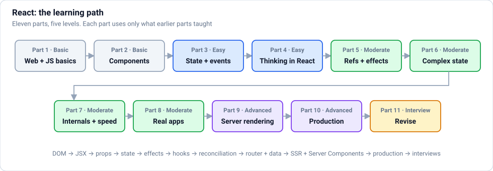

### Theory

> **In simple words:** **React** is a JavaScript library for building **user interfaces** (the buttons, forms, lists and pages people click on) out of small reusable pieces called **components**. You describe what the screen should look like for the current data, and React keeps the real page in sync when the data changes. These notes take you from "what is a web page?" to building, testing, optimising and shipping React apps the way companies do, one small step at a time.

**Words to know:**

- **User interface (UI):** everything a person sees and interacts with in an app: text, buttons, inputs, menus, pages.
- **React:** an open-source JavaScript library for building UIs from components, created at Facebook (now Meta) and open-sourced in 2013; since February 2026 it is owned by the independent React Foundation, hosted by the Linux Foundation.
- **Component:** a reusable piece of UI, such as a button, a product card or a whole checkout page, written as a JavaScript function.
- **Library vs framework:** a **library** is code you call when you need it (React renders UI; you pick the rest); a **framework** calls *your* code and decides the structure of the whole app (Next.js decides routing, data loading and the server for you).
- **Frontend / backend:** the **frontend** is the part of an app that runs in the user's browser (the UI); the **backend** runs on servers (databases, business logic, APIs).
- **Full-stack developer:** someone who builds both the frontend and the backend.
- **React DOM:** the package that connects React to web pages. **React Native:** the sibling that connects React to iPhone and Android screens instead.
- **Next.js:** the most used **React framework**: React plus routing, server rendering and a server, made by Vercel (Part 9).
- **TypeScript:** JavaScript with **types** (labels such as "this is a number") that catch mistakes before the code runs; most React teams use it, and so do these notes (Section [26](#26-typescript-with-react-typing-props-state-events-and-children)).
- **Open source:** software whose code anyone can read, use and improve, usually for free.

**Everyday picture.** LEGO. Instead of carving a whole castle from one block of wood (and starting over to change a tower), you snap together small standard bricks. A React app is built the same way: small components (a button, a price tag) are snapped into bigger ones (a product card), which form pages. Change one brick and only that part of the castle changes.

**These notes climb level by level:**

| Part | Level | What you learn | Afterwards you can… |
|---|---|---|---|
| 1 | Basic | How web pages work, the JavaScript React uses, why React, project setup | Read React code without getting lost in the syntax |
| 2 | Basic | Components, JSX, props, purity, conditions, lists and keys | Build static pages from components and data |
| 3 | Easy | Events, state, rendering, snapshots, objects and arrays in state, forms | Build interactive widgets: counters, carts, forms |
| 4 | Easy | Thinking in React: state machines, state structure, lifting state, keys, composition, TypeScript, styling | Design a small app's components and state like a professional |
| 5 | Moderate | Refs, effects, when not to use effects, data fetching | Talk to the browser and servers safely |
| 6 | Moderate | useReducer, context, custom hooks, how hooks work, debugging | Organise state in a growing app |
| 7 | Moderate | Reconciliation built from scratch, Fiber, re-renders, memoisation, the React Compiler, virtualisation, code splitting, error boundaries, accessibility | Make apps fast, robust and usable by everyone |
| 8 | Moderate | React Router, TanStack Query, React 19 actions, React Hook Form + Zod, global state, testing | Build and test a real multi-page app |
| 9 | Advanced | SSR, SSG, hydration, streaming, Server Components, Next.js, transitions, real-time and AI chat UIs | Build server-rendered and streaming apps |
| 10 | Advanced | Internationalisation, architecture, class components, production, what's new | Ship and maintain React in production |
| 11 | Interview Prep | Hooks from scratch, machine coding, behaviour questions, checklist, cheat sheet, theory questions, glossary | Revise quickly and check your coverage |

**What a React developer actually does.** Less time goes into clever code than people expect:

| Activity | Share of a typical week |
|---|---|
| building screens from designs (components, layout, styling) | **the largest part** |
| connecting screens to data (APIs, loading and error states, forms) | large |
| fixing bugs and reading other people's code | large |
| writing tests and reviewing pull requests | moderate |
| performance, accessibility and production issues | small, but what separates seniors |

**Roles you'll hear about (2026):**

| Role | Mostly does |
|---|---|
| **Frontend engineer** | builds web UIs, usually with React and TypeScript |
| **Full-stack engineer** | React on the frontend plus APIs and databases (Next.js, Node.js, `nodejs.md`) |
| **UI / design-systems engineer** | builds the shared component library that every team uses (Section [66](#66-architecture-project-structure-design-systems-and-monorepos)) |
| **Mobile engineer (React Native)** | iOS and Android apps with React Native and Expo |
| **AI product engineer** | builds chat, streaming and agent interfaces on top of LLM APIs (Section [64](#64-real-time-and-streaming-uis-websockets-sse-and-ai-chat)) |

**How to study each section:** look at the picture; read the theory slowly and trace the worked example by hand; **type** the code (don't paste it), run it, change one thing and predict the result before re-running; then try the practice before opening the answers. Section [6](#6-setting-up-node-npm-vite-and-how-these-examples-run) shows how to set up a project that runs every example.

**When NOT to reach for React:** a mostly static site (a blog, documentation, a landing page) is often better as plain HTML or a content-focused tool such as Astro; a tiny widget on an existing page may need only a few lines of plain JavaScript (Section [5](#5-why-react-updating-a-page-by-hand-vs-describing-it)).

**Common mistakes:**

- ❌ Starting with a framework (Next.js) before understanding components, props and state.
- ❌ Copying code without running it; React's behaviour (re-renders, effects) only clicks when you watch it happen.
- ❌ Skipping the JavaScript basics: most "React bugs" beginners hit are JavaScript bugs (mutation, `this`, async timing).

**Used in real software:** React powers the web apps of Meta (Facebook, Instagram, WhatsApp Web), Netflix, Airbnb, Discord, Notion, Shopify's admin, Atlassian products and much of the web; React Native powers apps such as Instagram, Discord and Shopify's mobile apps.

### Practice

1. Open three web apps you use daily. For each, sketch the screen on paper and draw boxes around the pieces that repeat (a message, a product, a notification). Each repeating box is a candidate **component**. Write a name for each.

<details>
<summary><b>Answer</b></summary>

For a shopping site you might draw: `Header` (logo, `SearchBox`, `CartButton`), `ProductGrid` made of many `ProductCard`s (image, name, `PriceTag`, `AddToCartButton`), and `Footer`. For a chat app: `ConversationList` of `ConversationItem`s, `MessageList` of `Message`s, and a `Composer`. The habit of seeing screens as nested, repeating boxes is the first skill of a React developer (Section [20](#20-thinking-in-react-from-mockup-to-components)).

</details>

| # | Practice | Difficulty |
|---|---|---|
| 1 | [react.dev: Tutorial: Tic-Tac-Toe (build a whole small game)](https://react.dev/learn/tutorial-tic-tac-toe) | 🟢 Easy |

**Learn more:** [react.dev: Learn React](https://react.dev/learn) · [react.dev: API reference](https://react.dev/reference/react)

---

## 2. How a Web Page Works: HTML, CSS, the DOM and Events

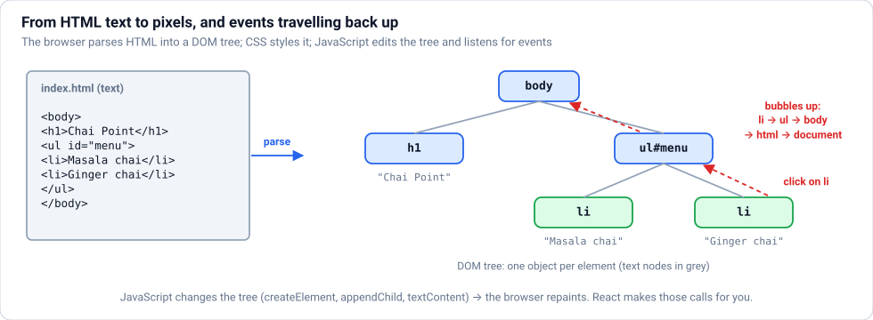

### Theory

> **In simple words:** a web page starts as **HTML** text. The browser reads it and builds a **tree of objects** in memory, the **DOM**, one object per element. **CSS** decides how each element looks, and the browser draws (paints) the tree on screen. **JavaScript** can change the tree (add, remove or edit elements) and react to **events** like clicks; whenever the tree changes, the browser redraws. React is, at heart, a smart way of changing the DOM for you.

**Words to know:**

- **Browser:** the program that downloads and shows web pages (Chrome, Safari, Firefox, Edge).
- **HTML (HyperText Markup Language):** the text format that describes a page's content and structure: `<h1>Menu</h1><button>Order</button>`.
- **Tag / element:** `<p>` is an opening **tag** and `</p>` a closing tag; together with what's between them they form an **element**. Some elements have no content and no closing tag (``, `<input>`, `<br>`).
- **Attribute:** extra information on an element, written `name="value"`: ``.
- **CSS (Cascading Style Sheets):** rules that style elements: `.price { color: green; }`.
- **Selector:** the part of a CSS rule (or a JavaScript query) that picks elements: `p`, `.price` (class), `#cart` (id), `ul > li`.
- **Class / id:** a **class** (`class="price"`) labels any number of elements for styling; an **id** (`id="cart"`) names exactly one element.
- **DOM (Document Object Model):** the tree of JavaScript objects the browser builds from HTML; JavaScript reads and changes the page through it.
- **Node:** one item in the DOM tree: an element node (`<li>`), a text node (the words inside it), and others.
- **Parent / child / sibling:** in `<ul><li>A</li><li>B</li></ul>` the `ul` is the **parent** of both `li`s, they are its **children**, and they are **siblings** of each other.
- **`document`:** the JavaScript object that represents the whole page; `document.body` is the `<body>` element.
- **`querySelector`:** finds the first element matching a selector: `document.querySelector(".price")`.
- **Event:** something that happened that code can react to: a click, a key press, a form submit, the page finishing loading.
- **Event listener (handler):** a function the browser calls when an event happens: `button.addEventListener("click", fn)`.
- **Event bubbling:** after an event fires on the clicked element, it travels **up** through each ancestor, so a listener on a parent also hears clicks on its children.
- **`event.target` vs `event.currentTarget`:** `target` is the element where the event started; `currentTarget` is the element whose listener is running right now.
- **Default action / `preventDefault()`:** what the browser does on its own after an event (a form submit reloads the page, a link navigates); `event.preventDefault()` cancels it.
- **Paint / render (browser):** the browser turning the DOM plus CSS into pixels; changing the DOM makes it redo part of that work.

**Everyday picture.** HTML is the **architect's drawing** of a house; the DOM is the **house itself** after it's built; CSS is the **paint and furniture**; JavaScript is a **builder** who can knock down a wall or add a window while people live inside; events are the **doorbell**, and bubbling is the sound travelling from the front door through the hall to every room on the way.

**How the browser builds a page, traced by hand** for this HTML:

```text
<body>
  <h1>Chai Point</h1>
  <ul id="menu">
    <li>Masala chai</li>
    <li>Ginger chai</li>
  </ul>
</body>
```

1. Read `<body>` → create an element node `body`.
2. Read `<h1>` → create `h1` as a child of `body`; the text "Chai Point" becomes a text node inside it.
3. Read `<ul id="menu">` → create `ul` (with attribute `id="menu"`) as `body`'s second child.
4. Each `<li>` becomes a child of `ul`, each with a text node.

The result is a tree: `body → [h1 → "Chai Point", ul → [li → "Masala chai", li → "Ginger chai"]]`. Clicking the second `li` fires a `click` event on the `li`, then it bubbles to `ul`, then `body`, then `html`, then `document`.

**When to change the DOM by hand:** a tiny script on a mostly static page (toggle a menu, copy a link). **When not to:** whenever many parts of the screen depend on the same changing data; keeping all of them correct by hand gets hard fast, which is the problem React solves (Section [5](#5-why-react-updating-a-page-by-hand-vs-describing-it)).

**Common mistakes:**

- ❌ Confusing HTML (text you write) with the DOM (live objects the browser built); JavaScript changes the DOM, and the HTML file stays as it was.
- ❌ Forgetting that events bubble, so one click triggers listeners on several ancestors.
- ❌ Forgetting `preventDefault()` on a form submit, so the page reloads and loses everything.
- ❌ Using an `id` twice on one page; `querySelector("#x")` will only ever find the first.

**Used in real software:** every website and web app; every framework (React, Vue, Angular, Svelte) ultimately calls the same DOM functions shown below.

### Code

These examples run in a **simulated browser page** called jsdom (Section [6](#6-setting-up-node-npm-vite-and-how-these-examples-run) explains the setup), so `document` works exactly as in a browser.

**From scratch: build a tree from HTML and walk it.** `innerHTML` makes the browser parse HTML into DOM nodes; a small recursive function then prints the tree:

```tsx
document.body.innerHTML = `
  <div id="app">
    <h1>Chai Point</h1>
    <ul id="menu">
      <li class="item">Masala chai</li>
      <li class="item">Ginger chai</li>
    </ul>
  </div>`;

function printTree(node: Element, depth = 0) {
  const own = [...node.childNodes].filter((n) => n.nodeType === Node.TEXT_NODE).map((n) => n.textContent!.trim()).join("");
  const id = node.id ? `#${node.id}` : "";
  console.log(`${"  ".repeat(depth)}${node.tagName.toLowerCase()}${id}${own ? `  "${own}"` : ""}`);
  for (const child of node.children) printTree(child, depth + 1);
}
printTree(document.body);
```

**Output:**

```text
body
  div#app
    h1  "Chai Point"
    ul#menu
      li  "Masala chai"
      li  "Ginger chai"
```

`node.children` lists only element children; `childNodes` also includes the text nodes, which is where the words live. `nodeType === Node.TEXT_NODE` picks those out.

**Changing the DOM by hand:** find elements, create new ones, change text and classes:

```tsx
const menu = document.querySelector("#menu")!;
const extra = document.createElement("li");          // a new element, not yet on the page
extra.textContent = "Lemon tea";
extra.className = "item new";
menu.appendChild(extra);                             // now it is in the tree (and on screen)
document.querySelector("h1")!.textContent = "Chai Point (open)";
console.log(document.querySelectorAll(".item").length, "items");
console.log(menu.innerHTML.replace(/\s+</g, "<"));
```

**Output:**

```text
3 items
<li class="item">Masala chai</li><li class="item">Ginger chai</li><li class="item new">Lemon tea</li>
```

`querySelectorAll(".item")` returns every element with class `item`; the `!` after `querySelector(...)` tells TypeScript "I know this exists" (it would otherwise warn that it might be `null`, Section [26](#26-typescript-with-react-typing-props-state-events-and-children)).

**Events and bubbling:** one click on the `li` reaches listeners on the `li`, the `ul` and the wrapper `div`:

```tsx
const firstItem = document.querySelector("li")!;
for (const el of [firstItem, document.querySelector("ul")!, document.querySelector("#app")!]) {
  el.addEventListener("click", (event) => {
    const target = event.target as Element, current = event.currentTarget as Element;
    console.log(`listener on <${current.tagName.toLowerCase()}> heard a click that started on <${target.tagName.toLowerCase()}>`);
  });
}
firstItem.click();                                   // simulate a user's click
```

**Output:**

```text
listener on <li> heard a click that started on <li>
listener on <ul> heard a click that started on <li>
listener on <div> heard a click that started on <li>
```

**Default actions:** submitting a form normally reloads the page; `preventDefault()` stops that so your code can handle the data:

```tsx
document.body.innerHTML = `<form><input name="item" value="Masala chai"><button>Order</button></form>`;
const form = document.querySelector("form")!;
form.addEventListener("submit", (event) => {
  event.preventDefault();                            // no page reload
  const data = new FormData(form);
  console.log("ordering:", data.get("item"), "| default prevented:", event.defaultPrevented);
});
document.querySelector("button")!.click();          // clicking a submit button submits the form
```

**Output:**

```text
ordering: Masala chai | default prevented: true
```

`FormData` reads every named input of a form; React 19's form actions use exactly this object (Section [53](#53-react-19-forms-actions-useactionstate-useformstatus-and-useoptimistic)).

### Practice

1. Write `countTags(root)` that returns an object counting elements by tag name below `root`, e.g. `{ h1: 1, ul: 1, li: 2 }`.
2. A listener on `<ul>` logs `event.target.tagName`. The user clicks the text inside the second `<li>`. What is logged, and why isn't it `UL`?

<details>
<summary><b>Answer</b></summary>

```tsx
function countTags(root: Element): Record<string, number> {
  const counts: Record<string, number> = {};
  for (const el of root.querySelectorAll("*")) {
    const tag = el.tagName.toLowerCase();
    counts[tag] = (counts[tag] ?? 0) + 1;
  }
  return counts;
}
document.body.innerHTML = `<h1>Menu</h1><ul><li>A</li><li>B</li></ul>`;
console.log(countTags(document.body));
```

**Output:**

```text
{ h1: 1, ul: 1, li: 2 }
```

1. `querySelectorAll("*")` matches every descendant element; `?? 0` starts each count at zero (the `??` operator is explained in Section [3](#3-the-javascript-react-uses-arrow-functions-destructuring-spread-array-methods-and-modules)).
2. `LI`. The event **started** on the `li` (text nodes can't be targets, so the target is the element containing the text), and the `ul`'s listener hears it during bubbling. `event.currentTarget` would be the `ul`.

</details>

| # | Problem | Difficulty |
|---|---|---|
| 1 | [Frontend Mentor: Recipe page (HTML and CSS only)](https://www.frontendmentor.io/challenges/recipe-page-KiTsR8QQKm) | 🟢 Easy |
| 2 | [Frontend Mentor: FAQ accordion (DOM and events)](https://www.frontendmentor.io/challenges/faq-accordion-wyfFdeBwBz) | 🟢 Easy |
| 3 | [Frontend Mentor: Interactive rating component](https://www.frontendmentor.io/challenges/interactive-rating-component-koxpeBUmI) | 🟢 Easy |

**Learn more:** [MDN: Introduction to the DOM](https://developer.mozilla.org/en-US/docs/Web/API/Document_Object_Model/Introduction) · [MDN: Event bubbling](https://developer.mozilla.org/en-US/docs/Learn_web_development/Core/Scripting/Event_bubbling) · [web.dev: How browsers work](https://web.dev/articles/howbrowserswork)

---

## 3. The JavaScript React Uses: Arrow Functions, Destructuring, Spread, Array Methods and Modules

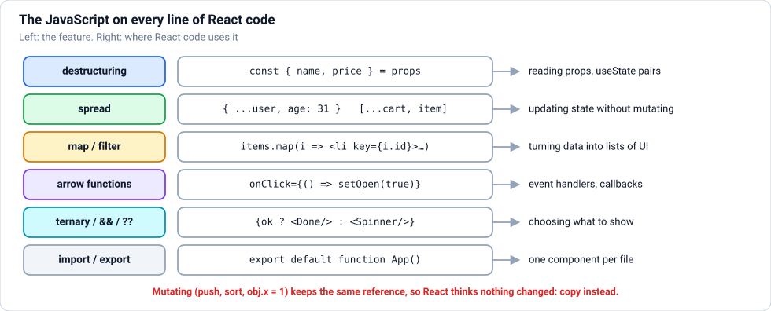

### Theory

> **In simple words:** React code is ordinary modern JavaScript. A handful of features appear on almost every line: **arrow functions** (short functions), **destructuring** (pulling values out of objects), **spread** (copying objects and arrays with changes), **array methods** like `map` and `filter` (turning lists of data into lists of UI), the **ternary** and `&&` (choosing what to show), and **modules** (one component per file). Learn these well and React's syntax stops looking strange.

**Words to know:**

- **Variable (`const` / `let`):** a name for a value. `const` can't be reassigned (use it by default); `let` can. (Old `var` has confusing scoping; don't use it.)
- **Function / parameter / argument / return value:** a reusable block of code; **parameters** are the names in its definition, **arguments** the values passed in a call, and the **return value** what it hands back.
- **Arrow function:** a shorter function syntax: `(a, b) => a + b`. With braces you need `return`: `(a, b) => { return a + b; }`.
- **Object / property:** a group of named values `{ name: "Chai", price: 180 }`; each name–value pair is a **property**, read with `obj.name`.
- **Array:** an ordered list `[10, 20, 30]`; items are read by **index** from 0: `arr[0]`.
- **Template literal:** a string in backticks that can embed values: `` `₹${price}` ``.
- **Destructuring:** unpacking values into variables: `const { name, price } = item;` and `const [first, second] = list;`. React props and `useState` both use it.
- **Default value:** a fallback used when a value is `undefined`: `function f({ size = "md" }) {}`.
- **Spread syntax (`...`):** copies the items of an array or properties of an object into a new one: `[...list, 4]`, `{ ...user, age: 31 }`.
- **Rest syntax (`...`):** the reverse: gathers "everything else": `const { id, ...rest } = item;`.
- **Shallow copy:** a copy of the outer object only; nested objects inside are still **shared** with the original.
- **Reference vs value:** variables hold objects and arrays **by reference** (an arrow to the same object), so `a === b` is true only when both point to the **same** object, not when they merely look equal.
- **Mutation:** changing an object or array in place (`arr.push(x)`, `obj.n = 1`). React expects you **not** to mutate state; you create new objects instead (Section [17](#17-updating-objects-in-state)).
- **Immutability:** the habit of never changing existing data, only making changed copies.
- **`map` / `filter` / `find` / `some` / `reduce`:** array methods that return a **new** array of transformed items / a new array of items that pass a test / the first item that passes / whether any passes / one value accumulated from all items.
- **`toSorted` / `toReversed` / `with`:** newer (ES2023) array methods that return a changed **copy** instead of mutating, perfect for React state.
- **Ternary operator:** `condition ? a : b` (an `if/else` that produces a value).
- **Logical AND (`&&`) / nullish coalescing (`??`) / optional chaining (`?.`):** `a && b` gives `b` when `a` is truthy, else `a`; `a ?? b` gives `b` only when `a` is `null` or `undefined`; `user?.address?.city` gives `undefined` instead of crashing when something along the way is missing.
- **Truthy / falsy:** values treated as `true` or `false` in conditions. The falsy ones are `false`, `0`, `""`, `null`, `undefined` and `NaN`; everything else is truthy.
- **Module / `import` / `export`:** each file is a module; `export` makes a value available, `import` brings it into another file. A file has at most one **default export** (`export default App`, imported without braces) and any number of **named exports** (`export function Button`, imported as `{ Button }`).

**Everyday picture.** A recipe card. **Destructuring** is reading just the lines you need ("flour, sugar"); **spread** is photocopying the card and writing one change on the copy, so the original stays clean; **map** is "do this to every ingredient"; **filter** is "only the vegetarian ones"; a **module** is a recipe kept in its own folder so any kitchen can borrow it.

**Why references matter for React, traced by hand:**

```text
const cart = ["chai"];           cart ──► ["chai"]
const same = cart;               same ──┘            (same arrow, same array)
same.push("samosa");             the ONE array is now ["chai", "samosa"]
cart === same                    → true  (React can't tell anything changed!)

const next = [...cart, "vada"];  next ──► ["chai", "samosa", "vada"]   (a NEW array)
next === cart                    → false (React sees a new value and re-renders)
```

React decides whether state changed by comparing with `Object.is` (essentially `===`). Mutating keeps the same reference, so React thinks nothing happened; a new copy has a new reference. This one fact explains a whole family of React bugs.

**When to use which:** `map` to turn data into UI (every list), `filter` to remove an item, spread to change one property, `find` to look one item up, `reduce` for totals. **When not:** don't use `forEach` + `push` to build lists in components (it mutates and returns nothing), and don't reach for `reduce` when a `for` loop or a `map` + sum reads more clearly.

**Common mistakes:**

- ❌ `arr.sort()` or `arr.reverse()` on state: both **mutate** the original. ✅ `arr.toSorted()`, `[...arr].reverse()`.
- ❌ Arrow function with braces but no `return`: `items.map((x) => { x * 2 })` gives `[undefined, …]`.
- ❌ Thinking spread copies deeply: `{ ...user }` still shares `user.address`.
- ❌ `count && <p>…</p>` when `count` can be `0`: `0` is falsy but still a value, so `0` is what you get (and React shows it, Section [11](#11-conditional-rendering)).
- ❌ Mixing up default and named imports: `import Button from "./Button"` when the file did `export function Button`.

**Used in real software:** every React codebase; these exact patterns (`map` for lists, spread for updates, destructured props) are on almost every line.

### Code

**Arrow functions, template literals and destructuring:**

```tsx
const formatRupees = (paise: number) => `₹${(paise / 100).toFixed(2)}`;
const item = { name: "Masala chai", pricePaise: 18000, tags: ["tea", "spiced"] };

const { name, pricePaise, rating = 4.5 } = item as typeof item & { rating?: number };   // rating has a default
const [firstTag, ...otherTags] = item.tags;                                             // array destructuring + rest
console.log(name, formatRupees(pricePaise), rating, firstTag, otherTags);

function describe({ name, tags }: { name: string; tags: string[] }) {   // destructuring right in the parameter
  return `${name} (${tags.join(", ")})`;
}
console.log(describe(item));
```

**Output:**

```text
Masala chai ₹180.00 4.5 tea [ 'spiced' ]
Masala chai (tea, spiced)
```

`toFixed(2)` formats a number with exactly two decimals; prices are kept in **paise** (whole numbers) because decimal fractions like 0.1 can't be stored exactly in binary.

**Spread makes copies; mutation changes the original.** This is the single most important JavaScript fact for React:

```tsx
const cart = ["chai"];
const same = cart;
same.push("samosa");                                 // mutation through another name
console.log(cart, "| same object?", cart === same);

const next = [...cart, "vada pav"];                  // a new array
console.log(next, "| same object?", next === cart);

const user = { name: "Asha", address: { city: "Pune" } };
const copy = { ...user, name: "Ravi" };              // shallow copy with one change
copy.address.city = "Mumbai";                        // nested object is SHARED
console.log(user.address.city, "| deep-copied?", copy.address !== user.address);

const safe = { ...user, address: { ...user.address, city: "Delhi" } };   // copy every level you change
console.log(user.address.city, safe.address.city);
```

**Output:**

```text
[ 'chai', 'samosa' ] | same object? true
[ 'chai', 'samosa', 'vada pav' ] | same object? false
Mumbai | deep-copied? false
Mumbai Delhi
```

The third line of output is the classic trap: changing the copy's address also changed the original, because spread only copies one level.

**Array methods: the tools for turning data into UI:**

```tsx
const menu = [
  { id: 1, name: "Masala chai", pricePaise: 18000, veg: true },
  { id: 2, name: "Chicken roll", pricePaise: 22000, veg: false },
  { id: 3, name: "Samosa", pricePaise: 6000, veg: true },
];
console.log(menu.map((m) => m.name));                              // transform each
console.log(menu.filter((m) => m.veg).map((m) => m.id));            // keep some
console.log(menu.find((m) => m.id === 3)?.name);                    // look one up
console.log(menu.some((m) => !m.veg), menu.every((m) => m.pricePaise > 5000));
console.log(menu.reduce((sum, m) => sum + m.pricePaise, 0));        // total
const byPrice = menu.toSorted((a, b) => a.pricePaise - b.pricePaise);   // sorted COPY
console.log(byPrice.map((m) => m.name), "| original first:", menu[0].name);
console.log(menu.with(1, { ...menu[1], pricePaise: 20000 })[1].pricePaise, menu[1].pricePaise);
```

**Output:**

```text
[ 'Masala chai', 'Chicken roll', 'Samosa' ]
[ 1, 3 ]
Samosa
true true
46000
[ 'Samosa', 'Masala chai', 'Chicken roll' ] | original first: Masala chai
20000 22000
```

`toSorted` and `with(index, value)` return new arrays and leave `menu` untouched; the comparison function `(a, b) => a - b` sorts numbers ascending (a negative result puts `a` first).

**Choosing values: ternary, `&&`, `??` and `?.`:**

```tsx
const order = { items: 0, coupon: null as string | null, user: { address: undefined as { city: string } | undefined } };
console.log(order.items > 0 ? "Checkout" : "Cart is empty");
console.log(order.items && "has items");             // 0 && ... → 0  (not false!)
console.log(order.coupon ?? "no coupon");            // null → fallback
const zero = 0 as number | null;
console.log(zero ?? 5, zero || 5);                    // ?? keeps 0; || does not
console.log(order.user.address?.city);               // undefined instead of a crash
```

**Output:**

```text
Cart is empty
0
no coupon
0 5
undefined
```

**Modules:** a component library file exports, and another file imports. Here a file is written next to the example and then imported:

```tsx
export const formatRupees = (paise: number) => `₹${(paise / 100).toFixed(2)}`;
export default function total(prices: number[]) {
  return prices.reduce((sum, p) => sum + p, 0);
}
```

```tsx
import total, { formatRupees as fmt } from "./money.ts";
console.log(fmt(total([18000, 6000])));
```

**Output:**

```text
₹240.00
```

`total` (no braces) is the default export; `{ formatRupees as fmt }` is a named export renamed on import. Real projects usually leave out the `.ts` extension (`"./money"`); the bundler finds the file.

### Practice

1. Given `const cart = [{ id: 1, qty: 2 }, { id: 2, qty: 1 }]`, write one expression that returns a **new** cart where item 2 has `qty: 5`, without mutating `cart`.
2. What does `[1, 2, 3].map((n) => { n * 2 })` return, and how do you fix it?
3. Remove the item with `id: 1` from `cart` immutably, and compute the total quantity of the original cart.

<details>
<summary><b>Answer</b></summary>

```tsx
const cart2 = [{ id: 1, qty: 2 }, { id: 2, qty: 1 }];
const updated = cart2.map((line) => (line.id === 2 ? { ...line, qty: 5 } : line));
console.log(updated, cart2[1].qty);
console.log([1, 2, 3].map((n) => { n * 2; }), [1, 2, 3].map((n) => n * 2));
console.log(cart2.filter((line) => line.id !== 1), cart2.reduce((sum, line) => sum + line.qty, 0));
```

**Output:**

```text
[ { id: 1, qty: 2 }, { id: 2, qty: 5 } ] 1
[ undefined, undefined, undefined ] [ 2, 4, 6 ]
[ { id: 2, qty: 1 } ] 3
```

1. `map` + spread: copy only the line you change, keep the others as they are. This is the standard "update one item" pattern (Section [18](#18-updating-arrays-in-state)).
2. `[undefined, undefined, undefined]`: braces start a function body, which needs `return`. Drop the braces (or add `return`).
3. `filter` keeps everything except id 1; `reduce` sums from a starting value of 0.

</details>

| # | Problem | Difficulty |
|---|---|---|
| 1 | [LeetCode 2635. Apply Transform Over Each Element in Array](https://leetcode.com/problems/apply-transform-over-each-element-in-array/) | 🟢 Easy |
| 2 | [LeetCode 2634. Filter Elements from Array](https://leetcode.com/problems/filter-elements-from-array/) | 🟢 Easy |
| 3 | [LeetCode 2626. Array Reduce Transformation](https://leetcode.com/problems/array-reduce-transformation/) | 🟢 Easy |
| 4 | [LeetCode 2724. Sort By](https://leetcode.com/problems/sort-by/) | 🟢 Easy |
| 5 | [LeetCode 2722. Join Two Arrays by ID](https://leetcode.com/problems/join-two-arrays-by-id/) | 🟡 Medium |

**Learn more:** [MDN: Destructuring](https://developer.mozilla.org/en-US/docs/Web/JavaScript/Reference/Operators/Destructuring) · [MDN: Spread syntax](https://developer.mozilla.org/en-US/docs/Web/JavaScript/Reference/Operators/Spread_syntax) · [react.dev: JavaScript in JSX with curly braces](https://react.dev/learn/javascript-in-jsx-with-curly-braces)

---

## 4. Asynchronous JavaScript for React: Promises, async/await and fetch

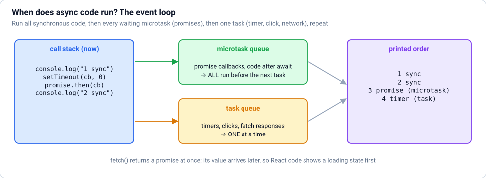

### Theory

> **In simple words:** some work takes time: waiting for a server, a timer, a file. JavaScript doesn't stop and wait; it **starts** the work, carries on, and runs your code **later** when the result is ready. A **promise** is an IOU for that future result, and `async`/`await` lets you write "wait for this, then continue" in normal top-to-bottom style. React apps use this constantly to load data, so understanding *when* code runs prevents a whole class of bugs.

**Words to know:**

- **Synchronous / asynchronous:** synchronous code runs line by line, each line finishing before the next; asynchronous work finishes **later**, while other code keeps running.
- **Callback:** a function you hand to something else to be called later: `setTimeout(callback, 1000)`.
- **Call stack:** the list of functions currently running; JavaScript runs one thing at a time on a single thread.
- **Event loop:** the mechanism that, whenever the call stack is empty, picks the next waiting callback and runs it.
- **Task (macrotask) / microtask:** two queues of waiting callbacks. Timers, clicks and network events are **tasks**; promise callbacks (`then`, code after `await`) are **microtasks**, and all waiting microtasks run before the next task.
- **Promise:** an object representing a value that isn't ready yet; it is **pending**, then either **fulfilled** (with a value) or **rejected** (with an error). Fulfilled or rejected = **settled**.
- **`then` / `catch` / `finally`:** methods that register callbacks for when a promise fulfils, rejects, or settles either way.
- **`async` function:** a function that always returns a promise and may use `await` inside.
- **`await`:** pauses the `async` function until a promise settles, then gives its value (or throws its error) so you can use `try/catch`.
- **`fetch`:** the built-in function for HTTP requests; returns a promise of a **Response**.
- **HTTP request / response / status code:** a request asks a server for something (`GET /api/menu`); the response carries a status code (`200` OK, `404` Not Found, `500` Server Error) and a body.
- **API (application programming interface):** a defined way for programs to talk; for web apps, usually URLs that return JSON.
- **JSON (JavaScript Object Notation):** the text format APIs use for data: `{"name":"Chai","price":180}`. `JSON.parse` turns text into objects; `JSON.stringify` the reverse; `response.json()` reads and parses a response body.
- **`response.ok`:** `true` for statuses 200–299. `fetch` does **not** reject on 404 or 500, so you must check it.
- **`Promise.all`:** waits for several promises **in parallel** and gives all results (or the first error).
- **`AbortController` / `AbortSignal`:** a way to cancel a `fetch` (or other work): pass `controller.signal`, then call `controller.abort()`.
- **Race condition:** a bug where the result depends on which of several async operations finishes first, e.g. an old, slow search response overwriting a newer one.

**Everyday picture.** Ordering at a busy chai stall: you pay and get a **token** (the promise). You don't stand frozen at the counter; you chat with friends (other code keeps running). When your number is called (the promise fulfils), you collect your chai (the value). If they've run out, they call your number and say so (the promise rejects). `await` is deciding to stand by the counter until your number comes up.

**Predicting the order, traced by hand:**

```text
console.log("1 sync");
setTimeout(() => console.log("4 timer (task)"), 0);
Promise.resolve().then(() => console.log("3 promise (microtask)"));
console.log("2 sync");
```

1. Line 1 runs immediately → `1 sync`.
2. `setTimeout(…, 0)` puts its callback in the **task** queue; it does not run yet.
3. `then` puts its callback in the **microtask** queue.
4. Line 4 runs → `2 sync`. The stack is now empty.
5. The event loop runs **all microtasks first** → `3 promise`.
6. Then the next task → `4 timer`. A delay of 0 means "as soon as possible after everything else", never "now".

**When to use what:** `async`/`await` with `try/catch` for readable sequential steps; `Promise.all` when requests don't depend on each other (much faster than awaiting one by one); `AbortController` when a request may become irrelevant (the user typed again, the component disappeared). **When not:** don't `await` inside a loop for independent requests (it serialises them), and don't fire requests without handling the error case.

**Common mistakes:**

- ❌ Assuming `fetch` throws on 404/500. ✅ Check `response.ok`.
- ❌ Forgetting `await` (`const data = response.json()` gives a promise, not data).
- ❌ Awaiting independent requests one after another. ✅ `Promise.all`.
- ❌ Ignoring out-of-order responses: the last request **sent** is not always the last to **arrive** (Section [34](#34-fetching-data-in-effects-loading-errors-race-conditions-and-abortcontroller)).

**Used in real software:** every React app that loads data; libraries such as TanStack Query (Section [52](#52-server-state-with-tanstack-query)) and React's `use` and Suspense (Section [47](#47-code-splitting-lazy-suspense-and-bundle-size)) are built on promises.

### Code

**The event loop order** from the trace above, run for real:

```tsx
console.log("1 sync");
setTimeout(() => console.log("4 timer (task)"), 0);
Promise.resolve().then(() => console.log("3 promise (microtask)"));
console.log("2 sync");
await new Promise((resolve) => setTimeout(resolve, 10));   // wait so the timer prints before the next block
```

**Output:**

```text
1 sync
2 sync
3 promise (microtask)
4 timer (task)
```

`await` at the top level of a module (outside any function) is allowed in modern JavaScript modules, which is what these examples are.

**From scratch: a fake API with promises and `setTimeout`.** This is how you test loading states before a real server exists:

```tsx
const sleep = (ms: number) => new Promise<void>((resolve) => setTimeout(resolve, ms));

async function fakeMenuApi(shouldFail = false) {
  await sleep(50);                                    // pretend the network takes 50 ms
  if (shouldFail) throw new Error("Server is down");
  return [{ id: 1, name: "Masala chai" }, { id: 2, name: "Samosa" }];
}

const started = Date.now();
const menu = await fakeMenuApi();
console.log(menu.map((m) => m.name), `after ~${Math.round((Date.now() - started) / 10) * 10} ms`);
try {
  await fakeMenuApi(true);
} catch (error) {
  console.log("caught:", (error as Error).message);
}
```

**Output:**

```text
[ 'Masala chai', 'Samosa' ] after ~50 ms
caught: Server is down
```

**The real way: `fetch` against an HTTP server.** To keep the example self-contained, it starts a tiny local server with Node's built-in `http` module (the kind of server `nodejs.md` teaches) and then calls it exactly as a browser would:

```tsx
import { createServer } from "node:http";

const server = createServer((req, res) => {
  if (req.url === "/api/menu") {
    res.writeHead(200, { "Content-Type": "application/json" });
    res.end(JSON.stringify([{ id: 1, name: "Masala chai", pricePaise: 18000 }]));
  } else {
    res.writeHead(404).end("Not found");
  }
});
await new Promise<void>((resolve) => server.listen(4401, resolve));

const ok = await fetch("http://localhost:4401/api/menu");
console.log(ok.status, ok.ok, await ok.json());

const missing = await fetch("http://localhost:4401/api/nope");
console.log(missing.status, missing.ok, "← fetch did NOT throw");
```

**Output:**

```text
200 true [ { id: 1, name: 'Masala chai', pricePaise: 18000 } ]
404 false ← fetch did NOT throw
```

**Parallel requests and cancelling:**

```tsx
async function getJson(path: string, signal?: AbortSignal) {
  const response = await fetch(`http://localhost:4401${path}`, { signal });
  if (!response.ok) throw new Error(`HTTP ${response.status} for ${path}`);
  return response.json();
}

const [a, b] = await Promise.all([getJson("/api/menu"), getJson("/api/menu")]);   // both at once
console.log("parallel:", a.length + b.length, "items");

try {
  await getJson("/api/nope");
} catch (error) {
  console.log("error:", (error as Error).message);
}

const controller = new AbortController();
const pending = getJson("/api/menu", controller.signal);
controller.abort();                                   // the user navigated away, say
try {
  await pending;
} catch (error) {
  console.log("aborted:", (error as Error).name);
}
server.close();
```

**Output:**

```text
parallel: 2 items
error: HTTP 404 for /api/nope
aborted: AbortError
```

A cancelled `fetch` rejects with an error named `AbortError`; code that cancels on purpose usually ignores exactly that error.

**A race condition in miniature:** two searches are sent; the first is slow and arrives **last**, overwriting the newer result:

```tsx
let shown = "";
async function search(query: string, delayMs: number) {
  await new Promise((resolve) => setTimeout(resolve, delayMs));
  shown = `results for "${query}"`;                   // whoever finishes last wins
}
await Promise.all([search("ch", 80), search("chai", 20)]);   // user typed "ch", then "chai"
console.log(shown, "← stale: the user asked for chai");
```

**Output:**

```text
results for "ch" ← stale: the user asked for chai
```

React apps meet this bug when loading data as the user types; Section [34](#34-fetching-data-in-effects-loading-errors-race-conditions-and-abortcontroller) fixes it with an "ignore stale results" flag and `AbortController`.

### Practice

1. Predict the output order: `console.log("A"); setTimeout(() => console.log("B")); queueMicrotask(() => console.log("C")); (async () => { console.log("D"); await null; console.log("E"); })(); console.log("F");`
2. Write `withTimeout(promise, ms)` that rejects with `Error("timeout")` if `promise` hasn't settled within `ms`.

<details>
<summary><b>Answer</b></summary>

```tsx
console.log("A"); setTimeout(() => console.log("B")); queueMicrotask(() => console.log("C"));
(async () => { console.log("D"); await null; console.log("E"); })();
console.log("F");
await new Promise((r) => setTimeout(r, 5));

function withTimeout<T>(promise: Promise<T>, ms: number): Promise<T> {
  return Promise.race([promise, new Promise<T>((_, reject) => setTimeout(() => reject(new Error("timeout")), ms))]);
}
console.log(await withTimeout(Promise.resolve("fast"), 50));
try { await withTimeout(new Promise((r) => setTimeout(r, 100)), 20); } catch (e) { console.log((e as Error).message); }
```

**Output:**

```text
A
D
F
C
E
B
fast
timeout
```

1. `A D F C E B`: `A`, `D` (an async function runs synchronously until its first `await`) and `F` are synchronous; then microtasks in the order they were queued (`C`, then the rest of the async function, `E`); then the timer task `B`.
2. `Promise.race` settles with whichever promise settles first: the real one or the timer that rejects. (`<T>` makes the function generic, so it keeps the promise's type; Section [26](#26-typescript-with-react-typing-props-state-events-and-children).)

</details>

| # | Problem | Difficulty |
|---|---|---|
| 1 | [LeetCode 2621. Sleep](https://leetcode.com/problems/sleep/) | 🟢 Easy |
| 2 | [LeetCode 2723. Add Two Promises](https://leetcode.com/problems/add-two-promises/) | 🟢 Easy |
| 3 | [LeetCode 2715. Timeout Cancellation](https://leetcode.com/problems/timeout-cancellation/) | 🟢 Easy |
| 4 | [LeetCode 2637. Promise Time Limit](https://leetcode.com/problems/promise-time-limit/) | 🟡 Medium |
| 5 | [LeetCode 2721. Execute Asynchronous Functions in Parallel](https://leetcode.com/problems/execute-asynchronous-functions-in-parallel/) | 🟡 Medium |

**Learn more:** [MDN: Using promises](https://developer.mozilla.org/en-US/docs/Web/JavaScript/Guide/Using_promises) · [MDN: Using the Fetch API](https://developer.mozilla.org/en-US/docs/Web/API/Fetch_API/Using_Fetch) · [javascript.info: Event loop](https://javascript.info/event-loop)

---

## 5. Why React? Updating a Page by Hand vs Describing It

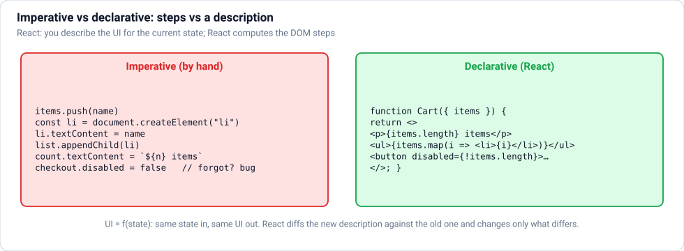

### Theory

> **In simple words:** without React you write **step-by-step instructions** to change the page ("find the counter, change its text, if it's 0 hide the badge, add a row to the list…"). With React you write **one function that describes the whole UI for the current data**, and when the data changes React works out which DOM changes are needed. The first style is **imperative**, the second **declarative**, and declarative code stays correct as apps grow.

**Words to know:**

- **Imperative:** code that says **how**, step by step: "create an `li`, set its text, append it".
- **Declarative:** code that says **what** the result should be: "the list shows one `li` per item".
- **State:** data that changes while the app runs (the cart's items, the text in a search box, whether a menu is open).
- **UI = f(state):** React's core idea: the screen is the output of a function of the state. Same state in, same UI out.
- **Re-render:** calling the component function again after state changes to get the new description of the UI.
- **Virtual DOM:** React's lightweight description of the UI (plain JavaScript objects). React compares the new description with the previous one and changes only the real DOM nodes that differ (Section [42](#42-the-virtual-dom-and-reconciliation-build-a-mini-react-from-scratch)).
- **Reconciliation:** that comparing-and-updating process.
- **Single-page application (SPA):** a site that loads one HTML page and then updates it with JavaScript instead of loading new pages from the server.
- **Ecosystem:** the libraries, tools, frameworks, tutorials and jobs around a technology; React's is the largest of any UI library.

**Everyday picture.** A **satellite navigator** vs **turn-by-turn directions written on paper**. With paper directions (imperative), one wrong turn or road closure and every later instruction is wrong. With a navigator (declarative), you state the **destination**; it recalculates the route from wherever you are. In React you state the destination screen for the current data, and React recalculates the DOM changes.

**The problem, traced by hand.** A "cart" widget shows a count, a list, and a "Checkout" button that should be disabled when empty. With imperative code, adding an item needs **three** separate DOM updates (count text, new `li`, button state) and removing an item needs three different ones. Add a total, a "free delivery over ₹500" banner and a badge in the header, and every new feature multiplies the places you must remember to update. Forget one and the screen **contradicts itself** (the badge says 2, the list shows 3).

The obvious fix is to **redraw everything from the data** on every change (`container.innerHTML = renderPage(state)`). That's declarative, but rebuilding the DOM throws away things the DOM was holding: what's typed in inputs, focus, scroll position, and it's slow for big pages. The code below shows the typed text being lost.

React gives you the **best of both**: you write the "redraw everything" style, and React's reconciliation applies only the minimal changes, so inputs keep their text and focus.

**When React fits:** interactive UIs where many parts depend on shared, changing data (dashboards, editors, shops, chat apps), teams that want reusable components, and apps that also need mobile (React Native). **When it doesn't:** mostly static content (use plain HTML or a static-site tool), a tiny enhancement to a server-rendered page (a few lines of plain JavaScript), or when page weight must be minimal (React DOM adds tens of kilobytes; Section [47](#47-code-splitting-lazy-suspense-and-bundle-size)).

**Common mistakes:**

- ❌ Mixing styles: changing the DOM by hand **inside** a React app (React will overwrite or fight your changes).
- ❌ Thinking React is "fast because of the virtual DOM". It's **predictable** because of it; raw hand-written DOM updates can be faster, but are much harder to keep correct.
- ❌ Choosing React for a five-page brochure site.

**Used in real software:** the declarative "UI = f(state)" model, made popular by React, is now used by Vue, Svelte, SolidJS, Flutter, SwiftUI and Jetpack Compose.

### Code

**From scratch, imperative:** every change needs its own DOM steps, and the parts must be kept in sync by hand:

```tsx
document.body.innerHTML = `<p id="count">0 items</p><ul id="list"></ul><button id="checkout" disabled>Checkout</button>`;
const items: string[] = [];

function addItemImperative(name: string) {
  items.push(name);
  const li = document.createElement("li");                                   // step 1: new row
  li.textContent = name;
  document.querySelector("#list")!.appendChild(li);
  document.querySelector("#count")!.textContent = `${items.length} items`;   // step 2: count
  (document.querySelector("#checkout") as HTMLButtonElement).disabled = false;   // step 3: button
}
addItemImperative("Masala chai");
addItemImperative("Samosa");
console.log(document.body.innerHTML);
```

**Output:**

```text
<p id="count">2 items</p><ul id="list"><li>Masala chai</li><li>Samosa</li></ul><button id="checkout">Checkout</button>
```

**From scratch, declarative:** one `render` function builds the whole UI from the state. Simple and always consistent, but watch what happens to text the user has typed:

```tsx
const state = { items: ["Masala chai"], note: "" };
const renderPage = () => `
  <p>${state.items.length} items</p>
  <input id="note" placeholder="Delivery note">
  <ul>${state.items.map((i) => `<li>${i}</li>`).join("")}</ul>`;

document.body.innerHTML = renderPage();
const note = document.querySelector("#note") as HTMLInputElement;
note.value = "Ring the bell twice";                 // the user types a note…
state.items.push("Samosa");                         // …then adds an item, and we redraw everything
document.body.innerHTML = renderPage();
const noteAfter = document.querySelector("#note") as HTMLInputElement;
console.log(`note after redraw: "${noteAfter.value}" | same input element? ${noteAfter === note}`);
```

**Output:**

```text
note after redraw: "" | same input element? false
```

The redraw created a **brand-new** input, so the user's note vanished (and in a real browser, focus too).

**The React way:** the same "describe everything" code, but React updates only what changed, so the input survives:

```tsx
import { useState } from "react";
import { render, screen, fireEvent } from "@testing-library/react";

function Cart() {
  const [items, setItems] = useState(["Masala chai"]);
  return (
    <div>
      <p>{items.length} items</p>
      <input placeholder="Delivery note" />
      <ul>{items.map((item) => <li key={item}>{item}</li>)}</ul>
      <button onClick={() => setItems([...items, "Samosa"])}>Add samosa</button>
      <button disabled={items.length === 0}>Checkout</button>
    </div>
  );
}

render(<Cart />);
const input = screen.getByPlaceholderText("Delivery note") as HTMLInputElement;
fireEvent.change(input, { target: { value: "Ring the bell twice" } });   // the user types
fireEvent.click(screen.getByText("Add samosa"));                           // state changes, React re-renders
const inputAfter = screen.getByPlaceholderText("Delivery note") as HTMLInputElement;
console.log(`note: "${inputAfter.value}" | same input element? ${inputAfter === input}`);
console.log(screen.getAllByRole("listitem").map((li) => li.textContent), "|", screen.getByText(/items$/).textContent);
```

**Output:**

```text
note: "Ring the bell twice" | same input element? true
[ 'Masala chai', 'Samosa' ] | 2 items
```

Every piece of this (`useState`, `onClick`, `key`, `render`, `screen`, `fireEvent`) is explained in the coming sections; for now notice the result: we described the whole UI, yet React kept the **same** input element and the typed note.

### Practice

1. In the imperative example, add a `removeItemImperative(name)` function. List every DOM update it must make. Which one is easiest to forget?
2. Name one thing besides typed text that a full `innerHTML` redraw destroys.

<details>
<summary><b>Answer</b></summary>

1. Remove the matching `li`, update the count text, and **disable the button when the cart becomes empty**: the last one is the classic forgotten step, leaving an enabled Checkout on an empty cart.
2. Any of: keyboard focus, text selection, scroll position inside a list, a playing video's position, CSS transitions in progress, and event listeners attached directly to old elements.

</details>

| # | Problem | Difficulty |
|---|---|---|
| 1 | [react.dev challenge: Refactor the imperative solution without React](https://react.dev/learn/reacting-to-input-with-state#challenges) | 🟡 Medium |
| 2 | [Frontend Mentor: Interactive rating component (build it with plain DOM code first)](https://www.frontendmentor.io/challenges/interactive-rating-component-koxpeBUmI) | 🟢 Easy |

**Learn more:** [react.dev: Reacting to input with state (imperative vs declarative)](https://react.dev/learn/reacting-to-input-with-state) · [react.dev: Thinking in React](https://react.dev/learn/thinking-in-react)

---

## 6. Setting Up: Node, npm, Vite and How These Examples Run

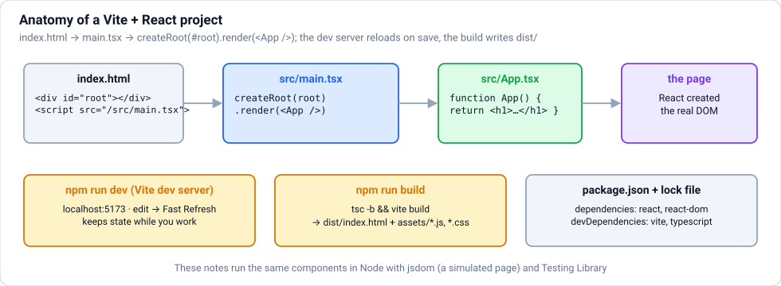

### Theory

> **In simple words:** to build React apps you need **Node.js** (runs JavaScript tools on your computer), **npm** (downloads libraries), and a build tool, usually **Vite** (serves your app while you work and bundles it for production). `npm create vite@latest` makes a ready-to-run project. These notes run every example in Node instead of a browser, using a simulated page (jsdom) and **Testing Library** to look at what React rendered and to click buttons like a user.

**Words to know:**

- **Node.js:** a program that runs JavaScript outside the browser; development tools (Vite, TypeScript, test runners) run on it.
- **npm (Node Package Manager):** the tool and online registry for JavaScript libraries (**packages**). `npm install react` downloads React into your project.
- **`package.json`:** the project's manifest: its name, **scripts** (`npm run dev`) and **dependencies**.
- **Dependency / devDependency:** a package the app needs at runtime (React) / a package only needed while developing or building (Vite, TypeScript, test tools).
- **`node_modules`:** the folder where npm puts installed packages (never edit it, never commit it).
- **Lock file (`package-lock.json`):** records the exact version of every installed package so every machine installs the same ones.
- **Semantic versioning (semver):** versions written `MAJOR.MINOR.PATCH` (19.3.1); `^19.2.8` in `package.json` means "19.2.8 or any later 19.x".
- **npx / `npm create`:** run a package's command without installing it permanently; `npm create vite@latest` runs Vite's project generator.
- **Vite:** the standard build tool for React apps: a **dev server** with instant reloads, and a production **build**.
- **Dev server:** a local web server (`http://localhost:5173`) that serves your app while you develop.
- **Hot module replacement (HMR) / Fast Refresh:** when you save a file, only that module is swapped in the running page, and React keeps component state.
- **Bundler / build:** combines your many source files and libraries into a few optimised files (`dist/`), transforming TypeScript and JSX into plain JavaScript.
- **Entry point:** the first file that runs (`src/main.tsx`), which starts the app.
- **Root element / `createRoot`:** the empty `<div id="root">` in `index.html`; `createRoot(element).render(<App />)` tells React to manage everything inside it.
- **`StrictMode`:** a development-only wrapper that runs extra checks (it renders components twice and runs effects twice to expose bugs; Section [31](#31-the-lifecycle-of-an-effect-dependencies-cleanup-and-strict-mode)).
- **`.tsx` file:** a TypeScript file that may contain JSX.
- **Linter (oxlint / ESLint):** a tool that reads code and warns about likely bugs and style problems; the React Hooks lint rules catch many React mistakes (Section [39](#39-how-hooks-work-inside-build-usestate-from-scratch-and-the-rules-of-hooks)).
- **jsdom:** a JavaScript implementation of the browser DOM that runs in Node; tests and these notes render React into it.
- **Testing Library (`render`, `screen`, `fireEvent`):** helpers to render a component into jsdom (`render`), find things on the page as a user would (`screen.getByRole("button")`, `screen.getByText(...)`), and fire events (`fireEvent.click(button)`). Section [56](#56-testing-components-vitest-testing-library-and-user-event) covers it properly.
- **`act`:** React's testing helper that runs updates and effects to completion before you look at the page; Testing Library calls it for you.

**Everyday picture.** A restaurant kitchen. **Node** is the kitchen itself (where the work happens), **npm** is the supplier who delivers ingredients (packages) listed on your order sheet (`package.json`), **Vite's dev server** is tasting as you cook (instant feedback), and **the build** is plating the final dishes neatly for customers (`dist/`).

**What happens when the page loads, traced:**

1. The browser requests `index.html`, which contains `<div id="root"></div>` and `<script type="module" src="/src/main.tsx">`.
2. Vite transforms `main.tsx` (TypeScript + JSX → JavaScript) on the fly and sends it.
3. `main.tsx` calls `createRoot(document.getElementById("root")!)` and `.render(<StrictMode><App /></StrictMode>)`.
4. React calls `App()`, gets its description of the UI, and creates the real DOM nodes inside `#root`.
5. You save `App.tsx` → Vite sends just that module → Fast Refresh re-renders `App`, keeping state.

**Which starter to use (2026):**

| You want | Use |
|---|---|
| to learn React, or a client-side app (dashboards, internal tools) | **Vite**: `npm create vite@latest my-app -- --template react-ts` |
| a full product with server rendering, SEO, API routes | **Next.js** (`npx create-next-app@latest`, Part 9) or **React Router** framework mode |
| mobile apps | **Expo** (React Native) |

Create React App (the old official starter) was deprecated in February 2025; don't start new projects with it.

**How the examples in these notes run.** Every `tsx` block is run with Node.js 24 through a small loader (`tsx`) that understands TypeScript and JSX, after this setup file, which creates the simulated page:

```text
// setup.ts: loaded before every example
import "global-jsdom/register";                      // a fake browser page: document, window, events
import { format } from "node:util";
(globalThis as any).IS_REACT_ACT_ENVIRONMENT = true; // tells React updates are wrapped in act()
for (const name of ["FormData", "Event", "CustomEvent", "navigator"])  // Node has its own versions;
  Object.defineProperty(globalThis, name, { value: window[name], configurable: true, writable: true });  // use the page's
for (const level of ["error", "warn"] as const)      // show warnings in the output, one line each
  console[level] = (...args) => process.stdout.write(`console.${level}: ${format(...args).split("\n")[0]}\n`);
```

Blocks in one section form one file (so they share variables, like notebook cells); before each block the page is emptied (Testing Library's `cleanup()` unmounts what was rendered and `document.body` is cleared), the way a test runner resets between tests, unless a block continues the previous one. To run an example yourself: `npm install react react-dom` and `npm install -D typescript tsx global-jsdom jsdom @testing-library/react @testing-library/dom @types/react @types/react-dom`, save the code (plus the setup file) and run `node --import tsx --import ./setup.ts example.tsx`.

**Common mistakes:**

- ❌ Starting with Create React App (deprecated).
- ❌ Committing `node_modules` (huge, machine-specific). ✅ Commit `package.json` and the lock file.
- ❌ Opening `index.html` directly from disk instead of running the dev server; modules and JSX need Vite.
- ❌ Deleting `StrictMode` to "fix" double logs; the double run is a development check, not a bug (Section [31](#31-the-lifecycle-of-an-effect-dependencies-cleanup-and-strict-mode)).

**Used in real software:** Vite is the default for new client-side React apps and is used under the hood by React Router's framework mode, Vitest, Storybook and Astro; Next.js uses its own bundler, Turbopack.

### Code

**Creating a project for real.** This shell block scaffolds a Vite + React + TypeScript project with Vite's official generator, then lists what it made:

```bash
npm create vite@9.2.1 shop -- --template react-ts --no-interactive < /dev/null > /dev/null 2>&1
cd shop && find . -type f -not -path "./src/assets/*" -not -path "./public/*" | sort
node -e "const p = require('./package.json'); console.log('scripts:', p.scripts); console.log('dependencies:', p.dependencies)"
```

**Output:**

```text
./.gitignore
./.oxlintrc.json
./index.html
./package.json
./README.md
./src/App.css
./src/App.tsx
./src/index.css
./src/main.tsx
./tsconfig.app.json
./tsconfig.json
./tsconfig.node.json
./vite.config.ts
scripts: {
  dev: 'vite',
  build: 'tsc -b && vite build',
  lint: 'oxlint',
  preview: 'vite preview'
}
dependencies: { react: '^19.2.8', 'react-dom': '^19.2.8' }
```

`--no-interactive` skips the questions the generator normally asks. Two choices in today's template are worth noticing: it lints with **oxlint** (a very fast linter written in Rust) instead of ESLint, and its `build` script runs the TypeScript compiler (`tsc -b`) before `vite build`, so a type error fails the build.

**The entry point** it generated (`src/main.tsx`) is the four-step trace above in code:

```bash
cat shop/src/main.tsx
```

**Output:**

```text
import { StrictMode } from 'react'
import { createRoot } from 'react-dom/client'
import './index.css'
import App from './App.tsx'

createRoot(document.getElementById('root')!).render(
  <StrictMode>
    <App />
  </StrictMode>,
)
```

**Installing and building:**

```bash
cd shop && npm install --no-audit --no-fund > /dev/null 2>&1 && npm run build 2>&1 | grep -v "^$" | sed -E 's/ in [0-9.]+m?s/ in (time)/'
```

**Output:**

```text
> shop@0.0.0 build
> tsc -b && vite build
vite v8.3.4 building client environment for production...
transforming...
✓ 20 modules transformed.
rendering chunks...
computing gzip size...
dist/index.html                   0.45 kB │ gzip:  0.29 kB
dist/assets/react-CHdo91hT.svg    4.12 kB │ gzip:  2.06 kB
dist/assets/vite-BF8QNONU.svg     8.70 kB │ gzip:  1.60 kB
dist/assets/hero-CLDdwZDr.png    13.05 kB
dist/assets/index-D64VDMd1.css    4.10 kB │ gzip:  1.47 kB
dist/assets/index-Cl6Bt99l.js   222.45 kB │ gzip: 69.28 kB
✓ built in (time)
```

The build produced an HTML file, one CSS file, the template's images and **one JavaScript bundle** of about 222 kB (69 kB after gzip compression, roughly what users download), most of which is React and React DOM themselves. (Timings vary per machine, so they're replaced with "(time)".)

**From scratch: mounting React by hand** into the simulated page, exactly what `main.tsx` does, with `act` making React finish its work before we look:

```tsx
import { act } from "react";
import { createRoot } from "react-dom/client";

function App() {
  return <h1>Welcome to Chai Point ☕</h1>;
}

document.body.innerHTML = `<div id="root"></div>`;
const root = createRoot(document.getElementById("root")!);
await act(async () => root.render(<App />));
console.log(document.body.innerHTML);
await act(async () => root.unmount());              // remove the app again
console.log(document.body.innerHTML);
```

**Output:**

```text
<div id="root"><h1>Welcome to Chai Point ☕</h1></div>
<div id="root"></div>
```

**The Testing Library way,** used in the rest of these notes: `render` does the mounting and `act` for you, and `screen` finds elements as a user would:

```tsx
import { render, screen, fireEvent } from "@testing-library/react";

function Hello() {
  return (
    <main>
      <h1>Welcome</h1>
      <button onClick={() => console.log("clicked!")}>Order chai</button>
    </main>
  );
}

const { container } = render(<Hello />);
console.log(container.innerHTML);
fireEvent.click(screen.getByRole("button", { name: "Order chai" }));
```

**Output:**

```text
<main><h1>Welcome</h1><button>Order chai</button></main>
clicked!
```

`container` is the `div` Testing Library rendered into; `getByRole("button", { name: … })` finds a button by its accessible name (its visible text here); `fireEvent.click` dispatches a real DOM click event.

### Practice

1. In `package.json`, what's the difference between `"react": "^19.2.8"` and `"react": "19.2.8"`, and which file pins the exact version installed?
2. Write the four lines of a `main.tsx` that mounts a component `Shop` into `<div id="app">` (not `root`).

<details>
<summary><b>Answer</b></summary>

1. `^19.2.8` allows any 19.x version from 19.2.8 upwards (so `npm install` may pick 19.3.1); `19.2.8` allows only that version. Either way, `package-lock.json` records the exact versions actually installed, so teammates and CI get the same ones.
2.

```text
import { createRoot } from "react-dom/client";
import Shop from "./Shop";
createRoot(document.getElementById("app")!).render(<Shop />);
```

(Wrap `<Shop />` in `<StrictMode>` to get development checks. This sketch isn't run: it needs a real `Shop` file and page; the same code runs in Section 6's examples above.)

</details>

| # | Practice | Difficulty |
|---|---|---|
| 1 | [react.dev: Build a React app from scratch (Vite)](https://react.dev/learn/build-a-react-app-from-scratch) | 🟢 Easy |
| 2 | [react.dev challenge: Export the component (first component)](https://react.dev/learn/your-first-component#challenges) | 🟢 Easy |

**Learn more:** [Vite: Getting started](https://vite.dev/guide/) · [react.dev: Creating a React app](https://react.dev/learn/creating-a-react-app) · [npm: About semantic versioning](https://docs.npmjs.com/about-semantic-versioning)

---

### ✅ Part 1 checkpoint

Without looking, can you:

- [ ] Explain the difference between HTML and the DOM, and draw the DOM tree for a small HTML snippet?
- [ ] Describe event bubbling and say what `event.target`, `event.currentTarget` and `preventDefault()` are for?
- [ ] Use destructuring, spread, `map`, `filter`, `find`, `toSorted` and `with`, and explain why `[...a, x] !== a` matters to React?
- [ ] Predict the order of synchronous code, promise callbacks and timers, and handle `fetch` errors and cancellation?
- [ ] Explain imperative vs declarative UI and why redrawing everything by hand loses input state?
- [ ] Create a Vite React project, name what each generated file does, and mount a component with `createRoot`?

Part 2 writes your first real components.

---

# Part 2 — Basic: Your First Components

> **Goal:** Write components, understand what JSX really is, pass data with props, keep components pure, show things conditionally, and render lists with correct keys. By the end you can turn any static design plus some data into a tree of React components.  
> **You need:** Part 1 (the DOM, arrow functions, destructuring, `map`, modules, and how the examples run).

---

## 7. Your First Component

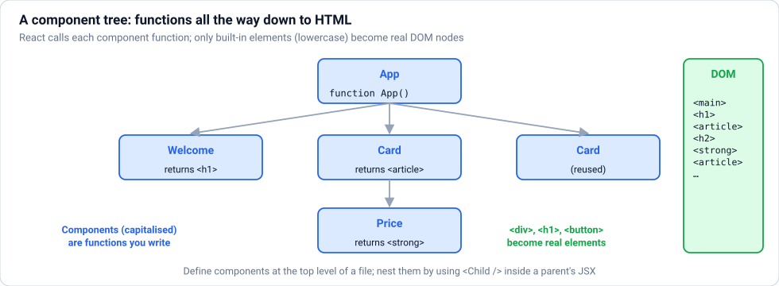

### Theory

> **In simple words:** a **component** is a JavaScript function whose name starts with a **capital letter** and which **returns markup** (JSX). You use it like an HTML tag: `<Welcome />`. React calls your function and puts what it returns on the page. Components can use other components, so a whole app is a **tree** of them, and each one can be reused as many times as you like.

**Words to know:**

- **Function component:** a function that returns JSX (or `null`); the only kind of component new code uses (older **class components** are covered in Section [67](#67-legacy-react-class-components-lifecycles-hocs-and-render-props)).
- **JSX:** the HTML-like syntax inside JavaScript (`<h1>Hi</h1>`) that describes UI; Section [8](#8-jsx-markup-inside-javascript-and-what-it-compiles-to) shows what it turns into.
- **Rendering a component:** React calling your component function to find out what it should show.
- **Component tree:** the nesting of components: `App` renders `Header` and `ProductCard`, and so on down to plain HTML elements.
- **Parent / child component:** a component that renders another is its **parent**; the one rendered is the **child**.
- **Root component:** the top of the tree, usually `App`, passed to `createRoot(...).render(...)`.
- **PascalCase:** `ProductCard`: every word capitalised. React treats `<productCard>` (lowercase first letter) as an HTML tag, so components **must** start with a capital.
- **Default export / named export:** a file's one main export (`export default function App`) vs extra ones (`export function Button`); you can use either for components (Section [3](#3-the-javascript-react-uses-arrow-functions-destructuring-spread-array-methods-and-modules)).
- **Built-in (host) component:** a lowercase tag such as `<div>` or `<button>`, which React turns into a real DOM element.
- **Nesting vs defining inside:** you **use** components inside other components, but you **define** each one at the top level of a file, never inside another component's body.

**Everyday picture.** A restaurant menu card is printed from a template: the template (the component) has slots for the dish name and price; the printer (React) runs the template once per dish. You never redraw the card by hand; you change the template once and every card updates.

**How React renders a small tree, traced by hand:**

```text
function Price()  { return <strong>₹180</strong>; }
function Card()   { return <article><h2>Masala chai</h2><Price /></article>; }
function App()    { return <main><Card /><Card /></main>; }
```

1. React calls `App()` → gets a `main` containing two `Card` elements.
2. For the first `<Card />` it calls `Card()` → `article` with an `h2` and a `<Price />`.
3. It calls `Price()` → `strong` with "₹180". No more components, only HTML elements: done with this branch.
4. Same again for the second `<Card />`. React now has a full description made only of HTML elements and creates the DOM: `<main><article><h2>…</h2><strong>₹180</strong></article><article>…</article></main>`.

**When to make something a component:** when a piece of UI repeats (a card, a row), has its own job (a search box), or makes the parent hard to read. **When not:** don't wrap every single `<div>` in its own component; a component should be a meaningful, reusable piece.

**Common mistakes:**

- ❌ Lowercase component names: `<welcome />` renders an unknown HTML tag called `welcome`.
- ❌ Forgetting `return`, or returning on the next line after a bare `return` (JavaScript inserts a semicolon after `return`, so nothing is returned). ✅ Put `(` on the same line: `return (`.
- ❌ Defining a component **inside** another component: it becomes a brand-new component on every render, so React throws away its DOM and state each time (Section [24](#24-preserving-and-resetting-state-tree-position-and-keys)).
- ❌ Returning two sibling elements without a wrapper (Section [8](#8-jsx-markup-inside-javascript-and-what-it-compiles-to) shows fragments).

**Used in real software:** every screen of every React app is a component tree; large apps have thousands of components, from tiny `Icon`s to whole `CheckoutPage`s, many coming from a shared design system (Section [66](#66-architecture-project-structure-design-systems-and-monorepos)).

### Code

**From scratch: a component is just a function.** You can call it yourself; what it returns is a plain object describing UI (an **element**), not DOM:

```tsx
function Welcome() {
  return <h1 className="title">Welcome to Chai Point ☕</h1>;
}

const element = Welcome();                            // call it like any function
console.log(typeof element, "| type:", element.type, "| props:", element.props);
```

**Output:**

```text
object | type: h1 | props: { className: 'title', children: 'Welcome to Chai Point ☕' }
```

The result is a small object: the tag (`type`) and its `props`, with the text inside as `children`. Nothing appears on any page until React **renders** it into a DOM.

**The React way: use components as tags, nest and reuse them:**

```tsx
import { render } from "@testing-library/react";

function Price() {
  return <strong>₹180</strong>;
}

function Card() {
  return (
    <article>
      <h2>Masala chai</h2>
      <Price />
    </article>
  );
}

function App() {
  return (
    <main>
      <Welcome />
      <Card />
      <Card />
    </main>
  );
}

const { container } = render(<App />);
console.log(container.innerHTML);
```

**Output:**

```text
<main><h1 class="title">Welcome to Chai Point ☕</h1><article><h2>Masala chai</h2><strong>₹180</strong></article><article><h2>Masala chai</h2><strong>₹180</strong></article></main>
```

Only HTML elements reach the page: `App`, `Card`, `Price` and `Welcome` disappear into what they return. The two cards are identical because `Card` has no inputs yet; props (Section [9](#9-props-passing-data-to-components)) fix that.

**Components in their own files.** Real projects put each component in a file and import it:

```tsx
export default function Badge() {
  return <span className="badge">Bestseller</span>;
}

export function NewBadge() {
  return <span className="badge new">New</span>;
}
```

```tsx
import Badge, { NewBadge } from "./Badge.tsx";

function Labels() {
  return (
    <p>
      <Badge /> <NewBadge />
    </p>
  );
}
console.log(render(<Labels />).container.innerHTML);
```

**Output:**

```text
<p><span class="badge">Bestseller</span> <span class="badge new">New</span></p>
```

Notice the space between the two badges survived: a space between two tags on the **same line** is kept, while line breaks and indentation between tags are removed.

**The mistake of the bare `return`:**

```tsx
function Broken() {
  return
    <p>never shown</p>;
}
console.log("Broken() returned:", Broken());
```

**Output:**

```text
Broken() returned: undefined
```

JavaScript ends the statement after a bare `return`, so the function returns `undefined` and the JSX below is never reached. (TypeScript would also flag the unreachable line in a normal project.)

### Practice

1. Write a `Header` component (an `h1` with your shop's name and a `p` tagline) and a `Footer` (a `small` with "© 2026"), and an `App` that renders `Header`, two `Card`s and `Footer`. Print the HTML.
2. What does React do with `<card />` written in lowercase?

<details>
<summary><b>Answer</b></summary>

```tsx
function Header() {
  return (
    <header>
      <h1>Chai Point</h1>
      <p>Fresh chai in 20 minutes</p>
    </header>
  );
}
function Footer() {
  return <small>© 2026</small>;
}
function Shop() {
  return (
    <>
      <Header />
      <Card />
      <Card />
      <Footer />
    </>
  );
}
console.log(render(<Shop />).container.innerHTML);
```

**Output:**

```text
<header><h1>Chai Point</h1><p>Fresh chai in 20 minutes</p></header><article><h2>Masala chai</h2><strong>₹180</strong></article><article><h2>Masala chai</h2><strong>₹180</strong></article><small>© 2026</small>
```

1. `<>…</>` is a **fragment**: it groups elements without adding a wrapper element (Section [8](#8-jsx-markup-inside-javascript-and-what-it-compiles-to)).
2. It treats `card` as an HTML tag name and creates an unknown `<card>` element; your `Card` function is never called. (TypeScript also rejects `<card />` because it isn't a known HTML element.)

</details>

| # | Problem | Difficulty |
|---|---|---|
| 1 | [react.dev challenges: Your first component (Export the component, Fix the return statement, Spot the mistake, Your own component)](https://react.dev/learn/your-first-component#challenges) | 🟢 Easy |
| 2 | [react.dev challenge: Split the components further (importing and exporting)](https://react.dev/learn/importing-and-exporting-components#challenges) | 🟢 Easy |
| 3 | [Frontend Mentor: Product preview card component (build it as React components)](https://www.frontendmentor.io/challenges/product-preview-card-component-GO7UmttRfa) | 🟢 Easy |

**Learn more:** [react.dev: Your first component](https://react.dev/learn/your-first-component) · [react.dev: Importing and exporting components](https://react.dev/learn/importing-and-exporting-components)

---

## 8. JSX: Markup Inside JavaScript (and What It Compiles To)

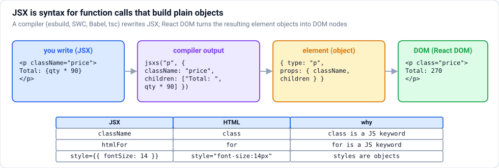

### Theory

> **In simple words:** **JSX** looks like HTML but lives inside JavaScript. A build tool turns every JSX tag into a **function call** (`jsx("h1", { children: "Hi" })`) that returns a plain object describing the element. Anything inside **curly braces `{}`** is ordinary JavaScript: a variable, a calculation, a function call. JSX has a few differences from HTML (`className`, `htmlFor`, camelCase attributes, closing every tag), all because it is JavaScript underneath.

**Words to know:**

- **JSX (JavaScript XML):** a syntax extension that lets you write markup in JavaScript; it is not valid JavaScript until a compiler transforms it.
- **Compiler / transpiler:** a tool that rewrites code into another form; esbuild, SWC, Babel and TypeScript all compile JSX into function calls.
- **`jsx()` / `jsxs()` (the automatic runtime):** the functions JSX compiles into, imported automatically from `react/jsx-runtime` (`jsxs` is used when there are several static children). Older setups compiled to `React.createElement`, which is why old files start with `import React from "react"`.
- **React element:** the plain object a JSX expression produces: `{ type: "h1", props: { children: "Hi" }, key: null }`. Cheap to create and thrown away after each render.
- **`children`:** the special prop holding whatever is written between an element's opening and closing tags.
- **Expression vs statement:** an **expression** produces a value (`price * qty`, `a ? b : c`, `items.map(...)`) and can go inside `{}`; a **statement** does something (`if`, `for`, `const x = 1`) and cannot.
- **Fragment (`<>…</>` or `<Fragment>`):** groups several elements without adding a wrapper to the DOM. Use `<Fragment key={…}>` when it needs a key (Section [12](#12-rendering-lists-and-keys)).
- **`className` / `htmlFor`:** JSX names for HTML's `class` and `for`, because `class` and `for` are reserved words in JavaScript.
- **camelCase attributes:** event and most multi-word attributes are camelCase in JSX: `onClick`, `tabIndex`, `maxLength`, `autoFocus`. Exceptions: `aria-*` and `data-*` keep their dashes.
- **`style` object:** inline styles are objects with camelCase CSS properties: `style={{ fontSize: 14, backgroundColor: "teal" }}` (numbers become pixels for most properties).
- **Escaping:** turning special characters into safe text (`<` → `&lt;`), so text from users can never become markup. JSX escapes everything in `{}` automatically.
- **`dangerouslySetInnerHTML`:** the deliberately scary escape hatch that inserts raw HTML; only for trusted or sanitised HTML (`javascript.md`, [Frontend Security](javascript.md#35-frontend-security-xss-csrf-csp-prototype-pollution-and-the-supply-chain)).

**Everyday picture.** A **form letter** with blanks: "Dear {name}, your order #{orderId} of {total} has shipped." The fixed text is the markup; the `{}` blanks are filled from your data. The mail-merge program that turns the template into finished letters is the compiler plus React.

**JSX rules (the differences from HTML):**

| Rule | HTML | JSX |
|---|---|---|
| return **one** root (or a fragment) | many siblings fine | `return <><h1 /><p /></>` |
| close every tag | ``, `<br>` | ``, `<br />` |
| `class` is reserved | `class="btn"` | `className="btn"` |
| label's `for` is reserved | `for="email"` | `htmlFor="email"` |
| camelCase attributes | `onclick`, `tabindex` | `onClick`, `tabIndex` (`aria-*`, `data-*` stay dashed) |
| inline styles | `style="color: red"` | `style={{ color: "red" }}` |
| comments | `<!-- -->` | `{/* comment */}` |
| JavaScript values | not possible | `{price * qty}`, `{user.name}` |

**What renders and what doesn't:** strings and numbers become text; `null`, `undefined`, `true` and `false` render **nothing**; arrays render item by item; elements render as elements. A plain object can't be rendered (React throws). And `0` **does** render, which matters for `count && …` (Section [11](#11-conditional-rendering)).

**What the compiler does, traced by hand:**

```text
<p className="price">Total: {qty * 90}</p>
→ jsxs("p", { className: "price", children: ["Total: ", qty * 90] })
→ { type: "p", props: { className: "price", children: ["Total: ", 270] } }      (when qty = 3)
→ <p class="price">Total: 270</p>                                                 (React DOM creates this)
```

**When to use JSX:** always, for React UI; it's far more readable than nested function calls. **When not:** logic. Keep calculations and `if`s above the `return`, and keep JSX for structure.

**Common mistakes:**

- ❌ `class=`, `for=`, `onclick=`, `style="..."` from HTML habit.
- ❌ An `if` statement inside `{}`. ✅ A ternary, `&&`, or compute a variable above `return`.
- ❌ Rendering an object (`{user}`). ✅ `{user.name}`.
- ❌ Two root elements returned side by side. ✅ Wrap in `<>…</>`.

**Used in real software:** JSX (or its TypeScript form, TSX) is how virtually all React code is written; Preact, SolidJS and Qwik use JSX too, with different runtimes.

### Code

**From scratch: build elements without JSX.** A hand-written `h` function makes the same kind of objects JSX makes, and a tiny `toHTML` function turns them into an HTML string (with escaping), which is the essence of what React DOM's server renderer does:

```tsx
type El = { type: string; props: Record<string, any> };
const h = (type: string, props: Record<string, any> | null, ...children: any[]): El =>
  ({ type, props: { ...props, children } });

const escapeHtml = (s: string) => s.replace(/&/g, "&amp;").replace(/</g, "&lt;").replace(/>/g, "&gt;");

function toHTML(node: any): string {
  if (node === null || node === undefined || typeof node === "boolean") return "";   // render nothing
  if (typeof node === "string" || typeof node === "number") return escapeHtml(String(node));
  if (Array.isArray(node)) return node.map(toHTML).join("");
  const { children, className, ...attrs } = node.props;
  const attrText = Object.entries({ class: className, ...attrs })
    .filter(([, v]) => v !== undefined).map(([k, v]) => ` ${k}="${escapeHtml(String(v))}"`).join("");
  return `<${node.type}${attrText}>${toHTML(children)}</${node.type}>`;
}

const qty = 3;
const tree = h("div", { className: "card" },
  h("h2", null, "Masala chai"),
  h("p", { className: "price" }, "Total: ", qty * 90),
  qty > 5 && h("span", null, "bulk discount"),           // false → renders nothing
  h("p", null, "<script>alert('hi')</script>"));          // escaped, harmless
console.log(toHTML(tree));
```

**Output:**

```text
<div class="card"><h2>Masala chai</h2><p class="price">Total: 270</p><p>&lt;script&gt;alert('hi')&lt;/script&gt;</p></div>
```

**The real thing: JSX compiles to `jsx()` calls.** This shell block asks esbuild (the compiler Vite and `tsx` use) to transform a line of JSX:

```bash
echo 'const el = <p className="price">Total: {qty * 90}</p>;' | npx esbuild --loader=tsx --jsx=automatic
```

**Output:**

```text
import { jsxs } from "react/jsx-runtime";
const el = /* @__PURE__ */ jsxs("p", { className: "price", children: [
  "Total: ",
  qty * 90
] });
```

`jsxs` (with an "s") is used because the `p` has more than one child: the text and the expression. The object it returns is the same shape as ours:

```tsx
const real = <p className="price">Total: {qty * 90}</p>;
console.log(real.type, real.props, "| key:", real.key);
```

**Output:**

```text
p { className: 'price', children: [ 'Total: ', 270 ] } | key: null
```

**JSX in practice: expressions, attributes, styles and fragments:**

```tsx
import { render } from "@testing-library/react";

const product = { name: "Masala chai", pricePaise: 18000, tags: ["tea", "spiced"], inStock: true };
const formatRupees = (paise: number) => `₹${(paise / 100).toFixed(2)}`;

function ProductCard() {
  const discountPercent = 10;                              // statements go above the return
  const final = product.pricePaise * (1 - discountPercent / 100);
  return (
    <article className="card" data-sku="TEA-250">
      {/* any expression goes inside braces */}
      <h2>{product.name.toUpperCase()}</h2>
      <p style={{ color: "green", fontWeight: 700 }}>
        {formatRupees(final)} <s>{formatRupees(product.pricePaise)}</s>
      </p>
      <p>{product.inStock ? "In stock" : "Sold out"}</p>
      <label htmlFor="qty">Qty</label>
      <input id="qty" type="number" defaultValue={1} />
      <small>Tags: {product.tags.join(", ")}</small>
    </article>
  );
}
console.log(render(<ProductCard />).container.innerHTML);
```

**Output:**

```text
<article class="card" data-sku="TEA-250"><h2>MASALA CHAI</h2><p style="color: green; font-weight: 700;">₹162.00 <s>₹180.00</s></p><p>In stock</p><label for="qty">Qty</label><input id="qty" type="number" value="1"><small>Tags: tea, spiced</small></article>
```

`className` became `class`, `htmlFor` became `for`, and the style object became a CSS string. `defaultValue` sets an input's starting value (Section [19](#19-forms-controlled-and-uncontrolled-inputs)).

**What renders and what doesn't, and why user text is safe:**

```tsx
function Values() {
  const userInput = "<script>alert('hacked')</script>";
  return (
    <ul>
      <li>string: {"hello"}</li>
      <li>number: {42}</li>
      <li>zero: {0}</li>
      <li>true/false/null/undefined: [{true}{false}{null}{undefined}]</li>
      <li>array: {["a", "b", "c"]}</li>
      <li>user input: {userInput}</li>
    </ul>
  );
}
console.log(render(<Values />).container.innerHTML);
```

**Output:**

```text
<ul><li>string: hello</li><li>number: 42</li><li>zero: 0</li><li>true/false/null/undefined: []</li><li>array: abc</li><li>user input: &lt;script&gt;alert('hacked')&lt;/script&gt;</li></ul>
```

`0` renders, booleans and `null` don't, and the "script" is harmless text (`&lt;` is the escaped `<`).

**Rendering an object is an error:**

```tsx
const user = { name: "Asha" };
render(<p>{user as any}</p>);
```

**Output:**

```text
Error: Objects are not valid as a React child (found: object with keys {name}). If you meant to render a collection of children, use an array instead.
```

(The `as any` silences TypeScript, which would otherwise reject this at compile time, so we can see React's own runtime error.)

**Fragments** return several elements without an extra wrapper:

```tsx
function PriceRow() {
  return (
    <>
      <dt>Price</dt>
      <dd>₹180</dd>
    </>
  );
}
console.log(render(<dl><PriceRow /></dl>).container.innerHTML);
```

**Output:**

```text
<dl><dt>Price</dt><dd>₹180</dd></dl>
```

**TypeScript catches HTML habits.** Writing `class` instead of `className`:

```tsx
const a = <div class="x">Hi</div>;
```

**Compiler output:**

```text
example.tsx(1,16): error TS2322: Type '{ class: string; children: string; }' is not assignable to type 'DetailedHTMLProps<HTMLAttributes<HTMLDivElement>, HTMLDivElement>'.
  Property 'class' does not exist on type 'DetailedHTMLProps<HTMLAttributes<HTMLDivElement>, HTMLDivElement>'. Did you mean 'className'?
```

### Practice

1. Convert this HTML to JSX: `<label for="q" class="lbl">Search</label><input id="q" tabindex="1" style="width: 200px; margin-top: 4px">`.
2. Write `OrderSummary` for `const order = { id: 90312, items: 3, totalPaise: 149950, express: true }` showing `Order #90312`, `3 items · ₹1499.50`, and "⚡ Express" only when `express` is true.

<details>
<summary><b>Answer</b></summary>

```tsx
function SearchField() {
  return (
    <>
      <label htmlFor="q" className="lbl">Search</label>
      <input id="q" tabIndex={1} style={{ width: 200, marginTop: 4 }} />
    </>
  );
}
const order = { id: 90312, items: 3, totalPaise: 149950, express: true };
function OrderSummary() {
  return (
    <div>
      <h3>Order #{order.id}</h3>
      <p>{order.items} items · {formatRupees(order.totalPaise)}</p>
      {order.express && <span>⚡ Express</span>}
    </div>
  );
}
console.log(render(<SearchField />).container.innerHTML);
console.log(render(<OrderSummary />).container.innerHTML);
```

**Output:**

```text
<label for="q" class="lbl">Search</label><input id="q" tabindex="1" style="width: 200px; margin-top: 4px;">
<div><h3>Order #90312</h3><p>3 items · ₹1499.50</p><span>⚡ Express</span></div>
```

`tabIndex={1}` passes a number (a string `"1"` would also work); `width: 200` becomes `200px`. `order.express && …` is safe here because `express` is a boolean, never `0`.

</details>

| # | Problem | Difficulty |
|---|---|---|
| 1 | [react.dev challenge: Convert some HTML to JSX](https://react.dev/learn/writing-markup-with-jsx#challenges) | 🟢 Easy |
| 2 | [react.dev challenges: JavaScript in JSX (Fix the mistake, Extract information into an object, Write an expression inside JSX)](https://react.dev/learn/javascript-in-jsx-with-curly-braces#challenges) | 🟢 Easy |

**Learn more:** [react.dev: Writing markup with JSX](https://react.dev/learn/writing-markup-with-jsx) · [react.dev: JavaScript in JSX with curly braces](https://react.dev/learn/javascript-in-jsx-with-curly-braces) · [React blog: Introducing the new JSX transform](https://legacy.reactjs.org/blog/2020/09/22/introducing-the-new-jsx-transform.html)

---

## 9. Props: Passing Data to Components

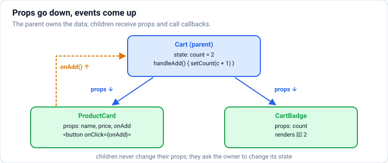

### Theory

> **In simple words:** **props** (properties) are how a parent passes information to a child, exactly like arguments to a function. `<ProductCard name="Masala chai" price={180} />` makes React call `ProductCard({ name: "Masala chai", price: 180 })`. Props let one component show different data each time it is used. They are **read-only**: a component must never change its own props. To let a child change something, the parent passes a **function** as a prop that the child calls.

**Words to know:**

- **Prop:** one named input to a component, written like an HTML attribute: `name="Masala chai"`, `price={180}`.
- **Props object:** all of a component's props gathered into one object, the function's first (and only) parameter.
- **String vs expression prop:** `name="Chai"` passes a string; anything else (numbers, booleans, objects, functions, JSX) goes in braces: `price={180}`, `tags={["tea"]}`, `onAdd={handleAdd}`.
- **Boolean shorthand:** `<Button disabled />` is the same as `disabled={true}`.
- **Default prop value:** a fallback in the destructuring: `function Avatar({ size = 48 })`.
- **`children` prop:** whatever is nested between a component's tags: in `<Card><p>Hi</p></Card>`, `Card` receives the `p` as `children` (more in Section [25](#25-composition-children-slots-and-layout-components)).
- **Spreading props:** `<Avatar {...person} />` passes every property of `person` as a prop; handy but hides what's passed.
- **Callback prop:** a function passed down so the child can tell the parent something happened: `onAdd`, `onChange`. By convention prop names start with `on` and handler functions with `handle`.
- **One-way data flow:** data moves **down** the tree through props; requests to change it move **up** through callbacks.
- **Read-only (immutable) props:** React freezes the props object in development, so assigning to it throws.
- **Prop types (TypeScript):** describing each prop's type, e.g. `{ name: string; price: number; onAdd?: () => void }`; the `?` marks an optional prop (Section [26](#26-typescript-with-react-typing-props-state-events-and-children)).

**Everyday picture.** Props are the **order slip** a waiter hands to the kitchen: "masala chai, less sugar, table 4". The cook (child component) follows the slip but never edits it. If the cook needs to tell the waiter something ("we're out of ginger"), they ring a bell the waiter installed (a callback prop).

**Props through a tree, traced by hand:**

```text
<Menu items={[{ id: 1, name: "Masala chai", price: 180 }]} />
  Menu({ items })                         → items.map(item => <MenuItem key={item.id} {...item} onAdd={add} />)
    MenuItem({ id: 1, name: "Masala chai", price: 180, onAdd })
      → <li>Masala chai ₹180 <button onClick={() => onAdd(1)}>Add</button></li>
  user clicks "Add" → MenuItem calls onAdd(1) → Menu's add(1) runs (Menu owns the data)
```

**When to use props:** for every piece of data a component needs from its parent. **When not:** when the same data must pass through many layers that don't use it ("prop drilling"); composition (Section [25](#25-composition-children-slots-and-layout-components)) or context (Section [36](#36-context-passing-data-deeply)) fit better.

**Common mistakes:**

- ❌ Changing props (`props.price = 0`) to "update" them. ✅ The parent owns the data; ask it via a callback.
- ❌ `price="180"` when a number is meant (a string). ✅ `price={180}`.
- ❌ Calling the function while passing it: `onAdd={handleAdd()}` runs it during render. ✅ `onAdd={handleAdd}` or `onAdd={() => handleAdd(id)}`.
- ❌ Copying a prop into state "so it can change" (`useState(props.price)`); the state then ignores later prop changes (Section [22](#22-choosing-the-state-structure)).

**Used in real software:** every reusable component (buttons, inputs, cards, tables) is configured entirely through props; design systems document each component's props as its public interface.

### Code

**From scratch: props are just the function's argument object.** React gathers the attributes into one object and calls your function with it:

```tsx
function PriceTag(props: { label: string; paise: number }) {
  return <span>{props.label}: ₹{props.paise / 100}</span>;
}
const el = <PriceTag label="Masala chai" paise={18000} />;
console.log("element props:", el.props);
console.log("calling it ourselves:", PriceTag(el.props).props.children);
```

**Output:**

```text
element props: { label: 'Masala chai', paise: 18000 }
calling it ourselves: [ 'Masala chai', ': ₹', 180 ]
```

The `span`'s children are three pieces, exactly the parts between its tags: the label, the literal text ": ₹", and the computed number.

**The React way: destructured props, defaults, and reuse:**

```tsx
import { render } from "@testing-library/react";

type ProductCardProps = { name: string; pricePaise: number; tags?: string[]; bestseller?: boolean };

function ProductCard({ name, pricePaise, tags = [], bestseller = false }: ProductCardProps) {
  return (
    <article>
      <h2>{name}{bestseller && " ⭐"}</h2>
      <p>₹{(pricePaise / 100).toFixed(2)}</p>
      {tags.length > 0 && <small>{tags.join(" · ")}</small>}
    </article>
  );
}

function Menu() {
  return (
    <section>
      <ProductCard name="Masala chai" pricePaise={18000} tags={["tea", "spiced"]} bestseller />
      <ProductCard name="Samosa" pricePaise={6000} />
    </section>
  );
}
console.log(render(<Menu />).container.innerHTML);
```

**Output:**

```text
<section><article><h2>Masala chai ⭐</h2><p>₹180.00</p><small>tea · spiced</small></article><article><h2>Samosa</h2><p>₹60.00</p></article></section>
```

One component, two different results. `bestseller` alone means `true`; `tags` falls back to `[]` for the samosa, so its `<small>` isn't rendered.

**Callbacks: the child asks, the parent decides.** The parent passes a function; the child calls it with the item's id:

```tsx
import { screen, fireEvent } from "@testing-library/react";

function AddButton({ itemId, onAdd }: { itemId: number; onAdd: (id: number) => void }) {
  return <button onClick={() => onAdd(itemId)}>Add #{itemId}</button>;
}

function Shop() {
  function handleAdd(id: number) {
    console.log("parent was asked to add item", id);
  }
  return (
    <>
      <AddButton itemId={1} onAdd={handleAdd} />
      <AddButton itemId={2} onAdd={handleAdd} />
    </>
  );
}
render(<Shop />);
fireEvent.click(screen.getByText("Add #2"));
```

**Output:**

```text
parent was asked to add item 2
```

**Props are read-only.** In development React freezes the props object, so a component that tries to change one fails loudly:

```tsx
function Sneaky(props: { price: number }) {
  (props as any).price = 0;                    // ❌ trying to change a prop
  return <p>{props.price}</p>;
}
render(<Sneaky price={180} />);
```

**Output:**

```text
TypeError: Cannot assign to read only property 'price' of object '#<Object>'
```

**Spreading props** passes every field of an object; `{ id, ...rest }` (rest syntax) takes one out first:

```tsx
const chai = { id: 7, name: "Ginger chai", pricePaise: 16000 };
const { id, ...cardProps } = chai;
console.log(render(<ProductCard {...cardProps} />).container.innerHTML, "| id kept aside:", id);
```

**Output:**

```text
<article><h2>Ginger chai</h2><p>₹160.00</p></article> | id kept aside: 7
```

### Practice

1. Write `Avatar({ name, size = 48 })` that renders `` with `src` built as `` `https://i.pravatar.cc/${size}?u=${name}` ``, and render it twice with different names and sizes.
2. A child calls `onSelect(item.id)`, but the parent wrote `<Row onSelect={select(item.id)} />`. What happens, and what's the fix?

<details>
<summary><b>Answer</b></summary>

```tsx
function Avatar({ name, size = 48 }: { name: string; size?: number }) {
  return ;
}
console.log(render(<><Avatar name="Asha" /><Avatar name="Ravi" size={96} /></>).container.innerHTML);
```

**Output:**

```text

```

1. The default `size` of 48 applies to Asha; Ravi gets 96.
2. `select(item.id)` runs **during render** (every render!), and its return value (probably `undefined`) is passed as `onSelect`, so clicking does nothing. Fix: `onSelect={select}` (the child supplies the id) or `onSelect={() => select(item.id)}`.

</details>

| # | Problem | Difficulty |
|---|---|---|
| 1 | [react.dev challenge: Extract a component (passing props)](https://react.dev/learn/passing-props-to-a-component#challenges) | 🟢 Easy |
| 2 | [react.dev challenge: Adjust the image size based on a prop](https://react.dev/learn/passing-props-to-a-component#challenges) | 🟡 Medium |
| 3 | [Frontend Mentor: Results summary component (render it from a JSON array via props)](https://www.frontendmentor.io/challenges/results-summary-component-CE_K6s0maV) | 🟢 Easy |

**Learn more:** [react.dev: Passing props to a component](https://react.dev/learn/passing-props-to-a-component) · [react.dev: Sharing state between components](https://react.dev/learn/sharing-state-between-components)

---

## 10. Keeping Components Pure

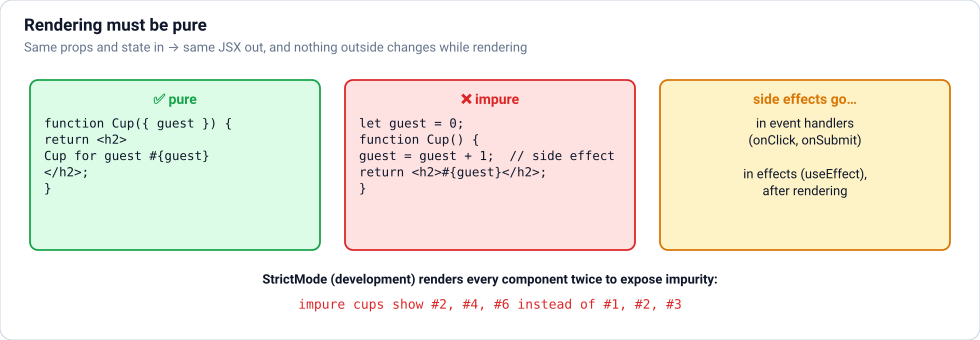

### Theory

> **In simple words:** React expects every component to behave like a **pure function**, like a maths formula: **the same inputs (props, state) always give the same JSX**, and rendering **changes nothing outside** the component. React may call your component more often than you expect (twice in development, again whenever a parent re-renders, or partway and then restart), so a component that changes outside variables during render gives wrong, unpredictable results.

**Words to know:**

- **Pure function:** a function that (1) returns the same output for the same input and (2) has no side effects. `double(x) = x * 2` is pure.
- **Side effect:** anything a function does besides returning a value: changing a variable outside it, writing to the DOM, `fetch`, `console.log`, timers, `localStorage`.
- **Render phase:** the moment React calls your component to compute JSX; it must be pure.
- **Local mutation:** changing a variable or array **you created during this render**: perfectly fine (`const rows = []; rows.push(...)`).
- **Idempotent:** doing it twice has the same result as doing it once; pure rendering is idempotent.
- **`StrictMode` double render:** in development, React renders each component **twice** and compares, to surface impure components; production renders once.
- **Where side effects go:** in **event handlers** (Section [13](#13-responding-to-events)) for things caused by a user action, or in **effects** (Section [30](#30-effects-synchronising-with-systems-outside-react)) for synchronising with outside systems after rendering.

**Everyday picture.** A **recipe**: follow it twice with the same ingredients and you get the same dish, and following it doesn't secretly reorder your pantry. A recipe that said "and also eat one biscuit from the jar each time you read this" would leave a different jar every time someone merely *read* it, which is what an impure component does to your app.

**Why impurity breaks, traced by hand:** a component increments an outside counter while rendering:

```text
let guest = 0;
function Cup() { guest = guest + 1; return <h2>Tea cup for guest #{guest}</h2>; }
<><Cup /><Cup /><Cup /></>

Without StrictMode: renders Cup three times → guest 1, 2, 3   (looks fine!)
With StrictMode:    each Cup renders twice  → guest 2, 4, 6   (React keeps the second result)
Any later re-render: numbers keep climbing  → 7, 8, 9 … for the SAME three cups
```

The bug was there all along; StrictMode simply made it visible immediately. The fix is to pass the number in as a prop: `<Cup guest={1} />`. Same input, same output, every time.

**When purity matters:** always, for the render phase. **When it doesn't apply:** event handlers and effects are *supposed* to have side effects; they don't run during rendering.

**Common mistakes:**

- ❌ Changing an outside variable, a prop, or an object received from a parent during render.
- ❌ Reading something that changes on its own during render (`Math.random()`, `Date.now()`) and expecting stable results; read it in an event handler or store it in state.
- ❌ Fetching data or setting timers directly in the component body (they run on every render).
- ❌ "Fixing" double logs by removing StrictMode instead of fixing the impurity.

**Used in real software:** purity is what lets React render in the background, pause and resume rendering (Section [43](#43-fiber-scheduling-and-concurrent-rendering)), skip work (Section [45](#45-memo-usememo-usecallback-and-the-react-compiler)) and render on the server (Part 9). The React Compiler (Section [45](#45-memo-usememo-usecallback-and-the-react-compiler)) assumes components are pure.

### Code

**From scratch: pure vs impure functions**, before React:

```tsx
const pureTotal = (prices: number[]) => prices.reduce((sum, p) => sum + p, 0);
let runningTotal = 0;
const impureTotal = (prices: number[]) => { for (const p of prices) runningTotal += p; return runningTotal; };

console.log("pure:", pureTotal([10, 20]), pureTotal([10, 20]));
console.log("impure:", impureTotal([10, 20]), impureTotal([10, 20]), "← same input, different output");
```

**Output:**

```text
pure: 30 30
impure: 30 60 ← same input, different output
```

**An impure component, with and without StrictMode:**

```tsx
import { StrictMode } from "react";
import { render } from "@testing-library/react";

let guest = 0;
function Cup() {
  guest = guest + 1;                       // ❌ side effect during render
  return <h2>Tea cup for guest #{guest}</h2>;
}

const cups = <><Cup /><Cup /><Cup /></>;
console.log("normal:", render(cups).container.textContent);
guest = 0;
console.log("StrictMode:", render(<StrictMode>{cups}</StrictMode>).container.textContent);
```

**Output:**

```text
normal: Tea cup for guest #1Tea cup for guest #2Tea cup for guest #3
StrictMode: Tea cup for guest #2Tea cup for guest #4Tea cup for guest #6
```

**The pure version:** the number comes in as a prop, so any number of renders gives the same result:

```tsx
function PureCup({ guest }: { guest: number }) {
  return <h2>Tea cup for guest #{guest}</h2>;
}
console.log(render(<StrictMode><PureCup guest={1} /><PureCup guest={2} /><PureCup guest={3} /></StrictMode>).container.textContent);
```

**Output:**

```text
Tea cup for guest #1Tea cup for guest #2Tea cup for guest #3
```

**Local mutation is fine:** this component pushes into an array, but it's a **new** array created during this render, so nothing outside changes:

```tsx
function TeaSet({ count }: { count: number }) {
  const cupsList = [];                     // created fresh on every render
  for (let i = 1; i <= count; i++) cupsList.push(<PureCup key={i} guest={i} />);
  return <>{cupsList}</>;
}
console.log(render(<StrictMode><TeaSet count={3} /></StrictMode>).container.textContent);
```

**Output:**

```text
Tea cup for guest #1Tea cup for guest #2Tea cup for guest #3
```

(`key` gives each item in a list an identity; Section [12](#12-rendering-lists-and-keys) explains it.)

### Practice

1. This component is impure. Why, and how do you fix it? `function Clock() { const hours = new Date().getHours(); document.title = `${hours}h`; return <p>{hours < 12 ? "Good morning" : "Good evening"}</p>; }`
2. Is `function List({ items }) { items.sort(); return <ul>{items.map((i) => <li key={i}>{i}</li>)}</ul>; }` pure?

<details>
<summary><b>Answer</b></summary>

1. Two problems: setting `document.title` during render is a side effect (move it to an effect, Section [30](#30-effects-synchronising-with-systems-outside-react)), and reading the current time makes the output depend on something other than props or state. Pass the time in as a prop (`<Clock time={now} />`) where the parent updates `now` on a timer, as react.dev's "Fix a broken clock" challenge shows.
2. No: `items.sort()` **mutates** the array the parent passed in, changing the parent's data during render. Use `items.toSorted()` (a copy).

</details>

| # | Problem | Difficulty |
|---|---|---|
| 1 | [react.dev challenges: Fix a broken clock, Fix a broken profile, Fix a broken story tray](https://react.dev/learn/keeping-components-pure#challenges) | 🟡 Medium |

**Learn more:** [react.dev: Keeping components pure](https://react.dev/learn/keeping-components-pure) · [react.dev: StrictMode](https://react.dev/reference/react/StrictMode) · [react.dev: Rules of React](https://react.dev/reference/rules)

---

## 11. Conditional Rendering

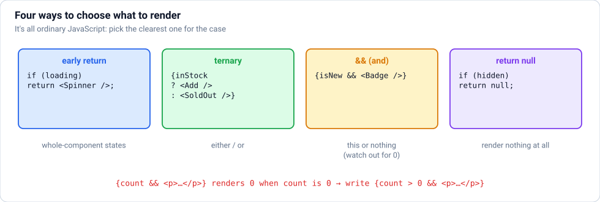

### Theory

> **In simple words:** components often show different things depending on data: "Sold out" or an "Add" button, a spinner while loading, an error message when something failed. Because JSX is JavaScript, you choose with ordinary JavaScript: `if` statements (above the `return`), the **ternary** `a ? b : c` for either/or, **`&&`** for "this or nothing", and returning **`null`** to render nothing at all.

**Words to know:**

- **Conditional rendering:** showing different UI depending on conditions.
- **Early return:** `if (!user) return <Login />;` at the top of a component; the rest of the function handles the normal case.
- **Ternary in JSX:** `{inStock ? <AddButton /> : <SoldOut />}`.
- **`&&` in JSX:** `{isNew && <Badge />}` shows the badge when `isNew` is truthy, otherwise renders the left value (`false` renders nothing).
- **Returning `null`:** a component that returns `null` renders nothing (it still exists and runs).
- **Conditional variable:** assigning JSX to a variable with `if`/`else` above the return, then using `{content}`.
- **Truthy / falsy pitfall:** `{count && <p>{count} items</p>}` renders `0` when count is 0, because `0` is falsy but is a renderable number. ✅ `{count > 0 && …}`.
- **Lookup object:** mapping a status to UI with an object (`const icons = { paid: "✅", failed: "❌" }`) instead of a chain of ternaries.

**Everyday picture.** A **shop sign** that flips between "Open" and "Closed" (ternary), a "Today's special" board that's only put out on some days (`&&`), and a shop that's simply not there on a holiday (`return null`).

**Choosing between forms, traced on one component.** An order status component:

```text
status = "loading"    → early return <Spinner />          (nothing else matters yet)
status = "error"      → early return <p>Couldn't load</p>
status = "ready", items = 0 → ternary: items > 0 ? <List/> : <p>Your cart is empty</p>
status = "ready", items = 3, coupon = null → coupon && <Coupon/> → null → nothing rendered
```

**When to use each:** early `if` returns for whole-component states (loading, error, not logged in); a ternary for two alternatives inside markup; `&&` for optional bits; a lookup object for 3+ cases. **When not:** deeply nested ternaries (`a ? b : c ? d : e`) are hard to read; use `if`/`else` with a variable or a lookup object.

**Common mistakes:**

- ❌ `{count && …}` with a number: shows `0`. ✅ `{count > 0 && …}`.
- ❌ `if` inside `{}` in JSX (a syntax error).
- ❌ Hiding with CSS when unmounting is intended (or vice versa): `return null` removes the component and resets its state; CSS `display: none` keeps it.
- ❌ Long ternary chains instead of a lookup object or `switch`.

**Used in real software:** loading/error/empty states on every data screen; feature flags (`{flags.newCheckout && <NewCheckout />}`); permission checks (`{user.isAdmin && <AdminMenu />}`; real security still has to happen on the server).

### Code

**From scratch: plain functions choosing a description.** Conditional rendering is just conditional code returning different values:

```tsx
function describeStock(qty: number) {
  if (qty === 0) return "Sold out";
  return qty < 5 ? `Only ${qty} left!` : "In stock";
}
console.log([0, 3, 20].map(describeStock));
```

**Output:**

```text
[ 'Sold out', 'Only 3 left!', 'In stock' ]
```

**All four forms in one component:**

```tsx
import { render } from "@testing-library/react";

type Status = "loading" | "error" | "ready";

function CartPanel({ status, items, coupon }: { status: Status; items: number; coupon: string | null }) {
  if (status === "loading") return <p>Loading…</p>;                       // early return
  if (status === "error") return <p role="alert">Couldn't load your cart</p>;
  return (
    <section>
      {/* either/or */}
      {items > 0 ? <p>{items} items</p> : <p>Your cart is empty</p>}
      {/* this or nothing */}
      {coupon && <p>Coupon {coupon} applied</p>}
    </section>
  );
}

for (const props of [
  { status: "loading", items: 0, coupon: null },
  { status: "error", items: 0, coupon: null },
  { status: "ready", items: 0, coupon: null },
  { status: "ready", items: 3, coupon: "CHAI10" },
] as const) {
  console.log(props.status.padEnd(7), "→", render(<CartPanel {...props} />).container.innerHTML);
}
```

**Output:**

```text
loading → <p>Loading…</p>
error   → <p role="alert">Couldn't load your cart</p>
ready   → <section><p>Your cart is empty</p></section>
ready   → <section><p>3 items</p><p>Coupon CHAI10 applied</p></section>
```

`as const` keeps the literal string types (`"loading"`, not just `string`) so they match the `Status` type; `padEnd(7)` lines the output up.

**The `0` pitfall, seen for real:**

```tsx
function Notifications({ count }: { count: number }) {
  return (
    <div>
      <span>wrong: [{count && <b>{count} new</b>}]</span>
      <span> right: [{count > 0 && <b>{count} new</b>}]</span>
    </div>
  );
}
console.log(render(<Notifications count={0} />).container.textContent);
console.log(render(<Notifications count={2} />).container.textContent);
```

**Output:**

```text
wrong: [0] right: []
wrong: [2 new] right: [2 new]
```

**A lookup object instead of nested ternaries, and `null` to render nothing:**

```tsx
const statusUi = {
  placed: { icon: "🧾", text: "Order placed" },
  brewing: { icon: "🫖", text: "Brewing" },
  delivered: { icon: "✅", text: "Delivered" },
} as const;

function OrderStatus({ status }: { status: keyof typeof statusUi | "hidden" }) {
  if (status === "hidden") return null;
  const { icon, text } = statusUi[status];
  return <p>{icon} {text}</p>;
}
console.log(render(<><OrderStatus status="brewing" /><OrderStatus status="hidden" /><OrderStatus status="delivered" /></>).container.innerHTML);
```

**Output:**

```text
<p>🫖 Brewing</p><p>✅ Delivered</p>
```

`keyof typeof statusUi` is TypeScript for "one of the keys of `statusUi`": `"placed" | "brewing" | "delivered"`.

### Practice

1. Write `PackingItem({ name, isPacked })` that shows `name ✅` when packed and just `name` otherwise, first with a ternary, then with `&&`.
2. Rewrite `{role === "admin" ? <Admin /> : role === "editor" ? <Editor /> : role === "viewer" ? <Viewer /> : null}` more readably.

<details>
<summary><b>Answer</b></summary>

```tsx
function PackingItem({ name, isPacked }: { name: string; isPacked: boolean }) {
  return <li>{isPacked ? name + " ✅" : name}</li>;
}
function PackingItem2({ name, isPacked }: { name: string; isPacked: boolean }) {
  return <li>{name} {isPacked && "✅"}</li>;
}
console.log(render(<ul><PackingItem name="Tea leaves" isPacked /><PackingItem2 name="Kettle" isPacked={false} /></ul>).container.innerHTML);

const Admin = () => <b>admin tools</b>, Editor = () => <i>editor tools</i>, Viewer = () => <span>read only</span>;
const panels = { admin: Admin, editor: Editor, viewer: Viewer };
function RolePanel({ role }: { role: string }) {
  const Panel = panels[role as keyof typeof panels];
  return Panel ? <Panel /> : null;
}
console.log(render(<><RolePanel role="editor" /><RolePanel role="guest" /></>).container.innerHTML);
```

**Output:**

```text
<ul><li>Tea leaves ✅</li><li>Kettle </li></ul>
<i>editor tools</i>
```

1. Both work; the `&&` version leaves a trailing space after the name when not packed, which is harmless.
2. A lookup object from role to **component**. The variable holding a component must start with a capital letter (`Panel`) so `<Panel />` is treated as a component.

</details>

| # | Problem | Difficulty |
|---|---|---|
| 1 | [react.dev challenges: Conditional rendering (show an icon with ? :, show importance with &&, refactor to if and variables)](https://react.dev/learn/conditional-rendering#challenges) | 🟢 Easy |
| 2 | [Frontend Mentor: Newsletter sign-up form with success message](https://www.frontendmentor.io/challenges/newsletter-signup-form-with-success-message-3FC1AZbNrv) | 🟢 Easy |

**Learn more:** [react.dev: Conditional rendering](https://react.dev/learn/conditional-rendering)

---

## 12. Rendering Lists and Keys

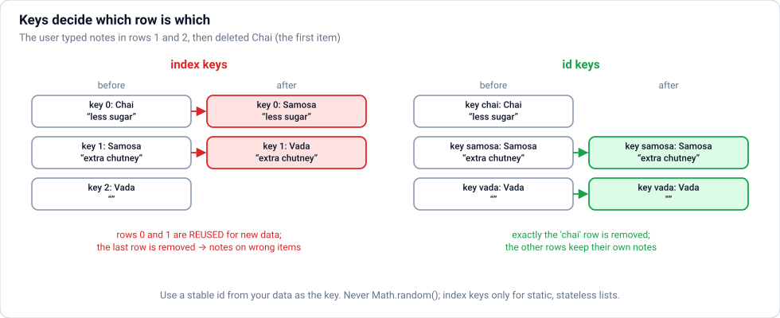

### Theory

> **In simple words:** to show a list, turn an array of data into an array of JSX with **`map`**. Each item needs a **`key`**: a string or number that **uniquely and permanently identifies that item** among its siblings, usually its id from the database. Keys let React match items between renders, so when the list is sorted, filtered or an item is inserted, React moves the right DOM nodes (and the state inside them) instead of mixing them up.

**Words to know:**

- **List rendering:** producing one element per array item, usually with `items.map(item => <Row … />)`.
- **`key`:** a special attribute that identifies an element among its siblings. It is not passed to your component as a prop (read `item.id` separately if you need it).
- **Stable key:** a key that stays the same for the same item across renders (a database id, a slug, a UUID created when the item was created).
- **Index key:** using the array position (`key={index}`) as the key; fine for static lists that never reorder, wrong when items are inserted, removed or reordered.
- **Sibling uniqueness:** keys only need to be unique among siblings in the same list, not across the whole app.
- **Reconciliation by key:** when re-rendering a list, React pairs old and new children with the same key (keep and update), creates children with new keys, and removes children whose keys disappeared (Section [42](#42-the-virtual-dom-and-reconciliation-build-a-mini-react-from-scratch)).
- **`Fragment` with a key:** `<Fragment key={id}>…</Fragment>` when each item renders several siblings.
- **`filter` then `map`:** the usual way to show part of a list: `items.filter(i => i.veg).map(i => <li key={i.id}>…)`.
- **Missing-key warning:** in development React logs "Each child in a list should have a unique key prop" when keys are missing.

**Everyday picture.** A **cloakroom**. Each coat gets a numbered ticket (the key). If coats are re-hung in a different order, you still get your own coat back because the ticket follows the coat. If instead tickets were "the coat on hook 1, hook 2…" (index keys) and someone removed the first coat and shifted the rest along, everyone would walk out with their neighbour's coat.

**Why index keys break, traced by hand.** Three rows, each with an input where the user typed a note; the user then deletes "Chai" (the first row):

```text
before:  key 0 → Chai   [note: "less sugar"]     key 1 → Samosa [note: "extra chutney"]   key 2 → Vada [note: ""]
after deleting Chai, with INDEX keys:
         key 0 → Samosa  React sees key 0 still exists → keeps that DOM row (with "less sugar"!) and just changes the label
         key 1 → Vada    keeps row 1's DOM (with "extra chutney")
         key 2 → (gone)  removes the LAST row
result:  Samosa [less sugar]   Vada [extra chutney]          ← notes moved to the wrong items
with ID keys:  React sees "chai" disappeared → removes exactly that row; the other rows keep their own notes
```

**When index keys are acceptable:** a static list that never reorders and whose items hold no state (a fixed list of links). **When not:** anything users can add to, remove from, sort or filter, or whose rows contain inputs or other state. Never use `Math.random()` as a key (a new key every render means every row is destroyed and recreated).

**Common mistakes:**

- ❌ No key, or `key={index}` on a list that changes.
- ❌ `key={Math.random()}` or `key={crypto.randomUUID()}` generated during render.
- ❌ Putting the key on the wrong element: it goes on the outermost element **returned by `map`**, not on an element inside it.
- ❌ Expecting `props.key` inside the child (it's not passed); pass `id={item.id}` too if the child needs it.

**Used in real software:** every feed, table, chat thread and search result list; libraries such as TanStack Table and virtualised lists (Section [46](#46-long-lists-virtualisation-and-pagination)) are built around stable row keys.

### Code

**From scratch: matching items by key.** This is the idea React uses, written as a plain function that compares an old and new list of keys and reports what happens to each:

```tsx
function diffByKey(oldKeys: string[], newKeys: string[]) {
  const oldSet = new Set(oldKeys);
  const kept = newKeys.filter((k) => oldSet.has(k));
  const created = newKeys.filter((k) => !oldSet.has(k));
  const removed = oldKeys.filter((k) => !newKeys.includes(k));
  return { kept, created, removed };
}
console.log("by id:   ", diffByKey(["chai", "samosa", "vada"], ["samosa", "vada"]));
console.log("by index:", diffByKey(["0", "1", "2"], ["0", "1"]));
```

**Output:**

```text
by id:    { kept: [ 'samosa', 'vada' ], created: [], removed: [ 'chai' ] }
by index: { kept: [ '0', '1' ], created: [], removed: [ '2' ] }
```

With ids, exactly the deleted item is removed. With index keys, React believes items `0` and `1` were **kept** and item `2` was removed, so the first two rows are reused for different data.

**The React way: `map` with stable keys:**

```tsx
import { render } from "@testing-library/react";

const menu = [
  { id: "chai", name: "Masala chai", veg: true },
  { id: "roll", name: "Chicken roll", veg: false },
  { id: "samosa", name: "Samosa", veg: true },
];

function VegMenu() {
  return (
    <ul>
      {menu.filter((item) => item.veg).map((item) => (
        <li key={item.id}>{item.name}</li>
      ))}
    </ul>
  );
}
console.log(render(<VegMenu />).container.innerHTML);
```

**Output:**

```text
<ul><li>Masala chai</li><li>Samosa</li></ul>
```

The `key` doesn't appear in the HTML; it's React's private bookkeeping.

**The bug, for real: index keys move typed text to the wrong row.** Each row has an input; the user types in the first two rows, then deletes the first item:

```tsx
import { useState } from "react";
import { screen, fireEvent } from "@testing-library/react";

function NotesList({ useIndexKeys }: { useIndexKeys: boolean }) {
  const [items, setItems] = useState(["Chai", "Samosa", "Vada"]);
  return (
    <>
      {items.map((name, index) => (
        <p key={useIndexKeys ? index : name}>
          {name} <input aria-label={`note ${index}`} />
        </p>
      ))}
      <button onClick={() => setItems(items.slice(1))}>Delete first</button>
    </>
  );
}

for (const useIndexKeys of [true, false]) {
  const { container, unmount } = render(<NotesList useIndexKeys={useIndexKeys} />);
  fireEvent.change(screen.getByLabelText("note 0"), { target: { value: "less sugar" } });
  fireEvent.change(screen.getByLabelText("note 1"), { target: { value: "extra chutney" } });
  fireEvent.click(screen.getByText("Delete first"));
  const rows = [...container.querySelectorAll("p")].map((p) => `${p.textContent!.trim()}: "${p.querySelector("input")!.value}"`);
  console.log(useIndexKeys ? "index keys:" : "id keys:   ", rows.join(" | "));
  unmount();
}
```

**Output:**

```text
index keys: Samosa: "less sugar" | Vada: "extra chutney"
id keys:    Samosa: "extra chutney" | Vada: ""
```

With index keys, Samosa now shows Chai's note and Vada shows Samosa's: exactly the cloakroom mix-up. With the name as key (a stable id here), every note stays with its item. `unmount()` removes the rendered component before the next loop run.

**Forgetting the key** makes React warn in development (the warning's first line is shown):

```tsx
function NoKeys() {
  return <ul>{menu.map((item) => <li>{item.name}</li>)}</ul>;   // expect-warning: no key
}
render(<NoKeys />);
```

**Output:**

```text
console.error: Each child in a list should have a unique "key" prop.
```

**Several elements per item** need a keyed `Fragment`:

```tsx
import { Fragment } from "react";

function Glossary() {
  const terms = [{ id: "jsx", term: "JSX", def: "markup in JavaScript" }, { id: "prop", term: "Prop", def: "an input to a component" }];
  return (
    <dl>
      {terms.map(({ id, term, def }) => (
        <Fragment key={id}>
          <dt>{term}</dt>
          <dd>{def}</dd>
        </Fragment>
      ))}
    </dl>
  );
}
console.log(render(<Glossary />).container.innerHTML);
```

**Output:**

```text
<dl><dt>JSX</dt><dd>markup in JavaScript</dd><dt>Prop</dt><dd>an input to a component</dd></dl>
```

### Practice

1. Given `const people = [{ id: 1, name: "Asha", job: "chemist" }, { id: 2, name: "Ravi", job: "chef" }, { id: 3, name: "Meera", job: "chemist" }]`, render two lists: chemists and everyone else, with correct keys.
2. Why is `key={Math.random()}` worse than no key at all?

<details>
<summary><b>Answer</b></summary>

```tsx
const people = [{ id: 1, name: "Asha", job: "chemist" }, { id: 2, name: "Ravi", job: "chef" }, { id: 3, name: "Meera", job: "chemist" }];
function People() {
  const chemists = people.filter((p) => p.job === "chemist");
  const others = people.filter((p) => p.job !== "chemist");
  return (
    <>
      <h2>Chemists</h2>
      <ul>{chemists.map((p) => <li key={p.id}>{p.name}</li>)}</ul>
      <h2>Everyone else</h2>
      <ul>{others.map((p) => <li key={p.id}>{p.name}</li>)}</ul>
    </>
  );
}
console.log(render(<People />).container.innerHTML);
```

**Output:**

```text
<h2>Chemists</h2><ul><li>Asha</li><li>Meera</li></ul><h2>Everyone else</h2><ul><li>Ravi</li></ul>
```

1. The same `id`s can appear in both lists' keys without conflict because keys only need to be unique among **siblings**.
2. A random key changes on every render, so React thinks every item is new: it destroys and recreates every DOM node and all their state on each render (slow, and inputs lose focus and text). No key at least falls back to position matching.

</details>

| # | Problem | Difficulty |
|---|---|---|
| 1 | [react.dev challenges: Splitting a list in two, Nested lists, Extracting a list item component, List with a separator](https://react.dev/learn/rendering-lists#challenges) | 🟡 Medium |
| 2 | [react.dev challenge: Fix misplaced state in the list](https://react.dev/learn/preserving-and-resetting-state#challenges) | 🟡 Medium |
| 3 | [Frontend Mentor: Product list with cart](https://www.frontendmentor.io/challenges/product-list-with-cart-5MmqLVAp_d) | 🟡 Medium |

**Learn more:** [react.dev: Rendering lists](https://react.dev/learn/rendering-lists) · [react.dev: Preserving and resetting state](https://react.dev/learn/preserving-and-resetting-state)

---

### ✅ Part 2 checkpoint

Without looking, can you:

- [ ] Write and nest components, export and import them, and explain why names must be capitalised?
- [ ] Explain what JSX compiles to, what an element object is, and which values render nothing?
- [ ] Pass strings, numbers, objects, functions and children as props, with defaults, and explain why props are read-only?
- [ ] Explain what makes a component pure and why StrictMode renders twice?
- [ ] Choose between an early return, a ternary, `&&`, `null` and a lookup object, and avoid the `0 &&` pitfall?
- [ ] Render a list with `map`, choose a correct key, and describe the bug that index keys cause?

Part 3 makes components interactive with events and state.

---

# Part 3 — Easy: Interactivity and State

> **Goal:** Make components respond to users: handle events, give components memory with state, understand exactly what happens when state changes (render and commit, snapshots, batching), update objects and arrays without mutating them, and build forms.  
> **You need:** Part 2 (components, JSX, props, purity, lists and keys) and Part 1's events, spread and array methods.

---

## 13. Responding to Events

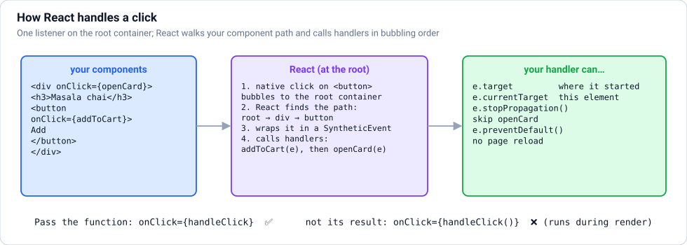

### Theory

> **In simple words:** to react to a click, a key press or a form submit, you pass a **function** to a prop such as `onClick`. React calls that function when the event happens, handing it an **event object**. Handlers are where **side effects** belong: changing state, sending a request, navigating. Pass the function itself (`onClick={handleClick}`), never the result of calling it (`onClick={handleClick()}`).

**Words to know:**

- **Event handler:** a function passed as an `on…` prop (`onClick`, `onChange`, `onSubmit`, `onKeyDown`) that React calls when that event fires.
- **Inline handler:** a handler written directly in JSX: `onClick={() => setOpen(true)}`.
- **SyntheticEvent:** React's wrapper around the browser's event object, with the same main properties (`target`, `currentTarget`, `preventDefault()`, `stopPropagation()`) working the same way in every browser. The original is at `event.nativeEvent`.
- **Event delegation:** attaching one listener high in the tree instead of one per element; React attaches its listeners once to the **root container** and works out which components' handlers to call.
- **Propagation in React:** React events bubble up the **component tree** (including through portals, Section [49](#49-accessibility-semantics-focus-aria-portals-and-modals)); `e.stopPropagation()` stops parents' handlers from running.
- **Capture phase (`onClickCapture`):** handlers ending in `Capture` run on the way **down**, before the target's own handler.
- **`preventDefault()`:** cancels the browser's default action, e.g. a form submit reloading the page.
- **Event handler prop (custom):** your own components can accept handler props with any name starting with `on`: `<Toolbar onPlay={...} />`; the name is your API.
- **`handle…` / `on…` naming:** props are named `onSomething`; the functions you pass are usually named `handleSomething`.

**Everyday picture.** A **doorbell**. You don't press it when you install it (that's `onClick={handleClick()}`); you wire it so it rings when a visitor presses it later. Event delegation is a building with **one receptionist** at the entrance who knows which flat each visitor wants, instead of a guard at every door.

**What happens on a click, traced by hand:**

```text
<div onClick={logDiv}>           ← parent handler
  <button onClick={buy}>Buy</button>
</div>

1. The user clicks the button; the browser fires a native "click" on the <button>.
2. It bubbles to React's single listener on the root container.
3. React finds the component path root → div → button and builds a SyntheticEvent.
4. Bubbling order in React: buy(e) runs, then logDiv(e).
5. If buy called e.stopPropagation(), logDiv is skipped.
```

**When to put logic in handlers:** anything caused by a specific user action (add to cart, submit, toggle). **When not:** work that must happen because the component is **on screen** (a chat connection) belongs in an effect (Section [30](#30-effects-synchronising-with-systems-outside-react)); calculations from props/state belong in rendering.

**Common mistakes:**

- ❌ `onClick={handleClick()}`: calls it during render. ✅ `onClick={handleClick}` or `onClick={() => handleClick(id)}`.
- ❌ Lowercase `onclick`: React ignores it (and TypeScript rejects it).
- ❌ Forgetting `e.preventDefault()` in `onSubmit`.
- ❌ Using `e.target` when you mean the element with the handler: in nested markup `target` may be an inner `<span>`; `e.currentTarget` is the element the handler is on.

**Used in real software:** every interactive control; design systems expose events as typed props (`onOpenChange`, `onValueChange`) so the parent decides what happens.

### Code

**From scratch: event delegation by hand.** One listener on a container handles clicks for any number of buttons by reading a `data-` attribute, which is the trick React uses at its root:

```tsx
document.body.innerHTML = `<div id="toolbar"><button data-action="play">▶ <b>Play</b></button><button data-action="stop">■ Stop</button></div>`;
const toolbar = document.querySelector("#toolbar")!;
toolbar.addEventListener("click", (event) => {
  const button = (event.target as Element).closest("button");   // the clicked <b> is inside the button
  if (button) console.log("one listener handled:", button.dataset.action);
});
(document.querySelector("b") as HTMLElement).click();
(document.querySelectorAll("button")[1] as HTMLElement).click();
```

**Output:**

```text
one listener handled: play
one listener handled: stop
```

`closest("button")` walks up from the clicked element to the nearest `button`, so clicking the bold text inside still counts. `dataset.action` reads `data-action`.

**The React way: handler props, the event object, and passing arguments:**

```tsx
import type { MouseEvent } from "react";
import { render, screen, fireEvent } from "@testing-library/react";

function Toolbar() {
  function handlePlay(e: MouseEvent<HTMLButtonElement>) {
    console.log("play | target:", (e.target as Element).tagName, "| currentTarget:", e.currentTarget.tagName, "| native:", e.nativeEvent.type);
  }
  const handleSpeed = (speed: number) => console.log("speed set to", speed);
  return (
    <div>
      <button onClick={handlePlay}>▶ <b>Play</b></button>
      {[1, 1.5, 2].map((s) => <button key={s} onClick={() => handleSpeed(s)}>{s}×</button>)}
    </div>
  );
}
render(<Toolbar />);
fireEvent.click(screen.getByText("Play"));            // click the <b> inside the button
fireEvent.click(screen.getByText("1.5×"));
```

**Output:**

```text
play | target: B | currentTarget: BUTTON | native: click
speed set to 1.5
```

`e.target` is the `B` that was clicked; `e.currentTarget` is the `BUTTON` whose handler runs. Wrapping in an arrow (`() => handleSpeed(s)`) is how you pass an argument.

**Propagation: bubbling, `stopPropagation` and capture:**

```tsx
function Card() {
  return (
    <div onClick={() => console.log("card clicked (open details)")} onClickCapture={() => console.log("capture: card sees it first")}>
      <h3>Masala chai</h3>
      <button onClick={(e) => { e.stopPropagation(); console.log("added to cart"); }}>Add</button>
    </div>
  );
}
render(<Card />);
fireEvent.click(screen.getByText("Masala chai"));
console.log("---");
fireEvent.click(screen.getByText("Add"));
```

**Output:**

```text
capture: card sees it first
card clicked (open details)
---
capture: card sees it first
added to cart
```

Clicking the title bubbles up and opens the details; clicking **Add** stops propagation, so the card's `onClick` doesn't fire (the capture handler still runs first, on the way down).

**Custom event props: the child reports, the parent decides:**

```tsx
function PlayButton({ onPlay, children }: { onPlay: () => void; children: string }) {
  return <button onClick={onPlay}>{children}</button>;
}
function Player() {
  return <PlayButton onPlay={() => console.log("Player decided: start playback")}>Play song</PlayButton>;
}
render(<Player />);
fireEvent.click(screen.getByRole("button"));
```

**Output:**

```text
Player decided: start playback
```

**Where React listens:** React 17 and later attach listeners to the root container, not to each button and not to `document`. We can see it by watching which element's `addEventListener` React calls:

```tsx
import { createRoot } from "react-dom/client";
import { act } from "react";

const container = document.createElement("div");
const original = container.addEventListener.bind(container);
const types = new Set<string>();
container.addEventListener = ((type: string, ...rest: any[]) => { types.add(type); return (original as any)(type, ...rest); }) as any;
await act(async () => createRoot(container).render(<button>hi</button>));
console.log("listeners React added on the root container:", types.size, "| includes click?", types.has("click"));
```

**Output:**

```text
listeners React added on the root container: 87 | includes click? true
```

React registers every event type it supports once on the root (both bubbling and capture versions), however many handlers your components declare.

### Practice

1. A button inside a clickable row must delete the row without opening it. Write `Row({ onOpen, onDelete })`.
2. What's wrong with `<button onClick={setCount(count + 1)}>+</button>`?

<details>
<summary><b>Answer</b></summary>

```tsx
function Row({ onOpen, onDelete }: { onOpen: () => void; onDelete: () => void }) {
  return (
    <li onClick={onOpen}>
      Order #42
      <button onClick={(e) => { e.stopPropagation(); onDelete(); }}>Delete</button>
    </li>
  );
}
render(<ul><Row onOpen={() => console.log("open")} onDelete={() => console.log("delete")} /></ul>);
fireEvent.click(screen.getByText("Delete"));
fireEvent.click(screen.getByText(/Order #42/));
```

**Output:**

```text
delete
open
```

1. `stopPropagation()` in the inner handler keeps the click from reaching the row.
2. `setCount(count + 1)` runs **during render**, which schedules another render, which runs it again: React stops this loop with a "Too many re-renders" error. Use `onClick={() => setCount(count + 1)}`.

</details>

| # | Problem | Difficulty |
|---|---|---|
| 1 | [react.dev challenges: Fix an event handler, Wire up the events](https://react.dev/learn/responding-to-events#challenges) | 🟢 Easy |
| 2 | [BFE.dev React quiz 16: event callback](https://bigfrontend.dev/react-quiz/event-handler) | 🟡 Medium |
| 3 | [BFE.dev React quiz 11: callback props](https://bigfrontend.dev/react-quiz/callback-props) | 🟡 Medium |

**Learn more:** [react.dev: Responding to events](https://react.dev/learn/responding-to-events) · [react.dev: Common components (event handler props)](https://react.dev/reference/react-dom/components/common)

---

## 14. State: A Component's Memory (useState)

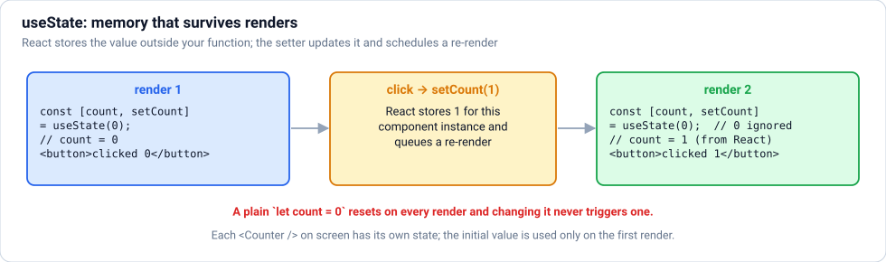

### Theory

> **In simple words:** a normal variable inside a component is **forgotten** after every render, and changing it doesn't update the screen. **State** fixes both: `const [count, setCount] = useState(0)` gives the component a value React **remembers** between renders, and a **setter** that updates the value **and re-renders** the component. Each copy of a component on screen has its **own** state.

**Words to know:**

- **State:** data a component remembers between renders and that changes over time, causing re-renders when it does.
- **Hook:** a special function whose name starts with `use` (`useState`, `useEffect`…) that lets a component "hook into" React features. Hooks may only be called at the top level of a component or another hook (Section [39](#39-how-hooks-work-inside-build-usestate-from-scratch-and-the-rules-of-hooks)).
- **`useState(initial)`:** declares a state variable; returns a pair `[value, setValue]` (array destructuring lets you name them).
- **Setter (set function):** `setCount(5)` or `setCount(c => c + 1)`; stores the next value and queues a re-render.
- **Initial value:** used only on the **first** render; later renders ignore the argument.
- **Lazy initializer:** `useState(() => expensiveSetup())`: pass a **function** so the expensive setup runs only on the first render, not every render.
- **Local / isolated state:** each rendered instance of a component has independent state; two `<Counter />`s count separately.
- **Stateful vs stateless component:** one that has state vs one that only uses props.
- **Re-render:** React calling the component again (with the new state) to compute new JSX.

**Everyday picture.** A **sticky note on your monitor**. A normal variable is a thought you have during one meeting and forget when it ends (every render starts from scratch). State is the sticky note: React keeps it next to that particular component (each desk has its own note), and writing a new number on it (the setter) makes the component "re-read" its note and redraw.

**Why a plain variable fails, traced by hand:**

```text
function Counter() { let count = 0; return <button onClick={() => { count = count + 1; }}>{count}</button>; }

render 1: count = 0 → button shows 0
click:    the handler sets the local count to 1 … but nothing asks React to render again → screen still 0
(if something else re-rendered it) render 2: the function runs again → let count = 0 → still 0
```

With `useState`: render 1 reads 0 → click calls `setCount(1)` → React stores 1 and renders again → render 2 reads **1** from React's memory → the button shows 1.

**When to use state:** for data that changes over time **and** affects what's shown (input text, open/closed, selected tab, fetched data). **When not:** values you can **calculate** from props or other state (a total, a filtered list; Section [22](#22-choosing-the-state-structure)), values that don't affect rendering (a timer id → a ref, Section [28](#28-refs-remembering-values-without-re-rendering)), and constants.

**Common mistakes:**

- ❌ Using a normal variable for something that changes on screen.
- ❌ Expecting `count` to change immediately after `setCount` (it's a snapshot; Section [16](#16-state-as-a-snapshot-batching-and-updater-functions)).
- ❌ `useState(expensive())`, which runs `expensive()` on every render. ✅ `useState(() => expensive())` or `useState(expensive)`.
- ❌ Calling `useState` inside an `if`, a loop or a nested function (breaks the Rules of Hooks).

**Used in real software:** UI state everywhere: whether a dropdown is open, the current step in a checkout, the text in a search box, the selected photo in a gallery.

### Code

**From scratch: why a local variable isn't enough.** The variable changes, but React has no idea, so the page doesn't:

```tsx
import { useState } from "react";
import { render, screen, fireEvent } from "@testing-library/react";

function BrokenCounter() {
  let count = 0;
  return <button onClick={() => { count = count + 1; console.log("local count is now", count); }}>clicked {count} times</button>;
}
render(<BrokenCounter />);
fireEvent.click(screen.getByRole("button"));
fireEvent.click(screen.getByRole("button"));
console.log("screen shows:", screen.getByRole("button").textContent);
```

**Output:**

```text
local count is now 1
local count is now 2
screen shows: clicked 0 times
```

**From scratch: memory that survives a "render".** Keep the value **outside** the render function and redraw when it changes; this is the idea `useState` packages up (the full hand-made `useState` is in Section [39](#39-how-hooks-work-inside-build-usestate-from-scratch-and-the-rules-of-hooks)):

```tsx
function makeCounterWidget(container: HTMLElement) {
  let memory = 0;                                    // lives outside renderOnce, like React's state storage
  function setMemory(next: number) { memory = next; renderOnce(); }
  function renderOnce() {
    container.innerHTML = `<button>clicked ${memory} times</button>`;
    container.querySelector("button")!.onclick = () => setMemory(memory + 1);
  }
  renderOnce();
}
const box = document.createElement("div");
makeCounterWidget(box);
box.querySelector("button")!.click(); box.querySelector("button")!.click();
console.log(box.innerHTML);
```

**Output:**

```text
<button>clicked 2 times</button>
```

**The React way: `useState`:**

```tsx
function Counter() {
  const [count, setCount] = useState(0);
  return <button onClick={() => setCount(count + 1)}>clicked {count} times</button>;
}
render(<Counter />);
fireEvent.click(screen.getByRole("button"));
fireEvent.click(screen.getByRole("button"));
console.log("screen shows:", screen.getByRole("button").textContent);
```

**Output:**

```text
screen shows: clicked 2 times
```

**Several state variables, and each instance is independent.** A photo gallery: one component, two copies, separate memories:

```tsx
const photos = ["Darjeeling garden", "Assam estate", "Nilgiri hills"];

function Gallery({ title }: { title: string }) {
  const [index, setIndex] = useState(0);
  const [showDetails, setShowDetails] = useState(false);
  return (
    <section aria-label={title}>
      <h3>{title}: {photos[index]} ({index + 1} of {photos.length})</h3>
      <button onClick={() => setIndex((index + 1) % photos.length)}>Next {title}</button>
      <button onClick={() => setShowDetails(!showDetails)}>{showDetails ? "Hide" : "Show"} details {title}</button>
      {showDetails && <p>Grown at high altitude.</p>}
    </section>
  );
}

const { container } = render(<><Gallery title="A" /><Gallery title="B" /></>);
fireEvent.click(screen.getByText("Next A"));
fireEvent.click(screen.getByText("Next A"));
fireEvent.click(screen.getByText("Show details B"));
console.log([...container.querySelectorAll("section")].map((s) => s.textContent).join("\n"));
```

**Output:**

```text
A: Nilgiri hills (3 of 3)Next AShow details A
B: Darjeeling garden (1 of 3)Next BHide details BGrown at high altitude.
```

`(index + 1) % photos.length` wraps back to 0 after the last photo (`%` is the remainder). Gallery A moved twice; gallery B didn't move but shows its details.

**The initial value is used once; a lazy initializer runs once:**

```tsx
let setupCalls = 0;
function loadSavedDraft() { setupCalls++; return "Ring the bell"; }

function Draft({ lazy }: { lazy: boolean }) {
  const [draft, setDraft] = lazy ? useState(() => loadSavedDraft()) : useState(loadSavedDraft());
  return <input value={draft} onChange={(e) => setDraft(e.target.value)} />;
}
for (const lazy of [false, true]) {
  setupCalls = 0;
  const { unmount } = render(<Draft lazy={lazy} />);
  for (const text of ["R", "Ri", "Rin"]) fireEvent.change(screen.getByRole("textbox"), { target: { value: text } });
  console.log(lazy ? "lazy:  " : "eager: ", "setup ran", setupCalls, "times over 4 renders");
  unmount();
}
```

**Output:**

```text
eager:  setup ran 4 times over 4 renders
lazy:   setup ran 1 times over 4 renders
```

(Calling a hook inside a ternary normally breaks the Rules of Hooks; it's safe here only because `lazy` never changes for a given instance. Don't do this in real code.)

### Practice

1. Build a `LikeButton` that shows `🤍 0`, becomes `❤️ 1` when clicked, and goes back to `🤍 0` on a second click.
2. A `Form` has `const [firstName, setFirstName] = useState("")` and `const [lastName, setLastName] = useState("")`. Is one object `useState({ firstName: "", lastName: "" })` better? When?

<details>
<summary><b>Answer</b></summary>

```tsx
function LikeButton() {
  const [liked, setLiked] = useState(false);
  return <button onClick={() => setLiked(!liked)}>{liked ? "❤️ 1" : "🤍 0"}</button>;
}
render(<LikeButton />);
const btn = screen.getByRole("button");
const seen = [btn.textContent];
fireEvent.click(btn); seen.push(btn.textContent);
fireEvent.click(btn); seen.push(btn.textContent);
console.log(seen.join(" → "));
```

**Output:**

```text
🤍 0 → ❤️ 1 → 🤍 0
```

1. One boolean is enough: the count is derived from it, so it isn't separate state.
2. Separate variables are simplest when values change independently. One object is good when fields always change together or there are many of them (a form), but then you must copy the object when updating one field (Section [17](#17-updating-objects-in-state)).

</details>

| # | Problem | Difficulty |
|---|---|---|
| 1 | [react.dev challenges: Complete the gallery, Fix stuck form inputs, Fix a crash, Remove unnecessary state](https://react.dev/learn/state-a-components-memory#challenges) | 🟢 Easy |
| 2 | [BFE.dev React problem 1: the React Counter app](https://bigfrontend.dev/react/The-React-Counter) | 🟢 Easy |
| 3 | [BFE.dev React quiz 19: lazy initial state](https://bigfrontend.dev/react-quiz/lazy-initial-state) | 🟡 Medium |
| 4 | [BFE.dev React problem 7: useToggle()](https://bigfrontend.dev/react/useToggle) | 🟢 Easy |

**Learn more:** [react.dev: State, a component's memory](https://react.dev/learn/state-a-components-memory) · [react.dev: useState reference](https://react.dev/reference/react/useState)

---

## 15. Render and Commit: What Happens When State Changes

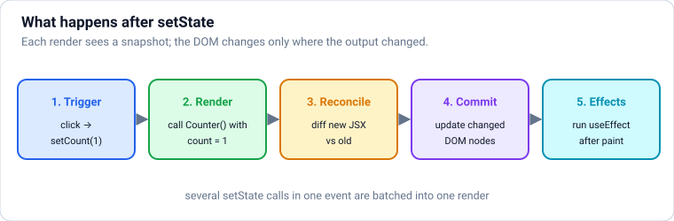

### Theory

> **In simple words:** getting something on screen happens in three steps. **Trigger:** the first render, or a state update. **Render:** React calls your components to find out what the UI should look like now. **Commit:** React compares the result with the previous one and changes **only the DOM nodes that differ**. Then the browser paints. "Rendering" in React means *calling your components*, not touching the screen.

**Words to know:**

- **Trigger:** what starts a render: the initial `root.render(...)`, or a state setter being called (in this component or an ancestor).
- **Render (React):** calling component functions to compute JSX; pure and side-effect free (Section [10](#10-keeping-components-pure)).
- **Commit:** applying the computed changes to the DOM (insert, update, remove nodes) in one go.
- **Initial render vs re-render:** the first render creates all DOM nodes; re-renders only update what changed.
- **Recursive rendering:** when a component re-renders, React also re-renders all of its children by default (whether or not their props changed); Section [44](#44-why-components-re-render-and-measuring-with-the-profiler) and Section [45](#45-memo-usememo-usecallback-and-the-react-compiler) cover skipping that.
- **Bail out:** if a setter is called with a value equal to the current one (`Object.is`), React may skip re-rendering that component.
- **Paint:** the browser drawing the updated DOM on screen, after the commit.
- **`MutationObserver`:** a browser API that reports DOM changes; used below to count exactly what React changed.

**Everyday picture.** A **restaurant order**. The customer ordering (trigger) → the chef cooking from the recipe (render: computing what the plate should be) → the waiter bringing **only the new dish** to the table and leaving the rest (commit) → the customer seeing it (paint). The waiter doesn't clear and re-lay the whole table for one extra dish.

**One click, traced:**

```text
<Clock time={time} /> renders <h1>{time}</h1><input />
state "time" changes from 10:00 to 10:01 (trigger)
render: React calls Clock → <h1>10:01</h1><input />
compare with last result: h1 text differs; input is identical
commit: React sets the h1's text node to "10:01"; the <input> DOM node is untouched (keeps focus and typed text)
paint: the browser redraws the heading
```

**When it matters:** understanding this explains why typed text survives re-renders, why "re-render" isn't expensive by itself, and where to put side effects (never in render). **When not to worry:** re-rendering is usually cheap; only optimise after measuring (Section [44](#44-why-components-re-render-and-measuring-with-the-profiler)).

**Common mistakes:**

- ❌ Thinking "re-render" means the DOM is rebuilt. It doesn't; only differences are committed.
- ❌ Thinking a child only re-renders when its props change. By default it re-renders whenever its parent does.
- ❌ Doing side effects during render because "it only renders once" (it may render many times).

**Used in real software:** the same three phases exist in every React renderer: React DOM (web), React Native (mobile views), and libraries that render React to PDFs, terminals (Ink) or 3D scenes (React Three Fiber).

### Code

**Counting real DOM changes.** A `MutationObserver` records every DOM change React makes during the commit; the component logs each render:

```tsx
import { useState } from "react";
import { render, screen, fireEvent, act } from "@testing-library/react";

function Clock({ time }: { time: string }) {
  console.log("  render Clock", time);
  return (
    <>
      <h1>{time}</h1>
      <input aria-label="note" />
      <Footer />
    </>
  );
}
function Footer() {
  console.log("  render Footer (no props, still re-rendered)");
  return <small>Chai Point</small>;
}
function App() {
  const [time, setTime] = useState("10:00");
  return <><Clock time={time} /><button onClick={() => setTime("10:01")}>tick</button></>;
}

const { container } = render(<App />);
const input = screen.getByLabelText("note") as HTMLInputElement;
fireEvent.change(input, { target: { value: "less sugar" } });   // the user types a note first
const changes: string[] = [];
const observer = new MutationObserver((records) => records.forEach((r) => changes.push(`${r.type} on ${r.target.nodeName}`)));
observer.observe(container, { subtree: true, childList: true, characterData: true, attributes: true });
console.log("click:");
fireEvent.click(screen.getByText("tick"));
await act(async () => {});                           // let the observer deliver its records
console.log("DOM changes committed:", changes);
console.log("input untouched:", screen.getByLabelText("note") === input, (screen.getByLabelText("note") as HTMLInputElement).value);
```

**Output:**

```text
  render Clock 10:00
  render Footer (no props, still re-rendered)
click:
  render Clock 10:01
  render Footer (no props, still re-rendered)
DOM changes committed: [
  'characterData on #text',
  'attributes on INPUT',
  'attributes on INPUT'
]
input untouched: true less sugar
```

Both components **rendered** again, yet the commit changed exactly **one** text node: the heading's. The two attribute records are React DOM's routine housekeeping on `<input>` elements: whenever it updates one, it briefly sets and then removes the `name` attribute (a guard that keeps radio-button groups consistent). The input element itself is the same object and still holds its text, so nothing the user typed was lost.

**Compare: redraw-everything by hand** (Section [5](#5-why-react-updating-a-page-by-hand-vs-describing-it)) changes far more of the DOM for the same update:

```tsx
const box = document.createElement("div");
document.body.appendChild(box);
const draw = (time: string) => { box.innerHTML = `<h1>${time}</h1><input aria-label="note"><small>Chai Point</small>`; };
draw("10:00");
let count = 0;
const watcher = new MutationObserver((records) => { count += records.reduce((n, r) => n + r.addedNodes.length + r.removedNodes.length, 0); });
watcher.observe(box, { subtree: true, childList: true, characterData: true });
draw("10:01");
await new Promise((r) => setTimeout(r, 0));
console.log("nodes removed + added by the innerHTML redraw:", count);
```

**Output:**

```text
nodes removed + added by the innerHTML redraw: 6
```

**Bail out on the same value.** Setting state to the value it already has doesn't re-render the component:

```tsx
let renders = 0;
function Toggle() {
  renders++;
  const [on, setOn] = useState(false);
  return <button onClick={() => setOn(true)}>{on ? "on" : "off"}</button>;
}
render(<Toggle />);
const counts = [renders];
for (let i = 0; i < 4; i++) { fireEvent.click(screen.getByRole("button")); counts.push(renders); }
console.log("total renders after each click (all clicks set true):", counts.join(" → "));
```

**Output:**

```text
total renders after each click (all clicks set true): 1 → 2 → 3 → 3 → 3
```

The first click changes `false` to `true` (a render). The second click sets `true` again: React renders the component **once more** because it can't always know cheaply that nothing changed, then sees the same value and throws that result away (no commit, children skipped). From then on it bails out before rendering at all. So "same value" means "no commit and no re-render of children", not always "zero renders".

### Practice

1. A parent re-renders 10 times per second (a clock). Its child `<ProductList />` receives no props. How many times does `ProductList` render per second by default, and how many DOM changes does it cause?
2. True or false: calling `setState` makes React rebuild the whole DOM of that component.

<details>
<summary><b>Answer</b></summary>

1. 10 renders per second (children re-render with their parent), but **zero** DOM changes if its output doesn't change: render is computation; commit only applies differences. If those renders are expensive, `memo` or the React Compiler can skip them (Section [45](#45-memo-usememo-usecallback-and-the-react-compiler)), or move the clock state down into a small component (Section [44](#44-why-components-re-render-and-measuring-with-the-profiler)).
2. False. React re-runs the component and commits only the nodes whose output differs.

</details>

| # | Problem | Difficulty |
|---|---|---|
| 1 | [BFE.dev React quiz 1: React re-render 1](https://bigfrontend.dev/react-quiz/React-re-render-1) | 🟡 Medium |
| 2 | [BFE.dev React quiz 3: React re-render 3](https://bigfrontend.dev/react-quiz/React-re-render-3) | 🟡 Medium |

**Learn more:** [react.dev: Render and commit](https://react.dev/learn/render-and-commit) · [MDN: MutationObserver](https://developer.mozilla.org/en-US/docs/Web/API/MutationObserver)

---

## 16. State as a Snapshot, Batching and Updater Functions

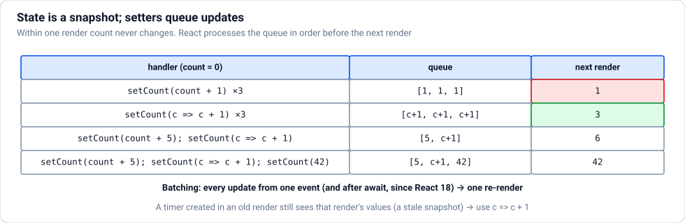

### Theory

> **In simple words:** inside one render, a state variable is a **fixed snapshot**: calling `setCount(count + 1)` doesn't change `count` in the code that's running; it **queues** a new value for the next render. React **batches** all the updates from one event and re-renders once. If you need several updates to build on each other, pass an **updater function**: `setCount(c => c + 1)`.

**Words to know:**

- **Snapshot:** the values of props and state as they were for one particular render; event handlers created in that render see those values forever, even later (in a timeout).
- **Update queue:** the list of pending updates React keeps per state variable; processed in order during the next render.
- **Replace vs updater:** `setCount(5)` replaces the value; `setCount(c => c + 1)` is an **updater function** that receives the previous queued value and returns the next.
- **Batching:** grouping multiple state updates into a single re-render. Since React 18 this is **automatic** everywhere: event handlers, timeouts, promises, native listeners.
- **Stale value / stale closure:** a handler or timer that still sees an old snapshot because it was created during an earlier render.
- **`flushSync`:** a rarely needed function from `react-dom` that forces React to apply an update and update the DOM **immediately**, bypassing batching (e.g. to scroll to a just-added item).
- **Naming updater arguments:** use the first letter of the state (`c => c + 1`) or `prev` (`prev => prev + 1`).

**Everyday picture.** A **photograph** of your fridge taken this morning. During today's shopping trip (one render) you plan from the photo, even after someone at home drinks the milk. Your shopping list ("buy 1 more milk, then 1 more, then 1 more") is a queue of instructions applied when you get home. "Set milk to photo + 1" three times gives photo + 1; "add one to whatever's there" three times gives +3.

**The queue, traced by hand** (count starts at 0, one click runs these three lines):

```text
setCount(count + 1);       count is 0 in this snapshot → queue: [replace with 1]
setCount(count + 1);       still 0                      → queue: [1, replace with 1]
setCount(count + 1);       still 0                      → queue: [1, 1, replace with 1]
next render processes the queue: 0 → 1 → 1 → 1      result 1

setCount(c => c + 1);  ×3                            → queue: [c=>c+1, c=>c+1, c=>c+1]
next render: 0 → 1 → 2 → 3                           result 3

setNumber(number + 5); setNumber(n => n + 1); setNumber(42);
queue: [replace 5, n=>n+1, replace 42] → 0 → 5 → 6 → 42   result 42
```

**When to use updaters:** whenever the next value depends on the previous one **and** several updates might be queued (counters, toggles in quick succession, updates inside async code). **When not:** setting a value that doesn't depend on the old one (`setName(e.target.value)`); plain values are clearer.

**Common mistakes:**

- ❌ `setCount(count + 1); console.log(count)` and expecting the new number.
- ❌ Several `setCount(count + 1)` calls expecting several increments.
- ❌ A timer or async callback using a stale value (`setTimeout(() => setCount(count + 1), 1000)` after other clicks). ✅ An updater.
- ❌ Mutating inside an updater (`prev => { prev.push(x); return prev; }`); updaters must be pure too.

**Used in real software:** batching is why a form submission that sets loading, clears errors and stores data causes **one** re-render, not three; updaters are standard in counters, chat message lists (`setMessages(m => [...m, msg])`) and anything updated from WebSockets.

### Code

**From scratch: process an update queue,** exactly as React does for one state variable (this is react.dev's "Implement the state queue yourself" challenge):

```tsx
type Update<T> = T | ((prev: T) => T);
function getFinalState<T>(base: T, queue: Update<T>[]): T {
  let state = base;
  for (const update of queue) {
    state = typeof update === "function" ? (update as (p: T) => T)(state) : update;
  }
  return state;
}
const inc = (n: number) => n + 1;
console.log(getFinalState(0, [1, 1, 1]));                 // three "count + 1" from a snapshot of 0
console.log(getFinalState(0, [inc, inc, inc]));
console.log(getFinalState(0, [5, inc, 42]));
console.log(getFinalState(0, [5, inc]));
```

**Output:**

```text
1
3
42
6
```

**The React way, for real: snapshot vs updater.** One click calls the setter three times:

```tsx
import { useState } from "react";
import { render, screen, fireEvent } from "@testing-library/react";

function Counters() {
  const [a, setA] = useState(0);
  const [b, setB] = useState(0);
  return (
    <>
      <button onClick={() => { setA(a + 1); setA(a + 1); setA(a + 1); console.log("inside the handler a is still", a); }}>a: {a}</button>
      <button onClick={() => { setB((x) => x + 1); setB((x) => x + 1); setB((x) => x + 1); }}>b: {b}</button>
    </>
  );
}
render(<Counters />);
fireEvent.click(screen.getByText(/^a:/));
fireEvent.click(screen.getByText(/^b:/));
console.log(screen.getAllByRole("button").map((b) => b.textContent));
```

**Output:**

```text
inside the handler a is still 0
[ 'a: 1', 'b: 3' ]
```

**A stale snapshot in a timer.** The message is read from the snapshot of the render where the button was clicked, not the latest:

```tsx
function Messenger() {
  const [to, setTo] = useState("Asha");
  function send() {
    setTimeout(() => console.log(`sent to ${to} (the snapshot when Send was clicked)`), 30);
  }
  return (
    <>
      <select aria-label="to" value={to} onChange={(e) => setTo(e.target.value)}>
        <option>Asha</option><option>Ravi</option>
      </select>
      <button onClick={send}>Send</button>
    </>
  );
}
render(<Messenger />);
fireEvent.click(screen.getByText("Send"));
fireEvent.change(screen.getByLabelText("to"), { target: { value: "Ravi" } });   // changed before the timer fires
await new Promise((r) => setTimeout(r, 60));
console.log("selected now:", (screen.getByLabelText("to") as HTMLSelectElement).value);
```

**Output:**

```text
sent to Asha (the snapshot when Send was clicked)
selected now: Ravi
```

This is usually what you **want** (you sent the message to whoever was selected when you pressed Send). When you need the latest value instead, use an updater or a ref (Section [28](#28-refs-remembering-values-without-re-rendering)).

**Batching: many updates, one render, even after `await`:**

```tsx
let renderCount = 0;
function Checkout() {
  renderCount++;
  const [loading, setLoading] = useState(false);
  const [error, setError] = useState<string | null>("old error");
  const [orderId, setOrderId] = useState<number | null>(null);
  async function submit() {
    setLoading(true); setError(null);                        // batched: 1 render
    await new Promise((r) => setTimeout(r, 10));             // pretend to call the server
    setLoading(false); setOrderId(90312);                     // batched: 1 render (React 18+ batches after await too)
  }
  return <button onClick={submit}>{loading ? "Placing…" : orderId ? `Order #${orderId}` : "Place order"}{error}</button>;
}
render(<Checkout />);
renderCount = 0;
fireEvent.click(screen.getByRole("button"));
await screen.findByText("Order #90312");                     // waits until the text appears
console.log("renders for 4 state updates:", renderCount);
```

**Output:**

```text
renders for 4 state updates: 2
```

`findByText` (Testing Library) waits for something to appear, because the second batch happens after the timer. Four setter calls produced two renders: one per batch.

**`flushSync` forces an immediate update** (rarely needed; shown so you recognise it):

```tsx
import { flushSync } from "react-dom";

function List() {
  const [items, setItems] = useState(["chai"]);
  return (
    <>
      <ul>{items.map((i) => <li key={i}>{i}</li>)}</ul>
      <button onClick={() => {
        flushSync(() => setItems([...items, "samosa"]));
        console.log("DOM rows right after flushSync:", document.querySelectorAll("li").length);   // already updated
      }}>add</button>
    </>
  );
}
render(<List />);
fireEvent.click(screen.getByText("add"));
```

**Output:**

```text
DOM rows right after flushSync: 2
```

### Practice

1. Starting from 0, what is the final value after one click on `() => { setN(n + 5); setN((x) => x * 2); setN(n + 1); setN((x) => x + 10); }`?
2. A "request counter" shows pending requests: `setPending(pending + 1)` before an `await`, `setPending(pending - 1)` after. Clicking twice quickly shows `-1` at the end. Why, and what's the fix?

<details>
<summary><b>Answer</b></summary>

```tsx
console.log(getFinalState(0, [0 + 5, (x: number) => x * 2, 0 + 1, (x: number) => x + 10]));
```

**Output:**

```text
11
```

1. `11`: 0 → 5 → 10 → **1** (a replacement computed from the snapshot `n = 0`) → 11.
2. Both handlers captured snapshots; the second click's "after" line sets `pending - 1` from a stale value. Use updaters: `setPending(p => p + 1)` and `setPending(p => p - 1)` (react.dev's "Fix a request counter").

</details>

| # | Problem | Difficulty |
|---|---|---|
| 1 | [react.dev challenges: Fix a request counter, Implement the state queue yourself](https://react.dev/learn/queueing-a-series-of-state-updates#challenges) | 🟡 Medium |
| 2 | [react.dev challenge: Implement a traffic light (snapshot)](https://react.dev/learn/state-as-a-snapshot#challenges) | 🟢 Easy |
| 3 | [BFE.dev React quiz 5: Automatic batching 1](https://bigfrontend.dev/react-quiz/Automatic-batching) | 🟡 Medium |
| 4 | [BFE.dev React quiz 22: useState()](https://bigfrontend.dev/react-quiz/useState) | 🟡 Medium |
| 5 | [BFE.dev React quiz 17: flushSync()](https://bigfrontend.dev/react-quiz/flushsync) | 🔴 Hard |

**Learn more:** [react.dev: State as a snapshot](https://react.dev/learn/state-as-a-snapshot) · [react.dev: Queueing a series of state updates](https://react.dev/learn/queueing-a-series-of-state-updates) · [React 18: automatic batching (GitHub discussion)](https://github.com/reactwg/react-18/discussions/21)

---

## 17. Updating Objects in State

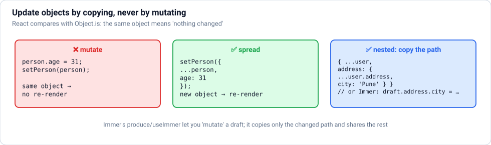

### Theory

> **In simple words:** treat objects in state as **read-only**. To change one field, make a **new object** with the change (`{ ...person, age: 31 }`) and pass it to the setter. Mutating the existing object (`person.age = 31`) doesn't tell React anything changed, and can corrupt snapshots that other code still holds. For deeply nested objects, copy each level on the way down, or use **Immer**, which lets you write "mutating" code that produces a correct copy.

**Words to know:**

- **Mutation:** changing an existing object in place (`obj.x = 1`, `delete obj.y`, `Object.assign(obj, …)`).
- **Immutable update:** building a new object that includes the change and leaves the original untouched.
- **Object spread (`{ ...obj, key: value }`):** copies all properties into a new object, then overrides some; later properties win.
- **Computed property name (`[name]: value`):** uses a variable as the key: `{ ...form, [e.target.name]: e.target.value }`.
- **Nested update:** copying every object on the path to a change: `{ ...user, address: { ...user.address, city } }`.
- **`Object.is`:** the comparison React uses to decide whether state changed; for objects it is true only for the **same** object.
- **Immer / `produce` / `useImmer`:** a small library: inside `produce(state, draft => { draft.address.city = "Pune"; })` you "mutate" a **draft**, and Immer returns a new object with only the changed parts copied (structural sharing). `useImmer` is a `useState` replacement built on it.
- **Structural sharing:** a new object reuses (points to) unchanged parts of the old one, so copying is cheap.

**Everyday picture.** A **signed contract**. You never cross out a clause on the signed original (mutation); you draft an amended copy and both parties sign the new version. Everyone who kept the old copy still has an accurate record of what was agreed then (the old snapshot).

**Why mutation breaks, traced by hand:**

```text
const [person, setPerson] = useState({ name: "Asha", age: 30 });
handler: person.age = 31;  setPerson(person);
React compares: Object.is(oldPerson, newPerson) → same object → "nothing changed" → no re-render
screen still shows 30, although the object now says 31 (UI and data disagree)

handler: setPerson({ ...person, age: 31 });
Object.is(old, new) → different objects → re-render → shows 31; the old snapshot object still says 30
```

**When to use what:** spread for flat objects and one or two levels of nesting; Immer when updates go 3+ levels deep or touch many fields; **flatten** the state (Section [22](#22-choosing-the-state-structure)) when nesting gets painful. **When not:** don't add Immer to a project for one shallow update.

**Common mistakes:**

- ❌ `state.field = x; setState(state)` (no re-render, or a re-render that shows inconsistent data later).
- ❌ Thinking `{ ...user }` copies nested objects (it doesn't).
- ❌ Mutating in event handlers "because it's not render" (it still breaks snapshots and memoisation).
- ❌ Forgetting to spread the old object: `setForm({ email })` throws away every other field.

**Used in real software:** Redux Toolkit uses Immer inside every reducer (Section [55](#55-global-state-build-a-store-then-zustand-redux-toolkit-and-jotai)); immutable updates are what make undo/redo, time-travel debugging and cheap change detection possible.

### Code

**From scratch: mutation keeps the reference; spread makes a new one.** React's check is just `Object.is`:

```tsx
const before = { name: "Asha", age: 30 };
before.age = 31;
console.log("after mutation, same object?", Object.is(before, before));
const after = { ...before, age: 32 };
console.log("after spread, same object?", Object.is(before, after), "| old age:", before.age, "| new age:", after.age);
```

**Output:**

```text
after mutation, same object? true
after spread, same object? false | old age: 31 | new age: 32
```

**The mutation bug in a component,** next to the correct version:

```tsx
import { useState } from "react";
import { render, screen, fireEvent } from "@testing-library/react";

function Profile({ mutate }: { mutate: boolean }) {
  const [person, setPerson] = useState({ name: "Asha", age: 30 });
  function birthday() {
    if (mutate) { person.age += 1; setPerson(person); }        // ❌
    else setPerson({ ...person, age: person.age + 1 });         // ✅
  }
  return <button onClick={birthday}>{person.name} is {person.age}</button>;
}
for (const mutate of [true, false]) {
  const { unmount } = render(<Profile mutate={mutate} />);
  fireEvent.click(screen.getByRole("button"));
  fireEvent.click(screen.getByRole("button"));
  console.log(mutate ? "mutating:" : "copying: ", screen.getByRole("button").textContent);
  unmount();
}
```

**Output:**

```text
mutating: Asha is 30
copying:  Asha is 32
```

With mutation the screen is stuck at 30 even though the object now says 32 (React bailed out because it got the same object).

**One handler for many fields** with a computed property name:

```tsx
function ContactForm() {
  const [form, setForm] = useState({ name: "", phone: "", city: "Pune" });
  const handleChange = (e: React.ChangeEvent<HTMLInputElement>) =>
    setForm({ ...form, [e.target.name]: e.target.value });
  return (
    <>
      <input name="name" aria-label="name" value={form.name} onChange={handleChange} />
      <input name="phone" aria-label="phone" value={form.phone} onChange={handleChange} />
      <output>{JSON.stringify(form)}</output>
    </>
  );
}
render(<ContactForm />);
fireEvent.change(screen.getByLabelText("name"), { target: { value: "Asha" } });
fireEvent.change(screen.getByLabelText("phone"), { target: { value: "98200 12345" } });
console.log(document.querySelector("output")!.textContent);
```

**Output:**

```text
{"name":"Asha","phone":"98200 12345","city":"Pune"}
```

`React.ChangeEvent<HTMLInputElement>` is the TypeScript type of an input's change event (the global `React` namespace types are available in `.tsx` files). `city` survived because the spread copied it.

**Nested objects: copy every level, or use Immer:**

```tsx
import { produce } from "immer";

const order = { id: 1, customer: { name: "Asha", address: { city: "Pune", pin: "411001" } }, items: ["chai"] };

const bySpread = { ...order, customer: { ...order.customer, address: { ...order.customer.address, city: "Mumbai" } } };
const byImmer = produce(order, (draft) => { draft.customer.address.city = "Mumbai"; });

console.log(order.customer.address.city, bySpread.customer.address.city, byImmer.customer.address.city);
console.log("unchanged parts shared?", byImmer.items === order.items, "| changed path copied?", byImmer.customer !== order.customer);
```

**Output:**

```text
Pune Mumbai Mumbai
unchanged parts shared? true | changed path copied? true
```

Both produce the same new object and leave `order` alone; Immer copied only the path to the change (`customer`, `address`) and **shares** `items` with the original.

**`useImmer` in a component:**

```tsx
import { useImmer } from "use-immer";

function Address() {
  const [user, updateUser] = useImmer({ name: "Asha", address: { city: "Pune", pin: "411001" } });
  return (
    <button onClick={() => updateUser((draft) => { draft.address.city = "Delhi"; draft.address.pin = "110001"; })}>
      {user.name}: {user.address.city} {user.address.pin}
    </button>
  );
}
render(<Address />);
fireEvent.click(screen.getByRole("button"));
console.log(screen.getByRole("button").textContent);
```

**Output:**

```text
Asha: Delhi 110001
```

### Practice

1. State is `{ title: "Chai", artwork: { title: "Steam", city: "Hyderabad" } }`. Write the update that changes only `artwork.city` to "Kochi" with spread.
2. Why can `setPlayer({ ...player, score: player.score + 1 })` still lose updates when called twice in one click? Fix it.

<details>
<summary><b>Answer</b></summary>

```tsx
const poster = { title: "Chai", artwork: { title: "Steam", city: "Hyderabad" } };
const moved = { ...poster, artwork: { ...poster.artwork, city: "Kochi" } };
console.log(moved, "| original:", poster.artwork.city);

function Score() {
  const [player, setPlayer] = useState({ name: "Ravi", score: 0 });
  return <button onClick={() => { setPlayer((p) => ({ ...p, score: p.score + 1 })); setPlayer((p) => ({ ...p, score: p.score + 1 })); }}>{player.score}</button>;
}
render(<Score />);
fireEvent.click(screen.getByRole("button"));
console.log("score after one double-update click:", screen.getByRole("button").textContent);
```

**Output:**

```text
{ title: 'Chai', artwork: { title: 'Steam', city: 'Kochi' } } | original: Hyderabad
score after one double-update click: 2
```

1. Copy the outer object and the `artwork` object; change `city` in the inner copy.
2. Both calls read the same snapshot `player`, so both compute score 1 (Section [16](#16-state-as-a-snapshot-batching-and-updater-functions)). An updater that copies the **previous** object fixes it. Note the parentheses in `(p) => ({ … })`: without them the braces would be read as a function body.

</details>

| # | Problem | Difficulty |
|---|---|---|
| 1 | [react.dev challenges: Fix incorrect state updates, Find and fix the mutation, Update an object with Immer](https://react.dev/learn/updating-objects-in-state#challenges) | 🟡 Medium |
| 2 | [Frontend Mentor: Interactive card details form](https://www.frontendmentor.io/challenges/interactive-card-details-form-XpS8cKZDWw) | 🟡 Medium |

**Learn more:** [react.dev: Updating objects in state](https://react.dev/learn/updating-objects-in-state) · [Immer documentation](https://immerjs.github.io/immer/)

---

## 18. Updating Arrays in State

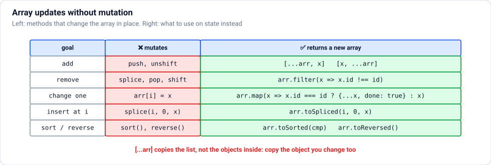

### Theory

> **In simple words:** arrays in state are read-only too. Instead of `push`, `splice`, `sort` or `arr[i] = x`, create a **new array**: spread to add, `filter` to remove, `map` to change items, `slice` plus spread to insert, and `toSorted`/`toReversed`/`with` for sorting, reversing and replacing. When the array holds **objects**, also copy the object you change; copying the array alone still shares its items.

**Words to know:**

- **Mutating array methods:** `push`, `pop`, `shift`, `unshift`, `splice`, `sort`, `reverse`, `fill`, `copyWithin`, and index assignment `arr[i] = x`.
- **Non-mutating array methods:** `concat`, spread `[...]`, `filter`, `map`, `slice`, `toSorted`, `toReversed`, `toSpliced`, `with`; they return new arrays.
- **Add / remove / replace / insert:** `[...arr, item]` · `arr.filter(x => x.id !== id)` · `arr.map(x => x.id === id ? newX : x)` · `[...arr.slice(0, i), item, ...arr.slice(i)]` (or `arr.toSpliced(i, 0, item)`).
- **Shallow array copy:** `[...arr]` copies the list of references; the objects inside are the **same** objects as before.
- **Updating an object inside an array:** `map` over the array and return `{ ...item, field: value }` for the matching item.
- **`structuredClone`:** a built-in deep copy; rarely the right tool for state (it copies everything, breaking structural sharing).

**Everyday picture.** A **class register**. You don't rub out names in last term's register (mutation); you make this term's register by copying the names over, leaving one out (filter), adding a newcomer (spread), or correcting one entry on the new sheet (map). Last term's register stays accurate for anyone who looks back.

**The shared-object trap, traced by hand:**

```text
list   = [A{seen:false}, B{seen:false}]
copy   = [...list]              → a NEW array, but it holds the SAME A and B objects
copy[0].seen = true             → mutates A, which list[0] also points to → the "old" list changed too
correct: list.map(x => x === A ? { ...x, seen: true } : x)   → new array AND a new A; B is shared safely
```

**Cheat table:**

| Goal | ❌ mutating | ✅ new array |
|---|---|---|
| add | `push`, `unshift` | `[...arr, x]`, `[x, ...arr]` |
| remove | `splice`, `pop`, `shift` | `filter`, `slice`, `toSpliced` |
| replace / change | `arr[i] = x`, `splice` | `map`, `with(i, x)` |
| insert at i | `splice(i, 0, x)` | `[...arr.slice(0, i), x, ...arr.slice(i)]`, `toSpliced(i, 0, x)` |
| sort / reverse | `sort`, `reverse` | `toSorted`, `toReversed`, `[...arr].sort()` |

**When to use Immer:** many nested updates inside arrays of objects (a kanban board, a spreadsheet). **When not:** simple lists, where `map`/`filter` read clearly.

**Common mistakes:**

- ❌ `items.push(x); setItems(items)`: same array → React skips the render.
- ❌ `[...items].reverse()` is fine, but `items.reverse()` mutates the state array.
- ❌ Copying the array then mutating an object inside it.
- ❌ Using the index to find an item after the list was filtered or sorted; look up by id.

**Used in real software:** todo lists, carts, chat message lists, table rows: every list in every app is updated with exactly these patterns; Redux reducers and Zustand stores use them too.

### Code

**From scratch: every operation without mutation,** checked against the original:

```tsx
const original = Object.freeze([{ id: 1, name: "samosa" }, { id: 2, name: "chai" }, { id: 3, name: "vada" }]);
const names = (a: readonly { name: string }[]) => a.map((x) => x.name).join(",");

console.log("add:    ", names([...original, { id: 4, name: "lassi" }]));
console.log("remove: ", names(original.filter((x) => x.id !== 2)));
console.log("rename: ", names(original.map((x) => (x.id === 3 ? { ...x, name: "vada pav" } : x))));
console.log("insert: ", names(original.toSpliced(1, 0, { id: 5, name: "poha" })));
console.log("sort:   ", names(original.toSorted((a, b) => a.name.localeCompare(b.name))));
console.log("by len: ", names(original.toSorted((a, b) => a.name.length - b.name.length)));
console.log("reverse:", names(original.toReversed()), "| original still:", names(original));
```

**Output:**

```text
add:     samosa,chai,vada,lassi
remove:  samosa,vada
rename:  samosa,chai,vada pav
insert:  samosa,poha,chai,vada
sort:    chai,samosa,vada
by len:  chai,vada,samosa
reverse: vada,chai,samosa | original still: samosa,chai,vada
```

`Object.freeze` makes the array refuse mutation, so these lines would throw if any of them mutated it. `localeCompare` compares strings alphabetically.

**Frozen arrays prove the point:** a mutating method throws on a frozen array:

```tsx
(original as any).push({ id: 9, name: "oops" });
```

**Output:**

```text
TypeError: Cannot add property 3, object is not extensible
```

**A todo list in React:** add, toggle (change an object inside the array), remove, and sort for display:

```tsx
import { useState } from "react";
import { render, screen, fireEvent } from "@testing-library/react";

type Todo = { id: number; text: string; done: boolean };
let nextId = 3;

function Todos() {
  const [todos, setTodos] = useState<Todo[]>([{ id: 1, text: "Boil water", done: false }, { id: 2, text: "Add tea", done: false }]);
  const add = (text: string) => setTodos([...todos, { id: nextId++, text, done: false }]);
  const toggle = (id: number) => setTodos(todos.map((t) => (t.id === id ? { ...t, done: !t.done } : t)));
  const remove = (id: number) => setTodos(todos.filter((t) => t.id !== id));
  return (
    <>
      <button onClick={() => add("Add milk")}>add</button>
      <ul>
        {todos.toSorted((a, b) => Number(a.done) - Number(b.done)).map((t) => (
          <li key={t.id}>
            <label><input type="checkbox" checked={t.done} onChange={() => toggle(t.id)} />{t.text}</label>
            <button onClick={() => remove(t.id)}>✕ {t.text}</button>
          </li>
        ))}
      </ul>
    </>
  );
}
render(<Todos />);
fireEvent.click(screen.getByText("add"));
fireEvent.click(screen.getByLabelText("Boil water"));       // toggle done → sorts to the bottom
fireEvent.click(screen.getByText("✕ Add tea"));
console.log(screen.getAllByRole("listitem").map((li) => `${(li.querySelector("input") as HTMLInputElement).checked ? "☑" : "☐"} ${li.querySelector("label")!.textContent}`));
```

**Output:**

```text
[ '☐ Add milk', '☑ Boil water' ]
```

`toSorted` sorts a **copy** for display (undone first; `Number(true)` is 1), so the state keeps its own order. `nextId` lives outside the component because it only generates ids and never affects rendering directly.

**The shared-object trap, for real:**

```tsx
const listA = [{ id: 1, seen: false }];
const shallow = [...listA];
shallow[0].seen = true;                               // mutates the shared object
console.log("original after 'copy' + mutation:", listA[0].seen);
const listB = [{ id: 1, seen: false }];
const correct = listB.map((x) => (x.id === 1 ? { ...x, seen: true } : x));
console.log("original after map + spread:", listB[0].seen, "| new:", correct[0].seen);
```

**Output:**

```text
original after 'copy' + mutation: true
original after map + spread: false | new: true
```

**Immer for arrays of objects:**

```tsx
import { produce } from "immer";

const board = [{ column: "todo", cards: [{ id: 1, title: "Buy tea" }] }, { column: "done", cards: [] as { id: number; title: string }[] }];
const moved = produce(board, (draft) => {
  const card = draft[0].cards.shift()!;
  draft[1].cards.push(card);
});
console.log(JSON.stringify(moved.map((c) => [c.column, c.cards.length])), "| original:", JSON.stringify(board.map((c) => [c.column, c.cards.length])));
```

**Output:**

```text
[["todo",0],["done",1]] | original: [["todo",1],["done",0]]
```

Inside `produce` you may use `shift` and `push` on the **draft**; the original `board` is untouched.

### Practice

1. Write `moveUp(list, index)` that returns a new array with the item at `index` swapped with the one before it (unchanged if `index` is 0).
2. A shopping cart is `[{ id, name, qty }]`. Write `increment(cart, id)` and `decrement(cart, id)`, where decrement removes the line when qty would reach 0.

<details>
<summary><b>Answer</b></summary>

```tsx
function moveUp<T>(list: readonly T[], index: number): T[] {
  if (index <= 0) return [...list];
  return list.with(index - 1, list[index]).with(index, list[index - 1]);
}
type Line = { id: number; name: string; qty: number };
const increment = (cart: Line[], id: number) => cart.map((l) => (l.id === id ? { ...l, qty: l.qty + 1 } : l));
const decrement = (cart: Line[], id: number) =>
  cart.map((l) => (l.id === id ? { ...l, qty: l.qty - 1 } : l)).filter((l) => l.qty > 0);

console.log(moveUp(["a", "b", "c"], 2), moveUp(["a", "b", "c"], 0));
const cart: Line[] = [{ id: 1, name: "chai", qty: 1 }, { id: 2, name: "samosa", qty: 2 }];
console.log(increment(cart, 2), decrement(cart, 1), cart[0].qty);
```

**Output:**

```text
[ 'a', 'c', 'b' ] [ 'a', 'b', 'c' ]
[ { id: 1, name: 'chai', qty: 1 }, { id: 2, name: 'samosa', qty: 3 } ] [ { id: 2, name: 'samosa', qty: 2 } ] 1
```

1. Two chained `with` calls build the swapped copy.
2. `map` then `filter`: decrement every matching line, then drop lines whose quantity hit 0. The original cart is unchanged (the last number printed).

</details>

| # | Problem | Difficulty |
|---|---|---|
| 1 | [react.dev challenges: Update an item in the shopping cart, Remove an item, Fix the mutations, Fix the mutations using Immer](https://react.dev/learn/updating-arrays-in-state#challenges) | 🟡 Medium |
| 2 | [BFE.dev React problem 12: useArray()](https://bigfrontend.dev/react/useArray) | 🟡 Medium |
| 3 | [Frontend Mentor: Todo app](https://www.frontendmentor.io/challenges/todo-app-Su1_KokOW) | 🟡 Medium |

**Learn more:** [react.dev: Updating arrays in state](https://react.dev/learn/updating-arrays-in-state) · [MDN: Array methods that copy (toSorted, toSpliced, with)](https://developer.mozilla.org/en-US/docs/Web/JavaScript/Reference/Global_Objects/Array#copying_methods_and_mutating_methods)

---

## 19. Forms: Controlled and Uncontrolled Inputs

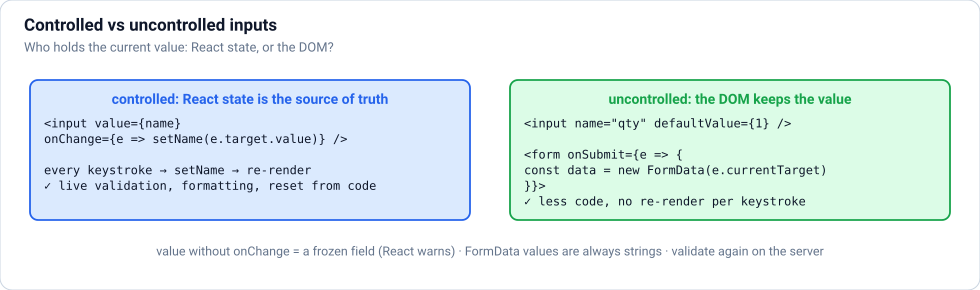

### Theory

> **In simple words:** there are two ways to handle form fields. A **controlled** input's value comes from React state (`value={name}`) and every keystroke updates that state (`onChange`), so React always knows the current value: great for live validation and formatting. An **uncontrolled** input keeps its own value in the DOM (`defaultValue`), and you read everything at submit time with **FormData**: less code, fewer renders. React 19's form **actions** (Section [53](#53-react-19-forms-actions-useactionstate-useformstatus-and-useoptimistic)) build on the uncontrolled style.

**Words to know:**

- **Controlled component:** an input whose displayed value is set from props or state (`value`/`checked`) and changed only through `onChange`.
- **Uncontrolled component:** an input that manages its own value in the DOM; you give a starting value with `defaultValue`/`defaultChecked` and read it later.
- **`onChange`:** in React it fires on **every keystroke** for text inputs (like the DOM `input` event), not only when the field loses focus as the DOM's `change` event does.
- **`e.target.value` / `e.target.checked`:** the current text of an input / whether a checkbox is ticked.
- **`name` attribute:** the field's key in `FormData` and in a "one handler for all fields" pattern.
- **`FormData`:** a built-in object that reads every named field of a `<form>`: `new FormData(form).get("email")`; `Object.fromEntries(formData)` turns it into a plain object.
- **`onSubmit` + `preventDefault()`:** handle the form's submit (Enter key or a submit button) without reloading the page.
- **`<select>` / `<textarea>` / checkbox / radio:** in React a `select` and `textarea` use `value` (not `selected` or inner text); checkboxes and radios use `checked`.
- **Read-only warning:** passing `value` without `onChange` makes a field the user can't type into; React warns in development.
- **Client-side validation:** checking input in the browser for fast feedback (`required`, `pattern`, or code); the server must validate again because users can bypass the browser.

**Everyday picture.** A **dictation** vs a **paper form**. Controlled is dictation: you (React) write down every word as it's spoken, so you always know what's been said and can correct mistakes immediately. Uncontrolled is handing someone a paper form and reading it when they hand it back: simpler, but you only see the answers at the end.

**A controlled input, traced by hand:**

```text
state name = "As"        → render <input value="As">
user types "h"            → the browser would show "Ash", React fires onChange with e.target.value = "Ash"
handler: setName("Ash")   → re-render <input value="Ash">       (React keeps the DOM in step with state)
if the handler did NOT call setName → React puts the value back to "As": the input looks frozen
```

**When to use which:**

| Use controlled when… | Use uncontrolled when… |
|---|---|
| the UI reacts to each keystroke (live search, character counter, formatting a phone number) | you only need the values on submit |
| one field depends on another (disable Submit until valid) | large forms where per-keystroke renders would be wasteful |
| you must set or reset the value from code | using React 19 form actions or a library like React Hook Form (Section [54](#54-form-libraries-react-hook-form-and-zod-validation)) |

**Common mistakes:**

- ❌ `value={name}` without `onChange` (a frozen field and a warning). ✅ Add `onChange`, or use `defaultValue`.
- ❌ Switching an input between controlled and uncontrolled (`value={undefined}` then a string): initialise state to `""`, not `undefined`.
- ❌ Forgetting `name` attributes, so `FormData` is empty.
- ❌ Forgetting `preventDefault()` in `onSubmit`.
- ❌ Trusting client-side validation for security.

**Used in real software:** sign-up and checkout forms, search boxes with suggestions (controlled), settings pages (often uncontrolled with actions); libraries such as React Hook Form are uncontrolled by default for performance.

### Code

**From scratch: a plain HTML form read with `FormData`:**

```tsx
document.body.innerHTML = `
  <form>
    <input name="name" value="Asha">
    <select name="size"><option>small</option><option selected>large</option></select>
    <input type="checkbox" name="sugar" checked>
    <button>Order</button>
  </form>`;
document.querySelector("form")!.addEventListener("submit", (e) => {
  e.preventDefault();
  console.log(Object.fromEntries(new FormData(e.target as HTMLFormElement)));
});
(document.querySelector("button") as HTMLButtonElement).click();
```

**Output:**

```text
{ name: 'Asha', size: 'large', sugar: 'on' }
```

An unchecked checkbox is simply missing from `FormData`; a checked one sends `"on"`.

**Controlled: React state drives every field, so the UI can react live:**

```tsx
import { useState } from "react";
import { render, screen, fireEvent } from "@testing-library/react";

function SignupForm() {
  const [form, setForm] = useState({ name: "", phone: "", plan: "basic", terms: false, note: "" });
  const update = (field: keyof typeof form, value: string | boolean) => setForm({ ...form, [field]: value });
  const phoneDigits = form.phone.replace(/\D/g, "");
  const valid = form.name.trim().length >= 2 && phoneDigits.length === 10 && form.terms;
  return (
    <form onSubmit={(e) => { e.preventDefault(); console.log("submit", form); }}>
      <input aria-label="name" value={form.name} onChange={(e) => update("name", e.target.value)} />
      <input aria-label="phone" value={form.phone} onChange={(e) => update("phone", e.target.value)} />
      <small>{phoneDigits.length}/10 digits</small>
      <select aria-label="plan" value={form.plan} onChange={(e) => update("plan", e.target.value)}>
        <option value="basic">Basic</option><option value="pro">Pro</option>
      </select>
      <textarea aria-label="note" value={form.note} maxLength={40} onChange={(e) => update("note", e.target.value)} />
      <label><input type="checkbox" checked={form.terms} onChange={(e) => update("terms", e.target.checked)} /> I agree</label>
      <button disabled={!valid}>Sign up</button>
    </form>
  );
}
render(<SignupForm />);
const button = () => screen.getByRole("button", { name: "Sign up" }) as HTMLButtonElement;
fireEvent.change(screen.getByLabelText("name"), { target: { value: "Asha" } });
fireEvent.change(screen.getByLabelText("phone"), { target: { value: "98200 1234" } });
console.log(screen.getByText(/digits/).textContent, "| enabled?", !button().disabled);
fireEvent.change(screen.getByLabelText("phone"), { target: { value: "98200 12345" } });
fireEvent.change(screen.getByLabelText("plan"), { target: { value: "pro" } });
fireEvent.click(screen.getByLabelText("I agree"));
console.log(screen.getByText(/digits/).textContent, "| enabled?", !button().disabled);
fireEvent.click(button());
```

**Output:**

```text
9/10 digits | enabled? false
10/10 digits | enabled? true
submit {
  name: 'Asha',
  phone: '98200 12345',
  plan: 'pro',
  terms: true,
  note: ''
}
```

`replace(/\D/g, "")` removes every non-digit (`\D` is "not a digit" in a regular expression). Because state holds every value, the digit counter and the button update on each keystroke.

**Uncontrolled: the DOM keeps the values; read them once on submit:**

```tsx
function QuickOrder() {
  function handleSubmit(e: React.FormEvent<HTMLFormElement>) {
    e.preventDefault();
    const data = Object.fromEntries(new FormData(e.currentTarget));
    console.log("order:", data);
  }
  return (
    <form onSubmit={handleSubmit}>
      <input name="item" aria-label="item" defaultValue="Masala chai" />
      <input name="qty" aria-label="qty" type="number" defaultValue={1} />
      <label><input type="checkbox" name="takeaway" defaultChecked /> Takeaway</label>
      <button>Order</button>
    </form>
  );
}
render(<QuickOrder />);
fireEvent.change(screen.getByLabelText("qty"), { target: { value: "3" } });   // the DOM keeps it; React doesn't re-render
fireEvent.click(screen.getByText("Order"));
```

**Output:**

```text
order: { item: 'Masala chai', qty: '3', takeaway: 'on' }
```

Every value arrives as a **string** (`"3"`, `"on"`): convert numbers yourself (`Number(data.qty)`) or validate with a schema (Section [54](#54-form-libraries-react-hook-form-and-zod-validation)).

**The frozen-field mistake** (value without onChange) and React's warning:

```tsx
function Frozen() {
  return <input aria-label="frozen" value="can't change me" />;   // expect-warning
}
render(<Frozen />);
```

**Output:**

```text
console.error: You provided a `value` prop to a form field without an `onChange` handler. This will render a read-only field. If the field should be mutable use `defaultValue`. Otherwise, set either `onChange` or `readOnly`.
```

### Practice

1. Build a controlled `TipCalculator`: bill amount and tip percentage (10/15/20 as radio buttons); show the tip and total live.
2. Rewrite `QuickOrder` so it converts `qty` to a number and refuses to submit when it's below 1.

<details>
<summary><b>Answer</b></summary>

```tsx
function TipCalculator() {
  const [bill, setBill] = useState("");
  const [percent, setPercent] = useState(10);
  const amount = Number(bill) || 0;
  const tip = Math.round(amount * percent) / 100;
  return (
    <>
      <input aria-label="bill" value={bill} onChange={(e) => setBill(e.target.value)} />
      {[10, 15, 20].map((p) => (
        <label key={p}><input type="radio" name="tip" checked={percent === p} onChange={() => setPercent(p)} />{p}%</label>
      ))}
      <p>tip ₹{tip.toFixed(2)} · total ₹{(amount + tip).toFixed(2)}</p>
    </>
  );
}
render(<TipCalculator />);
fireEvent.change(screen.getByLabelText("bill"), { target: { value: "480" } });
fireEvent.click(screen.getByLabelText("15%"));
console.log(screen.getByText(/tip/).textContent);

function SafeOrder() {
  const [error, setError] = useState("");
  return (
    <form onSubmit={(e) => {
      e.preventDefault();
      const qty = Number(new FormData(e.currentTarget).get("qty"));
      if (!Number.isInteger(qty) || qty < 1) return setError("Quantity must be at least 1");
      setError(""); console.log("ordering", qty);
    }}>
      <input name="qty" aria-label="qty" type="number" defaultValue={1} />
      <button>Order</button>
      {error && <p role="alert">{error}</p>}
    </form>
  );
}
render(<SafeOrder />);
fireEvent.change(screen.getByLabelText("qty"), { target: { value: "0" } });
fireEvent.click(screen.getByText("Order"));
console.log(screen.getByRole("alert").textContent);
fireEvent.change(screen.getByLabelText("qty"), { target: { value: "2" } });
fireEvent.click(screen.getByText("Order"));
```

**Output:**

```text
tip ₹72.00 · total ₹552.00
Quantity must be at least 1
ordering 2
```

1. The bill is kept as the **string** the user typed (so they can type "4", "48", "480" freely) and converted for the maths; `Number("") || 0` handles an empty field. Radio buttons are controlled with `checked`.
2. Validate in the submit handler and keep the error message in state; `role="alert"` makes screen readers announce it.

</details>

| # | Problem | Difficulty |
|---|---|---|
| 1 | [react.dev challenges: Synced inputs, Filtering a list (sharing state between inputs)](https://react.dev/learn/sharing-state-between-components#challenges) | 🟢 Easy |
| 2 | [Frontend Mentor: Tip calculator app](https://www.frontendmentor.io/challenges/tip-calculator-app-ugJNGbJUX) | 🟢 Easy |
| 3 | [Frontend Mentor: Contact form (with validation)](https://www.frontendmentor.io/challenges/contact-form--G-hYlqKJj) | 🟡 Medium |
| 4 | [Frontend Mentor: Multi-step form](https://www.frontendmentor.io/challenges/multistep-form-YVAnSdqQBJ) | 🔴 Hard |

**Learn more:** [react.dev: `<input>` reference (controlled inputs)](https://react.dev/reference/react-dom/components/input) · [MDN: FormData](https://developer.mozilla.org/en-US/docs/Web/API/FormData)

---

### ✅ Part 3 checkpoint

Without looking, can you:

- [ ] Write event handlers, pass arguments to them, and explain `target` vs `currentTarget`, bubbling and `stopPropagation`?
- [ ] Explain why a local variable can't hold UI data, and use `useState` (including a lazy initializer)?
- [ ] Describe trigger → render → commit, and why re-rendering doesn't rebuild the DOM?
- [ ] Predict the result of several setter calls in one event, with values and with updaters, and explain batching?
- [ ] Update nested objects and arrays of objects without mutation, with spread and with Immer?
- [ ] Choose between controlled and uncontrolled inputs, and read a form with `FormData`?

Part 4 is about designing components and state well: thinking in React.

---

# Part 4 — Easy: Thinking in React

> **Goal:** Design components and state like a professional: break a design into components, model UI as a set of states, choose a minimal state structure, put state in the right component, control when state is kept or reset, compose components with `children`, type everything with TypeScript, and style it.  
> **You need:** Part 3 (events, `useState`, snapshots, immutable updates, forms).

---

## 20. Thinking in React: From Mockup to Components

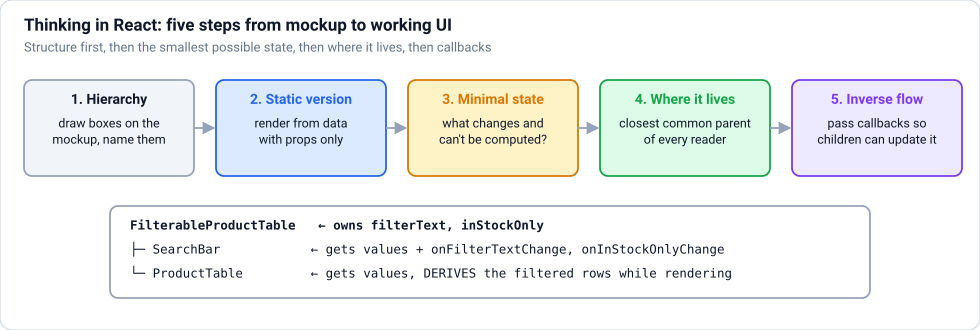

### Theory

> **In simple words:** building a React screen follows five steps. (1) Draw boxes around the parts of the design and name them: that's your **component hierarchy**. (2) Build a **static version** that renders from data with props only. (3) Find the **minimal state**: the few values that change and can't be computed. (4) Put each piece of state in the **closest common parent** of the components that need it. (5) Pass **callbacks** down so children can change that state (**inverse data flow**).

**Words to know:**

- **Mockup:** a picture of the intended screen, from a designer (Figma) or a sketch.
- **Component hierarchy:** the tree of components you draw on the mockup: `FilterableProductTable` → `SearchBar` + `ProductTable` → `ProductCategoryRow` + `ProductRow`.
- **Single responsibility principle:** a component should ideally do one thing; if it grows, split it.
- **Static version:** a first build that renders the data with props only, no state, so the structure is right before any interactivity.
- **Top-down vs bottom-up:** building from the outer components inwards vs from the smallest pieces upwards; small apps usually go top-down, big apps bottom-up.
- **Minimal state (DRY):** the smallest set of values that must be remembered; everything else is computed when rendering (Don't Repeat Yourself).
- **Derived (computed) value:** a value calculated from props or state during render (a filtered list, a total); it is **not** state.
- **Closest common parent (owner):** the nearest ancestor of every component that reads a piece of state; that's where the state should live.
- **Inverse data flow:** children changing parent-owned state by calling callbacks passed down as props.
- **JSON data:** product lists and other data usually arrive from an API as JSON arrays of objects; components render them.

**Everyday picture.** **Planning a kitchen.** First you mark zones on the floor plan (hierarchy), then put in the empty cupboards (static version), decide which few things actually move around (minimal state: the knives, the kettle), store each where everyone who uses it can reach it (the closest common parent), and fit handles so anyone can open a cupboard (callbacks).

**Finding the minimal state, traced by hand** for a searchable product table with an "in stock only" checkbox:

| Piece of data | Changes over time? | Passed in from a parent? | Computable from other data? | State? |
|---|---|---|---|---|
| the original product list | no (in this screen) | yes, as a prop | — | no |
| the search text | yes | no | no | **yes** |
| the checkbox value | yes | no | no | **yes** |
| the filtered list | yes | no | **yes** (products + text + checkbox) | no: derive it |

Then: both `SearchBar` (shows the text and checkbox) and `ProductTable` (filters by them) need the two values, and their closest common parent is `FilterableProductTable`, so the state lives there.

**When to follow the five steps:** every new screen, especially when the design is new to you. **When not:** tiny components (a button) need no ceremony.

**Common mistakes:**

- ❌ Starting with state and effects before the static structure renders correctly.
- ❌ Storing the filtered list in state (it goes stale; derive it).
- ❌ Putting state too high (everything re-renders and props drill through many layers) or too low (siblings can't share it).
- ❌ One giant component for a whole page.

**Used in real software:** this is the official way React teaches design (react.dev's "Thinking in React"), and the same approach shows up in design-system work: designers and engineers agree on a component inventory before building.

### Code

**Steps 1–2: the static version from data,** props only:

```tsx
import { useState } from "react";
import { render, screen, fireEvent } from "@testing-library/react";

type Product = { category: string; name: string; pricePaise: number; stocked: boolean };
const PRODUCTS: Product[] = [
  { category: "Tea", name: "Masala chai", pricePaise: 18000, stocked: true },
  { category: "Tea", name: "Kashmiri kahwa", pricePaise: 26000, stocked: false },
  { category: "Snacks", name: "Samosa", pricePaise: 6000, stocked: true },
  { category: "Snacks", name: "Khakhra", pricePaise: 9000, stocked: true },
];

function ProductCategoryRow({ category }: { category: string }) {
  return <tr><th colSpan={2}>{category}</th></tr>;
}
function ProductRow({ product }: { product: Product }) {
  const name = product.stocked ? product.name : <span style={{ color: "red" }}>{product.name}</span>;
  return <tr><td>{name}</td><td>₹{product.pricePaise / 100}</td></tr>;
}
function ProductTable({ products, filterText, inStockOnly }: { products: Product[]; filterText: string; inStockOnly: boolean }) {
  const rows: React.ReactNode[] = [];
  let lastCategory: string | null = null;
  for (const product of products) {
    if (!product.name.toLowerCase().includes(filterText.toLowerCase())) continue;   // derived, not state
    if (inStockOnly && !product.stocked) continue;
    if (product.category !== lastCategory) rows.push(<ProductCategoryRow key={product.category} category={product.category} />);
    rows.push(<ProductRow key={product.name} product={product} />);
    lastCategory = product.category;
  }
  return <table><tbody>{rows}</tbody></table>;
}
const tableText = (c: HTMLElement) => [...c.querySelectorAll("tr")].map((tr) => tr.textContent).join(" | ");
const { container } = render(<ProductTable products={PRODUCTS} filterText="" inStockOnly={false} />);
console.log(tableText(container));
```

**Output:**

```text
Tea | Masala chai₹180 | Kashmiri kahwa₹260 | Snacks | Samosa₹60 | Khakhra₹90
```

`React.ReactNode` is the TypeScript type for "anything React can render"; building the rows in a local array is fine because it's a new array each render (Section [10](#10-keeping-components-pure)).

**Steps 3–5: add the minimal state to the common parent, and inverse data flow:**

```tsx
function SearchBar({ filterText, inStockOnly, onFilterTextChange, onInStockOnlyChange }: {
  filterText: string; inStockOnly: boolean;
  onFilterTextChange: (text: string) => void; onInStockOnlyChange: (value: boolean) => void;
}) {
  return (
    <form>
      <input placeholder="Search…" value={filterText} onChange={(e) => onFilterTextChange(e.target.value)} />
      <label><input type="checkbox" checked={inStockOnly} onChange={(e) => onInStockOnlyChange(e.target.checked)} /> In stock only</label>
    </form>
  );
}
function FilterableProductTable({ products }: { products: Product[] }) {
  const [filterText, setFilterText] = useState("");          // the minimal state…
  const [inStockOnly, setInStockOnly] = useState(false);     // …in the closest common parent
  return (
    <div>
      <SearchBar filterText={filterText} inStockOnly={inStockOnly} onFilterTextChange={setFilterText} onInStockOnlyChange={setInStockOnly} />
      <ProductTable products={products} filterText={filterText} inStockOnly={inStockOnly} />
    </div>
  );
}
const app = render(<FilterableProductTable products={PRODUCTS} />);
fireEvent.click(screen.getByLabelText("In stock only"));
console.log("in stock only:", tableText(app.container));
fireEvent.change(screen.getByPlaceholderText("Search…"), { target: { value: "sa" } });
console.log("+ search 'sa':", tableText(app.container));
```

**Output:**

```text
in stock only: Tea | Masala chai₹180 | Snacks | Samosa₹60 | Khakhra₹90
+ search 'sa': Tea | Masala chai₹180 | Snacks | Samosa₹60
```

The setters are passed straight down as the callbacks (`onFilterTextChange={setFilterText}`); the children never know where the state lives.

### Practice

1. In the table above, a "Sort by price" toggle is added next to the checkbox. Is the sorted list state? Where does the toggle's value live?
2. Draw the component hierarchy for a chat app screen with a contact list on the left and the selected conversation on the right (with a message input). Which component owns "which contact is selected"?

<details>
<summary><b>Answer</b></summary>

1. The toggle's on/off value is state (it changes and can't be computed) and lives in `FilterableProductTable`, like the other two. The sorted list is **derived**: `ProductTable` sorts a copy (`toSorted`) during render.
2. `Messenger` → `ContactList` (→ `ContactItem`s) and `Chat` (→ `MessageList` → `Message`s, and `Composer`). Both `ContactList` (highlights it) and `Chat` (shows it) need the selected contact, so `Messenger` owns it and passes `onSelect` to `ContactList`.

</details>

| # | Problem | Difficulty |
|---|---|---|
| 1 | [react.dev: Thinking in React (rebuild the FilterableProductTable yourself)](https://react.dev/learn/thinking-in-react) | 🟢 Easy |
| 2 | [Frontend Mentor: Job listings with filtering](https://www.frontendmentor.io/challenges/job-listings-with-filtering-ivstIPCt) | 🟡 Medium |
| 3 | [Frontend Mentor: Time tracking dashboard](https://www.frontendmentor.io/challenges/time-tracking-dashboard-UIQ7167Jw) | 🟢 Easy |

**Learn more:** [react.dev: Thinking in React](https://react.dev/learn/thinking-in-react) · [react.dev: Sharing state between components](https://react.dev/learn/sharing-state-between-components)

---

## 21. Reacting to Input with State: UI as a State Machine

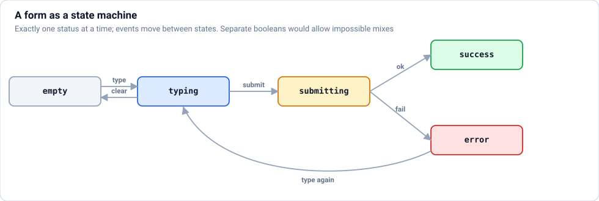

### Theory

> **In simple words:** instead of writing "when the button is clicked, disable it, show a spinner, hide the error…", list the **visual states** your UI can be in (empty, typing, submitting, success, error), describe what each looks like, and keep **one state variable** saying which one you're in. Events move the UI from one state to another. This is a **state machine**, and it removes "impossible" combinations like a spinner and an error message showing at once.

**Words to know:**

- **Visual state:** one distinct way the UI looks (form empty / being submitted / succeeded / failed).
- **State machine (finite-state machine):** a model with a fixed list of states and the **events** (transitions) allowed from each; the UI is always in exactly one state.
- **Transition:** moving from one state to another in response to an event: `typing --submit--> submitting`.
- **Impossible state:** a combination of separate booleans that should never happen (`isLoading && isError`), which separate flags allow and a single status variable prevents.
- **Status variable / union type:** one variable such as `status: "typing" | "submitting" | "success" | "error"`, described in TypeScript as a **union of string literals**.
- **Declarative UI states:** you describe what each state looks like; React handles moving between the pictures.
- **Storybook-style "living styleguide":** a page that renders a component in every state at once, so you can see and test each one (Storybook is the popular tool for this).
- **XState:** a library for complex state machines and statecharts in JavaScript; useful for multi-step flows, overkill for a single form.

**Everyday picture.** A **traffic light**. It is in exactly one state (red, green, amber) and only certain changes are allowed (green → amber → red → green). Nobody models it as three independent booleans `isRed`, `isGreen`, `isAmber`, because then "red and green at once" would be possible.

**Designing a quiz form, traced by hand:**

1. **States:** `empty` (Submit disabled), `typing` (Submit enabled), `submitting` (everything disabled, spinner), `success` ("That's right!" instead of the form), `error` (form, plus the error message).
2. **Triggers:** typing (human), clicking Submit (human), the server answering correctly or not (computer).
3. **Transitions:** `empty --type--> typing`, `typing --submit--> submitting`, `submitting --ok--> success`, `submitting --fail--> error`, `error --type--> typing`.
4. **State variables:** `answer` (the text) and `status`; `empty` vs `typing` can be **derived** from `answer.length === 0`, so it needn't be stored.
5. **Remove impossible states:** three booleans `isTyping`, `isSubmitting`, `isSuccess` allow 8 combinations, of which only 4 are valid; one `status` allows exactly the valid ones.

**When to model states explicitly:** forms, wizards, anything with loading/success/error, media players, connections. **When not:** a simple toggle is already a two-state machine (a boolean is enough).

**Common mistakes:**

- ❌ A separate boolean per situation (`isLoading`, `isError`, `isSuccess`) that can contradict each other.
- ❌ Imperative "do these five DOM-ish things" handlers instead of setting a status.
- ❌ Forgetting a state (what does the form show while retrying after an error?).

**Used in real software:** data-fetching libraries return a `status` of `"pending" | "error" | "success"` rather than independent flags (TanStack Query, Section [52](#52-server-state-with-tanstack-query)); checkout flows, onboarding wizards and video players are commonly written as explicit state machines (often with XState).

### Code

**From scratch: a transition table.** A state machine is just data: for each state, which event leads where. Unknown events are ignored:

```tsx
type Status = "empty" | "typing" | "submitting" | "success" | "error";
type QuizEvent = "TYPE" | "CLEAR" | "SUBMIT" | "OK" | "FAIL";
const machine: Record<Status, Partial<Record<QuizEvent, Status>>> = {
  empty: { TYPE: "typing" },
  typing: { CLEAR: "empty", SUBMIT: "submitting" },
  submitting: { OK: "success", FAIL: "error" },
  error: { TYPE: "typing", SUBMIT: "submitting" },
  success: {},
};
const next = (state: Status, event: QuizEvent): Status => machine[state][event] ?? state;

let state: Status = "empty";
for (const event of ["SUBMIT", "TYPE", "SUBMIT", "FAIL", "TYPE", "SUBMIT", "OK", "TYPE"] as QuizEvent[]) {
  const after = next(state, event);
  console.log(`${state.padEnd(10)} --${event.padEnd(6)}--> ${after}${after === state ? "   (ignored)" : ""}`);
  state = after;
}
```

**Output:**

```text
empty      --SUBMIT--> empty   (ignored)
empty      --TYPE  --> typing
typing     --SUBMIT--> submitting
submitting --FAIL  --> error
error      --TYPE  --> typing
typing     --SUBMIT--> submitting
submitting --OK    --> success
success    --TYPE  --> success   (ignored)
```

`Record<Status, …>` is TypeScript for "an object with one key per status"; `Partial` makes each inner key optional. Submitting while empty, and typing after success, are simply impossible.

**The React way: one `status` variable drives the whole form:**

```tsx
import { useState } from "react";
import { render, screen, fireEvent } from "@testing-library/react";

function submitAnswer(answer: string) {
  return new Promise<void>((resolve, reject) =>
    setTimeout(() => (answer.trim().toLowerCase() === "assam" ? resolve() : reject(new Error("Good guess, but no. Try again!"))), 20));
}

function Quiz() {
  const [answer, setAnswer] = useState("");
  const [error, setError] = useState<Error | null>(null);
  const [status, setStatus] = useState<"typing" | "submitting" | "success">("typing");

  if (status === "success") return <h2>That's right!</h2>;

  async function handleSubmit(e: React.FormEvent) {
    e.preventDefault();
    setStatus("submitting");
    try {
      await submitAnswer(answer);
      setStatus("success");
    } catch (err) {
      setStatus("typing");
      setError(err as Error);
    }
  }
  return (
    <form onSubmit={handleSubmit}>
      <p>Which Indian state grows the most tea?</p>
      <input aria-label="answer" value={answer} disabled={status === "submitting"} onChange={(e) => setAnswer(e.target.value)} />
      <button disabled={answer.length === 0 || status === "submitting"}>Submit</button>
      {error !== null && <p role="alert">{error.message}</p>}
    </form>
  );
}

render(<Quiz />);
const snapshot = (label: string) => console.log(label.padEnd(18), "| button disabled:", (screen.queryByRole("button") as HTMLButtonElement | null)?.disabled ?? "-",
  "| alert:", screen.queryByRole("alert")?.textContent ?? "-", "| heading:", screen.queryByRole("heading")?.textContent ?? "-");
snapshot("empty");
fireEvent.change(screen.getByLabelText("answer"), { target: { value: "Kerala" } });
fireEvent.click(screen.getByRole("button"));
snapshot("submitting");
await screen.findByRole("alert");
snapshot("error");
fireEvent.change(screen.getByLabelText("answer"), { target: { value: "Assam" } });
fireEvent.click(screen.getByRole("button"));
await screen.findByRole("heading");
snapshot("success");
```

**Output:**

```text
empty              | button disabled: true | alert: - | heading: -
submitting         | button disabled: true | alert: - | heading: -
error              | button disabled: false | alert: Good guess, but no. Try again! | heading: -
success            | button disabled: - | alert: - | heading: That's right!
```

`queryByRole` returns `null` instead of throwing when nothing matches, so the snapshot can report "-". "Empty" is derived from `answer.length === 0`, not stored.

**Seeing every state at once** (a mini "living styleguide"): a presentational component renders whatever status it's given:

```tsx
type QuizStatus = "empty" | "typing" | "submitting" | "success" | "error";
function QuizView({ status }: { status: QuizStatus }) {
  if (status === "success") return <h4>[success] That's right!</h4>;
  return (
    <p>
      [{status}] input{status === "submitting" ? " (disabled)" : ""} · Submit{status === "empty" || status === "submitting" ? " (disabled)" : ""}
      {status === "error" && " · ⚠ error message"}
    </p>
  );
}
const statuses: QuizStatus[] = ["empty", "typing", "submitting", "success", "error"];
console.log(render(<>{statuses.map((s) => <QuizView key={s} status={s} />)}</>).container.textContent!.split("[").filter(Boolean).map((x) => "[" + x).join("\n"));
```

**Output:**

```text
[empty] input · Submit (disabled)
[typing] input · Submit
[submitting] input (disabled) · Submit (disabled)
[success] That's right!
[error] input · Submit · ⚠ error message
```

### Practice

1. A file upload widget can be idle, uploading (with a percentage), done, or failed (with a retry button). Write its status type and which data each state needs.
2. Why is `const [isLoading, setIsLoading] = useState(false); const [isError, setIsError] = useState(false);` risky?

<details>
<summary><b>Answer</b></summary>

1. A **discriminated union** (Section [26](#26-typescript-with-react-typing-props-state-events-and-children)) attaches the right data to each state:

```text
type Upload =
  | { status: "idle" }
  | { status: "uploading"; percent: number }
  | { status: "done"; url: string }
  | { status: "failed"; error: string };
```

2. It allows the impossible combination `isLoading && isError` (and forgetting to reset one flag when setting the other). One `status` variable can only ever be one thing.

</details>

| # | Problem | Difficulty |
|---|---|---|
| 1 | [react.dev challenges: Add and remove a CSS class, Profile editor, Refactor the imperative solution](https://react.dev/learn/reacting-to-input-with-state#challenges) | 🟡 Medium |
| 2 | [Frontend Mentor: Advice generator app (loading, success and error states)](https://www.frontendmentor.io/challenges/advice-generator-app-QdUG-13db) | 🟢 Easy |

**Learn more:** [react.dev: Reacting to input with state](https://react.dev/learn/reacting-to-input-with-state) · [XState documentation](https://stately.ai/docs)

---

## 22. Choosing the State Structure

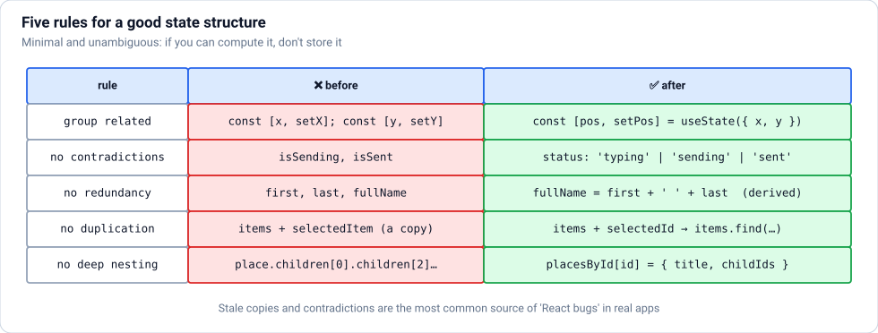

### Theory

> **In simple words:** good state is **minimal and unambiguous**. Group values that always change together; don't keep two variables that can disagree; don't store anything you can **calculate**; don't keep the same data in two places (store an **id** instead of a copy of the selected object); and flatten deeply nested data. Most "React bugs" in real apps are really badly structured state.

**Words to know:**

- **Redundant state:** state that can be computed from other state or props (`fullName` from `firstName` + `lastName`); it goes stale when you forget to update it.
- **Contradictory state:** two pieces of state that can disagree (`isSending` and `isSent` both true).
- **Duplicated state:** the same data stored twice (the list of items **and** a copy of the selected item); edits to one don't reach the other.
- **Selected id pattern:** store `selectedId` and look the object up in the list during render.
- **Normalisation:** storing nested data **flat**, as a lookup by id (`{ [id]: { id, title, childIds } }`), like database tables; updates touch one entry instead of copying deep trees.
- **Mirroring props in state:** `useState(props.color)` copies a prop once and then ignores changes; only do it on purpose (name it `initialColor`).
- **Source of truth:** the one place a piece of data lives; everything else reads or derives from it.

**Everyday picture.** A **class register and a seating chart**. If the chart has the students' full details copied onto it, a name change in the register leaves the chart wrong. If the chart only stores **roll numbers** (ids) and you look names up in the register (the source of truth), it can never disagree.

**Five principles, each traced:**

| Principle | ❌ Before | ✅ After |
|---|---|---|
| group related state | `x`, `y` always set together as two variables | `position = { x, y }` |
| avoid contradictions | `isSending`, `isSent` | `status: "typing" \| "sending" \| "sent"` |
| avoid redundant state | `firstName`, `lastName`, `fullName` | derive `fullName = first + " " + last` |
| avoid duplication | `items` + `selectedItem` (a copy) | `items` + `selectedId`; `selected = items.find(...)` |
| avoid deep nesting | a tree of places inside places inside places | `placesById` with `childIds` arrays |

**When to break the rules:** an **initial** value from props that should then be independent (`initialColor`), or a cached expensive calculation (Section [45](#45-memo-usememo-usecallback-and-the-react-compiler) shows `useMemo` for that instead). **When not:** don't normalise a small, flat list; it's overkill.

**Common mistakes:**

- ❌ Storing filtered, sorted or totalled data in state and syncing it with effects (Section [32](#32-you-might-not-need-an-effect)).
- ❌ Keeping a copy of the selected object, then editing the list and showing a stale selection.
- ❌ Nesting deeply and then writing five levels of spread to change one field.

**Used in real software:** Redux's style guide asks for normalised state ("entities by id"), and Redux Toolkit ships `createEntityAdapter` for it; Apollo Client and Relay normalise GraphQL results into a flat cache by id.

### Code

**Redundant state goes stale.** A full name kept in state forgets to update; a derived one can't:

```tsx
import { useState } from "react";
import { render, screen, fireEvent } from "@testing-library/react";

function NameForm({ redundant }: { redundant: boolean }) {
  const [first, setFirst] = useState("Asha");
  const [last, setLast] = useState("Rao");
  const [storedFull, setStoredFull] = useState("Asha Rao");          // ❌ redundant
  const full = redundant ? storedFull : `${first} ${last}`;           // ✅ derived
  return (
    <>
      <input aria-label="first" value={first} onChange={(e) => { setFirst(e.target.value); setStoredFull(e.target.value + " " + last); }} />
      <input aria-label="last" value={last} onChange={(e) => setLast(e.target.value)} />   {/* forgot to update storedFull */}
      <p>Hello, {full}</p>
    </>
  );
}
for (const redundant of [true, false]) {
  const { unmount } = render(<NameForm redundant={redundant} />);
  fireEvent.change(screen.getByLabelText("last"), { target: { value: "Iyer" } });
  console.log(redundant ? "stored: " : "derived:", screen.getByText(/Hello/).textContent);
  unmount();
}
```

**Output:**

```text
stored:  Hello, Asha Rao
derived: Hello, Asha Iyer
```

**Duplicated state: store the id, not a copy.** Editing an item's name updates the list, but a copied "selected item" keeps the old name:

```tsx
const initialItems = [{ id: 0, title: "pretzels" }, { id: 1, title: "crispy seaweed" }, { id: 2, title: "granola bar" }];

function Menu({ storeCopy }: { storeCopy: boolean }) {
  const [items, setItems] = useState(initialItems);
  const [selectedCopy, setSelectedCopy] = useState(items[0]);          // ❌ duplicate of an item
  const [selectedId, setSelectedId] = useState(0);                     // ✅ just the id
  const selected = storeCopy ? selectedCopy : items.find((i) => i.id === selectedId)!;
  return (
    <>
      {items.map((item) => (
        <p key={item.id}>
          <input aria-label={`title ${item.id}`} value={item.title}
            onChange={(e) => setItems(items.map((i) => (i.id === item.id ? { ...i, title: e.target.value } : i)))} />
          <button onClick={() => { setSelectedCopy(item); setSelectedId(item.id); }}>Choose {item.id}</button>
        </p>
      ))}
      <h3>You picked {selected.title}.</h3>
    </>
  );
}
for (const storeCopy of [true, false]) {
  const { unmount } = render(<Menu storeCopy={storeCopy} />);
  fireEvent.click(screen.getByText("Choose 1"));
  fireEvent.change(screen.getByLabelText("title 1"), { target: { value: "crispy nori" } });
  console.log(storeCopy ? "copy: " : "by id:", screen.getByRole("heading").textContent);
  unmount();
}
```

**Output:**

```text
copy:  You picked crispy seaweed.
by id: You picked crispy nori.
```

**Deep nesting vs normalised state.** Deleting a place from a nested tree needs a recursive copy; with a flat table it's two small updates:

```tsx
type Place = { id: number; title: string; childIds: number[] };
const placesById: Record<number, Place> = {
  0: { id: 0, title: "(root)", childIds: [1, 4] },
  1: { id: 1, title: "India", childIds: [2, 3] },
  2: { id: 2, title: "Pune", childIds: [] },
  3: { id: 3, title: "Darjeeling", childIds: [] },
  4: { id: 4, title: "Sri Lanka", childIds: [5] },
  5: { id: 5, title: "Kandy", childIds: [] },
};

function removePlace(plan: Record<number, Place>, parentId: number, childId: number) {
  const parent = plan[parentId];
  return { ...plan, [parentId]: { ...parent, childIds: parent.childIds.filter((id) => id !== childId) } };   // copy ONE entry
}
function printTree(plan: Record<number, Place>, id = 0, depth = 0): string[] {
  const place = plan[id];
  return [(depth ? "  ".repeat(depth - 1) + "- " : "") + place.title, ...place.childIds.flatMap((c) => printTree(plan, c, depth + 1))];
}
const after = removePlace(placesById, 1, 3);
console.log(printTree(after).join("\n"));
console.log("untouched entries shared:", after[4] === placesById[4], "| original unchanged:", placesById[1].childIds);
```

**Output:**

```text
(root)
- India
  - Pune
- Sri Lanka
  - Kandy
untouched entries shared: true | original unchanged: [ 2, 3 ]
```

`flatMap` maps each item to an array and flattens the results into one array. (A complete version would also delete place 3 and its descendants from the table to avoid leaking memory.)

### Practice

1. A component has `const [items, setItems] = useState(cart)` and `const [total, setTotal] = useState(0)`, plus an effect that recalculates `total` when `items` change. What's better?
2. `function Clock({ color }) { const [c] = useState(color); return <h1 style={{ color: c }}>…</h1>; }` ignores later color changes. Why, and what are the two correct designs?

<details>
<summary><b>Answer</b></summary>

1. Delete `total` state and the effect; compute `const total = items.reduce((s, i) => s + i.price * i.qty, 0)` during render. One less render per change and nothing can go stale.
2. `useState` uses its argument only on the first render, so the state mirrors the **initial** prop forever. Either use the prop directly (`style={{ color }}`), or, if it's meant to be only a starting value the user can change, rename the prop `initialColor` to make that explicit.

</details>

| # | Problem | Difficulty |
|---|---|---|
| 1 | [react.dev challenges: Fix a component that's not updating, Fix a broken packing list, Fix the disappearing selection, Implement multiple selection](https://react.dev/learn/choosing-the-state-structure#challenges) | 🟡 Medium |
| 2 | [Frontend Mentor: Interactive comments section (nested replies, normalised data)](https://www.frontendmentor.io/challenges/interactive-comments-section-iG1RugEG9) | 🔴 Hard |

**Learn more:** [react.dev: Choosing the state structure](https://react.dev/learn/choosing-the-state-structure) · [Redux: Normalizing state shape](https://redux.js.org/usage/structuring-reducers/normalizing-state-shape)

---

## 23. Sharing State: Lifting State Up and a Single Source of Truth

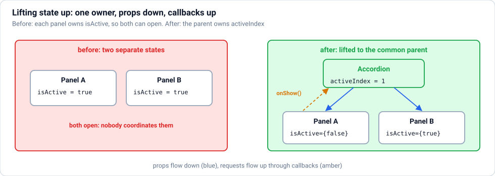

### Theory

> **In simple words:** when two components must change **together**, remove the state from both, move it to their **closest common parent**, and pass it down as props, with callbacks to change it. This is **lifting state up**. Each piece of state should live in exactly one component (a **single source of truth**); everyone else gets it through props.

**Words to know:**

- **Lifting state up:** moving state from children to a common parent so they can share and coordinate it.
- **Controlled component (general sense):** a component whose important information is driven by **props** from its parent (like `<Panel isActive={…} />`); the parent controls it.
- **Uncontrolled component (general sense):** a component that keeps its own internal state; easier to drop in, harder to coordinate.
- **Single source of truth:** one owner per piece of state; other components read it via props instead of keeping their own copies.
- **Synchronising state (anti-pattern):** keeping two copies of the same state in two components and trying to keep them equal with effects or callbacks.
- **Accordion:** a list of panels where opening one panel closes the others.

**Everyday picture.** A **TV remote**. If each person had their own copy of "the current channel" in their head, you'd argue constantly. Put the channel in **one** place (the TV, the common parent), let everyone see it (props), and let anyone with the remote change it (callbacks).

**Lifting an accordion's state, traced:**

```text
before:  Panel A { isActive } , Panel B { isActive }    → both can be open; neither knows about the other
step 1:  remove isActive state from Panel; make it a prop          → Panel({ isActive, onShow })
step 2:  pass hardcoded data from the parent to test it             → <Panel isActive={true} />
step 3:  add state to the parent: activeIndex = 0
         <Panel isActive={activeIndex === 0} onShow={() => setActiveIndex(0)} />
         <Panel isActive={activeIndex === 1} onShow={() => setActiveIndex(1)} />
now:     clicking B's "Show" sets activeIndex = 1 → A gets isActive=false, B gets isActive=true
```

**When to lift:** whenever siblings must stay in sync, or a parent needs to know a child's state (a form summary, a wizard's progress). **When not:** state used by one component only should stay in it; lifting everything to the top makes the whole app re-render and turns props into long chains (context helps there, Section [36](#36-context-passing-data-deeply)).

**Common mistakes:**

- ❌ Two copies of the same state "synced" with effects (they will drift).
- ❌ Lifting state far higher than needed.
- ❌ Passing the setter and the value under unclear names; prefer `value`/`onChange` or `isActive`/`onShow` pairs.

**Used in real software:** tabs, accordions, filters + results, master–detail screens, and every controlled form library; design-system components usually support **both** modes (`value` + `onChange` for controlled, `defaultValue` for uncontrolled).

### Code

**From scratch: syncing two widgets by hand** (the anti-pattern React's lifting replaces): each keeps its own copy, so every change must be copied to the other manually:

```tsx
let leftCopy = "", rightCopy = "";
function typeLeft(text: string) { leftCopy = text; rightCopy = text; }      // must remember to sync
function typeRight(text: string) { rightCopy = text; }                       // forgot to sync → drift
typeLeft("chai"); typeRight("chai latte");
console.log({ leftCopy, rightCopy }, "← two sources of truth disagree");
```

**Output:**

```text
{ leftCopy: 'chai', rightCopy: 'chai latte' } ← two sources of truth disagree
```

**Uncontrolled panels: each owns its state, so both can be open:**

```tsx
import { useState } from "react";
import { render, screen, fireEvent } from "@testing-library/react";

function FreePanel({ title, children }: { title: string; children: string }) {
  const [isActive, setIsActive] = useState(false);
  return <section><h3>{title}</h3>{isActive ? <p>{children}</p> : <button onClick={() => setIsActive(true)}>Show {title}</button>}</section>;
}
const openPanels = (c: HTMLElement) => [...c.querySelectorAll("section")].filter((s) => s.querySelector("p")).map((s) => s.querySelector("h3")!.textContent);
const free = render(<><FreePanel title="About">Chai Point started in 2019.</FreePanel><FreePanel title="Recipe">Boil, steep, add milk.</FreePanel></>);
fireEvent.click(screen.getByText("Show About"));
fireEvent.click(screen.getByText("Show Recipe"));
console.log("open:", openPanels(free.container));
```

**Output:**

```text
open: [ 'About', 'Recipe' ]
```

**Lifted: the parent owns `activeIndex`; panels are controlled by props:**

```tsx
function Panel({ title, children, isActive, onShow }: { title: string; children: string; isActive: boolean; onShow: () => void }) {
  return <section><h3>{title}</h3>{isActive ? <p>{children}</p> : <button onClick={onShow}>Show {title}</button>}</section>;
}
function Accordion() {
  const [activeIndex, setActiveIndex] = useState(0);
  return (
    <>
      <Panel title="About" isActive={activeIndex === 0} onShow={() => setActiveIndex(0)}>Chai Point started in 2019.</Panel>
      <Panel title="Recipe" isActive={activeIndex === 1} onShow={() => setActiveIndex(1)}>Boil, steep, add milk.</Panel>
    </>
  );
}
const acc = render(<Accordion />);
console.log("open at start:", openPanels(acc.container));
fireEvent.click(screen.getByText("Show Recipe"));
console.log("after showing Recipe:", openPanels(acc.container));
```

**Output:**

```text
open at start: [ 'About' ]
after showing Recipe: [ 'Recipe' ]
```

**A component that supports both modes** (the design-system pattern): controlled when the parent passes `value`, uncontrolled otherwise:

```tsx
function Rating({ value, defaultValue = 0, onChange }: { value?: number; defaultValue?: number; onChange?: (v: number) => void }) {
  const [internal, setInternal] = useState(defaultValue);
  const isControlled = value !== undefined;
  const current = isControlled ? value : internal;
  const choose = (v: number) => { if (!isControlled) setInternal(v); onChange?.(v); };
  return <span>{[1, 2, 3, 4, 5].map((v) => <button key={v} aria-label={`${v} stars`} onClick={() => choose(v)}>{v <= current ? "★" : "☆"}</button>)}</span>;
}
function Review() {
  const [stars, setStars] = useState(2);
  return <><Rating value={stars} onChange={setStars} /> <Rating defaultValue={4} /> <small>parent knows: {stars}</small></>;
}
const r = render(<Review />);
fireEvent.click(screen.getAllByLabelText("5 stars")[0]);    // controlled one
fireEvent.click(screen.getAllByLabelText("1 stars")[1]);    // uncontrolled one
console.log(r.container.textContent);
```

**Output:**

```text
★★★★★ ★☆☆☆☆ parent knows: 5
```

`onChange?.(v)` calls `onChange` only if it was passed (optional chaining on a function call).

### Practice

1. Two inputs should always show the same text (typing in either updates both). Lift the state and write it.
2. A `SearchBar` and a `List` are siblings; the list must filter by the search text. Which component owns the text?

<details>
<summary><b>Answer</b></summary>

```tsx
function SyncedInputs() {
  const [text, setText] = useState("");
  return (
    <>
      <input aria-label="first" value={text} onChange={(e) => setText(e.target.value)} />
      <input aria-label="second" value={text} onChange={(e) => setText(e.target.value)} />
    </>
  );
}
render(<SyncedInputs />);
fireEvent.change(screen.getByLabelText("second"), { target: { value: "masala" } });
console.log((screen.getByLabelText("first") as HTMLInputElement).value);
```

**Output:**

```text
masala
```

1. One `text` state in the parent; both inputs are controlled by it (react.dev's "Synced inputs").
2. Their closest common parent (e.g. `FilterableList`), which passes `query` + `onQueryChange` to `SearchBar` and `query` to `List`.

</details>

| # | Problem | Difficulty |
|---|---|---|
| 1 | [react.dev challenges: Synced inputs, Filtering a list](https://react.dev/learn/sharing-state-between-components#challenges) | 🟢 Easy |
| 2 | [Frontend Mentor: FAQ accordion (only one panel open at a time)](https://www.frontendmentor.io/challenges/faq-accordion-wyfFdeBwBz) | 🟢 Easy |
| 3 | [Frontend Mentor: Interactive pricing component](https://www.frontendmentor.io/challenges/interactive-pricing-component-t0m8PIyY8) | 🟡 Medium |

**Learn more:** [react.dev: Sharing state between components](https://react.dev/learn/sharing-state-between-components)

---

## 24. Preserving and Resetting State: Tree Position and Keys

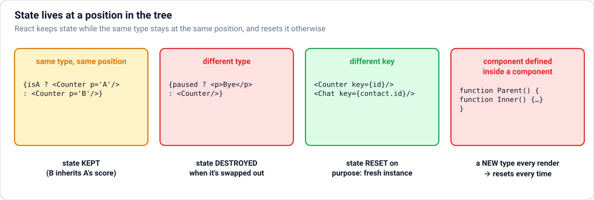

### Theory

> **In simple words:** state isn't stored "inside" your component function; React keeps it next to the component's **position in the UI tree**. As long as the **same component type** renders at the **same position**, its state is **kept**, even if its props change. Render a different type there, or remove it, and the state is **destroyed**. To deliberately reset a component (a chat box when you switch contacts), give it a different **`key`**.

**Words to know:**

- **UI tree / render tree:** the tree of components React builds from your JSX; state is attached to positions in it.
- **Position:** where a component sits among its parent's children (first child, second child…), regardless of variable names in your code.
- **Preserved state:** the same type at the same position across renders keeps its state.
- **Reset (remount):** React destroys a component and its whole subtree's state and creates a fresh one: when its type changes, it's removed, or its key changes.
- **Mount / unmount:** a component appearing in the tree (created) / disappearing from it (destroyed, state lost).
- **`key` outside lists:** any component can take a key; changing it tells React "this is a different instance", so it resets.
- **Nested component definition bug:** defining a component inside another creates a **new type** every render, so React resets it every render.
- **Preserving hidden state:** to keep state of something that's hidden, keep it rendered but hidden with CSS, lift its state up, or use `<Activity>` (Section [63](#63-transitions-usetransition-usedeferredvalue-activity-and-viewtransition)).

**Everyday picture.** **Hotel rooms.** The hotel (React) remembers what's in room 2 (position), not who you are. If a guest of the same kind stays on (same type), their luggage stays. Swap in a different kind of occupant (a different type) and the room is cleared. And if reception issues a new booking number for the room (a new key), it's cleaned out even though it's still room 2.

**Same position, different variables, traced:**

```text
{isFancy ? <Counter isFancy={true} /> : <Counter isFancy={false} />}
→ both branches put a <Counter> as the FIRST child → same type, same position → state KEPT when isFancy flips

{isPaused ? <p>See you later!</p> : <Counter />}
→ position 1 changes from Counter to p → Counter unmounted → its state DESTROYED

{isPlayerA ? <Counter key="Taylor" /> : <Counter key="Sarah" />}
→ different keys → React treats them as different counters → each switch RESETS
```

**When to reset with a key:** switching which record an editor shows (chat recipient, profile being edited), resetting a form after submit, restarting an animation. **When to preserve:** tabs where users expect their scroll position or draft to survive (keep them mounted, or lift state up).

**Common mistakes:**

- ❌ Defining components inside components (state resets every render, inputs lose focus on each keystroke).
- ❌ Expecting state to reset when only props change (it doesn't; use a key, or derive from props).
- ❌ Using an effect to reset state when a prop changes; a key is simpler and avoids a wasted render (Section [32](#32-you-might-not-need-an-effect)).

**Used in real software:** `key={userId}` on profile and chat screens is a standard pattern; routers reset page state by rendering a different component per route; editors reset the form with `key={document.id}`.

### Code

**Same type, same position: state survives a prop change:**

```tsx
import { useState } from "react";
import { render, screen, fireEvent } from "@testing-library/react";

function Counter({ person, fancy = false }: { person: string; fancy?: boolean }) {
  const [score, setScore] = useState(0);
  return <button onClick={() => setScore(score + 1)}>{fancy ? "✨ " : ""}{person}: {score}</button>;
}
function Scoreboard({ mode }: { mode: "position" | "key" }) {
  const [isA, setIsA] = useState(true);
  return (
    <>
      {mode === "position"
        ? (isA ? <Counter person="Taylor" /> : <Counter person="Sarah" fancy />)
        : (isA ? <Counter key="Taylor" person="Taylor" /> : <Counter key="Sarah" person="Sarah" />)}
      <button onClick={() => setIsA(!isA)}>next player</button>
    </>
  );
}
for (const mode of ["position", "key"] as const) {
  const { unmount } = render(<Scoreboard mode={mode} />);
  const scoreButton = () => screen.getAllByRole("button")[0];
  fireEvent.click(scoreButton()); fireEvent.click(scoreButton()); fireEvent.click(scoreButton());
  const before = scoreButton().textContent;
  fireEvent.click(screen.getByText("next player"));
  console.log(`${mode.padEnd(8)}: ${before} → after switching: ${scoreButton().textContent}`);
  unmount();
}
```

**Output:**

```text
position: Taylor: 3 → after switching: ✨ Sarah: 3
key     : Taylor: 3 → after switching: Sarah: 0
```

Without keys, Sarah **inherits** Taylor's score of 3: React only sees "a Counter at position 1" both times. With different keys, Sarah starts at 0.

**A different type at the same position destroys the state:**

```tsx
function PauseDemo() {
  const [paused, setPaused] = useState(false);
  return <>{paused ? <p>See you later!</p> : <Counter person="Ravi" />}<button onClick={() => setPaused(!paused)}>toggle</button></>;
}
render(<PauseDemo />);
fireEvent.click(screen.getByText("Ravi: 0"));
fireEvent.click(screen.getByText("Ravi: 1"));
fireEvent.click(screen.getByText("toggle"));
fireEvent.click(screen.getByText("toggle"));
console.log("after pausing and resuming:", screen.getAllByRole("button")[0].textContent);
```

**Output:**

```text
after pausing and resuming: Ravi: 0
```

**Resetting a form with a key:** switching chat contact should clear the draft:

```tsx
const contacts = [{ id: 1, name: "Asha" }, { id: 2, name: "Ravi" }];
function Chat({ contact }: { contact: { id: number; name: string } }) {
  const [text, setText] = useState("");
  return <textarea aria-label="draft" placeholder={`Chat to ${contact.name}`} value={text} onChange={(e) => setText(e.target.value)} />;
}
function Messenger({ useKey }: { useKey: boolean }) {
  const [to, setTo] = useState(contacts[0]);
  return (
    <>
      {contacts.map((c) => <button key={c.id} onClick={() => setTo(c)}>{c.name}</button>)}
      {useKey ? <Chat key={to.id} contact={to} /> : <Chat contact={to} />}
    </>
  );
}
for (const useKey of [false, true]) {
  const { unmount } = render(<Messenger useKey={useKey} />);
  fireEvent.change(screen.getByLabelText("draft"), { target: { value: "Hi Asha, chai at 5?" } });
  fireEvent.click(screen.getByText("Ravi"));
  const draft = screen.getByLabelText("draft") as HTMLTextAreaElement;
  console.log(useKey ? "key={to.id}:" : "no key:     ", `${draft.placeholder} → "${draft.value}"`);
  unmount();
}
```

**Output:**

```text
no key:      Chat to Ravi → "Hi Asha, chai at 5?"
key={to.id}: Chat to Ravi → ""
```

Without the key, the message meant for Asha is still in the box after switching to Ravi: easy to send to the wrong person.

**The nested-definition bug:** the inner component is a **new type** on every render, so its state resets each time the parent re-renders:

```tsx
function Parent() {
  const [count, setCount] = useState(0);
  function Inner() {                                   // ❌ defined inside Parent
    const [text, setText] = useState("");
    return <input aria-label="inner" value={text} onChange={(e) => setText(e.target.value)} />;
  }
  return <><Inner /><button onClick={() => setCount(count + 1)}>parent re-render {count}</button></>;
}
render(<Parent />);
const before = screen.getByLabelText("inner");
fireEvent.change(before, { target: { value: "typed text" } });
fireEvent.click(screen.getByRole("button"));
const after = screen.getByLabelText("inner") as HTMLInputElement;
console.log(`same input element? ${after === before} | value now: "${after.value}"`);
```

**Output:**

```text
same input element? false | value now: ""
```

### Practice

1. A profile editor shows `<ProfileForm user={user} />` and keeps old field values when you pick a different user. Fix it in one attribute.
2. Two tabs, "Write" and "Preview", render `{tab === "write" ? <Editor /> : <Preview />}`. Switching to Preview and back loses the draft. Give two fixes.

<details>
<summary><b>Answer</b></summary>

1. `<ProfileForm key={user.id} user={user} />`: a new key per user remounts the form with fresh state.
2. (a) Lift the draft state into the parent and pass it to `Editor` as `value`/`onChange`; (b) keep both mounted and hide the inactive one (CSS `hidden`, or React 19.2's `<Activity mode="hidden">`, which keeps state while hidden, Section [63](#63-transitions-usetransition-usedeferredvalue-activity-and-viewtransition)).

</details>

| # | Problem | Difficulty |
|---|---|---|
| 1 | [react.dev challenges: Fix disappearing input text, Swap two form fields, Reset a detail form, Clear an image while it's loading, Fix misplaced state in the list](https://react.dev/learn/preserving-and-resetting-state#challenges) | 🟡 Medium |
| 2 | [BFE.dev React quiz 4: React re-render 4](https://bigfrontend.dev/react-quiz/React-re-render-4) | 🟡 Medium |

**Learn more:** [react.dev: Preserving and resetting state](https://react.dev/learn/preserving-and-resetting-state) · [react.dev: You might not need an effect (resetting state with a key)](https://react.dev/learn/you-might-not-need-an-effect#resetting-all-state-when-a-prop-changes)

---

## 25. Composition: children, Slots and Layout Components

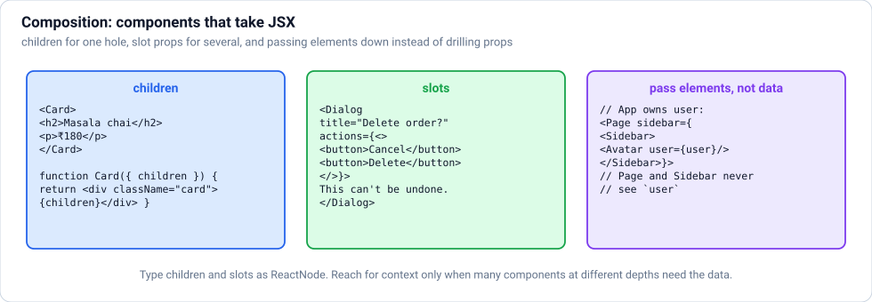

### Theory

> **In simple words:** components can take **other JSX as input**. Whatever you nest between a component's tags arrives as the **`children`** prop, so a `Card`, `Modal` or `Layout` can wrap any content without knowing what it is. For several "holes", pass JSX through ordinary props (**slots**: `header`, `footer`, `actions`). Building UIs by putting components inside components (**composition**) is how React reuses code, instead of inheritance.

**Words to know:**

- **Composition:** building complex components by combining simpler ones, passing components and elements into each other.
- **`children`:** the prop containing the JSX between a component's opening and closing tags.
- **Slot (named slot):** a prop that receives JSX for a specific place: `<Layout sidebar={<Nav />} main={<Feed />} />`.
- **Container / layout component:** a component whose job is arrangement and styling (a card frame, a two-column page) and which renders `children` inside.
- **Wrapper component:** wraps children to add behaviour or styling (`<Tooltip text="…"><button/></Tooltip>`).
- **Specialisation:** making a specific component by configuring a generic one (`WelcomeDialog` renders `Dialog` with fixed title).
- **Prop drilling:** passing a prop through many intermediate components that don't use it, only to reach a deep child.
- **Passing elements to avoid drilling:** the parent that owns the data creates the deep element itself and passes it **down as JSX** through the layout, so the middle layers never see the data.
- **Render prop:** a prop that is a **function returning JSX** (`renderItem={(item) => <Row … />}`), letting the parent decide how each part renders (more in Section [67](#67-legacy-react-class-components-lifecycles-hocs-and-render-props)).
- **`ReactNode`:** the TypeScript type for anything renderable (elements, strings, numbers, arrays, `null`), used for `children` and slot props.
- **Inheritance:** making a class from another class; React apps essentially never use it for components; composition covers every case.

**Everyday picture.** A **picture frame**. The framer (the `Card` component) makes the frame, mount and glass without caring whether you put a family photo, a certificate or a child's drawing in it (`children`). A frame with a separate slot for a nameplate is a component with a `footer` slot.

**Passing elements to avoid drilling, traced:**

```text
drilling:  App(user) → Page(user) → Sidebar(user) → Avatar(user)      Page and Sidebar only pass it along
composed:  App(user) renders  <Page sidebar={<Sidebar><Avatar user={user} /></Sidebar>} />
           Page just places {sidebar}; Sidebar just places {children}; neither knows "user" exists
```

**When to use which:** `children` for one content area; slot props for several areas; a render prop when the parent must render per-item content with data the child provides; context (Section [36](#36-context-passing-data-deeply)) when **many** components at different depths need the same data. **When not:** don't pass JSX through props just to avoid writing a small, clear prop chain of two levels.

**Common mistakes:**

- ❌ Reaching into `children` to change them (`React.Children`, `cloneElement` are legacy tools; prefer explicit props).
- ❌ Reaching for context or a global store at the first sign of prop drilling, before trying composition.
- ❌ Typing `children` as `JSX.Element` (rejects strings and lists). ✅ `React.ReactNode`.

**Used in real software:** every design system's `Card`, `Dialog`, `Popover`, `Layout` and `Tabs` take `children` and slots; Next.js layouts receive the page as `children` (Section [62](#62-nextjs-app-router-layouts-server-functions-and-caching)); libraries like Radix UI and shadcn/ui are built almost entirely from composition.

### Code

**`children`: a frame for any content:**

```tsx
import type { ReactNode } from "react";
import { useState } from "react";
import { render, screen, fireEvent } from "@testing-library/react";

function Card({ children }: { children: ReactNode }) {
  return <div className="card">{children}</div>;
}
const html = render(
  <>
    <Card><h2>Masala chai</h2><p>₹180</p></Card>
    <Card>Just some text, 42, and a list: {["a", "b"]}</Card>
  </>,
).container.innerHTML;
console.log(html);
```

**Output:**

```text
<div class="card"><h2>Masala chai</h2><p>₹180</p></div><div class="card">Just some text, 42, and a list: ab</div>
```

**Slots: several holes, filled with JSX props:**

```tsx
function Dialog({ title, children, actions }: { title: ReactNode; children: ReactNode; actions?: ReactNode }) {
  return (
    <section role="dialog" aria-label={typeof title === "string" ? title : undefined}>
      <header>{title}</header>
      <div>{children}</div>
      {actions && <footer>{actions}</footer>}
    </section>
  );
}
function ConfirmDelete({ onConfirm }: { onConfirm: () => void }) {      // specialisation of Dialog
  return (
    <Dialog title="Delete order?" actions={<><button>Cancel</button><button onClick={onConfirm}>Delete</button></>}>
      This can't be undone.
    </Dialog>
  );
}
console.log(render(<ConfirmDelete onConfirm={() => {}} />).container.innerHTML);
```

**Output:**

```text
<section role="dialog" aria-label="Delete order?"><header>Delete order?</header><div>This can't be undone.</div><footer><button>Cancel</button><button>Delete</button></footer></section>
```

**Avoiding prop drilling by passing elements down.** First the drilled version, then the composed one; the middle components shrink to pure layout:

```tsx
type User = { name: string; plan: string };
function AvatarBadge({ user }: { user: User }) { return <b>{user.name} ({user.plan})</b>; }

// drilled: Page and Sidebar take `user` only to pass it on
function DrilledSidebar({ user }: { user: User }) { return <aside><AvatarBadge user={user} /></aside>; }
function DrilledPage({ user }: { user: User }) { return <main><DrilledSidebar user={user} /><article>Feed</article></main>; }

// composed: Page and Sidebar know nothing about users
function Sidebar({ children }: { children: ReactNode }) { return <aside>{children}</aside>; }
function Page({ sidebar, children }: { sidebar: ReactNode; children: ReactNode }) { return <main>{sidebar}<article>{children}</article></main>; }

const user = { name: "Asha", plan: "Pro" };
const a = render(<DrilledPage user={user} />).container.innerHTML;
const b = render(<Page sidebar={<Sidebar><AvatarBadge user={user} /></Sidebar>}>Feed</Page>).container.innerHTML;
console.log(a === b, b);
```

**Output:**

```text
true <main><aside><b>Asha (Pro)</b></aside><article>Feed</article></main>
```

Same HTML, but in the composed version only the top component and `AvatarBadge` mention `user`.

**A render prop: the list decides *where*, the parent decides *how*:**

```tsx
function List<T>({ items, renderItem, empty = "Nothing here" }: { items: T[]; renderItem: (item: T, index: number) => ReactNode; empty?: ReactNode }) {
  if (items.length === 0) return <p>{empty}</p>;
  return <ul>{items.map((item, i) => <li key={i}>{renderItem(item, i)}</li>)}</ul>;
}
const orders = [{ id: 90312, total: 1499 }, { id: 90313, total: 180 }];
console.log(render(<List items={orders} renderItem={(o) => <>#{o.id}: ₹{o.total}</>} />).container.innerHTML);
console.log(render(<List items={[] as string[]} renderItem={(s) => s} empty={<em>No orders yet</em>} />).container.innerHTML);
```

**Output:**

```text
<ul><li>#90312: ₹1499</li><li>#90313: ₹180</li></ul>
<p><em>No orders yet</em></p>
```

`List<T>` is a **generic component**: TypeScript works out `T` from `items`, so `o` in `renderItem` is known to have `id` and `total` (Section [26](#26-typescript-with-react-typing-props-state-events-and-children)). Index keys are acceptable here only because this demo list never reorders.

**Composition and state: `children` keep their own state when a wrapper re-renders:**

```tsx
function Collapsible({ title, children }: { title: string; children: ReactNode }) {
  const [open, setOpen] = useState(true);
  return <section><button onClick={() => setOpen(!open)}>{open ? "▾" : "▸"} {title}</button>{open && children}</section>;
}
render(<Collapsible title="Notes"><textarea aria-label="notes" defaultValue="buy cardamom" /></Collapsible>);
console.log((screen.getByLabelText("notes") as HTMLTextAreaElement).value);
fireEvent.click(screen.getByText(/Notes/));
console.log("collapsed, textarea present?", screen.queryByLabelText("notes") !== null);
```

**Output:**

```text
buy cardamom
collapsed, textarea present? false
```

### Practice

1. Write a `TwoColumn({ left, right })` layout and use it to show a `Menu` on the left and a `Cart` on the right.
2. `App` has the logged-in user and renders `<Layout><Header /><Main /></Layout>`, and only the deep `UserMenu` (inside `Header`) needs the user. Avoid drilling through `Layout` and `Header` without context.

<details>
<summary><b>Answer</b></summary>

```tsx
function TwoColumn({ left, right }: { left: ReactNode; right: ReactNode }) {
  return <div className="cols"><div>{left}</div><div>{right}</div></div>;
}
console.log(render(<TwoColumn left={<nav>Menu</nav>} right={<aside>Cart (2)</aside>} />).container.innerHTML);

function Header({ userMenu }: { userMenu: ReactNode }) { return <header>Chai Point {userMenu}</header>; }
function Layout({ children }: { children: ReactNode }) { return <div className="layout">{children}</div>; }
function UserMenu({ user }: { user: User }) { return <span>👤 {user.name}</span>; }
console.log(render(<Layout><Header userMenu={<UserMenu user={user} />} /><main>…</main></Layout>).container.innerHTML);
```

**Output:**

```text
<div class="cols"><div><nav>Menu</nav></div><div><aside>Cart (2)</aside></div></div>
<div class="layout"><header>Chai Point <span>👤 Asha</span></header><main>…</main></div>
```

2. `App` builds `<UserMenu user={user} />` itself and passes it into `Header` as a slot; `Layout` and `Header` never touch `user`.

</details>

| # | Problem | Difficulty |
|---|---|---|
| 1 | [react.dev: Passing JSX as children (try the Card exercise in the article)](https://react.dev/learn/passing-props-to-a-component#passing-jsx-as-children) | 🟢 Easy |
| 2 | [Frontend Mentor: Bento grid (layout components)](https://www.frontendmentor.io/challenges/bento-grid-RMydElrlOj) | 🟡 Medium |

**Learn more:** [react.dev: Passing JSX as children](https://react.dev/learn/passing-props-to-a-component#passing-jsx-as-children) · [react.dev: Context, before you use it (pass JSX instead)](https://react.dev/learn/passing-data-deeply-with-context#before-you-use-context)

---

## 26. TypeScript with React: Typing Props, State, Events and Children

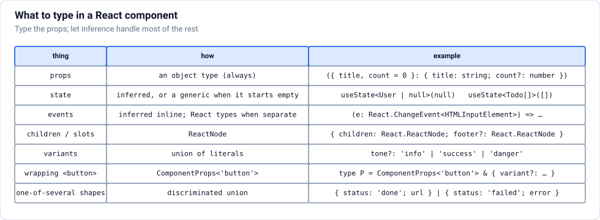

### Theory

> **In simple words:** TypeScript adds **types** to your JavaScript so mistakes show up in the editor instead of in front of users: a missing prop, a prop of the wrong type, a typo in a field name, calling something that might be `undefined`. In React you mostly type **props** (an object type per component); state and most other values are **inferred** automatically. A handful of React types cover the rest: `ReactNode`, event types, `ComponentProps`.

**Words to know:**

- **Type annotation:** `: string` after a name tells TypeScript its type: `function f(name: string)`.
- **Type inference:** TypeScript working out types itself: `useState(0)` → `number`.
- **Object type / `type` alias / `interface`:** describing an object's shape: `type Props = { name: string; price?: number }`; `interface Props { … }` does the same for objects.
- **Optional property (`?`):** may be missing (its type includes `undefined`).
- **Union type (`A | B`):** one of several types: `"sm" | "md" | "lg"`, `string | null`.
- **Literal type:** an exact value used as a type: `"success"`.
- **Discriminated union:** a union of object types that share a tag field (`status`), so checking the tag tells TypeScript which other fields exist.
- **Generic (`<T>`):** a type parameter, a "type variable" filled in at use: `useState<string | null>(null)`, `List<T>`.
- **`ReactNode`:** anything React can render; use it for `children` and slots.
- **Event types:** `React.ChangeEvent<HTMLInputElement>`, `React.MouseEvent<HTMLButtonElement>`, `React.FormEvent<HTMLFormElement>`, `React.KeyboardEvent`: the type of `e` in handlers (inferred automatically when the handler is written inline).
- **`ComponentProps<"button">`:** all the props a `<button>` accepts; used to make wrapper components that pass everything through.
- **`as const`:** makes TypeScript keep exact literal values (`["sm", "md"] as const` → a readonly tuple of `"sm" | "md"`).
- **Non-null assertion (`!`):** `document.getElementById("root")!` tells TypeScript "this isn't null" (you take responsibility).
- **`tsc` / type check:** the TypeScript compiler; `tsc --noEmit` checks types without producing files.

**Everyday picture.** **Labelled sockets and plugs.** Without types, any plug fits any socket and you find out by sparks (a runtime crash). Types are shaped sockets: a three-pin plug simply won't go into a two-pin socket, so the mistake is caught while you're still building (the editor underlines it).

**What to type, decided by hand:**

| Thing | Write a type? | Example |
|---|---|---|
| props | **yes**, always | `function Card({ title }: { title: string })` |
| `useState(0)`, `useState("")` | no, inferred | `const [n, setN] = useState(0)` |
| state that starts empty | **yes**, a generic | `useState<User \| null>(null)`, `useState<string[]>([])` |
| inline handlers | no, inferred | `onChange={(e) => setText(e.target.value)}` |
| handlers defined separately | **yes** | `function handle(e: React.ChangeEvent<HTMLInputElement>)` |
| `children` / slots | **yes** | `children: React.ReactNode` |
| return type of components | no | inferred as JSX |

**When TypeScript pays off:** any app beyond a toy: refactoring a prop name updates every caller, and editors autocomplete props. **When not to fight it:** don't write complex types for things inference handles; avoid `any` (it switches checking off), and use `unknown` plus checks for data from outside (Section [54](#54-form-libraries-react-hook-form-and-zod-validation) uses Zod for that).

**Common mistakes:**

- ❌ `useState(null)` for something that will hold an object: inferred as `null` forever. ✅ `useState<User | null>(null)`.
- ❌ `useState([])`: inferred as `never[]`. ✅ `useState<Todo[]>([])`.
- ❌ `children: JSX.Element` (too narrow). ✅ `ReactNode`.
- ❌ `any` everywhere; ❌ `!` on values that really can be null.
- ❌ `React.FC` for every component (it used to add implicit `children`; today plain functions with typed props are the norm).

**Used in real software:** most React codebases use TypeScript (it's the default in Vite's and Next.js's templates); `@types/react` provides the types used below.

### Code

**Typed props, optional props and a union for variants:**

```tsx
import { useState } from "react";
import type { ReactNode, ComponentProps, ChangeEvent } from "react";
import { render, screen, fireEvent } from "@testing-library/react";

type BadgeProps = { label: string; tone?: "info" | "success" | "danger"; count?: number };
function Badge({ label, tone = "info", count }: BadgeProps) {
  return <span className={`badge badge-${tone}`}>{label}{count !== undefined && ` (${count})`}</span>;
}
console.log(render(<><Badge label="New" /><Badge label="Paid" tone="success" count={3} /></>).container.innerHTML);
```

**Output:**

```text
<span class="badge badge-info">New</span><span class="badge badge-success">Paid (3)</span>
```

**TypeScript catches the mistakes:** a missing required prop, a wrong type, a value outside the union, and a typo:

```tsx
type BadgeProps = { label: string; tone?: "info" | "success" | "danger"; count?: number };
function Badge(props: BadgeProps) { return <span>{props.label}</span>; }

const a = <Badge tone="info" />;
const b = <Badge label="Paid" count="3" />;
const c = <Badge label="Paid" tone="warning" />;
const d = <Badge label="Paid" colour="red" />;
```

**Compiler output:**

```text
example.tsx(4,12): error TS2741: Property 'label' is missing in type '{ tone: "info"; }' but required in type 'BadgeProps'.
example.tsx(5,31): error TS2322: Type 'string' is not assignable to type 'number'.
example.tsx(6,31): error TS2322: Type '"warning"' is not assignable to type '"danger" | "info" | "success" | undefined'.
example.tsx(7,31): error TS2322: Type '{ label: string; colour: string; }' is not assignable to type 'IntrinsicAttributes & BadgeProps'.
  Property 'colour' does not exist on type 'IntrinsicAttributes & BadgeProps'.
```

**State that starts empty needs a generic**; otherwise the type is too narrow:

```tsx
import { useState } from "react";
type User = { name: string };
function Profile() {
  const [user, setUser] = useState(null);
  const [tags, setTags] = useState([]);
  setUser({ name: "Asha" });
  setTags(["tea"]);
  return null;
}
```

**Compiler output:**

```text
example.tsx(6,13): error TS2353: Object literal may only specify known properties, and 'name' does not exist in type '(prevState: null) => null'.
example.tsx(7,12): error TS2322: Type 'string' is not assignable to type 'never'.
```

**The fix,** and how narrowing makes `null` safe:

```tsx
type User = { name: string; email: string };
function Profile() {
  const [user, setUser] = useState<User | null>(null);
  const [tags, setTags] = useState<string[]>([]);
  return (
    <>
      {user === null ? <button onClick={() => { setUser({ name: "Asha", email: "asha@example.com" }); setTags(["tea"]); }}>log in</button>
                     : <p>{user.name} · {user.email} · {tags.join(",")}</p>}
    </>
  );
}
render(<Profile />);
fireEvent.click(screen.getByText("log in"));
console.log(screen.getByText(/Asha/).textContent);
```

**Output:**

```text
Asha · asha@example.com · tea
```

Inside the `: …` branch TypeScript **knows** `user` isn't `null` (narrowing), so `user.name` is allowed.

**Event types: inferred inline, written out when the handler is separate:**

```tsx
function Search({ onSearch }: { onSearch: (q: string) => void }) {
  const [q, setQ] = useState("");
  function handleChange(e: ChangeEvent<HTMLInputElement>) {     // separate handler: annotate
    setQ(e.target.value);
  }
  return (
    <form onSubmit={(e) => { e.preventDefault(); onSearch(q.trim()); }}>   {/* inline: e is inferred */}
      <input aria-label="q" value={q} onChange={handleChange} />
    </form>
  );
}
render(<Search onSearch={(q) => console.log("searching for", JSON.stringify(q))} />);
fireEvent.change(screen.getByLabelText("q"), { target: { value: "  ginger  " } });
fireEvent.submit(screen.getByLabelText("q").closest("form")!);
```

**Output:**

```text
searching for "ginger"
```

**Wrapping a native element: accept all its props with `ComponentProps`:**

```tsx
type ButtonProps = ComponentProps<"button"> & { variant?: "primary" | "ghost" };
function Button({ variant = "primary", className = "", ...rest }: ButtonProps) {
  return <button {...rest} className={`btn btn-${variant} ${className}`.trim()} />;
}
console.log(render(<Button type="submit" disabled aria-label="save" onClick={() => {}}>Save</Button>).container.innerHTML);
```

**Output:**

```text
<button type="submit" disabled="" aria-label="save" class="btn btn-primary">Save</button>
```

Every standard button prop (`type`, `disabled`, `aria-label`, `onClick`, `children`…) is accepted and type-checked, and passed through with `{...rest}`.

**Discriminated union props:** a `status` tag decides which other fields exist:

```tsx
type UploadProps =
  | { status: "uploading"; percent: number }
  | { status: "done"; url: string }
  | { status: "failed"; error: string; onRetry: () => void };

function UploadStatus(props: UploadProps) {
  switch (props.status) {
    case "uploading": return <progress value={props.percent} max={100} />;
    case "done": return <a href={props.url}>View file</a>;
    case "failed": return <p>{props.error} <button onClick={props.onRetry}>Retry</button></p>;
  }
}
console.log(render(<><UploadStatus status="uploading" percent={40} /><UploadStatus status="done" url="/f/1.pdf" /></>).container.innerHTML);
```

**Output:**

```text
<progress value="40" max="100"></progress><a href="/f/1.pdf">View file</a>
```

In the `"done"` case TypeScript knows `props.url` exists and `props.percent` doesn't; writing `<UploadStatus status="done" percent={5} />` is a compile error.

### Practice

1. Type a `Select` component that takes `options: { value: string; label: string }[]`, `value: string` and `onChange: (value: string) => void`.
2. What's wrong with `const [items, setItems] = useState([]);` in a `.tsx` file, and what's the fix?

<details>
<summary><b>Answer</b></summary>

```tsx
type Option = { value: string; label: string };
function Select({ options, value, onChange }: { options: Option[]; value: string; onChange: (value: string) => void }) {
  return (
    <select aria-label="size" value={value} onChange={(e) => onChange(e.target.value)}>
      {options.map((o) => <option key={o.value} value={o.value}>{o.label}</option>)}
    </select>
  );
}
function SizePicker() {
  const [size, setSize] = useState("m");
  return <><Select options={[{ value: "s", label: "Small" }, { value: "m", label: "Medium" }]} value={size} onChange={setSize} /> {size}</>;
}
const sp = render(<SizePicker />);
fireEvent.change(screen.getByLabelText("size"), { target: { value: "s" } });
console.log(sp.container.textContent);
```

**Output:**

```text
SmallMedium s
```

2. The type is inferred as `never[]` (an array that can hold nothing), so `setItems([...items, newItem])` fails to compile. Write `useState<Item[]>([])`.

</details>

| # | Problem | Difficulty |
|---|---|---|
| 1 | [Type Challenges: Pick (easy)](https://github.com/type-challenges/type-challenges/blob/main/questions/00004-easy-pick/README.md) | 🟢 Easy |
| 2 | [Type Challenges: Readonly (easy)](https://github.com/type-challenges/type-challenges/blob/main/questions/00007-easy-readonly/README.md) | 🟢 Easy |
| 3 | [Type Challenges: Omit (medium)](https://github.com/type-challenges/type-challenges/blob/main/questions/00003-medium-omit/README.md) | 🟡 Medium |

**Learn more:** [react.dev: Using TypeScript](https://react.dev/learn/typescript) · [React TypeScript Cheatsheet](https://react-typescript-cheatsheet.netlify.app/) · `typescript.md` (the whole language)

---

## 27. Styling React Apps: CSS, CSS Modules, Tailwind and CSS-in-JS

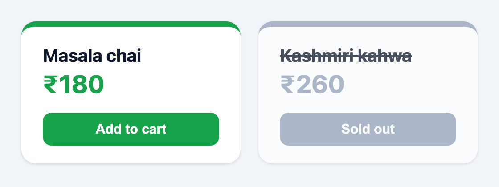

### Theory

> **In simple words:** React doesn't style anything itself; you use CSS like any web page and attach it with `className`. The main options are: **plain CSS files** (simple, global), **CSS Modules** (each component's class names made unique automatically), **Tailwind CSS** (small utility classes written directly in JSX), and **CSS-in-JS** (styles written in JavaScript). Conditional styling is just conditional class names, and **CSS variables** handle themes.

**Words to know:**

- **`className`:** the JSX prop for the HTML `class` attribute; a string of space-separated class names.
- **Global CSS:** a normal stylesheet whose class names apply everywhere; two components using `.title` clash.
- **CSS Modules:** files named `*.module.css`; the build tool renames each class to something unique (`_title_x1y2z`) and gives you an object mapping your names to the real ones: `styles.title`.
- **Utility-first CSS / Tailwind CSS:** many tiny single-purpose classes (`p-4`, `rounded-xl`, `text-green-700`) combined in `className`; Tailwind scans your files and generates only the classes you use.
- **CSS-in-JS:** writing styles in JavaScript (styled-components, Emotion); runtime versions inject `<style>` tags while the app runs, which costs performance and works poorly with Server Components, so **zero-runtime** tools (vanilla-extract, Panda CSS, StyleX) extract static CSS at build time instead.
- **Inline styles (`style={{…}}`):** fine for truly dynamic values (a progress bar's width), poor for everything else (no hover states, media queries or reuse).
- **CSS custom properties (CSS variables):** `--accent: #16a34a;` defined once and used as `var(--accent)`; change one variable to re-theme everything (dark mode).
- **`clsx` / `classnames`:** tiny helpers that join class names conditionally: `clsx("card", soldOut && "card--soldout")`.
- **Specificity:** CSS's rules for which style wins when several apply; scoped approaches (Modules, Tailwind) avoid most specificity fights.
- **Design tokens:** named values for colours, spacing and fonts shared by a design system (often as CSS variables).

**Everyday picture.** Dressing for work. **Global CSS** is one shared wardrobe for the whole family (someone always takes your shirt). **CSS Modules** sew a name tag into each item. **Tailwind** is a big box of standard pieces you combine on the spot. **CSS-in-JS** is a tailor who makes clothes as you walk in (flexible, but you wait each time, unless they pre-make them: zero-runtime).

**What CSS Modules do, traced:**

```text
Card.module.css:   .title { font-weight: 700 }
Card.tsx:          import styles from "./Card.module.css";   <h2 className={styles.title}>
build output CSS:  ._title_k3j2f_1 { font-weight: 700 }
JS object:         styles = { title: "_title_k3j2f_1" }      → <h2 class="_title_k3j2f_1">
another component's .title becomes a different name → no clash
```

**Which to choose (2026):**

| Option | Good for | Watch out |
|---|---|---|
| plain CSS + BEM naming | small apps, learning | global name clashes |
| CSS Modules | component-scoped CSS with zero new syntax (built into Vite and Next.js) | sharing variables needs CSS variables |
| Tailwind CSS v4 | fast building, consistent spacing/colours, used by shadcn/ui | long class strings; learn the naming |
| zero-runtime CSS-in-JS (vanilla-extract, StyleX, Panda) | typed styles in TS, big design systems | build setup |
| runtime CSS-in-JS (styled-components, Emotion) | existing codebases | runtime cost; Server Components need extra setup |

**Common mistakes:**

- ❌ `class=` instead of `className=` (TypeScript flags it, Section [8](#8-jsx-markup-inside-javascript-and-what-it-compiles-to)).
- ❌ Building class strings with `+` and stray `false`/`undefined`: `"card " + (soldOut && "soldout")` gives `"card false"`. ✅ `clsx`.
- ❌ Inline styles for everything (no `:hover`, no media queries).
- ❌ Constructing Tailwind class names dynamically (`` `text-${color}-700` ``); Tailwind only generates classes it can find written out in full.

**Used in real software:** CSS Modules ship with Vite and Next.js; Tailwind is among the most popular styling tools and underpins shadcn/ui; Meta uses StyleX on facebook.com; CSS variables power dark mode almost everywhere.

### Code

**From scratch: conditional class names.** The naive way leaks `false` into the class; `clsx` handles it:

```tsx
import clsx from "clsx";

const soldOut = false, featured = true;
console.log(JSON.stringify("card " + (soldOut && "card--soldout")));
console.log(JSON.stringify(["card", soldOut && "card--soldout", featured && "card--featured"].filter(Boolean).join(" ")));
console.log(JSON.stringify(clsx("card", { "card--soldout": soldOut, "card--featured": featured })));
```

**Output:**

```text
"card false"
"card card--featured"
"card card--featured"
```

**Plain CSS + CSS variables + a conditional class, rendered for real.** The component is rendered to an HTML string with React DOM's server renderer (Section [58](#58-rendering-strategies-csr-ssr-ssg-and-isr)) and saved with its stylesheet; the screenshot at the top of this section is Chrome's rendering of exactly this file:

```tsx
import { renderToStaticMarkup } from "react-dom/server";
import { writeFileSync } from "node:fs";

function MenuCard({ name, pricePaise, soldOut = false }: { name: string; pricePaise: number; soldOut?: boolean }) {
  return (
    <article className={clsx("card", soldOut && "card--soldout")} style={{ "--accent": soldOut ? "#94a3b8" : "#16a34a" } as React.CSSProperties}>
      <h2 className="card__title">{name}</h2>
      <p className="card__price">₹{(pricePaise / 100).toFixed(0)}</p>
      <button className="card__button" disabled={soldOut}>{soldOut ? "Sold out" : "Add to cart"}</button>
    </article>
  );
}
const css = `
  body { font-family: ui-sans-serif, system-ui, sans-serif; margin: 0; padding: 24px; background: #f1f5f9; display: flex; gap: 20px; }
  .card { background: white; border-radius: 16px; padding: 20px 24px; width: 220px; box-shadow: 0 1px 3px #0002; border-top: 6px solid var(--accent); }
  .card__title { margin: 0 0 4px; font-size: 20px; color: #0f172a; }
  .card__price { margin: 0 0 16px; font-size: 28px; font-weight: 700; color: var(--accent); }
  .card__button { width: 100%; padding: 10px; border: 0; border-radius: 10px; background: var(--accent); color: white; font-size: 15px; font-weight: 600; }
  .card--soldout { opacity: .75 } .card--soldout .card__title { text-decoration: line-through; }`;
const body = renderToStaticMarkup(<><MenuCard name="Masala chai" pricePaise={18000} /><MenuCard name="Kashmiri kahwa" pricePaise={26000} soldOut /></>);
writeFileSync("cards.html", `<!doctype html><meta charset="utf-8"><style>${css}</style>${body}`);
console.log(body);
```

**Output:**

```text
<article class="card" style="--accent:#16a34a"><h2 class="card__title">Masala chai</h2><p class="card__price">₹180</p><button class="card__button">Add to cart</button></article><article class="card card--soldout" style="--accent:#94a3b8"><h2 class="card__title">Kashmiri kahwa</h2><p class="card__price">₹260</p><button class="card__button" disabled="">Sold out</button></article>
```

The CSS variable `--accent` is set per card through `style` (TypeScript needs the `as React.CSSProperties` cast for custom properties) and every rule reads it with `var(--accent)`: one value re-colours the border, price and button.

**CSS Modules, built for real with Vite.** These files make a tiny app; the build renames the classes:

```css
.title { font-weight: 700; color: #0f172a; }
.price { color: #16a34a; }
```

```css
.title { font-style: italic; }
```

```tsx
declare module "*.module.css" { const classes: Record<string, string>; export default classes; }
```

```tsx
import styles from "./Card.module.css";
import other from "./Other.module.css";
console.log(JSON.stringify({ card: styles, other }));
```

```html
<!doctype html><html><body><script type="module" src="/main.tsx"></script></body></html>
```

```bash
npx vite build --logLevel error > /dev/null && cat dist/assets/*.css && echo && grep -oE '\{card:\{[^}]*\},other:\{[^}]*\}\}' dist/assets/*.js
```

**Output:**

```text
._title_1hezv_1{color:#0f172a;font-weight:700}._price_1hezv_2{color:#16a34a}._title_1sido_1{font-style:italic}

{card:{title:`_title_1hezv_1`,price:`_price_1hezv_2`},other:{title:`_title_1sido_1`}}
```

Both files declared `.title`, yet they became two different names (`_title_…` with different hashes), so they can never clash. The JavaScript object (`styles.title`) holds the generated name for you to use in `className`. The small `css-modules.d.ts` file tells TypeScript what importing a `.module.css` file gives you (an object of strings); Vite's `vite/client` types include an equivalent declaration. The second line is the object, as found in the minified JavaScript bundle, that the component code receives.

**Tailwind CSS v4: the CLI scans your files and generates only the classes you used:**

```tsx
export function Badge({ soldOut }: { soldOut: boolean }) {
  return <span className={soldOut ? "rounded-full bg-slate-200 px-3 py-1 text-slate-500" : "rounded-full bg-green-100 px-3 py-1 text-green-700"}>{soldOut ? "Sold out" : "In stock"}</span>;
}
```

```css
@import "tailwindcss/theme" layer(theme);
@import "tailwindcss/utilities" layer(utilities) source(none);
@source "./Badge.tsx";
```

```bash
npx @tailwindcss/cli -i tw.css -o tw-out.css 2>/dev/null; grep -oE '^  \.[a-z0-9-]+' tw-out.css | sed 's/^  //' | sort | tr '\n' ' '; echo; grep -A2 '^  \.px-3' tw-out.css
```

**Output:**

```text
.bg-green-100 .bg-slate-200 .px-3 .py-1 .rounded-full .text-green-700 .text-slate-500 
  .px-3 {
    padding-inline: calc(var(--spacing) * 3);
  }
```

Exactly the seven utilities written in `Badge.tsx` were generated (`source(none)` switches off Tailwind's automatic scanning of the whole folder, and `@source` names the one file to scan), and each is a single small rule built from theme variables (`--spacing`), which is how Tailwind keeps spacing consistent. Writing `` `text-${tone}-700` `` would generate nothing, because Tailwind looks for complete class names in the source text.

### Practice

1. Using `clsx`, write `Tab({ active, disabled })` that always has class `tab`, adds `tab--active` when active and `tab--disabled` when disabled.
2. Why does Tailwind not style `<p className={"text-" + color + "-700"}>`, and what's the fix?

<details>
<summary><b>Answer</b></summary>

```tsx
import { render } from "@testing-library/react";
function Tab({ active, disabled, children }: { active?: boolean; disabled?: boolean; children: string }) {
  return <button className={clsx("tab", { "tab--active": active, "tab--disabled": disabled })} disabled={disabled}>{children}</button>;
}
console.log(render(<><Tab active>Menu</Tab><Tab>Cart</Tab><Tab disabled>Orders</Tab></>).container.innerHTML);
```

**Output:**

```text
<button class="tab tab--active">Menu</button><button class="tab">Cart</button><button class="tab tab--disabled" disabled="">Orders</button>
```

2. Tailwind finds classes by scanning source text for complete names; `"text-" + color + "-700"` never appears in full, so no CSS is generated. Map values to full class names: `const tone = { green: "text-green-700", red: "text-red-700" }[color]`.

</details>

| # | Problem | Difficulty |
|---|---|---|
| 1 | [Frontend Mentor: NFT preview card component](https://www.frontendmentor.io/challenges/nft-preview-card-component-SbdUL_w0U) | 🟢 Easy |
| 2 | [Frontend Mentor: Social media dashboard with theme switcher (CSS variables)](https://www.frontendmentor.io/challenges/social-media-dashboard-with-theme-switcher-6oY8ozp_H) | 🟡 Medium |
| 3 | [Frontend Mentor: Pricing component with toggle](https://www.frontendmentor.io/challenges/pricing-component-with-toggle-8vPwRMIC) | 🟢 Easy |

**Learn more:** [Vite: CSS Modules](https://vite.dev/guide/features#css-modules) · [Tailwind CSS: Installation with Vite](https://tailwindcss.com/docs/installation/using-vite) · [react.dev: Applying CSS styles](https://react.dev/learn#adding-styles)

---

### ✅ Part 4 checkpoint

Without looking, can you:

- [ ] Turn a mockup into a component hierarchy, build a static version, find the minimal state and place it?
- [ ] Model a form as a state machine with one status variable, and explain why separate booleans cause impossible states?
- [ ] Apply the five state-structure principles, including "store ids, not copies" and normalisation?
- [ ] Lift state into a common parent and build a component that works both controlled and uncontrolled?
- [ ] Predict when state is preserved or reset, and use a `key` to reset a component deliberately?
- [ ] Use `children`, slots and passed-down elements instead of prop drilling?
- [ ] Type props, empty state, events, children and wrapper components in TypeScript?
- [ ] Style with plain CSS, CSS Modules and Tailwind, and apply classes conditionally with `clsx`?

Part 5 opens React's escape hatches: refs and effects.

---

# Part 5 — Moderate: Escape Hatches (Refs and Effects)

> **Goal:** Step outside React's pure render-and-commit world safely: remember values without re-rendering, work with real DOM nodes, synchronise with outside systems (timers, connections, subscriptions, the document), know when an effect is the wrong tool, keep effects free of unnecessary dependencies, and fetch data without race conditions.  
> **You need:** Parts 3–4 (state, snapshots, render and commit, keys and resetting state).

---

## 28. Refs: Remembering Values Without Re-rendering

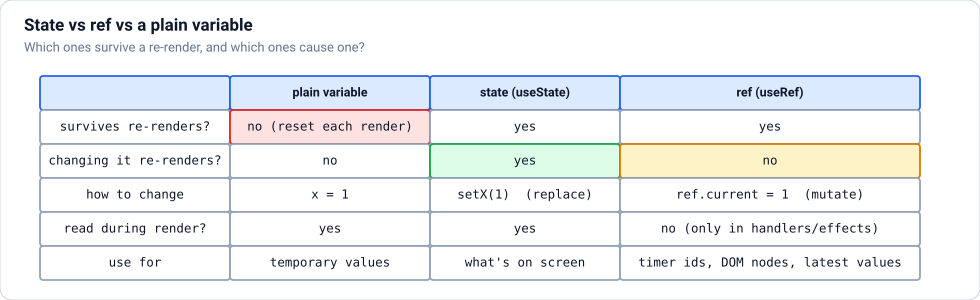

### Theory

> **In simple words:** a **ref** is a little box, `{ current: value }`, that React keeps for your component between renders, like state. The difference: **changing `ref.current` does not cause a re-render**. Use refs for values your component needs to **remember** but that don't affect what's **shown**: a timer id, the latest value for a callback, a DOM node (Section [29](#29-refs-to-dom-elements-focus-scroll-measure-and-media)), a counter for analytics.

**Words to know:**

- **Ref:** a plain object `{ current: … }` that persists for the component's lifetime and can be changed freely.
- **`useRef(initial)`:** returns the same ref object on every render; `initial` is used only on the first.
- **`ref.current`:** the stored value; read and write it directly (`ref.current = 5`).
- **Mutable:** a ref is meant to be mutated (unlike state, which you replace).
- **Escape hatch:** a feature for stepping outside React's normal data flow (refs, effects); useful, but use sparingly.
- **Interval / timeout id:** the number `setInterval`/`setTimeout` return; needed later to cancel with `clearInterval`/`clearTimeout`.
- **Reading refs during render:** not allowed (except for one-time lazy initialisation), because the result wouldn't update the UI and breaks purity; read and write refs in event handlers and effects.
- **Ref vs state vs variable:** a local variable resets every render; state persists **and** re-renders; a ref persists **without** re-rendering.

**Everyday picture.** A **sticky note inside a drawer**. State is a note stuck on the screen: change it and everyone sees the change (a re-render). A ref is a note in your desk drawer: you can jot things on it any time (the id of the kettle timer you started) and it stays there between meetings, but writing on it doesn't redraw the screen.

**State vs ref, traced on a click counter:**

```text
state:  click → setCount(1) → React re-renders → button shows 1
ref:    click → ref.current = 1 → no re-render → button still shows 0 (although the ref holds 1)
        any later re-render (from some other state) would read 1 … but reading it during render is the mistake
```

**When to use a ref:** timer and interval ids, the previous value of something, "latest value" storage for callbacks, DOM nodes, instances of non-React libraries (a map, a chart, a video player), flags such as "has this already run". **When not:** anything shown on screen (use state), and as a way to dodge re-renders that the UI actually needs.

**Common mistakes:**

- ❌ Showing `ref.current` in JSX and expecting it to update.
- ❌ Writing `ref.current = …` during rendering (impure; the React Compiler's lint rules flag it).
- ❌ Using state for a timer id (an unnecessary re-render every time you store it).
- ❌ Forgetting to clear an interval whose id you stored.

**Used in real software:** debounced search inputs keep their timeout id in a ref; video players, maps (Leaflet, Mapbox) and charts (Chart.js, D3) keep their instance in a ref; form libraries keep field registrations in refs to avoid re-rendering on every keystroke (Section [54](#54-form-libraries-react-hook-form-and-zod-validation)).

### Code

**From scratch: a ref is just a state box you never replace.** `useRef` behaves like this one-liner (React's real implementation is equivalent):

```tsx
import { useRef, useState } from "react";
import { render, screen, fireEvent, act } from "@testing-library/react";

function useMyRef<T>(initial: T) {
  const [box] = useState(() => ({ current: initial }));   // the same object every render; we never call a setter
  return box;
}
function Probe() {
  const mine = useMyRef(0);
  const real = useRef(0);
  const [, force] = useState(0);
  return <button onClick={() => { mine.current++; real.current++; if (mine.current === 3) force(1); }}>{`${mine.current}/${real.current}`}</button>;
}
render(<Probe />);
for (let i = 0; i < 3; i++) fireEvent.click(screen.getByRole("button"));
console.log(screen.getByRole("button").textContent);
```

**Output:**

```text
3/3
```

Both boxes counted every click, but the screen only caught up when the third click triggered a re-render through state. (It reads `.current` during render here only to make the hidden value visible; real code shouldn't.)

**State vs ref, side by side:**

```tsx
function Counters() {
  const [stateCount, setStateCount] = useState(0);
  const refCount = useRef(0);
  return (
    <>
      <button onClick={() => setStateCount(stateCount + 1)}>state: {stateCount}</button>
      <button onClick={() => { refCount.current++; console.log("ref is now", refCount.current, "(no re-render)"); }}>ref click</button>
    </>
  );
}
render(<Counters />);
fireEvent.click(screen.getByText("ref click"));
fireEvent.click(screen.getByText("ref click"));
fireEvent.click(screen.getByText(/state:/));
console.log(screen.getByText(/state:/).textContent);
```

**Output:**

```text
ref is now 1 (no re-render)
ref is now 2 (no re-render)
state: 1
```

**A stopwatch: the interval id belongs in a ref, the elapsed time in state.** The timer runs for real (10 ms ticks):

```tsx
function Stopwatch() {
  const [startTime, setStartTime] = useState<number | null>(null);
  const [now, setNow] = useState<number | null>(null);
  const intervalRef = useRef<ReturnType<typeof setInterval> | null>(null);
  function handleStart() {
    setStartTime(Date.now()); setNow(Date.now());
    if (intervalRef.current) clearInterval(intervalRef.current);       // don't start two intervals
    intervalRef.current = setInterval(() => setNow(Date.now()), 10);
  }
  function handleStop() {
    if (intervalRef.current) clearInterval(intervalRef.current);       // needs the id from the ref
  }
  const seconds = startTime !== null && now !== null ? (now - startTime) / 1000 : 0;
  return <><p>{seconds >= 0.05 ? "≥ 0.05" : "< 0.05"} s elapsed</p><button onClick={handleStart}>Start</button><button onClick={handleStop}>Stop</button></>;
}
render(<Stopwatch />);
fireEvent.click(screen.getByText("Start"));
await act(() => new Promise((r) => setTimeout(r, 120)));       // let ~12 ticks happen
fireEvent.click(screen.getByText("Stop"));
const stopped = screen.getByText(/elapsed/).textContent;
await act(() => new Promise((r) => setTimeout(r, 50)));
console.log(stopped, "| still the same after stopping?", screen.getByText(/elapsed/).textContent === stopped);
```

**Output:**

```text
≥ 0.05 s elapsed | still the same after stopping? true
```

(Exact milliseconds vary between runs, so the example prints a threshold instead of a number.) `ReturnType<typeof setInterval>` is "whatever `setInterval` returns", which differs between browsers and Node.

**Debouncing with a ref:** wait until the user stops typing for 50 ms, then search once. The pending timeout id lives in a ref so each keystroke can cancel the previous one:

```tsx
function DebouncedSearch({ onSearch }: { onSearch: (q: string) => void }) {
  const timeoutRef = useRef<ReturnType<typeof setTimeout> | undefined>(undefined);
  return (
    <input aria-label="search" onChange={(e) => {
      const q = e.target.value;
      clearTimeout(timeoutRef.current);
      timeoutRef.current = setTimeout(() => onSearch(q), 50);
    }} />
  );
}
render(<DebouncedSearch onSearch={(q) => console.log("search sent for:", q)} />);
for (const q of ["c", "ch", "cha", "chai"]) fireEvent.change(screen.getByLabelText("search"), { target: { value: q } });
await act(() => new Promise((r) => setTimeout(r, 100)));
```

**Output:**

```text
search sent for: chai
```

Four keystrokes, one request. A plain variable instead of the ref wouldn't work: each re-render would create a fresh variable and lose the previous timeout id.

### Practice

1. Build a "send in 3 seconds… Undo" button: clicking Send schedules the send; clicking Undo before it fires cancels it. Where does the timeout id go?
2. Why is `return <p>Rendered {renders.current} times</p>` with `renders.current++` in the component body wrong?

<details>
<summary><b>Answer</b></summary>

```tsx
function UndoSend() {
  const [status, setStatus] = useState("idle");
  const pending = useRef<ReturnType<typeof setTimeout> | undefined>(undefined);
  return (
    <>
      <button onClick={() => { setStatus("sending"); pending.current = setTimeout(() => setStatus("sent"), 30); }}>Send</button>
      <button onClick={() => { clearTimeout(pending.current); setStatus("cancelled"); }}>Undo</button>
      <p>{status}</p>
    </>
  );
}
render(<UndoSend />);
fireEvent.click(screen.getByText("Send"));
fireEvent.click(screen.getByText("Undo"));
await act(() => new Promise((r) => setTimeout(r, 60)));
console.log(screen.getByText(/sent|cancelled|sending/).textContent);
```

**Output:**

```text
cancelled
```

1. In a ref: Undo needs the id that Send created, without causing a render when it's stored.
2. It mutates a ref during render (impure: StrictMode's double render and concurrent rendering make the count wrong) and the display won't update when only the ref changes. Count renders with the React Profiler or DevTools instead (Section [44](#44-why-components-re-render-and-measuring-with-the-profiler)).

</details>

| # | Problem | Difficulty |
|---|---|---|
| 1 | [react.dev challenges: Fix a broken chat input, Fix a component failing to re-render, Fix debouncing, Read the latest state](https://react.dev/learn/referencing-values-with-refs#challenges) | 🟡 Medium |
| 2 | [BFE.dev React problem 5: usePrevious()](https://bigfrontend.dev/react/usePrevious) | 🟢 Easy |
| 3 | [BFE.dev React problem 3: useIsFirstRender()](https://bigfrontend.dev/react/useIsFirstRender) | 🟢 Easy |
| 4 | [BFE.dev React quiz 13: useRef](https://bigfrontend.dev/react-quiz/useRef) | 🟡 Medium |
| 5 | [LeetCode 2627. Debounce](https://leetcode.com/problems/debounce/) | 🟡 Medium |

**Learn more:** [react.dev: Referencing values with refs](https://react.dev/learn/referencing-values-with-refs) · [react.dev: useRef](https://react.dev/reference/react/useRef)

---

## 29. Refs to DOM Elements: Focus, Scroll, Measure and Media

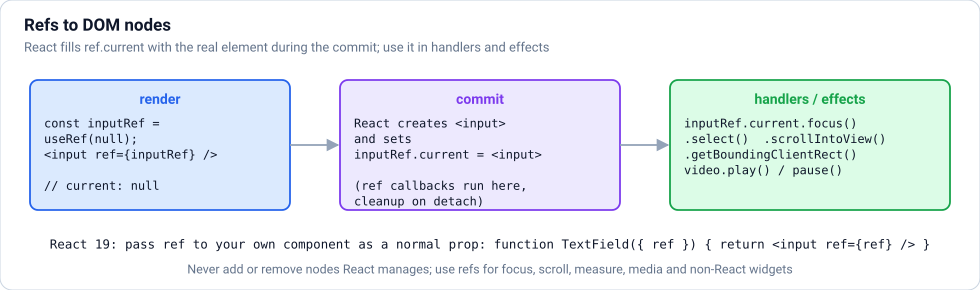

### Theory

> **In simple words:** sometimes you need the **real DOM node**: to focus an input, scroll to an item, measure an element's size, or play a video. Create a ref with `useRef(null)`, pass it as `ref={myRef}` to a JSX element, and after React commits, `myRef.current` is the actual DOM element. In React 19 you can pass `ref` to your **own** components as a normal prop, and a **ref callback** (a function) can run code when the node appears and clean up when it goes.

**Words to know:**

- **DOM ref:** a ref whose `current` React sets to a DOM node: `<input ref={inputRef} />`. It's `null` before the commit and after the node is removed.
- **`focus()` / `select()` / `blur()`:** DOM methods that move keyboard focus to an element / select its text / remove focus.
- **`scrollIntoView()`:** scrolls the page or container so an element is visible.
- **`getBoundingClientRect()`:** returns an element's size and position on screen (needs a real layout engine).
- **`play()` / `pause()`:** start and stop a `<video>` or `<audio>`.
- **Ref callback:** passing a **function** as `ref`: React calls it with the node when it attaches; since React 19 the function may **return a cleanup** function, called when the node detaches.
- **`ref` as a prop (React 19):** function components can accept `ref` like any prop and pass it to an inner element. Older code needed `forwardRef` for this (still supported, being phased out).
- **`useImperativeHandle`:** limits what a parent can do through a ref to a few methods you choose (Section [40](#40-more-hooks-uselayouteffect-useid-usesyncexternalstore-useimperativehandle-and-ref-as-a-prop)).
- **Layout engine:** the part of a browser that computes sizes and positions; **jsdom doesn't have one**, so measuring and scrolling can't be shown for real in these Node examples.
- **`flushSync` + scroll:** to scroll to an item added by a state update, apply the update synchronously first (Section [16](#16-state-as-a-snapshot-batching-and-updater-functions)), then scroll.

**Everyday picture.** A **name badge clipped onto a specific chair**. Normally you just say "seat the guests" (declarative JSX). Occasionally you need one particular chair (to pull it out for someone): the ref is the badge that lets you find that exact chair instantly, but only after the chairs have actually been set out (the commit).

**When `ref.current` is set, traced:**

```text
render 1:   <input ref={inputRef} />   → inputRef.current is still null (no DOM yet)
commit:     React creates <input> → sets inputRef.current = the <input> node
            (ref callbacks run here; effects run after this)
click:      handler calls inputRef.current.focus() → works
unmount:    React sets inputRef.current = null (or calls the ref callback's cleanup)
```

**When to use DOM refs:** focus management (search fields, modals, form errors), scrolling to items, measuring for tooltips and popovers, media playback, and integrating non-React widgets. **When not:** anything you can do declaratively: showing/hiding (state), changing text or classes (JSX), and **never** add/remove DOM nodes React manages (React would fight you).

**Common mistakes:**

- ❌ Reading `ref.current` during render (it's `null` on the first render, and impure anyway).
- ❌ Changing React-managed DOM by hand (`ref.current.remove()`, `innerHTML = …`).
- ❌ Using a ref to set `value` on an input instead of state.
- ❌ Expecting `ref` on a custom component to reach a DOM node when the component doesn't pass it through.

**Used in real software:** auto-focusing a search box, returning focus to the trigger when a modal closes (Section [49](#49-accessibility-semantics-focus-aria-portals-and-modals)), "scroll to the newest message" in chat apps, virtualised lists measuring rows (Section [46](#46-long-lists-virtualisation-and-pagination)), and every wrapper around a chart, map or video player.

### Code

**From scratch: the DOM way.** Without React you find a node and call methods on it:

```tsx
document.body.innerHTML = `<input id="q"><button id="go">Search</button>`;
document.getElementById("go")!.addEventListener("click", () => (document.getElementById("q") as HTMLInputElement).focus());
(document.getElementById("go") as HTMLButtonElement).click();
console.log("focused element id:", document.activeElement?.id);
```

**Output:**

```text
focused element id: q
```

**The React way: `useRef` + `ref={…}`:**

```tsx
import { useRef, useState } from "react";
import type { Ref } from "react";
import { render, screen, fireEvent } from "@testing-library/react";

function SearchForm() {
  const inputRef = useRef<HTMLInputElement>(null);
  console.log("during render, inputRef.current is", inputRef.current === null ? "null" : "an " + inputRef.current.tagName);
  return (
    <>
      <input ref={inputRef} aria-label="query" defaultValue="masala chai" />
      <button onClick={() => { inputRef.current!.focus(); inputRef.current!.select(); }}>Focus search</button>
    </>
  );
}
render(<SearchForm />);
fireEvent.click(screen.getByText("Focus search"));
const input = screen.getByLabelText("query") as HTMLInputElement;
console.log("focused:", document.activeElement === input, "| selected text:", input.value.slice(input.selectionStart!, input.selectionEnd!));
```

**Output:**

```text
during render, inputRef.current is null
focused: true | selected text: masala chai
```

The ref is `null` during the first render and filled in by the commit, so handlers (which run later) can use it.

**`ref` as a prop on your own component (React 19):** the child simply passes it on to its `<input>`:

```tsx
function TextField({ label, ref }: { label: string; ref?: Ref<HTMLInputElement> }) {
  return <label>{label} <input ref={ref} /></label>;
}
function Signup() {
  const emailRef = useRef<HTMLInputElement>(null);
  return <><TextField label="Email" ref={emailRef} /><button onClick={() => emailRef.current?.focus()}>Fix email</button></>;
}
render(<Signup />);
fireEvent.click(screen.getByText("Fix email"));
console.log("focused the inner input:", document.activeElement === screen.getByLabelText("Email"));
```

**Output:**

```text
focused the inner input: true
```

`Ref<HTMLInputElement>` is the TypeScript type for "a ref (object or callback) to an input".

**Ref callbacks with cleanup, and refs to a list of items.** A `Map` from id to node lets one ref hold many elements. jsdom has no layout engine, so `scrollIntoView` doesn't exist here; the example installs a stand-in that logs which element a browser would scroll to:

```tsx
(HTMLElement.prototype as any).scrollIntoView = function () { console.log("browser would scroll to:", this.textContent); };

const cats = ["Tabby", "Siamese", "Maine Coon"];
function CatList() {
  const nodes = useRef(new Map<string, HTMLLIElement>());
  const [shown, setShown] = useState(cats);
  return (
    <>
      <button onClick={() => nodes.current.get("Maine Coon")?.scrollIntoView()}>Jump to Maine Coon</button>
      <button onClick={() => setShown(shown.slice(1))}>Remove first</button>
      <ul>
        {shown.map((cat) => (
          <li key={cat} ref={(node) => {
            nodes.current.set(cat, node!);
            console.log("attached", cat);
            return () => { nodes.current.delete(cat); console.log("detached", cat); };   // cleanup (React 19)
          }}>{cat}</li>
        ))}
      </ul>
    </>
  );
}
const cats1 = render(<CatList />);
fireEvent.click(screen.getByText("Jump to Maine Coon"));
console.log("-- click Remove first");
fireEvent.click(screen.getByText("Remove first"));
console.log("-- unmount");
cats1.unmount();
```

**Output:**

```text
attached Tabby
attached Siamese
attached Maine Coon
browser would scroll to: Maine Coon
-- click Remove first
detached Tabby
detached Siamese
detached Maine Coon
attached Siamese
attached Maine Coon
-- unmount
detached Siamese
detached Maine Coon
```

"Remove first" logs more than one might expect. An inline ref callback is a **new function** on every render, so on each re-render React runs every row's old cleanup and then attaches the new callbacks: Tabby is detached for good, while Siamese and Maine Coon are detached and attached again. On unmount every remaining row is detached. That's harmless for cheap callbacks like this; for expensive setup, define the callback once (outside the component or with `useCallback`).

### Practice

1. Write `Gallery` with three images and "Next" / "Previous" buttons that scroll the selected image into view (use a `Map` of refs).
2. A component reads `inputRef.current.value` during render to show a character count. What's wrong, and what should it do instead?

<details>
<summary><b>Answer</b></summary>

1. Keep `index` in state; on click, compute the next index, then `nodes.current.get(index)?.scrollIntoView({ behavior: "smooth", inline: "center" })`. If the item must render first, wrap the state update in `flushSync` before scrolling. (react.dev's "Scrolling an image carousel" challenge.)
2. On the first render `current` is `null` (crash), and later the count won't update as the user types because refs don't cause renders. Make the input controlled (`value` + `onChange` + state) and compute the count from state.

</details>

| # | Problem | Difficulty |
|---|---|---|
| 1 | [react.dev challenges: Play and pause the video, Focus the search field, Scrolling an image carousel, Focus the search field with separate components](https://react.dev/learn/manipulating-the-dom-with-refs#challenges) | 🟡 Medium |
| 2 | [BFE.dev React problem 11: useFocus()](https://bigfrontend.dev/react/useFocus) | 🟡 Medium |
| 3 | [BFE.dev React quiz 31: useRef II](https://bigfrontend.dev/react-quiz/useref-ii) | 🟡 Medium |

**Learn more:** [react.dev: Manipulating the DOM with refs](https://react.dev/learn/manipulating-the-dom-with-refs) · [React 19 blog: ref as a prop and ref cleanup functions](https://react.dev/blog/2024/12/05/react-19#ref-as-a-prop)

---

## 30. Effects: Synchronising with Systems Outside React

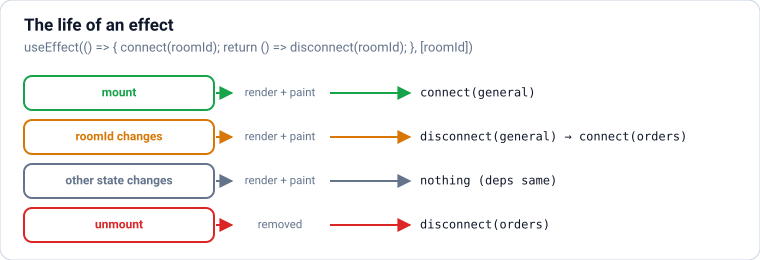

### Theory

> **In simple words:** an **effect** is code that runs **after** React has updated the screen, to keep something **outside React** in step with your component: connect to a chat server while a chat room is shown, set the page title, start a timer, subscribe to window events, or control a non-React widget. You write `useEffect(() => { start(); return () => stop(); }, [deps])`. React runs the setup after rendering, runs the **cleanup** before re-running it and when the component disappears, and re-runs it only when a **dependency** changed.

**Words to know:**

- **Effect:** a function React runs after the commit (and normally after the browser paints) to synchronise with an external system.
- **External system:** anything React doesn't control: the network, browser APIs (`document.title`, `localStorage`, timers, `window` events), third-party widgets, WebSockets.
- **`useEffect(setup, dependencies?)`:** registers an effect. `setup` may return a **cleanup** function.
- **Cleanup function:** undoes the setup (disconnect, unsubscribe, clear a timer); runs before the next setup and on unmount.
- **Dependency array:** the list of reactive values the effect uses. `[a, b]`: re-run when `a` or `b` changes (compared with `Object.is`); `[]`: run only after the first render (and clean up on unmount); **no array**: re-run after every render.
- **Reactive value:** props, state, and anything computed from them in the component body; they can change between renders, so effects that read them must list them.
- **Mount / unmount (for effects):** the component appearing (effects set up) and disappearing (cleanups run).
- **StrictMode effect double-run:** in development React runs setup → cleanup → setup once on mount, to prove your cleanup works (Section [31](#31-the-lifecycle-of-an-effect-dependencies-cleanup-and-strict-mode)).
- **Side effect vs effect:** "side effect" is any change outside a function; an **Effect** (capital E in React docs) is specifically a side effect caused by rendering, not by a particular user action.

**Everyday picture.** A **radio tuned to the TV channel you're watching**. Whenever the channel (dependency) changes, you retune the radio (cleanup the old station, set up the new one). When you leave the room (unmount), you switch it off (cleanup). If you don't change channel, you don't touch the radio (no re-run).

**One component's effect, traced by hand:**

```text
<ChatRoom roomId="general" />
render → commit → paint → effect: connect("general")
user switches to roomId="travel":
render → commit → paint → cleanup: disconnect("general") → effect: connect("travel")
parent re-renders with the same roomId: render → commit → (deps unchanged → nothing)
user leaves the chat page: unmount → cleanup: disconnect("travel")
```

**When to use an effect:** synchronising with something **outside React** that must match what's on screen. **When not:** transforming data for rendering, reacting to a user action (use the event handler), or resetting state when props change (Section [32](#32-you-might-not-need-an-effect) lists them all). Effects are an escape hatch; well-written apps have fewer than you'd expect.

**Common mistakes:**

- ❌ No cleanup for a connection, subscription or timer (leaks, duplicate connections).
- ❌ Leaving out dependencies to "make it run once" (stale values; Section [31](#31-the-lifecycle-of-an-effect-dependencies-cleanup-and-strict-mode)).
- ❌ Setting state in an effect from data you could compute during render (an extra render every time).
- ❌ An `async` function passed directly to `useEffect` (it returns a promise, not a cleanup); define the async function inside and call it.

**Used in real software:** chat and live-data subscriptions, analytics on page view, syncing with `localStorage`, controlling map/chart/video widgets, `document.title`; data-fetching libraries also use effects internally (Section [52](#52-server-state-with-tanstack-query)).

### Code

**From scratch: the order of render, commit and effects.** Logging from each phase shows that effects run **after** the DOM is updated, children's before parents':

```tsx
import { useEffect, useState, StrictMode } from "react";
import { render, screen, fireEvent, act } from "@testing-library/react";

function Child() {
  console.log("render Child");
  useEffect(() => { console.log("effect Child | DOM has the text?", document.body.textContent!.includes("child")); });
  return <p>child</p>;
}
function Parent() {
  console.log("render Parent");
  useEffect(() => { console.log("effect Parent"); });
  return <Child />;
}
render(<Parent />);
```

**Output:**

```text
render Parent
render Child
effect Child | DOM has the text? true
effect Parent
```

Rendering goes top-down (Parent, then Child); effects run after the commit, bottom-up (Child's first), when the DOM already contains the text.

**Synchronising with an external system: a chat connection,** with cleanup and a dependency:

```tsx
function createConnection(serverUrl: string, roomId: string) {                // a stand-in for a real chat API
  return {
    connect() { console.log(`✅ connecting to "${roomId}" at ${serverUrl}`); },
    disconnect() { console.log(`❌ disconnected from "${roomId}"`); },
  };
}
const serverUrl = "https://chat.example.com";

function ChatRoom({ roomId }: { roomId: string }) {
  useEffect(() => {
    const connection = createConnection(serverUrl, roomId);
    connection.connect();
    return () => connection.disconnect();
  }, [roomId]);
  return <h2>Welcome to {roomId}</h2>;
}
function App() {
  const [roomId, setRoomId] = useState("general");
  const [show, setShow] = useState(true);
  const [, setTick] = useState(0);
  return (
    <>
      <button onClick={() => setRoomId("travel")}>travel</button>
      <button onClick={() => setTick((t) => t + 1)}>re-render</button>
      <button onClick={() => setShow(false)}>close chat</button>
      {show && <ChatRoom roomId={roomId} />}
    </>
  );
}
render(<App />);
console.log("-- switch room"); fireEvent.click(screen.getByText("travel"));
console.log("-- re-render, same room (nothing should happen)"); fireEvent.click(screen.getByText("re-render"));
console.log("-- close"); fireEvent.click(screen.getByText("close chat"));
```

**Output:**

```text
✅ connecting to "general" at https://chat.example.com
-- switch room
❌ disconnected from "general"
✅ connecting to "travel" at https://chat.example.com
-- re-render, same room (nothing should happen)
-- close
❌ disconnected from "travel"
```

**The three dependency forms,** counted over three re-renders where only `b` changes:

```tsx
function Deps({ a, b }: { a: number; b: number }) {
  useEffect(() => { console.log("  no array: runs after every render"); });
  useEffect(() => { console.log("  []: runs after the first render only"); }, []);
  useEffect(() => { console.log("  [a]: runs when a changes"); }, [a]);
  return null;
}
const view = render(<Deps a={1} b={1} />);
for (const b of [2, 3]) { console.log(`re-render with b=${b}:`); view.rerender(<Deps a={1} b={b} />); }
```

**Output:**

```text
  no array: runs after every render
  []: runs after the first render only
  [a]: runs when a changes
re-render with b=2:
  no array: runs after every render
re-render with b=3:
  no array: runs after every render
```

`rerender` (from Testing Library) renders the same root again with new props, like a parent re-rendering.

**Strict Mode runs setup → cleanup → setup on mount in development,** to check the cleanup is correct:

```tsx
render(<StrictMode><ChatRoom roomId="general" /></StrictMode>);
```

**Output:**

```text
✅ connecting to "general" at https://chat.example.com
❌ disconnected from "general"
✅ connecting to "general" at https://chat.example.com
```

A correct cleanup makes the extra cycle invisible to users: one connection stays open. Without the `return () => connection.disconnect()`, you'd see two connections, which is exactly the bug StrictMode exists to expose.

**Effects for browser APIs: the page title and a window listener,** with a cleanup that removes the listener:

```tsx
function OnlineBadge({ cartCount }: { cartCount: number }) {
  const [online, setOnline] = useState(navigator.onLine);
  useEffect(() => { document.title = cartCount > 0 ? `(${cartCount}) Chai Point` : "Chai Point"; }, [cartCount]);
  useEffect(() => {
    const goOnline = () => setOnline(true), goOffline = () => setOnline(false);
    window.addEventListener("online", goOnline);
    window.addEventListener("offline", goOffline);
    return () => { window.removeEventListener("online", goOnline); window.removeEventListener("offline", goOffline); };
  }, []);
  return <p>{online ? "🟢 online" : "🔴 offline"}</p>;
}
const badge = render(<OnlineBadge cartCount={2} />);
console.log(document.title, "|", screen.getByText(/line/).textContent);
await act(async () => { window.dispatchEvent(new Event("offline")); });
console.log(screen.getByText(/line/).textContent);
badge.unmount();
```

**Output:**

```text
(2) Chai Point | 🟢 online
🔴 offline
```

Section [40](#40-more-hooks-uselayouteffect-useid-usesyncexternalstore-useimperativehandle-and-ref-as-a-prop) shows `useSyncExternalStore`, the dedicated hook for subscribing to outside data like the online status.

### Practice

1. Write `useDocumentTitle(title)`-style logic inline: a `Notifications` component that sets `document.title` to `"(3) Inbox"` and restores the old title when it unmounts.
2. Why doesn't `useEffect(async () => { const data = await load(); setData(data); }, [])` work as intended?

<details>
<summary><b>Answer</b></summary>

```tsx
function Notifications({ count }: { count: number }) {
  useEffect(() => {
    const previous = document.title;
    document.title = `(${count}) Inbox`;
    return () => { document.title = previous; };
  }, [count]);
  return <p>{count} new</p>;
}
document.title = "Chai Point";
const n = render(<Notifications count={3} />);
console.log("mounted:", document.title);
n.unmount();
console.log("after unmount:", document.title);
```

**Output:**

```text
mounted: (3) Inbox
after unmount: Chai Point
```

1. Save the previous title in the setup and restore it in the cleanup.
2. An `async` function always returns a promise, and React expects the setup to return nothing or a cleanup function; it also leaves no way to ignore a stale response. Define `async function load…` inside the effect and call it, with an `ignore` flag in the cleanup (Section [34](#34-fetching-data-in-effects-loading-errors-race-conditions-and-abortcontroller)).

</details>

| # | Problem | Difficulty |
|---|---|---|
| 1 | [react.dev challenges: Focus a field on mount, Focus a field conditionally, Fix an interval that fires twice, Fix fetching inside an Effect](https://react.dev/learn/synchronizing-with-effects#challenges) | 🟡 Medium |
| 2 | [BFE.dev React quiz 12: useEffect](https://bigfrontend.dev/react-quiz/useEffect) | 🟡 Medium |
| 3 | [BFE.dev React quiz 24: useEffect() timing](https://bigfrontend.dev/react-quiz/useeffect-timing) | 🔴 Hard |
| 4 | [BFE.dev React problem 2: useTimeout()](https://bigfrontend.dev/react/usetimeout) | 🟡 Medium |

**Learn more:** [react.dev: Synchronizing with effects](https://react.dev/learn/synchronizing-with-effects) · [react.dev: useEffect](https://react.dev/reference/react/useEffect)

---

## 31. The Lifecycle of an Effect: Dependencies, Cleanup and Strict Mode

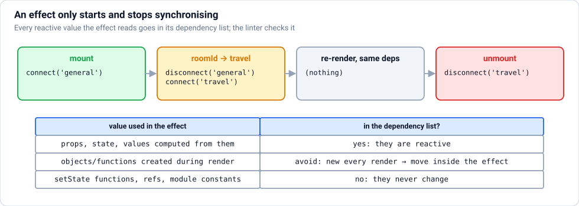

### Theory

> **In simple words:** don't think of an effect as "run on mount, run on update". Think of it as **"start synchronising" + "stop synchronising"**, and React may do that pair many times. Your dependency list isn't a choice: it must include **every reactive value the effect reads** (props, state, values computed from them). If you lie to React about dependencies, your effect uses **stale values**. The `react-hooks/exhaustive-deps` lint rule checks this for you.

**Words to know:**

- **Effect lifecycle:** an effect's own cycle: start syncing → (deps change) stop → start with new values → … → stop on unmount.
- **Re-synchronisation:** stopping and restarting an effect because a dependency changed.
- **Stale closure:** an effect (or callback) that captured old values from an earlier render because it wasn't re-run when they changed.
- **`exhaustive-deps` lint rule:** part of `eslint-plugin-react-hooks`; warns when an effect reads a reactive value that isn't in its dependency array.
- **Rules of Hooks lint rule (`rules-of-hooks`):** errors when hooks are called conditionally or in loops (Section [39](#39-how-hooks-work-inside-build-usestate-from-scratch-and-the-rules-of-hooks)).
- **Non-reactive value:** something that can't change between renders: module-level constants, imported functions, `useRef` objects and state setter functions; they don't need to be listed.
- **Unstable dependency:** an object or function created during render (`const options = {…}`); it's a **new** value each render, so an effect depending on it re-runs every time.
- **Development double-run:** StrictMode's mount → unmount → mount check; it only happens in development and only on mount.

**Everyday picture.** A **babysitter's shift**. The babysitter (effect) starts the shift when the parents leave and ends it when they return (start/stop). If the parents swap which child needs watching (a dependency changes), the shift ends and a new one starts for the new child. Giving the babysitter yesterday's list of allergies (a stale value) because "the list never changes" is how accidents happen.

**Deciding dependencies, traced by hand:**

```text
function ChatRoom({ roomId }) {               ← roomId: a prop → reactive
  const [serverUrl, setServerUrl] = useState("https://localhost:1234");   ← state → reactive
  const options = { serverUrl, roomId };      ← computed during render → reactive AND new every render
  useEffect(() => {
    const c = createConnection(serverUrl, roomId); c.connect(); return () => c.disconnect();
  }, [roomId, serverUrl]);                    ← reads roomId and serverUrl → both listed ✅
  // depending on `options` instead would reconnect on EVERY render (a new object each time) ❌
}
setServerUrl is stable (React guarantees it) → not needed in the list
```

**When to trust the linter:** essentially always. If the "right" dependencies cause too many re-runs, change the **code** (move objects inside the effect, use updater functions, `useEffectEvent`; Section [33](#33-separating-events-from-effects-useeffectevent-and-removing-dependencies)), never the list. **When an empty array is honest:** when the effect truly reads no reactive values.

**Common mistakes:**

- ❌ `// eslint-disable-next-line react-hooks/exhaustive-deps` to silence the warning (it hides stale-value bugs).
- ❌ Objects or functions created during render as dependencies.
- ❌ Expecting an effect with `[]` to see the latest props later (it sees the first render's values forever).
- ❌ Thinking StrictMode's double-run happens in production (it doesn't).

**Used in real software:** `eslint-plugin-react-hooks` is in every major React template's lint config; since version 6/7 its recommended set also includes the React Compiler's purity and ref rules.

### Code

**Re-synchronising: switching rooms stops the old connection and starts the new one,** and the effect's cleanup always sees the values from **its own** render:

```tsx
import { useEffect, useState } from "react";
import { render, screen, fireEvent } from "@testing-library/react";

function createConnection(serverUrl: string, roomId: string) {
  return { connect: () => console.log(`connect ${roomId} @ ${serverUrl}`), disconnect: () => console.log(`disconnect ${roomId} @ ${serverUrl}`) };
}

function ChatRoom({ roomId }: { roomId: string }) {
  const [serverUrl, setServerUrl] = useState("https://a.example");
  useEffect(() => {
    const c = createConnection(serverUrl, roomId);
    c.connect();
    return () => c.disconnect();
  }, [roomId, serverUrl]);
  return <button onClick={() => setServerUrl("https://b.example")}>change server</button>;
}
const chat = render(<ChatRoom roomId="general" />);
console.log("-- room → travel"); chat.rerender(<ChatRoom roomId="travel" />);
console.log("-- server → b");   fireEvent.click(screen.getByText("change server"));
console.log("-- unmount");      chat.unmount();
```

**Output:**

```text
connect general @ https://a.example
-- room → travel
disconnect general @ https://a.example
connect travel @ https://a.example
-- server → b
disconnect travel @ https://a.example
connect travel @ https://b.example
-- unmount
disconnect travel @ https://b.example
```

**Lying about dependencies → stale values.** This effect reads `roomId` but lists `[]`, so it never reconnects:

```tsx
function StaleChatRoom({ roomId }: { roomId: string }) {
  useEffect(() => {
    const c = createConnection("https://a.example", roomId);
    c.connect();
    return () => c.disconnect();
  }, []);                                         // ❌ roomId is missing
  return <h2>Room: {roomId}</h2>;
}
const stale = render(<StaleChatRoom roomId="general" />);
stale.rerender(<StaleChatRoom roomId="travel" />);
console.log("screen says:", screen.getByRole("heading").textContent, "← but we're still connected to general");
stale.unmount();
```

**Output:**

```text
connect general @ https://a.example
screen says: Room: travel ← but we're still connected to general
disconnect general @ https://a.example
```

**An unstable object dependency re-runs on every render:**

```tsx
function NoisyRoom({ roomId }: { roomId: string }) {
  const [text, setText] = useState("");
  const options = { serverUrl: "https://a.example", roomId };          // a NEW object every render
  useEffect(() => {
    const c = createConnection(options.serverUrl, options.roomId);
    c.connect();
    return () => c.disconnect();
  }, [options]);                                                         // ❌ changes every render
  return <input aria-label="msg" value={text} onChange={(e) => setText(e.target.value)} />;
}
render(<NoisyRoom roomId="general" />);
console.log("-- typing two characters:");
fireEvent.change(screen.getByLabelText("msg"), { target: { value: "h" } });
fireEvent.change(screen.getByLabelText("msg"), { target: { value: "hi" } });
```

**Output:**

```text
connect general @ https://a.example
-- typing two characters:
disconnect general @ https://a.example
connect general @ https://a.example
disconnect general @ https://a.example
connect general @ https://a.example
```

Every keystroke reconnected. The fix: create the object **inside** the effect and depend on the primitive values `[roomId]`.

**The linter catches these.** Running ESLint with `eslint-plugin-react-hooks` on a file with two classic mistakes:

```js
import reactHooks from "eslint-plugin-react-hooks";
export default [
  { files: ["**/*.jsx"], languageOptions: { parserOptions: { ecmaFeatures: { jsx: true } } } },
  reactHooks.configs.flat.recommended,
];
```

```jsx
import { useEffect, useState } from "react";

export function ChatRoom({ roomId, serverUrl }) {
  const [unread, setUnread] = useState(0);
  useEffect(() => {
    const connection = createConnection(serverUrl, roomId);
    connection.connect();
    return () => connection.disconnect();
  }, [roomId]);
  if (unread > 99) {
    const [capped] = useState(true);
  }
  return <p>{unread}</p>;
}
```

```bash
npx eslint ChatRoom.jsx | sed -E "s#^/.*/##"   # expect-fail (ESLint exits 1 when it finds errors)
```

**Output:**

```text

ChatRoom.jsx
   9:6   warning  React Hook useEffect has a missing dependency: 'serverUrl'. Either include it or remove the dependency array                 react-hooks/exhaustive-deps
  11:22  error    React Hook "useState" is called conditionally. React Hooks must be called in the exact same order in every component render  react-hooks/rules-of-hooks

✖ 2 problems (1 error, 1 warning)
```

The warning names the missing dependency (`serverUrl`); the error is the Rules of Hooks (a hook inside an `if`). (ESLint's default parser understands `.jsx`; TypeScript files need the `typescript-eslint` parser added to the config.)

### Practice

1. An effect logs `"visit " + url + " with " + cartCount + " items"` whenever the page `url` changes. `cartCount` changes often. Which dependencies does the linter require, and why is that a problem here?
2. Rewrite `NoisyRoom` so typing doesn't reconnect.

<details>
<summary><b>Answer</b></summary>

```tsx
function QuietRoom({ roomId }: { roomId: string }) {
  const [text, setText] = useState("");
  useEffect(() => {
    const options = { serverUrl: "https://a.example", roomId };     // created inside the effect
    const c = createConnection(options.serverUrl, options.roomId);
    c.connect();
    return () => c.disconnect();
  }, [roomId]);
  return <input aria-label="msg2" value={text} onChange={(e) => setText(e.target.value)} />;
}
render(<QuietRoom roomId="general" />);
console.log("-- typing two characters:");
fireEvent.change(screen.getByLabelText("msg2"), { target: { value: "h" } });
fireEvent.change(screen.getByLabelText("msg2"), { target: { value: "hi" } });
console.log("(no reconnects)");
```

**Output:**

```text
connect general @ https://a.example
-- typing two characters:
(no reconnects)
```

1. `[url, cartCount]`, because the effect reads both; so it would also log a "visit" whenever the cart changes, which is wrong. Reading `cartCount` isn't really part of synchronising with the URL: move it into an **effect event** (Section [33](#33-separating-events-from-effects-useeffectevent-and-removing-dependencies)).
2. Above: the object is built inside the effect and only `roomId` (a string) is a dependency.

</details>

| # | Problem | Difficulty |
|---|---|---|
| 1 | [react.dev challenges: Fix reconnecting on every keystroke, Switch synchronization on and off, Investigate a stale value bug, Fix a connection switch, Populate a chain of select boxes](https://react.dev/learn/lifecycle-of-reactive-effects#challenges) | 🔴 Hard |
| 2 | [BFE.dev React quiz 21: useEffect() II](https://bigfrontend.dev/react-quiz/useEffect-II) | 🟡 Medium |
| 3 | [BFE.dev React quiz 26: useEffect() III](https://bigfrontend.dev/react-quiz/useeffect-iii) | 🟡 Medium |
| 4 | [BFE.dev React problem 16: useUpdateEffect()](https://bigfrontend.dev/react/useUpdateEffect) | 🟡 Medium |

**Learn more:** [react.dev: Lifecycle of reactive effects](https://react.dev/learn/lifecycle-of-reactive-effects) · [eslint-plugin-react-hooks (source and docs)](https://github.com/facebook/react/tree/main/packages/eslint-plugin-react-hooks)

---

## 32. You Might Not Need an Effect

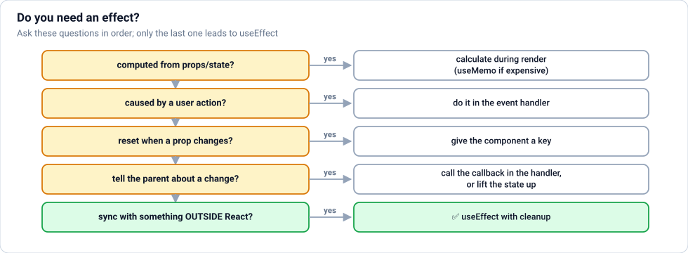

### Theory

> **In simple words:** effects are for talking to the **outside world**. Many effects in real codebases are unnecessary and make apps slower and buggier: they calculate data that could be computed during render, react to user actions that belong in event handlers, or chain state updates. Before writing `useEffect`, ask: **is this caused by rendering and does it touch something outside React?** If not, there's a simpler way.

**Words to know:**

- **Derived state anti-pattern:** storing a value computed from other state (`fullName`, `visibleTodos`) and updating it in an effect; it costs an extra render and can show stale data for one frame.
- **Memoisation (`useMemo`):** caching an expensive calculation between renders, recomputing only when its inputs change (Section [45](#45-memo-usememo-usecallback-and-the-react-compiler)).
- **Event-specific logic:** code that should run because the user **did something** (bought a product, submitted a form); it belongs in that event's handler.
- **Chain of effects:** effects that set state that triggers other effects; hard to follow, many extra renders.
- **Adjusting state during render:** for the rare case where some state must change when a prop changes, compare with the previous prop **during render** and set state there (React re-renders immediately, before the commit); a `key` is usually simpler.
- **Notify parent anti-pattern:** calling `onChange` from an effect after updating local state; call it in the event handler instead, or lift the state up.
- **`react-hooks/set-state-in-effect`:** a lint rule (React Compiler rules in `eslint-plugin-react-hooks` 7) that flags synchronous `setState` calls inside effects.

**Everyday picture.** A **sticky note telling you to update another sticky note**. If your fridge note says "milk: 2" and a second note says "total items: 5 (update this whenever the first note changes)", you'll eventually forget. Just count when you need the total. Effects that copy data around are those second notes.

**The decision, traced by hand:**

| Situation | ❌ With an effect | ✅ Instead |
|---|---|---|
| value computed from props/state | `useEffect(() => setFull(first + last), [first, last])` | `const full = first + " " + last` during render |
| expensive computation | effect + state | `useMemo(() => filter(todos), [todos, tab])` (or let the React Compiler do it) |
| reset everything when a prop changes | effect calling `setComment("")` when `userId` changes | `<Profile key={userId} />` |
| user clicked "Buy" → POST + notification | effect watching a `bought` flag | do it in `handleBuy` |
| tell the parent about a change | effect calling `onChange(isOn)` | call `onChange` in the handler, or lift state |
| synchronise with an outside system | ✅ that's what effects are for | — |
| fetch data for what's on screen | ✅ an effect with cleanup (Section [34](#34-fetching-data-in-effects-loading-errors-race-conditions-and-abortcontroller)), or better a data library | TanStack Query, router loaders, Server Components |

**When effects remain right:** subscriptions, connections, timers tied to what's displayed, analytics on display, imperative widgets, and fetching tied to what's shown. **When not:** everything else in the table.

**Common mistakes:**

- ❌ "Effect to sync state A with state B" (store one, derive the other).
- ❌ Running a POST request in an effect because a flag changed (it re-sends in StrictMode and on remounts).
- ❌ Initialising app-wide things (auth check, analytics init) in an effect that runs per mount; do it once at module level or guard it.

**Used in real software:** React's own docs devote a full page to removing unnecessary effects; the `set-state-in-effect` lint rule and the React Compiler push codebases in the same direction.

### Code

**Derived data in an effect costs an extra render** (and one frame of stale output); computing it during render doesn't:

```tsx
import { useEffect, useState } from "react";
import { render, screen, fireEvent } from "@testing-library/react";

let renders = { effect: 0, derived: 0 };
function FullNameEffect() {
  renders.effect++;
  const [first, setFirst] = useState("Asha");
  const [full, setFull] = useState("");
  useEffect(() => { setFull(first + " Rao"); }, [first]);          // ❌ derived state via an effect
  return <input aria-label="first-e" value={first} onChange={(e) => setFirst(e.target.value)} title={full} />;
}
function FullNameDerived() {
  renders.derived++;
  const [first, setFirst] = useState("Asha");
  const full = first + " Rao";                                          // ✅ computed during render
  return <input aria-label="first-d" value={first} onChange={(e) => setFirst(e.target.value)} title={full} />;
}
render(<><FullNameEffect /><FullNameDerived /></>);
fireEvent.change(screen.getByLabelText("first-e"), { target: { value: "Ravi" } });
fireEvent.change(screen.getByLabelText("first-d"), { target: { value: "Ravi" } });
console.log(renders, "| titles:", screen.getByLabelText("first-e").title, "/", screen.getByLabelText("first-d").title);
```

**Output:**

```text
{ effect: 4, derived: 2 } | titles: Ravi Rao / Ravi Rao
```

Same result, but the effect version rendered twice as often: once with the stale full name, and again after the effect set it.

**Event-specific logic belongs in the handler.** Here a purchase is sent from an effect that watches a `bought` flag kept by the parent. Navigating away from the product page and back (unmount, mount) re-runs the effect, and the purchase is sent **again**; the handler version sends exactly once per click:

```tsx
const sent: string[] = [];
function ProductPage({ bought, onBuy, inHandler }: { bought: boolean; onBuy: () => void; inHandler: boolean }) {
  useEffect(() => { if (!inHandler && bought) sent.push("effect POST /buy"); }, [bought, inHandler]);   // ❌
  return <button onClick={() => { if (inHandler) sent.push("handler POST /buy"); onBuy(); }}>buy</button>;   // ✅ when inHandler
}
function Shop({ inHandler }: { inHandler: boolean }) {
  const [bought, setBought] = useState(false);
  const [page, setPage] = useState<"product" | "home">("product");
  return (
    <>
      <button onClick={() => setPage(page === "product" ? "home" : "product")}>navigate</button>
      {page === "product" && <ProductPage bought={bought} onBuy={() => setBought(true)} inHandler={inHandler} />}
    </>
  );
}
for (const inHandler of [false, true]) {
  sent.length = 0;
  const shop = render(<Shop inHandler={inHandler} />);
  fireEvent.click(screen.getByText("buy"));
  fireEvent.click(screen.getByText("navigate"));      // away…
  fireEvent.click(screen.getByText("navigate"));      // …and back
  console.log(inHandler ? "handler:" : "effect: ", sent);
  shop.unmount();
}
```

**Output:**

```text
effect:  [ 'effect POST /buy', 'effect POST /buy' ]
handler: [ 'handler POST /buy' ]
```

One click, two purchases in the effect version: the effect can't tell "the user just bought this" from "this page appeared while `bought` was true". (In development, StrictMode's mount check would trigger the same duplicate the moment a page mounts with `bought` already true.) The click is the event, so the request belongs in the click handler.

**Resetting state when a prop changes: a key instead of an effect** (both versions shown; the key version never renders the stale comment):

```tsx
const seen: string[] = [];
function CommentBox({ userId }: { userId: string }) {
  const [comment, setComment] = useState("");
  seen.push(`render ${userId} comment="${comment}"`);
  return <textarea aria-label="comment" value={comment} onChange={(e) => setComment(e.target.value)} />;
}
function CommentBoxEffect({ userId }: { userId: string }) {
  const [comment, setComment] = useState("");
  useEffect(() => { setComment(""); }, [userId]);                    // ❌ resets one render too late
  seen.push(`render ${userId} comment="${comment}"`);
  return <textarea aria-label="comment" value={comment} onChange={(e) => setComment(e.target.value)} />;
}
for (const [label, make] of [["effect", (id: string) => <CommentBoxEffect userId={id} />], ["key", (id: string) => <CommentBox key={id} userId={id} />]] as const) {
  seen.length = 0;
  const v = render(make("asha"));
  fireEvent.change(screen.getByLabelText("comment"), { target: { value: "great chai!" } });
  seen.length = 0;
  v.rerender(make("ravi"));
  console.log(label.padEnd(6), seen.join(" | "));
  v.unmount();
}
```

**Output:**

```text
effect render ravi comment="great chai!" | render ravi comment=""
key    render ravi comment=""
```

With the effect, Ravi's profile is first rendered (and committed) with **Asha's** comment, then fixed. With `key`, React creates a fresh `CommentBox` for Ravi straight away.

**The linter's newer rule spots setState in effects** (part of the React Compiler rules in `eslint-plugin-react-hooks` 7):

```js
import reactHooks from "eslint-plugin-react-hooks";
export default [
  { files: ["**/*.jsx"], languageOptions: { parserOptions: { ecmaFeatures: { jsx: true } } } },
  reactHooks.configs.flat.recommended,
];
```

```jsx
import { useEffect, useState } from "react";

export function FullName({ first, last }) {
  const [full, setFull] = useState("");
  useEffect(() => {
    setFull(first + " " + last);
  }, [first, last]);
  return <p>{full}</p>;
}
```

```bash
npx eslint FullName.jsx | sed -E "s#^/.*/##" | cut -c1-160   # expect-fail
```

**Output:**

```text

FullName.jsx
  6:5  error  Error: Calling setState synchronously within an effect can trigger cascading renders

Effects are intended to synchronize state between React and external systems such as manually updating the DOM, state management libraries, or other platform AP
* Update external systems with the latest state from React.
* Subscribe for updates from some external system, calling setState in a callback function when external state changes.

Calling setState synchronously within an effect body causes cascading renders that can hurt performance, and is not recommended. (https://react.dev/learn/you-mi

  4 |   const [full, setFull] = useState("");
  5 |   useEffect(() => {
> 6 |     setFull(first + " " + last);
    |     ^^^^^^^ Avoid calling setState() directly within an effect
  7 |   }, [first, last]);
  8 |   return <p>{full}</p>;
  9 | }  react-hooks/set-state-in-effect

✖ 1 problem (1 error, 0 warnings)
```

### Practice

1. A `TodoList` keeps `todos` and `showActive` in state, plus `visibleTodos` updated by an effect. Rewrite it without the effect.
2. `function Toggle({ onChange }) { const [isOn, setIsOn] = useState(false); useEffect(() => { onChange(isOn); }, [isOn, onChange]); … }`: what's wrong, and what's better?

<details>
<summary><b>Answer</b></summary>

```tsx
type Todo = { id: number; text: string; done: boolean };
function TodoList({ todos }: { todos: Todo[] }) {
  const [showActive, setShowActive] = useState(false);
  const visibleTodos = showActive ? todos.filter((t) => !t.done) : todos;     // derived
  return (
    <>
      <label><input type="checkbox" checked={showActive} onChange={(e) => setShowActive(e.target.checked)} /> Active only</label>
      <ul>{visibleTodos.map((t) => <li key={t.id}>{t.text}</li>)}</ul>
    </>
  );
}
render(<TodoList todos={[{ id: 1, text: "steep", done: true }, { id: 2, text: "pour", done: false }]} />);
fireEvent.click(screen.getByLabelText("Active only"));
console.log(screen.getAllByRole("listitem").map((li) => li.textContent));
```

**Output:**

```text
[ 'pour' ]
```

1. `visibleTodos` is computed during render; if filtering were expensive, wrap it in `useMemo` (or rely on the React Compiler).
2. The parent hears about the change one render late (after an extra commit), and if `onChange` isn't stable the effect fires on every render. Call `onChange(next)` in the same click handler that calls `setIsOn(next)`, or make the toggle fully controlled by the parent (lift state up).

</details>

| # | Problem | Difficulty |
|---|---|---|
| 1 | [react.dev challenges: Transform data without Effects, Cache a calculation without Effects, Reset state without Effects, Submit a form without Effects](https://react.dev/learn/you-might-not-need-an-effect#challenges) | 🟡 Medium |
| 2 | [BFE.dev React quiz 25: all kinds of effects](https://bigfrontend.dev/react-quiz/all-kinds-of-effects) | 🔴 Hard |

**Learn more:** [react.dev: You might not need an effect](https://react.dev/learn/you-might-not-need-an-effect) · [eslint-plugin-react-hooks rules](https://react.dev/reference/eslint-plugin-react-hooks)

---

## 33. Separating Events from Effects: useEffectEvent and Removing Dependencies

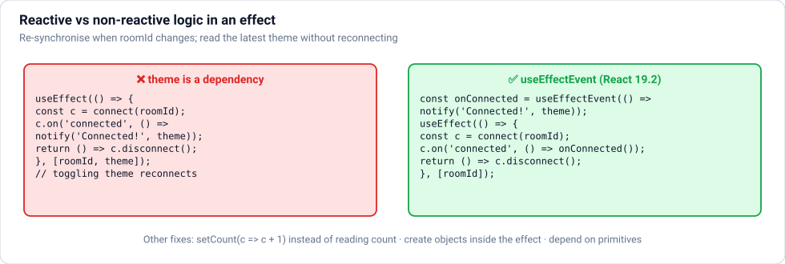

### Theory

> **In simple words:** event handlers run **because of an interaction**; effects run **because something must be in sync**. Sometimes an effect contains a bit of logic that should use the **latest** props without being a reason to re-run: "connect to the room (re-run when the room changes), and when connected, show a notification in the **current theme** (don't reconnect when the theme changes)". React 19.2's **`useEffectEvent`** extracts that bit into an **effect event**. Other dependency problems are fixed by restructuring: updater functions, moving objects inside the effect, and reading primitives.

**Words to know:**

- **Reactive logic:** code whose result should update when its inputs change (effects, rendering).
- **Non-reactive logic:** code that should run only when something else triggers it, but read the latest values when it does (event handlers, effect events).
- **`useEffectEvent(fn)`:** returns a function you call **from inside effects**; it always sees the latest props and state, and it must **not** be listed as a dependency. Stable since React 19.2 (October 2025).
- **Effect event:** the function returned by `useEffectEvent`; don't pass it to other components or call it during render.
- **Removing a dependency:** changing the code so the effect no longer reads the value (not deleting it from the list).
- **Updater function trick:** `setCount(c => c + 1)` inside an interval needs no `count` dependency.
- **Moving creation inside:** create objects and functions inside the effect so they aren't unstable dependencies.
- **Reading primitives:** destructure the strings/numbers you need from an object prop **outside** the effect and depend on those.

**Everyday picture.** A **delivery driver** (the effect) follows the route to the address on the order (reactive: a new address means a new trip). They also phone the customer on arrival, using whatever phone number is **currently** on the account (latest value), but a changed phone number doesn't send them on a new trip. The phone call is an effect event.

**The theme problem, traced:**

```text
useEffect(() => {
  const c = connect(roomId);
  c.on("connected", () => showNotification("Connected!", theme));   ← reads theme
  return () => c.disconnect();
}, [roomId, theme]);                                                ← the linter demands theme
user toggles dark mode → theme changes → effect re-runs → DISCONNECT + RECONNECT  ❌

const onConnected = useEffectEvent(() => showNotification("Connected!", theme));
useEffect(() => { … c.on("connected", () => onConnected()); … }, [roomId]);   ← theme no longer read by the effect
toggle theme → nothing reconnects; the next "connected" notification uses the new theme ✅
```

**When to use `useEffectEvent`:** non-reactive bits inside effects: logging analytics with the current cart, notifications with the current theme, reading the latest value inside an interval. **When not:** to hide dependencies that **should** cause re-synchronisation (a room id), or in event handlers (they already see the latest values).

**Common mistakes:**

- ❌ Calling an effect event from an event handler or during render (it's only for effects).
- ❌ Passing the effect event to child components or listing it in dependencies.
- ❌ Using `useEffectEvent` to wrap the whole effect body to silence the linter.

**Used in real software:** analytics page-view logging, notifications and "latest value" intervals; before React 19.2 libraries used a "latest ref" pattern (`useLatest`, `useEvent` polyfills) for the same job.

### Code

**The problem: a non-reactive value forces a reconnect:**

```tsx
import { useEffect, useEffectEvent, useState } from "react";
import { render, screen, fireEvent, act } from "@testing-library/react";

function createConnection(roomId: string) {
  let handler = () => {};
  return {
    connect() { console.log(`connect ${roomId}`); setTimeout(() => handler(), 5); },
    on(_event: "connected", fn: () => void) { handler = fn; },
    disconnect() { console.log(`disconnect ${roomId}`); },
  };
}
const notify = (msg: string, theme: string) => console.log(`🔔 ${msg} (${theme} theme)`);

function ChatRoomBad({ roomId, theme }: { roomId: string; theme: string }) {
  useEffect(() => {
    const c = createConnection(roomId);
    c.on("connected", () => notify("Connected!", theme));
    c.connect();
    return () => c.disconnect();
  }, [roomId, theme]);
  return null;
}
const bad = render(<ChatRoomBad roomId="general" theme="light" />);
await act(() => new Promise((r) => setTimeout(r, 20)));
console.log("-- toggle theme:");
bad.rerender(<ChatRoomBad roomId="general" theme="dark" />);
await act(() => new Promise((r) => setTimeout(r, 20)));
bad.unmount();
```

**Output:**

```text
connect general
🔔 Connected! (light theme)
-- toggle theme:
disconnect general
connect general
🔔 Connected! (dark theme)
disconnect general
```

**The fix: move the non-reactive part into an effect event:**

```tsx
function ChatRoomGood({ roomId, theme }: { roomId: string; theme: string }) {
  const onConnected = useEffectEvent(() => notify("Connected!", theme));   // always sees the latest theme
  useEffect(() => {
    const c = createConnection(roomId);
    c.on("connected", () => onConnected());
    c.connect();
    return () => c.disconnect();
  }, [roomId]);                                                              // theme is not a dependency
  return null;
}
const good = render(<ChatRoomGood roomId="general" theme="light" />);
await act(() => new Promise((r) => setTimeout(r, 20)));
console.log("-- toggle theme (no reconnect):");
good.rerender(<ChatRoomGood roomId="general" theme="dark" />);
await act(() => new Promise((r) => setTimeout(r, 20)));
console.log("-- switch room (reconnect, notification uses the CURRENT theme):");
good.rerender(<ChatRoomGood roomId="travel" theme="dark" />);
await act(() => new Promise((r) => setTimeout(r, 20)));
good.unmount();
```

**Output:**

```text
connect general
🔔 Connected! (light theme)
-- toggle theme (no reconnect):
-- switch room (reconnect, notification uses the CURRENT theme):
disconnect general
connect travel
🔔 Connected! (dark theme)
disconnect travel
```

**Removing a dependency with an updater function:** an interval that counts up needs no `count` dependency, so it isn't torn down and restarted every tick:

```tsx
let starts = 0;
function Timer({ useUpdater }: { useUpdater: boolean }) {
  const [count, setCount] = useState(0);
  useEffect(() => {
    starts++;
    const id = setInterval(() => (useUpdater ? setCount((c) => c + 1) : setCount(count + 1)), 5);
    return () => clearInterval(id);
  }, useUpdater ? [] : [count]);
  return <p>{count}</p>;
}
for (const useUpdater of [false, true]) {
  starts = 0;
  const t = render(<Timer useUpdater={useUpdater} />);
  await act(() => new Promise((r) => setTimeout(r, 60)));
  const ticks = Number(screen.getByRole("paragraph").textContent);
  console.log(useUpdater ? "updater:   " : "count dep: ", `counting? ${ticks > 0} | interval (re)started ${starts === 1 ? "once" : starts === ticks + 1 ? "once per tick (+1)" : starts + " times"}`);
  t.unmount();
}
```

**Output:**

```text
count dep:  counting? true | interval (re)started once per tick (+1)
updater:    counting? true | interval (re)started once
```

(Tick counts depend on timing, so the example prints relationships instead of exact numbers.) Both counters count, but the `[count]` version tears down and recreates the interval on every tick, so it also drifts: each restart waits a full interval again. The dependency array is computed per render here only to compare the two in one component; real code would pick one.

**A latest-value interval with an effect event:** the interval is created once, yet it logs the **current** step size:

```tsx
function Stepper() {
  const [step, setStep] = useState(1);
  const [total, setTotal] = useState(0);
  const onTick = useEffectEvent(() => setTotal((t) => t + step));
  useEffect(() => {
    const id = setInterval(() => onTick(), 5);
    return () => clearInterval(id);
  }, []);
  return <><button onClick={() => setStep(100)}>step 100</button><output>{total}</output></>;
}
render(<Stepper />);
await act(() => new Promise((r) => setTimeout(r, 30)));
fireEvent.click(screen.getByText("step 100"));
const before = Number(document.querySelector("output")!.textContent);
await act(() => new Promise((r) => setTimeout(r, 30)));
const after = Number(document.querySelector("output")!.textContent);
console.log("small steps before the click:", before < 100, "| jumps of 100 after:", (after - before) % 100 === 0 && after > before);
```

**Output:**

```text
small steps before the click: true | jumps of 100 after: true
```

### Practice

1. A page logs analytics `logVisit(url, cartItemCount)` when `url` changes. Write it so that cart changes don't log a new visit.
2. Why can't you just leave `theme` out of the dependency list instead of using `useEffectEvent`?

<details>
<summary><b>Answer</b></summary>

```tsx
function Page({ url, cartCount }: { url: string; cartCount: number }) {
  const onVisit = useEffectEvent((visitedUrl: string) => console.log(`visit ${visitedUrl} with ${cartCount} items`));
  useEffect(() => { onVisit(url); }, [url]);
  return null;
}
const p = render(<Page url="/menu" cartCount={0} />);
p.rerender(<Page url="/menu" cartCount={2} />);       // cart changes: no new visit
p.rerender(<Page url="/cart" cartCount={2} />);       // url changes: visit, with the latest count
```

**Output:**

```text
visit /menu with 0 items
visit /cart with 2 items
```

1. The reactive value (`url`) is passed **into** the effect event as an argument, so each visit logs the URL it was for; `cartCount` is read inside the event, always fresh.
2. Then the effect would read a **stale** `theme` (whatever it was when the effect last ran), and the linter would warn. `useEffectEvent` reads the latest value *and* tells React it isn't a reason to re-synchronise.

</details>

| # | Problem | Difficulty |
|---|---|---|
| 1 | [react.dev challenges: Fix a variable that doesn't update, Fix a freezing counter, Fix a non-adjustable delay, Fix a delayed notification](https://react.dev/learn/separating-events-from-effects#challenges) | 🔴 Hard |
| 2 | [react.dev challenges: Fix a resetting interval, Fix a retriggering animation, Fix a reconnecting chat (twice)](https://react.dev/learn/removing-effect-dependencies#challenges) | 🔴 Hard |
| 3 | [BFE.dev React problem 9: useEffectOnce()](https://bigfrontend.dev/react/useEffectOnce) | 🟢 Easy |

**Learn more:** [react.dev: Separating events from effects](https://react.dev/learn/separating-events-from-effects) · [react.dev: useEffectEvent](https://react.dev/reference/react/useEffectEvent) · [react.dev: Removing effect dependencies](https://react.dev/learn/removing-effect-dependencies)

---

## 34. Fetching Data in Effects: Loading, Errors, Race Conditions and AbortController

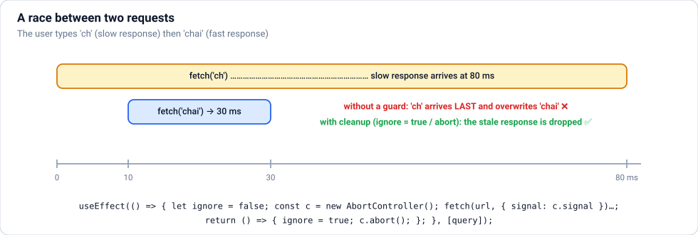

### Theory

> **In simple words:** to load data for what's on screen, start a request in an effect, keep **loading / data / error** in state, and in the **cleanup** mark the request as stale (an `ignore` flag) or cancel it (`AbortController`). Without that, a slow response for an **old** query can arrive **after** a newer one and overwrite it: a race condition. Hand-written fetching is worth understanding, but production apps usually use a library or framework that handles caching, deduplication and races (Sections [51](#51-router-data-loaders-actions-and-pending-ui), [52](#52-server-state-with-tanstack-query), [61](#61-react-server-components-how-they-work)).

**Words to know:**

- **Loading state:** what the UI shows while waiting (`status: "loading"`).
- **Error state:** what the UI shows when the request failed, often with a retry.
- **Race condition (in fetching):** responses arriving out of order, so a stale response replaces a newer one.
- **`ignore` flag:** a local variable set to `true` in the cleanup; the response handler checks it and drops results from an effect that has since been cleaned up.
- **`AbortController`:** cancels the in-flight `fetch` in the cleanup (saves bandwidth too); the aborted `fetch` rejects with an `AbortError` that you ignore.
- **Waterfall:** requests that run one after another because each component only starts fetching after its parent rendered; slow on real networks.
- **Cache:** storing previous responses so going back to a screen is instant; hand-written effects have none.
- **Server state:** data owned by a server that your UI shows a copy of; it can go stale and needs refetching (Section [52](#52-server-state-with-tanstack-query)).

**Everyday picture.** Ordering at two counters. You order "ch…" at a slow counter, change your mind, and order "chai" at a fast one. The fast one serves you first; then the slow counter hands you the old order, and if you eat whatever arrives last, you end up with the wrong drink. The `ignore` flag is telling the slow counter "cancel that"; the `AbortController` is them actually binning it.

**The race, traced by hand:**

```text
t=0    query "ch"   → effect #1 starts fetch("ch")   (server takes 80 ms)
t=10   query "chai" → cleanup #1 runs (ignore₁ = true) → effect #2 starts fetch("chai") (20 ms)
t=30   response "chai" arrives → ignore₂ is false → setResults(chai results) ✅
t=80   response "ch" arrives   → ignore₁ is true  → dropped ✅
without the flag: at t=80 setResults(ch results) would overwrite the newer data ❌
```

**When hand-written effect fetching is OK:** small apps, learning, one-off widgets. **When not:** most production apps; you'd be re-implementing caching, retries, deduplication, refetch on focus and pagination. Use TanStack Query or SWR on the client, or your framework's loaders and Server Components.

**Common mistakes:**

- ❌ No cleanup → race conditions and "state update on an unmounted component" situations.
- ❌ Treating a 404 or 500 as success (check `response.ok`).
- ❌ Forgetting the error state (infinite spinner on failure).
- ❌ Fetching in a child only after the parent's fetch finished (a waterfall) when both could start together.

**Used in real software:** this is exactly the pattern libraries like SWR and TanStack Query wrap; React's docs recommend using them (or a framework) instead of raw effects for data fetching.

### Code

A local test server with a **variable delay** per query, so the race is reproducible:

```tsx
import { useEffect, useState } from "react";
import { createServer } from "node:http";
import { render, screen, fireEvent, act } from "@testing-library/react";

const MENU = ["Masala chai", "Chai latte", "Cold coffee", "Chocolate shake", "Samosa"];
const server = createServer((req, res) => {
  const url = new URL(req.url!, "http://x");
  const q = url.searchParams.get("q") ?? "";
  const delay = Number(url.searchParams.get("delay") ?? 0);
  setTimeout(() => {
    if (q === "boom") { res.writeHead(500).end(); return; }
    res.writeHead(200, { "Content-Type": "application/json" });
    res.end(JSON.stringify(MENU.filter((m) => m.toLowerCase().includes(q.toLowerCase()))));
  }, delay);
});
await new Promise<void>((r) => server.listen(4402, r));
const delays: Record<string, number> = { c: 80, ch: 80, chai: 10, co: 10 };
const urlFor = (q: string) => `http://localhost:4402/search?q=${encodeURIComponent(q)}&delay=${delays[q] ?? 10}`;
console.log("server ready");
```

**Output:**

```text
server ready
```

**The naive version (no cleanup) shows stale results:**

```tsx
function NaiveSearch({ query }: { query: string }) {
  const [results, setResults] = useState<string[]>([]);
  useEffect(() => {
    fetch(urlFor(query)).then((r) => r.json()).then(setResults);       // ❌ no guard
  }, [query]);
  return <p>{query}: {results.join(", ")}</p>;
}
const naive = render(<NaiveSearch query="ch" />);
naive.rerender(<NaiveSearch query="chai" />);                          // the user kept typing
await act(() => new Promise((r) => setTimeout(r, 150)));
console.log(screen.getByRole("paragraph").textContent, "  ← results for 'ch' shown under 'chai'");
naive.unmount();
```

**Output:**

```text
chai: Masala chai, Chai latte, Chocolate shake   ← results for 'ch' shown under 'chai'
```

**The correct version: loading/error states, `ignore` flag and `AbortController`:**

```tsx
type State = { status: "loading" } | { status: "error"; message: string } | { status: "success"; results: string[] };

function Search({ query }: { query: string }) {
  const [state, setState] = useState<State>({ status: "loading" });
  useEffect(() => {
    let ignore = false;
    const controller = new AbortController();
    setState({ status: "loading" });
    fetch(urlFor(query), { signal: controller.signal })
      .then((r) => { if (!r.ok) throw new Error(`HTTP ${r.status}`); return r.json(); })
      .then((results: string[]) => { if (!ignore) setState({ status: "success", results }); })
      .catch((e: Error) => { if (!ignore && e.name !== "AbortError") setState({ status: "error", message: e.message }); });
    return () => { ignore = true; controller.abort(); };
  }, [query]);
  if (state.status === "loading") return <p>Loading {query}…</p>;
  if (state.status === "error") return <p role="alert">Couldn't search: {state.message}</p>;
  return <p>{query}: {state.results.join(", ") || "no matches"}</p>;
}
const s = render(<Search query="ch" />);
console.log(screen.getByRole("paragraph").textContent);
s.rerender(<Search query="chai" />);
await screen.findByText(/chai:/);
await act(() => new Promise((r) => setTimeout(r, 150)));               // give the slow, aborted request time to come back
console.log(screen.getByRole("paragraph").textContent, "  ← correct");
s.rerender(<Search query="boom" />);
console.log((await screen.findByRole("alert")).textContent);
s.unmount();
server.close();
```

**Output:**

```text
Loading ch…
chai: Masala chai, Chai latte   ← correct
Couldn't search: HTTP 500
```

`setState({ status: "loading" })` at the start of the effect is one of the few acceptable `setState` calls in an effect (it marks the start of synchronising with the server). The `State` type is a discriminated union (Section [26](#26-typescript-with-react-typing-props-state-events-and-children)), so `state.results` is only available in the success branch.

### Practice

1. Turn the fetching logic into a reusable `useFetch(url)` that returns `{ status, data, error }`.
2. A `Profile` fetches the user, then renders `<Posts userId>` which fetches posts only after the profile renders. What's this called and how can you avoid it?

<details>
<summary><b>Answer</b></summary>

1. Move the effect and state into a function named `useFetch` (a **custom hook**, Section [38](#38-custom-hooks-reusing-stateful-logic)) with `[url]` as the dependency; components call `const { status, data } = useFetch(url)`. Section [38](#38-custom-hooks-reusing-stateful-logic) builds exactly this, with a test.
2. A **waterfall**. Start both requests together: lift both fetches into the parent (or a route loader, Section [51](#51-router-data-loaders-actions-and-pending-ui)) and run them with `Promise.all`, or let a data library prefetch.

</details>

| # | Problem | Difficulty |
|---|---|---|
| 1 | [react.dev challenge: Fix fetching inside an Effect](https://react.dev/learn/synchronizing-with-effects#challenges) | 🟡 Medium |
| 2 | [BFE.dev React problem 4: useSWR() I](https://bigfrontend.dev/react/useSWR-1) | 🔴 Hard |
| 3 | [Frontend Mentor: REST Countries API with color theme switcher](https://www.frontendmentor.io/challenges/rest-countries-api-with-color-theme-switcher-5cacc469fec04111f7b848ca) | 🔴 Hard |
| 4 | [Frontend Mentor: IP address tracker](https://www.frontendmentor.io/challenges/ip-address-tracker-I8-0yYAH0) | 🟡 Medium |

**Learn more:** [react.dev: Fetching data with effects (and why frameworks do better)](https://react.dev/learn/synchronizing-with-effects#fetching-data) · [Robin Wieruch: How to fetch data with React Hooks](https://www.robinwieruch.de/react-hooks-fetch-data/)

---

### ✅ Part 5 checkpoint

Without looking, can you:

- [ ] Explain when to use a ref instead of state, and keep a timer id or debounce timeout in one?
- [ ] Focus, select and scroll DOM nodes with refs, pass `ref` to your own component (React 19), and use a ref callback with cleanup?
- [ ] Write an effect with correct cleanup and dependencies, and trace setup/cleanup when deps change and on unmount?
- [ ] Explain StrictMode's development double-run and why a correct cleanup makes it invisible?
- [ ] List the cases where you don't need an effect (derived data, events, resetting with a key, notifying parents)?
- [ ] Use `useEffectEvent`, updater functions and in-effect object creation to remove unnecessary dependencies?
- [ ] Fetch in an effect with loading and error states and no race conditions, and say why libraries do it better?

Part 6 organises bigger state with reducers, context and custom hooks.

---

# Part 6 — Moderate: Managing Complex State

> **Goal:** Keep growing apps organised: move state logic into reducers, share data deeply with context, combine the two, extract reusable logic into custom hooks, understand how hooks work inside (by building `useState` yourself), use the less common built-in hooks, and debug React apps efficiently.  
> **You need:** Parts 3–5 (state, immutable updates, lifting state, refs and effects).

---

## 35. useReducer: State Logic in One Place

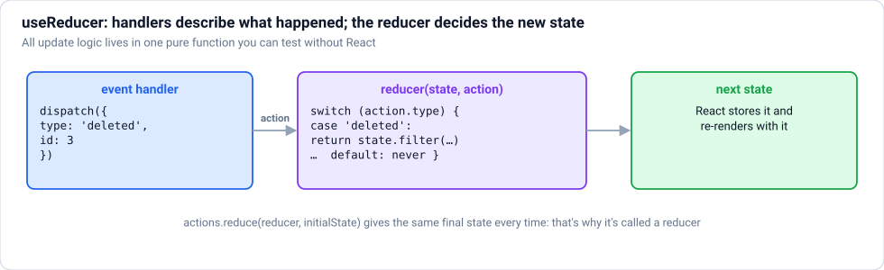

### Theory

> **In simple words:** when a component's state updates get complicated (many handlers each doing slightly different spread-and-filter gymnastics), move all that logic into one function called a **reducer**. Event handlers stop saying *how* to change state and instead **dispatch an action** describing *what happened* (`{ type: "added", text }`). The reducer receives the current state and the action and **returns the next state**. `useReducer(reducer, initialState)` wires it up.

**Words to know:**

- **Reducer:** a pure function `(state, action) => nextState`. The name comes from `array.reduce`, which folds a list of values into one result the same way.
- **Action:** a plain object describing what happened, by convention with a `type` field: `{ type: "deleted", id: 3 }`.
- **Dispatch:** sending an action to the reducer: `dispatch({ type: "deleted", id: 3 })`.
- **`useReducer(reducer, initialArg, init?)`:** returns `[state, dispatch]`; the optional `init` function computes the initial state lazily.
- **Action type:** a string naming the event, past tense by convention (`"added"`, `"changed"`), describing what the user did rather than the state change.
- **Discriminated union of actions (TypeScript):** `type Action = { type: "added"; text: string } | { type: "deleted"; id: number }`, so each case knows its fields.
- **Exhaustive check:** a `default` branch that TypeScript proves unreachable (`const never: never = action`), so adding a new action type without handling it is a compile error.
- **`useImmerReducer`:** a version from `use-immer` that lets the reducer "mutate" a draft (Section [17](#17-updating-objects-in-state)).

**Everyday picture.** A **bank teller**. Customers don't walk into the vault and move money themselves (handlers mutating state); they fill in a slip saying what they want: "deposit ₹500" (an action). The teller (reducer) follows fixed rules to produce the new balance. Every change goes through one window, so it's easy to audit and test.

**Folding actions into state, traced by hand:**

```text
initial:  [ {id:0, text:"Boil water", done:true} ]
action 1: { type: "added", id: 1, text: "Add tea" }      → [ …, {id:1, text:"Add tea", done:false} ]
action 2: { type: "changed", task: {id:1, …, done:true}} → task 1 replaced with the new object
action 3: { type: "deleted", id: 0 }                     → [ {id:1, text:"Add tea", done:true} ]
the same three actions replayed from the same initial state ALWAYS give the same result (the reducer is pure)
```

**useState vs useReducer:**

| | `useState` | `useReducer` |
|---|---|---|
| code size | small for simple state | more boilerplate up front, less as logic grows |
| readability | fine for a few updates | update logic in one place, handlers read like a log of events |
| debugging | hard to see why state changed | log every action in the reducer |
| testing | needs the component | the reducer is a plain function: test it without React |

**When to use it:** several state values updated together, many event types touching the same state, logic you want to test in isolation, or as the basis of a context-based store (Section [37](#37-scaling-up-with-reducer-and-context)). **When not:** a toggle or a single input; `useState` is clearer.

**Common mistakes:**

- ❌ Mutating `state` inside the reducer (it must return a new object).
- ❌ Side effects in the reducer (fetching, timers, `Math.random()`); reducers must be pure, and StrictMode calls them twice to check.
- ❌ Actions that are setters in disguise (`{ type: "setTasks", tasks }`); describe the event instead.
- ❌ Forgetting a `default` case (unknown actions silently return `undefined`).

**Used in real software:** Redux (and Redux Toolkit's `createSlice`) is built entirely on reducers (Section [55](#55-global-state-build-a-store-then-zustand-redux-toolkit-and-jotai)); form libraries, wizards and editors with undo use reducers internally.

### Code

**From scratch: a reducer is just what `Array.reduce` uses.** Replaying a list of actions over an initial state gives the final state:

```tsx
type Task = { id: number; text: string; done: boolean };
type Action =
  | { type: "added"; id: number; text: string }
  | { type: "changed"; task: Task }
  | { type: "deleted"; id: number };

function tasksReducer(tasks: Task[], action: Action): Task[] {
  switch (action.type) {
    case "added": return [...tasks, { id: action.id, text: action.text, done: false }];
    case "changed": return tasks.map((t) => (t.id === action.task.id ? action.task : t));
    case "deleted": return tasks.filter((t) => t.id !== action.id);
    default: { const unknown: never = action; throw new Error("Unknown action " + JSON.stringify(unknown)); }
  }
}

const initialTasks: Task[] = [{ id: 0, text: "Boil water", done: true }];
const actions: Action[] = [
  { type: "added", id: 1, text: "Add tea" },
  { type: "changed", task: { id: 1, text: "Add tea", done: true } },
  { type: "deleted", id: 0 },
];
console.log(actions.reduce(tasksReducer, initialTasks));
console.log("original untouched:", initialTasks);
```

**Output:**

```text
[ { id: 1, text: 'Add tea', done: true } ]
original untouched: [ { id: 0, text: 'Boil water', done: true } ]
```

The `default` branch assigns `action` to a variable of type `never`: if a new action type is added to `Action` but not handled, TypeScript reports an error there.

**Testing a reducer needs no React at all:**

```tsx
import assert from "node:assert/strict";
assert.deepEqual(tasksReducer([], { type: "added", id: 7, text: "Pour" }), [{ id: 7, text: "Pour", done: false }]);
assert.deepEqual(tasksReducer(initialTasks, { type: "deleted", id: 0 }), []);
console.log("reducer tests passed");
```

**Output:**

```text
reducer tests passed
```

`node:assert/strict` is Node's built-in assertion module; `deepEqual` compares structures. Section [56](#56-testing-components-vitest-testing-library-and-user-event) uses a full test runner.

**The React way: `useReducer`** with handlers that only dispatch:

```tsx
import { useReducer, useState } from "react";
import { render, screen, fireEvent } from "@testing-library/react";

let nextId = 2;
function TaskApp() {
  const [tasks, dispatch] = useReducer(tasksReducer, initialTasks);
  const [text, setText] = useState("");
  return (
    <>
      <input aria-label="new task" value={text} onChange={(e) => setText(e.target.value)} />
      <button onClick={() => { dispatch({ type: "added", id: nextId++, text }); setText(""); }}>Add</button>
      <ul>
        {tasks.map((t) => (
          <li key={t.id}>
            <label><input type="checkbox" checked={t.done} onChange={(e) => dispatch({ type: "changed", task: { ...t, done: e.target.checked } })} />{t.text}</label>
            <button onClick={() => dispatch({ type: "deleted", id: t.id })}>delete {t.text}</button>
          </li>
        ))}
      </ul>
    </>
  );
}
render(<TaskApp />);
fireEvent.change(screen.getByLabelText("new task"), { target: { value: "Add cardamom" } });
fireEvent.click(screen.getByText("Add"));
fireEvent.click(screen.getByLabelText("Add cardamom"));
fireEvent.click(screen.getByText("delete Boil water"));
console.log(screen.getAllByRole("listitem").map((li) => `${(li.querySelector("input") as HTMLInputElement).checked ? "☑" : "☐"} ${li.querySelector("label")!.textContent}`));
```

**Output:**

```text
[ '☑ Add cardamom' ]
```

**Logging every action** is the debugging superpower reducers give you; wrap the reducer:

```tsx
function withLogging<S, A>(reducer: (s: S, a: A) => S) {
  return (state: S, action: A) => {
    const next = reducer(state, action);
    console.log("action:", JSON.stringify(action), "→", (next as unknown as Task[]).length, "tasks");
    return next;
  };
}
function LoggedApp() {
  const [tasks, dispatch] = useReducer(withLogging(tasksReducer), initialTasks);
  return <button onClick={() => dispatch({ type: "added", id: 99, text: "Strain" })}>{tasks.length} tasks</button>;
}
render(<LoggedApp />);
fireEvent.click(screen.getByRole("button"));
```

**Output:**

```text
action: {"type":"added","id":99,"text":"Strain"} → 2 tasks
```

React may call a reducer twice in development (StrictMode) to check it's pure; because this example isn't wrapped in `StrictMode`, it logs once.

### Practice

1. Write a `counterReducer` handling `{ type: "incremented" }`, `{ type: "decremented" }` and `{ type: "reset"; to: number }`, with an exhaustive `default`.
2. A reducer does `state.items.push(action.item); return state;`. What goes wrong in the UI?

<details>
<summary><b>Answer</b></summary>

```tsx
type CounterAction = { type: "incremented" } | { type: "decremented" } | { type: "reset"; to: number };
function counterReducer(count: number, action: CounterAction): number {
  switch (action.type) {
    case "incremented": return count + 1;
    case "decremented": return count - 1;
    case "reset": return action.to;
    default: { const x: never = action; return x; }
  }
}
const steps: CounterAction[] = [{ type: "incremented" }, { type: "incremented" }, { type: "decremented" }, { type: "reset", to: 10 }, { type: "incremented" }];
console.log(steps.reduce(counterReducer, 0));
```

**Output:**

```text
11
```

2. It returns the **same** object, so React sees no change (`Object.is`) and doesn't re-render; the mutation also corrupts the previous state. Return `{ ...state, items: [...state.items, action.item] }`.

</details>

| # | Problem | Difficulty |
|---|---|---|
| 1 | [react.dev challenges: Dispatch actions from event handlers, Clear the input on sending a message, Restore input values when switching between tabs](https://react.dev/learn/extracting-state-logic-into-a-reducer#challenges) | 🟡 Medium |
| 2 | [LeetCode 2626. Array Reduce Transformation](https://leetcode.com/problems/array-reduce-transformation/) | 🟢 Easy |
| 3 | [Frontend Mentor: Calculator app (a reducer is ideal)](https://www.frontendmentor.io/challenges/calculator-app-9lteq5N29) | 🟡 Medium |

**Learn more:** [react.dev: Extracting state logic into a reducer](https://react.dev/learn/extracting-state-logic-into-a-reducer) · [react.dev: useReducer](https://react.dev/reference/react/useReducer)

---

## 36. Context: Passing Data Deeply

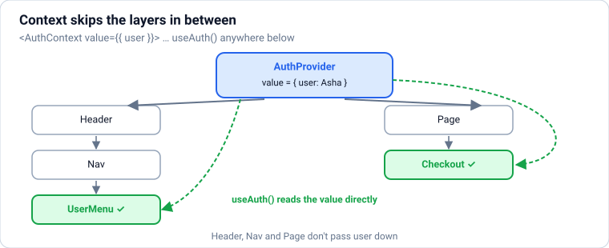

### Theory

> **In simple words:** passing a prop through five layers of components that don't use it is tedious ("prop drilling"). **Context** lets a parent **provide** a value to its whole subtree, and any component inside can **read** it directly with `useContext`, however deep. Typical uses: the current theme, the logged-in user, the language, a router. Components read the value from the **nearest** provider above them.

**Words to know:**

- **Context:** a way to pass a value deep down the tree without props, created with `createContext(defaultValue)`.
- **Provider:** the component that supplies a value to its subtree. In React 19 you render the context itself: `<ThemeContext value="dark">…</ThemeContext>` (older code: `<ThemeContext.Provider value=…>`).
- **`useContext(Context)`:** reads the value from the nearest provider above; returns the **default value** if there's none.
- **`use(Context)`:** React 19's `use` can also read context and, unlike hooks, may be called inside conditions and loops.
- **Default value:** what `useContext` returns with no provider above; often `null`, or a sensible fallback.
- **Nearest provider wins:** providers can be nested; a deeper provider overrides an outer one for its subtree.
- **Re-render on change:** when a provider's `value` changes (compared with `Object.is`), **every** component that reads that context re-renders, even if it only uses part of the value.
- **Context splitting:** using several smaller contexts (e.g. state and dispatch, or user and theme) so a change only re-renders the components that read that part.
- **Prop drilling:** passing props through components that don't need them, just to reach a deep child.

**Everyday picture.** **Building-wide Wi-Fi.** Instead of running a cable from the router through every room to reach your desk (prop drilling), the router broadcasts and any device in range just connects (useContext). A repeater on one floor (a nested provider) gives that floor its own network.

**How a context value is found, traced:**

```text
<ThemeContext value="dark">             ← provider A
  <Page>
    <Sidebar>
      <Button />                         useContext(ThemeContext) → walks up → finds A → "dark"
    </Sidebar>
    <ThemeContext value="light">         ← provider B
      <Footer><Button /></Footer>        → finds B first → "light"
    </ThemeContext>
  </Page>
</ThemeContext>
<Button /> outside everything             → no provider → the default value
```

**When to use context:** genuinely global or widely used values (theme, user, locale, feature flags, a dependency like an API client), and to pair with a reducer as an app-level store (Section [37](#37-scaling-up-with-reducer-and-context)). **When not:** to avoid passing props two or three levels (that's fine, and explicit), or before trying composition (Section [25](#25-composition-children-slots-and-layout-components)); and not for fast-changing values read by many components (every reader re-renders), where a store with selectors fits better (Section [55](#55-global-state-build-a-store-then-zustand-redux-toolkit-and-jotai)).

**Common mistakes:**

- ❌ Reading context in a component that isn't inside the provider, then wondering why it's the default.
- ❌ Passing a new object as `value` on every render (`value={{ user, logout }}`), re-rendering every reader each time; memoise it (Section [45](#45-memo-usememo-usecallback-and-the-react-compiler)) or split contexts.
- ❌ One giant "AppContext" holding everything.
- ❌ Using context for state only one subtree needs.

**Used in real software:** React Router, TanStack Query, Redux's `Provider`, styled-components themes and internationalisation libraries (react-intl, i18next) all pass their objects down through context.

### Code

**From scratch: the drilling problem.** Without context, `level` must be passed through every heading component explicitly:

```tsx
import { createContext, useContext, use, useState } from "react";
import type { ReactNode } from "react";
import { render, screen, fireEvent } from "@testing-library/react";

function DrilledHeading({ level, children }: { level: number; children: string }) {
  const Tag = `h${level}` as "h1";
  return <Tag>{children}</Tag>;
}
function DrilledSection({ level, children }: { level: number; children: (level: number) => ReactNode }) {
  return <section>{children(level)}</section>;
}
console.log(render(
  <DrilledSection level={1}>{(l) => <><DrilledHeading level={l}>Menu</DrilledHeading>
    <DrilledSection level={l + 1}>{(l2) => <DrilledHeading level={l2}>Teas</DrilledHeading>}</DrilledSection></>}</DrilledSection>,
).container.innerHTML);
```

**Output:**

```text
<section><h1>Menu</h1><section><h2>Teas</h2></section></section>
```

It works, but every layer has to know about `level`. (`` `h${level}` as "h1" `` builds a tag name string; the cast tells TypeScript it's a valid tag.)

**The React way: each `Section` provides its level + 1; `Heading` reads it:**

```tsx
const LevelContext = createContext(0);

function Section({ children }: { children: ReactNode }) {
  const level = useContext(LevelContext);
  return <section><LevelContext value={level + 1}>{children}</LevelContext></section>;
}
function Heading({ children }: { children: string }) {
  const level = useContext(LevelContext);
  const Tag = `h${Math.min(level, 6)}` as "h1";
  return <Tag>{children}</Tag>;
}
console.log(render(
  <Section>
    <Heading>Menu</Heading>
    <Section>
      <Heading>Teas</Heading>
      <Section><Heading>Masala chai</Heading></Section>
    </Section>
  </Section>,
).container.innerHTML);
```

**Output:**

```text
<section><h1>Menu</h1><section><h2>Teas</h2><section><h3>Masala chai</h3></section></section></section>
```

No component passes `level` explicitly; each `Section` reads the level from above and provides one deeper. This is react.dev's own example of context's power.

**Theme and user, nested providers and the default value:**

```tsx
type User = { name: string } | null;
const ThemeContext = createContext<"light" | "dark">("light");
const UserContext = createContext<User>(null);

function Button({ children }: { children: string }) {
  const theme = useContext(ThemeContext);
  return <button className={`btn-${theme}`}>{children}</button>;
}
function Greeting() {
  const user = useContext(UserContext);
  return <p>{user ? `Hi, ${user.name}` : "Please log in"}</p>;
}
function App() {
  const [theme, setTheme] = useState<"light" | "dark">("dark");
  return (
    <ThemeContext value={theme}>
      <UserContext value={{ name: "Asha" }}>
        <Greeting />
        <Button>Order</Button>
        <ThemeContext value="light"><Button>Light island</Button></ThemeContext>
        <button onClick={() => setTheme(theme === "dark" ? "light" : "dark")}>toggle</button>
      </UserContext>
    </ThemeContext>
  );
}
const app = render(<><App /><Greeting /></>);
console.log(app.container.innerHTML);
fireEvent.click(screen.getByText("toggle"));
console.log("after toggle:", screen.getByText("Order").className);
```

**Output:**

```text
<p>Hi, Asha</p><button class="btn-dark">Order</button><button class="btn-light">Light island</button><button>toggle</button><p>Please log in</p>
after toggle: btn-light
```

The second `Greeting` sits outside every provider, so it gets the default `null`. The "Light island" button reads its nearest provider.

**Every reader re-renders when the value changes,** even readers that don't use the part that changed:

```tsx
const renders: Record<string, number> = {};
const AppState = createContext({ user: "Asha", cartCount: 0 });
function UserBadge() { renders.UserBadge = (renders.UserBadge ?? 0) + 1; return <span>{useContext(AppState).user}</span>; }
function CartBadge() { renders.CartBadge = (renders.CartBadge ?? 0) + 1; return <span>{useContext(AppState).cartCount}</span>; }
function Store() {
  const [cartCount, setCartCount] = useState(0);
  return (
    <AppState value={{ user: "Asha", cartCount }}>
      <UserBadge /><CartBadge />
      <button onClick={() => setCartCount((c) => c + 1)}>add</button>
    </AppState>
  );
}
render(<Store />);
fireEvent.click(screen.getByText("add"));
fireEvent.click(screen.getByText("add"));
console.log(renders, "← UserBadge re-rendered although the user never changed");
```

**Output:**

```text
{ UserBadge: 3, CartBadge: 3 } ← UserBadge re-rendered although the user never changed
```

Splitting into `UserContext` and `CartContext` (or a store with selectors) limits re-renders to the components that need the changed value.

**`use(Context)` may be called conditionally** (React 19), unlike `useContext`:

```tsx
function Price({ showCurrency }: { showCurrency: boolean }) {
  if (!showCurrency) return <span>180</span>;
  const theme = use(ThemeContext);                      // OK after an early return
  return <span className={theme}>₹180</span>;
}
console.log(render(<ThemeContext value="dark"><Price showCurrency /><Price showCurrency={false} /></ThemeContext>).container.innerHTML);
```

**Output:**

```text
<span class="dark">₹180</span><span>180</span>
```

### Practice

1. Create a `LocaleContext` (`"en-IN"` by default) and a `Price({ paise })` component that formats with `Intl.NumberFormat(locale, { style: "currency", currency: "INR" })`. Render one price inside a provider for `"en-US"` and one outside.
2. A provider renders `<AuthContext value={{ user, login, logout }}>`. Why might every reader re-render on unrelated parent renders, and how do you fix it?

<details>
<summary><b>Answer</b></summary>

```tsx
const LocaleContext = createContext("en-IN");
function PriceTag({ paise }: { paise: number }) {
  const locale = useContext(LocaleContext);
  return <span>{new Intl.NumberFormat(locale, { style: "currency", currency: "INR" }).format(paise / 100)} </span>;
}
console.log(render(<><LocaleContext value="en-US"><PriceTag paise={18499950} /></LocaleContext><PriceTag paise={18499950} /></>).container.textContent);
```

**Output:**

```text
₹184,999.50 ₹1,84,999.50
```

1. Inside the provider, US grouping (thousands: 184,999.50); outside, the default `"en-IN"` uses Indian lakh grouping (1,84,999.50). Same component, different context value.
2. `{ user, login, logout }` is a **new object** every time the provider's component renders, so `Object.is` says the value changed and all readers re-render. Wrap the value in `useMemo` (and the functions in `useCallback`), let the React Compiler memoise it, or split state and functions into separate contexts.

</details>

| # | Problem | Difficulty |
|---|---|---|
| 1 | [react.dev challenge: Replace prop drilling with context](https://react.dev/learn/passing-data-deeply-with-context#challenges) | 🟡 Medium |
| 2 | [BFE.dev React quiz 9: React re-render 6 - Context](https://bigfrontend.dev/react-quiz/react-rerender-6-context) | 🟡 Medium |
| 3 | [BFE.dev React quiz 6: React re-render 5 - context](https://bigfrontend.dev/react-quiz/React-re-render-5) | 🔴 Hard |
| 4 | [Frontend Mentor: Social media dashboard with theme switcher (theme context)](https://www.frontendmentor.io/challenges/social-media-dashboard-with-theme-switcher-6oY8ozp_H) | 🟡 Medium |

**Learn more:** [react.dev: Passing data deeply with context](https://react.dev/learn/passing-data-deeply-with-context) · [react.dev: useContext](https://react.dev/reference/react/useContext) · [react.dev: use](https://react.dev/reference/react/use)

---

## 37. Scaling Up with Reducer and Context

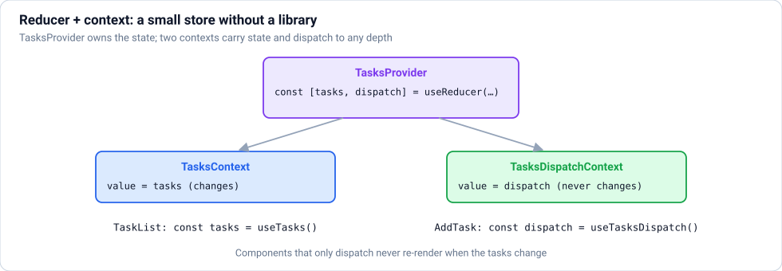

### Theory

> **In simple words:** combine the two previous sections and you get a small app-wide store with no library: a **provider component** holds state with `useReducer`, and provides **`state`** and **`dispatch`** through **two contexts**. Any component in the tree can read the state or dispatch actions, without prop drilling. Wrap the lookups in small **custom hooks** (`useTasks()`, `useTasksDispatch()`) so components never touch the contexts directly.

**Words to know:**

- **Provider component:** your own component (`TasksProvider`) that owns state and renders the context providers around `children`.
- **State context / dispatch context:** two separate contexts; `dispatch` never changes identity, so components that only dispatch don't re-render when state changes.
- **Accessor hooks:** tiny custom hooks such as `useTasks()` that call `useContext` and throw a helpful error when used outside the provider.
- **Store:** a single object holding app state plus a way to update it; reducer + context is a do-it-yourself store.
- **Colocation:** keeping the reducer, contexts, provider and hooks in one file (`TasksContext.tsx`).

**Everyday picture.** A **restaurant kitchen ticket rail**. The kitchen (provider) owns the orders (state). Any waiter can read the rail (state context) or clip a new ticket on it (dispatch context). Waiters don't carry orders from table to table to reach the kitchen; they all use the same rail.

**The structure, traced:**

```text
TasksContext.tsx
  tasksReducer(tasks, action)                      pure logic (Section 35)
  TasksContext, TasksDispatchContext               createContext(null)
  TasksProvider({ children }):
     const [tasks, dispatch] = useReducer(tasksReducer, initialTasks)
     return <TasksContext value={tasks}><TasksDispatchContext value={dispatch}>{children}</…></…>
  useTasks()         → useContext(TasksContext)   (throws if null)
  useTasksDispatch() → useContext(TasksDispatchContext)
App:  <TasksProvider><AddTask /><TaskList /></TasksProvider>
AddTask: dispatch({ type: "added", … })   TaskList: const tasks = useTasks()
```

**When to use it:** small to medium apps whose shared state changes at human speed (a cart, settings, a task list). **When not:** state that changes very often and is read by many components (every reader re-renders), server data (use TanStack Query, Section [52](#52-server-state-with-tanstack-query)), or large apps where a store library's selectors and devtools pay off (Section [55](#55-global-state-build-a-store-then-zustand-redux-toolkit-and-jotai)).

**Common mistakes:**

- ❌ Putting `state` and `dispatch` in one object `value={{ state, dispatch }}` (a new object every render).
- ❌ Accessor hooks that silently return `null` outside the provider; throw a clear error instead.
- ❌ One store for everything, including server data and form drafts.

**Used in real software:** many small production apps use exactly this; it's also how libraries are built inside (React Router keeps its router state in context; Redux's `Provider` passes the store through context).

### Code

```tsx
import { createContext, useContext, useReducer } from "react";
import type { Dispatch, ReactNode } from "react";

export type Task = { id: number; text: string; done: boolean };
export type Action = { type: "added"; id: number; text: string } | { type: "toggled"; id: number } | { type: "deleted"; id: number };

function tasksReducer(tasks: Task[], action: Action): Task[] {
  switch (action.type) {
    case "added": return [...tasks, { id: action.id, text: action.text, done: false }];
    case "toggled": return tasks.map((t) => (t.id === action.id ? { ...t, done: !t.done } : t));
    case "deleted": return tasks.filter((t) => t.id !== action.id);
  }
}

const TasksContext = createContext<Task[] | null>(null);
const TasksDispatchContext = createContext<Dispatch<Action> | null>(null);

export function TasksProvider({ children, initial = [] }: { children: ReactNode; initial?: Task[] }) {
  const [tasks, dispatch] = useReducer(tasksReducer, initial);
  return (
    <TasksContext value={tasks}>
      <TasksDispatchContext value={dispatch}>{children}</TasksDispatchContext>
    </TasksContext>
  );
}

export function useTasks() {
  const tasks = useContext(TasksContext);
  if (tasks === null) throw new Error("useTasks must be used inside <TasksProvider>");
  return tasks;
}
export function useTasksDispatch() {
  const dispatch = useContext(TasksDispatchContext);
  if (dispatch === null) throw new Error("useTasksDispatch must be used inside <TasksProvider>");
  return dispatch;
}
```

The whole store lives in one file. Every exported piece is small; components only ever see `TasksProvider`, `useTasks` and `useTasksDispatch`.

```tsx
import { useState } from "react";
import { render, screen, fireEvent } from "@testing-library/react";
import { TasksProvider, useTasks, useTasksDispatch } from "./TasksContext.tsx";

const renders = { AddTask: 0, TaskList: 0 };
let nextId = 3;
function AddTask() {
  renders.AddTask++;
  const dispatch = useTasksDispatch();
  const [text, setText] = useState("");
  return <><input aria-label="task" value={text} onChange={(e) => setText(e.target.value)} />
    <button onClick={() => { dispatch({ type: "added", id: nextId++, text }); setText(""); }}>Add</button></>;
}
function TaskList() {
  renders.TaskList++;
  const tasks = useTasks();
  const dispatch = useTasksDispatch();
  return <ul>{tasks.map((t) => <li key={t.id} onClick={() => dispatch({ type: "toggled", id: t.id })}>{t.done ? "☑" : "☐"} {t.text}</li>)}</ul>;
}
render(
  <TasksProvider initial={[{ id: 1, text: "Boil water", done: false }, { id: 2, text: "Add tea", done: false }]}>
    <h1>Day plan</h1>
    <AddTask />
    <TaskList />
  </TasksProvider>,
);
fireEvent.click(screen.getByText(/Boil water/));
fireEvent.change(screen.getByLabelText("task"), { target: { value: "Strain" } });
fireEvent.click(screen.getByText("Add"));
console.log(screen.getAllByRole("listitem").map((li) => li.textContent));
console.log("renders:", renders);
```

**Output:**

```text
[ '☑ Boil water', '☐ Add tea', '☐ Strain' ]
renders: { AddTask: 3, TaskList: 3 }
```

`AddTask` re-rendered only for its own typing (its `text` state) and the clear after adding; it never re-rendered because the task list changed, since it reads only the dispatch context, whose value never changes. `TaskList` re-rendered on each change to the tasks.

**Outside the provider, the accessor hook explains the mistake:**

```tsx
function Orphan() { useTasks(); return null; }
render(<Orphan />);
```

**Output:**

```text
Error: useTasks must be used inside <TasksProvider>
```

### Practice

1. Add a `cleared-done` action (remove all finished tasks) and a "Clear done" button inside `AddTask`. Which files change?
2. Why does `AddTask` not re-render when a task is toggled?

<details>
<summary><b>Answer</b></summary>

1. `TasksContext.tsx` (one more case in `Action` and the reducer; TypeScript's `switch` coverage helps) and the component with the button, which dispatches `{ type: "cleared-done" }`. No component in between changes: that's the point of the store.
2. It only reads `TasksDispatchContext`, and `dispatch` from `useReducer` keeps the same identity for the component's whole life, so that context's value never changes. Its parent (`TasksProvider`) re-renders, but `AddTask` was created by the **grandparent** as part of `children`, so it isn't re-rendered just because the provider re-rendered.

</details>

| # | Problem | Difficulty |
|---|---|---|
| 1 | [react.dev: Scaling up with reducer and context (rebuild the TaskApp)](https://react.dev/learn/scaling-up-with-reducer-and-context) | 🟡 Medium |
| 2 | [Frontend Mentor: Product list with cart (cart state in reducer + context)](https://www.frontendmentor.io/challenges/product-list-with-cart-5MmqLVAp_d) | 🟡 Medium |

**Learn more:** [react.dev: Scaling up with reducer and context](https://react.dev/learn/scaling-up-with-reducer-and-context) · [Kent C. Dodds: How to use React context effectively](https://kentcdodds.com/blog/how-to-use-react-context-effectively)

---

## 38. Custom Hooks: Reusing Stateful Logic

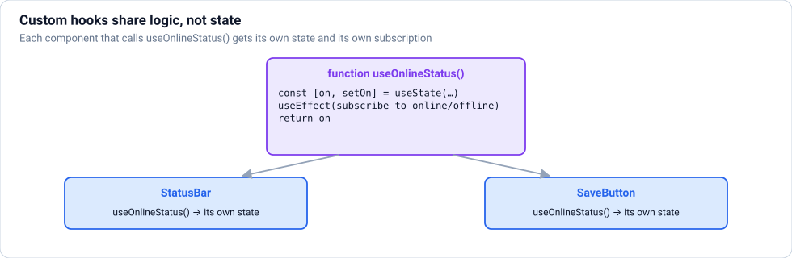

### Theory

> **In simple words:** when two components need the same stateful logic (track online status, fetch some data, debounce a value, read and write `localStorage`), move it into a function whose name starts with **`use`** and which calls other hooks. That's a **custom hook**. Components call it like a built-in hook. Custom hooks share **logic**, not **state**: each component that calls `useCounter()` gets its own counter.

**Words to know:**

- **Custom hook:** a JavaScript function whose name starts with `use` and that calls other hooks (`useState`, `useEffect`, other custom hooks).
- **`use` prefix rule:** the name tells React's linter to apply the Rules of Hooks inside it and to its callers; a function that calls no hooks shouldn't start with `use`.
- **Sharing logic vs sharing state:** each call to a hook creates independent state; to share state itself, lift it up or use context.
- **Hook API design:** what the hook returns: a value (`isOnline`), a tuple (`[value, setValue]` like `useState`) or an object (`{ data, error, status }`).
- **`renderHook`:** Testing Library's helper to test a hook by rendering a tiny component that calls it; `result.current` holds the latest return value.
- **Abstraction:** hiding details behind a well-named interface; custom hooks let components say *what* they need (`useOnlineStatus()`) instead of *how* to get it.
- **Debounce:** wait until a value has stopped changing for some time before using it.

**Everyday picture.** A **recipe card** for masala chai. Every kitchen that follows it makes its own pot (separate state); the card just shares the method (logic). Giving the recipe a clear name ("masala chai") is like naming a hook `useOnlineStatus` instead of leaving twenty lines of effects in every component.

**Extracting a hook, traced:**

```text
StatusBar:   const [isOnline, setIsOnline] = useState(true); useEffect(subscribe to online/offline events …)
SaveButton:  the SAME 10 lines again
extract  →   function useOnlineStatus() { const [isOnline, set…] = useState(true); useEffect(…); return isOnline; }
StatusBar:   const isOnline = useOnlineStatus();        SaveButton: const isOnline = useOnlineStatus();
each component still has its own useState inside the hook; both subscribe separately; both update on the event
```

**When to write a custom hook:** the same hook logic appears in two places; a component's effect is long and has a nameable purpose; you want to test the logic separately. **When not:** for a single `useState` with no logic (indirection without benefit); for code that doesn't call hooks (make it a normal function).

**Common mistakes:**

- ❌ Naming a non-hook function `useSomething` (or a hook without `use`, which hides Rules-of-Hooks violations from the linter).
- ❌ Expecting two components using the same hook to share state.
- ❌ Hooks that "do everything" (`useApp()`); keep each focused on one concern.
- ❌ Returning new objects or functions every render that consumers put in dependency arrays (memoise them or let the Compiler do it).

**Used in real software:** most libraries are delivered as custom hooks: `useQuery` (TanStack Query), `useForm` (React Hook Form), `useNavigate` (React Router), `useStore` (Zustand); every codebase also grows its own (`useDebounce`, `useMediaQuery`, `useLocalStorage`).

### Code

**Extracting `useOnlineStatus`:** two components share the logic; each has its own state and subscription:

```tsx
import { useEffect, useState } from "react";
import { render, renderHook, screen, act } from "@testing-library/react";

function useOnlineStatus() {
  const [isOnline, setIsOnline] = useState(navigator.onLine);
  useEffect(() => {
    const on = () => setIsOnline(true), off = () => setIsOnline(false);
    window.addEventListener("online", on);
    window.addEventListener("offline", off);
    return () => { window.removeEventListener("online", on); window.removeEventListener("offline", off); };
  }, []);
  return isOnline;
}
function StatusBar() { return <h3>{useOnlineStatus() ? "✅ Online" : "❌ Disconnected"}</h3>; }
function SaveButton() { const online = useOnlineStatus(); return <button disabled={!online}>{online ? "Save progress" : "Reconnecting…"}</button>; }

render(<><StatusBar /><SaveButton /></>);
console.log(screen.getByRole("heading").textContent, "|", screen.getByRole("button").textContent);
await act(async () => { window.dispatchEvent(new Event("offline")); });
console.log(screen.getByRole("heading").textContent, "|", screen.getByRole("button").textContent);
```

**Output:**

```text
✅ Online | Save progress
❌ Disconnected | Reconnecting…
```

**Hooks share logic, not state:** two counters from the same hook are independent:

```tsx
function useCounter(start = 0) {
  const [count, setCount] = useState(start);
  return { count, increment: () => setCount((c) => c + 1) };
}
const a = renderHook(() => useCounter());
const b = renderHook(() => useCounter(10));
act(() => { a.result.current.increment(); a.result.current.increment(); });
console.log("a:", a.result.current.count, "| b:", b.result.current.count);
```

**Output:**

```text
a: 2 | b: 10
```

`renderHook` renders a hidden test component that calls the hook; `result.current` is whatever the hook returned on the latest render, and `act` applies the updates.

**`useDebouncedValue`:** returns a value only after it has stopped changing for `delay` ms (useful for search boxes):

```tsx
function useDebouncedValue<T>(value: T, delay: number): T {
  const [debounced, setDebounced] = useState(value);
  useEffect(() => {
    const id = setTimeout(() => setDebounced(value), delay);
    return () => clearTimeout(id);                     // a new value cancels the pending update
  }, [value, delay]);
  return debounced;
}
const d = renderHook(({ v }) => useDebouncedValue(v, 30), { initialProps: { v: "c" } });
for (const v of ["ch", "cha", "chai"]) d.rerender({ v });
console.log("immediately:", d.result.current);
await act(() => new Promise((r) => setTimeout(r, 60)));
console.log("after 60 ms:", d.result.current);
```

**Output:**

```text
immediately: c
after 60 ms: chai
```

**`useFetch`:** the effect from Section [34](#34-fetching-data-in-effects-loading-errors-race-conditions-and-abortcontroller) packaged as a reusable hook:

```tsx
import { createServer } from "node:http";

type FetchState<T> = { status: "loading" } | { status: "error"; error: string } | { status: "success"; data: T };
function useFetch<T>(url: string): FetchState<T> {
  const [state, setState] = useState<FetchState<T>>({ status: "loading" });
  useEffect(() => {
    let ignore = false;
    const controller = new AbortController();
    setState({ status: "loading" });
    fetch(url, { signal: controller.signal })
      .then((r) => { if (!r.ok) throw new Error(`HTTP ${r.status}`); return r.json() as Promise<T>; })
      .then((data) => { if (!ignore) setState({ status: "success", data }); })
      .catch((e: Error) => { if (!ignore && e.name !== "AbortError") setState({ status: "error", error: e.message }); });
    return () => { ignore = true; controller.abort(); };
  }, [url]);
  return state;
}
const server = createServer((req, res) => {
  if (req.url === "/menu") res.writeHead(200, { "Content-Type": "application/json" }).end('["Masala chai","Samosa"]');
  else res.writeHead(404).end();
});
await new Promise<void>((r) => server.listen(4403, r));

function Menu({ url }: { url: string }) {
  const state = useFetch<string[]>(url);
  if (state.status === "loading") return <p>Loading…</p>;
  if (state.status === "error") return <p>Error: {state.error}</p>;
  return <p>{state.data.join(", ")}</p>;
}
render(<><Menu url="http://localhost:4403/menu" /><Menu url="http://localhost:4403/nope" /></>);
await screen.findByText(/Samosa/);
await screen.findByText(/Error/);
console.log(screen.getAllByRole("paragraph").map((p) => p.textContent));
server.close();
```

**Output:**

```text
[ 'Masala chai, Samosa', 'Error: HTTP 404' ]
```

### Practice

1. Write `useLocalStorage(key, initial)` that works like `useState` but reads the initial value from `localStorage` and saves every change.
2. Write `useToggle(initial = false)` returning `[value, toggle]`, and test it with `renderHook`.

<details>
<summary><b>Answer</b></summary>

```tsx
function useLocalStorage<T>(key: string, initial: T) {
  const [value, setValue] = useState<T>(() => {
    const saved = localStorage.getItem(key);
    return saved !== null ? (JSON.parse(saved) as T) : initial;
  });
  useEffect(() => { localStorage.setItem(key, JSON.stringify(value)); }, [key, value]);
  return [value, setValue] as const;
}
const first = renderHook(() => useLocalStorage("cart", [] as string[]));
act(() => first.result.current[1](["chai"]));
first.unmount();
const second = renderHook(() => useLocalStorage("cart", [] as string[]));   // a "new page load"
console.log("restored:", second.result.current[0], "| stored text:", localStorage.getItem("cart"));

function useToggle(initial = false) {
  const [on, setOn] = useState(initial);
  return [on, () => setOn((v) => !v)] as const;
}
const t = renderHook(() => useToggle());
act(() => t.result.current[1]());
console.log("toggled:", t.result.current[0]);
```

**Output:**

```text
restored: [ 'chai' ] | stored text: ["chai"]
toggled: true
```

1. A lazy initializer reads storage once; an effect saves on change. `as const` makes the return a readonly tuple so callers get exact types. (Real apps also listen to the `storage` event to sync between tabs, Section [40](#40-more-hooks-uselayouteffect-useid-usesyncexternalstore-useimperativehandle-and-ref-as-a-prop).)
2. The toggle uses an updater, so calling it twice in one event toggles twice.

</details>

| # | Problem | Difficulty |
|---|---|---|
| 1 | [react.dev challenges: Make the counter delay configurable, Fix a resetting interval, Implement a staggering movement](https://react.dev/learn/reusing-logic-with-custom-hooks#challenges) | 🟡 Medium |
| 2 | [BFE.dev React problem 7: useToggle()](https://bigfrontend.dev/react/useToggle) | 🟢 Easy |
| 3 | [BFE.dev React problem 8: useDebounce()](https://bigfrontend.dev/react/useDebounce) | 🟡 Medium |
| 4 | [BFE.dev React problem 6: useHover()](https://bigfrontend.dev/react/useHover) | 🟡 Medium |
| 5 | [BFE.dev React problem 15: useClickOutside()](https://bigfrontend.dev/react/useclickoutside) | 🟡 Medium |

**Learn more:** [react.dev: Reusing logic with custom hooks](https://react.dev/learn/reusing-logic-with-custom-hooks) · [Testing Library: renderHook](https://testing-library.com/docs/react-testing-library/api#renderhook)

---

## 39. How Hooks Work Inside: Build useState from Scratch (and the Rules of Hooks)

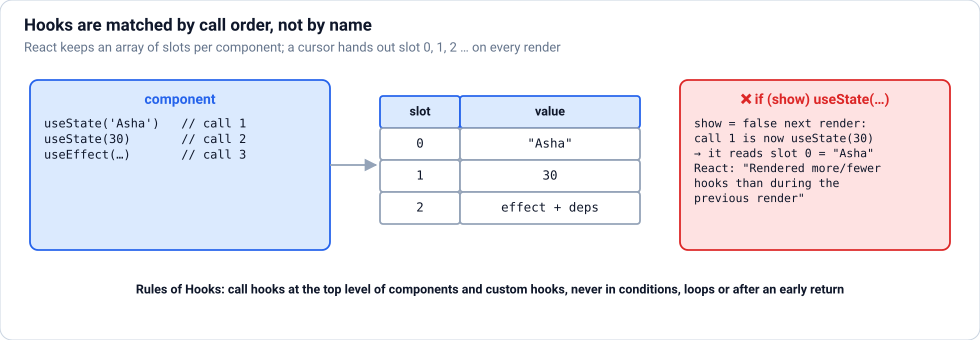

### Theory

> **In simple words:** hooks have no names inside React. React keeps, for each component instance, an **ordered list** of hook slots, and during a render it hands out slot 0 to the first hook call, slot 1 to the second, and so on. That's why the **Rules of Hooks** exist: call hooks only **at the top level** (never inside `if`, loops or nested functions) and only **from components or other hooks**, so the order is identical on every render.

**Words to know:**

- **Hook slot (memoized state):** one entry in a component's list of hook data (a state value, an effect's deps, a ref object).
- **Call order:** the sequence in which a component calls hooks during render; React matches hook calls to slots purely by position.
- **Cursor (hook index):** the counter React advances on each hook call during a render.
- **Fiber:** React's internal object for one component instance; it stores that component's hook list (Section [43](#43-fiber-scheduling-and-concurrent-rendering)).
- **Rules of Hooks:** (1) only call hooks at the top level of a function component or custom hook; (2) don't call them from regular functions, classes, event handlers, or after a conditional early `return`.
- **`rules-of-hooks` lint rule:** flags violations at edit time (Section [31](#31-the-lifecycle-of-an-effect-dependencies-cleanup-and-strict-mode)).
- **"Rendered more hooks than during the previous render":** React's error when a render calls more hooks than last time (a conditional hook became true).
- **Closure:** a function that remembers variables from where it was created; the setter closes over its slot index.
- **`use` exception:** React 19's `use` (for promises and context) isn't a hook in this sense and may be called conditionally.

**Everyday picture.** A **cloakroom with numbered pegs** but no names. The first coat handed in each evening goes on peg 0, the second on peg 1. If one evening a guest skips handing in their scarf (a hook inside an `if`), every later item lands one peg early, and everyone collects the wrong thing.

**The slots, traced by hand:**

```text
function Form() {
  const [name, setName] = useState("Asha");     ← slot 0
  const [age, setAge]   = useState(30);         ← slot 1
  useEffect(…)                                   ← slot 2
}
render 1: cursor 0 → create slot 0 = "Asha"; cursor 1 → slot 1 = 30; cursor 2 → effect
setAge(31): slot 1 = 31, re-render
render 2: cursor 0 → read slot 0 ("Asha"); cursor 1 → read slot 1 (31) ✅
if `useState("Asha")` were inside `if (show)` and show became false:
render 3: cursor 0 → the AGE call reads slot 0 = "Asha" ❌ (now age is a string)
```

**When this knowledge helps:** understanding error messages, writing custom hooks correctly, and interview questions ("why can't hooks be conditional?"). **When not to rely on it:** never depend on internals in app code; the public behaviour (the Rules of Hooks) is what's guaranteed.

**Common mistakes:**

- ❌ `if (user) { useEffect(…) }`. ✅ `useEffect(() => { if (user) … })`.
- ❌ Hooks after an early return (`if (loading) return null; const x = useMemo(…)`). ✅ Call hooks first, return after.
- ❌ Hooks in loops over a changing list, or in event handlers.

**Used in real software:** React's own implementation (`ReactFiberHooks`) keeps hooks as a linked list on each fiber and walks it in call order; Preact, SolidJS's React-compat layer and other libraries use the same idea.

### Code

**From scratch: a tiny React with `useState`.** A component is called with a cursor into its slot array; setters write into their slot and re-render:

```tsx
type Component = () => string;

function createMiniReact() {
  const slots: unknown[] = [];
  let cursor = 0;
  let root: Component;
  let output = "";

  function useState<T>(initial: T): [T, (next: T | ((p: T) => T)) => void] {
    const index = cursor++;                                   // this call's slot, by ORDER
    if (slots.length <= index) slots[index] = initial;        // first render: create the slot
    const setState = (next: T | ((p: T) => T)) => {
      slots[index] = typeof next === "function" ? (next as (p: T) => T)(slots[index] as T) : next;
      renderRoot();                                           // re-render (real React batches this)
    };
    return [slots[index] as T, setState];
  }
  function renderRoot() { cursor = 0; output = root(); }
  return { useState, mount(c: Component) { root = c; renderRoot(); }, get output() { return output; }, slots };
}

const mini = createMiniReact();
let setAgeFromOutside: (n: number) => void = () => {};
function Profile() {
  const [name] = mini.useState("Asha");
  const [age, setAge] = mini.useState(30);
  setAgeFromOutside = setAge;
  return `${name} is ${age}`;
}
mini.mount(Profile);
console.log(mini.output, "| slots:", JSON.stringify(mini.slots));
setAgeFromOutside(31);
console.log(mini.output, "| slots:", JSON.stringify(mini.slots));
```

**Output:**

```text
Asha is 30 | slots: ["Asha",30]
Asha is 31 | slots: ["Asha",31]
```

About twenty lines give components memory: the slot array survives between renders and the cursor matches each call to its slot by position.

**Breaking the order in the mini version** shows why the rule exists. A conditional hook shifts the slots:

```tsx
const mini2 = createMiniReact();
let showName = true;
let rerender = () => {};
function Shaky() {
  const [name] = showName ? mini2.useState("Asha") : ["(skipped)"];
  const [age, setAge] = mini2.useState(30);
  rerender = () => setAge((a) => a);
  return `name=${name}, age=${JSON.stringify(age)}`;
}
mini2.mount(Shaky);
console.log(mini2.output);
showName = false;
rerender();
console.log(mini2.output, "← the age hook read slot 0, which holds the name");
```

**Output:**

```text
name=Asha, age=30
name=(skipped), age="Asha" ← the age hook read slot 0, which holds the name
```

**Real React detects the mismatch and throws:**

```tsx
import { useState } from "react";
import { render, screen, fireEvent } from "@testing-library/react";

function Conditional() {
  const [extra, setExtra] = useState(false);
  if (extra) {
    useState("I'm new");                       // ❌ a hook that only runs sometimes
  }
  return <button onClick={() => setExtra(true)}>show extra</button>;
}
render(<Conditional />);
fireEvent.click(screen.getByRole("button"));   // expect-warning
```

**Output:**

```text
console.error: React has detected a change in the order of Hooks called by Conditional. This will lead to bugs and errors if not fixed. For more information, read the Rules of Hooks: https://react.dev/link/rules-of-hooks
Error: Rendered more hooks than during the previous render.
```

React first warns that the order of hooks changed, then compares the number of hooks with the previous render and refuses to continue. The `rules-of-hooks` lint rule (Section [31](#31-the-lifecycle-of-an-effect-dependencies-cleanup-and-strict-mode)) catches this before it ever runs.

**The correct pattern:** call every hook unconditionally, put the condition **inside**:

```tsx
function Fixed() {
  const [extra, setExtra] = useState(false);
  const [note] = useState("I'm new");          // always called
  return <button onClick={() => setExtra(true)}>{extra ? note : "show extra"}</button>;
}
render(<Fixed />);
fireEvent.click(screen.getByRole("button"));
console.log(screen.getByRole("button").textContent);
```

**Output:**

```text
I'm new
```

### Practice

1. Extend the mini React with `useRef(initial)` (one slot holding `{ current }`, never re-rendering).
2. Why is `const [a] = useState(0); if (a > 5) return null; const [b] = useState(0);` a bug even though both hooks are "at the top level"?

<details>
<summary><b>Answer</b></summary>

1. `function useRef<T>(initial: T) { const index = cursor++; if (slots.length <= index) slots[index] = { current: initial }; return slots[index] as { current: T }; }`: the same slot logic, but it returns the stored object itself and never triggers a render.
2. The early `return` means the second `useState` is skipped whenever `a > 5`, so the number of hook calls changes between renders, which is the same as a conditional hook. Move all hook calls above any early return.

</details>

| # | Problem | Difficulty |
|---|---|---|
| 1 | [react.dev challenge: Implement the state queue yourself](https://react.dev/learn/queueing-a-series-of-state-updates#challenges) | 🟡 Medium |
| 2 | [BFE.dev React quiz 22: useState()](https://bigfrontend.dev/react-quiz/useState) | 🟡 Medium |
| 3 | [LeetCode 2620. Counter (closures)](https://leetcode.com/problems/counter/) | 🟢 Easy |

**Learn more:** [react.dev: Rules of Hooks](https://react.dev/reference/rules/rules-of-hooks) · [Shawn Wang: Getting closure on React hooks (talk)](https://www.youtube.com/watch?v=KJP1E-Y-xyo)

---

## 40. More Hooks: useLayoutEffect, useId, useSyncExternalStore, useImperativeHandle and ref as a Prop

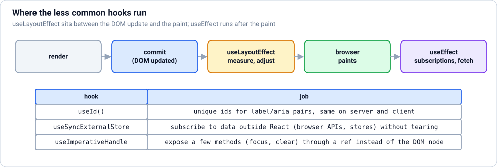

### Theory

> **In simple words:** a few built-in hooks solve specific problems. **`useLayoutEffect`** runs after the DOM changes but **before the browser paints**, so you can measure an element and adjust without a visible flicker. **`useId`** generates unique ids that match between server and client (for `htmlFor`/`aria-*`). **`useSyncExternalStore`** subscribes a component to data that lives outside React. **`useImperativeHandle`** decides what a parent can do through a ref.

**Words to know:**

- **`useLayoutEffect`:** like `useEffect`, but runs synchronously after the commit and before paint; blocks painting, so use it only for measuring and immediately adjusting layout.
- **Layout shift / flicker:** a visible jump when something renders in one position and then moves.
- **`useId()`:** returns a unique, stable string per component instance (React 19.2 format: `_r_0_`-style), identical in server-rendered HTML and on the client.
- **`useSyncExternalStore(subscribe, getSnapshot, getServerSnapshot?)`:** reads a value from an external store and re-renders when the store changes, safely under concurrent rendering.
- **External store:** data outside React state: a browser API (`navigator.onLine`, `matchMedia`), a third-party store, a module-level variable with listeners.
- **Snapshot:** the current value returned by `getSnapshot`; must return the **same** value (same reference) when nothing changed.
- **Tearing:** different parts of the UI showing different versions of the same external data during one render; `useSyncExternalStore` prevents it.
- **`useImperativeHandle(ref, () => ({ … }))`:** exposes a custom object (e.g. `{ focus, clear }`) through a ref instead of the raw DOM node.
- **`forwardRef` (legacy):** the pre-19 way to accept a ref in a function component; React 19 passes `ref` as a normal prop.
- **`useDebugValue`:** labels a custom hook's value in React DevTools.
- **`useInsertionEffect`:** for CSS-in-JS libraries to inject styles before layout effects; not for app code.

**Everyday picture.** A **tailor's fitting**. `useEffect` is adjusting the suit after the customer has walked out in it (everyone saw it was too long). `useLayoutEffect` is pinning the hem while they're still in the fitting room, before anyone sees.

**Effect timing, traced:**

```text
render → commit (DOM updated) → useLayoutEffect runs (can measure, can setState → re-render BEFORE paint)
       → browser paints → useEffect runs
a tooltip measured in useEffect: first paint at the wrong spot, then jumps (flicker)
measured in useLayoutEffect:    the first paint is already correct
```

**When to use each:** `useLayoutEffect` only for measure-then-position (tooltips, popovers, auto-growing textareas, scroll restoration); `useId` for every accessibility id in reusable components; `useSyncExternalStore` when subscribing to anything that isn't React state (and inside store libraries); `useImperativeHandle` for components that must offer imperative methods (a video player's `play()`, an input's `focus()`). **When not:** `useLayoutEffect` for anything else (it delays painting); `useId` for list keys (keys come from data).

**Common mistakes:**

- ❌ `useLayoutEffect` for data fetching or logging (slows the first paint).
- ❌ `Math.random()` or a module counter for ids (mismatches between server and client HTML; Section [59](#59-hydration-and-hydration-mismatches)).
- ❌ A `getSnapshot` that returns a new object every call (infinite re-render loop).
- ❌ Exposing the whole DOM node when a couple of methods would do.

**Used in real software:** Floating UI and Radix measure popovers with layout effects; Zustand, Redux (react-redux) and Jotai are built on `useSyncExternalStore`; design systems use `useId` for every label/input pair.

### Code

**Order of effects: layout effects run before regular effects,** with the DOM already updated:

```tsx
import { useEffect, useLayoutEffect, useId, useSyncExternalStore, useImperativeHandle, useRef, useState } from "react";
import type { Ref } from "react";
import { render, renderHook, screen, fireEvent, act } from "@testing-library/react";

function Timing() {
  console.log("render");
  useLayoutEffect(() => console.log("useLayoutEffect (before paint) | DOM ready:", document.querySelector("#t") !== null));
  useEffect(() => console.log("useEffect (after paint)"));
  return <p id="t">hi</p>;
}
render(<Timing />);
```

**Output:**

```text
render
useLayoutEffect (before paint) | DOM ready: true
useEffect (after paint)
```

**Measuring for real needs a browser,** because jsdom has no layout engine. These files bundle a component with esbuild and run it in Chrome with Playwright (the same tools Section [57](#57-testing-data-and-flows-msw-hooks-and-playwright-end-to-end) uses for end-to-end tests). The tooltip is positioned **above** its button if there's room, measured with `getBoundingClientRect` in `useLayoutEffect`:

```tsx
import { useLayoutEffect, useRef, useState } from "react";
import { createRoot } from "react-dom/client";

function Tooltip({ text, top }: { text: string; top: number }) {
  const ref = useRef<HTMLDivElement>(null);
  const [height, setHeight] = useState(0);
  useLayoutEffect(() => {
    setHeight(ref.current!.getBoundingClientRect().height);       // measure, then re-render before paint
  }, []);
  const placeAbove = top - height >= 0;
  const y = placeAbove ? top - height : top + 40;
  console.log(`tooltip height ${height}px → placed ${placeAbove ? "above" : "below"} at y=${y}`);
  return <div ref={ref} style={{ position: "absolute", top: y, padding: 8, fontSize: 16 }}>{text}</div>;
}
createRoot(document.getElementById("root")!).render(<><Tooltip text="Free delivery over ₹500" top={200} /><Tooltip text="Near the top" top={10} /></>);
```

```js
import { chromium } from "@playwright/test";
const browser = await chromium.launch({ channel: "chrome" });   // the installed Google Chrome, headless
const page = await browser.newPage();
page.on("console", (message) => console.log(message.text()));
await page.setContent('<div id="root"></div>');
await page.addScriptTag({ path: process.argv[2] });
await page.waitForTimeout(200);
await browser.close();
```

```bash
npx esbuild tooltip.tsx --bundle --outfile=tooltip.js --jsx=automatic --define:process.env.NODE_ENV='"production"' --log-level=warning
node run-in-chrome.mjs tooltip.js
```

**Output:**

```text
tooltip height 0px → placed above at y=200
tooltip height 0px → placed above at y=10
tooltip height 38px → placed above at y=162
tooltip height 34px → placed below at y=50
```

Each tooltip rendered twice before the first paint: once with height 0, then again after the layout effect measured it. The user only ever sees the second, correct position. With `useEffect` the first (wrong) position could flash on screen.

**`useId` for accessible label/input pairs,** unique per instance:

```tsx
function Field({ label }: { label: string }) {
  const id = useId();
  return <p><label htmlFor={id}>{label}</label><input id={id} aria-describedby={`${id}-hint`} /><small id={`${id}-hint`}>required</small></p>;
}
const { container } = render(<><Field label="Name" /><Field label="Phone" /></>);
console.log([...container.querySelectorAll("input")].map((i) => i.id));
console.log((screen.getByLabelText("Phone") as HTMLInputElement).id === container.querySelectorAll("input")[1].id);
```

**Output:**

```text
[ '_r_0_', '_r_1_' ]
true
```

**`useSyncExternalStore`: subscribe to a store that lives outside React.** A tiny cart store with listeners, read by two components:

```tsx
function createStore<T>(initial: T) {
  let state = initial;
  const listeners = new Set<() => void>();
  return {
    get: () => state,
    set: (next: T) => { state = next; listeners.forEach((l) => l()); },
    subscribe: (listener: () => void) => { listeners.add(listener); return () => listeners.delete(listener); },
  };
}
const cartStore = createStore({ items: 0 });
function CartBadge() {
  const cart = useSyncExternalStore(cartStore.subscribe, cartStore.get);
  return <span>🛒 {cart.items}</span>;
}
render(<><CartBadge /> <CartBadge /></>);
act(() => cartStore.set({ items: 3 }));                // updated from outside React
console.log(document.body.textContent);
```

**Output:**

```text
🛒 3 🛒 3
```

`get` returns the same object until `set` replaces it, which is exactly what `getSnapshot` must do. Section [55](#55-global-state-build-a-store-then-zustand-redux-toolkit-and-jotai) grows this into a Zustand-like store.

**`useImperativeHandle` with `ref` as a prop:** the parent gets only `focus` and `clear`, not the whole input:

```tsx
type SearchHandle = { focus: () => void; clear: () => void };
function SearchInput({ ref }: { ref?: Ref<SearchHandle> }) {
  const inputRef = useRef<HTMLInputElement>(null);
  useImperativeHandle(ref, () => ({
    focus: () => inputRef.current!.focus(),
    clear: () => { inputRef.current!.value = ""; },
  }), []);
  return <input ref={inputRef} aria-label="search" defaultValue="old query" />;
}
function Toolbar() {
  const search = useRef<SearchHandle>(null);
  return <><SearchInput ref={search} /><button onClick={() => { search.current!.clear(); search.current!.focus(); }}>New search</button></>;
}
render(<Toolbar />);
fireEvent.click(screen.getByText("New search"));
const box = screen.getByLabelText("search") as HTMLInputElement;
console.log(`value "${box.value}", focused: ${document.activeElement === box}`);
```

**Output:**

```text
value "", focused: true
```

### Practice

1. Write `useMediaQuery(query)` with `useSyncExternalStore` and `window.matchMedia`.
2. A component sets `id="email"` on its input and is rendered twice on a page. What breaks, and what's the fix?

<details>
<summary><b>Answer</b></summary>

1. 

```text
function useMediaQuery(query: string) {
  return useSyncExternalStore(
    (onChange) => { const mql = matchMedia(query); mql.addEventListener("change", onChange); return () => mql.removeEventListener("change", onChange); },
    () => matchMedia(query).matches,          // a boolean: same value when nothing changed
    () => false,                               // server snapshot (no window on the server)
  );
}
```

(Not run here: jsdom doesn't implement `matchMedia`.)

2. Two elements share one id, so `<label htmlFor="email">` points at the first input only and `getElementById` finds the wrong one; screen readers announce the wrong label. Use `useId()` for per-instance ids.

</details>

| # | Problem | Difficulty |
|---|---|---|
| 1 | [BFE.dev React quiz 10: useLayoutEffect()](https://bigfrontend.dev/react-quiz/useLayoutEffect) | 🟡 Medium |
| 2 | [BFE.dev React quiz 27: useEffect() timing II](https://bigfrontend.dev/react-quiz/useeffect-timing-ii) | 🔴 Hard |
| 3 | [BFE.dev React problem 13: proxy-state valtio (an external store)](https://bigfrontend.dev/react/proxy-state-valtio) | 🔴 Hard |

**Learn more:** [react.dev: useLayoutEffect](https://react.dev/reference/react/useLayoutEffect) · [react.dev: useSyncExternalStore](https://react.dev/reference/react/useSyncExternalStore) · [react.dev: useId](https://react.dev/reference/react/useId) · [react.dev: useImperativeHandle](https://react.dev/reference/react/useImperativeHandle)

---

## 41. Debugging React: DevTools, Strict Mode and Reading Errors

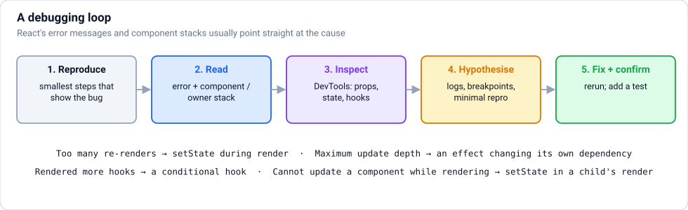

### Theory

> **In simple words:** most React bugs fall into a few families: state that didn't update (mutation), state that's stale (snapshots, missing dependencies), infinite loops (setting state during render or in an effect without the right dependencies), wrong things re-rendering, and hooks used out of order. **Read the error message carefully** (React's are unusually good), inspect the component's props and state with **React DevTools**, keep **StrictMode** on, and reproduce the bug in the smallest example you can.

**Words to know:**

- **React DevTools:** a browser extension (Chrome, Firefox, Edge) with a **Components** tab (inspect and edit props, state and hooks of any component) and a **Profiler** tab (record renders, Section [44](#44-why-components-re-render-and-measuring-with-the-profiler)).
- **Component stack:** the list of components from the root to where an error happened, printed under React's error messages.
- **Owner stack (`captureOwnerStack`, React 19.1):** a development-only stack of the components that **rendered** (owned) the failing one, which is usually more useful than the parent chain.
- **Source map:** a file that maps bundled, minified code back to your original source, so stack traces and breakpoints point at your files.
- **Breakpoint / `debugger`:** pausing code in the browser's DevTools to inspect variables; the `debugger;` statement pauses there when DevTools is open.
- **Minimal reproduction:** the smallest code that still shows the bug; building one finds most bugs by itself.
- **Production error codes:** in production builds React shortens messages to a code with a link (`Minified React error #301`); the link expands it.
- **"Highlight updates":** a DevTools option that flashes components as they re-render.
- **React Performance tracks (React 19.2):** extra lanes in the browser's Performance panel showing React's scheduler and component renders.

**Everyday picture.** A **doctor's diagnosis**. Symptoms (the bug report) → read the test results (the error and component stack) → examine the patient (DevTools: props and state) → form a hypothesis → test it (a log, a breakpoint, a minimal reproduction) → treat (the fix) → check the patient recovered (rerun). Guessing at treatments without tests is how bugs come back.

**The common error messages, and what they mean:**

| Message (first line) | Usual cause | Fix |
|---|---|---|
| Too many re-renders. React limits the number of renders to prevent an infinite loop. | `setState` called **during render** (often `onClick={setX(1)}`) | pass a function: `onClick={() => setX(1)}` |
| Maximum update depth exceeded | an effect sets state that changes its own dependency every time | fix dependencies, derive instead of syncing |
| Rendered more (or fewer) hooks than during the previous render | conditional hook / hook after early return | call hooks unconditionally (Section [39](#39-how-hooks-work-inside-build-usestate-from-scratch-and-the-rules-of-hooks)) |
| Cannot update a component while rendering a different component | calling a parent's setter during a child's render | call it in an event handler or effect |
| Each child in a list should have a unique "key" prop | missing keys | stable ids as keys (Section [12](#12-rendering-lists-and-keys)) |
| Objects are not valid as a React child | rendering an object | render a field (Section [8](#8-jsx-markup-inside-javascript-and-what-it-compiles-to)) |
| A component is changing an uncontrolled input to be controlled | `value` went from `undefined` to a string | initialise state to `""` (Section [19](#19-forms-controlled-and-uncontrolled-inputs)) |
| Hydration failed because the server rendered HTML didn't match the client | different output on server and client | Section [59](#59-hydration-and-hydration-mismatches) |

**When to use which tool:** DevTools for "what are the props/state right now?"; logs for "in what order did things happen?"; breakpoints for "what's this variable at this exact moment?"; the Profiler for "why is it slow / why did it re-render?". **When not:** don't debug in production builds when a development build reproduces it (messages and warnings are stripped in production).

**Common mistakes:**

- ❌ Removing StrictMode because effects log twice (it's revealing a real bug or a missing cleanup).
- ❌ Reading only the first line of an error and ignoring the component stack.
- ❌ Debugging the whole app instead of reducing it to a minimal reproduction.
- ❌ `console.log(state)` right after `setState` and concluding the update failed (it's a snapshot, Section [16](#16-state-as-a-snapshot-batching-and-updater-functions)).

**Used in real software:** React DevTools ships for Chrome, Firefox and Edge, and as a standalone app for React Native; error monitoring services (Sentry, Datadog) group production errors by component stack (Section [68](#68-production-web-vitals-monitoring-builds-and-deployment)).

### Code

**The infinite loop from calling a setter during render** (`onClick={setCount(count + 1)}`), and React's message:

```tsx
import { useState, useEffect, captureOwnerStack } from "react";
import { render, screen, fireEvent } from "@testing-library/react";

function Loop() {
  const [count, setCount] = useState(0);
  return <button onClick={setCount(count + 1) as any}>{count}</button>;   // ❌ calls setCount while rendering
}
render(<Loop />);
```

**Output:**

```text
Error: Too many re-renders. React limits the number of renders to prevent an infinite loop.
```

**An effect that keeps changing its own dependency.** This loop never ends on its own (React keeps warning and keeps going), so the example adds a safety guard that stops it after 120 effect runs:

```tsx
let effectRuns = 0;
function Spinner() {
  const [options, setOptions] = useState({ speed: 1 });
  useEffect(() => {
    effectRuns++;
    if (effectRuns < 120) setOptions({ speed: 1 });           // ❌ a new object each time → the effect runs again (guarded here)
  }, [options]);
  return <p>{options.speed}</p>;
}
render(<Spinner />);   // expect-warning
console.log("effect ran", effectRuns, "times before the guard stopped it");
```

**Output:**

```text
console.error: Maximum update depth exceeded. This can happen when a component calls setState inside useEffect, but useEffect either doesn't have a dependency array, or one of the dependencies changes on every render.
console.error: Maximum update depth exceeded. This can happen when a component calls setState inside useEffect, but useEffect either doesn't have a dependency array, or one of the dependencies changes on every render.
effect ran 120 times before the guard stopped it
```

Each `setOptions({ speed: 1 })` creates a **new** object, which is a new dependency value, which re-runs the effect. React noticed and printed `Maximum update depth exceeded` (as a warning: for effects it can't safely throw), but without the guard the page would freeze. The fix is to depend on primitives or not store derived values at all.

**Updating a parent while a child renders:**

```tsx
function Child({ onRender }: { onRender: () => void }) {
  onRender();                                                   // ❌ setState of the parent during the child's render
  return <p>child</p>;
}
function ParentComponent() {
  const [renders, setRenders] = useState(0);
  return <><Child onRender={() => setRenders(1)} /><p>{renders}</p></>;   // expect-warning
}
render(<ParentComponent />);
```

**Output:**

```text
console.error: Cannot update a component (`ParentComponent`) while rendering a different component (`Child`). To locate the bad setState() call inside `Child`, follow the stack trace as described in https://react.dev/link/setstate-in-render
```

This one is a warning rather than an error, so it's easy to miss in a busy console; the fix is to call `onRender` from an effect or an event handler.

**Logging the owner stack** (development only) shows which components rendered the one that's misbehaving:

```tsx
function PriceDisplay({ paise }: { paise: number }) {
  if (Number.isNaN(paise)) console.log("NaN price! owner stack:", (captureOwnerStack() ?? "").trim().split("\n").map((l) => l.trim().split(" ")[1]).join(" ← "));
  return <span>₹{paise / 100}</span>;
}
function Cart() { return <CartLine item={{ name: "chai" }} />; }
function CartLine({ item }: { item: { name: string; paise?: number } }) { return <PriceDisplay paise={Number(item.paise)} />; }
render(<Cart />);
```

**Output:**

```text
NaN price! owner stack: CartLine ← Cart
```

The stack points straight at `CartLine` (which passed `Number(undefined)`) and `Cart` (which built the item without a price). Stack lines vary between browsers and tools, so only the component names are kept here.

**Bisecting with logs:** log props and state at the top of a component and in effects to see what really happens on each render. The order often explains the bug:

```tsx
function Search({ query }: { query: string }) {
  const [results, setResults] = useState<string[]>([]);
  console.log(`render query="${query}" results=${results.length}`);
  useEffect(() => {
    console.log(`effect for "${query}"`);
    setResults(query ? ["Masala chai", "Chai latte"].filter((x) => x.toLowerCase().includes(query)) : []);
  }, [query]);
  return <p>{results.join(", ")}</p>;
}
const view = render(<Search query="" />);
view.rerender(<Search query="latte" />);
```

**Output:**

```text
render query="" results=0
effect for ""
render query="" results=0
render query="latte" results=0
effect for "latte"
render query="latte" results=1
```

The log shows each query renders **twice**: once with the stale results, then again after the effect. That's the signature of derived data stored in state (Section [32](#32-you-might-not-need-an-effect)); computing the results during render removes the extra render and the stale frame.

### Practice

1. A colleague says "my input loses focus after every keystroke". Name the two most likely causes.
2. You see `Warning: Can't perform a React state update on an unmounted component` in an old project. What did it mean, and why don't you see it in React 18+?

<details>
<summary><b>Answer</b></summary>

1. (a) The input is inside a component **defined inside another component**, so it's a new type on every render and gets remounted (Section [24](#24-preserving-and-resetting-state-tree-position-and-keys)); (b) the input (or a parent) has a **key that changes** every render (e.g. `key={Math.random()}` or a key derived from the value).
2. An async callback (a fetch, a timer) called `setState` after the component had unmounted; usually a missing cleanup. React 18 removed the warning because it was often a false alarm (setting state on an unmounted component is a harmless no-op); you still need cleanups to avoid races and leaks (Section [34](#34-fetching-data-in-effects-loading-errors-race-conditions-and-abortcontroller)).

</details>

| # | Problem | Difficulty |
|---|---|---|
| 1 | [BFE.dev React quiz 2: React re-render 2 - memo()](https://bigfrontend.dev/react-quiz/React-re-render-2) | 🟡 Medium |
| 2 | [react.dev challenge: Fix a broken story tray (finding an impure render)](https://react.dev/learn/keeping-components-pure#challenges) | 🟡 Medium |

**Learn more:** [react.dev: React Developer Tools](https://react.dev/learn/react-developer-tools) · [react.dev: captureOwnerStack](https://react.dev/reference/react/captureOwnerStack) · [react.dev: React Performance tracks](https://react.dev/reference/dev-tools/react-performance-tracks)

---

### ✅ Part 6 checkpoint

Without looking, can you:

- [ ] Write a typed reducer with an exhaustive `switch`, test it without React, and use it with `useReducer`?
- [ ] Create and provide a context, read it with `useContext` or `use`, and explain who re-renders when its value changes?
- [ ] Combine a reducer with two contexts and accessor hooks into a small store?
- [ ] Extract logic into a custom hook, explain why hooks share logic but not state, and test one with `renderHook`?
- [ ] Build `useState` from scratch with a slot array and a cursor, and explain the Rules of Hooks from it?
- [ ] Use `useLayoutEffect`, `useId`, `useSyncExternalStore` and `useImperativeHandle` for their intended jobs?
- [ ] Recognise React's common error messages and debug with DevTools, logs and owner stacks?

Part 7 looks under the hood: reconciliation, Fiber and performance.

---

# Part 7 — Moderate: How React Works and Performance

> **Goal:** Understand what React does under the hood (reconciliation, which you'll build yourself, and the Fiber architecture that makes rendering interruptible), find out why components re-render and measure it, apply memoisation and the React Compiler where it helps, render huge lists, split bundles, recover from render errors, and make everything accessible.  
> **You need:** Parts 2–6, especially render and commit (Section [15](#15-render-and-commit-what-happens-when-state-changes)), keys (Section [12](#12-rendering-lists-and-keys)) and preserving state (Section [24](#24-preserving-and-resetting-state-tree-position-and-keys)).

---

## 42. The Virtual DOM and Reconciliation: Build a Mini React from Scratch

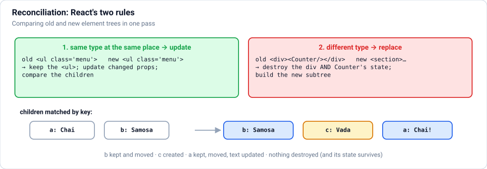

### Theory

> **In simple words:** every render produces a tree of plain element objects (the "virtual DOM"). React compares the new tree with the previous one (**reconciliation**, also called **diffing**) and applies only the differences to the real DOM. Comparing two arbitrary trees perfectly is very slow, so React uses two simple rules that make it fast: **elements of a different type produce a different subtree**, and **keys identify children across renders**. You'll build a working version of this in about 80 lines.

**Words to know:**

- **Virtual DOM:** the lightweight tree of element objects (`{ type, props }`) React builds on each render; cheap to create and compare, unlike real DOM nodes.
- **Reconciliation / diffing:** comparing the new element tree with the previous one to work out the minimum DOM changes.
- **Patch:** a DOM operation that applies a difference: create, remove, move a node, set a property, change text.
- **Heuristic:** a rule of thumb that gives a good-enough answer fast instead of the perfect answer slowly. A perfect tree diff is O(n³); React's heuristics make it O(n) (one pass, proportional to the number of elements).
- **Same-type rule:** if an element has the same `type` (`"div"` or the same component function) at the same position, React keeps the DOM node or component instance and only updates props.
- **Different-type rule:** a different `type` at a position means React destroys the old subtree (DOM and state) and builds the new one.
- **Keyed children:** children with keys are matched by key, so reordering moves existing nodes and keeps their state.
- **Mount / update / unmount (DOM):** creating a DOM node for a new element / changing an existing node / removing one.
- **Renderer:** the package that turns React's decisions into a platform's operations (React DOM for the web, React Native for mobile).

**Everyday picture.** A **"spot the difference" puzzle**. Instead of redrawing the whole picture, you compare the two drawings and circle only what changed. React's shortcut: if a whole region is a different kind of thing (a tree became a house), don't compare the leaves; just redraw that region.

**Diffing two trees by hand:**

```text
old: <ul> <li key="a">Chai</li> <li key="b">Samosa</li> </ul>     new: <ul> <li key="b">Samosa</li> <li key="c">Vada</li> <li key="a">Chai!</li> </ul>
1. root: ul vs ul → same type → keep the <ul>, compare children
2. children by key: "b" exists → keep its <li> (move it first) · "c" is new → create · "a" exists → keep, move last, update text "Chai" → "Chai!"
3. no old key is missing → nothing removed
DOM operations: 1 create, 1 text update, a few moves; without keys React would change texts in place and create one node

old: <div><Counter /></div>    new: <section><Counter /></section>
root: div vs section → DIFFERENT type → destroy the div and the Counter inside (its state is lost), build a new section + Counter
```

**When this knowledge matters:** choosing keys, understanding why state resets (Section [24](#24-preserving-and-resetting-state-tree-position-and-keys)), explaining performance, and interviews. **When not:** you never call the reconciler yourself; React does it on every render.

**Common mistakes:**

- ❌ Believing the virtual DOM makes React "faster than the DOM" (it makes updates **predictable and good enough**; hand-written DOM code can be faster).
- ❌ Wrapping content conditionally in different elements (`{isMobile ? <div>{content}</div> : <section>{content}</section>}`) and losing child state on resize.
- ❌ Changing a component's type by defining it inline (Section [24](#24-preserving-and-resetting-state-tree-position-and-keys)).

**Used in real software:** Preact, Inferno and Vue 2/3 use virtual DOM diffing too; SolidJS and Svelte skip it by compiling updates to direct DOM writes, which is one reason they're smaller and often faster.

### Code

**From scratch: a mini React DOM renderer with keyed reconciliation.** It handles element creation, props, text, same-type updates, different-type replacement and keyed children, and counts DOM operations:

```tsx
type VNode = { type: string; props: Record<string, any>; key?: string; children: (VNode | string)[] };
const h = (type: string, props: Record<string, any> | null, ...children: (VNode | string)[]): VNode =>
  ({ type, key: props?.key, props: { ...props }, children });

const ops: string[] = [];
const nodeOf = new WeakMap<object, Node>();             // virtual node → real DOM node

function create(v: VNode | string): Node {
  if (typeof v === "string") { ops.push(`create text "${v}"`); return document.createTextNode(v); }
  ops.push(`create <${v.type}>`);
  const el = document.createElement(v.type);
  for (const [k, val] of Object.entries(v.props)) if (k !== "key") el.setAttribute(k, val);
  v.children.forEach((c) => { const n = create(c); el.appendChild(n); if (typeof c !== "string") nodeOf.set(c, n); });
  nodeOf.set(v, el);
  return el;
}

function patch(parent: Node, oldV: VNode | string, newV: VNode | string, dom: Node): Node {
  if (typeof oldV === "string" || typeof newV === "string") {
    if (oldV === newV) return dom;
    if (typeof oldV === "string" && typeof newV === "string") { ops.push(`text "${oldV}" → "${newV}"`); dom.textContent = newV; return dom; }
  } else if (oldV.type === newV.type) {                                  // same type: update in place
    const el = dom as Element;
    for (const [k, val] of Object.entries(newV.props)) if (k !== "key" && oldV.props[k] !== val) { ops.push(`set ${k}="${val}"`); el.setAttribute(k, val); }
    reconcileChildren(el, oldV.children, newV.children);
    nodeOf.set(newV, el);
    return el;
  }
  const fresh = create(newV);                                            // different type: replace the subtree
  ops.push("replace subtree");
  parent.replaceChild(fresh, dom);
  return fresh;
}

function reconcileChildren(el: Element, oldC: (VNode | string)[], newC: (VNode | string)[]) {
  const keyOf = (c: VNode | string, i: number) => (typeof c !== "string" && c.key !== undefined ? `k:${c.key}` : `i:${i}`);
  const oldByKey = new Map(oldC.map((c, i) => [keyOf(c, i), { v: c, dom: el.childNodes[i] }]));
  const result: Node[] = newC.map((c, i) => {
    const match = oldByKey.get(keyOf(c, i));
    if (!match) return create(c);
    oldByKey.delete(keyOf(c, i));
    return patch(el, match.v, c, match.dom);
  });
  for (const { dom } of oldByKey.values()) { ops.push("remove node"); el.removeChild(dom); }
  result.forEach((node, i) => { if (el.childNodes[i] !== node) { if (node.parentNode === el) ops.push("move node"); el.insertBefore(node, el.childNodes[i] ?? null); } });
}

const root = document.createElement("div");
const v1 = h("ul", { class: "menu" }, h("li", { key: "a" }, "Chai"), h("li", { key: "b" }, "Samosa"));
root.appendChild(create(v1));
console.log("mount:", ops.splice(0).length, "operations →", root.innerHTML);

const v2 = h("ul", { class: "menu" }, h("li", { key: "b" }, "Samosa"), h("li", { key: "c" }, "Vada"), h("li", { key: "a" }, "Chai!"));
const samosaBefore = root.querySelectorAll("li")[1];
patch(root, v1, v2, root.firstChild!);
console.log("update:", ops.splice(0), "→", root.innerHTML);
console.log("Samosa's <li> reused (moved, not recreated)?", root.querySelectorAll("li")[0] === samosaBefore);

const v3 = h("section", { class: "menu" }, h("p", null, "Closed today"));
patch(root, v2, v3, root.firstChild!);
console.log("type change:", ops.splice(0), "→", root.innerHTML);
```

**Output:**

```text
mount: 5 operations → <ul class="menu"><li>Chai</li><li>Samosa</li></ul>
update: [
  'create <li>',
  'create text "Vada"',
  'text "Chai" → "Chai!"',
  'move node'
] → <ul class="menu"><li>Samosa</li><li>Vada</li><li>Chai!</li></ul>
Samosa's <li> reused (moved, not recreated)? true
type change: [
  'create <section>',
  'create <p>',
  'create text "Closed today"',
  'replace subtree'
] → <section class="menu"><p>Closed today</p></section>
```

The update needed only one new element (with its text), one text change and one move; the `<li>` for Samosa is the **same DOM node** as before, just moved. Changing `ul` to `section` replaced the whole subtree, exactly React's different-type rule. (This mini version skips components, events and many optimisations, and its move logic isn't minimal, but it's the same idea.)

**The real thing: React reuses DOM nodes by key and type.** A `MutationObserver` shows what React actually did for the same change:

```tsx
import { render } from "@testing-library/react";
import { act } from "react";

function Menu({ items }: { items: { id: string; name: string }[] }) {
  return <ul>{items.map((i) => <li key={i.id}>{i.name}</li>)}</ul>;
}
const view = render(<Menu items={[{ id: "a", name: "Chai" }, { id: "b", name: "Samosa" }]} />);
const samosa = view.container.querySelectorAll("li")[1];
const seen: string[] = [];
const observer = new MutationObserver((records) => records.forEach((r) => {
  r.addedNodes.forEach((n) => seen.push(`added <${n.nodeName.toLowerCase()}> "${n.textContent}"`));
  r.removedNodes.forEach((n) => seen.push(`removed <${n.nodeName.toLowerCase()}> "${n.textContent}"`));
  if (r.type === "characterData") seen.push(`text → "${r.target.textContent}"`);
}));
observer.observe(view.container, { subtree: true, childList: true, characterData: true });
view.rerender(<Menu items={[{ id: "b", name: "Samosa" }, { id: "c", name: "Vada" }, { id: "a", name: "Chai!" }]} />);
await act(async () => {});
console.log(seen);
console.log("Samosa's <li> reused?", view.container.querySelectorAll("li")[0] === samosa);
```

**Output:**

```text
[
  'added <li> "Vada"',
  'removed <li> "Chai!"',
  'added <li> "Chai!"',
  'text → "Chai!"'
]
Samosa's <li> reused? true
```

A DOM "move" shows up as a removal followed by an insertion of the **same** node (that's how `insertBefore` reports it). React created only the Vada row, changed one text node, and kept Samosa's element.

### Practice

1. Without running it: from `<div><input /><p>A</p></div>` to `<div><p>B</p><input /></div>` without keys, what does React do to the input (does it keep typed text)?
2. Why does React not try to detect that a subtree merely moved to a different parent?

<details>
<summary><b>Answer</b></summary>

1. Without keys React compares by position: position 0 was `input`, now `p` → different type → the input is destroyed and a `p` created; position 1 was `p`, now `input` → destroyed and a new, empty input created. The typed text is lost. Keys on both (`<input key="field" />`, `<p key="label">`) let React move them instead.
2. Finding moved subtrees anywhere in the tree is the expensive general tree-diff problem (O(n³)). React only matches within the same parent and position (or key), which keeps diffing linear; moving a component to a new parent remounts it.

</details>

| # | Problem | Difficulty |
|---|---|---|
| 1 | [BFE.dev React quiz 3: React re-render 3](https://bigfrontend.dev/react-quiz/React-re-render-3) | 🟡 Medium |
| 2 | [react.dev challenge: Fix misplaced state in the list](https://react.dev/learn/preserving-and-resetting-state#challenges) | 🟡 Medium |
| 3 | [LeetCode 2705. Compact Object (recursive tree walk, like a diff)](https://leetcode.com/problems/compact-object/) | 🟡 Medium |

**Learn more:** [legacy React docs: Reconciliation (the diffing heuristics)](https://legacy.reactjs.org/docs/reconciliation.html) · [Rodrigo Pombo: Build your own React](https://pomb.us/build-your-own-react/)

---

## 43. Fiber, Scheduling and Concurrent Rendering

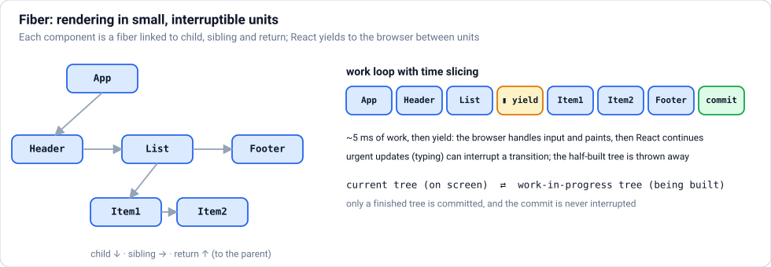

### Theory

> **In simple words:** React 16 rewrote its core as **Fiber**. Rendering is split into small **units of work**, one per component (a **fiber**), so React can **pause** a long render to let the browser handle a click or paint a frame, then **resume**. Updates get **priorities**: typing is urgent; re-rendering a big filtered list can wait. Rendering builds a separate **work-in-progress** tree, and only a finished tree is **committed**, so users never see half a render. This is what makes `useTransition`, `useDeferredValue` and streaming possible (Section [63](#63-transitions-usetransition-usedeferredvalue-activity-and-viewtransition)).

**Words to know:**

- **Fiber:** React's internal object for one component instance or element: its type, props, state (the hooks list, Section [39](#39-how-hooks-work-inside-build-usestate-from-scratch-and-the-rules-of-hooks)), and links to its **child**, **sibling** and **return** (parent) fibers.
- **Unit of work:** processing one fiber (calling its component or updating its element); React works through the tree one unit at a time.
- **Work loop:** the loop that performs units of work; the interruptible version checks after each unit whether it should **yield**.
- **Yielding / time slicing:** pausing rendering after a few milliseconds (about 5 ms in React's scheduler) so the browser can handle input and paint, then continuing.
- **Scheduler:** React's internal package that orders work by priority and decides when to yield.
- **Lanes (priorities):** React's way of labelling updates: discrete events like clicks and typing are synchronous/urgent; transitions are low priority and interruptible.
- **Double buffering (current vs work-in-progress tree):** React renders into a copy of the tree and swaps it in on commit; the screen always shows a complete tree.
- **Concurrent rendering:** rendering that can be interrupted, restarted or abandoned; enabled for updates marked as transitions (`startTransition`) and deferred values.
- **Commit phase is synchronous:** once React starts applying DOM changes it finishes in one go; only the render phase is interruptible.
- **Stack reconciler:** React's pre-16 engine, which rendered recursively and couldn't stop once started.

**Everyday picture.** A **chef preparing a banquet** while also taking orders. The old way (stack reconciler): once the chef starts the banquet they ignore the counter until it's done. With Fiber the chef works dish by dish (units of work), glances at the counter between dishes (yielding), serves urgent walk-in orders first (priorities), and only carries the banquet out when every dish is ready (commit).

**Walking a fiber tree, traced:**

```text
App ─child→ Header ─sibling→ List ─sibling→ Footer
                              │child
                              Item1 ─sibling→ Item2
order of work: App → Header → List → Item1 → Item2 → (return to List) → Footer → (return to App) → done
time-sliced:   App, Header, List [5 ms used → yield: browser handles a keypress] Item1, Item2, Footer → commit
if the keypress caused an urgent update, React may THROW AWAY the half-built tree and restart from the new state
```

**When this matters:** understanding why components may render more than once without committing (purity, Section [10](#10-keeping-components-pure)), why transitions keep inputs responsive, and why effects (not render) are the place for side effects. **When not:** you never interact with fibers directly; they're internal.

**Common mistakes:**

- ❌ Side effects during render (a render may be thrown away and repeated).
- ❌ Assuming every render is followed by a commit.
- ❌ Expecting concurrent behaviour from ordinary `setState` (normal updates are urgent and not time-sliced; only transitions and deferred values are).

**Used in real software:** every React app since React 16 (2017) runs on Fiber; concurrent features became available with React 18 (March 2022) and power Suspense streaming, transitions and `Activity`.

### Code

**From scratch: an interruptible work loop.** Units of work run until a time budget is used up, then the loop yields to the event loop with `setTimeout`, so an "urgent" event (here a timer standing in for a click) gets in between:

```tsx
type Unit = () => void;
function runInterruptibly(units: Unit[], budgetMs: number, label: string) {
  return new Promise<void>((resolve) => {
    let next = 0, slices = 0;
    function workLoop() {
      slices++;
      const start = performance.now();
      while (next < units.length && performance.now() - start < budgetMs) units[next++]();
      if (next < units.length) setTimeout(workLoop, 0);          // yield to the browser, then continue
      else { console.log(`${label}: finished in ${slices > 1 ? "several slices" : "one slice"}`); resolve(); }
    }
    workLoop();
  });
}
const busy = () => { const t = performance.now(); while (performance.now() - t < 1) {} };   // 1 ms of "rendering"
let done = 0;
const units = Array.from({ length: 30 }, () => () => { busy(); done++; });
const report = () => console.log(`  urgent event handled ${done < 30 ? "partway through" : "only after all 30 units"}`);
setTimeout(report, 0);
await runInterruptibly(units, 5, "time-sliced");
done = 0;
setTimeout(report, 0);
await runInterruptibly(units, Infinity, "blocking");
await new Promise((r) => setTimeout(r, 0));                     // let the last timer print
```

**Output:**

```text
  urgent event handled partway through
time-sliced: finished in several slices
blocking: finished in one slice
  urgent event handled only after all 30 units
```

The time-sliced run let the urgent event through partway; the blocking run made it wait until all 30 units were finished, which is what the old stack reconciler did with every render.

**The real React: a transition yields; a synchronous render doesn't.** This example turns off the test `act` environment so React schedules work the way it does in a browser:

```tsx
import { startTransition } from "react";
import { flushSync } from "react-dom";
import { createRoot } from "react-dom/client";

(globalThis as any).IS_REACT_ACT_ENVIRONMENT = false;            // let React's scheduler run for real
let rendered = 0;
function SlowItem({ i }: { i: number }) { busy(); rendered++; return <li>{i}</li>; }    // 1 ms each
function SlowList() { return <ul>{Array.from({ length: 100 }, (_, i) => <SlowItem key={i} i={i} />)}</ul>; }

for (const mode of ["urgent (flushSync)", "transition"] as const) {
  rendered = 0;
  const root = createRoot(document.createElement("div"));
  setTimeout(() => console.log(`${mode}: a timer queued before rendering ran after ${rendered === 100 ? "ALL 100" : "only some"} items had rendered`), 0);
  if (mode === "transition") startTransition(() => root.render(<SlowList />));
  else flushSync(() => root.render(<SlowList />));
  await new Promise((r) => setTimeout(r, 300));
  root.unmount();
}
(globalThis as any).IS_REACT_ACT_ENVIRONMENT = true;
```

**Output:**

```text
urgent (flushSync): a timer queued before rendering ran after ALL 100 items had rendered
transition: a timer queued before rendering ran after only some items had rendered
```

During the transition React rendered a few items, yielded (letting the waiting timer run), and continued; the urgent render held the thread for all 100. (How many items fit in one slice varies by machine; React's scheduler yields after roughly 5 ms.)

### Practice

1. In the fiber tree `A → (B → (D, E), C)`, list the order in which units of work are begun and completed.
2. A component logs in its body and you see two logs but only one DOM update. Give two reasons this can happen.

<details>
<summary><b>Answer</b></summary>

1. Begin: A, B, D, then E (D's sibling); complete E, then B (return), then begin C (B's sibling), complete C, complete A. Fiber walks down via `child`, across via `sibling`, and back up via `return`.
2. StrictMode's development double render; a concurrent render that was interrupted and restarted (only the final one commits); a render whose result matched the previous output, so nothing changed in the DOM.

</details>

| # | Problem | Difficulty |
|---|---|---|
| 1 | [BFE.dev React quiz 7: Suspense 1](https://bigfrontend.dev/react-quiz/Suspense-1) | 🟡 Medium |
| 2 | [LeetCode 2637. Promise Time Limit (scheduling with timers)](https://leetcode.com/problems/promise-time-limit/) | 🟡 Medium |

**Learn more:** [acdlite: React Fiber architecture](https://github.com/acdlite/react-fiber-architecture) · [React 18 blog: concurrent React](https://react.dev/blog/2022/03/29/react-v18) · [Lin Clark: A cartoon intro to Fiber (talk)](https://www.youtube.com/watch?v=ZCuYPiUIONs)

---

## 44. Why Components Re-render, and Measuring with the Profiler

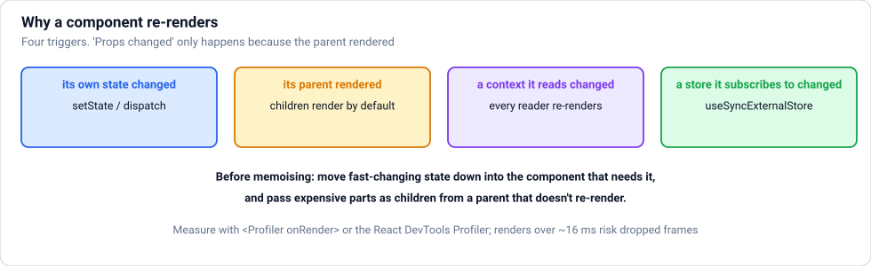

### Theory

> **In simple words:** a component renders again for four reasons: **its own state changed**, **its parent rendered**, **a context it reads changed**, or **an external store it subscribes to changed**. "Its props changed" isn't a separate trigger: props only change because the parent re-rendered. Most re-renders are cheap and harmless. When something feels slow, **measure first** with the React Profiler, then fix the structure (move state down, pass children) before reaching for memoisation.

**Words to know:**

- **Re-render trigger:** what causes a component to render again (state, parent, context, store).
- **Cascading render:** a parent's render re-rendering its whole subtree by default.
- **`<Profiler id onRender>`:** a built-in component that reports how long its subtree took to render each time it commits (`actualDuration`) and what kind of commit it was (`phase`: `"mount"`, `"update"`, `"nested-update"`).
- **`actualDuration` / `baseDuration`:** time spent rendering the subtree in this commit / estimated time to render it from scratch without memoisation.
- **React DevTools Profiler:** records commits in the browser and shows a flame chart, ranked chart and "why did this render?".
- **Moving state down:** putting fast-changing state in the smallest component that needs it, so siblings don't re-render.
- **Lifting content up (children pattern):** passing expensive parts as `children` from above, so a stateful wrapper re-rendering doesn't re-render them (they were created by the parent, whose render didn't happen).
- **Premature optimisation:** optimising before measuring; often adds complexity for no visible gain.
- **INP (Interaction to Next Paint):** a web performance metric: how long after an interaction the next frame is painted; slow renders hurt it (Section [68](#68-production-web-vitals-monitoring-builds-and-deployment)).

**Everyday picture.** An **office announcement system**. When the manager speaks (a parent renders), every desk speaker in that department plays it, even for people it doesn't concern. Moving a noisy conversation into a meeting room (moving state down) stops it reaching everyone; giving a team its own channel (context split) means only they hear their updates.

**Where re-renders come from, traced on a page:**

```text
<App>                     state: cartCount
  <Header cartCount />    re-renders when cartCount changes (parent rendered)
  <SearchBox />           state: text → typing re-renders ONLY SearchBox (state moved down)
  <ProductGrid />         re-renders when App renders, unless memoised or passed as children from above
  <ThemeToggle />         reads ThemeContext → re-renders when the theme changes, wherever it is
```

**When to optimise:** after the Profiler (or a user) shows a slow interaction: renders over ~16 ms (one frame at 60 fps) on a typical device, or many components rendering for an unrelated change. **When not:** "it renders twice" alone isn't a problem; cheap renders are fine.

**Common mistakes:**

- ❌ Wrapping everything in `memo` / `useMemo` / `useCallback` before measuring.
- ❌ Keeping fast-changing state (input text, mouse position) high in the tree.
- ❌ Measuring performance in development mode only (development React is much slower; measure production builds too).
- ❌ Treating StrictMode's double renders as a performance problem (development only).

**Used in real software:** React DevTools' Profiler and the React Performance tracks in Chrome DevTools (React 19.2) are the standard tools; production apps send `<Profiler>`-style timings or INP data to monitoring.

### Code

**The four triggers, counted:**

```tsx
import { createContext, useContext, useState, Profiler } from "react";
import type { ReactNode, ProfilerOnRenderCallback } from "react";
import { render, screen, fireEvent } from "@testing-library/react";

const counts: Record<string, number> = {};
const hit = (name: string) => (counts[name] = (counts[name] ?? 0) + 1);
const ThemeContext = createContext("light");

function Header({ cart }: { cart: number }) { hit("Header"); return <p>🛒 {cart}</p>; }
function Grid() { hit("Grid"); return <p>products…</p>; }
function ThemeLabel() { hit("ThemeLabel"); return <p>{useContext(ThemeContext)}</p>; }
function Search() { hit("Search"); const [q, setQ] = useState(""); return <input aria-label="q" value={q} onChange={(e) => setQ(e.target.value)} />; }

function App() {
  const [cart, setCart] = useState(0);
  const [theme, setTheme] = useState("light");
  return (
    <ThemeContext value={theme}>
      <Header cart={cart} /><Search /><Grid /><ThemeLabel />
      <button onClick={() => setCart(cart + 1)}>add</button>
      <button onClick={() => setTheme("dark")}>dark</button>
    </ThemeContext>
  );
}
render(<App />);
const reset = () => Object.keys(counts).forEach((k) => delete counts[k]);
reset(); fireEvent.change(screen.getByLabelText("q"), { target: { value: "chai" } }); console.log("typing in Search:", { ...counts });
reset(); fireEvent.click(screen.getByText("add"));  console.log("App state change: ", { ...counts });
reset(); fireEvent.click(screen.getByText("dark")); console.log("theme change:     ", { ...counts });
```

**Output:**

```text
typing in Search: { Search: 1 }
App state change:  { Header: 1, Search: 1, Grid: 1, ThemeLabel: 1 }
theme change:      { Header: 1, Search: 1, Grid: 1, ThemeLabel: 1 }
```

Typing re-rendered only `Search` (its own state). An App state change re-rendered **every** child, including `Grid`, whose props didn't change. The theme change also re-rendered everything, because the state lives in `App`; `ThemeLabel` would re-render even if it were deep inside a memoised subtree, because it reads the context.

**Measuring with `<Profiler>`.** A slow grid (each card burns 2 ms) shows up in the timings:

```tsx
const busy = (ms: number) => { const t = performance.now(); while (performance.now() - t < ms) {} };
function SlowCard({ n }: { n: number }) { busy(2); return <li>card {n}</li>; }
function SlowGrid() { return <ul>{Array.from({ length: 20 }, (_, i) => <SlowCard key={i} n={i} />)}</ul>; }

const log: string[] = [];
const onRender: ProfilerOnRenderCallback = (id, phase, actualDuration) => log.push(`${id} ${phase}: ${actualDuration >= 35 ? "≥35" : "<35"} ms`);

function Page() {
  const [text, setText] = useState("");
  return (
    <Profiler id="Page" onRender={onRender}>
      <input aria-label="note" value={text} onChange={(e) => setText(e.target.value)} />
      <SlowGrid />
    </Profiler>
  );
}
render(<Page />);
fireEvent.change(screen.getByLabelText("note"), { target: { value: "a" } });
console.log(log);
```

**Output:**

```text
[ 'Page mount: ≥35 ms', 'Page update: ≥35 ms' ]
```

Every keystroke in the note field re-renders the slow grid (20 × 2 ms = 40 ms, above one 16 ms frame). The `≥35 / <35` buckets are printed instead of exact numbers because timings vary between runs.

**Fix 1: move state down.** The input's state moves into its own component, so the grid isn't re-rendered by typing:

```tsx
function NoteInput() { const [text, setText] = useState(""); return <input aria-label="note2" value={text} onChange={(e) => setText(e.target.value)} />; }
function FastPage() {
  return <Profiler id="FastPage" onRender={onRender}><NoteInput /><SlowGrid /></Profiler>;
}
log.length = 0;
render(<FastPage />);
fireEvent.change(screen.getByLabelText("note2"), { target: { value: "a" } });
console.log(log);
```

**Output:**

```text
[ 'FastPage mount: ≥35 ms', 'FastPage update: <35 ms' ]
```

**Fix 2: lift content up.** When the state must stay in a wrapper, pass the expensive part as `children`; the wrapper's re-renders don't re-create it:

```tsx
function Collapsible({ children }: { children: ReactNode }) {
  const [open, setOpen] = useState(true);
  return <Profiler id="Collapsible" onRender={onRender}><button onClick={() => setOpen(!open)}>toggle</button>{open && children}</Profiler>;
}
log.length = 0;
render(<Collapsible><SlowGrid /></Collapsible>);
fireEvent.click(screen.getByText("toggle"));
fireEvent.click(screen.getByText("toggle"));
console.log(log);
```

**Output:**

```text
[
  'Collapsible mount: ≥35 ms',
  'Collapsible update: <35 ms',
  'Collapsible update: ≥35 ms'
]
```

Toggling closed is cheap. Toggling open again has to **mount** the grid, which is real work; but a wrapper re-rendering for other reasons (say, a hover state) would not re-render `children`, because the `<SlowGrid />` element was created by the parent above, which didn't render.

### Practice

1. A dashboard has a clock that updates every second in `App` state, and 50 charts. Every second all charts re-render. Give two fixes that don't use `memo`.
2. Name the four reasons a component re-renders.

<details>
<summary><b>Answer</b></summary>

1. (a) Move the clock's state into a small `<Clock />` component (state down); (b) if a layout component must own the time, pass the charts in as `children` or slot props from a parent that doesn't re-render every second.
2. Its state changed; its parent re-rendered; a context it reads changed; an external store it subscribes to (via `useSyncExternalStore`, e.g. Redux or Zustand) changed.

</details>

| # | Problem | Difficulty |
|---|---|---|
| 1 | [BFE.dev React quiz 1: React re-render 1](https://bigfrontend.dev/react-quiz/React-re-render-1) | 🟡 Medium |
| 2 | [BFE.dev React quiz 4: React re-render 4](https://bigfrontend.dev/react-quiz/React-re-render-4) | 🟡 Medium |
| 3 | [BFE.dev React quiz 9: React re-render 6 - Context](https://bigfrontend.dev/react-quiz/react-rerender-6-context) | 🔴 Hard |

**Learn more:** [react.dev: Profiler](https://react.dev/reference/react/Profiler) · [Dan Abramov: Before you memo()](https://overreacted.io/before-you-memo/) · [react.dev: React DevTools](https://react.dev/learn/react-developer-tools)

---

## 45. memo, useMemo, useCallback and the React Compiler

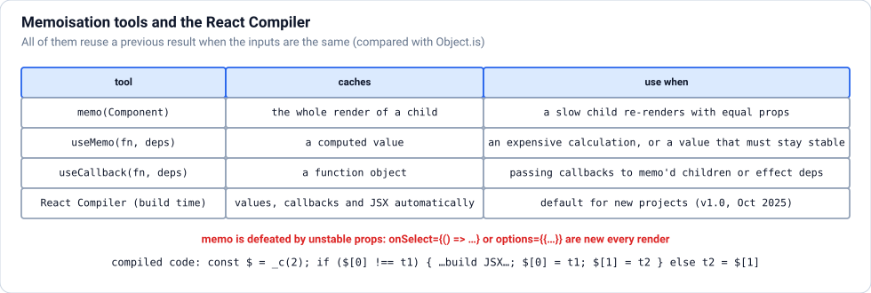

### Theory

> **In simple words:** **memoisation** means remembering a result and reusing it when the inputs are the same. `memo(Component)` skips re-rendering a child when its props are unchanged; `useMemo` caches an expensive calculation between renders; `useCallback` caches a **function** so a memoised child doesn't see a "new" prop every render. Since October 2025 the **React Compiler** (v1.0) adds this caching automatically at build time, so in compiled projects you rarely write these by hand.

**Words to know:**

- **Memoisation:** caching a function's result for given inputs to avoid recomputing it.
- **`memo(Component, arePropsEqual?)`:** returns a component that skips rendering when every prop is `Object.is`-equal to the previous render's (or when your comparison function says so).
- **`useMemo(() => compute(a, b), [a, b])`:** returns the cached value until `a` or `b` changes.
- **`useCallback(fn, deps)`:** returns the same function object until a dependency changes; equivalent to `useMemo(() => fn, deps)`.
- **Referential equality:** two objects or functions are "equal" to `Object.is` only if they're the **same** object; `{} !== {}` and `(() => {}) !== (() => {})`.
- **Unstable prop:** an object, array or function created during render and passed to a child, which defeats `memo`.
- **React Compiler:** a build-time tool (`babel-plugin-react-compiler`, v1.0 released October 7, 2025) that analyses components and inserts fine-grained caching, so components re-run only the parts whose inputs changed.
- **Memo cache (`_c(n)`):** the per-component array the compiled code uses to store cached values (from `react/compiler-runtime`).
- **Bail-out:** skipping work because inputs are unchanged.

**Everyday picture.** A **student who keeps their worked answers**. If tomorrow's homework has the exact same question (same inputs), they copy their saved answer instead of solving again (`useMemo`). If a teacher hands out a "new" worksheet that's a photocopy of yesterday's (a new object with equal content), a strict student who only checks "is this the same sheet of paper?" solves it all again, which is why stable references (`useCallback`) matter.

**Why `memo` fails without stable props, traced:**

```text
function Parent() {
  const [n, setN] = useState(0);
  const onSelect = (id) => …;                  ← a NEW function every render
  return <MemoList items={items} onSelect={onSelect} />;
}
render 1: MemoList renders
setN(1) → Parent renders → onSelect is a new function → Object.is(old, new) = false → MemoList renders AGAIN (memo wasted)
with useCallback(onSelect, []) → same function → all props equal → MemoList skipped ✅
with the React Compiler → it caches onSelect (and the JSX) automatically ✅
```

**When to memoise by hand:** a measured slow component re-rendering with unchanged props; an expensive calculation (sorting or filtering thousands of items) on every render; a value used as an effect dependency that must stay stable. **When not:** cheap components and calculations (the comparison itself costs something), and in projects using the React Compiler (it handles these cases, often more precisely).

**Common mistakes:**

- ❌ `memo` on a component whose props are always new objects or inline functions.
- ❌ `useMemo` around trivial calculations.
- ❌ Missing dependencies in `useMemo`/`useCallback` (stale values; the lint rule checks these too).
- ❌ Expecting `memo` to stop re-renders caused by the component's own state or a context it reads.
- ❌ Writing code that breaks the Rules of React (mutation during render), which the Compiler then skips or miscompiles; its lint rules flag such code.

**Used in real software:** Meta uses the React Compiler across Instagram and Quest Store; Expo, Vite (via `@vitejs/plugin-react`'s Babel option) and Next.js (`reactCompiler: true`) support it; many libraries still export `memo`ised components for apps without the Compiler.

### Code

**`memo` works only when props are stable:**

```tsx
import { memo, useCallback, useMemo, useState } from "react";
import { render, screen, fireEvent } from "@testing-library/react";

const renders: Record<string, number> = {};
const items = ["Masala chai", "Samosa", "Vada pav"];
const List = memo(function List({ onSelect }: { onSelect: (item: string) => void }) {
  renders.List = (renders.List ?? 0) + 1;
  return <ul>{items.map((i) => <li key={i} onClick={() => onSelect(i)}>{i}</li>)}</ul>;
});

function Parent({ stable }: { stable: boolean }) {
  const [count, setCount] = useState(0);
  const inline = (item: string) => console.log("selected", item);
  const cached = useCallback((item: string) => console.log("selected", item), []);
  return <><button onClick={() => setCount(count + 1)}>clicked {count}</button><List onSelect={stable ? cached : inline} /></>;
}
for (const stable of [false, true]) {
  renders.List = 0;
  const v = render(<Parent stable={stable} />);
  fireEvent.click(screen.getByRole("button")); fireEvent.click(screen.getByRole("button"));
  console.log(stable ? "useCallback:" : "inline fn:  ", "List rendered", renders.List, "times for 1 mount + 2 parent renders");
  v.unmount();
}
```

**Output:**

```text
inline fn:   List rendered 3 times for 1 mount + 2 parent renders
useCallback: List rendered 1 times for 1 mount + 2 parent renders
```

**`useMemo` for an expensive calculation:** filtering 200,000 orders only when the query changes, not when unrelated state changes:

```tsx
const orders = Array.from({ length: 200_000 }, (_, i) => ({ id: i, item: i % 3 === 0 ? "chai" : "coffee" }));
let filterRuns = 0;
function Orders({ memoise }: { memoise: boolean }) {
  const [query, setQuery] = useState("chai");
  const [dark, setDark] = useState(false);
  const compute = () => { filterRuns++; return orders.filter((o) => o.item === query).length; };
  const count = memoise ? useMemo(compute, [query]) : compute();
  return <><p className={dark ? "dark" : ""}>{count} {query} orders</p><button onClick={() => setDark(!dark)}>theme</button><button onClick={() => setQuery("coffee")}>coffee</button></>;
}
for (const memoise of [false, true]) {
  filterRuns = 0;
  const v = render(<Orders memoise={memoise} />);
  for (let i = 0; i < 3; i++) fireEvent.click(screen.getByText("theme"));
  fireEvent.click(screen.getByText("coffee"));
  console.log(memoise ? "useMemo:" : "plain:  ", screen.getByText(/orders/).textContent, "| filter ran", filterRuns, "times over 5 renders");
  v.unmount();
}
```

**Output:**

```text
plain:   133333 coffee orders | filter ran 5 times over 5 renders
useMemo: 133333 coffee orders | filter ran 2 times over 5 renders
```

(As in Section [14](#14-state-a-components-memory-usestate), the conditional hook call is only safe here because `memoise` never changes for one instance; it's a trick for comparing both versions side by side.)

**The React Compiler, for real.** This compiles a component with `babel-plugin-react-compiler` 1.0 and prints what it produced:

```jsx
export function CartTotal({ items, discount }) {
  const total = items.reduce((sum, i) => sum + i.price * i.qty, 0);
  return <p>Total: ₹{total - discount}</p>;
}
```

```js
import { transformFileSync } from "@babel/core";
const { code } = transformFileSync(process.argv[2], {
  babelrc: false, configFile: false,
  plugins: [["babel-plugin-react-compiler", {}]],
  presets: [["@babel/preset-react", { runtime: "automatic" }]],
});
console.log(code);
```

```bash
node compile.mjs CartTotal.jsx
```

**Output:**

```text
import { c as _c } from "react/compiler-runtime";
import { jsxs as _jsxs } from "react/jsx-runtime";
export function CartTotal(t0) {
  const $ = _c(2);
  const {
    items,
    discount
  } = t0;
  const total = items.reduce(_temp, 0);
  const t1 = total - discount;
  let t2;
  if ($[0] !== t1) {
    t2 = /*#__PURE__*/_jsxs("p", {
      children: ["Total: \u20B9", t1]
    });
    $[0] = t1;
    $[1] = t2;
  } else {
    t2 = $[1];
  }
  return t2;
}
function _temp(sum, i) {
  return sum + i.price * i.qty;
}
```

The compiler gave the component a cache of 2 slots (`_c(2)`): it remembers the last `t1` (the total minus discount) and the `<p>` element built from it, and returns the **same element object** when `t1` is unchanged, which lets React skip that part of the tree. The reducer callback became a module-level `_temp` function because it uses nothing from the component. In a real project you enable this with a build setting, not by hand: Vite's `react({ babel: { plugins: ["babel-plugin-react-compiler"] } })` or Next.js's `reactCompiler: true`.

**The compiled component in action:** running the compiled `List` from earlier shows it skipping re-renders without any `memo` or `useCallback` in the source:

```jsx
import { useState } from "react";
export const renders = { List: 0 };
function List({ onSelect }) {
  renders.List++;
  return <ul>{["Masala chai", "Samosa"].map((i) => <li key={i} onClick={() => onSelect(i)}>{i}</li>)}</ul>;
}
export function Shop() {
  const [count, setCount] = useState(0);
  const onSelect = (item) => console.log("selected", item);
  return <><button onClick={() => setCount(count + 1)}>clicked {count}</button><List onSelect={onSelect} /></>;
}
```

```tsx
import { render, screen, fireEvent } from "@testing-library/react";
const { Shop, renders } = await import(process.argv[2]);
render(<Shop />);
fireEvent.click(screen.getByRole("button")); fireEvent.click(screen.getByRole("button"));
console.log(`${process.argv[2]}: List rendered ${renders.List} times for 1 mount + 2 parent renders`);
```

```bash
node compile.mjs Shop.jsx > Shop.compiled.js
npx esbuild Shop.jsx --jsx=automatic --format=esm --log-level=warning > Shop.plain.js
node --import tsx --import ./setup.ts measure.tsx ./Shop.plain.js
node --import tsx --import ./setup.ts measure.tsx ./Shop.compiled.js
```

**Output:**

```text
./Shop.plain.js: List rendered 3 times for 1 mount + 2 parent renders
./Shop.compiled.js: List rendered 1 times for 1 mount + 2 parent renders
```

Same source code; the compiled version cached `onSelect` and the `<List>` element, so React skipped `List` on both parent renders.

### Practice

1. A `memo`ised `Chart` receives `options={{ animate: true }}` and still re-renders every time. Why, and give two fixes.
2. When is `useMemo` the **wrong** fix for a slow component?

<details>
<summary><b>Answer</b></summary>

1. `{ animate: true }` is a new object on every parent render, so `memo`'s shallow comparison sees a changed prop. Fixes: hoist the constant out of the component (`const chartOptions = { animate: true }` at module level), wrap it in `useMemo`, or enable the React Compiler.
2. When the slowness comes from re-rendering too much of the tree (fix the structure: move state down, Section [44](#44-why-components-re-render-and-measuring-with-the-profiler)), from rendering thousands of DOM nodes (virtualise, Section [46](#46-long-lists-virtualisation-and-pagination)), or when the calculation is cheap anyway.

</details>

| # | Problem | Difficulty |
|---|---|---|
| 1 | [LeetCode 2623. Memoize](https://leetcode.com/problems/memoize/) | 🟡 Medium |
| 2 | [BFE.dev React quiz 2: React re-render 2 - memo()](https://bigfrontend.dev/react-quiz/React-re-render-2) | 🟡 Medium |
| 3 | [BFE.dev React quiz 15: memo 2](https://bigfrontend.dev/react-quiz/memo-2) | 🔴 Hard |
| 4 | [react.dev challenge: Cache a calculation without Effects](https://react.dev/learn/you-might-not-need-an-effect#challenges) | 🟡 Medium |

**Learn more:** [react.dev: memo](https://react.dev/reference/react/memo) · [react.dev: useMemo](https://react.dev/reference/react/useMemo) · [react.dev: React Compiler](https://react.dev/learn/react-compiler) · [React blog: React Compiler v1.0](https://react.dev/blog/2025/10/07/react-compiler-1)

---

## 46. Long Lists: Virtualisation and Pagination

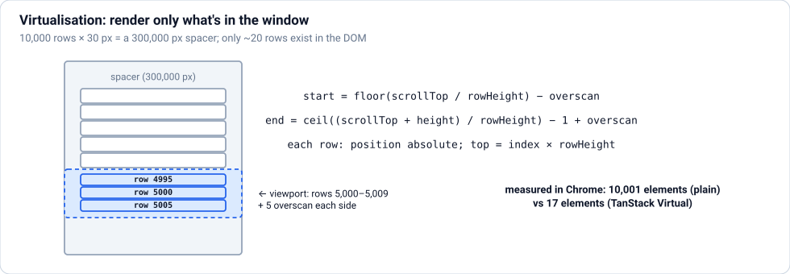

### Theory

> **In simple words:** rendering 10,000 rows creates 10,000+ DOM nodes, which is slow to mount, slow to update and heavy on memory, even though only about 20 fit on screen. **Virtualisation** (windowing) renders just the rows **visible in the scroll area**, plus a few extra, inside a tall spacer element so the scrollbar still looks right. Alternatives are **pagination** (show 20 at a time with page buttons) and **infinite scroll** (load more when the user nears the bottom).

**Words to know:**

- **Virtualisation / windowing:** rendering only the visible slice of a long list and swapping rows as the user scrolls.
- **Viewport:** the visible part of a scrolling container.
- **Overscan:** extra rows rendered just outside the viewport so fast scrolling doesn't show blanks.
- **Spacer:** an element with the full list height (`count × rowHeight`) that gives the scrollbar its size; visible rows are absolutely positioned inside it.
- **`scrollTop`:** how many pixels a container has been scrolled down.
- **Fixed vs dynamic row height:** fixed heights make the maths simple; variable heights need measuring each row after it renders.
- **Pagination:** splitting data into pages; the server returns one page at a time (`?page=3&pageSize=20`, or a **cursor**).
- **Cursor-based pagination:** asking for "the 20 items after this id" instead of "page 3"; stable when items are inserted (Section [52](#52-server-state-with-tanstack-query) loads pages this way).
- **Infinite scroll:** loading the next page automatically when a sentinel element near the end becomes visible, detected with `IntersectionObserver`.
- **TanStack Virtual / react-window / react-virtuoso:** popular virtualisation libraries.

**Everyday picture.** A **train window**. The countryside is hundreds of kilometres long, but you only ever see the few hundred metres in the window. Virtualisation is the train: the scenery (rows) exists only where you're looking, and it's continuously replaced as you move.

**The window maths, traced** (row height 30 px, viewport 300 px, overscan 5, 10,000 rows):

```text
spacer height = 10,000 × 30 = 300,000 px
scrollTop = 150,000 → first visible = floor(150,000 / 30) = 5,000 → visible rows 5,000…5,009 (300 / 30 = 10 rows)
with overscan: render rows 4,995…5,014 → 20 elements instead of 10,000
each row is placed at top = index × 30 inside the spacer
```

**When to virtualise:** lists or tables with more than a few hundred rows of non-trivial content (chat histories, logs, data grids, feeds). **When not:** short lists (complexity for nothing); when every row must be in the DOM for in-page search (Ctrl+F), printing or SEO; consider pagination or "load more" first if they fit the UX.

**Common mistakes:**

- ❌ Missing a fixed-height scroll container (the virtualiser can't compute a window).
- ❌ Using the index as key when rows can be inserted or removed.
- ❌ Virtualising tables without keeping headers and columns aligned (use a table-aware virtualiser).
- ❌ Forgetting accessibility: screen readers only see rendered rows; give the list `aria-rowcount`/`aria-rowindex` where possible.

**Used in real software:** Slack and Discord message lists, Gmail, VS Code's editor and file tree, Google Sheets-style grids (AG Grid, TanStack Table + Virtual) all render only what's visible.

### Code

**From scratch: the window calculation** as a pure function:

```tsx
function visibleRange({ scrollTop, viewportHeight, rowHeight, count, overscan }: { scrollTop: number; viewportHeight: number; rowHeight: number; count: number; overscan: number }) {
  const first = Math.floor(scrollTop / rowHeight);
  const last = Math.min(count - 1, Math.ceil((scrollTop + viewportHeight) / rowHeight) - 1);
  return { start: Math.max(0, first - overscan), end: Math.min(count - 1, last + overscan), totalHeight: count * rowHeight };
}
console.log(visibleRange({ scrollTop: 0, viewportHeight: 300, rowHeight: 30, count: 10_000, overscan: 5 }));
console.log(visibleRange({ scrollTop: 150_000, viewportHeight: 300, rowHeight: 30, count: 10_000, overscan: 5 }));
```

**Output:**

```text
{ start: 0, end: 14, totalHeight: 300000 }
{ start: 4995, end: 5014, totalHeight: 300000 }
```

**A hand-made virtual list in React,** driven by the scroll position (jsdom has no layout, so the scroll position is set by firing a `scroll` event with `scrollTop`):

```tsx
import { useState } from "react";
import { render, fireEvent } from "@testing-library/react";

const rows = Array.from({ length: 10_000 }, (_, i) => `Order #${i + 1}`);
function VirtualList({ rowHeight = 30, height = 300 }) {
  const [scrollTop, setScrollTop] = useState(0);
  const { start, end, totalHeight } = visibleRange({ scrollTop, viewportHeight: height, rowHeight, count: rows.length, overscan: 5 });
  const visible = [];
  for (let i = start; i <= end; i++)
    visible.push(<div key={i} className="row" style={{ position: "absolute", top: i * rowHeight, height: rowHeight }}>{rows[i]}</div>);
  return (
    <div data-testid="viewport" style={{ height, overflowY: "auto" }} onScroll={(e) => setScrollTop(e.currentTarget.scrollTop)}>
      <div style={{ height: totalHeight, position: "relative" }}>{visible}</div>
    </div>
  );
}
const { container, getByTestId } = render(<VirtualList />);
const rowsShown = () => [...container.querySelectorAll(".row")];
console.log("rows in DOM:", rowsShown().length, "| first:", rowsShown()[0].textContent);
fireEvent.scroll(getByTestId("viewport"), { target: { scrollTop: 150_000 } });
console.log("rows in DOM:", rowsShown().length, "| first:", rowsShown()[0].textContent, "| top:", (rowsShown()[0] as HTMLElement).style.top);
```

**Output:**

```text
rows in DOM: 15 | first: Order #1
rows in DOM: 20 | first: Order #4996 | top: 149850px
```

**The library way, measured in a real browser.** TanStack Virtual needs real element sizes, so this runs in Chrome (esbuild bundles it, Playwright loads it), and compares against rendering all 10,000 rows:

```tsx
import { useRef } from "react";
import { createRoot } from "react-dom/client";
import { useVirtualizer } from "@tanstack/react-virtual";

const rows = Array.from({ length: 10_000 }, (_, i) => `Order #${i + 1}`);
function PlainList() {
  return <div style={{ height: 300, overflow: "auto" }}>{rows.map((r) => <div key={r} style={{ height: 30 }}>{r}</div>)}</div>;
}
function TanStackList() {
  const parentRef = useRef<HTMLDivElement>(null);
  const virtualizer = useVirtualizer({ count: rows.length, getScrollElement: () => parentRef.current, estimateSize: () => 30, overscan: 5 });
  return (
    <div ref={parentRef} id="scroller" style={{ height: 300, overflow: "auto" }}>
      <div style={{ height: virtualizer.getTotalSize(), position: "relative" }}>
        {virtualizer.getVirtualItems().map((item) => (
          <div key={item.key} className="row" style={{ position: "absolute", top: 0, height: 30, transform: `translateY(${item.start}px)` }}>{rows[item.index]}</div>
        ))}
      </div>
    </div>
  );
}
const which = new URLSearchParams(location.search).get("list");
const started = performance.now();
createRoot(document.getElementById("root")!).render(which === "plain" ? <PlainList /> : <TanStackList />);
requestAnimationFrame(() => setTimeout(() => {
  console.log(`${which}: ${document.querySelectorAll("#root div").length} elements in the DOM, ready after ${Math.round(performance.now() - started)} ms`);
  const scroller = document.getElementById("scroller");
  if (scroller) {
    scroller.scrollTop = 150_000;
    setTimeout(() => console.log("after scrolling to 150,000px the first rows are:", [...document.querySelectorAll(".row")].slice(0, 3).map((d) => d.textContent).join(", ")), 100);
  }
}, 0));
```

```js
import { chromium } from "@playwright/test";
import { writeFileSync } from "node:fs";
writeFileSync("lists.html", '<div id="root"></div><script src="lists.js"></script>');
const browser = await chromium.launch({ channel: "chrome" });
const page = await browser.newPage();
page.on("console", (m) => console.log(m.text()));
for (const list of ["plain", "virtual"]) {
  await page.goto(`file://${process.cwd()}/lists.html?list=${list}`);
  await page.waitForTimeout(600);
}
await browser.close();
```

```bash
npx esbuild lists.tsx --bundle --outfile=lists.js --jsx=automatic --define:process.env.NODE_ENV='"production"' --log-level=warning
node run-lists.mjs | sed -E 's/after [0-9]+ ms/after N ms/'
```

**Output:**

```text
plain: 10001 elements in the DOM, ready after N ms
virtual: 17 elements in the DOM, ready after N ms
after scrolling to 150,000px the first rows are: Order #4996, Order #4997, Order #4998
```

10,001 elements versus 17: the 10 rows that fit in the 300 px viewport, 5 overscan rows below them (none above at the top of the list), and the two containers. The millisecond figures are replaced by `N` because they change from run to run and machine to machine; on the machine these notes were built on, the plain list took several times longer to become ready. After scrolling, the rows around position 150,000 px (row 5,000) exist; everything else doesn't.

### Practice

1. With rows 48 px tall, a 600 px viewport, overscan 3 and 2,000 rows, which indices are rendered at `scrollTop = 4,800`?
2. When is "Load more" pagination a better choice than virtualisation?

<details>
<summary><b>Answer</b></summary>

```tsx
console.log(visibleRange({ scrollTop: 4800, viewportHeight: 600, rowHeight: 48, count: 2000, overscan: 3 }));
```

**Output:**

```text
{ start: 97, end: 115, totalHeight: 96000 }
```

1. First visible row 4,800 / 48 = 100, last visible 112 (5,400 / 48 − 1 = 111.5, rounded up), so 97 to 115 with overscan.
2. When users rarely go deep, when data comes from a server page by page anyway, when the page must stay searchable and printable, or when rows have unpredictable heights and a simple design is more important than showing thousands at once.

</details>

| # | Problem | Difficulty |
|---|---|---|
| 1 | [Frontend Mentor: Job listings with filtering (then add 5,000 generated listings and virtualise)](https://www.frontendmentor.io/challenges/job-listings-with-filtering-ivstIPCt) | 🟡 Medium |
| 2 | [LeetCode 2677. Chunk Array (pagination maths)](https://leetcode.com/problems/chunk-array/) | 🟢 Easy |

**Learn more:** [TanStack Virtual](https://tanstack.com/virtual/latest) · [web.dev: Virtualize large lists](https://web.dev/articles/virtualize-long-lists-react-window) · [MDN: IntersectionObserver](https://developer.mozilla.org/en-US/docs/Web/API/Intersection_Observer_API)

---

## 47. Code Splitting: lazy, Suspense and Bundle Size

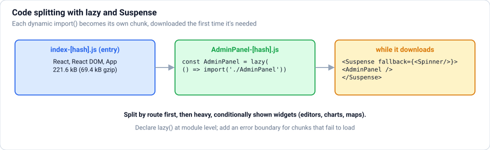

### Theory

> **In simple words:** by default the bundler puts all your code in one JavaScript file, so a visitor to the home page downloads the admin dashboard, the charts library and the rich-text editor too. **Code splitting** breaks it into **chunks** loaded on demand. In React, `lazy(() => import("./Admin"))` makes a component whose code is fetched the first time it renders, and **`<Suspense fallback={…}>`** shows a placeholder while it loads.

**Words to know:**

- **Bundle:** a JavaScript file produced by the build, combining many modules.
- **Chunk:** one of several bundle files; the **entry chunk** loads first, others load later.
- **Dynamic `import()`:** a function-style import that loads a module **at runtime** and returns a promise; bundlers turn each one into a separate chunk.
- **`lazy(load)`:** wraps a dynamic import into a component; React calls `load()` the first time it renders and **suspends** until the module arrives.
- **Suspend / suspension:** a component signalling "I'm not ready yet" while waiting for code or data; the nearest Suspense boundary shows its fallback.
- **`<Suspense fallback>`:** a boundary that shows `fallback` while anything inside it is suspended.
- **Route-based splitting:** one chunk per page, the most effective split (React Router and Next.js do it for you).
- **Tree shaking:** the bundler removing code that's never imported/used.
- **gzip / Brotli:** compression applied by servers; transfer size is the compressed size.
- **Bundle analyser:** a tool that shows what's inside each chunk (`rollup-plugin-visualizer`, `vite-bundle-visualizer`, `source-map-explorer`).
- **Preloading:** starting to download a chunk before it's needed (on hover, or with `<link rel="modulepreload">`).

**Everyday picture.** A **restaurant menu with seasonal inserts**. Everyone gets the main menu at once (entry chunk). The dessert card only comes if you ask for dessert (a lazy chunk), and while it's on its way the waiter says "one moment" (the Suspense fallback).

**What happens on first render of a lazy component, traced:**

```text
const Admin = lazy(() => import("./Admin"));
<Suspense fallback={<Spinner />}><Admin /></Suspense>

render: React calls the lazy loader → import() starts downloading admin-[hash].js → Admin SUSPENDS
        → nearest Suspense shows <Spinner />
download finishes → React re-renders → Admin is now a normal component → Spinner replaced by Admin
second visit: the module is cached → renders immediately, no fallback
```

**When to split:** routes; heavy components shown conditionally (modals, editors, charts, maps); admin-only features; big libraries used on one page. **When not:** tiny components (each chunk is an extra request); components visible on first paint (splitting them delays what users see first).

**Common mistakes:**

- ❌ `lazy` inside a component body (a new lazy type every render → remounts and refetches). Declare it at module level.
- ❌ No `Suspense` above a lazy component (React throws).
- ❌ Splitting everything into dozens of tiny chunks (request overhead).
- ❌ Forgetting an error boundary for chunks that fail to load (bad network, a deploy removed old chunks; Section [48](#48-error-boundaries-handling-render-errors)).

**Used in real software:** route-level splitting is automatic in Next.js and React Router framework mode; dashboards lazy-load chart libraries; editors such as Monaco are almost always lazy-loaded.

### Code

**From scratch: a dynamic `import()`** loads a module only when the code runs:

```tsx
console.log("  (heavy-chart module evaluated)");
export function drawChart(points: number[]) { return `chart with ${points.length} points`; }
```

```tsx
console.log("before import");
const chartModule = await import("./heavy-chart.ts");
console.log(chartModule.drawChart([3, 1, 4]));
```

**Output:**

```text
before import
  (heavy-chart module evaluated)
chart with 3 points
```

**`lazy` + `Suspense`:** the fallback shows until the component's module has loaded:

```tsx
export default function AdminPanel() {
  return <section><h2>Admin</h2><p>Sales today: ₹48,300</p></section>;
}
```

```tsx
import { lazy, Suspense, useState } from "react";
import { render, screen, fireEvent } from "@testing-library/react";

const AdminPanel = lazy(() => import("./AdminPanel.tsx"));    // module level, not inside a component

function App() {
  const [showAdmin, setShowAdmin] = useState(false);
  return (
    <>
      <button onClick={() => setShowAdmin(true)}>Open admin</button>
      {showAdmin && (
        <Suspense fallback={<p>Loading admin…</p>}>
          <AdminPanel />
        </Suspense>
      )}
    </>
  );
}
render(<App />);
fireEvent.click(screen.getByText("Open admin"));
console.log("right after the click:", document.body.textContent);
await screen.findByText(/Sales today/);
console.log("after the chunk loaded:", document.body.textContent);
```

**Output:**

```text
right after the click: Open adminLoading admin…
after the chunk loaded: Open adminAdminSales today: ₹48,300
```

**Real chunks from a real build.** Vite turns each dynamic import into a separate file; the build output lists their sizes:

```tsx
import { lazy, Suspense, useState } from "react";
import { createRoot } from "react-dom/client";
const AdminPanel = lazy(() => import("./AdminPanel.tsx"));
const Chart = lazy(() => import("./heavy-chart.ts").then((m) => ({ default: () => <p>{m.drawChart([1, 2, 3])}</p> })));
function App() {
  const [page, setPage] = useState("home");
  return (
    <>
      <button onClick={() => setPage("admin")}>Admin</button>
      <Suspense fallback={<p>Loading…</p>}>{page === "admin" ? <><AdminPanel /><Chart /></> : <h1>Home</h1>}</Suspense>
    </>
  );
}
createRoot(document.getElementById("root")!).render(<App />);
```

```html
<!doctype html><html><body><div id="root"></div><script type="module" src="/main.tsx"></script></body></html>
```

```tsx
import { defineConfig } from "vite";
import react from "@vitejs/plugin-react";
export default defineConfig({ plugins: [react()], logLevel: "info" });
```

```bash
npx vite build 2>&1 | grep -E "dist/|modules transformed" | sed -E 's/-[A-Za-z0-9_-]{8}\./-[hash]./'
```

**Output:**

```text
✓ 17 modules transformed.
dist/index.html                        0.14 kB │ gzip:  0.13 kB
dist/assets/heavy-chart-[hash].js    0.12 kB │ gzip:  0.12 kB
dist/assets/AdminPanel-[hash].js     0.21 kB │ gzip:  0.17 kB
dist/assets/index-[hash].js        221.58 kB │ gzip: 69.39 kB
```

Three JavaScript files: the entry chunk (React, React DOM and `App`), plus one small chunk each for `AdminPanel` and `heavy-chart`, which a home-page visitor never downloads. In a real app the split-off parts are often much larger than the entry (charts, editors), which is where the savings come from. `[hash]` replaces the content hashes in file names, which change whenever the code changes (so browsers can cache files forever).

### Practice

1. Why does `function Page() { const Editor = lazy(() => import("./Editor")); return <Editor />; }` refetch and remount the editor constantly?
2. Where would you put `Suspense` boundaries in an app with a sidebar, a header and a lazy-loaded main page area?

<details>
<summary><b>Answer</b></summary>

1. `lazy(...)` runs on every render of `Page`, creating a **new component type** each time; React sees a different type, unmounts the old editor and mounts the new one, which suspends again. Declare `const Editor = lazy(...)` once at module level.
2. Around the main content area only (`<Suspense fallback={<PageSkeleton />}>{routes}</Suspense>`), so the header and sidebar stay visible while a page's code loads; add nested boundaries inside pages for slow widgets.

</details>

| # | Problem | Difficulty |
|---|---|---|
| 1 | [BFE.dev React quiz 8: Suspense 2](https://bigfrontend.dev/react-quiz/Suspense-2) | 🟡 Medium |
| 2 | [BFE.dev React quiz 23: Suspense 3](https://bigfrontend.dev/react-quiz/suspense-3) | 🔴 Hard |

**Learn more:** [react.dev: lazy](https://react.dev/reference/react/lazy) · [react.dev: Suspense](https://react.dev/reference/react/Suspense) · [Vite: build options and chunking](https://vite.dev/guide/build)

---

## 48. Error Boundaries: Handling Render Errors

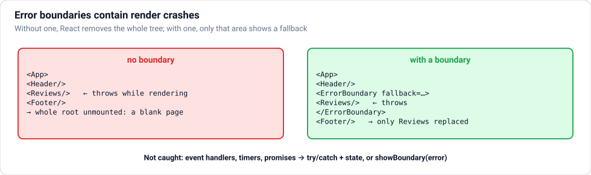

### Theory

> **In simple words:** if a component **throws an error while rendering**, React would otherwise remove the whole app from the screen (a blank page). An **error boundary** is a component that catches render errors from anything below it and shows a **fallback UI** instead, so the rest of the app keeps working. Error boundaries are still written as **class components** (or with the `react-error-boundary` library). They don't catch errors in event handlers or async code; you handle those with `try/catch` and state.

**Words to know:**

- **Error boundary:** a component implementing `static getDerivedStateFromError` (to switch to fallback UI) and/or `componentDidCatch` (to log); catches errors thrown during rendering, in lifecycle methods and in constructors below it.
- **Fallback UI:** what the boundary shows instead of the crashed subtree ("Something went wrong. Try again").
- **Class component:** the older way to write components with `class X extends Component` and `render()` (Section [67](#67-legacy-react-class-components-lifecycles-hocs-and-render-props)); error boundaries are the one thing still requiring a class (libraries wrap it for you).
- **`react-error-boundary`:** a popular library providing `<ErrorBoundary fallbackRender onReset resetKeys>` and `useErrorBoundary()`.
- **Reset:** clearing the boundary's error so it tries rendering its children again (a "Try again" button, or when `resetKeys` change).
- **What isn't caught:** errors in event handlers, timers and promises (they don't happen during rendering), server-side rendering errors, and errors inside the boundary itself.
- **`useErrorBoundary().showBoundary(error)`:** passes an error from a handler or async code to the nearest boundary.
- **Root error callbacks (React 19):** `createRoot(el, { onCaughtError, onUncaughtError, onRecoverableError })` to report errors to monitoring.
- **Granularity:** how much UI one boundary protects: one for the whole app, one per route, one per widget.

**Everyday picture.** **Circuit breakers** in a house. A fault in the kitchen trips the kitchen's breaker; the kitchen goes dark, but the rest of the house keeps its lights on. Without breakers, one faulty toaster takes out the whole house (a blank page).

**Where an error goes, traced:**

```text
<App>
  <Header />
  <ErrorBoundary fallback={<p>Couldn't load reviews</p>}>
    <Reviews>           ← throws during render: TypeError: reviews.map is not a function
  </ErrorBoundary>
  <Footer />
1. React catches the throw during render
2. walks up to the nearest boundary → renders its fallback in place of <Reviews>
3. Header and Footer are untouched; componentDidCatch / onError logs the error
the same error inside onClick → NOT caught by the boundary → you handle it in the handler
```

**When to add boundaries:** at the root (a last resort "Something went wrong" page), around each route, and around independent widgets that could fail (third-party embeds, charts, comments). **When not:** as a replacement for handling expected failures (a 404 from an API is a normal state, not an exception).

**Common mistakes:**

- ❌ Expecting a boundary to catch errors from `onClick` or `fetch().then(…)`.
- ❌ One boundary for the whole app only (any widget error blanks every screen).
- ❌ A fallback with no way to recover (add a retry/reset).
- ❌ Not logging caught errors to a monitoring service.

**Used in real software:** Next.js turns `error.tsx` files into boundaries per route segment (Section [62](#62-nextjs-app-router-layouts-server-functions-and-caching)); React Router's `ErrorBoundary` route export does the same; Sentry's React SDK ships an `ErrorBoundary` that reports to Sentry.

### Code

**What happens without a boundary: the whole root is removed.**

```tsx
import { Component, useState } from "react";
import type { ReactNode, ErrorInfo } from "react";
import { createRoot } from "react-dom/client";
import { act } from "react";
import { render, screen, fireEvent } from "@testing-library/react";
import { ErrorBoundary as LibraryBoundary, useErrorBoundary } from "react-error-boundary";

function Reviews({ data }: { data: unknown }) {
  return <ul>{(data as string[]).map((r) => <li key={r}>{r}</li>)}</ul>;        // crashes if data isn't an array
}
(globalThis as any).IS_REACT_ACT_ENVIRONMENT = false;            // run like a browser (act would rethrow the error)
const container = document.createElement("div");
const root = createRoot(container, { onUncaughtError: (error) => console.log("onUncaughtError:", (error as Error).message) });
root.render(<main><h1>Chai Point</h1><Reviews data={{ oops: true }} /><footer>© 2026</footer></main>);
await new Promise((r) => setTimeout(r, 50));
console.log(`container after the crash: "${container.innerHTML}"`);
(globalThis as any).IS_REACT_ACT_ENVIRONMENT = true;
```

**Output:**

```text
onUncaughtError: data.map is not a function
container after the crash: ""
```

One broken widget, and the header and footer disappeared too: React unmounts the whole tree rather than show a broken UI. `onUncaughtError` (a React 19 root option) is where you'd report it.

**From scratch: an error boundary class:**

```tsx
class ErrorBoundary extends Component<{ fallback: (error: Error, reset: () => void) => ReactNode; children: ReactNode }, { error: Error | null }> {
  state = { error: null as Error | null };
  static getDerivedStateFromError(error: Error) { return { error }; }            // render the fallback next
  componentDidCatch(error: Error, info: ErrorInfo) { console.log("logged:", error.message, "| in component", info.componentStack?.trim().split("\n")[0].trim().split(" ")[1]); }
  reset = () => this.setState({ error: null });
  render() { return this.state.error ? this.props.fallback(this.state.error, this.reset) : this.props.children; }
}

function Page({ data }: { data: unknown }) {
  return (
    <main>
      <h1>Chai Point</h1>
      <ErrorBoundary fallback={(e, reset) => <p role="alert">Couldn't show reviews ({e.message}) <button onClick={reset}>Try again</button></p>}>
        <Reviews data={data} />
      </ErrorBoundary>
      <footer>© 2026</footer>
    </main>
  );
}
render(<Page data={{ oops: true }} />);   // expect-warning: React also reports caught errors with console.error in development
console.log(document.body.textContent);
```

**Output:**

```text
console.error: TypeError: data.map is not a function
logged: data.map is not a function | in component Reviews
Chai PointCouldn't show reviews (data.map is not a function) Try again© 2026
```

The header and footer survive; only the reviews area shows the fallback. In development React additionally logs caught errors with `console.error`, which is the first output line.

**Errors in event handlers are not caught by boundaries**: handle them yourself, or pass them to the boundary with `react-error-boundary`'s `useErrorBoundary`:

```tsx
function RefundButton() {
  const { showBoundary } = useErrorBoundary();
  return <button onClick={() => {
    try { throw new Error("Payment service unavailable"); }
    catch (error) { showBoundary(error); }                    // hand it to the nearest boundary
  }}>Refund</button>;
}
render(
  <LibraryBoundary
    fallbackRender={({ error, resetErrorBoundary }) => <p role="alert">{(error as Error).message} <button onClick={resetErrorBoundary}>Retry</button></p>}
    onError={(error) => console.log("report to monitoring:", (error as Error).message)}>
    <RefundButton />
  </LibraryBoundary>,
);
fireEvent.click(screen.getByText("Refund"));   // expect-warning
console.log(screen.getByRole("alert").textContent);
fireEvent.click(screen.getByText("Retry"));
console.log("after retry:", screen.getByRole("button").textContent);
```

**Output:**

```text
console.error: Error: Payment service unavailable
report to monitoring: Payment service unavailable
Payment service unavailable Retry
after retry: Refund
```

### Practice

1. A route's data loader returns `null` for a missing product, and the component does `product.name`. Should an error boundary handle this?
2. Which of these does an error boundary catch: (a) a `TypeError` in render; (b) an error in `useEffect`; (c) an error in `onClick`; (d) a rejected `fetch` in a `then` callback; (e) a lazy chunk that fails to download?

<details>
<summary><b>Answer</b></summary>

1. Better not: a missing product is an **expected** case. Check for `null` and render a "Product not found" state (or the router's 404). Keep boundaries for unexpected bugs.
2. Caught: (a), (b) (errors thrown in effects are caught too) and (e) (the lazy component throws the import error during render). Not caught: (c) and (d), which run outside rendering; use `try/catch` and state, or `showBoundary`.

</details>

| # | Problem | Difficulty |
|---|---|---|
| 1 | [BFE.dev React quiz 20: Error Boundary](https://bigfrontend.dev/react-quiz/Error-Boundary) | 🟡 Medium |
| 2 | [BFE.dev React quiz 30: Error Boundary Once More](https://bigfrontend.dev/react-quiz/error-boundary-once-more) | 🔴 Hard |

**Learn more:** [react.dev: Catching rendering errors with an error boundary](https://react.dev/reference/react/Component#catching-rendering-errors-with-an-error-boundary) · [react-error-boundary](https://github.com/bvaughn/react-error-boundary) · [react.dev: createRoot options](https://react.dev/reference/react-dom/client/createRoot#parameters)

---

## 49. Accessibility: Semantics, Focus, ARIA, Portals and Modals

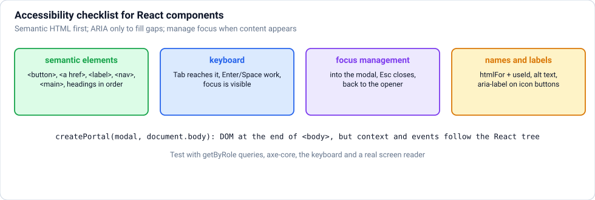

### Theory

> **In simple words:** **accessibility (a11y)** means everyone can use your app, including people using screen readers, keyboards only, voice control or zoom. Most of it comes free if you use the **right HTML elements** (`<button>`, `<label>`, `<nav>`, headings in order), make everything work with the **keyboard**, manage **focus** when content appears (modals, errors), and add **ARIA** attributes only where HTML has no equivalent. React adds two tools: `htmlFor`/`useId` for labels, and **portals** for modals and popovers.

**Words to know:**

- **Accessibility (a11y):** designing so people with disabilities can perceive, operate and understand the UI ("a11y" = a + 11 letters + y).
- **Screen reader:** software that reads the UI aloud (VoiceOver, NVDA, JAWS, TalkBack) using the **accessibility tree** the browser builds from your HTML.
- **Semantic HTML:** elements that describe their meaning (`button`, `nav`, `main`, `h1`–`h6`, `ul`, `label`) instead of generic `div`s.
- **Role / accessible name:** what an element is (button, link, dialog) and what it's called (its label text); Testing Library's `getByRole(role, { name })` queries exactly this.
- **ARIA (Accessible Rich Internet Applications):** attributes like `aria-label`, `aria-expanded`, `aria-live`, `role="dialog"` that add meaning when HTML can't express it. First rule of ARIA: don't use ARIA if a native element does the job.
- **Keyboard operability:** everything clickable must be reachable with Tab and activated with Enter/Space; focus must be visible.
- **Focus management:** moving focus deliberately (into an opened modal, to an error summary) and returning it when content closes.
- **Focus trap:** keeping Tab inside an open modal so keyboard users don't wander behind it.
- **Portal (`createPortal(children, domNode)`):** renders children into a different DOM node (often `document.body`) while they stay in the same place in the React tree (context and events still flow normally).
- **`<dialog>` element:** the native HTML modal, with `showModal()` providing focus handling, Esc to close and an inert background in browsers.
- **`aria-live` region:** an element whose changes screen readers announce (toasts, "3 results found").
- **WCAG (Web Content Accessibility Guidelines):** the standard (version 2.2) most laws and audits refer to; AA is the usual target level.
- **axe-core:** an open-source engine that tests a page for accessibility violations automatically (it finds a large share of issues, not all).

**Everyday picture.** A building with **ramps, lifts, braille signs and clear exits**. Using a `<div onClick>` as a button is like a door with no handle: it looks like a door, but you can only get in if someone already knows the trick. Semantic HTML gives every door a proper handle by default.

**What a screen reader user experiences, traced:**

```text
<div onClick={buy}>Buy</div>        → announced as "Buy" (plain text), not focusable with Tab, Enter does nothing ❌
<button onClick={buy}>Buy</button>  → "Buy, button", focusable, Enter/Space activate ✅
<input placeholder="Email" />       → "edit text" with no reliable name ❌ (placeholder isn't a label)
<label htmlFor={id}>Email</label><input id={id} /> → "Email, edit text" ✅
opening a modal without moving focus → focus stays behind the overlay; the user is lost ❌
```

**When to reach for ARIA:** custom widgets HTML lacks (tabs, comboboxes, tree views), live announcements, labelling icon-only buttons (`aria-label="Close"`), expanded/collapsed state (`aria-expanded`). **When not:** on elements that already have the semantics (`<button role="button">` is redundant); and never as a substitute for keyboard support.

**Common mistakes:**

- ❌ Clickable `div`s and `span`s. ✅ `<button>` (or `<a href>` for navigation).
- ❌ Inputs with only a placeholder. ✅ A real `<label>`.
- ❌ Removing focus outlines (`outline: none`) without a visible replacement.
- ❌ Modals that don't move focus in, don't trap it, can't close with Esc, and don't return focus to the opener.
- ❌ Colour as the only signal (red border = error) without text.

**Used in real software:** headless component libraries (Radix UI, React Aria, Headless UI, Ariakit) exist mainly to get accessibility right for complex widgets; accessibility is a legal requirement in many places (the European Accessibility Act applies from June 2025; the ADA in the US).

### Code

**Semantic elements give roles and names for free; `div`s don't.** Testing Library queries the accessibility tree, so it finds the button but not the clickable `div`:

```tsx
import { useEffect, useId, useRef, useState } from "react";
import type { ReactNode } from "react";
import { createPortal } from "react-dom";
import { render, screen, fireEvent } from "@testing-library/react";
import axe from "axe-core";

function Bad() { return <div className="btn" onClick={() => {}}>Buy</div>; }
function Good() { return <button onClick={() => {}}>Buy</button>; }
render(<><Bad /><Good /></>);
console.log("buttons found by role:", screen.queryAllByRole("button").map((b) => b.outerHTML));
const fakeButton = screen.getByText("Buy", { selector: "div" });
console.log("can the div get keyboard focus?", fakeButton.tabIndex >= 0, "| can the button?", screen.getByRole("button").tabIndex >= 0);
```

**Output:**

```text
buttons found by role: [ '<button>Buy</button>' ]
can the div get keyboard focus? false | can the button? true
```

**Automated checks with axe-core** catch missing labels, missing alt text and more:

```tsx
function SignupBad() {
  return <form><input placeholder="Email" /><button><svg /></button></form>;
}
function SignupGood() {
  const id = useId();
  return <form><label htmlFor={id}>Email</label><input id={id} type="email" /><button aria-label="Submit"><svg aria-hidden="true" /></button></form>;
}
for (const [name, C] of [["bad", SignupBad], ["good", SignupGood]] as const) {
  const { container, unmount } = render(<C />);
  const results = await axe.run(container, { rules: { region: { enabled: false }, "color-contrast": { enabled: false } } });
  console.log(`${name}:`, results.violations.length === 0 ? "no violations" : results.violations.map((v) => `${v.id} (${v.nodes.length})`).join(", "));
  unmount();
}
```

**Output:**

```text
bad: button-name (1), image-alt (1)
good: no violations
```

`axe.run` analyses the rendered DOM. Two rules are switched off: `region` (all content inside landmarks), because these are fragments of a page, and `color-contrast`, which needs real rendering that jsdom can't do (test it in a browser). Notice what axe did **not** flag: it accepts a `placeholder` as the input's accessible name, although accessibility guidelines recommend a visible label because placeholders vanish while typing. Automated tools find many issues but not all; keyboard-testing by hand and trying a screen reader are still needed.

**An accessible modal: a portal, focus moved in, Esc to close, focus returned:**

```tsx
function Modal({ title, onClose, children }: { title: string; onClose: () => void; children: ReactNode }) {
  const titleId = useId();
  const dialogRef = useRef<HTMLDivElement>(null);
  useEffect(() => {
    const previouslyFocused = document.activeElement as HTMLElement | null;
    dialogRef.current?.querySelector<HTMLElement>("button, input, [href]")?.focus();    // move focus in
    const onKey = (e: KeyboardEvent) => { if (e.key === "Escape") onClose(); };
    document.addEventListener("keydown", onKey);
    return () => { document.removeEventListener("keydown", onKey); previouslyFocused?.focus(); };   // return focus
  }, [onClose]);
  return createPortal(
    <div className="backdrop">
      <div ref={dialogRef} role="dialog" aria-modal="true" aria-labelledby={titleId}>
        <h2 id={titleId}>{title}</h2>
        {children}
        <button onClick={onClose}>Close</button>
      </div>
    </div>,
    document.body,                                                                   // rendered at the end of <body>
  );
}
function ShopPage() {
  const [open, setOpen] = useState(false);
  return (
    <div id="app" onClick={() => console.log("click bubbled to #app (through the portal, via the React tree)")}>
      <button onClick={() => setOpen(true)}>Delete order</button>
      {open && <Modal title="Delete order #90312?" onClose={() => setOpen(false)}><p>This can't be undone.</p></Modal>}
    </div>
  );
}
render(<ShopPage />);
const opener = screen.getByText("Delete order");
opener.focus();
fireEvent.click(opener);
const dialog = screen.getByRole("dialog", { name: "Delete order #90312?" });
console.log("dialog is a child of body:", dialog.parentElement!.parentElement === document.body, "| focus inside:", dialog.contains(document.activeElement));
fireEvent.click(screen.getByText("This can't be undone."));
fireEvent.keyDown(document, { key: "Escape" });
console.log("closed:", screen.queryByRole("dialog") === null, "| focus back on opener:", document.activeElement === opener);
```

**Output:**

```text
click bubbled to #app (through the portal, via the React tree)
dialog is a child of body: true | focus inside: true
click bubbled to #app (through the portal, via the React tree)
closed: true | focus back on opener: true
```

`getByRole("dialog", { name })` found the modal by the accessible name that `aria-labelledby` gives it. Even though the portal put the modal's DOM at the end of `<body>`, a click inside it **bubbled to `#app`** (the second "click bubbled" line; the first came from clicking the opener button itself), because React events follow the component tree, not the DOM tree. A production modal also traps Tab inside the dialog; the native `<dialog>` element with `showModal()` (not implemented in jsdom) or a library such as Radix Dialog handles that.

### Practice

1. Make an icon-only "close" button accessible.
2. After a form submit fails validation, where should focus go, and how do you make the error announced?

<details>
<summary><b>Answer</b></summary>

1. `<button aria-label="Close" onClick={onClose}><svg aria-hidden="true">…</svg></button>`: the `aria-label` gives it a name; `aria-hidden` stops the decorative icon being read.
2. Move focus to an error summary at the top of the form (or the first invalid field) with a ref, and give the summary `role="alert"` (an assertive live region) so it's announced; link each message to its field with `aria-describedby` and set `aria-invalid="true"` on invalid fields.

</details>

| # | Problem | Difficulty |
|---|---|---|
| 1 | [react.dev challenge: Focus the search field (refs)](https://react.dev/learn/manipulating-the-dom-with-refs#challenges) | 🟢 Easy |
| 2 | [Frontend Mentor: Intro section with dropdown navigation (keyboard-accessible menus)](https://www.frontendmentor.io/challenges/intro-section-with-dropdown-navigation-ryaPetHE5) | 🟡 Medium |
| 3 | [Frontend Mentor: Contact form (accessible errors)](https://www.frontendmentor.io/challenges/contact-form--G-hYlqKJj) | 🟡 Medium |

**Learn more:** [react.dev: React DOM components (ARIA and HTML attributes)](https://react.dev/reference/react-dom/components) · [react.dev: createPortal](https://react.dev/reference/react-dom/createPortal) · [WAI-ARIA Authoring Practices Guide](https://www.w3.org/WAI/ARIA/apg/) · [WCAG 2.2 quick reference](https://www.w3.org/WAI/WCAG22/quickref/)

---

### ✅ Part 7 checkpoint

Without looking, can you:

- [ ] Explain the virtual DOM and React's two diffing heuristics, and implement keyed reconciliation by hand?
- [ ] Describe fibers, units of work, yielding, priorities and why only the render phase is interruptible?
- [ ] Name the four reasons a component re-renders, and measure renders with `<Profiler>`?
- [ ] Fix slow re-renders by moving state down and lifting content up before memoising?
- [ ] Use `memo`, `useMemo` and `useCallback` correctly, and explain what the React Compiler generates?
- [ ] Virtualise a long list and calculate the visible window?
- [ ] Split code with `lazy`, `Suspense` and dynamic `import()`, and read a build's chunk sizes?
- [ ] Write an error boundary, say what it doesn't catch, and report errors?
- [ ] Build an accessible modal with a portal, focus management and Esc, and check pages with axe?

Part 8 builds real multi-page apps: routing, server data, forms, global state and tests.

---

# Part 8 — Moderate: Building Real Apps

> **Goal:** Build and test a real multi-page app: routes, URLs and nested layouts with React Router; loading and changing data with loaders, actions and TanStack Query; React 19 form actions and optimistic UI; robust forms with React Hook Form and Zod; app-wide state with a store; and confidence through component tests, network mocking and end-to-end tests in a real browser.  
> **You need:** Parts 3–7 (state, effects and fetching, context, custom hooks, Suspense, error boundaries).

---

## 50. Routing with React Router: URLs, Params and Nested Layouts

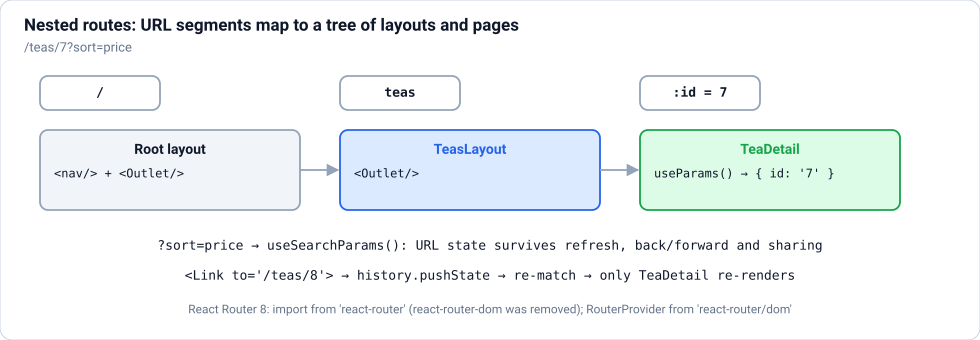

### Theory

> **In simple words:** a **router** decides which components to show for the current **URL**, and changes the URL without reloading the page when users click links. Routes are **nested**: a root layout (header, sidebar) renders an **`<Outlet />`** where the matching child page appears. Parts of the path can be **parameters** (`/teas/:id`), and the URL's **search params** (`?sort=price`) are perfect for state that should survive a refresh or be shareable. **React Router** is the most used router; version 8 (June 2026) is current.

**Words to know:**

- **Client-side routing:** changing what's shown when the URL changes, in JavaScript, without asking the server for a new HTML page.
- **History API:** browser functions (`history.pushState`, the `popstate` event) that change the URL and track back/forward without a reload.
- **Route:** a mapping from a URL **path pattern** to a component (and optionally data functions).
- **Path pattern / dynamic segment:** `/teas/:id` matches `/teas/7`, giving the **param** `id = "7"`; `*` matches anything (a "splat", used for 404 pages).
- **Nested routes and `<Outlet />`:** child routes render inside their parent's `<Outlet />`, so layouts are shared across pages.
- **Index route:** the child shown at the parent's exact path (`/teas` itself, not `/teas/7`).
- **`<Link to>` / `<NavLink>`:** links that navigate client-side; `NavLink` knows whether it's active (to style the current page).
- **`useParams()` / `useSearchParams()` / `useNavigate()` / `useLocation()`:** read path params / read and set the query string / navigate from code / read the current location.
- **Search params (query string):** `?q=chai&sort=price`; URL state that's bookmarkable and shareable.
- **React Router modes:** **declarative** (`<BrowserRouter><Routes>`), **data** (`createBrowserRouter` with loaders and actions, Section [51](#51-router-data-loaders-actions-and-pending-ui)) and **framework** (a full framework with server rendering and file-based routes, the successor of Remix).
- **`createBrowserRouter` / `createMemoryRouter` + `RouterProvider`:** create a data router using the real browser URL / an in-memory history (for tests and these examples).
- **React Router 8 changes:** `react-router-dom` was removed (import from `react-router`, and `RouterProvider` from `react-router/dom` in the browser); ESM-only packages; Node 22.22+ and React 19.2.7+ required; middleware always on.

**Everyday picture.** A **building directory**. The URL is the address ("floor 2, room 7"); the router is the directory board that sends you to the right room. Nested routes are floors: every room on floor 2 shares floor 2's corridor and lifts (the layout), and the room itself (the page) fills the space reserved for it (the `Outlet`).

**Matching a URL, traced by hand** for `/teas/7?tab=reviews`:

```text
routes: "/" (Root layout) → children: index (Home), "teas" (TeasLayout) → children: index (TeaList), ":id" (TeaDetail), "*" (NotFound)
1. "/" matches → render Root; its <Outlet/> will hold the next match
2. "teas" matches the next segment → render TeasLayout inside Root's Outlet
3. ":id" matches "7" → render TeaDetail inside TeasLayout's Outlet; useParams() → { id: "7" }
4. useSearchParams().get("tab") → "reviews"
clicking <Link to="/teas/8"> → pushState → React Router re-matches → only TeaDetail re-renders with id "8"; Root and TeasLayout stay
```

**When to keep state in the URL:** anything a user would expect to survive refresh, back/forward, or be shared: the current page, filters, sort order, search query, selected tab, pagination. **When not:** temporary UI state (an open dropdown, a half-typed draft) and secrets.

**Common mistakes:**

- ❌ `<a href="/teas">` inside the app (full page reload, state lost). ✅ `<Link to="/teas">`.
- ❌ Filters and sort in `useState` (lost on refresh, can't be shared). ✅ Search params.
- ❌ Forgetting a catch-all `*` route (blank page for unknown URLs).
- ❌ Importing from `react-router-dom` in a v8 project (the package was removed).
- ❌ Not configuring the server to serve `index.html` for every path in a client-side app (deep links 404 on refresh).

**Used in real software:** React Router is used by a huge share of React apps (Shopify's admin among them) and is the core of the React Router framework (formerly Remix); Next.js has its own file-based router (Section [62](#62-nextjs-app-router-layouts-server-functions-and-caching)); TanStack Router is a fully type-safe alternative.

### Code

**From scratch: a tiny router with the History API.** It matches path patterns, extracts params and reacts to back/forward:

```tsx
function matchPath(pattern: string, path: string): Record<string, string> | null {
  const p = pattern.split("/").filter(Boolean), s = path.split("/").filter(Boolean);
  if (p.length !== s.length && !p.includes("*")) return null;
  const params: Record<string, string> = {};
  for (let i = 0; i < p.length; i++) {
    if (p[i] === "*") return params;
    if (p[i].startsWith(":")) params[p[i].slice(1)] = decodeURIComponent(s[i]);
    else if (p[i] !== s[i]) return null;
  }
  return params;
}
const routes = [["/", "Home"], ["/teas", "TeaList"], ["/teas/:id", "TeaDetail"], ["*", "NotFound"]] as const;
const resolve = (path: string) => { for (const [pattern, name] of routes) { const params = matchPath(pattern, path); if (params) return `${name} ${JSON.stringify(params)}`; } };

window.addEventListener("popstate", () => console.log("  back/forward →", resolve(location.pathname)));
for (const path of ["/", "/teas", "/teas/7", "/shop/cart"]) {
  history.pushState({}, "", path);                          // change the URL without reloading
  console.log(path.padEnd(11), "→", resolve(location.pathname));
}
history.back();
await new Promise((r) => setTimeout(r, 20));                 // popstate fires asynchronously
```

**Output:**

```text
/           → Home {}
/teas       → TeaList {}
/teas/7     → TeaDetail {"id":"7"}
/shop/cart  → NotFound {}
  back/forward → TeaDetail {"id":"7"}
```

The patterns are tried in order, so the `*` fallback only wins when nothing else matched. `history.back()` fires `popstate`, which is how routers notice the browser's back button.

**The React Router way: nested routes, an `Outlet`, params and links.** `createMemoryRouter` keeps history in memory (ideal for tests); in a browser you'd use `createBrowserRouter` and import `RouterProvider` from `react-router/dom`:

```tsx
import { createMemoryRouter, RouterProvider, Link, NavLink, Outlet, useParams, useSearchParams, useNavigate } from "react-router";
import { render, screen, fireEvent, act } from "@testing-library/react";

const TEAS = [{ id: "1", name: "Masala chai", price: 180 }, { id: "2", name: "Kashmiri kahwa", price: 260 }, { id: "3", name: "Ginger chai", price: 160 }];

function Root() {
  return (
    <>
      <nav><NavLink to="/" end>Home</NavLink> <NavLink to="/teas">Teas</NavLink></nav>
      <main><Outlet /></main>
    </>
  );
}
function TeaList() {
  const [params, setParams] = useSearchParams();
  const sort = params.get("sort") ?? "name";
  const sorted = TEAS.toSorted((a, b) => (sort === "price" ? a.price - b.price : a.name.localeCompare(b.name)));
  return (
    <>
      <button onClick={() => setParams({ sort: "price" })}>Sort by price</button>
      <ul>{sorted.map((t) => <li key={t.id}><Link to={`/teas/${t.id}`}>{t.name}</Link></li>)}</ul>
    </>
  );
}
function TeaDetail() {
  const { id } = useParams();
  const navigate = useNavigate();
  const tea = TEAS.find((t) => t.id === id);
  if (!tea) return <p>No tea with id {id}</p>;
  return <><h2>{tea.name}</h2><p>₹{tea.price}</p><button onClick={() => navigate(-1)}>Back</button></>;
}

const router = createMemoryRouter([
  { path: "/", element: <Root />, children: [
    { index: true, element: <h1>Welcome to Chai Point</h1> },
    { path: "teas", element: <TeaList /> },
    { path: "teas/:id", element: <TeaDetail /> },
    { path: "*", element: <h1>404: page not found</h1> },
  ] },
]);
const where = () => router.state.location.pathname + router.state.location.search;
render(<RouterProvider router={router} />);
console.log(where(), "|", screen.getByRole("heading").textContent);
fireEvent.click(screen.getByText("Teas"));
console.log(where(), "| active link:", document.querySelector("a.active")!.textContent, "|", screen.getAllByRole("listitem").map((li) => li.textContent).join(", "));
fireEvent.click(screen.getByText("Sort by price"));
console.log(where(), "|", screen.getAllByRole("listitem").map((li) => li.textContent).join(", "));
fireEvent.click(screen.getByText("Kashmiri kahwa"));
console.log(where(), "|", screen.getByRole("heading").textContent, screen.getByText(/₹/).textContent);
fireEvent.click(screen.getByText("Back"));
console.log(where(), "| sort kept in the URL:", screen.getAllByRole("listitem")[0].textContent);
await act(() => router.navigate("/shop/cart"));
console.log(where(), "|", screen.getByRole("heading").textContent);
```

**Output:**

```text
/ | Welcome to Chai Point
/teas | active link: Teas | Ginger chai, Kashmiri kahwa, Masala chai
/teas?sort=price | Ginger chai, Masala chai, Kashmiri kahwa
/teas/2 | Kashmiri kahwa ₹260
/teas?sort=price | sort kept in the URL: Ginger chai
/shop/cart | 404: page not found
```

The sort order lives in the URL (`?sort=price`), so going back from the detail page restored it with no extra code. `NavLink` added the `active` class to the current section's link. `router.navigate` is the same function `useNavigate` uses, called from outside components (wrapped in `act` here so the test waits for React to finish the update).

### Practice

1. Add a route `teas/:id/reviews` that renders inside `TeaDetail` (nested), showing "Reviews for tea N".
2. Why should a product list's page number be a search param instead of state?

<details>
<summary><b>Answer</b></summary>

1. Make `reviews` a child of `teas/:id` and render `<Outlet />` in `TeaDetail`:

```tsx
function Reviews() { return <p>Reviews for tea {useParams().id}</p>; }
const nested = createMemoryRouter([{ path: "/teas/:id", element: <><h2>Tea</h2><Outlet /></>, children: [{ path: "reviews", element: <Reviews /> }] }],
  { initialEntries: ["/teas/2/reviews"] });
render(<RouterProvider router={nested} />);
console.log(document.body.textContent);
```

**Output:**

```text
TeaReviews for tea 2
```

The child can read the parent's `:id` param because params from all matched routes are merged.

2. Refreshing, sharing the link, bookmarking and the back button all keep the page; with state, a refresh returns to page 1 and links always open page 1.

</details>

| # | Problem | Difficulty |
|---|---|---|
| 1 | [LeetCode 1472. Design Browser History (back/forward from scratch)](https://leetcode.com/problems/design-browser-history/) | 🟡 Medium |
| 2 | [Frontend Mentor: REST Countries API with color theme switcher (list + detail routes)](https://www.frontendmentor.io/challenges/rest-countries-api-with-color-theme-switcher-5cacc469fec04111f7b848ca) | 🔴 Hard |

**Learn more:** [React Router: Picking a mode](https://reactrouter.com/start/modes) · [React Router: Data mode routing](https://reactrouter.com/start/data/routing) · [React Router v8 changelog](https://github.com/remix-run/react-router/blob/main/packages/react-router/CHANGELOG.md)

---

## 51. Router Data: Loaders, Actions and Pending UI


### Theory

> **In simple words:** in React Router's data mode, each route can have a **loader** (a function that fetches the data the page needs) and an **action** (a function that handles a form submission). The router runs the loaders of **all matching routes in parallel** before showing the page, so there are no fetch-in-effect waterfalls; a `<Form method="post">` sends its data to the route's action; afterwards the router **revalidates** (re-runs loaders) so the page shows fresh data. `useNavigation()` tells you when something is loading or submitting.

**Words to know:**

- **Loader:** `loader({ params, request })` runs before the route renders; its return value is read with `useLoaderData()`.
- **Action:** `action({ request, params })` handles non-GET submissions (`POST`, `PUT`, `DELETE`); read the form with `await request.formData()`; its return value is available via `useActionData()`.
- **`<Form>`:** React Router's form; submits to the route's action without a page reload (and works as a normal HTML form before JavaScript loads in framework mode).
- **`redirect(url)`:** returned or thrown from a loader/action to navigate somewhere else (e.g. after creating something).
- **Revalidation:** after an action completes, the router re-runs the active loaders so every part of the page shows updated data.
- **`useNavigation()`:** the global navigation state: `"idle"`, `"loading"` (a navigation's loaders are running) or `"submitting"` (an action is running).
- **`useFetcher()`:** submits or loads **without** navigating (a "like" button, an inline edit), with its own `state`.
- **Route `ErrorBoundary`:** a component shown when that route's loader, action or rendering throws.
- **Waterfall vs parallel loading:** fetching in nested components' effects runs one level after another; route loaders for all matches start together.
- **Middleware (React Router 8):** functions that run before loaders/actions (authentication, logging), always enabled in v8.

**Everyday picture.** A **restaurant that takes your order before seating you**. Instead of sitting down, then ordering the starter, waiting, then ordering the main (waterfall), the waiter takes the whole order at the door and the kitchen cooks everything at once (parallel loaders); when you send a dish back (an action), the kitchen re-checks everything on your table (revalidation).

**One submission, traced:**

```text
user submits <Form method="post"> on /teas
1. navigation.state = "submitting" → the button can show "Adding…"
2. the router calls the "teas" route's action with a Request containing the form data
3. the action saves the tea and returns { ok: true }
4. navigation.state = "loading": the router re-runs the loaders of all matching routes (revalidation)
5. new loader data → the list re-renders with the new tea; navigation.state = "idle"
```

**When to use loaders and actions:** apps built on React Router (or its framework mode) that load data per page. **When not:** highly interactive client-side data (infinite feeds, real-time dashboards), where TanStack Query (Section [52](#52-server-state-with-tanstack-query)) is more flexible; many apps combine both (loaders prefetch into the Query cache).

**Common mistakes:**

- ❌ Fetching in `useEffect` inside route components when a loader would remove the waterfall.
- ❌ Forgetting that an action's thrown error goes to the route's `ErrorBoundary`.
- ❌ Using `useNavigation` for a fetcher's state (fetchers have their own `fetcher.state`).
- ❌ Doing permission checks only in the UI; loaders/actions (and the real server) must check too.

**Used in real software:** this loader/action model came from Remix and is now in React Router; Next.js Server Components and Server Functions (Section [62](#62-nextjs-app-router-layouts-server-functions-and-caching)) and TanStack Router's loaders follow the same "load before render, mutate then revalidate" idea.

### Code

A fake API with a small delay and a call log, so the order of calls is visible:

```tsx
import { createMemoryRouter, RouterProvider, Form, Outlet, useLoaderData, useActionData, useNavigation, useFetcher, redirect, isRouteErrorResponse, useRouteError } from "react-router";
import { render, screen, fireEvent, act } from "@testing-library/react";

const calls: string[] = [];
const wait = (ms: number) => new Promise((r) => setTimeout(r, ms));
const db = { user: { name: "Asha" }, teas: [{ id: 1, name: "Masala chai", likes: 3 }] };
const api = {
  async user() { calls.push("start user"); await wait(30); calls.push("end user"); return db.user; },
  async teas() { calls.push("start teas"); await wait(30); calls.push("end teas"); return db.teas; },
  async addTea(name: string) { calls.push("start addTea"); await wait(10); if (!name.trim()) return { error: "Name is required" }; db.teas = [...db.teas, { id: db.teas.length + 1, name, likes: 0 }]; return { ok: true }; },
  async like(id: number) { db.teas = db.teas.map((t) => (t.id === id ? { ...t, likes: t.likes + 1 } : t)); },
};
console.log("api ready");
```

**Output:**

```text
api ready
```

**Loaders run in parallel for nested routes; an action revalidates them:**

```tsx
function Layout() {
  const user = useLoaderData() as typeof db.user;
  const navigation = useNavigation();
  return <><header>Hi {user.name} {navigation.state !== "idle" && <em>({navigation.state}…)</em>}</header><Outlet /></>;
}
function Teas() {
  const teas = useLoaderData() as typeof db.teas;
  const result = useActionData() as { error?: string } | undefined;
  const navigation = useNavigation();
  return (
    <>
      <ul>{teas.map((t) => <LikeRow key={t.id} tea={t} />)}</ul>
      <Form method="post">
        <input name="name" aria-label="tea name" />
        <button disabled={navigation.state === "submitting"}>{navigation.state === "submitting" ? "Adding…" : "Add tea"}</button>
        {result?.error && <p role="alert">{result.error}</p>}
      </Form>
    </>
  );
}
function LikeRow({ tea }: { tea: { id: number; name: string; likes: number } }) {
  const fetcher = useFetcher();
  return (
    <li>
      {tea.name} ♥ {tea.likes}
      <fetcher.Form method="post" action="/teas/like"><input type="hidden" name="id" value={tea.id} /><button>like {tea.name}</button></fetcher.Form>
    </li>
  );
}
function TeasError() {
  const error = useRouteError();
  return <p role="alert">{isRouteErrorResponse(error) ? `${error.status}: ${error.data}` : (error as Error).message}</p>;
}

const router = createMemoryRouter([
  { path: "/", element: <Layout />, loader: () => api.user(), hydrateFallbackElement: <p>Loading…</p>, children: [
    { path: "teas", element: <Teas />, loader: () => api.teas(), errorElement: <TeasError />,
      action: async ({ request }) => { const form = await request.formData(); return api.addTea(String(form.get("name"))); } },
    { path: "teas/like", action: async ({ request }) => { await api.like(Number((await request.formData()).get("id"))); return null; } },
    { path: "teas/missing", loader: () => { throw new Response("Tea not found", { status: 404 }); }, element: <p />, errorElement: <TeasError /> },
    { path: "old-menu", loader: () => redirect("/teas") },
  ] },
], { initialEntries: ["/teas"] });

render(<RouterProvider router={router} />);
console.log("before loaders finish:", document.body.textContent);
await screen.findByRole("listitem");
console.log("first load:", calls.splice(0).join(" → "));

fireEvent.click(screen.getByText("Add tea"));                                   // empty name → validation error
console.log("while submitting:", screen.getByRole("button", { name: /Add/ }).textContent);
console.log("action said:", (await screen.findByRole("alert")).textContent, "| calls:", calls.splice(0).join(" → "));

fireEvent.change(screen.getByLabelText("tea name"), { target: { value: "Ginger chai" } });
fireEvent.click(screen.getByText("Add tea"));
await screen.findByRole("button", { name: "like Ginger chai" });
console.log("after adding:", calls.splice(0).join(" → "));

fireEvent.click(screen.getByText("like Masala chai"));
await screen.findByText(/Masala chai ♥ 4/);
console.log("fetcher (no navigation):", screen.getAllByRole("listitem").map((li) => li.firstChild!.textContent).join(" | "), "| url:", router.state.location.pathname);
```

**Output:**

```text
before loaders finish: Loading…
first load: start user → start teas → end user → end teas
while submitting: Adding…
action said: Name is required | calls: start addTea → start user → start teas
after adding: start addTea → start user → start teas → end user → end teas → end user → end teas
fetcher (no navigation): Masala chai | Ginger chai | url: /teas
```

`hydrateFallbackElement` is what the router shows while the very first loaders run (without it React Router warns). The two loaders started **together** (both "start" entries before either "end"): no waterfall. Each submission ran the action and then **revalidated** both loaders (the second pair of starts), so the list updated without any manual refetching. The fetcher's like button changed data without changing the URL.

**Errors and redirects from loaders:**

```tsx
await act(() => router.navigate("/teas/missing"));
console.log("404 loader:", (await screen.findByRole("alert")).textContent);
await act(() => router.navigate("/old-menu"));
console.log("redirected to:", router.state.location.pathname);
```

**Output:**

```text
404 loader: 404: Tea not found
redirected to: /teas
```

Throwing a `Response` with a status sends it to the route's `errorElement`, where `isRouteErrorResponse` recognises it. `redirect` sent `/old-menu` straight to `/teas`.

### Practice

1. A product page has a loader for the product and a child route `reviews` with its own loader. In what order do their requests start?
2. When would you choose `useFetcher` over `<Form>`?

<details>
<summary><b>Answer</b></summary>

1. Both at the same time: the router matches all routes for the URL first and calls every matched loader in parallel, then renders when they've resolved (or streams if you return promises and use `Await`/Suspense).
2. When the submission shouldn't navigate or appear in history: likes, adding to a cart from a list, inline edits, autosave, or loading data for a combobox; each fetcher tracks its own pending state, so many can run at once.

</details>

| # | Problem | Difficulty |
|---|---|---|
| 1 | [React Router tutorial: Address Book (loaders, actions, forms)](https://reactrouter.com/tutorials/address-book) | 🟡 Medium |
| 2 | [Frontend Mentor: Todo app (one route per filter, data through loaders and actions)](https://www.frontendmentor.io/challenges/todo-app-Su1_KokOW) | 🟡 Medium |

**Learn more:** [React Router: Data loading](https://reactrouter.com/start/data/data-loading) · [React Router: Actions](https://reactrouter.com/start/data/actions) · [React Router: Pending UI](https://reactrouter.com/start/data/pending-ui)

---

## 52. Server State with TanStack Query


### Theory

> **In simple words:** data from a server is different from UI state: it lives elsewhere, can change without you knowing, and many components need the same pieces. **TanStack Query** (formerly React Query) manages it: you describe **what** to fetch with a **query key** and a function, and it handles caching, deduplicating identical requests, loading and error states, refetching stale data, retries, pagination, and updating the cache after **mutations**. It replaces most hand-written fetch-in-effect code (Section [34](#34-fetching-data-in-effects-loading-errors-race-conditions-and-abortcontroller)).

**Words to know:**

- **Server state:** data owned by a server that the UI shows a cached copy of (products, orders, the user's profile).
- **`QueryClient` / `QueryClientProvider`:** the cache object and the provider that makes it available to components.
- **`useQuery({ queryKey, queryFn })`:** subscribes a component to cached data; returns `data`, `error`, `status` (`"pending"`, `"error"`, `"success"`) and `isFetching`.
- **Query key:** an array that uniquely identifies the data, like a cache address: `["teas"]`, `["tea", id]`, `["teas", { sort }]`. Different keys = different cache entries.
- **Deduplication:** many components asking for the same key at once share **one** request.
- **`staleTime`:** how long fetched data counts as fresh; while fresh, no refetch happens. Default `0` (stale immediately; refetched on mount, window focus or reconnect).
- **`gcTime`:** how long unused cache entries are kept (default 5 minutes) before being garbage collected.
- **Background refetch:** stale data is shown immediately while a fresh copy loads (stale-while-revalidate).
- **`useMutation`:** runs a change (POST/PUT/DELETE) with its own pending/error state.
- **Invalidation (`queryClient.invalidateQueries({ queryKey })`):** marks matching queries stale and refetches active ones, typically after a mutation.
- **Optimistic update:** updating the cache **before** the server confirms, rolling back on error.
- **`useSuspenseQuery`:** a version that suspends (Section [47](#47-code-splitting-lazy-suspense-and-bundle-size)) instead of returning a pending status.
- **SWR:** "stale-while-revalidate", also the name of Vercel's smaller alternative library.

**Everyday picture.** A **well-run reference library**. When three people ask for the same book at the same time, the librarian fetches it once (deduplication). Books on the "fresh" shelf are handed out instantly (cache); old editions are handed out but a new copy is ordered in the background (stale-while-revalidate); when a new edition is published, the librarian marks the old one outdated (invalidation).

**Two components and one request, traced:**

```text
<TeaCount />  useQuery(["teas"]) → cache miss → start fetch #1 → status "pending"
<TeaList />   useQuery(["teas"]) → same key, fetch already in flight → share it (no fetch #2)
fetch #1 resolves → both components get data, status "success"
TeaList unmounts and remounts 1 s later: staleTime 0 → show cached data instantly AND refetch in background
addTea mutation succeeds → invalidateQueries(["teas"]) → the active ["teas"] query refetches → both update
```

**When to use it:** any app reading server data on the client, especially when several components use the same data, when data should refresh, or for pagination/infinite scroll. **When not:** data that's loaded once by a router loader or a Server Component and never refreshed on the client; purely local UI state (use `useState` or a store, Section [55](#55-global-state-build-a-store-then-zustand-redux-toolkit-and-jotai)).

**Common mistakes:**

- ❌ Copying query data into `useState` (it stops updating). ✅ Use `data` directly; derive from it.
- ❌ Query keys missing a variable the function uses (`["tea"]` for every id → wrong data from cache). ✅ `["tea", id]`.
- ❌ Creating the `QueryClient` inside a component (a new empty cache each render).
- ❌ Forgetting to invalidate after mutations (stale lists).
- ❌ Putting server data in Redux/Zustand and syncing it by hand.

**Used in real software:** TanStack Query is one of the most used React data libraries; SWR (Vercel), RTK Query (Redux Toolkit) and Apollo Client (GraphQL) solve the same server-state problem.

### Code

**From scratch: a tiny query cache** with deduplication and freshness, the core of what the library does:

```tsx
type Entry = { promise?: Promise<unknown>; data?: unknown; fetchedAt: number };
function createQueryCache() {
  const cache = new Map<string, Entry>();
  return async function query<T>(key: unknown[], fn: () => Promise<T>, staleTime = 0): Promise<T> {
    const id = JSON.stringify(key);
    const entry = cache.get(id);
    if (entry?.promise) return entry.promise as Promise<T>;                                // in flight → share it
    if (entry && Date.now() - entry.fetchedAt < staleTime) return entry.data as T;          // fresh → no request
    const promise = fn().then((data) => { cache.set(id, { data, fetchedAt: Date.now() }); return data; });
    cache.set(id, { ...entry, promise, fetchedAt: entry?.fetchedAt ?? 0 });
    return promise;
  };
}
let requests = 0;
const fetchTeas = async () => { requests++; await new Promise((r) => setTimeout(r, 10)); return ["Masala chai", "Ginger chai"]; };
const query = createQueryCache();
await Promise.all([query(["teas"], fetchTeas, 1000), query(["teas"], fetchTeas, 1000), query(["teas"], fetchTeas, 1000)]);
console.log("3 simultaneous calls → requests:", requests);
await query(["teas"], fetchTeas, 1000);
console.log("again while fresh → requests:", requests);
await query(["teas", { sort: "price" }], fetchTeas, 1000);
console.log("a different key → requests:", requests);
```

**Output:**

```text
3 simultaneous calls → requests: 1
again while fresh → requests: 1
a different key → requests: 2
```

**TanStack Query against a real HTTP server** that counts requests:

```tsx
import { QueryClient, QueryClientProvider, useQuery, useMutation, useQueryClient } from "@tanstack/react-query";
import { createServer } from "node:http";
import { render, screen, fireEvent, act } from "@testing-library/react";

let teas = ["Masala chai", "Ginger chai"];
let serverHits = 0;
const server = createServer(async (req, res) => {
  serverHits++;
  if (req.method === "POST") {
    let body = ""; for await (const chunk of req) body += chunk;
    const { name } = JSON.parse(body);
    if (name === "fail") { res.writeHead(500).end(); return; }
    teas = [...teas, name];
  }
  res.writeHead(200, { "Content-Type": "application/json" }).end(JSON.stringify(teas));
});
await new Promise<void>((r) => server.listen(4404, r));
const URL_ = "http://localhost:4404/teas";
const getTeas = async (): Promise<string[]> => { const r = await fetch(URL_); if (!r.ok) throw new Error(`HTTP ${r.status}`); return r.json(); };

function TeaCount() {
  const { data, status } = useQuery({ queryKey: ["teas"], queryFn: getTeas });
  return <p>{status === "pending" ? "…" : `${data!.length} teas`}</p>;
}
function TeaList() {
  const { data, status, error } = useQuery({ queryKey: ["teas"], queryFn: getTeas });
  if (status === "pending") return <p>Loading…</p>;
  if (status === "error") return <p>Error: {error.message}</p>;
  return <ul>{data.map((t) => <li key={t}>{t}</li>)}</ul>;
}
function AddTea() {
  const queryClient = useQueryClient();
  const mutation = useMutation({
    mutationFn: async (name: string) => { const r = await fetch(URL_, { method: "POST", body: JSON.stringify({ name }) }); if (!r.ok) throw new Error(`HTTP ${r.status}`); },
    onSuccess: () => queryClient.invalidateQueries({ queryKey: ["teas"] }),
  });
  return <>
    <button onClick={() => mutation.mutate("Lemon tea")}>add lemon tea</button>
    <button onClick={() => mutation.mutate("fail")}>add broken</button>
    {mutation.isPending && <em>saving…</em>}{mutation.isError && <em role="alert">{mutation.error.message}</em>}
  </>;
}

const queryClient = new QueryClient({ defaultOptions: { queries: { retry: false } } });     // no retries, to keep the demo short
render(<QueryClientProvider client={queryClient}><TeaCount /><TeaList /><AddTea /></QueryClientProvider>);
console.log("first render:", document.body.textContent);
await screen.findByText("Ginger chai");
console.log("loaded:", screen.getByText(/teas$/).textContent, "| server hits for two components:", serverHits);
fireEvent.click(screen.getByText("add lemon tea"));
await screen.findByText("Lemon tea");
console.log("after mutation + invalidate:", screen.getByText(/teas$/).textContent, "| server hits:", serverHits);
fireEvent.click(screen.getByText("add broken"));
console.log("failed mutation:", (await screen.findByRole("alert")).textContent);
server.close();
queryClient.clear();
```

**Output:**

```text
first render: …Loading…add lemon teaadd broken
loaded: 2 teas | server hits for two components: 1
after mutation + invalidate: 3 teas | server hits: 3
failed mutation: HTTP 500
```

Two components asked for `["teas"]` but the server was hit **once**. After the mutation, invalidation refetched the list (POST + GET = 2 more hits) and **both** components updated. In production you'd keep the default retries (3, with backoff) for queries.

**Optimistic updates with rollback,** using `onMutate`:

```tsx
const optimisticClient = new QueryClient();
optimisticClient.setQueryData(["likes"], 10);
function LikeButton({ fail }: { fail: boolean }) {
  const qc = useQueryClient();
  const likes = useQuery({ queryKey: ["likes"], queryFn: async () => 10, staleTime: Infinity }).data;
  const mutation = useMutation({
    mutationFn: async () => { await new Promise((r) => setTimeout(r, 20)); if (fail) throw new Error("offline"); },
    onMutate: async () => {
      const previous = qc.getQueryData<number>(["likes"]);
      qc.setQueryData(["likes"], (n: number) => n + 1);          // show it immediately
      return { previous };
    },
    onError: (_e, _v, context) => qc.setQueryData(["likes"], context!.previous),   // roll back
  });
  return <button onClick={() => mutation.mutate()}>♥ {likes}</button>;
}
for (const fail of [false, true]) {
  const v = render(<QueryClientProvider client={optimisticClient}><LikeButton fail={fail} /></QueryClientProvider>);
  fireEvent.click(screen.getByRole("button"));
  const immediately = screen.getByRole("button").textContent;
  await act(() => new Promise((r) => setTimeout(r, 50)));
  console.log(fail ? "server failed:" : "server ok:    ", immediately, "→", screen.getByRole("button").textContent);
  v.unmount();
}
optimisticClient.clear();
```

**Output:**

```text
server ok:     ♥ 10 → ♥ 11
server failed: ♥ 11 → ♥ 11
```

### Practice

1. A `useQuery({ queryKey: ["user"], queryFn: () => fetchUser(id) })` shows the wrong user after switching profiles. Why?
2. What does `staleTime: 60_000` change for a list that 10 components show?

<details>
<summary><b>Answer</b></summary>

1. The key doesn't include `id`, so every profile shares one cache entry. Use `queryKey: ["user", id]`.
2. For one minute after a fetch, mounting more components (or refocusing the window) uses the cache without refetching; after that the data is stale and the next trigger refetches in the background while still showing the cached list.

</details>

| # | Problem | Difficulty |
|---|---|---|
| 1 | [LeetCode 2622. Cache With Time Limit](https://leetcode.com/problems/cache-with-time-limit/) | 🟡 Medium |
| 2 | [LeetCode 146. LRU Cache](https://leetcode.com/problems/lru-cache/) | 🟡 Medium |
| 3 | [BFE.dev React problem 4: useSWR() I](https://bigfrontend.dev/react/useSWR-1) | 🔴 Hard |
| 4 | [Frontend Mentor: Weather app (API data cached with TanStack Query)](https://www.frontendmentor.io/challenges/weather-app-K1FhddVm49) | 🟡 Medium |

**Learn more:** [TanStack Query: Overview](https://tanstack.com/query/latest/docs/framework/react/overview) · [TanStack Query: Important defaults](https://tanstack.com/query/latest/docs/framework/react/guides/important-defaults) · [TkDodo's blog: Practical React Query](https://tkdodo.eu/blog/practical-react-query)

---

## 53. React 19 Forms: Actions, useActionState, useFormStatus and useOptimistic


### Theory

> **In simple words:** React 19 lets you pass a **function** as a form's `action`. When the form is submitted, React calls it with the form's **`FormData`**, tracks it as a pending **action** (a transition), and resets the form when it succeeds. Three hooks build on that: **`useActionState`** keeps the action's result (like an error message) and a pending flag; **`useFormStatus`** lets any component inside the form (a Submit button) know the form is submitting; **`useOptimistic`** shows the expected result immediately while the action runs.

**Words to know:**

- **Action:** a function (often `async`) that handles a user intent such as a form submit; React runs it inside a **transition** (Section [63](#63-transitions-usetransition-usedeferredvalue-activity-and-viewtransition)) and tracks its pending state.
- **`<form action={fn}>`:** React calls `fn(formData)` on submit, prevents the page reload, and resets uncontrolled fields after it succeeds.
- **`formAction`:** the same, on a specific submit button (`<button formAction={save}>`).
- **`useActionState(action, initialState)`:** returns `[state, formAction, isPending]`; your action receives `(previousState, formData)` and returns the next state.
- **`useFormStatus()`:** from `react-dom`; returns `{ pending, data, method, action }` for the **parent** `<form>` of the component calling it.
- **`useOptimistic(state, updateFn?)`:** returns a value that shows the optimistic version while an action is pending and automatically falls back to the real state when it finishes.
- **Progressive enhancement:** with Server Functions (Section [62](#62-nextjs-app-router-layouts-server-functions-and-caching)) the same form can submit before JavaScript loads.
- **Form reset:** after a successful action React resets the form's uncontrolled inputs, like a browser does after a normal submit.

**Everyday picture.** A **dry-cleaning counter**. You hand over your clothes (the form data); the clerk gives you a ticket immediately ("ready Thursday", the optimistic result); the counter light shows "processing" (pending status) to anyone in the queue (`useFormStatus`); if there's a problem, the ticket is updated with the message (`useActionState`'s returned state).

**One submit, traced:**

```text
<form action={formAction}>   with  const [state, formAction, isPending] = useActionState(addTea, { error: null })
user clicks Submit
1. React creates FormData from the form and starts a transition: isPending = true, useFormStatus().pending = true
2. optimistic updates (useOptimistic) render immediately
3. await addTea(previousState, formData) → returns { error: "Name taken" } or { error: null }
4. React sets state to the returned value, isPending = false, optimistic values revert to the real state
5. if it succeeded, uncontrolled inputs are reset
```

**When to use actions:** forms that submit data, especially with Server Functions in Next.js or React Router framework mode; simple client forms where uncontrolled inputs and FormData are enough. **When not:** complex client-side validation on every keystroke and dynamic field arrays, where React Hook Form (Section [54](#54-form-libraries-react-hook-form-and-zod-validation)) is more convenient (the two can be combined).

**Common mistakes:**

- ❌ Calling `useFormStatus` in the same component that renders the `<form>` (it reads the **parent** form, so it must be in a child).
- ❌ Expecting controlled inputs to be reset automatically (only uncontrolled ones are).
- ❌ Forgetting the `prevState` first argument when switching an action to `useActionState`.
- ❌ Putting secrets or authorisation in client-side actions; real checks belong on the server.

**Used in real software:** Next.js and React Router framework mode use these APIs with Server Functions for mutations; design-system submit buttons use `useFormStatus` to disable themselves automatically.

### Code

**From scratch: the React 18 way,** with manual pending and error state:

```tsx
import { useActionState, useOptimistic, useState } from "react";
import { useFormStatus } from "react-dom";
import { render, screen, fireEvent, act } from "@testing-library/react";

const taken = new Set(["masala chai"]);
async function saveTea(name: string) {
  await new Promise((r) => setTimeout(r, 20));
  if (!name.trim()) return "Name is required";
  if (taken.has(name.toLowerCase())) return `"${name}" already exists`;
  taken.add(name.toLowerCase());
  return null;
}

function OldForm() {
  const [error, setError] = useState<string | null>(null);
  const [pending, setPending] = useState(false);
  async function handleSubmit(e: React.FormEvent<HTMLFormElement>) {
    e.preventDefault();
    setPending(true);
    const form = e.currentTarget;
    const message = await saveTea(String(new FormData(form).get("name")));
    setPending(false); setError(message);
    if (!message) form.reset();
  }
  return <form onSubmit={handleSubmit}><input name="name" aria-label="old name" /><button disabled={pending}>{pending ? "Saving…" : "Save"}</button>{error && <p role="alert">{error}</p>}</form>;
}
render(<OldForm />);
fireEvent.change(screen.getByLabelText("old name"), { target: { value: "Masala chai" } });
fireEvent.click(screen.getByText("Save"));
console.log("pending:", screen.getByRole("button").textContent, "| then:", (await screen.findByRole("alert")).textContent);
```

**Output:**

```text
pending: Saving… | then: "Masala chai" already exists
```

**React 19: `useActionState` + `useFormStatus`** does the same with less code, and the submit button knows the form's status on its own:

```tsx
function SubmitButton() {
  const { pending, data } = useFormStatus();                    // reads the PARENT form
  return <button disabled={pending}>{pending ? `Saving ${data?.get("name")}…` : "Save"}</button>;
}
function NewForm() {
  const [error, formAction, isPending] = useActionState(async (_prev: string | null, formData: FormData) => {
    return saveTea(String(formData.get("name")));
  }, null);
  return (
    <form action={formAction}>
      <input name="name" aria-label="name" />
      <SubmitButton />
      {error && <p role="alert">{error}</p>}
      {isPending && <small> (isPending)</small>}
    </form>
  );
}
render(<NewForm />);
const input = screen.getByLabelText("name") as HTMLInputElement;
fireEvent.change(input, { target: { value: "Masala chai" } });
fireEvent.click(screen.getByRole("button"));
console.log("pending:", (await screen.findByText(/Saving/)).textContent);
console.log("result:", (await screen.findByRole("alert")).textContent, `| input after the action: "${input.value}"`);
fireEvent.change(input, { target: { value: "Lemon tea" } });
fireEvent.click(screen.getByRole("button"));
await screen.findByText("Save");
console.log("success → error cleared:", screen.queryByRole("alert") === null, `| input reset to "${input.value}"`);
```

**Output:**

```text
pending: Saving Masala chai…
result: "Masala chai" already exists | input after the action: ""
success → error cleared: true | input reset to ""
```

Look closely at the second line: the input was **cleared even though the action returned an error**. React resets a form's uncontrolled fields after **every** action that finishes, and returning an error message still counts as finishing. To keep what the user typed, return the submitted values as part of the state and feed them back (`defaultValue={state.values?.name}`), or make that field controlled. On success the reset is what you want.

**`useOptimistic`: show the message immediately, reconcile when the server answers:**

```tsx
type Message = { text: string; sending?: boolean };
async function deliver(text: string) { await new Promise((r) => setTimeout(r, 30)); if (text.includes("fail")) throw new Error("not sent"); return text; }

function Chat() {
  const [messages, setMessages] = useState<Message[]>([{ text: "Hi! Chai at 5?" }]);
  const [optimistic, addOptimistic] = useOptimistic(messages, (current, text: string) => [...current, { text, sending: true }]);
  async function send(formData: FormData) {
    const text = String(formData.get("message"));
    addOptimistic(text);                                        // shown right away
    try { const sent = await deliver(text); setMessages((m) => [...m, { text: sent }]); }
    catch { console.log(`  "${text}" failed; the optimistic copy disappears`); }
  }
  return (
    <>
      <ul>{optimistic.map((m, i) => <li key={i}>{m.text}{m.sending && " (sending…)"}</li>)}</ul>
      <form action={send}><input name="message" aria-label="message" /><button>Send</button></form>
    </>
  );
}
render(<Chat />);
const list = () => screen.getAllByRole("listitem").map((li) => li.textContent).join(" | ");
for (const text of ["Yes, see you", "this will fail"]) {
  fireEvent.change(screen.getByLabelText("message"), { target: { value: text } });
  fireEvent.click(screen.getByText("Send"));
  await screen.findByText(/sending…/);
  console.log("immediately:", list());
  await act(() => new Promise((r) => setTimeout(r, 60)));        // let the action finish
  console.log("after server:", list());
}
```

**Output:**

```text
immediately: Hi! Chai at 5? | Yes, see you (sending…)
after server: Hi! Chai at 5? | Yes, see you
immediately: Hi! Chai at 5? | Yes, see you | this will fail (sending…)
  "this will fail" failed; the optimistic copy disappears
after server: Hi! Chai at 5? | Yes, see you
```

### Practice

1. Why does this not work, and how do you fix it? `function Form() { const { pending } = useFormStatus(); return <form action={save}><button disabled={pending}>Go</button></form>; }`
2. Convert a "delete" button that calls `await deleteItem(id)` and sets `isDeleting` state into a form action with `useActionState`.

<details>
<summary><b>Answer</b></summary>

1. `useFormStatus` reads the status of the form **above** the calling component; here the hook is called by the component that renders the form, so `pending` is always `false`. Move the button into its own component (`SubmitButton`) rendered inside the form.
2. 

```text
const [error, deleteAction, isDeleting] = useActionState(async () => {
  try { await deleteItem(id); return null; } catch (e) { return "Couldn't delete"; }
}, null);
return <form action={deleteAction}><button disabled={isDeleting}>{isDeleting ? "Deleting…" : "Delete"}</button>{error}</form>;
```

(A sketch, not run; it uses exactly the `useActionState` pattern run above.)

</details>

| # | Problem | Difficulty |
|---|---|---|
| 1 | [Frontend Mentor: Newsletter sign-up form with success message (use an action)](https://www.frontendmentor.io/challenges/newsletter-signup-form-with-success-message-3FC1AZbNrv) | 🟢 Easy |
| 2 | [react.dev challenge: Submit a form without Effects](https://react.dev/learn/you-might-not-need-an-effect#challenges) | 🟡 Medium |
| 3 | [Frontend Mentor: Conference ticket generator](https://www.frontendmentor.io/challenges/conference-ticket-generator-oq5gFIU12w) | 🟡 Medium |

**Learn more:** [react.dev: useActionState](https://react.dev/reference/react/useActionState) · [react.dev: useFormStatus](https://react.dev/reference/react-dom/hooks/useFormStatus) · [react.dev: useOptimistic](https://react.dev/reference/react/useOptimistic) · [React 19 blog: Actions](https://react.dev/blog/2024/12/05/react-19#actions)

---

## 54. Form Libraries: React Hook Form and Zod Validation


### Theory

> **In simple words:** real forms need validation rules, error messages, touched/dirty tracking, async checks and good performance. **Zod** lets you describe what valid data looks like **once** as a **schema** and gives you both runtime checking and a TypeScript type. **React Hook Form** manages form state with **uncontrolled** inputs (so typing doesn't re-render the whole form), and validates with your Zod schema through a **resolver**. The same schema can validate on the server.

**Words to know:**

- **Validation:** checking that input meets rules (required, format, range) before using it.
- **Schema:** a description of the expected data shape and rules: `z.object({ email: z.email(), qty: z.number().min(1) })`.
- **Zod:** a TypeScript-first schema library; `schema.parse(x)` returns typed data or throws, `schema.safeParse(x)` returns `{ success, data | error }`. Zod 4 (2025) made it faster and added top-level formats like `z.email()`.
- **`z.infer<typeof schema>`:** the TypeScript type derived from a schema, so types and runtime rules can't drift apart.
- **Coercion (`z.coerce.number()`):** converting input strings ("2") to the right type before validating; form fields are always strings.
- **Issue:** one validation problem, with a `path` (which field) and a `message`.
- **React Hook Form (RHF):** `useForm()` returns `register` (connects an input), `handleSubmit` (validates then calls your function), `formState.errors`, `reset`, `watch`, and more.
- **`register("field")`:** returns `name`, `ref`, `onChange` and `onBlur` props for an uncontrolled input.
- **Resolver (`zodResolver(schema)`):** an adapter that makes RHF validate with an external schema library.
- **Dirty / touched:** a field whose value changed from its default / that the user has focused and left.
- **Validation mode:** when RHF validates: on submit (default), on blur, on change, or "on touched".

**Everyday picture.** A **passport application**. The government publishes **one** official list of requirements (the schema): photo size, valid date of birth, signature. The form at the counter (React Hook Form) checks your paper against it before you queue; the passport office checks the same list again (server validation). Nobody keeps separate, slightly different rules.

**Validating a form submission, traced:**

```text
schema: name ≥ 2 chars, email valid, qty integer ≥ 1 (coerced from the input string)
input:  { name: "A", email: "asha@", qty: "0" }
safeParse → success: false, issues:
  name: "Name is too short" · email: "Enter a valid email" · qty: "Too small: expected number to be >=1"
RHF shows each message next to its field; handleSubmit's callback is NOT called
fix the fields → parse → { name: "Asha", email: "asha@example.com", qty: 2 } (qty is now a number) → onSubmit(data)
```

**When to use them:** forms with several fields and rules, sign-up/checkout/settings, anything whose data is also validated on the server (share the schema), API responses you want to validate at runtime. **When not:** a single search box; a two-field form where `useActionState` and a couple of checks are simpler.

**Common mistakes:**

- ❌ Validating only on the client (anyone can bypass it). ✅ Validate on the server with the same schema.
- ❌ Writing TypeScript types and validation rules separately (they drift). ✅ `z.infer`.
- ❌ Forgetting coercion: `z.number()` rejects the string `"2"` from an input.
- ❌ Making every RHF field controlled with `watch()` on everything (loses the performance benefit).

**Used in real software:** React Hook Form is one of the most downloaded React form libraries; Zod is used for environment variables, API contracts (tRPC, OpenAPI generators), LLM structured outputs and server validation; alternatives include Valibot, ArkType, TanStack Form and Formik (older).

### Code

**From scratch: a hand-written validator** shows what a schema library does for you:

```tsx
type Order = { name: string; email: string; qty: number };
function validateOrder(input: Record<string, string>): { ok: true; data: Order } | { ok: false; errors: Record<string, string> } {
  const errors: Record<string, string> = {};
  if (input.name.trim().length < 2) errors.name = "Name is too short";
  if (!/^[^@\s]+@[^@\s]+\.[^@\s]+$/.test(input.email)) errors.email = "Enter a valid email";
  const qty = Number(input.qty);
  if (!Number.isInteger(qty) || qty < 1) errors.qty = "Quantity must be at least 1";
  return Object.keys(errors).length ? { ok: false, errors } : { ok: true, data: { name: input.name.trim(), email: input.email, qty } };
}
console.log(validateOrder({ name: "A", email: "asha@", qty: "0" }));
console.log(validateOrder({ name: "Asha", email: "asha@example.com", qty: "2" }));
```

**Output:**

```text
{
  ok: false,
  errors: {
    name: 'Name is too short',
    email: 'Enter a valid email',
    qty: 'Quantity must be at least 1'
  }
}
{ ok: true, data: { name: 'Asha', email: 'asha@example.com', qty: 2 } }
```

It works, but the rules, messages, conversion and the `Order` type are all written separately and must be kept in sync by hand.

**Zod: one schema gives validation, conversion and the type:**

```tsx
import { z } from "zod";

const OrderSchema = z.object({
  name: z.string().trim().min(2, "Name is too short"),
  email: z.email("Enter a valid email"),
  qty: z.coerce.number().int().min(1, "Quantity must be at least 1"),
  note: z.string().max(40).optional(),
});
type OrderInput = z.infer<typeof OrderSchema>;            // { name: string; email: string; qty: number; note?: string }

const bad = OrderSchema.safeParse({ name: "A", email: "asha@", qty: "0" });
if (!bad.success) console.log(bad.error.issues.map((i) => `${i.path.join(".")}: ${i.message}`));
const good: OrderInput = OrderSchema.parse({ name: "  Asha ", email: "asha@example.com", qty: "2" });
console.log(good, "| qty is a", typeof good.qty);
```

**Output:**

```text
[
  'name: Name is too short',
  'email: Enter a valid email',
  'qty: Quantity must be at least 1'
]
{ name: 'Asha', email: 'asha@example.com', qty: 2 } | qty is a number
```

`trim()` cleaned the name and `coerce` turned `"2"` into the number `2` before checking it.

**React Hook Form with the Zod resolver**, counting how often the form component renders while typing:

```tsx
import { useForm } from "react-hook-form";
import { zodResolver } from "@hookform/resolvers/zod";
import { render, screen, fireEvent, act } from "@testing-library/react";

let formRenders = 0;
function OrderForm({ onOrder }: { onOrder: (data: OrderInput) => void }) {
  formRenders++;
  const { register, handleSubmit, formState: { errors, isSubmitting } } = useForm({ resolver: zodResolver(OrderSchema), defaultValues: { qty: 1 } });
  return (
    <form onSubmit={handleSubmit(onOrder)} noValidate>
      <input aria-label="name" {...register("name")} />
      {errors.name && <p role="alert">{errors.name.message}</p>}
      <input aria-label="email" {...register("email")} />
      {errors.email && <p role="alert">{errors.email.message}</p>}
      <input aria-label="qty" type="number" {...register("qty")} />
      {errors.qty && <p role="alert">{errors.qty.message}</p>}
      <button disabled={isSubmitting}>Order</button>
    </form>
  );
}
render(<OrderForm onOrder={(data) => console.log("submitted:", data)} />);
formRenders = 0;
for (const v of ["A", "As", "Ash", "Asha"]) fireEvent.change(screen.getByLabelText("name"), { target: { value: v } });
console.log("renders while typing 4 characters:", formRenders);
fireEvent.change(screen.getByLabelText("email"), { target: { value: "asha@" } });
await act(async () => { fireEvent.click(screen.getByText("Order")); });
console.log("errors:", screen.getAllByRole("alert").map((p) => p.textContent));
fireEvent.change(screen.getByLabelText("email"), { target: { value: "asha@example.com" } });
fireEvent.change(screen.getByLabelText("qty"), { target: { value: "3" } });
await act(async () => { fireEvent.click(screen.getByText("Order")); });
```

**Output:**

```text
renders while typing 4 characters: 0
errors: [ 'Enter a valid email' ]
submitted: { name: 'Asha', email: 'asha@example.com', qty: 3 }
```

Typing didn't re-render the form at all, because the inputs are uncontrolled and RHF reads their values through refs. The submit with a bad email showed only that error (the name was already valid, and `qty` had its default 1), and the valid submit delivered typed data with `qty` as a number.

### Practice

1. Add a `confirmEmail` field that must equal `email`, with the message "Emails don't match" on `confirmEmail`.
2. Why should the server parse the request body with the same `OrderSchema`?

<details>
<summary><b>Answer</b></summary>

```tsx
const SignupSchema = z.object({ email: z.email(), confirmEmail: z.email() })
  .refine((d) => d.email === d.confirmEmail, { message: "Emails don't match", path: ["confirmEmail"] });
const r = SignupSchema.safeParse({ email: "a@b.co", confirmEmail: "a@b.com" });
console.log(r.success ? "ok" : r.error.issues.map((i) => `${i.path.join(".")}: ${i.message}`));
```

**Output:**

```text
[ "confirmEmail: Emails don't match" ]
```

1. `refine` adds a check across fields; `path` attaches the message to the field the user should fix.
2. Client checks can be bypassed (DevTools, scripts, old app versions); the server must enforce the same rules, and sharing one schema keeps them identical.

</details>

| # | Problem | Difficulty |
|---|---|---|
| 1 | [Frontend Mentor: Contact form](https://www.frontendmentor.io/challenges/contact-form--G-hYlqKJj) | 🟡 Medium |
| 2 | [Frontend Mentor: Interactive card details form](https://www.frontendmentor.io/challenges/interactive-card-details-form-XpS8cKZDWw) | 🟡 Medium |
| 3 | [Frontend Mentor: Multi-step form](https://www.frontendmentor.io/challenges/multistep-form-YVAnSdqQBJ) | 🔴 Hard |
| 4 | [BFE.dev React problem 10: phone number input](https://bigfrontend.dev/react/phone-number-input) | 🟡 Medium |

**Learn more:** [React Hook Form: Get started](https://react-hook-form.com/get-started) · [Zod documentation](https://zod.dev/) · [@hookform/resolvers](https://github.com/react-hook-form/resolvers)

---

## 55. Global State: Build a Store, then Zustand, Redux Toolkit and Jotai


### Theory

> **In simple words:** "global state" is client-side data many unrelated components need: the cart, the logged-in user's preferences, a sidebar's open state, an editor's document. A **store** keeps it outside React, and components **subscribe** to just the slice they need with a **selector**, so they only re-render when that slice changes, unlike plain context. You'll build a small store (about 20 lines), then see the three popular libraries: **Zustand** (minimal), **Redux Toolkit** (structured, great devtools) and **Jotai** (atoms).

**Words to know:**

- **Global (client) state:** UI data shared across distant components and owned by the browser, not by a server.
- **Store:** an object outside React holding state, with `getState`, `setState`/`dispatch` and `subscribe`.
- **Selector:** a function that picks the part of the state a component needs (`(s) => s.cart.items.length`); the component re-renders only when the selected value changes.
- **Zustand:** a tiny store library: `create((set) => ({ ...state, ...actions }))` returns a hook you call with a selector.
- **`useShallow`:** Zustand helper for selecting several values as an object without re-rendering when other parts change.
- **Redux:** the classic predictable-state library (one store, actions, reducers); **Redux Toolkit (RTK)** is the official modern way (`configureStore`, `createSlice`, Immer built in, RTK Query for server data).
- **Slice (RTK):** a reducer plus its action creators for one area of state (`cartSlice`).
- **`Provider`, `useSelector`, `useDispatch` (react-redux):** make the store available, read a slice, send actions.
- **Jotai:** "atomic" state: small independent pieces (`atom(0)`), derived atoms (`atom((get) => get(a) * 2)`), read with `useAtom`/`useAtomValue`.
- **Redux DevTools:** a browser extension showing every action and the state after it, with time-travel.
- **Where state belongs:** server data → TanStack Query; URL state → router; form drafts → the form library; truly global UI state → a store or context.

**Everyday picture.** A **noticeboard in a large office** (the store). Anyone can pin updates (actions). Each team only watches the section that concerns them (selectors), so a new lunch menu doesn't interrupt the engineers. Context, by comparison, is a loudspeaker: everyone listening hears every announcement.

**Subscribing with a selector, traced:**

```text
store = { cart: { items: [chai] }, theme: "light" }
CartBadge subscribes with  s => s.cart.items.length   → 1
ThemeToggle subscribes with s => s.theme              → "light"
setState({ theme: "dark" }) → notify subscribers:
   CartBadge: selector gives 1 again → equal → NO re-render
   ThemeToggle: "light" → "dark" → re-render
(with one context holding both, BOTH would re-render)
```

**Which tool when:**

| Need | Use |
|---|---|
| data from an API | TanStack Query / router loaders (Sections [51](#51-router-data-loaders-actions-and-pending-ui)–[52](#52-server-state-with-tanstack-query)), not a global store |
| state that should be in the URL | search params (Section [50](#50-routing-with-react-router-urls-params-and-nested-layouts)) |
| a little shared state, rarely changing (theme, user) | context (Section [36](#36-context-passing-data-deeply)) |
| shared client state that changes often, minimal setup | **Zustand** |
| large teams, strict patterns, devtools, middleware | **Redux Toolkit** |
| many small independent or derived pieces (editors, dashboards) | **Jotai** |

**Common mistakes:**

- ❌ Putting everything in one global store, including server data and form drafts.
- ❌ Selecting the whole store (`useStore()` / `useStore((s) => s)`), which re-renders on every change.
- ❌ Selectors that return new objects every time (`(s) => ({ a: s.a, b: s.b })`) without `useShallow` (re-render on every change).
- ❌ Mutating store state outside the library's update functions.

**Used in real software:** Redux remains common in large, older codebases; Zustand and Jotai (both from the pmndrs collective) are very popular in newer apps; all three subscribe React to the store through `useSyncExternalStore` (Section [40](#40-more-hooks-uselayouteffect-useid-usesyncexternalstore-useimperativehandle-and-ref-as-a-prop)).

### Code

**From scratch: a store with selectors** in about 20 lines (this is essentially how Zustand works):

```tsx
import { useSyncExternalStore } from "react";
import { render, screen, fireEvent } from "@testing-library/react";

function createStore<S>(init: (set: (partial: Partial<S> | ((s: S) => Partial<S>)) => void) => S) {
  let state: S;
  const listeners = new Set<() => void>();
  const set = (partial: Partial<S> | ((s: S) => Partial<S>)) => {
    const next = typeof partial === "function" ? partial(state) : partial;
    state = { ...state, ...next };
    listeners.forEach((l) => l());
  };
  state = init(set);
  const subscribe = (l: () => void) => { listeners.add(l); return () => listeners.delete(l); };
  return function useStore<T>(selector: (s: S) => T): T {
    return useSyncExternalStore(subscribe, () => selector(state));       // re-render only when the selected value changes
  };
}

type Shop = { items: string[]; theme: "light" | "dark"; add: (item: string) => void; toggleTheme: () => void };
const useShop = createStore<Shop>((set) => ({
  items: [], theme: "light",
  add: (item) => set((s) => ({ items: [...s.items, item] })),
  toggleTheme: () => set((s) => ({ theme: s.theme === "light" ? "dark" : "light" })),
}));

const renders = { CartBadge: 0, ThemeLabel: 0 };
function CartBadge() { renders.CartBadge++; const count = useShop((s) => s.items.length); return <span>🛒 {count}</span>; }
function ThemeLabel() { renders.ThemeLabel++; const theme = useShop((s) => s.theme); return <span>{theme}</span>; }
function Buttons() { const add = useShop((s) => s.add), toggle = useShop((s) => s.toggleTheme); return <><button onClick={() => add("chai")}>add</button><button onClick={toggle}>theme</button></>; }

render(<><CartBadge /> <ThemeLabel /><Buttons /></>);
fireEvent.click(screen.getByText("add")); fireEvent.click(screen.getByText("add")); fireEvent.click(screen.getByText("theme"));
console.log(document.body.textContent, "| renders:", renders);
```

**Output:**

```text
🛒 2 darkaddtheme | renders: { CartBadge: 3, ThemeLabel: 2 }
```

Each component re-rendered only when **its** selected value changed: the badge for the two adds, the label for the theme toggle (plus each one's first render).

**Zustand: the same store from the library:**

```tsx
import { act } from "@testing-library/react";
import { create } from "zustand";
import { useShallow } from "zustand/react/shallow";

type Cart = { items: { name: string; qty: number }[]; add: (name: string) => void; clear: () => void };
const useCart = create<Cart>()((set) => ({
  items: [],
  add: (name) => set((s) => {
    const existing = s.items.find((i) => i.name === name);
    return { items: existing ? s.items.map((i) => (i.name === name ? { ...i, qty: i.qty + 1 } : i)) : [...s.items, { name, qty: 1 }] };
  }),
  clear: () => set({ items: [] }),
}));
function CartSummary() {
  const { count, total } = useCart(useShallow((s) => ({ count: s.items.length, total: s.items.reduce((n, i) => n + i.qty, 0) })));
  return <p>{count} lines, {total} items</p>;
}
function AddButtons() { const add = useCart((s) => s.add); return <>{["Masala chai", "Samosa"].map((n) => <button key={n} onClick={() => add(n)}>{n}</button>)}</>; }
render(<><CartSummary /><AddButtons /></>);
fireEvent.click(screen.getByText("Masala chai")); fireEvent.click(screen.getByText("Masala chai")); fireEvent.click(screen.getByText("Samosa"));
console.log(screen.getByText(/lines/).textContent, "| outside React:", JSON.stringify(useCart.getState().items));
act(() => useCart.getState().clear());              // act: let React apply the resulting update before we look
console.log("after clear() from outside React:", useCart.getState().items.length);
```

**Output:**

```text
2 lines, 3 items | outside React: [{"name":"Masala chai","qty":2},{"name":"Samosa","qty":1}]
after clear() from outside React: 0
```

`useCart.getState()` reads and changes the store from **outside** components (in a WebSocket handler, say), something context can't do.

**Redux Toolkit: slices, actions and `useSelector`:**

```tsx
import { configureStore, createSlice, type PayloadAction } from "@reduxjs/toolkit";
import { Provider, useDispatch, useSelector } from "react-redux";

const cartSlice = createSlice({
  name: "cart",
  initialState: { items: [] as { name: string; qty: number }[] },
  reducers: {
    added(state, action: PayloadAction<string>) {                   // Immer: "mutating" code is safe here
      const line = state.items.find((i) => i.name === action.payload);
      if (line) line.qty++; else state.items.push({ name: action.payload, qty: 1 });
    },
    cleared(state) { state.items = []; },
  },
});
const store = configureStore({ reducer: { cart: cartSlice.reducer } });
type RootState = ReturnType<typeof store.getState>;
const seenActions: string[] = [];
store.subscribe(() => seenActions.push(JSON.stringify(store.getState().cart.items)));

function ReduxCart() {
  const count = useSelector((s: RootState) => s.cart.items.reduce((n, i) => n + i.qty, 0));
  const dispatch = useDispatch();
  return <button onClick={() => dispatch(cartSlice.actions.added("Masala chai"))}>Redux cart: {count}</button>;
}
render(<Provider store={store}><ReduxCart /></Provider>);
fireEvent.click(screen.getByRole("button")); fireEvent.click(screen.getByRole("button"));
console.log(screen.getByRole("button").textContent, "| an action object:", cartSlice.actions.added("Samosa"));
console.log("state after each action:", seenActions);
```

**Output:**

```text
Redux cart: 2 | an action object: { type: 'cart/added', payload: 'Samosa' }
state after each action: [
  '[{"name":"Masala chai","qty":1}]',
  '[{"name":"Masala chai","qty":2}]'
]
```

`createSlice` generated the action creators (`added("Samosa")` → `{ type: "cart/added", payload: "Samosa" }`) and an Immer-powered reducer, so `line.qty++` produces a correct immutable update.

**Jotai: independent atoms and derived atoms:**

```tsx
import { atom, useAtom, useAtomValue, Provider as JotaiProvider } from "jotai";

const priceAtom = atom(180);
const qtyAtom = atom(1);
const totalAtom = atom((get) => get(priceAtom) * get(qtyAtom));       // derived: recomputed when its inputs change
function Qty() { const [qty, setQty] = useAtom(qtyAtom); return <button onClick={() => setQty(qty + 1)}>qty {qty}</button>; }
function Total() { return <p>total ₹{useAtomValue(totalAtom)}</p>; }
render(<JotaiProvider><Qty /><Total /></JotaiProvider>);
fireEvent.click(screen.getByText(/qty/)); fireEvent.click(screen.getByText(/qty/));
console.log(screen.getByText(/qty/).textContent, "|", screen.getByText(/total/).textContent);
```

**Output:**

```text
qty 3 | total ₹540
```

### Practice

1. Which of these belong in a global store: (a) the product list from `/api/products`; (b) whether the cart drawer is open; (c) the current page number; (d) a half-filled checkout form; (e) the user's chosen theme?
2. Why does `const { items, theme } = useStore((s) => s)` defeat the purpose of a store?

<details>
<summary><b>Answer</b></summary>

1. (b) and (e) (UI state shared across the app; (e) could also be context, since it rarely changes). (a) is server state → TanStack Query; (c) → the URL; (d) → the form library (perhaps persisted to `sessionStorage`).
2. Selecting the whole state means the selected value changes on **every** update, so the component re-renders for every change anywhere in the store, exactly the problem selectors solve. Select only what's needed (`useStore((s) => s.items)`), or use `useShallow` for several values.

</details>

| # | Problem | Difficulty |
|---|---|---|
| 1 | [LeetCode 2694. Event Emitter (the subscribe/notify core of a store)](https://leetcode.com/problems/event-emitter/) | 🟡 Medium |
| 2 | [BFE.dev React problem 13: proxy-state valtio](https://bigfrontend.dev/react/proxy-state-valtio) | 🔴 Hard |
| 3 | [Frontend Mentor: Product list with cart (cart in a store)](https://www.frontendmentor.io/challenges/product-list-with-cart-5MmqLVAp_d) | 🟡 Medium |

**Learn more:** [Zustand documentation](https://zustand.docs.pmnd.rs/) · [Redux Toolkit: Quick start](https://redux-toolkit.js.org/tutorials/quick-start) · [Jotai documentation](https://jotai.org/docs/introduction)

---

## 56. Testing Components: Vitest, Testing Library and user-event


### Theory

> **In simple words:** a component test **renders** the component, **interacts** with it the way a user would (clicking, typing), and **asserts** what the user would see. **Vitest** runs the tests, **Testing Library** renders and finds elements by **role and label** (like assistive technology does), and **user-event** simulates real user input. Testing behaviour instead of implementation details means tests survive refactors and catch real bugs.

**Words to know:**

- **Test runner:** the program that finds test files, runs them and reports results; **Vitest** is the Vite-native runner (Jest-compatible API), **Jest** the older standard.
- **`test` / `describe` / `expect`:** define a test / group tests / make an assertion (`expect(x).toBe(3)`).
- **Matcher:** an assertion method: `toBe`, `toEqual`, `toHaveTextContent`, `toBeDisabled`… The DOM-specific ones come from `@testing-library/jest-dom`.
- **Test environment:** where tests run: `jsdom` (a simulated browser in Node, the usual choice for components), `happy-dom` (a faster alternative), or a real browser (Vitest Browser Mode, Playwright).
- **Queries (Testing Library):** `getBy…` (exactly one, throws otherwise), `queryBy…` (returns `null` if missing), `findBy…` (waits, async), each with `…All…` variants.
- **Query priority:** prefer `getByRole` (with `name`), then `getByLabelText`, `getByPlaceholderText`, `getByText`, `getByDisplayValue`, `getByAltText`, `getByTitle`, and only then `getByTestId`.
- **`user-event`:** simulates full interactions (`await user.type(input, "chai")` fires focus, keydown, input, keyup… for each character), more realistic than `fireEvent`, which dispatches one event.
- **Implementation detail:** something users can't see (state variables, component names, CSS classes); tests shouldn't depend on it.
- **Testing trophy / pyramid:** guidance on how many tests of each kind: static checks, unit, **integration** (most valuable for UI), end-to-end.
- **Setup file:** code run before each test file (adding jest-dom matchers, cleaning up after each test).
- **Mock function (`vi.fn()`):** a fake function that records how it was called.

**Everyday picture.** A **mystery shopper**. They don't inspect the shop's accounting software (implementation); they walk in, find the product by its label, try to pay, and report whether it worked (behaviour). If the shop reorganises its back office, the mystery shopper's checklist still applies.

**What makes a good component test, traced on a counter:**

```text
❌ implementation test: render, read the component's internal `count` state, call setCount(1) directly, check state === 1
✅ behaviour test:      render <Counter />, find the button by its role and name "clicked 0",
                        user clicks it, expect the button to have the text "clicked 1"
refactor Counter to useReducer → the first test breaks, the second still passes (as it should)
```

**When to write which test:** unit tests for pure functions (reducers, formatters, validators); integration tests (render a component tree with its real children, mock only the network) for most UI; a few end-to-end tests for critical flows (sign-up, checkout; Section [57](#57-testing-data-and-flows-msw-hooks-and-playwright-end-to-end)). **When not:** don't snapshot-test large components (snapshots break on every change and get approved blindly); don't test library internals.

**Common mistakes:**

- ❌ `getByTestId` everywhere (doesn't check accessibility; users can't see test ids).
- ❌ `fireEvent` where `user-event` would catch real problems (disabled buttons, focus).
- ❌ Not awaiting async UI (`findBy…`) and getting flaky tests.
- ❌ Testing state or props instead of what's on screen.
- ❌ Shared state between tests (forgetting cleanup or resetting mocks).

**Used in real software:** Vitest + Testing Library + user-event is the default stack for Vite-based React apps; Jest + Testing Library in many older and Next.js projects; Testing Library has versions for Vue, Angular, Svelte and React Native too.

### Code

The component under test, a cart line with quantity buttons and a remove callback:

```tsx
import { useState } from "react";

export function CartLine({ name, pricePaise, onRemove }: { name: string; pricePaise: number; onRemove: () => void }) {
  const [qty, setQty] = useState(1);
  const total = ((pricePaise * qty) / 100).toFixed(2);
  return (
    <li>
      <span>{name}</span>
      <button aria-label={`decrease ${name}`} disabled={qty === 1} onClick={() => setQty(qty - 1)}>−</button>
      <output aria-label={`${name} quantity`}>{qty}</output>
      <button aria-label={`increase ${name}`} onClick={() => setQty(qty + 1)}>+</button>
      <span>₹{total}</span>
      <button onClick={onRemove}>Remove {name}</button>
    </li>
  );
}
```

Vitest's configuration (jsdom environment and a setup file) and the setup file itself:

```tsx
import { defineConfig } from "vitest/config";
import react from "@vitejs/plugin-react";

export default defineConfig({
  plugins: [react()],
  test: { environment: "jsdom", setupFiles: ["./vitest.setup.ts"] },
});
```

```tsx
import "@testing-library/jest-dom/vitest";                 // adds toBeDisabled(), toHaveTextContent()…
import { cleanup } from "@testing-library/react";
import { afterEach } from "vitest";

afterEach(() => cleanup());                                // unmount after every test
```

The tests: find things by role and label, interact with `user-event`, assert what a user sees:

```tsx
import { render, screen } from "@testing-library/react";
import userEvent from "@testing-library/user-event";
import { describe, expect, test, vi } from "vitest";
import { CartLine } from "./CartLine";

describe("CartLine", () => {
  test("starts at quantity 1 with decrease disabled", () => {
    render(<CartLine name="Masala chai" pricePaise={18000} onRemove={() => {}} />);
    expect(screen.getByRole("status", { name: "Masala chai quantity" })).toHaveTextContent("1");
    expect(screen.getByRole("button", { name: "decrease Masala chai" })).toBeDisabled();
    expect(screen.getByText("₹180.00")).toBeInTheDocument();
  });

  test("increasing updates quantity and total", async () => {
    const user = userEvent.setup();
    render(<CartLine name="Masala chai" pricePaise={18000} onRemove={() => {}} />);
    await user.click(screen.getByRole("button", { name: "increase Masala chai" }));
    await user.click(screen.getByRole("button", { name: "increase Masala chai" }));
    expect(screen.getByRole("status", { name: "Masala chai quantity" })).toHaveTextContent("3");
    expect(screen.getByText("₹540.00")).toBeInTheDocument();
    expect(screen.getByRole("button", { name: "decrease Masala chai" })).toBeEnabled();
  });

  test("remove calls the callback once", async () => {
    const user = userEvent.setup();
    const onRemove = vi.fn();
    render(<CartLine name="Samosa" pricePaise={6000} onRemove={onRemove} />);
    await user.click(screen.getByRole("button", { name: /remove samosa/i }));
    expect(onRemove).toHaveBeenCalledTimes(1);
  });

  test("a deliberately wrong expectation, to show a failure message", async () => {
    render(<CartLine name="Samosa" pricePaise={6000} onRemove={() => {}} />);
    expect(screen.getByText("₹60.00")).toHaveTextContent("₹65.00");
  });
});
```

```bash
npx vitest run --reporter=verbose 2>&1 | grep -vE "^\s*$|Start at|Duration" | sed -E 's/ [0-9]+ms//; s/\([0-9]+ms\)//; s#(RUN +v[0-9.]+) .*#\1#' | head -40   # expect-fail
```

**Output:**

```text
 RUN  v5.0.5
 ✓ src/CartLine.test.tsx > CartLine > starts at quantity 1 with decrease disabled
 ✓ src/CartLine.test.tsx > CartLine > increasing updates quantity and total
 ✓ src/CartLine.test.tsx > CartLine > remove calls the callback once
 × src/CartLine.test.tsx > CartLine > a deliberately wrong expectation, to show a failure message
   → expect(element).toHaveTextContent()
Expected element to have text content:
  ₹65.00
Received:
  ₹60.00
⎯⎯⎯⎯⎯⎯⎯ Failed Tests 1 ⎯⎯⎯⎯⎯⎯⎯
 FAIL  src/CartLine.test.tsx > CartLine > a deliberately wrong expectation, to show a failure message
Error: expect(element).toHaveTextContent()
Expected element to have text content:
  ₹65.00
Received:
  ₹60.00
 ❯ src/CartLine.test.tsx:34:40
     32|   test("a deliberately wrong expectation, to show a failure message", …
     33|     render(<CartLine name="Samosa" pricePaise={6000} onRemove={() => {…
     34|     expect(screen.getByText("₹60.00")).toHaveTextContent("₹65.00");
       |                                        ^
     35|   });
     36| });
⎯⎯⎯⎯⎯⎯⎯⎯⎯⎯⎯⎯⎯⎯⎯⎯⎯⎯⎯⎯⎯⎯⎯⎯[1/1]⎯
 Test Files  1 failed (1)
      Tests  1 failed | 3 passed (4)
```

Three tests pass and the deliberately wrong one fails with a message showing the element and both texts. An `<output>` element has the ARIA role `status`, which is why `getByRole("status", { name })` finds it via its `aria-label`. (The run's timing lines are removed because they change every run.)

**Why `user-event` beats `fireEvent`:** a disabled button can't really be clicked, and typing fires an event per key:

```tsx
import { render, screen, fireEvent } from "@testing-library/react";
import userEvent from "@testing-library/user-event";

let clicks = 0, inputs = 0;
render(<><button disabled onClick={() => clicks++}>Pay</button><input aria-label="coupon" onInput={() => inputs++} /></>);
fireEvent.click(screen.getByText("Pay"));
const user = userEvent.setup();
await user.click(screen.getByText("Pay")).catch((e: Error) => console.log("user-event refuses:", e.message.split("\n")[0]));
await user.type(screen.getByLabelText("coupon"), "CHAI10");
console.log("clicks registered:", clicks, "| input events while typing CHAI10:", inputs);
```

**Output:**

```text
clicks registered: 0 | input events while typing CHAI10: 6
```

### Practice

1. Rewrite `expect(container.querySelector(".total")!.textContent).toBe("₹540.00")` in Testing Library style.
2. A test for a search box that fetches suggestions fails randomly. What's the likely cause and fix?

<details>
<summary><b>Answer</b></summary>

1. `expect(screen.getByText("₹540.00")).toBeInTheDocument()`, or better give the total a label (`<output aria-label="line total">`) and assert `expect(screen.getByRole("status", { name: "line total" })).toHaveTextContent("₹540.00")`. It no longer depends on a CSS class.
2. The test asserts before the async suggestions arrive (a race). Use `await screen.findByRole("option", { name: … })` (which waits) and mock the network deterministically with MSW (Section [57](#57-testing-data-and-flows-msw-hooks-and-playwright-end-to-end)); with debounced input, use `userEvent.setup({ advanceTimers })` with fake timers.

</details>

| # | Problem | Difficulty |
|---|---|---|
| 1 | [Testing Playground (practise choosing the best query)](https://testing-playground.com/) | 🟢 Easy |
| 2 | [BFE.dev React problem 1: the React Counter app (then write its tests)](https://bigfrontend.dev/react/The-React-Counter) | 🟢 Easy |

**Learn more:** [Testing Library: Guiding principles](https://testing-library.com/docs/guiding-principles) · [Testing Library: Which query should I use?](https://testing-library.com/docs/queries/about#priority) · [Vitest: Getting started](https://vitest.dev/guide/) · [Kent C. Dodds: The testing trophy](https://kentcdodds.com/blog/the-testing-trophy-and-testing-classifications)

---

## 57. Testing Data and Flows: MSW, Hooks and Playwright End-to-End


### Theory

> **In simple words:** components that load data need tests that control the network. **Mock Service Worker (MSW)** intercepts `fetch` at the network level and returns responses you define, so components use their real fetching code against a fake API. Hooks are tested with **`renderHook`**. And a few **end-to-end (E2E)** tests drive a **real browser** through the built app with **Playwright**, catching what jsdom can't: layout, real navigation, real CSS.

**Words to know:**

- **Mocking the network:** replacing real HTTP responses with predefined ones in tests (fast, deterministic, no real backend).
- **MSW (Mock Service Worker):** a library that defines **request handlers** (`http.get("/api/teas", () => HttpResponse.json([...]))`); in Node it hooks into `fetch` (`setupServer` from `msw/node`), in the browser it uses a Service Worker. Version 3 was released in September 2026.
- **Request handler / `server.use(...)`:** a rule matching a method and URL; `server.use` adds temporary handlers for one test (an error case, say).
- **`onUnhandledRequest: "error"`:** makes any request without a handler fail the test, so nothing reaches a real server by accident.
- **`renderHook`:** renders a hook in a hidden component (Section [38](#38-custom-hooks-reusing-stateful-logic)).
- **End-to-end (E2E) test:** a test of the whole running app in a real browser, as a user would use it.
- **Playwright:** Microsoft's browser automation and E2E framework: `page.goto`, `page.getByRole(...)`, `expect(locator).toHaveText(...)`, with automatic waiting.
- **Locator:** Playwright's way to find elements (`page.getByRole("button", { name: "Add" })`), re-evaluated each time it's used.
- **`webServer` (Playwright config):** starts your app (e.g. `vite preview`) before the tests and stops it after.
- **Flaky test:** a test that sometimes passes and sometimes fails without code changes, usually from timing or shared state.
- **Contract test:** checking that the mock and the real API agree (e.g. validating both against the same Zod schema or OpenAPI spec).

**Everyday picture.** A **flight simulator** and a **test flight**. MSW is the simulator: realistic, cheap, repeatable, and you can trigger an engine failure on demand (a 500 error). Playwright is the occasional real test flight: slower and costlier, but the only way to know the real aircraft (browser) behaves.

**One data-loading test, traced:**

```text
beforeAll: server.listen({ onUnhandledRequest: "error" })
test "shows teas": render <TeaList /> → its fetch("/api/teas") is intercepted → handler returns [Masala chai, Ginger chai]
           → await screen.findByText("Ginger chai") ✅
test "shows an error": server.use(http.get("/api/teas", () => new HttpResponse(null, { status: 500 })))
           → render → fetch gets 500 → component shows "Couldn't load teas" → findByRole("alert") ✅
afterEach: server.resetHandlers() (remove the temporary 500 handler) · afterAll: server.close()
```

**When to use which:** MSW for every component that talks to an API (and in development, to build UI before the backend exists); `renderHook` for reusable hooks with logic; Playwright for a handful of critical journeys and for anything visual or browser-specific. **When not:** don't mock `fetch` with hand-written stubs per test (brittle); don't try to cover every edge case with E2E (slow and flaky); keep E2E for flows.

**Common mistakes:**

- ❌ Letting tests hit real APIs (slow, flaky, may change real data).
- ❌ Forgetting `server.resetHandlers()`, so a test's error handler leaks into the next test.
- ❌ E2E tests with fixed `waitForTimeout` sleeps instead of web-first assertions that wait.
- ❌ Mocks that drift from the real API; validate both against a shared schema.

**Used in real software:** MSW is widely used for both tests and development mocking (and Storybook); Playwright and Cypress are the main E2E tools, with Playwright now the most popular choice for new projects; both run in CI on every pull request.

### Code

**A component that loads data,** and its tests with MSW (real Vitest run):

```tsx
import { useEffect, useState } from "react";

type State = { status: "loading" } | { status: "error" } | { status: "ready"; teas: string[] };
export function TeaList() {
  const [state, setState] = useState<State>({ status: "loading" });
  useEffect(() => {
    let ignore = false;
    fetch("https://api.chai.example/teas")
      .then((r) => { if (!r.ok) throw new Error(String(r.status)); return r.json(); })
      .then((teas: string[]) => { if (!ignore) setState({ status: "ready", teas }); })
      .catch(() => { if (!ignore) setState({ status: "error" }); });
    return () => { ignore = true; };
  }, []);
  if (state.status === "loading") return <p>Loading…</p>;
  if (state.status === "error") return <p role="alert">Couldn't load teas</p>;
  return <ul>{state.teas.map((t) => <li key={t}>{t}</li>)}</ul>;
}
```

```tsx
import { useState } from "react";
export function useCounter(start = 0, step = 1) {
  const [count, setCount] = useState(start);
  return { count, increment: () => setCount((c) => c + step), reset: () => setCount(start) };
}
```

```tsx
import { render, renderHook, screen, act } from "@testing-library/react";
import { http, HttpResponse } from "msw";
import { setupServer } from "msw/node";
import { afterAll, afterEach, beforeAll, expect, test } from "vitest";
import { TeaList } from "./TeaList";
import { useCounter } from "./useCounter";

const server = setupServer(
  http.get("https://api.chai.example/teas", () => HttpResponse.json(["Masala chai", "Ginger chai"])),
);
beforeAll(() => server.listen({ onUnhandledRequest: "error" }));
afterEach(() => server.resetHandlers());
afterAll(() => server.close());

test("shows the teas from the API", async () => {
  render(<TeaList />);
  expect(screen.getByText("Loading…")).toBeInTheDocument();
  expect(await screen.findByText("Ginger chai")).toBeInTheDocument();
  expect(screen.getAllByRole("listitem")).toHaveLength(2);
});

test("shows an error when the API fails", async () => {
  server.use(http.get("https://api.chai.example/teas", () => new HttpResponse(null, { status: 500 })));
  render(<TeaList />);
  expect(await screen.findByRole("alert")).toHaveTextContent("Couldn't load teas");
});

test("useCounter steps and resets", () => {
  const { result } = renderHook(() => useCounter(10, 5));
  act(() => { result.current.increment(); result.current.increment(); });
  expect(result.current.count).toBe(20);
  act(() => result.current.reset());
  expect(result.current.count).toBe(10);
});
```

```tsx
import { defineConfig } from "vitest/config";
import react from "@vitejs/plugin-react";
export default defineConfig({ plugins: [react()], test: { environment: "jsdom", setupFiles: ["./vitest.setup.ts"], include: ["src/**/*.test.tsx"] } });
```

```tsx
import "@testing-library/jest-dom/vitest";
import { cleanup } from "@testing-library/react";
import { afterEach } from "vitest";
afterEach(() => cleanup());
```

```bash
npx vitest run --reporter=verbose 2>&1 | grep -vE "^\s*$|Start at|Duration" | sed -E 's/ [0-9]+ms//; s#(RUN +v[0-9.]+) .*#\1#'
```

**Output:**

```text
 RUN  v5.0.5
 ✓ src/TeaList.test.tsx > shows the teas from the API
 ✓ src/TeaList.test.tsx > shows an error when the API fails
 ✓ src/TeaList.test.tsx > useCounter steps and resets
 Test Files  1 passed (1)
      Tests  3 passed (3)
```

**End-to-end with Playwright in a real browser.** A small app is built with Vite and served by `vite preview`; Playwright (using the installed Chrome) opens it and clicks through a flow:

```html
<!doctype html><html><head><title>Chai Point</title></head><body><div id="root"></div><script type="module" src="/src/main.tsx"></script></body></html>
```

```tsx
import { useState } from "react";
import { createRoot } from "react-dom/client";
import { CartLine } from "./CartLine";

function App() {
  const [lines, setLines] = useState(["Masala chai", "Samosa"]);
  return (
    <main>
      <h1>Your cart</h1>
      {lines.length === 0 ? <p>Your cart is empty</p> : <ul>{lines.map((l) => <CartLine key={l} name={l} pricePaise={l === "Samosa" ? 6000 : 18000} onRemove={() => setLines(lines.filter((x) => x !== l))} />)}</ul>}
    </main>
  );
}
createRoot(document.getElementById("root")!).render(<App />);
```

```tsx
import { useState } from "react";

export function CartLine({ name, pricePaise, onRemove }: { name: string; pricePaise: number; onRemove: () => void }) {
  const [qty, setQty] = useState(1);
  return (
    <li>
      <span>{name}</span>
      <button aria-label={`increase ${name}`} onClick={() => setQty(qty + 1)}>+</button>
      <output aria-label={`${name} quantity`}>{qty}</output>
      <span>₹{((pricePaise * qty) / 100).toFixed(2)}</span>
      <button onClick={onRemove}>Remove {name}</button>
    </li>
  );
}
```

```tsx
import { defineConfig } from "@playwright/test";

export default defineConfig({
  testDir: "e2e",
  reporter: "list",
  use: { baseURL: "http://localhost:4173", channel: "chrome" },        // the installed Google Chrome
  webServer: { command: "npx vite build --logLevel error && npx vite preview --port 4173 --strictPort", url: "http://localhost:4173" },
});
```

```tsx
import { test, expect } from "@playwright/test";

test("a shopper changes quantities and empties the cart", async ({ page }) => {
  await page.goto("/");
  await expect(page).toHaveTitle("Chai Point");
  await page.getByRole("button", { name: "increase Masala chai" }).click();
  await expect(page.getByRole("status", { name: "Masala chai quantity" })).toHaveText("2");
  await expect(page.getByText("₹360.00")).toBeVisible();
  await page.getByRole("button", { name: "Remove Masala chai" }).click();
  await page.getByRole("button", { name: "Remove Samosa" }).click();
  await expect(page.getByText("Your cart is empty")).toBeVisible();
});
```

```bash
npx playwright test 2>&1 | grep -vE "^\s*$|NO_COLOR|trace-warnings" | sed -E 's/\([0-9.]+m?s\)/(time)/'
```

**Output:**

```text
Running 1 test using 1 worker
  ✓  1 e2e/cart.spec.ts:3:1 › a shopper changes quantities and empties the cart (time)
  1 passed (time)
```

The test ran in real Chrome against the production build. Playwright's `expect(locator).toHaveText(...)` **waits** until the condition holds (up to a timeout), which is why E2E tests need no manual sleeps.

### Practice

1. Write an MSW handler for `POST /api/orders` that returns `201` with `{ id: 90312 }` when the body has `qty ≥ 1`, and `400` otherwise.
2. Which three flows of an online shop deserve E2E tests?

<details>
<summary><b>Answer</b></summary>

1. 

```text
http.post("/api/orders", async ({ request }) => {
  const body = (await request.json()) as { qty: number };
  return body.qty >= 1 ? HttpResponse.json({ id: 90312 }, { status: 201 })
                       : HttpResponse.json({ error: "qty must be at least 1" }, { status: 400 });
})
```

(A sketch, not run; the same `http`/`HttpResponse` API runs in the tests above.)

2. The money and access paths: search → product → add to cart → checkout → confirmation; sign up / log in / log out; and one critical account action (order history or returns). Everything else is cheaper to cover with component and integration tests.

</details>

| # | Problem | Difficulty |
|---|---|---|
| 1 | [Playwright: Writing tests (follow the tutorial against your own app)](https://playwright.dev/docs/writing-tests) | 🟡 Medium |
| 2 | [MSW: Quick start](https://mswjs.io/docs/quick-start) | 🟢 Easy |

**Learn more:** [MSW documentation](https://mswjs.io/docs/) · [Playwright: Best practices](https://playwright.dev/docs/best-practices) · [Testing Library: renderHook](https://testing-library.com/docs/react-testing-library/api#renderhook)

---

### ✅ Part 8 checkpoint

Without looking, can you:

- [ ] Explain client-side routing and build a path matcher, then set up nested routes with an `Outlet`, params, links and search params in React Router 8?
- [ ] Load data with loaders (in parallel), mutate with actions and `<Form>`, show pending UI, and use fetchers, error elements and redirects?
- [ ] Explain query keys, deduplication, `staleTime`, invalidation and optimistic updates in TanStack Query, and build a tiny cache?
- [ ] Use `<form action>`, `useActionState`, `useFormStatus` and `useOptimistic`?
- [ ] Define a Zod schema with coercion and cross-field rules, infer its type, and wire it into React Hook Form?
- [ ] Decide where each kind of state lives, and build a store with selectors, then use Zustand, Redux Toolkit or Jotai?
- [ ] Write component tests with Vitest, Testing Library and user-event using role-based queries?
- [ ] Mock APIs with MSW, test hooks with `renderHook`, and write a Playwright E2E test?

Part 9 moves rendering to the server: SSR, hydration, streaming and Server Components.

---

# Part 9 — Advanced: Server Rendering and Modern React

> **Goal:** Render React on the server and understand every strategy (CSR, SSR, SSG, ISR), hydrate server HTML without mismatches, stream HTML with Suspense, understand how React Server Components and Server Functions work (with a real Next.js 16 app), keep the UI responsive with transitions, `Activity` and `ViewTransition`, and build real-time and AI chat interfaces.  
> **You need:** Parts 3–8, especially effects, Suspense and `lazy` (Section [47](#47-code-splitting-lazy-suspense-and-bundle-size)), Fiber and transitions' basics (Section [43](#43-fiber-scheduling-and-concurrent-rendering)), React 19 actions (Section [53](#53-react-19-forms-actions-useactionstate-useformstatus-and-useoptimistic)) and fetching (Section [34](#34-fetching-data-in-effects-loading-errors-race-conditions-and-abortcontroller)). Some HTTP basics help (`nodejs.md` Part 1).

---

## 58. Rendering Strategies: CSR, SSR, SSG and ISR


### Theory

> **In simple words:** the same React components can turn into HTML in different places and at different times. **CSR** (client-side rendering): the server sends an almost empty HTML page and JavaScript builds the UI in the browser. **SSR** (server-side rendering): the server runs React for **each request** and sends ready HTML. **SSG** (static site generation): React runs **once at build time** and the HTML files are served as-is. **ISR** (incremental static regeneration): static pages that are **rebuilt in the background** after a time limit. They trade off speed, freshness, cost and SEO.

**Words to know:**

- **CSR (client-side rendering):** the browser downloads JavaScript and renders everything; the initial HTML is just `<div id="root"></div>`.
- **SSR (server-side rendering):** the server renders HTML for each request, then the browser **hydrates** it (Section [59](#59-hydration-and-hydration-mismatches)).
- **SSG (static site generation) / prerendering:** rendering pages to HTML files at build time.
- **ISR (incremental static regeneration):** serving a cached static page and regenerating it after `revalidate` seconds; the first visitor after it expires still gets the old page while a fresh one is built (stale-while-revalidate).
- **`renderToString(element)`:** React DOM's simplest server API: returns the HTML string synchronously (no streaming, no waiting for data).
- **`prerender` / `prerenderToNodeStream` (`react-dom/static`):** waits for all data (Suspense) and returns complete HTML, for static generation.
- **TTFB (time to first byte):** how long until the browser receives the first byte of the response.
- **FCP / LCP (first / largest contentful paint):** when the first content / the main content appears on screen (Section [68](#68-production-web-vitals-monitoring-builds-and-deployment)).
- **SEO (search engine optimisation):** making pages easy for search engines to index; server-rendered HTML is easier to index and to preview on social media.
- **CDN (content delivery network):** servers around the world that cache and serve static files close to users.
- **Partial prerendering (PPR):** prerendering a static shell of a page at build time and streaming the dynamic parts per request (Next.js Cache Components, Section [62](#62-nextjs-app-router-layouts-server-functions-and-caching)).

**Everyday picture.** Food service. **CSR** is a meal kit delivered to your door: you cook it yourself (the browser does the work). **SSR** is a restaurant cooking each dish to order. **SSG** is a bakery that bakes the bread in the morning and sells it all day. **ISR** is the bakery baking a fresh batch every hour, still selling the last batch while the new one is in the oven.

**What the browser receives, traced for a product page:**

| Strategy | HTML at first byte | Fresh data? | Server work per visit | Good for |
|---|---|---|---|---|
| CSR | `<div id="root"></div>` + scripts | yes (fetched by the browser) | none (static files) | dashboards behind login, internal tools |
| SSR | full product HTML | yes, per request | render on every request | personalised or fast-changing pages |
| SSG | full product HTML (built earlier) | as fresh as the last build | none | docs, blogs, marketing |
| ISR | full HTML from cache | refreshed every N seconds | occasional rebuild | catalogues, news, large content sites |
| PPR | static shell + streamed dynamic parts | dynamic parts yes | only the dynamic parts | most product pages (Next.js 16) |

**When to use which:** CSR for apps behind a login where SEO doesn't matter; SSG/ISR for content that changes rarely or on a schedule; SSR or PPR when content is personalised or must be fresh **and** needs fast first paint or SEO. **When not:** don't SSR a purely internal dashboard (complexity with no SEO benefit); don't SSG pages that must show per-user data.

**Common mistakes:**

- ❌ Using browser-only APIs (`window`, `localStorage`) during render on the server (it crashes: `window is not defined`). Use them in effects.
- ❌ Thinking SSR makes the page interactive sooner: HTML appears sooner, but buttons work only after hydration.
- ❌ Server-rendering everything per request when the data rarely changes (wasted servers).
- ❌ ISR revalidation times so long that prices or stock become dangerously stale.

**Used in real software:** Next.js, React Router framework mode, Remix, Gatsby (SSG), Astro (static with React "islands") and TanStack Start all offer these strategies; e-commerce sites mix them per page.

### Code

**CSR vs SSR: what's in the HTML.** The same component, sent as an empty CSR shell or rendered to HTML on the server with `renderToString`:

```tsx
import { renderToString } from "react-dom/server";

type Tea = { id: number; name: string; pricePaise: number };
function TeaPage({ teas }: { teas: Tea[] }) {
  return (
    <main>
      <h1>Teas today</h1>
      <ul>{teas.map((t) => <li key={t.id}>{t.name}: ₹{t.pricePaise / 100}</li>)}</ul>
    </main>
  );
}
const teas: Tea[] = [{ id: 1, name: "Masala chai", pricePaise: 18000 }, { id: 2, name: "Ginger chai", pricePaise: 16000 }];

const csrHtml = `<!doctype html><html><body><div id="root"></div><script type="module" src="/app.js"></script></body></html>`;
const ssrHtml = `<!doctype html><html><body><div id="root">${renderToString(<TeaPage teas={teas} />)}</div><script type="module" src="/app.js"></script></body></html>`;
const visibleText = (html: string) => html.replace(/<script.*?<\/script>/g, "").replace(/<[^>]+>/g, " ").replace(/\s+/g, " ").trim();
console.log("CSR text a crawler sees before JS runs:", JSON.stringify(visibleText(csrHtml)));
console.log("SSR text a crawler sees before JS runs:", JSON.stringify(visibleText(ssrHtml)));
console.log("SSR markup:", renderToString(<TeaPage teas={teas} />));
```

**Output:**

```text
CSR text a crawler sees before JS runs: ""
SSR text a crawler sees before JS runs: "Teas today Masala chai : ₹ 180 Ginger chai : ₹ 160"
SSR markup: <main><h1>Teas today</h1><ul><li>Masala chai<!-- -->: ₹<!-- -->180</li><li>Ginger chai<!-- -->: ₹<!-- -->160</li></ul></main>
```

With CSR the first HTML contains nothing to read; with SSR the content is there before any JavaScript runs. The `<!-- -->` comments in SSR markup separate adjacent text pieces so the browser can match them up again during hydration.

**SSR per request: a tiny HTTP server** that renders on every visit (so the "rendered at" counter changes):

```tsx
import { createServer } from "node:http";

let renders = 0;
function Page() { renders++; return <p>Rendered on the server, visit #{renders}</p>; }
const server = createServer((req, res) => {
  res.writeHead(200, { "Content-Type": "text/html; charset=utf-8" });
  res.end(`<!doctype html><div id="root">${renderToString(<Page />)}</div>`);
});
await new Promise<void>((r) => server.listen(4420, r));
for (let i = 0; i < 2; i++) console.log((await (await fetch("http://localhost:4420/")).text()).replace(/<!--.*?-->/g, ""));
server.close();
```

**Output:**

```text
<!doctype html><div id="root"><p>Rendered on the server, visit #1</p></div>
<!doctype html><div id="root"><p>Rendered on the server, visit #2</p></div>
```

**SSG: render pages to files once, at "build time",** with `prerender`, which waits for all data before producing HTML:

```tsx
import { prerender } from "react-dom/static";
import { mkdirSync, writeFileSync, readdirSync } from "node:fs";

async function streamToString(stream: ReadableStream<Uint8Array>) { return new Response(stream).text(); }
mkdirSync("dist", { recursive: true });
for (const tea of teas) {
  const { prelude } = await prerender(<html><body><h1>{tea.name}</h1><p>₹{tea.pricePaise / 100}</p></body></html>);
  writeFileSync(`dist/tea-${tea.id}.html`, await streamToString(prelude));
}
console.log(readdirSync("dist"), "→", (await import("node:fs")).readFileSync("dist/tea-1.html", "utf8"));
```

**Output:**

```text
[ 'tea-1.html', 'tea-2.html' ] → <!DOCTYPE html><html><head></head><body><h1>Masala chai</h1><p>₹<!-- -->180</p></body></html>
```

These files can be served from any static host or CDN with no server code at all. `prerender` returns a web `ReadableStream` (`prelude`); `new Response(stream).text()` collects it into a string.

**ISR from scratch: serve from cache, rebuild in the background after `revalidate` seconds.** Time is simulated so the example is instant and repeatable:

```tsx
let now = 0, price = 180, builds = 0;
const cache = new Map<string, { html: string; builtAt: number; rebuilding?: boolean }>();
function build(path: string) { builds++; cache.set(path, { html: renderToString(<p>Masala chai ₹{price} (built at t={now})</p>), builtAt: now }); }
function serve(path: string, revalidate: number) {
  const entry = cache.get(path);
  if (!entry) { build(path); return cache.get(path)!.html + "  [first build]"; }
  if (now - entry.builtAt >= revalidate && !entry.rebuilding) {
    entry.rebuilding = true;
    queueMicrotask(() => build(path));                      // regenerate in the background…
    return entry.html + "  [stale: served old page, rebuilding]";   // …but answer right away with the old page
  }
  return entry.html + "  [cached]";
}
for (const [t, newPrice] of [[0, 180], [30, 180], [65, 200], [66, 200], [80, 200]] as const) {
  now = t; price = newPrice;
  console.log(`t=${t}s price=${newPrice}:`, serve("/tea/1", 60).replace(/<!--.*?-->/g, ""));
  await Promise.resolve();
}
console.log("builds:", builds);
```

**Output:**

```text
t=0s price=180: <p>Masala chai ₹180 (built at t=0)</p>  [first build]
t=30s price=180: <p>Masala chai ₹180 (built at t=0)</p>  [cached]
t=65s price=200: <p>Masala chai ₹180 (built at t=0)</p>  [stale: served old page, rebuilding]
t=66s price=200: <p>Masala chai ₹200 (built at t=65)</p>  [cached]
t=80s price=200: <p>Masala chai ₹200 (built at t=65)</p>  [cached]
builds: 2
```

At t=65 the price had changed but the visitor still got the old page (stale-while-revalidate) while a new one was built; the next visitor saw ₹200. Frameworks implement exactly this with `revalidate` settings (in Next.js 16, `cacheLife` on cached components, Section [62](#62-nextjs-app-router-layouts-server-functions-and-caching)).

### Practice

1. Choose a strategy for: (a) a bank's account dashboard; (b) a recipe blog; (c) a news homepage; (d) a product page with personalised recommendations.
2. A server-rendered component reads `localStorage.getItem("theme")` in its body and the server crashes. Why, and what's the fix?

<details>
<summary><b>Answer</b></summary>

1. (a) CSR (behind login, no SEO) or SSR for faster first paint; (b) SSG; (c) ISR with a short revalidate (or SSR); (d) PPR / SSR: a static, cacheable product shell with the personalised part streamed in (Sections [60](#60-streaming-ssr-with-suspense), [62](#62-nextjs-app-router-layouts-server-functions-and-caching)).
2. `localStorage` (like `window`) exists only in browsers; render functions also run on the server. Read it in `useEffect` (after hydration), or keep the theme in a cookie the server can read so the first HTML is already correct.

</details>

| # | Problem | Difficulty |
|---|---|---|
| 1 | [Next.js Learn: Dashboard App course (free, full app with rendering strategies)](https://nextjs.org/learn) | 🟡 Medium |
| 2 | [web.dev: Rendering on the web (exercise: pick a strategy for your own site)](https://web.dev/articles/rendering-on-the-web) | 🟢 Easy |

**Learn more:** [web.dev: Rendering on the web](https://web.dev/articles/rendering-on-the-web) · [react.dev: Server React DOM APIs](https://react.dev/reference/react-dom/server) · [react.dev: Static React DOM APIs](https://react.dev/reference/react-dom/static)

---

## 59. Hydration and Hydration Mismatches


### Theory

> **In simple words:** server-rendered HTML looks right but does nothing: buttons have no click handlers yet. **Hydration** is React, in the browser, rendering the same components again and **attaching** itself to the existing HTML (event handlers, state) instead of building new DOM. For that to work, the first client render must produce **exactly the same output** as the server. If it doesn't (a time, a random number, `window` checks), React reports a **hydration mismatch** and re-renders that part on the client.

**Words to know:**

- **Hydration:** making server-rendered HTML interactive by running React on the client and adopting the existing DOM.
- **`hydrateRoot(container, <App />)`:** React DOM's client API for hydration (instead of `createRoot`).
- **Hydration mismatch:** the client's first render differs from the server HTML; React logs it, discards the server HTML for that subtree (up to the nearest Suspense boundary) and renders it on the client, which is slower and can flicker.
- **Recoverable error / `onRecoverableError`:** errors React handles by falling back to client rendering, like mismatches; the root option lets you report them.
- **`suppressHydrationWarning`:** an attribute that silences the mismatch warning for **one element's text/attributes** that legitimately differ (a timestamp); it doesn't fix deeper differences.
- **Two-pass rendering:** render a placeholder on the server and the first client render, then switch to client-only content in an effect (`useEffect(() => setMounted(true), [])`).
- **`useSyncExternalStore`'s `getServerSnapshot`:** gives a server-safe value for external data during hydration.
- **`useId`:** generates ids that match between server and client (Section [40](#40-more-hooks-uselayouteffect-useid-usesyncexternalstore-useimperativehandle-and-ref-as-a-prop)).
- **TTI (time to interactive):** when the page is fully usable; with SSR it's after hydration.
- **Selective / progressive hydration:** with Suspense, React hydrates parts of the page independently, prioritising what the user interacts with.

**Everyday picture.** A **flat-pack wardrobe that arrives pre-assembled**. The delivery (server HTML) looks finished, but the doors don't lock until the fitter (React) arrives, checks each part matches the instructions, and installs the hinges (event handlers). If a shelf is in the wrong place (a mismatch), the fitter takes that section apart and rebuilds it, which is slow.

**Hydration, traced:**

```text
server: renderToString(<Counter />) → <button>clicked 0 times</button>
browser: shows the button immediately (not clickable by React yet)
client JS loads → hydrateRoot(root, <Counter />)
React renders Counter → <button>clicked 0 times</button> → MATCHES → adopts the existing <button>, attaches onClick
click → setState → normal React updates from now on

mismatch: server rendered "10:00:00", client renders "10:00:01"
→ React logs a hydration error, throws away the server text for that boundary, renders client output
```

**When it matters:** every SSR, SSG or RSC page hydrates. **Typical mismatch sources:** current time or dates (time zones!), random numbers or ids not made with `useId`, `typeof window !== "undefined"` branches in render, browser extensions editing the DOM, invalid HTML nesting (`<p><div>`), locale-dependent formatting differing between server and client.

**Common mistakes:**

- ❌ `{typeof window === "undefined" ? "server" : "client"}` in render (different output by design).
- ❌ `new Date().toLocaleTimeString()` or `Math.random()` in render without care.
- ❌ Invalid nesting like `<p><div/></p>` or `<a>` inside `<a>` (browsers "fix" the server HTML, so it no longer matches).
- ❌ Blanket `suppressHydrationWarning` everywhere to hide real bugs.

**Used in real software:** every Next.js, Remix/React Router framework and Gatsby page hydrates; Next.js 16.2 added a hydration diff indicator to its development overlay, and React 19 prints the differing part of the tree in mismatch errors.

### Code

**Hydrating server HTML:** the existing DOM is adopted (the same `<button>` element), and it becomes interactive:

```tsx
import { useEffect, useState, useId } from "react";
import { renderToString } from "react-dom/server";
import { hydrateRoot } from "react-dom/client";
import { act } from "react";

function Counter() {
  const [count, setCount] = useState(0);
  return <button onClick={() => setCount(count + 1)}>clicked {count} times</button>;
}
const container = document.createElement("div");
container.innerHTML = renderToString(<Counter />);                    // pretend this came from the server
document.body.appendChild(container);
const serverButton = container.querySelector("button")!;
serverButton.click();
console.log("before hydration, click does nothing:", serverButton.textContent);
await act(async () => { hydrateRoot(container, <Counter />); });
await act(async () => { serverButton.click(); });
console.log("after hydration:", container.querySelector("button")!.textContent, "| same element adopted?", container.querySelector("button") === serverButton);
```

**Output:**

```text
before hydration, click does nothing: clicked 0 times
after hydration: clicked 1 times | same element adopted? true
```

**A mismatch: the server and client render different text.** The root option `onRecoverableError` reports it; React then re-renders the client output:

```tsx
let renderingOnServer = true;
function Clock() {
  return <p>Time: {renderingOnServer ? "10:00:00" : "10:00:01"}</p>;   // stands in for new Date().toLocaleTimeString()
}
const box = document.createElement("div");
box.innerHTML = renderToString(<Clock />);
renderingOnServer = false;
await act(async () => {
  hydrateRoot(box, <Clock />, { onRecoverableError: (error) => console.log("onRecoverableError:", (error as Error).message.split("\n")[0]) });
});
console.log("final DOM:", box.innerHTML);
```

**Output:**

```text
onRecoverableError: Hydration failed because the server rendered text didn't match the client. As a result this tree will be regenerated on the client. This can happen if a SSR-ed Client Component used:
final DOM: <p>Time: 10:00:01</p>
```

**Fix 1: render client-only values after hydration** (two-pass rendering): the first client render matches the server, an effect then switches:

```tsx
function SafeClock() {
  const [time, setTime] = useState<string | null>(null);            // null on the server AND the first client render
  useEffect(() => { setTime("10:00:01"); }, []);                     // runs only in the browser, after hydration
  return <p>Time: {time ?? "--:--:--"}</p>;
}
const safe = document.createElement("div");
safe.innerHTML = renderToString(<SafeClock />);
console.log("server HTML:", safe.innerHTML);
await act(async () => { hydrateRoot(safe, <SafeClock />, { onRecoverableError: () => console.log("mismatch!") }); });
console.log("after hydration:", safe.innerHTML, "(no mismatch reported)");
```

**Output:**

```text
server HTML: <p>Time: <!-- -->--:--:--</p>
after hydration: <p>Time: <!-- -->10:00:01</p> (no mismatch reported)
```

**Fix 2: `suppressHydrationWarning`** for a single text that legitimately differs (the client value replaces it without an error):

```tsx
let onServer = true;
function Stamp() { return <time suppressHydrationWarning>{onServer ? "server time" : "client time"}</time>; }
const stamp = document.createElement("div");
stamp.innerHTML = renderToString(<Stamp />);
onServer = false;
await act(async () => { hydrateRoot(stamp, <Stamp />, { onRecoverableError: () => console.log("mismatch!") }); });
console.log("with suppressHydrationWarning:", stamp.innerHTML);
```

**Output:**

```text
with suppressHydrationWarning: <time>server time</time>
```

With the attribute React doesn't report the difference and, for text inside that one element, keeps the **server** text until the next update. Use it only for small, harmless differences such as timestamps.

**`useId` produces the same ids on both sides** (unlike a counter or `Math.random()`):

```tsx
function Field() { const id = useId(); return <label htmlFor={id}>Email <input id={id} /></label>; }
const field = document.createElement("div");
field.innerHTML = renderToString(<Field />);
await act(async () => { hydrateRoot(field, <Field />, { onRecoverableError: () => console.log("mismatch!") }); });
console.log(field.innerHTML, "(hydrated without a mismatch)");
```

**Output:**

```text
<label for="_R_0_">Email <input id="_R_0_"></label> (hydrated without a mismatch)
```

### Practice

1. A navbar renders `<button>{isMobile ? "☰" : "Menu"}</button>` with `isMobile = window.innerWidth < 600`. What goes wrong with SSR, and how do you fix it?
2. Why does `<p>Price: <div>₹180</div></p>` cause a hydration mismatch even though the server and client render the same JSX?

<details>
<summary><b>Answer</b></summary>

1. On the server `window` doesn't exist (a crash), and even with a guard the server can't know the screen width, so the client's first render may differ. Use CSS media queries to show/hide (both versions in the HTML), or a two-pass render: start with a server-safe default and update after mount (`useSyncExternalStore` with `getServerSnapshot`).
2. A `<div>` isn't allowed inside a `<p>`; the browser's HTML parser closes the `<p>` early, so the DOM it builds from the server HTML differs from what React expects. Fix the nesting (`<div>` or `<span>`).

</details>

| # | Problem | Difficulty |
|---|---|---|
| 1 | [Next.js Learn: Dashboard App course, chapters on rendering](https://nextjs.org/learn) | 🟡 Medium |
| 2 | [BFE.dev React quiz 23: Suspense 3](https://bigfrontend.dev/react-quiz/suspense-3) | 🔴 Hard |

**Learn more:** [react.dev: hydrateRoot](https://react.dev/reference/react-dom/client/hydrateRoot) · [react.dev: Handling different client and server content](https://react.dev/reference/react-dom/client/hydrateRoot#handling-different-client-and-server-content) · [Next.js: Hydration errors](https://nextjs.org/docs/messages/react-hydration-error)

---

## 60. Streaming SSR with Suspense


### Theory

> **In simple words:** with plain SSR the server can't send anything until **all** data for the page has loaded, so one slow query delays the whole page. **Streaming SSR** sends the page **shell** right away, with Suspense **fallbacks** (skeletons) where slow parts go, keeps the connection open, and sends each slow part's HTML when its data is ready, with a tiny inline script that swaps it into place. The user sees useful content sooner, and React can hydrate each part as it arrives.

**Words to know:**

- **Streaming:** sending a response in pieces (**chunks**) over one open connection instead of all at once.
- **Shell:** the parts of the page outside any pending Suspense boundary (layout, header, fallbacks); sent first.
- **`renderToPipeableStream` (Node) / `renderToReadableStream` (web streams):** React's streaming server APIs.
- **`onShellReady` / `onAllReady`:** callbacks: the shell can be sent / everything is rendered (bots and static generation wait for `onAllReady`).
- **Suspense boundary on the server:** where React can pause; a component that's waiting for data (it **suspends**) is replaced by its boundary's fallback in the shell.
- **`use(promise)`:** reads a promise's value during render, suspending until it resolves (works on the server and the client).
- **Out-of-order streaming:** each boundary's HTML is sent as soon as it's ready, in any order, inside a hidden `<div>`, then moved into place by an inline script (React's `$RC` "reveal completed" function).
- **Chunked transfer encoding:** the HTTP mechanism that lets a server send a response in pieces without knowing its total length.
- **Selective hydration:** hydrating each streamed part independently; parts the user clicks on are hydrated first.
- **Time to first byte vs time to content:** streaming makes the first byte (and the shell) arrive early even when some data is slow.

**Everyday picture.** A **restaurant serving courses as they're ready** instead of holding the whole table's food until the slowest dish is done. The table is laid immediately (the shell), with a "coming soon" card where the slow dish goes (the fallback); each dish is brought out and put in its place the moment it's ready.

**One streamed page, traced:**

```text
<Layout>
  <h1>Chai Point</h1>                          fast
  <Suspense fallback={<p>Loading reviews…</p>}>
    <Reviews />                                 needs a 50 ms database query
  </Suspense>
</Layout>
t=0 ms   server renders → Reviews suspends → sends the shell: <h1>…</h1> <!--$?--><template id="B:0"></template><p>Loading reviews…</p><!--/$-->
         the browser paints the heading and the skeleton immediately
t=50 ms  data ready → server renders Reviews → sends <div hidden id="S:0"><ul>…reviews…</ul></div>
         plus <script>$RC("B:0","S:0")</script> → the script swaps the hidden content in place of the fallback
         response ends
```

**When to stream:** any server-rendered page with slow, independent parts (recommendations, reviews, personalised widgets). **When not:** when the slow part is needed for the page to make sense (then wait for it, or fetch it faster); for crawlers that don't run scripts, frameworks wait for `onAllReady` and send complete HTML.

**Common mistakes:**

- ❌ One Suspense boundary around the whole page (nothing streams early).
- ❌ Fetching data in effects in server-rendered components (effects don't run on the server; the HTML has only spinners).
- ❌ Creating a new promise on every render for `use()` (it suspends forever); create it once, outside render or in a cache.
- ❌ Buffering proxies or compression settings that hold back chunks (the page arrives all at once anyway).

**Used in real software:** Next.js App Router streams by default with `loading.tsx` and Suspense; React Router framework mode streams deferred loader data; Shopify Hydrogen and many e-commerce sites stream product recommendations.

### Code

**Streaming for real:** the server-side render is captured chunk by chunk with timestamps, showing the shell first and the slow part later:

```tsx
import { Suspense, use } from "react";
import { renderToPipeableStream } from "react-dom/server";
import { Writable } from "node:stream";

const reviewsPromise = new Promise<string[]>((resolve) => setTimeout(() => resolve(["Best chai in Pune!", "Perfect ginger kick"]), 50));
function Reviews() {
  const reviews = use(reviewsPromise);                                 // suspends until the "database" answers
  return <ul>{reviews.map((r) => <li key={r}>{r}</li>)}</ul>;
}
function Page() {
  return (
    <main>
      <h1>Chai Point</h1>
      <Suspense fallback={<p>Loading reviews…</p>}><Reviews /></Suspense>
    </main>
  );
}

const started = Date.now();
const chunks: { at: number; html: string }[] = [];
await new Promise<void>((resolve) => {
  const sink = new Writable({
    write(chunk, _enc, done) { chunks.push({ at: Date.now() - started, html: chunk.toString() }); done(); },
    final(done) { resolve(); done(); },
  });
  const { pipe } = renderToPipeableStream(<Page />, {
    onShellReady() { console.log("onShellReady after", Date.now() - started < 30 ? "< 30 ms" : "≥ 30 ms"); pipe(sink); },
    onAllReady() { console.log("onAllReady after", Date.now() - started >= 45 ? "≥ 45 ms (waited for the reviews)" : "< 45 ms"); },
  });
});
for (const [i, c] of chunks.entries()) {
  const readable = c.html.replace(/<script>.*?<\/script>/gs, "<script>…</script>").replace(/<style>.*?<\/style>/gs, "");
  console.log(`chunk ${i + 1} (${c.at < 30 ? "early" : "later"}):`, readable.slice(0, 260));
}
```

**Output:**

```text
onShellReady after < 30 ms
onAllReady after ≥ 45 ms (waited for the reviews)
chunk 1 (early): <main><h1>Chai Point</h1><!--$?--><template id="B:0"></template><p>Loading reviews…</p><!--/$--></main><script>…</script>
chunk 2 (later): <div hidden id="S:0"><ul><li>Best chai in Pune!</li><li>Perfect ginger kick</li></ul></div><script>…</script>
```

The first chunk is the shell: the heading and the fallback, marked with `<!--$?-->` and an empty `<template id="B:0">` placeholder. The later chunk carries the reviews inside `<div hidden id="S:0">` plus a small script (shown as `<script>…</script>`) that moves them into the placeholder's place and removes the fallback. Timings are printed as "early/later" because exact milliseconds vary.

**The same kind of page rendered without streaming** (`renderToString`) can't wait for data: a part whose promise is still pending is rendered as its fallback, and the client would have to render it later:

```tsx
import { renderToString } from "react-dom/server";
const slowPromise = new Promise<string[]>((resolve) => setTimeout(() => resolve(["Lovely"]), 50));
function SlowReviews() { return <ul>{use(slowPromise).map((r) => <li key={r}>{r}</li>)}</ul>; }
const html = renderToString(<main><h1>Chai Point</h1><Suspense fallback={<p>Loading reviews…</p>}><SlowReviews /></Suspense></main>);
console.log(html.replace(/<!--.*?-->/g, "").replace(/data-msg="([^"]{0,60})[^"]*"/s, 'data-msg="$1…"').replace(/ data-cstck="[^"]*"/s, ' data-cstck="…"'));
await slowPromise;
```

**Output:**

```text
<main><h1>Chai Point</h1><template data-msg="Switched to client rendering because the server rendering ab…" data-cstck="…"></template><p>Loading reviews…</p></main>
```

`renderToString` doesn't wait for Suspense data; it renders fallbacks for parts that are still suspended. In development it also leaves a `<template>` with a `data-msg` explaining why that boundary will switch to client rendering and a `data-cstck` component stack (both shortened here; the full message names `renderToString` and suggests the streaming APIs). (A promise that has **already** resolved, like `reviewsPromise` above by now, would render immediately, because React remembers settled promises.) Streaming APIs and `prerender` are the ones that wait.

### Practice

1. A product page has a fast product summary, slow reviews (800 ms) and slow recommendations (1.2 s). Where do you put Suspense boundaries, and in what order does HTML arrive?
2. Why must `reviewsPromise` above be created outside the component?

<details>
<summary><b>Answer</b></summary>

1. Two separate boundaries, one around reviews and one around recommendations (not one around both). The shell (summary + two skeletons) arrives at once; reviews stream at ~800 ms, recommendations at ~1.2 s, each replacing its own fallback.
2. `use()` suspends until the promise resolves, then React renders the component again. If the component created a **new** promise on every render, the retry would get a fresh, pending promise and suspend again forever. Create promises once: outside render, in a cache, in a loader, or (in Server Components) by awaiting data on the server.

</details>

| # | Problem | Difficulty |
|---|---|---|
| 1 | [BFE.dev React quiz 7: Suspense 1](https://bigfrontend.dev/react-quiz/Suspense-1) | 🟡 Medium |
| 2 | [BFE.dev React quiz 8: Suspense 2](https://bigfrontend.dev/react-quiz/Suspense-2) | 🟡 Medium |

**Learn more:** [react.dev: renderToPipeableStream](https://react.dev/reference/react-dom/server/renderToPipeableStream) · [react.dev: use](https://react.dev/reference/react/use) · [React 18 working group: New Suspense SSR architecture](https://github.com/reactwg/react-18/discussions/37)

---

## 61. React Server Components: How They Work


### Theory

> **In simple words:** **React Server Components (RSC)** are components that run **only on the server** (at build time or per request). They can be `async`, read databases and files directly, and their code is **never sent to the browser**. What the browser receives is the **RSC payload**: a compact description of the rendered UI, with "holes" for **Client Components** (marked with `"use client"`), which are normal interactive React components sent as JavaScript. **Server Functions** (`"use server"`) let client code call server code like a function.

**Words to know:**

- **Server Component:** the default kind of component in an RSC framework; runs on the server, may be `async`, can't use state, effects or browser APIs; its code isn't in the client bundle.
- **Client Component:** a component in a file starting with `"use client"` (and everything it imports); rendered on the server for the first HTML, then hydrated and interactive in the browser.
- **`"use client"` directive:** marks a module as a boundary: from here down, components are client components.
- **RSC payload (Flight format):** the serialized tree a Server Component render produces: elements, text, and **client references** (pointers to client component modules), streamed to the browser.
- **Client reference:** an entry such as `I[69819,["…chunk.js"],"LikeButton"]`: "load this module from these chunks and use its `LikeButton` export here".
- **Serializable props:** props passed from a Server to a Client Component must be serializable (strings, numbers, plain objects, arrays, Dates, promises, JSX); not functions (except Server Functions) or class instances.
- **Server Function (`"use server"`):** an async function that runs on the server but can be called from the client (as a form action or directly); the client gets a reference id, not the code. Formerly called "Server Actions" when used with forms.
- **Bundle size benefit:** libraries used only in Server Components (a markdown parser, a date library, a database client) add **zero** bytes to the client JavaScript.
- **Composition rule:** Server Components can render Client Components and pass Server Components to them as `children`; Client Components can't import Server Components (but can receive them as props).
- **RSC framework:** React defines RSC, but you need a bundler/framework integration to use it: Next.js App Router, React Router (RSC support is still marked unstable), Waku, Parcel.

**Everyday picture.** A **restaurant that sends finished dishes plus a few DIY kits**. Most dishes are cooked in the kitchen (Server Components): you get the food, not the recipe or the stove. A few items need finishing at the table, like a sizzling plate you season yourself (Client Components): those come as a kit with instructions (JavaScript). The waiter can also take requests back to the kitchen (Server Functions).

**What travels to the browser, traced** for a page that lists teas (server) with a like button (client):

```text
app/teas/page.tsx (Server Component)     reads the database, renders <ul> of teas, each with <LikeButton name=… />
LikeButton.tsx ("use client")            useState for likes

RSC payload lines (real ones are shown in the code below):
  1e:I[69819,["/_next/static/chunks/…js"],"LikeButton"]        ← client reference: which module and export
  9:["$","ul",null,{"children":[["$","li","1",{"children":["Masala chai"," ₹",180," ",["$","$L1e",null,{"name":"Masala chai"}]]}],…]}]
        ← the server-rendered tree; "$L1e" marks where the LikeButton client component goes, with its props
  c:{"id":"406a…","bound":null}                               ← a Server Function reference (the form's action)
the database code, getTeas() and the list rendering logic: NOT in the browser bundle
```

**When to use Server Components:** data fetching and rendering of mostly static content, keeping secrets and heavy libraries on the server, reducing client JavaScript. **When to use Client Components:** anything interactive: state, effects, event handlers, browser APIs, context providers that hold state. Keep `"use client"` boundaries **low** in the tree (wrap just the interactive leaf).

**Common mistakes:**

- ❌ `"use client"` at the top of every file (loses all RSC benefits).
- ❌ Passing functions or class instances from a Server to a Client Component as props (not serializable).
- ❌ Importing server-only code (database clients, secrets) into a client component; mark such modules with `import "server-only"`.
- ❌ Treating Server Functions as private: each one is a **public HTTP endpoint**; always check authentication and validate input inside it (React Router 8.4's notes say the same).
- ❌ Running an outdated React/Next version: in December 2025 a critical vulnerability in RSC's Server Function handling (CVE-2025-55182, "React2Shell") allowed remote code execution; React 19.0.1/19.1.2/19.2.1 and later fix it (`javascript.md`, [Frontend Security](javascript.md#35-frontend-security-xss-csrf-csp-prototype-pollution-and-the-supply-chain)).

**Used in real software:** Next.js App Router (stable since Next.js 13.4, May 2023) is the main RSC implementation; React Router has RSC support marked unstable, and smaller frameworks such as Waku and Parcel's RSC integration exist.

### Code

These files form a minimal Next.js 16 App Router app. `page.tsx` is a Server Component (async, reads "the database"); `LikeButton.tsx` is a Client Component:

```js
{ "name": "chai-rsc", "private": true, "type": "module" }
```

```tsx
import type { NextConfig } from "next";
const nextConfig: NextConfig = { cacheComponents: true, partialPrefetching: true };
export default nextConfig;
```

```tsx
const TABLE = "chai_server_only_table_7f3";            // a marker string we can search the bundles for
let teas = [{ id: 1, name: "Masala chai", price: 180 }, { id: 2, name: "Ginger chai", price: 160 }];
export async function getTeas() {                         // pretend database query
  await new Promise((r) => setTimeout(r, 50));
  return teas.map((t) => ({ ...t, table: TABLE }));
}
export async function addTea(name: string) { teas = [...teas, { id: teas.length + 1, name, price: 150 }]; }
```

```tsx
export default function RootLayout({ children }: { children: React.ReactNode }) {
  return <html lang="en"><body><header>Chai Point</header>{children}</body></html>;
}
```

```tsx
"use client";
import { useState } from "react";

export function LikeButton({ name }: { name: string }) {
  const [likes, setLikes] = useState(0);
  return <button onClick={() => setLikes(likes + 1)}>♥ {name} {likes}</button>;
}
```

```tsx
"use server";
import { updateTag } from "next/cache";
import { addTea } from "../../lib/db";

export async function createTea(formData: FormData) {
  const name = String(formData.get("name") ?? "").trim();
  if (!name) return;                     // validate: this function is a public endpoint
  await addTea(name);
  updateTag("teas");                     // expire cached data tagged "teas"
}
```

```tsx
import { Suspense } from "react";
import { cacheLife, cacheTag } from "next/cache";
import { connection } from "next/server";
import { getTeas } from "../../lib/db";
import { LikeButton } from "./LikeButton";
import { createTea } from "./actions";

async function TeaList() {
  "use cache";                            // cache this component's output
  cacheLife("hours");
  cacheTag("teas");
  const teas = await getTeas();          // a Server Component can await data directly
  return <ul>{teas.map((t) => <li key={t.id}>{t.name} ₹{t.price} <LikeButton name={t.name} /></li>)}</ul>;
}
async function RequestTime() {
  await connection();                     // opt into request-time rendering
  return <p>Rendered at request time, year {new Date().getFullYear()}</p>;
}
export default function TeasPage() {
  return (
    <main>
      <h1>Teas</h1>
      <TeaList />
      <Suspense fallback={<p>Loading…</p>}><RequestTime /></Suspense>
      <form action={createTea}><input name="name" aria-label="name" /><button>Add tea</button></form>
    </main>
  );
}
```

```tsx
export default function Home() { return <h1>Welcome</h1>; }
```

**Build, start, and look at what the browser receives:** the HTML, and the RSC payload that Next.js embeds in it for hydration:

```text
import json, re, sys
html = open(sys.argv[1]).read()
payload = "".join(json.loads(c)[1] for c in re.findall(r"self\.__next_f\.push\((\[1,.*?\])\)</script>", html, re.S))
for line in payload.split("\n"):
    if "LikeButton" in line or '"ul"' in line or '"bound"' in line:
        print(line[:200])
```

```bash
export NEXT_TELEMETRY_DISABLED=1
npx next build > build.log 2>&1 || { tail -30 build.log; exit 1; }
npx next start -p 4501 > start.log 2>&1 &
for i in $(seq 1 30); do curl -s -o /dev/null http://127.0.0.1:4501/ && break; sleep 0.5; done
curl -s http://127.0.0.1:4501/teas > teas.html
echo "--- visible HTML (scripts removed):"
python3 -c "import re;h=open('teas.html').read();h=re.sub(r'<script.*?</script>|<link[^>]*>|<meta[^>]*>','',h,flags=re.S);print(re.sub(r'<head>.*?</head>','<head>…</head>',h,flags=re.S))"
echo "--- RSC payload lines (first copy):"
python3 show-payload.py teas.html | head -3
echo "--- where does each module's code end up?"
echo "server-only marker in client chunks: $(cat .next/static/chunks/*.js | grep -o chai_server_only_table_7f3 | wc -l | tr -d ' ')"
echo "server-only marker in server build:  $(grep -rlo chai_server_only_table_7f3 .next/server | wc -l | tr -d ' ') file(s)"
echo "LikeButton's ♥ in client chunks:     $(cat .next/static/chunks/*.js | grep -o '♥' | wc -l | tr -d ' ')"
lsof -ti tcp:4501 | xargs kill            # stop the server listening on port 4501
```

**Output:**

```text
--- visible HTML (scripts removed):
<!DOCTYPE html><html lang="en"><head>…</head><body><div hidden=""><!--$--><!--/$--></div><header>Chai Point</header><!--&--><!--&--><main><h1>Teas</h1><ul><li>Masala chai<!-- --> ₹<!-- -->180<!-- --> <button>♥ <!-- -->Masala chai<!-- --> <!-- -->0</button></li><li>Ginger chai<!-- --> ₹<!-- -->160<!-- --> <button>♥ <!-- -->Ginger chai<!-- --> <!-- -->0</button></li></ul><!--$?--><template id="B:0"></template><p>Loading…</p><!--/$--><form action="" encType="multipart/form-data" method="POST"><input type="hidden" name="$ACTION_ID_40b2ec262d71c73d084802f2e41e239a91be829c19"/><input aria-label="name" name="name"/><button>Add tea</button></form></main><!--$--><!--/$--><!--/&--><!--/&--><div hidden id="S:0"><p>Rendered at request time, year <!-- -->2026</p></div></body></html>
--- RSC payload lines (first copy):
c:{"id":"40b2ec262d71c73d084802f2e41e239a91be829c19","bound":null}
1e:I[26456,["$2","$1d"],"LikeButton"]
9:["$","ul",null,{"children":[["$","li","1",{"children":["Masala chai"," ₹",180," ",["$","$L1e",null,{"name":"Masala chai"}]]}],["$","li","2",{"children":["Ginger chai"," ₹",160," ",["$","$L1e",null,{
--- where does each module's code end up?
server-only marker in client chunks: 0
server-only marker in server build:  2 file(s)
LikeButton's ♥ in client chunks:     1
```

What this shows, line by line:

- The **HTML** already contains the rendered list (good for first paint and SEO), the fallback `<p>Loading…</p>` with a `<template id="B:0">` placeholder, and, later in the same response, the streamed `<div hidden id="S:0">` with the request-time part. The form posts to a hidden `$ACTION_ID_…` field: that's the Server Function reference.
- The **RSC payload** has a client reference for `LikeButton` (module id, chunk file, export name), the `ul` tree with `"$L…"` placeholders where `LikeButton` goes and its serializable props `{"name":"Masala chai"}`, and the Server Function as `{"id":"…","bound":null}`.
- The **client JavaScript** contains the `LikeButton` code (its ♥ is there), but the marker string from `lib/db.ts` appears **only in the server build**: the database module, `getTeas` and the list rendering never reach the browser. (String literals survive minification, which is why a marker string, not a comment, is the honest test.)

### Practice

1. A Server Component wants to pass `onSelect={(id) => …}` to a Client Component. Why does Next.js refuse, and what are the options?
2. Which of these can be Server Components: (a) a blog post body rendered from Markdown; (b) a search box with suggestions; (c) a page that reads `cookies()` to greet the user; (d) a theme provider that toggles dark mode?

<details>
<summary><b>Answer</b></summary>

1. Functions can't be serialized into the RSC payload (the client only receives data). Options: move the handler into the Client Component itself; pass a **Server Function** (`"use server"`), which is serialized as a reference; or lift the interactive part entirely into a Client Component.
2. (a) Yes (the Markdown library stays on the server); (c) yes (cookies are read on the server; the page becomes dynamic); (b) and (d) need state and events, so Client Components (the theme provider can still wrap Server Component `children`).

</details>

| # | Problem | Difficulty |
|---|---|---|
| 1 | [Next.js Learn: React Foundations (Server and Client Components chapter)](https://nextjs.org/learn/react-foundations) | 🟢 Easy |
| 2 | [Next.js Learn: Dashboard App (fetch in Server Components, Server Actions)](https://nextjs.org/learn) | 🟡 Medium |

**Learn more:** [react.dev: Server Components](https://react.dev/reference/rsc/server-components) · [react.dev: Server Functions](https://react.dev/reference/rsc/server-functions) · [react.dev: 'use client'](https://react.dev/reference/rsc/use-client) · [Dan Abramov: RSC from scratch](https://github.com/reactwg/server-components/discussions/5)

---

## 62. Next.js App Router: Layouts, Server Functions and Caching


### Theory

> **In simple words:** **Next.js** is the most used React framework. In its **App Router**, the folder structure under `app/` **is** the URL structure: `app/teas/[id]/page.tsx` serves `/teas/42`. Special files add behaviour: `layout.tsx` (shared UI that stays mounted while you navigate), `loading.tsx` (a Suspense fallback), `error.tsx` (an error boundary), `route.ts` (an API endpoint). Pages are Server Components by default; mutations use **Server Functions**; and in Next.js 16 caching is explicit with **Cache Components** (`"use cache"`, `cacheLife`, `cacheTag`, `updateTag`).

**Words to know:**

- **App Router:** Next.js's router based on the `app/` directory and React Server Components (the older `pages/` directory is the **Pages Router**).
- **Route segment / dynamic segment:** each folder is a URL segment; `[id]` is dynamic (`params.id`), `[...slug]` catches all.
- **`page.tsx`:** the UI for a route; receives `params` and `searchParams` (both promises in Next.js 15+, so you `await` them).
- **`layout.tsx`:** wraps the pages below it; preserved across navigations (state and DOM stay).
- **`loading.tsx` / `error.tsx` / `not-found.tsx`:** automatic Suspense fallback / error boundary (a Client Component) / 404 UI for a segment.
- **`route.ts` (Route Handler):** exports `GET`, `POST`… functions that return web `Response`s: an API endpoint inside the app.
- **`proxy.ts`:** code that runs before matching requests (redirects, rewrites, auth checks); renamed from `middleware.ts` in Next.js 16.
- **Cache Components:** Next.js 16's caching model (enabled with `cacheComponents: true`; default for new apps from 16.4 and planned as the default in Next.js 17): everything is dynamic unless you mark it cached with `"use cache"`; static parts are prerendered as a shell (partial prerendering).
- **`"use cache"` + `cacheLife` + `cacheTag`:** cache a component's or function's result, for how long, with which tags.
- **`updateTag(tag)` / `revalidateTag(tag)`:** expire cached entries with a tag immediately (read-your-own-writes after a Server Function) / in the background.
- **`connection()`:** marks the rest of a component as request-time (dynamic) rendering.
- **Turbopack:** Next.js's Rust-based bundler, the default for `next dev` and `next build` since Next.js 16.
- **`next/link` / `next/image`:** client-side navigation with prefetching / automatic image optimisation.

**Everyday picture.** A **department store floor plan**. The building's entrance and escalators (root layout) are the same on every floor; each department (a route segment) has its own signage (nested layout); every shelf location (page) is found by walking the aisles in order (the folder path). A "back in 5 minutes" sign (`loading.tsx`) appears while a shelf is restocked, and the security desk at the door (`proxy.ts`) checks people before they enter.

**A request to `/teas` in this section's app, traced:**

```text
build time:  TeaList ("use cache", cacheLife hours) is prerendered into a static shell; RequestTime calls connection() → dynamic
             build output marks /teas as ◐ Partial Prerender, revalidate 1h, expire 1d
request:     the static shell (header, h1, cached list, fallback) is sent immediately
             RequestTime renders now and streams into its Suspense slot
user submits the form → createTea Server Function (POST to the same URL with the action id)
             → updateTag("teas") expires the cached list → Next re-renders and sends a fresh RSC payload
             → the list updates in place; LikeButton's client state survives (same component, same position)
```

**When to use Next.js:** products that need SEO, server rendering, a backend in the same project, and the RSC model; Vercel hosting is the smoothest but it also runs on Node servers, Docker and other platforms through adapters. **When not:** a client-only internal tool (Vite is simpler, Section [6](#6-setting-up-node-npm-vite-and-how-these-examples-run)); teams wanting a lighter framework (React Router framework mode, TanStack Start, Astro for content).

**Common mistakes:**

- ❌ Adding `"use client"` to `page.tsx` to make a hook work (turns the whole page into client code); extract the interactive bit instead.
- ❌ Forgetting that `params` is a promise (`const { id } = await params`).
- ❌ Expecting data to be cached automatically (with Cache Components nothing is cached unless you say `"use cache"`).
- ❌ Doing authorisation only in `proxy.ts` (check inside Server Functions and data access too).
- ❌ Using `revalidateTag` when the user must see their own change immediately (use `updateTag`).

**Used in real software:** Next.js is the most widely used React framework and the one react.dev lists first among full-stack frameworks; its App Router was the first production implementation of Server Components.

### Code

The app from Section [61](#61-react-server-components-how-they-work), plus a dynamic route, a route handler, a `loading.tsx` and a `proxy.ts`:

```js
{ "name": "chai-next", "private": true, "type": "module" }
```

```tsx
import type { NextConfig } from "next";
const nextConfig: NextConfig = { cacheComponents: true, partialPrefetching: true };
export default nextConfig;
```

```tsx
let teas = [{ id: 1, name: "Masala chai", price: 180 }, { id: 2, name: "Ginger chai", price: 160 }];
export async function getTeas() { await new Promise((r) => setTimeout(r, 50)); return teas; }
export async function getTea(id: number) { return (await getTeas()).find((t) => t.id === id) ?? null; }
export async function addTea(name: string) { teas = [...teas, { id: teas.length + 1, name, price: 150 }]; }
```

```tsx
import Link from "next/link";
export default function RootLayout({ children }: { children: React.ReactNode }) {
  return <html lang="en"><body><nav><Link href="/">Home</Link> <Link href="/teas">Teas</Link></nav>{children}</body></html>;
}
```

```tsx
export default function Home() { return <h1>Welcome to Chai Point</h1>; }
```

```tsx
"use client";
import { useState } from "react";
export function LikeButton({ name }: { name: string }) {
  const [likes, setLikes] = useState(0);
  return <button onClick={() => setLikes(likes + 1)}>♥ {name} {likes}</button>;
}
```

```tsx
"use server";
import { updateTag } from "next/cache";
import { addTea } from "../../lib/db";
export async function createTea(formData: FormData) {
  const name = String(formData.get("name") ?? "").trim();
  if (!name) return;
  await addTea(name);
  updateTag("teas");
}
```

```tsx
import Link from "next/link";
import { cacheLife, cacheTag } from "next/cache";
import { getTeas } from "../../lib/db";
import { LikeButton } from "./LikeButton";
import { createTea } from "./actions";

async function TeaList() {
  "use cache";
  cacheLife("hours");
  cacheTag("teas");
  const teas = await getTeas();
  return <ul>{teas.map((t) => <li key={t.id}><Link href={`/teas/${t.id}`}>{t.name}</Link> ₹{t.price} <LikeButton name={t.name} /></li>)}</ul>;
}
export default function TeasPage() {
  return <main><h1>Teas</h1><TeaList /><form action={createTea}><input name="name" aria-label="name" /><button>Add tea</button></form></main>;
}
```

```tsx
import { notFound } from "next/navigation";
import { getTea } from "../../../lib/db";

export default async function TeaPage({ params }: { params: Promise<{ id: string }> }) {
  const { id } = await params;                         // params is a promise in Next.js 15+
  const tea = await getTea(Number(id));
  if (!tea) notFound();
  return <article><h1>{tea.name}</h1><p>₹{tea.price}</p></article>;
}
```

```tsx
export default function Loading() { return <p>Loading tea…</p>; }
```

```tsx
import { getTeas } from "../../../lib/db";
export async function GET() {
  return Response.json(await getTeas());
}
```

```tsx
import { NextResponse, type NextRequest } from "next/server";
export function proxy(request: NextRequest) {
  if (request.nextUrl.pathname === "/menu") return NextResponse.redirect(new URL("/teas", request.url));
}
export const config = { matcher: ["/menu"] };
```

```js
import { chromium } from "@playwright/test";
const browser = await chromium.launch({ channel: "chrome" });
const page = await browser.newPage();
await page.goto("http://127.0.0.1:4502/teas");
await page.getByRole("button", { name: "♥ Masala chai 0" }).click();
await page.getByLabel("name").fill("Lemon tea");
await page.getByRole("button", { name: "Add tea" }).click();
await page.getByRole("link", { name: "Lemon tea" }).waitFor();
console.log("after the Server Function:", (await page.locator("li").allTextContents()).join(" | "));
await page.getByRole("link", { name: "Ginger chai" }).click();
await page.getByRole("heading", { name: "Ginger chai" }).waitFor();
console.log("client navigation to:", new URL(page.url()).pathname, "| heading:", await page.getByRole("heading").textContent());
await browser.close();
```

**Build it** (Next.js prints its route table: ○ static, ◐ partial prerender, ƒ dynamic), then exercise it over HTTP and in Chrome:

```bash
export NEXT_TELEMETRY_DISABLED=1
npx next build > build.log 2>&1 || { tail -30 build.log; exit 1; }
sed -n '/^Route (app)/,$p' build.log | grep -v "^$"
npx next start -p 4502 > start.log 2>&1 &
for i in $(seq 1 30); do curl -s -o /dev/null http://127.0.0.1:4502/ && break; sleep 0.5; done
echo "--- GET /api/teas:"; curl -s http://127.0.0.1:4502/api/teas; echo
echo "--- GET /menu (proxy.ts):"; curl -s -o /dev/null -w "%{http_code} → %{redirect_url}\n" http://127.0.0.1:4502/menu
echo "--- GET /teas/99:"; curl -s -o page99.html -w "%{http_code}" http://127.0.0.1:4502/teas/99; grep -o '<meta name="robots" content="noindex"/>' page99.html | sed 's/^/ + /'
echo "--- in Chrome:"; node e2e.mjs
lsof -ti tcp:4502 | xargs kill            # stop the server listening on port 4502
```

**Output:**

```text
Route (app)           Revalidate  Expire
┌ ○ /
├ ○ /_not-found
├ ƒ /api/teas
├ ○ /teas                     1h      1d
└   /teas/[id]
  └ ◐ /teas/[id]
ƒ Proxy (Middleware)
○  (Static)             prerendered as static content
◐  (Partial Prerender)  prerendered as static HTML with dynamic server-streamed content
ƒ  (Dynamic)            server-rendered on demand
--- GET /api/teas:
[{"id":1,"name":"Masala chai","price":180},{"id":2,"name":"Ginger chai","price":160}]
--- GET /menu (proxy.ts):
307 → http://127.0.0.1:4502/teas
--- GET /teas/99:
200 + <meta name="robots" content="noindex"/>
--- in Chrome:
after the Server Function: Masala chai ₹180 ♥ Masala chai 1 | Ginger chai ₹160 ♥ Ginger chai 0 | Lemon tea ₹150 ♥ Lemon tea 0
client navigation to: /teas/2 | heading: Ginger chai
```

Reading the results:

- **Route table:** `/`, `/_not-found` and `/teas` are static (○); `/teas` is static because everything on it is inside the cached `TeaList`, and it shows the cache lifetime from `cacheLife("hours")` (revalidate after 1 hour, expire after 1 day). `/teas/[id]` is a partial prerender (◐): its shell (navigation plus the `loading.tsx` fallback) is static and the tea itself streams in per request. The route handler and the proxy run on demand (ƒ).
- **`proxy.ts`** redirected `/menu` to `/teas` with a 307.
- **`/teas/99` returned status 200**, not 404, but with `<meta name="robots" content="noindex">` and the not-found UI. Because the page streams, the 200 status and the shell were already sent before `notFound()` ran inside the streamed part; Next.js adds the `noindex` tag so search engines still drop the page. If a real 404 status matters (for APIs or crawlers), check existence before anything streams, for example in `proxy.ts` or a route handler.
- **In Chrome**, the Server Function added "Lemon tea" and `updateTag` refreshed the cached list immediately, while the `LikeButton` the user had clicked kept its count of 1; clicking a `Link` navigated client-side to `/teas/2`.

### Practice

1. Where would you put a "Back to menu" header shared by every page under `/teas`, so it stays mounted while navigating between teas?
2. After an admin edits a price in a Server Function, regular visitors may see the old price for a few seconds, which is acceptable; but the admin must see the new price at once. Which cache API fits?

<details>
<summary><b>Answer</b></summary>

1. In `app/teas/layout.tsx`: it wraps `app/teas/page.tsx` and `app/teas/[id]/page.tsx`, and layouts are preserved across navigations within their segment.
2. `updateTag("teas")` inside the Server Function: it expires the tagged cache immediately, so the response to the admin's own action is rendered with fresh data (read-your-own-writes). `revalidateTag` would refresh in the background (stale-while-revalidate), fine for changes made elsewhere.

</details>

| # | Problem | Difficulty |
|---|---|---|
| 1 | [Next.js Learn: Dashboard App course (free, 16 chapters)](https://nextjs.org/learn) | 🟡 Medium |
| 2 | [Frontend Mentor: Rock, Paper, Scissors game (build it in Next.js)](https://www.frontendmentor.io/challenges/rock-paper-scissors-game-pTgwgvgH) | 🔴 Hard |

**Learn more:** [Next.js docs: App Router](https://nextjs.org/docs/app) · [Next.js 16 blog post](https://nextjs.org/blog/next-16) · [Next.js 16.4 blog post (Cache Components)](https://nextjs.org/blog/next-16-4) · [Next.js docs: use cache](https://nextjs.org/docs/app/api-reference/directives/use-cache)

---

## 63. Transitions: useTransition, useDeferredValue, Activity and ViewTransition


### Theory

> **In simple words:** some updates are **urgent** (the letter you just typed must appear now) and some can **wait** (re-filtering 10,000 products). **`useTransition`** lets you mark an update as a **transition**: React renders it in the background, interruptibly, and keeps the old UI responsive meanwhile, telling you via `isPending`. **`useDeferredValue`** gives you a version of a value that "lags behind" during heavy renders. **`<Activity>`** (React 19.2) hides part of the UI while **keeping its state**, and **`<ViewTransition>`** (React 19.3) animates changes made in transitions with the browser's View Transitions API.

**Words to know:**

- **Urgent update:** typing, clicking, pressing: users expect immediate feedback; rendered synchronously.
- **Transition (non-urgent update):** an update that can be interrupted and doesn't need to show instantly (filtering, switching tabs, navigation).
- **`useTransition()`:** returns `[isPending, startTransition]`; updates inside `startTransition(() => …)` are transitions; `isPending` is true until they commit. Since React 19 the function can be `async` (an **action**, Section [53](#53-react-19-forms-actions-useactionstate-useformstatus-and-useoptimistic)).
- **`startTransition` (standalone):** the same, without `isPending`, usable outside components.
- **`useDeferredValue(value)`:** returns the previous value during urgent renders and re-renders with the new value in the background; ideal when you don't control the state update (a prop).
- **Stale UI indicator:** dimming content while `isPending` or while `value !== deferredValue`.
- **`<Activity mode="visible" | "hidden">`:** hides its children without unmounting them: state and DOM are kept, effects are cleaned up while hidden and set up again when visible, and hidden content can pre-render at low priority.
- **View Transitions API:** a browser feature (`document.startViewTransition`) that animates between two DOM states with CSS.
- **`<ViewTransition>`:** React 19.3's component that triggers view transitions for its children when they change **inside a transition** (or a deferred value, or a Suspense reveal); `addTransitionType(type)` labels a transition so CSS can animate differently (e.g. "forward" vs "back").
- **Transitions render independently (React 19.3):** a slow transition no longer holds up unrelated transitions.

**Everyday picture.** A **waiter taking a big order** while customers keep calling for water. Water requests (typing) are served immediately; the big order (the filtered list) is prepared in the background and can be restarted if the customer changes their mind. `Activity` is putting a half-eaten meal under a cover when someone steps out: the plate isn't thrown away, it's just not on the table.

**Typing in a filter box, traced:**

```text
without transitions: keystroke → setQuery("c") → filter + render 10,000 rows (200 ms) → the input shows "c" only after 200 ms ⇒ laggy typing
with useTransition:
  keystroke → setInput("c") (urgent: the input updates now)
            → startTransition(() => setQuery("c"))   (background render of the list)
  next keystroke "ch" arrives mid-render → React ABANDONS the "c" list render, starts "ch" ⇒ typing stays smooth
  isPending = true while the list is behind → dim the old list
```

**When to use which:** `useTransition` when you own the state update (tab switches, filters, navigation); `useDeferredValue` when you receive the value (a prop or a hook's result); `Activity` for tabs, drawers and back-navigation where state should survive hiding; `ViewTransition` for animating between UI states. **When not:** for controlled input values themselves (the text in an input must update urgently); as a fix for slow code that could simply be faster (memoise, virtualise).

**Common mistakes:**

- ❌ Wrapping the input's own `setValue` in `startTransition` (typing becomes laggy and can lose characters).
- ❌ Expecting a transition to make a slow component faster (it keeps the UI responsive; the work is the same).
- ❌ Using `Activity` for things that must stop completely (effects are cleaned up, but the DOM and memory stay).
- ❌ Expecting `<ViewTransition>` to animate urgent updates (only transitions, deferred values and Suspense reveals trigger it).

**Used in real software:** routers (React Router, Next.js) wrap navigations in transitions so the old page stays visible and interactive while the next one loads; search UIs use deferred values; Next.js uses `Activity` to keep previously visited pages' state, and its 16.2 `transitionTypes` prop on `Link` feeds `ViewTransition`.

### Code

**`useTransition`: the input updates urgently; the slow list renders as a transition** (`isPending` is visible in between):

```tsx
import { useState, useTransition, useDeferredValue, Activity, memo, useEffect } from "react";
import { render, screen, fireEvent, act } from "@testing-library/react";
import { createRoot } from "react-dom/client";

const ITEMS = Array.from({ length: 2000 }, (_, i) => `Order #${i + 1}`);
const busy = (ms: number) => { const t = performance.now(); while (performance.now() - t < ms) {} };
const SlowList = memo(function SlowList({ query }: { query: string }) {
  busy(30);                                                              // pretend this render is expensive
  const shown = ITEMS.filter((item) => item.includes(query)).slice(0, 3);
  return <ul aria-label="results">{shown.map((s) => <li key={s}>{s}</li>)}</ul>;
});

function Search() {
  const [input, setInput] = useState("");
  const [query, setQuery] = useState("");
  const [isPending, startTransition] = useTransition();
  return (
    <>
      <input aria-label="search" value={input} onChange={(e) => {
        setInput(e.target.value);                                        // urgent
        startTransition(() => setQuery(e.target.value));                 // can wait
      }} />
      <div style={{ opacity: isPending ? 0.5 : 1 }} data-pending={isPending}><SlowList query={query} /></div>
    </>
  );
}
// Testing Library wraps its events in act(), which finishes transitions at once; so this example runs React
// the way a browser does and types with a plain DOM event.
(globalThis as any).IS_REACT_ACT_ENVIRONMENT = false;
function typeInto(input: HTMLInputElement, value: string) {
  Object.getOwnPropertyDescriptor(HTMLInputElement.prototype, "value")!.set!.call(input, value);   // like a keystroke
  input.dispatchEvent(new Event("input", { bubbles: true }));
}
const searchRoot = document.body.appendChild(document.createElement("div"));
createRoot(searchRoot).render(<Search />);
await new Promise((r) => setTimeout(r, 100));
const pendingAttr = () => searchRoot.querySelector("[data-pending]")!.getAttribute("data-pending");
const listText = () => [...searchRoot.querySelectorAll("li")].map((li) => li.textContent).join(", ");
typeInto(searchRoot.querySelector("input")!, "#19");
await Promise.resolve();
console.log("right after typing → input:", searchRoot.querySelector("input")!.value, "| pending:", pendingAttr(), "| list still shows:", listText());
await new Promise((r) => setTimeout(r, 200));
console.log("after the transition → pending:", pendingAttr(), "| list:", listText());
```

**Output:**

```text
right after typing → input: #19 | pending: true | list still shows: Order #1, Order #2, Order #3
after the transition → pending: false | list: Order #19, Order #190, Order #191
```

Immediately after the keystroke, the input already shows `#19` while the list still shows the **old** results with `isPending = true` (so it's dimmed). Once the background render finished, the list switched to the new results.

**`useDeferredValue`:** the component receives the value as a prop and defers the expensive part itself:

```tsx
function Results({ query }: { query: string }) {
  const deferred = useDeferredValue(query);
  const isStale = query !== deferred;
  return <div data-stale={isStale}><p>showing results for "{deferred}"</p><SlowList query={deferred} /></div>;
}
function DeferredSearch() {
  const [query, setQuery] = useState("");
  return <><input aria-label="q2" value={query} onChange={(e) => setQuery(e.target.value)} /><Results query={query} /></>;
}
const deferredRoot = document.body.appendChild(document.createElement("div"));
createRoot(deferredRoot).render(<DeferredSearch />);
await new Promise((r) => setTimeout(r, 100));
const shownText = () => `${deferredRoot.querySelector("p")!.textContent} | stale: ${deferredRoot.querySelector("[data-stale]")!.getAttribute("data-stale")}`;
typeInto(deferredRoot.querySelector("input")!, "#7");
await Promise.resolve();
console.log("during:", shownText(), "| input already shows:", deferredRoot.querySelector("input")!.value);
await new Promise((r) => setTimeout(r, 200));
console.log("after: ", shownText());
(globalThis as any).IS_REACT_ACT_ENVIRONMENT = true;
```

**Output:**

```text
during: showing results for "" | stale: true | input already shows: #7
after:  showing results for "#7" | stale: false
```

**`<Activity>`: hide a tab without losing its state.** A draft typed in the hidden tab survives; the tab's effect is cleaned up while hidden:

```tsx
function Composer() {
  const [draft, setDraft] = useState("");
  useEffect(() => { console.log("  composer effect: start"); return () => console.log("  composer effect: cleanup"); }, []);
  return <textarea aria-label="draft" value={draft} onChange={(e) => setDraft(e.target.value)} />;
}
function Tabs({ useActivity }: { useActivity: boolean }) {
  const [tab, setTab] = useState<"write" | "preview">("write");
  return (
    <>
      <button onClick={() => setTab(tab === "write" ? "preview" : "write")}>switch</button>
      {useActivity
        ? <Activity mode={tab === "write" ? "visible" : "hidden"}><Composer /></Activity>
        : tab === "write" && <Composer />}
    </>
  );
}
for (const useActivity of [false, true]) {
  console.log(useActivity ? "with <Activity>:" : "with conditional rendering:");
  const v = render(<Tabs useActivity={useActivity} />);
  fireEvent.change(screen.getByLabelText("draft"), { target: { value: "Dear Chai Point," } });
  fireEvent.click(screen.getByText("switch"));
  fireEvent.click(screen.getByText("switch"));
  console.log(`  draft after switching away and back: "${(screen.getByLabelText("draft") as HTMLTextAreaElement).value}"`);
  v.unmount();
}
```

**Output:**

```text
with conditional rendering:
  composer effect: start
  composer effect: cleanup
  composer effect: start
  draft after switching away and back: ""
  composer effect: cleanup
with <Activity>:
  composer effect: start
  composer effect: cleanup
  composer effect: start
  draft after switching away and back: "Dear Chai Point,"
  composer effect: cleanup
```

Both versions clean up the effect when the tab is hidden, but only `Activity` kept the typed draft (it hid the DOM with `display: none` instead of unmounting the component).

**`<ViewTransition>` in a real browser.** jsdom has no View Transitions API, so this runs in Chrome; the browser's `startViewTransition` is wrapped to log each call:

```tsx
import { ViewTransition, startTransition, addTransitionType, useState } from "react";
import { createRoot } from "react-dom/client";

const original = document.startViewTransition.bind(document);
(document as any).startViewTransition = (arg: any) => {
  console.log("document.startViewTransition called, types:", JSON.stringify(arg?.types ?? []));
  return original(arg);
};
function Card() {
  const [big, setBig] = useState(false);
  return (
    <>
      <button id="transition" onClick={() => startTransition(() => { addTransitionType("grow"); setBig(!big); })}>toggle (transition)</button>
      <button id="urgent" onClick={() => setBig(!big)}>toggle (urgent)</button>
      <ViewTransition><div style={{ width: big ? 300 : 100 }}>{big ? "big" : "small"}</div></ViewTransition>
    </>
  );
}
createRoot(document.getElementById("root")!).render(<Card />);
setTimeout(() => { console.log("click: transition"); document.getElementById("transition")!.click(); }, 100);
setTimeout(() => { console.log("click: urgent"); document.getElementById("urgent")!.click(); }, 800);
setTimeout(() => console.log("final text:", document.querySelector("#root div")!.textContent), 1400);
```

```js
import { chromium } from "@playwright/test";
const browser = await chromium.launch({ channel: "chrome" });
const page = await browser.newPage();
page.on("console", (message) => console.log(message.text()));
await page.setContent('<div id="root"></div>');
await page.addScriptTag({ path: process.argv[2] });
await page.waitForTimeout(1700);
await browser.close();
```

```bash
npx esbuild vt.tsx --bundle --outfile=vt.js --jsx=automatic --define:process.env.NODE_ENV='"production"' --log-level=warning
node run-in-chrome.mjs vt.js
```

**Output:**

```text
click: transition
document.startViewTransition called, types: ["grow"]
click: urgent
final text: small
```

The update inside `startTransition` started a browser view transition (labelled with the type `grow`, which CSS can target with `:active-view-transition-type(grow)`); the urgent update changed the DOM instantly with no animation. Styling the animation is plain CSS on the `::view-transition-*` pseudo-elements.

### Practice

1. A tab bar switches between three heavy tabs; clicking a tab freezes the UI for 300 ms. Which tool, and where does the call go?
2. Why shouldn't you write `startTransition(() => setInputValue(e.target.value))` for a controlled input?

<details>
<summary><b>Answer</b></summary>

1. `useTransition`: `onClick={() => startTransition(() => setTab(next))}`. The current tab stays interactive (and can show `isPending`), and a second click interrupts the first render. Wrapping the tabs in `<Activity>` additionally keeps each tab's state and lets React pre-render hidden tabs at low priority.
2. The input's value must update immediately or the field lags behind the keyboard; transitions can be delayed and interrupted. Keep the input state urgent, and put only the expensive derived update (the query that drives the list) in a transition, or use `useDeferredValue` on it.

</details>

| # | Problem | Difficulty |
|---|---|---|
| 1 | [BFE.dev React quiz 5: Automatic batching 1](https://bigfrontend.dev/react-quiz/Automatic-batching) | 🟡 Medium |
| 2 | [react.dev: useTransition (try the "preventing unwanted loading indicators" example)](https://react.dev/reference/react/useTransition) | 🟡 Medium |

**Learn more:** [react.dev: useTransition](https://react.dev/reference/react/useTransition) · [react.dev: useDeferredValue](https://react.dev/reference/react/useDeferredValue) · [react.dev: Activity](https://react.dev/reference/react/Activity) · [react.dev: ViewTransition](https://react.dev/reference/react/ViewTransition) · [MDN: View Transition API](https://developer.mozilla.org/en-US/docs/Web/API/View_Transition_API)

---

## 64. Real-Time and Streaming UIs: WebSockets, SSE and AI Chat


### Theory

> **In simple words:** some UIs must update without the user asking: chat messages, live prices, notifications, and AI answers that appear word by word. **WebSockets** keep a two-way connection open; **Server-Sent Events (SSE)** let the server push a stream of events over normal HTTP; and a **streamed fetch response** can be read piece by piece. In React you connect in an **effect** (with cleanup to disconnect), and append incoming data with **updater functions**. AI chat UIs stream tokens with exactly these tools, often through a library such as the Vercel AI SDK's `useChat`.

**Words to know:**

- **Polling:** asking the server "anything new?" every few seconds (simple, wasteful, delayed).
- **WebSocket:** a long-lived, two-way connection (`new WebSocket("wss://…")`) for messages in both directions with low latency.
- **Server-Sent Events (SSE):** a one-way stream from server to client over HTTP (`Content-Type: text/event-stream`), with lines like `data: {…}` separated by blank lines; the browser's `EventSource` reconnects automatically.
- **Streaming response / `ReadableStream`:** a `fetch` response body read chunk by chunk with `response.body.getReader()` and a `TextDecoder`.
- **Token streaming:** LLM APIs send their answer as small pieces of text (tokens) as they're generated; showing them immediately makes waiting feel shorter.
- **Backpressure / buffering:** handling data that arrives faster than you can process it (batch updates rather than one state update per tiny chunk if needed).
- **Reconnect with backoff:** retrying a dropped connection after increasing delays (1 s, 2 s, 4 s…).
- **`AbortController` for streams:** cancels a streaming fetch (a "Stop generating" button).
- **Vercel AI SDK (`ai`, `@ai-sdk/react`):** a TypeScript toolkit for LLM apps; `useChat` manages messages, streaming status and sending, using a **UI message stream** protocol over SSE. Version 7 (June 2026) is current.
- **Optimistic message:** showing the user's message instantly before the server confirms (Section [53](#53-react-19-forms-actions-useactionstate-useformstatus-and-useoptimistic)).
- **Auto-scroll:** keeping the newest message in view (a ref + `scrollIntoView` after updates).

**Everyday picture.** **Three ways to get news**: phoning the newsroom every five minutes (polling); a walkie-talkie both of you can talk on at any time (WebSocket); and a radio station broadcasting to you (SSE). A streamed AI answer is a live radio commentary: you hear the sentences as they're spoken instead of waiting for the full report.

**A streamed AI answer, traced:**

```text
user sends "What is masala chai?" → add { role: "user" } message (optimistic) and an empty assistant message
POST /api/chat → the server calls the LLM with stream: true → forwards each token as an SSE line: data: {"delta":"Masala "}
client reads chunks → parses lines → setMessages(m => update the last message's text += delta) → React re-renders each token
user clicks Stop → controller.abort() → the reader throws AbortError → keep the partial text, status "stopped"
stream ends → status "ready" → enable the input again
```

**Which transport when:** SSE for server → client streams (notifications, AI tokens, progress), because it's plain HTTP and works through proxies; WebSockets for genuinely two-way, chatty traffic (multiplayer, collaborative editing, live chat at scale); polling only when updates are rare and real-time doesn't matter. **When not:** don't hold a WebSocket open on every page for data that changes once an hour.

**Common mistakes:**

- ❌ Connecting in the component body (a new connection every render). ✅ An effect with cleanup.
- ❌ `setMessages([...messages, msg])` in a socket handler (stale closure: messages get lost). ✅ `setMessages(m => [...m, msg])`.
- ❌ Not handling disconnects and reconnection.
- ❌ Calling an LLM API directly from the browser with your API key (anyone can steal it). ✅ Call your own server route, which holds the key.
- ❌ Rendering model output as HTML with `dangerouslySetInnerHTML` without sanitising (an XSS hole; see `javascript.md`, [Frontend Security](javascript.md#35-frontend-security-xss-csrf-csp-prototype-pollution-and-the-supply-chain)).

**Used in real software:** ChatGPT, Claude and Gemini stream their answers over SSE-style responses; Slack and Discord use WebSockets; trading apps stream prices; the Vercel AI SDK, assistant-ui and CopilotKit package streaming chat UIs for React (`llm-engineering.md` covers the server side).

### Code

**From scratch: a streaming chat with a stop button.** A local server streams an answer word by word as SSE; the React component reads the stream with `fetch` and appends each piece with an updater function:

```tsx
import { useEffect, useRef, useState } from "react";
import { createServer } from "node:http";
import { render, screen, fireEvent, act } from "@testing-library/react";

const server = createServer(async (req, res) => {
  let body = ""; for await (const chunk of req) body += chunk;
  const { question } = JSON.parse(body);
  res.writeHead(200, { "Content-Type": "text/event-stream", "Cache-Control": "no-cache" });
  const answer = `You asked "${question}". Masala chai is black tea simmered with milk, sugar and spices like cardamom and ginger.`;
  for (const word of answer.split(" ")) {
    if (res.destroyed) return;                                           // the client stopped listening
    res.write(`data: ${JSON.stringify({ delta: word + " " })}\n\n`);    // one SSE event per word
    await new Promise((r) => setTimeout(r, 8));
  }
  res.end("data: [DONE]\n\n");
});
await new Promise<void>((r) => server.listen(4430, r));

type Msg = { role: "user" | "assistant"; text: string };
function Chat() {
  const [messages, setMessages] = useState<Msg[]>([]);
  const [status, setStatus] = useState<"ready" | "streaming" | "stopped">("ready");
  const controllerRef = useRef<AbortController | null>(null);

  async function send(question: string) {
    setMessages((m) => [...m, { role: "user", text: question }, { role: "assistant", text: "" }]);
    setStatus("streaming");
    const controller = new AbortController();
    controllerRef.current = controller;
    try {
      const response = await fetch("http://localhost:4430/api/chat", { method: "POST", body: JSON.stringify({ question }), signal: controller.signal });
      const reader = response.body!.pipeThrough(new TextDecoderStream()).getReader();
      let buffer = "";
      while (true) {
        const { value, done } = await reader.read();
        if (done) break;
        buffer += value;
        const events = buffer.split("\n\n");                               // SSE events end with a blank line
        buffer = events.pop()!;                                            // keep an incomplete event for later
        for (const event of events) {
          const data = event.replace(/^data: /, "");
          if (data === "[DONE]") continue;
          const { delta } = JSON.parse(data);
          setMessages((m) => m.with(-1, { ...m.at(-1)!, text: m.at(-1)!.text + delta }));   // updater: never stale
        }
      }
      setStatus("ready");
    } catch (e) {
      if ((e as Error).name === "AbortError") setStatus("stopped"); else throw e;
    }
  }
  return (
    <>
      <ul>{messages.map((m, i) => <li key={i}>{m.role}: {m.text}</li>)}</ul>
      <p role="status">{status}</p>
      <button onClick={() => send("What is masala chai?")} disabled={status === "streaming"}>Ask</button>
      <button onClick={() => controllerRef.current?.abort()} disabled={status !== "streaming"}>Stop</button>
    </>
  );
}
render(<Chat />);
fireEvent.click(screen.getByText("Ask"));
await act(() => new Promise((r) => setTimeout(r, 60)));
console.log("mid-stream:", screen.getAllByRole("listitem")[1].textContent!.split(" ").length - 1, "words so far | status:", screen.getByRole("status").textContent);
await screen.findByText("ready", undefined, { timeout: 3000 });
console.log("complete:", screen.getAllByRole("listitem")[1].textContent);
fireEvent.click(screen.getByText("Ask"));
await act(() => new Promise((r) => setTimeout(r, 40)));
fireEvent.click(screen.getByText("Stop"));
await screen.findByText("stopped");
console.log("stopped early:", screen.getAllByRole("listitem")[3].textContent!.length < screen.getAllByRole("listitem")[1].textContent!.length, "| status:", screen.getByRole("status").textContent);
server.close();
```

**Output:**

```text
mid-stream: 6 words so far | status: streaming
complete: assistant: You asked "What is masala chai?". Masala chai is black tea simmered with milk, sugar and spices like cardamom and ginger. 
stopped early: true | status: stopped
```

`m.with(-1, …)` replaces the last message with an updated copy (negative indexes count from the end), so each token creates a new array as React expects. Exact word counts mid-stream vary with timing, so only "some words so far" matters.

**WebSockets: a live order feed** with a `ws` server; the component connects in an effect and closes the socket in the cleanup. In a browser you'd use the built-in `WebSocket`; here the `ws` package's client, which has the same `onmessage`/`close()` API, stands in for it, because Node's built-in client can't share event classes with the simulated page:

```tsx
import { WebSocketServer, WebSocket as WsClient } from "ws";

const wss = new WebSocketServer({ port: 4431 });
wss.on("connection", (socket) => {
  console.log("  server: client connected");
  let n = 0;
  const timer = setInterval(() => socket.send(JSON.stringify({ order: 90312 + n++, item: n % 2 ? "Masala chai" : "Samosa" })), 10);
  socket.on("close", () => { clearInterval(timer); console.log("  server: client disconnected"); });
});

function LiveOrders() {
  const [orders, setOrders] = useState<{ order: number; item: string }[]>([]);
  useEffect(() => {
    const socket = new WsClient("ws://localhost:4431");                                               // browser: new WebSocket(…)
    socket.onmessage = (event) => setOrders((o) => [JSON.parse(String(event.data)), ...o].slice(0, 3));   // newest first, keep 3
    return () => socket.close();                                                                        // disconnect on unmount
  }, []);
  return <ul>{orders.map((o) => <li key={o.order}>#{o.order} {o.item}</li>)}</ul>;
}
const live = render(<LiveOrders />);
await act(() => new Promise((r) => setTimeout(r, 80)));
console.log("latest orders:", screen.getAllByRole("listitem").length, "shown, newest first:", screen.getAllByRole("listitem")[0].textContent!.startsWith("#"));
live.unmount();
await new Promise((r) => setTimeout(r, 50));
wss.close();
```

**Output:**

```text
  server: client connected
latest orders: 3 shown, newest first: true
  server: client disconnected
```

**The library way: `useChat` from the Vercel AI SDK 7.** The server side here uses the SDK's own stream helpers to send a fake answer (no LLM or API key needed); in a real app the route would call a model with `streamText` and return its UI message stream:

```tsx
import { createUIMessageStream, pipeUIMessageStreamToResponse, DefaultChatTransport } from "ai";
import { useChat } from "@ai-sdk/react";

const aiServer = createServer(async (req, res) => {
  let body = ""; for await (const chunk of req) body += chunk;
  const question = JSON.parse(body).messages.at(-1).parts.find((p: { type: string }) => p.type === "text").text;
  const stream = createUIMessageStream({
    execute: async ({ writer }) => {
      writer.write({ type: "text-start", id: "answer" });
      for (const word of `You asked: ${question} Masala chai is spiced milk tea.`.split(" ")) {
        writer.write({ type: "text-delta", id: "answer", delta: word + " " });
        await new Promise((r) => setTimeout(r, 5));
      }
      writer.write({ type: "text-end", id: "answer" });
    },
  });
  pipeUIMessageStreamToResponse({ response: res, stream });              // SSE in the AI SDK's UI message format
});
await new Promise<void>((r) => aiServer.listen(4432, r));

function AiChat() {
  const { messages, sendMessage, status } = useChat({ transport: new DefaultChatTransport({ api: "http://localhost:4432/api/chat" }) });
  const [input, setInput] = useState("");
  return (
    <>
      <ul>{messages.map((m) => <li key={m.id}>{m.role}: {m.parts.map((p) => (p.type === "text" ? p.text : "")).join("")}</li>)}</ul>
      <p data-testid="status">{status}</p>
      <form onSubmit={(e) => { e.preventDefault(); sendMessage({ text: input }); setInput(""); }}>
        <input aria-label="message" value={input} onChange={(e) => setInput(e.target.value)} />
        <button disabled={status !== "ready"}>Send</button>
      </form>
    </>
  );
}
render(<AiChat />);
fireEvent.change(screen.getByLabelText("message"), { target: { value: "What is masala chai?" } });
fireEvent.click(screen.getByText("Send"));
await screen.findByText(/spiced milk tea/, undefined, { timeout: 3000 });
await screen.findByText("ready");
console.log(screen.getAllByRole("listitem").map((li) => li.textContent));
aiServer.close();
```

**Output:**

```text
[
  'user: What is masala chai?',
  'assistant: You asked: What is masala chai? Masala chai is spiced milk tea. '
]
```

`useChat` handled the message list, the streaming status (`submitted` → `streaming` → `ready`) and parsing the stream; each message is made of **parts** (text, tool calls, reasoning, files), which is how AI chat UIs render rich answers. Swapping the fake stream for a real model changes only the server.

### Practice

1. A chat component does `socket.onmessage = (e) => setMessages([...messages, JSON.parse(e.data)])` inside `useEffect(…, [])`. Users report only the last message ever shows. Why, and what's the fix?
2. Why should the browser call your `/api/chat` route rather than the LLM provider's API directly?

<details>
<summary><b>Answer</b></summary>

1. The handler was created in the first render and captured `messages = []` forever (a stale closure), so each message replaces the list with `[newMessage]`. Use the updater form: `setMessages((m) => [...m, JSON.parse(e.data)])`.
2. The provider API needs your secret API key; anything sent to the browser can be read by users. Your server route keeps the key secret and can also enforce authentication, rate limits, input validation and logging.

</details>

| # | Problem | Difficulty |
|---|---|---|
| 1 | [LeetCode 2694. Event Emitter (the core of a socket/event client)](https://leetcode.com/problems/event-emitter/) | 🟡 Medium |
| 2 | [Frontend Mentor: Interactive comments section (then add live updates)](https://www.frontendmentor.io/challenges/interactive-comments-section-iG1RugEG9) | 🔴 Hard |

**Learn more:** [MDN: Server-sent events](https://developer.mozilla.org/en-US/docs/Web/API/Server-sent_events/Using_server-sent_events) · [MDN: WebSocket](https://developer.mozilla.org/en-US/docs/Web/API/WebSocket) · [AI SDK: Chatbot (useChat)](https://ai-sdk.dev/docs/ai-sdk-ui/chatbot) · [MDN: Using readable streams](https://developer.mozilla.org/en-US/docs/Web/API/Streams_API/Using_readable_streams)

---

### ✅ Part 9 checkpoint

Without looking, can you:

- [ ] Compare CSR, SSR, SSG, ISR and partial prerendering, and render HTML with `renderToString` and `prerender`?
- [ ] Explain hydration, cause and fix a hydration mismatch, and say when `suppressHydrationWarning` is appropriate?
- [ ] Describe how streaming SSR sends the shell first and swaps in Suspense content later?
- [ ] Explain Server vs Client Components, what's in the RSC payload, and why Server Functions are public endpoints?
- [ ] Build a Next.js App Router app with layouts, dynamic routes, a route handler, `proxy.ts`, Server Functions and Cache Components?
- [ ] Keep typing responsive with `useTransition`/`useDeferredValue`, keep hidden state with `Activity`, and animate with `ViewTransition`?
- [ ] Stream data into React with SSE, WebSockets and fetch streams, and build an AI chat UI with a stop button and with `useChat`?

Part 10 is about running React in production: internationalisation, architecture, legacy code and operations.

---

# Part 10 — Advanced: Production React

> **Goal:** Ship and maintain React apps for real users: make them work in many languages and locales, structure a growing codebase and a design system, read and migrate legacy class components, measure real-user performance and errors in production, and know what changed in React and its ecosystem from 2022 to 2026.  
> **You need:** Parts 1–9.

---

## 65. Internationalisation: Translations, Plurals, Dates, Numbers and Right-to-Left Layouts


### Theory

> **In simple words:** **internationalisation (i18n)** means building the app so it can work in any language and region; **localisation (l10n)** is actually adapting it for one (translating text, formatting money and dates the local way). In React you stop writing text directly in components and look it up by **key** from translation files, let each language's **plural rules** pick the right sentence, format numbers, currencies and dates with the browser's built-in **`Intl`** APIs, and support **right-to-left** languages such as Arabic and Urdu.

**Words to know:**

- **Internationalisation (i18n) / localisation (l10n):** making software adaptable to languages and regions / adapting it to one ("i18n" = i + 18 letters + n).
- **Locale:** a language plus regional conventions, written as a tag like `en-IN` (English, India), `hi-IN` (Hindi, India), `ar-EG` (Arabic, Egypt).
- **Translation key / message catalogue:** a stable identifier (`"cart.items"`) mapped to the text in each language, usually stored in one JSON file per locale.
- **Interpolation:** inserting values into a message: `"Hello, {{name}}"`.
- **Plural rules:** languages differ in how many plural forms they have (English: one/other; Arabic: zero/one/two/few/many/other); `Intl.PluralRules` tells you which form a number needs.
- **`Intl` APIs:** built-in JavaScript formatters: `NumberFormat` (numbers, currencies, percentages), `DateTimeFormat` (dates and times, with time zones), `RelativeTimeFormat` ("3 days ago"), `ListFormat` ("tea, coffee and juice"), `PluralRules`, `Collator` (locale-aware sorting).
- **ICU message format:** a standard syntax for messages with plurals and selections (`{count, plural, one {# item} other {# items}}`), used by FormatJS/react-intl.
- **i18next / react-i18next:** a popular i18n library and its React binding (`useTranslation()` returns a `t` function).
- **RTL (right-to-left):** scripts written from right to left (Arabic, Hebrew, Urdu, Persian); the page sets `dir="rtl"` and the layout mirrors.
- **Logical CSS properties:** `margin-inline-start`, `padding-inline-end`, `inset-inline-start` instead of left/right, so layouts flip automatically for RTL.
- **Time zone:** the region whose clock rules apply (`Asia/Kolkata`); the same instant shows different local times, and server and client may disagree (a hydration risk, Section [59](#59-hydration-and-hydration-mismatches)).
- **Pseudo-localisation:** replacing text with accented, longer versions ("[Ǻđđ ŧǿ ƈȧřŧ]") during testing to find untranslated strings and layouts that break with longer text.

**Everyday picture.** A **restaurant chain opening in new countries**. The kitchen and recipes (components) stay the same; the menu text is translated (catalogues), prices are written the local way (₹1,84,999.50 in India, $184,999.50 in the US), dates on receipts follow local order, and in some countries the menu is read right to left, so the whole layout is mirrored.

**Formatting one value for different locales, traced:**

```text
amount 184999.5 in INR
  en-IN → ₹1,84,999.50      (Indian lakh grouping: 1,84,999)
  en-US → ₹184,999.50       (thousands grouping)
  de-DE → 184.999,50 ₹      (dot for thousands, comma for decimals, symbol after)
plural for "item" with count 1 / 5:
  en: one → "1 item", other → "5 items"
  ar: needs zero/one/two/few/many/other → six different sentences
```

**When to internationalise:** any product with users in more than one language or region, or likely to be; and even in a one-language app, always format numbers, money and dates with `Intl` rather than by hand. **When not:** a short-lived internal tool for one team can hard-code text, but should still use `Intl` for formatting.

**Common mistakes:**

- ❌ Building sentences by concatenation (`"You have " + n + " items"`): word order and plurals differ by language. ✅ Whole messages with placeholders.
- ❌ `count === 1 ? "item" : "items"` (wrong for many languages). ✅ Plural rules.
- ❌ Formatting money with `toFixed(2)` and a hard-coded "₹". ✅ `Intl.NumberFormat(locale, { style: "currency", currency })`.
- ❌ Using `left`/`right` in CSS for things that should mirror. ✅ Logical properties.
- ❌ Rendering dates with the server's time zone and re-rendering with the user's on the client (hydration mismatch); pass an explicit time zone, or render client-only (Section [69](#69-whats-new-20222026-react-18-to-193-and-the-ecosystem) shows `browser()`).

**Used in real software:** Airbnb, Booking.com and most global products ship dozens of locales; react-i18next and FormatJS (react-intl) are the most used React i18n libraries; Next.js supports locale-based routing; translation platforms (Crowdin, Lokalise, Phrase) sync catalogues with code.

### Code

**From scratch: the built-in `Intl` formatters** cover numbers, money, dates, relative times, lists and plural rules for any locale:

```tsx
const amount = 184999.5;
for (const locale of ["en-IN", "en-US", "de-DE"]) {
  console.log(locale.padEnd(6), new Intl.NumberFormat(locale, { style: "currency", currency: "INR" }).format(amount));
}
const instant = new Date("2026-10-17T14:30:00Z");
console.log("Kolkata:", new Intl.DateTimeFormat("en-IN", { dateStyle: "medium", timeStyle: "short", timeZone: "Asia/Kolkata" }).format(instant));
console.log("New York:", new Intl.DateTimeFormat("en-US", { dateStyle: "medium", timeStyle: "short", timeZone: "America/New_York" }).format(instant));
console.log(new Intl.RelativeTimeFormat("en", { numeric: "auto" }).format(-1, "day"), "|", new Intl.RelativeTimeFormat("hi", { numeric: "auto" }).format(-1, "day"));
console.log(new Intl.ListFormat("en", { type: "conjunction" }).format(["chai", "samosa", "jalebi"]));
console.log("en plural forms for 0, 1, 5:", [0, 1, 5].map((n) => new Intl.PluralRules("en").select(n)).join(", "));
console.log("ar plural forms for 0, 1, 2, 3, 11, 100:", [0, 1, 2, 3, 11, 100].map((n) => new Intl.PluralRules("ar").select(n)).join(", "));
```

**Output:**

```text
en-IN  ₹1,84,999.50
en-US  ₹184,999.50
de-DE  184.999,50 ₹
Kolkata: 17 Oct 2026, 8:00 pm
New York: Oct 17, 2026, 10:30 AM
yesterday | कल
chai, samosa, and jalebi
en plural forms for 0, 1, 5: other, one, other
ar plural forms for 0, 1, 2, 3, 11, 100: zero, one, two, few, many, other
```

The same instant is 8:00 pm in Kolkata and 10:30 am in New York. Arabic needs six plural forms, which is why `n === 1 ? … : …` can't work in general.

**From scratch: a tiny translation function** with interpolation and plural rules:

```tsx
type Catalogue = Record<string, string | Record<string, string>>;
const catalogues: Record<string, Catalogue> = {
  en: { greeting: "Hello, {name}!", items: { one: "{count} item in your cart", other: "{count} items in your cart" } },
  hi: { greeting: "नमस्ते, {name}!", items: { one: "आपकी टोकरी में {count} वस्तु है", other: "आपकी टोकरी में {count} वस्तुएँ हैं" } },
};
function translate(locale: string, key: string, values: Record<string, string | number> = {}) {
  let message = catalogues[locale][key];
  if (typeof message === "object") message = message[new Intl.PluralRules(locale).select(Number(values.count))] ?? message.other;
  return message.replace(/\{(\w+)\}/g, (_, name) => String(values[name]));
}
for (const locale of ["en", "hi"]) {
  console.log(translate(locale, "greeting", { name: "Asha" }), "|", translate(locale, "items", { count: 1 }), "|", translate(locale, "items", { count: 3 }));
}
```

**Output:**

```text
Hello, Asha! | 1 item in your cart | 3 items in your cart
नमस्ते, Asha! | आपकी टोकरी में 1 वस्तु है | आपकी टोकरी में 3 वस्तुएँ हैं
```

**The library way: react-i18next.** Translations are loaded once; components call `useTranslation()`; plurals use the `_one`/`_other` key suffixes, and changing the language re-renders every translated component:

```tsx
import i18n from "i18next";
import { initReactI18next, useTranslation } from "react-i18next";
import { render, screen, fireEvent, act } from "@testing-library/react";

await i18n.use(initReactI18next).init({
  lng: "en",
  fallbackLng: "en",
  interpolation: { escapeValue: false },                     // React already escapes text
  resources: {
    en: { translation: { title: "Your cart", items_one: "{{count}} item", items_other: "{{count}} items", total: "Total: {{amount}}" } },
    hi: { translation: { title: "आपकी टोकरी", items_one: "{{count}} वस्तु", items_other: "{{count}} वस्तुएँ", total: "कुल: {{amount}}" } },
  },
});

function Cart({ count, amount }: { count: number; amount: number }) {
  const { t, i18n: instance } = useTranslation();
  const money = new Intl.NumberFormat(instance.language === "hi" ? "hi-IN" : "en-IN", { style: "currency", currency: "INR" }).format(amount);
  return (
    <section lang={instance.language}>
      <h2>{t("title")}</h2>
      <p>{t("items", { count })} · {t("total", { amount: money })}</p>
      <button onClick={() => instance.changeLanguage(instance.language === "en" ? "hi" : "en")}>हिन्दी / English</button>
    </section>
  );
}
render(<Cart count={3} amount={1849.5} />);
console.log(screen.getByRole("heading").textContent, "|", screen.getByText(/item/).textContent);
await act(async () => { fireEvent.click(screen.getByRole("button")); });
console.log(screen.getByRole("heading").textContent, "|", screen.getByText(/कुल/).textContent);
```

**Output:**

```text
Your cart | 3 items · Total: ₹1,849.50
आपकी टोकरी | 3 वस्तुएँ · कुल: ₹1,849.50
```

`escapeValue: false` is safe here because React escapes all text it renders (Section [8](#8-jsx-markup-inside-javascript-and-what-it-compiles-to)); escaping twice would show `&amp;` on screen.

**Right-to-left layouts: `dir` plus logical CSS properties.** The same card is rendered in English and Arabic and screenshotted in Chrome; `margin-inline-start` and `border-inline-start` flip automatically:

```tsx
import { renderToStaticMarkup } from "react-dom/server";
import { writeFileSync } from "node:fs";

function Notice({ dir, lang, title, body }: { dir: "ltr" | "rtl"; lang: string; title: string; body: string }) {
  return (
    <article dir={dir} lang={lang} className="notice">
      <span className="badge">●</span>
      <div><h3>{title}</h3><p>{body}</p></div>
    </article>
  );
}
const css = `body{font-family:system-ui,sans-serif;margin:0;padding:16px;background:#f1f5f9;display:grid;gap:12px}
.notice{display:flex;gap:12px;align-items:flex-start;background:#fff;border-radius:12px;padding:14px 18px;border-inline-start:6px solid #2563eb;width:460px}
.badge{color:#2563eb;font-size:20px;margin-inline-end:4px}h3{margin:0 0 4px;font-size:17px;color:#0f172a}p{margin:0;color:#475569;font-size:14px}`;
const page = renderToStaticMarkup(<>
  <Notice dir="ltr" lang="en" title="Order confirmed" body="Your masala chai will arrive in 20 minutes." />
  <Notice dir="rtl" lang="ar" title="تم تأكيد الطلب" body="سيصل شاي الماسالا خلال ٢٠ دقيقة." />
</>);
writeFileSync("rtl.html", `<!doctype html><meta charset="utf-8"><style>${css}</style>${page}`);
console.log(page.replace(/<\/article>/g, "</article>\n"));
```

**Output:**

```text
<article dir="ltr" lang="en" class="notice"><span class="badge">●</span><div><h3>Order confirmed</h3><p>Your masala chai will arrive in 20 minutes.</p></div></article>
<article dir="rtl" lang="ar" class="notice"><span class="badge">●</span><div><h3>تم تأكيد الطلب</h3><p>سيصل شاي الماسالا خلال ٢٠ دقيقة.</p></div></article>
```


The Arabic card puts its border, badge and text on the right because the CSS uses `*-inline-start`/`*-inline-end`, which follow the writing direction set by `dir`.

### Practice

1. Format `1234567.891` as a percentage-free plain number for `en-IN`, `en-US` and `fr-FR`, with at most 2 decimals. What differs?
2. Why is `t("hello") + ", " + name + "!"` a bad message design, and what's better?

<details>
<summary><b>Answer</b></summary>

```tsx
for (const locale of ["en-IN", "en-US", "fr-FR"]) console.log(locale, new Intl.NumberFormat(locale, { maximumFractionDigits: 2 }).format(1234567.891));
```

**Output:**

```text
en-IN 12,34,567.89
en-US 1,234,567.89
fr-FR 1 234 567,89
```

1. Grouping (12,34,567 in India; 1,234,567 in the US) and the separators: French uses a narrow non-breaking space for thousands and a comma for decimals.
2. Translators can't reorder the parts, and some languages put the name first or need different punctuation. Use one whole message with a placeholder: `t("greeting", { name })` with `"greeting": "Hello, {{name}}!"` (and `"नमस्ते, {{name}}!"` etc.).

</details>

| # | Problem | Difficulty |
|---|---|---|
| 1 | [Frontend Mentor: Age calculator app (dates)](https://www.frontendmentor.io/challenges/age-calculator-app-dF9DFFpj-Q) | 🟢 Easy |
| 2 | [Frontend Mentor: Mortgage repayment calculator (currency formatting)](https://www.frontendmentor.io/challenges/mortgage-repayment-calculator-Galx1LXK73) | 🟡 Medium |
| 3 | [Frontend Mentor: Expenses chart component (localise the labels and amounts)](https://www.frontendmentor.io/challenges/expenses-chart-component-e7yJBUdjwt) | 🟢 Easy |

**Learn more:** [MDN: Intl](https://developer.mozilla.org/en-US/docs/Web/JavaScript/Reference/Global_Objects/Intl) · [react-i18next: Getting started](https://react.i18next.com/getting-started) · [FormatJS (react-intl)](https://formatjs.github.io/docs/react-intl/) · [MDN: CSS logical properties](https://developer.mozilla.org/en-US/docs/Web/CSS/CSS_logical_properties_and_values)

---

## 66. Architecture: Project Structure, Design Systems and Monorepos


### Theory

> **In simple words:** as an app grows, the question becomes "where does this code go?" Most teams organise by **feature** (cart, checkout, menu), keeping each feature's components, hooks, API calls and tests **together** behind a small public entry file, with truly shared building blocks in a **design system**. Dependencies should point one way (app → features → shared), never in circles. Large organisations often put several apps and packages in one repository: a **monorepo**.

**Words to know:**

- **Project structure:** how folders and files are organised.
- **Grouping by type vs by feature:** `components/`, `hooks/`, `services/` folders for the whole app vs one folder per feature (`features/cart/`) containing everything it needs.
- **Colocation:** keeping files that change together close together (a component, its styles, its test, its story).
- **Public API (index file):** a feature's `index.ts` that exports only what other features may use; everything else is private by convention or lint rule.
- **Barrel file:** an `index.ts` that re-exports many modules; convenient, but large barrels can slow builds and tests and hurt tree shaking.
- **Dependency direction:** shared code must not import from features, and features shouldn't import each other's internals; tools like ESLint's `import/no-restricted-paths` or dependency-cruiser enforce it.
- **Design system:** a shared set of design decisions (tokens) and components (Button, Input, Dialog) with documentation, used across products.
- **Design tokens:** named values for colour, spacing, typography, radius (`--color-primary`, `space-4`).
- **Variants:** a component's predefined visual options (`variant="primary" | "ghost"`, `size="sm" | "md"`), often defined with a helper such as `class-variance-authority` (cva).
- **Headless component library:** unstyled components that provide behaviour and accessibility (Radix UI, React Aria, Base UI), styled by your design system; shadcn/ui copies such components into your repo.
- **Storybook:** a tool to develop and document components in isolation, one "story" per state.
- **Monorepo:** one repository with several apps and packages (web, admin, design system, shared utils), managed with workspaces (pnpm, npm, Yarn) and build tools like Turborepo or Nx.

**Everyday picture.** A **well-run kitchen**. Grouping by type is keeping all knives in one room, all pans in another and all ingredients in a third: every dish needs a walk through the whole building. Grouping by feature is a station per dish (the tandoor station has its own tools and ingredients). The design system is the shared set of standard plates and cutlery that every station uses, so every dish looks like it comes from the same restaurant.

**Where a new "coupon" feature goes, traced:**

```text
src/
  app/                     routes, providers, layout (imports features)
  features/
    cart/                  CartPage.tsx, useCart.ts, cart.api.ts, cart.test.tsx, index.ts
    coupons/      ← new:   CouponInput.tsx, useApplyCoupon.ts, coupons.api.ts, coupons.test.tsx, index.ts
    menu/ …
  shared/
    ui/                    Button, Input, Dialog (design system), tokens.css
    lib/                   formatMoney.ts, http.ts
cart imports { CouponInput } from "@/features/coupons" (its public index), never "coupons/useApplyCoupon"
shared/ never imports from features/
```

**When to use which structure:** small apps can stay flat (a few folders); feature folders pay off once several people work on the code; a design-system package once more than one app or team shares UI; a monorepo when several deployable apps share code and you want atomic changes across them. **When not:** don't build a monorepo and a component library for a single small app.

**Common mistakes:**

- ❌ A giant `components/` folder with hundreds of unrelated files.
- ❌ Features reaching into each other's internals (changes ripple unpredictably).
- ❌ Circular imports between modules.
- ❌ Copy-pasted, slightly different buttons everywhere instead of one design-system `Button` with variants.
- ❌ Premature abstraction: a "generic" component with twenty props used once.

**Used in real software:** feature-based layouts ("feature-sliced design", "bulletproof-react") are common in large React codebases; public design systems include GitHub Primer, Shopify Polaris, Atlassian Design System and IBM Carbon; Vercel's Turborepo and Nx manage large React monorepos.

### Code

**From scratch: a variants helper** for design-system components (the core of `class-variance-authority`):

```tsx
type VariantConfig = { base: string; variants: Record<string, Record<string, string>>; defaults: Record<string, string> };
function variants(config: VariantConfig) {
  return (props: Record<string, string | undefined> = {}) =>
    [config.base, ...Object.entries(config.variants).map(([name, options]) => options[props[name] ?? config.defaults[name]])].join(" ");
}
const button = variants({
  base: "btn",
  variants: { intent: { primary: "btn-primary", ghost: "btn-ghost", danger: "btn-danger" }, size: { sm: "btn-sm", md: "btn-md" } },
  defaults: { intent: "primary", size: "md" },
});
console.log(button(), "|", button({ intent: "danger", size: "sm" }));
```

**Output:**

```text
btn btn-primary btn-md | btn btn-danger btn-sm
```

**The library way: a design-system `Button` with cva** and fully typed variant props:

```tsx
import { cva, type VariantProps } from "class-variance-authority";
import type { ComponentProps } from "react";
import { render } from "@testing-library/react";

const buttonStyles = cva("btn", {
  variants: {
    intent: { primary: "btn-primary", ghost: "btn-ghost", danger: "btn-danger" },
    size: { sm: "btn-sm", md: "btn-md" },
  },
  defaultVariants: { intent: "primary", size: "md" },
});
type ButtonProps = ComponentProps<"button"> & VariantProps<typeof buttonStyles>;
export function Button({ intent, size, className, ...rest }: ButtonProps) {
  return <button {...rest} className={buttonStyles({ intent, size, className })} />;
}
console.log(render(<><Button>Order</Button><Button intent="ghost" size="sm">Cancel</Button></>).container.innerHTML);
```

**Output:**

```text
<button class="btn btn-primary btn-md">Order</button><button class="btn btn-ghost btn-sm">Cancel</button>
```

`VariantProps<typeof buttonStyles>` derives the prop types (`intent?: "primary" | "ghost" | "danger"`) from the style definition, so a typo such as `intent="primray"` is a compile error.

**A feature's public API.** Other features import from `features/cart/index.ts` only; this tiny script lists imports that bypass a feature's index, the kind of rule ESLint plugins enforce in real projects:

```tsx
export function useCart() { return { items: 2 }; }
```

```tsx
export { useCart } from "./useCart";
```

```tsx
import { useCart } from "../cart";                      // ✅ through the public index
import { useCart as sneaky } from "../cart/useCart";    // ❌ reaches into cart's internals
export function Checkout() { return <p>{useCart().items + sneaky().items} items</p>; }
```

```js
import { readFileSync, readdirSync, statSync } from "node:fs";
import { join } from "node:path";
const files = (dir) => readdirSync(dir).flatMap((f) => (statSync(join(dir, f)).isDirectory() ? files(join(dir, f)) : [join(dir, f)]));
for (const file of files("src/features")) {
  const lines = readFileSync(file, "utf8").split("\n");
  lines.forEach((line, i) => {
    const m = line.match(/from "\.\.\/(\w+)\/(\w+)"/);              // "../<feature>/<internal file>"
    if (m) console.log(`${file}:${i + 1} imports ${m[1]}'s internal module "${m[2]}"; use "../${m[1]}" instead`);
  });
}
```

```bash
node check-boundaries.mjs
```

**Output:**

```text
src/features/checkout/Checkout.tsx:2 imports cart's internal module "useCart"; use "../cart" instead
```

### Practice

1. You're adding "order history". List the files you'd create and where, and what its `index.ts` would export.
2. When is a monorepo worth its setup cost?

<details>
<summary><b>Answer</b></summary>

1. `src/features/orders/`: `OrderHistoryPage.tsx`, `OrderRow.tsx`, `useOrders.ts` (a TanStack Query hook), `orders.api.ts`, `orders.test.tsx`, and `index.ts` exporting only `OrderHistoryPage` (for the router) and maybe `useOrders` if another feature needs it. It uses `Button`/`Table` from `shared/ui` and `formatMoney` from `shared/lib`.
2. When several deployable apps (web, admin, mobile, marketing site) share code such as a design system, types or API clients, and you want one change (a renamed field) to update all of them together with one review and one CI run; not for a single app.

</details>

| # | Problem | Difficulty |
|---|---|---|
| 1 | [Frontend Mentor: Browser extension manager UI (build it with a small design system)](https://www.frontendmentor.io/challenges/browser-extension-manager-ui-yNZnOfsMAp) | 🟡 Medium |
| 2 | [Frontend Mentor: Testimonials grid section (tokens and variants)](https://www.frontendmentor.io/challenges/testimonials-grid-section-Nnw6J7Un7) | 🟢 Easy |

**Learn more:** [Bulletproof React (project structure guide)](https://github.com/alan2207/bulletproof-react) · [Storybook docs](https://storybook.js.org/docs) · [cva](https://cva.style/docs) · [Turborepo docs](https://turborepo.com/docs)

---

## 67. Legacy React: Class Components, Lifecycles, HOCs and Render Props


### Theory

> **In simple words:** before hooks (React 16.8, February 2019), components that needed state were written as **classes** with `this.state`, `this.setState` and **lifecycle methods** such as `componentDidMount`. Logic was shared with **higher-order components** (functions that wrap a component) and **render props**. New code doesn't use them, but millions of lines of production code still do, error boundaries are still classes, and interviews ask about them. Knowing how they map to hooks makes migration straightforward.

**Words to know:**

- **Class component:** `class Counter extends React.Component { render() { … } }`.
- **`this.props` / `this.state`:** props and state on the instance; state is always one object.
- **`this.setState(partial | updater, callback?)`:** merges the partial object into state (unlike `useState`, which replaces), batches, and can run a callback after the update.
- **`constructor(props)`:** initialises state (`this.state = {…}`); must call `super(props)`.
- **Lifecycle methods:** `componentDidMount` (after the first commit), `componentDidUpdate(prevProps, prevState)` (after each update), `componentWillUnmount` (before removal), `shouldComponentUpdate(nextProps, nextState)` (return `false` to skip a render), `getDerivedStateFromProps` (static, sync state to props), `getSnapshotBeforeUpdate`, plus `componentDidCatch`/`getDerivedStateFromError` (Section [48](#48-error-boundaries-handling-render-errors)).
- **`PureComponent`:** a class that skips re-rendering when props and state are shallowly equal (like `memo`).
- **Method binding:** class methods lose `this` when passed as callbacks; bind in the constructor or use arrow-function class fields.
- **Higher-order component (HOC):** a function that takes a component and returns a new one with extra props or behaviour (`withRouter(Component)`, `connect(...)(Component)`).
- **Render prop:** a prop that's a function returning JSX, letting a component share data with whatever its parent renders (`<Mouse render={(pos) => …} />`).
- **Wrapper hell:** deeply nested HOCs and render props, the problem hooks solved.
- **`UNSAFE_` lifecycles:** `componentWillMount`, `componentWillReceiveProps`, `componentWillUpdate`: deprecated, prefixed `UNSAFE_`, unsafe with concurrent rendering.

**Everyday picture.** An **old manual-transmission car**. It still runs, many people drive one every day, and every mechanic must know how a clutch works, but new cars are automatics. Class components are the manual car; hooks are the automatic gearbox: same journeys, less to coordinate by hand.

**Lifecycle methods mapped to hooks:**

| Class | Hook equivalent |
|---|---|
| `this.state = {…}`, `this.setState(partial)` | `useState` per value (or `useReducer`); remember to spread when replacing objects |
| `componentDidMount` | `useEffect(() => { … }, [])` |
| `componentDidUpdate(prevProps)` with a check | `useEffect(() => { … }, [dep])` |
| `componentWillUnmount` | the cleanup function returned from `useEffect` |
| `shouldComponentUpdate` / `PureComponent` | `memo` (or the React Compiler) |
| `getDerivedStateFromProps` | compute during render, or a `key` to reset (Section [32](#32-you-might-not-need-an-effect)) |
| `componentDidCatch` | still a class (or `react-error-boundary`) |
| HOC / render prop | a custom hook |

**When you'll meet classes:** maintaining older codebases, older libraries, error boundaries, and interviews. **When not:** writing new components (function components and hooks are the standard and the only kind the React Compiler optimises).

**Common mistakes:**

- ❌ Mutating `this.state` directly (no re-render). ✅ `this.setState`.
- ❌ Forgetting to bind methods (`this` is `undefined` in the handler).
- ❌ Reading `this.state` right after `setState` (it's asynchronous and batched, like hooks).
- ❌ Missing the comparison in `componentDidUpdate` (`if (prevProps.id !== this.props.id)`), causing infinite loops.

**Used in real software:** large older codebases (and early versions of popular libraries such as Redux's `connect` HOC and React Router's `withRouter`) are written this way; error boundaries in every app are classes.

### Code

**A class component with state and every common lifecycle method,** logging the order React calls them:

```tsx
import { Component, PureComponent, useEffect, useState } from "react";
import type { ComponentType } from "react";
import { render, screen, fireEvent } from "@testing-library/react";

class Timer extends Component<{ label: string }, { ticks: number; paused: boolean }> {
  state = { ticks: 0, paused: false };                                  // class field instead of a constructor
  constructor(props: { label: string }) { super(props); console.log("constructor"); }
  componentDidMount() { console.log("componentDidMount (subscribe, start timers)"); }
  componentDidUpdate(prevProps: { label: string }, prevState: { ticks: number }) {
    console.log(`componentDidUpdate: ticks ${prevState.ticks} → ${this.state.ticks}${prevProps.label !== this.props.label ? ", label changed" : ""}`);
  }
  componentWillUnmount() { console.log("componentWillUnmount (clean up)"); }
  tick = () => this.setState((s) => ({ ticks: s.ticks + 1 }), () => console.log("  setState callback: ticks is now", this.state.ticks));
  render() {
    console.log("render", this.props.label, this.state);
    return <button onClick={this.tick}>{this.props.label}: {this.state.ticks}</button>;
  }
}
const view = render(<Timer label="chai" />);
console.log("-- click"); fireEvent.click(screen.getByRole("button"));
console.log("-- new props"); view.rerender(<Timer label="masala chai" />);
console.log("-- unmount"); view.unmount();
```

**Output:**

```text
constructor
render chai { ticks: 0, paused: false }
componentDidMount (subscribe, start timers)
-- click
render chai { ticks: 1, paused: false }
componentDidUpdate: ticks 0 → 1
  setState callback: ticks is now 1
-- new props
render masala chai { ticks: 1, paused: false }
componentDidUpdate: ticks 1 → 1, label changed
-- unmount
componentWillUnmount (clean up)
```

`setState` **merged** `{ ticks }` into the state: `paused` is still there in the second render. The arrow-function class field `tick = () => …` keeps `this` bound when passed as `onClick`.

**The same component with hooks:**

```tsx
function TimerHooks({ label }: { label: string }) {
  const [ticks, setTicks] = useState(0);
  useEffect(() => { console.log("mounted"); return () => console.log("unmounted"); }, []);        // didMount + willUnmount
  useEffect(() => { if (ticks > 0) console.log("ticks changed to", ticks); }, [ticks]);          // didUpdate for ticks
  return <button onClick={() => setTicks((t) => t + 1)}>{label}: {ticks}</button>;
}
const hooksView = render(<TimerHooks label="chai" />);
fireEvent.click(screen.getByRole("button"));
hooksView.unmount();
```

**Output:**

```text
mounted
ticks changed to 1
unmounted
```

**`PureComponent` skips renders when props are shallowly equal** (the class version of `memo`):

```tsx
let pureRenders = 0, plainRenders = 0;
class PurePrice extends PureComponent<{ paise: number }> { render() { pureRenders++; return <span>₹{this.props.paise / 100}</span>; } }
class PlainPrice extends Component<{ paise: number }> { render() { plainRenders++; return <span>₹{this.props.paise / 100}</span>; } }
const prices = render(<><PurePrice paise={18000} /><PlainPrice paise={18000} /></>);
for (let i = 0; i < 3; i++) prices.rerender(<><PurePrice paise={18000} /><PlainPrice paise={18000} /></>);
console.log({ pureRenders, plainRenders });
```

**Output:**

```text
{ pureRenders: 1, plainRenders: 4 }
```

**A higher-order component and a render prop,** and the custom hook that replaces both:

```tsx
function withOnlineStatus<P extends object>(Wrapped: ComponentType<P & { online: boolean }>) {      // HOC
  return function WithOnline(props: P) { return <Wrapped {...props} online={navigator.onLine} />; };
}
const StatusBadge = withOnlineStatus<{ name: string }>(({ online, name }: { online: boolean; name: string }) => <b>{name}: {online ? "online" : "offline"}</b>);

function OnlineStatus({ children }: { children: (online: boolean) => React.ReactNode }) {            // render prop
  return <>{children(navigator.onLine)}</>;
}
function useOnline() { return navigator.onLine; }                                                     // the modern way
function ModernBadge({ name }: { name: string }) { return <b>{name}: {useOnline() ? "online" : "offline"}</b>; }

console.log(render(<>
  <StatusBadge name="HOC" /> <OnlineStatus>{(online) => <b>render prop: {online ? "online" : "offline"}</b>}</OnlineStatus> <ModernBadge name="hook" />
</>).container.textContent);
```

**Output:**

```text
HOC: online render prop: online hook: online
```

All three share the same logic; the hook version needs no wrapper component and no extra nesting in the tree. (This simplified version reads `navigator.onLine` once; Section [38](#38-custom-hooks-reusing-stateful-logic) shows the subscribing version.)

### Practice

1. Convert this to a function component: `componentDidUpdate(prev) { if (prev.userId !== this.props.userId) this.loadUser(this.props.userId); }` plus the same call in `componentDidMount`.
2. Why does `onClick={this.handleClick}` throw "Cannot read properties of undefined (reading 'setState')" when `handleClick` is a normal method?

<details>
<summary><b>Answer</b></summary>

1. One effect replaces both lifecycle methods: `useEffect(() => { loadUser(userId); }, [userId]);` (with an `ignore` flag or `AbortController` in the cleanup if it fetches, Section [34](#34-fetching-data-in-effects-loading-errors-race-conditions-and-abortcontroller)). Hooks merge "on mount" and "when it changes" into "keep in sync with `userId`".
2. A method passed as a callback is called without its object, so `this` is `undefined` (class bodies are strict mode). Bind it in the constructor (`this.handleClick = this.handleClick.bind(this)`) or define it as an arrow-function class field.

</details>

| # | Problem | Difficulty |
|---|---|---|
| 1 | [LeetCode 2693. Call Function with Custom Context (this-binding)](https://leetcode.com/problems/call-function-with-custom-context/) | 🟡 Medium |
| 2 | [BFE.dev React quiz 20: Error Boundary](https://bigfrontend.dev/react-quiz/Error-Boundary) | 🟡 Medium |

**Learn more:** [react.dev: Component (class API reference)](https://react.dev/reference/react/Component) · [react.dev: Migrating a class component to a function](https://react.dev/reference/react/Component#alternatives)

---

## 68. Production: Web Vitals, Monitoring, Builds and Deployment


### Theory

> **In simple words:** what runs on users' devices is a **production build**: minified, with React's development checks removed, and with hashed file names that can be cached forever. Once it's live you need to **measure what real users experience** (Core Web Vitals: loading, responsiveness, visual stability) and **catch the errors they hit**, because you can't watch their screens. Deployment is mostly about serving static files well and, for server-rendered apps, running the server.

**Words to know:**

- **Production build:** `vite build` / `next build` output: minified code, dead code removed, `process.env.NODE_ENV === "production"`.
- **Development vs production React:** development builds include warnings, StrictMode double calls and debugging helpers; production builds remove them and are smaller and faster.
- **Minification:** shortening code (renaming variables, removing whitespace) to reduce size.
- **Source map:** a file mapping minified code back to your source, so error stack traces are readable (upload them to your monitoring service; don't necessarily serve them publicly).
- **Core Web Vitals:** Google's user-experience metrics: **LCP** (largest contentful paint: main content visible; good ≤ 2.5 s), **INP** (interaction to next paint: responsiveness; good ≤ 200 ms), **CLS** (cumulative layout shift: unexpected movement; good ≤ 0.1).
- **FCP / TTFB:** first contentful paint / time to first byte, supporting metrics.
- **RUM (real-user monitoring):** collecting metrics from real users' browsers (with the `web-vitals` library) vs lab tests (Lighthouse) on one machine.
- **Error monitoring:** capturing errors in production (`window.onerror`, `unhandledrejection`, React's root error callbacks) and sending them to a service such as Sentry or Datadog, grouped and with source maps.
- **Content hashing / immutable caching:** file names like `index-Cl6Bt99l.js` change when content changes, so they can be served with `Cache-Control: max-age=31536000, immutable`; `index.html` must not be cached long.
- **SPA fallback:** for a client-side-routed app, the server returns `index.html` for unknown paths so deep links work.
- **Feature flag:** turning features on or off at runtime without redeploying, useful for gradual rollouts.

**Everyday picture.** A **restaurant after opening night**. The kitchen ships plated dishes, not cooking notes (the production build). Mystery diners report how long they waited and whether the table wobbled (Web Vitals), complaints are logged with the table number and dish (error monitoring with source maps), and the menu changes are trialled on a few tables first (feature flags).

**What happens between `git push` and a user's screen, traced:**

```text
CI: install (lockfile) → type-check → lint → tests → vite build
build output: index.html, assets/index-[hash].js, assets/index-[hash].css, source maps (uploaded to monitoring, not served)
deploy to a CDN: assets/* → Cache-Control: max-age=31536000, immutable · index.html → no-cache · /* → index.html (SPA fallback)
user visit: HTML → JS → React renders → web-vitals reports LCP, CLS, INP → beacon to /analytics
an error: root onUncaughtError / window "error" → report { message, stack, release, url } → monitoring maps the stack to source
```

**When to invest in what:** always ship production builds, long caching for hashed assets and error monitoring; add RUM Web Vitals once you have real traffic; feature flags once releases are frequent. **When not:** don't optimise metrics you haven't measured on real devices; don't debug performance in development mode.

**Common mistakes:**

- ❌ Deploying a development build (slower, bigger, noisy warnings).
- ❌ Caching `index.html` for a long time (users keep loading old JS file names that no longer exist).
- ❌ No SPA fallback (refreshing `/teas/7` gives a 404).
- ❌ Errors only in users' consoles, never reported.
- ❌ Judging performance only on a fast laptop (test with CPU and network throttling, or on mid-range phones).

**Used in real software:** Vercel, Netlify, Cloudflare Pages and AWS Amplify host React apps with these defaults; Sentry, Datadog, New Relic and Grafana Faro collect frontend errors and Web Vitals; Chrome's CrUX report publishes real-user Web Vitals for popular sites.

### Code

**Development vs production React: the same app bundled both ways** with esbuild (`NODE_ENV` decides which React build is used):

```tsx
import { useState } from "react";
import { createRoot } from "react-dom/client";
function App() { const [n, setN] = useState(0); return <button onClick={() => setN(n + 1)}>clicked {n}</button>; }
createRoot(document.getElementById("root")!).render(<App />);
```

```bash
for mode in development production; do
  npx esbuild app.tsx --bundle --jsx=automatic --define:process.env.NODE_ENV="\"$mode\"" $([ $mode = production ] && echo --minify) --outfile=app.$mode.js --log-level=warning
  printf "%-12s %5s KB raw, %4s KB gzip\n" $mode $(( $(wc -c < app.$mode.js) / 1024 )) $(( $(gzip -c app.$mode.js | wc -c) / 1024 ))
done
```

**Output:**

```text
development   1212 KB raw,  204 KB gzip
production     218 KB raw,   67 KB gzip
```

The production bundle is several times smaller, before even counting the work development mode does at runtime (extra checks, warnings, double renders in StrictMode).

**Measuring Core Web Vitals in a real browser with the `web-vitals` library.** A page with a deliberate layout shift (an image without reserved space pushes text down) and a slow click handler:

```tsx
import { useEffect, useState } from "react";
import { createRoot } from "react-dom/client";
import { onCLS, onINP, onLCP } from "web-vitals";

const report = (metric: { name: string; value: number; rating: string }) =>
  console.log(`${metric.name}: ${metric.name === "CLS" ? metric.value.toFixed(3) : Math.round(metric.value) + " ms"} (${metric.rating})`);
onLCP(report); onCLS(report, { reportAllChanges: true }); onINP(report, { reportAllChanges: true });

function Page() {
  const [bannerShown, setBannerShown] = useState(false);
  useEffect(() => { setTimeout(() => setBannerShown(true), 1500); }, []);         // late content without reserved space → layout shift
  return (
    <main style={{ fontFamily: "sans-serif" }}>
      {bannerShown && <div style={{ height: 240, background: "#fde68a" }}>Today's offer: 20% off chai</div>}
      <h1 style={{ fontSize: 48 }}>Chai Point menu</h1>
      <p>Masala chai, ginger chai, Kashmiri kahwa…</p>
      <button id="slow" onClick={() => { const t = performance.now(); while (performance.now() - t < 300) {} }}>Slow button</button>
    </main>
  );
}
createRoot(document.getElementById("root")!).render(<Page />);
```

```js
import { chromium } from "@playwright/test";
const browser = await chromium.launch({ channel: "chrome" });
const page = await browser.newPage();
page.on("console", (m) => console.log(m.text()));
await page.setContent('<div id="root"></div>');
await page.addScriptTag({ path: "vitals.js" });
await page.waitForTimeout(2500);                                 // the banner appears at 1.5 s
await page.click("#slow");                                       // a real input event
await page.waitForTimeout(500);
await page.evaluate(() => document.dispatchEvent(new Event("visibilitychange")));
await page.goto("about:blank");                                  // leaving the page makes web-vitals report final values
await browser.close();
```

```bash
npx esbuild vitals.tsx --bundle --outfile=vitals.js --jsx=automatic --define:process.env.NODE_ENV='"production"' --log-level=warning
node measure-vitals.mjs | sed -E 's/[0-9]+ ms/N ms/' | sort -u
```

**Output:**

```text
CLS: 0.000 (good)
CLS: 0.043 (good)
INP: N ms (needs-improvement)
LCP: N ms (good)
```

The banner that appeared late without reserved space produced a measurable CLS (0.043; the first `CLS: 0.000` line is the initial report before the shift). That is still under the 0.1 "good" limit on this large desktop viewport, but the same banner shifts a bigger share of a small phone screen. The click whose handler blocked the main thread for 300 ms produced an INP above the 200 ms "good" threshold, rated "needs-improvement". (Millisecond values vary per run, so they're shown as `N ms`; the ratings come from the library. `reportAllChanges: true` makes the library report each change instead of waiting until the page is hidden.) Fixes: reserve space for late content (`min-height`, a skeleton), and keep handlers fast (move work to a transition, Section [63](#63-transitions-usetransition-usedeferredvalue-activity-and-viewtransition), or a Web Worker).

**Reporting errors from production:** React's root callbacks plus the browser's global events cover render errors and async errors; a tiny reporter sends one structured payload per error:

```tsx
import { createRoot } from "react-dom/client";
import { act } from "react";

const sent: object[] = [];
function reportError(source: string, error: unknown) {
  const e = error instanceof Error ? error : new Error(String(error));
  sent.push({ source, message: e.message, release: "web@2026.10.17", url: location.pathname });    // what you'd POST to monitoring
}
window.addEventListener("unhandledrejection", (event) => reportError("unhandledrejection", (event as PromiseRejectionEvent).reason));

(globalThis as any).IS_REACT_ACT_ENVIRONMENT = false;
function Broken(): never { throw new Error("price list missing"); }
const root = createRoot(document.body.appendChild(document.createElement("div")), {
  onUncaughtError: (error) => reportError("react:uncaught", error),
});
root.render(<Broken />);
await new Promise((r) => setTimeout(r, 50));
window.dispatchEvent(Object.assign(new Event("unhandledrejection"), { reason: new Error("checkout API timed out") }));
console.log(sent);
(globalThis as any).IS_REACT_ACT_ENVIRONMENT = true;
```

**Output:**

```text
[
  {
    source: 'react:uncaught',
    message: 'price list missing',
    release: 'web@2026.10.17',
    url: '/'
  },
  {
    source: 'unhandledrejection',
    message: 'checkout API timed out',
    release: 'web@2026.10.17',
    url: '/'
  }
]
```

Services like Sentry do exactly this (plus breadcrumbs, user context and source-map symbolication). The `unhandledrejection` event is dispatched by hand here because jsdom doesn't raise it for real promise rejections.

### Practice

1. After a deploy, some users see a blank page with "Failed to fetch dynamically imported module" errors. What's the likely cause and the fix?
2. LCP on mobile is 4.1 s; the largest element is a hero image. Name three fixes.

<details>
<summary><b>Answer</b></summary>

1. Users with the **old** `index.html` (cached, or a tab left open) request old hashed chunk files that the new deploy deleted. Fixes: don't cache `index.html` (`no-cache`), keep previous deploys' assets available for a while, and handle chunk-load errors in an error boundary by offering (or doing) a reload.
2. Serve a properly sized, modern-format image (AVIF/WebP, `srcset`), preload it or give it `fetchpriority="high"` and don't lazy-load it, server-render or prerender the page so the image starts loading from the HTML, and serve it from a CDN.

</details>

| # | Problem | Difficulty |
|---|---|---|
| 1 | [web.dev: Learn Performance (free course)](https://web.dev/learn/performance) | 🟡 Medium |
| 2 | [Frontend Mentor: Room homepage (optimise its images for LCP)](https://www.frontendmentor.io/challenges/room-homepage-BtdBY_ENq) | 🟡 Medium |

**Learn more:** [web.dev: Web Vitals](https://web.dev/articles/vitals) · [web-vitals library](https://github.com/GoogleChrome/web-vitals) · [Vite: Deploying a static site](https://vite.dev/guide/static-deploy) · [react.dev: createRoot error options](https://react.dev/reference/react-dom/client/createRoot#parameters)

---

## 69. What's New (2022–2026): React 18 to 19.3 and the Ecosystem


### Theory

> **In simple words:** React changed more between 2022 and 2026 than in the five years before. **React 18** (2022) brought concurrent rendering and automatic batching; **React 19** (December 2024) brought actions, `use`, Server Components and Server Functions as stable features, and `ref` as a prop; **19.1**, **19.2** and **19.3** added owner stacks, `Activity`, `useEffectEvent`, `ViewTransition`, Fragment refs and `browser()`. The **React Compiler** reached 1.0, React moved to the independent **React Foundation**, and the tools around it (Vite, Next.js, React Router, TypeScript) all had major releases.

**Words to know:**

- **Major / minor / patch release:** in semantic versioning, a major release may break things (18 → 19), a minor adds features (19.2 → 19.3), a patch fixes bugs (19.3.0 → 19.3.1).
- **Canary / experimental channel:** React's pre-release builds where new APIs appear before becoming stable.
- **Codemod:** a script that rewrites code automatically for an upgrade (`npx codemod react/19/migration-recipe`, `npx @next/codemod upgrade`).
- **Deprecation:** marking an API as discouraged before removing it (Create React App in February 2025; `forwardRef` is no longer needed in React 19).
- **React Foundation:** the independent, Linux Foundation-hosted organisation that owns React, React Native and JSX since February 2026 (announced October 2025).
- **Fragment ref (19.3):** `<Fragment ref={ref}>` gives a `FragmentInstance` with event, focus, observer and measurement methods that act on the fragment's DOM children.
- **`browser()` (19.3, `react-dom`):** `use(browser())` makes a component render only in the browser: on the server it suspends (the fallback goes into the HTML), on the client it continues.
- **Owner stack (19.1):** the chain of components that rendered a component, for debugging (Section [41](#41-debugging-react-devtools-strict-mode-and-reading-errors)).

**Everyday picture.** A city's **public transport map** redrawn every year: new lines open (Server Components, the Compiler), some stations close (Create React App), and the operator changes (the React Foundation). Your daily route still works, but the fastest routes are new ones.

**The timeline (dates from the official release posts and npm):**

| When | What | Where in these notes |
|---|---|---|
| Mar 2022 | React 18: concurrent rendering, automatic batching, transitions, `useId`, `useSyncExternalStore`, streaming SSR with Suspense | Sections [16](#16-state-as-a-snapshot-batching-and-updater-functions), [43](#43-fiber-scheduling-and-concurrent-rendering), [60](#60-streaming-ssr-with-suspense) |
| May 2023 | Next.js 13.4: App Router (Server Components) stable | Section [61](#61-react-server-components-how-they-work) |
| Oct 2024 | Next.js 15 (async request APIs, React 19 support) | Section [62](#62-nextjs-app-router-layouts-server-functions-and-caching) |
| Nov 2024 | React Router 7 (Remix merged into React Router; framework mode) | Section [50](#50-routing-with-react-router-urls-params-and-nested-layouts) |
| Dec 2024 | React 19: actions, `useActionState`, `useOptimistic`, `useFormStatus`, `use`, Server Components and Server Functions stable, `ref` as a prop, ref cleanups, `<Context>` as provider, document metadata | Sections [29](#29-refs-to-dom-elements-focus-scroll-measure-and-media), [36](#36-context-passing-data-deeply), [53](#53-react-19-forms-actions-useactionstate-useformstatus-and-useoptimistic) |
| Jan 2025 | Tailwind CSS 4 | Section [27](#27-styling-react-apps-css-css-modules-tailwind-and-css-in-js) |
| Feb 2025 | Create React App deprecated | Section [6](#6-setting-up-node-npm-vite-and-how-these-examples-run) |
| Mar 2025 | React 19.1: owner stacks, Suspense improvements | Section [41](#41-debugging-react-devtools-strict-mode-and-reading-errors) |
| Oct 2025 | React 19.2: `Activity`, `useEffectEvent`, `cacheSignal`, Performance tracks, partial pre-rendering APIs; React Compiler 1.0; React Foundation announced; Next.js 16 (Turbopack default, Cache Components, `proxy.ts`) | Sections [33](#33-separating-events-from-effects-useeffectevent-and-removing-dependencies), [45](#45-memo-usememo-usecallback-and-the-react-compiler), [62](#62-nextjs-app-router-layouts-server-functions-and-caching), [63](#63-transitions-usetransition-usedeferredvalue-activity-and-viewtransition) |
| Dec 2025 | Critical Server Components vulnerability (CVE-2025-55182) and follow-up fixes (19.0.1/19.1.2/19.2.1, then 19.0.4/19.1.5/19.2.4) | Section [61](#61-react-server-components-how-they-work) |
| Feb 2026 | React Foundation officially launched (Linux Foundation) | Section [1](#1-how-to-use-these-notes-and-what-a-react-developer-does) |
| Mar 2026 | Vite 8 | Section [6](#6-setting-up-node-npm-vite-and-how-these-examples-run) |
| Jun 2026 | React Router 8 (react-router-dom removed, ESM-only, middleware always on); AI SDK 7 | Sections [50](#50-routing-with-react-router-urls-params-and-nested-layouts), [64](#64-real-time-and-streaming-uis-websockets-sse-and-ai-chat) |
| Jul 2026 | TypeScript 7.0 (the Go-based compiler) | Section [26](#26-typescript-with-react-typing-props-state-events-and-children) |
| Sep 2026 | React 19.3: `<ViewTransition>`, Fragment refs, `browser()`, Trusted Types integration, independent transitions; Vitest 5; MSW 3; Jotai 3 | Sections [63](#63-transitions-usetransition-usedeferredvalue-activity-and-viewtransition), this section |
| Oct 2026 | Next.js 16.4: Cache Components recommended for every app and on by default in new projects | Section [62](#62-nextjs-app-router-layouts-server-functions-and-caching) |

**What this means in practice (2026):** start new apps with Vite (client-only) or a framework (Next.js, React Router framework mode); use TypeScript; enable the React Compiler; use actions and `useActionState` for forms; prefer Server Components for data-heavy pages when your framework supports them; keep React and your framework patched.

**Common mistakes:**

- ❌ Following pre-2023 tutorials (Create React App, class components, `forwardRef` everywhere, `useEffect` for all data fetching).
- ❌ Upgrading majors without reading the upgrade guide or running the codemods.
- ❌ Staying on old patch versions of RSC frameworks after security releases.

**Used in real software:** frameworks adopt React's new features quickly: Next.js shipped React 19.3 support in 16.4, and its `Link` `transitionTypes` prop (16.2) builds on `ViewTransition`.

### Code

**Fragment refs (React 19.3):** attach behaviour to a group of children without a wrapper element and without the children forwarding refs:

```tsx
import { Fragment, useEffect, useRef, Suspense, use } from "react";
import type { FragmentInstance } from "react";
import { browser } from "react-dom";
import { prerender } from "react-dom/static";
import { render, screen, fireEvent } from "@testing-library/react";

function Card({ title }: { title: string }) { return <button>{title}</button>; }      // doesn't accept a ref
function TrackClicks({ children }: { children: React.ReactNode }) {
  const ref = useRef<FragmentInstance>(null);
  useEffect(() => {
    const group = ref.current!;
    const onClick = (e: Event) => console.log("fragment heard a click on:", (e.target as HTMLElement).textContent);
    group.addEventListener("click", onClick);
    group.focus();                                                         // focuses the first focusable child
    return () => group.removeEventListener("click", onClick);
  }, []);
  return <Fragment ref={ref}>{children}</Fragment>;
}
render(<TrackClicks><Card title="Masala chai" /><Card title="Ginger chai" /></TrackClicks>);
console.log("focused:", document.activeElement?.textContent, "| wrapper elements added:", document.querySelectorAll("div > div").length);
fireEvent.click(screen.getByText("Ginger chai"));
```

**Output:**

```text
focused: Masala chai | wrapper elements added: 0
fragment heard a click on: Ginger chai
```

**`browser()` (React 19.3):** a component that only makes sense in the browser (it reads the device's time zone) opts out of server rendering; the server HTML gets the Suspense fallback, the client renders the real content:

```tsx
function LocalTimeZone() {
  use(browser());                                                          // suspends on the server, not in the browser
  return <p>Your time zone: {Intl.DateTimeFormat().resolvedOptions().timeZone}</p>;
}
const ui = <main><Suspense fallback={<p>Detecting your time zone…</p>}><LocalTimeZone /></Suspense></main>;
const { prelude } = await prerender(ui);
const serverHtml = await new Response(prelude).text();
console.log("server HTML:", serverHtml.replace(/<!--.*?-->/g, "").replace(/ data-(dgst|msg|cstck)="[^"]*"/gs, ""));
render(ui);
console.log("in the browser:", (await screen.findByText(/time zone/)).textContent);
```

**Output:**

```text
server HTML: <main><template></template><p>Detecting your time zone…</p></main>
in the browser: Your time zone: Asia/Calcutta
```

On the server React rendered the fallback inside a client-rendering boundary (its development message, removed above, says "a component requested it"); in the browser the component rendered normally. (`Asia/Calcutta` is the canonical ICU name for the `Asia/Kolkata` time zone these notes run in.) This replaces the older "mounted state + effect" two-pass trick from Section [59](#59-hydration-and-hydration-mismatches).

### Practice

1. You inherit a 2021 React app (React 17, Create React App, class components, `react-router-dom` v5). Order an upgrade plan.
2. Which new React feature fits: (a) animating a list item when it moves; (b) attaching an `IntersectionObserver` to a library component's output; (c) reading the latest props inside an effect without re-running it; (d) keeping a hidden tab's form state?

<details>
<summary><b>Answer</b></summary>

1. (1) Add tests around critical flows; (2) move from Create React App to Vite; (3) upgrade React 17 → 18 → 19 with the codemods, fixing StrictMode warnings along the way; (4) upgrade React Router step by step (v5 → v6 → v7 → v8; v8 removed `react-router-dom`, so imports change); (5) add TypeScript gradually; (6) convert class components to functions as you touch them (error boundaries can stay classes); (7) enable the React Compiler and its lint rules.
2. (a) `<ViewTransition>` (with a name for shared-element moves); (b) a Fragment ref (`observeUsing`); (c) `useEffectEvent`; (d) `<Activity>`.

</details>

| # | Problem | Difficulty |
|---|---|---|
| 1 | [react.dev: React 19 upgrade guide (practise on an old project)](https://react.dev/blog/2024/04/25/react-19-upgrade-guide) | 🟡 Medium |
| 2 | [react.dev: React 19.3 release post (try each example)](https://react.dev/blog/2026/09/09/react-19-3) | 🟡 Medium |

**Learn more:** [react.dev blog](https://react.dev/blog) · [React 19.3 release post](https://react.dev/blog/2026/09/09/react-19-3) · [React changelog](https://github.com/facebook/react/blob/main/CHANGELOG.md) · [The React Foundation announcement](https://react.dev/blog/2026/02/24/the-react-foundation)

---

### ✅ Part 10 checkpoint

Without looking, can you:

- [ ] Format numbers, currencies, dates and plurals with `Intl`, translate with keys and react-i18next, and build layouts that mirror for RTL?
- [ ] Organise a codebase by feature with public entry files, and build design-system components with typed variants?
- [ ] Read a class component, name each lifecycle method's hook equivalent, and recognise HOCs and render props?
- [ ] Explain development vs production builds, caching hashed assets, the SPA fallback, and measure LCP, INP and CLS?
- [ ] Report production errors from React's root callbacks and global events?
- [ ] Summarise what changed from React 18 to 19.3, and use Fragment refs and `browser()`?

Part 11 turns everything into interview preparation.

---

# Part 11 — Interview Prep

> **Goal:** Write the hooks and utilities interviewers ask for from memory, build the classic machine-coding components with tests, predict what React renders and logs, know what each interview round covers, revise from one cheat sheet, and answer the most asked theory questions.  
> **You need:** Parts 1–10 (or at least Parts 1–8 for most frontend interviews).

---

## 70. Interview Coding: Hooks and Utilities from Scratch

### Theory

> **In simple words:** frontend interviews often ask you to implement a small utility or hook in 15–30 minutes: `debounce`, `throttle`, `memoize`, `usePrevious`, `useDebounce`, `useInterval`, `useClickOutside`, a race-safe `useAsync`, or a tiny store. They check that you understand closures, timers, refs, effects and cleanup, not that you remember a library. Every implementation below is short and is checked by running it.

**Words to know:**

- **Closure:** a function that remembers variables from where it was created; every utility here keeps its state (a timer id, a cache) in one.
- **Debounce:** run a function only after calls have stopped for `wait` ms (search boxes, autosave).
- **Throttle:** run a function at most once every `wait` ms (scroll and resize handlers).
- **Leading / trailing call:** whether a throttled or debounced function fires at the start of a burst, at the end, or both.
- **Memoize:** cache a function's results by its arguments.
- **Stable callback:** a function whose identity doesn't change between renders, so effects and memoised children don't re-run.
- **Latest-value ref:** a ref updated every render so a long-lived callback (an interval) can read current props without being re-created.
- **Race guard:** ignoring results from out-of-date async calls (Section [34](#34-fetching-data-in-effects-loading-errors-race-conditions-and-abortcontroller)).

**Everyday picture.** A **lift's door button**. Debounce is the door waiting until people stop walking in before closing; throttle is a turnstile letting one person through per second no matter how many push.

**How to approach it in the interview:**

1. Restate the behaviour with an example timeline ("calls at 0, 10, 20 ms with wait 50 → one call at 70 ms").
2. Write the signature and types first.
3. Implement the simplest correct version; mention edge cases (cleanup on unmount, `this` and arguments, cancel).
4. Test it out loud with a tiny example; then discuss improvements (leading option, `maxWait`, `cancel`, `flush`).

| Utility | Core idea | Typical follow-up |
|---|---|---|
| `debounce` | clear the pending timer on each call, start a new one | `cancel()`, leading edge, `maxWait` |
| `throttle` | ignore calls while a "cool-down" timer runs | trailing call with the last arguments |
| `memoize` | `Map` from a key of the arguments to the result | cache size limit (LRU), async functions |
| `usePrevious` | a ref updated in an effect after each render | why not state? |
| `useInterval` | latest callback in a ref, interval set up once per delay | pausing with `delay = null` |
| `useClickOutside` | a document listener checking `ref.current.contains(target)` | touch events, portals |
| `useAsync` | status state + `ignore` flag in cleanup | AbortController, retries |

**Common mistakes:**

- ❌ Creating the debounced function inside the component body (a new timer per render, so nothing is ever debounced). ✅ Keep it in a ref, `useMemo`, or debounce a value with an effect.
- ❌ Forgetting cleanup: intervals and listeners that outlive the component.
- ❌ Losing `this` and arguments when wrapping a function (`fn(...args)` keeps arguments).
- ❌ Using state where a ref is needed (timer ids, previous values), causing extra renders.

**Used in real software:** lodash's `debounce`/`throttle`, `usehooks-ts`, `react-use` and ahooks package exactly these utilities; Redux and Zustand stores are built on the subscribe pattern shown last.

### Code

**`debounce`, `throttle` and `memoize`** (plain JavaScript, checked with a timeline):

```tsx
function debounce<A extends unknown[]>(fn: (...args: A) => void, wait: number) {
  let timer: ReturnType<typeof setTimeout> | undefined;
  const debounced = (...args: A) => { clearTimeout(timer); timer = setTimeout(() => fn(...args), wait); };
  debounced.cancel = () => clearTimeout(timer);
  return debounced;
}
function throttle<A extends unknown[]>(fn: (...args: A) => void, wait: number) {
  let cooling = false, pending: A | null = null;
  return (...args: A) => {
    if (cooling) { pending = args; return; }                      // remember the latest call for the trailing edge
    fn(...args); cooling = true;
    setTimeout(function release() {
      if (pending) { fn(...pending); pending = null; setTimeout(release, wait); }
      else cooling = false;
    }, wait);
  };
}
function memoize<A extends unknown[], R>(fn: (...args: A) => R) {
  const cache = new Map<string, R>();
  return (...args: A): R => {
    const key = JSON.stringify(args);
    if (!cache.has(key)) cache.set(key, fn(...args));
    return cache.get(key)!;
  };
}

const sleep = (ms: number) => new Promise((r) => setTimeout(r, ms));
const log: string[] = [];
const save = debounce((text: string) => log.push(`save(${text})`), 30);
save("c"); save("ch"); await sleep(10); save("chai");
await sleep(60);
const onScroll = throttle((y: number) => log.push(`scroll(${y})`), 30);
for (const y of [0, 10, 20, 30]) { onScroll(y); await sleep(5); }
await sleep(80);
let calls = 0;
const slowSquare = memoize((n: number) => { calls++; return n * n; });
log.push(`square: ${slowSquare(9)}, ${slowSquare(9)}, ${slowSquare(4)} (computed ${calls} times)`);
console.log(log.join("\n"));
```

**Output:**

```text
save(chai)
scroll(0)
scroll(30)
square: 81, 81, 16 (computed 2 times)
```

The debounced `save` ran once, with the last value. The throttled handler ran immediately for 0 and once more at the end with the last position (30), dropping the calls in between.

**`usePrevious`, `useInterval` and `useDebouncedValue`:**

```tsx
import { useEffect, useRef, useState } from "react";
import type { RefObject } from "react";
import { createRoot } from "react-dom/client";
import { render, renderHook, screen, fireEvent, act } from "@testing-library/react";

function usePrevious<T>(value: T): T | undefined {
  const ref = useRef<T | undefined>(undefined);
  useEffect(() => { ref.current = value; });                      // runs after render, so render saw the old value
  return ref.current;
}
function useInterval(callback: () => void, delay: number | null) {
  const saved = useRef(callback);
  useEffect(() => { saved.current = callback; });                  // always the latest callback
  useEffect(() => {
    if (delay === null) return;                                    // null pauses
    const id = setInterval(() => saved.current(), delay);
    return () => clearInterval(id);
  }, [delay]);
}

const prev = renderHook(({ v }) => usePrevious(v), { initialProps: { v: 1 } });
const seen = [prev.result.current];
prev.rerender({ v: 2 }); seen.push(prev.result.current);
prev.rerender({ v: 5 }); seen.push(prev.result.current);
console.log("usePrevious over renders 1, 2, 5:", seen);

function Counter({ step }: { step: number }) {
  const [count, setCount] = useState(0);
  useInterval(() => setCount(count + step), count >= 30 ? null : 5);   // stops itself at 30
  return <p>{count}</p>;
}
(globalThis as any).IS_REACT_ACT_ENVIRONMENT = false;               // let timers and renders interleave as in a browser
const counterBox = document.body.appendChild(document.createElement("div"));
const counterRoot = createRoot(counterBox);
counterRoot.render(<Counter step={10} />);
await sleep(150);
const reached = counterBox.textContent;
await sleep(100);
console.log("useInterval counted to:", reached, "| still", counterBox.textContent, "100 ms later (paused by delay = null)");
counterRoot.unmount();
(globalThis as any).IS_REACT_ACT_ENVIRONMENT = true;
```

**Output:**

```text
usePrevious over renders 1, 2, 5: [ undefined, 1, 2 ]
useInterval counted to: 30 | still 30 100 ms later (paused by delay = null)
```

`useInterval` reads `count` and `step` from the latest render without re-creating the interval on every tick (Dan Abramov's well-known pattern; `useEffectEvent` is the React 19.2 way to express the same thing, Section [33](#33-separating-events-from-effects-useeffectevent-and-removing-dependencies)).

**`useClickOutside`** (close a dropdown when the user clicks elsewhere):

```tsx
function useClickOutside(ref: RefObject<HTMLElement | null>, onOutside: () => void) {
  const saved = useRef(onOutside);
  useEffect(() => { saved.current = onOutside; });
  useEffect(() => {
    const listener = (event: MouseEvent) => { if (ref.current && !ref.current.contains(event.target as Node)) saved.current(); };
    document.addEventListener("mousedown", listener);
    return () => document.removeEventListener("mousedown", listener);
  }, [ref]);
}
function Dropdown() {
  const [open, setOpen] = useState(true);
  const ref = useRef<HTMLDivElement>(null);
  useClickOutside(ref, () => setOpen(false));
  return <><div ref={ref}>{open ? <ul><li>Masala chai</li></ul> : <button onClick={() => setOpen(true)}>Menu</button>}</div><p>elsewhere</p></>;
}
render(<Dropdown />);
fireEvent.mouseDown(screen.getByText("Masala chai"));
console.log("click inside → still open:", screen.queryByText("Masala chai") !== null);
fireEvent.mouseDown(screen.getByText("elsewhere"));
console.log("click outside → closed:", screen.queryByText("Masala chai") === null);
```

**Output:**

```text
click inside → still open: true
click outside → closed: true
```

**A race-safe `useAsync`:** status state plus the `ignore` flag, tested with a slow first call and a fast second call:

```tsx
type AsyncState<T> = { status: "idle" | "loading" } | { status: "error"; error: Error } | { status: "success"; data: T };
function useAsync<T>(fn: () => Promise<T>, deps: unknown[]): AsyncState<T> {
  const [state, setState] = useState<AsyncState<T>>({ status: "idle" });
  useEffect(() => {
    let ignore = false;
    setState({ status: "loading" });
    fn().then((data) => { if (!ignore) setState({ status: "success", data }); },
              (error: Error) => { if (!ignore) setState({ status: "error", error }); });
    return () => { ignore = true; };
  }, deps);                                                        // eslint-disable-line react-hooks/exhaustive-deps
  return state;
}
const fakeSearch = (q: string) => sleep(q === "ch" ? 60 : 10).then(() => `results for ${q}`);
const search = renderHook(({ q }) => useAsync(() => fakeSearch(q), [q]), { initialProps: { q: "ch" } });
search.rerender({ q: "chai" });
await act(() => sleep(100));
console.log(search.result.current);
```

**Output:**

```text
{ status: 'success', data: 'results for chai' }
```

The slow response for "ch" arrived last but was ignored. (Passing `deps` through is a common interview simplification; it's why the lint rule is disabled on that line. In real code prefer a data library.)

**A tiny Redux-style store with `subscribe`** and a hook to read it:

```tsx
import { useSyncExternalStore } from "react";

function createStore<S, A>(reducer: (s: S, a: A) => S, initial: S) {
  let state = initial;
  const listeners = new Set<() => void>();
  return {
    getState: () => state,
    dispatch(action: A) { state = reducer(state, action); listeners.forEach((l) => l()); },
    subscribe(l: () => void) { listeners.add(l); return () => { listeners.delete(l); }; },
  };
}
const store = createStore((n: number, a: { type: "inc" } | { type: "add"; by: number }) => (a.type === "inc" ? n + 1 : n + a.by), 0);
function useStore<T>(selector: (s: number) => T) { return useSyncExternalStore(store.subscribe, () => selector(store.getState())); }
function Display() { return <output>{useStore((n) => n)}</output>; }
render(<Display />);
act(() => { store.dispatch({ type: "inc" }); store.dispatch({ type: "add", by: 41 }); });
console.log("store value on screen:", document.querySelector("output")!.textContent);
```

**Output:**

```text
store value on screen: 42
```

### Practice

1. Add a `leading` option to `debounce` (call immediately on the first call of a burst, then ignore until it's quiet).
2. Why does `usePrevious` use a ref and an effect instead of state?

<details>
<summary><b>Answer</b></summary>

```tsx
function debounceLeading<A extends unknown[]>(fn: (...args: A) => void, wait: number) {
  let timer: ReturnType<typeof setTimeout> | undefined;
  return (...args: A) => {
    if (timer === undefined) fn(...args);                         // first call of a burst
    clearTimeout(timer);
    timer = setTimeout(() => { timer = undefined; }, wait);       // quiet for `wait` → next call is "first" again
  };
}
const fired: string[] = [];
const click = debounceLeading((x: string) => fired.push(x), 30);
click("a"); click("b"); click("c"); await sleep(50); click("d");
console.log(fired);
```

**Output:**

```text
[ 'a', 'd' ]
```

1. The first call runs at once; the burst's other calls are swallowed; after `wait` ms of quiet, the next call runs immediately again.
2. Storing the previous value in state would cause an extra render every time it changed (and would itself need a previous value). A ref changes silently, and setting it in an effect means the render that's running still sees the old value.

</details>

| # | Problem | Difficulty |
|---|---|---|
| 1 | [LeetCode 2627. Debounce](https://leetcode.com/problems/debounce/) | 🟡 Medium |
| 2 | [LeetCode 2623. Memoize](https://leetcode.com/problems/memoize/) | 🟡 Medium |
| 3 | [LeetCode 2694. Event Emitter](https://leetcode.com/problems/event-emitter/) | 🟡 Medium |
| 4 | [BFE.dev React problem 5: usePrevious()](https://bigfrontend.dev/react/usePrevious) | 🟢 Easy |
| 5 | [BFE.dev React problem 8: useDebounce()](https://bigfrontend.dev/react/useDebounce) | 🟡 Medium |
| 6 | [BFE.dev React problem 15: useClickOutside()](https://bigfrontend.dev/react/useclickoutside) | 🟡 Medium |
| 7 | [BFE.dev React problem 14: implement useIsMounted()](https://bigfrontend.dev/react/implement-useismounted) | 🟡 Medium |
| 8 | [BFE.dev React problem 4: useSWR() I](https://bigfrontend.dev/react/useSWR-1) | 🔴 Hard |

**Learn more:** [Dan Abramov: Making setInterval declarative with React Hooks](https://overreacted.io/making-setinterval-declarative-with-react-hooks/) · [react.dev: Reusing logic with custom hooks](https://react.dev/learn/reusing-logic-with-custom-hooks)

---

## 71. Machine Coding Round: Classic Components, Built and Tested

### Theory

> **In simple words:** in a **machine-coding round** you build a working component in 45–90 minutes: an autocomplete, a star rating, tabs, pagination, a file explorer, a countdown. Interviewers watch how you break it down, manage state, handle edge cases (empty results, keyboard use, fast typing), keep it accessible, and test it. Each component below is a compact, accessible solution followed by a quick behaviour test.

**Words to know:**

- **Machine-coding round:** a timed practical interview where you build a UI feature end to end.
- **Requirements clarification:** asking about scope before coding (keyboard support? API shape? mobile?).
- **Combobox pattern:** the accessible autocomplete: an input with `role="combobox"`, a `listbox` of `option`s, `aria-expanded`, `aria-activedescendant` for the highlighted option.
- **Roving tab index / arrow-key navigation:** moving focus or highlight between items with arrow keys while Tab moves out of the widget.
- **Recursive component:** a component that renders itself for nested data (a file tree).
- **Edge cases:** empty input, no results, slow and out-of-order responses, very long lists, rapid clicks.

**Everyday picture.** A **cooking competition with a timer**. Judges care that the dish is finished and tastes right (it works), that you tasted as you went (tests), that it's plated so anyone can eat it (accessible), and how calmly you organised your station (state and structure), more than fancy garnish.

**A 60-minute plan:**

| Minutes | Do |
|---|---|
| 0–5 | Clarify requirements and edge cases; sketch the component tree and state |
| 5–35 | Build the core flow with plain state; correct keys; semantic HTML |
| 35–45 | Edge cases: empty, loading, errors, races, keyboard |
| 45–55 | Accessibility labels and roles; a couple of tests |
| 55–60 | Explain trade-offs and what you'd add with more time (debounce, virtualisation, caching) |

**Common mistakes:**

- ❌ Starting to code before agreeing the requirements (then rebuilding half-way).
- ❌ `div`s with `onClick` instead of buttons and inputs (no keyboard or screen-reader support).
- ❌ Fetching on every keystroke with no debounce and no race guard.
- ❌ Index keys on lists that change, and state duplicated between components.
- ❌ Running out of time with no working version: get the happy path working first, then polish.

**Used in real software:** these are the building blocks of every product UI; design systems and headless libraries (Radix UI, React Aria, Downshift for comboboxes) implement them with the same ARIA patterns.

### Code

**1. Autocomplete (combobox)** with debounced, race-safe search and keyboard navigation:

```tsx
import { useEffect, useId, useState } from "react";
import { render, screen, fireEvent, act } from "@testing-library/react";

const sleep = (ms: number) => new Promise((r) => setTimeout(r, ms));
const TEAS = ["Masala chai", "Ginger chai", "Kashmiri kahwa", "Lemon tea", "Darjeeling", "Assam", "Nilgiri"];
async function searchTeas(q: string) { await sleep(q.length === 1 ? 40 : 5); return TEAS.filter((t) => t.toLowerCase().includes(q.toLowerCase())); }

function Autocomplete({ onSelect }: { onSelect: (value: string) => void }) {
  const [query, setQuery] = useState("");
  const [results, setResults] = useState<string[]>([]);
  const [active, setActive] = useState(-1);
  const listId = useId();
  useEffect(() => {
    if (!query.trim()) { setResults([]); return; }
    let ignore = false;
    const timer = setTimeout(() => searchTeas(query).then((r) => { if (!ignore) { setResults(r); setActive(-1); } }), 20);   // debounce
    return () => { ignore = true; clearTimeout(timer); };
  }, [query]);
  const choose = (value: string) => { onSelect(value); setQuery(value); setResults([]); };
  return (
    <div>
      <input role="combobox" aria-label="Search teas" aria-expanded={results.length > 0} aria-controls={listId}
        aria-activedescendant={active >= 0 ? `${listId}-${active}` : undefined} value={query}
        onChange={(e) => setQuery(e.target.value)}
        onKeyDown={(e) => {
          if (e.key === "ArrowDown") setActive((a) => Math.min(a + 1, results.length - 1));
          if (e.key === "ArrowUp") setActive((a) => Math.max(a - 1, 0));
          if (e.key === "Enter" && active >= 0) choose(results[active]);
          if (e.key === "Escape") setResults([]);
        }} />
      {results.length > 0 && (
        <ul role="listbox" id={listId}>
          {results.map((r, i) => <li key={r} id={`${listId}-${i}`} role="option" aria-selected={i === active} onMouseDown={() => choose(r)}>{r}</li>)}
        </ul>
      )}
    </div>
  );
}
let picked = "";
render(<Autocomplete onSelect={(v) => (picked = v)} />);
const box = screen.getByRole("combobox");
fireEvent.change(box, { target: { value: "c" } });
fireEvent.change(box, { target: { value: "chai" } });                 // typed quickly: the "c" search is debounced away
await act(() => sleep(100));
console.log("options:", screen.getAllByRole("option").map((o) => o.textContent));
fireEvent.keyDown(box, { key: "ArrowDown" }); fireEvent.keyDown(box, { key: "ArrowDown" });
console.log("highlighted:", screen.getByRole("option", { selected: true }).textContent);
fireEvent.keyDown(box, { key: "Enter" });
console.log("picked:", picked, "| list closed:", screen.queryByRole("listbox") === null, "| input:", (box as HTMLInputElement).value);
```

**Output:**

```text
options: [ 'Masala chai', 'Ginger chai' ]
highlighted: Ginger chai
picked: Ginger chai | list closed: true | input: Ginger chai
```

**2. Star rating** (radio-group semantics, hover preview, keyboard via native radios):

```tsx
function StarRating({ value, onChange, max = 5 }: { value: number; onChange: (v: number) => void; max?: number }) {
  const [hover, setHover] = useState(0);
  const shown = hover || value;
  return (
    <div role="radiogroup" aria-label="Rating" onMouseLeave={() => setHover(0)}>
      {Array.from({ length: max }, (_, i) => i + 1).map((n) => (
        <label key={n} onMouseEnter={() => setHover(n)}>
          <input type="radio" name="rating" value={n} checked={value === n} onChange={() => onChange(n)} style={{ opacity: 0, position: "absolute" }} aria-label={`${n} star${n > 1 ? "s" : ""}`} />
          {n <= shown ? "★" : "☆"}
        </label>
      ))}
    </div>
  );
}
function RatingDemo() { const [v, setV] = useState(0); return <><StarRating value={v} onChange={setV} /><p>rating: {v}</p></>; }
render(<RatingDemo />);
const stars = () => screen.getByRole("radiogroup").textContent;
fireEvent.mouseEnter(screen.getByLabelText("3 stars").parentElement!);
console.log("hovering 3:", stars());
fireEvent.click(screen.getByLabelText("4 stars"));
fireEvent.mouseLeave(screen.getByRole("radiogroup"));
console.log("clicked 4:", stars(), "|", screen.getByText(/rating:/).textContent);
```

**Output:**

```text
hovering 3: ★★★☆☆
clicked 4: ★★★★☆ | rating: 4
```

**3. Accessible tabs** with arrow-key navigation:

```tsx
function Tabs({ tabs }: { tabs: { label: string; content: string }[] }) {
  const [selected, setSelected] = useState(0);
  const id = useId();
  return (
    <>
      <div role="tablist" onKeyDown={(e) => {
        if (e.key === "ArrowRight") setSelected((s) => (s + 1) % tabs.length);
        if (e.key === "ArrowLeft") setSelected((s) => (s - 1 + tabs.length) % tabs.length);
      }}>
        {tabs.map((t, i) => (
          <button key={t.label} role="tab" id={`${id}-tab-${i}`} aria-selected={i === selected} aria-controls={`${id}-panel-${i}`}
            tabIndex={i === selected ? 0 : -1} onClick={() => setSelected(i)}>{t.label}</button>
        ))}
      </div>
      <div role="tabpanel" id={`${id}-panel-${selected}`} aria-labelledby={`${id}-tab-${selected}`}>{tabs[selected].content}</div>
    </>
  );
}
render(<Tabs tabs={[{ label: "Tea", content: "Masala, ginger, lemon" }, { label: "Snacks", content: "Samosa, khakhra" }, { label: "Offers", content: "20% off today" }]} />);
fireEvent.keyDown(screen.getByRole("tablist"), { key: "ArrowLeft" });       // wraps to the last tab
console.log(screen.getByRole("tab", { selected: true }).textContent, "→", screen.getByRole("tabpanel").textContent);
fireEvent.click(screen.getByRole("tab", { name: "Snacks" }));
console.log(screen.getByRole("tab", { selected: true }).textContent, "→", screen.getByRole("tabpanel").textContent);
```

**Output:**

```text
Offers → 20% off today
Snacks → Samosa, khakhra
```

Only the selected tab is in the Tab order (`tabIndex={0}`); arrows move between tabs, as the ARIA tabs pattern specifies.

**4. Pagination** with a page window and ellipses (the logic as a pure, testable function):

```tsx
function pageItems(current: number, total: number, siblings = 1): (number | "…")[] {
  const pages = new Set([1, total, ...Array.from({ length: siblings * 2 + 1 }, (_, i) => current - siblings + i)]);
  const sorted = [...pages].filter((p) => p >= 1 && p <= total).sort((a, b) => a - b);
  return sorted.flatMap((p, i) => (i > 0 && p - sorted[i - 1] > 1 ? ["…" as const, p] : [p]));
}
console.log([1, 5, 10].map((c) => `page ${c}/10: ${pageItems(c, 10).join(" ")}`).join("\n"));

function Pager({ total }: { total: number }) {
  const [page, setPage] = useState(1);
  return (
    <nav aria-label="Pagination">
      <button disabled={page === 1} onClick={() => setPage(page - 1)}>Prev</button>
      {pageItems(page, total).map((p, i) => p === "…" ? <span key={`gap${i}`}>…</span>
        : <button key={p} aria-current={p === page ? "page" : undefined} onClick={() => setPage(p)}>{p}</button>)}
      <button disabled={page === total} onClick={() => setPage(page + 1)}>Next</button>
    </nav>
  );
}
render(<Pager total={20} />);
fireEvent.click(screen.getByRole("button", { name: "20" }));
console.log("current:", document.querySelector("[aria-current=page]")!.textContent, "| Next disabled:", (screen.getByText("Next") as HTMLButtonElement).disabled, "|", screen.getByRole("navigation").textContent);
```

**Output:**

```text
page 1/10: 1 2 … 10
page 5/10: 1 … 4 5 6 … 10
page 10/10: 1 … 9 10
current: 20 | Next disabled: true | Prev1…1920Next
```

**5. File explorer** (a recursive component with expand/collapse):

```tsx
type TreeItem = { name: string; children?: TreeItem[] };
function TreeNode({ node, depth = 0 }: { node: TreeItem; depth?: number }) {
  const [open, setOpen] = useState(depth === 0);
  const isFolder = !!node.children;
  return (
    <li>
      {isFolder ? <button aria-expanded={open} onClick={() => setOpen(!open)}>{open ? "▾" : "▸"} {node.name}/</button> : <span>📄 {node.name}</span>}
      {isFolder && open && <ul>{node.children!.map((c) => <TreeNode key={c.name} node={c} depth={depth + 1} />)}</ul>}
    </li>
  );
}
const tree: TreeItem = { name: "src", children: [{ name: "features", children: [{ name: "cart", children: [{ name: "Cart.tsx" }] }, { name: "menu", children: [] }] }, { name: "main.tsx" }] };
const explorer = render(<ul><TreeNode node={tree} /></ul>);
const visible = () => explorer.container.textContent!.replace(/\s+/g, " ").trim();
console.log("start:", visible());
fireEvent.click(screen.getByRole("button", { name: /features/ }));
fireEvent.click(screen.getByRole("button", { name: /cart/ }));
console.log("expanded:", visible());
```

**Output:**

```text
start: ▾ src/▸ features/📄 main.tsx
expanded: ▾ src/▾ features/▾ cart/📄 Cart.tsx▸ menu/📄 main.tsx
```

**6. Countdown timer** with start, pause and reset (interval id in a ref; the time derived from a target timestamp, so pausing and drift are handled):

```tsx
import { useRef } from "react";
function Countdown({ seconds }: { seconds: number }) {
  const [remainingMs, setRemainingMs] = useState(seconds * 1000);
  const [running, setRunning] = useState(false);
  const endAt = useRef(0);
  useEffect(() => {
    if (!running) return;
    endAt.current = Date.now() + remainingMs;
    const id = setInterval(() => {
      const left = Math.max(0, endAt.current - Date.now());
      setRemainingMs(left);
      if (left === 0) setRunning(false);
    }, 10);
    return () => clearInterval(id);
  }, [running]);                                                     // eslint-disable-line react-hooks/exhaustive-deps
  return (
    <>
      <p>{(remainingMs / 1000).toFixed(1)}s</p>
      <button onClick={() => setRunning(!running)}>{running ? "Pause" : "Start"}</button>
      <button onClick={() => { setRunning(false); setRemainingMs(seconds * 1000); }}>Reset</button>
    </>
  );
}
render(<Countdown seconds={0.3} />);
fireEvent.click(screen.getByText("Start"));
await act(() => sleep(120));
fireEvent.click(screen.getByText("Pause"));
const paused = screen.getByRole("paragraph").textContent!;
await act(() => sleep(100));
console.log("paused part-way:", parseFloat(paused) < 0.3 && parseFloat(paused) > 0, "| unchanged while paused:", screen.getByRole("paragraph").textContent === paused);
fireEvent.click(screen.getByText("Start"));
await act(() => sleep(400));
console.log("finished at:", screen.getByRole("paragraph").textContent, "| button:", screen.getAllByRole("button")[0].textContent);
```

**Output:**

```text
paused part-way: true | unchanged while paused: true
finished at: 0.0s | button: Start
```

Computing the remaining time from an end timestamp (instead of subtracting 10 ms per tick) keeps the countdown accurate even when the browser delays timers in background tabs.

### Practice

1. Add "no results" and "loading…" states to the autocomplete, and make Escape also clear the highlight.
2. Extend the file explorer so clicking a file selects it (highlighted), with only one selected file across the whole tree. Where does that state live?

<details>
<summary><b>Answer</b></summary>

1. Add `const [status, setStatus] = useState<"idle" | "loading" | "done">("idle")`: set `"loading"` when the debounce timer fires, `"done"` when results arrive; render `<li role="option" aria-disabled>No teas found</li>` when `status === "done" && results.length === 0`, and a `role="status"` "Loading…" line while loading. On Escape: `setResults([]); setActive(-1)`.
2. In the root (or a context): a single `selectedPath` state at the top of the tree, passed down (or provided via context) with an `onSelect(path)` callback; each file compares its own path to decide whether it's highlighted. State that must be unique across the whole tree can't live in each node.

</details>

| # | Problem | Difficulty |
|---|---|---|
| 1 | [Frontend Mentor: Interactive rating component](https://www.frontendmentor.io/challenges/interactive-rating-component-koxpeBUmI) | 🟢 Easy |
| 2 | [Frontend Mentor: FAQ accordion](https://www.frontendmentor.io/challenges/faq-accordion-wyfFdeBwBz) | 🟢 Easy |
| 3 | [Frontend Mentor: Launch countdown timer](https://www.frontendmentor.io/challenges/launch-countdown-timer-N0XkGfyz-) | 🟡 Medium |
| 4 | [Frontend Mentor: Todo app](https://www.frontendmentor.io/challenges/todo-app-Su1_KokOW) | 🟡 Medium |
| 5 | [Frontend Mentor: Typing speed test](https://www.frontendmentor.io/challenges/typing-speed-test) | 🟡 Medium |
| 6 | [Frontend Mentor: Rock, Paper, Scissors game](https://www.frontendmentor.io/challenges/rock-paper-scissors-game-pTgwgvgH) | 🔴 Hard |
| 7 | [BFE.dev React problem 10: phone number input](https://bigfrontend.dev/react/phone-number-input) | 🟡 Medium |

**Learn more:** [WAI-ARIA APG: Combobox pattern](https://www.w3.org/WAI/ARIA/apg/patterns/combobox/) · [WAI-ARIA APG: Tabs pattern](https://www.w3.org/WAI/ARIA/apg/patterns/tabs/) · [WAI-ARIA APG: Radio group pattern](https://www.w3.org/WAI/ARIA/apg/patterns/radio/)

---

## 72. Behaviour Questions: What Renders, What Logs, and When

### Theory

> **In simple words:** a favourite interview format is "here's a component, what does it log / show after this click?". The answers follow from a few rules you've learnt: state is a **snapshot** and updates are **queued and batched**; renders go **parent first**, effects run **child first** and **after** the commit; layout effects run **before** passive effects; cleanup runs **before** the next effect and on unmount; StrictMode **doubles** renders and effect setup/cleanup in development; `memo` compares props **by reference**; a different **key** or **type** resets state. Predict each answer before opening it; every output below is real.

**Words to know:**

- **Render order vs effect order:** components render top-down (parent, then children) but their effects run bottom-up (children first), after the whole tree has committed.
- **Passive effect vs layout effect:** `useEffect` (after paint) vs `useLayoutEffect` (before paint, synchronous after the commit).
- **Batching:** several updates in one event or async callback produce one render (Section [16](#16-state-as-a-snapshot-batching-and-updater-functions)).

**Everyday picture.** A **magic trick explained**: once you know where the card went (the rules), the "surprising" result becomes obvious. Each question below hides one rule.

**The rules in one table:**

| Rule | Consequence |
|---|---|
| state is a snapshot | `setN(n + 1)` three times → +1; updaters `n => n + 1` → +3 |
| updates are batched (React 18+) | one render per event, also after `await` and in timeouts |
| render top-down, effects bottom-up | logs: render Parent, render Child, effect Child, effect Parent |
| layout before passive | `useLayoutEffect` logs before `useEffect` |
| cleanup before re-run | dependency change: cleanup(old) then effect(new) |
| StrictMode (dev) | double render; mount → unmount → mount for effects |
| memo compares references | inline objects/functions defeat it |
| same type + position keeps state; key/type change resets | Section [24](#24-preserving-and-resetting-state-tree-position-and-keys) |

**Common mistakes:**

- ❌ Answering from intuition ("it logs 3") instead of applying the snapshot and batching rules.
- ❌ Forgetting StrictMode's development double-invocation when counting logs.
- ❌ Assuming effects run in render order (they run child-first, after the commit).

**Used in real software:** each rule explains a common production bug: lost updates (Q1, Q5), duplicate subscriptions (Q3, Q4), wasted renders (Q6, Q10) and inputs losing their text (Q8).

### Code

**Q1.** What does the button show after one click?

```tsx
import { StrictMode, memo, useEffect, useLayoutEffect, useState } from "react";
import { render, screen, fireEvent, act } from "@testing-library/react";

function Q1() {
  const [n, setN] = useState(0);
  return <button onClick={() => { setN(n + 1); setN((x) => x + 1); setN(n + 1); setN((x) => x * 10); }}>{n}</button>;
}
render(<Q1 />);
fireEvent.click(screen.getByRole("button"));
console.log(screen.getByRole("button").textContent);
```

<details>
<summary><b>Answer</b></summary>


**Output:**

```text
10
```

The queue is `[replace 1, x+1, replace 1, x*10]` from a snapshot of `n = 0`: 0 → 1 → 2 → 1 → 10 (Section [16](#16-state-as-a-snapshot-batching-and-updater-functions)).

</details>

**Q2.** In what order do these log on mount?

```tsx
function Child() {
  console.log("render Child");
  useEffect(() => console.log("effect Child"));
  useLayoutEffect(() => console.log("layout Child"));
  return null;
}
function Parent() {
  console.log("render Parent");
  useEffect(() => console.log("effect Parent"));
  useLayoutEffect(() => console.log("layout Parent"));
  return <Child />;
}
render(<Parent />);
```

<details>
<summary><b>Answer</b></summary>


**Output:**

```text
render Parent
render Child
layout Child
layout Parent
effect Child
effect Parent
```

Render top-down; then all layout effects (children first), then all passive effects (children first).

</details>

**Q3.** What logs when `id` changes from 1 to 2, and then on unmount?

```tsx
function Q3({ id }: { id: number }) {
  useEffect(() => { console.log("subscribe", id); return () => console.log("unsubscribe", id); }, [id]);
  return null;
}
const q3 = render(<Q3 id={1} />);
console.log("-- id → 2"); q3.rerender(<Q3 id={2} />);
console.log("-- unmount"); q3.unmount();
```

<details>
<summary><b>Answer</b></summary>


**Output:**

```text
subscribe 1
-- id → 2
unsubscribe 1
subscribe 2
-- unmount
unsubscribe 2
```

The cleanup of the **old** effect (with the old `id`, captured in its closure) runs before the new effect.

</details>

**Q4.** The same component under StrictMode (development). What logs on mount?

```tsx
function Q4() {
  console.log("render");
  useEffect(() => { console.log("effect"); return () => console.log("cleanup"); }, []);
  return null;
}
render(<StrictMode><Q4 /></StrictMode>);
```

<details>
<summary><b>Answer</b></summary>


**Output:**

```text
render
render
effect
cleanup
effect
```

StrictMode renders twice and runs mount → cleanup → mount for effects in development. React 19 dims the second render's logs in browser consoles; here both appear (Section [31](#31-the-lifecycle-of-an-effect-dependencies-cleanup-and-strict-mode)).

</details>

**Q5.** After clicking "add" three times quickly and then waiting, what does the alert-style log show?

```tsx
function Q5() {
  const [count, setCount] = useState(0);
  return (
    <>
      <button onClick={() => setCount(count + 1)}>add</button>
      <button onClick={() => setTimeout(() => console.log("count in timeout:", count), 30)}>show later</button>
      <output>{count}</output>
    </>
  );
}
render(<Q5 />);
fireEvent.click(screen.getByText("show later"));
for (let i = 0; i < 3; i++) fireEvent.click(screen.getByText("add"));
await act(() => new Promise((r) => setTimeout(r, 60)));
console.log("on screen:", document.querySelector("output")!.textContent);
```

<details>
<summary><b>Answer</b></summary>


**Output:**

```text
count in timeout: 0
on screen: 3
```

The timeout's callback closed over the snapshot from the render where "show later" was clicked (`count = 0`); the screen shows the latest value. A ref or an updater reads the latest value instead.

</details>

**Q6.** How many times does `Child` render after two clicks?

```tsx
let childRenders = 0;
const Child6 = memo(function Child6({ style }: { style: { color: string } }) { childRenders++; return <p style={style}>child</p>; });
function Q6() {
  const [n, setN] = useState(0);
  return <><button onClick={() => setN(n + 1)}>{n}</button><Child6 style={{ color: "teal" }} /></>;
}
render(<Q6 />);
fireEvent.click(screen.getByRole("button")); fireEvent.click(screen.getByRole("button"));
console.log("Child rendered", childRenders, "times");
```

<details>
<summary><b>Answer</b></summary>


**Output:**

```text
Child rendered 3 times
```

1 mount + 2 re-renders: `{ color: "teal" }` is a new object each render, so `memo`'s shallow comparison fails every time (Section [45](#45-memo-usememo-usecallback-and-the-react-compiler)). Hoisting the object or `useMemo` fixes it.

</details>

**Q7.** How many renders does this async handler cause?

```tsx
let q7Renders = 0;
function Q7() {
  q7Renders++;
  const [a, setA] = useState(0);
  const [b, setB] = useState(0);
  return <button onClick={async () => { await Promise.resolve(); setA(1); setB(1); setA(2); }}>{a}{b}</button>;
}
render(<Q7 />);
q7Renders = 0;
await act(async () => { fireEvent.click(screen.getByRole("button")); });
console.log("renders:", q7Renders, "| shows:", screen.getByRole("button").textContent);
```

<details>
<summary><b>Answer</b></summary>


**Output:**

```text
renders: 1 | shows: 21
```

One: React 18+ batches updates even after `await` (before React 18 this caused three renders).

</details>

**Q8.** Which input keeps its text when the checkbox is toggled?

```tsx
function Q8() {
  const [fancy, setFancy] = useState(false);
  return (
    <>
      <input type="checkbox" aria-label="fancy" checked={fancy} onChange={(e) => setFancy(e.target.checked)} />
      {fancy ? <input aria-label="a" className="fancy" /> : <input aria-label="a" />}
      {fancy ? <div><input aria-label="b" /></div> : <section><input aria-label="b" /></section>}
    </>
  );
}
render(<Q8 />);
fireEvent.change(screen.getByLabelText("a"), { target: { value: "kept?" } });
fireEvent.change(screen.getByLabelText("b"), { target: { value: "kept?" } });
fireEvent.click(screen.getByLabelText("fancy"));
console.log(`a: "${(screen.getByLabelText("a") as HTMLInputElement).value}" | b: "${(screen.getByLabelText("b") as HTMLInputElement).value}"`);
```

<details>
<summary><b>Answer</b></summary>


**Output:**

```text
a: "kept?" | b: ""
```

`a` is the same type (`input`) at the same position in both branches, so React keeps the element and only updates `className`. `b`'s parent changed from `section` to `div` (a different type), so the whole subtree, including the input, was recreated (Sections [24](#24-preserving-and-resetting-state-tree-position-and-keys), [42](#42-the-virtual-dom-and-reconciliation-build-a-mini-react-from-scratch)).

</details>

**Q9.** Does changing a ref re-render the component?

```tsx
function Q9() {
  const clicks = { current: 0 };                                   // careful: a new object every render
  const [, force] = useState(0);
  return <><button onClick={() => { clicks.current++; console.log("clicks.current =", clicks.current); }}>ref click</button>
    <button onClick={() => force((x) => x + 1)}>re-render</button></>;
}
render(<Q9 />);
fireEvent.click(screen.getByText("ref click")); fireEvent.click(screen.getByText("ref click"));
fireEvent.click(screen.getByText("re-render"));
fireEvent.click(screen.getByText("ref click"));
```

<details>
<summary><b>Answer</b></summary>


**Output:**

```text
clicks.current = 1
clicks.current = 2
clicks.current = 1
```

A trick: this "ref" is a plain object created in the component body, so a re-render creates a fresh one and the count restarts at 1. A real `useRef` keeps the same object across renders (and, like this one, changing it never causes a render).

</details>

**Q10.** What does the screen show, and how many times did `Expensive` render?

```tsx
let expensiveRenders = 0;
function Expensive() { expensiveRenders++; return <p>expensive</p>; }
function Wrapper({ children }: { children: React.ReactNode }) {
  const [hovered, setHovered] = useState(false);
  return <div onMouseEnter={() => setHovered(true)} onMouseLeave={() => setHovered(false)} data-hovered={hovered}>{children}</div>;
}
render(<Wrapper><Expensive /></Wrapper>);
for (let i = 0; i < 3; i++) { fireEvent.mouseEnter(screen.getByText("expensive").parentElement!); fireEvent.mouseLeave(screen.getByText("expensive").parentElement!); }
console.log("Expensive rendered", expensiveRenders, "time(s); wrapper hovered:", screen.getByText("expensive").parentElement!.dataset.hovered);
```

<details>
<summary><b>Answer</b></summary>


**Output:**

```text
Expensive rendered 1 time(s); wrapper hovered: false
```

Once. `<Expensive />` was created by the parent of `Wrapper` and passed as `children`; `Wrapper`'s state changes re-render `Wrapper` but reuse the same `children` element, so React skips `Expensive` (Section [44](#44-why-components-re-render-and-measuring-with-the-profiler)).

</details>

### Practice

Explain each answer above in one sentence each, naming the rule, then try BFE.dev's quizzes below without running them.

| # | Problem | Difficulty |
|---|---|---|
| 1 | [BFE.dev React quiz 1: React re-render 1](https://bigfrontend.dev/react-quiz/React-re-render-1) | 🟡 Medium |
| 2 | [BFE.dev React quiz 12: useEffect](https://bigfrontend.dev/react-quiz/useEffect) | 🟡 Medium |
| 3 | [BFE.dev React quiz 14: async event handler](https://bigfrontend.dev/react-quiz/async-event-handler) | 🟡 Medium |
| 4 | [BFE.dev React quiz 10: useLayoutEffect()](https://bigfrontend.dev/react-quiz/useLayoutEffect) | 🟡 Medium |
| 5 | [BFE.dev React quiz 28: useEffect() timing III](https://bigfrontend.dev/react-quiz/useeffect-timing-iii) | 🔴 Hard |
| 6 | [BFE.dev React quiz 29: useEffect() timing IV](https://bigfrontend.dev/react-quiz/useeffect-timing-iv) | 🔴 Hard |
| 7 | [BFE.dev React quiz 6: React re-render 5 - context](https://bigfrontend.dev/react-quiz/React-re-render-5) | 🔴 Hard |

**Learn more:** [react.dev: Render and commit](https://react.dev/learn/render-and-commit) · [react.dev: Lifecycle of reactive effects](https://react.dev/learn/lifecycle-of-reactive-effects)

---

## 73. Interview Topic Checklist: What Companies Ask (React)

### Theory

React interviews for frontend and full-stack roles usually combine these rounds:

| Round | What happens | Tested in these notes |
|---|---|---|
| **JavaScript fundamentals** | closures, `this`, promises and the event loop, array methods, polyfills | Part 1, Section [70](#70-interview-coding-hooks-and-utilities-from-scratch); `javascript.md` |
| **React concepts** | state, effects, rendering, keys, context, performance, Server Components | Parts 2–9; Section [75](#75-most-asked-react-theory-questions) |
| **Machine coding (45–90 min)** | build an autocomplete, tabs, a todo app, a data table, a form | Section [71](#71-machine-coding-round-classic-components-built-and-tested) |
| **Output / behaviour questions** | "what does this log / render?" | Section [72](#72-behaviour-questions-what-renders-what-logs-and-when) |
| **Frontend system design** | design a news feed, chat app, autocomplete or dashboard: data flow, caching, rendering strategy, performance, accessibility | Parts 7–10 |
| **Take-home** | a small app with tests, judged on structure and quality | Parts 4, 6, 8 |
| **Behavioural / project deep dive** | explain a past project's decisions, trade-offs and mistakes | Section [1](#1-how-to-use-these-notes-and-what-a-react-developer-does) |

**Priority:** ⭐⭐⭐ appears in almost every loop; ⭐⭐ is common; ⭐ is occasional but separates strong candidates.

| Topic | Priority | Study | Must-do problems |
|---|---|---|---|
| JavaScript for React (closures, async, array methods) | ⭐⭐⭐ | [3](#3-the-javascript-react-uses-arrow-functions-destructuring-spread-array-methods-and-modules), [4](#4-asynchronous-javascript-for-react-promises-asyncawait-and-fetch) | [LeetCode 2627 Debounce](https://leetcode.com/problems/debounce/) · [LeetCode 2623 Memoize](https://leetcode.com/problems/memoize/) · [LeetCode 2637 Promise Time Limit](https://leetcode.com/problems/promise-time-limit/) |
| JSX, props, lists and keys | ⭐⭐⭐ | [7](#7-your-first-component)–[12](#12-rendering-lists-and-keys) | [react.dev: Rendering lists challenges](https://react.dev/learn/rendering-lists#challenges) |
| State, snapshots, batching, immutable updates | ⭐⭐⭐ | [14](#14-state-a-components-memory-usestate)–[18](#18-updating-arrays-in-state) | [react.dev: Queueing updates challenges](https://react.dev/learn/queueing-a-series-of-state-updates#challenges) · [BFE.dev quiz 22: useState()](https://bigfrontend.dev/react-quiz/useState) · [BFE.dev quiz 5: Automatic batching](https://bigfrontend.dev/react-quiz/Automatic-batching) |
| Forms (controlled, uncontrolled, actions, validation) | ⭐⭐ | [19](#19-forms-controlled-and-uncontrolled-inputs), [53](#53-react-19-forms-actions-useactionstate-useformstatus-and-useoptimistic), [54](#54-form-libraries-react-hook-form-and-zod-validation) | [Frontend Mentor: Contact form](https://www.frontendmentor.io/challenges/contact-form--G-hYlqKJj) |
| Thinking in React, state structure, lifting state | ⭐⭐⭐ | [20](#20-thinking-in-react-from-mockup-to-components)–[25](#25-composition-children-slots-and-layout-components) | [react.dev: Choosing the state structure challenges](https://react.dev/learn/choosing-the-state-structure#challenges) · [react.dev: Preserving and resetting state challenges](https://react.dev/learn/preserving-and-resetting-state#challenges) |
| Effects, refs, data fetching | ⭐⭐⭐ | [28](#28-refs-remembering-values-without-re-rendering)–[34](#34-fetching-data-in-effects-loading-errors-race-conditions-and-abortcontroller) | [react.dev: You might not need an effect challenges](https://react.dev/learn/you-might-not-need-an-effect#challenges) · [BFE.dev quiz 12: useEffect](https://bigfrontend.dev/react-quiz/useEffect) · [BFE.dev quiz 13: useRef](https://bigfrontend.dev/react-quiz/useRef) |
| Custom hooks and how hooks work | ⭐⭐⭐ | [38](#38-custom-hooks-reusing-stateful-logic), [39](#39-how-hooks-work-inside-build-usestate-from-scratch-and-the-rules-of-hooks), [70](#70-interview-coding-hooks-and-utilities-from-scratch) | [BFE.dev usePrevious](https://bigfrontend.dev/react/usePrevious) · [BFE.dev useDebounce](https://bigfrontend.dev/react/useDebounce) · [BFE.dev useTimeout](https://bigfrontend.dev/react/usetimeout) |
| Context and reducers | ⭐⭐ | [35](#35-usereducer-state-logic-in-one-place)–[37](#37-scaling-up-with-reducer-and-context) | [react.dev: Reducer challenges](https://react.dev/learn/extracting-state-logic-into-a-reducer#challenges) · [BFE.dev quiz 9: React re-render 6 - Context](https://bigfrontend.dev/react-quiz/react-rerender-6-context) |
| Rendering, reconciliation, Fiber | ⭐⭐⭐ | [15](#15-render-and-commit-what-happens-when-state-changes), [42](#42-the-virtual-dom-and-reconciliation-build-a-mini-react-from-scratch), [43](#43-fiber-scheduling-and-concurrent-rendering) | [BFE.dev quiz 3: React re-render 3](https://bigfrontend.dev/react-quiz/React-re-render-3) · [BFE.dev quiz 4: React re-render 4](https://bigfrontend.dev/react-quiz/React-re-render-4) |
| Performance: re-renders, memo, Compiler, virtualisation, code splitting | ⭐⭐⭐ | [44](#44-why-components-re-render-and-measuring-with-the-profiler)–[47](#47-code-splitting-lazy-suspense-and-bundle-size) | [BFE.dev quiz 2: React re-render 2 - memo()](https://bigfrontend.dev/react-quiz/React-re-render-2) · [BFE.dev quiz 15: memo 2](https://bigfrontend.dev/react-quiz/memo-2) |
| Suspense and error boundaries | ⭐⭐ | [47](#47-code-splitting-lazy-suspense-and-bundle-size), [48](#48-error-boundaries-handling-render-errors) | [BFE.dev quiz 7: Suspense 1](https://bigfrontend.dev/react-quiz/Suspense-1) · [BFE.dev quiz 20: Error Boundary](https://bigfrontend.dev/react-quiz/Error-Boundary) |
| Accessibility | ⭐⭐ | [49](#49-accessibility-semantics-focus-aria-portals-and-modals) | build Section [71](#71-machine-coding-round-classic-components-built-and-tested)'s tabs and combobox from memory |
| Routing and data loading | ⭐⭐ | [50](#50-routing-with-react-router-urls-params-and-nested-layouts)–[52](#52-server-state-with-tanstack-query) | [LeetCode 1472 Design Browser History](https://leetcode.com/problems/design-browser-history/) · [LeetCode 2622 Cache With Time Limit](https://leetcode.com/problems/cache-with-time-limit/) |
| Global state | ⭐⭐ | [55](#55-global-state-build-a-store-then-zustand-redux-toolkit-and-jotai) | [LeetCode 2694 Event Emitter](https://leetcode.com/problems/event-emitter/) |
| Testing | ⭐⭐ | [56](#56-testing-components-vitest-testing-library-and-user-event), [57](#57-testing-data-and-flows-msw-hooks-and-playwright-end-to-end) | write tests for every Section [71](#71-machine-coding-round-classic-components-built-and-tested) component |
| SSR, hydration, Server Components, Next.js | ⭐⭐ (⭐⭐⭐ for Next.js roles) | [58](#58-rendering-strategies-csr-ssr-ssg-and-isr)–[62](#62-nextjs-app-router-layouts-server-functions-and-caching) | [Next.js Learn: Dashboard App](https://nextjs.org/learn) |
| Transitions, streaming UIs, AI chat | ⭐ | [63](#63-transitions-usetransition-usedeferredvalue-activity-and-viewtransition), [64](#64-real-time-and-streaming-uis-websockets-sse-and-ai-chat) | build Section [64](#64-real-time-and-streaming-uis-websockets-sse-and-ai-chat)'s streaming chat with a Stop button |
| Machine coding | ⭐⭐⭐ | [71](#71-machine-coding-round-classic-components-built-and-tested) | [Frontend Mentor: Todo app](https://www.frontendmentor.io/challenges/todo-app-Su1_KokOW) · [Frontend Mentor: Launch countdown timer](https://www.frontendmentor.io/challenges/launch-countdown-timer-N0XkGfyz-) · [BFE.dev phone number input](https://bigfrontend.dev/react/phone-number-input) |
| Frontend system design | ⭐⭐ (⭐⭐⭐ senior) | Parts 7–10 | design a feed, a chat app and an autocomplete out loud, 35 minutes each |

**A study plan:** the react.dev challenges in table order (they track Parts 2–5), then the BFE.dev React problems and quizzes, then three Frontend Mentor builds done as timed machine-coding sessions with tests, then system-design practice out loud.

**Beyond the answers, interviewers check that you:**

1. **Clarify before coding:** inputs, edge cases, accessibility, scale.
2. **Choose state deliberately:** minimal, in the right component, derived where possible.
3. **Handle the unhappy paths:** loading, empty, error, slow and out-of-order responses.
4. **Explain trade-offs:** context vs a store, effect vs event handler, CSR vs SSR, memo vs restructuring.
5. **Write accessible markup** without being asked (buttons, labels, roles, keyboard).
6. **Test what users see,** and talk about what you'd test with more time.

---

## 74. React Cheat Sheet

**Hooks at a glance:**

| Hook | Use for | Remember |
|---|---|---|
| `useState` | values that change and affect the UI | snapshot per render; updater `s => …` for queued updates; lazy init `useState(() => …)` |
| `useReducer` | related state with many update types | pure reducer; dispatch actions describing events |
| `useContext` / `use(Context)` | values needed deep in the tree | all readers re-render on change; split contexts |
| `useRef` | values that don't affect rendering; DOM nodes | changing `.current` doesn't re-render; not during render |
| `useEffect` | syncing with outside systems | deps = every reactive value read; cleanup; StrictMode double-run in dev |
| `useEffectEvent` | non-reactive logic inside effects | call only from effects; not a dependency |
| `useLayoutEffect` | measure then adjust before paint | blocks painting; use sparingly |
| `useMemo` / `useCallback` / `memo` | skip expensive work / keep references stable | measure first; the React Compiler does it automatically |
| `useTransition` / `useDeferredValue` | keep urgent updates responsive | not for input values themselves |
| `useId` | accessible ids matching server and client | not for list keys |
| `useSyncExternalStore` | subscribe to outside stores | `getSnapshot` must return a stable value |
| `useActionState` / `useFormStatus` / `useOptimistic` | form actions, pending state, optimistic UI | `useFormStatus` reads the parent form |
| `useImperativeHandle` | expose a few methods through a ref | `ref` is a normal prop in React 19 |

**Decision shortcuts:**

- Can it be computed from props or state? → compute it during render (not state, not an effect).
- Caused by a user action? → event handler. Must stay in sync with something outside React? → effect with cleanup.
- Reset a component when an id changes? → `key={id}`.
- Several components need the same state? → lift it to their closest common parent; many distant components → context or a store.
- Server data? → TanStack Query / router loaders / Server Components. URL-worthy state? → search params.
- Slow re-renders? → move state down, pass `children`, then `memo` / the Compiler; long lists → virtualise; big bundles → `lazy` + Suspense.
- Render error? → error boundary. Event or async error? → `try/catch` + state.

**Rendering:** trigger → render (pure, may run more than once) → commit (only differences) → paint → layout effects (before paint) / passive effects (after). Same type + position keeps state; a new key or type resets it. Children re-render with their parent by default.

**Rendering strategies:** CSR (empty HTML) · SSR (HTML per request, then hydrate) · SSG (HTML at build) · ISR (static, rebuilt after N seconds) · streaming (shell first, Suspense parts later) · PPR (static shell + streamed dynamic parts) · RSC (server-only components; payload with client references).

**Anti-patterns to name in interviews:** mutating state; index keys on dynamic lists; defining components inside components; derived state synced with effects; effects without cleanup; missing dependencies; giant contexts; `"use client"` everywhere; `dangerouslySetInnerHTML` on unsanitised input; testing implementation details.

**Project starter (2026):** Vite + React + TypeScript (or Next.js / React Router framework mode) · React Compiler · ESLint (`eslint-plugin-react-hooks`) or oxlint · Vitest + Testing Library + user-event + MSW · Playwright for E2E · TanStack Query for server state · React Hook Form + Zod for forms · Zustand when you need a store · Tailwind or CSS Modules.

---

## 75. Most Asked React Theory Questions

**Basics**

1. **What is React, and why use it?** → A library for building UIs from components; you describe the UI for the current state and React updates the DOM efficiently (Section [5](#5-why-react-updating-a-page-by-hand-vs-describing-it)).
2. **What is JSX?** → Syntax that compiles to `jsx()` calls creating plain element objects; expressions go in `{}` (Section [8](#8-jsx-markup-inside-javascript-and-what-it-compiles-to)).
3. **Props vs state?** → Props are inputs from the parent, read-only; state is the component's own memory, changed with a setter, causing re-renders (Sections [9](#9-props-passing-data-to-components), [14](#14-state-a-components-memory-usestate)).
4. **Why must components be pure?** → React may render them several times or throw renders away; same inputs must give the same output with no side effects (Section [10](#10-keeping-components-pure)).
5. **Why do lists need keys, and why not the index?** → Keys match items between renders; index keys mix up state when items are inserted, removed or reordered (Section [12](#12-rendering-lists-and-keys)).
6. **Controlled vs uncontrolled inputs?** → Value in React state with `onChange` vs value kept by the DOM and read on submit (Section [19](#19-forms-controlled-and-uncontrolled-inputs)).

**State and rendering**

7. **Why doesn't state update immediately after `setState`?** → State is a snapshot for the current render; updates are queued and applied in the next render (Section [16](#16-state-as-a-snapshot-batching-and-updater-functions)).
8. **What is batching?** → Grouping updates into one render; automatic everywhere since React 18 (Section [16](#16-state-as-a-snapshot-batching-and-updater-functions)).
9. **Why must state be updated immutably?** → React compares with `Object.is`; mutation keeps the same reference, so React skips the update and snapshots get corrupted (Section [17](#17-updating-objects-in-state)).
10. **What happens when state changes?** → Trigger → render (components called) → commit (DOM differences applied) → paint → effects (Section [15](#15-render-and-commit-what-happens-when-state-changes)).
11. **What is the virtual DOM / reconciliation?** → Element trees compared between renders with two heuristics (type, key) to apply minimal DOM changes (Section [42](#42-the-virtual-dom-and-reconciliation-build-a-mini-react-from-scratch)).
12. **What is Fiber?** → React's architecture since 16: rendering split into units of work that can be paused, prioritised and resumed; commits are atomic (Section [43](#43-fiber-scheduling-and-concurrent-rendering)).
13. **When does a component re-render?** → Its state changes, its parent renders, a context it reads changes, or a subscribed store changes (Section [44](#44-why-components-re-render-and-measuring-with-the-profiler)).
14. **How do you keep or reset state?** → Same type at the same position keeps it; a different key or type resets it (Section [24](#24-preserving-and-resetting-state-tree-position-and-keys)).
15. **Lifting state up?** → Moving shared state to the closest common parent and passing it down with callbacks (Section [23](#23-sharing-state-lifting-state-up-and-a-single-source-of-truth)).

**Hooks**

16. **What are the Rules of Hooks, and why?** → Call hooks only at the top level of components/custom hooks; React matches hooks to their stored state by call order (Section [39](#39-how-hooks-work-inside-build-usestate-from-scratch-and-the-rules-of-hooks)).
17. **`useEffect` vs `useLayoutEffect`?** → After paint vs before paint (synchronously after commit); layout effects are for measuring and adjusting (Section [40](#40-more-hooks-uselayouteffect-useid-usesyncexternalstore-useimperativehandle-and-ref-as-a-prop)).
18. **What is the dependency array, and what happens if it's wrong?** → Every reactive value the effect reads; missing ones cause stale values, unstable ones cause re-runs every render (Section [31](#31-the-lifecycle-of-an-effect-dependencies-cleanup-and-strict-mode)).
19. **Why does my effect run twice in development?** → StrictMode mounts, unmounts and remounts to check your cleanup; production runs once (Section [30](#30-effects-synchronising-with-systems-outside-react)).
20. **When don't you need an effect?** → Derived data, user-event logic, resetting state on prop change, notifying parents (Section [32](#32-you-might-not-need-an-effect)).
21. **`useRef` vs `useState`?** → Both persist across renders; only state changes trigger re-renders (Section [28](#28-refs-remembering-values-without-re-rendering)).
22. **`useMemo` vs `useCallback` vs `memo`?** → Cache a value / a function / a component's render; only help when inputs are stable and the work is expensive (Section [45](#45-memo-usememo-usecallback-and-the-react-compiler)).
23. **What is the React Compiler?** → A build-time tool (1.0 in October 2025) that inserts memoisation automatically for components that follow the Rules of React (Section [45](#45-memo-usememo-usecallback-and-the-react-compiler)).
24. **What is `useEffectEvent`?** → Extracts non-reactive logic from an effect so it reads the latest props without being a dependency (React 19.2, Section [33](#33-separating-events-from-effects-useeffectevent-and-removing-dependencies)).
25. **How do custom hooks work?** → Functions starting with `use` that call hooks; they share logic, not state (Section [38](#38-custom-hooks-reusing-stateful-logic)).
26. **`useReducer` vs `useState`?** → A reducer centralises complex update logic and is testable on its own (Section [35](#35-usereducer-state-logic-in-one-place)).

**Architecture and data**

27. **Context vs a state library?** → Context passes values down; every reader re-renders on change; stores with selectors re-render only affected components (Sections [36](#36-context-passing-data-deeply), [55](#55-global-state-build-a-store-then-zustand-redux-toolkit-and-jotai)).
28. **How do you avoid prop drilling?** → Composition (pass elements/children) first, then context or a store (Section [25](#25-composition-children-slots-and-layout-components)).
29. **How do you fetch data correctly?** → Prefer a data library or framework loaders; by hand: loading/error states and a race guard in the effect cleanup (Sections [34](#34-fetching-data-in-effects-loading-errors-race-conditions-and-abortcontroller), [52](#52-server-state-with-tanstack-query)).
30. **What is server state, and why is it different?** → Data owned by a server: cached copies can go stale and need deduplication, refetching and invalidation (Section [52](#52-server-state-with-tanstack-query)).
31. **What are React 19 actions?** → Async functions passed to `<form action>` or transitions; React tracks pending state, errors and optimistic updates (Section [53](#53-react-19-forms-actions-useactionstate-useformstatus-and-useoptimistic)).
32. **How do error boundaries work, and what don't they catch?** → Class components that render a fallback for render errors below them; not event handlers or async code (Section [48](#48-error-boundaries-handling-render-errors)).
33. **What do Suspense and `lazy` do?** → Show a fallback while code or data loads; `lazy` splits components into separate chunks (Section [47](#47-code-splitting-lazy-suspense-and-bundle-size)).
34. **What are portals for?** → Rendering into another DOM node (modals) while keeping React context and event bubbling (Section [49](#49-accessibility-semantics-focus-aria-portals-and-modals)).

**Server and modern React**

35. **CSR vs SSR vs SSG vs ISR?** → Browser renders / server per request / build time / static with background regeneration (Section [58](#58-rendering-strategies-csr-ssr-ssg-and-isr)).
36. **What is hydration, and what causes mismatches?** → React adopting server HTML on the client; differing first renders (time, random, window checks, invalid nesting) (Section [59](#59-hydration-and-hydration-mismatches)).
37. **What is streaming SSR?** → Sending the shell with Suspense fallbacks first and the slow parts later in the same response (Section [60](#60-streaming-ssr-with-suspense)).
38. **Server Components vs Client Components?** → Server-only, async, no client JS vs interactive components marked `"use client"`; the RSC payload carries client references (Section [61](#61-react-server-components-how-they-work)).
39. **What are Server Functions, and what must you remember about them?** → Server code callable from the client by reference; each is a public endpoint needing authentication and validation (Section [61](#61-react-server-components-how-they-work)).
40. **How does caching work in Next.js 16?** → Cache Components: dynamic by default, opt in with `"use cache"`, `cacheLife`, `cacheTag`, expire with `updateTag`/`revalidateTag` (Section [62](#62-nextjs-app-router-layouts-server-functions-and-caching)).
41. **`useTransition` vs `useDeferredValue`?** → Mark updates you trigger as non-urgent vs defer a value you receive (Section [63](#63-transitions-usetransition-usedeferredvalue-activity-and-viewtransition)).
42. **What do `Activity` and `ViewTransition` do?** → Hide UI while keeping state (19.2) / animate transition updates with the View Transitions API (19.3) (Section [63](#63-transitions-usetransition-usedeferredvalue-activity-and-viewtransition)).
43. **How would you build a streaming AI chat UI?** → POST to your server route, read the streamed response chunk by chunk, append tokens with updaters, support Stop with `AbortController` (Section [64](#64-real-time-and-streaming-uis-websockets-sse-and-ai-chat)).

**Production and practice**

44. **How do you test React components?** → Render, interact like a user (user-event), assert on what's visible with role-based queries; mock the network with MSW; a few E2E tests (Sections [56](#56-testing-components-vitest-testing-library-and-user-event), [57](#57-testing-data-and-flows-msw-hooks-and-playwright-end-to-end)).
45. **How do you find and fix a slow component?** → Profile; move state down / lift content up; memoise or enable the Compiler; virtualise lists; split code (Sections [44](#44-why-components-re-render-and-measuring-with-the-profiler)–[47](#47-code-splitting-lazy-suspense-and-bundle-size)).
46. **What are Core Web Vitals?** → LCP (loading), INP (responsiveness), CLS (visual stability), measured from real users (Section [68](#68-production-web-vitals-monitoring-builds-and-deployment)).
47. **How do you make components accessible?** → Semantic elements, labels, keyboard support, focus management, ARIA only to fill gaps; test with roles and axe (Section [49](#49-accessibility-semantics-focus-aria-portals-and-modals)).
48. **How do you internationalise a React app?** → Translation keys with plural rules, `Intl` formatting, `dir` and logical CSS for RTL (Section [65](#65-internationalisation-translations-plurals-dates-numbers-and-right-to-left-layouts)).
49. **Class components vs function components?** → Lifecycle methods vs hooks; classes remain for error boundaries and legacy code (Section [67](#67-legacy-react-class-components-lifecycles-hocs-and-render-props)).
50. **What changed in React 19 and 19.x?** → Actions and form hooks, `use`, Server Components/Functions stable, `ref` as a prop; then owner stacks, `Activity`, `useEffectEvent`, `ViewTransition`, Fragment refs, `browser()` (Section [69](#69-whats-new-20222026-react-18-to-193-and-the-ecosystem)).

---

## 76. Glossary: Every Term in These Notes

Every technical term from the **Words to know** boxes, A to Z, with a plain definition and a link to the section that teaches it (the first link is where it's introduced). Terms are listed by their main word; symbols and code names (like `useState` or `key`) are sorted by their first letter.


### A

- **`AbortController`:** cancels the in-flight `fetch` in the cleanup (saves bandwidth too); the aborted `fetch` rejects with an `AbortError` that you ignore. *(Section [34](#34-fetching-data-in-effects-loading-errors-race-conditions-and-abortcontroller))*
- **`AbortController` / `AbortSignal`:** a way to cancel a `fetch` (or other work): pass `controller.signal`, then call `controller.abort()`. *(Section [4](#4-asynchronous-javascript-for-react-promises-asyncawait-and-fetch))*
- **`AbortController` for streams:** cancels a streaming fetch (a "Stop generating" button). *(Section [64](#64-real-time-and-streaming-uis-websockets-sse-and-ai-chat))*
- **Abstraction:** hiding details behind a well-named interface; custom hooks let components say *what* they need (`useOnlineStatus()`) instead of *how* to get it. *(Section [38](#38-custom-hooks-reusing-stateful-logic))*
- **Accessibility (a11y):** designing so people with disabilities can perceive, operate and understand the UI ("a11y" = a + 11 letters + y). *(Section [49](#49-accessibility-semantics-focus-aria-portals-and-modals))*
- **Accessor hooks:** tiny custom hooks such as `useTasks()` that call `useContext` and throw a helpful error when used outside the provider. *(Section [37](#37-scaling-up-with-reducer-and-context))*
- **Accordion:** a list of panels where opening one panel closes the others. *(Section [23](#23-sharing-state-lifting-state-up-and-a-single-source-of-truth))*
- **`act`:** React's testing helper that runs updates and effects to completion before you look at the page; Testing Library calls it for you. *(Section [6](#6-setting-up-node-npm-vite-and-how-these-examples-run))*
- **Action:** a plain object describing what happened, by convention with a `type` field: `{ type: "deleted", id: 3 }`. *(Section [35](#35-usereducer-state-logic-in-one-place), [51](#51-router-data-loaders-actions-and-pending-ui), [53](#53-react-19-forms-actions-useactionstate-useformstatus-and-useoptimistic))*
- **Action type:** a string naming the event, past tense by convention (`"added"`, `"changed"`), describing what the user did rather than the state change. *(Section [35](#35-usereducer-state-logic-in-one-place))*
- **`<Activity mode="visible" | "hidden">`:** hides its children without unmounting them: state and DOM are kept, effects are cleaned up while hidden and set up again when visible, and hidden content can pre-render at low priority. *(Section [63](#63-transitions-usetransition-usedeferredvalue-activity-and-viewtransition))*
- **`actualDuration` / `baseDuration`:** time spent rendering the subtree in this commit / estimated time to render it from scratch without memoisation. *(Section [44](#44-why-components-re-render-and-measuring-with-the-profiler))*
- **Add / remove / replace / insert:** `[...arr, item]` · `arr.filter(x => x.id !== id)` · `arr.map(x => x.id === id ? newX : x)` · `[...arr.slice(0, i), item, ...arr.slice(i)]` (or `arr.toSpliced(i, 0, item)`). *(Section [18](#18-updating-arrays-in-state))*
- **Adjusting state during render:** for the rare case where some state must change when a prop changes, compare with the previous prop **during render** and set state there (React re-renders immediately, before the commit); a `key` is usually simpler. *(Section [32](#32-you-might-not-need-an-effect))*
- **API (application programming interface):** a defined way for programs to talk; for web apps, usually URLs that return JSON. *(Section [4](#4-asynchronous-javascript-for-react-promises-asyncawait-and-fetch))*
- **App Router:** Next.js's router based on the `app/` directory and React Server Components (the older `pages/` directory is the **Pages Router**). *(Section [62](#62-nextjs-app-router-layouts-server-functions-and-caching))*
- **ARIA (Accessible Rich Internet Applications):** attributes like `aria-label`, `aria-expanded`, `aria-live`, `role="dialog"` that add meaning when HTML can't express it. First rule of ARIA: don't use ARIA if a native element does the job. *(Section [49](#49-accessibility-semantics-focus-aria-portals-and-modals))*
- **`aria-live` region:** an element whose changes screen readers announce (toasts, "3 results found"). *(Section [49](#49-accessibility-semantics-focus-aria-portals-and-modals))*
- **Array:** an ordered list `[10, 20, 30]`; items are read by **index** from 0: `arr[0]`. *(Section [3](#3-the-javascript-react-uses-arrow-functions-destructuring-spread-array-methods-and-modules))*
- **Arrow function:** a shorter function syntax: `(a, b) => a + b`. With braces you need `return`: `(a, b) => { return a + b; }`. *(Section [3](#3-the-javascript-react-uses-arrow-functions-destructuring-spread-array-methods-and-modules))*
- **`as const`:** makes TypeScript keep exact literal values (`["sm", "md"] as const` → a readonly tuple of `"sm" | "md"`). *(Section [26](#26-typescript-with-react-typing-props-state-events-and-children))*
- **`async` function:** a function that always returns a promise and may use `await` inside. *(Section [4](#4-asynchronous-javascript-for-react-promises-asyncawait-and-fetch))*
- **Attribute:** extra information on an element, written `name="value"`: ``. *(Section [2](#2-how-a-web-page-works-html-css-the-dom-and-events))*
- **Auto-scroll:** keeping the newest message in view (a ref + `scrollIntoView` after updates). *(Section [64](#64-real-time-and-streaming-uis-websockets-sse-and-ai-chat))*
- **`await`:** pauses the `async` function until a promise settles, then gives its value (or throws its error) so you can use `try/catch`. *(Section [4](#4-asynchronous-javascript-for-react-promises-asyncawait-and-fetch))*
- **axe-core:** an open-source engine that tests a page for accessibility violations automatically (it finds a large share of issues, not all). *(Section [49](#49-accessibility-semantics-focus-aria-portals-and-modals))*

### B

- **Background refetch:** stale data is shown immediately while a fresh copy loads (stale-while-revalidate). *(Section [52](#52-server-state-with-tanstack-query))*
- **Backpressure / buffering:** handling data that arrives faster than you can process it (batch updates rather than one state update per tiny chunk if needed). *(Section [64](#64-real-time-and-streaming-uis-websockets-sse-and-ai-chat))*
- **Bail out:** if a setter is called with a value equal to the current one (`Object.is`), React may skip re-rendering that component. *(Section [15](#15-render-and-commit-what-happens-when-state-changes))*
- **Bail-out:** skipping work because inputs are unchanged. *(Section [45](#45-memo-usememo-usecallback-and-the-react-compiler))*
- **Barrel file:** an `index.ts` that re-exports many modules; convenient, but large barrels can slow builds and tests and hurt tree shaking. *(Section [66](#66-architecture-project-structure-design-systems-and-monorepos))*
- **Batching:** grouping multiple state updates into a single re-render. Since React 18 this is **automatic** everywhere: event handlers, timeouts, promises, native listeners. *(Section [16](#16-state-as-a-snapshot-batching-and-updater-functions), [72](#72-behaviour-questions-what-renders-what-logs-and-when))*
- **Boolean shorthand:** `<Button disabled />` is the same as `disabled={true}`. *(Section [9](#9-props-passing-data-to-components))*
- **Breakpoint / `debugger`:** pausing code in the browser's DevTools to inspect variables; the `debugger;` statement pauses there when DevTools is open. *(Section [41](#41-debugging-react-devtools-strict-mode-and-reading-errors))*
- **Browser:** the program that downloads and shows web pages (Chrome, Safari, Firefox, Edge). *(Section [2](#2-how-a-web-page-works-html-css-the-dom-and-events))*
- **`browser()` (19.3, `react-dom`):** `use(browser())` makes a component render only in the browser: on the server it suspends (the fallback goes into the HTML), on the client it continues. *(Section [69](#69-whats-new-20222026-react-18-to-193-and-the-ecosystem))*
- **Built-in (host) component:** a lowercase tag such as `<div>` or `<button>`, which React turns into a real DOM element. *(Section [7](#7-your-first-component))*
- **Bundle:** a JavaScript file produced by the build, combining many modules. *(Section [47](#47-code-splitting-lazy-suspense-and-bundle-size))*
- **Bundle analyser:** a tool that shows what's inside each chunk (`rollup-plugin-visualizer`, `vite-bundle-visualizer`, `source-map-explorer`). *(Section [47](#47-code-splitting-lazy-suspense-and-bundle-size))*
- **Bundle size benefit:** libraries used only in Server Components (a markdown parser, a date library, a database client) add **zero** bytes to the client JavaScript. *(Section [61](#61-react-server-components-how-they-work))*
- **Bundler / build:** combines your many source files and libraries into a few optimised files (`dist/`), transforming TypeScript and JSX into plain JavaScript. *(Section [6](#6-setting-up-node-npm-vite-and-how-these-examples-run))*

### C

- **Cache:** storing previous responses so going back to a screen is instant; hand-written effects have none. *(Section [34](#34-fetching-data-in-effects-loading-errors-race-conditions-and-abortcontroller))*
- **Cache Components:** Next.js 16's caching model (enabled with `cacheComponents: true`; default for new apps from 16.4 and planned as the default in Next.js 17): everything is dynamic unless you mark it cached with `"use cache"`; static parts are prerendered as a shell (partial prerendering). *(Section [62](#62-nextjs-app-router-layouts-server-functions-and-caching))*
- **Call order:** the sequence in which a component calls hooks during render; React matches hook calls to slots purely by position. *(Section [39](#39-how-hooks-work-inside-build-usestate-from-scratch-and-the-rules-of-hooks))*
- **Call stack:** the list of functions currently running; JavaScript runs one thing at a time on a single thread. *(Section [4](#4-asynchronous-javascript-for-react-promises-asyncawait-and-fetch))*
- **Callback:** a function you hand to something else to be called later: `setTimeout(callback, 1000)`. *(Section [4](#4-asynchronous-javascript-for-react-promises-asyncawait-and-fetch))*
- **Callback prop:** a function passed down so the child can tell the parent something happened: `onAdd`, `onChange`. By convention prop names start with `on` and handler functions with `handle`. *(Section [9](#9-props-passing-data-to-components))*
- **camelCase attributes:** event and most multi-word attributes are camelCase in JSX: `onClick`, `tabIndex`, `maxLength`, `autoFocus`. Exceptions: `aria-*` and `data-*` keep their dashes. *(Section [8](#8-jsx-markup-inside-javascript-and-what-it-compiles-to))*
- **Canary / experimental channel:** React's pre-release builds where new APIs appear before becoming stable. *(Section [69](#69-whats-new-20222026-react-18-to-193-and-the-ecosystem))*
- **Capture phase (`onClickCapture`):** handlers ending in `Capture` run on the way **down**, before the target's own handler. *(Section [13](#13-responding-to-events))*
- **Cascading render:** a parent's render re-rendering its whole subtree by default. *(Section [44](#44-why-components-re-render-and-measuring-with-the-profiler))*
- **CDN (content delivery network):** servers around the world that cache and serve static files close to users. *(Section [58](#58-rendering-strategies-csr-ssr-ssg-and-isr))*
- **Chain of effects:** effects that set state that triggers other effects; hard to follow, many extra renders. *(Section [32](#32-you-might-not-need-an-effect))*
- **`children`:** the special prop holding whatever is written between an element's opening and closing tags. *(Section [8](#8-jsx-markup-inside-javascript-and-what-it-compiles-to), [25](#25-composition-children-slots-and-layout-components))*
- **`children` prop:** whatever is nested between a component's tags: in `<Card><p>Hi</p></Card>`, `Card` receives the `p` as `children` (more in Section [25](#25-composition-children-slots-and-layout-components)). *(Section [9](#9-props-passing-data-to-components))*
- **Chunk:** one of several bundle files; the **entry chunk** loads first, others load later. *(Section [47](#47-code-splitting-lazy-suspense-and-bundle-size))*
- **Chunked transfer encoding:** the HTTP mechanism that lets a server send a response in pieces without knowing its total length. *(Section [60](#60-streaming-ssr-with-suspense))*
- **Class / id:** a **class** (`class="price"`) labels any number of elements for styling; an **id** (`id="cart"`) names exactly one element. *(Section [2](#2-how-a-web-page-works-html-css-the-dom-and-events))*
- **Class component:** the older way to write components with `class X extends Component` and `render()` (Section [67](#67-legacy-react-class-components-lifecycles-hocs-and-render-props)); error boundaries are the one thing still requiring a class (libraries wrap it for you). *(Section [48](#48-error-boundaries-handling-render-errors), [67](#67-legacy-react-class-components-lifecycles-hocs-and-render-props))*
- **`className`:** the JSX prop for the HTML `class` attribute; a string of space-separated class names. *(Section [27](#27-styling-react-apps-css-css-modules-tailwind-and-css-in-js))*
- **`className` / `htmlFor`:** JSX names for HTML's `class` and `for`, because `class` and `for` are reserved words in JavaScript. *(Section [8](#8-jsx-markup-inside-javascript-and-what-it-compiles-to))*
- **Cleanup function:** undoes the setup (disconnect, unsubscribe, clear a timer); runs before the next setup and on unmount. *(Section [30](#30-effects-synchronising-with-systems-outside-react))*
- **Client Component:** a component in a file starting with `"use client"` (and everything it imports); rendered on the server for the first HTML, then hydrated and interactive in the browser. *(Section [61](#61-react-server-components-how-they-work))*
- **Client reference:** an entry such as `I[69819,["…chunk.js"],"LikeButton"]`: "load this module from these chunks and use its `LikeButton` export here". *(Section [61](#61-react-server-components-how-they-work))*
- **Client-side routing:** changing what's shown when the URL changes, in JavaScript, without asking the server for a new HTML page. *(Section [50](#50-routing-with-react-router-urls-params-and-nested-layouts))*
- **Client-side validation:** checking input in the browser for fast feedback (`required`, `pattern`, or code); the server must validate again because users can bypass the browser. *(Section [19](#19-forms-controlled-and-uncontrolled-inputs))*
- **Closest common parent (owner):** the nearest ancestor of every component that reads a piece of state; that's where the state should live. *(Section [20](#20-thinking-in-react-from-mockup-to-components))*
- **Closure:** a function that remembers variables from where it was created; the setter closes over its slot index. *(Section [39](#39-how-hooks-work-inside-build-usestate-from-scratch-and-the-rules-of-hooks), [70](#70-interview-coding-hooks-and-utilities-from-scratch))*
- **`clsx` / `classnames`:** tiny helpers that join class names conditionally: `clsx("card", soldOut && "card--soldout")`. *(Section [27](#27-styling-react-apps-css-css-modules-tailwind-and-css-in-js))*
- **Codemod:** a script that rewrites code automatically for an upgrade (`npx codemod react/19/migration-recipe`, `npx @next/codemod upgrade`). *(Section [69](#69-whats-new-20222026-react-18-to-193-and-the-ecosystem))*
- **Coercion (`z.coerce.number()`):** converting input strings ("2") to the right type before validating; form fields are always strings. *(Section [54](#54-form-libraries-react-hook-form-and-zod-validation))*
- **Colocation:** keeping the reducer, contexts, provider and hooks in one file (`TasksContext.tsx`). *(Section [37](#37-scaling-up-with-reducer-and-context), [66](#66-architecture-project-structure-design-systems-and-monorepos))*
- **Combobox pattern:** the accessible autocomplete: an input with `role="combobox"`, a `listbox` of `option`s, `aria-expanded`, `aria-activedescendant` for the highlighted option. *(Section [71](#71-machine-coding-round-classic-components-built-and-tested))*
- **Commit:** applying the computed changes to the DOM (insert, update, remove nodes) in one go. *(Section [15](#15-render-and-commit-what-happens-when-state-changes))*
- **Commit phase is synchronous:** once React starts applying DOM changes it finishes in one go; only the render phase is interruptible. *(Section [43](#43-fiber-scheduling-and-concurrent-rendering))*
- **Compiler / transpiler:** a tool that rewrites code into another form; esbuild, SWC, Babel and TypeScript all compile JSX into function calls. *(Section [8](#8-jsx-markup-inside-javascript-and-what-it-compiles-to))*
- **Component:** a reusable piece of UI, such as a button, a product card or a whole checkout page, written as a JavaScript function. *(Section [1](#1-how-to-use-these-notes-and-what-a-react-developer-does))*
- **Component hierarchy:** the tree of components you draw on the mockup: `FilterableProductTable` → `SearchBar` + `ProductTable` → `ProductCategoryRow` + `ProductRow`. *(Section [20](#20-thinking-in-react-from-mockup-to-components))*
- **Component stack:** the list of components from the root to where an error happened, printed under React's error messages. *(Section [41](#41-debugging-react-devtools-strict-mode-and-reading-errors))*
- **Component tree:** the nesting of components: `App` renders `Header` and `ProductCard`, and so on down to plain HTML elements. *(Section [7](#7-your-first-component))*
- **`ComponentProps<"button">`:** all the props a `<button>` accepts; used to make wrapper components that pass everything through. *(Section [26](#26-typescript-with-react-typing-props-state-events-and-children))*
- **Composition:** building complex components by combining simpler ones, passing components and elements into each other. *(Section [25](#25-composition-children-slots-and-layout-components))*
- **Composition rule:** Server Components can render Client Components and pass Server Components to them as `children`; Client Components can't import Server Components (but can receive them as props). *(Section [61](#61-react-server-components-how-they-work))*
- **Computed property name (`[name]: value`):** uses a variable as the key: `{ ...form, [e.target.name]: e.target.value }`. *(Section [17](#17-updating-objects-in-state))*
- **Concurrent rendering:** rendering that can be interrupted, restarted or abandoned; enabled for updates marked as transitions (`startTransition`) and deferred values. *(Section [43](#43-fiber-scheduling-and-concurrent-rendering))*
- **Conditional rendering:** showing different UI depending on conditions. *(Section [11](#11-conditional-rendering))*
- **Conditional variable:** assigning JSX to a variable with `if`/`else` above the return, then using `{content}`. *(Section [11](#11-conditional-rendering))*
- **`connection()`:** marks the rest of a component as request-time (dynamic) rendering. *(Section [62](#62-nextjs-app-router-layouts-server-functions-and-caching))*
- **`constructor(props)`:** initialises state (`this.state = {…}`); must call `super(props)`. *(Section [67](#67-legacy-react-class-components-lifecycles-hocs-and-render-props))*
- **Container / layout component:** a component whose job is arrangement and styling (a card frame, a two-column page) and which renders `children` inside. *(Section [25](#25-composition-children-slots-and-layout-components))*
- **Content hashing / immutable caching:** file names like `index-Cl6Bt99l.js` change when content changes, so they can be served with `Cache-Control: max-age=31536000, immutable`; `index.html` must not be cached long. *(Section [68](#68-production-web-vitals-monitoring-builds-and-deployment))*
- **Context:** a way to pass a value deep down the tree without props, created with `createContext(defaultValue)`. *(Section [36](#36-context-passing-data-deeply))*
- **Context splitting:** using several smaller contexts (e.g. state and dispatch, or user and theme) so a change only re-renders the components that read that part. *(Section [36](#36-context-passing-data-deeply))*
- **Contract test:** checking that the mock and the real API agree (e.g. validating both against the same Zod schema or OpenAPI spec). *(Section [57](#57-testing-data-and-flows-msw-hooks-and-playwright-end-to-end))*
- **Contradictory state:** two pieces of state that can disagree (`isSending` and `isSent` both true). *(Section [22](#22-choosing-the-state-structure))*
- **Controlled component:** an input whose displayed value is set from props or state (`value`/`checked`) and changed only through `onChange`. *(Section [19](#19-forms-controlled-and-uncontrolled-inputs))*
- **Controlled component (general sense):** a component whose important information is driven by **props** from its parent (like `<Panel isActive={…} />`); the parent controls it. *(Section [23](#23-sharing-state-lifting-state-up-and-a-single-source-of-truth))*
- **Core Web Vitals:** Google's user-experience metrics: **LCP** (largest contentful paint: main content visible; good ≤ 2.5 s), **INP** (interaction to next paint: responsiveness; good ≤ 200 ms), **CLS** (cumulative layout shift: unexpected movement; good ≤ 0.1). *(Section [68](#68-production-web-vitals-monitoring-builds-and-deployment))*
- **`createBrowserRouter` / `createMemoryRouter` + `RouterProvider`:** create a data router using the real browser URL / an in-memory history (for tests and these examples). *(Section [50](#50-routing-with-react-router-urls-params-and-nested-layouts))*
- **CSR (client-side rendering):** the browser downloads JavaScript and renders everything; the initial HTML is just `<div id="root"></div>`. *(Section [58](#58-rendering-strategies-csr-ssr-ssg-and-isr))*
- **CSS (Cascading Style Sheets):** rules that style elements: `.price { color: green; }`. *(Section [2](#2-how-a-web-page-works-html-css-the-dom-and-events))*
- **CSS custom properties (CSS variables):** `--accent: #16a34a;` defined once and used as `var(--accent)`; change one variable to re-theme everything (dark mode). *(Section [27](#27-styling-react-apps-css-css-modules-tailwind-and-css-in-js))*
- **CSS Modules:** files named `*.module.css`; the build tool renames each class to something unique (`_title_x1y2z`) and gives you an object mapping your names to the real ones: `styles.title`. *(Section [27](#27-styling-react-apps-css-css-modules-tailwind-and-css-in-js))*
- **CSS-in-JS:** writing styles in JavaScript (styled-components, Emotion); runtime versions inject `<style>` tags while the app runs, which costs performance and works poorly with Server Components, so **zero-runtime** tools (vanilla-extract, Panda CSS, StyleX) extract static CSS at build time instead. *(Section [27](#27-styling-react-apps-css-css-modules-tailwind-and-css-in-js))*
- **Cursor (hook index):** the counter React advances on each hook call during a render. *(Section [39](#39-how-hooks-work-inside-build-usestate-from-scratch-and-the-rules-of-hooks))*
- **Cursor-based pagination:** asking for "the 20 items after this id" instead of "page 3"; stable when items are inserted (Section [52](#52-server-state-with-tanstack-query) loads pages this way). *(Section [46](#46-long-lists-virtualisation-and-pagination))*
- **Custom hook:** a JavaScript function whose name starts with `use` and that calls other hooks (`useState`, `useEffect`, other custom hooks). *(Section [38](#38-custom-hooks-reusing-stateful-logic))*

### D

- **`dangerouslySetInnerHTML`:** the deliberately scary escape hatch that inserts raw HTML; only for trusted or sanitised HTML (`javascript.md`, [Frontend Security](javascript.md#35-frontend-security-xss-csrf-csp-prototype-pollution-and-the-supply-chain)). *(Section [8](#8-jsx-markup-inside-javascript-and-what-it-compiles-to))*
- **Debounce:** wait until a value has stopped changing for some time before using it. *(Section [38](#38-custom-hooks-reusing-stateful-logic), [70](#70-interview-coding-hooks-and-utilities-from-scratch))*
- **Declarative:** code that says **what** the result should be: "the list shows one `li` per item". *(Section [5](#5-why-react-updating-a-page-by-hand-vs-describing-it))*
- **Declarative UI states:** you describe what each state looks like; React handles moving between the pictures. *(Section [21](#21-reacting-to-input-with-state-ui-as-a-state-machine))*
- **Deduplication:** many components asking for the same key at once share **one** request. *(Section [52](#52-server-state-with-tanstack-query))*
- **Default action / `preventDefault()`:** what the browser does on its own after an event (a form submit reloads the page, a link navigates); `event.preventDefault()` cancels it. *(Section [2](#2-how-a-web-page-works-html-css-the-dom-and-events))*
- **Default export / named export:** a file's one main export (`export default function App`) vs extra ones (`export function Button`); you can use either for components (Section [3](#3-the-javascript-react-uses-arrow-functions-destructuring-spread-array-methods-and-modules)). *(Section [7](#7-your-first-component))*
- **Default prop value:** a fallback in the destructuring: `function Avatar({ size = 48 })`. *(Section [9](#9-props-passing-data-to-components))*
- **Default value:** a fallback used when a value is `undefined`: `function f({ size = "md" }) {}`. *(Section [3](#3-the-javascript-react-uses-arrow-functions-destructuring-spread-array-methods-and-modules), [36](#36-context-passing-data-deeply))*
- **Dependency / devDependency:** a package the app needs at runtime (React) / a package only needed while developing or building (Vite, TypeScript, test tools). *(Section [6](#6-setting-up-node-npm-vite-and-how-these-examples-run))*
- **Dependency array:** the list of reactive values the effect uses. `[a, b]`: re-run when `a` or `b` changes (compared with `Object.is`); `[]`: run only after the first render (and clean up on unmount); **no array**: re-run after every render. *(Section [30](#30-effects-synchronising-with-systems-outside-react))*
- **Dependency direction:** shared code must not import from features, and features shouldn't import each other's internals; tools like ESLint's `import/no-restricted-paths` or dependency-cruiser enforce it. *(Section [66](#66-architecture-project-structure-design-systems-and-monorepos))*
- **Deprecation:** marking an API as discouraged before removing it (Create React App in February 2025; `forwardRef` is no longer needed in React 19). *(Section [69](#69-whats-new-20222026-react-18-to-193-and-the-ecosystem))*
- **Derived (computed) value:** a value calculated from props or state during render (a filtered list, a total); it is **not** state. *(Section [20](#20-thinking-in-react-from-mockup-to-components))*
- **Derived state anti-pattern:** storing a value computed from other state (`fullName`, `visibleTodos`) and updating it in an effect; it costs an extra render and can show stale data for one frame. *(Section [32](#32-you-might-not-need-an-effect))*
- **Design system:** a shared set of design decisions (tokens) and components (Button, Input, Dialog) with documentation, used across products. *(Section [66](#66-architecture-project-structure-design-systems-and-monorepos))*
- **Design tokens:** named values for colours, spacing and fonts shared by a design system (often as CSS variables). *(Section [27](#27-styling-react-apps-css-css-modules-tailwind-and-css-in-js), [66](#66-architecture-project-structure-design-systems-and-monorepos))*
- **Destructuring:** unpacking values into variables: `const { name, price } = item;` and `const [first, second] = list;`. React props and `useState` both use it. *(Section [3](#3-the-javascript-react-uses-arrow-functions-destructuring-spread-array-methods-and-modules))*
- **Dev server:** a local web server (`http://localhost:5173`) that serves your app while you develop. *(Section [6](#6-setting-up-node-npm-vite-and-how-these-examples-run))*
- **Development double-run:** StrictMode's mount → unmount → mount check; it only happens in development and only on mount. *(Section [31](#31-the-lifecycle-of-an-effect-dependencies-cleanup-and-strict-mode))*
- **Development vs production React:** development builds include warnings, StrictMode double calls and debugging helpers; production builds remove them and are smaller and faster. *(Section [68](#68-production-web-vitals-monitoring-builds-and-deployment))*
- **`<dialog>` element:** the native HTML modal, with `showModal()` providing focus handling, Esc to close and an inert background in browsers. *(Section [49](#49-accessibility-semantics-focus-aria-portals-and-modals))*
- **Different-type rule:** a different `type` at a position means React destroys the old subtree (DOM and state) and builds the new one. *(Section [42](#42-the-virtual-dom-and-reconciliation-build-a-mini-react-from-scratch))*
- **Dirty / touched:** a field whose value changed from its default / that the user has focused and left. *(Section [54](#54-form-libraries-react-hook-form-and-zod-validation))*
- **Discriminated union:** a union of object types that share a tag field (`status`), so checking the tag tells TypeScript which other fields exist. *(Section [26](#26-typescript-with-react-typing-props-state-events-and-children))*
- **Discriminated union of actions (TypeScript):** `type Action = { type: "added"; text: string } | { type: "deleted"; id: number }`, so each case knows its fields. *(Section [35](#35-usereducer-state-logic-in-one-place))*
- **Dispatch:** sending an action to the reducer: `dispatch({ type: "deleted", id: 3 })`. *(Section [35](#35-usereducer-state-logic-in-one-place))*
- **`document`:** the JavaScript object that represents the whole page; `document.body` is the `<body>` element. *(Section [2](#2-how-a-web-page-works-html-css-the-dom-and-events))*
- **DOM (Document Object Model):** the tree of JavaScript objects the browser builds from HTML; JavaScript reads and changes the page through it. *(Section [2](#2-how-a-web-page-works-html-css-the-dom-and-events))*
- **DOM ref:** a ref whose `current` React sets to a DOM node: `<input ref={inputRef} />`. It's `null` before the commit and after the node is removed. *(Section [29](#29-refs-to-dom-elements-focus-scroll-measure-and-media))*
- **Double buffering (current vs work-in-progress tree):** React renders into a copy of the tree and swaps it in on commit; the screen always shows a complete tree. *(Section [43](#43-fiber-scheduling-and-concurrent-rendering))*
- **Duplicated state:** the same data stored twice (the list of items **and** a copy of the selected item); edits to one don't reach the other. *(Section [22](#22-choosing-the-state-structure))*
- **Dynamic `import()`:** a function-style import that loads a module **at runtime** and returns a promise; bundlers turn each one into a separate chunk. *(Section [47](#47-code-splitting-lazy-suspense-and-bundle-size))*

### E

- **`e.target.value` / `e.target.checked`:** the current text of an input / whether a checkbox is ticked. *(Section [19](#19-forms-controlled-and-uncontrolled-inputs))*
- **Early return:** `if (!user) return <Login />;` at the top of a component; the rest of the function handles the normal case. *(Section [11](#11-conditional-rendering))*
- **Ecosystem:** the libraries, tools, frameworks, tutorials and jobs around a technology; React's is the largest of any UI library. *(Section [5](#5-why-react-updating-a-page-by-hand-vs-describing-it))*
- **Edge cases:** empty input, no results, slow and out-of-order responses, very long lists, rapid clicks. *(Section [71](#71-machine-coding-round-classic-components-built-and-tested))*
- **Effect:** a function React runs after the commit (and normally after the browser paints) to synchronise with an external system. *(Section [30](#30-effects-synchronising-with-systems-outside-react))*
- **Effect event:** the function returned by `useEffectEvent`; don't pass it to other components or call it during render. *(Section [33](#33-separating-events-from-effects-useeffectevent-and-removing-dependencies))*
- **Effect lifecycle:** an effect's own cycle: start syncing → (deps change) stop → start with new values → … → stop on unmount. *(Section [31](#31-the-lifecycle-of-an-effect-dependencies-cleanup-and-strict-mode))*
- **End-to-end (E2E) test:** a test of the whole running app in a real browser, as a user would use it. *(Section [57](#57-testing-data-and-flows-msw-hooks-and-playwright-end-to-end))*
- **Entry point:** the first file that runs (`src/main.tsx`), which starts the app. *(Section [6](#6-setting-up-node-npm-vite-and-how-these-examples-run))*
- **Error boundary:** a component implementing `static getDerivedStateFromError` (to switch to fallback UI) and/or `componentDidCatch` (to log); catches errors thrown during rendering, in lifecycle methods and in constructors below it. *(Section [48](#48-error-boundaries-handling-render-errors))*
- **Error monitoring:** capturing errors in production (`window.onerror`, `unhandledrejection`, React's root error callbacks) and sending them to a service such as Sentry or Datadog, grouped and with source maps. *(Section [68](#68-production-web-vitals-monitoring-builds-and-deployment))*
- **Error state:** what the UI shows when the request failed, often with a retry. *(Section [34](#34-fetching-data-in-effects-loading-errors-race-conditions-and-abortcontroller))*
- **Escape hatch:** a feature for stepping outside React's normal data flow (refs, effects); useful, but use sparingly. *(Section [28](#28-refs-remembering-values-without-re-rendering))*
- **Escaping:** turning special characters into safe text (`<` → `&lt;`), so text from users can never become markup. JSX escapes everything in `{}` automatically. *(Section [8](#8-jsx-markup-inside-javascript-and-what-it-compiles-to))*
- **Event:** something that happened that code can react to: a click, a key press, a form submit, the page finishing loading. *(Section [2](#2-how-a-web-page-works-html-css-the-dom-and-events))*
- **Event bubbling:** after an event fires on the clicked element, it travels **up** through each ancestor, so a listener on a parent also hears clicks on its children. *(Section [2](#2-how-a-web-page-works-html-css-the-dom-and-events))*
- **Event delegation:** attaching one listener high in the tree instead of one per element; React attaches its listeners once to the **root container** and works out which components' handlers to call. *(Section [13](#13-responding-to-events))*
- **Event handler:** a function passed as an `on…` prop (`onClick`, `onChange`, `onSubmit`, `onKeyDown`) that React calls when that event fires. *(Section [13](#13-responding-to-events))*
- **Event handler prop (custom):** your own components can accept handler props with any name starting with `on`: `<Toolbar onPlay={...} />`; the name is your API. *(Section [13](#13-responding-to-events))*
- **Event listener (handler):** a function the browser calls when an event happens: `button.addEventListener("click", fn)`. *(Section [2](#2-how-a-web-page-works-html-css-the-dom-and-events))*
- **Event loop:** the mechanism that, whenever the call stack is empty, picks the next waiting callback and runs it. *(Section [4](#4-asynchronous-javascript-for-react-promises-asyncawait-and-fetch))*
- **Event types:** `React.ChangeEvent<HTMLInputElement>`, `React.MouseEvent<HTMLButtonElement>`, `React.FormEvent<HTMLFormElement>`, `React.KeyboardEvent`: the type of `e` in handlers (inferred automatically when the handler is written inline). *(Section [26](#26-typescript-with-react-typing-props-state-events-and-children))*
- **Event-specific logic:** code that should run because the user **did something** (bought a product, submitted a form); it belongs in that event's handler. *(Section [32](#32-you-might-not-need-an-effect))*
- **`event.target` vs `event.currentTarget`:** `target` is the element where the event started; `currentTarget` is the element whose listener is running right now. *(Section [2](#2-how-a-web-page-works-html-css-the-dom-and-events))*
- **Exhaustive check:** a `default` branch that TypeScript proves unreachable (`const never: never = action`), so adding a new action type without handling it is a compile error. *(Section [35](#35-usereducer-state-logic-in-one-place))*
- **`exhaustive-deps` lint rule:** part of `eslint-plugin-react-hooks`; warns when an effect reads a reactive value that isn't in its dependency array. *(Section [31](#31-the-lifecycle-of-an-effect-dependencies-cleanup-and-strict-mode))*
- **Expression vs statement:** an **expression** produces a value (`price * qty`, `a ? b : c`, `items.map(...)`) and can go inside `{}`; a **statement** does something (`if`, `for`, `const x = 1`) and cannot. *(Section [8](#8-jsx-markup-inside-javascript-and-what-it-compiles-to))*
- **External store:** data outside React state: a browser API (`navigator.onLine`, `matchMedia`), a third-party store, a module-level variable with listeners. *(Section [40](#40-more-hooks-uselayouteffect-useid-usesyncexternalstore-useimperativehandle-and-ref-as-a-prop))*
- **External system:** anything React doesn't control: the network, browser APIs (`document.title`, `localStorage`, timers, `window` events), third-party widgets, WebSockets. *(Section [30](#30-effects-synchronising-with-systems-outside-react))*

### F

- **Fallback UI:** what the boundary shows instead of the crashed subtree ("Something went wrong. Try again"). *(Section [48](#48-error-boundaries-handling-render-errors))*
- **FCP / LCP (first / largest contentful paint):** when the first content / the main content appears on screen (Section [68](#68-production-web-vitals-monitoring-builds-and-deployment)). *(Section [58](#58-rendering-strategies-csr-ssr-ssg-and-isr))*
- **FCP / TTFB:** first contentful paint / time to first byte, supporting metrics. *(Section [68](#68-production-web-vitals-monitoring-builds-and-deployment))*
- **Feature flag:** turning features on or off at runtime without redeploying, useful for gradual rollouts. *(Section [68](#68-production-web-vitals-monitoring-builds-and-deployment))*
- **`fetch`:** the built-in function for HTTP requests; returns a promise of a **Response**. *(Section [4](#4-asynchronous-javascript-for-react-promises-asyncawait-and-fetch))*
- **Fiber:** React's internal object for one component instance; it stores that component's hook list (Section [43](#43-fiber-scheduling-and-concurrent-rendering)). *(Section [39](#39-how-hooks-work-inside-build-usestate-from-scratch-and-the-rules-of-hooks), [43](#43-fiber-scheduling-and-concurrent-rendering))*
- **`filter` then `map`:** the usual way to show part of a list: `items.filter(i => i.veg).map(i => <li key={i.id}>…)`. *(Section [12](#12-rendering-lists-and-keys))*
- **Fixed vs dynamic row height:** fixed heights make the maths simple; variable heights need measuring each row after it renders. *(Section [46](#46-long-lists-virtualisation-and-pagination))*
- **Flaky test:** a test that sometimes passes and sometimes fails without code changes, usually from timing or shared state. *(Section [57](#57-testing-data-and-flows-msw-hooks-and-playwright-end-to-end))*
- **`flushSync`:** a rarely needed function from `react-dom` that forces React to apply an update and update the DOM **immediately**, bypassing batching (e.g. to scroll to a just-added item). *(Section [16](#16-state-as-a-snapshot-batching-and-updater-functions))*
- **`flushSync` + scroll:** to scroll to an item added by a state update, apply the update synchronously first (Section [16](#16-state-as-a-snapshot-batching-and-updater-functions)), then scroll. *(Section [29](#29-refs-to-dom-elements-focus-scroll-measure-and-media))*
- **Focus management:** moving focus deliberately (into an opened modal, to an error summary) and returning it when content closes. *(Section [49](#49-accessibility-semantics-focus-aria-portals-and-modals))*
- **Focus trap:** keeping Tab inside an open modal so keyboard users don't wander behind it. *(Section [49](#49-accessibility-semantics-focus-aria-portals-and-modals))*
- **`focus()` / `select()` / `blur()`:** DOM methods that move keyboard focus to an element / select its text / remove focus. *(Section [29](#29-refs-to-dom-elements-focus-scroll-measure-and-media))*
- **`<form action={fn}>`:** React calls `fn(formData)` on submit, prevents the page reload, and resets uncontrolled fields after it succeeds. *(Section [53](#53-react-19-forms-actions-useactionstate-useformstatus-and-useoptimistic))*
- **Form reset:** after a successful action React resets the form's uncontrolled inputs, like a browser does after a normal submit. *(Section [53](#53-react-19-forms-actions-useactionstate-useformstatus-and-useoptimistic))*
- **`<Form>`:** React Router's form; submits to the route's action without a page reload (and works as a normal HTML form before JavaScript loads in framework mode). *(Section [51](#51-router-data-loaders-actions-and-pending-ui))*
- **`formAction`:** the same, on a specific submit button (`<button formAction={save}>`). *(Section [53](#53-react-19-forms-actions-useactionstate-useformstatus-and-useoptimistic))*
- **`FormData`:** a built-in object that reads every named field of a `<form>`: `new FormData(form).get("email")`; `Object.fromEntries(formData)` turns it into a plain object. *(Section [19](#19-forms-controlled-and-uncontrolled-inputs))*
- **`forwardRef` (legacy):** the pre-19 way to accept a ref in a function component; React 19 passes `ref` as a normal prop. *(Section [40](#40-more-hooks-uselayouteffect-useid-usesyncexternalstore-useimperativehandle-and-ref-as-a-prop))*
- **Fragment (`<>…</>` or `<Fragment>`):** groups several elements without adding a wrapper to the DOM. Use `<Fragment key={…}>` when it needs a key (Section [12](#12-rendering-lists-and-keys)). *(Section [8](#8-jsx-markup-inside-javascript-and-what-it-compiles-to))*
- **Fragment ref (19.3):** `<Fragment ref={ref}>` gives a `FragmentInstance` with event, focus, observer and measurement methods that act on the fragment's DOM children. *(Section [69](#69-whats-new-20222026-react-18-to-193-and-the-ecosystem))*
- **`Fragment` with a key:** `<Fragment key={id}>…</Fragment>` when each item renders several siblings. *(Section [12](#12-rendering-lists-and-keys))*
- **Frontend / backend:** the **frontend** is the part of an app that runs in the user's browser (the UI); the **backend** runs on servers (databases, business logic, APIs). *(Section [1](#1-how-to-use-these-notes-and-what-a-react-developer-does))*
- **Full-stack developer:** someone who builds both the frontend and the backend. *(Section [1](#1-how-to-use-these-notes-and-what-a-react-developer-does))*
- **Function / parameter / argument / return value:** a reusable block of code; **parameters** are the names in its definition, **arguments** the values passed in a call, and the **return value** what it hands back. *(Section [3](#3-the-javascript-react-uses-arrow-functions-destructuring-spread-array-methods-and-modules))*
- **Function component:** a function that returns JSX (or `null`); the only kind of component new code uses (older **class components** are covered in Section [67](#67-legacy-react-class-components-lifecycles-hocs-and-render-props)). *(Section [7](#7-your-first-component))*

### G

- **`gcTime`:** how long unused cache entries are kept (default 5 minutes) before being garbage collected. *(Section [52](#52-server-state-with-tanstack-query))*
- **Generic (`<T>`):** a type parameter, a "type variable" filled in at use: `useState<string | null>(null)`, `List<T>`. *(Section [26](#26-typescript-with-react-typing-props-state-events-and-children))*
- **`getBoundingClientRect()`:** returns an element's size and position on screen (needs a real layout engine). *(Section [29](#29-refs-to-dom-elements-focus-scroll-measure-and-media))*
- **Global (client) state:** UI data shared across distant components and owned by the browser, not by a server. *(Section [55](#55-global-state-build-a-store-then-zustand-redux-toolkit-and-jotai))*
- **Global CSS:** a normal stylesheet whose class names apply everywhere; two components using `.title` clash. *(Section [27](#27-styling-react-apps-css-css-modules-tailwind-and-css-in-js))*
- **Granularity:** how much UI one boundary protects: one for the whole app, one per route, one per widget. *(Section [48](#48-error-boundaries-handling-render-errors))*
- **Grouping by type vs by feature:** `components/`, `hooks/`, `services/` folders for the whole app vs one folder per feature (`features/cart/`) containing everything it needs. *(Section [66](#66-architecture-project-structure-design-systems-and-monorepos))*
- **gzip / Brotli:** compression applied by servers; transfer size is the compressed size. *(Section [47](#47-code-splitting-lazy-suspense-and-bundle-size))*

### H

- **`handle…` / `on…` naming:** props are named `onSomething`; the functions you pass are usually named `handleSomething`. *(Section [13](#13-responding-to-events))*
- **Headless component library:** unstyled components that provide behaviour and accessibility (Radix UI, React Aria, Base UI), styled by your design system; shadcn/ui copies such components into your repo. *(Section [66](#66-architecture-project-structure-design-systems-and-monorepos))*
- **Heuristic:** a rule of thumb that gives a good-enough answer fast instead of the perfect answer slowly. A perfect tree diff is O(n³); React's heuristics make it O(n) (one pass, proportional to the number of elements). *(Section [42](#42-the-virtual-dom-and-reconciliation-build-a-mini-react-from-scratch))*
- **Higher-order component (HOC):** a function that takes a component and returns a new one with extra props or behaviour (`withRouter(Component)`, `connect(...)(Component)`). *(Section [67](#67-legacy-react-class-components-lifecycles-hocs-and-render-props))*
- **"Highlight updates":** a DevTools option that flashes components as they re-render. *(Section [41](#41-debugging-react-devtools-strict-mode-and-reading-errors))*
- **History API:** browser functions (`history.pushState`, the `popstate` event) that change the URL and track back/forward without a reload. *(Section [50](#50-routing-with-react-router-urls-params-and-nested-layouts))*
- **Hook:** a special function whose name starts with `use` (`useState`, `useEffect`…) that lets a component "hook into" React features. Hooks may only be called at the top level of a component or another hook (Section [39](#39-how-hooks-work-inside-build-usestate-from-scratch-and-the-rules-of-hooks)). *(Section [14](#14-state-a-components-memory-usestate))*
- **Hook API design:** what the hook returns: a value (`isOnline`), a tuple (`[value, setValue]` like `useState`) or an object (`{ data, error, status }`). *(Section [38](#38-custom-hooks-reusing-stateful-logic))*
- **Hook slot (memoized state):** one entry in a component's list of hook data (a state value, an effect's deps, a ref object). *(Section [39](#39-how-hooks-work-inside-build-usestate-from-scratch-and-the-rules-of-hooks))*
- **Hot module replacement (HMR) / Fast Refresh:** when you save a file, only that module is swapped in the running page, and React keeps component state. *(Section [6](#6-setting-up-node-npm-vite-and-how-these-examples-run))*
- **HTML (HyperText Markup Language):** the text format that describes a page's content and structure: `<h1>Menu</h1><button>Order</button>`. *(Section [2](#2-how-a-web-page-works-html-css-the-dom-and-events))*
- **HTTP request / response / status code:** a request asks a server for something (`GET /api/menu`); the response carries a status code (`200` OK, `404` Not Found, `500` Server Error) and a body. *(Section [4](#4-asynchronous-javascript-for-react-promises-asyncawait-and-fetch))*
- **`hydrateRoot(container, <App />)`:** React DOM's client API for hydration (instead of `createRoot`). *(Section [59](#59-hydration-and-hydration-mismatches))*
- **Hydration:** making server-rendered HTML interactive by running React on the client and adopting the existing DOM. *(Section [59](#59-hydration-and-hydration-mismatches))*
- **Hydration mismatch:** the client's first render differs from the server HTML; React logs it, discards the server HTML for that subtree (up to the nearest Suspense boundary) and renders it on the client, which is slower and can flicker. *(Section [59](#59-hydration-and-hydration-mismatches))*

### I

- **i18next / react-i18next:** a popular i18n library and its React binding (`useTranslation()` returns a `t` function). *(Section [65](#65-internationalisation-translations-plurals-dates-numbers-and-right-to-left-layouts))*
- **ICU message format:** a standard syntax for messages with plurals and selections (`{count, plural, one {# item} other {# items}}`), used by FormatJS/react-intl. *(Section [65](#65-internationalisation-translations-plurals-dates-numbers-and-right-to-left-layouts))*
- **Idempotent:** doing it twice has the same result as doing it once; pure rendering is idempotent. *(Section [10](#10-keeping-components-pure))*
- **`ignore` flag:** a local variable set to `true` in the cleanup; the response handler checks it and drops results from an effect that has since been cleaned up. *(Section [34](#34-fetching-data-in-effects-loading-errors-race-conditions-and-abortcontroller))*
- **Immer / `produce` / `useImmer`:** a small library: inside `produce(state, draft => { draft.address.city = "Pune"; })` you "mutate" a **draft**, and Immer returns a new object with only the changed parts copied (structural sharing). `useImmer` is a `useState` replacement built on it. *(Section [17](#17-updating-objects-in-state))*
- **Immutability:** the habit of never changing existing data, only making changed copies. *(Section [3](#3-the-javascript-react-uses-arrow-functions-destructuring-spread-array-methods-and-modules))*
- **Immutable update:** building a new object that includes the change and leaves the original untouched. *(Section [17](#17-updating-objects-in-state))*
- **Imperative:** code that says **how**, step by step: "create an `li`, set its text, append it". *(Section [5](#5-why-react-updating-a-page-by-hand-vs-describing-it))*
- **Implementation detail:** something users can't see (state variables, component names, CSS classes); tests shouldn't depend on it. *(Section [56](#56-testing-components-vitest-testing-library-and-user-event))*
- **Impossible state:** a combination of separate booleans that should never happen (`isLoading && isError`), which separate flags allow and a single status variable prevents. *(Section [21](#21-reacting-to-input-with-state-ui-as-a-state-machine))*
- **`&&` in JSX:** `{isNew && <Badge />}` shows the badge when `isNew` is truthy, otherwise renders the left value (`false` renders nothing). *(Section [11](#11-conditional-rendering))*
- **Index key:** using the array position (`key={index}`) as the key; fine for static lists that never reorder, wrong when items are inserted, removed or reordered. *(Section [12](#12-rendering-lists-and-keys))*
- **Index route:** the child shown at the parent's exact path (`/teas` itself, not `/teas/7`). *(Section [50](#50-routing-with-react-router-urls-params-and-nested-layouts))*
- **Infinite scroll:** loading the next page automatically when a sentinel element near the end becomes visible, detected with `IntersectionObserver`. *(Section [46](#46-long-lists-virtualisation-and-pagination))*
- **Inheritance:** making a class from another class; React apps essentially never use it for components; composition covers every case. *(Section [25](#25-composition-children-slots-and-layout-components))*
- **Initial render vs re-render:** the first render creates all DOM nodes; re-renders only update what changed. *(Section [15](#15-render-and-commit-what-happens-when-state-changes))*
- **Initial value:** used only on the **first** render; later renders ignore the argument. *(Section [14](#14-state-a-components-memory-usestate))*
- **Inline handler:** a handler written directly in JSX: `onClick={() => setOpen(true)}`. *(Section [13](#13-responding-to-events))*
- **Inline styles (`style={{…}}`):** fine for truly dynamic values (a progress bar's width), poor for everything else (no hover states, media queries or reuse). *(Section [27](#27-styling-react-apps-css-css-modules-tailwind-and-css-in-js))*
- **INP (Interaction to Next Paint):** a web performance metric: how long after an interaction the next frame is painted; slow renders hurt it (Section [68](#68-production-web-vitals-monitoring-builds-and-deployment)). *(Section [44](#44-why-components-re-render-and-measuring-with-the-profiler))*
- **Internationalisation (i18n) / localisation (l10n):** making software adaptable to languages and regions / adapting it to one ("i18n" = i + 18 letters + n). *(Section [65](#65-internationalisation-translations-plurals-dates-numbers-and-right-to-left-layouts))*
- **Interpolation:** inserting values into a message: `"Hello, {{name}}"`. *(Section [65](#65-internationalisation-translations-plurals-dates-numbers-and-right-to-left-layouts))*
- **Interval / timeout id:** the number `setInterval`/`setTimeout` return; needed later to cancel with `clearInterval`/`clearTimeout`. *(Section [28](#28-refs-remembering-values-without-re-rendering))*
- **`Intl` APIs:** built-in JavaScript formatters: `NumberFormat` (numbers, currencies, percentages), `DateTimeFormat` (dates and times, with time zones), `RelativeTimeFormat` ("3 days ago"), `ListFormat` ("tea, coffee and juice"), `PluralRules`, `Collator` (locale-aware sorting). *(Section [65](#65-internationalisation-translations-plurals-dates-numbers-and-right-to-left-layouts))*
- **Invalidation (`queryClient.invalidateQueries({ queryKey })`):** marks matching queries stale and refetches active ones, typically after a mutation. *(Section [52](#52-server-state-with-tanstack-query))*
- **Inverse data flow:** children changing parent-owned state by calling callbacks passed down as props. *(Section [20](#20-thinking-in-react-from-mockup-to-components))*
- **ISR (incremental static regeneration):** serving a cached static page and regenerating it after `revalidate` seconds; the first visitor after it expires still gets the old page while a fresh one is built (stale-while-revalidate). *(Section [58](#58-rendering-strategies-csr-ssr-ssg-and-isr))*
- **Issue:** one validation problem, with a `path` (which field) and a `message`. *(Section [54](#54-form-libraries-react-hook-form-and-zod-validation))*

### J

- **Jotai:** "atomic" state: small independent pieces (`atom(0)`), derived atoms (`atom((get) => get(a) * 2)`), read with `useAtom`/`useAtomValue`. *(Section [55](#55-global-state-build-a-store-then-zustand-redux-toolkit-and-jotai))*
- **jsdom:** a JavaScript implementation of the browser DOM that runs in Node; tests and these notes render React into it. *(Section [6](#6-setting-up-node-npm-vite-and-how-these-examples-run))*
- **JSON (JavaScript Object Notation):** the text format APIs use for data: `{"name":"Chai","price":180}`. `JSON.parse` turns text into objects; `JSON.stringify` the reverse; `response.json()` reads and parses a response body. *(Section [4](#4-asynchronous-javascript-for-react-promises-asyncawait-and-fetch))*
- **JSON data:** product lists and other data usually arrive from an API as JSON arrays of objects; components render them. *(Section [20](#20-thinking-in-react-from-mockup-to-components))*
- **JSX:** the HTML-like syntax inside JavaScript (`<h1>Hi</h1>`) that describes UI; Section [8](#8-jsx-markup-inside-javascript-and-what-it-compiles-to) shows what it turns into. *(Section [7](#7-your-first-component))*
- **JSX (JavaScript XML):** a syntax extension that lets you write markup in JavaScript; it is not valid JavaScript until a compiler transforms it. *(Section [8](#8-jsx-markup-inside-javascript-and-what-it-compiles-to))*
- **`jsx()` / `jsxs()` (the automatic runtime):** the functions JSX compiles into, imported automatically from `react/jsx-runtime` (`jsxs` is used when there are several static children). Older setups compiled to `React.createElement`, which is why old files start with `import React from "react"`. *(Section [8](#8-jsx-markup-inside-javascript-and-what-it-compiles-to))*

### K

- **`key`:** a special attribute that identifies an element among its siblings. It is not passed to your component as a prop (read `item.id` separately if you need it). *(Section [12](#12-rendering-lists-and-keys))*
- **`key` outside lists:** any component can take a key; changing it tells React "this is a different instance", so it resets. *(Section [24](#24-preserving-and-resetting-state-tree-position-and-keys))*
- **Keyboard operability:** everything clickable must be reachable with Tab and activated with Enter/Space; focus must be visible. *(Section [49](#49-accessibility-semantics-focus-aria-portals-and-modals))*
- **Keyed children:** children with keys are matched by key, so reordering moves existing nodes and keeps their state. *(Section [42](#42-the-virtual-dom-and-reconciliation-build-a-mini-react-from-scratch))*

### L

- **Lanes (priorities):** React's way of labelling updates: discrete events like clicks and typing are synchronous/urgent; transitions are low priority and interruptible. *(Section [43](#43-fiber-scheduling-and-concurrent-rendering))*
- **Latest-value ref:** a ref updated every render so a long-lived callback (an interval) can read current props without being re-created. *(Section [70](#70-interview-coding-hooks-and-utilities-from-scratch))*
- **Layout engine:** the part of a browser that computes sizes and positions; **jsdom doesn't have one**, so measuring and scrolling can't be shown for real in these Node examples. *(Section [29](#29-refs-to-dom-elements-focus-scroll-measure-and-media))*
- **Layout shift / flicker:** a visible jump when something renders in one position and then moves. *(Section [40](#40-more-hooks-uselayouteffect-useid-usesyncexternalstore-useimperativehandle-and-ref-as-a-prop))*
- **`layout.tsx`:** wraps the pages below it; preserved across navigations (state and DOM stay). *(Section [62](#62-nextjs-app-router-layouts-server-functions-and-caching))*
- **Lazy initializer:** `useState(() => expensiveSetup())`: pass a **function** so the expensive setup runs only on the first render, not every render. *(Section [14](#14-state-a-components-memory-usestate))*
- **`lazy(load)`:** wraps a dynamic import into a component; React calls `load()` the first time it renders and **suspends** until the module arrives. *(Section [47](#47-code-splitting-lazy-suspense-and-bundle-size))*
- **Leading / trailing call:** whether a throttled or debounced function fires at the start of a burst, at the end, or both. *(Section [70](#70-interview-coding-hooks-and-utilities-from-scratch))*
- **Library vs framework:** a **library** is code you call when you need it (React renders UI; you pick the rest); a **framework** calls *your* code and decides the structure of the whole app (Next.js decides routing, data loading and the server for you). *(Section [1](#1-how-to-use-these-notes-and-what-a-react-developer-does))*
- **Lifecycle methods:** `componentDidMount` (after the first commit), `componentDidUpdate(prevProps, prevState)` (after each update), `componentWillUnmount` (before removal), `shouldComponentUpdate(nextProps, nextState)` (return `false` to skip a render), `getDerivedStateFromProps` (static, sync state to props), `getSnapshotBeforeUpdate`, plus `componentDidCatch`/`getDerivedStateFromError` (Section [48](#48-error-boundaries-handling-render-errors)). *(Section [67](#67-legacy-react-class-components-lifecycles-hocs-and-render-props))*
- **Lifting content up (children pattern):** passing expensive parts as `children` from above, so a stateful wrapper re-rendering doesn't re-render them (they were created by the parent, whose render didn't happen). *(Section [44](#44-why-components-re-render-and-measuring-with-the-profiler))*
- **Lifting state up:** moving state from children to a common parent so they can share and coordinate it. *(Section [23](#23-sharing-state-lifting-state-up-and-a-single-source-of-truth))*
- **`<Link to>` / `<NavLink>`:** links that navigate client-side; `NavLink` knows whether it's active (to style the current page). *(Section [50](#50-routing-with-react-router-urls-params-and-nested-layouts))*
- **Linter (oxlint / ESLint):** a tool that reads code and warns about likely bugs and style problems; the React Hooks lint rules catch many React mistakes (Section [39](#39-how-hooks-work-inside-build-usestate-from-scratch-and-the-rules-of-hooks)). *(Section [6](#6-setting-up-node-npm-vite-and-how-these-examples-run))*
- **List rendering:** producing one element per array item, usually with `items.map(item => <Row … />)`. *(Section [12](#12-rendering-lists-and-keys))*
- **Literal type:** an exact value used as a type: `"success"`. *(Section [26](#26-typescript-with-react-typing-props-state-events-and-children))*
- **Loader:** `loader({ params, request })` runs before the route renders; its return value is read with `useLoaderData()`. *(Section [51](#51-router-data-loaders-actions-and-pending-ui))*
- **Loading state:** what the UI shows while waiting (`status: "loading"`). *(Section [34](#34-fetching-data-in-effects-loading-errors-race-conditions-and-abortcontroller))*
- **`loading.tsx` / `error.tsx` / `not-found.tsx`:** automatic Suspense fallback / error boundary (a Client Component) / 404 UI for a segment. *(Section [62](#62-nextjs-app-router-layouts-server-functions-and-caching))*
- **Local / isolated state:** each rendered instance of a component has independent state; two `<Counter />`s count separately. *(Section [14](#14-state-a-components-memory-usestate))*
- **Local mutation:** changing a variable or array **you created during this render**: perfectly fine (`const rows = []; rows.push(...)`). *(Section [10](#10-keeping-components-pure))*
- **Locale:** a language plus regional conventions, written as a tag like `en-IN` (English, India), `hi-IN` (Hindi, India), `ar-EG` (Arabic, Egypt). *(Section [65](#65-internationalisation-translations-plurals-dates-numbers-and-right-to-left-layouts))*
- **Locator:** Playwright's way to find elements (`page.getByRole("button", { name: "Add" })`), re-evaluated each time it's used. *(Section [57](#57-testing-data-and-flows-msw-hooks-and-playwright-end-to-end))*
- **Lock file (`package-lock.json`):** records the exact version of every installed package so every machine installs the same ones. *(Section [6](#6-setting-up-node-npm-vite-and-how-these-examples-run))*
- **Logical AND (`&&`) / nullish coalescing (`??`) / optional chaining (`?.`):** `a && b` gives `b` when `a` is truthy, else `a`; `a ?? b` gives `b` only when `a` is `null` or `undefined`; `user?.address?.city` gives `undefined` instead of crashing when something along the way is missing. *(Section [3](#3-the-javascript-react-uses-arrow-functions-destructuring-spread-array-methods-and-modules))*
- **Logical CSS properties:** `margin-inline-start`, `padding-inline-end`, `inset-inline-start` instead of left/right, so layouts flip automatically for RTL. *(Section [65](#65-internationalisation-translations-plurals-dates-numbers-and-right-to-left-layouts))*
- **Lookup object:** mapping a status to UI with an object (`const icons = { paid: "✅", failed: "❌" }`) instead of a chain of ternaries. *(Section [11](#11-conditional-rendering))*

### M

- **Machine-coding round:** a timed practical interview where you build a UI feature end to end. *(Section [71](#71-machine-coding-round-classic-components-built-and-tested))*
- **Major / minor / patch release:** in semantic versioning, a major release may break things (18 → 19), a minor adds features (19.2 → 19.3), a patch fixes bugs (19.3.0 → 19.3.1). *(Section [69](#69-whats-new-20222026-react-18-to-193-and-the-ecosystem))*
- **`map` / `filter` / `find` / `some` / `reduce`:** array methods that return a **new** array of transformed items / a new array of items that pass a test / the first item that passes / whether any passes / one value accumulated from all items. *(Section [3](#3-the-javascript-react-uses-arrow-functions-destructuring-spread-array-methods-and-modules))*
- **Matcher:** an assertion method: `toBe`, `toEqual`, `toHaveTextContent`, `toBeDisabled`… The DOM-specific ones come from `@testing-library/jest-dom`. *(Section [56](#56-testing-components-vitest-testing-library-and-user-event))*
- **Memo cache (`_c(n)`):** the per-component array the compiled code uses to store cached values (from `react/compiler-runtime`). *(Section [45](#45-memo-usememo-usecallback-and-the-react-compiler))*
- **`memo(Component, arePropsEqual?)`:** returns a component that skips rendering when every prop is `Object.is`-equal to the previous render's (or when your comparison function says so). *(Section [45](#45-memo-usememo-usecallback-and-the-react-compiler))*
- **Memoisation:** caching a function's result for given inputs to avoid recomputing it. *(Section [45](#45-memo-usememo-usecallback-and-the-react-compiler))*
- **Memoisation (`useMemo`):** caching an expensive calculation between renders, recomputing only when its inputs change (Section [45](#45-memo-usememo-usecallback-and-the-react-compiler)). *(Section [32](#32-you-might-not-need-an-effect))*
- **Memoize:** cache a function's results by its arguments. *(Section [70](#70-interview-coding-hooks-and-utilities-from-scratch))*
- **Method binding:** class methods lose `this` when passed as callbacks; bind in the constructor or use arrow-function class fields. *(Section [67](#67-legacy-react-class-components-lifecycles-hocs-and-render-props))*
- **Middleware (React Router 8):** functions that run before loaders/actions (authentication, logging), always enabled in v8. *(Section [51](#51-router-data-loaders-actions-and-pending-ui))*
- **Minification:** shortening code (renaming variables, removing whitespace) to reduce size. *(Section [68](#68-production-web-vitals-monitoring-builds-and-deployment))*
- **Minimal reproduction:** the smallest code that still shows the bug; building one finds most bugs by itself. *(Section [41](#41-debugging-react-devtools-strict-mode-and-reading-errors))*
- **Minimal state (DRY):** the smallest set of values that must be remembered; everything else is computed when rendering (Don't Repeat Yourself). *(Section [20](#20-thinking-in-react-from-mockup-to-components))*
- **Mirroring props in state:** `useState(props.color)` copies a prop once and then ignores changes; only do it on purpose (name it `initialColor`). *(Section [22](#22-choosing-the-state-structure))*
- **Missing-key warning:** in development React logs "Each child in a list should have a unique key prop" when keys are missing. *(Section [12](#12-rendering-lists-and-keys))*
- **Mock function (`vi.fn()`):** a fake function that records how it was called. *(Section [56](#56-testing-components-vitest-testing-library-and-user-event))*
- **Mocking the network:** replacing real HTTP responses with predefined ones in tests (fast, deterministic, no real backend). *(Section [57](#57-testing-data-and-flows-msw-hooks-and-playwright-end-to-end))*
- **Mockup:** a picture of the intended screen, from a designer (Figma) or a sketch. *(Section [20](#20-thinking-in-react-from-mockup-to-components))*
- **Module / `import` / `export`:** each file is a module; `export` makes a value available, `import` brings it into another file. A file has at most one **default export** (`export default App`, imported without braces) and any number of **named exports** (`export function Button`, imported as `{ Button }`). *(Section [3](#3-the-javascript-react-uses-arrow-functions-destructuring-spread-array-methods-and-modules))*
- **Monorepo:** one repository with several apps and packages (web, admin, design system, shared utils), managed with workspaces (pnpm, npm, Yarn) and build tools like Turborepo or Nx. *(Section [66](#66-architecture-project-structure-design-systems-and-monorepos))*
- **Mount / unmount:** a component appearing in the tree (created) / disappearing from it (destroyed, state lost). *(Section [24](#24-preserving-and-resetting-state-tree-position-and-keys))*
- **Mount / unmount (for effects):** the component appearing (effects set up) and disappearing (cleanups run). *(Section [30](#30-effects-synchronising-with-systems-outside-react))*
- **Mount / update / unmount (DOM):** creating a DOM node for a new element / changing an existing node / removing one. *(Section [42](#42-the-virtual-dom-and-reconciliation-build-a-mini-react-from-scratch))*
- **Moving creation inside:** create objects and functions inside the effect so they aren't unstable dependencies. *(Section [33](#33-separating-events-from-effects-useeffectevent-and-removing-dependencies))*
- **Moving state down:** putting fast-changing state in the smallest component that needs it, so siblings don't re-render. *(Section [44](#44-why-components-re-render-and-measuring-with-the-profiler))*
- **MSW (Mock Service Worker):** a library that defines **request handlers** (`http.get("/api/teas", () => HttpResponse.json([...]))`); in Node it hooks into `fetch` (`setupServer` from `msw/node`), in the browser it uses a Service Worker. Version 3 was released in September 2026. *(Section [57](#57-testing-data-and-flows-msw-hooks-and-playwright-end-to-end))*
- **Mutable:** a ref is meant to be mutated (unlike state, which you replace). *(Section [28](#28-refs-remembering-values-without-re-rendering))*
- **Mutating array methods:** `push`, `pop`, `shift`, `unshift`, `splice`, `sort`, `reverse`, `fill`, `copyWithin`, and index assignment `arr[i] = x`. *(Section [18](#18-updating-arrays-in-state))*
- **Mutation:** changing an object or array in place (`arr.push(x)`, `obj.n = 1`). React expects you **not** to mutate state; you create new objects instead (Section [17](#17-updating-objects-in-state)). *(Section [3](#3-the-javascript-react-uses-arrow-functions-destructuring-spread-array-methods-and-modules), [17](#17-updating-objects-in-state))*
- **`MutationObserver`:** a browser API that reports DOM changes; used below to count exactly what React changed. *(Section [15](#15-render-and-commit-what-happens-when-state-changes))*

### N

- **`name` attribute:** the field's key in `FormData` and in a "one handler for all fields" pattern. *(Section [19](#19-forms-controlled-and-uncontrolled-inputs))*
- **Naming updater arguments:** use the first letter of the state (`c => c + 1`) or `prev` (`prev => prev + 1`). *(Section [16](#16-state-as-a-snapshot-batching-and-updater-functions))*
- **Nearest provider wins:** providers can be nested; a deeper provider overrides an outer one for its subtree. *(Section [36](#36-context-passing-data-deeply))*
- **Nested component definition bug:** defining a component inside another creates a **new type** every render, so React resets it every render. *(Section [24](#24-preserving-and-resetting-state-tree-position-and-keys))*
- **Nested routes and `<Outlet />`:** child routes render inside their parent's `<Outlet />`, so layouts are shared across pages. *(Section [50](#50-routing-with-react-router-urls-params-and-nested-layouts))*
- **Nested update:** copying every object on the path to a change: `{ ...user, address: { ...user.address, city } }`. *(Section [17](#17-updating-objects-in-state))*
- **Nesting vs defining inside:** you **use** components inside other components, but you **define** each one at the top level of a file, never inside another component's body. *(Section [7](#7-your-first-component))*
- **Next.js:** the most used **React framework**: React plus routing, server rendering and a server, made by Vercel (Part 9). *(Section [1](#1-how-to-use-these-notes-and-what-a-react-developer-does))*
- **`next/link` / `next/image`:** client-side navigation with prefetching / automatic image optimisation. *(Section [62](#62-nextjs-app-router-layouts-server-functions-and-caching))*
- **Node:** one item in the DOM tree: an element node (`<li>`), a text node (the words inside it), and others. *(Section [2](#2-how-a-web-page-works-html-css-the-dom-and-events))*
- **Node.js:** a program that runs JavaScript outside the browser; development tools (Vite, TypeScript, test runners) run on it. *(Section [6](#6-setting-up-node-npm-vite-and-how-these-examples-run))*
- **`node_modules`:** the folder where npm puts installed packages (never edit it, never commit it). *(Section [6](#6-setting-up-node-npm-vite-and-how-these-examples-run))*
- **Non-mutating array methods:** `concat`, spread `[...]`, `filter`, `map`, `slice`, `toSorted`, `toReversed`, `toSpliced`, `with`; they return new arrays. *(Section [18](#18-updating-arrays-in-state))*
- **Non-null assertion (`!`):** `document.getElementById("root")!` tells TypeScript "this isn't null" (you take responsibility). *(Section [26](#26-typescript-with-react-typing-props-state-events-and-children))*
- **Non-reactive logic:** code that should run only when something else triggers it, but read the latest values when it does (event handlers, effect events). *(Section [33](#33-separating-events-from-effects-useeffectevent-and-removing-dependencies))*
- **Non-reactive value:** something that can't change between renders: module-level constants, imported functions, `useRef` objects and state setter functions; they don't need to be listed. *(Section [31](#31-the-lifecycle-of-an-effect-dependencies-cleanup-and-strict-mode))*
- **Normalisation:** storing nested data **flat**, as a lookup by id (`{ [id]: { id, title, childIds } }`), like database tables; updates touch one entry instead of copying deep trees. *(Section [22](#22-choosing-the-state-structure))*
- **Notify parent anti-pattern:** calling `onChange` from an effect after updating local state; call it in the event handler instead, or lift the state up. *(Section [32](#32-you-might-not-need-an-effect))*
- **npm (Node Package Manager):** the tool and online registry for JavaScript libraries (**packages**). `npm install react` downloads React into your project. *(Section [6](#6-setting-up-node-npm-vite-and-how-these-examples-run))*
- **npx / `npm create`:** run a package's command without installing it permanently; `npm create vite@latest` runs Vite's project generator. *(Section [6](#6-setting-up-node-npm-vite-and-how-these-examples-run))*

### O

- **Object / property:** a group of named values `{ name: "Chai", price: 180 }`; each name–value pair is a **property**, read with `obj.name`. *(Section [3](#3-the-javascript-react-uses-arrow-functions-destructuring-spread-array-methods-and-modules))*
- **Object spread (`{ ...obj, key: value }`):** copies all properties into a new object, then overrides some; later properties win. *(Section [17](#17-updating-objects-in-state))*
- **Object type / `type` alias / `interface`:** describing an object's shape: `type Props = { name: string; price?: number }`; `interface Props { … }` does the same for objects. *(Section [26](#26-typescript-with-react-typing-props-state-events-and-children))*
- **`Object.is`:** the comparison React uses to decide whether state changed; for objects it is true only for the **same** object. *(Section [17](#17-updating-objects-in-state))*
- **`onChange`:** in React it fires on **every keystroke** for text inputs (like the DOM `input` event), not only when the field loses focus as the DOM's `change` event does. *(Section [19](#19-forms-controlled-and-uncontrolled-inputs))*
- **One-way data flow:** data moves **down** the tree through props; requests to change it move **up** through callbacks. *(Section [9](#9-props-passing-data-to-components))*
- **`onShellReady` / `onAllReady`:** callbacks: the shell can be sent / everything is rendered (bots and static generation wait for `onAllReady`). *(Section [60](#60-streaming-ssr-with-suspense))*
- **`onSubmit` + `preventDefault()`:** handle the form's submit (Enter key or a submit button) without reloading the page. *(Section [19](#19-forms-controlled-and-uncontrolled-inputs))*
- **`onUnhandledRequest: "error"`:** makes any request without a handler fail the test, so nothing reaches a real server by accident. *(Section [57](#57-testing-data-and-flows-msw-hooks-and-playwright-end-to-end))*
- **Open source:** software whose code anyone can read, use and improve, usually for free. *(Section [1](#1-how-to-use-these-notes-and-what-a-react-developer-does))*
- **Optimistic message:** showing the user's message instantly before the server confirms (Section [53](#53-react-19-forms-actions-useactionstate-useformstatus-and-useoptimistic)). *(Section [64](#64-real-time-and-streaming-uis-websockets-sse-and-ai-chat))*
- **Optimistic update:** updating the cache **before** the server confirms, rolling back on error. *(Section [52](#52-server-state-with-tanstack-query))*
- **Optional property (`?`):** may be missing (its type includes `undefined`). *(Section [26](#26-typescript-with-react-typing-props-state-events-and-children))*
- **Out-of-order streaming:** each boundary's HTML is sent as soon as it's ready, in any order, inside a hidden `<div>`, then moved into place by an inline script (React's `$RC` "reveal completed" function). *(Section [60](#60-streaming-ssr-with-suspense))*
- **Overscan:** extra rows rendered just outside the viewport so fast scrolling doesn't show blanks. *(Section [46](#46-long-lists-virtualisation-and-pagination))*
- **Owner stack (19.1):** the chain of components that rendered a component, for debugging (Section [41](#41-debugging-react-devtools-strict-mode-and-reading-errors)). *(Section [69](#69-whats-new-20222026-react-18-to-193-and-the-ecosystem))*
- **Owner stack (`captureOwnerStack`, React 19.1):** a development-only stack of the components that **rendered** (owned) the failing one, which is usually more useful than the parent chain. *(Section [41](#41-debugging-react-devtools-strict-mode-and-reading-errors))*

### P

- **`package.json`:** the project's manifest: its name, **scripts** (`npm run dev`) and **dependencies**. *(Section [6](#6-setting-up-node-npm-vite-and-how-these-examples-run))*
- **`page.tsx`:** the UI for a route; receives `params` and `searchParams` (both promises in Next.js 15+, so you `await` them). *(Section [62](#62-nextjs-app-router-layouts-server-functions-and-caching))*
- **Pagination:** splitting data into pages; the server returns one page at a time (`?page=3&pageSize=20`, or a **cursor**). *(Section [46](#46-long-lists-virtualisation-and-pagination))*
- **Paint:** the browser drawing the updated DOM on screen, after the commit. *(Section [15](#15-render-and-commit-what-happens-when-state-changes))*
- **Paint / render (browser):** the browser turning the DOM plus CSS into pixels; changing the DOM makes it redo part of that work. *(Section [2](#2-how-a-web-page-works-html-css-the-dom-and-events))*
- **Parent / child / sibling:** in `<ul><li>A</li><li>B</li></ul>` the `ul` is the **parent** of both `li`s, they are its **children**, and they are **siblings** of each other. *(Section [2](#2-how-a-web-page-works-html-css-the-dom-and-events))*
- **Parent / child component:** a component that renders another is its **parent**; the one rendered is the **child**. *(Section [7](#7-your-first-component))*
- **Partial prerendering (PPR):** prerendering a static shell of a page at build time and streaming the dynamic parts per request (Next.js Cache Components, Section [62](#62-nextjs-app-router-layouts-server-functions-and-caching)). *(Section [58](#58-rendering-strategies-csr-ssr-ssg-and-isr))*
- **PascalCase:** `ProductCard`: every word capitalised. React treats `<productCard>` (lowercase first letter) as an HTML tag, so components **must** start with a capital. *(Section [7](#7-your-first-component))*
- **Passing elements to avoid drilling:** the parent that owns the data creates the deep element itself and passes it **down as JSX** through the layout, so the middle layers never see the data. *(Section [25](#25-composition-children-slots-and-layout-components))*
- **Passive effect vs layout effect:** `useEffect` (after paint) vs `useLayoutEffect` (before paint, synchronous after the commit). *(Section [72](#72-behaviour-questions-what-renders-what-logs-and-when))*
- **Patch:** a DOM operation that applies a difference: create, remove, move a node, set a property, change text. *(Section [42](#42-the-virtual-dom-and-reconciliation-build-a-mini-react-from-scratch))*
- **Path pattern / dynamic segment:** `/teas/:id` matches `/teas/7`, giving the **param** `id = "7"`; `*` matches anything (a "splat", used for 404 pages). *(Section [50](#50-routing-with-react-router-urls-params-and-nested-layouts))*
- **`play()` / `pause()`:** start and stop a `<video>` or `<audio>`. *(Section [29](#29-refs-to-dom-elements-focus-scroll-measure-and-media))*
- **Playwright:** Microsoft's browser automation and E2E framework: `page.goto`, `page.getByRole(...)`, `expect(locator).toHaveText(...)`, with automatic waiting. *(Section [57](#57-testing-data-and-flows-msw-hooks-and-playwright-end-to-end))*
- **Plural rules:** languages differ in how many plural forms they have (English: one/other; Arabic: zero/one/two/few/many/other); `Intl.PluralRules` tells you which form a number needs. *(Section [65](#65-internationalisation-translations-plurals-dates-numbers-and-right-to-left-layouts))*
- **Polling:** asking the server "anything new?" every few seconds (simple, wasteful, delayed). *(Section [64](#64-real-time-and-streaming-uis-websockets-sse-and-ai-chat))*
- **Portal (`createPortal(children, domNode)`):** renders children into a different DOM node (often `document.body`) while they stay in the same place in the React tree (context and events still flow normally). *(Section [49](#49-accessibility-semantics-focus-aria-portals-and-modals))*
- **Position:** where a component sits among its parent's children (first child, second child…), regardless of variable names in your code. *(Section [24](#24-preserving-and-resetting-state-tree-position-and-keys))*
- **Preloading:** starting to download a chunk before it's needed (on hover, or with `<link rel="modulepreload">`). *(Section [47](#47-code-splitting-lazy-suspense-and-bundle-size))*
- **Premature optimisation:** optimising before measuring; often adds complexity for no visible gain. *(Section [44](#44-why-components-re-render-and-measuring-with-the-profiler))*
- **`prerender` / `prerenderToNodeStream` (`react-dom/static`):** waits for all data (Suspense) and returns complete HTML, for static generation. *(Section [58](#58-rendering-strategies-csr-ssr-ssg-and-isr))*
- **Preserved state:** the same type at the same position across renders keeps its state. *(Section [24](#24-preserving-and-resetting-state-tree-position-and-keys))*
- **Preserving hidden state:** to keep state of something that's hidden, keep it rendered but hidden with CSS, lift its state up, or use `<Activity>` (Section [63](#63-transitions-usetransition-usedeferredvalue-activity-and-viewtransition)). *(Section [24](#24-preserving-and-resetting-state-tree-position-and-keys))*
- **`preventDefault()`:** cancels the browser's default action, e.g. a form submit reloading the page. *(Section [13](#13-responding-to-events))*
- **Production build:** `vite build` / `next build` output: minified code, dead code removed, `process.env.NODE_ENV === "production"`. *(Section [68](#68-production-web-vitals-monitoring-builds-and-deployment))*
- **Production error codes:** in production builds React shortens messages to a code with a link (`Minified React error #301`); the link expands it. *(Section [41](#41-debugging-react-devtools-strict-mode-and-reading-errors))*
- **`<Profiler id onRender>`:** a built-in component that reports how long its subtree took to render each time it commits (`actualDuration`) and what kind of commit it was (`phase`: `"mount"`, `"update"`, `"nested-update"`). *(Section [44](#44-why-components-re-render-and-measuring-with-the-profiler))*
- **Progressive enhancement:** with Server Functions (Section [62](#62-nextjs-app-router-layouts-server-functions-and-caching)) the same form can submit before JavaScript loads. *(Section [53](#53-react-19-forms-actions-useactionstate-useformstatus-and-useoptimistic))*
- **Project structure:** how folders and files are organised. *(Section [66](#66-architecture-project-structure-design-systems-and-monorepos))*
- **Promise:** an object representing a value that isn't ready yet; it is **pending**, then either **fulfilled** (with a value) or **rejected** (with an error). Fulfilled or rejected = **settled**. *(Section [4](#4-asynchronous-javascript-for-react-promises-asyncawait-and-fetch))*
- **`Promise.all`:** waits for several promises **in parallel** and gives all results (or the first error). *(Section [4](#4-asynchronous-javascript-for-react-promises-asyncawait-and-fetch))*
- **Prop:** one named input to a component, written like an HTML attribute: `name="Masala chai"`, `price={180}`. *(Section [9](#9-props-passing-data-to-components))*
- **Prop drilling:** passing a prop through many intermediate components that don't use it, only to reach a deep child. *(Section [25](#25-composition-children-slots-and-layout-components), [36](#36-context-passing-data-deeply))*
- **Prop types (TypeScript):** describing each prop's type, e.g. `{ name: string; price: number; onAdd?: () => void }`; the `?` marks an optional prop (Section [26](#26-typescript-with-react-typing-props-state-events-and-children)). *(Section [9](#9-props-passing-data-to-components))*
- **Propagation in React:** React events bubble up the **component tree** (including through portals, Section [49](#49-accessibility-semantics-focus-aria-portals-and-modals)); `e.stopPropagation()` stops parents' handlers from running. *(Section [13](#13-responding-to-events))*
- **Props object:** all of a component's props gathered into one object, the function's first (and only) parameter. *(Section [9](#9-props-passing-data-to-components))*
- **Provider:** the component that supplies a value to its subtree. In React 19 you render the context itself: `<ThemeContext value="dark">…</ThemeContext>` (older code: `<ThemeContext.Provider value=…>`). *(Section [36](#36-context-passing-data-deeply))*
- **Provider component:** your own component (`TasksProvider`) that owns state and renders the context providers around `children`. *(Section [37](#37-scaling-up-with-reducer-and-context))*
- **`Provider`, `useSelector`, `useDispatch` (react-redux):** make the store available, read a slice, send actions. *(Section [55](#55-global-state-build-a-store-then-zustand-redux-toolkit-and-jotai))*
- **`proxy.ts`:** code that runs before matching requests (redirects, rewrites, auth checks); renamed from `middleware.ts` in Next.js 16. *(Section [62](#62-nextjs-app-router-layouts-server-functions-and-caching))*
- **Pseudo-localisation:** replacing text with accented, longer versions ("[Ǻđđ ŧǿ ƈȧřŧ]") during testing to find untranslated strings and layouts that break with longer text. *(Section [65](#65-internationalisation-translations-plurals-dates-numbers-and-right-to-left-layouts))*
- **Public API (index file):** a feature's `index.ts` that exports only what other features may use; everything else is private by convention or lint rule. *(Section [66](#66-architecture-project-structure-design-systems-and-monorepos))*
- **Pure function:** a function that (1) returns the same output for the same input and (2) has no side effects. `double(x) = x * 2` is pure. *(Section [10](#10-keeping-components-pure))*
- **`PureComponent`:** a class that skips re-rendering when props and state are shallowly equal (like `memo`). *(Section [67](#67-legacy-react-class-components-lifecycles-hocs-and-render-props))*

### Q

- **Queries (Testing Library):** `getBy…` (exactly one, throws otherwise), `queryBy…` (returns `null` if missing), `findBy…` (waits, async), each with `…All…` variants. *(Section [56](#56-testing-components-vitest-testing-library-and-user-event))*
- **Query key:** an array that uniquely identifies the data, like a cache address: `["teas"]`, `["tea", id]`, `["teas", { sort }]`. Different keys = different cache entries. *(Section [52](#52-server-state-with-tanstack-query))*
- **Query priority:** prefer `getByRole` (with `name`), then `getByLabelText`, `getByPlaceholderText`, `getByText`, `getByDisplayValue`, `getByAltText`, `getByTitle`, and only then `getByTestId`. *(Section [56](#56-testing-components-vitest-testing-library-and-user-event))*
- **`QueryClient` / `QueryClientProvider`:** the cache object and the provider that makes it available to components. *(Section [52](#52-server-state-with-tanstack-query))*
- **`querySelector`:** finds the first element matching a selector: `document.querySelector(".price")`. *(Section [2](#2-how-a-web-page-works-html-css-the-dom-and-events))*

### R

- **Race condition:** a bug where the result depends on which of several async operations finishes first, e.g. an old, slow search response overwriting a newer one. *(Section [4](#4-asynchronous-javascript-for-react-promises-asyncawait-and-fetch))*
- **Race condition (in fetching):** responses arriving out of order, so a stale response replaces a newer one. *(Section [34](#34-fetching-data-in-effects-loading-errors-race-conditions-and-abortcontroller))*
- **Race guard:** ignoring results from out-of-date async calls (Section [34](#34-fetching-data-in-effects-loading-errors-race-conditions-and-abortcontroller)). *(Section [70](#70-interview-coding-hooks-and-utilities-from-scratch))*
- **Re-render:** calling the component function again after state changes to get the new description of the UI. *(Section [5](#5-why-react-updating-a-page-by-hand-vs-describing-it), [14](#14-state-a-components-memory-usestate))*
- **Re-render on change:** when a provider's `value` changes (compared with `Object.is`), **every** component that reads that context re-renders, even if it only uses part of the value. *(Section [36](#36-context-passing-data-deeply))*
- **Re-render trigger:** what causes a component to render again (state, parent, context, store). *(Section [44](#44-why-components-re-render-and-measuring-with-the-profiler))*
- **Re-synchronisation:** stopping and restarting an effect because a dependency changed. *(Section [31](#31-the-lifecycle-of-an-effect-dependencies-cleanup-and-strict-mode))*
- **React:** an open-source JavaScript library for building UIs from components, created at Facebook (now Meta) and open-sourced in 2013; since February 2026 it is owned by the independent React Foundation, hosted by the Linux Foundation. *(Section [1](#1-how-to-use-these-notes-and-what-a-react-developer-does))*
- **React Compiler:** a build-time tool (`babel-plugin-react-compiler`, v1.0 released October 7, 2025) that analyses components and inserts fine-grained caching, so components re-run only the parts whose inputs changed. *(Section [45](#45-memo-usememo-usecallback-and-the-react-compiler))*
- **React DevTools:** a browser extension (Chrome, Firefox, Edge) with a **Components** tab (inspect and edit props, state and hooks of any component) and a **Profiler** tab (record renders, Section [44](#44-why-components-re-render-and-measuring-with-the-profiler)). *(Section [41](#41-debugging-react-devtools-strict-mode-and-reading-errors))*
- **React DevTools Profiler:** records commits in the browser and shows a flame chart, ranked chart and "why did this render?". *(Section [44](#44-why-components-re-render-and-measuring-with-the-profiler))*
- **React DOM:** the package that connects React to web pages. *(Section [1](#1-how-to-use-these-notes-and-what-a-react-developer-does))*
- **React element:** the plain object a JSX expression produces: `{ type: "h1", props: { children: "Hi" }, key: null }`. Cheap to create and thrown away after each render. *(Section [8](#8-jsx-markup-inside-javascript-and-what-it-compiles-to))*
- **React Foundation:** the independent, Linux Foundation-hosted organisation that owns React, React Native and JSX since February 2026 (announced October 2025). *(Section [69](#69-whats-new-20222026-react-18-to-193-and-the-ecosystem))*
- **React Hook Form (RHF):** `useForm()` returns `register` (connects an input), `handleSubmit` (validates then calls your function), `formState.errors`, `reset`, `watch`, and more. *(Section [54](#54-form-libraries-react-hook-form-and-zod-validation))*
- **React Native:** the sibling that connects React to iPhone and Android screens instead. *(Section [1](#1-how-to-use-these-notes-and-what-a-react-developer-does))*
- **React Performance tracks (React 19.2):** extra lanes in the browser's Performance panel showing React's scheduler and component renders. *(Section [41](#41-debugging-react-devtools-strict-mode-and-reading-errors))*
- **React Router 8 changes:** `react-router-dom` was removed (import from `react-router`, and `RouterProvider` from `react-router/dom` in the browser); ESM-only packages; Node 22.22+ and React 19.2.7+ required; middleware always on. *(Section [50](#50-routing-with-react-router-urls-params-and-nested-layouts))*
- **React Router modes:** **declarative** (`<BrowserRouter><Routes>`), **data** (`createBrowserRouter` with loaders and actions, Section [51](#51-router-data-loaders-actions-and-pending-ui)) and **framework** (a full framework with server rendering and file-based routes, the successor of Remix). *(Section [50](#50-routing-with-react-router-urls-params-and-nested-layouts))*
- **`react-error-boundary`:** a popular library providing `<ErrorBoundary fallbackRender onReset resetKeys>` and `useErrorBoundary()`. *(Section [48](#48-error-boundaries-handling-render-errors))*
- **`react-hooks/set-state-in-effect`:** a lint rule (React Compiler rules in `eslint-plugin-react-hooks` 7) that flags synchronous `setState` calls inside effects. *(Section [32](#32-you-might-not-need-an-effect))*
- **Reactive logic:** code whose result should update when its inputs change (effects, rendering). *(Section [33](#33-separating-events-from-effects-useeffectevent-and-removing-dependencies))*
- **Reactive value:** props, state, and anything computed from them in the component body; they can change between renders, so effects that read them must list them. *(Section [30](#30-effects-synchronising-with-systems-outside-react))*
- **`ReactNode`:** the TypeScript type for anything renderable (elements, strings, numbers, arrays, `null`), used for `children` and slot props. *(Section [25](#25-composition-children-slots-and-layout-components), [26](#26-typescript-with-react-typing-props-state-events-and-children))*
- **Read-only (immutable) props:** React freezes the props object in development, so assigning to it throws. *(Section [9](#9-props-passing-data-to-components))*
- **Read-only warning:** passing `value` without `onChange` makes a field the user can't type into; React warns in development. *(Section [19](#19-forms-controlled-and-uncontrolled-inputs))*
- **Reading primitives:** destructure the strings/numbers you need from an object prop **outside** the effect and depend on those. *(Section [33](#33-separating-events-from-effects-useeffectevent-and-removing-dependencies))*
- **Reading refs during render:** not allowed (except for one-time lazy initialisation), because the result wouldn't update the UI and breaks purity; read and write refs in event handlers and effects. *(Section [28](#28-refs-remembering-values-without-re-rendering))*
- **Reconciliation:** that comparing-and-updating process. *(Section [5](#5-why-react-updating-a-page-by-hand-vs-describing-it))*
- **Reconciliation / diffing:** comparing the new element tree with the previous one to work out the minimum DOM changes. *(Section [42](#42-the-virtual-dom-and-reconciliation-build-a-mini-react-from-scratch))*
- **Reconciliation by key:** when re-rendering a list, React pairs old and new children with the same key (keep and update), creates children with new keys, and removes children whose keys disappeared (Section [42](#42-the-virtual-dom-and-reconciliation-build-a-mini-react-from-scratch)). *(Section [12](#12-rendering-lists-and-keys))*
- **Reconnect with backoff:** retrying a dropped connection after increasing delays (1 s, 2 s, 4 s…). *(Section [64](#64-real-time-and-streaming-uis-websockets-sse-and-ai-chat))*
- **Recoverable error / `onRecoverableError`:** errors React handles by falling back to client rendering, like mismatches; the root option lets you report them. *(Section [59](#59-hydration-and-hydration-mismatches))*
- **Recursive component:** a component that renders itself for nested data (a file tree). *(Section [71](#71-machine-coding-round-classic-components-built-and-tested))*
- **Recursive rendering:** when a component re-renders, React also re-renders all of its children by default (whether or not their props changed); Section [44](#44-why-components-re-render-and-measuring-with-the-profiler) and Section [45](#45-memo-usememo-usecallback-and-the-react-compiler) cover skipping that. *(Section [15](#15-render-and-commit-what-happens-when-state-changes))*
- **`redirect(url)`:** returned or thrown from a loader/action to navigate somewhere else (e.g. after creating something). *(Section [51](#51-router-data-loaders-actions-and-pending-ui))*
- **Reducer:** a pure function `(state, action) => nextState`. The name comes from `array.reduce`, which folds a list of values into one result the same way. *(Section [35](#35-usereducer-state-logic-in-one-place))*
- **Redundant state:** state that can be computed from other state or props (`fullName` from `firstName` + `lastName`); it goes stale when you forget to update it. *(Section [22](#22-choosing-the-state-structure))*
- **Redux:** the classic predictable-state library (one store, actions, reducers); **Redux Toolkit (RTK)** is the official modern way (`configureStore`, `createSlice`, Immer built in, RTK Query for server data). *(Section [55](#55-global-state-build-a-store-then-zustand-redux-toolkit-and-jotai))*
- **Redux DevTools:** a browser extension showing every action and the state after it, with time-travel. *(Section [55](#55-global-state-build-a-store-then-zustand-redux-toolkit-and-jotai))*
- **Ref:** a plain object `{ current: … }` that persists for the component's lifetime and can be changed freely. *(Section [28](#28-refs-remembering-values-without-re-rendering))*
- **`ref` as a prop (React 19):** function components can accept `ref` like any prop and pass it to an inner element. Older code needed `forwardRef` for this (still supported, being phased out). *(Section [29](#29-refs-to-dom-elements-focus-scroll-measure-and-media))*
- **Ref callback:** passing a **function** as `ref`: React calls it with the node when it attaches; since React 19 the function may **return a cleanup** function, called when the node detaches. *(Section [29](#29-refs-to-dom-elements-focus-scroll-measure-and-media))*
- **Ref vs state vs variable:** a local variable resets every render; state persists **and** re-renders; a ref persists **without** re-rendering. *(Section [28](#28-refs-remembering-values-without-re-rendering))*
- **`ref.current`:** the stored value; read and write it directly (`ref.current = 5`). *(Section [28](#28-refs-remembering-values-without-re-rendering))*
- **Reference vs value:** variables hold objects and arrays **by reference** (an arrow to the same object), so `a === b` is true only when both point to the **same** object, not when they merely look equal. *(Section [3](#3-the-javascript-react-uses-arrow-functions-destructuring-spread-array-methods-and-modules))*
- **Referential equality:** two objects or functions are "equal" to `Object.is` only if they're the **same** object; `{} !== {}` and `(() => {}) !== (() => {})`. *(Section [45](#45-memo-usememo-usecallback-and-the-react-compiler))*
- **`register("field")`:** returns `name`, `ref`, `onChange` and `onBlur` props for an uncontrolled input. *(Section [54](#54-form-libraries-react-hook-form-and-zod-validation))*
- **Removing a dependency:** changing the code so the effect no longer reads the value (not deleting it from the list). *(Section [33](#33-separating-events-from-effects-useeffectevent-and-removing-dependencies))*
- **Render (React):** calling component functions to compute JSX; pure and side-effect free (Section [10](#10-keeping-components-pure)). *(Section [15](#15-render-and-commit-what-happens-when-state-changes))*
- **Render order vs effect order:** components render top-down (parent, then children) but their effects run bottom-up (children first), after the whole tree has committed. *(Section [72](#72-behaviour-questions-what-renders-what-logs-and-when))*
- **Render phase:** the moment React calls your component to compute JSX; it must be pure. *(Section [10](#10-keeping-components-pure))*
- **Render prop:** a prop that is a **function returning JSX** (`renderItem={(item) => <Row … />}`), letting the parent decide how each part renders (more in Section [67](#67-legacy-react-class-components-lifecycles-hocs-and-render-props)). *(Section [25](#25-composition-children-slots-and-layout-components), [67](#67-legacy-react-class-components-lifecycles-hocs-and-render-props))*
- **"Rendered more hooks than during the previous render":** React's error when a render calls more hooks than last time (a conditional hook became true). *(Section [39](#39-how-hooks-work-inside-build-usestate-from-scratch-and-the-rules-of-hooks))*
- **Renderer:** the package that turns React's decisions into a platform's operations (React DOM for the web, React Native for mobile). *(Section [42](#42-the-virtual-dom-and-reconciliation-build-a-mini-react-from-scratch))*
- **`renderHook`:** Testing Library's helper to test a hook by rendering a tiny component that calls it; `result.current` holds the latest return value. *(Section [38](#38-custom-hooks-reusing-stateful-logic), [57](#57-testing-data-and-flows-msw-hooks-and-playwright-end-to-end))*
- **Rendering a component:** React calling your component function to find out what it should show. *(Section [7](#7-your-first-component))*
- **`renderToPipeableStream` (Node) / `renderToReadableStream` (web streams):** React's streaming server APIs. *(Section [60](#60-streaming-ssr-with-suspense))*
- **`renderToString(element)`:** React DOM's simplest server API: returns the HTML string synchronously (no streaming, no waiting for data). *(Section [58](#58-rendering-strategies-csr-ssr-ssg-and-isr))*
- **Replace vs updater:** `setCount(5)` replaces the value; `setCount(c => c + 1)` is an **updater function** that receives the previous queued value and returns the next. *(Section [16](#16-state-as-a-snapshot-batching-and-updater-functions))*
- **Request handler / `server.use(...)`:** a rule matching a method and URL; `server.use` adds temporary handlers for one test (an error case, say). *(Section [57](#57-testing-data-and-flows-msw-hooks-and-playwright-end-to-end))*
- **Requirements clarification:** asking about scope before coding (keyboard support? API shape? mobile?). *(Section [71](#71-machine-coding-round-classic-components-built-and-tested))*
- **Reset:** clearing the boundary's error so it tries rendering its children again (a "Try again" button, or when `resetKeys` change). *(Section [48](#48-error-boundaries-handling-render-errors))*
- **Reset (remount):** React destroys a component and its whole subtree's state and creates a fresh one: when its type changes, it's removed, or its key changes. *(Section [24](#24-preserving-and-resetting-state-tree-position-and-keys))*
- **Resolver (`zodResolver(schema)`):** an adapter that makes RHF validate with an external schema library. *(Section [54](#54-form-libraries-react-hook-form-and-zod-validation))*
- **`response.ok`:** `true` for statuses 200–299. `fetch` does **not** reject on 404 or 500, so you must check it. *(Section [4](#4-asynchronous-javascript-for-react-promises-asyncawait-and-fetch))*
- **Rest syntax (`...`):** the reverse: gathers "everything else": `const { id, ...rest } = item;`. *(Section [3](#3-the-javascript-react-uses-arrow-functions-destructuring-spread-array-methods-and-modules))*
- **Returning `null`:** a component that returns `null` renders nothing (it still exists and runs). *(Section [11](#11-conditional-rendering))*
- **Revalidation:** after an action completes, the router re-runs the active loaders so every part of the page shows updated data. *(Section [51](#51-router-data-loaders-actions-and-pending-ui))*
- **Role / accessible name:** what an element is (button, link, dialog) and what it's called (its label text); Testing Library's `getByRole(role, { name })` queries exactly this. *(Section [49](#49-accessibility-semantics-focus-aria-portals-and-modals))*
- **Root component:** the top of the tree, usually `App`, passed to `createRoot(...).render(...)`. *(Section [7](#7-your-first-component))*
- **Root element / `createRoot`:** the empty `<div id="root">` in `index.html`; `createRoot(element).render(<App />)` tells React to manage everything inside it. *(Section [6](#6-setting-up-node-npm-vite-and-how-these-examples-run))*
- **Root error callbacks (React 19):** `createRoot(el, { onCaughtError, onUncaughtError, onRecoverableError })` to report errors to monitoring. *(Section [48](#48-error-boundaries-handling-render-errors))*
- **Route:** a mapping from a URL **path pattern** to a component (and optionally data functions). *(Section [50](#50-routing-with-react-router-urls-params-and-nested-layouts))*
- **Route `ErrorBoundary`:** a component shown when that route's loader, action or rendering throws. *(Section [51](#51-router-data-loaders-actions-and-pending-ui))*
- **Route segment / dynamic segment:** each folder is a URL segment; `[id]` is dynamic (`params.id`), `[...slug]` catches all. *(Section [62](#62-nextjs-app-router-layouts-server-functions-and-caching))*
- **Route-based splitting:** one chunk per page, the most effective split (React Router and Next.js do it for you). *(Section [47](#47-code-splitting-lazy-suspense-and-bundle-size))*
- **`route.ts` (Route Handler):** exports `GET`, `POST`… functions that return web `Response`s: an API endpoint inside the app. *(Section [62](#62-nextjs-app-router-layouts-server-functions-and-caching))*
- **Roving tab index / arrow-key navigation:** moving focus or highlight between items with arrow keys while Tab moves out of the widget. *(Section [71](#71-machine-coding-round-classic-components-built-and-tested))*
- **RSC framework:** React defines RSC, but you need a bundler/framework integration to use it: Next.js App Router, React Router (RSC support is still marked unstable), Waku, Parcel. *(Section [61](#61-react-server-components-how-they-work))*
- **RSC payload (Flight format):** the serialized tree a Server Component render produces: elements, text, and **client references** (pointers to client component modules), streamed to the browser. *(Section [61](#61-react-server-components-how-they-work))*
- **RTL (right-to-left):** scripts written from right to left (Arabic, Hebrew, Urdu, Persian); the page sets `dir="rtl"` and the layout mirrors. *(Section [65](#65-internationalisation-translations-plurals-dates-numbers-and-right-to-left-layouts))*
- **Rules of Hooks:** (1) only call hooks at the top level of a function component or custom hook; (2) don't call them from regular functions, classes, event handlers, or after a conditional early `return`. *(Section [39](#39-how-hooks-work-inside-build-usestate-from-scratch-and-the-rules-of-hooks))*
- **Rules of Hooks lint rule (`rules-of-hooks`):** errors when hooks are called conditionally or in loops (Section [39](#39-how-hooks-work-inside-build-usestate-from-scratch-and-the-rules-of-hooks)). *(Section [31](#31-the-lifecycle-of-an-effect-dependencies-cleanup-and-strict-mode))*
- **`rules-of-hooks` lint rule:** flags violations at edit time (Section [31](#31-the-lifecycle-of-an-effect-dependencies-cleanup-and-strict-mode)). *(Section [39](#39-how-hooks-work-inside-build-usestate-from-scratch-and-the-rules-of-hooks))*
- **RUM (real-user monitoring):** collecting metrics from real users' browsers (with the `web-vitals` library) vs lab tests (Lighthouse) on one machine. *(Section [68](#68-production-web-vitals-monitoring-builds-and-deployment))*

### S

- **Same-type rule:** if an element has the same `type` (`"div"` or the same component function) at the same position, React keeps the DOM node or component instance and only updates props. *(Section [42](#42-the-virtual-dom-and-reconciliation-build-a-mini-react-from-scratch))*
- **Scheduler:** React's internal package that orders work by priority and decides when to yield. *(Section [43](#43-fiber-scheduling-and-concurrent-rendering))*
- **Schema:** a description of the expected data shape and rules: `z.object({ email: z.email(), qty: z.number().min(1) })`. *(Section [54](#54-form-libraries-react-hook-form-and-zod-validation))*
- **Screen reader:** software that reads the UI aloud (VoiceOver, NVDA, JAWS, TalkBack) using the **accessibility tree** the browser builds from your HTML. *(Section [49](#49-accessibility-semantics-focus-aria-portals-and-modals))*
- **`scrollIntoView()`:** scrolls the page or container so an element is visible. *(Section [29](#29-refs-to-dom-elements-focus-scroll-measure-and-media))*
- **`scrollTop`:** how many pixels a container has been scrolled down. *(Section [46](#46-long-lists-virtualisation-and-pagination))*
- **Search params (query string):** `?q=chai&sort=price`; URL state that's bookmarkable and shareable. *(Section [50](#50-routing-with-react-router-urls-params-and-nested-layouts))*
- **`<select>` / `<textarea>` / checkbox / radio:** in React a `select` and `textarea` use `value` (not `selected` or inner text); checkboxes and radios use `checked`. *(Section [19](#19-forms-controlled-and-uncontrolled-inputs))*
- **Selected id pattern:** store `selectedId` and look the object up in the list during render. *(Section [22](#22-choosing-the-state-structure))*
- **Selective / progressive hydration:** with Suspense, React hydrates parts of the page independently, prioritising what the user interacts with. *(Section [59](#59-hydration-and-hydration-mismatches))*
- **Selective hydration:** hydrating each streamed part independently; parts the user clicks on are hydrated first. *(Section [60](#60-streaming-ssr-with-suspense))*
- **Selector:** the part of a CSS rule (or a JavaScript query) that picks elements: `p`, `.price` (class), `#cart` (id), `ul > li`. *(Section [2](#2-how-a-web-page-works-html-css-the-dom-and-events), [55](#55-global-state-build-a-store-then-zustand-redux-toolkit-and-jotai))*
- **Semantic HTML:** elements that describe their meaning (`button`, `nav`, `main`, `h1`–`h6`, `ul`, `label`) instead of generic `div`s. *(Section [49](#49-accessibility-semantics-focus-aria-portals-and-modals))*
- **Semantic versioning (semver):** versions written `MAJOR.MINOR.PATCH` (19.3.1); `^19.2.8` in `package.json` means "19.2.8 or any later 19.x". *(Section [6](#6-setting-up-node-npm-vite-and-how-these-examples-run))*
- **SEO (search engine optimisation):** making pages easy for search engines to index; server-rendered HTML is easier to index and to preview on social media. *(Section [58](#58-rendering-strategies-csr-ssr-ssg-and-isr))*
- **Serializable props:** props passed from a Server to a Client Component must be serializable (strings, numbers, plain objects, arrays, Dates, promises, JSX); not functions (except Server Functions) or class instances. *(Section [61](#61-react-server-components-how-they-work))*
- **Server Component:** the default kind of component in an RSC framework; runs on the server, may be `async`, can't use state, effects or browser APIs; its code isn't in the client bundle. *(Section [61](#61-react-server-components-how-they-work))*
- **Server Function (`"use server"`):** an async function that runs on the server but can be called from the client (as a form action or directly); the client gets a reference id, not the code. Formerly called "Server Actions" when used with forms. *(Section [61](#61-react-server-components-how-they-work))*
- **Server state:** data owned by a server that your UI shows a copy of; it can go stale and needs refetching (Section [52](#52-server-state-with-tanstack-query)). *(Section [34](#34-fetching-data-in-effects-loading-errors-race-conditions-and-abortcontroller), [52](#52-server-state-with-tanstack-query))*
- **Server-Sent Events (SSE):** a one-way stream from server to client over HTTP (`Content-Type: text/event-stream`), with lines like `data: {…}` separated by blank lines; the browser's `EventSource` reconnects automatically. *(Section [64](#64-real-time-and-streaming-uis-websockets-sse-and-ai-chat))*
- **Setter (set function):** `setCount(5)` or `setCount(c => c + 1)`; stores the next value and queues a re-render. *(Section [14](#14-state-a-components-memory-usestate))*
- **Setup file:** code run before each test file (adding jest-dom matchers, cleaning up after each test). *(Section [56](#56-testing-components-vitest-testing-library-and-user-event))*
- **Shallow array copy:** `[...arr]` copies the list of references; the objects inside are the **same** objects as before. *(Section [18](#18-updating-arrays-in-state))*
- **Shallow copy:** a copy of the outer object only; nested objects inside are still **shared** with the original. *(Section [3](#3-the-javascript-react-uses-arrow-functions-destructuring-spread-array-methods-and-modules))*
- **Sharing logic vs sharing state:** each call to a hook creates independent state; to share state itself, lift it up or use context. *(Section [38](#38-custom-hooks-reusing-stateful-logic))*
- **Shell:** the parts of the page outside any pending Suspense boundary (layout, header, fallbacks); sent first. *(Section [60](#60-streaming-ssr-with-suspense))*
- **Sibling uniqueness:** keys only need to be unique among siblings in the same list, not across the whole app. *(Section [12](#12-rendering-lists-and-keys))*
- **Side effect:** anything a function does besides returning a value: changing a variable outside it, writing to the DOM, `fetch`, `console.log`, timers, `localStorage`. *(Section [10](#10-keeping-components-pure))*
- **Side effect vs effect:** "side effect" is any change outside a function; an **Effect** (capital E in React docs) is specifically a side effect caused by rendering, not by a particular user action. *(Section [30](#30-effects-synchronising-with-systems-outside-react))*
- **Single responsibility principle:** a component should ideally do one thing; if it grows, split it. *(Section [20](#20-thinking-in-react-from-mockup-to-components))*
- **Single source of truth:** one owner per piece of state; other components read it via props instead of keeping their own copies. *(Section [23](#23-sharing-state-lifting-state-up-and-a-single-source-of-truth))*
- **Single-page application (SPA):** a site that loads one HTML page and then updates it with JavaScript instead of loading new pages from the server. *(Section [5](#5-why-react-updating-a-page-by-hand-vs-describing-it))*
- **Slice (RTK):** a reducer plus its action creators for one area of state (`cartSlice`). *(Section [55](#55-global-state-build-a-store-then-zustand-redux-toolkit-and-jotai))*
- **Slot (named slot):** a prop that receives JSX for a specific place: `<Layout sidebar={<Nav />} main={<Feed />} />`. *(Section [25](#25-composition-children-slots-and-layout-components))*
- **Snapshot:** the values of props and state as they were for one particular render; event handlers created in that render see those values forever, even later (in a timeout). *(Section [16](#16-state-as-a-snapshot-batching-and-updater-functions), [40](#40-more-hooks-uselayouteffect-useid-usesyncexternalstore-useimperativehandle-and-ref-as-a-prop))*
- **Source map:** a file that maps bundled, minified code back to your original source, so stack traces and breakpoints point at your files. *(Section [41](#41-debugging-react-devtools-strict-mode-and-reading-errors), [68](#68-production-web-vitals-monitoring-builds-and-deployment))*
- **Source of truth:** the one place a piece of data lives; everything else reads or derives from it. *(Section [22](#22-choosing-the-state-structure))*
- **SPA fallback:** for a client-side-routed app, the server returns `index.html` for unknown paths so deep links work. *(Section [68](#68-production-web-vitals-monitoring-builds-and-deployment))*
- **Spacer:** an element with the full list height (`count × rowHeight`) that gives the scrollbar its size; visible rows are absolutely positioned inside it. *(Section [46](#46-long-lists-virtualisation-and-pagination))*
- **Specialisation:** making a specific component by configuring a generic one (`WelcomeDialog` renders `Dialog` with fixed title). *(Section [25](#25-composition-children-slots-and-layout-components))*
- **Specificity:** CSS's rules for which style wins when several apply; scoped approaches (Modules, Tailwind) avoid most specificity fights. *(Section [27](#27-styling-react-apps-css-css-modules-tailwind-and-css-in-js))*
- **Spread syntax (`...`):** copies the items of an array or properties of an object into a new one: `[...list, 4]`, `{ ...user, age: 31 }`. *(Section [3](#3-the-javascript-react-uses-arrow-functions-destructuring-spread-array-methods-and-modules))*
- **Spreading props:** `<Avatar {...person} />` passes every property of `person` as a prop; handy but hides what's passed. *(Section [9](#9-props-passing-data-to-components))*
- **SSG (static site generation) / prerendering:** rendering pages to HTML files at build time. *(Section [58](#58-rendering-strategies-csr-ssr-ssg-and-isr))*
- **SSR (server-side rendering):** the server renders HTML for each request, then the browser **hydrates** it (Section [59](#59-hydration-and-hydration-mismatches)). *(Section [58](#58-rendering-strategies-csr-ssr-ssg-and-isr))*
- **Stable callback:** a function whose identity doesn't change between renders, so effects and memoised children don't re-run. *(Section [70](#70-interview-coding-hooks-and-utilities-from-scratch))*
- **Stable key:** a key that stays the same for the same item across renders (a database id, a slug, a UUID created when the item was created). *(Section [12](#12-rendering-lists-and-keys))*
- **Stack reconciler:** React's pre-16 engine, which rendered recursively and couldn't stop once started. *(Section [43](#43-fiber-scheduling-and-concurrent-rendering))*
- **Stale closure:** an effect (or callback) that captured old values from an earlier render because it wasn't re-run when they changed. *(Section [31](#31-the-lifecycle-of-an-effect-dependencies-cleanup-and-strict-mode))*
- **Stale UI indicator:** dimming content while `isPending` or while `value !== deferredValue`. *(Section [63](#63-transitions-usetransition-usedeferredvalue-activity-and-viewtransition))*
- **Stale value / stale closure:** a handler or timer that still sees an old snapshot because it was created during an earlier render. *(Section [16](#16-state-as-a-snapshot-batching-and-updater-functions))*
- **`staleTime`:** how long fetched data counts as fresh; while fresh, no refetch happens. Default `0` (stale immediately; refetched on mount, window focus or reconnect). *(Section [52](#52-server-state-with-tanstack-query))*
- **`startTransition` (standalone):** the same, without `isPending`, usable outside components. *(Section [63](#63-transitions-usetransition-usedeferredvalue-activity-and-viewtransition))*
- **State:** data that changes while the app runs (the cart's items, the text in a search box, whether a menu is open). *(Section [5](#5-why-react-updating-a-page-by-hand-vs-describing-it), [14](#14-state-a-components-memory-usestate))*
- **State context / dispatch context:** two separate contexts; `dispatch` never changes identity, so components that only dispatch don't re-render when state changes. *(Section [37](#37-scaling-up-with-reducer-and-context))*
- **State machine (finite-state machine):** a model with a fixed list of states and the **events** (transitions) allowed from each; the UI is always in exactly one state. *(Section [21](#21-reacting-to-input-with-state-ui-as-a-state-machine))*
- **Stateful vs stateless component:** one that has state vs one that only uses props. *(Section [14](#14-state-a-components-memory-usestate))*
- **Static version:** a first build that renders the data with props only, no state, so the structure is right before any interactivity. *(Section [20](#20-thinking-in-react-from-mockup-to-components))*
- **Status variable / union type:** one variable such as `status: "typing" | "submitting" | "success" | "error"`, described in TypeScript as a **union of string literals**. *(Section [21](#21-reacting-to-input-with-state-ui-as-a-state-machine))*
- **Store:** a single object holding app state plus a way to update it; reducer + context is a do-it-yourself store. *(Section [37](#37-scaling-up-with-reducer-and-context), [55](#55-global-state-build-a-store-then-zustand-redux-toolkit-and-jotai))*
- **Storybook:** a tool to develop and document components in isolation, one "story" per state. *(Section [66](#66-architecture-project-structure-design-systems-and-monorepos))*
- **Storybook-style "living styleguide":** a page that renders a component in every state at once, so you can see and test each one (Storybook is the popular tool for this). *(Section [21](#21-reacting-to-input-with-state-ui-as-a-state-machine))*
- **Streaming:** sending a response in pieces (**chunks**) over one open connection instead of all at once. *(Section [60](#60-streaming-ssr-with-suspense))*
- **Streaming response / `ReadableStream`:** a `fetch` response body read chunk by chunk with `response.body.getReader()` and a `TextDecoder`. *(Section [64](#64-real-time-and-streaming-uis-websockets-sse-and-ai-chat))*
- **`StrictMode`:** a development-only wrapper that runs extra checks (it renders components twice and runs effects twice to expose bugs; Section [31](#31-the-lifecycle-of-an-effect-dependencies-cleanup-and-strict-mode)). *(Section [6](#6-setting-up-node-npm-vite-and-how-these-examples-run))*
- **`StrictMode` double render:** in development, React renders each component **twice** and compares, to surface impure components; production renders once. *(Section [10](#10-keeping-components-pure))*
- **StrictMode effect double-run:** in development React runs setup → cleanup → setup once on mount, to prove your cleanup works (Section [31](#31-the-lifecycle-of-an-effect-dependencies-cleanup-and-strict-mode)). *(Section [30](#30-effects-synchronising-with-systems-outside-react))*
- **String vs expression prop:** `name="Chai"` passes a string; anything else (numbers, booleans, objects, functions, JSX) goes in braces: `price={180}`, `tags={["tea"]}`, `onAdd={handleAdd}`. *(Section [9](#9-props-passing-data-to-components))*
- **Structural sharing:** a new object reuses (points to) unchanged parts of the old one, so copying is cheap. *(Section [17](#17-updating-objects-in-state))*
- **`structuredClone`:** a built-in deep copy; rarely the right tool for state (it copies everything, breaking structural sharing). *(Section [18](#18-updating-arrays-in-state))*
- **`style` object:** inline styles are objects with camelCase CSS properties: `style={{ fontSize: 14, backgroundColor: "teal" }}` (numbers become pixels for most properties). *(Section [8](#8-jsx-markup-inside-javascript-and-what-it-compiles-to))*
- **`suppressHydrationWarning`:** an attribute that silences the mismatch warning for **one element's text/attributes** that legitimately differ (a timestamp); it doesn't fix deeper differences. *(Section [59](#59-hydration-and-hydration-mismatches))*
- **Suspend / suspension:** a component signalling "I'm not ready yet" while waiting for code or data; the nearest Suspense boundary shows its fallback. *(Section [47](#47-code-splitting-lazy-suspense-and-bundle-size))*
- **Suspense boundary on the server:** where React can pause; a component that's waiting for data (it **suspends**) is replaced by its boundary's fallback in the shell. *(Section [60](#60-streaming-ssr-with-suspense))*
- **`<Suspense fallback>`:** a boundary that shows `fallback` while anything inside it is suspended. *(Section [47](#47-code-splitting-lazy-suspense-and-bundle-size))*
- **SWR:** "stale-while-revalidate", also the name of Vercel's smaller alternative library. *(Section [52](#52-server-state-with-tanstack-query))*
- **Synchronising state (anti-pattern):** keeping two copies of the same state in two components and trying to keep them equal with effects or callbacks. *(Section [23](#23-sharing-state-lifting-state-up-and-a-single-source-of-truth))*
- **Synchronous / asynchronous:** synchronous code runs line by line, each line finishing before the next; asynchronous work finishes **later**, while other code keeps running. *(Section [4](#4-asynchronous-javascript-for-react-promises-asyncawait-and-fetch))*
- **SyntheticEvent:** React's wrapper around the browser's event object, with the same main properties (`target`, `currentTarget`, `preventDefault()`, `stopPropagation()`) working the same way in every browser. The original is at `event.nativeEvent`. *(Section [13](#13-responding-to-events))*

### T

- **Tag / element:** `<p>` is an opening **tag** and `</p>` a closing tag; together with what's between them they form an **element**. Some elements have no content and no closing tag (``, `<input>`, `<br>`). *(Section [2](#2-how-a-web-page-works-html-css-the-dom-and-events))*
- **TanStack Virtual / react-window / react-virtuoso:** popular virtualisation libraries. *(Section [46](#46-long-lists-virtualisation-and-pagination))*
- **Task (macrotask) / microtask:** two queues of waiting callbacks. Timers, clicks and network events are **tasks**; promise callbacks (`then`, code after `await`) are **microtasks**, and all waiting microtasks run before the next task. *(Section [4](#4-asynchronous-javascript-for-react-promises-asyncawait-and-fetch))*
- **Tearing:** different parts of the UI showing different versions of the same external data during one render; `useSyncExternalStore` prevents it. *(Section [40](#40-more-hooks-uselayouteffect-useid-usesyncexternalstore-useimperativehandle-and-ref-as-a-prop))*
- **Template literal:** a string in backticks that can embed values: `` `₹${price}` ``. *(Section [3](#3-the-javascript-react-uses-arrow-functions-destructuring-spread-array-methods-and-modules))*
- **Ternary in JSX:** `{inStock ? <AddButton /> : <SoldOut />}`. *(Section [11](#11-conditional-rendering))*
- **Ternary operator:** `condition ? a : b` (an `if/else` that produces a value). *(Section [3](#3-the-javascript-react-uses-arrow-functions-destructuring-spread-array-methods-and-modules))*
- **`test` / `describe` / `expect`:** define a test / group tests / make an assertion (`expect(x).toBe(3)`). *(Section [56](#56-testing-components-vitest-testing-library-and-user-event))*
- **Test environment:** where tests run: `jsdom` (a simulated browser in Node, the usual choice for components), `happy-dom` (a faster alternative), or a real browser (Vitest Browser Mode, Playwright). *(Section [56](#56-testing-components-vitest-testing-library-and-user-event))*
- **Test runner:** the program that finds test files, runs them and reports results; **Vitest** is the Vite-native runner (Jest-compatible API), **Jest** the older standard. *(Section [56](#56-testing-components-vitest-testing-library-and-user-event))*
- **Testing Library (`render`, `screen`, `fireEvent`):** helpers to render a component into jsdom (`render`), find things on the page as a user would (`screen.getByRole("button")`, `screen.getByText(...)`), and fire events (`fireEvent.click(button)`). Section [56](#56-testing-components-vitest-testing-library-and-user-event) covers it properly. *(Section [6](#6-setting-up-node-npm-vite-and-how-these-examples-run))*
- **Testing trophy / pyramid:** guidance on how many tests of each kind: static checks, unit, **integration** (most valuable for UI), end-to-end. *(Section [56](#56-testing-components-vitest-testing-library-and-user-event))*
- **`then` / `catch` / `finally`:** methods that register callbacks for when a promise fulfils, rejects, or settles either way. *(Section [4](#4-asynchronous-javascript-for-react-promises-asyncawait-and-fetch))*
- **`this.props` / `this.state`:** props and state on the instance; state is always one object. *(Section [67](#67-legacy-react-class-components-lifecycles-hocs-and-render-props))*
- **`this.setState(partial | updater, callback?)`:** merges the partial object into state (unlike `useState`, which replaces), batches, and can run a callback after the update. *(Section [67](#67-legacy-react-class-components-lifecycles-hocs-and-render-props))*
- **Throttle:** run a function at most once every `wait` ms (scroll and resize handlers). *(Section [70](#70-interview-coding-hooks-and-utilities-from-scratch))*
- **Time to first byte vs time to content:** streaming makes the first byte (and the shell) arrive early even when some data is slow. *(Section [60](#60-streaming-ssr-with-suspense))*
- **Time zone:** the region whose clock rules apply (`Asia/Kolkata`); the same instant shows different local times, and server and client may disagree (a hydration risk, Section [59](#59-hydration-and-hydration-mismatches)). *(Section [65](#65-internationalisation-translations-plurals-dates-numbers-and-right-to-left-layouts))*
- **Token streaming:** LLM APIs send their answer as small pieces of text (tokens) as they're generated; showing them immediately makes waiting feel shorter. *(Section [64](#64-real-time-and-streaming-uis-websockets-sse-and-ai-chat))*
- **Top-down vs bottom-up:** building from the outer components inwards vs from the smallest pieces upwards; small apps usually go top-down, big apps bottom-up. *(Section [20](#20-thinking-in-react-from-mockup-to-components))*
- **`toSorted` / `toReversed` / `with`:** newer (ES2023) array methods that return a changed **copy** instead of mutating, perfect for React state. *(Section [3](#3-the-javascript-react-uses-arrow-functions-destructuring-spread-array-methods-and-modules))*
- **Transition:** moving from one state to another in response to an event: `typing --submit--> submitting`. *(Section [21](#21-reacting-to-input-with-state-ui-as-a-state-machine))*
- **Transition (non-urgent update):** an update that can be interrupted and doesn't need to show instantly (filtering, switching tabs, navigation). *(Section [63](#63-transitions-usetransition-usedeferredvalue-activity-and-viewtransition))*
- **Transitions render independently (React 19.3):** a slow transition no longer holds up unrelated transitions. *(Section [63](#63-transitions-usetransition-usedeferredvalue-activity-and-viewtransition))*
- **Translation key / message catalogue:** a stable identifier (`"cart.items"`) mapped to the text in each language, usually stored in one JSON file per locale. *(Section [65](#65-internationalisation-translations-plurals-dates-numbers-and-right-to-left-layouts))*
- **Tree shaking:** the bundler removing code that's never imported/used. *(Section [47](#47-code-splitting-lazy-suspense-and-bundle-size))*
- **Trigger:** what starts a render: the initial `root.render(...)`, or a state setter being called (in this component or an ancestor). *(Section [15](#15-render-and-commit-what-happens-when-state-changes))*
- **Truthy / falsy:** values treated as `true` or `false` in conditions. The falsy ones are `false`, `0`, `""`, `null`, `undefined` and `NaN`; everything else is truthy. *(Section [3](#3-the-javascript-react-uses-arrow-functions-destructuring-spread-array-methods-and-modules))*
- **Truthy / falsy pitfall:** `{count && <p>{count} items</p>}` renders `0` when count is 0, because `0` is falsy but is a renderable number. ✅ `{count > 0 && …}`. *(Section [11](#11-conditional-rendering))*
- **`tsc` / type check:** the TypeScript compiler; `tsc --noEmit` checks types without producing files. *(Section [26](#26-typescript-with-react-typing-props-state-events-and-children))*
- **`.tsx` file:** a TypeScript file that may contain JSX. *(Section [6](#6-setting-up-node-npm-vite-and-how-these-examples-run))*
- **TTFB (time to first byte):** how long until the browser receives the first byte of the response. *(Section [58](#58-rendering-strategies-csr-ssr-ssg-and-isr))*
- **TTI (time to interactive):** when the page is fully usable; with SSR it's after hydration. *(Section [59](#59-hydration-and-hydration-mismatches))*
- **Turbopack:** Next.js's Rust-based bundler, the default for `next dev` and `next build` since Next.js 16. *(Section [62](#62-nextjs-app-router-layouts-server-functions-and-caching))*
- **Two-pass rendering:** render a placeholder on the server and the first client render, then switch to client-only content in an effect (`useEffect(() => setMounted(true), [])`). *(Section [59](#59-hydration-and-hydration-mismatches))*
- **Type annotation:** `: string` after a name tells TypeScript its type: `function f(name: string)`. *(Section [26](#26-typescript-with-react-typing-props-state-events-and-children))*
- **Type inference:** TypeScript working out types itself: `useState(0)` → `number`. *(Section [26](#26-typescript-with-react-typing-props-state-events-and-children))*
- **TypeScript:** JavaScript with **types** (labels such as "this is a number") that catch mistakes before the code runs; most React teams use it, and so do these notes (Section [26](#26-typescript-with-react-typing-props-state-events-and-children)). *(Section [1](#1-how-to-use-these-notes-and-what-a-react-developer-does))*

### U

- **UI = f(state):** React's core idea: the screen is the output of a function of the state. Same state in, same UI out. *(Section [5](#5-why-react-updating-a-page-by-hand-vs-describing-it))*
- **UI tree / render tree:** the tree of components React builds from your JSX; state is attached to positions in it. *(Section [24](#24-preserving-and-resetting-state-tree-position-and-keys))*
- **Uncontrolled component:** an input that manages its own value in the DOM; you give a starting value with `defaultValue`/`defaultChecked` and read it later. *(Section [19](#19-forms-controlled-and-uncontrolled-inputs))*
- **Uncontrolled component (general sense):** a component that keeps its own internal state; easier to drop in, harder to coordinate. *(Section [23](#23-sharing-state-lifting-state-up-and-a-single-source-of-truth))*
- **Union type (`A | B`):** one of several types: `"sm" | "md" | "lg"`, `string | null`. *(Section [26](#26-typescript-with-react-typing-props-state-events-and-children))*
- **Unit of work:** processing one fiber (calling its component or updating its element); React works through the tree one unit at a time. *(Section [43](#43-fiber-scheduling-and-concurrent-rendering))*
- **`UNSAFE_` lifecycles:** `componentWillMount`, `componentWillReceiveProps`, `componentWillUpdate`: deprecated, prefixed `UNSAFE_`, unsafe with concurrent rendering. *(Section [67](#67-legacy-react-class-components-lifecycles-hocs-and-render-props))*
- **Unstable dependency:** an object or function created during render (`const options = {…}`); it's a **new** value each render, so an effect depending on it re-runs every time. *(Section [31](#31-the-lifecycle-of-an-effect-dependencies-cleanup-and-strict-mode))*
- **Unstable prop:** an object, array or function created during render and passed to a child, which defeats `memo`. *(Section [45](#45-memo-usememo-usecallback-and-the-react-compiler))*
- **Update queue:** the list of pending updates React keeps per state variable; processed in order during the next render. *(Section [16](#16-state-as-a-snapshot-batching-and-updater-functions))*
- **Updater function trick:** `setCount(c => c + 1)` inside an interval needs no `count` dependency. *(Section [33](#33-separating-events-from-effects-useeffectevent-and-removing-dependencies))*
- **`updateTag(tag)` / `revalidateTag(tag)`:** expire cached entries with a tag immediately (read-your-own-writes after a Server Function) / in the background. *(Section [62](#62-nextjs-app-router-layouts-server-functions-and-caching))*
- **Updating an object inside an array:** `map` over the array and return `{ ...item, field: value }` for the matching item. *(Section [18](#18-updating-arrays-in-state))*
- **Urgent update:** typing, clicking, pressing: users expect immediate feedback; rendered synchronously. *(Section [63](#63-transitions-usetransition-usedeferredvalue-activity-and-viewtransition))*
- **`"use cache"` + `cacheLife` + `cacheTag`:** cache a component's or function's result, for how long, with which tags. *(Section [62](#62-nextjs-app-router-layouts-server-functions-and-caching))*
- **`"use client"` directive:** marks a module as a boundary: from here down, components are client components. *(Section [61](#61-react-server-components-how-they-work))*
- **`use` exception:** React 19's `use` (for promises and context) isn't a hook in this sense and may be called conditionally. *(Section [39](#39-how-hooks-work-inside-build-usestate-from-scratch-and-the-rules-of-hooks))*
- **`use` prefix rule:** the name tells React's linter to apply the Rules of Hooks inside it and to its callers; a function that calls no hooks shouldn't start with `use`. *(Section [38](#38-custom-hooks-reusing-stateful-logic))*
- **`use(Context)`:** React 19's `use` can also read context and, unlike hooks, may be called inside conditions and loops. *(Section [36](#36-context-passing-data-deeply))*
- **`use(promise)`:** reads a promise's value during render, suspending until it resolves (works on the server and the client). *(Section [60](#60-streaming-ssr-with-suspense))*
- **`useActionState(action, initialState)`:** returns `[state, formAction, isPending]`; your action receives `(previousState, formData)` and returns the next state. *(Section [53](#53-react-19-forms-actions-useactionstate-useformstatus-and-useoptimistic))*
- **`useCallback(fn, deps)`:** returns the same function object until a dependency changes; equivalent to `useMemo(() => fn, deps)`. *(Section [45](#45-memo-usememo-usecallback-and-the-react-compiler))*
- **`useContext(Context)`:** reads the value from the nearest provider above; returns the **default value** if there's none. *(Section [36](#36-context-passing-data-deeply))*
- **`useDebugValue`:** labels a custom hook's value in React DevTools. *(Section [40](#40-more-hooks-uselayouteffect-useid-usesyncexternalstore-useimperativehandle-and-ref-as-a-prop))*
- **`useDeferredValue(value)`:** returns the previous value during urgent renders and re-renders with the new value in the background; ideal when you don't control the state update (a prop). *(Section [63](#63-transitions-usetransition-usedeferredvalue-activity-and-viewtransition))*
- **`useEffect(setup, dependencies?)`:** registers an effect. `setup` may return a **cleanup** function. *(Section [30](#30-effects-synchronising-with-systems-outside-react))*
- **`useEffectEvent(fn)`:** returns a function you call **from inside effects**; it always sees the latest props and state, and it must **not** be listed as a dependency. Stable since React 19.2 (October 2025). *(Section [33](#33-separating-events-from-effects-useeffectevent-and-removing-dependencies))*
- **`useErrorBoundary().showBoundary(error)`:** passes an error from a handler or async code to the nearest boundary. *(Section [48](#48-error-boundaries-handling-render-errors))*
- **`useFetcher()`:** submits or loads **without** navigating (a "like" button, an inline edit), with its own `state`. *(Section [51](#51-router-data-loaders-actions-and-pending-ui))*
- **`useFormStatus()`:** from `react-dom`; returns `{ pending, data, method, action }` for the **parent** `<form>` of the component calling it. *(Section [53](#53-react-19-forms-actions-useactionstate-useformstatus-and-useoptimistic))*
- **`useId`:** generates ids that match between server and client (Section [40](#40-more-hooks-uselayouteffect-useid-usesyncexternalstore-useimperativehandle-and-ref-as-a-prop)). *(Section [59](#59-hydration-and-hydration-mismatches))*
- **`useId()`:** returns a unique, stable string per component instance (React 19.2 format: `_r_0_`-style), identical in server-rendered HTML and on the client. *(Section [40](#40-more-hooks-uselayouteffect-useid-usesyncexternalstore-useimperativehandle-and-ref-as-a-prop))*
- **`useImmerReducer`:** a version from `use-immer` that lets the reducer "mutate" a draft (Section [17](#17-updating-objects-in-state)). *(Section [35](#35-usereducer-state-logic-in-one-place))*
- **`useImperativeHandle`:** limits what a parent can do through a ref to a few methods you choose (Section [40](#40-more-hooks-uselayouteffect-useid-usesyncexternalstore-useimperativehandle-and-ref-as-a-prop)). *(Section [29](#29-refs-to-dom-elements-focus-scroll-measure-and-media))*
- **`useImperativeHandle(ref, () => ({ … }))`:** exposes a custom object (e.g. `{ focus, clear }`) through a ref instead of the raw DOM node. *(Section [40](#40-more-hooks-uselayouteffect-useid-usesyncexternalstore-useimperativehandle-and-ref-as-a-prop))*
- **`useInsertionEffect`:** for CSS-in-JS libraries to inject styles before layout effects; not for app code. *(Section [40](#40-more-hooks-uselayouteffect-useid-usesyncexternalstore-useimperativehandle-and-ref-as-a-prop))*
- **`useLayoutEffect`:** like `useEffect`, but runs synchronously after the commit and before paint; blocks painting, so use it only for measuring and immediately adjusting layout. *(Section [40](#40-more-hooks-uselayouteffect-useid-usesyncexternalstore-useimperativehandle-and-ref-as-a-prop))*
- **`useMemo(() => compute(a, b), [a, b])`:** returns the cached value until `a` or `b` changes. *(Section [45](#45-memo-usememo-usecallback-and-the-react-compiler))*
- **`useMutation`:** runs a change (POST/PUT/DELETE) with its own pending/error state. *(Section [52](#52-server-state-with-tanstack-query))*
- **`useNavigation()`:** the global navigation state: `"idle"`, `"loading"` (a navigation's loaders are running) or `"submitting"` (an action is running). *(Section [51](#51-router-data-loaders-actions-and-pending-ui))*
- **`useOptimistic(state, updateFn?)`:** returns a value that shows the optimistic version while an action is pending and automatically falls back to the real state when it finishes. *(Section [53](#53-react-19-forms-actions-useactionstate-useformstatus-and-useoptimistic))*
- **`useParams()` / `useSearchParams()` / `useNavigate()` / `useLocation()`:** read path params / read and set the query string / navigate from code / read the current location. *(Section [50](#50-routing-with-react-router-urls-params-and-nested-layouts))*
- **`useQuery({ queryKey, queryFn })`:** subscribes a component to cached data; returns `data`, `error`, `status` (`"pending"`, `"error"`, `"success"`) and `isFetching`. *(Section [52](#52-server-state-with-tanstack-query))*
- **User interface (UI):** everything a person sees and interacts with in an app: text, buttons, inputs, menus, pages. *(Section [1](#1-how-to-use-these-notes-and-what-a-react-developer-does))*
- **`user-event`:** simulates full interactions (`await user.type(input, "chai")` fires focus, keydown, input, keyup… for each character), more realistic than `fireEvent`, which dispatches one event. *(Section [56](#56-testing-components-vitest-testing-library-and-user-event))*
- **`useReducer(reducer, initialArg, init?)`:** returns `[state, dispatch]`; the optional `init` function computes the initial state lazily. *(Section [35](#35-usereducer-state-logic-in-one-place))*
- **`useRef(initial)`:** returns the same ref object on every render; `initial` is used only on the first. *(Section [28](#28-refs-remembering-values-without-re-rendering))*
- **`useShallow`:** Zustand helper for selecting several values as an object without re-rendering when other parts change. *(Section [55](#55-global-state-build-a-store-then-zustand-redux-toolkit-and-jotai))*
- **`useState(initial)`:** declares a state variable; returns a pair `[value, setValue]` (array destructuring lets you name them). *(Section [14](#14-state-a-components-memory-usestate))*
- **`useSuspenseQuery`:** a version that suspends (Section [47](#47-code-splitting-lazy-suspense-and-bundle-size)) instead of returning a pending status. *(Section [52](#52-server-state-with-tanstack-query))*
- **`useSyncExternalStore`'s `getServerSnapshot`:** gives a server-safe value for external data during hydration. *(Section [59](#59-hydration-and-hydration-mismatches))*
- **`useSyncExternalStore(subscribe, getSnapshot, getServerSnapshot?)`:** reads a value from an external store and re-renders when the store changes, safely under concurrent rendering. *(Section [40](#40-more-hooks-uselayouteffect-useid-usesyncexternalstore-useimperativehandle-and-ref-as-a-prop))*
- **`useTransition()`:** returns `[isPending, startTransition]`; updates inside `startTransition(() => …)` are transitions; `isPending` is true until they commit. Since React 19 the function can be `async` (an **action**, Section [53](#53-react-19-forms-actions-useactionstate-useformstatus-and-useoptimistic)). *(Section [63](#63-transitions-usetransition-usedeferredvalue-activity-and-viewtransition))*
- **Utility-first CSS / Tailwind CSS:** many tiny single-purpose classes (`p-4`, `rounded-xl`, `text-green-700`) combined in `className`; Tailwind scans your files and generates only the classes you use. *(Section [27](#27-styling-react-apps-css-css-modules-tailwind-and-css-in-js))*

### V

- **Validation:** checking that input meets rules (required, format, range) before using it. *(Section [54](#54-form-libraries-react-hook-form-and-zod-validation))*
- **Validation mode:** when RHF validates: on submit (default), on blur, on change, or "on touched". *(Section [54](#54-form-libraries-react-hook-form-and-zod-validation))*
- **Variable (`const` / `let`):** a name for a value. `const` can't be reassigned (use it by default); `let` can. (Old `var` has confusing scoping; don't use it.) *(Section [3](#3-the-javascript-react-uses-arrow-functions-destructuring-spread-array-methods-and-modules))*
- **Variants:** a component's predefined visual options (`variant="primary" | "ghost"`, `size="sm" | "md"`), often defined with a helper such as `class-variance-authority` (cva). *(Section [66](#66-architecture-project-structure-design-systems-and-monorepos))*
- **Vercel AI SDK (`ai`, `@ai-sdk/react`):** a TypeScript toolkit for LLM apps; `useChat` manages messages, streaming status and sending, using a **UI message stream** protocol over SSE. Version 7 (June 2026) is current. *(Section [64](#64-real-time-and-streaming-uis-websockets-sse-and-ai-chat))*
- **View Transitions API:** a browser feature (`document.startViewTransition`) that animates between two DOM states with CSS. *(Section [63](#63-transitions-usetransition-usedeferredvalue-activity-and-viewtransition))*
- **Viewport:** the visible part of a scrolling container. *(Section [46](#46-long-lists-virtualisation-and-pagination))*
- **`<ViewTransition>`:** React 19.3's component that triggers view transitions for its children when they change **inside a transition** (or a deferred value, or a Suspense reveal); `addTransitionType(type)` labels a transition so CSS can animate differently (e.g. "forward" vs "back"). *(Section [63](#63-transitions-usetransition-usedeferredvalue-activity-and-viewtransition))*
- **Virtual DOM:** React's lightweight description of the UI (plain JavaScript objects). React compares the new description with the previous one and changes only the real DOM nodes that differ (Section [42](#42-the-virtual-dom-and-reconciliation-build-a-mini-react-from-scratch)). *(Section [5](#5-why-react-updating-a-page-by-hand-vs-describing-it), [42](#42-the-virtual-dom-and-reconciliation-build-a-mini-react-from-scratch))*
- **Virtualisation / windowing:** rendering only the visible slice of a long list and swapping rows as the user scrolls. *(Section [46](#46-long-lists-virtualisation-and-pagination))*
- **Visual state:** one distinct way the UI looks (form empty / being submitted / succeeded / failed). *(Section [21](#21-reacting-to-input-with-state-ui-as-a-state-machine))*
- **Vite:** the standard build tool for React apps: a **dev server** with instant reloads, and a production **build**. *(Section [6](#6-setting-up-node-npm-vite-and-how-these-examples-run))*

### W

- **Waterfall:** requests that run one after another because each component only starts fetching after its parent rendered; slow on real networks. *(Section [34](#34-fetching-data-in-effects-loading-errors-race-conditions-and-abortcontroller))*
- **Waterfall vs parallel loading:** fetching in nested components' effects runs one level after another; route loaders for all matches start together. *(Section [51](#51-router-data-loaders-actions-and-pending-ui))*
- **WCAG (Web Content Accessibility Guidelines):** the standard (version 2.2) most laws and audits refer to; AA is the usual target level. *(Section [49](#49-accessibility-semantics-focus-aria-portals-and-modals))*
- **`webServer` (Playwright config):** starts your app (e.g. `vite preview`) before the tests and stops it after. *(Section [57](#57-testing-data-and-flows-msw-hooks-and-playwright-end-to-end))*
- **WebSocket:** a long-lived, two-way connection (`new WebSocket("wss://…")`) for messages in both directions with low latency. *(Section [64](#64-real-time-and-streaming-uis-websockets-sse-and-ai-chat))*
- **What isn't caught:** errors in event handlers, timers and promises (they don't happen during rendering), server-side rendering errors, and errors inside the boundary itself. *(Section [48](#48-error-boundaries-handling-render-errors))*
- **Where side effects go:** in **event handlers** (Section [13](#13-responding-to-events)) for things caused by a user action, or in **effects** (Section [30](#30-effects-synchronising-with-systems-outside-react)) for synchronising with outside systems after rendering. *(Section [10](#10-keeping-components-pure))*
- **Where state belongs:** server data → TanStack Query; URL state → router; form drafts → the form library; truly global UI state → a store or context. *(Section [55](#55-global-state-build-a-store-then-zustand-redux-toolkit-and-jotai))*
- **Work loop:** the loop that performs units of work; the interruptible version checks after each unit whether it should **yield**. *(Section [43](#43-fiber-scheduling-and-concurrent-rendering))*
- **Wrapper component:** wraps children to add behaviour or styling (`<Tooltip text="…"><button/></Tooltip>`). *(Section [25](#25-composition-children-slots-and-layout-components))*
- **Wrapper hell:** deeply nested HOCs and render props, the problem hooks solved. *(Section [67](#67-legacy-react-class-components-lifecycles-hocs-and-render-props))*

### X

- **XState:** a library for complex state machines and statecharts in JavaScript; useful for multi-step flows, overkill for a single form. *(Section [21](#21-reacting-to-input-with-state-ui-as-a-state-machine))*

### Y

- **Yielding / time slicing:** pausing rendering after a few milliseconds (about 5 ms in React's scheduler) so the browser can handle input and paint, then continuing. *(Section [43](#43-fiber-scheduling-and-concurrent-rendering))*

### Z

- **`z.infer<typeof schema>`:** the TypeScript type derived from a schema, so types and runtime rules can't drift apart. *(Section [54](#54-form-libraries-react-hook-form-and-zod-validation))*
- **Zod:** a TypeScript-first schema library; `schema.parse(x)` returns typed data or throws, `schema.safeParse(x)` returns `{ success, data | error }`. Zod 4 (2025) made it faster and added top-level formats like `z.email()`. *(Section [54](#54-form-libraries-react-hook-form-and-zod-validation))*
- **Zustand:** a tiny store library: `create((set) => ({ ...state, ...actions }))` returns a hook you call with a selector. *(Section [55](#55-global-state-build-a-store-then-zustand-redux-toolkit-and-jotai))*

---
